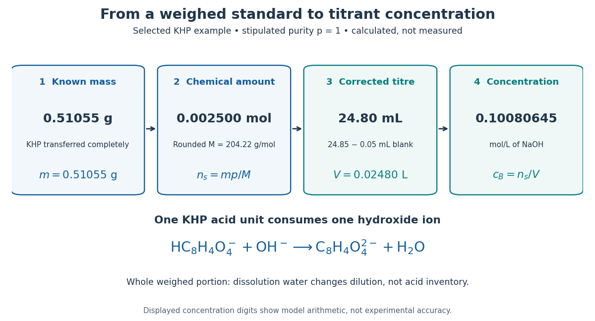

# Primary standard inventory

↑ **Parent:** [Primary standard](primary-standard.md)

Let $m$ be the transferred sample [mass](mass.md), $p$ the known [mass fraction](mass-fraction.md) of the intended [chemical compound](chemical-compound.md), and $M$ its [molar mass](molar-mass.md). In a model with complete dissolution and chemically inactive impurities,

$$
n_s=\frac{mp}{M},\qquad c_B=\frac{rmp}{MV}.
$$

The purity fraction is [dimensionless](dimensionless-quantity.md): $99.95\%$ would mean $p=0.9995$, not $99.95$. These equations assume that the impurity contributes no [titrant](titrant.md) demand; an impurity that also reacts needs its own inventory equation. The value of $p$ must refer to the same preparation state as $m$, for example the specified dry material. A [mass fraction](mass-fraction.md) assigned before unaccounted uptake of [water](water.md) cannot simply be used after it.

For an original worked example, stipulate pure [potassium hydrogen phthalate](potassium-hydrogen-phthalate.md), abbreviated KHP, so $p=1$, a selected [mass](mass.md) $m=0.51055\,\mathrm g$, and rounded [molar mass](molar-mass.md) $M=204.22\,\mathrm{g\,mol^{-1}}$. The NIST Chemistry WebBook lists formula $\mathrm{C_8H_5KO_4}$ and molecular weight $204.2212$, consistent with the rounded [molar mass](molar-mass.md) used here.[NIST Chemistry WebBook, SRD 69, potassium hydrogen phthalate, CAS 877-24-7; Formula and Molecular weight fields](nist-chemistry-webbook-srd-69/potassium-hydrogen-phthalate.md) The selected [mass](mass.md), purity assumption and [volumes](volume.md) in this example are chosen inputs, not measured results or a claim about a real batch's purity.

The acid-bearing [anion](anion.md) of [potassium hydrogen phthalate](potassium-hydrogen-phthalate.md) loses one [proton](proton.md) to [hydroxide](hydroxide.md). The net [chemical equation](chemical-equation.md) is

$$
\mathrm{HC_8H_4O_4^-}+\mathrm{OH^-}\longrightarrow\mathrm{C_8H_4O_4^{2-}}+\mathrm{H_2O}.
$$

Thus [sodium hydroxide](sodium-hydroxide.md) has one-to-one [stoichiometry](stoichiometry.md) with [potassium hydrogen phthalate](potassium-hydrogen-phthalate.md) in this [neutralization](neutralization.md), giving

$$
n_s=\frac{0.51055\,\mathrm g}{204.22\,\mathrm{g\,mol^{-1}}}=0.002500\,\mathrm{mol}.
$$

Choose a delivered endpoint [titre](titre.md) of $24.85\,\mathrm{mL}$ and matched [titration blank](titration-blank.md) of $0.05\,\mathrm{mL}$. Then

$$
V=(24.85-0.05)\,\mathrm{mL}=0.02480\,\mathrm L,\qquad
c_B=\frac{0.002500\,\mathrm{mol}}{0.02480\,\mathrm L}
=0.1008064516\ldots\,\mathrm{mol\,L^{-1}}.
$$

The extra displayed digits show the arithmetic of the stipulated model; they do not establish experimental accuracy. A compact rounded result is $0.1008\,\mathrm{mol\,L^{-1}}$.

**[Figure 3](#image-a-primary-standard-connects-known-mass-to-amount-of-substance-corrected-titre-and-titrant-concentration). A primary standard connects known mass to amount of substance, corrected titre, and titrant concentration**. Original calculated inventory diagram for selected $0.51055\,\mathrm g$ [potassium hydrogen phthalate](potassium-hydrogen-phthalate.md), stipulated $p=1$, rounded [molar mass](molar-mass.md) $204.22\,\mathrm{g\,mol^{-1}}$, and one-to-one [sodium hydroxide](sodium-hydroxide.md) [neutralization](neutralization.md). The $24.85\,\mathrm{mL}$ endpoint and $0.05\,\mathrm{mL}$ matched [titration blank](titration-blank.md) are chosen examples, not observations.

When the entire weighed portion is titrated, added [water](water.md) changes [concentration](concentration.md) and the [pH](ph.md) path but preserves the initial acid inventory. The dissolution [volume](volume-thermodynamics.md) therefore does not appear in $n_s=mp/M$. If instead a [volumetric flask](volumetric-flask.md) prepares a stock and a [volumetric pipette](volumetric-pipette.md) selects an [aliquot](aliquot.md), the selected inventory is $n_sV_a/V_f$ for homogeneous stock, with delivered [aliquot](aliquot.md) [volume](volume-thermodynamics.md) $V_a$ and final stock [volume](volume-thermodynamics.md) $V_f$. The same bookkeeping explains why complete transfer matters even when the amount of dissolution [water](water.md) is approximate.

## ↑ Ancestors (9)

1. [Primary standard](primary-standard.md)
2. [Titrant standardization](titrant-standardization.md)
3. [Acid-base titration](acid-base-titration.md)
4. [Weak acid dissociation measurement](weak-acid-dissociation-measurement.md)
5. [Weak acid](weak-acid.md)
6. [Acid (chemistry)](acid-chemistry.md)
7. [Acid-base chemistry](acid-base-chemistry-split.md)
8. [Chemistry](chemistry-split.md)
9. [Codex Wiki](split.md)

## ← Incoming links (1)

- [Standardization endpoint and blank bias](standardization-endpoint-and-blank-bias.md)
