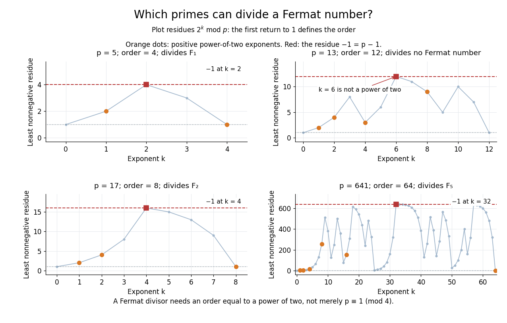

# Prime divisor of a Fermat number

↑ **Parent:** [Fermat number](fermat-number.md)

For a [prime number](prime-number.md) $p$, the exact criterion is

$$
p\mid F_n\quad\Longleftrightarrow\quad\operatorname{ord}_p(2)=2^{n+1},\qquad n\geq0,
$$

where $p$ must be different from two and $\operatorname{ord}_p(2)$ is the [multiplicative order](multiplicative-order.md) of two modulo $p$. If $p\mid F_n$, then $2^{2^n}\equiv-1\pmod p$: the order divides $2^{n+1}$ but not $2^n$, so it is exactly $2^{n+1}$. Conversely, that order makes $2^{2^n}$ a [square root of unity](square-root-of-unity.md) different from one in the [prime field](prime-field.md) $\mathbb F_p$; it must be $-1$, because $(x-1)(x+1)=0$ has no other roots in a [field](field.md).

**[Figure 4](#image-exact-modular-powers-distinguish-fermat-divisors-from-the-prime-thirteen-whose-multiplicative-order-is-twelve). Exact modular powers distinguish Fermat divisors from the prime thirteen, whose multiplicative order is twelve**.

For example, modulo seventeen the powers of two are $2,4,8,16,15,13,9,1$. Their first return to one occurs after eight steps. The half-way value is $16=-1\pmod{17}$, proving that $17\mid F_2$. Likewise, $\operatorname{ord}_{641}(2)=64$ identifies $641$ as a [prime factor](prime-factor.md) of $F_5$. These are statements about [divisibility](divisibility.md), not evidence that the entire [Fermat number](fermat-number.md) is prime.

The [multiplicative order](multiplicative-order.md) always divides $p-1$, by [Fermat's little theorem](fermat-little-theorem.md), so $p\equiv1\pmod{2^{n+1}}$. In particular, for $n\geq1$ every [prime divisor of a Fermat number](prime-divisor-of-a-fermat-number.md) is one modulo four. That weaker [modular congruence](modular-congruence.md) is insufficient: thirteen is one modulo four, but $\operatorname{ord}_{13}(2)=12$, which is not a [power of two](power-of-two.md). It divides no [Fermat number](fermat-number.md) at any index. The exact order criterion explains the whole family, instead of testing finitely many terms.

**Table of contents**

- [Stronger prime-divisor congruence for Fermat numbers](stronger-prime-divisor-congruence-for-fermat-numbers.md)

## ↑ Ancestors (5)

1. [Fermat number](fermat-number.md)
2. [Number theory](number-theory-split.md)
3. [Area of mathematics](area-of-mathematics.md)
4. [Mathematics](mathematics-split.md)
5. [Codex Wiki](split.md)

## ← Incoming links (4)

- [Fermat number](fermat-number.md)
- [Solution](past-exam-of-the-mathematics-course-of-the-university-of-cambridge/2002/ia/paper-4/8b/solution.md)
- [Solution](past-exam-of-the-mathematics-course-of-the-university-of-cambridge/2012/ia/paper-4/6d/solution.md)
- [Prime divisor of a Fermat number](prime-divisor-of-a-fermat-number.md)
