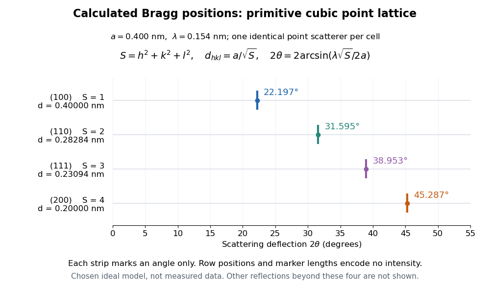

# Primitive cubic Bragg peak positions

↑ **Parent:** [Bragg's law](bragg-s-law.md)

Consider a chosen [primitive cubic lattice](primitive-cubic-lattice.md) $a\mathbb Z^3$ with $a=0.400\,\mathrm{nm}$ and one identical point scatterer per [primitive unit cell](primitive-unit-cell.md). Retain the incident [wavelength](wavelength.md) $\lambda=0.154\,\mathrm{nm}$. This is an ideal point model. Its [reciprocal lattice](reciprocal-lattice.md) vectors are $q=(2\pi/a)(h,k,l)$ for integer triples other than $(0,0,0)$. Write $S=h^2+k^2+l^2$. The associated [interplanar spacing](interplanar-spacing.md) and first-order [Bragg angle](bragg-angle.md) satisfy

$$
d_{hkl}=\frac{2\pi}{|q|}=\frac{a}{\sqrt S},\qquad
\sin^2\theta=\frac{\lambda^2}{4a^2}S=0.03705625S.
$$

The reflection labels $(hkl)$ use the [Miller index](miller-index.md) convention, keeping unreduced triples to encode [diffraction order](diffraction-order.md). With that convention, set $n=1$ in [Bragg's law](bragg-s-law.md) for each label. The $(200)$ reflection is equivalently the second [diffraction order](diffraction-order.md) of $(100)$: $d_{200}=a/2$ does not imply extra scatterers halfway between the occupied $(100)$ planes. Counting both descriptions as distinct reflections would count the same direction twice.

For $(100)$, $(110)$, $(111)$ and $(200)$, respectively, $S=1,2,3,4$ and the calculated [interplanar spacings](interplanar-spacing.md) are $0.400000$, $0.282843$, $0.230940$ and $0.200000\,\mathrm{nm}$. Their calculated deflections $2\theta$ are $22.197435^\circ$, $31.594744^\circ$, $38.952948^\circ$ and $45.287481^\circ$. Equal steps in $S$ give equal steps in $\sin^2\theta$, not equal steps in $2\theta$. This regularity makes an angular pattern a test of a proposed [crystal structure](crystal-structure.md).

**[Figure 3](#image-calculated-angular-positions-for-four-reflections-of-an-ideal-primitive-cubic-point-lattice). Calculated angular positions for four reflections of an ideal primitive cubic point lattice**. Separate strips show positions only, for $a=0.400\,\mathrm{nm}$ and $\lambda=0.154\,\mathrm{nm}$. Vertical row placement and marker length encode no [wave intensity](intensity-physics.md); this is not a simulated intensity spectrum or measured data. The four labels are a selected subset.

A real [crystal structure](crystal-structure.md) has a [Bravais lattice](bravais-lattice.md) together with an [atomic basis of a crystal](atomic-basis-of-a-crystal.md). The [crystal lattice structure factor](crystal-lattice-structure-factor.md) selects the periodic directions; the [crystal basis structure factor](crystal-basis-structure-factor.md) combines the [scattering amplitudes](scattering-amplitude.md) of atoms within a [unit cell](unit-cell.md) and can cancel a reflection. Consequently [Bragg's law](bragg-s-law.md) alone predicts neither allowed reflections nor their [wave intensities](intensity-physics.md). [Online Dictionary of Crystallography by International Union of Crystallography; Definition, sum over atoms in the unit cell; Derivation, addition of companion atoms](online-dictionary-of-crystallography-by-international-union-of-crystallography/structure-factor.md) [Systematic absences](systematic-absence.md) further restrict observed families; for example, [face-centered cubic lattice](face-centered-cubic-lattice.md) centering permits only indices all even or all odd in conventional cubic indexing. The four strips above apply to the stated [primitive cubic lattice](primitive-cubic-lattice.md), not to [sodium chloride](sodium-chloride.md) or a [face-centered cubic lattice](face-centered-cubic-lattice.md). [Online Dictionary of Crystallography by International Union of Crystallography; Definition and Table 1: primitive versus all-face-centered integral reflection conditions](online-dictionary-of-crystallography-by-international-union-of-crystallography/reflection-conditions.md)

## ↑ Ancestors (9)

1. [Bragg's law](bragg-s-law.md)
2. [Elastic Bragg scattering condition](elastic-bragg-scattering-condition.md)
3. [Crystal scattering](crystal-scattering.md)
4. [Scattering amplitude](scattering-amplitude.md)
5. [Quantum scattering](quantum-scattering-split.md)
6. [Quantum mechanics](quantum-mechanics-split.md)
7. [Branches of physics](branches-of-physics.md)
8. [Physics](physics-split.md)
9. [Codex Wiki](split.md)

## ← Incoming links (1)

- [Interplanar spacing](interplanar-spacing.md)
