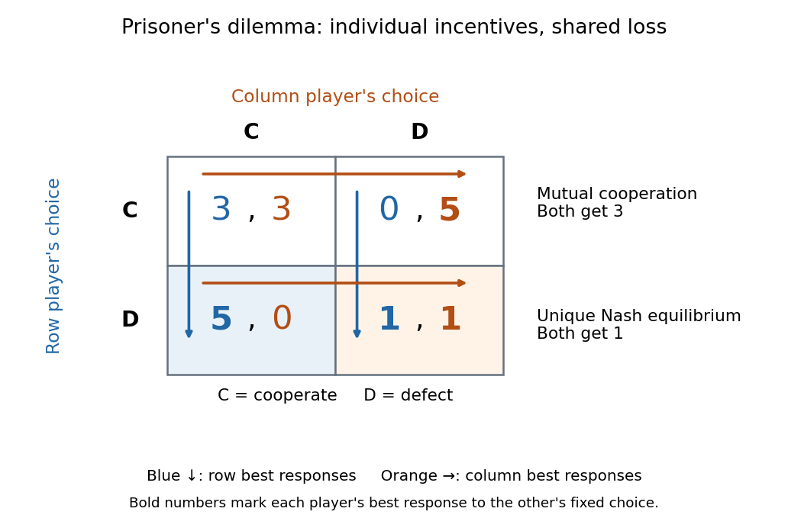

<h1 id="prisoner-s-dilemma">Prisoner's dilemma</h1>

↑ **Parent:** [Game theory](game-theory-split.md)  
ⓦ [Wiki](https://en.wikipedia.org/wiki/Prisoner's_dilemma)

Two people can each have a clear incentive to choose an outcome that leaves both worse off. The [prisoner's dilemma](prisoner-s-dilemma.md) isolates this tension between individual [best responses](best-response.md) and [Pareto efficiency](pareto-efficiency.md). For example, two partners can each save effort by withholding a promised contribution, yet both would prefer a successful joint project to mutual withholding. The model applies when each person's [payoffs](payoff.md) really have the ordering below; the names “cooperate” and “defect” alone do not establish a [prisoner's dilemma](prisoner-s-dilemma.md).

In the symmetric two-player [normal-form game](normal-form-game.md), each player chooses cooperation $C$ or defection $D$ simultaneously, without observing the other's current choice. The four [payoffs](payoff.md) are the mutual-cooperation reward $R$, mutual-defection punishment $P$, sole-defector temptation $T$, and sole-cooperator [payoff](payoff.md) $S$, with $T>R>P>S$. Defection is a [strictly dominant strategy](strictly-dominant-strategy.md): it beats cooperation against either opposing [pure strategy](pure-strategy.md). This definition and the resulting one-shot [Nash equilibrium](nash-equilibrium.md) are discussed in [Steven Kuhn, Prisoner's Dilemma, Stanford Encyclopedia of Philosophy, section 1](https://plato.stanford.edu/entries/prisoner-dilemma/).

Take the concrete [payoffs](payoff.md) $T=5$, $R=3$, $P=1$, $S=0$. Each entry below gives the row player's [payoff](payoff.md) followed by the column player's [payoff](payoff.md):

$$
\begin{array}{c|cc}
 & C & D\\\hline
C & (3,3) & (0,5)\\
D & (5,0) & (1,1)
\end{array}
$$

**[Figure 1](#image-prisoner-s-dilemma-best-response-arrows-lead-to-mutual-defection-despite-the-gains-from-mutual-cooperation). Prisoner's dilemma: best-response arrows lead to mutual defection despite the gains from mutual cooperation**.

For the row player, switching from $C$ to $D$ improves the [payoff](payoff.md) from $3$ to $5$ against $C$, and from $0$ to $1$ against $D$. The column player has the same comparisons, so $D$ is a [strictly dominant strategy](strictly-dominant-strategy.md) for each. Even against a [mixed strategy](mixed-strategy.md) choosing $C$ with [probability](probability.md) $q$, the [expected payoff](expected-payoff.md) advantage is $2q+(1-q)=1+q>0$. Thus cooperation cannot appear with positive [probability](probability.md) in a [best response](best-response.md), and $(D,D)$ is the unique one-shot [Nash equilibrium](nash-equilibrium.md), including [mixed strategies](mixed-strategy.md).

At $(D,D)$, a [unilateral deviation](unilateral-deviation.md) to $C$ lowers the deviator's [payoff](payoff.md) from $1$ to $0$. A joint change to $(C,C)$ instead raises both [payoffs](payoff.md) from $1$ to $3$: mutual cooperation Pareto dominates mutual defection, making the [Nash equilibrium](nash-equilibrium.md) fail [Pareto efficiency](pareto-efficiency.md). A [Nash equilibrium](nash-equilibrium.md) tests [unilateral deviations](unilateral-deviation.md), so it need not maximize shared gains. This is the useful lesson: improving the available outcome may require changing incentives, rather than telling each participant to choose a better [best response](best-response.md).

The additional inequality $2R\ge T+S$ says that mutual cooperation gives each player at least as much average [payoff](payoff.md) as equal-time alternation between the two asymmetric outcomes. It is a further assumption, not a consequence of $T>R>P>S$. Here it holds strictly: $6>5$, and alternating exploitation gives each player average [payoff](payoff.md) $5/2<3$. This comparison concerns equal-time averages, not every discounted sequence. See [Kuhn, section 3, on the additional cardinal-payoff condition](https://plato.stanford.edu/entries/prisoner-dilemma/).

**Table of contents**

- [Iterated prisoner's dilemma](iterated-prisoner-s-dilemma.md)
  - [Grim trigger](grim-trigger.md)
  - [Reactive strategy (game theory)](reactive-strategy-game-theory.md)
    - [Always defect](always-defect.md)
    - [Always cooperate](always-cooperate.md)
    - [Tit for tat](tit-for-tat.md)
      - [Tit for tat invasion of a reactive resident](tit-for-tat-invasion-of-a-reactive-resident.md)
        - [Finite-horizon invasion threshold of Tit for tat against unconditional defection](finite-horizon-invasion-threshold-of-tit-for-tat-against-unconditional-defection.md)
      - [Neutrality between Tit for tat and unconditional cooperation](neutrality-between-tit-for-tat-and-unconditional-cooperation.md)
    - [Long-run payoff of reactive strategies](long-run-payoff-of-reactive-strategies.md)

## ↑ Ancestors (5)

1. [Game theory](game-theory-split.md)
2. [Mathematical optimization](mathematical-optimization-split.md)
3. [Area of mathematics](area-of-mathematics.md)
4. [Mathematics](mathematics-split.md)
5. [Codex Wiki](split.md)

## ← Incoming links (4)

- [Iterated prisoner's dilemma](iterated-prisoner-s-dilemma.md)
- [Nash equilibrium](nash-equilibrium.md)
- [Solution](past-exam-of-the-mathematics-course-of-the-university-of-cambridge/2001/iii/paper-52/6/a/solution.md)
- [Prisoner's dilemma](prisoner-s-dilemma.md)
