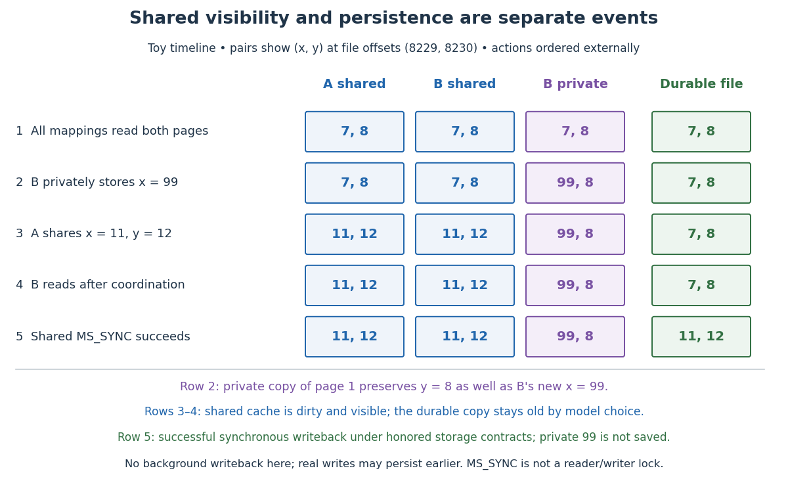

# Private file mapping

↑ **Parent:** [Memory-mapped file](memory-mapped-file.md)

With `MAP_PRIVATE`, [copy-on-write](copy-on-write.md) initially reuses backing [page cache](page-cache.md) contents. In our model, a private store raises a protection [page fault](page-fault.md), copies the affected [memory page](memory-page.md) to a private [page frame](page-frame.md), installs a writable [page table entry](page-table-entry.md) and retries. The other [memory page](memory-page.md) can remain shared. This [page fault](page-fault.md) needs no storage read.

In B's [private file mapping](private-file-mapping.md), storing $x=99$ copies relative page 1, including its neighbor $y=8$. Next, A stores $x=11,y=12$ through its [shared file mapping](shared-file-mapping.md). After coordination outside the mapped data, B's shared reads give $(11,12)$, while its detached private page gives $(99,8)$. The untouched first [memory page](memory-page.md) remains backed by the [file](computer-file.md); this is not a frozen snapshot of the whole [file](computer-file.md). Neither [page writeback](page-writeback.md) of shared contents nor [msync](msync.md) publishes B's private 99. To save those private contents, the application needs a separate explicit [file](computer-file.md) update.

**[Figure 8](#image-toy-shared-file-mapping-and-copy-on-write-timeline-visible-shared-changes-precede-the-chosen-durable-completion-private-changes-remain-separate). Toy shared file mapping and copy-on-write timeline: visible shared changes precede the chosen durable completion; private changes remain separate**.

## ↑ Ancestors (5)

1. [Memory-mapped file](memory-mapped-file.md)
2. [Virtual memory](virtual-memory-split.md)
3. [Operating system](operating-system-split.md)
4. [Computer science](computer-science-split.md)
5. [Codex Wiki](split.md)

## ← Incoming links (5)

- [Backing file](backing-file.md)
- [Memory-mapped file](memory-mapped-file.md)
- [Memory-mapped file offset translation](memory-mapped-file-offset-translation.md)
- [msync](msync.md)
- [Private file mapping](private-file-mapping.md)
