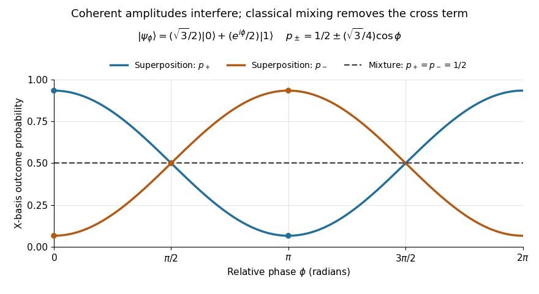

# Probability amplitude

↑ **Parent:** [Wave function](wave-function.md)  
ⓦ [Wiki](https://en.wikipedia.org/wiki/Probability_amplitude)

A probability amplitude is a [complex number](complex-number.md) that describes the contribution of a [pure state](pure-state.md) to a specified measurement outcome. For a normalized [quantum state](quantum-state.md) $|\psi\rangle$ and a rank-one outcome associated with a normalized vector $|j\rangle$, it is the [inner product](inner-product.md) $a_j=\langle j|\psi\rangle$. The [Born rule](born-rule.md) gives the corresponding [probability](probability.md) $p_j=|a_j|^2=a_j^*a_j$, using the [complex conjugate](complex-conjugate.md). Thus an amplitude can be negative or complex, while a [probability](probability.md) is real and nonnegative. A [wavefunction](wave-function.md) is the analogous position amplitude: its squared [modulus](modulus.md) gives a [probability density](probability-density.md), which must be integrated over a region to obtain a [probability](probability.md). [Zwiebach, MIT 8.04, lecture 6, section 2, pp. 3–4](https://ocw.mit.edu/courses/8-04-quantum-physics-i-spring-2016/d87c768c4e1181fde8d4366112169719_MIT8_04S16_LecNotes6.pdf).

The extra information is the [quantum phase](quantum-phase.md). If $a=re^{i\theta}$, its [modulus](modulus.md) $r$ fixes $|a|^2=r^2$, but its angle $\theta$ controls how it adds to another contribution. In the [complex plane](complex-plane.md), picture amplitudes as arrows: add the arrows, then square the resulting length. For coherent contributions $A$ and $B$ to the same outcome,

$$
|A+B|^2=|A|^2+|B|^2+2\operatorname{Re}(A^*B).
$$

The last term is [interference](interference-wave-propagation.md). Adding [probabilities](probability.md) first loses it. Contributions with different relative [quantum phases](quantum-phase.md) can reinforce or cancel even when their individual squared [moduli](modulus.md) are fixed.

For the [qubit](qubit.md) [quantum superposition](quantum-superposition.md) $|\psi_\phi\rangle=(\sqrt3/2)|0\rangle+(e^{i\phi}/2)|1\rangle$, project onto the plus vector of the [Hadamard basis](hadamard-basis.md). By linearity, the two contributions combine as

$$
\langle+|\psi_\phi\rangle
=\underbrace{\frac{\sqrt3}{2\sqrt2}}_{A}
+\underbrace{\frac{e^{i\phi}}{2\sqrt2}}_{B}.
$$

Here $|A|^2=3/8$ and $|B|^2=1/8$, while the [interference](interference-wave-propagation.md) term is $(\sqrt3/4)\cos\phi$. At $\phi=0$, the arrows align and the plus [probability](probability.md) is $1/2+\sqrt3/4\simeq0.9330127$. At $\phi=\pi$, they oppose and that [probability](probability.md) is $1/2-\sqrt3/4\simeq0.0669873$; cancellation is incomplete because the lengths differ. At $\phi=\pi/2$, the arrows are perpendicular and the cross term vanishes. The minus amplitude uses $A-B$, reversing the cross term. These are alternate [projective measurements](projective-measurement.md) on identically prepared copies, rather than a sequence of measurements on one copy.

**[Figure 16](#image-relative-quantum-phase-redistributes-hadamard-basis-probabilities-a-diagonal-mixture-stays-at-one-half). Relative quantum phase redistributes Hadamard-basis probabilities; a diagonal mixture stays at one half**.

A [global phase](global-phase.md) multiplies every contribution by the same factor $e^{i\gamma}$, giving

$$
|\langle j|e^{i\gamma}\psi\rangle|^2
=|e^{i\gamma}\langle j|\psi\rangle|^2
=|\langle j|\psi\rangle|^2.
$$

It therefore changes no outcome [probability](probability.md). Changing a relative [quantum phase](quantum-phase.md) can change the angle between contributions and hence their [interference](interference-wave-propagation.md). Keeping amplitudes until the last step makes [quantum circuits](quantum-circuit-split.md) and [matter-wave interference](matter-wave-interference.md) calculable; discarding their angles prematurely discards physically testable information. The [Born rule](born-rule.md) example compares two measurement bases explicitly.

**Table of contents**

- [Born rule](born-rule.md)
  - [Two-level quantum return probability](two-level-quantum-return-probability.md)
  - [Two-level observable transition probability](two-level-observable-transition-probability.md)
  - [Wigner's theorem](wigner-s-theorem.md)
    - [Projective unitary representation](projective-unitary-representation.md)
  - [Energy measurement](energy-measurement.md)

## ↑ Ancestors (5)

1. [Wave function](wave-function.md)
2. [Quantum mechanics](quantum-mechanics-split.md)
3. [Branches of physics](branches-of-physics.md)
4. [Physics](physics-split.md)
5. [Codex Wiki](split.md)

## ← Incoming links (44)

- [Antibonding orbital](antibonding-orbital.md)
- [Born rule](born-rule.md)
- [Electron diffraction](electron-diffraction.md)
- [Evanescent probability current](evanescent-probability-current.md)
- [Exact variational solution in a two-level system](exact-variational-solution-in-a-two-level-system.md)
- [Finite rectangular barrier matching](finite-rectangular-barrier-matching.md)
- [Free-particle momentum convention](free-particle-momentum-convention.md)
- [Ground-state overlap after sudden expansion of a square well](ground-state-overlap-after-sudden-expansion-of-a-square-well.md)
- [Hadamard gate](hadamard-gate.md)
- [Hadamard transform](hadamard-transform.md)
- [Heisenberg uncertainty relation](heisenberg-uncertainty-relation.md)
- [Molecular orbital](molecular-orbital.md)
- [Molecular orbital theory](molecular-orbital-theory.md)
- [Nearest-integer success bound for quantum phase estimation](nearest-integer-success-bound-for-quantum-phase-estimation.md)
- [Solution](past-exam-of-the-mathematics-course-of-the-university-of-cambridge/2004/ib/paper-2/8d/solution.md)
- [Solution](past-exam-of-the-mathematics-course-of-the-university-of-cambridge/2005/ib/paper-1/15g/solution.md)
- [Solution](past-exam-of-the-mathematics-course-of-the-university-of-cambridge/2005/iii/paper-58/1/i/solution.md)
- [Solution](past-exam-of-the-mathematics-course-of-the-university-of-cambridge/2005/iii/paper-58/2/ii/solution.md)
- [Solution](past-exam-of-the-mathematics-course-of-the-university-of-cambridge/2007/ib/paper-3/16b/solution.md)
- [Solution](past-exam-of-the-mathematics-course-of-the-university-of-cambridge/2008/iii/paper-57/4/b/solution.md)
- [Solution](past-exam-of-the-mathematics-course-of-the-university-of-cambridge/2008/iii/paper-57/4/c/solution.md)
- [Solution](past-exam-of-the-mathematics-course-of-the-university-of-cambridge/2012/iii/paper-67/2/a/solution.md)
- [Solution](past-exam-of-the-mathematics-course-of-the-university-of-cambridge/2014/ib/paper-1/15a/ii/solution.md)
- [Solution](past-exam-of-the-mathematics-course-of-the-university-of-cambridge/2017/iii/paper-324/1/b/iii/solution.md)
- [Solution](past-exam-of-the-mathematics-course-of-the-university-of-cambridge/2017/iii/paper-324/3/b/ii/solution.md)
- [Solution](past-exam-of-the-mathematics-course-of-the-university-of-cambridge/2022/ib/paper-2/15b/b/iii/solution.md)
- [Polynomial method for quantum query lower bounds](polynomial-method-for-quantum-query-lower-bounds.md)
- [Post-quench oscillations in a two-level system](post-quench-oscillations-in-a-two-level-system.md)
- [Projective measurement](projective-measurement.md)
- [Quantum information](quantum-information.md)
- [Quantum information theory](quantum-information-theory-split.md)
- [Measurement in quantum mechanics](quantum-measurement-split.md)
- [Quantum mechanics](quantum-mechanics-split.md)
- [Quantum state continuity at a finite Hamiltonian step](quantum-state-continuity-at-a-finite-hamiltonian-step.md)
- [Quantum superposition](quantum-superposition.md)
- [Quantum theory](quantum-theory-split.md)
- [Qubit](qubit.md)
- [Qubit state](qubit-state.md)
- [Rectangular barrier transmission probability](rectangular-barrier-transmission-probability.md)
- [Sudden approximation](sudden-approximation.md)
- [Two-level observable transition probability](two-level-observable-transition-probability.md)
- [Two-level sudden quench](two-level-sudden-quench.md)
- [Two-particle antisymmetrization](two-particle-antisymmetrization.md)
- [Variational method](variational-method.md)
