# Probability and statistics

↑ **Parent:** [Area of mathematics](mathematics.md#area-of-mathematics)  
ⓦ [Wiki](https://en.wikipedia.org/wiki/Probability_and_statistics)

**Table of contents**

- [Statistics](#statistics)
  - [Probability plot](#probability-plot)
  - [Relative frequency](#relative-frequency)
  - [Demography](#demography)
- [Stochasticity](#stochasticity)
- [Descriptive statistics](#descriptive-statistics)
  - [Frequency table](#frequency-table)
  - [Mode (statistics)](#mode-statistics)
  - [Scatter plot](#scatter-plot)
  - [Box plot](#box-plot)
  - [Quartile](#quartile)
  - [Histogram](#histogram)
- [Birthday problem](#birthday-problem)
  - [Matching one specified birthday](#matching-one-specified-birthday)
  - [Birthday collision count](#birthday-collision-count)
  - [Birthday square-root scale](#birthday-square-root-scale)
  - [Collision probability of two independent categorical draws](#collision-probability-of-two-independent-categorical-draws)
- [Actuarial statistics](actuarial-statistics.md)
  - [No claims discount system](actuarial-statistics.md#no-claims-discount-system)
  - [Expected value premium principle](actuarial-statistics.md#expected-value-premium-principle)
  - [Credibility estimate](actuarial-statistics.md#credibility-estimate)
  - [Bühlmann model](actuarial-statistics.md#buhlmann-model)
  - [Classical risk model](actuarial-statistics.md#classical-risk-model)
  - [Reinsurance](actuarial-statistics.md#reinsurance)
  - [Aggregate claims model](actuarial-statistics.md#aggregate-claims-model)
- [Self-averaging](#self-averaging)
- [Q-Q plot](#q-q-plot)
  - [Normal Q-Q plot](#normal-q-q-plot)
  - [Plotting position](#plotting-position)
- [Change-point detection](#change-point-detection)
  - [Poisson count change-point model with gamma priors](#poisson-count-change-point-model-with-gamma-priors)
  - [Gaussian change-point posterior with proper priors](#gaussian-change-point-posterior-with-proper-priors)
  - [Poisson change-point posterior](#poisson-change-point-posterior)
- [Measurement error](#measurement-error)
  - [Random measurement error](#random-measurement-error)
  - [Measurement noise](#measurement-noise)
  - [Errors-in-variables model](#errors-in-variables-model)
- [Regression toward the mean](#regression-toward-the-mean)
  - [Repeated-measurement latent signal model](#repeated-measurement-latent-signal-model)
  - [Regression toward the mean and randomized comparisons](#regression-toward-the-mean-and-randomized-comparisons)
  - [Galton's stature regression](#galton-s-stature-regression)
- [Sensitivity analysis](#sensitivity-analysis)
  - [Pattern-mixture sensitivity analysis](#pattern-mixture-sensitivity-analysis)
- [Power spectrum](#power-spectrum)
  - [Spectral tensor](#spectral-tensor)
  - [Statistical homogeneity](#statistical-homogeneity)
  - [Statistical isotropy](#statistical-isotropy)
- [Time series](time-series.md)
  - [Uncorrelated returns with nonlinear predictability](time-series.md#uncorrelated-returns-with-nonlinear-predictability)
  - [Lag of a time series](time-series.md#lag-of-a-time-series)
  - [Three-point quadratic reproduction forces the identity filter](time-series.md#three-point-quadratic-reproduction-forces-the-identity-filter)
  - [Five-point symmetric quadratic trend smoother](time-series.md#five-point-symmetric-quadratic-trend-smoother)
  - [Turning point test of randomness](time-series.md#turning-point-test-of-randomness)
  - [Exponential smoothing](time-series.md#exponential-smoothing)
  - [Wold decomposition](time-series.md#wold-decomposition)
  - [Best linear prediction from a finite past](time-series.md#best-linear-prediction-from-a-finite-past)
  - [Best linear prediction from an infinite past](time-series.md#best-linear-prediction-from-an-infinite-past)
  - [State-space model (time series)](time-series.md#state-space-model-time-series)
  - [Anticausal time series](time-series.md#anticausal-time-series)
  - [Linear process (time series)](time-series.md#linear-process-time-series)
  - [Autoregressive conditional heteroscedasticity](time-series.md#autoregressive-conditional-heteroscedasticity)
  - [Seasonality](time-series.md#seasonality)
  - [Long-memory time series](time-series.md#long-memory-time-series)
  - [Short-memory time series](time-series.md#short-memory-time-series)
  - [Periodically correlated process](time-series.md#periodically-correlated-process)
  - [Differencing](time-series.md#differencing)
  - [Innovation process](time-series.md#innovation-process)
  - [Naive time-series forecast](time-series.md#naive-time-series-forecast)
  - [Causal time series](time-series.md#causal-time-series)
  - [Stationary process](time-series.md#stationary-process)
  - [Autoregressive moving-average model](time-series.md#autoregressive-moving-average-model)
  - [Bispectrum](time-series.md#bispectrum)
- [Sub-Gaussian distribution](#sub-gaussian-distribution)
  - [Sub-Gaussian random vector](#sub-gaussian-random-vector)
- [Subexponential distribution (light-tailed)](#subexponential-distribution-light-tailed)
  - [Centered square of a sub-Gaussian random variable](#centered-square-of-a-sub-gaussian-random-variable)
  - [Bernstein moment condition](#bernstein-moment-condition)
  - [Product of sub-Gaussian random variables is sub-exponential](#product-of-sub-gaussian-random-variables-is-sub-exponential)
- [Lasso](lasso.md)
  - [Karush-Kuhn-Tucker conditions for the Lasso](lasso.md#karush-kuhn-tucker-conditions-for-the-lasso)
  - [Lasso regularization path](lasso.md#lasso-regularization-path)
  - [Gaussian score event for the Lasso](lasso.md#gaussian-score-event-for-the-lasso)
  - [Sparse maximum eigenvalue](lasso.md#sparse-maximum-eigenvalue)
  - [Lava estimator](lasso.md#lava-estimator)
  - [Fused Lasso](lasso.md#fused-lasso)
  - [Dantzig selector](lasso.md#dantzig-selector)
  - [Square-root Lasso](lasso.md#square-root-lasso)
  - [Group Lasso](lasso.md#group-lasso)
  - [Basic inequality for the Lasso](lasso.md#basic-inequality-for-the-lasso)
  - [Debiased Lasso](lasso.md#debiased-lasso)
  - [Soft thresholding](lasso.md#soft-thresholding)
  - [Berhu penalty](lasso.md#berhu-penalty)
  - [Elastic net regularization](lasso.md#elastic-net-regularization)
- [Positive-semidefinite kernel](positive-semidefinite-kernel.md)
  - [All-subsequence embedding kernel](positive-semidefinite-kernel.md#all-subsequence-embedding-kernel)
  - [Neural tangent kernel](positive-semidefinite-kernel.md#neural-tangent-kernel)
  - [Mercer kernel](positive-semidefinite-kernel.md#mercer-kernel)
  - [Cauchy-Schwarz inequality for positive-semidefinite kernels](positive-semidefinite-kernel.md#cauchy-schwarz-inequality-for-positive-semidefinite-kernels)
  - [Kernel matrix](positive-semidefinite-kernel.md#kernel-matrix)
  - [Feature map](positive-semidefinite-kernel.md#feature-map)
  - [Gaussian kernel](positive-semidefinite-kernel.md#gaussian-kernel)
  - [Linear kernel](positive-semidefinite-kernel.md#linear-kernel)
  - [Polynomial kernel](positive-semidefinite-kernel.md#polynomial-kernel)
  - [Closure property of positive-semidefinite kernels](positive-semidefinite-kernel.md#closure-property-of-positive-semidefinite-kernels)
  - [Laplace kernel](positive-semidefinite-kernel.md#laplace-kernel)
  - [Reproducing kernel Hilbert space](positive-semidefinite-kernel.md#reproducing-kernel-hilbert-space)
- [Doubly robust estimation](#doubly-robust-estimation)
  - [Augmented inverse-probability-weighted estimator](#augmented-inverse-probability-weighted-estimator)
  - [Double robustness](#double-robustness)
  - [Cross-fitting](#cross-fitting)
- [Conditional multivariate normal distribution](#conditional-multivariate-normal-distribution)
  - [Gaussian process regression posterior](#gaussian-process-regression-posterior)
- [Causal inference](causal-inference.md)
  - [Functional necessity and sufficiency](causal-inference.md#functional-necessity-and-sufficiency)
  - [Quasi-experiment](causal-inference.md#quasi-experiment)
  - [Natural experiment](causal-inference.md#natural-experiment)
  - [Causal mediation](causal-inference.md#causal-mediation)
  - [Outcome standardization](causal-inference.md#outcome-standardization)
  - [Causal mediation analysis](causal-inference.md#causal-mediation-analysis)
  - [Confounding by indication](causal-inference.md#confounding-by-indication)
  - [Causal identification](causal-inference.md#causal-identification)
  - [G-computation](causal-inference.md#g-computation)
  - [Exposure](causal-inference.md#exposure)
  - [Treatment](causal-inference.md#treatment)
  - [Statistical association](causal-inference.md#statistical-association)
  - [Instrumental variable](causal-inference.md#instrumental-variable)
  - [Interference in causal inference](causal-inference.md#interference-in-causal-inference)
  - [Ecological fallacy](causal-inference.md#ecological-fallacy)
  - [Causal directed acyclic graph](causal-inference.md#causal-directed-acyclic-graph)
  - [Potential outcomes framework](causal-inference.md#potential-outcomes-framework)
  - [Confounding](causal-inference.md#confounding)
  - [Ignorability](causal-inference.md#ignorability)
  - [Positivity assumption](causal-inference.md#positivity-assumption)
  - [Inverse probability weighting](causal-inference.md#inverse-probability-weighting)
  - [Consistency in causal inference](causal-inference.md#consistency-in-causal-inference)
  - [Effect modifier](causal-inference.md#effect-modifier)
  - [Selection bias](causal-inference.md#selection-bias)
  - [Internal validity](causal-inference.md#internal-validity)
  - [External validity](causal-inference.md#external-validity)
  - [Regression discontinuity design](causal-inference.md#regression-discontinuity-design)
  - [Difference-in-differences](causal-inference.md#difference-in-differences)
  - [Matching (statistics)](causal-inference.md#matching-statistics)
  - [Negative control outcome](causal-inference.md#negative-control-outcome)
  - [Sensitivity analysis for unmeasured confounding](causal-inference.md#sensitivity-analysis-for-unmeasured-confounding)
  - [Randomized controlled trial](causal-inference.md#randomized-controlled-trial)
- [Missing data](#missing-data)
  - [Missingness overlap from marginal and complete-case counts](#missingness-overlap-from-marginal-and-complete-case-counts)
  - [Observed-case analysis](#observed-case-analysis)
  - [Missing-outcome bounds for a binary endpoint](#missing-outcome-bounds-for-a-binary-endpoint)
  - [Unit and item nonresponse](#unit-and-item-nonresponse)
  - [Missing-data mechanism](#missing-data-mechanism)
  - [Missing completely at random](#missing-completely-at-random)
  - [Missing at random](#missing-at-random)
  - [Ignorable missingness mechanism](#ignorable-missingness-mechanism)
  - [Missing not at random](#missing-not-at-random)
  - [Monotone missing-data pattern](#monotone-missing-data-pattern)
  - [Complete-case analysis](#complete-case-analysis)
  - [Multiple imputation](#multiple-imputation)
- [Clinical trial](#clinical-trial)
  - [Pragmatic clinical trial](#pragmatic-clinical-trial)
  - [Specific treatment effect](#specific-treatment-effect)
  - [Treatment expectancy](#treatment-expectancy)
  - [Treatment credibility](#treatment-credibility)
  - [Nonspecific treatment effect](#nonspecific-treatment-effect)
  - [Clinical outcome](#clinical-outcome)
  - [Placebo](#placebo)
  - [Therapist allegiance](#therapist-allegiance)
  - [Primary outcome](#primary-outcome)
  - [Treatment effect moderation](#treatment-effect-moderation)
  - [Noninferiority trial](#noninferiority-trial)
  - [Dismantling trial](#dismantling-trial)
  - [Treatment acceptability](#treatment-acceptability)
  - [Diagnostic remission](#diagnostic-remission)
  - [Treatment augmentation](#treatment-augmentation)
  - [Independent trial safety monitoring](#independent-trial-safety-monitoring)
  - [Clinical equipoise](#clinical-equipoise)
  - [Time-origin alignment of clinical endpoints](#time-origin-alignment-of-clinical-endpoints)
  - [Eligibility criteria for a clinical trial](#eligibility-criteria-for-a-clinical-trial)
  - [Sample size](#sample-size)
  - [Statistical power](#statistical-power)
  - [Group sequential design](#group-sequential-design)
  - [Two-stage clinical trial design](#two-stage-clinical-trial-design)
  - [Neyman allocation](#neyman-allocation)
  - [Response-adaptive randomization](#response-adaptive-randomization)
- [Survival analysis](survival-analysis.md)
  - [Cure model](survival-analysis.md#cure-model)
  - [Survival data](survival-analysis.md#survival-data)
  - [Relative survival](survival-analysis.md#relative-survival)
  - [Accelerated failure time model](survival-analysis.md#accelerated-failure-time-model)
  - [Survival prediction calibration](survival-analysis.md#survival-prediction-calibration)
  - [Concordance index](survival-analysis.md#concordance-index)
  - [Within-patient recurrent-event dependence](survival-analysis.md#within-patient-recurrent-event-dependence)
  - [Gap-time recurrent-event model](survival-analysis.md#gap-time-recurrent-event-model)
  - [Start-stop recurrent-event data layout](survival-analysis.md#start-stop-recurrent-event-data-layout)
  - [Survival time](survival-analysis.md#survival-time)
  - [Cox–Snell residual](survival-analysis.md#cox-snell-residual)
  - [Gompertz distribution](survival-analysis.md#gompertz-distribution)
  - [Survival function](survival-analysis.md#survival-function)
  - [Risk set](survival-analysis.md#risk-set)
  - [Survival likelihood](survival-analysis.md#survival-likelihood)
  - [Continuous-time multi-state model](survival-analysis.md#continuous-time-multi-state-model)
  - [Censoring (statistics)](survival-analysis.md#censoring-statistics)
  - [Log-rank test](survival-analysis.md#log-rank-test)
  - [Proportional hazards model](survival-analysis.md#proportional-hazards-model)
  - [Immortal time bias](survival-analysis.md#immortal-time-bias)
  - [Landmark analysis](survival-analysis.md#landmark-analysis)
  - [Time-dependent covariate](survival-analysis.md#time-dependent-covariate)
  - [Frailty model](survival-analysis.md#frailty-model)
  - [Person-time](survival-analysis.md#person-time)
  - [Competing risks](survival-analysis.md#competing-risks)
  - [Partial likelihood](survival-analysis.md#partial-likelihood)
  - [Cox proportional-hazards model](survival-analysis.md#cox-proportional-hazards-model)
  - [Truncation (statistics)](survival-analysis.md#truncation-statistics)
  - [Kaplan–Meier estimator](survival-analysis.md#kaplan-meier-estimator)
  - [Nelson–Aalen estimator](survival-analysis.md#nelson-aalen-estimator)
  - [Martingale residual](survival-analysis.md#martingale-residual)
  - [Period survival analysis](survival-analysis.md#period-survival-analysis)
  - [Constant hazard survival model](survival-analysis.md#constant-hazard-survival-model)
  - [Piecewise-exponential survival model](survival-analysis.md#piecewise-exponential-survival-model)
- [Sign test](#sign-test)
- [f-divergence](f-divergence.md)
  - [Kullback-Leibler divergence](f-divergence.md#kullback-leibler-divergence)
  - [Chi-squared divergence](f-divergence.md#chi-squared-divergence)
  - [Data processing inequality for f-divergences](f-divergence.md#data-processing-inequality-for-f-divergences)
  - [Squared Hellinger distance](f-divergence.md#squared-hellinger-distance)
- [Coupling](#coupling)
  - [Summable-memory coupling](#summable-memory-coupling)
  - [Eventual coupling of planar symmetric random walks](#eventual-coupling-of-planar-symmetric-random-walks)
  - [Stochastic domination of probability measures](#stochastic-domination-of-probability-measures)
  - [Synchronous coupling](#synchronous-coupling)
  - [Coalescing coupling](#coalescing-coupling)
  - [Bernoulli coupling by a shared uniform random variable](#bernoulli-coupling-by-a-shared-uniform-random-variable)
  - [Maximal coupling](#maximal-coupling)
  - [Wasserstein distance](#wasserstein-distance)
- [Total variation distance](#total-variation-distance)
  - [Total variation distance on a finite set](#total-variation-distance-on-a-finite-set)
  - [Total variation distance and hypothesis testing](#total-variation-distance-and-hypothesis-testing)
  - [Coupling characterization of total variation distance](#coupling-characterization-of-total-variation-distance)
  - [Coupling inequality for total variation](#coupling-inequality-for-total-variation)
  - [Total variation distance under a measurable map](#total-variation-distance-under-a-measurable-map)
  - [Pinsker's inequality](#pinsker-s-inequality)
- [Information theory](information-theory.md)
  - [Trit](information-theory.md#trit)
  - [Bhattacharyya coefficient](information-theory.md#bhattacharyya-coefficient)
  - [Communication channel](information-theory.md#communication-channel)
  - [Bit](information-theory.md#bit)
  - [Nat (unit)](information-theory.md#nat-unit)
  - [Memoryless classical information source](information-theory.md#memoryless-classical-information-source)
  - [Alphabet](information-theory.md#alphabet)
  - [Conditional entropy](information-theory.md#conditional-entropy)
  - [Mutual information](information-theory.md#mutual-information)
  - [Entropic Ruzsa distance](information-theory.md#entropic-ruzsa-distance)
  - [Entropy submodularity for three independent sums](information-theory.md#entropy-submodularity-for-three-independent-sums)
  - [Entropy submodularity for sums](information-theory.md#entropy-submodularity-for-sums)
  - [Binary hypothesis testing in information theory](information-theory.md#binary-hypothesis-testing-in-information-theory)
  - [Total correlation](information-theory.md#total-correlation)
  - [Type (information theory)](information-theory.md#type-information-theory)
  - [Rate-distortion theory](information-theory.md#rate-distortion-theory)
  - [Channel capacity](information-theory.md#channel-capacity)
  - [Information entropy](information-entropy.md)
  - [One-to-one source code](information-theory.md#one-to-one-source-code)
  - [Huffman coding](information-theory.md#huffman-coding)
  - [Bernoulli source](information-theory.md#bernoulli-source)
  - [Entropy rate](information-theory.md#entropy-rate)
  - [Markov information source](information-theory.md#markov-information-source)
  - [Asymptotic equipartition property](information-theory.md#asymptotic-equipartition-property)
  - [Lossless source coding](information-theory.md#lossless-source-coding)
  - [Unicity distance](information-theory.md#unicity-distance)
- [Probability theory](probability-theory.md)
  - [Probability model](probability-theory.md#probability-model)
  - [Decision theory](probability-theory.md#decision-theory)
  - [Random number generation](probability-theory.md#random-number-generation)
  - [Poissonization](probability-theory.md#poissonization)
  - [Group testing](probability-theory.md#group-testing)
  - [Bertrand paradox (probability)](probability-theory.md#bertrand-paradox-probability)
  - [Polygon probability for independent uniform rods](probability-theory.md#polygon-probability-for-independent-uniform-rods)
  - [Coverage of a sphere by random open hemispheres](probability-theory.md#coverage-of-a-sphere-by-random-open-hemispheres)
  - [Pairwise independent events](probability-theory.md#pairwise-independent-events)
  - [Point process](probability-theory.md#point-process)
  - [Random matrix](probability-theory.md#random-matrix)
  - [Concentration of measure](probability-theory.md#concentration-of-measure)
  - [Positive association of random variables](probability-theory.md#positive-association-of-random-variables)
  - [Extreme value theory](extreme-value-theory.md)
  - [Probability](probability-theory.md#probability)
  - [Percolation theory](percolation-theory.md)
  - [Finitely additive probability measure](probability-theory.md#finitely-additive-probability-measure)
  - [Probability space](probability-space.md)
  - [Uniform random point in a disk](probability-theory.md#uniform-random-point-in-a-disk)
  - [Independent sigma-algebras](probability-theory.md#independent-sigma-algebras)
  - [Product measure](probability-theory.md#product-measure)
  - [Fréchet inequalities](probability-theory.md#frechet-inequalities)
  - [Standard score](probability-theory.md#standard-score)
  - [Convergence of random variables](convergence-of-random-variables.md)
  - [Martingale](martingale.md)
  - [Queueing theory](queueing-theory.md)
  - [Random variable](random-variable.md)
  - [Borel-Cantelli lemmas](probability-theory.md#borel-cantelli-lemmas)
  - [Stochastic process](stochastic-process.md)
  - [Lévy's continuity theorem](probability-theory.md#levy-s-continuity-theorem)
  - [Poisson process](poisson-process.md)
  - [Fokker-Planck equation](probability-theory.md#fokker-planck-equation)
  - [Wald's equation](probability-theory.md#wald-s-equation)
  - [Poisson point process](poisson-point-process.md)
  - [Order statistic](probability-theory.md#order-statistic)
  - [Expected value](expected-value.md)
  - [Probability distribution](probability-distribution.md)
  - [Probability inequality](probability-inequality.md)
  - [Conditional probability](probability-theory.md#conditional-probability)
  - [Random partition](probability-theory.md#random-partition)
  - [Random path in a binary tree](probability-theory.md#random-path-in-a-binary-tree)
  - [Markov process](markov-process.md)
  - [Renewal process](probability-theory.md#renewal-process)
  - [Law of total variance](probability-theory.md#law-of-total-variance)
  - [Laplace transform of a nonnegative random variable](probability-theory.md#laplace-transform-of-a-nonnegative-random-variable)
  - [Characteristic function](characteristic-function.md)
  - [Variance normalization](probability-theory.md#variance-normalization)
  - [Cox--Ross--Rubinstein model](probability-theory.md#cox-ross-rubinstein-model)
  - [Thinning of a point process](probability-theory.md#thinning-of-a-point-process)
- [Statistical model](statistical-model.md)
  - [Parameter space](statistical-model.md#parameter-space)
  - [Parameter recovery](statistical-model.md#parameter-recovery)
  - [Mixed model](statistical-model.md#mixed-model)
  - [Spatial Bernoulli infection model](statistical-model.md#spatial-bernoulli-infection-model)
  - [Transformation model](statistical-model.md#transformation-model)
  - [Parametric statistical model](statistical-model.md#parametric-statistical-model)
  - [Location-scale family](statistical-model.md#location-scale-family)
  - [Regression model](statistical-model.md#regression-model)
  - [Statistical path](statistical-model.md#statistical-path)
  - [Scale family](statistical-model.md#scale-family)
  - [Statistical parameter](statistical-model.md#statistical-parameter)
  - [Covariate](statistical-model.md#covariate)
  - [Homoscedasticity](statistical-model.md#homoscedasticity)
  - [Identifiability](statistical-model.md#identifiability)
  - [Location family](statistical-model.md#location-family)
  - [Probabilistic graphical model](statistical-model.md#probabilistic-graphical-model)
  - [Statistical modelling](statistical-modelling.md)
- [Augmented Markov chain](#augmented-markov-chain)
- [Bayesian normal model](#bayesian-normal-model)
  - [Normal mean-variance posterior with a log-uniform variance prior](#normal-mean-variance-posterior-with-a-log-uniform-variance-prior)
  - [Normal-normal conjugacy with known observation variance](#normal-normal-conjugacy-with-known-observation-variance)
- [Branching-process extinction criterion](#branching-process-extinction-criterion)
- [Cauchy-Schwarz inequality](#cauchy-schwarz-inequality)
  - [Equality in the projected Cauchy-Schwarz inequality](#equality-in-the-projected-cauchy-schwarz-inequality)
  - [Minimum pairwise dot-product sum of three unit vectors](#minimum-pairwise-dot-product-sum-of-three-unit-vectors)
  - [Distance bound from two hyperplane constraints](#distance-bound-from-two-hyperplane-constraints)
- [Cover time](#cover-time)
  - [Last visited vertex of a simple random walk on a cycle](#last-visited-vertex-of-a-simple-random-walk-on-a-cycle)
  - [Expected cover time of a cycle](#expected-cover-time-of-a-cycle)
- [Expected energy](#expected-energy)
- [F-test](#f-test)
  - [Partial F-test for nested linear models](#partial-f-test-for-nested-linear-models)
  - [F-statistic](#f-statistic)
  - [Nested-model F-test](#nested-model-f-test)
- [Galton-Watson process](galton-watson-process.md)
  - [Multi-type Galton-Watson process](galton-watson-process.md#multi-type-galton-watson-process)
  - [Offspring distribution of a branching process](galton-watson-process.md#offspring-distribution-of-a-branching-process)
  - [Branching process conditioned on extinction](galton-watson-process.md#branching-process-conditioned-on-extinction)
  - [Poisson branching process](galton-watson-process.md#poisson-branching-process)
  - [Binomial branching process](galton-watson-process.md#binomial-branching-process)
  - [Total progeny of a branching process](galton-watson-process.md#total-progeny-of-a-branching-process)
  - [Geometric-offspring critical branching process](galton-watson-process.md#geometric-offspring-critical-branching-process)
  - [Branching-process generating-function iteration](galton-watson-process.md#branching-process-generating-function-iteration)
  - [Mean and variance of a Galton-Watson generation](galton-watson-process.md#mean-and-variance-of-a-galton-watson-generation)
  - [Galton-Watson extinction fixed point](galton-watson-process.md#galton-watson-extinction-fixed-point)
  - [Expected generation size in a Galton-Watson process](galton-watson-process.md#expected-generation-size-in-a-galton-watson-process)
  - [Quadratic Galton-Watson extinction bound](galton-watson-process.md#quadratic-galton-watson-extinction-bound)
- [Gaussian tail bound](#gaussian-tail-bound)
  - [Sharp two-sided Gaussian tail bound](#sharp-two-sided-gaussian-tail-bound)
- [Gronwall inequality](#gronwall-inequality)
  - [Affine Gronwall estimate](#affine-gronwall-estimate)
  - [Discrete Gronwall inequality](#discrete-gronwall-inequality)
- [Kac's lemma](#kac-s-lemma)
- [Markov additive process](#markov-additive-process)
- [Multivariate normal distribution](#multivariate-normal-distribution)
  - [Gaussian rotation of independent copies](#gaussian-rotation-of-independent-copies)
  - [Gaussian random vector](#gaussian-random-vector)
  - [Multivariate normal density](#multivariate-normal-density)
  - [Linear image of a multivariate normal vector](#linear-image-of-a-multivariate-normal-vector)
  - [Independence of uncorrelated jointly normal variables](#independence-of-uncorrelated-jointly-normal-variables)
  - [Gaussian conditional independence](#gaussian-conditional-independence)
  - [Bivariate normal distribution](#bivariate-normal-distribution)
  - [Uncorrelated jointly normal variables are independent](#uncorrelated-jointly-normal-variables-are-independent)
  - [Orthogonal projection of a Gaussian vector](#orthogonal-projection-of-a-gaussian-vector)
- [Paley-Zygmund inequality](#paley-zygmund-inequality)
  - [Truncated first moment bound](#truncated-first-moment-bound)
- [Pivotal quantity](#pivotal-quantity)
- [Rao-Blackwell theorem](#rao-blackwell-theorem)
  - [Rao-Blackwell estimator for a uniform scale interval](#rao-blackwell-estimator-for-a-uniform-scale-interval)
  - [Rao-Blackwell estimator of a geometric failure probability](#rao-blackwell-estimator-of-a-geometric-failure-probability)
  - [Lehmann–Scheffé theorem](#lehmann-scheffe-theorem)
  - [Rao-Blackwellization of a multinomial probability product](#rao-blackwellization-of-a-multinomial-probability-product)
  - [Rao-Blackwellization](#rao-blackwellization)
  - [Rao-Blackwell estimator of a squared normal mean](#rao-blackwell-estimator-of-a-squared-normal-mean)
- [Regression residual](#regression-residual)
  - [Residual constraints from a bounded response](#residual-constraints-from-a-bounded-response)
  - [Residual plot](#residual-plot)
  - [Residual curvature diagnostic](#residual-curvature-diagnostic)
  - [Partial residual](#partial-residual)
  - [Standardized regression residual](#standardized-regression-residual)
- [Sufficient statistic](#sufficient-statistic)
  - [Bernoulli sample sum as a sufficient statistic](#bernoulli-sample-sum-as-a-sufficient-statistic)
  - [Statistical data compression by a sufficient statistic](#statistical-data-compression-by-a-sufficient-statistic)
  - [Ancillary statistic](#ancillary-statistic)
  - [Complete sufficient statistic](#complete-sufficient-statistic)
  - [Normal sample sum with known variance](#normal-sample-sum-with-known-variance)
  - [Minimal sufficient statistic](#minimal-sufficient-statistic)
  - [Fisher-Neyman factorization theorem](#fisher-neyman-factorization-theorem)
  - [Sample mean sufficiency depends on the model](#sample-mean-sufficiency-depends-on-the-model)
- [Weierstrass M-test](#weierstrass-m-test)
- [Monte Carlo method](monte-carlo-method.md)
  - [Russian roulette (Monte Carlo)](monte-carlo-method.md#russian-roulette-monte-carlo)
  - [Quantum Monte Carlo](monte-carlo-method.md#quantum-monte-carlo)
  - [Pseudorandom number generator](monte-carlo-method.md#pseudorandom-number-generator)
  - [Monte Carlo integration](monte-carlo-method.md#monte-carlo-integration)
  - [Conditional Monte Carlo](monte-carlo-method.md#conditional-monte-carlo)
  - [Box-Muller transform](monte-carlo-method.md#box-muller-transform)
  - [Nested Monte Carlo](monte-carlo-method.md#nested-monte-carlo)
  - [Monte Carlo estimator](monte-carlo-method.md#monte-carlo-estimator)
  - [Monte Carlo error](monte-carlo-method.md#monte-carlo-error)
  - [Rejection sampling](monte-carlo-method.md#rejection-sampling)
  - [Importance sampling](monte-carlo-method.md#importance-sampling)
- [Statistical inference](statistical-inference.md)
  - [Randomized response](statistical-inference.md#randomized-response)
  - [Exploratory analysis](statistical-inference.md#exploratory-analysis)
  - [Confirmatory analysis](statistical-inference.md#confirmatory-analysis)
  - [Convenience sampling](statistical-inference.md#convenience-sampling)
  - [Target population](statistical-inference.md#target-population)
  - [Blind analysis](statistical-inference.md#blind-analysis)
  - [Pseudolikelihood](statistical-inference.md#pseudolikelihood)
  - [Winner's curse](statistical-inference.md#winner-s-curse)
  - [Frequency estimation](statistical-inference.md#frequency-estimation)
  - [Effect size](statistical-inference.md#effect-size)
  - [Statistical process control](statistical-inference.md#statistical-process-control)
  - [Jackknife resampling](statistical-inference.md#jackknife-resampling)
  - [Fisherian conditional inference](statistical-inference.md#fisherian-conditional-inference)
  - [Kolmogorov-Smirnov test](statistical-inference.md#kolmogorov-smirnov-test)
  - [Likelihood principle](statistical-inference.md#likelihood-principle)
  - [Estimand](statistical-inference.md#estimand)
  - [Efficiency (statistics)](statistical-inference.md#efficiency-statistics)
  - [Statistical functional](statistical-inference.md#statistical-functional)
  - [Statistical estimation](statistical-inference.md#statistical-estimation)
  - [Probability sampling](statistical-inference.md#probability-sampling)
  - [Scoring rule](statistical-inference.md#scoring-rule)
  - [Statistical degrees of freedom](statistical-inference.md#statistical-degrees-of-freedom)
  - [Statistic](statistical-inference.md#statistic)
  - [Meta-analysis](statistical-inference.md#meta-analysis)
  - [Confidence region](statistical-inference.md#confidence-region)
  - [Statistical sample](statistical-inference.md#statistical-sample)
  - [Semiparametric statistics](statistical-inference.md#semiparametric-statistics)
  - [Fisher consistency](statistical-inference.md#fisher-consistency)
  - [Scale estimator](statistical-inference.md#scale-estimator)
  - [Consistency (statistics)](statistical-inference.md#consistency-statistics)
  - [Plug-in estimator](statistical-inference.md#plug-in-estimator)
  - [Assouad's lemma](statistical-inference.md#assouad-s-lemma)
  - [Nonparametric statistics](nonparametric-statistics.md)
  - [Robust statistics](robust-statistics.md)
  - [Kolmogorov-Smirnov theorem](statistical-inference.md#kolmogorov-smirnov-theorem)
  - [Standard error](statistical-inference.md#standard-error)
  - [Efficient unbiased estimator implies exponential family](statistical-inference.md#efficient-unbiased-estimator-implies-exponential-family)
  - [Wilks theorem](statistical-inference.md#wilks-theorem)
  - [Chi-squared test](statistical-inference.md#chi-squared-test)
  - [Statistical decision theory](statistical-inference.md#statistical-decision-theory)
  - [Confidence interval](statistical-inference.md#confidence-interval)
  - [Prediction interval](statistical-inference.md#prediction-interval)
  - [Student t confidence interval](statistical-inference.md#student-t-confidence-interval)
  - [Bayesian statistics](bayesian-statistics.md)
  - [Jackknife bias correction](statistical-inference.md#jackknife-bias-correction)
  - [Estimating equation](statistical-inference.md#estimating-equation)
  - [Asymptotic normality](statistical-inference.md#asymptotic-normality)
  - [Asymptotic relative efficiency](statistical-inference.md#asymptotic-relative-efficiency)
  - [Wald confidence interval](statistical-inference.md#wald-confidence-interval)
  - [Heteroskedasticity-consistent standard errors](statistical-inference.md#heteroskedasticity-consistent-standard-errors)
- [Linear least squares](#linear-least-squares)
  - [Linear least-squares projection](#linear-least-squares-projection)
- [Statistician](#statistician)
  - [Francis Galton](#francis-galton)
  - [List of statisticians](#list-of-statisticians)

## Statistics

↑ **Parent:** [Probability and statistics](probability-and-statistics.md)  
ⓦ [Wiki](https://en.wikipedia.org/wiki/Statistics)

### Probability plot

↑ **Parent:** [Statistics](#statistics)

A [probability plot](#probability-plot) compares [order statistics](probability-theory.md#order-statistic) with plotting positions or model [quantiles](probability-distribution.md#quantile-function) to diagnose whether a proposed [probability distribution](probability-distribution.md) describes data. If the model can be transformed into a linear identity $T(F(x))=a+bS(x)$, plot $T(i/(n+1))$ against $S(X_{(i)})$. Approximate linearity supports that model's shape; systematic curvature suggests a mismatch.

The plotting position $i/(n+1)$ comes from the exact mean of the $i$th [uniform order statistic](probability-theory.md#uniform-order-statistic), by the [probability integral transform](probability-distribution.md#probability-integral-transform). It does not assert equality between the expectation of a nonlinear transformation and that transformation of the expectation. Fitted slope and intercept can estimate model parameters, but the visual plot alone is not a calibrated [hypothesis test](statistical-hypothesis-test.md).

### Relative frequency

↑ **Parent:** [Statistics](#statistics)

For a sample or finite [biological population](ecology.md#population-biology) of positive size $n$, the [relative frequency](#relative-frequency) of a category represented $n_i$ times is $n_i/n$. It is a proportion and differs from an oscillation [frequency](wave.md#frequency).

### Demography

↑ **Parent:** [Statistics](#statistics)  
ⓦ [Wiki](https://en.wikipedia.org/wiki/Demography)

#### Demographer

↑ **Parent:** [Demography](#demography)

##### List of demographers

↑ **Parent:** [Demographer](#demographer)

###### Thomas Robert Malthus

↑ **Parent:** [List of demographers](#list-of-demographers)

## Stochasticity

↑ **Parent:** [Probability and statistics](probability-and-statistics.md)

Random variation represented by a [probability distribution](probability-distribution.md) or [stochastic process](stochastic-process.md), whether from intrinsic events or an uncertain environment.

## Descriptive statistics

↑ **Parent:** [Probability and statistics](probability-and-statistics.md)  
ⓦ [Wiki](https://en.wikipedia.org/wiki/Descriptive_statistics)

Descriptive statistics summarizes observed data, for example through location and spread statistics or graphical summaries such as a [histogram](#histogram).

### Frequency table

↑ **Parent:** [Descriptive statistics](#descriptive-statistics)

A table of category counts, often accompanied by [sample proportions](discrete-probability-distribution.md#sample-proportion) or percentages. Its denominator must be stated, especially when observations contain [missing data](#missing-data).

#### Expected frequency

↑ **Parent:** [Frequency table](#frequency-table)

The [expected value](expected-value.md) of the number of observations in a category under a specified [statistical model](statistical-model.md). For $n$ observations with common category [probability](probability-theory.md#probability) $p_j$, [linearity of expectation](expected-value.md#linearity-of-expectation) gives $E_j=np_j$; the calculation does not itself require [independence](random-variable.md#independent-random-variables). In a [contingency table](statistical-modelling.md#contingency-table), fitting [independence](random-variable.md#independent-random-variables) gives $E_{ij}=n_{i+}n_{+j}/n$. These are model-based counts, which may be fractional, rather than an additional set of observed responses. [Pearson's chi-squared test](statistical-hypothesis-test.md#pearson-s-chi-squared-test) compares observed counts with their corresponding [expected frequencies](#expected-frequency).

#### Cumulative percentage

↑ **Parent:** [Frequency table](#frequency-table)

The sum of category percentages up to a specified position in an ordering. It has a substantive interpretation for an [ordinal categorical variable](statistical-modelling.md#ordinal-categorical-variable); the cumulative percentage of an arbitrarily ordered [nominal categorical variable](statistical-modelling.md#nominal-categorical-variable) changes when the labels are reordered.

#### Valid percentage

↑ **Parent:** [Frequency table](#frequency-table)

A percentage whose denominator excludes observations missing the variable being summarized. It can differ from a percentage calculated over the complete dataset's [sample size](#sample-size). Valid percentages for two different variables need not use the same observations.

### Mode (statistics)

↑ **Parent:** [Descriptive statistics](#descriptive-statistics)  
ⓦ [Wiki](https://en.wikipedia.org/wiki/Mode_(statistics))

A mode is a value at which a [probability mass function](probability-distribution.md#probability-mass-function) or specified [probability density function](continuous-probability-distribution.md#probability-density-function) attains its largest value. There may be more than one. For the [normal distribution](probability-distribution.md#normal-distribution) the unique mode equals the [mean](expected-value.md); the [Maxwell speed distribution](quantum-ideal-gas-statistics.md#maxwell-speed-distribution) has mode $\sqrt{2k_BT/m}$ and a larger [mean](expected-value.md) speed. For a [continuous probability distribution](continuous-probability-distribution.md), a mode maximizes density rather than the [probability](probability-theory.md#probability) of an exact value, which is zero. Density modes can change under a nonlinear [change of variables](multivariable-calculus.md#change-of-variables-formula), as the distinction between [Maxwell-Boltzmann velocity distribution](quantum-ideal-gas-statistics.md#maxwell-boltzmann-velocity-distribution) and [Maxwell speed distribution](quantum-ideal-gas-statistics.md#maxwell-speed-distribution) illustrates.

### Scatter plot

↑ **Parent:** [Descriptive statistics](#descriptive-statistics)  
ⓦ [Wiki](https://en.wikipedia.org/wiki/Scatter_plot)

A [scatter plot](#scatter-plot) represents paired quantitative observations as points in a coordinate plane. Group labels, uncertainty and transformations can reveal nonlinear patterns or heterogeneous associations that a single correlation coefficient conceals. A visual association does not establish causation.

### Box plot

↑ **Parent:** [Descriptive statistics](#descriptive-statistics)  
ⓦ [Wiki](https://en.wikipedia.org/wiki/Box_plot)

A [box plot](#box-plot) compresses a [statistical sample](statistical-inference.md#statistical-sample) into a box spanning its lower and upper [quartiles](#quartile) $Q_1,Q_3$, a line at its [median](probability-distribution.md#median) $Q_2$, and two whiskers. It makes location and central spread easy to compare across groups on a common value axis. The box represents the central half in terms of [quantile](probability-distribution.md#quantile-function) levels; with ties or interpolated [quartiles](#quartile), it need not contain exactly half the observations. Whisker endpoints require a stated convention: they can be the observed extremes, or they can stop short of separately marked observations. [NIST/SEMATECH, Box Plot, definition and variants](https://www.itl.nist.gov/div898/handbook/eda/section3/boxplot.htm)

Here is one explicitly toy dataset, reused under [histogram](#histogram): twelve invented, unitless values, with repeated values counted separately, already arranged as [order statistics](probability-theory.md#order-statistic):

$$
(x_{(1)},\ldots,x_{(12)})=(1,2,2,3,4,4,5,6,6,7,8,20).
$$

For this [box plot](#box-plot) we choose the interpolated [quartiles](#quartile) defined under [quartile](#quartile), using R's type-7 rule. This gives

$$
Q_1=2+\tfrac34(3-2)=2.75,\qquad Q_2=4+\tfrac12(5-4)=4.5,\qquad Q_3=6+\tfrac14(7-6)=6.25.
$$

The [interquartile range](#interquartile-range) is $I=Q_3-Q_1=3.5$. Our whisker convention uses the fences

$$
L=Q_1-1.5I=-2.5,\qquad U=Q_3+1.5I=11.5.
$$

The whiskers end at the smallest and largest observations in the closed [interval](real-analysis.md#interval-mathematics) $[L,U]$: here $1$ and $8$. Values strictly outside the fences receive separate [outlier](statistical-modelling.md#outlier) markers: here only $20$. An observation exactly on a fence is retained within the whisker under this convention. The fences are thresholds, not observed whisker endpoints; the upper whisker is at $8$, not $11.5$. R's documented whisker rule likewise includes observations no more than $1.5$ box lengths away, although its box uses hinges, which can differ from our type-7 [quartiles](#quartile). [R grDevices documentation, boxplot.stats, coef and hinges](https://stat.ethz.ch/R-manual/R-devel/library/grDevices/html/boxplot.stats.html)

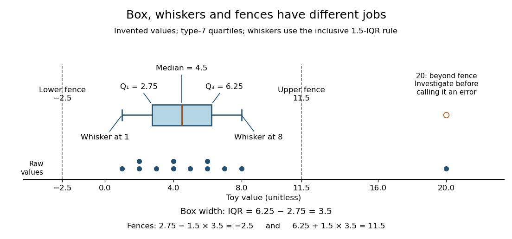

**[Figure 1](#image-toy-box-plot-quartiles-define-the-box-observations-define-the-whiskers). Toy box plot: quartiles define the box, observations define the whiskers**. The twelve invented values are shown individually below the [box plot](#box-plot), with repeated values stacked. Type-7 [quartiles](#quartile) are $2.75,4.5,6.25$; the [interquartile range](#interquartile-range) is $3.5$. Dashed fences at $-2.5$ and $11.5$ determine whiskers at $1$ and $8$ and a separate marker at $20$. The fence lines and raw-value strip are explanatory additions, not required parts of every [box plot](#box-plot).

A separate [outlier](statistical-modelling.md#outlier) marker is a prompt to investigate, not a finding that the value is bad data and not an instruction to delete it. A distant observation can be a recording error, a legitimate unusual outcome, or evidence that the assumed [statistical model](statistical-model.md) misses some behavior. Check its provenance and context before deciding how to analyze it. No measurement-error claim is possible for our invented $20$: we deliberately put it there to demonstrate the rule. [NIST/SEMATECH, Detection of Outliers, labeling and investigation](https://www.itl.nist.gov/div898/handbook/eda/section3/eda35h.htm)

The beauty of a [box plot](#box-plot) is its compact comparison of ordered positions rather than every observation. That compression also loses information: many different [statistical samples](statistical-inference.md#statistical-sample) have the same [quartiles](#quartile) and whiskers, so the box alone cannot reveal every cluster or gap that a [histogram](#histogram) might show. For example, replacing the two invented $6$ values by $5.5$ and $6$ leaves the type-7 [quartiles](#quartile), whiskers and separate marker unchanged. Displaying the individual values alongside the [box plot](#box-plot) is especially helpful for such a small [statistical sample](statistical-inference.md#statistical-sample). Always state both the [quartile](#quartile) rule and the whisker rule; changing either can change which values are marked.

### Quartile

↑ **Parent:** [Descriptive statistics](#descriptive-statistics)  
ⓦ [Wiki](https://en.wikipedia.org/wiki/Quartile)

[Quartiles](#quartile) are the [quantiles](probability-distribution.md#quantile-function) at [probability](probability-theory.md#probability) levels $1/4,1/2,3/4$; $Q_2$ is a [median](probability-distribution.md#median). For a population we can use its [quantile function](probability-distribution.md#quantile-function), $Q_r=Q(r/4)$ for $r=1,2,3$. Finite-sample conventions differ. Our [box plot](#box-plot) uses linear interpolation between [order statistics](probability-theory.md#order-statistic): for $n\geq2$ and $0<p<1$, set

$$
h=1+(n-1)p,\qquad j=\lfloor h\rfloor,\qquad g=h-j,\qquad \widetilde Q(p)=(1-g)x_{(j)}+g x_{(j+1)}.
$$

Then $Q_r=\widetilde Q(r/4)$. This is R's type-7 convention, described in the documentation authored by Ivan Frohne and Rob J Hyndman. It differs from the generalized-inverse [sample quantile](probability-distribution.md#sample-quantile) defined elsewhere in this wiki: for the twelve toy values, that rule selects ranks $3,6,9$ and gives $2,4,6$, rather than $2.75,4.5,6.25$. These are different stated conventions, not arithmetic disagreements. [Frohne and Hyndman, R stats documentation, sample quantile types](https://stat.ethz.ch/R-manual/R-devel/library/stats/html/quantile.html)

#### Interquartile range

↑ **Parent:** [Quartile](#quartile)  
ⓦ [Wiki](https://en.wikipedia.org/wiki/Interquartile_range)

The [interquartile range](#interquartile-range) measures the width between the lower and upper [quartiles](#quartile), in the same units as the observations. It describes central spread rather than the distance between the observed extremes. In our toy [box plot](#box-plot), $\mathrm{IQR}=6.25-2.75=3.5$; moving the largest value from $20$ to $200$ would leave the [quartiles](#quartile) and [interquartile range](#interquartile-range) unchanged under the chosen rule, because the [order statistics](probability-theory.md#order-statistic) used in their interpolation would not change.

### Histogram

↑ **Parent:** [Descriptive statistics](#descriptive-statistics)  
ⓦ [Wiki](https://en.wikipedia.org/wiki/Histogram)

A [histogram](#histogram) groups numerical observations into adjacent [intervals](real-analysis.md#interval-mathematics) called bins and draws one rectangle per bin. Its attraction is that a long list of values becomes a visible pattern of concentration, gaps and [skewness](expected-value.md#skewness). Specify the bin edges, the treatment of values on those edges, and what the vertical axis means: count, proportion, or density. Those choices are part of the graphic. [NIST/SEMATECH, Histogram, definition and normalization](https://www.itl.nist.gov/div898/handbook/eda/section3/histogra.htm)

Let $n>0$ observations be covered by disjoint bins $B_j$ with positive widths $\Delta_j$ and counts $n_j$, so $\sum_j n_j=n$. For example, use left-closed, right-open bins, closing the final right edge too. The three common height choices have different meanings:

- Count height $n_j$ gives the number in bin $j$; the sum of heights is $n$.
- Proportion height $n_j/n$ gives the fraction in bin $j$; the sum of heights is $1$.
- Density height $n_j/(n\Delta_j)$ makes the area, rather than the height, equal to the fraction in bin $j$.

For the density convention, a [histogram](#histogram) is a piecewise constant [probability density function](continuous-probability-distribution.md#probability-density-function) estimate:

$$
\widehat f(x)=\frac{n_j}{n\Delta_j}\quad(x\in B_j),\qquad \widehat f(x)=0\quad\left(x\notin\bigcup_jB_j\right).
$$

Its normalization follows by adding rectangular areas:

$$
\int_{B_j}\widehat f(x)\,dx=\frac{n_j}{n},\qquad \int_{\mathbb R}\widehat f(x)\,dx=\sum_j\frac{n_j}{n}=1.
$$

If the observations have units, density has reciprocal units; a density height is not a [probability](probability-theory.md#probability) and can exceed $1$. With equal bin widths, count heights and density heights differ only by a common scale factor. With unequal widths, count-height areas $n_j\Delta_j$ give wider bins extra visual weight unrelated to their counts. Dividing by width removes that distortion. R's histogram documentation explicitly describes area-one normalization for unequal bins. [R graphics documentation, hist, frequency versus density](https://stat.ethz.ch/R-manual/R-devel/library/graphics/html/hist.html)

Reuse the twelve invented values under [box plot](#box-plot), with bins $[0,2),[2,4),[4,8),[8,22]$. The counts are $(1,3,6,2)$ and the widths are $(2,2,4,14)$. Hence the density heights and areas are exactly

$$
\left(\frac1{24},\frac18,\frac18,\frac1{84}\right),\qquad \left(\frac1{12},\frac14,\frac12,\frac16\right).
$$

The second and third bars have equal density heights even though the third contains twice as many observations: it is also twice as wide. The last bar contains only two observations; its count-height area would be $2\cdot14=28$, larger than the six-observation bar's $6\cdot4=24$. Its correct density area is only $1/6$.

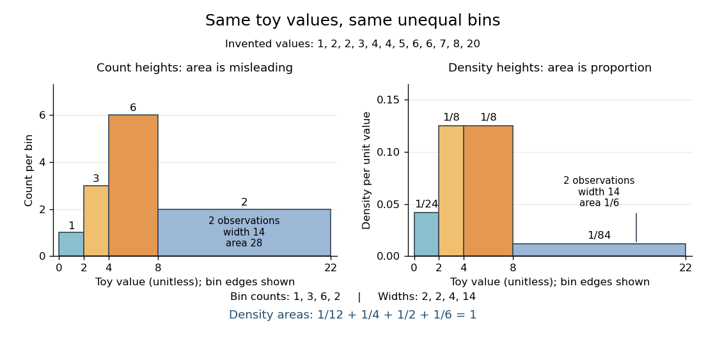

**[Figure 2](#image-unequal-toy-bins-counts-determine-heights-density-makes-area-represent-proportion). Unequal toy bins: counts determine heights, density makes area represent proportion**. Both panels use the same twelve invented values and bin edges $0,2,4,8,22$. Left: count heights $1,3,6,2$, whose areas are not proportional to counts. Right: density heights $1/24,1/8,1/8,1/84$, with total area $1$. Equal density heights for the second and third bins express equal concentration per unit width. No bars represent measured data.

Bin choice trades detail against stability. Broad bins merge distinctions: the toy bin $[8,22]$ hides the empty stretch between $8$ and $20$. Narrow bins expose gaps but can make each individual observation dominate a bar. With one-unit bins starting at $0$, the bins $[2,3),[4,5),[6,7)$ each contain two values and appear equally prominent; that apparent pattern depends on grouping the repeated integers together. Moving the bin origin also changes membership without changing the observations. For [density estimation](nonparametric-statistics.md#density-estimation), this is a form of the [bias-variance tradeoff](statistical-modelling.md#bias-variance-tradeoff): averaging over broad bins loses local detail, while narrow bins give more variable density estimates across repeated [statistical samples](statistical-inference.md#statistical-sample). [Cosma Rohilla Shalizi, Estimating Distributions and Densities, Section 14.1](https://www.stat.cmu.edu/~cshalizi/uADA/24/lectures/ch14.pdf) A useful practice is to compare a few plausible widths and offsets, keeping common edges when comparing groups. Automatic bin selectors are starting points, rather than guarantees of a unique correct picture. [NumPy documentation, histogram\_bin\_edges, Notes on bin selectors](https://numpy.org/doc/stable/reference/generated/numpy.histogram_bin_edges.html)

A [histogram](#histogram) retains only bin membership. Its density estimate spreads each bin's fraction uniformly across that bin, so our last bar assigns density throughout $[8,22]$ even though the only toy values there are $8$ and $20$. It does not recover within-bin positions or observation order, and a visually convincing shape does not establish a population [probability distribution](probability-distribution.md). A [box plot](#box-plot) provides a complementary compact summary of [quartiles](#quartile); neither graphic replaces the original observations.

## Birthday problem

↑ **Parent:** [Probability and statistics](probability-and-statistics.md)  
ⓦ [Wiki](https://en.wikipedia.org/wiki/Birthday_problem)

The [birthday problem](#birthday-problem) asks for the [probability](probability-theory.md#probability) that at least two members of a group share a birthday. Use the explicit model of [independent random variables](random-variable.md#independent-random-variables) taking $m$ labels with a [uniform distribution on a finite set](discrete-probability-distribution.md#discrete-uniform-distribution). Let $m\geq1$ and $n\geq0$ be [integers](integer.md). For calendar examples below, stipulate $m=365$ equally likely labels and omit leap days. For $0\leq n\leq m$, the probability of at least one matching pair is

$$
\boxed{P_{n,m}=1-\frac{m(m-1)\cdots(m-n+1)}{m^n}=1-\prod_{j=0}^{n-1}\left(1-\frac jm\right).}
$$

At $n=0$, the [empty product](arithmetic.md#empty-product) is one and $P_{0,m}=0$. At $n>m$, a repeat is certain by the [pigeonhole principle](combinatorics.md#pigeonhole-principle). Count the complement to obtain the formula: the first label has $m$ choices, then a distinct second label has $m-1$, and so forth, out of $m^n$ equally likely label sequences.[§3.1, Example 3.3 and Table 3.1, printed pp. 77–78: uniform-calendar assumptions, distinct-label product and threshold](mathematics-bibliography.md#introduction-to-probability-by-charles-m-grinstead-and-j-laurie-snell)

For the stipulated calendar, **$P_{22,365}\approx47.57\%$ and $P_{23,365}\approx50.73\%$**. Only 23 people suffice to put the probability above one half. There are $\binom{23}{2}=253$ possible pairs, each with matching probability $1/365$. The many comparison opportunities explain why a small group can contain a repeat.

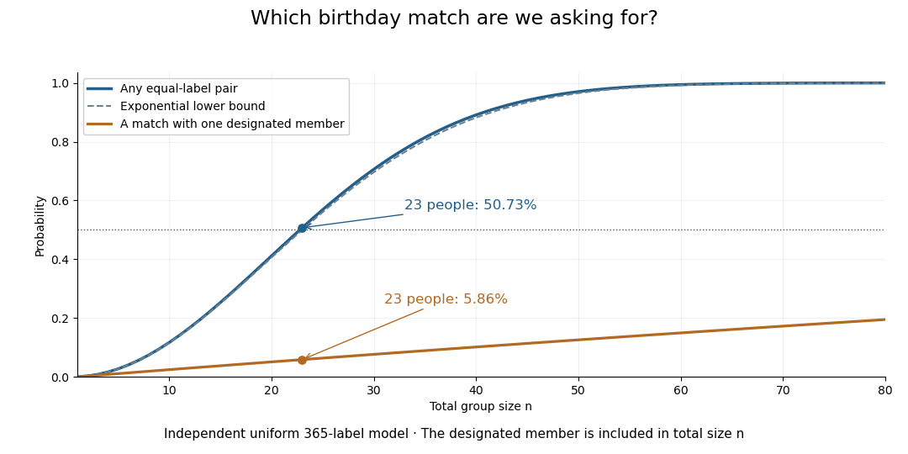

**[Figure 3](#image-any-matching-pair-becomes-likely-much-sooner-than-a-match-with-one-specified-person). Any matching pair becomes likely much sooner than a match with one specified person**. Original exact computations under the independent uniform 365-label model. The solid curve allows every pair in a group of total size $n$; the lower curve requires a match with one designated member. The dashed curve is the exponential lower bound for any-pair collision probability. This is a model calculation, not observed birthday data.

The distinction also matters for [hash collisions](computer-science.md#hash-collision). If independently generated outputs of a [hash function](computer-science.md#hash-function) are uniformly distributed over $m$ possible labels, the same counting formula governs repeats. The [birthday square-root scale](#birthday-square-root-scale) explains why looking for any repeated output requires far fewer labels than trying to match one predetermined output. The uniform-independent model is an assumption about those outputs; the [birthday problem](#birthday-problem) does not itself establish that a particular implementation meets it.

### Matching one specified birthday

↑ **Parent:** [Birthday problem](#birthday-problem)

In a group of total size $n\geq1$, designate one member and ask whether any of the other $n-1$ labels equals that member's label. Conditional on the designated label, all the other draws avoid it with probability $1-1/m$. [Independence](random-variable.md#independent-random-variables) gives

$$
\boxed{\mathbb P(\text{a match with the designated member})=1-\left(1-\frac1m\right)^{n-1}.}
$$

For $n=23$, this is approximately $5.86\%$, while the probability of some matching pair is approximately $50.73\%$. The designated-member question examines $22$ pairs; the any-pair question examines all $253$. A repeated label elsewhere in the group does not require a match with its designated member.

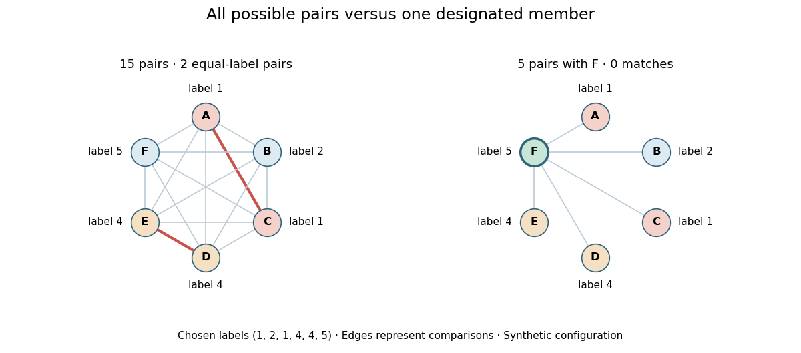

**[Figure 4](#image-fifteen-possible-pairs-versus-five-comparisons-with-one-designated-member). Fifteen possible pairs versus five comparisons with one designated member**. Original illustrative labels for six members: $(1,2,1,4,4,5)$. The [complete graph](graph-theory.md#complete-graph) includes every possible pair and marks the two equal-label pairs in red. The right panel uses only pairs containing member F, whose label 5 is unique. This chosen configuration illustrates the two different events; it is not a random sample of measured birthdays.

### Birthday collision count

↑ **Parent:** [Birthday problem](#birthday-problem)

The [birthday collision count](#birthday-collision-count) counts equal-label [unordered pairs](set.md#unordered-pair). Write it as a [sum](arithmetic.md#sum) of [indicator random variables](expected-value.md#indicator-random-variable):

$$
C=\sum_{1\leq i<j\leq n}\mathbf1_{\{X_i=X_j\}},\qquad\mathbb E[C]=\sum_{i<j}\frac1m=\frac{n(n-1)}{2m}.
$$

This uses [linearity of expectation](expected-value.md#linearity-of-expectation); mutual [independence](random-variable.md#independent-random-variables) of the pair indicators is unnecessary. For 23 uniform calendar labels, $\mathbb E[C]=253/365\approx0.69315$, whereas $\mathbb P(C\geq1)\approx0.50730$. A configuration with three equal labels contributes three pairs, so counting pairs and recording whether any pair exists are different [random variables](random-variable.md).

Treating every pair event as mutually independent would give the wrong exact formula. For three draws, $X_1=X_2$ and $X_1=X_3$ force $X_2=X_3$. The probability that all three equalities hold is $1/m^2$, while the product of their individual probabilities is $1/m^3$ for $m>1$. This distinguishes [independence](random-variable.md#independent-random-variables) of the original label draws from mutual [independence](random-variable.md#independent-random-variables) of events built from overlapping draws.

### Birthday square-root scale

↑ **Parent:** [Birthday problem](#birthday-problem)

The [union bound](probability-inequality.md#boole-s-inequality) gives $P_{n,m}\leq\min(1,n(n-1)/(2m))$. Using $1-x\leq e^{-x}$ on the distinct-label product gives

$$
1-e^{-n(n-1)/(2m)}\leq P_{n,m}\leq\min\left(1,\frac{n(n-1)}{2m}\right).
$$

The lower bound reaches at least one half when $n(n-1)/(2m)\geq\log2$. The simple approximation $n\approx\sqrt{2m\log2}$ predicts a group size near 23 for $m=365$. It is the quadratic number of pairs that makes the [square root](algebra.md#square-root) appear.

For a precise limiting statement, let $m\to\infty$ and $n/\sqrt m\to c\geq0$. Expanding the [logarithm](calculus.md#logarithm) of the complement yields

$$
\log(1-P_{n,m})=-\frac{n(n-1)}{2m}+O\left(\frac{n^3}{m^2}\right),\qquad
P_{n,m}\longrightarrow1-e^{-c^2/2}.
$$

On this scale the remainder tends to zero. Thus a fixed substantial collision probability appears after order $\sqrt m$ draws. For $m=2^b$ uniform output labels, the corresponding scale is order $2^{b/2}$; [matching one specified birthday](#matching-one-specified-birthday) instead involves a number of draws of order $m$.

### Collision probability of two independent categorical draws

↑ **Parent:** [Birthday problem](#birthday-problem)

Suppose two [independent random variables](random-variable.md#independent-random-variables) have the same [categorical distribution](discrete-probability-distribution.md#categorical-distribution), with label probabilities $p_1,\ldots,p_m$. The disjoint equal-label events give

$$
\mathbb P(X=Y)=\sum_{i=1}^m p_i^2.
$$

For the original chosen probabilities $(1/2,1/4,1/8,1/8)$, this is $11/32=0.34375$, rather than the uniform four-label value $1/4$. The [Cauchy-Schwarz inequality](#cauchy-schwarz-inequality) gives $1=(\sum_i p_i)^2\leq m\sum_i p_i^2$, so uniform probabilities minimize this two-draw collision probability. This pair formula alone does not supply the entire group collision probability for a nonuniform model.

## Actuarial statistics

↑ **Parent:** [Probability and statistics](probability-and-statistics.md)

[This section is present in another page, follow this link to view it.](actuarial-statistics.md)

## Self-averaging

↑ **Parent:** [Probability and statistics](probability-and-statistics.md)  
ⓦ [Wiki](https://en.wikipedia.org/wiki/Self-averaging)

## Q-Q plot

↑ **Parent:** [Probability and statistics](probability-and-statistics.md)  
ⓦ [Wiki](https://en.wikipedia.org/wiki/Q–Q_plot)

A [Q-Q plot](#q-q-plot) is a [scatter plot](#scatter-plot) pairing [quantiles](probability-distribution.md#quantile-function) at the same [probability](probability-theory.md#probability) levels. For a [statistical sample](statistical-inference.md#statistical-sample) of size $n$, sort the observations into [order statistics](probability-theory.md#order-statistic) $x_{(1)}\leq\cdots\leq x_{(n)}$. Choose [plotting positions](#plotting-position) $p_i$ and a reference [quantile function](probability-distribution.md#quantile-function) $Q_0$, then plot

$$
(Q_0(p_i),x_{(i)}),\qquad p_i=\frac{i-1/2}{n},\qquad i=1,\ldots,n.
$$

Here the horizontal coordinate is a reference value, and the vertical coordinate is an observed value; neither axis is the [probability](probability-theory.md#probability) $p_i$. The displayed [plotting positions](#plotting-position) are our chosen convention, placing every level strictly between zero and one. They are not a claim that the $i$th [order statistic](probability-theory.md#order-statistic) equals that population [quantile](probability-distribution.md#quantile-function). For two [statistical samples](statistical-inference.md#statistical-sample), use [sample quantiles](probability-distribution.md#sample-quantile) at matching levels, with a stated interpolation convention when their sizes differ. [NIST/SEMATECH, Quantile-Quantile Plot, definition](https://www.itl.nist.gov/div898/handbook/eda/section3/qqplot.htm)

As a computed example, take $n=19$ and the [standard normal quantiles](probability-distribution.md#standard-normal-quantile) $z_i=\Phi^{-1}(p_i)$, where $\Phi$ is the [standard normal cumulative distribution function](probability-distribution.md#standard-normal-distribution-function). Construct the ordered values $a_i=10+2z_i$. At ranks $1,10,19$, the [plotting positions](#plotting-position) are $1/38,1/2,37/38$, the reference [quantiles](probability-distribution.md#quantile-function) are approximately $-1.937932,0,1.937932$, and the constructed values are approximately $6.124137,10,13.875863$. Every point lies on $a=10+2z$ by construction. These 19 values are deliberately chosen, not random draws or real measurements.

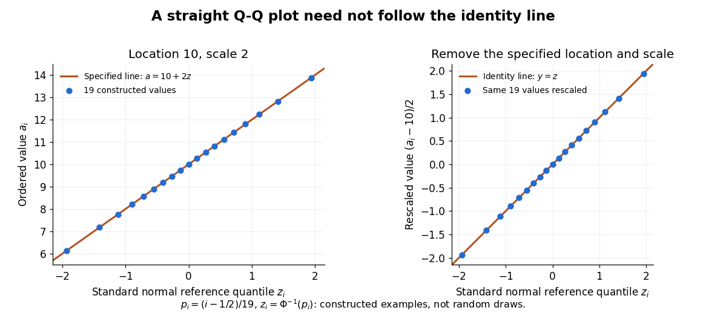

**[Figure 5](#image-an-exact-constructed-q-q-line-encodes-location-and-scale). An exact constructed Q-Q line encodes location and scale**. Left: all 19 pairs $(z_i,a_i)$ lie on $a=10+2z$, with [plotting positions](#plotting-position) $p_i=(i-1/2)/19$. Right: subtracting the specified location 10 and dividing by the specified scale 2 puts the same points on the identity line. These parameters are construction constants, not [sample mean](variance.md#sample-mean) and sample [standard deviation](variance.md#standard-deviation) estimates. The 19 values are deterministic examples, not random draws.

The usefulness of a [Q-Q plot](#q-q-plot) is that it turns a comparison of [probability distributions](probability-distribution.md) into geometry: if a reference [random variable](random-variable.md) $Z$ is transformed into $X=\mu+\sigma Z$ with $\sigma>0$, its [quantile function](probability-distribution.md#quantile-function) satisfies $Q_X(p)=\mu+\sigma Q_Z(p)$. This follows because a positive scaling preserves ordering. Thus the [location-scale family](statistical-model.md#location-scale-family) produces a straight population [Q-Q plot](#q-q-plot), and an approximate sample line suggests a compatible shape over the observed range. Its intercept describes location and its slope describes scale. The identity line requires the same location, scale and units on both axes; even then its displayed angle is 45 degrees only with equal axis scales. Curvature is often more informative than a [histogram](#histogram) because it shows which [quantiles](probability-distribution.md#quantile-function) depart from the reference. [NIST/SEMATECH, Quantile-Quantile Plot, location and scale comparisons](https://www.itl.nist.gov/div898/handbook/eda/section3/qqplot.htm)

### Normal Q-Q plot

↑ **Parent:** [Q-Q plot](#q-q-plot)

A [normal Q-Q plot](#normal-q-q-plot) compares [order statistics](probability-theory.md#order-statistic) with [standard normal quantiles](probability-distribution.md#standard-normal-quantile) $z_i=\Phi^{-1}(p_i)$. For a [normal distribution](probability-distribution.md#normal-distribution) $N(\mu,\sigma^2)$ with $\sigma>0$, the population [quantile function](probability-distribution.md#quantile-function) is $\mu+\sigma\Phi^{-1}(p)$, so the diagnostic sample relation is

$$
x_{(i)}\approx\mu+\sigma z_i.
$$

The appropriate reference is a line with an intercept and positive slope, not necessarily the identity line. A line can be fitted through two central [sample quantiles](probability-distribution.md#sample-quantile); R's `qqline` uses the [quantile](probability-distribution.md#quantile-function) levels $p=0.25$ and $p=0.75$ by default. Neither that line nor its fitting rule is part of the definition of a [normal Q-Q plot](#normal-q-q-plot). [R stats documentation, qqnorm and qqline](https://stat.ethz.ch/R-manual/R-devel/library/stats/html/qqnorm.html)

To isolate curvature, retain the same 19 [plotting positions](#plotting-position) and construct two more ordered sequences:

$$
b_i=2p_i-1,\qquad c_i=\sinh(0.7z_i).
$$

The $b_i$ are [continuous uniform distribution](continuous-probability-distribution.md#continuous-uniform-distribution) [quantiles](probability-distribution.md#quantile-function) on $[-1,1]$, while the $c_i$ apply the [hyperbolic sine](calculus.md#hyperbolic-sine) to the reference [quantiles](probability-distribution.md#quantile-function). Both examples are symmetric about zero. At ranks $1,10,19$, $b_i$ is approximately $-0.947368,0,0.947368$ and $c_i$ is approximately $-1.812618,0,1.812618$. Again, these are constructed values rather than random draws or real data.

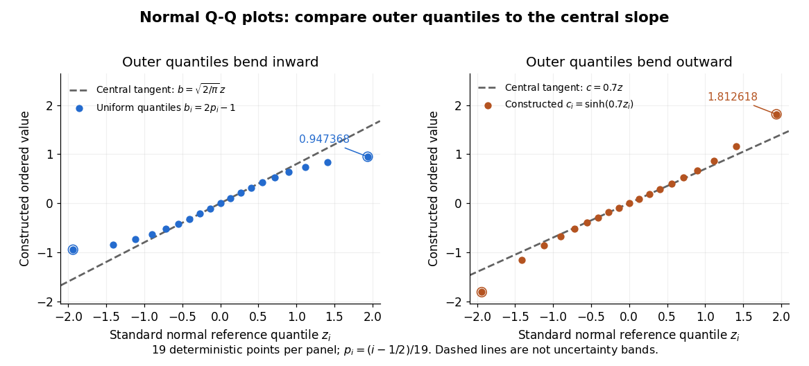

**[Figure 6](#image-normal-q-q-curvature-distinguishes-compressed-and-stretched-outer-quantiles). Normal Q-Q curvature distinguishes compressed and stretched outer quantiles**. Left: the constructed [uniform distribution](continuous-probability-distribution.md#continuous-uniform-distribution) [quantiles](probability-distribution.md#quantile-function) $b_i=2p_i-1$ bend inward relative to the central tangent $b=\sqrt{2/\pi}\,z$. Right: the constructed values $c_i=\sinh(0.7z_i)$ bend outward relative to the central tangent $c=0.7z$. Both panels use 19 [standard normal quantiles](probability-distribution.md#standard-normal-quantile) at $p_i=(i-1/2)/19$. Dashed lines are analytic central tangents, not fitted lines or uncertainty bands; only the chosen finite range is illustrated.

Read these shapes relative to their central slope. The [uniform distribution](continuous-probability-distribution.md#continuous-uniform-distribution) example has $b(z)=2\Phi(z)-1$, with [derivative](calculus.md#derivative) $b'(0)=\sqrt{2/\pi}\approx0.797885$; at the upper endpoint the tangent predicts $1.546246$, while $b_{19}=0.947368$. Its lower end lies above the tangent and its upper end below it: the outer [quantiles](probability-distribution.md#quantile-function) are compressed. The [hyperbolic sine](calculus.md#hyperbolic-sine) example has $c'(0)=0.7$; its tangent predicts $1.356552$ at the upper endpoint, while $c_{19}=1.812618$. Its lower end lies below the tangent and its upper end above it: the outer [quantiles](probability-distribution.md#quantile-function) are stretched. Unequal departures at the two ends can suggest [skewness](expected-value.md#skewness). The direction of these descriptions assumes that reference [quantiles](probability-distribution.md#quantile-function) are horizontal and observed values vertical. The graphs illustrate finite-range shape differences; a sample pattern cannot establish an asymptotic [tail probability](probability-theory.md#tail-probability) law or membership in a [heavy-tailed distribution](probability-distribution.md#heavy-tailed-distribution) class.

A nearly straight [normal Q-Q plot](#normal-q-q-plot) is a diagnostic, not a proof of a [normal distribution](probability-distribution.md#normal-distribution) or a formal [hypothesis test](statistical-hypothesis-test.md). Random [statistical samples](statistical-inference.md#statistical-sample) fluctuate, particularly at extreme [order statistics](probability-theory.md#order-statistic), and apparent curvature depends on [sample size](#sample-size), [plotting positions](#plotting-position) and the reference line. A calibrated [hypothesis test](statistical-hypothesis-test.md) or uncertainty band requires its own assumptions and must account for parameters estimated from the same observations. Sorting also discards the original observation order: rearranging a time series leaves its [Q-Q plot](#q-q-plot) unchanged, so the plot cannot establish [independence](random-variable.md#independent-random-variables).

For a [normal linear model](normal-linear-model.md), R's diagnostic [normal Q-Q plot](#normal-q-q-plot) uses [standardized regression residuals](#standardized-regression-residual), also called [internally studentized residuals](#standardized-regression-residual). [Maindonald and Maechler, R plot.lm documentation, Details](https://stat.ethz.ch/R-manual/R-devel/library/stats/html/plot.lm.html) Even with independent errors, the [regression residuals](#regression-residual) have [covariance matrix](variance.md#covariance-matrix) $\sigma^2(I-H)$, where $H$ is the [hat matrix](normal-linear-model.md#hat-matrix); fitting parameters generally creates dependencies. Dividing by a shared estimated [standard deviation](variance.md#standard-deviation) creates further dependence, and the [distribution of an internally studentized Gaussian residual](#distribution-of-an-internally-studentized-gaussian-residual) is not exactly the [standard normal distribution](probability-distribution.md#standard-normal-distribution). The [normal Q-Q plot](#normal-q-q-plot) therefore helps assess error shape alongside other diagnostics rather than certifying independent [normal random variables](probability-distribution.md#gaussian-random-variable).

### Plotting position

↑ **Parent:** [Q-Q plot](#q-q-plot)

A [plotting position](#plotting-position) assigns a [probability](probability-theory.md#probability) level to an [order statistic](probability-theory.md#order-statistic) for a [Q-Q plot](#q-q-plot). The displayed formula is one convention, not a universal definition. R's `ppoints` uses $p_i=(i-a)/(n+1-2a)$, with $a=1/2$ by default for $n>10$, which gives our choice at $n=19$; for $n\leq10$ its default is $a=3/8$. NIST's [normal probability plot](#normal-q-q-plot) instead describes an approximation to [uniform distribution](continuous-probability-distribution.md#continuous-uniform-distribution) [order statistic](probability-theory.md#order-statistic) medians. State the convention when comparing plots, especially their extreme [quantiles](probability-distribution.md#quantile-function). [R stats documentation, ppoints](https://stat.ethz.ch/R-manual/R-devel/library/stats/html/ppoints.html)[NIST/SEMATECH, Normal Probability Plot, definition](https://www.itl.nist.gov/div898/handbook/eda/section3/normprpl.htm)

## Change-point detection

↑ **Parent:** [Probability and statistics](probability-and-statistics.md)

Change-point detection estimates locations where a sequence's distribution or mean changes. A piecewise-constant mean has a sparse vector of adjacent differences; [one-dimensional total variation denoising](lasso.md#one-dimensional-total-variation-denoising) exploits this sparsity without fixing the number of changes in advance.

### Poisson count change-point model with gamma priors

↑ **Parent:** [Change-point detection](#change-point-detection)

For independent [Poisson distributions](discrete-probability-distribution.md#poisson-distribution) with rate $\lambda$ up to an unknown index $m$ and rate $\phi$ after it, independent shape-rate [Gamma distribution](continuous-probability-distribution.md#gamma-distribution) priors give the displayed [posterior distribution](bayesian-statistics.md#bayesian-posterior) when $m$ is uniform on $\{1,\ldots,N\}$ and $S_m=\sum_{i\leq m}x_i$. The model differs from a continuous-time [Poisson change-point posterior](#poisson-change-point-posterior). The endpoint $m=N$ represents no observed change: the second segment is empty and its rate keeps its prior law.

#### Marginal posterior weights of a Poisson count change point

↑ **Parent:** [Poisson count change-point model with gamma priors](#poisson-count-change-point-model-with-gamma-priors)

Integrating the two rates out of the [Poisson count change-point model with gamma priors](#poisson-count-change-point-model-with-gamma-priors) gives these weights up to a common factor, by the defining [Gamma function](complex-analysis.md#gamma-function) integral. Normalizing across the finitely many possible indices gives the exact marginal [posterior distribution](bayesian-statistics.md#bayesian-posterior) of $m$, providing a check on [Markov chain Monte Carlo](bayesian-statistics.md#markov-chain-monte-carlo) estimates. One can also draw $m$ from these weights and then draw both rates from their conditional [Gamma distributions](continuous-probability-distribution.md#gamma-distribution), producing independent exact joint posterior samples.

#### Gibbs updates for a Poisson count change point

↑ **Parent:** [Poisson count change-point model with gamma priors](#poisson-count-change-point-model-with-gamma-priors)

The [full conditional distributions](probability-theory.md#full-conditional-distribution) are $\lambda\mid m,x\sim\operatorname{Gamma}(\alpha+S_m,\beta+m)$ and $\phi\mid m,x\sim\operatorname{Gamma}(\gamma+S_N-S_m,\delta+N-m)$, in shape-rate notation. Conditional on the two rates, $m$ has weights $w_j=\exp[j(\phi-\lambda)+S_j\log(\lambda/\phi)]$. A [Gibbs sampler](bayesian-statistics.md#gibbs-sampler) cycles through these three draws. Each update preserves the joint [posterior distribution](bayesian-statistics.md#bayesian-posterior); subtracting the largest log weight before exponentiation stabilizes the categorical draw. Averages of $\mathbf1_{\{m=N\}}$ estimate the posterior probability of no observed change.

### Gaussian change-point posterior with proper priors

↑ **Parent:** [Change-point detection](#change-point-detection)

Take independent proper normal [prior distributions](bayesian-statistics.md#prior-probability) for the two segment means and a proper [inverse-gamma distribution](continuous-probability-distribution.md#inverse-gamma-distribution) for the common [variance](variance.md). A uniform [prior distribution](bayesian-statistics.md#prior-probability) over $m=1,\ldots,n$ may then retain the empty second segment. The [posterior distribution](bayesian-statistics.md#bayesian-posterior) is proper: its [likelihood function](maximum-likelihood-estimation.md#likelihood-function) is bounded above by $(2\pi)^{-n/2}v^{-n/2}$, whose integral against $\operatorname{IG}(a_0,b_0)$ is finite for $a_0,b_0>0$. At $m=n$ the second mean has its unchanged proper [prior distribution](bayesian-statistics.md#prior-probability) as its [full conditional distribution](probability-theory.md#full-conditional-distribution). The configuration's [posterior probability](bayesian-statistics.md#posterior-probability) now has the meaningful interpretation of no change inside the observed sample.

#### Gaussian change-point Gibbs updates

↑ **Parent:** [Gaussian change-point posterior with proper priors](#gaussian-change-point-posterior-with-proper-priors)

For independent means $\theta\sim N(\mu_\theta,t_\theta)$ and $\phi\sim N(\mu_\phi,t_\phi)$, the first mean's conditional precision is $m/v+1/t_\theta$ and conditional precision-weighted mean is $\sum_{i\le m}x_i/v+\mu_\theta/t_\theta$; replace $m$ by $n-m$ for the second mean. With $v\sim\operatorname{IG}(a_0,b_0)$ its conditional law is $\operatorname{IG}(a_0+n/2,b_0+S_m/2)$. The discrete split has conditional probabilities proportional to $e^{-S_m/(2v)}$. These [full conditional distributions](probability-theory.md#full-conditional-distribution) give a [Gibbs sampler](bayesian-statistics.md#gibbs-sampler) including $m=n$. Averaging the sampled indicators of that configuration estimates its [probability](probability-theory.md#probability); averaging its conditional probabilities gives an estimate by [Rao-Blackwellization](#rao-blackwellization).

### Poisson change-point posterior

↑ **Parent:** [Change-point detection](#change-point-detection)

For an [Inhomogeneous Poisson process](poisson-process.md#inhomogeneous-poisson-process) whose known positive intensity changes from $\lambda_1$ to $\lambda_2$ at an unknown time $\theta\in(0,T)$, the ordered arrival-time [likelihood function](maximum-likelihood-estimation.md#likelihood-function) is

$$
L(\theta)=\lambda_1^{j(\theta)}\lambda_2^{n-j(\theta)}e^{-\lambda_1\theta-\lambda_2(T-\theta)}.
$$

Under a [uniform prior](bayesian-statistics.md#uniform-prior), each interval between successive arrivals has an exponential [posterior density](bayesian-statistics.md#posterior-density) with rate in the exponent $\lambda_2-\lambda_1$. Its integrated weights allow exact interval selection followed by a truncated exponential draw; when the two rates coincide, the [Bayesian posterior](bayesian-statistics.md#bayesian-posterior) is uniform and the data contain no change-time information.

## Measurement error

↑ **Parent:** [Probability and statistics](probability-and-statistics.md)  
ⓦ [Wiki](https://en.wikipedia.org/wiki/Measurement_error)

Measurement error is the difference between a recorded variable and the quantity it is intended to measure. It can attenuate associations, create misclassification, and bias nonlinear estimators even when the error has mean zero.

### Random measurement error

↑ **Parent:** [Measurement error](#measurement-error)

A component of [measurement error](#measurement-error) fluctuating between repetitions under specified conditions, as distinguished from a shared [systematic error](physics.md#systematic-error). Independent zero-mean fluctuations of [variance](variance.md) $\sigma^2$ give a sample-mean [variance](variance.md) $\sigma^2/N$; correlated fluctuations need not follow this averaging law.

### Measurement noise

↑ **Parent:** [Measurement error](#measurement-error)

[Measurement noise](#measurement-noise) is a fluctuating contribution to [measurement error](#measurement-error). An additive model for a [measured output](control-theory.md#measured-output) is $y_m(t)=y(t)+n(t)$, where $y$ is the actual [plant output](control-theory.md#output-control-theory). A [controller](control-theory.md#controller-control-theory) using [feedback control](control-theory.md#closed-loop-control) can react to $n$ as though it were a change in the [plant output](control-theory.md#output-control-theory). This effect is absent from the ideal noiseless examples under [control theory](control-theory.md); an [errors-in-variables model](#errors-in-variables-model) represents a related distinction between latent quantities and their noisy observations.

### Errors-in-variables model

↑ **Parent:** [Measurement error](#measurement-error)  
ⓦ [Wiki](https://en.wikipedia.org/wiki/Errors-in-variables_model)

An errors-in-variables model distinguishes a latent true predictor from its noisy measurement and models both the measurement and the response. For example, $W_i\mid U_i\sim N(U_i,s^2)$ and $Y_i\mid U_i\sim N(a+bU_i,v^2)$, with a population distribution for $U_i$, propagate predictor uncertainty into inference on $b$. Treating $W_i$ as exact can create [attenuation bias from classical measurement error](linear-regression.md#attenuation-bias-from-classical-measurement-error). Identifiability requires appropriate information about the measurement process or latent predictor distribution.

## Regression toward the mean

↑ **Parent:** [Probability and statistics](probability-and-statistics.md)  
ⓦ [Wiki](https://en.wikipedia.org/wiki/Regression_toward_the_mean)

[Regression toward the mean](#regression-toward-the-mean) is a tendency for measurements selected because they are extreme to be less extreme on repetition. A large first reading can combine a persistent signal with unusually positive [measurement error](#measurement-error); a fresh error need not repeat that contribution. This can change the selected group's [mean](expected-value.md) even when the underlying signal stays fixed and no [intervention](causal-inference.md#treatment) occurs.

The claim concerns a [conditional expectation](measure-theory.md#conditional-expectation), not a rule that every individual moves toward the population [mean](expected-value.md). Some second readings are more extreme. Nor does an observed change establish a [causal effect](causal-inference.md#causal-effect): selection alone can produce it. The following original [normal distribution](probability-distribution.md#normal-distribution) model makes both distinctions quantitative.

### Repeated-measurement latent signal model

↑ **Parent:** [Regression toward the mean](#regression-toward-the-mean)

Imagine an instrument measuring the same fixed quantity twice on each unit. Across units the persistent signal $T$ is a [latent variable](latent-variable.md); the two [measurement errors](#measurement-error) $\varepsilon_1,\varepsilon_2$ are fresh, mutually [independent random variables](random-variable.md#independent-random-variables), also independent of $T$. Assume they have [mean](expected-value.md) zero and common finite [variance](variance.md) $v$, while $T$ has [mean](expected-value.md) $\mu$ and [variance](variance.md) $s$. Then

$$
X=T+\varepsilon_1,\qquad Y=T+\varepsilon_2,\qquad
\mathbb E[X]=\mathbb E[Y]=\mu,\qquad
\operatorname{Var}(X)=\operatorname{Var}(Y)=s+v,\qquad
\operatorname{Cov}(X,Y)=s.
$$

Thus the [Pearson correlation coefficient](variance.md#pearson-correlation-coefficient) is $\rho=s/(s+v)$ when $s+v>0$. Both measurements retain the same marginal [mean](expected-value.md) and [variance](variance.md). Repetition does not make the entire population collapse toward $\mu$; it changes what we expect after selecting on $X$.

For $s,v>0$, further assuming [normal distributions](probability-distribution.md#normal-distribution) for $T$ and both [measurement errors](#measurement-error) gives the [conditional expectation](measure-theory.md#conditional-expectation)

$$
\mathbb E[Y\mid X=x]=\mu+\rho(x-\mu).
$$

Since $0<\rho<1$, this predicted reading is closer to $\mu$ than $x$ is. Independence and zero [mean](expected-value.md) errors alone do not justify this linear [conditional expectation](measure-theory.md#conditional-expectation): without the [normal distribution](probability-distribution.md#normal-distribution) assumption the same expression is the [linear least-squares projection](#linear-least-squares-projection), and the actual [conditional expectation](measure-theory.md#conditional-expectation) can be nonlinear. Correlated errors, a changing signal, or different error [variances](variance.md) require their own model; a noisy reading by itself supplies no universal shrinkage factor.

#### Gaussian regression toward the mean

↑ **Parent:** [Repeated-measurement latent signal model](#repeated-measurement-latent-signal-model)

Take the original synthetic model $T\sim N(0,0.6)$ and $\varepsilon_1,\varepsilon_2\sim N(0,0.4)$, mutually [independent random variables](random-variable.md#independent-random-variables), with the second argument denoting [variance](variance.md). The pair $(X,Y)$ has a [multivariate normal distribution](#multivariate-normal-distribution) with [mean](expected-value.md) zero, unit marginal [variances](variance.md), and [Pearson correlation coefficient](variance.md#pearson-correlation-coefficient) $0.6$. Its [conditional multivariate normal distribution](#conditional-multivariate-normal-distribution) is

$$
Y\mid X=x\sim N(0.6x,1-0.6^2)=N(0.6x,0.64).
$$

For a first reading $x=2$, the second reading has [conditional expectation](measure-theory.md#conditional-expectation) $1.2$ and [conditional variance](variance.md#conditional-variance) $0.64$, hence [standard deviation](variance.md#standard-deviation) $0.8$. There is still [conditional probability](probability-theory.md#conditional-probability) $1-\Phi(1)\approx0.1587$ of $Y>2$, a movement farther from zero, where $\Phi$ is the [standard normal distribution function](probability-distribution.md#standard-normal-distribution-function). The line $0.6x$ describes a [conditional mean](measure-theory.md#conditional-expectation), not an individual trajectory.

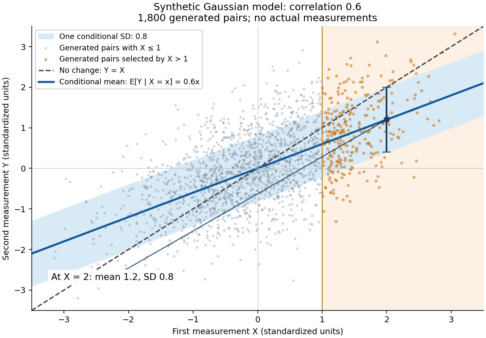

**[Figure 7](#image-an-extreme-first-reading-predicts-a-less-extreme-conditional-mean-with-substantial-scatter). An extreme first reading predicts a less extreme conditional mean, with substantial scatter**. Original synthetic [scatter plot](#scatter-plot) of 1,800 generated pairs, explicitly not actual measurements. Each pair has unit marginal [variances](variance.md) and [Pearson correlation coefficient](variance.md#pearson-correlation-coefficient) $0.6$; orange points satisfy $X>1$. The blue line is the [conditional expectation](measure-theory.md#conditional-expectation) $0.6x$, the band is one conditional [standard deviation](variance.md#standard-deviation) $0.8$ on either side, and the dashed line denotes $Y=X$. The band is not a [confidence interval](statistical-inference.md#confidence-interval) for an estimated line. The axes show a finite display window.

A short derivation isolates $R=Y-0.6X$. Its [covariance](variance.md#covariance) with $X$ is zero and its [variance](variance.md) is $0.64$. Because $(X,R)$ has a [multivariate normal distribution](#multivariate-normal-distribution), zero [covariance](variance.md#covariance) implies independence: $R\sim N(0,0.64)$ independently of $X$. This also explains why reversing the two measurements gives $\mathbb E[X\mid Y=y]=0.6y$. The [statistical association](causal-inference.md#statistical-association) does not identify a direction of [causal effect](causal-inference.md#causal-effect).

##### Selection on an extreme first measurement

↑ **Parent:** [Gaussian regression toward the mean](#gaussian-regression-toward-the-mean)

Select units with first reading $X>1$, keep that membership fixed, and measure the same units again. The first reading now has a [truncated normal distribution](probability-distribution.md#truncated-normal-distribution). For a general finite threshold $a$, write $\phi$ for the [standard normal density](probability-distribution.md#standard-normal-density) and $\Phi$ for the [standard normal distribution function](probability-distribution.md#standard-normal-distribution-function). Since $\phi'(x)=-x\phi(x)$,

$$
\mathbb E[X\mid X>a]
=\frac{\int_a^\infty x\phi(x)\,dx}{1-\Phi(a)}
=\frac{\phi(a)}{1-\Phi(a)}.
$$

The [tower property](measure-theory.md#law-of-total-expectation) of [conditional expectation](measure-theory.md#conditional-expectation) lets us average the line $\mathbb E[Y\mid X]=0.6X$ over the selected group.[Theorem 4.1.13(ii), printed p. 212: nested conditioning](mathematics-bibliography.md#probability-theory-and-examples-fifth-edition-by-rick-durrett/4-1-conditional-expectation) At $a=1$ this gives

$$
\begin{aligned}
\mathbb P(X>1)&\approx0.158655,\\
\mathbb E[X\mid X>1]&\approx1.525135,\\
\mathbb E[Y\mid X>1]&=0.6\mathbb E[X\mid X>1]\approx0.915081,\\
\mathbb E[Y-X\mid X>1]&\approx-0.610054.
\end{aligned}
$$

The average second reading is below the selection threshold even though every selected first reading exceeded it. This is a group [expectation](expected-value.md); any finite generated group's [sample mean](variance.md#sample-mean) fluctuates around it. Selecting again on $Y>1$ would define a different group and answer a different question.

The [latent variable](latent-variable.md) decomposition makes the apparent drop especially clear. Gaussian conditioning gives $\mathbb E[T\mid X=x]=0.6x$ and $\mathbb E[\varepsilon_1\mid X=x]=0.4x$. Thus

$$
\mathbb E[T\mid X>1]\approx0.915081,\qquad
\mathbb E[\varepsilon_1\mid X>1]\approx0.610054,\qquad
\mathbb E[\varepsilon_2\mid X>1]=0.
$$

The first [measurement error](#measurement-error) has zero unconditional [mean](expected-value.md), but positive selected [mean](expected-value.md). The second [measurement error](#measurement-error) stays centered because it is independent of selection on $X$. The persistent signal $T$ never changed.

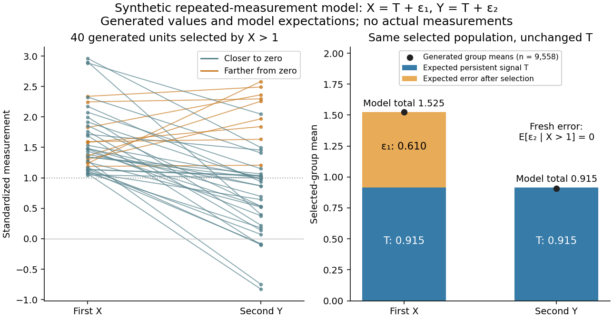

**[Figure 8](#image-selection-captures-an-extreme-first-error-while-the-persistent-signal-stays-fixed). Selection captures an extreme first error while the persistent signal stays fixed**. Original synthetic repeated measurements, not actual measurements. Left: 40 generated units selected by $X>1$; orange trajectories move farther from zero. Right: analytic selected-group [expectations](expected-value.md) decompose the first and second readings into persistent [latent variable](latent-variable.md) $T$ and [measurement error](#measurement-error). Black dots give generated group [sample means](variance.md#sample-mean) after selecting from 60,000 synthetic units; their small departures from the bar totals reflect sampling variation. All selections use the first reading only.

### Regression toward the mean and randomized comparisons

↑ **Parent:** [Regression toward the mean](#regression-toward-the-mean)

For [causal inference](causal-inference.md), a before-and-after change among units selected by an extreme baseline reading combines any [causal effect](causal-inference.md#causal-effect) with the change expected from selection. In the synthetic model the selected-group [mean](expected-value.md) falls by about $0.610$ with no [intervention](causal-inference.md#treatment) at all. Calling that entire fall an intervention effect would attribute a predictable [measurement error](#measurement-error) contribution to a change in the signal.

One comparison design selects all eligible units by the same rule, then uses [randomization](causal-inference.md#randomization) to assign an [intervention](causal-inference.md#treatment) or a comparison condition, with the same measurement times and instrument in both groups. To see the principle algebraically, let assignment $A\in\{0,1\}$ be independent of $(T,\varepsilon_1,\varepsilon_2)$ within the selected population, and let the intervention add a constant $\delta$ to the second reading: $Y=T+\varepsilon_2+\delta A$. Then

$$
\mathbb E[Y-X\mid X>1,A=1]=-0.610054\ldots+\delta,\qquad
\mathbb E[Y-X\mid X>1,A=0]=-0.610054\ldots.
$$

Subtracting the two expected changes isolates $\delta$ under these assumptions. Both groups experience the same selection tendency in [expectation](expected-value.md). A finite experiment still has sampling uncertainty; [randomization](causal-inference.md#randomization) does not guarantee identical realized groups. Without [randomization](causal-inference.md#randomization), the same threshold alone does not establish comparable latent signals or error processes. Different selection rules, selective follow-up, changing instruments, or common temporal changes also require explicit assumptions. This is a [statistical inference](statistical-inference.md) principle about comparisons, not evidence that any particular [intervention](causal-inference.md#treatment) works.

<h3 id="galton-s-stature-regression">Galton's stature regression</h3>

↑ **Parent:** [Regression toward the mean](#regression-toward-the-mean)

[Francis Galton](#francis-galton)'s paper [Regression towards mediocrity in hereditary stature by Francis Galton](mathematics-bibliography.md#regression-towards-mediocrity-in-hereditary-stature-by-francis-galton) analyzes adult offspring heights against the average of their parents' adjusted heights. He multiplied female heights by $1.08$ before making that parental average. Table I contains 928 adult offspring from 205 parental pairs; the opening prose instead states 930. Its grouped readout is a [median](probability-distribution.md#median), and the explanation of Plate IX describes a smoothed offspring deviation about two-thirds of the parental deviation.[Printed pp. 247-248, Table I; pp. 261-262, explanation of Plate IX(a): adjusted heights, counts, grouped medians and 2:3 deviation ratio](mathematics-bibliography.md#regression-towards-mediocrity-in-hereditary-stature-by-francis-galton)

These were parent-offspring records, not repeat readings of an unchanged signal. The paper's group tendency does not say that every child must be closer to the population [mean](expected-value.md). Galton also reports uncertainty over whether some recorded heights included shoes, a concrete [measurement error](#measurement-error) limitation.[Printed p. 252: shoes-on versus shoes-off uncertainty and the average two-thirds height-deviation claim](mathematics-bibliography.md#regression-towards-mediocrity-in-hereditary-stature-by-francis-galton) The $0.6$ [Pearson correlation coefficient](variance.md#pearson-correlation-coefficient) and all generated values above are our chosen model, not a reconstruction of his data.

## Sensitivity analysis

↑ **Parent:** [Probability and statistics](probability-and-statistics.md)  
ⓦ [Wiki](https://en.wikipedia.org/wiki/Sensitivity_analysis)

A sensitivity analysis examines how conclusions change when assumptions, tuning choices, unidentified parameters, or plausible data perturbations are varied.

### Pattern-mixture sensitivity analysis

↑ **Parent:** [Sensitivity analysis](#sensitivity-analysis)

Specify distributions of measurements separately by observation pattern and vary assumptions about unseen values that the observed data do not identify. For example, shift the imputed binary-response [log odds](generalized-linear-model.md#log-odds) for nonresponders away from its [missing at random](#missing-at-random) prediction and refit the substantive analysis. This investigates [missing not at random](#missing-not-at-random) departures rather than testing them from observed data.

## Power spectrum

↑ **Parent:** [Probability and statistics](probability-and-statistics.md)  
ⓦ [Wiki](https://en.wikipedia.org/wiki/Power_spectrum)

The power spectrum describes how the variance of a random field or stationary process is distributed over spatial wavenumber or temporal frequency.

### Spectral tensor

↑ **Parent:** [Power spectrum](#power-spectrum)

For a statistically homogeneous vector [random field](stochastic-process.md#random-field), its spectral tensor is the [Fourier transform](fourier-transform.md) of the componentwise two-point [correlation](variance.md#pearson-correlation-coefficient) $C_{ij}(\mathbf r)=\mathbb E[B_i(\mathbf x+\mathbf r)B_j(\mathbf x)]$. It distributes cross-correlations between components over [wavevectors](elasticity-physics.md#wavevector). With $\widehat B(\mathbf k)=\int B(\mathbf r)e^{-i\mathbf k\cdot\mathbf r}d^dr$, homogeneity gives $\mathbb E[\widehat B_i(\mathbf k)\widehat B_j(\mathbf k')]=(2\pi)^d\delta(\mathbf k+\mathbf k')\widehat C_{ij}(\mathbf k)$, understood as an identity of [distributions](distribution-theory.md#distribution-mathematical-analysis) for an infinite stationary field.

#### Solenoidal isotropic spectral tensor

↑ **Parent:** [Spectral tensor](#spectral-tensor)

For a statistically homogeneous, isotropic, reflection-symmetric [solenoidal](multivariable-calculus.md#solenoidal-vector-field) vector [random field](stochastic-process.md#random-field) in three dimensions, the nonzero-wavevector [spectral tensor](#spectral-tensor) is a scalar multiple of the [transverse projector of a vector field](relativistic-quantum-field.md#transverse-projector-of-a-vector-field). Isotropy gives $A(k)\delta_{ij}+D(k)k_i k_j$, while zero [divergence](multivariable-calculus.md#divergence) gives $A+Dk^2=0$. Its [trace](linear-algebra.md#matrix-trace) is $2A$, giving the displayed normalization. Without reflection symmetry an additional antisymmetric, helical term can occur.

### Statistical homogeneity

↑ **Parent:** [Power spectrum](#power-spectrum)

A random field is statistically homogeneous when all of its joint distributions are invariant under a common spatial translation of their arguments. Its momentum-space correlation functions consequently contain a [Dirac delta function](distribution-theory.md#dirac-delta-function) imposing total-momentum conservation.

### Statistical isotropy

↑ **Parent:** [Power spectrum](#power-spectrum)

A random field is statistically isotropic when all of its joint distributions are invariant under a common spatial rotation of their arguments. A statistically isotropic scalar power spectrum depends only on the magnitude of its wavevector.

#### Statistical reflection symmetry

↑ **Parent:** [Statistical isotropy](#statistical-isotropy)

Statistical reflection symmetry means that the joint distributions of a [random field](stochastic-process.md#random-field) are unchanged by a simultaneous spatial reflection, with each field component transformed according to its vector or pseudovector character. For an isotropic [magnetic field](magnetic-field.md), it excludes a parity-odd [magnetic helicity](electromagnetism.md#magnetic-helicity) contribution to the two-point [spectral tensor](#spectral-tensor).

## Time series

↑ **Parent:** [Probability and statistics](probability-and-statistics.md)

[This section is present in another page, follow this link to view it.](time-series.md)

## Sub-Gaussian distribution

↑ **Parent:** [Probability and statistics](probability-and-statistics.md)  
ⓦ [Wiki](https://en.wikipedia.org/wiki/Sub-Gaussian_distribution)

A centered random variable is sub-Gaussian with parameter $\sigma$ when $\mathbb E e^{tX}\leq e^{\sigma^2t^2/2}$ for every real $t$.

### Sub-Gaussian random vector

↑ **Parent:** [Sub-Gaussian distribution](#sub-gaussian-distribution)

A centered random vector is sub-Gaussian with variance proxy $\tau^2$ when the displayed inequality holds for every deterministic vector $a$. Equivalently every scalar inner product is a [sub-Gaussian random variable](#sub-gaussian-distribution) with proxy $\tau^2\|a\|_2^2$. Independence of coordinates is not required. For vectors $a_j$ with [Euclidean norms](normed-vector-space.md#euclidean-norm) at most one, the [union bound](probability-inequality.md#boole-s-inequality) gives $\max_j|\langle a_j,g\rangle|\leq\tau\sqrt{2\log(2m/\delta)}$ with [probability](probability-theory.md#probability) at least $1-\delta$. This assumption alone is weaker than concentration for all Lipschitz functions.

## Subexponential distribution (light-tailed)

↑ **Parent:** [Probability and statistics](probability-and-statistics.md)  
ⓦ [Wiki](https://en.wikipedia.org/wiki/Subexponential_distribution_(light-tailed))

A centered random variable is sub-exponential when its [moment-generating function](probability-distribution.md#moment-generating-function) is bounded by a Gaussian moment-generating function in a neighbourhood of zero. Equivalently up to universal constants, its tail is bounded by $2e^{-ct/K}$ beyond scale $K$.

### Centered square of a sub-Gaussian random variable

↑ **Parent:** [Subexponential distribution (light-tailed)](#subexponential-distribution-light-tailed)

If $\mathbb E e^{tX}\leq e^{\sigma^2t^2/2}$, then $X^2-\mathbb E X^2$ is a [sub-exponential random variable](#subexponential-distribution-light-tailed) with scale at most a universal constant times $\sigma^2$. The [Chernoff bound](probability-inequality.md#chernoff-bound) gives $\mathbb P(|X|>x)\leq2e^{-x^2/(2\sigma^2)}$; integrating this tail bounds $\mathbb E|X|^{2q}$ by $2(2\sigma^2)^q q!$. Centering preserves a factorial moment bound, so the [Bernstein bound for independent sub-exponential variables](probability-inequality.md#bernstein-bound-for-independent-sub-exponential-variables) apply to independent averages of these squares.

### Bernstein moment condition

↑ **Parent:** [Subexponential distribution (light-tailed)](#subexponential-distribution-light-tailed)

A centered [random variable](random-variable.md) $X$ with $\mathbb E[X^2]=\nu$ satisfies the Bernstein moment condition with parameter $b$ when

$$
|\mathbb E[X^k]|\leq\frac{k!}{2}\nu b^{k-2}
$$

for every integer $k\geq2$. Summing its moment-generating series shows that it is sub-exponential with parameters $(2\nu,2b)$.

### Product of sub-Gaussian random variables is sub-exponential

↑ **Parent:** [Subexponential distribution (light-tailed)](#subexponential-distribution-light-tailed)

If $X$ and $Y$ are sub-Gaussian, without requiring independence between them, then $XY$ is [sub-exponential](#subexponential-distribution-light-tailed). The inequality $2|XY|\leq X^2+Y^2$ converts exponential-square moment bounds for the factors into an exponential moment bound for the product.

#### Bernstein concentration inequality for products of sub-Gaussian variables

↑ **Parent:** [Product of sub-Gaussian random variables is sub-exponential](#product-of-sub-gaussian-random-variables-is-sub-exponential)

For independent identically distributed pairs $(U_i,V_i)$ whose coordinates are sub-Gaussian with parameter $\sigma/4$, [Bernstein's inequality](probability-inequality.md#bernstein-inequalities-probability-theory) applied to the centered products gives

$$
\mathbb P\!\left(
\left|\frac1n\sum_{i=1}^n\{U_iV_i-\mathbb E(U_iV_i)\}\right|\geq t
\right)
\leq2\exp\!\left(-\frac{2nt^2}{\sigma^2(\sigma^2+t)}\right).
$$

## Lasso

↑ **Parent:** [Probability and statistics](probability-and-statistics.md)

[This section is present in another page, follow this link to view it.](lasso.md)

## Positive-semidefinite kernel

↑ **Parent:** [Probability and statistics](probability-and-statistics.md)

[This section is present in another page, follow this link to view it.](positive-semidefinite-kernel.md)

## Doubly robust estimation

↑ **Parent:** [Probability and statistics](probability-and-statistics.md)  
ⓦ [Wiki](https://en.wikipedia.org/wiki/Doubly_robust_estimation)

Doubly robust estimation combines two nuisance-function estimates so that the target estimator remains consistent when either one of two model components is correctly specified.

### Augmented inverse-probability-weighted estimator

↑ **Parent:** [Doubly robust estimation](#doubly-robust-estimation)

This estimator combines outcome regression with inverse propensity weighting and has a second-order product bias.

### Double robustness

↑ **Parent:** [Doubly robust estimation](#doubly-robust-estimation)

An estimator is doubly robust when it remains consistent if either of two nuisance models is correctly specified, commonly an outcome-regression model or a propensity-score model.

### Cross-fitting

↑ **Parent:** [Doubly robust estimation](#doubly-robust-estimation)

Cross-fitting trains nuisance estimators outside each observation's fold and evaluates the target score on the held-out fold.

#### Double machine learning

↑ **Parent:** [Cross-fitting](#cross-fitting)  
ⓦ [Wiki](https://en.wikipedia.org/wiki/Double_machine_learning)

Double machine learning uses orthogonal estimating equations and cross-fitting so that sufficiently accurate machine-learning nuisance estimates yield asymptotically normal target estimates.

## Conditional multivariate normal distribution

↑ **Parent:** [Probability and statistics](probability-and-statistics.md)

Conditioning one block of a jointly Gaussian vector on another gives a Gaussian law with linear mean and Schur-complement covariance.

### Gaussian process regression posterior

↑ **Parent:** [Conditional multivariate normal distribution](#conditional-multivariate-normal-distribution)

For a zero-mean [Gaussian process](gaussian-process.md) observed with independent [Gaussian noise](probability-distribution.md#gaussian-noise), the latent value at a new input is conditionally normal. Its mean is the kernel cross-covariance times the noisy kernel-matrix inverse times the observations, and its variance is the prior variance minus the corresponding quadratic form.

## Causal inference

↑ **Parent:** [Probability and statistics](probability-and-statistics.md)

[This section is present in another page, follow this link to view it.](causal-inference.md)

## Missing data

↑ **Parent:** [Probability and statistics](probability-and-statistics.md)  
ⓦ [Wiki](https://en.wikipedia.org/wiki/Missing_data)

Missing data occur when some intended measurements are unobserved. Whether valid inference can ignore the missingness mechanism depends on how the probability of observation relates to observed and unobserved values.

### Missingness overlap from marginal and complete-case counts

↑ **Parent:** [Missing data](#missing-data)

For $N$ observations, let $m_X$ and $m_Y$ count missing values of two [variables](mathematics.md#variable-mathematics), and let $n_{XY}$ count observations on which both are available. The number missing at least one variable is $N-n_{XY}$. Applying the [inclusion-exclusion principle](combinatorics.md#inclusion-exclusion-principle) to the two missing-value [sets](set.md) gives the displayed number missing both. The disjoint counts are consequently $m_X-m_{XY}$ missing only $X$, $m_Y-m_{XY}$ missing only $Y$, $m_{XY}$ missing both, and $n_{XY}$ complete cases. Their nonnegativity is a necessary consistency check on the supplied totals.

This identifies an aggregate missingness pattern without reconstructing individual records. It does not identify a [missing-data mechanism](#missing-data-mechanism), establish [missing completely at random](#missing-completely-at-random), or justify treating a substantive response such as an explicit unknown category as a missing observation. Counts from different cohorts cannot be inserted into the identity without first establishing a common denominator.

### Observed-case analysis

↑ **Parent:** [Missing data](#missing-data)

An analysis restricted to cases with an observed endpoint. Its result need not describe the whole eligible cohort when observation depends on outcome or related characteristics.

### Missing-outcome bounds for a binary endpoint

↑ **Parent:** [Missing data](#missing-data)

Suppose an endpoint is binary, $N$ people are in the target cohort, $r$ observed outcomes are successes and $m$ outcomes are missing. With no assumptions about the missing values, the cohort success proportion $p$ satisfies

$$
\frac{r}{N}\leq p\leq\frac{r+m}{N}.
$$

For the proof, let $u$ be the number of successes among the missing outcomes. Since $0\leq u\leq m$ and $p=(r+u)/N$, both [inequalities](arithmetic.md#inequality-mathematics) follow. Every integer $u$ in that range is a possible completion of the observed data, so the endpoints are sharp. These are [missing data](#missing-data) bounds on a cohort proportion, not [confidence intervals](statistical-inference.md#confidence-interval) or bounds on a causal treatment effect.

### Unit and item nonresponse

↑ **Parent:** [Missing data](#missing-data)

Item nonresponse leaves a particular measurement unobserved while retaining other measurements on that individual. Unit nonresponse leaves all survey measurements unavailable. Adjusting for an observed auxiliary variable can address item nonresponse under [missing at random](#missing-at-random), but does not identify the auxiliary-variable distribution among unit nonresponders. Extrapolation to them needs further assumptions or external information.

#### Sensitivity analysis for unit and item nonresponse

↑ **Parent:** [Unit and item nonresponse](#unit-and-item-nonresponse)

Vary the unobserved outcome probabilities for item and unit nonresponders, and any unknown auxiliary-variable mixture, over scientifically plausible ranges. Recompute the population estimate and identify values at which substantive conclusions change. This probes untestable transport or [missing at random](#missing-at-random) assumptions; it is distinct from sampling uncertainty represented by a [confidence interval](statistical-inference.md#confidence-interval). Letting each missing-outcome probability vary from zero to one gives worst-case identification bounds.

### Missing-data mechanism

↑ **Parent:** [Missing data](#missing-data)

The mechanism assigns probabilities to observation patterns $R$ conditional on complete measurements $D$: $p(R\mid D)$. Whether it depends on missing values distinguishes [missing completely at random](#missing-completely-at-random), [missing at random](#missing-at-random) and [missing not at random](#missing-not-at-random).

#### Covariate-dependent missing completely at random

↑ **Parent:** [Missing-data mechanism](#missing-data-mechanism)

Missingness depends only on fully observed [covariates](statistical-model.md#covariate) $X$, not on the response after conditioning on them. A responder-only marginal estimate may still be biased when response rates and outcome probabilities both vary across [covariate](statistical-model.md#covariate) strata. [MAR standardization over a fully observed covariate](#mar-standardization-over-a-fully-observed-covariate) weights within-stratum respondent estimates using [covariate](statistical-model.md#covariate) frequencies from the whole target cohort.

#### Sequential response selection model

↑ **Parent:** [Missing-data mechanism](#missing-data-mechanism)

Suppose outcome collection stops at the first success or after $m$ unsuccessful attempts, and let $A$ count unsuccessful attempts. Conditional on the outcome $y$, put $q_j(y)=\mathbb P(A\geq j\mid A\geq j-1,Y=y)$. For $k<m$, the joint density of $A=k$ and an observed $Y=y$ is

$$
f_\beta(y)\left(\prod_{j=1}^{k}q_j(y)\right)(1-q_{k+1}(y)).
$$

For $A=m$, the unobserved outcome is integrated out, giving $\int f_\beta(y)\prod_{j=1}^m q_j(y)\,dy$. These probabilities sum to one by telescoping and integration. Dependence of $q_j$ on $y$ models [missing not at random](#missing-not-at-random). If all $q_j$ are independent of $y$ conditional on the regression predictors, the outcome density among responders remains $f_\beta$, as required for [complete-case analysis](#complete-case-analysis) of that conditional model.

### Missing completely at random

↑ **Parent:** [Missing data](#missing-data)  
ⓦ [Wiki](https://en.wikipedia.org/wiki/Missing_completely_at_random)

Data are missing completely at random when the missingness indicator is independent of both observed and missing data.

#### MCAR auxiliary-variable efficiency

↑ **Parent:** [Missing completely at random](#missing-completely-at-random)

With a fully observed covariate $X$, response $Y$, and an independent response indicator with [probability](probability-theory.md#probability) $\rho$, let $m(X)=E(Y\mid X)$. A covariate-standardized mean has asymptotic [variance](variance.md) $[\operatorname{Var}(m)+E\{\operatorname{Var}(Y\mid X)\}/\rho]/N$, whereas the complete-case mean has [variance](variance.md) $\operatorname{Var}(Y)/(N\rho)$. The difference is $(1-\rho)\operatorname{Var}(m)/(N\rho)$. Thus [missing completely at random](#missing-completely-at-random) does not justify discarding predictive observed covariates on efficiency grounds.

### Missing at random

↑ **Parent:** [Missing data](#missing-data)  
ⓦ [Wiki](https://en.wikipedia.org/wiki/Missing_at_random)

Data are missing at random when the probability of missingness, conditional on observed data, does not depend further on the missing values.

#### Covariate-dependent missing at random

↑ **Parent:** [Missing at random](#missing-at-random)

For each fixed observation pattern, the probability of that pattern may depend on observed response components and fully observed [covariates](statistical-model.md#covariate), but not on the response components missing under that pattern. Conditional [missing completely at random](#missing-completely-at-random) is the special case with no dependence on observed response components either.

#### MAR standardization over a fully observed covariate

↑ **Parent:** [Missing at random](#missing-at-random)

When a response $Y$ is [missing at random](#missing-at-random) conditional on a fully observed category $X$, estimate its [conditional probabilities](probability-theory.md#conditional-probability) using respondents within each category and average them with the category frequencies from all patients. For a binary response, $\widehat P(Y=1)=\sum_x\widehat P(X=x)\widehat P(Y=1\mid X=x,R=1)$. The weighting uses the full cohort rather than only complete cases.

### Ignorable missingness mechanism

↑ **Parent:** [Missing data](#missing-data)

A missingness mechanism is ignorable for likelihood or Bayesian inference about outcome-model parameters when the missingness-model factor can be omitted without changing that inference. Missing at random together with distinct outcome and missingness parameters is a standard sufficient condition.

#### Observed-data likelihood with a missing covariate

↑ **Parent:** [Ignorable missingness mechanism](#ignorable-missingness-mechanism)

If a regression response $Y$ is observed but covariate $X$ is sometimes missing, [likelihood](maximum-likelihood-estimation.md#likelihood-function) inference requires a joint model: for example $f_\beta(y\mid x)g_\eta(x)$. An incomplete record contributes $\int f_\beta(y\mid x)g_\eta(x)\,dx$ to the [observed-data likelihood](maximum-likelihood-estimation.md#observed-data-likelihood). [Missing at random](#missing-at-random) with distinct parameters allows the missingness mechanism to be omitted; it does not remove the need to integrate over $X$.

#### Distinct parameters

↑ **Parent:** [Ignorable missingness mechanism](#ignorable-missingness-mechanism)

Outcome and missingness parameters are distinct when their joint parameter space is the Cartesian product of their separate parameter spaces, so variation-independent choices can be made for the two models.

### Missing not at random

↑ **Parent:** [Missing data](#missing-data)  
ⓦ [Wiki](https://en.wikipedia.org/wiki/Missing_not_at_random)

Data are missing not at random when the probability of missingness still depends on an unobserved value after conditioning on the observed data.

#### Selection model for informative longitudinal dropout

↑ **Parent:** [Missing not at random](#missing-not-at-random)

Model the joint distribution by multiplying a response model by a sequential dropout model. For example, the [logit](generalized-linear-model.md#logit) of dropout before visit $j$, conditional on remaining observed, can depend on the currently unobserved $Y_{ij}$ as well as previous responses and baseline [covariates](statistical-model.md#covariate). The observed-data [likelihood](maximum-likelihood-estimation.md#likelihood-function) sums over the missing binary responses. Such a dependence parameter is usually weakly identified or unidentified from observed responses alone; [sensitivity analysis](#sensitivity-analysis) must vary it over scientifically justified values.

##### Shared-parameter model for informative dropout

↑ **Parent:** [Selection model for informative longitudinal dropout](#selection-model-for-informative-longitudinal-dropout)

A response model and a dropout model share latent [random effects](latent-variable.md#random-effect). Conditional on those effects and observed predictors, the two processes may be independent, yet marginally dropout is [missing not at random](#missing-not-at-random) because the shared effects also predict unseen outcomes. Joint [likelihood](maximum-likelihood-estimation.md#likelihood-function) fitting integrates the product of both models over the shared effects; integrating the outcome model alone is insufficient. This is an explicit identifying model, and its latent-dependence assumptions should be assessed by [sensitivity analysis](#sensitivity-analysis).

### Monotone missing-data pattern

↑ **Parent:** [Missing data](#missing-data)

Repeated measurements have a monotone missing-data pattern when every measurement after a subject's first missing value is also missing.

### Complete-case analysis

↑ **Parent:** [Missing data](#missing-data)  
ⓦ [Wiki](https://en.wikipedia.org/wiki/Complete-case_analysis)

A complete-case analysis uses only observations for which every variable required by the analysis is observed. It can be biased when completeness selects observations according to their outcomes or other relevant variables.

#### Mean bounds after deleting bounded observations

↑ **Parent:** [Complete-case analysis](#complete-case-analysis)

Suppose $N>d\ge0$ observations lie in $[a,b]$ and have [sample mean](variance.md#sample-mean) $\bar y$. Delete any $d$ observations. The remaining [sample mean](variance.md#sample-mean) obeys

$$
\frac{N\bar y-db}{N-d}\le\bar y_{\mathrm{remaining}}\le\frac{N\bar y-da}{N-d}.
$$

Indeed, the removed sum is between $da$ and $db$; subtract it from the original sum $N\bar y$ and divide by the remaining positive count. If only a rounded mean in $[\ell,u]$ is known, a valid enclosing [interval](real-analysis.md#interval-mathematics) is $[(N\ell-db)/(N-d),(Nu-da)/(N-d)]$, optionally intersected with $[a,b]$. These deterministic bounds do not require [missing at random](#missing-at-random). They constrain a complete-case summary without claiming that complete-case selection is unbiased for a [target population](statistical-inference.md#target-population).

#### Complete-case regression under conditional missing at random

↑ **Parent:** [Complete-case analysis](#complete-case-analysis)

Let $R$ indicate observation of a regression response $Y$, with fully observed predictors $X$. If $Y\perp R\mid X$ and $\mathbb P(R=1\mid X)>0$ on the target support, the observed conditional density equals the full conditional density. Thus a correctly specified [regression model](statistical-model.md#regression-model) can be fitted to observed responses under conditional [missing at random](#missing-at-random). This does not justify the unadjusted complete-case mean when observation rates and outcome means both vary with $X$, nor does it imply [missing completely at random](#missing-completely-at-random).

### Multiple imputation

↑ **Parent:** [Missing data](#missing-data)  
ⓦ [Wiki](https://en.wikipedia.org/wiki/Multiple_imputation)

Multiple imputation repeatedly draws missing values from fitted predictive distributions, analyzes each completed dataset, and combines the resulting estimates and uncertainty.

#### Auxiliary variable for multiple imputation

↑ **Parent:** [Multiple imputation](#multiple-imputation)

A recorded variable included in imputation models to help predict missing values or explain response patterns, even if it is absent from the final substantive model. Useful auxiliaries can improve precision and make [missing at random](#missing-at-random) more plausible; they cannot establish that assumption from the observed data.

<h4 id="rubin-s-rules">Rubin's rules</h4>

↑ **Parent:** [Multiple imputation](#multiple-imputation)

For $M>1$ completed-data estimates $Q_m$ with variances $U_m$, pool using $\overline Q=M^{-1}\sum_mQ_m$, $\overline U=M^{-1}\sum_mU_m$, $B=(M-1)^{-1}\sum_m(Q_m-\overline Q)^2$, and $T=\overline U+(1+M^{-1})B$. The total [variance](variance.md) includes within-imputation uncertainty, between-imputation uncertainty and finite-$M$ simulation uncertainty.

##### Multiple-imputation confidence interval

↑ **Parent:** [Rubin's rules](#rubin-s-rules)

Use the pooled estimate and total [variance](variance.md) from [Rubin's rules](#rubin-s-rules). A basic large-complete-sample scalar interval is $\overline Q\pm t_{\nu,1-\alpha/2}\sqrt T$, with $\nu=(M-1)[1+\overline U/((1+M^{-1})B)]^2$ for $B>0$. Small complete-data samples need an appropriate degrees-of-freedom adjustment; the normal limit applies as the available degrees of freedom become large.

#### Multiple imputation by chained equations

↑ **Parent:** [Multiple imputation](#multiple-imputation)

Specify a [conditional distribution](probability-theory.md#conditional-distribution) for each incomplete variable given the others, cycle through parameter draws and missing-value draws, and retain multiple completed datasets after suitable convergence checks. Preserve observed entries. Adequate models, appropriate support and the intended analysis structure matter; arbitrary conditional models need not be compatible with one joint distribution. Standard applications assume [missing at random](#missing-at-random) given included predictors. Use [Rubin's rules](#rubin-s-rules) to pool estimates and uncertainty.

## Clinical trial

↑ **Parent:** [Probability and statistics](probability-and-statistics.md)  
ⓦ [Wiki](https://en.wikipedia.org/wiki/Clinical_trial)

### Pragmatic clinical trial

↑ **Parent:** [Clinical trial](#clinical-trial)

A trial designed to estimate an intervention's effects under circumstances relevant to ordinary clinical delivery. Generalisability still depends on recruitment, setting, comparator and implementation.

### Specific treatment effect

↑ **Parent:** [Clinical trial](#clinical-trial)

An incremental effect relative to a specified comparison intended to address an alternative explanation. A package effect beyond waiting, a benefit beyond credible contact and a causal component mechanism are different levels of specificity.

### Treatment expectancy

↑ **Parent:** [Clinical trial](#clinical-trial)

Expectation that an intervention will help. It is distinct from actual benefit and from credibility of the proposed explanation.

### Treatment credibility

↑ **Parent:** [Clinical trial](#clinical-trial)

How plausible and relevant a treatment appears to participants. Contact-matched interventions need not produce equal credibility or expectations, so these influences should be measured.

### Nonspecific treatment effect

↑ **Parent:** [Clinical trial](#clinical-trial)

An effect attributed to influences shared across interventions, such as [attention](psychology.md#attention) or expectations, relative to the mechanism under investigation. Shared does not mean inert, and matching session counts does not establish that every such influence is controlled.

### Clinical outcome

↑ **Parent:** [Clinical trial](#clinical-trial)

A specified health, [symptom](psychology.md#symptom) or functional endpoint assessed at a stated time. A [symptom](psychology.md#symptom) change, dimensional [belief](psychology.md#belief) score and categorical [recovery](#clinical-recovery) decision answer different clinical questions.

#### Clinical recovery

↑ **Parent:** [Clinical outcome](#clinical-outcome)

Meeting an explicitly specified [recovery](#clinical-recovery) criterion in a clinical context. The criterion can concern [symptoms](psychology.md#symptom), [diagnosis](psychology.md#clinical-diagnosis) or functioning; published [recovery](#clinical-recovery) percentages cannot be interpreted without knowing that definition, timing and denominator.

### Placebo

↑ **Parent:** [Clinical trial](#clinical-trial)

A comparator intended to lack a specified active treatment ingredient. Its credibility, expectations and contact still require assessment; a pill [placebo](#placebo) is not automatically a contact-matched control for psychotherapy.

### Therapist allegiance

↑ **Parent:** [Clinical trial](#clinical-trial)

A therapist's preference, training or investment in a treatment approach. Unequal competence or expectations across trial arms can complicate a comparison of therapeutic models.

### Primary outcome

↑ **Parent:** [Clinical trial](#clinical-trial)

The prespecified principal endpoint used to evaluate a trial's main hypothesis. Its measurement, assessment time and analysis population should be fixed before outcomes are inspected.

### Treatment effect moderation

↑ **Parent:** [Clinical trial](#clinical-trial)

Variation in the treatment effect with a baseline characteristic. An interaction tests differences in treatment effects; significance in one subgroup and nonsignificance in another is not itself evidence for an interaction.

### Noninferiority trial

↑ **Parent:** [Clinical trial](#clinical-trial)

A trial testing whether an intervention is no worse than a comparator by more than a prespecified clinically justified margin. For a higher-is-better outcome and difference $d$, a lower confidence bound above $-\Delta$ supports the stated margin. Failure of a superiority test is not sufficient; [fidelity](psychology.md#treatment-fidelity), [attrition](causal-inference.md#study-attrition) and intention-to-treat and sensitivity analyses affect interpretation.

#### Noninferiority margin

↑ **Parent:** [Noninferiority trial](#noninferiority-trial)

The maximum clinically acceptable disadvantage specified before seeing results. Its justification and the direction of a favourable outcome must be explicit.

### Dismantling trial

↑ **Parent:** [Clinical trial](#clinical-trial)

A [randomised](causal-inference.md#randomization) comparison that varies a specified treatment component while keeping the surrounding intervention appropriately similar. It is designed to separate component effects that cannot be inferred from efficacy of a multicomponent package.

### Treatment acceptability

↑ **Parent:** [Clinical trial](#clinical-trial)

How participants experience and evaluate an intervention's procedures, burden and fit. High efficacy among completers does not establish [acceptability](#treatment-acceptability) among those who declined or discontinued.

### Diagnostic remission

↑ **Parent:** [Clinical trial](#clinical-trial)

No longer meeting a specified diagnostic criterion at a stated assessment. [Remission](#diagnostic-remission) of the [principal diagnosis](psychology.md#principal-diagnosis), [remission](#diagnostic-remission) of every [anxiety disorder](psychiatry.md#anxiety-disorder), global improvement and symptom-score change must be reported separately.

### Treatment augmentation

↑ **Parent:** [Clinical trial](#clinical-trial)

Adding an intervention to an existing treatment. To identify an incremental effect, comparison groups should share an adequate base treatment and match relevant contact or expectancy where possible. Benefit from the base treatment does not establish benefit from the addition.

### Independent trial safety monitoring

↑ **Parent:** [Clinical trial](#clinical-trial)

Independent trial safety monitoring reviews accumulating serious outcomes according to a prespecified plan and may recommend stopping or modifying a [clinical trial](#clinical-trial) when harm or benefit changes the ethical balance. Complete ascertainment of deaths and other severe outcomes is needed even if the trial is sized for a different endpoint. Pooled evidence and prespecified sequential thresholds can make rare-event monitoring useful without presenting a nonsignificant harm comparison as safety.

### Clinical equipoise

↑ **Parent:** [Clinical trial](#clinical-trial)

Clinical equipoise is genuine professional uncertainty about the relative overall benefit and harm of the treatments being compared in a [randomized controlled trial](causal-inference.md#randomized-controlled-trial). A favorable intermediate endpoint does not by itself resolve uncertainty about [mortality](biology.md#mortality). Ethical design requires [informed consent](biology.md#informed-consent), meaningful benefit-risk assessment and monitoring of serious harms; an underpowered safety comparison is not evidence that harm is absent.

### Time-origin alignment of clinical endpoints

↑ **Parent:** [Clinical trial](#clinical-trial)

A [clinical trial](#clinical-trial) comparison must define a common time origin and observation window for both assigned treatments. A probability measured from allocation cannot be replaced by one measured from a later treatment-dependent release or discharge. The latter may describe a different time interval and a selected population. A numerical [sample size](#sample-size) cannot be obtained by silently treating those probabilities as interchangeable.

### Eligibility criteria for a clinical trial

↑ **Parent:** [Clinical trial](#clinical-trial)

Eligibility criteria specify which individuals may enter a [clinical trial](#clinical-trial), defining its enrolled population and excluding individuals for whom the intervention or measurements are unsuitable. Screening applies those criteria before [randomization](causal-inference.md#randomization). The treatment comparison's [external validity](causal-inference.md#external-validity) depends on how this population relates to the population of interest.

### Sample size

↑ **Parent:** [Clinical trial](#clinical-trial)

The sample size is the number of observational units included in a study or assigned to a specified study arm.

#### Sample size for comparing two proportions

↑ **Parent:** [Sample size](#sample-size)

For equal independent binomial samples, the displayed normal-approximation size per group targets a two-sided significance level $\alpha$ and power $1-\beta$ at specified alternative rates, with $\bar p=(p_1+p_0)/2$. Its first [variance](variance.md) term sets the null critical value and its second the alternative distribution. A numerical [sample size](#sample-size) is not determined by an effect ratio alone; power, sidedness, allocation and baseline rates must also be specified. Rare-event discreteness and clustered designs can materially change the achieved power.

##### Rare-event collaboration size at half power

↑ **Parent:** [Sample size for comparing two proportions](#sample-size-for-comparing-two-proportions)

Suppose each collaborating centre contributes $n_0$ independently randomized participants per arm with specified event probabilities. At 50% [statistical power](#statistical-power), the usual normal-approximation alternative quantile is zero. The required size per arm is $2\bar p(1-\bar p)z_*^2/(p_A-p_B)^2$, with $z_*=z_{1-\alpha/2}$ for a [two-sided test](statistical-hypothesis-test.md#two-sided-hypothesis-test) or $z_{1-\alpha}$ for a [one-sided test](statistical-hypothesis-test.md#one-sided-hypothesis-test). Divide by the per-centre arm size and round up. Endpoints must use the same time origin and follow-up window, and cluster dependence requires an additional adjustment.

##### Endpoint-specific rare-event sample size

↑ **Parent:** [Sample size for comparing two proportions](#sample-size-for-comparing-two-proportions)

A [sample size](#sample-size) calculation for a binary endpoint requires its own baseline [probability](probability-theory.md#probability), not merely the rate of a related outcome. A fatal-event probability equals the probability of the underlying event times its conditional fatality probability; knowing only that product does not identify the incidence of all events. Thus a mortality rate can size a mortality trial but cannot determine the size for all fatal and nonfatal events without further assumptions. The significance level, allocation, target [statistical power](#statistical-power) and effect definition must also be specified.

#### Normal-mean sample size calculation

↑ **Parent:** [Sample size](#sample-size)

For a one-sided normal-mean test of size $\alpha$ with known standard deviation $\sigma$, a positive alternative $\delta^*$ and target [statistical power](#statistical-power) $1-\beta>\alpha$, the required [sample size](#sample-size) is the ceiling of $\sigma^2(z_{1-\alpha}+z_{1-\beta})^2/(\delta^*)^2$. This follows by shifting the [standard normal quantile](probability-distribution.md#standard-normal-quantile) in the alternative rejection [probability](probability-theory.md#probability).

### Statistical power

↑ **Parent:** [Clinical trial](#clinical-trial)  
ⓦ [Wiki](https://en.wikipedia.org/wiki/Statistical_power)

The statistical power of a test at an alternative parameter value is the probability that the test rejects its null hypothesis at that value.

#### Power of a two-sample rare-event comparison

↑ **Parent:** [Statistical power](#statistical-power)

For two independent samples of size $n$ with event probabilities $p_0,p_1$, put $\delta=p_0-p_1$, $\bar p=(p_0+p_1)/2$, $s_0^2=2\bar p(1-\bar p)/n$ and $s_1^2=[p_0(1-p_0)+p_1(1-p_1)]/n$. The normal approximation to a two-sided level-$\alpha$ test has power

$$
1-\Phi\left(\frac{z_{1-\alpha/2}s_0-\delta}{s_1}\right)+\Phi\left(\frac{-z_{1-\alpha/2}s_0-\delta}{s_1}\right).
$$

For rare events, independent [Poisson distributions](discrete-probability-distribution.md#poisson-distribution) approximate the counts. Conditional on their total, the null count allocation is [binomial distribution](discrete-probability-distribution.md#binomial-distribution) with probability one half; under the alternative the allocation probability is $p_0/(p_0+p_1)$. Averaging its exact rejection probability over the alternative total supplies a discrete power calculation.

// Target: probability-theory.bigb

### Group sequential design

↑ **Parent:** [Clinical trial](#clinical-trial)

A group sequential design analyzes accumulating data at prespecified interim analyses and may stop early for efficacy or futility.

#### Futility boundary

↑ **Parent:** [Group sequential design](#group-sequential-design)

A futility boundary specifies an interim result below which a [clinical trial](#clinical-trial) stops without rejecting the [null hypothesis](statistical-hypothesis-test.md#null-hypothesis). Removing only potential rejection paths cannot increase the [type I error](information-theory.md#type-i-and-type-ii-errors). With a finite boundary and a nonsingular joint normal test-statistic distribution, it strictly reduces that error relative to the corresponding fixed-final-boundary test.

##### Conditional selection bias after futility continuation

↑ **Parent:** [Futility boundary](#futility-boundary)

In a two-stage normal trial, conditioning on a first-stage [sample mean](variance.md#sample-mean) exceeding $c$ raises that mean. With stage standard error $s$, mean parameter $\delta$, and combined mean $S$, the [estimator bias](statistical-modelling.md#bias-of-an-estimator) after continuation is $E(S\mid X\ge c)-\delta=(s/2)\lambda((c-\delta)/s)$, where $\lambda$ is the upper-tail [Inverse Mills ratio](probability-distribution.md#inverse-mills-ratio). It is positive and tends to zero as continuation becomes virtually certain.

###### Conditional bias-corrected normal mean estimate

↑ **Parent:** [Conditional selection bias after futility continuation](#conditional-selection-bias-after-futility-continuation)

In a two-stage normal trial, invert the pooled [estimator](statistical-modelling.md#estimator)'s conditional mean after continuation to correct its selection shift. The root is unique when the pooled stage-1 weight satisfies $0<w<1$, because its conditional-mean map has derivative between $1-w$ and one. This root also maximizes the corresponding conditional [likelihood](maximum-likelihood-estimation.md#likelihood-function). It is distinct from exact conditional unbiasedness, which is supplied by a suitable [Rao-Blackwell theorem](#rao-blackwell-theorem) construction.

###### Rao-Blackwell estimator after interim selection

↑ **Parent:** [Conditional selection bias after futility continuation](#conditional-selection-bias-after-futility-continuation)

For two independent stage means $X,Y\sim N(\delta,s^2)$ and continuation $X\ge c$, let $S=(X+Y)/2$ and $v=s/\sqrt2$. The second-stage mean is conditionally unbiased. The [Rao-Blackwell theorem](#rao-blackwell-theorem) gives $E(Y\mid S,X\ge c)=S-v\lambda((c-S)/v)$, using $X\mid S\sim N(S,v^2)$ and truncation. This is a [conditionally unbiased estimator](statistical-modelling.md#conditionally-unbiased-estimator) using both stages through their combined [sample mean](variance.md#sample-mean).

#### Conditional error principle

↑ **Parent:** [Group sequential design](#group-sequential-design)

The conditional error principle permits adaptation of a testing design if, conditional on the observed interim information, the modified future rule's [Type I error](information-theory.md#type-i-and-type-ii-errors) does not exceed the original rule's conditional future rejection probability. Averaging then preserves the original unconditional error bound. For a completed single-look test that has not rejected, there is no future conditional error budget under that original design.

#### Alpha-spending function

↑ **Parent:** [Group sequential design](#group-sequential-design)

An alpha-spending function assigns the cumulative [Type I error](information-theory.md#type-i-and-type-ii-errors) budget to successive information fractions in a [group sequential design](#group-sequential-design). Its total at the final analysis is the overall [significance level](statistical-hypothesis-test.md#significance-level). The rejection boundaries must be calibrated using the joint distribution of the sequential [test statistics](statistical-hypothesis-test.md#test-statistic); independent fixed-level tests do not automatically spend the assigned budget correctly.

#### Interim analysis

↑ **Parent:** [Group sequential design](#group-sequential-design)  
ⓦ [Wiki](https://en.wikipedia.org/wiki/Interim_analysis)

An interim analysis examines data before a study reaches its planned maximum sample size.

#### Sequential stopping boundary

↑ **Parent:** [Group sequential design](#group-sequential-design)

A sequential stopping boundary specifies values of an accumulating test statistic that trigger early stopping for efficacy, futility, or harm.

#### Canonical joint distribution for group sequential test statistics

↑ **Parent:** [Group sequential design](#group-sequential-design)

At information levels $I_1<\cdots<I_J$, standardized efficient test statistics have unit variances, means proportional to $\sqrt{I_j}$, and correlations $\operatorname{Corr}(Z_j,Z_k)=\sqrt{I_j/I_k}$ for $j\leq k$.

### Two-stage clinical trial design

↑ **Parent:** [Clinical trial](#clinical-trial)

A two-stage clinical trial design permits early stopping after an interim analysis for futility or efficacy and otherwise continues to a prespecified final decision boundary.

### Neyman allocation

↑ **Parent:** [Clinical trial](#clinical-trial)  
ⓦ [Wiki](https://en.wikipedia.org/wiki/Neyman_allocation)

Neyman allocation assigns sample sizes in proportion to outcome standard deviations to minimize variance.

### Response-adaptive randomization

↑ **Parent:** [Clinical trial](#clinical-trial)  
ⓦ [Wiki](https://en.wikipedia.org/wiki/Response-adaptive_randomization)

Response-adaptive randomization updates treatment probabilities using outcomes observed during a trial.

#### Randomized play-the-winner rule

↑ **Parent:** [Response-adaptive randomization](#response-adaptive-randomization)

In a two-treatment urn design, begin with $a$ balls of each type, draw and replace a ball to allocate treatment, then add $b$ balls of the same type after success or of the opposite type after failure. This [response-adaptive randomization](#response-adaptive-randomization) favours treatments with more observed successes. For RPW$(1,1)$, type-0 probability after counts $(s_0,f_0,s_1,f_1)$ is $(1+s_0+f_1)/(2+s_0+f_0+s_1+f_1)$.

## Survival analysis

↑ **Parent:** [Probability and statistics](probability-and-statistics.md)

[This section is present in another page, follow this link to view it.](survival-analysis.md)

## Sign test

↑ **Parent:** [Probability and statistics](probability-and-statistics.md)  
ⓦ [Wiki](https://en.wikipedia.org/wiki/Sign_test)

The sign test counts positive outcomes under a binomial null with success probability one half.

## f-divergence

↑ **Parent:** [Probability and statistics](probability-and-statistics.md)

[This section is present in another page, follow this link to view it.](f-divergence.md)

## Coupling

↑ **Parent:** [Probability and statistics](probability-and-statistics.md)  
ⓦ [Wiki](https://en.wikipedia.org/wiki/Coupling_(probability))

A [coupling of probability distributions](#coupling) $\mu,\nu$ is a [joint probability distribution](probability-distribution.md#joint-probability-distribution) of [random variables](random-variable.md) $(X,Y)$ whose [marginal distributions](probability-distribution.md#marginal-distribution) are $\mu,\nu$. It lets us choose the [statistical dependence](random-variable.md#statistical-dependence) between two random constructions while preserving the individual laws. This choice can make a comparison much easier: giving two simulations the same random input may keep their paths close, even though separately generating both paths would hide that relationship.[§4.2, coupling definition and Example 4.6, printed pp. 49–50](mathematics-bibliography.md#markov-chains-and-mixing-times-second-edition-by-david-a-levin-and-others)

For example, two fair coin tosses can be generated independently, with mismatch [probability](probability-theory.md#probability) $1/2$, or by tossing once and setting $Y=X$, with mismatch [probability](probability-theory.md#probability) zero. Both constructions have the same two [Bernoulli distributions](discrete-probability-distribution.md#bernoulli-distribution) as marginals. Their joint laws differ. A [maximal coupling](#maximal-coupling) makes the values agree as often as possible; a [coalescing coupling](#coalescing-coupling) arranges permanent agreement of two processes after a random time. Minimizing expected geometric separation instead leads to [Wasserstein distance](#wasserstein-distance).

### Summable-memory coupling

↑ **Parent:** [Coupling](#coupling)

Suppose a finite-alphabet transition kernel is uniformly positive and histories agreeing in their most recent $r$ symbols have [total variation distance](#total-variation-distance) at most $b_r$. Choose decreasing bounds with $b_r<1$ and summable tail. A [maximal coupling](#maximal-coupling) can be dominated by a match-length chain that increments with probability $1-b_r$ and resets with probability $b_r$. Its chance of never resetting is $\prod_{r\geq0}(1-b_r)>0$. Successive failed attempts therefore end almost surely, leaving a final infinite run of matches. The dominating chain does not depend on the histories, so future-block laws forget the remote past uniformly. This proves uniqueness of a two-sided law with the prescribed transition kernel without assuming stationarity first.

### Eventual coupling of planar symmetric random walks

↑ **Parent:** [Coupling](#coupling)

Two [simple symmetric random walks](random-walk.md#simple-symmetric-random-walk) on the planar integer lattice starting at sites of the same parity can be coupled to agree after a finite time almost surely. Run them independently until they meet, then give them identical increments. Their difference walk has return probability $p_{2n}(0,0)$ at time $n$; the divergent return sum proves [Markov-chain recurrence](markov-chain.md#recurrent-markov-chain) and makes the meeting time finite.

### Stochastic domination of probability measures

↑ **Parent:** [Coupling](#coupling)

On a finite partially ordered state space, $\mu\preceq\nu$ means $\int f\,d\mu\leq\int f\,d\nu$ for every real-valued [order-preserving function](set.md#order-preserving-function) $f$. Equivalently, every increasing subset has no larger [probability](probability-theory.md#probability) under $\mu$ than under $\nu$. A coupling supported on pairs $(X,Y)$ with $X\leq Y$ proves this relation. This concerns order of [probability](probability-theory.md#probability) laws, rather than stochastic asymptotic order notation.

#### Holley inequality

↑ **Parent:** [Stochastic domination of probability measures](#stochastic-domination-of-probability-measures)  
ⓦ [Wiki](https://en.wikipedia.org/wiki/Holley_inequality)

On a finite distributive configuration lattice, [probability](probability-theory.md#probability) weights satisfying $\mu_1(\omega\vee\eta)\mu_2(\omega\wedge\eta)\ge\mu_1(\omega)\mu_2(\eta)$ for all pairs give [stochastic domination](#stochastic-domination-of-probability-measures) $\mu_1\ge\mu_2$. The result holds for nonnegative weights as well: apply the [four functions theorem](extremal-set-theory.md#ahlswede-daykin-inequality) to $\mu_1\mathbf1_{A^c},\mu_2\mathbf1_A,\mu_1\mathbf1_A,\mu_2\mathbf1_{A^c}$ for an [increasing event](probability-inequality.md#increasing-event) $A$, obtaining $\mu_1(A^c)\mu_2(A)\le\mu_1(A)\mu_2(A^c)$.

##### Holley condition

↑ **Parent:** [Holley inequality](#holley-inequality)

The cross-lattice sufficient condition for stochastic comparison of two measures:

$$
\mu_1(\omega\vee\eta)\mu_2(\omega\wedge\eta)\ge\mu_1(\omega)\mu_2(\eta).
$$

The join and meet are coordinatewise maximum and minimum on a Boolean configuration cube. Normalization factors cancel, so the condition can be checked using unnormalized positive weights.

### Synchronous coupling

↑ **Parent:** [Coupling](#coupling)

A synchronous coupling drives two processes with the same fresh random inputs. For example, recursions $X_{n+1}=F(X_n,\xi_{n+1})$ and $Y_{n+1}=F(Y_n,\xi_{n+1})$ use the same input $\xi_{n+1}$ at each step. This can reveal [synchronous contraction of a random affine recursion](markov-process.md#synchronous-contraction-of-a-random-affine-recursion) even when independently simulated trajectories would conceal the relationship.

A synchronous coupling drives two solutions of a stochastic differential equation by the same Brownian motion. Their difference has noise coefficient $\sigma(X)-\sigma(Y)$. A dissipativity inequality for the drift and this coefficient gives the [mean-square contraction of synchronously coupled diffusions](#mean-square-contraction-of-synchronously-coupled-diffusions).

#### Mean-square contraction of synchronously coupled diffusions

↑ **Parent:** [Synchronous coupling](#synchronous-coupling)

If $2(x-y)(b(x)-b(y))+(\sigma(x)-\sigma(y))^2\leq-k(x-y)^2$, the [Itô formula](stochastic-calculus.md#ito-s-lemma) for the squared difference and the [Gronwall inequality](#gronwall-inequality) give $\mathbb E|X_t-Y_t|^2\leq e^{-kt}\mathbb E|X_0-Y_0|^2$. Localization of $e^{kt}|X_t-Y_t|^2$ as a nonnegative local supermartingale gives the same estimate under suitable existence hypotheses.

##### A bounded drift cannot be uniformly strictly dissipative on the real line

↑ **Parent:** [Mean-square contraction of synchronously coupled diffusions](#mean-square-contraction-of-synchronously-coupled-diffusions)

If $|b|\leq B$, then $2(x-y)(b(x)-b(y))+(\sigma(x)-\sigma(y))^2\geq-4B|x-y|$. It cannot also be at most $-k|x-y|^2$ for every pair on the real line when $k>0$. Global strict dissipativity thus requires relaxing global boundedness of the drift; linear confining drifts give natural compatible examples.

##### Convergence by synchronous coupling for bounded continuous test functions

↑ **Parent:** [Mean-square contraction of synchronously coupled diffusions](#mean-square-contraction-of-synchronously-coupled-diffusions)

If two coupled processes approach each other in L2 and one family of marginals is uniformly tight, then their expectations of any bounded continuous test function approach each other. On a large compact set use uniform continuity; outside it use boundedness; control excessive coupling separation by the second-moment Markov bound. A constant expectation for one process then identifies the other limit. No global derivative or Lipschitz bound is necessary.

### Coalescing coupling

↑ **Parent:** [Coupling](#coupling)

A coalescing [coupling of probability distributions](#coupling) of two [Markov chains](markov-chain.md) keeps them identical after a meeting time $T$. The [coupling inequality for total variation](#coupling-inequality-for-total-variation) gives $\|P^t(x,\cdot)-P^t(y,\cdot)\|_{\mathrm{TV}}\leq\mathbb P(T>t)$. A uniform bound on $\mathbb E T$, combined with [Markov inequality](probability-inequality.md#markov-s-inequality), bounds the [mixing time of a Markov chain](markov-chain.md#mixing-time-of-a-markov-chain).

#### Mirror coupling under an involution

↑ **Parent:** [Coalescing coupling](#coalescing-coupling)

Suppose an [involution](group-theory.md#involution) $R$ of a [Markov chain](markov-chain.md) satisfies $P(Rx,Ry)=P(x,y)$. Start one chain at $x$, set the other equal to its image under $R$ until the first [hitting time](markov-chain.md#first-passage-time) of the fixed-point set of $R$, and subsequently use identical transitions. This is a [coalescing coupling](#coalescing-coupling), because the symmetry preserves each marginal [transition matrix](markov-chain.md#stochastic-matrix) and both chains coincide at that [hitting time](markov-chain.md#first-passage-time).

### Bernoulli coupling by a shared uniform random variable

↑ **Parent:** [Coupling](#coupling)

For $r,s\in[0,1]$ and a [random variable](random-variable.md) $U$ with the [uniform distribution](continuous-probability-distribution.md#continuous-uniform-distribution) on $[0,1]$, set $B_r=\mathbb1_{\{U\leq r\}}$ and $B_s=\mathbb1_{\{U\leq s\}}$. Each has the corresponding [Bernoulli distribution](discrete-probability-distribution.md#bernoulli-distribution), and $\mathbb P(B_r\ne B_s)=|r-s|$, because disagreement occurs precisely between the two thresholds. This is a [maximal coupling](#maximal-coupling) of the two laws.

### Maximal coupling

↑ **Parent:** [Coupling](#coupling)

A [maximal coupling](#maximal-coupling) of two [probability distributions](probability-distribution.md) maximizes the agreement [probability](probability-theory.md#probability) $\mathbb P(X=Y)$ among all their [couplings](#coupling). Equivalently, it minimizes $\mathbb P(X\ne Y)$. The [coupling characterization of total variation distance](#coupling-characterization-of-total-variation-distance) identifies the minimum mismatch with the [total variation distance](#total-variation-distance) of the two marginal laws. The term maximal concerns agreement, rather than the size of a [correlation coefficient](variance.md#pearson-correlation-coefficient) or closeness in a geometric [metric](topological-analysis.md#metric).

On a [finite set](set.md#finite-set), retain all common [probability mass](probability-distribution.md#probability-mass) at equal pairs and match the excesses elsewhere. The explicit four-outcome example in [coupling characterization of total variation distance](#coupling-characterization-of-total-variation-distance) realizes this construction and checks its [marginal distributions](probability-distribution.md#marginal-distribution). A [maximal coupling](#maximal-coupling) need not be unique: different joint arrangements of the residual mass can have the same optimal mismatch.

### Wasserstein distance

↑ **Parent:** [Coupling](#coupling)  
ⓦ [Wiki](https://en.wikipedia.org/wiki/Wasserstein_distance)

For a metric $\rho$, the first Wasserstein distance is

$$
W_\rho(\mu,\nu)=\inf\{\mathbb E\rho(X,Y):(X,Y)\text{ couples }\mu,\nu\}.
$$

#### Displacement interpolation

↑ **Parent:** [Wasserstein distance](#wasserstein-distance)

In Euclidean space, push an optimal [transport plan](mathematical-optimization.md#transport-plan) $\pi$ forward by $(x,y)\mapsto(1-t)x+ty$. The resulting [probability measures](probability-space.md#probability-measure) form a constant speed curve for the [p-Wasserstein distance](#p-wasserstein-distance):

$$
W_p(\mu_s,\mu_t)=|t-s|W_p(\mu_0,\mu_1).
$$

If the plan is induced by a [transport map](mathematical-optimization.md#transport-map) $T$, this becomes the displayed title formula.

##### Displacement convexity

↑ **Parent:** [Displacement interpolation](#displacement-interpolation)

An energy has $\lambda$-displacement convexity when the displayed inequality holds along every [displacement interpolation](#displacement-interpolation) between endpoints in its domain. The case $\lambda=0$ is displacement convexity; $\lambda>0$ gives uniform convexity along these [metric geodesics](topological-analysis.md#metric-geodesic). This is distinct from [convexity](real-analysis.md#convex-function) along ordinary linear mixtures of [probability measures](probability-space.md#probability-measure). On subintervals, the inequality is equivalent to [convexity](real-analysis.md#convex-function) of $t\mapsto E(\mu_t)-\lambda W_2(\mu_0,\mu_1)^2t^2/2$; if the energy is twice differentiable, it is equivalent to the corresponding [second derivative](calculus.md#second-derivative) lower bound. Without that regularity the lower bound is interpreted using [distributions](distribution-theory.md#distribution-mathematical-analysis).

<h4 id="kantorovich-rubinstein-theorem">Kantorovich–Rubinstein theorem</h4>

↑ **Parent:** [Wasserstein distance](#wasserstein-distance)

On a [Polish space](topological-analysis.md#polish-space) $(X,\rho)$, [probability measures](probability-space.md#probability-measure) with finite first [moments](expected-value.md#moment) satisfy

$$
W_1(\mu,\nu)=\sup_{\operatorname{Lip}(f)\leq1}\left(\int f\,d\mu-\int f\,d\nu\right).
$$

The supremum runs over functions with [Lipschitz constant](real-analysis.md#lipschitz-constant) at most one. Fixing $f(x_0)=0$ ensures integrability from the moment assumption.

##### Lipschitz regularization of transport potentials

↑ **Parent:** [Kantorovich–Rubinstein theorem](#kantorovich-rubinstein-theorem)

For [continuous functions](calculus.md#continuous-function) $f,g$ on a [compact metric space](topological-analysis.md#compact-metric-space) satisfying $f(x)+g(y)\leq d(x,y)$, set $h(x)=\min_y(d(x,y)-g(y))$. The [triangle inequality](topological-analysis.md#triangle-inequality) makes $h$ $1$-[Lipschitz](real-analysis.md#lipschitz-continuity), while the constraint gives $f\leq h$ and evaluation at $y=x$ gives $g\leq-h$. Thus the feasible pair $(h,-h)$ has at least as large an objective against any two [probability measures](probability-space.md#probability-measure). This explains why [metric](topological-analysis.md#metric) [optimal transport](mathematical-optimization.md#optimal-transport) duality reduces to a single $1$-[Lipschitz function](real-analysis.md#lipschitz-continuity).

#### p-Wasserstein distance

↑ **Parent:** [Wasserstein distance](#wasserstein-distance)

For $1\leq p<\infty$ and [probability measures](probability-space.md#probability-measure) with finite $p$th [absolute moments](expected-value.md#absolute-moment),

$$
W_p(\mu,\nu)=\left(\inf_{\pi\in\Pi(\mu,\nu)}\int\rho(x,y)^p\,d\pi(x,y)\right)^{1/p},
$$

where $\rho$ is the ground metric and $\pi$ ranges over [transport plans](mathematical-optimization.md#transport-plan). For $p=2$ this is the [second Wasserstein distance](#second-wasserstein-distance).

#### Second Wasserstein distance

↑ **Parent:** [Wasserstein distance](#wasserstein-distance)

For probability measures with finite second moments on a metric space,

$$
W_2(\mu,\nu)^2=\inf\{\mathbb E[\rho(X,Y)^2]:(X,Y)\text{ couples }\mu,\nu\}.
$$

##### One-dimensional second-Wasserstein convergence criterion

↑ **Parent:** [Second Wasserstein distance](#second-wasserstein-distance)

For probability measures $\mu_n,\mu$ on the real line with finite second moments, $W_2(\mu_n,\mu)\to0$ exactly when $\mu_n$ converges [weakly](convergence-of-random-variables.md#weak-convergence-of-probability-measures) to $\mu$ and their second moments converge. The common-quantile coupling is optimal and satisfies

$$
W_2(\mu_n,\mu)^2
=\int_0^1|F_{\mu_n}^{-1}(u)-F_\mu^{-1}(u)|^2\,du.
$$

#### Wasserstein contraction

↑ **Parent:** [Wasserstein distance](#wasserstein-distance)

A Markov kernel is Wasserstein contractive with rate $\alpha>0$ when $W_\rho(\mu P,\nu P)\leq e^{-\alpha}W_\rho(\mu,\nu)$ for all probability distributions $\mu,\nu$.

## Total variation distance

↑ **Parent:** [Probability and statistics](probability-and-statistics.md)

[Total variation distance](#total-variation-distance) asks how much two [probability distributions](probability-distribution.md) can disagree about the same [event](probability-space.md#event). For [probability measures](probability-space.md#probability-measure) $P,Q$ on one [measurable space](measure-theory.md#measurable-space) $(S,\mathcal F)$, its definition is

$$
d_{\mathrm{TV}}(P,Q)=\lVert P-Q\rVert_{\mathrm{TV}}=\sup_{A\in\mathcal F}|P(A)-Q(A)|.
$$

The [supremum](real-analysis.md#supremum) ranges over all [measurable sets](measure-theory.md#measurable-set), so $d_{\mathrm{TV}}(P,Q)\leq\varepsilon$ guarantees that every yes-or-no prediction has [probability](probability-theory.md#probability) error at most $\varepsilon$. This [metric](topological-analysis.md#metric) takes values between zero and one; it is zero exactly when the two [probability measures](probability-space.md#probability-measure) agree. This makes it useful for comparing a sampling [algorithm](algorithm.md)'s output with its target [probability distribution](probability-distribution.md), and for defining the [mixing time of a Markov chain](markov-chain.md#mixing-time-of-a-markov-chain).

On a [finite set](set.md#finite-set), add the excess [probability mass](probability-distribution.md#probability-mass) wherever $P$ exceeds $Q$. That excess is also half the sum of all absolute differences:

$$
d_{\mathrm{TV}}(P,Q)=\frac12\sum_{x\in S}|P(x)-Q(x)|=1-\sum_{x\in S}\min\{P(x),Q(x)\}.
$$

The last expression reveals the common [probability mass](probability-distribution.md#probability-mass) that the two [probability distributions](probability-distribution.md) can share.[§4.1, Proposition 4.2 and Remark 4.3, printed p. 48; §4.2, equation (4.13), printed p. 51](mathematics-bibliography.md#markov-chains-and-mixing-times-second-edition-by-david-a-levin-and-others) The [coupling characterization of total variation distance](#coupling-characterization-of-total-variation-distance) turns this overlap into an actual joint construction; [minimum sum of errors in a simple hypothesis test](statistical-hypothesis-test.md#minimum-sum-of-errors-in-a-simple-hypothesis-test) gives it a statistical interpretation. One quantity connects probability bookkeeping, comparison of sampling methods, and the limits of a [statistical test](statistical-hypothesis-test.md#statistical-test).

### Total variation distance on a finite set

↑ **Parent:** [Total variation distance](#total-variation-distance)

Consider the [probability mass functions](probability-distribution.md#probability-mass-function) $P=(0.4,0.1,0.2,0.3)$ and $Q=(0.1,0.3,0.3,0.3)$ on the [finite set](set.md#finite-set) $S=\{A,B,C,D\}$. Their difference is $(0.3,-0.2,-0.1,0)$. Thus

$$
\boxed{d_{\mathrm{TV}}(P,Q)=\frac12(0.3+0.2+0.1+0)=0.3.}
$$

The [event](probability-space.md#event) $E=\{A\}$ attains this difference: $P(E)=0.4$ and $Q(E)=0.1$. Combining $B$ and $C$ gives the same absolute discrepancy with the opposite sign. Adding $D$ to either [event](probability-space.md#event) changes nothing, because its [probability mass](probability-distribution.md#probability-mass) agrees under both [probability distributions](probability-distribution.md).

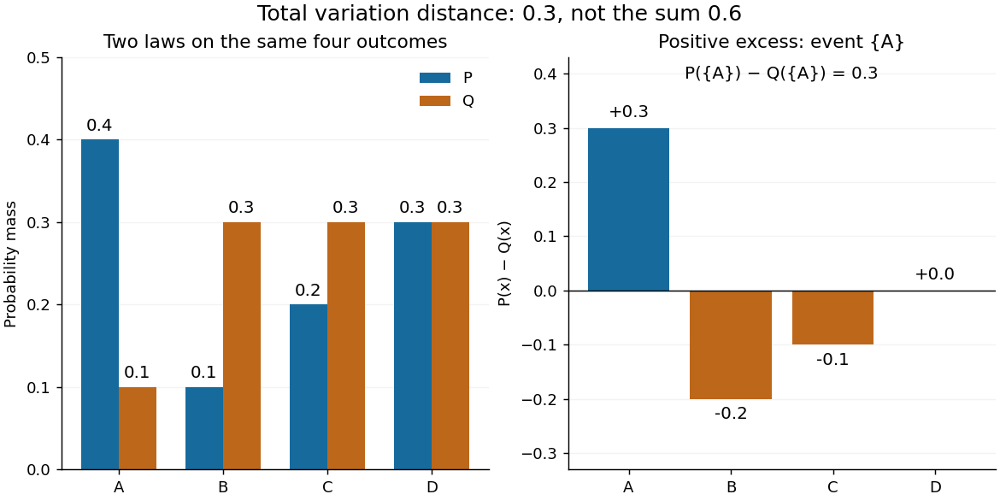

**[Figure 9](#image-total-variation-probability-discrepancy). Total variation distance as the largest event discrepancy**. An illustrative four-outcome example. The positive and negative excesses each total $0.3$; summing both without the factor $1/2$ counts the same redistribution twice.

The factor $1/2$ is necessary because $\sum_x(P(x)-Q(x))=0$: every unit of excess [probability mass](probability-distribution.md#probability-mass) must match a unit of deficit. For any [event](probability-space.md#event), including a negative term cannot increase its signed discrepancy, while omitting a positive term cannot increase it either. Therefore $\{x:P(x)>Q(x)\}$ attains the positive maximum. This is a short way to compute an apparent optimization over $2^{|S|}$ [subsets](set.md#subset) using one pass through $S$.

For [probability density functions](continuous-probability-distribution.md#probability-density-function) $p,q$ relative to the same [measure](measure.md) $\lambda$, the corresponding identity is $d_{\mathrm{TV}}(P,Q)=\tfrac12\int|p-q|\,d\lambda$. Such densities can always be taken as [Radon-Nikodym derivatives](measure-theory.md#radon-nikodym-derivative) relative to $\lambda=P+Q$. Beware the notation: the [total variation norm of a measure](measure.md#total-variation-norm-of-a-measure) applied to the [signed measure](measure.md#signed-measure) $P-Q$ equals $2d_{\mathrm{TV}}(P,Q)$. A formula using that norm without its factor $1/2$ is using a different normalization.

### Total variation distance and hypothesis testing

↑ **Parent:** [Total variation distance](#total-variation-distance)

Suppose one observation comes from either $P$ or $Q$, each with prior [probability](probability-theory.md#probability) $1/2$. A [decision rule](statistical-inference.md#decision-rule) that chooses $P$ on an [event](probability-space.md#event) $E$ and $Q$ otherwise has success [probability](probability-theory.md#probability)

$$
\frac12P(E)+\frac12Q(E^c)=\frac12\bigl(1+P(E)-Q(E)\bigr).
$$

On a [finite set](set.md#finite-set), choosing $E=\{x:P(x)>Q(x)\}$ therefore gives $\tfrac12(1+d_{\mathrm{TV}}(P,Q))$. This is the equal-prior version of [minimum sum of errors in a simple hypothesis test](statistical-hypothesis-test.md#minimum-sum-of-errors-in-a-simple-hypothesis-test); allowing a [statistical test](statistical-hypothesis-test.md#statistical-test) to use an auxiliary [random variable](random-variable.md) cannot improve it, because for each outcome the better of the two decisions already maximizes its contribution.

For the four-outcome example, choose $P$ after $A$ and $Q$ after $B$ or $C$, with either decision allowed after $D$. Choosing $Q$ after $D$ yields $\tfrac12(0.4+0.9)=0.65$. **The best success probability is 65%, with a 35% error probability.** A smaller [total variation distance](#total-variation-distance) means the two sources are harder to distinguish from one observation. Unequal prior [probabilities](probability-theory.md#probability), unequal costs, or multiple observations change this particular decision problem; the $65\%$ figure is not a universal bound for every experiment.

### Coupling characterization of total variation distance

↑ **Parent:** [Total variation distance](#total-variation-distance)

A [coupling of probability distributions](#coupling) $P,Q$ is a pair of [random variables](random-variable.md) $(X,Y)$ with those [marginal distributions](probability-distribution.md#marginal-distribution). On a [finite set](set.md#finite-set), and more generally on a [standard Borel space](measure-theory.md#standard-borel-space), the least achievable mismatch is

$$
d_{\mathrm{TV}}(P,Q)=\min\{\mathbb P(X\ne Y):(X,Y)\text{ is a coupling of }P,Q\}.
$$

A [maximal coupling](#maximal-coupling) attains the minimum; maximal here refers to agreement. An arbitrary [coupling](#coupling) can have a much larger mismatch.[§4.2, Example 4.6 and Proposition 4.7, printed pp. 49–52: finite-state coupling and common-mass construction](mathematics-bibliography.md#markov-chains-and-mixing-times-second-edition-by-david-a-levin-and-others)

For the four-outcome example, assign the following joint [probability mass](probability-distribution.md#probability-mass): $(A,A)$ gets $0.1$, $(B,B)$ gets $0.1$, $(C,C)$ gets $0.2$, and $(D,D)$ gets $0.3$. The remaining $0.3$ must have $X=A$; place $0.2$ on $(A,B)$ and $0.1$ on $(A,C)$. Row sums give $P$, column sums give $Q$, and the [diagonal](geometry-and-topology.md#diagonal-subset) contains $0.7$. **Agreement can reach 70%; mismatch cannot fall below 30%.**

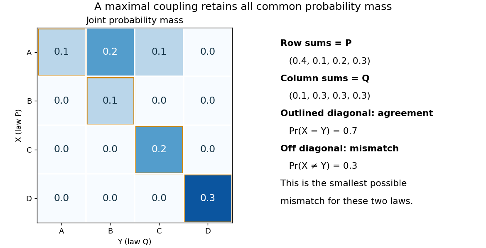

**[Figure 10](#image-total-variation-maximal-coupling). A maximal coupling of two four-outcome probability distributions**. The original joint-mass example retains all common [probability mass](probability-distribution.md#probability-mass) on its diagonal. The two off-diagonal entries account for the minimum mismatch $0.3$.

To see the lower bound, for any [event](probability-space.md#event) $E$,

$$
|P(E)-Q(E)|=|\mathbb E(\mathbf1_E(X)-\mathbf1_E(Y))|\leq\mathbb P(X\ne Y).
$$

The two [indicator functions](measure-theory.md#indicator-function) agree whenever $X=Y$. To attain the bound on a [finite set](set.md#finite-set), keep mass $\min\{P(x),Q(x)\}$ at $(x,x)$ and couple the remaining excesses. The two residual [probability distributions](probability-distribution.md) live on disjoint [subsets](set.md#subset), so their part necessarily mismatches. When the [probability distributions](probability-distribution.md) are identical, the residual part disappears entirely.

This is a choice of joint construction, not a claim that independently drawn observations are usually equal. Two [independent random variables](random-variable.md#independent-random-variables) with the same [continuous probability distribution](continuous-probability-distribution.md) can disagree with [probability](probability-theory.md#probability) one even though their [total variation distance](#total-variation-distance) is zero. The construction of a [maximal coupling](#maximal-coupling) deliberately introduces [statistical dependence](random-variable.md#statistical-dependence) to reveal how similar the marginal laws are.

### Coupling inequality for total variation

↑ **Parent:** [Total variation distance](#total-variation-distance)

For any [coupling](#coupling) of [random variables](random-variable.md), the [coupling characterization of total variation distance](#coupling-characterization-of-total-variation-distance) gives $d_{\mathrm{TV}}(\mathcal L(X),\mathcal L(Y))\leq\mathbb P(X\ne Y)$, where $\mathcal L$ denotes the [law of a random variable](probability-distribution.md). If two coupled [Markov chains](markov-chain.md) stay identical after their coalescence time $T$, then $\{X_t\ne Y_t\}\subseteq\{T>t\}$ and

$$
\lVert\mathcal L(X_t)-\mathcal L(Y_t)\rVert_{\mathrm{TV}}\leq\mathbb P(T>t).
$$

The persistent agreement is essential: a first meeting time does not give this bound if the chains can separate again. A [coalescing coupling](#coalescing-coupling) turns a difficult comparison of [probability distributions](probability-distribution.md) into a concrete question about how long a joint simulation takes to merge.

### Total variation distance under a measurable map

↑ **Parent:** [Total variation distance](#total-variation-distance)

Applying the same [measurable function](measure-theory.md#measurable-function) $f$ to observations from two [probability distributions](probability-distribution.md) cannot increase their [total variation distance](#total-variation-distance). Every output [event](probability-space.md#event) $B$ is tested through its [preimage](set-theory.md#preimage) $f^{-1}(B)$, which was already one of the input [events](probability-space.md#event). Therefore

$$
d_{\mathrm{TV}}(P\circ f^{-1},Q\circ f^{-1})\leq d_{\mathrm{TV}}(P,Q).
$$

For the four-outcome example, recording only whether the result is $D$ makes the output [probability distributions](probability-distribution.md) identical: each is a [Bernoulli distribution](discrete-probability-distribution.md#bernoulli-distribution) with parameter $0.3$. The original [total variation distance](#total-variation-distance) was $0.3$, but this coarse measurement leaves zero discrepancy. Discarding information can make two sources less distinguishable.

The same contraction holds for a common [Markov kernel](markov-chain.md#markov-kernel) $K$: $d_{\mathrm{TV}}(PK,QK)\leq d_{\mathrm{TV}}(P,Q)$. On a [finite set](set.md#finite-set), expand $PK-QK$, apply the [triangle inequality](topological-analysis.md#triangle-inequality) to each output component, and use that each row of $K$ sums to one. A common randomized postprocessing step cannot increase distinguishability either.

<h3 id="pinsker-s-inequality">Pinsker's inequality</h3>

↑ **Parent:** [Total variation distance](#total-variation-distance)  
ⓦ [Wiki](https://en.wikipedia.org/wiki/Pinsker's_inequality)

Pinsker's inequality bounds total variation by relative entropy:

$$
\lVert P-Q\rVert_{\mathrm{TV}}
\leq\sqrt{\frac12D(P\Vert Q)}.
$$

## Information theory

↑ **Parent:** [Probability and statistics](probability-and-statistics.md)

[This section is present in another page, follow this link to view it.](information-theory.md)

## Probability theory

↑ **Parent:** [Probability and statistics](probability-and-statistics.md)

[This section is present in another page, follow this link to view it.](probability-theory.md)

## Statistical model

↑ **Parent:** [Probability and statistics](probability-and-statistics.md)

[This section is present in another page, follow this link to view it.](statistical-model.md)

## Augmented Markov chain

↑ **Parent:** [Probability and statistics](probability-and-statistics.md)  
ⓦ [Wiki](https://en.wikipedia.org/wiki/Augmented_Markov_chain)

## Bayesian normal model

↑ **Parent:** [Probability and statistics](probability-and-statistics.md)  
ⓦ [Wiki](https://en.wikipedia.org/wiki/Bayesian_normal_model)

### Normal mean-variance posterior with a log-uniform variance prior

↑ **Parent:** [Bayesian normal model](#bayesian-normal-model)

For iid $N(\mu,v)$ observations, the prior density $1/v$ relative to $d\mu\,dv$ gives posterior kernel $v^{-n/2-1}\exp[-\{S+n(\mu-\bar x)^2\}/(2v)]$. It is proper exactly when $n>1$ and $S=\sum(x_i-\bar x)^2>0$. The conditionals are $\mu\mid v,x\sim N(\bar x,v/n)$ and $v\mid\mu,x\sim\operatorname{IG}(n/2,\sum_i(x_i-\mu)^2/2)$. Integrating out $\mu$ changes the inverse-gamma shape to $(n-1)/2$.

### Normal-normal conjugacy with known observation variance

↑ **Parent:** [Bayesian normal model](#bayesian-normal-model)

For independent $X_i\sim N(\theta,\sigma^2)$ and prior $\theta\sim N(\mu,\nu^2)$, the posterior has variance and mean

$$
v_n=\left(\frac n{\sigma^2}+\frac1{\nu^2}\right)^{-1},
\qquad
m_n=v_n\left(\frac{n\overline X}{\sigma^2}+\frac\mu{\nu^2}\right).
$$

As $n\to\infty$, $m_n-\overline X=O_p(n^{-1})$ and $v_n^{1/2}\sim\sigma/\sqrt n$, so fixed-level posterior credible intervals agree asymptotically with the corresponding known-variance confidence intervals.

#### Sequential normal predictive monitoring

↑ **Parent:** [Normal-normal conjugacy with known observation variance](#normal-normal-conjugacy-with-known-observation-variance)

For repeated independent $N(\theta,\sigma^2)$ measurements with prior $\theta\sim N(\mu,\tau^2)$ and known scales, [normal-normal conjugacy](#normal-normal-conjugacy-with-known-observation-variance) gives $v_k=(\tau^{-2}+k\sigma^{-2})^{-1}$ and $m_k=v_k(\mu\tau^{-2}+\sigma^{-2}\sum_{j=1}^k y_j)$. The next measurement has [posterior predictive distribution](bayesian-statistics.md#posterior-predictive-distribution) $N(m_k,v_k+\sigma^2)$. Its one-sided false-alarm level $\alpha$ yields the displayed limit. Predictive width tends to the irreducible measurement width, while the center adapts to the individual's data. To assess a held-out measurement, fit with earlier measurements only.

#### Normal-normal conjugacy with unequal exposures

↑ **Parent:** [Normal-normal conjugacy with known observation variance](#normal-normal-conjugacy-with-known-observation-variance)

For independent normal observations conditional on $\Theta$, with mean $\Theta$ and variances $v/m_j$, and normal prior mean $\mu$ and variance $a$, write $W=\sum_jm_j$. Multiplying likelihood and prior adds precisions $W/v+1/a$. Completing the square gives the displayed [posterior distribution](bayesian-statistics.md#bayesian-posterior). Its [posterior mean](bayesian-statistics.md#posterior-mean) is $Z\overline X_w+(1-Z)\mu$, where $Z=aW/(v+aW)$ and $\overline X_w=\sum_jm_jX_j/W$. Thus the [Bayes estimator under squared error loss](bayesian-statistics.md#bayes-estimator-under-squared-error-loss) is exactly the [Bühlmann–Straub credibility estimate](actuarial-statistics.md#buhlmann-straub-credibility-estimate), not merely an approximation to it. Its posterior variance is $av/(v+aW)$.

## Branching-process extinction criterion

↑ **Parent:** [Probability and statistics](probability-and-statistics.md)  
ⓦ [Wiki](https://en.wikipedia.org/wiki/Branching-process_extinction_criterion)

## Cauchy-Schwarz inequality

↑ **Parent:** [Probability and statistics](probability-and-statistics.md)  
ⓦ [Wiki](https://en.wikipedia.org/wiki/Cauchy-Schwarz_inequality)

### Equality in the projected Cauchy-Schwarz inequality

↑ **Parent:** [Cauchy-Schwarz inequality](#cauchy-schwarz-inequality)

For an [orthogonal projection](hilbert-space.md#orthogonal-projection) $P$ onto $W$ in an [inner product space](inner-product.md#inner-product-space), apply the [Cauchy-Schwarz inequality](#cauchy-schwarz-inequality) to $Pu,Pv$ and then use $\|Pu\|\leq\|u\|$, $\|Pv\|\leq\|v\|$. If either original [vector](vector-space.md#vector) is [zero](polynomial.md#zero-of-a-function), equality holds. Otherwise equality holds exactly when both [vectors](vector-space.md#vector) belong to $W$ and are [linearly dependent](vector-space.md#linear-dependence). Necessity follows because equality in the product of the two [norm](normed-vector-space.md#norm) bounds forces equality in each, while equality in [Cauchy-Schwarz inequality](#cauchy-schwarz-inequality) forces dependence. This retains the [zero](polynomial.md#zero-of-a-function) cases that a division by the original [norms](normed-vector-space.md#norm) would lose.

### Minimum pairwise dot-product sum of three unit vectors

↑ **Parent:** [Cauchy-Schwarz inequality](#cauchy-schwarz-inequality)

For three [unit vectors](vector-space.md#unit-vector), the squared [Euclidean norm](normed-vector-space.md#euclidean-norm) of their sum is $3+2S$, proving the displayed bound; equality holds exactly when $u+v+w=0$. For fixed unit vectors $u,v$ with $u+v\ne0$, the [Cauchy-Schwarz inequality](#cauchy-schwarz-inequality) gives the unique minimizing third vector $w=-(u+v)/\|u+v\|$, and the minimum is $u\cdot v-\sqrt{2+2u\cdot v}$. Three coplanar directions separated by $120$ degrees attain the global bound.

### Distance bound from two hyperplane constraints

↑ **Parent:** [Cauchy-Schwarz inequality](#cauchy-schwarz-inequality)

If $a\ne b$ and $x\cdot a=A$, $x\cdot b=B$, the [Cauchy-Schwarz inequality](#cauchy-schwarz-inequality) applied to $x\cdot(a-b)=A-B$ gives $\|x\|\geq|A-B|/\|a-b\|$. Equality requires $x$ parallel to $a-b$ and satisfying both original equations. The estimate gives a lower bound on the distance from the origin to the intersection; it need not be sharp if that equality condition is incompatible with the constraints.

## Cover time

↑ **Parent:** [Probability and statistics](probability-and-statistics.md)  
ⓦ [Wiki](https://en.wikipedia.org/wiki/Cover_time)

### Last visited vertex of a simple random walk on a cycle

↑ **Parent:** [Cover time](#cover-time)

A [simple symmetric random walk](random-walk.md#simple-symmetric-random-walk) on a cycle of $N\geq2$ vertices, started at vertex zero, has its last newly visited vertex uniformly distributed on the other $N-1$ vertices. To prove this for a specified vertex $j\ne0$, cut the cycle at $j$, representing it by a path with absorbing endpoints $0,N$ both corresponding to $j$. All other vertices are visited before $j$ exactly when both interior endpoints $1,N-1$ are visited before absorption. After the first hit on either interior endpoint, the probability of reaching the other before the adjacent absorbing endpoint is $1/(N-1)$ by [gambler's ruin](markov-chain.md#gambler-s-ruin). The [Strong Markov property](markov-chain.md#strong-markov-property) makes this the desired probability, independent of the original start position. For $N=2$ the sole unvisited vertex has probability one.

### Expected cover time of a cycle

↑ **Parent:** [Cover time](#cover-time)

A [simple random walk](random-walk.md#simple-random-walk) on a [cycle graph](graph-theory.md#cycle-graph) of $n\geq3$ vertices has [expected value](expected-value.md) of its [cover time](#cover-time) equal to $n(n-1)/2$, from any starting vertex. Lift the walk to the integers using the same $\pm1$ increments. Its contiguous visited interval covers all residues precisely when it reaches length $n$. Sum the [expected time to expand a random-walk range](random-walk.md#expected-time-to-expand-a-random-walk-range), $1+2+\cdots+(n-1)$, using [linearity of expectation](expected-value.md#linearity-of-expectation); no independence of expansion times is needed.

## Expected energy

↑ **Parent:** [Probability and statistics](probability-and-statistics.md)  
ⓦ [Wiki](https://en.wikipedia.org/wiki/Expected_energy)

## F-test

↑ **Parent:** [Probability and statistics](probability-and-statistics.md)  
ⓦ [Wiki](https://en.wikipedia.org/wiki/F-test)

### Partial F-test for nested linear models

↑ **Parent:** [F-test](#f-test)

Let $M_0\subset M_1$ be nested [normal linear models](normal-linear-model.md) with $p_0,p_1$ independent coefficients and $n$ observations. Under the reduced model,

$$
F=\frac{(\operatorname{RSS}_0-\operatorname{RSS}_1)/(p_1-p_0)}{\operatorname{RSS}_1/(n-p_1)}\sim F_{p_1-p_0,n-p_1}.
$$

The difference of the orthogonal projection matrices onto the two model spaces is an orthogonal projection of rank $p_1-p_0$, orthogonal to the full-model residual projection. Independent [normal distribution](probability-distribution.md#normal-distribution) projections therefore give independent chi-squared numerators and denominators after division by $\sigma^2$. This proves the ratio law. The test evaluates the extra terms conditional on all reduced-model terms, and estimates the unknown common variance from the full model.

### F-statistic

↑ **Parent:** [F-test](#f-test)

An F-statistic is a ratio of two variance estimates. Under the null hypothesis of an F-test, suitably independent scaled sums of squares make this ratio follow an [F-distribution](continuous-probability-distribution.md#f-distribution).

### Nested-model F-test

↑ **Parent:** [F-test](#f-test)

For nested Gaussian linear models differing by $r$ parameters, the statistic

$$
\frac{(RSS_0-RSS_1)/r}{RSS_1/(n-p_1)}
$$

has an $F_{r,n-p_1}$ distribution under the reduced model.

#### Extra sum of squares

↑ **Parent:** [Nested-model F-test](#nested-model-f-test)

For nested [normal linear models](normal-linear-model.md), the decrease in [residual sum of squares](linear-regression.md#residual-sum-of-squares) obtained by adding coefficients is their extra sum of squares. Dividing by the number of added coefficients and by the full-model residual mean square gives the partial [F-test](#f-test). A sequential [analysis of variance](linear-regression.md#analysis-of-variance) attributes this decrease according to the specified order of entry; it need not equal the partial comparison when other terms are retained.

## Galton-Watson process

↑ **Parent:** [Probability and statistics](probability-and-statistics.md)

[This section is present in another page, follow this link to view it.](galton-watson-process.md)

## Gaussian tail bound

↑ **Parent:** [Probability and statistics](probability-and-statistics.md)  
ⓦ [Wiki](https://en.wikipedia.org/wiki/Gaussian_tail_bound)

For $Z\sim N(0,1)$ and $v>0$, exponential Markov optimization gives

$$
\mathbb P(Z\geq v)\leq e^{-v^2/2}.
$$

### Sharp two-sided Gaussian tail bound

↑ **Parent:** [Gaussian tail bound](#gaussian-tail-bound)

For $G$ with the [standard normal distribution](probability-distribution.md#standard-normal-distribution) and $t\geq0$, $\mathbb P(|G|>t)=2(1-\Phi(t))\leq e^{-t^2/2}$. The difference has derivative $e^{-t^2/2}(\sqrt{2/\pi}-t)$, starts at zero, and tends to zero, proving its nonnegativity.

## Gronwall inequality

↑ **Parent:** [Probability and statistics](probability-and-statistics.md)  
ⓦ [Wiki](https://en.wikipedia.org/wiki/Gronwall_inequality)

### Affine Gronwall estimate

↑ **Parent:** [Gronwall inequality](#gronwall-inequality)

If a nonnegative [continuous function](calculus.md#continuous-function) on $[0,h]$ satisfies $v(t)\leq ct+A\int_0^t v(s)\,ds$ with $c,A>0$, put $W(t)=ct+A\int_0^t v(s)\,ds$. Then $v\leq W$, $W(0)=0$ and $W'\leq c+AW$. Multiplication by the [integrating factor](linear-ordinary-differential-equation.md#integrating-factor) $e^{-At}$ and [integration](integral.md) prove the displayed estimate. For $A=0$ its limiting interpretation is $v(t)\leq ct$.

### Discrete Gronwall inequality

↑ **Parent:** [Gronwall inequality](#gronwall-inequality)

If nonnegative quantities satisfy

$$
e_{n+1}\leq(1+hL)e_n+h b_n,
$$

then iteration gives

$$
e_n\leq(1+hL)^ne_0
+h\sum_{j=0}^{n-1}(1+hL)^{n-1-j}b_j.
$$

For $nh\leq T$, the growth factor is bounded by $e^{LT}$.

<h2 id="kac-s-lemma">Kac's lemma</h2>

↑ **Parent:** [Probability and statistics](probability-and-statistics.md)  
ⓦ [Wiki](https://en.wikipedia.org/wiki/Kac's_lemma)

For an irreducible positive recurrent [Markov chain](markov-chain.md) with [stationary distribution](markov-chain.md#stationary-distribution) $\pi$, the expected return time to state $i$ is $1/\pi_i$. More generally, expected occupation rewards in a return cycle equal their stationary rate times the expected cycle length.

## Markov additive process

↑ **Parent:** [Probability and statistics](probability-and-statistics.md)  
ⓦ [Wiki](https://en.wikipedia.org/wiki/Markov_additive_process)

A Markov additive process couples a Markov chain to an additive functional whose increments depend on the chain.

## Multivariate normal distribution

↑ **Parent:** [Probability and statistics](probability-and-statistics.md)  
ⓦ [Wiki](https://en.wikipedia.org/wiki/Multivariate_normal_distribution)

### Gaussian rotation of independent copies

↑ **Parent:** [Multivariate normal distribution](#multivariate-normal-distribution)

If $X,Y$ are [independent and identically distributed random variables](random-variable.md#independent-and-identically-distributed-random-variables) with a centered [multivariate normal distribution](#multivariate-normal-distribution) and [covariance matrix](variance.md#covariance-matrix) $\Sigma$, then $(U_\theta,V_\theta)$ has the same [probability law](probability-distribution.md) as $(X,Y)$. Its two marginal [covariance matrices](variance.md#covariance-matrix) are $\Sigma$ and its cross-[covariance](variance.md#covariance) is zero. The pair has a [multivariate normal distribution](#multivariate-normal-distribution), so the two components are [independent](random-variable.md#independent-random-variables). This remains valid when $\Sigma$ is singular.

### Gaussian random vector

↑ **Parent:** [Multivariate normal distribution](#multivariate-normal-distribution)

A Gaussian random vector has a [multivariate normal distribution](#multivariate-normal-distribution); equivalently, every real [linear combination](vector-space.md#linear-combination) of its coordinates is a [normal random variable](probability-distribution.md#gaussian-random-variable), allowing zero [variance](variance.md). Its [expected value](expected-value.md) vector and [covariance matrix](variance.md#covariance-matrix) determine its law. Subvectors are independent when their cross-covariances vanish, a feature particular to joint Gaussianity.

#### Gaussian sign-correlation identity

↑ **Parent:** [Gaussian random vector](#gaussian-random-vector)

For centered, unit-variance jointly [Gaussian random variables](probability-distribution.md#gaussian-random-variable) with [correlation coefficient](variance.md#pearson-correlation-coefficient) $\rho$, the displayed identity holds. Realize the pair as projections onto unit [vectors](vector-space.md#vector) of angle $\theta=\arccos\rho$. Rotational symmetry of the two-dimensional [Gaussian random vector](#gaussian-random-vector) direction makes sign disagreement have [probability](probability-theory.md#probability) $\theta/\pi$. The [expectation](expected-value.md) is therefore $1-2\theta/\pi=(2/\pi)\arcsin\rho$. Perfectly correlated and anticorrelated endpoints follow directly; the sign at zero does not affect the result.

#### Standard Gaussian random vector

↑ **Parent:** [Gaussian random vector](#gaussian-random-vector)

A [Gaussian random vector](#gaussian-random-vector) with independent [normal](probability-distribution.md#normal-distribution) coordinates of [expectation](expected-value.md) zero and [variance](variance.md) one. Its distribution is invariant under [orthogonal transformations](linear-algebra.md#orthogonal-transformation). In particular, its direction in a fixed two-dimensional plane is uniform, which underlies the [Gaussian sign-correlation identity](#gaussian-sign-correlation-identity).

### Multivariate normal density

↑ **Parent:** [Multivariate normal distribution](#multivariate-normal-distribution)

For a [positive-definite matrix](quadratic-form.md#positive-definite-matrix) $\Sigma$, the distribution $N_p(\mu,\Sigma)$ has density

$$
f(x)=\frac{
\exp\!\left[-\frac12(x-\mu)^T\Sigma^{-1}(x-\mu)\right]
}{(2\pi)^{p/2}(\det\Sigma)^{1/2}}.
$$

### Linear image of a multivariate normal vector

↑ **Parent:** [Multivariate normal distribution](#multivariate-normal-distribution)

If $X\sim N(\mu,\Sigma)$ and $A$ and $c$ are deterministic, then

$$
AX+c\sim N(A\mu+c,A\Sigma A^T).
$$

In particular, $a^TX$ is normal with mean $a^T\mu$ and variance $a^T\Sigma a$.

### Independence of uncorrelated jointly normal variables

↑ **Parent:** [Multivariate normal distribution](#multivariate-normal-distribution)

Two subvectors of a jointly [multivariate normal distribution](#multivariate-normal-distribution) are independent exactly when their cross-covariance matrix is zero.

### Gaussian conditional independence

↑ **Parent:** [Multivariate normal distribution](#multivariate-normal-distribution)

For a jointly Gaussian vector, conditional independence is equivalent to vanishing conditional cross-covariance. Equivalently, two coordinates are conditionally independent given all the others exactly when their entry in the [precision matrix](variance.md#precision-matrix) is zero.

### Bivariate normal distribution

↑ **Parent:** [Multivariate normal distribution](#multivariate-normal-distribution)  
ⓦ [Wiki](https://en.wikipedia.org/wiki/Bivariate_normal_distribution)

For means $\mu_i$, standard deviations $\sigma_i$, and correlation $\rho$, the standardized quadratic form in the density is

$$
\frac1{1-\rho^2}
\left[
\frac{(x_1-\mu_1)^2}{\sigma_1^2}
-\frac{2\rho(x_1-\mu_1)(x_2-\mu_2)}{\sigma_1\sigma_2}
+\frac{(x_2-\mu_2)^2}{\sigma_2^2}
\right].
$$

#### Bivariate standard normal distribution

↑ **Parent:** [Bivariate normal distribution](#bivariate-normal-distribution)

A bivariate standard normal distribution is a [bivariate normal distribution](#bivariate-normal-distribution) whose two marginal means are zero and marginal variances are one; its remaining parameter is their correlation.

#### Maximum-likelihood covariance estimator for centered Gaussian data

↑ **Parent:** [Bivariate normal distribution](#bivariate-normal-distribution)

For independent $Z_i\sim N_p(0,\Sigma)$ with known zero mean,

$$
\widehat\Sigma=\frac1n\sum_{i=1}^nZ_iZ_i^T.
$$

##### Asymptotic covariance of the bivariate Gaussian covariance estimator

↑ **Parent:** [Maximum-likelihood covariance estimator for centered Gaussian data](#maximum-likelihood-covariance-estimator-for-centered-gaussian-data)

Writing $a=\Sigma_{11}$, $c=\Sigma_{12}$, and $b=\Sigma_{22}$, the vector $(\widehat\Sigma_{11},\widehat\Sigma_{12},\widehat\Sigma_{22})$ has asymptotic covariance

$$
\begin{pmatrix}
2a^2&2ac&2c^2\\
2ac&ab+c^2&2bc\\
2c^2&2bc&2b^2
\end{pmatrix}.
$$

#### Conditional distribution of a bivariate normal variable

↑ **Parent:** [Bivariate normal distribution](#bivariate-normal-distribution)

Conditionally on $X_2=x_2$,

$$
X_1\sim N\left(
\mu_1+\rho\frac{\sigma_1}{\sigma_2}(x_2-\mu_2),
\sigma_1^2(1-\rho^2)\right).
$$

### Uncorrelated jointly normal variables are independent

↑ **Parent:** [Multivariate normal distribution](#multivariate-normal-distribution)

Any jointly normal random variables with zero covariance are independent.

#### Gaussian independence of linear and quadratic statistics

↑ **Parent:** [Uncorrelated jointly normal variables are independent](#uncorrelated-jointly-normal-variables-are-independent)

When $L$ has full column rank, its [Gram matrix](inner-product.md#gram-matrix) $L^TL$ is [positive-definite](bilinear-form.md#positive-definite-bilinear-form) and $BLL^TL(L^TL)^{-1}=BL=0$. The stacked normal vector $(BY,L^TY)$ therefore has zero cross [covariance](variance.md#covariance), so its blocks are independent. Since $Y^TAY=\|L^TY\|^2$, the linear and quadratic statistics are independent. This is the projection argument behind independence of [regression coefficient](linear-regression.md#regression-coefficient) and [variance](variance.md) estimators in a [normal linear model](normal-linear-model.md).

### Orthogonal projection of a Gaussian vector

↑ **Parent:** [Multivariate normal distribution](#multivariate-normal-distribution)  
ⓦ [Wiki](https://en.wikipedia.org/wiki/Orthogonal_projection_of_a_Gaussian_vector)

Orthogonal projections of an isotropic Gaussian vector onto orthogonal subspaces are independent.

## Paley-Zygmund inequality

↑ **Parent:** [Probability and statistics](probability-and-statistics.md)  
ⓦ [Wiki](https://en.wikipedia.org/wiki/Paley-Zygmund_inequality)

### Truncated first moment bound

↑ **Parent:** [Paley-Zygmund inequality](#paley-zygmund-inequality)

For a nonnegative [random variable](random-variable.md) with finite mean $\mu$ and $0\leq\theta\leq1$, the part of the [expectation](expected-value.md) on $X\leq\theta\mu$ is at most $\theta\mu$. Subtracting gives $\mathbb E[X\mathbf1_{\{X>\theta\mu\}}]\geq(1-\theta)\mu$. If the [second moment](expected-value.md#second-moment) is positive and finite, applying the [Cauchy-Schwarz inequality](#cauchy-schwarz-inequality) to $X$ and the [indicator variable](statistical-modelling.md#indicator-variable) gives the [Paley-Zygmund inequality](#paley-zygmund-inequality) $\mathbb P(X>\theta\mu)\geq(1-\theta)^2\mu^2/\mathbb E[X^2]$.

## Pivotal quantity

↑ **Parent:** [Probability and statistics](probability-and-statistics.md)  
ⓦ [Wiki](https://en.wikipedia.org/wiki/Pivotal_quantity)

## Rao-Blackwell theorem

↑ **Parent:** [Probability and statistics](probability-and-statistics.md)  
ⓦ [Wiki](https://en.wikipedia.org/wiki/Rao-Blackwell_theorem)

If $T$ is a [sufficient statistic](#sufficient-statistic) and $U$ is an estimator with finite variance, then $U^*=\mathbb E[U\mid T]$ has the same expectation and no greater variance. Indeed, the [tower property of conditional expectation](measure-theory.md#law-of-total-expectation) preserves the mean and the [law of total variance](probability-theory.md#law-of-total-variance) gives

$$
\operatorname{Var}(U)
=\operatorname{Var}(U^*)+\mathbb E[\operatorname{Var}(U\mid T)].
$$

### Rao-Blackwell estimator for a uniform scale interval

↑ **Parent:** [Rao-Blackwell theorem](#rao-blackwell-theorem)

For independent [uniform random variables](continuous-probability-distribution.md#uniform-random-variable) on $(\theta,3\theta)$ with $\theta>0$, the sample minimum and maximum form a [sufficient statistic](#sufficient-statistic). Conditional on these endpoints, [exchangeability](probability-distribution.md#exchangeable-random-variables) and the uniform law of the remaining observations give $E[X_1\mid X_{(1)},X_{(n)}]=(X_{(1)}+X_{(n)})/2$. Applying the [Rao-Blackwell theorem](#rao-blackwell-theorem) to $X_1/2$ gives the displayed [unbiased estimator](statistical-modelling.md#unbiased-estimator). Its [variance](variance.md) is $\theta^2/[2(n+1)(n+2)]$, compared with $\theta^2/12$ for $X_1/2$.

### Rao-Blackwell estimator of a geometric failure probability

↑ **Parent:** [Rao-Blackwell theorem](#rao-blackwell-theorem)

For independent geometric observations with mass $p^{r-1}(1-p)$, the total $T$ is sufficient. Conditional on $T=t$, positive-integer compositions are uniformly distributed. The indicator $1_{\{X_1>1\}}$ is unbiased for $p$, and conditioning it on $T$ gives $\binom{t-2}{n-1}/\binom{t-1}{n-1}=(t-n)/(t-1)$. For one observation, use $1_{\{T>1\}}$ instead, including its zero value at $T=1$.

<h3 id="lehmann-scheffe-theorem">Lehmann–Scheffé theorem</h3>

↑ **Parent:** [Rao-Blackwell theorem](#rao-blackwell-theorem)  
ⓦ [Wiki](https://en.wikipedia.org/wiki/Lehmann–Scheffé_theorem)

An unbiased [estimator](statistical-modelling.md#estimator) that is a function of a [complete sufficient statistic](#complete-sufficient-statistic) is the unique uniformly minimum-[variance](variance.md) unbiased [estimator](statistical-modelling.md#estimator), up to almost sure equality. [Rao-Blackwellization](#rao-blackwellization) supplies [variance](variance.md) reduction, and completeness supplies uniqueness. The theorem applies to a conditional statistical experiment as well, when unbiasedness, sufficiency and completeness are all evaluated under that conditional family.

### Rao-Blackwellization of a multinomial probability product

↑ **Parent:** [Rao-Blackwell theorem](#rao-blackwell-theorem)

For $n\geq3$ independent labels with three type probabilities, conditioning the indicator of an ordered $(0,1,2)$ initial triple on the [multinomial distribution](discrete-probability-distribution.md#multinomial-distribution) type counts gives the displayed unbiased [estimator](statistical-modelling.md#estimator). The [Rao-Blackwell theorem](#rao-blackwell-theorem) reduces its [variance](variance.md) strictly when all three probabilities are positive. At a boundary parameter with a missing type, both [variances](variance.md) vanish.

### Rao-Blackwellization

↑ **Parent:** [Rao-Blackwell theorem](#rao-blackwell-theorem)

Replace an estimator by its [conditional expectation](measure-theory.md#conditional-expectation) given selected information. The mean is unchanged and the variance cannot increase, by the [law of total variance](probability-theory.md#law-of-total-variance). In simulation this produces [conditional Monte Carlo](monte-carlo-method.md#conditional-monte-carlo) estimators. Sufficiency is needed for the classical inferential strengthening, but not for the elementary variance reduction identity.

### Rao-Blackwell estimator of a squared normal mean

↑ **Parent:** [Rao-Blackwell theorem](#rao-blackwell-theorem)

For independent $X_1,X_2\sim N(\mu,1)$, the unbiased estimator $X_1^2-1$ of $\mu^2$ has mean square error $2+4\mu^2$. Conditioning on the sufficient statistic $T=X_1+X_2$ gives

$$
\mathbb E[X_1^2-1\mid T]=\frac{T^2}{4}-\frac12,
$$

whose mean square error is $1/2+2\mu^2$.

## Regression residual

↑ **Parent:** [Probability and statistics](probability-and-statistics.md)  
ⓦ [Wiki](https://en.wikipedia.org/wiki/Regression_residual)

A regression residual is the observed response minus its fitted value. Residual plots diagnose failures of assumptions such as constant variance, linear mean structure, and independent errors.

### Residual constraints from a bounded response

↑ **Parent:** [Regression residual](#regression-residual)

If observed responses satisfy $L\le y_i\le U$, their [regression residuals](#regression-residual) $e_i=y_i-\widehat y_i$ necessarily obey the displayed inequalities. Subtracting the corresponding [fitted values](linear-regression.md#fitted-values) proves both bounds, without a [normal distribution](probability-distribution.md#normal-distribution) or a fitted-model assumption. On a [residual-versus-fitted plot](linear-regression.md#residual-versus-fitted-plot), all points must lie between two parallel lines of slope $-1$. This is also a consistency check when $L,U$ are merely the reported observed minimum and maximum, rather than theoretical response limits. A bounded response does not itself prove that a straight [conditional mean](measure-theory.md#conditional-expectation) is inappropriate.

#### Residual extrema when response extrema are attained

↑ **Parent:** [Residual constraints from a bounded response](#residual-constraints-from-a-bounded-response)

For a finite sample, let $L=\min_i y_i$, $U=\max_i y_i$, $m=\min_i\widehat y_i$ and $M=\max_i\widehat y_i$. The [regression residuals](#regression-residual) are $e_i=y_i-\widehat y_i$. Every residual is at least $L-M$ and at most $U-m$. At an observation attaining $y_i=L$, its residual is at most $L-m$, so $e_{\min}\le L-m$. At an observation attaining $y_i=U$, its residual is at least $U-M$, so $e_{\max}\ge U-M$. These observations prove all four bounds. Merely knowing theoretical response limits, without attainment, would not justify the two inner bounds.

### Residual plot

↑ **Parent:** [Regression residual](#regression-residual)

A residual plot displays [regression residuals](#regression-residual) against fitted responses, predictor values or observation order. Curvature can suggest an incorrect [regression function](statistical-learning.md#regression-function); changing spread can suggest unequal error [variances](variance.md); ordered runs can suggest dependence. A plot is a diagnostic, not a proof of [independence](random-variable.md#independent-random-variables). Dependence confined to higher [moments](expected-value.md#moment), as for [adjacent products of independent Gaussian variables](variance.md#adjacent-products-of-independent-gaussian-variables), may call for lagged squared [regression residuals](#regression-residual) rather than a basic scatter plot. Fitting also induces dependence among [regression residuals](#regression-residual) even under independent original errors.

### Residual curvature diagnostic

↑ **Parent:** [Regression residual](#regression-residual)

A systematic curved pattern in [regression residuals](#regression-residual) plotted against [fitted values](linear-regression.md#fitted-values) suggests a misspecified conditional mean. Positive residuals at both ends and negative residuals in the middle motivate trying [quadratic regression](linear-regression.md#quadratic-regression). The diagnostic does not by itself identify the error [probability distribution](probability-distribution.md) or prove [heteroscedasticity](statistical-modelling.md#heteroscedastic).

### Partial residual

↑ **Parent:** [Regression residual](#regression-residual)

In an additive mean model, the partial residual for component $j$ subtracts every fitted term except that component. It equals the full [regression residual](#regression-residual) plus the fitted component. Plotting it against that component's predictor shows the conditional pattern after accounting for other fitted effects, and supplies the response for a [backfitting](generalized-linear-model.md#backfitting-algorithm) update.

### Standardized regression residual

↑ **Parent:** [Regression residual](#regression-residual)

In a [normal linear model](normal-linear-model.md), the $i$th [regression residual](#regression-residual) has [variance](variance.md) $\sigma^2(1-h_{ii})$, where $h_{ii}$ is a diagonal entry of the [hat matrix](normal-linear-model.md#hat-matrix). Replacing $\sigma$ by the residual standard deviation $s$ gives the standardized residual used in the normal [Q-Q plot](#q-q-plot) of R's linear-model diagnostic plots.

#### Distribution of an internally studentized Gaussian residual

↑ **Parent:** [Standardized regression residual](#standardized-regression-residual)

In a [normal linear model](normal-linear-model.md) with residual [degrees of freedom](classical-mechanics.md#degree-of-freedom) $\nu\geq2$, an [internally studentized residual](#standardized-regression-residual) satisfies $|\eta_i|\leq\sqrt\nu$ and $\eta_i^2/\nu\sim\operatorname{Beta}(1/2,(\nu-1)/2)$, provided its [leverage](statistical-modelling.md#regression-leverage) is less than one. Choose an [orthonormal basis](inner-product.md#orthonormal-basis) of the residual space with its first direction proportional to the projection of the $i$th coordinate vector. The [Gaussian](probability-distribution.md#normal-distribution) coordinates in this basis are independent standard [normal random variables](probability-distribution.md#gaussian-random-variable) $Z_1,\ldots,Z_\nu$, and $\eta_i=\sqrt\nu Z_1/(\sum_jZ_j^2)^{1/2}$. The [beta distribution](probability-distribution.md#beta-distribution) follows from the independent [chi-squared distributions](probability-distribution.md#chi-squared-distribution) of $Z_1^2$ and $\sum_{j=2}^\nu Z_j^2$. The bounded residual is not exactly distributed according to [Student's t-distribution](continuous-probability-distribution.md#student-s-t-distribution); it approaches the standard [normal distribution](probability-distribution.md#normal-distribution) as $\nu\to\infty$.

## Sufficient statistic

↑ **Parent:** [Probability and statistics](probability-and-statistics.md)  
ⓦ [Wiki](https://en.wikipedia.org/wiki/Sufficient_statistic)

A [statistic](statistical-inference.md#statistic) $T=T(X)$ is sufficient for a [statistical model](statistical-model.md) $\{P_\theta:\theta\in\Theta\}$ when the [conditional distribution](probability-theory.md#conditional-distribution) of the full data $X$ given $T$ has a version independent of the unknown [statistical parameter](statistical-model.md#statistical-parameter) $\theta$. Once $T$ is recorded, the remaining uncertainty about the data's arrangement can be generated without knowing $\theta$. [Sufficiency, Will Fithian, “Sufficiency”: definition](mathematics-bibliography.md#sufficiency-stat-210a-fall-2025-by-will-fithian)

For data and [statistic](statistical-inference.md#statistic) taking values in [standard Borel spaces](measure-theory.md#standard-borel-space), express this precisely with one [Markov kernel](markov-chain.md#markov-kernel) $K$, common to every [statistical parameter](statistical-model.md#statistical-parameter) value:

$$
P_\theta(X\in B\mid T)=K(T,B)\quad P_\theta\text{-almost surely},\qquad \theta\in\Theta,
$$

for each measurable event $B$. Thus $K(t,\cdot)$ is a [regular conditional distribution](probability-theory.md#regular-conditional-distribution) of $X$ given $T=t$. Equality is only required outside a [null set](measure-theory.md#null-set) for the distribution of $T$ under each $\theta$; the choice of version matters on impossible conditioning events. For a [continuous probability distribution](continuous-probability-distribution.md), the event $T=t$ may have zero [probability](probability-theory.md#probability) even at meaningful observations, so the definition uses a [regular conditional distribution](probability-theory.md#regular-conditional-distribution), rather than division by $P_\theta(T=t)$.

A [sufficient statistic](#sufficient-statistic) is a property of a specified [statistical model](statistical-model.md), rather than of a formula for summarizing data in isolation. It need not be an [unbiased estimator](statistical-modelling.md#unbiased-estimator) or even shorten the record: the full data $T(X)=X$ is always sufficient. An [estimator](statistical-modelling.md#estimator) instead targets a quantity such as a [mean](expected-value.md). An [ancillary statistic](#ancillary-statistic) has a parameter-independent marginal [probability distribution](probability-distribution.md), whereas a [sufficient statistic](#sufficient-statistic) has a parameter-independent conditional full-data law. A [minimal sufficient statistic](#minimal-sufficient-statistic) permits the greatest reduction among [sufficient statistics](#sufficient-statistic). A [complete statistic](statistical-inference.md#complete-statistic) satisfies a separate condition about zero [expectations](expected-value.md); a [complete sufficient statistic](#complete-sufficient-statistic) must satisfy both conditions.

### Bernoulli sample sum as a sufficient statistic

↑ **Parent:** [Sufficient statistic](#sufficient-statistic)

Let $n$ be fixed and known, and let $X_1,\ldots,X_n$ be [independent and identically distributed](random-variable.md#independent-and-identically-distributed-random-variables) [Bernoulli random variables](discrete-probability-distribution.md#bernoulli-distribution) with common success [probability](probability-theory.md#probability) $p$. Their joint [probability mass function](probability-distribution.md#probability-mass-function), on the binary [sample space](probability-space.md#sample-space) $\{0,1\}^n$, is

$$
P_p(X=x)=\prod_{i=1}^n p^{x_i}(1-p)^{1-x_i}=p^{t}(1-p)^{n-t},\qquad t=T(x)=\sum_{i=1}^nx_i.
$$

There are $\binom nt$ arrangements with $t$ successes, so $T$ has the [binomial distribution](discrete-probability-distribution.md#binomial-distribution). For $0<p<1$ and $t\in\{0,\ldots,n\}$, its exact conditional full-data [probability mass function](probability-distribution.md#probability-mass-function) is

$$
P_p(X=x\mid T=t)=\frac{p^t(1-p)^{n-t}\mathbf1_{\{T(x)=t\}}}{\binom nt p^t(1-p)^{n-t}}=\frac{\mathbf1_{\{T(x)=t\}}}{\binom nt}.
$$

This [conditional distribution](probability-theory.md#conditional-distribution) is uniform over arrangements, with no dependence on $p$: the sum is a [sufficient statistic](#sufficient-statistic). [Sufficiency, Will Fithian, “Independent Bernoulli sequence”: conditional pmf](mathematics-bibliography.md#sufficiency-stat-210a-fall-2025-by-will-fithian)

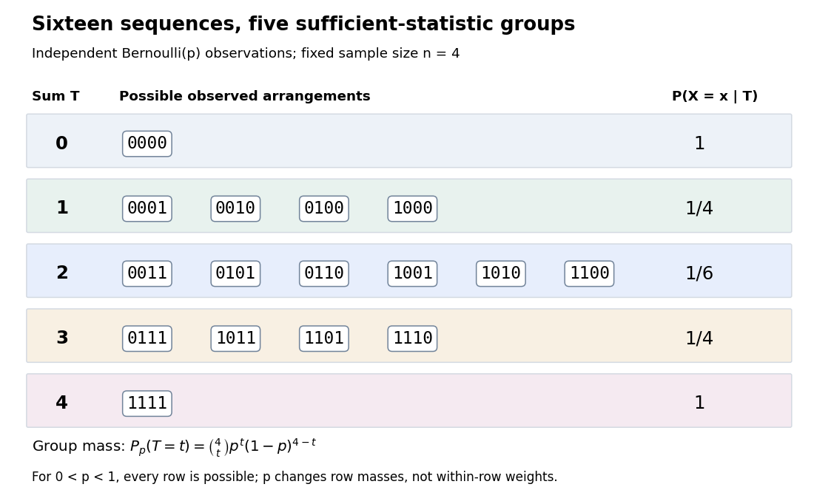

**[Figure 11](#image-four-bernoulli-observations-grouped-by-their-sufficient-sum). Four Bernoulli observations grouped by their sufficient sum**. All sixteen binary sequences are grouped by $T$. Within each group the [conditional distribution](probability-theory.md#conditional-distribution) is uniform; changing $p$ changes the group's total [probability](probability-theory.md#probability), not the conditional weights within it.

For $n=4$, the group sizes are $1,4,6,4,1$ and the within-group conditional [probabilities](probability-theory.md#probability) are respectively $1,1/4,1/6,1/4,1$. For example, $T=2$ leaves exactly $0011,0101,0110,1001,1010,1100$, each with conditional [probability](probability-theory.md#probability) $1/6$. At $p=1/4$, each such sequence has unconditional [probability](probability-theory.md#probability) $9/256$ and the group has [probability](probability-theory.md#probability) $54/256$. At $p=1/2$, these values are $1/16$ and $6/16$; at $p=3/4$ they return to $9/256$ and $54/256$. The conditional weights stay $1/6$ in all three cases.

At the boundary $p=0$, only $T=0$ has positive [probability](probability-theory.md#probability); at $p=1$, only $T=n$ does. Dividing by $P_p(T=t)$ on the other groups would divide by zero. Nevertheless, the same uniform-on-arrangements [Markov kernel](markov-chain.md#markov-kernel) is a valid common version for the entire family $0\leq p\leq1$: it gives the correct point mass on the one observed group at each boundary and assigns permissible versions on its unobserved groups. Define the joint [probability mass function](probability-distribution.md#probability-mass-function) there by the original product of the one-trial [Bernoulli](discrete-probability-distribution.md#bernoulli-distribution) [probability mass functions](probability-distribution.md#probability-mass-function), or use the limiting convention $0^0=1$ in the compact formula.

The [sample mean](variance.md#sample-mean) $T/n$ is an [unbiased estimator](statistical-modelling.md#unbiased-estimator) of $p$ and retains the [sufficient statistic](#sufficient-statistic) because $n$ is known. By contrast, $X_1$ is also an [unbiased estimator](statistical-modelling.md#unbiased-estimator) of $p$ but, for $n\geq2$, is not sufficient: the conditional success [probability](probability-theory.md#probability) of the [independent](random-variable.md#independent-random-variables) $X_2$ given $X_1$ is still $p$. Thus unbiasedness does not imply sufficiency.

Sufficiency also does not imply [completeness of a statistic](statistical-inference.md#complete-statistic). For $n\geq2$, the full-data [sufficient statistic](#sufficient-statistic) $X$ admits the nonzero function $g(X)=X_1-X_2$ with [expectation](expected-value.md) zero for every $p$. Nor does minimality imply [completeness of a statistic](statistical-inference.md#complete-statistic): for $n=2$ and the restricted [statistical model](statistical-model.md) $p\in\{1/4,3/4\}$, $T$ is a [minimal sufficient statistic](#minimal-sufficient-statistic) since the [likelihood ratio](statistical-hypothesis-test.md#likelihood-ratio) $P_{3/4}(X=x)/P_{1/4}(X=x)=3^{2t-2}$ distinguishes its three values. Yet $g(0)=3,g(1)=-5,g(2)=3$ has [expectation](expected-value.md) $(27-30+3)/16=0$ at both parameter values and is never zero. Changing the parameter family can change [completeness of a statistic](statistical-inference.md#complete-statistic) even while preserving sufficiency.

### Statistical data compression by a sufficient statistic

↑ **Parent:** [Sufficient statistic](#sufficient-statistic)

A [sufficient statistic](#sufficient-statistic) allows the observed [likelihood function](maximum-likelihood-estimation.md#likelihood-function) to be stored through a shorter record, up to a parameter-independent factor. For the [Bernoulli sample sum as a sufficient statistic](#bernoulli-sample-sum-as-a-sufficient-statistic), write

$$
L_x(p)=p^t(1-p)^{n-t},\qquad L_t(p)=\binom nt p^t(1-p)^{n-t}=\binom nt L_x(p).
$$

The second [likelihood function](maximum-likelihood-estimation.md#likelihood-function) belongs to the observed count; the first belongs to the observed sequence. Their absolute values differ by the [binomial coefficient](binomial-coefficient.md), but their [likelihood ratios](statistical-hypothesis-test.md#likelihood-ratio) between any two interior parameter values agree. A [maximum-likelihood estimator](maximum-likelihood-estimation.md#maximum-likelihood-estimator) can therefore use just $(n,t)$.

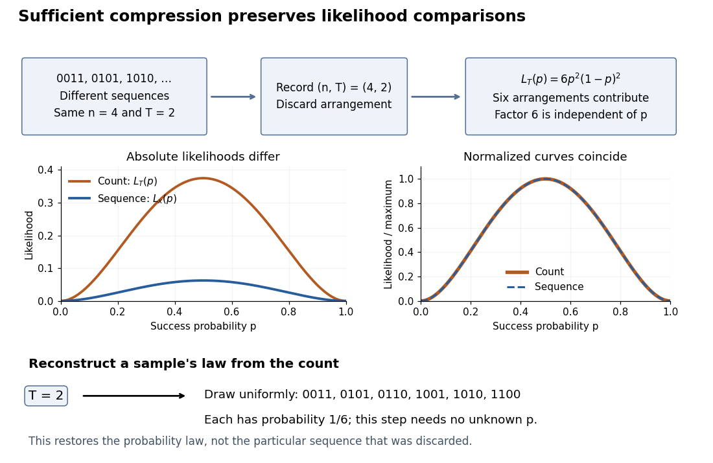

**[Figure 12](#image-sequence-to-count-sufficient-compression-preserves-likelihood-comparisons). Sequence to count: sufficient compression preserves likelihood comparisons**. For $n=4,t=2$, three example sequences share $L_x(p)=p^2(1-p)^2$. Recording $(n,t)$ produces the count [likelihood](maximum-likelihood-estimation.md#likelihood-function) $L_t(p)=6L_x(p)$. Normalizing each curve by its maximum makes the two curves coincide. A reverse random draw from the six arrangements restores the full-data [probability distribution](probability-distribution.md), using no unknown $p$.

This compression discards which arrangement actually occurred. To reproduce the original experiment's [probability distribution](probability-distribution.md), first draw $T$ from its [binomial distribution](discrete-probability-distribution.md#binomial-distribution) and then draw uniformly from the arrangements with that sum. The second step is independent of $p$, so it supplies no additional evidence about $p$. It does not recover the particular discarded sequence. If the scientific question changes to time trends or [statistical dependence](random-variable.md#statistical-dependence) between observations, the common-$p$ [independent and identically distributed](random-variable.md#independent-and-identically-distributed-random-variables) [Bernoulli](discrete-probability-distribution.md#bernoulli-distribution) model may no longer apply, and the ordering can become informative.

### Ancillary statistic

↑ **Parent:** [Sufficient statistic](#sufficient-statistic)  
ⓦ [Wiki](https://en.wikipedia.org/wiki/Ancillary_statistic)

A [statistic](statistical-inference.md#statistic) is ancillary for a [statistical model](statistical-model.md) if its [probability distribution](probability-distribution.md) is the same for every parameter value. Its marginal law carries no information about the parameter, but its observed value can identify the precision or configuration of the experiment. [Fisherian conditional inference](statistical-inference.md#fisherian-conditional-inference) uses the [conditional distribution](probability-theory.md#conditional-distribution) of an informative [statistic](statistical-inference.md#statistic) given the observed ancillary value. Ancillarity does not mean that the ancillary is independent of every informative [statistic](statistical-inference.md#statistic).

#### Range-conditioned uniform location inference

↑ **Parent:** [Ancillary statistic](#ancillary-statistic)

For independent observations uniform on $(\theta-1/2,\theta+1/2)$, let $U$ and $V$ be the sample minimum and maximum, $R=V-U$, and $C=(U+V)/2$. For $n\ge2$ their joint [density](fluid-mechanics.md#density) in $(c,r)$ is $n(n-1)r^{n-2}$ on $0<r<1$, $|c-\theta|<(1-r)/2$. Integrating over $c$ gives $f_R(r)=n(n-1)r^{n-2}(1-r)$, independent of $\theta$, so $R$ is an [ancillary statistic](#ancillary-statistic). Moreover $C\mid R=r$ is uniform on $(\theta-(1-r)/2,\theta+(1-r)/2)$. Consequently

$$
\left[C-\frac{(1-\alpha)(1-R)}2,\ C+\frac{(1-\alpha)(1-R)}2\right]
$$

is an exact conditional $(1-\alpha)$ [confidence interval](statistical-inference.md#confidence-interval) for $\theta$. The realized range determines the appropriate precision, although the range is not itself evidence about the value of $\theta$.

#### Non-uniqueness of maximal ancillary statistics

↑ **Parent:** [Ancillary statistic](#ancillary-statistic)

A maximal [ancillary statistic](#ancillary-statistic) has no strictly finer ancillary partition of the sample space, but different maximal ancillary partitions can exist. Let $(U,V)$ take values in $\{0,1\}^2$, with probabilities $\theta/2$ on each equal pair and $(1-\theta)/2$ on each unequal pair, for $0<\theta<1$. Both $U$ and $V$ have the [Bernoulli distribution](discrete-probability-distribution.md#bernoulli-distribution) with success probability $1/2$ for every $\theta$. Their joint law depends on $\theta$, so combining them is not ancillary. Each partition is maximal: splitting one of its two-point cells singles out a point whose probability depends on $\theta$. There is no common ancillary refinement, and conditioning on one ancillary choice need not specify a unique conditioning principle for all models.

#### Partial ancillary statistic

↑ **Parent:** [Ancillary statistic](#ancillary-statistic)

For a parameter of interest $\psi$ and [nuisance parameter](statistical-model.md#nuisance-parameter) $\lambda$, a partial ancillary for $\psi$ has a marginal law independent of $\psi$, possibly depending on $\lambda$. This differs from a fully [ancillary statistic](#ancillary-statistic), whose law is independent of both. For independent Poisson counts with means $\lambda\psi$ and $\lambda(1-\psi)$, their total is Poisson with mean $\lambda$, while the first count conditional on the total is binomial with success probability $\psi$. Conditioning on the total eliminates $\lambda$. A partial ancillary does not automatically eliminate a [nuisance parameter](statistical-model.md#nuisance-parameter); the conditional law must actually be free of that parameter.

##### Ancillary conditioning that eliminates a nuisance parameter

↑ **Parent:** [Partial ancillary statistic](#partial-ancillary-statistic)

For a [sufficient statistic](#sufficient-statistic) $(C,S)$ and parameter $(\psi,\lambda)$, a useful strong reduction requires the law of $S$ to be free of $\psi$ and the [conditional distribution](probability-theory.md#conditional-distribution) of $C$ given $S$ to be free of the [nuisance parameter](statistical-model.md#nuisance-parameter) $\lambda$. In the discrete case it gives

$$
f(x;\psi,\lambda)=\phi_0(x)\phi_C(C(x),S(x);\psi)\phi_S(S(x);\lambda),
$$

where $\phi_0$ sums to one on each $(C,S)$ fiber, $\phi_S$ sums to one over $s$, and $\phi_C$ sums to one over $c$ separately for every fixed $s$. Ordinary [ancillarity](#ancillary-statistic), or just the law of $S$ being free of $\psi$, does not by itself guarantee that conditioning removes $\lambda$.

### Complete sufficient statistic

↑ **Parent:** [Sufficient statistic](#sufficient-statistic)

A [sufficient statistic](#sufficient-statistic) is complete when every integrable function of it with [expectation](expected-value.md) zero for every parameter is almost surely zero for every parameter. Full regular one-parameter [exponential families](exponential-family.md) with natural parameter ranging over an open interval provide a standard completeness result. Completeness makes an unbiased function of a [sufficient statistic](#sufficient-statistic) unique, giving the [Lehmann–Scheffé theorem](#lehmann-scheffe-theorem).

<h4 id="basu-s-theorem">Basu's theorem</h4>

↑ **Parent:** [Complete sufficient statistic](#complete-sufficient-statistic)

A [complete sufficient statistic](#complete-sufficient-statistic) is independent of every [ancillary statistic](#ancillary-statistic). To prove this, let $S$ be complete and sufficient, let $A$ be ancillary, and take any bounded measurable function $h$. By sufficiency, $g(S)=E_\theta[h(A)\mid S]$ has a parameter-independent version; by ancillarity, $c=E_\theta h(A)$ is independent of $\theta$. Thus $E_\theta[g(S)-c]=0$ for every $\theta$. Completeness gives $g(S)=c$ almost surely. Choosing $h$ to be the indicator of each measurable event in the ancillary space proves [independence](random-variable.md#independent-random-variables). Completeness is essential: a sufficient statistic may itself contain a nonconstant ancillary, as in the minimum and maximum of a uniform location sample.

### Normal sample sum with known variance

↑ **Parent:** [Sufficient statistic](#sufficient-statistic)

For independent observations $X_i\sim N(\mu,\sigma^2)$ with known variance, $\sum_iX_i$ is minimal sufficient for $\mu$. Factorization proves sufficiency, while the likelihood ratio for two samples is independent of $\mu$ exactly when their sums agree.

### Minimal sufficient statistic

↑ **Parent:** [Sufficient statistic](#sufficient-statistic)

A sufficient statistic is minimal sufficient when it is a function of every other sufficient statistic, up to null sets. Its level sets form the coarsest sufficient partition of the sample space.

#### Sufficient statistic for a symmetric uniform sample

↑ **Parent:** [Minimal sufficient statistic](#minimal-sufficient-statistic)

For independent samples uniform on $[-\theta,\theta]$ with $\theta>0$, the absolute maximum $M$ is a [minimal sufficient statistic](#minimal-sufficient-statistic), since the likelihood is $(2\theta)^{-n}\mathbf1_{\{\theta\geq M\}}$. The pair of sample minimum and maximum is a [sufficient statistic](#sufficient-statistic) but is not minimal: simultaneous sign reversal preserves $M$ and generally changes that pair.

#### Likelihood-ratio criterion for minimal sufficiency

↑ **Parent:** [Minimal sufficient statistic](#minimal-sufficient-statistic)

For a dominated family with positive densities $p_\theta$, a statistic $T$ is minimal sufficient if

$$
T(x)=T(y)
\quad\Longleftrightarrow\quad
\frac{p_\theta(x)}{p_\theta(y)}
\text{ is independent of }\theta.
$$

### Fisher-Neyman factorization theorem

↑ **Parent:** [Sufficient statistic](#sufficient-statistic)  
ⓦ [Wiki](https://en.wikipedia.org/wiki/Fisher-Neyman_factorization_theorem)

Assume the full-data [sample space](probability-space.md#sample-space) and the range of the [statistic](statistical-inference.md#statistic) $T$ are [standard Borel spaces](measure-theory.md#standard-borel-space), $T$ is a [measurable function](measure-theory.md#measurable-function), and the [statistical model](statistical-model.md) $\{P_\theta\}$ is dominated by one common [sigma-finite measure](measure.md#sigma-finite-measure) $\nu$. Write $f_\theta=dP_\theta/d\nu$ for its densities. Then $T$ is a [sufficient statistic](#sufficient-statistic) if and only if there exist nonnegative [measurable functions](measure-theory.md#measurable-function) $g_\theta$ and $h$, with $h$ independent of $\theta$, such that

$$
f_\theta(x)=g_\theta(T(x))h(x)\quad\nu\text{-almost everywhere for each }\theta.
$$

The [statistical parameter](statistical-model.md#statistical-parameter) can enter $g_\theta$ only through $\theta$ and the observed $T(x)$. [Sufficiency, Will Fithian, “Factorization theorem”: common dominating measure and almost-everywhere factorization](mathematics-bibliography.md#sufficiency-stat-210a-fall-2025-by-will-fithian)

For discrete data, take [counting measure](measure.md#counting-measure); for ordinary continuous data, take [Lebesgue measure](measure-theory.md#lebesgue-measure). Independence, identical sampling laws, smooth dependence on $\theta$, and a fixed positive [support of a probability distribution](probability-distribution.md#support-of-a-probability-distribution) are not requirements of this theorem. Parameter-dependent support must nevertheless be included in $f_\theta$, usually through an [indicator function](measure-theory.md#indicator-function), and must fit the displayed factorization. The [sufficient statistic for a symmetric uniform sample](#sufficient-statistic-for-a-symmetric-uniform-sample) illustrates exactly this: its [indicator function](measure-theory.md#indicator-function) depends on the unknown scale through the observed absolute maximum. The [null sets](measure-theory.md#null-set) in the theorem concern versions of densities; the factors are not generally themselves normalized [probability distributions](probability-distribution.md).

For a discrete [sample space](probability-space.md#sample-space), the cancellation behind the theorem is particularly transparent. On a group with positive [probability](probability-theory.md#probability), factorization gives

$$
P_\theta(X=x\mid T=t)=\frac{h(x)\mathbf1_{\{T(x)=t\}}}{\sum_{z:T(z)=t}h(z)}.
$$

Conversely, multiply a common conditional [probability mass function](probability-distribution.md#probability-mass-function) by $P_\theta(T=T(x))$ to obtain the required factorization. For continuous data, a sum over a group is not a density integral over the original [Lebesgue measure](measure-theory.md#lebesgue-measure): the group may have measure zero. Use the [regular conditional distribution](probability-theory.md#regular-conditional-distribution) formulation and the [Fisher-Neyman factorization theorem](#fisher-neyman-factorization-theorem) instead of that discrete calculation.

### Sample mean sufficiency depends on the model

↑ **Parent:** [Sufficient statistic](#sufficient-statistic)

For the [normal sample sum with known variance](#normal-sample-sum-with-known-variance), assume [independent and identically distributed](random-variable.md#independent-and-identically-distributed-random-variables) $X_i\sim N(\mu,\sigma^2)$ with fixed known [variance](variance.md) $\sigma^2>0$. The [joint probability density](continuous-probability-distribution.md#joint-probability-density) factors as

$$
f_\mu(x)=\underbrace{(2\pi\sigma^2)^{-n/2}\exp\left[-\frac{\sum_i x_i^2}{2\sigma^2}\right]}_{h(x)}\underbrace{\exp\left[\frac{\mu\sum_i x_i}{\sigma^2}-\frac{n\mu^2}{2\sigma^2}\right]}_{g_\mu(\sum_i x_i)}.
$$

The [Fisher-Neyman factorization theorem](#fisher-neyman-factorization-theorem) proves that the sum, and hence the [sample mean](variance.md#sample-mean), is a [sufficient statistic](#sufficient-statistic) for $\mu$. Its remaining deviations $X_i-\overline X$ have a joint [Gaussian](probability-distribution.md#normal-distribution) law independent of $\mu$ and are [independent](random-variable.md#independent-random-variables) of $\overline X$. If both $\mu$ and $\sigma^2$ are unknown, the [sample mean](variance.md#sample-mean) alone loses information about [variance](variance.md); the pair $(\sum_iX_i,\sum_iX_i^2)$ is sufficient for the full [statistical parameter](statistical-model.md#statistical-parameter).

A discrete counterexample shows why a [sample mean](variance.md#sample-mean) is not automatically sufficient for arbitrary [statistical models](statistical-model.md). Let $X_1,X_2$ be [independent and identically distributed](random-variable.md#independent-and-identically-distributed-random-variables) on $\{0,1,2\}$ with

$$
P_\theta(X_i=0)=P_\theta(X_i=2)=\theta/2,\qquad P_\theta(X_i=1)=1-\theta,\qquad 0<\theta<1.
$$

Each observation has [mean](expected-value.md) one. The arrangements $(0,2),(1,1),(2,0)$ all give [sample mean](variance.md#sample-mean) one, yet

$$
P_\theta((X_1,X_2)=(1,1)\mid\overline X=1)=\frac{(1-\theta)^2}{(1-\theta)^2+\theta^2/2}.
$$

This conditional [probability](probability-theory.md#probability) is $18/19$ at $\theta=1/4$ and $2/11$ at $\theta=3/4$. The [conditional distribution](probability-theory.md#conditional-distribution) therefore still depends on the unknown [statistical parameter](statistical-model.md#statistical-parameter): this [sample mean](variance.md#sample-mean) is not a [sufficient statistic](#sufficient-statistic). The useful reduction depends on the family of full-data laws, even when its [mean](expected-value.md) stays fixed.

## Weierstrass M-test

↑ **Parent:** [Probability and statistics](probability-and-statistics.md)  
ⓦ [Wiki](https://en.wikipedia.org/wiki/Weierstrass_M-test)

## Monte Carlo method

↑ **Parent:** [Probability and statistics](probability-and-statistics.md)

[This section is present in another page, follow this link to view it.](monte-carlo-method.md)

## Statistical inference

↑ **Parent:** [Probability and statistics](probability-and-statistics.md)

[This section is present in another page, follow this link to view it.](statistical-inference.md)

## Linear least squares

↑ **Parent:** [Probability and statistics](probability-and-statistics.md)  
ⓦ [Wiki](https://en.wikipedia.org/wiki/Linear_least_squares)

[Linear least squares](#linear-least-squares) minimizes $\|Ax-b\|^2$ over a [vector](vector-space.md#vector) $x$. Its [normal equations for linear least squares](linear-regression.md#normal-equations-for-linear-least-squares) are $A^TAx=A^Tb$; geometrically $Ax$ is the orthogonal [projection](vector-space.md#projection-linear-algebra) of $b$ onto the range of $A$.

### Linear least-squares projection

↑ **Parent:** [Linear least squares](#linear-least-squares)

This is an orthogonal [projection](vector-space.md#projection-linear-algebra) interpretation of [linear least squares](#linear-least-squares). The best affine predictor has slope covariance divided by predictor variance and intercept chosen to match means.

#### Schur complement covariance

↑ **Parent:** [Linear least-squares projection](#linear-least-squares-projection)

The residual variance after projection onto one factor is $\operatorname{Var}(Y)-\operatorname{Cov}(X,Y)^2/\operatorname{Var}(X)$, a covariance Schur complement.

## Statistician

↑ **Parent:** [Probability and statistics](probability-and-statistics.md)  
ⓦ [Wiki](https://en.wikipedia.org/wiki/Statistician)

### Francis Galton

↑ **Parent:** [Statistician](#statistician)  
ⓦ [Wiki](https://en.wikipedia.org/wiki/Francis_Galton)

**[Figure 13](#image-portrait-of-francis-galton). Portrait of Francis Galton**. [Source](https://commons.wikimedia.org/wiki/File:Portrait\_of\_Francis\_Galton\_Wellcome\_L0000543.jpg). Unknown photographer; Wellcome Library, London (institutional credit). [CC BY 4.0](https://creativecommons.org/licenses/by/4.0/), via Wikimedia Commons.

#### Work by Francis Galton

↑ **Parent:** [Francis Galton](#francis-galton)

### List of statisticians

↑ **Parent:** [Statistician](#statistician)

#### Jerzy Neyman

↑ **Parent:** [List of statisticians](#list-of-statisticians)  
ⓦ [Wiki](https://en.wikipedia.org/wiki/Jerzy_Neyman)

A [statistician](#statistician) associated with the [Neyman-Pearson lemma](statistical-hypothesis-test.md#neyman-pearson-lemma), [confidence intervals](statistical-inference.md#confidence-interval) and the [Neyman Type A distribution](actuarial-statistics.md#neyman-type-a-distribution).

**[Figure 14](#image-jerzy-neyman-in-warsaw-in-1973). Jerzy Neyman in Warsaw in 1973**. [Source](https://commons.wikimedia.org/wiki/File:Jerzy\_Neyman.jpg). Photograph by Konrad Jacobs, copyright Mathematisches Forschungsinstitut Oberwolfach. [CC BY-SA 2.0 Germany](https://creativecommons.org/licenses/by-sa/2.0/de/), via Wikimedia Commons.

#### Alan Stuart

↑ **Parent:** [List of statisticians](#list-of-statisticians)

A [statistician](#statistician) and professor at the London School of Economics.

**[Figure 15](#image-portrait-of-alan-stuart-circa-1979). Portrait of Alan Stuart, circa 1979**. [Source](https://commons.wikimedia.org/wiki/File:Professor\_Alan\_Stuart,\_c1979.jpg). Library of the London School of Economics and Political Science, via Wikimedia Commons. The source records [no known copyright restrictions](https://www.flickr.com/commons/usage/); this is not an asserted Creative Commons licence.

#### Maurice Kendall

↑ **Parent:** [List of statisticians](#list-of-statisticians)  
ⓦ [Wiki](https://en.wikipedia.org/wiki/Maurice_Kendall)

A [statistician](#statistician) associated with the [Kendall rank correlation coefficient](statistical-modelling.md#kendall-rank-correlation-coefficient).

**[Figure 16](#image-portrait-of-maurice-kendall). Portrait of Maurice Kendall**. [Source](https://mathshistory.st-andrews.ac.uk/Biographies/Kendall\_Maurice/pictdisplay/). University of St Andrews, MacTutor History of Mathematics Archive. Photographer and image licence are not asserted.

#### Joseph Born Kadane

↑ **Parent:** [List of statisticians](#list-of-statisticians)  
ⓦ [Wiki](https://en.wikipedia.org/wiki/Joseph_Born_Kadane)

[Statistician](#statistician) associated with [Kadane's algorithm](algorithm.md#kadane-s-algorithm) for the [maximum subarray problem](algorithm.md#maximum-subarray-problem).

**[Figure 17](#image-portrait-of-joseph-born-kadane). Portrait of Joseph Born Kadane**. [Source](https://www.stat.cmu.edu/~kadane/). Photograph from Carnegie Mellon University's official researcher profile.

#### Bernard Lewis Welch

↑ **Parent:** [List of statisticians](#list-of-statisticians)  
ⓦ [Wiki](https://en.wikipedia.org/wiki/Bernard_Lewis_Welch)

A [statistician](#statistician) associated with [Welch's t-test](statistical-hypothesis-test.md#welch-s-t-test) and unequal-variance comparisons.

#### Hal S. Stern

↑ **Parent:** [List of statisticians](#list-of-statisticians)  
ⓦ [Wiki](https://en.wikipedia.org/wiki/Hal_S._Stern)

##### Work by Hal Stern

↑ **Parent:** [Hal S. Stern](#hal-s-stern)

#### Andrew Gelman

↑ **Parent:** [List of statisticians](#list-of-statisticians)  
ⓦ [Wiki](https://en.wikipedia.org/wiki/Andrew_Gelman)

**[Figure 18](#image-portrait-of-andrew-gelman). Portrait of Andrew Gelman**. [Source](https://commons.wikimedia.org/wiki/File:Gelman,Andrew\_PORTRAIT.jpg). Andrewgelman, 13 May 2026. [CC BY 4.0](https://creativecommons.org/licenses/by/4.0/), via Wikimedia Commons.

##### Work by Andrew Gelman

↑ **Parent:** [Andrew Gelman](#andrew-gelman)

#### Hyungwon Choi

↑ **Parent:** [List of statisticians](#list-of-statisticians)

##### Work by Hyungwon Choi

↑ **Parent:** [Hyungwon Choi](#hyungwon-choi)

#### Bradley Efron

↑ **Parent:** [List of statisticians](#list-of-statisticians)  
ⓦ [Wiki](https://en.wikipedia.org/wiki/Bradley_Efron)

Homepage: [https://efron.ckirby.su.domains/](https://efron.ckirby.su.domains/)

Institutional profile: [https://statistics.stanford.edu/people/bradley-efron](https://statistics.stanford.edu/people/bradley-efron)

**[Figure 19](#image-portrait-of-bradley-efron-at-the-2007-national-medal-of-science-ceremony). Portrait of Bradley Efron at the 2007 National Medal of Science ceremony**. [Source](https://commons.wikimedia.org/wiki/File:Bradley\_Efron\_National\_Medal\_of\_Science\_2007\_(cropped).jpg). Ryan K. Morris, National Science and Technology Medals Foundation; cropped by Wikimedia user Dudek1337. Public domain, as recorded on Wikimedia Commons. [Source usage terms](https://commons.wikimedia.org/wiki/Template:PD-USGov-NSF).

##### Work by Bradley Efron

↑ **Parent:** [Bradley Efron](#bradley-efron)

#### Yen-Chi Chen

↑ **Parent:** [List of statisticians](#list-of-statisticians)

Homepage: [https://faculty.washington.edu/yenchic/](https://faculty.washington.edu/yenchic/)

**[Figure 20](#image-yen-chi-chen). Yen-Chi Chen**.

##### Work by Yen-Chi Chen

↑ **Parent:** [Yen-Chi Chen](#yen-chi-chen)

#### Arthur P. Dempster

↑ **Parent:** [List of statisticians](#list-of-statisticians)  
ⓦ [Wiki](https://en.wikipedia.org/wiki/Arthur_P._Dempster)

Identity and life dates: [Harvard Department of Statistics obituary and tribute](https://statistics.fas.harvard.edu/news/2026/06/arthur-pentland-dempster-1929-2026-extended-obituary-and-tribute).

**[Figure 21](#image-portrait-of-arthur-p-dempster). Portrait of Arthur P. Dempster**. [Source](https://commons.wikimedia.org/wiki/File:Dempster\_in\_Brest.JPG). Llorenzi. [CC BY-SA 3.0](https://creativecommons.org/licenses/by-sa/3.0/), via Wikimedia Commons.

##### Work by Arthur Pentland Dempster

↑ **Parent:** [Arthur P. Dempster](#arthur-p-dempster)

#### Nan Laird

↑ **Parent:** [List of statisticians](#list-of-statisticians)  
ⓦ [Wiki](https://en.wikipedia.org/wiki/Nan_Laird)

Homepage: [https://hsph.harvard.edu/profile/nan-m-laird/](https://hsph.harvard.edu/profile/nan-m-laird/)

##### Work by Nan M. Laird

↑ **Parent:** [Nan Laird](#nan-laird)

#### Donald Rubin

↑ **Parent:** [List of statisticians](#list-of-statisticians)  
ⓦ [Wiki](https://en.wikipedia.org/wiki/Donald_Rubin)

Homepage: [https://statistics.fas.harvard.edu/people/donald-b-rubin](https://statistics.fas.harvard.edu/people/donald-b-rubin)

**[Figure 22](#image-portrait-of-donald-b-rubin). Portrait of Donald B. Rubin**. Photograph of [Donald B. Rubin](#donald-rubin) linked from the [Harvard Department of Statistics profile](https://statistics.fas.harvard.edu/people/donald-b-rubin) and labelled Don Rubin.

##### Work by Donald B. Rubin

↑ **Parent:** [Donald Rubin](#donald-rubin)

#### Shalabh

↑ **Parent:** [List of statisticians](#list-of-statisticians)

Identity and homepage: [Shalabh's institutional homepage](https://home.iitk.ac.in/~shalab/).

**[Figure 23](#image-portrait-of-shalabh). Portrait of Shalabh**. External portrait of [Shalabh](#shalabh) embedded on [his institutional homepage at the Indian Institute of Technology Kanpur](https://home.iitk.ac.in/~shalab/); the photograph is hosted by that institution.

##### Work by Shalabh

↑ **Parent:** [Shalabh](#shalabh)

#### Mei-Sywe Hwang

↑ **Parent:** [List of statisticians](#list-of-statisticians)

A [statistician](#statistician).[Printed p. 299 byline and affiliations; report cover also names all four authors; PDF link fragment page=5](physics-bibliography.md#the-electronic-balance-and-some-gravimetric-applications-the-density-of-solids-and-liquids-pycnometry-and-mass-by-randall-m-schoonover-and-others)

##### Work by Mei-Sywe Hwang

↑ **Parent:** [Mei-Sywe Hwang](#mei-sywe-hwang)

#### Charles M. Stein

↑ **Parent:** [List of statisticians](#list-of-statisticians)  
ⓦ [Wiki](https://en.wikipedia.org/wiki/Charles_M._Stein)

[https://news.stanford.edu/stories/2016/12/charles-m-stein-extraordinary-statistician-anti-war-activist-dies-96](https://news.stanford.edu/stories/2016/12/charles-m-stein-extraordinary-statistician-anti-war-activist-dies-96)

**[Figure 24](#image-portrait-of-charles-m-stein). Portrait of Charles M. Stein**.

##### Work by Charles M. Stein

↑ **Parent:** [Charles M. Stein](#charles-m-stein)

#### Purnamrita Sarkar

↑ **Parent:** [List of statisticians](#list-of-statisticians)

[https://stat.utexas.edu/directory/purnamrita-purna-sarkar](https://stat.utexas.edu/directory/purnamrita-purna-sarkar)

**[Figure 25](#image-portrait-of-purnamrita-sarkar). Portrait of Purnamrita Sarkar**.

##### Work by Purnamrita Sarkar

↑ **Parent:** [Purnamrita Sarkar](#purnamrita-sarkar)

#### Robert Kass

↑ **Parent:** [List of statisticians](#list-of-statisticians)  
ⓦ [Wiki](https://en.wikipedia.org/wiki/Robert_Kass)

A [statistician](#statistician) whose work includes [Bayes factors](bayesian-statistics.md#bayes-factor).

Homepage: [https://www.stat.cmu.edu/~kass/](https://www.stat.cmu.edu/~kass/)

**[Figure 26](#image-robert-e-kass). Robert E. Kass**.

##### Work by Robert E. Kass

↑ **Parent:** [Robert Kass](#robert-kass)

#### Larry Wasserman

↑ **Parent:** [List of statisticians](#list-of-statisticians)  
ⓦ [Wiki](https://en.wikipedia.org/wiki/Larry_Wasserman)

[Statistician](#statistician).

Homepage: [https://www.stat.cmu.edu/~larry/](https://www.stat.cmu.edu/~larry/)

**[Figure 27](#image-portrait-of-larry-wasserman). Portrait of Larry Wasserman**. [Source](https://commons.wikimedia.org/wiki/File:Larry\_Wasserman.png). Capolitsch, own work, 23 June 2021. [Creative Commons Attribution-Share Alike 4.0 International.](https://creativecommons.org/licenses/by-sa/4.0/), via Wikimedia Commons.

##### Work by Larry Wasserman

↑ **Parent:** [Larry Wasserman](#larry-wasserman)

#### William Sealy Gosset

↑ **Parent:** [List of statisticians](#list-of-statisticians)  
ⓦ [Wiki](https://en.wikipedia.org/wiki/William_Sealy_Gosset)

[Statistician](#statistician). Published under the pseudonym Student.

Biography: [https://www.dib.ie/biography/gosset-william-sealy-student-a3543](https://www.dib.ie/biography/gosset-william-sealy-student-a3543)

**[Figure 28](#image-portrait-of-william-sealy-gosset). Portrait of William Sealy Gosset**. [Source](https://commons.wikimedia.org/wiki/File:William\_Sealy\_Gosset.jpg). Unknown photographer; scan credited to Wujaszek; subsequent descreening by Quibik. Public domain; Public Domain Mark 1.0. Source and usage information on the linked Wikimedia file page.

##### Work by William Sealy Gosset

↑ **Parent:** [William Sealy Gosset](#william-sealy-gosset)

#### Philip J. Boland

↑ **Parent:** [List of statisticians](#list-of-statisticians)

[Statistician](#statistician).

Institutional biographical record: [https://www.ucd.ie/students/t4media/2005-6%20science_pg.pdf](https://www.ucd.ie/students/t4media/2005-6%20science_pg.pdf)

##### Work by Philip J. Boland

↑ **Parent:** [Philip J. Boland](#philip-j-boland)

## ↑ Ancestors (3)

1. [Area of mathematics](mathematics.md#area-of-mathematics)
2. [Mathematics](mathematics.md)
3. [Codex Wiki](README.md)
