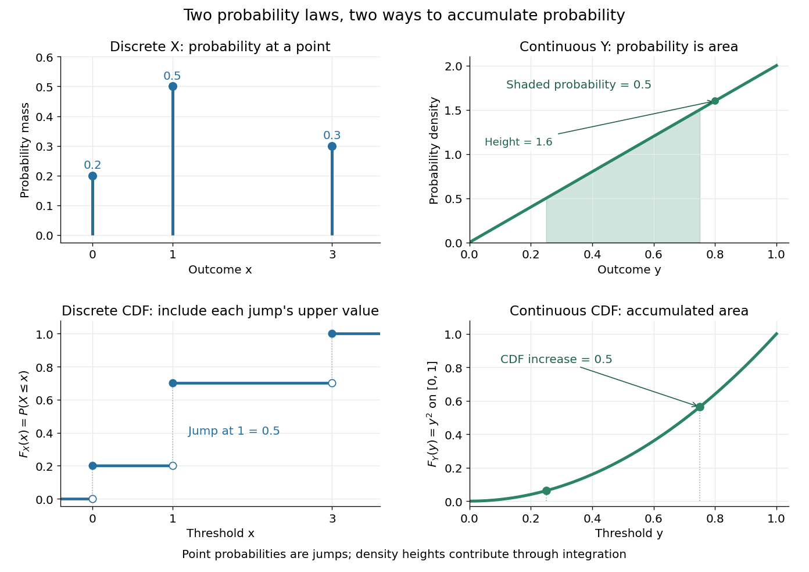
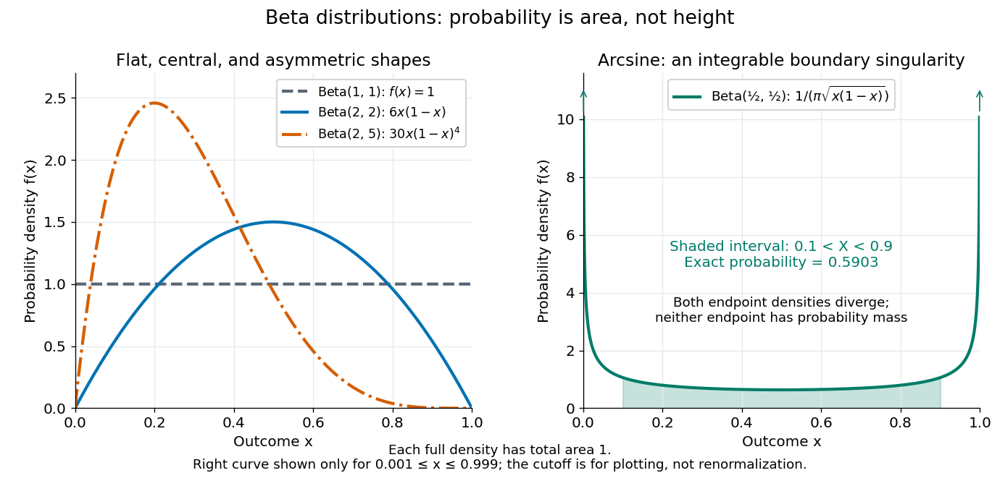
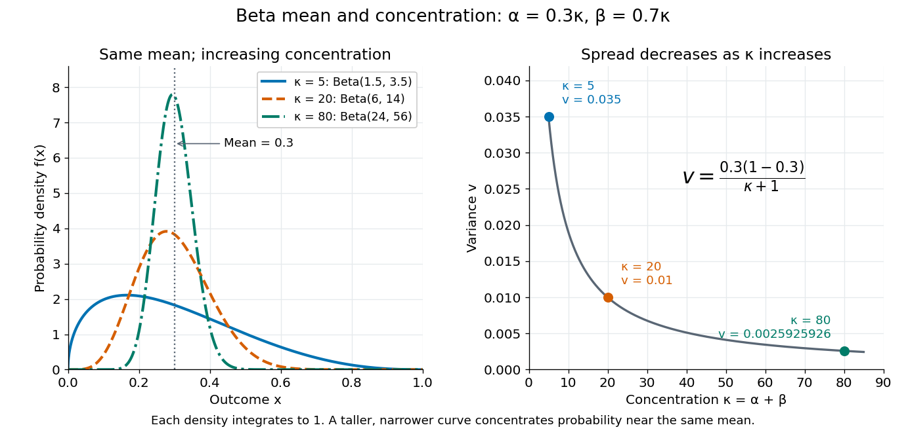
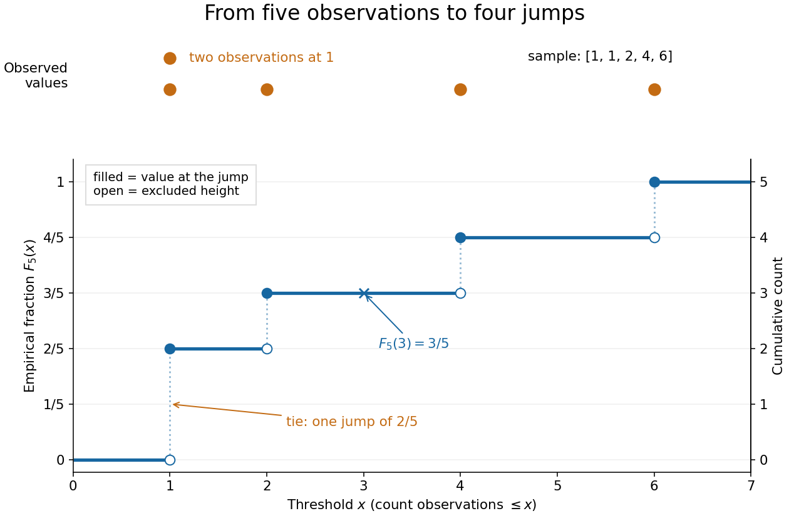
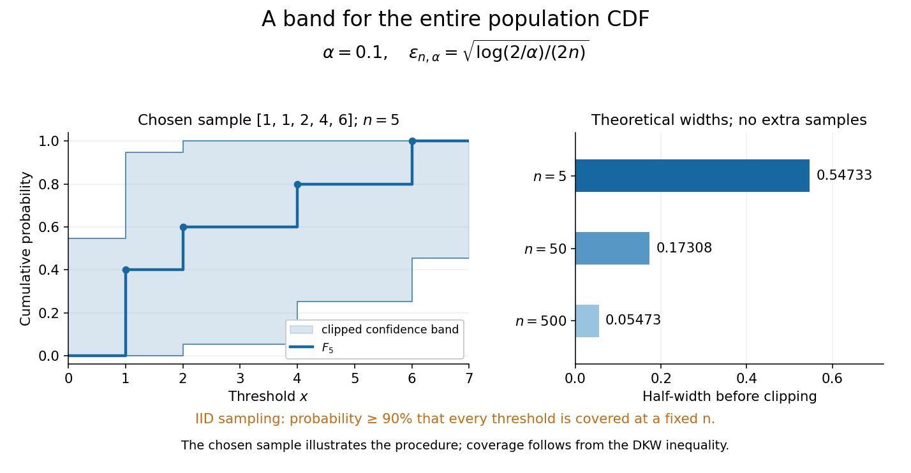
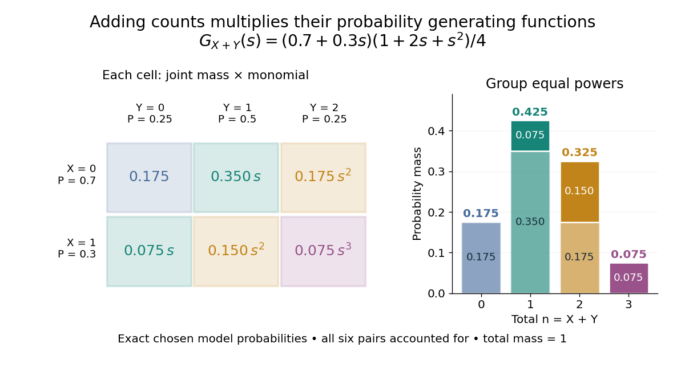
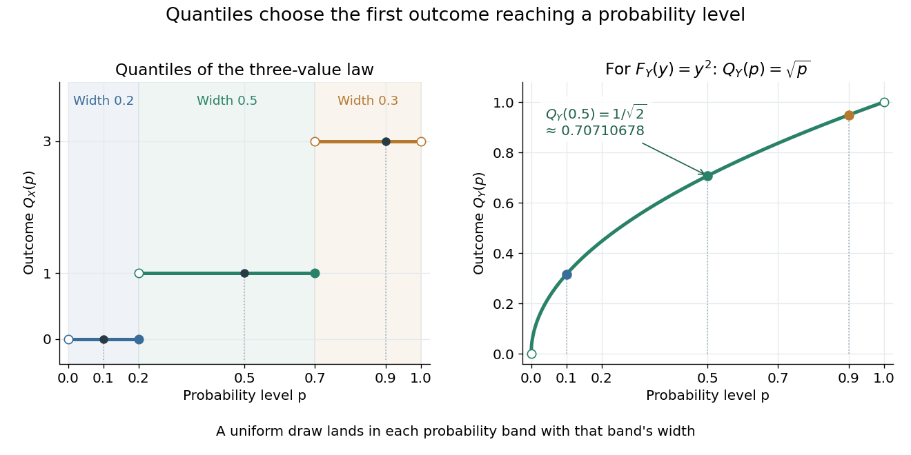

# Probability distribution

↑ **Parent:** [Probability theory](probability-theory.md)  
ⓦ [Wiki](https://en.wikipedia.org/wiki/Probability_distribution)

A [probability distribution](probability-distribution.md) describes how the values of a [random variable](random-variable.md) are allocated among possible outcomes. More precisely, the [law of a random variable](probability-distribution.md) $X$ assigns each [measurable set](measure-theory.md#measurable-set) $B$ the [probability](probability-theory.md#probability)

$$
\mu_X(B)=\mathbb P(X\in B).
$$

It is a [probability measure](probability-space.md#probability-measure) on the values of $X$. The underlying experiment can be more elaborate than the output: different experiments may produce the same [probability distribution](probability-distribution.md). The [law of a random variable](probability-distribution.md) retains the probabilities needed to answer questions about that output. [MIT Fundamentals of Probability, Lecture 4: random variables and their laws](https://ocw.mit.edu/courses/6-436j-fundamentals-of-probability-fall-2018/9797310bed4c7f5b5d40d007783eec8d_MIT6_436JF18_lec04.pdf).

For a finite example, let $X$ take values $0,1,3$ with [probability mass function](#probability-mass-function) $p_X(0)=0.2$, $p_X(1)=0.5$, $p_X(3)=0.3$. Its probabilities sum to one. The event $0<X\leq1$ has probability $0.5$, whereas $0\leq X\leq1$ has probability $0.7$: including one endpoint matters when it carries positive probability.

For a contrasting [random variable](random-variable.md) $Y$, choose the [probability density function](continuous-probability-distribution.md#probability-density-function) $f_Y(y)=2y$ on $0\leq y\leq1$, and zero elsewhere. It integrates to one. Now $\mathbb P(1/4<Y\leq3/4)=\int_{1/4}^{3/4}2y\,dy=1/2$, while every single outcome has probability zero. The [probability density function](continuous-probability-distribution.md#probability-density-function) can have height $f_Y(0.8)=1.6$: probabilities come from [integrals](integral.md) over outcome ranges.

**[Figure 1](#image-probability-masses-and-densities-accumulate-into-cumulative-distribution-functions). Probability masses and densities accumulate into cumulative distribution functions**. Left: $X$ takes values $0,1,3$ with [probability masses](#probability-mass) $0.2,0.5,0.3$, so its [cumulative distribution function](#cumulative-distribution-function) jumps at those values; open and filled markers show the excluded and included heights at a jump. Right: $Y$ has [probability density function](continuous-probability-distribution.md#probability-density-function) $2y$ on the [interval](real-analysis.md#interval-mathematics) $[0,1]$ and [cumulative distribution function](#cumulative-distribution-function) $y^2$ there. The shaded [integral](integral.md) over $(1/4,3/4]$ and the corresponding [cumulative distribution function](#cumulative-distribution-function) increase both equal $1/2$.

The [cumulative distribution function](#cumulative-distribution-function) answers all threshold questions for a real [random variable](random-variable.md), regardless of whether there are jumps or a [probability density function](continuous-probability-distribution.md#probability-density-function). A [quantile function](#quantile-function) reverses the direction of the question: given a cumulative probability level, find a threshold. This connects descriptive summaries to [inverse transform sampling](#inverse-transform-sampling), which constructs a chosen [probability distribution](probability-distribution.md) from a [uniform distribution](continuous-probability-distribution.md#continuous-uniform-distribution).

**Table of contents**

- [Normalization of a probability distribution](#normalization-of-a-probability-distribution)
- [Mixed probability distribution](#mixed-probability-distribution)
  - [Mixture of a point mass and an exponential distribution](#mixture-of-a-point-mass-and-an-exponential-distribution)
  - [Uniform distribution with an atom at zero](#uniform-distribution-with-an-atom-at-zero)
- [Probability mass](#probability-mass)
- [Heavy-tailed distribution](#heavy-tailed-distribution)
  - [Subexponential distribution (heavy-tailed)](#subexponential-distribution-heavy-tailed)
- [Infinite divisibility (probability)](#infinite-divisibility-probability)
- [Predictive distribution](#predictive-distribution)
- [Non-degenerate probability distribution](#non-degenerate-probability-distribution)
- [Support of a probability distribution](#support-of-a-probability-distribution)
  - [Effort support](#effort-support)
- [Kurtosis](#kurtosis)
  - [Excess kurtosis](#excess-kurtosis)
  - [Rare-outlier three-point distribution](#rare-outlier-three-point-distribution)
  - [Affine invariance of kurtosis](#affine-invariance-of-kurtosis)
  - [Central contribution to kurtosis](#central-contribution-to-kurtosis)
- [Integrated tail distribution](#integrated-tail-distribution)
- [Mixture distribution](#mixture-distribution)
  - [Gaussian mixture distribution](#gaussian-mixture-distribution)
  - [Symmetric rational mixture sampler](#symmetric-rational-mixture-sampler)
  - [Hyperexponential distribution](#hyperexponential-distribution)
- [Nonarithmetic distribution](#nonarithmetic-distribution)
- [Right endpoint of a distribution](#right-endpoint-of-a-distribution)
- [Joint probability distribution](#joint-probability-distribution)
  - [Exchangeable random variables](#exchangeable-random-variables)
    - [De Finetti theorem](#de-finetti-theorem)
    - [Invariant sigma-algebra of an exchangeable sequence](#invariant-sigma-algebra-of-an-exchangeable-sequence)
      - [Exchangeable invariant events are tail events modulo null sets](#exchangeable-invariant-events-are-tail-events-modulo-null-sets)
  - [Convolution of independent random variables](#convolution-of-independent-random-variables)
    - [Gaussian smoothing of an integer-valued distribution](#gaussian-smoothing-of-an-integer-valued-distribution)
    - [Convolution of a Cauchy distribution and a uniform distribution](#convolution-of-a-cauchy-distribution-and-a-uniform-distribution)
    - [Taxi distance convolution on a rectangular road cycle](#taxi-distance-convolution-on-a-rectangular-road-cycle)
  - [Marginal distribution](#marginal-distribution)
    - [Marginalization](#marginalization)
    - [Marginal density](#marginal-density)
- [Symmetric probability distribution](#symmetric-probability-distribution)
  - [Centrally symmetric probability distribution](#centrally-symmetric-probability-distribution)
  - [Rademacher distribution](#rademacher-distribution)
    - [Rademacher function](#rademacher-function)
    - [Rademacher sum](#rademacher-sum)
      - [Dyadic Rademacher series](#dyadic-rademacher-series)
    - [Bernoulli function (hypercube)](#bernoulli-function-hypercube)
    - [Maximum of finitely many Rademacher linear forms](#maximum-of-finitely-many-rademacher-linear-forms)
- [Truncated distribution](#truncated-distribution)
  - [Truncated exponential distribution](#truncated-exponential-distribution)
  - [Upper-endpoint estimation in a truncated distribution](#upper-endpoint-estimation-in-a-truncated-distribution)
  - [Zero-truncated claim-count distribution](#zero-truncated-claim-count-distribution)
    - [Aggregate recursion for zero-truncated Panjer counts](#aggregate-recursion-for-zero-truncated-panjer-counts)
  - [Truncated normal distribution](#truncated-normal-distribution)
    - [Sign-truncated normal sampling](#sign-truncated-normal-sampling)
- [Beta distribution](#beta-distribution)
  - [Moment matching for a beta prior](#moment-matching-for-a-beta-prior)
  - [Beta sampling by uniform order statistics](#beta-sampling-by-uniform-order-statistics)
  - [Beta sampling by gamma ratios](#beta-sampling-by-gamma-ratios)
- [Cumulative distribution function](#cumulative-distribution-function)
  - [Integrated cumulative distribution function on a bounded interval](#integrated-cumulative-distribution-function-on-a-bounded-interval)
  - [Singular distribution functions have zero derivative almost everywhere](#singular-distribution-functions-have-zero-derivative-almost-everywhere)
  - [Kolmogorov distance](#kolmogorov-distance)
    - [Lattice obstruction to normal approximation](#lattice-obstruction-to-normal-approximation)
  - [Probability integral transform](#probability-integral-transform)
    - [Sequential probability integral transform](#sequential-probability-integral-transform)
  - [Uniform convergence of distribution functions to a continuous limit](#uniform-convergence-of-distribution-functions-to-a-continuous-limit)
  - [Empirical distribution function](#empirical-distribution-function)
    - [Dvoretzky-Kiefer-Wolfowitz inequality](#dvoretzky-kiefer-wolfowitz-inequality)
    - [Simultaneous empirical distribution confidence band](#simultaneous-empirical-distribution-confidence-band)
    - [Anderson–Darling test](#anderson-darling-test)
    - [Cramér–von Mises criterion](#cramer-von-mises-criterion)
    - [Empirical distribution process](#empirical-distribution-process)
      - [Donsker theorem for empirical distribution functions](#donsker-theorem-for-empirical-distribution-functions)
      - [Finite-dimensional Brownian bridge limit of an empirical distribution process](#finite-dimensional-brownian-bridge-limit-of-an-empirical-distribution-process)
- [Cauchy distribution](#cauchy-distribution)
  - [Cauchy convolution semigroup](#cauchy-convolution-semigroup)
  - [Tangent of a uniform angle has a Cauchy distribution](#tangent-of-a-uniform-angle-has-a-cauchy-distribution)
  - [Cauchy sample mean has an unchanged distribution](#cauchy-sample-mean-has-an-unchanged-distribution)
  - [Half-Cauchy distribution](#half-cauchy-distribution)
  - [Standard Cauchy distribution](#standard-cauchy-distribution)
    - [Cauchy law of an infinite-horizon Brownian exponential integral](#cauchy-law-of-an-infinite-horizon-brownian-exponential-integral)
  - [Characteristic function of the Cauchy distribution](#characteristic-function-of-the-cauchy-distribution)
  - [Cauchy random variable](#cauchy-random-variable)
  - [Stability of the Cauchy distribution](#stability-of-the-cauchy-distribution)
  - [Stable distribution](#stable-distribution)
    - [Symmetric stable distribution](#symmetric-stable-distribution)
      - [Cosine integral for a symmetric stable exponent](#cosine-integral-for-a-symmetric-stable-exponent)
    - [Strictly stable distribution](#strictly-stable-distribution)
- [Probability generating function](#probability-generating-function)
  - [Coefficient recovery and factorial moments of a probability generating function](#coefficient-recovery-and-factorial-moments-of-a-probability-generating-function)
  - [Probability generating function of an independent sum](#probability-generating-function-of-an-independent-sum)
  - [Probability generating function of an independent random sum](#probability-generating-function-of-an-independent-random-sum)
  - [Redistribution of polynomial factors for dice](#redistribution-of-polynomial-factors-for-dice)
  - [Dirichlet probability generating function](#dirichlet-probability-generating-function)
- [Probability mass function](#probability-mass-function)
- [Quantile function](#quantile-function)
  - [Percentile](#percentile)
  - [Probable error](#probable-error)
  - [Sample quantile](#sample-quantile)
  - [Quantile endpoint at probability one](#quantile-endpoint-at-probability-one)
  - [Left continuity of the quantile function](#left-continuity-of-the-quantile-function)
  - [Quantile derivative identity](#quantile-derivative-identity)
  - [Inverse transform sampling](#inverse-transform-sampling)
    - [Recycling a uniform random variable after discrete sampling](#recycling-a-uniform-random-variable-after-discrete-sampling)
  - [Quantile coupling for convergence in distribution](#quantile-coupling-for-convergence-in-distribution)
- [Continuous probability distribution](continuous-probability-distribution.md)
  - [Cantor distribution](continuous-probability-distribution.md#cantor-distribution)
  - [Distance between two uniform points in a three-dimensional ball](continuous-probability-distribution.md#distance-between-two-uniform-points-in-a-three-dimensional-ball)
  - [Beta-prime distribution](continuous-probability-distribution.md#beta-prime-distribution)
  - [Triangular distribution](continuous-probability-distribution.md#triangular-distribution)
    - [Difference of two independent uniform random variables](continuous-probability-distribution.md#difference-of-two-independent-uniform-random-variables)
  - [Arcsine distribution](continuous-probability-distribution.md#arcsine-distribution)
    - [Arcsine distribution from a uniform angle](continuous-probability-distribution.md#arcsine-distribution-from-a-uniform-angle)
    - [Endpoint concentration in the arcsine distribution](continuous-probability-distribution.md#endpoint-concentration-in-the-arcsine-distribution)
    - [Arcsine quantiles and moments](continuous-probability-distribution.md#arcsine-quantiles-and-moments)
    - [Arcsine distribution on a bounded interval](continuous-probability-distribution.md#arcsine-distribution-on-a-bounded-interval)
  - [Log-uniform distribution](continuous-probability-distribution.md#log-uniform-distribution)
  - [Pareto distribution](continuous-probability-distribution.md#pareto-distribution)
    - [One-big-jump polynomial lower bound](continuous-probability-distribution.md#one-big-jump-polynomial-lower-bound)
    - [Pareto moment threshold](continuous-probability-distribution.md#pareto-moment-threshold)
    - [Pareto tail conditional scaling](continuous-probability-distribution.md#pareto-tail-conditional-scaling)
    - [Pareto top shares and the 80/20 rule](continuous-probability-distribution.md#pareto-top-shares-and-the-80-20-rule)
  - [Rayleigh distribution](continuous-probability-distribution.md#rayleigh-distribution)
    - [Rayleigh radius from Gaussian components](continuous-probability-distribution.md#rayleigh-radius-from-gaussian-components)
    - [Rayleigh radial thresholds and quantiles](continuous-probability-distribution.md#rayleigh-radial-thresholds-and-quantiles)
    - [Squared Rayleigh radius](continuous-probability-distribution.md#squared-rayleigh-radius)
    - [Rayleigh moments](continuous-probability-distribution.md#rayleigh-moments)
    - [Random-phase amplitude and the Rayleigh distribution](continuous-probability-distribution.md#random-phase-amplitude-and-the-rayleigh-distribution)
  - [Hypoexponential distribution](continuous-probability-distribution.md#hypoexponential-distribution)
    - [Sum of exponential variables with linearly increasing rates](continuous-probability-distribution.md#sum-of-exponential-variables-with-linearly-increasing-rates)
    - [Conditional split of two exponential times](continuous-probability-distribution.md#conditional-split-of-two-exponential-times)
  - [Student's t-distribution](continuous-probability-distribution.md#student-s-t-distribution)
    - [Normal scale mixture representation of Student t](continuous-probability-distribution.md#normal-scale-mixture-representation-of-student-t)
    - [Noncentral t-distribution](continuous-probability-distribution.md#noncentral-t-distribution)
    - [Studentized normal sample mean](continuous-probability-distribution.md#studentized-normal-sample-mean)
      - [Small normal sample mean confidence interval](continuous-probability-distribution.md#small-normal-sample-mean-confidence-interval)
    - [History of Student's t-distribution](continuous-probability-distribution.md#history-of-student-s-t-distribution)
  - [F-distribution](continuous-probability-distribution.md#f-distribution)
  - [Absolutely continuous probability distribution](continuous-probability-distribution.md#absolutely-continuous-probability-distribution)
    - [Probability density function](continuous-probability-distribution.md#probability-density-function)
      - [Change of variables for probability densities](continuous-probability-distribution.md#change-of-variables-for-probability-densities)
      - [Central angle between independent uniform sphere points](continuous-probability-distribution.md#central-angle-between-independent-uniform-sphere-points)
        - [Connectivity of three acute-angle sphere points](continuous-probability-distribution.md#connectivity-of-three-acute-angle-sphere-points)
        - [Pairwise acute central angles of three uniform sphere points](continuous-probability-distribution.md#pairwise-acute-central-angles-of-three-uniform-sphere-points)
      - [Normalizing constant](continuous-probability-distribution.md#normalizing-constant)
      - [Density ratio](continuous-probability-distribution.md#density-ratio)
      - [Log-concave probability density](continuous-probability-distribution.md#log-concave-probability-density)
      - [Lipschitz density height bound](continuous-probability-distribution.md#lipschitz-density-height-bound)
      - [Joint probability density](continuous-probability-distribution.md#joint-probability-density)
      - [Change-of-variables formula for a probability density](continuous-probability-distribution.md#change-of-variables-formula-for-a-probability-density)
  - [Gamma distribution](continuous-probability-distribution.md#gamma-distribution)
    - [Wilson-Hilferty transformation](continuous-probability-distribution.md#wilson-hilferty-transformation)
    - [Shifted gamma distribution](continuous-probability-distribution.md#shifted-gamma-distribution)
    - [Beta-gamma independence](continuous-probability-distribution.md#beta-gamma-independence)
    - [Additivity of independent gamma distributions with a common rate](continuous-probability-distribution.md#additivity-of-independent-gamma-distributions-with-a-common-rate)
    - [Gamma exponential dispersion family](continuous-probability-distribution.md#gamma-exponential-dispersion-family)
    - [Cumulant-generating function of a gamma distribution](continuous-probability-distribution.md#cumulant-generating-function-of-a-gamma-distribution)
    - [Inverse-gamma distribution](continuous-probability-distribution.md#inverse-gamma-distribution)
      - [Gamma prior for an inverse-gamma scale](continuous-probability-distribution.md#gamma-prior-for-an-inverse-gamma-scale)
    - [Erlang distribution](continuous-probability-distribution.md#erlang-distribution)
    - [Sampling an integer-shape gamma distribution](continuous-probability-distribution.md#sampling-an-integer-shape-gamma-distribution)
  - [Dirichlet distribution](continuous-probability-distribution.md#dirichlet-distribution)
  - [Exponential distribution](continuous-probability-distribution.md#exponential-distribution)
    - [Exponential clock](continuous-probability-distribution.md#exponential-clock)
    - [Slow exponential plus an exponential sample mean](continuous-probability-distribution.md#slow-exponential-plus-an-exponential-sample-mean)
    - [Maximum of two exponentials as a scaled sum](continuous-probability-distribution.md#maximum-of-two-exponentials-as-a-scaled-sum)
    - [Integer and fractional parts of an exponential variable](continuous-probability-distribution.md#integer-and-fractional-parts-of-an-exponential-variable)
    - [Laplace transform of an exponential distribution](continuous-probability-distribution.md#laplace-transform-of-an-exponential-distribution)
    - [Memorylessness of the exponential distribution](continuous-probability-distribution.md#memorylessness-of-the-exponential-distribution)
    - [Uniform ratio of independent exponential variables](continuous-probability-distribution.md#uniform-ratio-of-independent-exponential-variables)
    - [Competing exponential clocks](continuous-probability-distribution.md#competing-exponential-clocks)
      - [Positive difference of independent exponential waiting times](continuous-probability-distribution.md#positive-difference-of-independent-exponential-waiting-times)
    - [Geometric sum of exponential variables](continuous-probability-distribution.md#geometric-sum-of-exponential-variables)
  - [Continuous uniform distribution](continuous-probability-distribution.md#continuous-uniform-distribution)
    - [Coverage of antipodal points by a randomly oriented sector](continuous-probability-distribution.md#coverage-of-antipodal-points-by-a-randomly-oriented-sector)
    - [Random quadratic with uniform coefficients](continuous-probability-distribution.md#random-quadratic-with-uniform-coefficients)
    - [Uniform random variable](continuous-probability-distribution.md#uniform-random-variable)
    - [Steinhaus random variable](continuous-probability-distribution.md#steinhaus-random-variable)
      - [Steinhaus first-moment lower bound](continuous-probability-distribution.md#steinhaus-first-moment-lower-bound)
    - [Squared uniform distribution](continuous-probability-distribution.md#squared-uniform-distribution)
    - [Sum of two independent uniform variables](continuous-probability-distribution.md#sum-of-two-independent-uniform-variables)
    - [Uniform split of a random total](continuous-probability-distribution.md#uniform-split-of-a-random-total)
      - [Exponential characterization by a uniform random split](continuous-probability-distribution.md#exponential-characterization-by-a-uniform-random-split)
  - [Laplace distribution](continuous-probability-distribution.md#laplace-distribution)
    - [Laplace location and scale maximum likelihood](continuous-probability-distribution.md#laplace-location-and-scale-maximum-likelihood)
      - [Laplace median robustness example](continuous-probability-distribution.md#laplace-median-robustness-example)
    - [Laplace prior for sparse images](continuous-probability-distribution.md#laplace-prior-for-sparse-images)
    - [Laplace regression](continuous-probability-distribution.md#laplace-regression)
- [Discrete probability distribution](discrete-probability-distribution.md)
  - [Benford law](discrete-probability-distribution.md#benford-law)
    - [Scale invariance of decimal significands](discrete-probability-distribution.md#scale-invariance-of-decimal-significands)
      - [Decimal significand](discrete-probability-distribution.md#decimal-significand)
    - [Benford law from logarithmic uniformity](discrete-probability-distribution.md#benford-law-from-logarithmic-uniformity)
    - [Benford frequencies for powers of an integer](discrete-probability-distribution.md#benford-frequencies-for-powers-of-an-integer)
  - [Discrete uniform distribution](discrete-probability-distribution.md#discrete-uniform-distribution)
    - [Discrete uniform moments on an integer interval](discrete-probability-distribution.md#discrete-uniform-moments-on-an-integer-interval)
    - [Sampling a discrete uniform distribution](discrete-probability-distribution.md#sampling-a-discrete-uniform-distribution)
    - [Nondecreasing uniform samples](discrete-probability-distribution.md#nondecreasing-uniform-samples)
  - [Bernoulli distribution](discrete-probability-distribution.md#bernoulli-distribution)
    - [Bernoulli string](discrete-probability-distribution.md#bernoulli-string)
    - [Estimating Bernoulli variance](discrete-probability-distribution.md#estimating-bernoulli-variance)
    - [Bernoulli trial](discrete-probability-distribution.md#bernoulli-trial)
    - [Bernoulli thinning](discrete-probability-distribution.md#bernoulli-thinning)
  - [Geometric distribution](discrete-probability-distribution.md#geometric-distribution)
    - [Geometric continuation after an initial tie](discrete-probability-distribution.md#geometric-continuation-after-an-initial-tie)
    - [Memorylessness of the geometric distribution](discrete-probability-distribution.md#memorylessness-of-the-geometric-distribution)
    - [Geometric success deadline](discrete-probability-distribution.md#geometric-success-deadline)
    - [Geometric return count before absorption](discrete-probability-distribution.md#geometric-return-count-before-absorption)
    - [Geometric count under Bernoulli thinning](discrete-probability-distribution.md#geometric-count-under-bernoulli-thinning)
    - [Capped geometric waiting time](discrete-probability-distribution.md#capped-geometric-waiting-time)
    - [Coupon collector problem](discrete-probability-distribution.md#coupon-collector-problem)
      - [Poissonized coupon completion time and count](discrete-probability-distribution.md#poissonized-coupon-completion-time-and-count)
      - [Waiting time to observe both Bernoulli outcomes](discrete-probability-distribution.md#waiting-time-to-observe-both-bernoulli-outcomes)
      - [Coupon collector waiting-time variance](discrete-probability-distribution.md#coupon-collector-waiting-time-variance)
  - [Negative binomial distribution](discrete-probability-distribution.md#negative-binomial-distribution)
    - [Negative binomial stopping argument](discrete-probability-distribution.md#negative-binomial-stopping-argument)
      - [Success-count and waiting-time duality](discrete-probability-distribution.md#success-count-and-waiting-time-duality)
      - [Success-failure stopping identity](discrete-probability-distribution.md#success-failure-stopping-identity)
      - [Match win probability with a fixed winning score](discrete-probability-distribution.md#match-win-probability-with-a-fixed-winning-score)
    - [Poisson-gamma mixture](discrete-probability-distribution.md#poisson-gamma-mixture)
  - [Binomial distribution](discrete-probability-distribution.md#binomial-distribution)
    - [Squared discrepancy of a digit frequency](discrete-probability-distribution.md#squared-discrepancy-of-a-digit-frequency)
    - [Binomial count](discrete-probability-distribution.md#binomial-count)
    - [Binomial probability mass](discrete-probability-distribution.md#binomial-probability-mass)
    - [Binomial tail probability](discrete-probability-distribution.md#binomial-tail-probability)
    - [Tie probability for independent binomial counts](discrete-probability-distribution.md#tie-probability-for-independent-binomial-counts)
    - [Binomial probability](discrete-probability-distribution.md#binomial-probability)
    - [Conditional composition of two independent binomial counts](discrete-probability-distribution.md#conditional-composition-of-two-independent-binomial-counts)
    - [Binomial proportion](discrete-probability-distribution.md#binomial-proportion)
      - [Grouped Bernoulli failure counts](discrete-probability-distribution.md#grouped-bernoulli-failure-counts)
    - [Zero-event binomial upper confidence bound](discrete-probability-distribution.md#zero-event-binomial-upper-confidence-bound)
    - [Zero-truncated binomial distribution](discrete-probability-distribution.md#zero-truncated-binomial-distribution)
    - [Fourth centered moment of a binomial distribution](discrete-probability-distribution.md#fourth-centered-moment-of-a-binomial-distribution)
    - [Sample proportion](discrete-probability-distribution.md#sample-proportion)
    - [Binomial likelihood](discrete-probability-distribution.md#binomial-likelihood)
  - [Hypergeometric distribution](discrete-probability-distribution.md#hypergeometric-distribution)
    - [Finite population correction](discrete-probability-distribution.md#finite-population-correction)
    - [Multivariate hypergeometric distribution](discrete-probability-distribution.md#multivariate-hypergeometric-distribution)
  - [Multinomial distribution](discrete-probability-distribution.md#multinomial-distribution)
    - [Multinomial aggregation](discrete-probability-distribution.md#multinomial-aggregation)
    - [Constrained Poisson and multinomial likelihood equivalence](discrete-probability-distribution.md#constrained-poisson-and-multinomial-likelihood-equivalence)
    - [Negative multinomial distribution](discrete-probability-distribution.md#negative-multinomial-distribution)
      - [Finite-sample bias in a negative multinomial probability estimator](discrete-probability-distribution.md#finite-sample-bias-in-a-negative-multinomial-probability-estimator)
    - [Multinomial central limit theorem](discrete-probability-distribution.md#multinomial-central-limit-theorem)
    - [Uniform balls-in-bins allocation](discrete-probability-distribution.md#uniform-balls-in-bins-allocation)
      - [Poisson limit for occupancy fractions](discrete-probability-distribution.md#poisson-limit-for-occupancy-fractions)
    - [Multinomial likelihood](discrete-probability-distribution.md#multinomial-likelihood)
      - [Multinomial deviance](discrete-probability-distribution.md#multinomial-deviance)
    - [Categorical distribution](discrete-probability-distribution.md#categorical-distribution)
  - [Poisson binomial distribution](discrete-probability-distribution.md#poisson-binomial-distribution)
    - [Poisson-binomial random variable](discrete-probability-distribution.md#poisson-binomial-random-variable)
  - [Poisson distribution](discrete-probability-distribution.md#poisson-distribution)
    - [Skellam distribution](discrete-probability-distribution.md#skellam-distribution)
    - [Mixed Poisson distribution](discrete-probability-distribution.md#mixed-poisson-distribution)
      - [Overdispersion of nondegenerate mixed Poisson counts](discrete-probability-distribution.md#overdispersion-of-nondegenerate-mixed-poisson-counts)
      - [Posterior mean from adjacent mixed Poisson probabilities](discrete-probability-distribution.md#posterior-mean-from-adjacent-mixed-poisson-probabilities)
    - [Poisson entropy monotonicity](discrete-probability-distribution.md#poisson-entropy-monotonicity)
    - [Stein-Chen method](discrete-probability-distribution.md#stein-chen-method)
      - [Stein-Chen bound with the Poisson Stein factor](discrete-probability-distribution.md#stein-chen-bound-with-the-poisson-stein-factor)
      - [Poisson approximation with dependency neighborhoods](discrete-probability-distribution.md#poisson-approximation-with-dependency-neighborhoods)
      - [Poisson Stein equation](discrete-probability-distribution.md#poisson-stein-equation)
    - [Poisson size-bias identity](discrete-probability-distribution.md#poisson-size-bias-identity)
    - [Upper-truncated Poisson distribution](discrete-probability-distribution.md#upper-truncated-poisson-distribution)
    - [Poisson mixture](discrete-probability-distribution.md#poisson-mixture)
      - [Poisson-uniform posterior mean](discrete-probability-distribution.md#poisson-uniform-posterior-mean)
      - [Shifted-exponential Poisson mixture](discrete-probability-distribution.md#shifted-exponential-poisson-mixture)
        - [Shifted-exponential Poisson count recursion](discrete-probability-distribution.md#shifted-exponential-poisson-count-recursion)
    - [Zero-truncated Poisson distribution](discrete-probability-distribution.md#zero-truncated-poisson-distribution)
      - [Parity estimator for a zero-truncated Poisson count](discrete-probability-distribution.md#parity-estimator-for-a-zero-truncated-poisson-count)
    - [Addition of independent Poisson random variables](discrete-probability-distribution.md#addition-of-independent-poisson-random-variables)
    - [Poisson approximation bound for dependent Bernoulli variables](discrete-probability-distribution.md#poisson-approximation-bound-for-dependent-bernoulli-variables)
    - [Poisson observation model](discrete-probability-distribution.md#poisson-observation-model)
      - [Poisson observation](discrete-probability-distribution.md#poisson-observation)
    - [Zero-inflated Poisson distribution](discrete-probability-distribution.md#zero-inflated-poisson-distribution)
      - [Zero-inflated Poisson regression](discrete-probability-distribution.md#zero-inflated-poisson-regression)
        - [Posterior structural-zero probability](discrete-probability-distribution.md#posterior-structural-zero-probability)
        - [Component and marginal effects in zero-inflated regression](discrete-probability-distribution.md#component-and-marginal-effects-in-zero-inflated-regression)
        - [EM algorithm for zero-inflated Poisson regression](discrete-probability-distribution.md#em-algorithm-for-zero-inflated-poisson-regression)
    - [Poisson central limit theorem](discrete-probability-distribution.md#poisson-central-limit-theorem)
      - [Poisson cumulative probability at its growing mean](discrete-probability-distribution.md#poisson-cumulative-probability-at-its-growing-mean)
    - [Poisson-multinomial conditioning](discrete-probability-distribution.md#poisson-multinomial-conditioning)
      - [Poisson trick](discrete-probability-distribution.md#poisson-trick)
        - [Flat log-rate marginalization gives the multinomial likelihood](discrete-probability-distribution.md#flat-log-rate-marginalization-gives-the-multinomial-likelihood)
          - [Gaussian log-rate correction to the Poisson trick](discrete-probability-distribution.md#gaussian-log-rate-correction-to-the-poisson-trick)
    - [Normal approximation to the Poisson distribution](discrete-probability-distribution.md#normal-approximation-to-the-poisson-distribution)
- [Symmetric distribution](#symmetric-distribution)
- [Median](#median)
  - [Weighted median](#weighted-median)
  - [Median minimizes expected absolute loss](#median-minimizes-expected-absolute-loss)
  - [Sample median](#sample-median)
    - [Coordinatewise median](#coordinatewise-median)
- [Moment-generating function](#moment-generating-function)
  - [Dyadic rigidity of a moment-generating function](#dyadic-rigidity-of-a-moment-generating-function)
  - [Uniform consistency of an empirical moment-generating function](#uniform-consistency-of-an-empirical-moment-generating-function)
  - [Uniqueness theorem for moment-generating functions](#uniqueness-theorem-for-moment-generating-functions)
  - [Exponential moment](#exponential-moment)
  - [Cumulant-generating function](#cumulant-generating-function)
    - [Saddlepoint density approximation](#saddlepoint-density-approximation)
      - [Saddlepoint density of a Laplace sample mean](#saddlepoint-density-of-a-laplace-sample-mean)
      - [Lugannani-Rice saddlepoint tail approximation](#lugannani-rice-saddlepoint-tail-approximation)
      - [P-star approximation](#p-star-approximation)
        - [P-star density for two exponential rates](#p-star-density-for-two-exponential-rates)
        - [P-star density for an exponential mean](#p-star-density-for-an-exponential-mean)
        - [Ancillary-conditioned score density](#ancillary-conditioned-score-density)
      - [Polynomial tails prevent exponential tilting](#polynomial-tails-prevent-exponential-tilting)
    - [Cumulant](#cumulant)
    - [Cumulant expansion](#cumulant-expansion)
      - [Edgeworth series](#edgeworth-series)
        - [Symmetric Edgeworth coverage cancellation](#symmetric-edgeworth-coverage-cancellation)
        - [Cornish-Fisher expansion](#cornish-fisher-expansion)
    - [Legendre transform of a cumulant-generating function](#legendre-transform-of-a-cumulant-generating-function)
      - [Rademacher large-deviation rate function](#rademacher-large-deviation-rate-function)
    - [Cramér's theorem](#cramer-s-theorem)
      - [Poisson sample-mean rate function](#poisson-sample-mean-rate-function)
      - [Rate function of an exponential sample mean](#rate-function-of-an-exponential-sample-mean)
      - [Exponential sample-mean upper-tail rate](#exponential-sample-mean-upper-tail-rate)
      - [Conditional concentration at a large-deviation threshold](#conditional-concentration-at-a-large-deviation-threshold)
      - [Exponential tilting](#exponential-tilting)
        - [Mean under one-sided exponential tilting](#mean-under-one-sided-exponential-tilting)
- [Joint distribution function](#joint-distribution-function)
  - [Copula (probability theory)](#copula-probability-theory)
- [Normal distribution](#normal-distribution)
  - [Normality (statistics)](#normality-statistics)
  - [Gaussian characterization by independent sum and difference](#gaussian-characterization-by-independent-sum-and-difference)
  - [Normal density](#normal-density)
  - [Gaussian maximum](#gaussian-maximum)
    - [Gaussian maximum bound without independence](#gaussian-maximum-bound-without-independence)
  - [Gaussian fourth moment](#gaussian-fourth-moment)
  - [Linear combination of independent normal random variables](#linear-combination-of-independent-normal-random-variables)
  - [Multivariate Gaussian distribution](#multivariate-gaussian-distribution)
    - [Isserlis's theorem](#isserlis-s-theorem)
      - [Gaussian even-moment pairing count](#gaussian-even-moment-pairing-count)
    - [Linear combination of jointly normal random variables](#linear-combination-of-jointly-normal-random-variables)
  - [Mills ratio](#mills-ratio)
    - [Two-term bounds for Mills ratio](#two-term-bounds-for-mills-ratio)
    - [Inverse Mills ratio](#inverse-mills-ratio)
  - [Gaussian random variable](#gaussian-random-variable)
    - [Gaussian series with square-summable coefficients](#gaussian-series-with-square-summable-coefficients)
      - [Almost sure convergence criterion for an independent Gaussian series](#almost-sure-convergence-criterion-for-an-independent-gaussian-series)
        - [Threshold stopping of an independent Gaussian series](#threshold-stopping-of-an-independent-gaussian-series)
    - [Standard normal random variable](#standard-normal-random-variable)
  - [Moment-generating function of a normal distribution](#moment-generating-function-of-a-normal-distribution)
    - [Complex Gaussian exponential moment](#complex-gaussian-exponential-moment)
  - [Gaussian noise](#gaussian-noise)
  - [Product of two independent standard normal random variables](#product-of-two-independent-standard-normal-random-variables)
  - [Half-normal distribution](#half-normal-distribution)
    - [Radial-ratio independence of two half-normal variables](#radial-ratio-independence-of-two-half-normal-variables)
  - [Log-normal distribution](#log-normal-distribution)
    - [Shifted lognormal distribution](#shifted-lognormal-distribution)
    - [Truncated lognormal moment](#truncated-lognormal-moment)
  - [Stein's lemma (probability)](#stein-s-lemma-probability)
    - [Stein risk identity for normal mean estimators](#stein-risk-identity-for-normal-mean-estimators)
  - [Standard normal distribution](#standard-normal-distribution)
    - [Standard normal density](#standard-normal-density)
    - [Moment-generating function of a standard normal variable](#moment-generating-function-of-a-standard-normal-variable)
      - [Exponential moment of an absolute standard normal variable](#exponential-moment-of-an-absolute-standard-normal-variable)
    - [Standard normal distribution function](#standard-normal-distribution-function)
    - [Standard normal quantile](#standard-normal-quantile)
    - [Standardization of a normal random variable](#standardization-of-a-normal-random-variable)
- [Chi-squared distribution](#chi-squared-distribution)
  - [Radial moments of an isotropic Gaussian vector](#radial-moments-of-an-isotropic-gaussian-vector)
  - [Chi-bar-squared distribution](#chi-bar-squared-distribution)
  - [Noncentral chi-squared distribution](#noncentral-chi-squared-distribution)
    - [Reciprocal moment of a noncentral chi-squared variable](#reciprocal-moment-of-a-noncentral-chi-squared-variable)
  - [Chi-squared concentration inequality](#chi-squared-concentration-inequality)
    - [Chi-squared Chernoff lower-tail bound](#chi-squared-chernoff-lower-tail-bound)
  - [Moment-generating function of a chi-squared distribution](#moment-generating-function-of-a-chi-squared-distribution)
  - [Scaled inverse chi-squared distribution](#scaled-inverse-chi-squared-distribution)
  - [Chi-squared stochastic ordering](#chi-squared-stochastic-ordering)
  - [Chi-squared asymptotic approximation](#chi-squared-asymptotic-approximation)
- [Weibull distribution](#weibull-distribution)
  - [Unknown entry age in a Weibull survival segment](#unknown-entry-age-in-a-weibull-survival-segment)
- [Characteristic function of a uniform distribution](#characteristic-function-of-a-uniform-distribution)
  - [Dyadic cosine product](#dyadic-cosine-product)
  - [Small-argument sine product asymptotic](#small-argument-sine-product-asymptotic)
- [Variance of a uniform distribution](#variance-of-a-uniform-distribution)
- [Exponential survival probability](#exponential-survival-probability)

## Normalization of a probability distribution

↑ **Parent:** [Probability distribution](probability-distribution.md)

A [probability distribution](probability-distribution.md) assigns total [probability](probability-theory.md#probability) one to its [sample space](probability-space.md#sample-space). For a nonnegative [probability density function](continuous-probability-distribution.md#probability-density-function) this means that its [integral](integral.md) over the full domain equals one; for a [probability mass function](#probability-mass-function) the sum of its masses equals one. A nonnegative integrable function with positive finite integral can be divided by that integral to normalize it. A negative function cannot be a [probability density function](continuous-probability-distribution.md#probability-density-function) even if a formal manipulation purports to normalize it.

## Mixed probability distribution

↑ **Parent:** [Probability distribution](probability-distribution.md)

A [mixed probability distribution](#mixed-probability-distribution) combines a [discrete probability distribution](discrete-probability-distribution.md) with a [continuous probability distribution](continuous-probability-distribution.md). For example, put probability $1/4$ at zero and probability $3/4$ into a [uniform distribution](continuous-probability-distribution.md#continuous-uniform-distribution) on $(0,1)$. Its [cumulative distribution function](#cumulative-distribution-function) is $0$ for $x<0$, $1/4+3x/4$ for $0\leq x<1$, and $1$ for $x\geq1$. The jump at zero and the continuous increase both contribute; neither an ordinary [probability density function](continuous-probability-distribution.md#probability-density-function) alone nor a [probability mass function](#probability-mass-function) alone describes the whole law.

### Mixture of a point mass and an exponential distribution

↑ **Parent:** [Mixed probability distribution](#mixed-probability-distribution)

Let $c>0$, $0\leq p\leq1$ and $\lambda>0$. With probability $p$, take $Y=-c$; otherwise draw an [exponential distribution](continuous-probability-distribution.md#exponential-distribution) of rate $\lambda$. This [mixed probability distribution](#mixed-probability-distribution) has a negative atom and a continuous nonnegative component. Its moments are $\mathbb E[Y]=-pc+(1-p)/\lambda$ and $\mathbb E[Y^2]=pc^2+2(1-p)/\lambda^2$. The [law of total variance](probability-theory.md#law-of-total-variance) equivalently gives $\operatorname{Var}(Y)=(1-p)/\lambda^2+p(1-p)(c+1/\lambda)^2$.

When $p<1$, conditioning on $Y\geq0$ selects exactly the exponential component, so $P(Y\geq t\mid Y\geq0)=e^{-\lambda t}$ for $t\geq0$. An ordinary [probability density function](continuous-probability-distribution.md#probability-density-function) for the continuous component integrates to $1-p$, not one; the missing mass is the atom, not a normalization error.

### Uniform distribution with an atom at zero

↑ **Parent:** [Mixed probability distribution](#mixed-probability-distribution)

For $0\leq q\leq1$ and $r>0$, this [mixed probability distribution](#mixed-probability-distribution) has [probability mass](#probability-mass) $1-q$ at zero and ordinary [probability density function](continuous-probability-distribution.md#probability-density-function) $q/r$ on $(0,r)$. That ordinary density integrates to $q$, not to one; conditioned on $S>0$, the law is the [uniform distribution](continuous-probability-distribution.md#continuous-uniform-distribution) on $(0,r)$. Its [cumulative distribution function](#cumulative-distribution-function) is zero for $s<0$, $1-q+qs/r$ for $0\leq s<r$, and one for $s\geq r$.

For each positive integer $k$, integration gives $\mathbb E[S^k]=qr^k/(k+1)$. Thus the [expected value](expected-value.md) is $qr/2$ and the [variance](variance.md) is $qr^2/3-q^2r^2/4$. The nonzero atom contributes to normalization even though it contributes zero to positive moments. At $q=0$, conditioning on positive delay is undefined because the conditioning event has probability zero.

## Probability mass

↑ **Parent:** [Probability distribution](probability-distribution.md)

The [probability mass](#probability-mass) at an outcome $x$ is the probability of its [singleton](set.md#singleton-mathematics), $\mathbb P(X=x)$. It equals the jump $F_X(x)-F_X(x^-)$ of the [cumulative distribution function](#cumulative-distribution-function). For a [discrete probability distribution](discrete-probability-distribution.md) these masses form the [probability mass function](#probability-mass-function); a [continuous probability distribution](continuous-probability-distribution.md) gives every individual outcome mass zero. Positive [probability mass](#probability-mass) at a point is distinct from the height of a [probability density function](continuous-probability-distribution.md#probability-density-function).

## Heavy-tailed distribution

↑ **Parent:** [Probability distribution](probability-distribution.md)  
ⓦ [Wiki](https://en.wikipedia.org/wiki/Heavy-tailed_distribution)

In the right-tail convention, every positive exponential [moment](expected-value.md#moment) is infinite. This is a tail property, not the assertion that the [variance](variance.md) or all power moments must be infinite. A [heavy-tailed subexponential distribution](#subexponential-distribution-heavy-tailed) has the additional property that a sum's far tail is dominated by one large summand.

### Subexponential distribution (heavy-tailed)

↑ **Parent:** [Heavy-tailed distribution](#heavy-tailed-distribution)

For nonnegative [independent and identically distributed random variables](random-variable.md#independent-and-identically-distributed-random-variables) with unbounded support, this is the displayed two-summand tail asymptotic. The probability that the maximum exceeds $x$ is $1-F(x)^2\sim2\overline F(x)$, so the sum and maximum have asymptotically the same tail. This is the basic single-large-arrival effect relevant to [queue overflow](queueing-theory.md#queue-overflow). The concentration-theory [sub-exponential random variable](probability-and-statistics.md#subexponential-distribution-light-tailed) uses a separate light-tail convention.

## Infinite divisibility (probability)

↑ **Parent:** [Probability distribution](probability-distribution.md)  
ⓦ [Wiki](https://en.wikipedia.org/wiki/Infinite_divisibility_(probability))

A [probability distribution](probability-distribution.md) is infinitely divisible if, for every positive integer $n$, it is the distribution of a sum of $n$ [independent and identically distributed](random-variable.md#independent-and-identically-distributed-random-variables) [random variables](random-variable.md). Their common distribution may depend on $n$. A [normal distribution](#normal-distribution) has this property by dividing its [mean](expected-value.md) and [variance](variance.md) by $n$; a [Poisson distribution](discrete-probability-distribution.md#poisson-distribution) has it by dividing its rate. The unit-time law of a [Lévy process](stochastic-process.md#levy-process) is infinitely divisible because it is the sum of its increments on $n$ equal time intervals.

## Predictive distribution

↑ **Parent:** [Probability distribution](probability-distribution.md)

A probability law for a future observation conditional on currently available information. A [posterior predictive distribution](bayesian-statistics.md#posterior-predictive-distribution) integrates the observation model over the posterior distribution of unknown parameters; a plug-in predictive law instead fixes an estimate of those parameters.

## Non-degenerate probability distribution

↑ **Parent:** [Probability distribution](probability-distribution.md)

A [probability distribution](probability-distribution.md) is non-degenerate when it is not a point mass. This condition excludes constant limits in limit theorems and in the [maximum domain of attraction](extreme-value-theory.md#maximum-domain-of-attraction) of a [distribution function](#cumulative-distribution-function).

## Support of a probability distribution

↑ **Parent:** [Probability distribution](probability-distribution.md)

For a [probability measure](probability-space.md#probability-measure) on a [topological space](topology.md#topological-space), its support consists of the points whose every open neighborhood has positive probability. For a continuous effort distribution supported on an interval, every open subinterval of that interval has positive probability.

### Effort support

↑ **Parent:** [Support of a probability distribution](#support-of-a-probability-distribution)

An effort support is the [support of a probability distribution](#support-of-a-probability-distribution) used to randomize effort in a contest. The [all-pay indifference equation with random entry](game-theory.md#all-pay-indifference-equation-with-random-entry) determines this support together with its [distribution function](#cumulative-distribution-function).

## Kurtosis

↑ **Parent:** [Probability distribution](probability-distribution.md)

For a real [random variable](random-variable.md) $X$ with [mean](expected-value.md) $\mu=\mathbb EX$, finite positive [variance](variance.md) $0<\sigma^2=\operatorname{Var}(X)<\infty$, and finite [fourth moment](expected-value.md#fourth-moment), [kurtosis](#kurtosis) is the fourth [central moment](expected-value.md#central-moment) divided by the square of the [variance](variance.md):

$$
\kappa(X)=\frac{\mathbb E[(X-\mu)^4]}{\sigma^4}=\mathbb E[Z^4],\qquad Z=\frac{X-\mu}{\sigma}.
$$

The [standard score](probability-theory.md#standard-score) $Z$ measures distance from the [mean](expected-value.md) in [standard deviations](variance.md#standard-deviation). Its fourth power gives a value ten [standard deviations](variance.md#standard-deviation) away a weight $10^4=10000$ inside the [expected value](expected-value.md). Thus a small [probability mass](#probability-mass) far from the [mean](expected-value.md) can strongly affect [kurtosis](#kurtosis). It is useful for describing the contribution of extreme [standard scores](probability-theory.md#standard-score), but does not by itself describe the height or shape of a [probability density function](continuous-probability-distribution.md#probability-density-function) near its peak.[§2, Terminology, definition of κ; §4, counterexamples with different peaks; §5, central and tail contributions](mathematics-bibliography.md#kurtosis-as-peakedness-1905-2014-r-i-p-by-peter-h-westfall)

The [normal distribution](#normal-distribution) has [kurtosis](#kurtosis) $3$. A random scale can increase [kurtosis](#kurtosis) even when the [conditional distribution](probability-theory.md#conditional-distribution) is normal. A constant [random variable](random-variable.md) has zero [variance](variance.md), so this ratio is undefined. If the [variance](variance.md) is finite and positive but the fourth [central moment](expected-value.md#central-moment) is infinite, the ratio can be written $+\infty$ in an extended sense; it is not a finite [kurtosis](#kurtosis). If the [variance](variance.md) itself is infinite or the [mean](expected-value.md) is undefined, the displayed normalization is unavailable.

### Excess kurtosis

↑ **Parent:** [Kurtosis](#kurtosis)

[Excess kurtosis](#excess-kurtosis) subtracts $3$ from [kurtosis](#kurtosis), making the [normal distribution](#normal-distribution) baseline zero. The non-excess convention is sometimes called raw [kurtosis](#kurtosis); this still uses a fourth [central moment](expected-value.md#central-moment), not the uncentered [fourth moment](expected-value.md#fourth-moment) $\mathbb E[X^4]$. Software may report either [kurtosis](#kurtosis) or [excess kurtosis](#excess-kurtosis), so the convention must be stated.[§1.3.5.11, Alternative Definition of Kurtosis, normal baseline and software convention warning](mathematics-bibliography.md#nist-and-sematech-e-handbook-of-statistical-methods/1-3-5-11-measures-of-skewness-and-kurtosis)

For a [standard normal distribution](#standard-normal-distribution), the [moment-generating function of a standard normal variable](#moment-generating-function-of-a-standard-normal-variable) gives $\mathbb E[Z^4]=3$, hence [excess kurtosis](#excess-kurtosis) zero. For a [continuous uniform distribution](continuous-probability-distribution.md#continuous-uniform-distribution) on $[-\sqrt3,\sqrt3]$, the [mean](expected-value.md) is zero, the [variance](variance.md) is one, and direct [integration](integral.md) gives

$$
\kappa=\frac1{2\sqrt3}\int_{-\sqrt3}^{\sqrt3}z^4\,dz=\frac95,\qquad \gamma_2=-\frac65.
$$

The [rare-outlier three-point distribution](#rare-outlier-three-point-distribution) can instead have [kurtosis](#kurtosis) $100$ and [excess kurtosis](#excess-kurtosis) $97$ with [mean](expected-value.md) zero and [variance](variance.md) one. These are calculated properties of specified [probability distributions](probability-distribution.md), rather than a measured [statistic](statistical-inference.md#statistic).

**[Figure 2](#image-kurtosis-comparison-for-a-standard-normal-distribution-a-continuous-uniform-distribution-and-a-rare-outlier-three-point-distribution). Kurtosis comparison for a standard normal distribution, a continuous uniform distribution, and a rare-outlier three-point distribution**. The upper panels show [probability density functions](continuous-probability-distribution.md#probability-density-function) or a [probability mass function](#probability-mass-function); the lower panels show their contributions to the fourth [central moment](expected-value.md#central-moment). All three [probability distributions](probability-distribution.md) have [mean](expected-value.md) zero and [variance](variance.md) one. Areas in the continuous panels and sums in the discrete panels give [kurtosis](#kurtosis). The [standard normal distribution](#standard-normal-distribution) continues beyond the displayed window; density and mass heights have different meanings.

### Rare-outlier three-point distribution

↑ **Parent:** [Kurtosis](#kurtosis)

For $0<q\leq1$, put [probability mass](#probability-mass) $1-q$ at zero and $q/2$ at each of $-1$ and $1$. This [symmetric probability distribution](#symmetric-probability-distribution) has [mean](expected-value.md) zero. Its second and [fourth moments](expected-value.md#fourth-moment) are both $q$, because the nonzero outcomes have square and fourth power equal to one:

$$
\operatorname{Var}(X)=q,\qquad \mathbb E[X^4]=q,\qquad \kappa(X)=\frac{q}{q^2}=\frac1q.
$$

For $q=1/4$ the [kurtosis](#kurtosis) is $4$; for $q=1/100$ it is $100$. In the latter case $99\%$ of the [probability mass](#probability-mass) is at zero, yet all of the fourth [central moment](expected-value.md#central-moment) comes from the remaining $1\%$. The [standard score](probability-theory.md#standard-score) $Z=X/\sqrt q$ takes values $0$ and $\pm q^{-1/2}$, with [variance](variance.md) one. Each nonzero outcome contributes

$$
\frac q2\left(q^{-1/2}\right)^4=\frac1{2q}
$$

to [kurtosis](#kurtosis). At $q=1/100$, the two rare outcomes are ten [standard deviations](variance.md#standard-deviation) from the [mean](expected-value.md), and their contributions are $50+50=100$.

**[Figure 3](#image-probability-mass-and-fourth-moment-contributions-for-a-rare-outlier-three-point-distribution). Probability mass and fourth-moment contributions for a rare-outlier three-point distribution**. The left panels keep the original [support of a probability distribution](#support-of-a-probability-distribution) $\{-1,0,1\}$; the right panels use [standard scores](probability-theory.md#standard-score). A rare outcome can have small [probability mass](#probability-mass) but a large contribution to [kurtosis](#kurtosis). Each row is a different specified [probability distribution](probability-distribution.md), not a [statistical sample](statistical-inference.md#statistical-sample).

Every member has finite [support of a probability distribution](#support-of-a-probability-distribution), so all its [moments](expected-value.md#moment) are finite. Nevertheless, [kurtosis](#kurtosis) becomes arbitrarily large as $q$ approaches zero: high [kurtosis](#kurtosis) does not require an unbounded [support of a probability distribution](#support-of-a-probability-distribution) or a [heavy-tailed distribution](#heavy-tailed-distribution). At $q=0$ the [variance](variance.md) vanishes and [kurtosis](#kurtosis) is undefined. At $q=1/3$ this discrete [probability distribution](probability-distribution.md) even has the [normal distribution](#normal-distribution) value $\kappa=3$ and [excess kurtosis](#excess-kurtosis) zero, so those values do not establish a [normal distribution](#normal-distribution).

### Affine invariance of kurtosis

↑ **Parent:** [Kurtosis](#kurtosis)

Changing units or shifting the origin preserves [kurtosis](#kurtosis). For real constants $a\ne0$ and $b$, the [mean](expected-value.md) of $Y=aX+b$ is $a\mu+b$, its [variance](variance.md) is $a^2\sigma^2$, and its fourth [central moment](expected-value.md#central-moment) is $a^4\mathbb E[(X-\mu)^4]$. The factors $a^4$ cancel in the ratio, even for negative $a$. Hence [excess kurtosis](#excess-kurtosis) is also unchanged. For example, $100X+7$ and $X$ have the same [kurtosis](#kurtosis), although their [means](expected-value.md) and [variances](variance.md) differ. The case $a=0$ produces zero [variance](variance.md) and is excluded.

### Central contribution to kurtosis

↑ **Parent:** [Kurtosis](#kurtosis)

For a [standard score](probability-theory.md#standard-score) $Z$ and $h>0$, split [kurtosis](#kurtosis) into the contribution $C_h$ from within $h$ [standard deviations](variance.md#standard-deviation) of the [mean](expected-value.md) and the contribution $T_h$ from outside:

$$
\kappa=C_h+T_h,\qquad C_h=\mathbb E[Z^4\mathbf1_{\{|Z|\leq h\}}],\qquad 0\leq C_h\leq h^4.
$$

The [indicator function](measure-theory.md#indicator-function) selects the central outcomes. The bound follows directly from $Z^4\leq h^4$ there. Thus $C_h/\kappa\leq h^4/\kappa$: when [kurtosis](#kurtosis) is large, any fixed central range contributes a small fraction. This is a precise reason to emphasize extreme [standard scores](probability-theory.md#standard-score) rather than peak height.[§5, Why Tails Mostly Determine Kurtosis, inequality (1) and following fixed-h argument](mathematics-bibliography.md#kurtosis-as-peakedness-1905-2014-r-i-p-by-peter-h-westfall)

For the [rare-outlier three-point distribution](#rare-outlier-three-point-distribution) with $q=1/100$, $C_1=0$ and $T_1=100$. At the other endpoint $q=1$, all [probability mass](#probability-mass) lies at $Z=\pm1$, so $C_1=\kappa=1$: central dominance is possible when [kurtosis](#kurtosis) is small. More generally, the [Cauchy-Schwarz inequality](probability-and-statistics.md#cauchy-schwarz-inequality) gives $\kappa=\mathbb E[Z^4]\geq(\mathbb E[Z^2])^2=1$; the equally weighted outcomes $\pm1$ attain this minimum.

## Integrated tail distribution

↑ **Parent:** [Probability distribution](probability-distribution.md)

For a positive random variable $X$ with finite nonzero [expected value](expected-value.md) $\mu$, its integrated tail law has density $f_I(x)=\mathbb P(X>x)/\mu$ on $x\geq0$. The [tail integral formula for moments](expected-value.md#tail-integral-formula-for-moments) normalizes it. For $r>0$ its exponential transform is $\int e^{rx}f_I(x)\,dx=[M_X(r)-1]/(\mu r)$, with extended-value interpretation when needed.

## Mixture distribution

↑ **Parent:** [Probability distribution](probability-distribution.md)

A mixture distribution first chooses a component $j$ with nonnegative [mixture weights](statistical-modelling.md#mixture-weight) $w_j$ summing to one, then samples from its law $P_j$. Consequently $P(A)=\sum_jw_jP_j(A)$, and any finite [moment-generating function](#moment-generating-function) is the same weighted sum of the component transforms. A component may be a [Dirac measure](measure.md#dirac-measure), so a mixture may have both discrete and continuous parts.

### Gaussian mixture distribution

↑ **Parent:** [Mixture distribution](#mixture-distribution)

A [Gaussian mixture distribution](#gaussian-mixture-distribution) is a weighted sum of [normal distribution](#normal-distribution) densities, with nonnegative weights summing to one. It need not itself be a [normal distribution](#normal-distribution): components with different means and [variances](variance.md) can produce [skewness](expected-value.md#skewness) or several modes. Its raw [moments](expected-value.md#moment) are weighted sums of the component [moments](expected-value.md#moment).

### Symmetric rational mixture sampler

↑ **Parent:** [Mixture distribution](#mixture-distribution)

The displayed [mixture distribution](#mixture-distribution) combines a [Standard Cauchy distribution](#standard-cauchy-distribution) and a symmetric law whose magnitude has [cumulative distribution function](#cumulative-distribution-function) $r^2/(1+r^2)$ for $r\geq0$. Use independent uniforms $U,V,H$: if $U\leq p$, return $\tan(\pi(V-1/2))$; otherwise return a fair independent sign times $\sqrt{V/(1-V)}$. The magnitude density is $2r/(1+r^2)^2$ and splitting its mass equally between signs gives $|x|/(1+x^2)^2$. An alternative [rejection sampling](monte-carlo-method.md#rejection-sampling) proposal is standard Cauchy, with envelope constant $M=p+\pi(1-p)/2$, because $|x|/(1+x^2)\leq1/2$.

### Hyperexponential distribution

↑ **Parent:** [Mixture distribution](#mixture-distribution)  
ⓦ [Wiki](https://en.wikipedia.org/wiki/Hyperexponential_distribution)

A finite [mixture distribution](#mixture-distribution) of [exponential distributions](continuous-probability-distribution.md#exponential-distribution) with rates $r_i>0$ and nonnegative weights summing to one. Its [expected value](expected-value.md) is $\sum_iw_i/r_i$ and its [moment-generating function](#moment-generating-function) is $\sum_i w_i r_i/(r_i-t)$ on the common finite domain. The mixture chooses one component for each observation; it is not a sum of independent exponential variables.

## Nonarithmetic distribution

↑ **Parent:** [Probability distribution](probability-distribution.md)

A probability distribution is nonarithmetic when it is not concentrated on $d\mathbb Z$ for any $d>0$. Every law with a probability density is nonarithmetic. This hypothesis removes lattice oscillations from the [key renewal theorem](probability-theory.md#key-renewal-theorem).

## Right endpoint of a distribution

↑ **Parent:** [Probability distribution](probability-distribution.md)

The [right endpoint of a distribution](#right-endpoint-of-a-distribution) with [distribution function](#cumulative-distribution-function) $F$ is $x_F=\sup\{x:F(x)<1\}$, possibly infinite. The [survival function](survival-analysis.md#survival-function) is positive below $x_F$.

## Joint probability distribution

↑ **Parent:** [Probability distribution](probability-distribution.md)  
ⓦ [Wiki](https://en.wikipedia.org/wiki/Joint_probability_distribution)

The joint probability distribution of [random variables](random-variable.md) $X_1,\ldots,X_n$ is the [probability distribution](probability-distribution.md) of the [random vector](random-variable.md#random-vector) $(X_1,\ldots,X_n)$. It records both the marginal distributions and their dependence.

### Exchangeable random variables

↑ **Parent:** [Joint probability distribution](#joint-probability-distribution)  
ⓦ [Wiki](https://en.wikipedia.org/wiki/Exchangeable_random_variables)

A family of [random variables](random-variable.md) is exchangeable if its [joint probability distribution](#joint-probability-distribution) is unchanged by finite permutations of its coordinates. [Independent and identically distributed random variables](random-variable.md#independent-and-identically-distributed-random-variables) are exchangeable, but exchangeable [random variables](random-variable.md) need not be [independent random variables](random-variable.md#independent-random-variables).

#### De Finetti theorem

↑ **Parent:** [Exchangeable random variables](#exchangeable-random-variables)

For an infinite sequence of real [exchangeable random variables](#exchangeable-random-variables), conditional on its [invariant sigma-algebra of an exchangeable sequence](#invariant-sigma-algebra-of-an-exchangeable-sequence), the coordinates are independent and identically distributed. In particular, for Borel sets $A_0,\ldots,A_p$,

$$
\mathbb E\!\left[\prod_{k=0}^p\mathbf1_{A_k}(X_k)\mid\mathcal S\right]
=\prod_{k=0}^p\mathbb E[\mathbf1_{A_k}(X_k)\mid\mathcal S].
$$

Here is the core proof. Let $\mathcal S_m$ denote invariance under permutations of coordinates $0,\ldots,m$. [Symmetrization as conditional expectation](measure-theory.md#symmetrization-as-conditional-expectation) identifies the empirical average of each indicator with its conditional expectation on $\mathcal S_m$. The [reverse martingale convergence theorem](martingale.md#reverse-martingale-convergence-theorem) gives its limit conditional on $\mathcal S$. Multiplying the averages sums over all ordered coordinate tuples, including repetitions. Symmetrization of the product itself sums over the distinct tuples. The fraction of repeated tuples is at most $\binom{p+1}{2}/(m+1)$, so these bounded averages have the same limit. This proves the displayed factorization. Permutation invariance also makes the individual conditional laws identical. A regular conditional distribution on the real line packages that common law as a random probability measure, giving the equivalent mixture-of-iid formulation.

#### Invariant sigma-algebra of an exchangeable sequence

↑ **Parent:** [Exchangeable random variables](#exchangeable-random-variables)

On the coordinate product space of a sequence, the invariant sigma-algebra consists of measurable events unchanged by every finite permutation of coordinates. Its definition is pointwise and does not depend on the probability law. An exchangeable law makes each such permutation measure preserving. Events in the [tail sigma-algebra](probability-theory.md#tail-sigma-algebra) are invariant because any finite permutation fixes every sufficiently late coordinate. Conversely, [exchangeable invariant events are tail events modulo null sets](#exchangeable-invariant-events-are-tail-events-modulo-null-sets).

##### Exchangeable invariant events are tail events modulo null sets

↑ **Parent:** [Invariant sigma-algebra of an exchangeable sequence](#invariant-sigma-algebra-of-an-exchangeable-sequence)

For a real sequence of [exchangeable random variables](#exchangeable-random-variables), every event $A$ in its [invariant sigma-algebra of an exchangeable sequence](#invariant-sigma-algebra-of-an-exchangeable-sequence) agrees almost surely with an event of its [tail sigma-algebra](probability-theory.md#tail-sigma-algebra). Put $F=\mathbf1_A$. Approximate $F$ in $L^1$ by its [conditional expectation](measure-theory.md#conditional-expectation) on the first $n+1$ coordinates. Swap that block with the next $n+1$ coordinates. Invariance of $A$ and the law shows that the conditional expectation on the second block is an equally good approximation. It is measurable with respect to the tail after index $n$. The [L1 contraction of conditional expectation](measure-theory.md#l1-contraction-of-conditional-expectation) then bounds $\|F-\mathbb E[F\mid\mathcal G_n]\|_1$ by twice the approximation error. The [reverse martingale convergence theorem](martingale.md#reverse-martingale-convergence-theorem) gives $F=\mathbb E[F\mid\bigcap_n\mathcal G_n]$ almost surely. Thresholding the latter at $1/2$ supplies the required tail event. Together with the reverse inclusion, the two sigma-algebras have identical probability completions.

### Convolution of independent random variables

↑ **Parent:** [Joint probability distribution](#joint-probability-distribution)

If independent real random variables $X$ and $Y$ have densities $f_X$ and $f_Y$, their sum has the [convolution](fourier-analysis.md#convolution) density

$$
f_{X+Y}(z)=(f_X*f_Y)(z)=\int_{-\infty}^{\infty}f_X(x)f_Y(z-x)\,dx.
$$

#### Gaussian smoothing of an integer-valued distribution

↑ **Parent:** [Convolution of independent random variables](#convolution-of-independent-random-variables)

Let $X$ take integer values with probabilities $p_n$, and let $Y_\sigma$ be an independent centered [normal distribution](#normal-distribution) with positive [standard deviation](variance.md#standard-deviation) $\sigma$. Conditioning on $X$ gives the [probability density function](continuous-probability-distribution.md#probability-density-function) of their sum as $g_\sigma(z)=\sum_np_n\varphi_\sigma(z-n)$, where $\varphi_\sigma$ is the normal density. Nonnegativity and [Tonelli's theorem](measure-theory.md#tonelli-theorem) show that this density integrates to one. For small $\sigma$, isolated atoms become narrow smooth peaks with their original probability masses.

For each fixed real $t$, [dominated convergence](measure-theory.md#dominated-convergence-theorem) gives

$$
\sigma g_\sigma(\sigma t)=\mathbb E\varphi_1(t-X/\sigma)\longrightarrow\varphi_1(t)\qquad(\sigma\to\infty),
$$

since $X/\sigma\to0$ almost surely and $\varphi_1$ is bounded. Thus every fixed integer-valued distribution acquires a Gaussian central profile on this expanding scale, without any moment assumption on $X$. This is not a claim about uniform relative error in the tails or about finite moments. For example, if $p_n=3/(\pi^2n^2)$ for $n\ne0$ and $p_0=0$, the [expectation](expected-value.md) of $|X|$ is infinite. Since $\mathbb E|Y_\sigma|<\infty$, the triangle inequality forces $\mathbb E|X+Y_\sigma|=\infty$ too. Symmetry then gives equal infinite positive and negative first moments, so there is no ordinary mean. The second moment is also infinite. A Gaussian-looking center can therefore coexist with a [heavy-tailed distribution](#heavy-tailed-distribution).

#### Convolution of a Cauchy distribution and a uniform distribution

↑ **Parent:** [Convolution of independent random variables](#convolution-of-independent-random-variables)

Let $X$ have the [Standard Cauchy distribution](#standard-cauchy-distribution) and let $Y$, independently, have the [uniform distribution](continuous-probability-distribution.md#continuous-uniform-distribution) on $[-h,h]$, where $h>0$. The [convolution of probability densities](#convolution-of-independent-random-variables) gives the [probability density](wave-function.md#probability-density) of $Z=X+Y$ as

$$
p_h(z)=\frac{1}{2h\pi}\int_{-h}^{h}\frac{dy}{1+(z-y)^2}=\frac{\arctan(z+h)-\arctan(z-h)}{2h\pi}.
$$

This is an [even function](calculus.md#even-function). Its [derivative](calculus.md#derivative) is

$$
p_h'(z)=\frac{-2z}{\pi[1+(z+h)^2][1+(z-h)^2]},
$$

so its unique [mode](probability-and-statistics.md#mode-statistics) is zero. Its tails satisfy $p_h(z)\sim1/(\pi z^2)$ as $|z|\to\infty$: multiplying the integral by $z^2$ makes the integrand converge uniformly to $1$ on the bounded interval $[-h,h]$. Consequently both positive and negative parts of the first moment diverge, so its [expected value](expected-value.md) does not exist. The symmetric [Cauchy principal value](complex-analysis.md#cauchy-principal-value) of that moment is zero, which is a different assertion. Adding a bounded independent displacement smooths the [probability density](wave-function.md#probability-density) without removing the divergent first moment of the [Cauchy distribution](#cauchy-distribution).

#### Taxi distance convolution on a rectangular road cycle

↑ **Parent:** [Convolution of independent random variables](#convolution-of-independent-random-variables)

For a taxi starting at any vertex of a rectangle with side lengths $s,t$, a uniform pickup vertex gives approach-distance law uniform on $0,s,t,s+t$. Conditional on that pickup, a uniform distinct destination gives passenger-distance law uniform on $s,t,s+t$, independent of the pickup vertex. Hence the two distance variables are independent despite sharing that vertex. Their [convolution](fourier-analysis.md#convolution) has twelve equally likely pairs. Its mean is $7(s+t)/6$ and its variance is $(s^2+t^2)/4+2(s^2+t^2-st)/9$. Repeated numerical sums combine their multiplicities when some distances coincide.

### Marginal distribution

↑ **Parent:** [Joint probability distribution](#joint-probability-distribution)  
ⓦ [Wiki](https://en.wikipedia.org/wiki/Marginal_distribution)

A marginal distribution is the distribution of a selected coordinate or subvector of a [random vector](random-variable.md#random-vector), obtained from the joint distribution by integrating or summing over the remaining coordinates.

#### Marginalization

↑ **Parent:** [Marginal distribution](#marginal-distribution)

[Marginalization](#marginalization) sums or integrates a [joint probability distribution](#joint-probability-distribution) over unwanted coordinates to obtain a [marginal distribution](#marginal-distribution).

#### Marginal density

↑ **Parent:** [Marginal distribution](#marginal-distribution)

A marginal density is a [probability density function](continuous-probability-distribution.md#probability-density-function) for one component of a [joint probability distribution](#joint-probability-distribution). Integrating the [joint probability density](continuous-probability-distribution.md#joint-probability-density) over the other coordinates gives it; for two components, $f_X(x)=\int f_{X,Y}(x,y)\,dy$.

## Symmetric probability distribution

↑ **Parent:** [Probability distribution](probability-distribution.md)  
ⓦ [Wiki](https://en.wikipedia.org/wiki/Symmetric_probability_distribution)

A real probability distribution is symmetric about $m$ when $X-m$ and $m-X$ have the same distribution. A centered [normal distribution](#normal-distribution) is symmetric about zero.

### Centrally symmetric probability distribution

↑ **Parent:** [Symmetric probability distribution](#symmetric-probability-distribution)

A probability distribution on a vector space is centrally symmetric about zero when $X$ and $-X$ have the same distribution. Independent observations from such a distribution are jointly invariant under coordinatewise sign changes.

### Rademacher distribution

↑ **Parent:** [Symmetric probability distribution](#symmetric-probability-distribution)  
ⓦ [Wiki](https://en.wikipedia.org/wiki/Rademacher_distribution)

A Rademacher random variable takes the values $1$ and $-1$, each with probability $1/2$.

#### Rademacher function

↑ **Parent:** [Rademacher distribution](#rademacher-distribution)

On $[0,1)$ with Lebesgue measure, the functions $r_n(t)=(-1)^{\lfloor2^nt\rfloor}$, $n\ge1$, are independent symmetric [Rademacher random variables](#rademacher-distribution). Every prescribed pattern for the first $n$ functions occupies a dyadic interval of measure $2^{-n}$. Their closed span in $L^1$ is isomorphic to the [l2 sequence space](banach-space.md#l2-sequence-space) by the [Khintchine inequality](fourier-analysis.md#khintchine-inequality).

#### Rademacher sum

↑ **Parent:** [Rademacher distribution](#rademacher-distribution)

A Rademacher sum is a linear combination of independent [Rademacher random variables](#rademacher-distribution), with scalar or normed-space-valued coefficients. Its moments are controlled by the [Khintchine inequality](fourier-analysis.md#khintchine-inequality) in the scalar case and the [Kahane-Khintchine inequality](fourier-analysis.md#kahane-khintchine-inequality) in a general [normed vector space](normed-vector-space.md).

##### Dyadic Rademacher series

↑ **Parent:** [Rademacher sum](#rademacher-sum)

For [independent](random-variable.md#independent-random-variables) [Rademacher random variables](#rademacher-distribution), this series converges absolutely on every sign sequence and has the [uniform distribution](continuous-probability-distribution.md#continuous-uniform-distribution) on $[-1,1]$. Its first $n$ terms are uniform on the $2^n$ midpoints of equal subintervals of $[-1,1]$, giving [weak convergence of probability measures](convergence-of-random-variables.md#weak-convergence-of-probability-measures) by [Riemann sums](real-analysis.md#riemann-sum). The remaining tail has absolute value at most $2^{-n}$, and its mean square is $4^{-n}/3$ by [independence](random-variable.md#independent-random-variables). Thus convergence is also [almost surely](convergence-of-random-variables.md#almost-sure-convergence) and in $L^2$.

#### Bernoulli function (hypercube)

↑ **Parent:** [Rademacher distribution](#rademacher-distribution)

On the [Boolean hypercube](analysis-of-boolean-functions.md#boolean-hypercube) $\{-1,1\}^d$ with uniform measure, each coordinate is a [Rademacher random variable](#rademacher-distribution). Products of these sign coordinate functions are [Walsh characters](analysis-of-boolean-functions.md#walsh-character). This use of Bernoulli function is distinct from the fluid-mechanical [Bernoulli function](euler-equations-for-an-inviscid-fluid.md#bernoulli-function).

#### Maximum of finitely many Rademacher linear forms

↑ **Parent:** [Rademacher distribution](#rademacher-distribution)

For independent [Rademacher random variables](#rademacher-distribution) and $\|u_i\|_2\le1$, this bound holds for $\alpha>0$. The moment-generating function satisfies $\prod_j\cosh(tu_{ij})\le e^{t^2/2}$, with strict inequality for a nonzero vector and $t>0$. Applying the exponential Markov bound to both tails and then the [union bound](probability-inequality.md#boole-s-inequality) proves a strict failure bound; a zero vector has failure probability zero. At $\alpha=\sqrt{2\log(2m)}$, the success probability is strictly positive, ensuring a sign vector with all linear forms below that threshold.

## Truncated distribution

↑ **Parent:** [Probability distribution](probability-distribution.md)  
ⓦ [Wiki](https://en.wikipedia.org/wiki/Truncated_distribution)

A truncated distribution is a conditional probability distribution obtained by restricting a random variable to a specified subset of its original support and renormalizing.

### Truncated exponential distribution

↑ **Parent:** [Truncated distribution](#truncated-distribution)

Condition an [exponential distribution](continuous-probability-distribution.md#exponential-distribution) of rate $d>0$ on falling below $t>0$. Normalizing its [probability density function](continuous-probability-distribution.md#probability-density-function) gives the displayed density. Integration gives [expectation](expected-value.md) $1/d-t/(e^{dt}-1)$. As $d\downarrow0$, the density tends to the [uniform distribution](continuous-probability-distribution.md#continuous-uniform-distribution) on $(0,t)$ and the [expectation](expected-value.md) tends to $t/2$.

// Target: probability-and-statistics.bigb

### Upper-endpoint estimation in a truncated distribution

↑ **Parent:** [Truncated distribution](#truncated-distribution)

For a positive continuous density $f_\theta$ with strictly increasing [cumulative distribution function](#cumulative-distribution-function) $F_\theta$, observations from its upper-truncated law have [likelihood](maximum-likelihood-estimation.md#likelihood-function) $\prod_i f_\theta(t_i)/F_\theta(M)^n$ on $M>t_{(n)}$. Holding $\theta$ fixed, decreasing $M$ toward $t_{(n)}$ increases the [likelihood](maximum-likelihood-estimation.md#likelihood-function); taking a supremum over $\theta$ preserves nonincreasing dependence on $M$. Provided the nuisance fit is finite, the usual closed-support endpoint estimate is $t_{(n)}$. With the literal open support $t<M$, only a limiting supremum need exist. A sample maximum is not a validated bound for future observations, and support depending on a parameter prevents automatic application of [Wilks theorem](statistical-inference.md#wilks-theorem).

### Zero-truncated claim-count distribution

↑ **Parent:** [Truncated distribution](#truncated-distribution)

For a nonnegative integer claim count $N$ with $p=\mathbb P(N=0)<1$, the conditional law given $N>0$ has masses $\mathbb P(N=n)/(1-p)$ for $n\ge1$. Its [probability generating function](#probability-generating-function) is $(G_N(z)-p)/(1-p)$. Truncation at zero is meaningful only when the positive-count event has positive probability.

#### Aggregate recursion for zero-truncated Panjer counts

↑ **Parent:** [Zero-truncated claim-count distribution](#zero-truncated-claim-count-distribution)

Let $N\ge1$ have [probability mass function](#probability-mass-function) $p_n$ satisfying $p_n=(a+b/n)p_{n-1}$ for $n\ge2$. Let independent positive integer claim sizes have [probability mass function](#probability-mass-function) $f_j$, independently of $N$. The aggregate [probability mass function](#probability-mass-function) $g_k$ satisfies the displayed recursion, with $g_0=0$. To prove it, write $P,F,G$ for the count, severity and aggregate [probability generating functions](#probability-generating-function). The count recurrence gives $(1-az)P'(z)=(a+b)P(z)+p_1$. Since $G=P\circ F$, the [chain rule](calculus.md#chain-rule) gives $(1-aF)G'=((a+b)G+p_1)F'$. Comparing coefficients of $z^{k-1}$ gives the recursion. The forcing term $p_1f_k$ distinguishes this algorithm from the usual [Panjer recursion](actuarial-statistics.md#panjer-recursion). For a [zero-truncated Poisson distribution](discrete-probability-distribution.md#zero-truncated-poisson-distribution) with parameter $\lambda$, take $a=0$, $b=\lambda$ and $p_1=\lambda/(e^\lambda-1)$.

### Truncated normal distribution

↑ **Parent:** [Truncated distribution](#truncated-distribution)  
ⓦ [Wiki](https://en.wikipedia.org/wiki/Truncated_normal_distribution)

A truncated normal distribution is a [normal distribution](#normal-distribution) conditioned to lie in a specified subset of the real line. Its density is the original Gaussian density divided by the probability of the retained set.

#### Sign-truncated normal sampling

↑ **Parent:** [Truncated normal distribution](#truncated-normal-distribution)

To draw $N(\mu,1)$ restricted to a positive value, let $a=\Phi(-\mu)$ and return $\mu+\Phi^{-1}(a+(1-a)U)$ for uniform $U\in(0,1)$. For restriction to a negative value use $\mu+\Phi^{-1}(aU)$. These are [inverse transform sampling](#inverse-transform-sampling) constructions. Repeatedly drawing an untruncated normal until its sign agrees is also exact, but inefficient for rare signs.

## Beta distribution

↑ **Parent:** [Probability distribution](probability-distribution.md)  
ⓦ [Wiki](https://en.wikipedia.org/wiki/Beta_distribution)

The [beta distribution](#beta-distribution) is an [absolutely continuous probability distribution](continuous-probability-distribution.md#absolutely-continuous-probability-distribution) for a [random variable](random-variable.md) $X$ between zero and one. It can describe uncertainty about a [probability](probability-theory.md#probability), such as an unknown coin's chance of heads. For any real $\alpha,\beta>0$, its [probability density function](continuous-probability-distribution.md#probability-density-function) is

$$
f_X(x)=\frac{x^{\alpha-1}(1-x)^{\beta-1}}{B(\alpha,\beta)},\qquad 0<x<1,
$$

and zero outside $[0,1]$. The normalizer is the [Euler beta function](complex-analysis.md#beta-function), related to the [gamma function](complex-analysis.md#gamma-function) by the [beta-gamma identity](complex-analysis.md#beta-gamma-identity):

$$
B(\alpha,\beta)=\int_0^1x^{\alpha-1}(1-x)^{\beta-1}\,dx=\frac{\Gamma(\alpha)\Gamma(\beta)}{\Gamma(\alpha+\beta)}.
$$

Thus the [probability density function](continuous-probability-distribution.md#probability-density-function) integrates to one. [NIST DLMF 5.12.1: the beta integral and gamma-function normalizer](https://dlmf.nist.gov/5.12#E1).

The endpoint behavior explains why the restrictions are exactly $\alpha,\beta>0$: near zero the [probability density function](continuous-probability-distribution.md#probability-density-function) behaves like a constant times $x^{\alpha-1}$, and near one like a constant times $(1-x)^{\beta-1}$. These [improper integrals](real-analysis.md#improper-integral) converge for positive parameters, even when the [probability density function](continuous-probability-distribution.md#probability-density-function) diverges at zero for $\alpha<1$ or at one for $\beta<1$. There is no [probability mass](#probability-mass) at either endpoint: $\mathbb P(X=0)=\mathbb P(X=1)=0$. A [probability density function](continuous-probability-distribution.md#probability-density-function)'s height is not a [probability](probability-theory.md#probability); an interval's [probability](probability-theory.md#probability) is the area under it.

Some useful examples of the [beta distribution](#beta-distribution) are:

- $\operatorname{Beta}(1,1)$ is the [uniform distribution](continuous-probability-distribution.md#continuous-uniform-distribution) on $(0,1)$, with [probability density function](continuous-probability-distribution.md#probability-density-function) $f_X(x)=1$.
- $\operatorname{Beta}(2,2)$ has [probability density function](continuous-probability-distribution.md#probability-density-function) $f_X(x)=6x(1-x)$: values near one half are favored, and it is a [symmetric probability distribution](#symmetric-probability-distribution) about one half.
- $\operatorname{Beta}(2,5)$ has [probability density function](continuous-probability-distribution.md#probability-density-function) $f_X(x)=30x(1-x)^4$. Its [mean](expected-value.md) is $2/7$ and its [variance](variance.md) is $10/(49\cdot8)=5/196\approx0.0255102$; most of its area lies toward the lower end.
- $\operatorname{Beta}(1/2,1/2)$ is the [arcsine distribution](continuous-probability-distribution.md#arcsine-distribution), with [probability density function](continuous-probability-distribution.md#probability-density-function) $f_X(x)=1/(\pi\sqrt{x(1-x)})$. It favors values near both endpoints despite having [mean](expected-value.md) $1/2$; its [variance](variance.md) is $1/8$.

**[Figure 4](#image-beta-density-shapes-uniform-central-asymmetric-and-boundary-singular). Beta density shapes: uniform, central, asymmetric, and boundary singular**.

The [arcsine distribution](continuous-probability-distribution.md#arcsine-distribution) curve is plotted only for $0.001\leq x\leq0.999$; its finite plotted ends do not represent finite endpoint values of the [probability density function](continuous-probability-distribution.md#probability-density-function). Using the [inverse sine](geometry-and-topology.md#inverse-sine), the shaded central interval has exact [probability](probability-theory.md#probability) $\mathbb P(0.1<X<0.9)=1-4\arcsin(\sqrt{0.1})/\pi\approx0.5903$, calculated analytically rather than by treating the cropped curve as normalized.

To separate location from spread, write $\kappa=\alpha+\beta$ and $m=\alpha/\kappa$. The [mean](expected-value.md) and [variance](variance.md) of the [beta distribution](#beta-distribution) are

$$
\mathbb E[X]=m=\frac{\alpha}{\kappa},\qquad
\operatorname{Var}(X)=\frac{\alpha\beta}{\kappa^2(\kappa+1)}=\frac{m(1-m)}{\kappa+1}.
$$

The [mean](expected-value.md) specifies the balance between the parameters; their sum $\kappa$ controls concentration about that [mean](expected-value.md). Multiplying both parameters by the same positive number preserves the [mean](expected-value.md) and changes the [variance](variance.md). Larger $\kappa$ puts more area near $m$ and makes the [probability density function](continuous-probability-distribution.md#probability-density-function) taller there; the total area stays one. Small $\kappa$ allows much greater spread, sometimes favoring the endpoints rather than the [mean](expected-value.md) itself.

For example, keeping [mean](expected-value.md) $m=0.3$ and taking $\kappa=5,20,80$ gives the [beta distributions](#beta-distribution) $\operatorname{Beta}(1.5,3.5)$, $\operatorname{Beta}(6,14)$, and $\operatorname{Beta}(24,56)$. Their [variances](variance.md) are $0.035$, $0.01$, and $0.21/81\approx0.00259259$, respectively. Parameters need not be integers.

**[Figure 5](#image-the-same-beta-mean-with-three-concentrations-and-decreasing-variance). The same beta mean with three concentrations and decreasing variance**.

The formulas follow from two short [moment](expected-value.md#moment) calculations. Multiplying the [probability density function](continuous-probability-distribution.md#probability-density-function) by $x$ or $x^2$ increases the first parameter of the [Euler beta function](complex-analysis.md#beta-function):

$$
\mathbb E[X]=\frac{B(\alpha+1,\beta)}{B(\alpha,\beta)}=\frac{\alpha}{\kappa},\qquad
\mathbb E[X^2]=\frac{B(\alpha+2,\beta)}{B(\alpha,\beta)}=\frac{\alpha(\alpha+1)}{\kappa(\kappa+1)}.
$$

Apply the [Gamma function recurrence](complex-analysis.md#gamma-function-recurrence) to the [beta-gamma identity](complex-analysis.md#beta-gamma-identity), then subtract $(\mathbb E[X])^2$ from $\mathbb E[X^2]$ to obtain the [variance](variance.md).

The [beta distribution](#beta-distribution) is especially convenient as a [prior distribution](bayesian-statistics.md#prior-probability) for the unknown success [probability](probability-theory.md#probability) $P$ of [Bernoulli trials](discrete-probability-distribution.md#bernoulli-trial). The [Beta-binomial conjugacy](bayesian-statistics.md#beta-binomial-conjugacy) says that $h$ successes and $t$ failures update a [prior distribution](bayesian-statistics.md#prior-probability) $\operatorname{Beta}(\alpha,\beta)$ to a [posterior distribution](bayesian-statistics.md#bayesian-posterior) $\operatorname{Beta}(\alpha+h,\beta+t)$. For example, suppose a coin has [prior distribution](bayesian-statistics.md#prior-probability) $\operatorname{Beta}(2,2)$ and we observe eight heads and two tails. Its [posterior distribution](bayesian-statistics.md#bayesian-posterior) is then $\operatorname{Beta}(10,4)$, with [posterior](bayesian-statistics.md#bayesian-posterior) [mean](expected-value.md) $5/7$. [MIT 18.05, Reading 15: beta priors and conjugate updating](https://ocw.mit.edu/courses/18-05-introduction-to-probability-and-statistics-spring-2022/mit18_05_s22_class15-prep.pdf).

### Moment matching for a beta prior

↑ **Parent:** [Beta distribution](#beta-distribution)

[Moment matching for a beta prior](#moment-matching-for-a-beta-prior) turns a desired [mean](expected-value.md) and [variance](variance.md) for an unknown [probability](probability-theory.md#probability) into the parameters of a [beta distribution](#beta-distribution) [prior](bayesian-statistics.md#prior-probability). Choose $0<m<1$ and

$$
0<v<m(1-m).
$$

Solving the [beta distribution](#beta-distribution) [mean](expected-value.md) and [variance](variance.md) identities gives

$$
\kappa=\frac{m(1-m)}v-1,\qquad\alpha=m\kappa,\qquad\beta=(1-m)\kappa.
$$

The strict upper bound on the [variance](variance.md) makes $\kappa>0$, so both parameters are positive. Substitution gives [mean](expected-value.md) $\mathbb E[P]=m$ and [variance](variance.md) $\operatorname{Var}(P)=v$ exactly. A smaller specified [variance](variance.md) at fixed [mean](expected-value.md) produces a more concentrated [prior distribution](bayesian-statistics.md#prior-probability).

For example, a desired [prior](bayesian-statistics.md#prior-probability) [mean](expected-value.md) $m=0.3$ and [variance](variance.md) $v=0.01$ give $\kappa=0.21/0.01-1=20$, hence the [beta distribution](#beta-distribution) [prior](bayesian-statistics.md#prior-probability) $\operatorname{Beta}(6,14)$. With the same [mean](expected-value.md) and [variance](variance.md) $v=0.035$, the calculation instead gives $\kappa=5$ and the broader [beta distribution](#beta-distribution) [prior](bayesian-statistics.md#prior-probability) $\operatorname{Beta}(1.5,3.5)$. Both appear in the concentration diagram above.

The excluded boundary cases have clear meanings. Zero [variance](variance.md) would require $P=m$ with certainty, not a [beta distribution](#beta-distribution) with finite positive parameters. At the other boundary, any [random variable](random-variable.md) $P\in[0,1]$ satisfies $P^2\leq P$, hence [variance](variance.md) at most $m(1-m)$; equality requires $P$ to take only the endpoint values zero and one. This is a [Bernoulli distribution](discrete-probability-distribution.md#bernoulli-distribution), not a [beta distribution](#beta-distribution). Thus $v\geq m(1-m)$ cannot be matched by positive finite parameters, and $m=0$ or $m=1$ is also excluded.

After observing $n=h+t>0$ [Bernoulli trials](discrete-probability-distribution.md#bernoulli-trial), the [Beta-binomial conjugacy](bayesian-statistics.md#beta-binomial-conjugacy) makes the [posterior](bayesian-statistics.md#bayesian-posterior) [mean](expected-value.md) a weighted average of the [prior](bayesian-statistics.md#prior-probability) [mean](expected-value.md) $m$ and observed [binomial proportion](discrete-probability-distribution.md#binomial-proportion) $h/n$:

$$
\mathbb E[P\mid h,t]=\frac{\alpha+h}{\kappa+n}=\frac{\kappa}{\kappa+n}m+\frac{n}{\kappa+n}\frac hn.
$$

This formula gives $\kappa$ a precise interpretation as the [prior](bayesian-statistics.md#prior-probability)'s weight relative to the [sample size](probability-and-statistics.md#sample-size) in this [posterior](bayesian-statistics.md#bayesian-posterior) [mean](expected-value.md). It does not require fictitious observed counts: the [beta distribution](#beta-distribution) parameters can be any positive real numbers. For the eight-head, two-tail example above, $\kappa=4$ and $m=1/2$, so the [posterior](bayesian-statistics.md#bayesian-posterior) [mean](expected-value.md) is $(4\cdot1/2+10\cdot0.8)/14=5/7$.

// Target: statistical-inference.bigb

### Beta sampling by uniform order statistics

↑ **Parent:** [Beta distribution](#beta-distribution)

For positive integers $\alpha,\beta$, the $\alpha$th [order statistic](probability-theory.md#order-statistic) from $\alpha+\beta-1$ independent [uniform distributions](continuous-probability-distribution.md#continuous-uniform-distribution) on $(0,1)$ has [Beta distribution](#beta-distribution) $\operatorname{Beta}(\alpha,\beta)$. Selecting the observations below and above a value $u$ gives its [probability density function](continuous-probability-distribution.md#probability-density-function) proportional to $u^{\alpha-1}(1-u)^{\beta-1}$, with normalizing factor $(\alpha+\beta-1)!/((\alpha-1)!(\beta-1)!)$.

### Beta sampling by gamma ratios

↑ **Parent:** [Beta distribution](#beta-distribution)

Independent [gamma distributions](continuous-probability-distribution.md#gamma-distribution) $S\sim\Gamma(\alpha,r)$ and $T\sim\Gamma(\beta,r)$ with a common rate yield a [Beta distribution](#beta-distribution) $S/(S+T)\sim\operatorname{Beta}(\alpha,\beta)$. The [change of variables](multivariable-calculus.md#change-of-variables-formula) $S=wu$, $T=w(1-u)$ has [Jacobian determinant](multivariable-calculus.md#jacobian-determinant) $w$, and factors the joint [probability density function](continuous-probability-distribution.md#probability-density-function) into a [Beta distribution](#beta-distribution) density in $u$ and a [gamma distribution](continuous-probability-distribution.md#gamma-distribution) density in $w$. In particular, independent [chi-squared distributions](#chi-squared-distribution) with $2\alpha$ and $2\beta$ degrees of freedom give the required ratio.

## Cumulative distribution function

↑ **Parent:** [Probability distribution](probability-distribution.md)  
ⓦ [Wiki](https://en.wikipedia.org/wiki/Cumulative_distribution_function)

The [cumulative distribution function](#cumulative-distribution-function) of a real [random variable](random-variable.md) $X$ is

$$
F_X(x)=\mathbb P(X\leq x).
$$

It records the probability accumulated up to a threshold. It is a [nondecreasing function](calculus.md#nondecreasing-function) and is [right-continuous](calculus.md#right-continuous-function); its limits are zero at $-\infty$ and one at $+\infty$. These properties follow from ordered threshold events, [continuity from above of a measure](measure.md#continuity-from-above-of-a-measure), and [continuity from below of a measure](measure.md#continuity-from-below-of-a-measure). A [cumulative distribution function](#cumulative-distribution-function) determines the entire [probability distribution](probability-distribution.md) on the [real line](real-analysis.md#real-line). [MIT Lecture 4: properties of cumulative distribution functions](https://ocw.mit.edu/courses/6-436j-fundamentals-of-probability-fall-2018/9797310bed4c7f5b5d40d007783eec8d_MIT6_436JF18_lec04.pdf).

For $a<b$,

$$
\mathbb P(a<X\leq b)=F_X(b)-F_X(a),\qquad
\mathbb P(X=x)=F_X(x)-F_X(x^-),
$$

where $F_X(x^-)=\lim_{t\uparrow x}F_X(t)$ is its left-hand [limit](calculus.md#limit-of-a-function). The second formula measures a jump. Thus $\mathbb P(a\leq X\leq b)=F_X(b)-F_X(a^-)$; changing an endpoint is harmless only when its point probability is zero.

For the finite example under [probability distribution](probability-distribution.md), $F_X(x)$ is $0$ below zero, $0.2$ on $[0,1)$, $0.7$ on $[1,3)$, and $1$ on $[3,\infty)$. In particular $F_X(1)=0.7$, but $F_X(1^-)=0.2$, so the jump gives $\mathbb P(X=1)=0.5$. For the density example, $F_Y(y)=y^2$ on $[0,1]$, and its increase from $1/4$ to $3/4$ is $9/16-1/16=1/2$.

When an [absolutely continuous probability distribution](continuous-probability-distribution.md#absolutely-continuous-probability-distribution) has [probability density function](continuous-probability-distribution.md#probability-density-function) $f$, its [cumulative distribution function](#cumulative-distribution-function) is $F(x)=\int_{-\infty}^{x}f(t)\,dt$ and $F'=f$ [almost everywhere](measure-theory.md#almost-everywhere). A continuous [cumulative distribution function](#cumulative-distribution-function) by itself does not guarantee such a density: the [Cantor distribution](continuous-probability-distribution.md#cantor-distribution) is an important exception.

### Integrated cumulative distribution function on a bounded interval

↑ **Parent:** [Cumulative distribution function](#cumulative-distribution-function)

If a [random variable](random-variable.md) $X$ takes values in $[l,r]$, its [cumulative distribution function](#cumulative-distribution-function) $F_X$ satisfies

$$
\boxed{\int_l^r F_X(t)\,dt=r-\mathbb E[X].}
$$

Indeed $\int_l^r\mathbf1_{\{X\leq t\}}\,dt=r-X$ for every outcome. Taking [expected values](expected-value.md) and using [Tonelli's theorem](measure-theory.md#tonelli-theorem) proves the formula, including when the [probability distribution](probability-distribution.md) has atoms. For a [probability density function](continuous-probability-distribution.md#probability-density-function) $f_X$, the same proof reverses the order in $\int_l^r\int_l^t f_X(x)\,dx\,dt=\int_l^r(r-x)f_X(x)\,dx$. Thus $F_X(t)/(r-\mathbb E[X])$, restricted to $[l,r]$, is a [probability density function](continuous-probability-distribution.md#probability-density-function) whenever $\mathbb E[X]<r$. The reflected construction using $1-F_X(t)$ has normalising constant $\mathbb E[X]-l$ and is closely related to an [integrated tail distribution](#integrated-tail-distribution).

### Singular distribution functions have zero derivative almost everywhere

↑ **Parent:** [Cumulative distribution function](#cumulative-distribution-function)

For $F_\mu(t)=\mu((-\infty,t])$, every difference quotient at $x$ is nonnegative and bounded by $4\mu(B(x,2|h|))/\lambda_1(B(x,2|h|))$. The [spherical derivative of a singular measure vanishes](measure-theory.md#spherical-derivative-of-a-singular-measure-vanishes), so the two-sided [derivative](calculus.md#derivative) is zero [Lebesgue almost everywhere](measure-theory.md#almost-everywhere). A singular distribution function need not be constant: differentiation almost everywhere does not recover increments without [absolute continuity of a function](sobolev-space.md#absolutely-continuous-function) of the function.

### Kolmogorov distance

↑ **Parent:** [Cumulative distribution function](#cumulative-distribution-function)

The [Kolmogorov distance](#kolmogorov-distance) between two [probability distributions](probability-distribution.md) with [cumulative distribution functions](#cumulative-distribution-function) $F,G$ is $\sup_{z\in\mathbb R}|F(z)-G(z)|$.

#### Lattice obstruction to normal approximation

↑ **Parent:** [Kolmogorov distance](#kolmogorov-distance)

If a [cumulative distribution function](#cumulative-distribution-function) is constant between consecutive lattice points spaced by $h$ near zero, then its [Kolmogorov distance](#kolmogorov-distance) from the [standard normal distribution function](#standard-normal-distribution-function) is at least half the increase of that function across one such interval. This gives a lower bound of order $h$.

### Probability integral transform

↑ **Parent:** [Cumulative distribution function](#cumulative-distribution-function)  
ⓦ [Wiki](https://en.wikipedia.org/wiki/Probability_integral_transform)

If $X$ has a continuous [cumulative distribution function](#cumulative-distribution-function) $F$, then $F(X)$ has the [uniform distribution](continuous-probability-distribution.md#continuous-uniform-distribution) on $(0,1)$. Combined with [inverse transform sampling](#inverse-transform-sampling), this constructs the [monotone rearrangement](mathematical-optimization.md#monotone-rearrangement) $G^{-1}(F(X))$ to a target with [quantile function](#quantile-function) $G^{-1}$.

#### Sequential probability integral transform

↑ **Parent:** [Probability integral transform](#probability-integral-transform)

For correct continuous conditional forecasts, the conditional [probability integral transform](#probability-integral-transform) is uniform given the entire past. Iterating conditional probabilities makes the transformed sequence independent and uniform. Uniformity and serial checks assess absolute predictive calibration using only the forecast distributions and observations.

### Uniform convergence of distribution functions to a continuous limit

↑ **Parent:** [Cumulative distribution function](#cumulative-distribution-function)

If distribution functions $F_n$ converge pointwise to a continuous distribution function $F$, then the convergence is uniform. Choose finitely many points whose successive $F$-increments and two tails are small, then use monotonicity to squeeze $F_n-F$ between its values at adjacent points.

### Empirical distribution function

↑ **Parent:** [Cumulative distribution function](#cumulative-distribution-function)  
ⓦ [Wiki](https://en.wikipedia.org/wiki/Empirical_distribution_function)

The [empirical distribution function](#empirical-distribution-function) counts the fraction of observations at or below a threshold. For a [statistical sample](statistical-inference.md#statistical-sample) of $n\geq1$ real observations $X_1,\ldots,X_n$, define

$$
F_n(x)=\frac{\#\{i:X_i\leq x\}}n=\frac1n\sum_{i=1}^n\mathbf1_{\{X_i\leq x\}}.
$$

Each [indicator function](measure-theory.md#indicator-function) contributes one exactly when its observation is counted. Equivalently, $F_n(x)=P_n((-\infty,x])$, where the [empirical measure](probability-space.md#empirical-measure) $P_n=n^{-1}\sum_i\delta_{X_i}$ assigns [probability mass](#probability-mass) $1/n$ to each observation, including repeated observations.[§2.1, printed p. 13, Definition 2.1 and equation (2.2); §2.4, printed p. 21, equation (2.37)](mathematics-bibliography.md#all-of-nonparametric-statistics-by-larry-wasserman)

Choose the illustrative [statistical sample](statistical-inference.md#statistical-sample) $[1,1,2,4,6]$. Its [empirical distribution function](#empirical-distribution-function) is

$$
F_5(x)=\begin{cases}
0&x<1,\\
2/5&1\leq x<2,\\
3/5&2\leq x<4,\\
4/5&4\leq x<6,\\
1&6\leq x.
\end{cases}
$$

For example, $F_5(1)=2/5$ counts both observations equal to $1$, $F_5(3)=3/5$, and $F_5(4)=4/5$. There is no observation at $3$, so there is no jump there. The five observations produce only four distinct jump locations.

**[Figure 6](#image-building-an-empirical-distribution-function-by-counting-observations). Building an empirical distribution function by counting observations**. The chosen [statistical sample](statistical-inference.md#statistical-sample) is $[1,1,2,4,6]$. Stacked marks retain the two observations at $1$. Open circles show excluded heights and filled circles show the value at each jump of the [right-continuous](calculus.md#right-continuous-function) [step function](measure-theory.md#step-function). The right axis gives the cumulative count, five times the [empirical distribution function](#empirical-distribution-function).

The convention $X_i\leq x$ makes the [empirical distribution function](#empirical-distribution-function) [right-continuous](calculus.md#right-continuous-function): once a threshold reaches an observation, that observation remains counted immediately to its right. For a finite [statistical sample](statistical-inference.md#statistical-sample), the count is constant from any $x$ up to the next larger observed value, proving [right continuity](calculus.md#right-continuous-function). Its left-hand [limit](calculus.md#limit-of-a-function) $F_n(x^-)$ counts observations strictly below $x$, so

$$
F_n(x)-F_n(x^-)=\frac{\#\{i:X_i=x\}}n.
$$

A value occurring $m$ times causes one jump of size $m/n$. At $1$ the jump is $2/5$; at $2$, $4$, and $6$ each jump is $1/5$. All jumps sum to one. Thus the [empirical distribution function](#empirical-distribution-function) is a [nondecreasing](calculus.md#nondecreasing-function) [step function](measure-theory.md#step-function) with limits zero and one, and is itself a valid [cumulative distribution function](#cumulative-distribution-function).

This turns many questions about data into simple [cumulative distribution function](#cumulative-distribution-function) operations. The observed fraction in $(a,b]$ is $F_n(b)-F_n(a)$: for $(1,4]$ it is $4/5-2/5=2/5$, counting $2$ and $4$ but excluding both $1$s. Including the left endpoint gives $F_n(4)-F_n(1^-)=4/5$. A [sample quantile](#sample-quantile) reads the same staircase in reverse: the smallest threshold reaching $1/2$ is $2$. Unlike a [histogram](probability-and-statistics.md#histogram), this representation requires no choice of bins; its jumps retain every observation and its multiplicity.

The exact description of a finite [statistical sample](statistical-inference.md#statistical-sample) must be distinguished from a [statistical model](statistical-model.md) for how it was obtained. The [empirical distribution function](#empirical-distribution-function) is defined for any finite list, with no [independence](random-variable.md#independent-random-variables) assumption. Once the list is observed, its counts are fixed. For [statistical inference](statistical-inference.md), one often models $X_1,\ldots,X_n$ as [independent and identically distributed random variables](random-variable.md#independent-and-identically-distributed-random-variables) with an unknown population [cumulative distribution function](#cumulative-distribution-function) $F(x)=\mathbb P(X_i\leq x)$. Then $F$ describes the sampling law, while $F_n$ varies across repeated [statistical samples](statistical-inference.md#statistical-sample). The value $F_5(1)=0.4$ is an observed fraction and an estimate of $F(1)$; it does not establish that the population [probability](probability-theory.md#probability) is $0.4$. Even when $F$ is continuous, every finite $F_n$ is discrete.

For any threshold $x$ fixed before sampling, the [indicator functions](measure-theory.md#indicator-function) are [independent](random-variable.md#independent-random-variables) [Bernoulli random variables](discrete-probability-distribution.md#bernoulli-distribution) with success [probability](probability-theory.md#probability) $F(x)$. Therefore the count has a [binomial distribution](discrete-probability-distribution.md#binomial-distribution) and

$$
nF_n(x)\sim\operatorname{Binomial}(n,F(x)),\qquad
\mathbb E[F_n(x)]=F(x),\qquad
\operatorname{Var}(F_n(x))=\frac{F(x)(1-F(x))}{n}.
$$

The [expected value](expected-value.md) follows by adding the [expected values](expected-value.md) of the [indicator functions](measure-theory.md#indicator-function); the [variance](variance.md) follows by adding their [variances](variance.md) using [independence](random-variable.md#independent-random-variables) and dividing by $n^2$. Thus $F_n(x)$ is an [unbiased estimator](statistical-modelling.md#unbiased-estimator) of $F(x)$ at a fixed threshold. Controlling the error at every threshold at once requires more than a fixed-threshold calculation: the [DKW inequality](#dvoretzky-kiefer-wolfowitz-inequality) supplies such control, and the [Glivenko-Cantelli theorem](convergence-of-random-variables.md#glivenko-cantelli-theorem) describes its [uniform convergence](sequence-and-series.md#uniform-convergence) [almost surely](convergence-of-random-variables.md#almost-sure-convergence) as $n$ grows.

Comparing $F_n$ with a proposed [cumulative distribution function](#cumulative-distribution-function) also motivates [goodness-of-fit tests](statistical-modelling.md#goodness-of-fit-test), including the [Kolmogorov-Smirnov test](statistical-inference.md#kolmogorov-smirnov-test), the [Anderson–Darling test](#anderson-darling-test), and the [Cramér–von Mises criterion](#cramer-von-mises-criterion). A standard [Kolmogorov-Smirnov test](statistical-inference.md#kolmogorov-smirnov-test) calibration assumes a fully specified continuous population law; fitting its [statistical parameters](statistical-model.md#statistical-parameter) from the same [statistical sample](statistical-inference.md#statistical-sample) changes that calibration.[NIST and SEMATECH e-Handbook of Statistical Methods; Characteristics and Limitations, items 1 and 3; Definition, test statistic and fully specified distribution requirement](mathematics-bibliography.md#nist-and-sematech-e-handbook-of-statistical-methods/1-3-5-16-kolmogorov-smirnov-goodness-of-fit-test)

#### Dvoretzky-Kiefer-Wolfowitz inequality

↑ **Parent:** [Empirical distribution function](#empirical-distribution-function)  
ⓦ [Wiki](https://en.wikipedia.org/wiki/Dvoretzky–Kiefer–Wolfowitz_inequality)

For [independent and identically distributed](random-variable.md#independent-and-identically-distributed-random-variables) real [random variables](random-variable.md) with [cumulative distribution function](#cumulative-distribution-function) $F$, the [Dvoretzky-Kiefer-Wolfowitz inequality](#dvoretzky-kiefer-wolfowitz-inequality) gives, for every $n\geq1$ and $\varepsilon>0$,

$$
\mathbb P\!\left(\sup_{x\in\mathbb R}|F_n(x)-F(x)|>\varepsilon\right)\leq2e^{-2n\varepsilon^2}.
$$

The [supremum](real-analysis.md#supremum) is the [Kolmogorov distance](#kolmogorov-distance): a single [event](probability-space.md#event) controls all thresholds simultaneously. The bound holds for discrete, continuous, and mixed [probability distributions](probability-distribution.md).[§2.1, printed p. 14, Theorem 2.4(3), equation (2.5)](mathematics-bibliography.md#all-of-nonparametric-statistics-by-larry-wasserman)

For one fixed threshold, [Hoeffding's inequality](probability-inequality.md#hoeffding-inequality) gives the same expression as an upper bound on $\mathbb P(|F_n(x)-F(x)|>\varepsilon)$. That fixed-threshold result alone does not justify moving the [supremum](real-analysis.md#supremum) inside the [probability](probability-theory.md#probability). The [DKW inequality](#dvoretzky-kiefer-wolfowitz-inequality) is the stronger statement needed for a [simultaneous empirical distribution confidence band](#simultaneous-empirical-distribution-confidence-band).

#### Simultaneous empirical distribution confidence band

↑ **Parent:** [Empirical distribution function](#empirical-distribution-function)

Fix a failure [probability](probability-theory.md#probability) $0<\alpha<1$ and assume an [independent and identically distributed](random-variable.md#independent-and-identically-distributed-random-variables) [statistical sample](statistical-inference.md#statistical-sample). A finite-sample [confidence band](statistical-inference.md#confidence-band) for its population [cumulative distribution function](#cumulative-distribution-function) is

$$
\varepsilon_{n,\alpha}=\sqrt{\frac{\log(2/\alpha)}{2n}},\qquad
L_n(x)=\max\{0,F_n(x)-\varepsilon_{n,\alpha}\},\qquad
U_n(x)=\min\{1,F_n(x)+\varepsilon_{n,\alpha}\}.
$$

Here $\log$ is the [natural logarithm](calculus.md#natural-logarithm). The [DKW inequality](#dvoretzky-kiefer-wolfowitz-inequality) implies

$$
\mathbb P\!\left(L_n(x)\leq F(x)\leq U_n(x)\text{ for every }x\in\mathbb R\right)\geq1-\alpha.
$$

This is simultaneous coverage over the whole [real line](real-analysis.md#real-line), valid at each fixed sample size.[§2.1, printed p. 15, Theorem 2.6 and the derivation preceding it](mathematics-bibliography.md#all-of-nonparametric-statistics-by-larry-wasserman)

To obtain the band, solve $2e^{-2n\varepsilon^2}=\alpha$ for the positive $\varepsilon$. Outside a failure [event](probability-space.md#event) of [probability](probability-theory.md#probability) at most $\alpha$, $|F_n(x)-F(x)|\leq\varepsilon_{n,\alpha}$ for every $x$. Since a [cumulative distribution function](#cumulative-distribution-function) already lies in $[0,1]$, clipping the endpoints to this [interval](real-analysis.md#interval-mathematics) preserves the coverage [event](probability-space.md#event). The guarantee is at least $1-\alpha$, and need not equal it.

Choose $\alpha=0.1$, giving at least $90\%$ simultaneous coverage under the stated model. For $n=5,50,500$, respectively, the half-widths before clipping are

$$
\varepsilon_{5,0.1}\approx0.54733,\qquad
\varepsilon_{50,0.1}\approx0.17308,\qquad
\varepsilon_{500,0.1}\approx0.054733.
$$

For the chosen five observations, the band at $x=1$ is $[0,0.94733]$, while at $x=4$ it is approximately $[0.25267,1]$. At $x=3$ the unclipped band would be $[0.05267,1.14733]$, so clipping gives $[0.05267,1]$. The broad uncertainty is informative: five observations give a precise description of themselves, but a coarse bound for an unknown population [cumulative distribution function](#cumulative-distribution-function).

**[Figure 7](#image-finite-sample-simultaneous-uncertainty-around-an-empirical-distribution-function). Finite-sample simultaneous uncertainty around an empirical distribution function**. Left: the chosen five observations give $F_5$ and its band clipped to $[0,1]$, using $\alpha=0.1$. Right: theoretical half-widths for $n=5,50,500$, with no additional samples constructed. The [confidence band](statistical-inference.md#confidence-band) has coverage at least $90\%$ under [independent and identically distributed](random-variable.md#independent-and-identically-distributed-random-variables) sampling; the drawing illustrates the procedure and does not establish its coverage.

A collection of $90\%$ pointwise [confidence intervals](statistical-inference.md#confidence-interval) only promises coverage separately at each preselected threshold; it does not promise $90\%$ coverage of an entire [cumulative distribution function](#cumulative-distribution-function). Here the one simultaneous [event](probability-space.md#event) permits inspecting any threshold after seeing the data. The [probability](probability-theory.md#probability) refers to repeated sampling of the entire [statistical sample](statistical-inference.md#statistical-sample), with $F$ fixed. It does not assign $90\%$ [probability](probability-theory.md#probability) to a fixed $F$ after observing this particular band, and it is not a [prediction interval](statistical-inference.md#prediction-interval) for a future observation. The displayed $n=5,50,500$ comparison gives a guarantee for each fixed $n$ separately, not simultaneous validity over all sample sizes or an optional stopping rule. The chosen observations are an illustration; the coverage claim follows from the [DKW inequality](#dvoretzky-kiefer-wolfowitz-inequality), not from their appearance or a simulation. Dependence or observations with different sampling laws require another argument.

At fixed $\alpha$, multiplying $n$ by $100$ divides the half-width by $10$. Conversely, a desired half-width $\delta>0$ is ensured by $n\geq\log(2/\alpha)/(2\delta^2)$, rounded up to an [integer](integer.md). For $\alpha=0.1$ and $\delta=0.1$, this sufficient sample size is $150$. This makes the [confidence band](statistical-inference.md#confidence-band) useful for planning how many observations are needed before estimating threshold [probabilities](probability-theory.md#probability) to a chosen simultaneous accuracy.

<h4 id="anderson-darling-test">Anderson–Darling test</h4>

↑ **Parent:** [Empirical distribution function](#empirical-distribution-function)  
ⓦ [Wiki](https://en.wikipedia.org/wiki/Anderson–Darling_test)

The test rejects for large values of this tail-weighted empirical discrepancy. For a specified continuous null, its standard limiting statistic is $\int_0^1B^0(u)^2/[u(1-u)]du$, using a [Brownian bridge](brownian-motion.md#brownian-bridge). The reciprocal [variance](variance.md) weight gives tail deviations more influence than the [Cramér–von Mises criterion](#cramer-von-mises-criterion). If null parameters are estimated, fitting must be included when computing or simulating its reference law.

<h4 id="cramer-von-mises-criterion">Cramér–von Mises criterion</h4>

↑ **Parent:** [Empirical distribution function](#empirical-distribution-function)  
ⓦ [Wiki](https://en.wikipedia.org/wiki/Cramér–von_Mises_criterion)

This goodness-of-fit criterion integrates the squared difference between the [empirical distribution function](#empirical-distribution-function) and a specified continuous null distribution. Under a fully specified null, the [probability integral transform](#probability-integral-transform) makes its law distribution-free; its limiting law is $\int_0^1B^0(u)^2du$ for a [Brownian bridge](brownian-motion.md#brownian-bridge). Parameter fitting changes that calibration.

#### Empirical distribution process

↑ **Parent:** [Empirical distribution function](#empirical-distribution-function)

The empirical distribution process is the centred, scaled [empirical distribution function](#empirical-distribution-function) of an independent sample with [cumulative distribution function](#cumulative-distribution-function) $G$. Its mean is zero and its [covariance](variance.md#covariance) is $G(\min(x,y))-G(x)G(y)$. This follows by expanding the two indicator averages: different sample indices have zero covariance, while the same index contributes the covariance of the two nested events. The scaling by $\sqrt n$ keeps these covariances independent of $n$.

##### Donsker theorem for empirical distribution functions

↑ **Parent:** [Empirical distribution process](#empirical-distribution-process)

For an independent sample with [cumulative distribution function](#cumulative-distribution-function) $F$, the [empirical distribution process](#empirical-distribution-process) converges in the [supremum norm](normed-vector-space.md#supremum-norm) on $\ell^\infty(\mathbb R)$ to the [F-Brownian bridge](brownian-motion.md#f-brownian-bridge). The convergence uses [outer expectation](expected-value.md#outer-expectation) and inner expectation when finite-sample Borel measurability fails. It is a full function-space theorem, stronger than the [Finite-dimensional Brownian bridge limit of an empirical distribution process](#finite-dimensional-brownian-bridge-limit-of-an-empirical-distribution-process). No continuity of $F$ is required. The [continuous mapping theorem](convergence-of-random-variables.md#continuous-mapping-theorem) gives convergence of the supremum statistic; for continuous $F$, its range contains $(0,1)$ and the bridge vanishes at zero and one, giving the [Kolmogorov-Smirnov theorem](statistical-inference.md#kolmogorov-smirnov-theorem). The function-space statement is stated here as a theorem; its tightness assertion is an additional ingredient beyond the finite-dimensional covariance calculation.

##### Finite-dimensional Brownian bridge limit of an empirical distribution process

↑ **Parent:** [Empirical distribution process](#empirical-distribution-process)

For fixed $x_1,\ldots,x_d$, the vector $(\alpha_n(x_j))_{j=1}^d$ converges in distribution to $(B(G(x_j)))_{j=1}^d$, where $B$ is a standard [Brownian bridge](brownian-motion.md#brownian-bridge). To prove it, write the vector as $n^{-1/2}$ times the sum of independent centred bounded indicator vectors. Their covariance matrix is $G(\min(x_i,x_j))-G(x_i)G(x_j)$. The [multivariate central limit theorem](convergence-of-random-variables.md#multivariate-central-limit-theorem) gives a centred [multivariate normal distribution](probability-and-statistics.md#multivariate-normal-distribution) with this covariance, exactly the bridge vector. Singular covariance matrices, including endpoint times or repeated values of $G$, cause no problem. This is a finite-dimensional assertion; a full function-space limit additionally requires tightness.

## Cauchy distribution

↑ **Parent:** [Probability distribution](probability-distribution.md)  
ⓦ [Wiki](https://en.wikipedia.org/wiki/Cauchy_distribution)

The Cauchy distribution with location $x_0$ and scale $\gamma>0$ has [probability density function](continuous-probability-distribution.md#probability-density-function)

$$
f(x)=\frac{1}{\pi\gamma\left(1+((x-x_0)/\gamma)^2\right)}.
$$

The standard Cauchy distribution has $x_0=0$, $\gamma=1$, [characteristic function](characteristic-function.md) $e^{-|t|}$, and infinite first absolute moment.

### Cauchy convolution semigroup

↑ **Parent:** [Cauchy distribution](#cauchy-distribution)

The normalized [Cauchy distribution](#cauchy-distribution) densities $K_a$, $a>0$, form a [convolution](fourier-analysis.md#convolution) semigroup: convolution adds their scale parameters. This follows from the [convolution theorem](fourier-analysis.md#convolution-theorem), since their [Fourier transforms](fourier-transform.md) are proportional to $e^{-a|k|}$. Consequently an integral equation with a Cauchy kernel can be solved by subtracting scale parameters when the resulting scale is positive.

### Tangent of a uniform angle has a Cauchy distribution

↑ **Parent:** [Cauchy distribution](#cauchy-distribution)

If $s>0$ and $\Theta$ has the [continuous uniform distribution](continuous-probability-distribution.md#continuous-uniform-distribution) on $(-\pi/2,\pi/2)$, then $Y=s\tan\Theta$ has the [Cauchy distribution](#cauchy-distribution) with location zero and scale $s$. The [tangent function](geometry-and-topology.md#tangent-function) is strictly increasing on this interval, so its [cumulative distribution function](#cumulative-distribution-function) is

$$
P(Y\le y)=\frac12+\frac1\pi\arctan\frac ys.
$$

Differentiating gives the [probability density function](continuous-probability-distribution.md#probability-density-function) $s/[\pi(s^2+y^2)]$. The [probability](probability-theory.md#probability) of either endpoint is zero, so including endpoints in the uniform interval does not alter this [probability distribution](probability-distribution.md). The slow quadratic decay makes the [expected value](expected-value.md) undefined: its positive and negative parts both have infinite integrals. Its second [moment](expected-value.md#moment) is also infinite, so it has no finite [standard deviation](variance.md#standard-deviation).

### Cauchy sample mean has an unchanged distribution

↑ **Parent:** [Cauchy distribution](#cauchy-distribution)

Independent standard [Cauchy distribution](#cauchy-distribution) variables sum to a Cauchy law of scale $n$, so their sample mean has its original distribution for every sample size. This follows by induction using [convolution of probability densities](#convolution-of-independent-random-variables). It does not contradict the usual [weak law of large numbers](convergence-of-random-variables.md#weak-law-of-large-numbers), since the Cauchy law has no finite first absolute moment and its expectation is undefined. Symmetry does not turn a divergent expectation into zero.

### Half-Cauchy distribution

↑ **Parent:** [Cauchy distribution](#cauchy-distribution)

The absolute value of a centered [Cauchy distribution](#cauchy-distribution) variable with scale $\gamma>0$ has this [probability density function](continuous-probability-distribution.md#probability-density-function). Its positive support and doubled density distinguish it from the two-sided distribution. Its unit-scale case arises as the ratio of two independent, equally scaled [half-normal distribution](#half-normal-distribution) variables.

### Standard Cauchy distribution

↑ **Parent:** [Cauchy distribution](#cauchy-distribution)

The standard Cauchy distribution is $\operatorname{Cauchy}(0,1)$, with density $1/[\pi(1+x^2)]$ and [characteristic function](characteristic-function.md) $e^{-|t|}$.

#### Cauchy law of an infinite-horizon Brownian exponential integral

↑ **Parent:** [Standard Cauchy distribution](#standard-cauchy-distribution)

For independent [Brownian motions](brownian-motion.md) $W,B$, the [strong law for Brownian motion](brownian-motion.md#strong-law-for-brownian-motion) makes $\int_0^\infty e^{2W_s-s}\,ds$ finite almost surely, so bracket localization gives an almost sure limit of the [stochastic integral](stochastic-calculus.md#stochastic-integral). The [arctangent transform of a two-noise affine diffusion](stochastic-calculus.md#arctangent-transform-of-a-two-noise-affine-diffusion) and [endpoint convergence of a bounded angle diffusion](stochastic-calculus.md#endpoint-convergence-of-a-bounded-angle-diffusion) identify its distribution function as $1/2+\arctan(x)/\pi$. Conditional Gaussianity rules out atoms.

### Characteristic function of the Cauchy distribution

↑ **Parent:** [Cauchy distribution](#cauchy-distribution)

For $X\sim\operatorname{Cauchy}(x_0,\gamma)$,

$$
\mathbb E[e^{itX}]=e^{ix_0t-\gamma|t|}.
$$

In particular, the [Standard Cauchy distribution](#standard-cauchy-distribution) has characteristic function $e^{-|t|}$.

### Cauchy random variable

↑ **Parent:** [Cauchy distribution](#cauchy-distribution)

A Cauchy random variable is a [random variable](random-variable.md) having a [Cauchy distribution](#cauchy-distribution). For a standard Cauchy random variable $V$,

$$
\mathbb E e^{itV}=e^{-|t|}.
$$

### Stability of the Cauchy distribution

↑ **Parent:** [Cauchy distribution](#cauchy-distribution)

If $X_1,\ldots,X_n$ are independent standard Cauchy random variables, then

$$
\frac{X_1+\cdots+X_n}{n}
$$

is again standard Cauchy. Indeed, its characteristic function is $(e^{-|t|/n})^n=e^{-|t|}$.

### Stable distribution

↑ **Parent:** [Cauchy distribution](#cauchy-distribution)  
ⓦ [Wiki](https://en.wikipedia.org/wiki/Stable_distribution)

A probability distribution is stable when every linear combination of independent copies has the same distribution up to a location and scale change. The [Cauchy distribution](#cauchy-distribution) is stable with stability parameter one.

#### Symmetric stable distribution

↑ **Parent:** [Stable distribution](#stable-distribution)

A symmetric stable distribution has this [characteristic function](characteristic-function.md), with $c>0$ and location $\mu$. At location zero it is a [strictly stable distribution](#strictly-stable-distribution): weighted sums of [independent](random-variable.md#independent-random-variables) copies have scale factor $(\sum_j|a_j|^\alpha)^{1/\alpha}$. The index $\alpha$ need not permit a finite [mean](expected-value.md) or [variance](variance.md). The scale in this convention is $c^{1/\alpha}$, so the coefficient of $|t|^\alpha$ and the scale parameter should not be confused.

##### Cosine integral for a symmetric stable exponent

↑ **Parent:** [Symmetric stable distribution](#symmetric-stable-distribution)

For $0<\alpha<2$, represent $u^{-1-\alpha}$ as $\Gamma(1+\alpha)^{-1}\int_0^\infty v^\alpha e^{-vu}\,dv$. The [Tonelli theorem](measure-theory.md#tonelli-theorem) applies to the nonnegative integrand. The inner [integral](integral.md) in $u$ is $1/[v(1+v^2)]$, leaving $\Gamma(1+\alpha)^{-1}\int_0^\infty v^{\alpha-1}/(1+v^2)\,dv$. Substitution $z=v^2$ and the [Euler beta function](complex-analysis.md#beta-function) together with the [Gamma reflection formula](complex-analysis.md#gamma-reflection-formula) give the result. The bounds at zero and infinity explain exactly the index range.

#### Strictly stable distribution

↑ **Parent:** [Stable distribution](#stable-distribution)

A [probability distribution](probability-distribution.md) is strictly stable with index $\alpha$ if $n^{-1/\alpha}(T^{(1)}+\cdots+T^{(n)})\overset d=T$ for every positive integer $n$, for [independent](random-variable.md#independent-random-variables) copies. Here no centering term is allowed, unlike in the general definition of a [stable distribution](#stable-distribution).

## Probability generating function

↑ **Parent:** [Probability distribution](probability-distribution.md)  
ⓦ [Wiki](https://en.wikipedia.org/wiki/Probability_generating_function)

For a nonnegative integer-valued [random variable](random-variable.md) $X$, write $p_k=\mathbb P(X=k)$. Its [probability generating function](#probability-generating-function) packages the entire [probability mass function](#probability-mass-function) into one [power series](sequence-and-series.md#power-series):

$$
G_X(s)=\mathbb E[s^X]=\sum_{k=0}^\infty p_ks^k,\qquad |s|\leq1.
$$

This domain is guaranteed, even for complex $s$, because $\sum_kp_k|s|^k\leq1$. At $s=0$ the constant monomial is one, including when $X=0$: the convention $0^0=1$ here gives $G_X(0)=p_0$. Also $G_X(1)=1$. The [power series](sequence-and-series.md#power-series) may converge beyond this domain, but that needs an additional argument. Encoding a [probability distribution](probability-distribution.md) this way turns [convolution of independent random variables](#convolution-of-independent-random-variables) into multiplication.[Expected Value, §6 Generating Functions, Basic Theory, The Probability Generating Function: definition, absolute convergence, inversion, and the independent-sum identity](mathematics-bibliography.md#random-probability-mathematical-statistics-stochastic-processes-by-kyle-siegrist)

### Coefficient recovery and factorial moments of a probability generating function

↑ **Parent:** [Probability generating function](#probability-generating-function)

[Coefficient extraction](polynomial.md#coefficient-extraction) recovers every [probability mass](#probability-mass):

$$
p_k=\frac{G_X^{(k)}(0)}{k!},\qquad k=0,1,2,\ldots.
$$

Indeed, [termwise differentiation of a power series](sequence-and-series.md#termwise-differentiation-of-a-power-series) is valid inside $|s|<1$; evaluating the $k$th [derivative](calculus.md#derivative) at zero kills every term except $p_ks^k$. Thus two [probability generating functions](#probability-generating-function) with the same [coefficients](vector-space.md#coefficient) describe the same [probability distribution](probability-distribution.md), without any finite-[moment](expected-value.md#moment) assumption.

At one, approach along the real line from below. For each positive integer $r$, [termwise differentiation of a power series](sequence-and-series.md#termwise-differentiation-of-a-power-series) followed by the [monotone convergence theorem](measure-theory.md#monotone-convergence-theorem) gives the [factorial moment](continuous-time-markov-chain.md#factorial-moment)

$$
G_X^{(r)}(1-):=\lim_{s\uparrow1}G_X^{(r)}(s)=\mathbb E[(X)_r],\qquad (X)_r=X(X-1)\cdots(X-r+1).
$$

For integer $X<r$, set $(X)_r=0$. The limit may be infinite; it is a finite boundary value only when the corresponding [factorial moment](continuous-time-markov-chain.md#factorial-moment) is finite. In particular, a finite first [moment](expected-value.md#moment) gives

$$
\mathbb E[X]=G_X'(1-),
$$

and a finite second [moment](expected-value.md#moment) gives

$$
\operatorname{Var}(X)=G_X''(1-)+G_X'(1-)-\bigl(G_X'(1-)\bigr)^2.
$$

The [variance](variance.md) formula follows from $X^2=X(X-1)+X$. These are boundary limits of [derivatives](calculus.md#derivative); they do not assert that the [probability generating function](#probability-generating-function) extends smoothly through one.

For a nonnegative integer-valued [random variable](random-variable.md), its [moment-generating function](#moment-generating-function) satisfies $M_X(t)=G_X(e^t)$ wherever finite. The guaranteed [probability generating function](#probability-generating-function) domain therefore supplies finite values for real $t\leq0$; it does not guarantee positive [exponential moments](#exponential-moment) or a finite [moment-generating function](#moment-generating-function) on a neighborhood of zero. Bounded nonnegative integer-valued [random variables](random-variable.md) have polynomial [probability generating functions](#probability-generating-function), but their convenient behavior is not a general existence theorem.

### Probability generating function of an independent sum

↑ **Parent:** [Probability generating function](#probability-generating-function)

For nonnegative integer-valued [independent random variables](random-variable.md#independent-random-variables) $X,Y$, factor the [expected value](expected-value.md) of a product:

$$
G_{X+Y}(s)=\mathbb E[s^Xs^Y]=\mathbb E[s^X]\mathbb E[s^Y]=G_X(s)G_Y(s),\qquad |s|\leq1.
$$

The [Cauchy product](sequence-and-series.md#cauchy-product) explains what this means for individual [probability masses](#probability-mass):

$$
\mathbb P(X+Y=n)=\sum_{j=0}^n\mathbb P(X=j)\mathbb P(Y=n-j).
$$

Every way of splitting the total contributes once. This is [convolution of independent random variables](#convolution-of-independent-random-variables); multiplying [probability generating functions](#probability-generating-function) performs the bookkeeping automatically.

For an original example, take [independent](random-variable.md#independent-random-variables) $X\sim\operatorname{Bernoulli}(0.3)$ and $Y\sim\operatorname{Binomial}(2,0.5)$, using the [Bernoulli distribution](discrete-probability-distribution.md#bernoulli-distribution) and [binomial distribution](discrete-probability-distribution.md#binomial-distribution). Then

$$
G_X(s)=0.7+0.3s,\qquad G_Y(s)=\frac{(1+s)^2}{4},
$$

so

$$
G_{X+Y}(s)=\frac{(0.7+0.3s)(1+s)^2}{4}=0.175+0.425s+0.325s^2+0.075s^3.
$$

Direct enumeration of the six pairs $(x,y)$ gives the same [probability masses](#probability-mass). For example, total one collects $(0,1)$ and $(1,0)$, with contributions $0.7\cdot0.5+0.3\cdot0.25=0.425$. The [coefficients](vector-space.md#coefficient) sum to one. The [expected value](expected-value.md) is $G_{X+Y}'(1)=1.3$; since $G_{X+Y}''(1)=1.1$, the [variance](variance.md) is $1.1+1.3-1.3^2=0.71$, agreeing with $0.3\cdot0.7+2\cdot0.5\cdot0.5$.

**[Figure 8](#image-multiplying-probability-generating-functions-accounts-for-every-pair-with-the-same-total). Multiplying probability generating functions accounts for every pair with the same total**. The six cells give the exact [joint probability mass function](random-variable.md#joint-probability-mass-function) for the chosen [independent](random-variable.md#independent-random-variables) [Bernoulli distribution](discrete-probability-distribution.md#bernoulli-distribution) and [binomial distribution](discrete-probability-distribution.md#binomial-distribution). Colors group equal totals; the stacked bars collect their contributions to the [coefficients](vector-space.md#coefficient) of the product [probability generating function](#probability-generating-function). These are calculated model probabilities.

[Uncorrelated random variables](variance.md#uncorrelated-random-variables) are insufficient for the product identity. For a concrete counterexample, let $U$ be uniform on $\{-1,0,1\}$ and set $A=U+1$, $B=U^2$. Then $\operatorname{Cov}(A,B)=\mathbb E[U^3]=0$, but $\mathbb P(A+B=0)=0$, whereas $G_A(0)G_B(0)=1/9$. Zero [covariance](variance.md#covariance) controls one mixed [moment](expected-value.md#moment), not the full [joint probability mass function](random-variable.md#joint-probability-mass-function).

### Probability generating function of an independent random sum

↑ **Parent:** [Probability generating function](#probability-generating-function)

Let $N$ be a nonnegative integer-valued [random variable](random-variable.md), and let $Y_1,Y_2,\ldots$ be nonnegative integer-valued [independent and identically distributed random variables](random-variable.md#independent-and-identically-distributed-random-variables), with common [probability generating function](#probability-generating-function) $G_Y$. Require the whole sequence to be [independent](random-variable.md#independent-random-variables) of $N$, so $N,Y_1,Y_2,\ldots$ are jointly [independent](random-variable.md#independent-random-variables). Set the [random sum](random-variable.md#random-sum)

$$
S=\sum_{j=1}^NY_j,
$$

with the empty sum equal to zero. Given $N=n$, the [probability generating function of an independent sum](#probability-generating-function-of-an-independent-sum) yields the [conditional expectation](measure-theory.md#conditional-expectation) $\mathbb E[s^S\mid N=n]=G_Y(s)^n$. By the [law of total expectation](measure-theory.md#law-of-total-expectation),

$$
G_S(s)=\mathbb E[G_Y(s)^N]=G_N(G_Y(s)),\qquad |s|\leq1.
$$

The composition is valid because $|G_Y(s)|\leq1$. Merely making the $Y_j$ [independent](random-variable.md#independent-random-variables) of each other does not preserve their conditional laws when $N$ depends on them. This is the [probability generating function](#probability-generating-function) version of [transform composition for an independent random sum](random-variable.md#transform-composition-for-an-independent-random-sum).

For a [Poisson distribution](discrete-probability-distribution.md#poisson-distribution) count with [mean](expected-value.md) $\lambda$, substitution into $G_N(u)=\exp(\lambda(u-1))$ gives a [compound Poisson distribution](actuarial-statistics.md#compound-poisson-distribution) with

$$
G_S(s)=\exp\bigl(\lambda(G_Y(s)-1)\bigr).
$$

If the jumps have finite second [moment](expected-value.md#moment), conditioning also gives [mean](expected-value.md) $\mathbb E[S]=\lambda\mathbb E[Y]$ and [variance](variance.md) $\operatorname{Var}(S)=\lambda\mathbb E[Y^2]$. The extra spread comes from randomness in the count as well as randomness in the jumps.[The Poisson Process, Compound Poisson Processes, Definition; Properties: mean, variance, and generating-function conditioning proof; Compound Poisson Distributions: count independent of the sequence](mathematics-bibliography.md#random-probability-mathematical-statistics-stochastic-processes-by-kyle-siegrist)

For an original example, choose $N\sim\operatorname{Poisson}(2)$ and jumps taking values one and two with equal [probability](probability-theory.md#probability). Keep the [independence](random-variable.md#independent-random-variables) assumptions above. Then

$$
G_Y(s)=\frac{s+s^2}{2},\qquad G_S(s)=\exp\left(2\left[\frac{s+s^2}{2}-1\right]\right)=\exp(s+s^2-2).
$$

Here $\mathbb E[Y]=3/2$, $\operatorname{Var}(Y)=1/4$, and $\mathbb E[Y^2]=5/2$. The [law of total expectation](measure-theory.md#law-of-total-expectation) and [law of total variance](probability-theory.md#law-of-total-variance) give

$$
\mathbb E[S]=2\cdot\frac32=3,\qquad \operatorname{Var}(S)=2\cdot\frac14+2\left(\frac32\right)^2=5.
$$

Thus the aggregate is not itself a [Poisson distribution](discrete-probability-distribution.md#poisson-distribution), whose [mean](expected-value.md) and [variance](variance.md) would coincide.

To recover the [probability mass function](#probability-mass-function) $p_n=\mathbb P(S=n)$ without repeated [differentiation](calculus.md#differentiation), use $G_S'(s)=(1+2s)G_S(s)$ and compare [coefficients](vector-space.md#coefficient):

$$
p_0=e^{-2},\qquad np_n=p_{n-1}+2p_{n-2}\quad(n\geq1),\qquad p_n=0\quad(n<0).
$$

For example, $(p_0,p_1,p_2,p_3)=e^{-2}(1,1,3/2,7/6)$. As an independent check, expanding $e^{s+s^2-2}=e^{-2}e^se^{s^2}$ gives

$$
p_n=e^{-2}\sum_{b=0}^{\lfloor n/2\rfloor}\frac{1}{(n-2b)!\,b!}.
$$

**[Figure 9](#image-a-random-number-of-one-or-two-jumps-gives-a-compound-poisson-count). A random number of one-or-two jumps gives a compound Poisson count**. The upper diagram separates the [Poisson distribution](discrete-probability-distribution.md#poisson-distribution) count, the [independent and identically distributed](random-variable.md#independent-and-identically-distributed-random-variables) jumps, and their [random sum](random-variable.md#random-sum). Below are calculated [coefficients](vector-space.md#coefficient) of $\exp(s+s^2-2)$ for $0\leq n\leq20$, with the omitted [tail probability](probability-theory.md#tail-probability) reported explicitly. They are exact model probabilities evaluated numerically, not observed data; the displayed masses have not been renormalized.

The plotted [probability masses](#probability-mass) stop at 20, although the [support of a probability distribution](#support-of-a-probability-distribution) is unbounded. The omitted [tail probability](probability-theory.md#tail-probability) is

$$
\mathbb P(S>20)=1-e^{-2}\sum_{n=0}^{20}\sum_{b=0}^{\lfloor n/2\rfloor}\frac{1}{(n-2b)!\,b!}\approx1.95613\times10^{-7}.
$$

This model has bounded jumps and an unbounded count. Its entire [probability generating function](#probability-generating-function) does give a finite [moment-generating function](#moment-generating-function) at every real argument, but the general [random sum](random-variable.md#random-sum) composition only guarantees the stated $|s|\leq1$ domain.

### Redistribution of polynomial factors for dice

↑ **Parent:** [Probability generating function](#probability-generating-function)

Encode a fair die with face labels $a_1,\ldots,a_s$ by $A(z)=\sum_i z^{a_i}$. Its [probability generating function](#probability-generating-function) is $A(z)/s$. Two [independent](random-variable.md#independent-random-variables) dice with polynomials $A,B$ have the same sum [probability distribution](probability-distribution.md) as another pair $C,D$ if $AB=CD$ and all four dice have $s$ faces. Redistributing factors can construct unexpected examples, but each resulting polynomial must have nonnegative integer [coefficients](vector-space.md#coefficient), no constant term if labels must be positive, and value $s$ at $z=1$. For example, reallocating $1-z+z^2$ from one copy of $z+\cdots+z^6$ to the other gives face labels $(1,2,2,3,3,4)$ and $(1,3,4,5,6,8)$.

### Dirichlet probability generating function

↑ **Parent:** [Probability generating function](#probability-generating-function)

For a positive integer-valued [random variable](random-variable.md) of finite support, this transform is a finite [Dirichlet series](analytic-number-theory.md#dirichlet-series). Its values encode ordinary moments, $q_X(-r)=\mathbb E[X^r]$, and its derivatives at zero encode logarithmic moments: $(-1)^rq_X^{(r)}(0)=\mathbb E[(\log X)^r]$. Positive support is essential to these definitions; the transform is distinct from the ordinary [probability generating function](#probability-generating-function) $\mathbb E[s^X]$.

## Probability mass function

↑ **Parent:** [Probability distribution](probability-distribution.md)  
ⓦ [Wiki](https://en.wikipedia.org/wiki/Probability_mass_function)

For a [discrete probability distribution](discrete-probability-distribution.md), the [probability mass function](#probability-mass-function) of its [random variable](random-variable.md) $X$ is

$$
p_X(x)=\mathbb P(X=x),\qquad p_X(x)\geq0,\qquad\sum_x p_X(x)=1.
$$

The sum ranges over its finite or [countable set](cardinal-number.md#countable-set) of possible values. An event's probability is the sum of the masses of the included values. For the example under [probability distribution](probability-distribution.md), $\mathbb P(X\geq1)=p_X(1)+p_X(3)=0.8$. The [cumulative distribution function](#cumulative-distribution-function) sums masses below a threshold; its jump at a value equals that value's [probability mass](#probability-mass). This differs from a [probability density function](continuous-probability-distribution.md#probability-density-function), whose height is not a point probability.

## Quantile function

↑ **Parent:** [Probability distribution](probability-distribution.md)  
ⓦ [Wiki](https://en.wikipedia.org/wiki/Quantile_function)

The [quantile function](#quantile-function) converts a cumulative probability level into a value. For a [cumulative distribution function](#cumulative-distribution-function) $F$ and $0<p<1$, use the generalized inverse

$$
Q(p)=\inf\{x:F(x)\geq p\}.
$$

It selects the first threshold reaching the requested level. The [infimum](real-analysis.md#infimum) handles jumps and flat portions, so this construction does not require an ordinary [inverse function](function.md#inverse-function). Other endpoint conventions are possible at $p=0$ or $p=1$; the open probability [interval](real-analysis.md#interval-mathematics) avoids those issues. NIST introduces the inverse-direction question as the percent point function. [NIST: cumulative distribution and percent point functions](https://itl.nist.gov/div898/handbook/eda/section3/eda362.htm).

For the finite example under [probability distribution](probability-distribution.md),

$$
Q_X(p)=\begin{cases}
0,&0<p\leq0.2,\\
1,&0.2<p\leq0.7,\\
3,&0.7<p<1.
\end{cases}
$$

Thus $Q_X(0.1)=0$, $Q_X(0.5)=1$, $Q_X(0.9)=3$. The value at $p=0.2$ is still zero, because $F_X(0)=0.2$ already reaches that level. For $F_Y(y)=y^2$ on $[0,1]$, the [quantile function](#quantile-function) is $Q_Y(p)=\sqrt p$, giving $Q_Y(0.5)=1/\sqrt2\approx0.70710678$.

**[Figure 10](#image-quantile-functions-map-probability-levels-to-outcomes-including-repeated-outcomes). Quantile functions map probability levels to outcomes, including repeated outcomes**. Left: the three probability bands of widths $0.2$, $0.5$ and $0.3$ map to outcomes $0$, $1$ and $3$. Right: the [quantile function](#quantile-function) $\sqrt p$ maps the same probability levels to the continuous density example. The marked levels are $0.1$, $0.5$ and $0.9$. Endpoints at $p=0$ and $p=1$ are shown open because the stated [quantile function](#quantile-function) convention uses $0<p<1$.

A [median](#median) is a central threshold; $Q(1/2)$ supplies one, though a [median](#median) need not be unique. The same [quantile function](#quantile-function) becomes a sampling algorithm through [inverse transform sampling](#inverse-transform-sampling). Jumps in $F$ become flat bands in $Q$, precisely the mechanism needed to assign positive probability to one outcome.

### Percentile

↑ **Parent:** [Quantile function](#quantile-function)

The $p$-th percentile is a [quantile](#quantile-function) corresponding to cumulative probability $p/100$.

### Probable error

↑ **Parent:** [Quantile function](#quantile-function)  
ⓦ [Wiki](https://en.wikipedia.org/wiki/Probable_error)

The [probable error](#probable-error) is the half-width of an interval around a specified central value containing [probability](probability-theory.md#probability) $1/2$. For a [normal distribution](#normal-distribution) $X\sim N(\mu,\sigma^2)$ with $\sigma>0$, its [quantile function](#quantile-function) gives

$$
r=\sigma\Phi^{-1}(3/4)\approx0.67448975\,\sigma,
$$

where $\Phi$ is the [standard normal cumulative distribution function](#standard-normal-distribution-function) and $\sigma$ is the [standard deviation](variance.md#standard-deviation). The factor is specific to the [normal distribution](#normal-distribution). The centered [Cauchy distribution](#cauchy-distribution) with parameter $\gamma>0$ has [probable error](#probable-error) $\gamma$, despite having no finite [variance](variance.md). Thus a central probability width need not require a finite [second moment](expected-value.md#second-moment).

### Sample quantile

↑ **Parent:** [Quantile function](#quantile-function)

For $0<p<1$, the [sample quantile](#sample-quantile) is the generalized inverse of the [empirical distribution function](#empirical-distribution-function): $\inf\{x:\widehat F_n(x)\geq p\}$. With ordered observations this is $X_{(\lceil np\rceil)}$, including ties. If the population [probability density function](continuous-probability-distribution.md#probability-density-function) is continuous and positive at its unique $p$th [quantile](#quantile-function), the centered quantile has asymptotic variance $p(1-p)/f(F^{-1}(p))^2$ under scaling by $\sqrt n$.

### Quantile endpoint at probability one

↑ **Parent:** [Quantile function](#quantile-function)

The [quantile function](#quantile-function) is finite at every probability strictly between zero and one, but need not be finite at one. For any unbounded-above [normal distribution](#normal-distribution), $F(x)<1$ for every real $x$, so its generalized inverse at one is $+\infty$. [Inverse transform sampling](#inverse-transform-sampling) still produces a real random variable almost surely because a continuous [uniform distribution](continuous-probability-distribution.md#continuous-uniform-distribution) puts zero mass at that endpoint. A real-valued implementation may discard endpoint draws or assign an arbitrary finite value there without changing the sampled law.

### Left continuity of the quantile function

↑ **Parent:** [Quantile function](#quantile-function)

For $Q(u)=\inf\{x:F(x)\geq u\}$, $0<u<1$, the [quantile function](#quantile-function) is a [monotone function](calculus.md#monotonic-function) and is left-continuous. The [distribution function](#cumulative-distribution-function) is right-continuous, giving $Q(u)\leq x$ exactly when $u\leq F(x)$. If $\sup_{v<u}Q(v)<Q(u)$, a point between them has $F(x)<u$ and contradicts this equivalence for some $v\in(F(x),u)$. A jump just to the right of $u$ is possible when $F$ is flat on an interval.

### Quantile derivative identity

↑ **Parent:** [Quantile function](#quantile-function)

If $q$ is the [quantile function](#quantile-function) of an absolutely continuous [probability distribution](probability-distribution.md) with [probability density function](continuous-probability-distribution.md#probability-density-function) $f$, then $q^{\prime}(u)=1/f(q(u))$ for almost every $u\in(0,1)$. Gaps in the support may give jumps in $q$, so the identity concerns its ordinary almost-everywhere derivative. It follows by differentiating the inverse relation to the [cumulative distribution function](#cumulative-distribution-function).

### Inverse transform sampling

↑ **Parent:** [Quantile function](#quantile-function)  
ⓦ [Wiki](https://en.wikipedia.org/wiki/Inverse_transform_sampling)

If $U$ has a [uniform distribution](continuous-probability-distribution.md#continuous-uniform-distribution) on $(0,1)$ and $Q$ is the [quantile function](#quantile-function) of a [cumulative distribution function](#cumulative-distribution-function) $F$, then $Q(U)$ has the desired [probability distribution](probability-distribution.md). Indeed, [right continuity](calculus.md#right-continuous-function) gives

$$
Q(p)\leq x\quad\Longleftrightarrow\quad p\leq F(x),\qquad 0<p<1,
$$

so $\mathbb P(Q(U)\leq x)=\mathbb P(U\leq F(x))=F(x)$. This short argument works for both jumps and smooth [cumulative distribution functions](#cumulative-distribution-function). MIT's continuous-probability notes introduce the inverse-transformation construction. [MIT 9.07, inverse transformation method](https://ocw.mit.edu/courses/9-07-statistics-for-brain-and-cognitive-science-fall-2016/6dcc172f428fbfbded912ca8862ea340_MIT9_07F16_lec3.pdf).

For the three-value example, send $U\leq0.2$ to $0$, $0.2<U\leq0.7$ to $1$, and $U>0.7$ to $3$. These [intervals](real-analysis.md#interval-mathematics) have exactly the desired widths $0.2$, $0.5$, $0.3$. For the density example, output $\sqrt U$: for $0\leq y\leq1$, $\mathbb P(\sqrt U\leq y)=\mathbb P(U\leq y^2)=y^2$. Independent uniform draws give [independent random variables](random-variable.md#independent-random-variables) after this deterministic transformation. This direction of construction works even when $F$ has jumps; applying the [probability integral transform](#probability-integral-transform) in the other direction requires its own continuity hypotheses.

#### Recycling a uniform random variable after discrete sampling

↑ **Parent:** [Inverse transform sampling](#inverse-transform-sampling)

For positive [mixture weights](statistical-modelling.md#mixture-weight) $w_j$ summing to one, set $C_j=\sum_{i\leq j}w_i$ and choose $J=j$ when $C_{j-1}\leq U<C_j$, where $U$ has a [uniform distribution](continuous-probability-distribution.md#continuous-uniform-distribution). Then $V=(U-C_{J-1})/w_J$ has a [uniform distribution](continuous-probability-distribution.md#continuous-uniform-distribution) independently of $J$: for $0\leq v\leq1$, $\Pr(J=j,V\leq v)=w_jv$. This permits exact [finite mixture model](statistical-modelling.md#finite-mixture-model) sampling with a recycled continuous [random variable](random-variable.md).

### Quantile coupling for convergence in distribution

↑ **Parent:** [Quantile function](#quantile-function)

If $F_n\to F$ at every continuity point of $F$, then the generalized inverses satisfy

$$
F_n^{-1}(u)\to F^{-1}(u)
$$

at every continuity point of $F^{-1}$. Since a monotone function has only countably many discontinuities, evaluating all quantiles at one uniform random variable gives an almost-sure coupling of the corresponding convergence in distribution.

## Continuous probability distribution

↑ **Parent:** [Probability distribution](probability-distribution.md)

[This section is present in another page, follow this link to view it.](continuous-probability-distribution.md)

## Discrete probability distribution

↑ **Parent:** [Probability distribution](probability-distribution.md)

[This section is present in another page, follow this link to view it.](discrete-probability-distribution.md)

## Symmetric distribution

↑ **Parent:** [Probability distribution](probability-distribution.md)

A distribution symmetric about $c$ is invariant under $x\mapsto2c-x$; when its mean exists, it equals $c$.

## Median

↑ **Parent:** [Probability distribution](probability-distribution.md)  
ⓦ [Wiki](https://en.wikipedia.org/wiki/Median)

A median is a point with at least half the probability on either side.

### Weighted median

↑ **Parent:** [Median](#median)

### Median minimizes expected absolute loss

↑ **Parent:** [Median](#median)

For a finite first absolute moment, the minimizers of expected absolute loss are the [medians](#median). With a density, differentiating the loss gives $2F(a)-1$, so every point where the [cumulative distribution function](#cumulative-distribution-function) equals one half minimizes it. A density gap may give a whole minimizing interval. In contrast, finite squared loss is uniquely minimized by the [expectation](expected-value.md).

### Sample median

↑ **Parent:** [Median](#median)

The [sample median](#sample-median) is a central value of an ordered [statistical sample](statistical-inference.md#statistical-sample). The usual numerical convention selects the middle [order statistic](probability-theory.md#order-statistic) for odd sample size and the [arithmetic mean](arithmetic.md#arithmetic-mean) of the two central [order statistics](probability-theory.md#order-statistic) for even sample size:

$$
\widetilde X_n=\begin{cases}
X_{(m+1)},&n=2m+1,\\
\bigl(X_{(m)}+X_{(m+1)}\bigr)/2,&n=2m.
\end{cases}
$$

NIST uses this convention. [NIST: measures of location, median definition](https://www.itl.nist.gov/div898/handbook/eda/section3/eda351.htm). For $(0.7,0.1,0.9,0.4,0.2)$, the [sample median](#sample-median) is $0.4$; for $(0.1,0.2,0.4,0.7)$, it is $(0.2+0.4)/2=0.3$, which need not be an observed value.

More generally, every value between the two central [order statistics](probability-theory.md#order-statistic) in an even [statistical sample](statistical-inference.md#statistical-sample) is a [median](#median) of its [empirical distribution function](#empirical-distribution-function). The generalized-inverse [sample quantile](#sample-quantile) at $p=1/2$ selects the lower central [order statistic](probability-theory.md#order-statistic) in that case, so it can differ from the midpoint convention. Ties are allowed in all these definitions.

The [sample median](#sample-median) measures the center using sorted positions. Changing the largest observation from $0.9$ to $9$ in the five-value example leaves the [sample median](#sample-median) at $0.4$, while the [sample mean](variance.md#sample-mean) rises from $0.46$ to $2.08$. Its [sampling distribution](statistical-modelling.md#sampling-distribution) still depends on the population [probability distribution](probability-distribution.md): the [mean](expected-value.md) $1/2$ found for five observations from a [uniform distribution](continuous-probability-distribution.md#continuous-uniform-distribution) is a special calculation, and a [sample median](#sample-median)'s [expected value](expected-value.md) need not equal the population [median](#median) in general.

For a concrete counterexample, three [independent and identically distributed random variables](random-variable.md#independent-and-identically-distributed-random-variables) with rate-one [exponential distribution](continuous-probability-distribution.md#exponential-distribution) have [sample median](#sample-median) $X_{(2)}$ with [expected value](expected-value.md) $1/3+1/2=5/6$, by [independent exponential order-statistic spacings](probability-theory.md#independent-exponential-order-statistic-spacings). The population [median](#median) instead solves $1-e^{-m}=1/2$, giving $m=\log2\approx0.693147$. Thus even the middle [order statistic](probability-theory.md#order-statistic) can have [mean](expected-value.md) different from the population [median](#median).

#### Coordinatewise median

↑ **Parent:** [Sample median](#sample-median)

The coordinatewise median of vectors applies the univariate [sample median](#sample-median) separately to each coordinate. It is easy to compute but depends on the chosen coordinate axes.

## Moment-generating function

↑ **Parent:** [Probability distribution](probability-distribution.md)  
ⓦ [Wiki](https://en.wikipedia.org/wiki/Moment-generating_function)

The moment-generating function is $M_X(t)=E[e^{tX}]$ where finite and encodes moments through derivatives at zero.

### Dyadic rigidity of a moment-generating function

↑ **Parent:** [Moment-generating function](#moment-generating-function)

Suppose a positive function $M$ satisfies the displayed fourth-power identity and $\log M(h)=h^2/2+o(h^2)$ at zero. Iteration gives $\log M(t)=4^m\log M(t/2^m)$, which tends to $t^2/2$. A related first-power symmetry step is: if $\psi(t)=\psi(t/2)^2$ and $\psi(h)=1+o(h^2)$, then $\log\psi(t)=2^m\log\psi(t/2^m)\to0$. These two different dyadic exponents must not be interchanged in the [Gaussian characterization by independent sum and difference](#gaussian-characterization-by-independent-sum-and-difference).

### Uniform consistency of an empirical moment-generating function

↑ **Parent:** [Moment-generating function](#moment-generating-function)

If $X\ge0$ and $\mathbb E e^{tX}<\infty$ for some finite $t\ge0$, the estimator $\widehat m_n(s)=n^{-1}\sum_i e^{sX_i}$ satisfies $\sup_{s\in[0,t]}|\widehat m_n(s)-\mathbb E e^{sX}|\to0$ almost surely. The [dominated convergence theorem](measure-theory.md#dominated-convergence-theorem) makes the population [moment-generating function](#moment-generating-function) uniformly continuous on this interval. Parameter subintervals give [function brackets](convergence-of-random-variables.md#bracketing-of-a-function-class) whose endpoints are ordered exponentials and whose widths are the corresponding increments of the population mean. Apply the [uniform strong law from finite L1 bracketing](convergence-of-random-variables.md#uniform-strong-law-from-finite-l1-bracketing). Continuity in the parameter makes the supremum measurable.

### Uniqueness theorem for moment-generating functions

↑ **Parent:** [Moment-generating function](#moment-generating-function)

If two random vectors have moment-generating functions that are finite and equal on a neighborhood of the origin, then they have the same [probability distribution](probability-distribution.md).

### Exponential moment

↑ **Parent:** [Moment-generating function](#moment-generating-function)

An exponential moment of a random variable $X$ is an expectation $\mathbb E[e^{\theta X}]$ or $\mathbb E[e^{\theta|X|}]$ at a specified parameter $\theta$. Its finiteness controls tail decay and the domain of the [moment-generating function](#moment-generating-function).

### Cumulant-generating function

↑ **Parent:** [Moment-generating function](#moment-generating-function)  
ⓦ [Wiki](https://en.wikipedia.org/wiki/Cumulant-generating_function)

The cumulant-generating function is $\psi_X(\theta)=\log\mathbb E e^{\theta X}$, interpreted as an extended-real [convex function](real-analysis.md#convex-function) where the exponential moment may be infinite.

#### Saddlepoint density approximation

↑ **Parent:** [Cumulant-generating function](#cumulant-generating-function)

For independent identically distributed continuous random variables, let $K(t)=\log\mathbb E e^{tY}$ be finite near zero. At a mean value $x$ reached by $K'(\widehat t)=x$ in the interior of that domain, the displayed leading approximation describes the density of the sum $S_n$. [Exponential tilting](#exponential-tilting) by $\widehat t$ puts the sum at its tilted mean; a local normal approximation gives the denominator, and undoing the tilt gives the exponential factor. Under suitable smooth nonlattice regularity, at fixed interior $x$ the exact density is the displayed quantity times $1+O(n^{-1})$. This statistical approximation is an application of the [saddle-point approximation](analysis.md#saddle-point-approximation) to a transform inversion integral. It requires more than the existence of a few ordinary moments.

##### Saddlepoint density of a Laplace sample mean

↑ **Parent:** [Saddlepoint density approximation](#saddlepoint-density-approximation)

For independent unit-scale [Laplace distributions](continuous-probability-distribution.md#laplace-distribution), the [cumulant-generating function](#cumulant-generating-function) is $K(t)=-\log(1-t^2)$ for $|t|<1$. The [saddlepoint density approximation](#saddlepoint-density-approximation) solves $K'(t)=y$, giving $t=y/(1+\sqrt{1+y^2})$. At this tilt, $K''(t)=D(1+D)$ and $ty=D-1$, giving the displayed [probability density function](continuous-probability-distribution.md#probability-density-function) approximation for the [sample mean](variance.md#sample-mean). Its value at zero is $\sqrt{n/(4\pi)}$; it need not integrate to one before normalization.

##### Lugannani-Rice saddlepoint tail approximation

↑ **Parent:** [Saddlepoint density approximation](#saddlepoint-density-approximation)

For a sample mean from an independent identically distributed sample, let $K(t)$ be the [cumulant-generating function](#cumulant-generating-function) of one observation and solve $K'(t)=x$. Put $w=\operatorname{sgn}(t)\sqrt{2n(tx-K(t))}$ and $u=t\sqrt{nK''(t)}$. Under the smooth, nonlattice conditions for a [saddlepoint density approximation](#saddlepoint-density-approximation), the corresponding approximation to the [cumulative distribution function](#cumulative-distribution-function) is

$$
\Pr(\overline X\le x)\simeq\Phi(w)+\phi(w)\left(\frac1w-\frac1u\right),
$$

where $\Phi$ and $\phi$ are the standard [normal distribution](#normal-distribution) functions. The apparent singularity at $t=0$ is removable. Write $v=K''(0)$ and $k=K'''(0)$; [Taylor expansion](calculus.md#taylor-expansion) gives $w=t\sqrt{nv}(1+kt/(3v)+O(t^2))$ and $u=t\sqrt{nv}(1+kt/(2v)+O(t^2))$. Thus $1/w-1/u\to k/(6\sqrt n\,v^{3/2})$. The approximation requires suitable tail regularity and is not a universal formula for distributions without a moment-generating function.

##### P-star approximation

↑ **Parent:** [Saddlepoint density approximation](#saddlepoint-density-approximation)

For a regular model with a suitable [ancillary statistic](probability-and-statistics.md#ancillary-statistic) $a$, the displayed expression approximates the conditional density of the [maximum-likelihood estimator](maximum-likelihood-estimation.md#maximum-likelihood-estimator). The normalizing factor includes $(2\pi)^{-p/2}$ for a $p$-dimensional estimator, depending on convention. The [observed information](statistical-modelling.md#observed-fisher-information) is evaluated at the sample's own fitted value. In a pure scale model the factor is proportional to $1/\widehat\theta$; this [Jacobian determinant](multivariable-calculus.md#jacobian-determinant) can make the normalized approximation coincide with the exact conditional density.

###### P-star density for two exponential rates

↑ **Parent:** [P-star approximation](#p-star-approximation)

For independent samples of size $n$ from [exponential distributions](continuous-probability-distribution.md#exponential-distribution) with rates $\lambda$ and $\psi\lambda$, the [maximum-likelihood estimators](maximum-likelihood-estimation.md#maximum-likelihood-estimator) are $\widehat\lambda=n/S$ and $\widehat\psi=S/T$, where $S$ and $T$ are the respective sample sums. Their normalized [P-star approximation](#p-star-approximation) is exact:

$$
p(\widehat\psi,\widehat\lambda;\psi,\lambda)=\frac{n^{2n}\psi^n\lambda^{2n}}{\Gamma(n)^2\widehat\psi^{n+1}\widehat\lambda^{2n+1}}\exp\left\{-\frac{n\lambda}{\widehat\lambda}\left(1+\frac\psi{\widehat\psi}\right)\right\},\qquad \widehat\psi,\widehat\lambda>0.
$$

Indeed, $S$ and $T$ have independent [gamma distributions](continuous-probability-distribution.md#gamma-distribution) with shapes $n$ and respective rates $\lambda,\psi\lambda$. The [Jacobian determinant](multivariable-calculus.md#jacobian-determinant) of their inverse transformation is $n^2/(\widehat\psi^2\widehat\lambda^3)$, giving the displayed [density](fluid-mechanics.md#density). Alternatively the square root of the determinant of the fitted [observed information](statistical-modelling.md#observed-fisher-information) is $n/(\widehat\psi\widehat\lambda)$; multiplying by the exponential of the fitted [log-likelihood](maximum-likelihood-estimation.md#log-likelihood) difference gives the same shape. Its normalizing constant in the [P-star approximation](#p-star-approximation) is $c_n=n^{2n-1}e^{-2n}/\Gamma(n)^2$. Integrating over $\widehat\lambda$ gives

$$
p(\widehat\psi;\psi)=\frac{\Gamma(2n)}{\Gamma(n)^2\psi}\left(\frac{\widehat\psi}\psi\right)^{n-1}\left(1+\frac{\widehat\psi}\psi\right)^{-2n},
$$

so $\widehat\psi/\psi$ has the [F-distribution](continuous-probability-distribution.md#f-distribution) with degrees of freedom $(2n,2n)$.

###### P-star density for an exponential mean

↑ **Parent:** [P-star approximation](#p-star-approximation)

For a size-$n$ sample from an [exponential distribution](continuous-probability-distribution.md#exponential-distribution) of mean $\theta$, the likelihood in the [maximum-likelihood estimator](maximum-likelihood-estimation.md#maximum-likelihood-estimator) coordinate $v=\bar Y$ has difference $\ell(\theta;v)-\ell(v;v)=n\log(v/\theta)-nv/\theta+n$, and the fitted [observed information](statistical-modelling.md#observed-fisher-information) is $n/v^2$. Their [P-star approximation](#p-star-approximation) is the displayed gamma density shape. Its normalization gives exactly the sampling density $n^nv^{n-1}e^{-nv/\theta}/(\Gamma(n)\theta^n)$. This illustrates an exact transformation-model case rather than a general claim of exactness.

###### Ancillary-conditioned score density

↑ **Parent:** [P-star approximation](#p-star-approximation)

Fix an [ancillary statistic](probability-and-statistics.md#ancillary-statistic) $a$ and a parameter value at which the [score function](statistical-modelling.md#informant-function) is evaluated. Express that score as a function $u(v,a)$ of the varying [maximum-likelihood estimator](maximum-likelihood-estimation.md#maximum-likelihood-estimator) coordinate $v$. The ordinary density change-of-variables formula applied to the [P-star approximation](#p-star-approximation) gives the displayed density; several monotone branches require a sum. Its derivative is a sample-coordinate derivative, not generally the parameter [observed information](statistical-modelling.md#observed-fisher-information).

##### Polynomial tails prevent exponential tilting

↑ **Parent:** [Saddlepoint density approximation](#saddlepoint-density-approximation)

If a density has polynomially decaying tails on both half-lines, its [moment-generating function](#moment-generating-function) is infinite at every nonzero real parameter: exponential growth defeats polynomial decay on the positive tail for a positive parameter, and on the negative tail for a negative parameter. Thus no open real tilting domain exists for a [saddlepoint density approximation](#saddlepoint-density-approximation), even when the distribution has finite mean and variance and a [central limit theorem](convergence-of-random-variables.md#central-limit-theorem) applies.

#### Cumulant

↑ **Parent:** [Cumulant-generating function](#cumulant-generating-function)  
ⓦ [Wiki](https://en.wikipedia.org/wiki/Cumulant)

The $n$th cumulant is the coefficient of $t^n/n!$ in the [cumulant-generating function](#cumulant-generating-function). The first two [cumulants](#cumulant) are the [expected value](expected-value.md) and [variance](variance.md); the third is the third [central moment](expected-value.md#central-moment).

#### Cumulant expansion

↑ **Parent:** [Cumulant-generating function](#cumulant-generating-function)  
ⓦ [Wiki](https://en.wikipedia.org/wiki/Cumulant_expansion)

The cumulant expansion writes

$$
\log\mathbb E[e^{tX}]
=\sum_{n\geq1}\frac{t^n}{n!}\kappa_n(X),
$$

where $\kappa_n$ is the $n$th cumulant. Applied to a fluctuating interaction, it expands the logarithm of the averaged Boltzmann weight in connected expectation values.

##### Edgeworth series

↑ **Parent:** [Cumulant expansion](#cumulant-expansion)  
ⓦ [Wiki](https://en.wikipedia.org/wiki/Edgeworth_series)

An Edgeworth expansion approximates a [probability density function](continuous-probability-distribution.md#probability-density-function) by a [normal distribution](#normal-distribution) multiplied by [Hermite polynomials](orthogonal-polynomial.md#hermite-polynomial) encoding higher [cumulants](#cumulant). For a centered variable of [variance](variance.md) $\sigma^2$ and third cumulant $\kappa_3$,

$$
p(x)=\frac{e^{-x^2/(2\sigma^2)}}{\sqrt{2\pi}\sigma}
\left[1+\frac{\kappa_3}{6\sigma^3}
\operatorname{He}_3(x/\sigma)+\cdots\right],
\qquad \operatorname{He}_3(z)=z^3-3z.
$$

The correction follows from inverse-transforming the cubic term of the [cumulant-generating function](#cumulant-generating-function). It is an asymptotic approximation near the bulk of the distribution; truncation can give a negative result in far tails.

###### Symmetric Edgeworth coverage cancellation

↑ **Parent:** [Edgeworth series](#edgeworth-series)

For a standardized iid sum with a regular [Edgeworth expansion](#edgeworth-series), the first distribution correction is proportional to $\phi(t)(t^2-1)$ and is even. Subtracting the two endpoint distribution functions therefore cancels the $n^{-1/2}$ contribution. Fixed symmetric pivot cutoffs can consequently have $O(n^{-1})$ coverage error even though each one-sided approximation has error $O(n^{-1/2})$. This cancellation does not automatically hold for asymmetric or estimated random cutoffs.

###### Cornish-Fisher expansion

↑ **Parent:** [Edgeworth series](#edgeworth-series)  
ⓦ [Wiki](https://en.wikipedia.org/wiki/Cornish-Fisher_expansion)

The Cornish-Fisher expansion inverts an [Edgeworth expansion](#edgeworth-series) to approximate [quantiles](#quantile-function). For a standardized iid sum, let $\gamma_1$ be the [skewness](expected-value.md#skewness) of one summand and $z_\alpha$ the [standard normal quantile](#standard-normal-quantile). The first [distribution function](#cumulative-distribution-function) correction is $-\gamma_1(z^2-1)\phi(z)/(6\sqrt n)$. Substituting $y_\alpha=z_\alpha+c/\sqrt n$ and expanding $\Phi$ gives $c=\gamma_1(z_\alpha^2-1)/6$. This is a fixed-quantile asymptotic, with $\alpha$ fixed in $(0,1)$.

#### Legendre transform of a cumulant-generating function

↑ **Parent:** [Cumulant-generating function](#cumulant-generating-function)

The Legendre transform is the convex function

$$
\psi^*(x)=\sup_{\theta\in\mathbb R}\{\theta x-\psi(\theta)\}.
$$

##### Rademacher large-deviation rate function

↑ **Parent:** [Legendre transform of a cumulant-generating function](#legendre-transform-of-a-cumulant-generating-function)

For a uniform random sign $X\in\{-1,1\}$, $\psi(\lambda)=\log\cosh\lambda$ and

$$
\psi^*(x)
=\frac{(1+x)\log(1+x)+(1-x)\log(1-x)}2
$$

for $|x|\leq1$, with value $+\infty$ outside that interval.

<h4 id="cramer-s-theorem">Cramér's theorem</h4>

↑ **Parent:** [Cumulant-generating function](#cumulant-generating-function)  
ⓦ [Wiki](https://en.wikipedia.org/wiki/Cramér's_theorem_(large_deviations))

For [independent and identically distributed random variables](random-variable.md#independent-and-identically-distributed-random-variables) with a [moment-generating function](#moment-generating-function) finite on an open interval containing zero, the empirical mean satisfies a [large deviation principle](convergence-of-random-variables.md#large-deviation-principle) with rate function given by the [Legendre transform of a cumulant-generating function](#legendre-transform-of-a-cumulant-generating-function). The exponential-moment hypothesis is part of this theorem; mere integrability does not guarantee this full large-deviation principle.

##### Poisson sample-mean rate function

↑ **Parent:** [Cramér's theorem](#cramer-s-theorem)

For sample means of [Poisson random variables](discrete-probability-distribution.md#poisson-distribution) of mean $\lambda>0$, the [cumulant-generating function](#cumulant-generating-function) is $\lambda(e^\theta-1)$. Its [Legendre-Fenchel transform](convex-optimization.md#convex-conjugate) is the displayed [good rate function](convergence-of-random-variables.md#good-rate-function), with $0\log0=0$, and is infinite for $x<0$. Near its zero, $I_P(\lambda+h)=h^2/(2\lambda)+O(h^3)$. This local quadratic explains the [Poisson moderate deviation principle](convergence-of-random-variables.md#poisson-moderate-deviation-principle).

##### Rate function of an exponential sample mean

↑ **Parent:** [Cramér's theorem](#cramer-s-theorem)

For [independent and identically distributed](random-variable.md#independent-and-identically-distributed-random-variables) [exponential random variables](continuous-probability-distribution.md#exponential-distribution) of rate $\lambda>0$, the sample mean has [large-deviation speed](convergence-of-random-variables.md#large-deviation-speed) $n$ and the displayed [good rate function](convergence-of-random-variables.md#good-rate-function), infinite for $x\le0$. The [cumulant-generating function](#cumulant-generating-function) is $\log[\lambda/(\lambda-\theta)]$ for $\theta<\lambda$. Its [Legendre-Fenchel transform](convex-optimization.md#convex-conjugate) has maximizing parameter $\theta=\lambda-1/x$. For $x\le0$, sending $\theta\to-\infty$ gives infinite cost. The cost has its unique zero at $1/\lambda$ and diverges at both ends of its positive domain.

##### Exponential sample-mean upper-tail rate

↑ **Parent:** [Cramér's theorem](#cramer-s-theorem)

For [independent](random-variable.md#independent-random-variables) unit-rate [exponential random variables](continuous-probability-distribution.md#exponential-distribution), the [cumulant-generating function](#cumulant-generating-function) is $-\log(1-\theta)$ for $\theta<1$. Its [Legendre transform of a cumulant-generating function](#legendre-transform-of-a-cumulant-generating-function) is $I(x)=x-1-\log x$ for $x>0$ and infinite otherwise. The [Cramér theorem](#cramer-s-theorem) gives the upper-tail logarithmic rate $-I(a)$ for $a>1$, and zero for $0\leq a\leq1$. At the mean threshold the infima on both the open and closed upper half-lines are zero; below the mean the [strong law of large numbers](convergence-of-random-variables.md#strong-law-of-large-numbers) applies.

##### Conditional concentration at a large-deviation threshold

↑ **Parent:** [Cramér's theorem](#cramer-s-theorem)

For independent identically distributed real variables with everywhere finite [cumulant-generating function](#cumulant-generating-function), let $\mu$ be the mean. If $a\geq\mu$ and $\mathbb P(X_1>a)>0$, then $\mathbb P(S_n/n\in[a,a+\varepsilon)\mid S_n/n\geq a)\to1$ for each $\varepsilon>0$. The [Legendre transform of a cumulant-generating function](#legendre-transform-of-a-cumulant-generating-function) is finite at $a$, and a positive exponential parameter gives strictly greater cost at $a+\varepsilon$. A [Chernoff bound](probability-inequality.md#chernoff-bound) for the farther tail divided by the [Cramér theorem](#cramer-s-theorem) lower estimate at $a$ decays exponentially. The support condition both ensures positive conditioning probabilities and avoids a vacuous conditioning event.

##### Exponential tilting

↑ **Parent:** [Cramér's theorem](#cramer-s-theorem)  
ⓦ [Wiki](https://en.wikipedia.org/wiki/Exponential_tilting)

Exponential tilting by $\theta$ replaces a law $P$ by

$$
\frac{dP_\theta}{dP}(x)=e^{\theta x-\psi(\theta)}.
$$

Under the tilted law, the mean is $\psi'(\theta)$ whenever the derivative exists.

###### Mean under one-sided exponential tilting

↑ **Parent:** [Exponential tilting](#exponential-tilting)

Suppose $\phi(\lambda)=\mathbb E e^{\lambda X}<\infty$ for all $\lambda\geq0$. Under the [exponential tilting](#exponential-tilting) $d\mu^\lambda=e^{\lambda x}d\mu/\phi(\lambda)$, $X$ is an [integrable random variable](expected-value.md#integrable-random-variable) whenever $\lambda>0$: its negative exponential tail is bounded, and its positive contribution is dominated by a larger positive [exponential moment](#exponential-moment). [Differentiation under the integral sign](analysis.md#differentiation-under-the-integral-sign) gives the displayed mean. At the endpoint $\lambda=0$, the positive part of $X$ is integrable, but the negative part need not be. The right derivative $\phi'_+(0)=\mathbb E X$ is valid as an extended value, possibly $-\infty$; a finite mean at zero requires an extra negative-tail integrability assumption.

## Joint distribution function

↑ **Parent:** [Probability distribution](probability-distribution.md)

The joint distribution function is $F(x,y)=P(X\le x,Y\le y)$; mixed differentiation gives a joint density when sufficiently smooth.

### Copula (probability theory)

↑ **Parent:** [Joint distribution function](#joint-distribution-function)  
ⓦ [Wiki](https://en.wikipedia.org/wiki/Copula_(probability_theory))

A copula is a joint [distribution function](#cumulative-distribution-function) on a unit cube whose one-dimensional [marginal distributions](#marginal-distribution) are [uniform distributions](continuous-probability-distribution.md#continuous-uniform-distribution). Applying each continuous marginal distribution to its random variable produces uniform marginals by the [probability integral transform](#probability-integral-transform); their copula records the remaining dependence. Independent uniform coordinates and one common uniform coordinate give different copulas with the same marginals.

## Normal distribution

↑ **Parent:** [Probability distribution](probability-distribution.md)  
ⓦ [Wiki](https://en.wikipedia.org/wiki/Normal_distribution)

The [normal distribution](#normal-distribution) is a [probability distribution](probability-distribution.md) on the [real line](real-analysis.md#real-line) with [mean](expected-value.md) $\mu$ and positive [standard deviation](variance.md#standard-deviation) $\sigma$. Its [probability density function](continuous-probability-distribution.md#probability-density-function) is

$$
f_X(x)=\frac{1}{\sigma\sqrt{2\pi}}\exp\left(-\frac{(x-\mu)^2}{2\sigma^2}\right),\qquad x\in\mathbb R,\quad\sigma>0.
$$

In the notation $X\sim N(\mu,\sigma^2)$, the second parameter is the [variance](variance.md) $\sigma^2$, not the [standard deviation](variance.md#standard-deviation) $\sigma$. The [probability density function](continuous-probability-distribution.md#probability-density-function) is symmetric about $\mu$, highest there, and integrates to one. These formulas and the parameter convention are given in [MIT 18.05, Reading 5c, §5: normal distributions](https://ocw.mit.edu/courses/18-05-introduction-to-probability-and-statistics-spring-2022/mit18_05_s22_class05-prep-c.pdf).

The [normal distribution](#normal-distribution) is a [location-scale family](statistical-model.md#location-scale-family): if $Z$ is a [standard normal random variable](#standard-normal-random-variable), then $X=\mu+\sigma Z$. Changing $\mu$ moves the center; changing $\sigma$ stretches the horizontal distances from it. The reciprocal factor $1/\sigma$ lowers the [probability density function](continuous-probability-distribution.md#probability-density-function) as the curve widens, preserving total area. This is why one [standard normal distribution](#standard-normal-distribution) suffices to calculate probabilities for the whole family. [NIST: normal density and location/scale parameters](https://itl.nist.gov/div898/handbook/eda/section3/eda3661.htm).

**[Figure 11](#image-normal-location-and-scale-change-the-center-and-width-while-preserving-total-area). Normal location and scale change the center and width while preserving total area**. Left: [normal distributions](#normal-distribution) with [mean](expected-value.md) zero and [standard deviations](variance.md#standard-deviation) $0.5,1,2$ have respective peak heights approximately $0.798,0.399,0.199$, but each has total area one on the whole [real line](real-analysis.md#real-line). Right: changing the [mean](expected-value.md) with [standard deviation](variance.md#standard-deviation) one translates the curve. Both panels show a finite viewing window.

The height $f_X(x)$ is a [probability density function](continuous-probability-distribution.md#probability-density-function) value, not $\mathbb P(X=x)$. For $a\leq b$, the [probability](probability-theory.md#probability) $\mathbb P(a\leq X\leq b)=\int_a^b f_X(x)\,dx$ is an area, and $\mathbb P(X=x)=0$ for every individual $x$. If $X$ is measured in some unit, $\mu$ and $\sigma$ use that unit, $\sigma^2$ uses its square, and $f_X$ uses its reciprocal; the [integral](integral.md) is a [dimensionless quantity](physics.md#dimensionless-quantity). A change of measurement unit therefore changes the height without changing the [probability](probability-theory.md#probability). The area interpretation is developed in [MIT 18.05, Reading 5b: continuous random variables](https://ocw.mit.edu/courses/18-05-introduction-to-probability-and-statistics-spring-2022/mit18_05_s22_class05-prep-b.pdf).

The usefulness of the [normal distribution](#normal-distribution) goes beyond its simple shape. Under the [central limit theorem](convergence-of-random-variables.md#central-limit-theorem), sums of [independent and identically distributed](random-variable.md#independent-and-identically-distributed-random-variables) [random variables](random-variable.md) with finite positive [variance](variance.md), after centering and scaling, approach the [standard normal distribution](#standard-normal-distribution). Thus approximations by a [normal distribution](#normal-distribution) can arise even when the individual [random variables](random-variable.md) have quite different [probability distributions](probability-distribution.md). The hypotheses matter: a model of [measurement error](probability-and-statistics.md#measurement-error) still needs evidence that this approximation is appropriate. [MIT 18.05, Reading 6b, §5: standardization and the central limit theorem](https://ocw.mit.edu/courses/18-05-introduction-to-probability-and-statistics-spring-2022/mit18_05_s22_class06-prep-b.pdf). Exact closure under a [linear combination of independent normal random variables](#linear-combination-of-independent-normal-random-variables) provides another reason the family is convenient.

Historically, the curve appeared in a different problem from fitting measurements. In the 1756 edition of _The Doctrine of Chances_, Abraham de Moivre reproduces work he dates to 12 November 1733 on approximating sums of [binomial distribution](discrete-probability-distribution.md#binomial-distribution) [probabilities](probability-theory.md#probability) for equally likely success and failure; page 245 already gives the one-sided central area as $0.341344$. [De Moivre, The Doctrine of Chances, 1756, pp. 242–246](https://archive.org/details/doctrineofchance00moiv/page/243/mode/2up). In his 1809 _Theoria motus_, [Carl Friedrich Gauss](mathematics.md#carl-friedrich-gauss) derived a [normal distribution](#normal-distribution) for [measurement error](probability-and-statistics.md#measurement-error) from a condition on the [arithmetic mean](arithmetic.md#arithmetic-mean), then connected maximizing its [likelihood](maximum-likelihood-estimation.md#likelihood-function) to minimizing the sum of squared errors under that model, the principle behind [ordinary least squares](normal-linear-model.md#ordinary-least-squares). These are distinct contributions: approximating [binomial distribution](discrete-probability-distribution.md#binomial-distribution) [probabilities](probability-theory.md#probability) and justifying an estimation rule. [Gauss, Theoria motus, 1809, §§177–179; Davis's 1857 English translation, pp. 258–260](https://archive.org/details/theoryofmotionof00gausrich/page/258/mode/2up).

For a short normalization check, substitute $z=(x-\mu)/\sigma$ in the [integral](integral.md) of $f_X$. The [Gaussian integral](integral.md#gaussian-integral) gives $\int_{\mathbb R}e^{-z^2/2}\,dz=\sqrt{2\pi}$, so the total area is one. The [standard normal density](#standard-normal-density) is an [even function](calculus.md#even-function), giving $\mathbb E[Z]=0$; [integration by parts](calculus.md#integration-by-parts) gives $\mathbb E[Z^2]=1$. Then [linearity of expectation](expected-value.md#linearity-of-expectation) and the [variance](variance.md) scaling rule applied to $X=\mu+\sigma Z$ yield [mean](expected-value.md) $\mu$ and [variance](variance.md) $\sigma^2$.

### Normality (statistics)

↑ **Parent:** [Normal distribution](#normal-distribution)

A [normality](#normality-statistics) assumption specifies a [normal distribution](#normal-distribution) for the relevant observations, errors, or latent effects. These are different assumptions: normal latent [random effects](latent-variable.md#random-effect) do not imply that the observed response is normal. Estimated [regression residuals](probability-and-statistics.md#regression-residual) or fitted [random effects](latent-variable.md#random-effect) are not independent copies of the underlying errors or effects.

### Gaussian characterization by independent sum and difference

↑ **Parent:** [Normal distribution](#normal-distribution)

Here take $X,Y$ iid, centered with [variance](variance.md) one, and with finite [moment-generating functions](#moment-generating-function) at all real arguments. Independence of their sum and difference gives $M(2t)=M(t)^3M(-t)$. Dividing the positive and negative argument identities shows $M(t)/M(-t)$ satisfies the symmetry step of [dyadic rigidity of a moment-generating function](#dyadic-rigidity-of-a-moment-generating-function), hence $M$ is even. The identity becomes $M(2t)=M(t)^4$, and the unit-variance expansion then forces $M(t)=e^{t^2/2}$. The [uniqueness theorem for moment-generating functions](#uniqueness-theorem-for-moment-generating-functions) identifies the [standard normal distribution](#standard-normal-distribution). This is a precise sufficient-hypothesis version; the displayed implication is understood with those stated assumptions.

### Normal density

↑ **Parent:** [Normal distribution](#normal-distribution)

The standard [normal distribution](#normal-distribution) has [probability density function](continuous-probability-distribution.md#probability-density-function) $\phi(z)=(2\pi)^{-1/2}e^{-z^2/2}$. Its rapid decay explains both concentration at one location and the logarithmic growth of a [Gaussian maximum](#gaussian-maximum) over many locations.

### Gaussian maximum

↑ **Parent:** [Normal distribution](#normal-distribution)

For [independent](random-variable.md#independent-random-variables) standard [normal random variables](#gaussian-random-variable) $Z_1,\ldots,Z_N$, the maximum of $|Z_j|$ has scale $\sqrt{\log N}$. A [union bound](probability-inequality.md#boole-s-inequality) and the [Gaussian tail bound](probability-and-statistics.md#gaussian-tail-bound) give the upper scale. Integrating the [normal density](#normal-density) over $[r,r+1/r]$ gives a lower tail bound $c r^{-1}e^{-r^2/2}$, implying $\mathbb P(\max_j|Z_j|\leq\sqrt{\log N})\to0$.

#### Gaussian maximum bound without independence

↑ **Parent:** [Gaussian maximum](#gaussian-maximum)

For $N$ variables with the [standard normal distribution](#standard-normal-distribution), the expected maximum of their absolute values is at most $\sqrt{2\log(2N)}$, even when they are dependent. Bound the exponential of the maximum by the sum of the $2N$ signed exponentials, use the normal [moment-generating function](#moment-generating-function), then apply [Jensen inequality](real-analysis.md#jensen-s-inequality) and minimize over the exponential parameter. The resulting logarithmic growth is useful in simultaneous estimation.

### Gaussian fourth moment

↑ **Parent:** [Normal distribution](#normal-distribution)

For a centered [normal random variable](#gaussian-random-variable) $Z\sim N(0,v)$, $\mathbb EZ^4=3v^2$ and $\operatorname{Var}(Z^2)=2v^2$. This converts squared [normal](#normal-distribution) increments into exact [variance](variance.md) calculations, including the degenerate case $v=0$.

### Linear combination of independent normal random variables

↑ **Parent:** [Normal distribution](#normal-distribution)

If $X_i\sim N(\mu_i,\sigma_i^2)$ are [independent random variables](random-variable.md#independent-random-variables), then

$$
\sum_i a_iX_i\sim N\left(\sum_i a_i\mu_i,\sum_i a_i^2\sigma_i^2\right).
$$

The result follows by multiplying their [characteristic functions](characteristic-function.md).

### Multivariate Gaussian distribution

↑ **Parent:** [Normal distribution](#normal-distribution)  
ⓦ [Wiki](https://en.wikipedia.org/wiki/Multivariate_Gaussian_distribution)

A multivariate Gaussian distribution has density proportional to $\exp[-(x-\mu)^T\Sigma^{-1}(x-\mu)/2]$. Its mean is $\mu$ and its covariance matrix is $\Sigma$.

<h4 id="isserlis-s-theorem">Isserlis's theorem</h4>

↑ **Parent:** [Multivariate Gaussian distribution](#multivariate-gaussian-distribution)  
ⓦ [Wiki](https://en.wikipedia.org/wiki/Isserlis's_theorem)

For centered jointly [Gaussian random variables](#gaussian-random-variable), an [odd](calculus.md#odd-function) product has zero expectation, and an [even](calculus.md#even-function) product's expectation is the sum over all pairings of the products of the pair covariances. In particular,

$$
\mathbb E[X_1X_2X_3X_4]
=\mathbb E[X_1X_2]\mathbb E[X_3X_4]
+\mathbb E[X_1X_3]\mathbb E[X_2X_4]
+\mathbb E[X_1X_4]\mathbb E[X_2X_3].
$$

For a proof, the [moment-generating function](#moment-generating-function) is $\exp(t^T\Sigma t/2)$. Differentiating once in each variable at zero leaves precisely products of covariance entries indexed by complete pairings. No [independence](random-variable.md#independent-random-variables) assumption between the coordinates is needed.

##### Gaussian even-moment pairing count

↑ **Parent:** [Isserlis's theorem](#isserlis-s-theorem)

For a centered scalar [normal random variable](#gaussian-random-variable) of [variance](variance.md) $v$, the [Isserlis theorem](#isserlis-s-theorem) sums complete pairings of $2n$ factors. The first factor has $2n-1$ partners, then $2n-3$ choices remain for the first unpaired factor, giving $(2n-1)!!=(2n)!/(2^nn!)$. Odd moments vanish. Summing the [moment-generating function](#moment-generating-function) gives $\exp(vs^2/2)$. This is a scalar formula, not a formula for the length of a vector.

#### Linear combination of jointly normal random variables

↑ **Parent:** [Multivariate Gaussian distribution](#multivariate-gaussian-distribution)

Every linear combination $a^TX$ of the coordinates of a [jointly normal random vector](#multivariate-gaussian-distribution) is a [normal random variable](#gaussian-random-variable). Its mean is $a^T\mu$ and its variance is $a^T\Sigma a$.

### Mills ratio

↑ **Parent:** [Normal distribution](#normal-distribution)  
ⓦ [Wiki](https://en.wikipedia.org/wiki/Mills_ratio)

For the standard normal density $\phi$ and distribution function $\Phi$, the upper-tail Mills ratio is $(1-\Phi(x))/\phi(x)$. Ratios involving a Gaussian density and tail probability control truncated-normal moments and Gaussian-tail asymptotics.

#### Two-term bounds for Mills ratio

↑ **Parent:** [Mills ratio](#mills-ratio)

Two successive [integrations by parts](calculus.md#integration-by-parts) of the [standard normal density](#standard-normal-density) tail give positive remainder integrals establishing these strict inequalities for every $x>0$. The lower bound can be negative at small $x$ without invalidating the inequality.

#### Inverse Mills ratio

↑ **Parent:** [Mills ratio](#mills-ratio)

An inverse Mills ratio divides a Gaussian density by a Gaussian tail probability. For lower truncation at zero, the conditional mean correction is $\sigma\phi(\mu/\sigma)/\Phi(\mu/\sigma)$.

### Gaussian random variable

↑ **Parent:** [Normal distribution](#normal-distribution)

A [Gaussian random variable](#gaussian-random-variable) is a [random variable](random-variable.md) whose [probability distribution](probability-distribution.md) is a [normal distribution](#normal-distribution). For $\sigma>0$, write $X=\mu+\sigma Z$ with a [standard normal random variable](#standard-normal-random-variable) $Z$; conversely, [standardization of a normal random variable](#standardization-of-a-normal-random-variable) recovers $Z=(X-\mu)/\sigma$. For example, $X\sim N(100,15^2)$ has [mean](expected-value.md) $100$, [standard deviation](variance.md#standard-deviation) $15$, and [variance](variance.md) $225$. The outcome $x=115$ corresponds to [standard score](probability-theory.md#standard-score) $z=1$, one [standard deviation](variance.md#standard-deviation) above the [mean](expected-value.md).

Some definitions also allow a [Gaussian random variable](#gaussian-random-variable) with $\sigma=0$. This means $X=\mu$ [almost surely](convergence-of-random-variables.md#almost-sure-convergence), with [variance](variance.md) zero and [probability distribution](probability-distribution.md) equal to the [Dirac measure](measure.md#dirac-measure) $\delta_\mu$. It has no [probability density function](continuous-probability-distribution.md#probability-density-function) with respect to [Lebesgue measure](measure-theory.md#lebesgue-measure): $\mathbb P(X=\mu)=1$. The positive-scale density formula and division by $\sigma$ apply only when $\sigma>0$. MIT's constructive definition explicitly includes the constant case. [MIT 6.436, Lecture 14, §2: degenerate normal distributions](https://ocw.mit.edu/courses/6-436j-fundamentals-of-probability-fall-2018/ceb423b6a703abd60429367b733f45bf_MIT6_436JF18_lec14.pdf).

#### Gaussian series with square-summable coefficients

↑ **Parent:** [Gaussian random variable](#gaussian-random-variable)

For independent standard Gaussian $X_j$ and $\sum\alpha_j^2<\infty$, the partial sums are Cauchy in [L2 space](measure-theory.md#l2-space-is-a-hilbert-space), since a tail's squared norm is the corresponding sum of coefficient squares. Completeness gives an $L^2$ limit. The finite-sum characteristic functions converge to $\exp[-t^2\sum\alpha_j^2/2]$, identifying the limit as Gaussian, including the zero-variance case. The identification needs convergence of distributions, not just agreement of the first two moments.

##### Almost sure convergence criterion for an independent Gaussian series

↑ **Parent:** [Gaussian series with square-summable coefficients](#gaussian-series-with-square-summable-coefficients)

For [independent](random-variable.md#independent-random-variables) standard [Gaussian random variables](#gaussian-random-variable), the partial sums have [characteristic functions](characteristic-function.md) $\exp(-u^2v_n/2)$, where $v_n=\sum_{k\leq n}a_k^2$. A finite almost-sure limit implies convergence of these [characteristic functions](characteristic-function.md) to one continuous at zero; $v_n\to\infty$ would instead give zero at every nonzero $u$. Conversely, bounded $v_n$ makes the partial sums an [martingale](martingale.md) bounded in [L2 space](measure-theory.md#l2-space-is-a-hilbert-space), which converges [almost surely](convergence-of-random-variables.md#almost-sure-convergence) and in [L2 space](measure-theory.md#l2-space-is-a-hilbert-space).

###### Threshold stopping of an independent Gaussian series

↑ **Parent:** [Almost sure convergence criterion for an independent Gaussian series](#almost-sure-convergence-criterion-for-an-independent-gaussian-series)

Let $M_n=\sum_{k\leq n}a_kZ_k$, and stop on first reaching a fixed positive threshold. If the coefficient squares are summable, [uniform integrability](convergence-of-random-variables.md#uniform-integrability) gives the stopped mean zero, with the terminal limit used on $T=\infty$. If the coefficient squares diverge, $\mathbb P(M_n\geq R)\to1/2$ for each fixed $R$. Thus $\mathbb P(\sup_nM_n=\infty)\geq1/2$. This event is unaffected by changing finitely many of the [independent](random-variable.md#independent-random-variables) variables, so the [Kolmogorov zero-one law](probability-theory.md#kolmogorov-s-zero-one-law) makes its probability one. Hence $T<\infty$ and $M_T$ is at least the positive threshold; its [expectation](expected-value.md), finite or infinite, cannot be zero.

#### Standard normal random variable

↑ **Parent:** [Gaussian random variable](#gaussian-random-variable)

A [standard normal random variable](#standard-normal-random-variable) has the [standard normal distribution](#standard-normal-distribution), [mean](expected-value.md) zero and [variance](variance.md) one. If $X\sim N(\mu,\sigma^2)$ with $\sigma>0$, the [standardization of a normal random variable](#standardization-of-a-normal-random-variable) $(X-\mu)/\sigma$ is a [standard normal random variable](#standard-normal-random-variable). Its values report displacement from the [mean](expected-value.md) in units of the [standard deviation](variance.md#standard-deviation), so the result is a [dimensionless quantity](physics.md#dimensionless-quantity).

### Moment-generating function of a normal distribution

↑ **Parent:** [Normal distribution](#normal-distribution)

If $X\sim N(\mu,\sigma^2)$, completing the square in its density gives

$$
\mathbb E[e^{tX}]=\exp\left(\mu t+\frac12\sigma^2t^2\right).
$$

#### Complex Gaussian exponential moment

↑ **Parent:** [Moment-generating function of a normal distribution](#moment-generating-function-of-a-normal-distribution)

For a centered complex Gaussian variable $Z$ whose real and imaginary parts are jointly [Gaussian](#normal-distribution), the displayed formula follows by analytic continuation of the real joint [moment-generating function](#moment-generating-function). It uses the nonconjugated second moment $\mathbb E[Z^2]$, not the positive variance $\mathbb E[|Z|^2]$. This distinction matters for the coherent mean in the [Rytov approximation](inverse-problem.md#rytov-approximation).

### Gaussian noise

↑ **Parent:** [Normal distribution](#normal-distribution)

Gaussian noise is an additive random error with a [normal distribution](#normal-distribution), often assumed independent across observations and centered at zero.

### Product of two independent standard normal random variables

↑ **Parent:** [Normal distribution](#normal-distribution)

If $Z_1,Z_2$ are independent $N(0,1)$ random variables, their product has [characteristic function](characteristic-function.md) $(1+t^2)^{-1/2}$ and density $K_0(|x|)/\pi$, where $K_0$ is a [modified Bessel function](bessel-function.md#modified-bessel-function). A scale multiple $aZ_1Z_2$ has the corresponding scaled distribution.

### Half-normal distribution

↑ **Parent:** [Normal distribution](#normal-distribution)  
ⓦ [Wiki](https://en.wikipedia.org/wiki/Half-normal_distribution)

The [half-normal distribution](#half-normal-distribution) describes the [absolute value](real-analysis.md#absolute-value) of a centered [Gaussian random variable](#gaussian-random-variable). Its unit-scale version is $H=|Z|$ for a [standard normal random variable](#standard-normal-random-variable) $Z$. It folds the negative half of the [standard normal distribution](#standard-normal-distribution) onto the positive half, retaining the size of a deviation while discarding its sign. If a centered [Gaussian random variable](#gaussian-random-variable) models [measurement error](probability-and-statistics.md#measurement-error), its magnitude therefore has a [half-normal distribution](#half-normal-distribution).

$$
f_H(x)=\begin{cases}2\phi(x)=\sqrt{\dfrac2\pi}e^{-x^2/2},&x\geq0,\\0,&x<0,\end{cases}
\qquad
F_H(x)=\begin{cases}2\Phi(x)-1,&x\geq0,\\0,&x<0.\end{cases}
$$

Here $\phi$ is the [standard normal density](#standard-normal-density) and $\Phi$ is the [standard normal distribution function](#standard-normal-distribution-function). For $x\geq0$, the [event](probability-space.md#event) $H\leq x$ is $-x\leq Z\leq x$, so the [symmetric probability distribution](#symmetric-probability-distribution) of $Z$ gives $F_H(x)=\Phi(x)-\Phi(-x)=2\Phi(x)-1$. The upper-tail [probability](probability-theory.md#probability) is therefore $\mathbb P(H>x)=2(1-\Phi(x))$. For example, $\mathbb P(H\leq1)\approx0.6826894921$. The doubled [probability density function](continuous-probability-distribution.md#probability-density-function) integrates to one on $[0,\infty)$, and $\mathbb P(H=0)=0$.

The [mean](expected-value.md) and [variance](variance.md) of the unit-scale [half-normal distribution](#half-normal-distribution) are

$$
\mathbb E[H]=\sqrt{\frac2\pi},\qquad\operatorname{Var}(H)=1-\frac2\pi.
$$

For a short derivation, $\mathbb E[H]=2\int_0^\infty x\phi(x)\,dx=2\phi(0)$ because $\phi'(x)=-x\phi(x)$, while $H^2=Z^2$ gives $\mathbb E[H^2]=1$. More generally, $\sigma|Z|$ for $\sigma>0$ has a [half-normal distribution](#half-normal-distribution) with [probability density function](continuous-probability-distribution.md#probability-density-function) $2\phi(x/\sigma)/\sigma$ for $x\geq0$. Its [mean](expected-value.md) is $\sigma\sqrt{2/\pi}$ and its [variance](variance.md) is $\sigma^2(1-2/\pi)$; here $\sigma$ is the scale of the underlying [Gaussian random variable](#gaussian-random-variable), not the [standard deviation](variance.md#standard-deviation) of its [absolute value](real-analysis.md#absolute-value).

#### Radial-ratio independence of two half-normal variables

↑ **Parent:** [Half-normal distribution](#half-normal-distribution)

If $X,Y$ are independent with density $2e^{-x^2}/\sqrt\pi$ on the positive axis, the [Jacobian matrix](multivariable-calculus.md#jacobian-matrix) of the inverse transformation has determinant $1/[2(1+v^2)]$. The joint density is $2e^{-u}/[\pi(1+v^2)]$ for $u,v>0$, factoring into an [exponential distribution](continuous-probability-distribution.md#exponential-distribution) for $U$ and a unit-scale [half-Cauchy distribution](#half-cauchy-distribution) for $V$. The underlying radial symmetry makes radius and angle independent.

### Log-normal distribution

↑ **Parent:** [Normal distribution](#normal-distribution)  
ⓦ [Wiki](https://en.wikipedia.org/wiki/Log-normal_distribution)

A positive random variable is log-normal when its logarithm has a [normal distribution](#normal-distribution). If $Z\sim N(0,1)$ and $X=e^Z$, then $\mathbb E[X^n]=e^{n^2/2}$.

#### Shifted lognormal distribution

↑ **Parent:** [Log-normal distribution](#log-normal-distribution)

The support is $x>\theta$ and the [probability density function](continuous-probability-distribution.md#probability-density-function) is

$$
f(x)=\frac{\exp[-(\log(x-\theta)-m)^2/(2\sigma^2)]}{(x-\theta)\sigma\sqrt{2\pi}}.
$$

The [change of variables](multivariable-calculus.md#change-of-variables-formula) $z=\log(x-\theta)$ proves normalization. The threshold $\theta$ is a lower endpoint, distinct from the log-mean $m$ and log-standard-deviation $\sigma$. In measured [sea-ice pressure ridge](geophysics.md#sea-ice-pressure-ridge) spacings, finite ridge widths and detection rules can create such a lower endpoint.

#### Truncated lognormal moment

↑ **Parent:** [Log-normal distribution](#log-normal-distribution)

If $\log S=m+sZ$ with a standard normal $Z$, then $\mathbb E[S^p1_{\{S>K\}}]=e^{pm+p^2s^2/2}\Phi((m+ps^2-\log K)/s)$. Completing the square proves the formula for every real $p$, including the inverse-price moment $p=-1$.

<h3 id="stein-s-lemma-probability">Stein's lemma (probability)</h3>

↑ **Parent:** [Normal distribution](#normal-distribution)  
ⓦ [Wiki](https://en.wikipedia.org/wiki/Stein's_lemma)

For $Z\sim N(0,1)$ and a sufficiently regular function $g$,

$$
\mathbb E[Zg(Z)]=\mathbb E[g'(Z)].
$$

It follows by integrating $zg(z)e^{-z^2/2}$ by parts.

#### Stein risk identity for normal mean estimators

↑ **Parent:** [Stein's lemma (probability)](#stein-s-lemma-probability)

For $W\sim N_m(\eta,I)$, expand the squared estimation error and apply [Gaussian integration by parts](#stein-s-lemma-probability) to each cross term. When $g$ satisfies the integrability and boundary conditions needed for that identity, this gives the displayed formula. For $g(w)=-a w/\|w\|^2$ and $m>2$, the origin singularity is integrable and the inner boundary term is $O(\varepsilon^{m-2})$, so the same identity applies by excision. Its divergence is $-a(m-2)/\|w\|^2$, giving risk $m+[a^2-2a(m-2)]\mathbb E\|W\|^{-2}$.

### Standard normal distribution

↑ **Parent:** [Normal distribution](#normal-distribution)  
ⓦ [Wiki](https://en.wikipedia.org/wiki/Standard_normal_distribution)

The [standard normal distribution](#standard-normal-distribution) is $N(0,1)$: the [normal distribution](#normal-distribution) with [mean](expected-value.md) zero, [variance](variance.md) one and [standard deviation](variance.md#standard-deviation) one. Its [standard normal density](#standard-normal-density) $\phi$ integrates to one; its [standard normal distribution function](#standard-normal-distribution-function) $\Phi$ records the area accumulated from $-\infty$ to a threshold. The distinction matters: $\phi(0)=1/\sqrt{2\pi}\approx0.398942$, $\Phi(0)=1/2$, and $\mathbb P(Z=0)=0$ for a [standard normal random variable](#standard-normal-random-variable) $Z$.

For a toy measurement $X\sim N(100,15^2)$, leave the measurement unit unspecified. The [standardization of a normal random variable](#standardization-of-a-normal-random-variable) $Z=(X-100)/15$ converts $x=85,100,115$ into [standard scores](probability-theory.md#standard-score) $z=-1,0,1$. Using the [standard normal distribution function](#standard-normal-distribution-function),

$$
\begin{aligned}
\mathbb P(85\leq X\leq115)&=\Phi(1)-\Phi(-1)\approx0.6826894921,\\
\mathbb P(100\leq X\leq115)&=\Phi(1)-\Phi(0)\approx0.3413447461,\\
\mathbb P(X=100)&=0.
\end{aligned}
$$

The second area is half the first because the [normal distribution](#normal-distribution) is a [symmetric probability distribution](#symmetric-probability-distribution) about its [mean](expected-value.md). The numerical heights differ: $f_X(115)=\phi(1)/15$, yet the corresponding shaded areas are equal because $dx=15\,dz$ in the [change of variables](multivariable-calculus.md#change-of-variables-formula).

**[Figure 12](#image-standardization-changes-density-heights-and-coordinates-but-preserves-probabilities). Standardization changes density heights and coordinates but preserves probabilities**. The same toy [normal distribution](#normal-distribution) is shown before and after [standardization of a normal random variable](#standardization-of-a-normal-random-variable). The blue and orange areas together have [probability](probability-theory.md#probability) approximately $0.6826894921$; the orange area alone has [probability](probability-theory.md#probability) approximately $0.3413447461$. The threshold $115$ becomes [standard score](probability-theory.md#standard-score) $1$. Each [probability density function](continuous-probability-distribution.md#probability-density-function) has total area one over the whole [real line](real-analysis.md#real-line); a single outcome has zero [probability](probability-theory.md#probability).

#### Standard normal density

↑ **Parent:** [Standard normal distribution](#standard-normal-distribution)

The standard normal density is

$$
\phi(x)=\frac1{\sqrt{2\pi}}e^{-x^2/2}.
$$

#### Moment-generating function of a standard normal variable

↑ **Parent:** [Standard normal distribution](#standard-normal-distribution)

Completing the square in the [standard normal density](#standard-normal-density) gives $\mathbb E[e^{tZ}]=e^{t^2/2}$. Differentiating at zero yields $\mathbb E[Z]=0$, $\mathbb E[Z^2]=1$, and $\mathbb E[Z^4]=3$.

##### Exponential moment of an absolute standard normal variable

↑ **Parent:** [Moment-generating function of a standard normal variable](#moment-generating-function-of-a-standard-normal-variable)

For $Z$ with a [standard normal distribution](#standard-normal-distribution) and $a\geq0$, split the [Gaussian integral](integral.md#gaussian-integral) at zero and complete the square to obtain $\mathbb E e^{a|Z|}=2e^{a^2/2}\Phi(a)\leq2e^{a^2/2}$, where $\Phi$ is the [standard normal distribution function](#standard-normal-distribution-function). This converts a bound on an absolute [Gaussian random variable](#gaussian-random-variable) into a two-sided [Gaussian tail bound](probability-and-statistics.md#gaussian-tail-bound) using [Markov inequality](probability-inequality.md#markov-s-inequality).

#### Standard normal distribution function

↑ **Parent:** [Standard normal distribution](#standard-normal-distribution)

The [standard normal distribution function](#standard-normal-distribution-function) is the [cumulative distribution function](#cumulative-distribution-function) of a [standard normal random variable](#standard-normal-random-variable) $Z$:

$$
\Phi(x)=\mathbb P(Z\leq x)=\int_{-\infty}^x\phi(t)\,dt
=\frac12\left(1+\operatorname{erf}\left(\frac{x}{\sqrt2}\right)\right).
$$

Here $\phi$ is the [standard normal density](#standard-normal-density) and $\operatorname{erf}$ is the [error function](integral.md#error-function). The [symmetric probability distribution](#symmetric-probability-distribution) gives $\Phi(-x)=1-\Phi(x)$ and $\Phi(0)=1/2$, while [differentiation](calculus.md#differentiation) gives $\Phi'(x)=\phi(x)$. For $X\sim N(\mu,\sigma^2)$ with $\sigma>0$, [standardization of a normal random variable](#standardization-of-a-normal-random-variable) gives $\mathbb P(X\leq x)=\Phi((x-\mu)/\sigma)$; subtracting two values calculates an [interval](real-analysis.md#interval-mathematics) [probability](probability-theory.md#probability).

#### Standard normal quantile

↑ **Parent:** [Standard normal distribution](#standard-normal-distribution)

The standard normal quantile $z_q$ is the unique real number satisfying $\mathbb P(Z\leq z_q)=q$ for $Z\sim N(0,1)$ and $0<q<1$.

#### Standardization of a normal random variable

↑ **Parent:** [Standard normal distribution](#standard-normal-distribution)

If $X\sim N(\mu,\sigma^2)$ with $\sigma>0$, then $Z=(X-\mu)/\sigma$ has the [standard normal distribution](#standard-normal-distribution). The [change-of-variables formula for a probability density](continuous-probability-distribution.md#change-of-variables-formula-for-a-probability-density) gives $f_Z(z)=\sigma f_X(\mu+\sigma z)=\phi(z)$, the [standard normal density](#standard-normal-density). Thus [standardization of a normal random variable](#standardization-of-a-normal-random-variable) removes both parameters without changing the [probabilities](probability-theory.md#probability) of corresponding [events](probability-space.md#event).

## Chi-squared distribution

↑ **Parent:** [Probability distribution](probability-distribution.md)  
ⓦ [Wiki](https://en.wikipedia.org/wiki/Chi-squared_distribution)

A $\chi_k^2$ variable is the sum of squares of $k$ independent standard normal variables.

### Radial moments of an isotropic Gaussian vector

↑ **Parent:** [Chi-squared distribution](#chi-squared-distribution)

For $d$ independent centered [normal random variables](#gaussian-random-variable) of common [variance](variance.md) $v$, $|\mathbf X|^2/v$ has a [chi-squared distribution](#chi-squared-distribution) with $d$ degrees of freedom. Its density gives the displayed moments by a [gamma integral](complex-analysis.md#gamma-integral). In three dimensions, $\mathbb E|\mathbf X|^{2n}=(2n+1)!!v^n$. Radial odd moments need not vanish, although any odd Cartesian product does.

### Chi-bar-squared distribution

↑ **Parent:** [Chi-squared distribution](#chi-squared-distribution)

A chi-bar-squared distribution is a [mixture distribution](#mixture-distribution) $\sum_{j=0}^m w_j\chi_j^2$, where $w_j\geq0$ and $\sum_jw_j=1$, and $\chi_0^2$ denotes a point mass at zero. It arises when a Gaussian [likelihood](maximum-likelihood-estimation.md#likelihood-function) is optimized under inequality constraints: projection onto a constraint cone selects different dimensions according to which inequalities are active. For example, if $W,Z$ are independent standard [Gaussian random variables](#gaussian-random-variable), then $Z^2+(-W)_+^2$ has distribution $\tfrac12\chi_1^2+\tfrac12\chi_2^2$. On $W\geq0$ it is $Z^2$; on $W<0$ it is $Z^2+W^2$. Symmetry makes the sign of $W$ independent of $W^2$, proving the stated weights and component laws.

### Noncentral chi-squared distribution

↑ **Parent:** [Chi-squared distribution](#chi-squared-distribution)

If $Z_1,\ldots,Z_\nu$ are independent [standard normal random variables](#standard-normal-random-variable) and $\lambda=\sum_j\mu_j^2$, then $\sum_j(Z_j+\mu_j)^2$ has a noncentral chi-squared distribution with $\nu$ degrees of freedom and noncentrality $\lambda$. For $\lambda=0$ it reduces to the [chi-squared distribution](#chi-squared-distribution). Squaring a shifted [signed normal Wald statistic](statistical-hypothesis-test.md#signed-normal-wald-statistic) gives the case $\nu=1$.

#### Reciprocal moment of a noncentral chi-squared variable

↑ **Parent:** [Noncentral chi-squared distribution](#noncentral-chi-squared-distribution)

For $Q\sim\chi_m^2(\lambda)$ with $m>2$, completing the square in its Gaussian representation gives $\mathbb Ee^{-tQ}=(1+2t)^{-m/2}e^{-\lambda t/(1+2t)}$. Integrate the identity $1/q=\int_0^\infty e^{-tq}dt$ and use [Tonelli theorem](measure-theory.md#tonelli-theorem) to obtain the displayed reciprocal moment. It is strictly decreasing in $\lambda\geq0$, since its positive integrand is strictly decreasing for every $t>0$. At $\lambda=0$ the integral equals $1/(m-2)$, proving finiteness and the sharp maximum over noncentrality parameters.

### Chi-squared concentration inequality

↑ **Parent:** [Chi-squared distribution](#chi-squared-distribution)

For $V\sim\chi_n^2$ and $x>0$, the upper tail is at most $e^{-x}$ above $n+2\sqrt{nx}+2x$, and the lower tail is at most $e^{-x}$ below $n-2\sqrt{nx}$. Indeed $\log\mathbb E e^{s(V-n)}=-ns-(n/2)\log(1-2s)\leq ns^2/(1-2s)$ for $0<s<1/2$. The [Chernoff bound](probability-inequality.md#chernoff-bound) with $s=\sqrt{x/n}/(1+2\sqrt{x/n})$ proves the upper estimate. For the lower estimate, $\log\mathbb E e^{-s(V-n)}\leq ns^2$ for $s>0$, and optimization gives the result. The lower threshold can be negative; the [chi-squared Chernoff lower-tail bound](#chi-squared-chernoff-lower-tail-bound) provides an always-positive alternative.

#### Chi-squared Chernoff lower-tail bound

↑ **Parent:** [Chi-squared concentration inequality](#chi-squared-concentration-inequality)

For $V\sim\chi_n^2$ and $0<a<1$, apply the [Chernoff bound](probability-inequality.md#chernoff-bound) to $e^{-sV}$ using $\mathbb E e^{-sV}=(1+2s)^{-n/2}$. Optimization at $s=(a^{-1}-1)/2$ proves the displayed estimate. It remains useful when the additive lower threshold in the [chi-squared concentration inequality](#chi-squared-concentration-inequality) is nonpositive. For $0<r\leq1$, choosing $a=e^{-4r}$ gives a tail at most $e^{-nr^2}$ because $e^{-4r}-1+4r\geq2r^2$.

### Moment-generating function of a chi-squared distribution

↑ **Parent:** [Chi-squared distribution](#chi-squared-distribution)

A sum of the squares of $n$ [independent random variables](random-variable.md#independent-random-variables) with the [standard normal distribution](#standard-normal-distribution) has the [chi-squared distribution](#chi-squared-distribution) with $n$ degrees of freedom. A scaled [Gaussian integral](integral.md#gaussian-integral) and factorization by independence give its [moment-generating function](#moment-generating-function) $(1-2t)^{-n/2}$ for $t<1/2$. For positive $n$, this [expectation](expected-value.md) diverges when $t\geq1/2$.

### Scaled inverse chi-squared distribution

↑ **Parent:** [Chi-squared distribution](#chi-squared-distribution)  
ⓦ [Wiki](https://en.wikipedia.org/wiki/Scaled_inverse_chi-squared_distribution)

The scaled inverse chi-squared distribution has density

$$
f(x)\propto x^{-(\nu/2+1)}\exp\!\left(-\frac{\nu b^2}{2x}\right),
\qquad x>0.
$$

It is an [inverse-gamma distribution](continuous-probability-distribution.md#inverse-gamma-distribution) under a change of parameters.

### Chi-squared stochastic ordering

↑ **Parent:** [Chi-squared distribution](#chi-squared-distribution)

If $r<s$, coupling by extra independent squared normals gives $\chi_s^2=\chi_r^2+W$ with $W\geq0$, so every fixed upper quantile increases with the degrees of freedom.

### Chi-squared asymptotic approximation

↑ **Parent:** [Chi-squared distribution](#chi-squared-distribution)

Many quadratic and likelihood-ratio statistics converge under a regular null hypothesis to a [chi-squared distribution](#chi-squared-distribution). Using its quantiles for a finite sample is accurate when the sample is large relative to the model dimension and expected category counts are not too small.

## Weibull distribution

↑ **Parent:** [Probability distribution](probability-distribution.md)  
ⓦ [Wiki](https://en.wikipedia.org/wiki/Weibull_distribution)

The Weibull distribution has density $k\lambda^{-1}(y/\lambda)^{k-1}e^{-(y/\lambda)^k}$ on $y>0$.

### Unknown entry age in a Weibull survival segment

↑ **Parent:** [Weibull distribution](#weibull-distribution)

Conditional survival for a segment of length $u$ entered at age $\tau$ is $\exp\{-\lambda^p[(\tau+u)^p-\tau^p]\}$ under inverse-scale parameter $\lambda$. It depends on the entry age unless $p=1$. Unknown ages require a specified entry-age model or recovered history; merely adding equally unspecified segments does not supply the missing likelihood information.

## Characteristic function of a uniform distribution

↑ **Parent:** [Probability distribution](probability-distribution.md)

For $X$ uniform on $[-a,a]$, $\phi_X(t)=\sin(at)/(at)$.

### Dyadic cosine product

↑ **Parent:** [Characteristic function of a uniform distribution](#characteristic-function-of-a-uniform-distribution)

The [characteristic function](characteristic-function.md) of a [Dyadic Rademacher series](#dyadic-rademacher-series) is $\sin t/t$, interpreted as one at zero. The [characteristic function of a sum of independent variables](characteristic-function.md#characteristic-function-of-a-sum-of-independent-variables) gives the finite cosine products, and [weak convergence of probability measures](convergence-of-random-variables.md#weak-convergence-of-probability-measures) gives their displayed limit for every real $t$. This argument includes zeros of the [sinc function](fourier-transform.md#sinc-function) without taking logarithms of the factors.

### Small-argument sine product asymptotic

↑ **Parent:** [Characteristic function of a uniform distribution](#characteristic-function-of-a-uniform-distribution)

The expansion $\log(\sin x/x)=-x^2/6+O(x^4)$ converts products of small sinc factors into Gaussian characteristic-function limits.

## Variance of a uniform distribution

↑ **Parent:** [Probability distribution](probability-distribution.md)

A uniform variable on $[-a,a]$ has mean zero and variance $a^2/3$.

## Exponential survival probability

↑ **Parent:** [Probability distribution](probability-distribution.md)

A lifetime exponential with rate $\mu$ survives for at least duration $u$ with probability $e^{-\mu u}$.

## ↑ Ancestors (5)

1. [Probability theory](probability-theory.md)
2. [Probability and statistics](probability-and-statistics.md)
3. [Area of mathematics](mathematics.md#area-of-mathematics)
4. [Mathematics](mathematics.md)
5. [Codex Wiki](README.md)

## ← Incoming links (393)

- [A shared coin prevents a zero-one conclusion](probability-theory.md#a-shared-coin-prevents-a-zero-one-conclusion)
- [Absolutely continuous probability distribution](continuous-probability-distribution.md#absolutely-continuous-probability-distribution)
- [Absorbing state](markov-chain.md#absorbing-state)
- [Alternating arms argument at the self-dual percolation parameter](percolation-theory.md#alternating-arms-argument-at-the-self-dual-percolation-parameter)
- [Amortized analysis](theoretical-computer-science.md#amortized-analysis)
- [Ancillary statistic](probability-and-statistics.md#ancillary-statistic)
- [Arcsine distribution from a uniform angle](continuous-probability-distribution.md#arcsine-distribution-from-a-uniform-angle)
- [Arcsine distribution on a bounded interval](continuous-probability-distribution.md#arcsine-distribution-on-a-bounded-interval)
- [Arcsine quantiles and moments](continuous-probability-distribution.md#arcsine-quantiles-and-moments)
- [Autocovariance of an MA(1) process](time-series.md#autocovariance-of-an-ma-1-process)
- [Basic inequality for a penalized least-squares estimator](statistical-learning.md#basic-inequality-for-a-penalized-least-squares-estimator)
- [Bayesian statistics](bayesian-statistics.md)
- [Bertrand paradox (probability)](probability-theory.md#bertrand-paradox-probability)
- [Bhattacharyya coefficient](information-theory.md#bhattacharyya-coefficient)
- [Bhattacharyya distance](information-theory.md#bhattacharyya-distance)
- [Binary symmetric channel capacity](information-theory.md#binary-symmetric-channel-capacity)
- [Birthday probability for hash outputs](computer-science.md#birthday-probability-for-hash-outputs)
- [Boltzmann entropy when a restriction is removed](entropy.md#boltzmann-entropy-when-a-restriction-is-removed)
- [Boltzmann machine](statistical-learning.md#boltzmann-machine)
- [Bootstrapping (statistics)](statistical-modelling.md#bootstrapping-statistics)
- [Boundary bias of a kernel density estimator](nonparametric-statistics.md#boundary-bias-of-a-kernel-density-estimator)
- [Brownian first-passage time](markov-chain.md#brownian-first-passage-time)
- [Brownian reflection at a stopping time](brownian-motion.md#brownian-reflection-at-a-stopping-time)
- [Canonical ensemble](canonical-ensemble.md)
- [Cantelli inequality](probability-inequality.md#cantelli-inequality)
- [Causal minimality](causal-inference.md#causal-minimality)
- [Central limit theorem](convergence-of-random-variables.md#central-limit-theorem)
- [Chain rule for relative entropy](f-divergence.md#chain-rule-for-relative-entropy)
- [Channel capacity](information-theory.md#channel-capacity)
- [Characteristic function](characteristic-function.md)
- [Characteristic function of a sum of independent variables](characteristic-function.md#characteristic-function-of-a-sum-of-independent-variables)
- [Characteristic functions of symmetric sign sums](characteristic-function.md#characteristic-functions-of-symmetric-sign-sums)
- [Chebyshev's inequality](probability-inequality.md#chebyshev-s-inequality)
- [Chernoff information](information-theory.md#chernoff-information)
- [CHSH inequality](foundations-of-quantum-mechanics.md#chsh-inequality)
- [Claim count distribution](actuarial-statistics.md#claim-count-distribution)
- [Claim size](actuarial-statistics.md#claim-size)
- [Coefficient recovery and factorial moments of a probability generating function](#coefficient-recovery-and-factorial-moments-of-a-probability-generating-function)
- [Conditional entropy](information-theory.md#conditional-entropy)
- [Conditional expectation preserving a distribution](measure-theory.md#conditional-expectation-preserving-a-distribution)
- [Conditional mutual information](information-theory.md#conditional-mutual-information)
- [Confidence interval](statistical-inference.md#confidence-interval)
- [Constant random variable](random-variable.md#constant-random-variable)
- [Continuity of probability](probability-space.md#continuity-of-probability)
- [Continuous probability distribution](continuous-probability-distribution.md)
- [Continuous spike-and-slab prior](bayesian-statistics.md#continuous-spike-and-slab-prior)
- [Convergence of random variables](convergence-of-random-variables.md)
- [Convolution](fourier-analysis.md#convolution)
- [Cooling schedule for simulated annealing](mathematical-optimization.md#cooling-schedule-for-simulated-annealing)
- [Coordinate revealment](theoretical-computer-science.md#coordinate-revealment)
- [Correlated binary variables](information-entropy.md#correlated-binary-variables)
- [Coupling characterization of total variation distance](probability-and-statistics.md#coupling-characterization-of-total-variation-distance)
- [Coupling inequality for total variation](probability-and-statistics.md#coupling-inequality-for-total-variation)
- [Covariance ellipse](variance.md#covariance-ellipse)
- [Coverage probability](statistical-inference.md#coverage-probability)
- [Cross-entropy](information-entropy.md#cross-entropy)
- [Cumulative distribution function](#cumulative-distribution-function)
- [CUSUM](statistical-inference.md#cusum)
- [Data compression](data-compression.md)
- [Data processing inequality for relative entropy](f-divergence.md#data-processing-inequality-for-relative-entropy)
- [Decision-tree depth](theoretical-computer-science.md#decision-tree-depth)
- [Decision-tree query cost](theoretical-computer-science.md#decision-tree-query-cost)
- [Difference of two independent uniform random variables](continuous-probability-distribution.md#difference-of-two-independent-uniform-random-variables)
- [Differential entropy](information-entropy.md#differential-entropy)
- [Discrete call-price curvature](fundamental-theorem-of-asset-pricing.md#discrete-call-price-curvature)
- [Discrete probability distribution](discrete-probability-distribution.md)
- [Discrete-time Markov chain](markov-chain.md#discrete-time-markov-chain)
- [Distribution of beneficial fitness effects](population-genetics.md#distribution-of-beneficial-fitness-effects)
- [Dragged-bead fluctuation theorem experiment](stochastic-thermodynamics.md#dragged-bead-fluctuation-theorem-experiment)
- [Dvoretzky-Kiefer-Wolfowitz inequality](#dvoretzky-kiefer-wolfowitz-inequality)
- [Efron–Stein inequality](probability-inequality.md#efron-stein-inequality)
- [EM transition-count update on a tree](latent-variable.md#em-transition-count-update-on-a-tree)
- [Entropy](entropy.md)
- [Equality in Chebyshev's inequality](probability-inequality.md#equality-in-chebyshev-s-inequality)
- [Estimating a quantum expectation value](quantum-system.md#estimating-a-quantum-expectation-value)
- [Events determined by a random variable](probability-space.md#events-determined-by-a-random-variable)
- [Exact bootstrap distribution for three observations](statistical-modelling.md#exact-bootstrap-distribution-for-three-observations)
- [Excess kurtosis](#excess-kurtosis)
- [Expectation value](quantum-system.md#expectation-value)
- [Expected distortion](information-theory.md#expected-distortion)
- [Expected generation size in a Galton-Watson process](galton-watson-process.md#expected-generation-size-in-a-galton-watson-process)
- [Expected query cost](theoretical-computer-science.md#expected-query-cost)
- [Expected value](expected-value.md)
- [Extremal infinite-volume Ising measures](spin-model.md#extremal-infinite-volume-ising-measures)
- [Extreme value theory](extreme-value-theory.md)
- [f-divergence](f-divergence.md)
- [Felsenstein pruning algorithm](biology.md#felsenstein-pruning-algorithm)
- [Fidelity of commuting mixed states](quantum-information-theory.md#fidelity-of-commuting-mixed-states)
- [Finite trajectory entropy production](stochastic-thermodynamics.md#finite-trajectory-entropy-production)
- [Fisher-Neyman factorization theorem](probability-and-statistics.md#fisher-neyman-factorization-theorem)
- [Fixed-temperature law of simulated annealing](mathematical-optimization.md#fixed-temperature-law-of-simulated-annealing)
- [Forecast horizon](dynamical-systems.md#forecast-horizon)
- [Four-cycle graph-state simulation of an entangle-and-measure circuit](quantum-circuit.md#four-cycle-graph-state-simulation-of-an-entangle-and-measure-circuit)
- [Franck-Hertz energy-loss model](energy-eigenvalue.md#franck-hertz-energy-loss-model)
- [Galton-Watson process](galton-watson-process.md)
- [Gaussian random variable](#gaussian-random-variable)
- [Generalization in statistical learning](statistical-learning.md#generalization-in-statistical-learning)
- [Gibbs inequality](f-divergence.md#gibbs-inequality)
- [Gumbel distribution](extreme-value-theory.md#gumbel-distribution)
- [Hebbian learning](statistical-learning.md#hebbian-learning)
- [Histogram](probability-and-statistics.md#histogram)
- [Hoeffding inequality](probability-inequality.md#hoeffding-inequality)
- [Hoeffding lemma](probability-inequality.md#hoeffding-lemma)
- [Huber location estimator](robust-statistics.md#huber-location-estimator)
- [Huffman code](information-theory.md#huffman-code)
- [Huffman coding](information-theory.md#huffman-coding)
- [IID does not imply finite moments](random-variable.md#iid-does-not-imply-finite-moments)
- [Incubation period](mathematical-biology.md#incubation-period)
- [Independent and identically distributed random variables](random-variable.md#independent-and-identically-distributed-random-variables)
- [Independent random variables](random-variable.md#independent-random-variables)
- [Infinite divisibility (probability)](#infinite-divisibility-probability)
- [Influence function](robust-statistics.md#influence-function)
- [Information projection](information-theory.md#information-projection)
- [Information projection on three outcomes](information-theory.md#information-projection-on-three-outcomes)
- [Information theory](information-theory.md)
- [Input distribution optimization for a binary symmetric channel](information-theory.md#input-distribution-optimization-for-a-binary-symmetric-channel)
- [Integrated cumulative distribution function on a bounded interval](#integrated-cumulative-distribution-function-on-a-bounded-interval)
- [Interspike interval](neuroscience.md#interspike-interval)
- [Invariant tests factor through a maximal invariant](statistical-model.md#invariant-tests-factor-through-a-maximal-invariant)
- [Inverse transform sampling](#inverse-transform-sampling)
- [Irreducible Markov chain](markov-chain.md#irreducible-markov-chain)
- [Ising ring magnetization fluctuations](spin-model.md#ising-ring-magnetization-fluctuations)
- [Jarzynski equality](stochastic-thermodynamics.md#jarzynski-equality)
- [Joint probability distribution](#joint-probability-distribution)
- [Kernel density estimation](nonparametric-statistics.md#kernel-density-estimation)
- [Kinetic equilibrium](thermal-equilibrium.md#kinetic-equilibrium)
- [Kolmogorov distance](#kolmogorov-distance)
- [Kolmogorov extension theorem](stochastic-process.md#kolmogorov-extension-theorem)
- [Kolmogorov's zero–one law](probability-theory.md#kolmogorov-s-zero-one-law)
- [Kolmogorov-Smirnov test](statistical-inference.md#kolmogorov-smirnov-test)
- [Kullback-Leibler divergence](f-divergence.md#kullback-leibler-divergence)
- [Largest component of a Poisson-Dirichlet partition](probability-theory.md#largest-component-of-a-poisson-dirichlet-partition)
- [Law of the unconscious statistician](expected-value.md#law-of-the-unconscious-statistician)
- [Law of total probability](probability-space.md#law-of-total-probability)
- [Lévy continuity theorem](characteristic-function.md#levy-continuity-theorem)
- [Linear search comparison count](algorithm.md#linear-search-comparison-count)
- [Linear step-growth molecule count](polymer.md#linear-step-growth-molecule-count)
- [Linearity of expectation](expected-value.md#linearity-of-expectation)
- [Local influence versus replacement breakdown](robust-statistics.md#local-influence-versus-replacement-breakdown)
- [Location-scale family](statistical-model.md#location-scale-family)
- [Log-optimal multiplicative betting](f-divergence.md#log-optimal-multiplicative-betting)
- [Logarithmic loss](foundations-of-mathematics.md#logarithmic-loss)
- [Markov chain](markov-chain.md)
- [Markov chain variational inference](bayesian-statistics.md#markov-chain-variational-inference)
- [Markov kernel](markov-chain.md#markov-kernel)
- [Markov process](markov-process.md)
- [Markov's inequality](probability-inequality.md#markov-s-inequality)
- [Mathematical model](mathematics.md#mathematical-model)
- [Mathematics](mathematics.md)
- [Maximal coupling](probability-and-statistics.md#maximal-coupling)
- [Maximum entropy distribution on a finite set](information-entropy.md#maximum-entropy-distribution-on-a-finite-set)
- [Maximum-likelihood estimator](maximum-likelihood-estimation.md#maximum-likelihood-estimator)
- [Maximum of a downward-biased random walk](random-walk.md#maximum-of-a-downward-biased-random-walk)
- [Maximum of two exponentials as a scaled sum](continuous-probability-distribution.md#maximum-of-two-exponentials-as-a-scaled-sum)
- [Maxwell-Boltzmann distribution](quantum-ideal-gas-statistics.md#maxwell-boltzmann-distribution)
- [Mean reversion](stochastic-process.md#mean-reversion)
- [Measurement characterization of quantum fidelity](quantum-information-theory.md#measurement-characterization-of-quantum-fidelity)
- [Method of conditional probabilities](algorithm.md#method-of-conditional-probabilities)
- [Mixed strategy](game-theory.md#mixed-strategy)
- [Mixture model](statistical-modelling.md#mixture-model)
- [Moment determinacy](expected-value.md#moment-determinacy)
- [Multinomial distribution](discrete-probability-distribution.md#multinomial-distribution)
- [Mutual information](information-theory.md#mutual-information)
- [Negative binomial stopping argument](discrete-probability-distribution.md#negative-binomial-stopping-argument)
- [Negative Weibull distribution](extreme-value-theory.md#negative-weibull-distribution)
- [Noisy parity total correlation](information-theory.md#noisy-parity-total-correlation)
- [Non-degenerate probability distribution](#non-degenerate-probability-distribution)
- [Nonparametric statistics](nonparametric-statistics.md)
- [Normal distribution](#normal-distribution)
- [Normal mean confidence interval with known variance](statistical-inference.md#normal-mean-confidence-interval-with-known-variance)
- [Normal scale mixture representation of Student t](continuous-probability-distribution.md#normal-scale-mixture-representation-of-student-t)
- [Normalization of a probability distribution](#normalization-of-a-probability-distribution)
- [Offspring distribution of a branching process](galton-watson-process.md#offspring-distribution-of-a-branching-process)
- [Ontological model of a quantum system](foundations-of-quantum-mechanics.md#ontological-model-of-a-quantum-system)
- [Optimal prefix code](information-theory.md#optimal-prefix-code)
- [Order statistic](probability-theory.md#order-statistic)
- [Ordinary kriging](statistical-modelling.md#ordinary-kriging)
- [Ornstein-Uhlenbeck stationary initialization](gaussian-process.md#ornstein-uhlenbeck-stationary-initialization)
- [Ornstein-Uhlenbeck transition distribution](gaussian-process.md#ornstein-uhlenbeck-transition-distribution)
- [Pareto distribution](continuous-probability-distribution.md#pareto-distribution)
- [Pareto moment threshold](continuous-probability-distribution.md#pareto-moment-threshold)
- [Pareto top shares and the 80/20 rule](continuous-probability-distribution.md#pareto-top-shares-and-the-80-20-rule)
- [Parity construction of pairwise independent bits](probability-theory.md#parity-construction-of-pairwise-independent-bits)
- [Parity lower bound for Boolean queries](theoretical-computer-science.md#parity-lower-bound-for-boolean-queries)
- [Solution](past-exam-of-the-atomic-and-optical-physics-course-of-the-university-of-cambridge/2015/paper-1.md#1/solution)
- [Solution](past-exam-of-the-mathematics-course-of-the-university-of-cambridge/2001/ia/paper-2.md#12f/solution)
- [Solution](past-exam-of-the-mathematics-course-of-the-university-of-cambridge/2002/iii/paper-27.md#1/solution)
- [Solution](past-exam-of-the-mathematics-course-of-the-university-of-cambridge/2002/iii/paper-33.md#3/solution)
- [Solution](past-exam-of-the-mathematics-course-of-the-university-of-cambridge/2002/iii/paper-38.md#4/solution)
- [Solution](past-exam-of-the-mathematics-course-of-the-university-of-cambridge/2003/iii/paper-29.md#1/b/solution)
- [Solution](past-exam-of-the-mathematics-course-of-the-university-of-cambridge/2003/iii/paper-29.md#1/c/solution)
- [Solution](past-exam-of-the-mathematics-course-of-the-university-of-cambridge/2003/iii/paper-29.md#3/a/solution)
- [Solution](past-exam-of-the-mathematics-course-of-the-university-of-cambridge/2003/iii/paper-29.md#4/b/solution)
- [Solution](past-exam-of-the-mathematics-course-of-the-university-of-cambridge/2003/iii/paper-30.md#5/solution)
- [Solution](past-exam-of-the-mathematics-course-of-the-university-of-cambridge/2004/ia/paper-2.md#3f/b/solution)
- [Solution](past-exam-of-the-mathematics-course-of-the-university-of-cambridge/2004/iii/paper-29.md#1/solution)
- [Solution](past-exam-of-the-mathematics-course-of-the-university-of-cambridge/2004/iii/paper-33.md#6/solution)
- [Solution](past-exam-of-the-mathematics-course-of-the-university-of-cambridge/2004/iii/paper-41.md#1/i/solution)
- [Solution](past-exam-of-the-mathematics-course-of-the-university-of-cambridge/2004/iii/paper-41.md#1/iii/solution)
- [Solution](past-exam-of-the-mathematics-course-of-the-university-of-cambridge/2004/iii/paper-41.md#3/solution)
- [Solution](past-exam-of-the-mathematics-course-of-the-university-of-cambridge/2005/ii/paper-2.md#26i/solution)
- [Solution](past-exam-of-the-mathematics-course-of-the-university-of-cambridge/2005/iii/paper-33.md#1/solution)
- [Solution](past-exam-of-the-mathematics-course-of-the-university-of-cambridge/2005/iii/paper-37.md#4/a/solution)
- [Solution](past-exam-of-the-mathematics-course-of-the-university-of-cambridge/2005/iii/paper-42.md#3/solution)
- [Solution](past-exam-of-the-mathematics-course-of-the-university-of-cambridge/2005/iii/paper-44.md#1/a/solution)
- [Solution](past-exam-of-the-mathematics-course-of-the-university-of-cambridge/2006/iii/paper-32.md#3/b/solution)
- [Solution](past-exam-of-the-mathematics-course-of-the-university-of-cambridge/2006/iii/paper-32.md#4/solution)
- [Solution](past-exam-of-the-mathematics-course-of-the-university-of-cambridge/2006/iii/paper-34.md#4/solution)
- [Solution](past-exam-of-the-mathematics-course-of-the-university-of-cambridge/2006/iii/paper-42.md#3/solution)
- [Solution](past-exam-of-the-mathematics-course-of-the-university-of-cambridge/2006/iii/paper-42.md#4/iv/solution)
- [Solution](past-exam-of-the-mathematics-course-of-the-university-of-cambridge/2007/ii/paper-1.md#4g/solution)
- [Solution](past-exam-of-the-mathematics-course-of-the-university-of-cambridge/2007/iii/paper-39.md#4/solution)
- [Solution](past-exam-of-the-mathematics-course-of-the-university-of-cambridge/2008/iii/paper-34.md#1/solution)
- [Solution](past-exam-of-the-mathematics-course-of-the-university-of-cambridge/2008/iii/paper-34.md#6/solution)
- [Solution](past-exam-of-the-mathematics-course-of-the-university-of-cambridge/2008/iii/paper-59.md#5/v/solution)
- [Solution](past-exam-of-the-mathematics-course-of-the-university-of-cambridge/2008/iii/paper-60.md#3/solution)
- [Solution](past-exam-of-the-mathematics-course-of-the-university-of-cambridge/2009/ii/paper-1.md#12h/i/solution)
- [Solution](past-exam-of-the-mathematics-course-of-the-university-of-cambridge/2009/ii/paper-1.md#12h/ii/solution)
- [Solution](past-exam-of-the-mathematics-course-of-the-university-of-cambridge/2009/ii/paper-1.md#12h/iii/solution)
- [Solution](past-exam-of-the-mathematics-course-of-the-university-of-cambridge/2009/iii/paper-101.md#1/c/solution)
- [Solution](past-exam-of-the-mathematics-course-of-the-university-of-cambridge/2009/iii/paper-101.md#2/a/solution)
- [Solution](past-exam-of-the-mathematics-course-of-the-university-of-cambridge/2009/iii/paper-35.md#5/solution)
- [Solution](past-exam-of-the-mathematics-course-of-the-university-of-cambridge/2009/iii/paper-35.md#6/solution)
- [Solution](past-exam-of-the-mathematics-course-of-the-university-of-cambridge/2009/iii/paper-51.md#3/c/solution)
- [Solution](past-exam-of-the-mathematics-course-of-the-university-of-cambridge/2010/iii/paper-12.md#2/i/solution)
- [Solution](past-exam-of-the-mathematics-course-of-the-university-of-cambridge/2010/iii/paper-27.md#1/b/solution)
- [Solution](past-exam-of-the-mathematics-course-of-the-university-of-cambridge/2010/iii/paper-30.md#1/b/solution)
- [Solution](past-exam-of-the-mathematics-course-of-the-university-of-cambridge/2010/iii/paper-49.md#2/b/solution)
- [Solution](past-exam-of-the-mathematics-course-of-the-university-of-cambridge/2012/iii/paper-38.md#3/iv/solution)
- [Solution](past-exam-of-the-mathematics-course-of-the-university-of-cambridge/2012/iii/paper-40.md#1/c/solution)
- [Solution](past-exam-of-the-mathematics-course-of-the-university-of-cambridge/2012/iii/paper-67.md#3/a/solution)
- [Solution](past-exam-of-the-mathematics-course-of-the-university-of-cambridge/2013/iii/paper-30.md#3/d/solution)
- [Solution](past-exam-of-the-mathematics-course-of-the-university-of-cambridge/2013/iii/paper-34.md#4/a/solution)
- [Solution](past-exam-of-the-mathematics-course-of-the-university-of-cambridge/2014/iii/paper-31.md#1/a/solution)
- [Solution](past-exam-of-the-mathematics-course-of-the-university-of-cambridge/2014/iii/paper-31.md#1/b/solution)
- [Solution](past-exam-of-the-mathematics-course-of-the-university-of-cambridge/2014/iii/paper-62.md#2/solution)
- [Solution](past-exam-of-the-mathematics-course-of-the-university-of-cambridge/2015/ii/paper-1.md#24k/b/solution)
- [Solution](past-exam-of-the-mathematics-course-of-the-university-of-cambridge/2015/ii/paper-3.md#3g/solution)
- [Solution](past-exam-of-the-mathematics-course-of-the-university-of-cambridge/2015/iii/paper-29.md#4/i/solution)
- [Solution](past-exam-of-the-mathematics-course-of-the-university-of-cambridge/2015/iii/paper-29.md#6/i/solution)
- [Solution](past-exam-of-the-mathematics-course-of-the-university-of-cambridge/2015/iii/paper-37.md#1/b/solution)
- [Solution](past-exam-of-the-mathematics-course-of-the-university-of-cambridge/2015/iii/paper-37.md#2/a/solution)
- [Solution](past-exam-of-the-mathematics-course-of-the-university-of-cambridge/2015/iii/paper-37.md#4/c/i/solution)
- [Solution](past-exam-of-the-mathematics-course-of-the-university-of-cambridge/2016/iii/paper-202.md#3/a/solution)
- [Solution](past-exam-of-the-mathematics-course-of-the-university-of-cambridge/2016/iii/paper-211.md#5/b/solution)
- [Solution](past-exam-of-the-mathematics-course-of-the-university-of-cambridge/2016/iii/paper-213.md#2/solution)
- [Solution](past-exam-of-the-mathematics-course-of-the-university-of-cambridge/2017/ia/paper-2.md#11f/a/solution)
- [Solution](past-exam-of-the-mathematics-course-of-the-university-of-cambridge/2017/ii/paper-2.md#11g/solution)
- [Solution](past-exam-of-the-mathematics-course-of-the-university-of-cambridge/2017/ii/paper-2.md#5j/b/solution)
- [Solution](past-exam-of-the-mathematics-course-of-the-university-of-cambridge/2017/iii/paper-202.md#3/a/solution)
- [Solution](past-exam-of-the-mathematics-course-of-the-university-of-cambridge/2017/iii/paper-214.md#4/b/solution)
- [Solution](past-exam-of-the-mathematics-course-of-the-university-of-cambridge/2017/iii/paper-214.md#4/c/solution)
- [Solution](past-exam-of-the-mathematics-course-of-the-university-of-cambridge/2017/iii/paper-215.md#1/a/solution)
- [Solution](past-exam-of-the-mathematics-course-of-the-university-of-cambridge/2017/iii/paper-215.md#1/c/solution)
- [Solution](past-exam-of-the-mathematics-course-of-the-university-of-cambridge/2017/iii/paper-216.md#1/c/solution)
- [Solution](past-exam-of-the-mathematics-course-of-the-university-of-cambridge/2017/iii/paper-216.md#2/solution)
- [Solution](past-exam-of-the-mathematics-course-of-the-university-of-cambridge/2017/iii/paper-216.md#4/a/solution)
- [Solution](past-exam-of-the-mathematics-course-of-the-university-of-cambridge/2017/iii/paper-216.md#4/b/solution)
- [Solution](past-exam-of-the-mathematics-course-of-the-university-of-cambridge/2018/iii/paper-201.md#3/a/solution)
- [Solution](past-exam-of-the-mathematics-course-of-the-university-of-cambridge/2018/iii/paper-201.md#5/a/solution)
- [Solution](past-exam-of-the-mathematics-course-of-the-university-of-cambridge/2018/iii/paper-201.md#5/c/solution)
- [Solution](past-exam-of-the-mathematics-course-of-the-university-of-cambridge/2018/iii/paper-201.md#5/d/solution)
- [Solution](past-exam-of-the-mathematics-course-of-the-university-of-cambridge/2018/iii/paper-201.md#6/a/solution)
- [Solution](past-exam-of-the-mathematics-course-of-the-university-of-cambridge/2018/iii/paper-201.md#6/c/solution)
- [Solution](past-exam-of-the-mathematics-course-of-the-university-of-cambridge/2018/iii/paper-201.md#6/d/solution)
- [Solution](past-exam-of-the-mathematics-course-of-the-university-of-cambridge/2019/ia/paper-2.md#11f/a/ii/solution)
- [Solution](past-exam-of-the-mathematics-course-of-the-university-of-cambridge/2019/ii/paper-1.md#28k/d/solution)
- [Solution](past-exam-of-the-mathematics-course-of-the-university-of-cambridge/2020/ii/paper-2.md#3i/a/solution)
- [Solution](past-exam-of-the-mathematics-course-of-the-university-of-cambridge/2021/ii/paper-1.md#11k/solution)
- [Solution](past-exam-of-the-mathematics-course-of-the-university-of-cambridge/2023/ii/paper-4.md#13j/iii/solution)
- [Solution](past-exam-of-the-mathematics-course-of-the-university-of-cambridge/2023/iii/paper-224.md#2/d/solution)
- [Solution](past-exam-of-the-mathematics-course-of-the-university-of-cambridge/2024/iii/paper-201.md#2/a/solution)
- [Solution](past-exam-of-the-mathematics-course-of-the-university-of-cambridge/2024/iii/paper-203.md#2/b/solution)
- [Solution](past-exam-of-the-mathematics-course-of-the-university-of-cambridge/2026/iii/paper-210.md#4/solution)
- [Solution](past-exam-of-the-mathematics-course-of-the-university-of-cambridge/2026/iii/paper-224.md#3/b/solution)
- [Solution](past-exam-of-the-mathematics-course-of-the-year-1-of-the-natural-sciences-course-of-the-university-of-cambridge/2009/paper-2.md#10/solution)
- [Solution](past-exam-of-the-mathematics-course-of-the-year-1-of-the-natural-sciences-course-of-the-university-of-cambridge/2016/paper-2.md#16/a/i/solution)
- [Solution](past-exam-of-the-mathematics-course-of-the-year-1-of-the-natural-sciences-course-of-the-university-of-cambridge/2016/paper-2.md#16/a/ii/solution)
- [Solution](past-exam-of-the-mathematics-course-of-the-year-1-of-the-natural-sciences-course-of-the-university-of-cambridge/2019/paper-2.md#14/b/i/solution)
- [Solution](past-exam-of-the-mathematics-course-of-the-year-1-of-the-natural-sciences-course-of-the-university-of-cambridge/2019/paper-2.md#14/d/i/solution)
- [Solution](past-exam-of-the-mathematics-course-of-the-year-1-of-the-natural-sciences-course-of-the-university-of-cambridge/2022/paper-1.md#16/e/solution)
- [Solution](past-exam-of-the-mathematics-course-of-the-year-1-of-the-natural-sciences-course-of-the-university-of-cambridge/2023/paper-1.md#16/h/solution)
- [Solution](past-exam-of-the-mathematics-course-of-the-year-1-of-the-natural-sciences-course-of-the-university-of-cambridge/2024/paper-1.md#16/a/ii/solution)
- [Solution](past-exam-of-the-mathematics-course-of-the-year-1-of-the-natural-sciences-course-of-the-university-of-cambridge/2024/paper-2.md#14/b/ii/solution)
- [Solution](past-exam-of-the-mphil-in-micro-and-nanotechnology-enterprise-course-of-the-university-of-cambridge/2018/paper-2.md#section-a-ii/14/ii/c/solution)
- [Solution](past-exam-of-the-systems-biology-course-of-the-university-of-cambridge/2024/paper-1.md#section-i/1-1/solution)
- [Percolation theory](percolation-theory.md)
- [Perfect secrecy](coding-theory.md#perfect-secrecy)
- [Photon statistics](quantum-optics.md#photon-statistics)
- [Poisson-Dirichlet distribution](probability-theory.md#poisson-dirichlet-distribution)
- [Poisson process](poisson-process.md)
- [Polymerization](polymer.md#polymerization)
- [Population risk](foundations-of-mathematics.md#population-risk)
- [Positive and negative phases of Boltzmann learning](statistical-learning.md#positive-and-negative-phases-of-boltzmann-learning)
- [Potential theory](analysis.md#potential-theory)
- [Probabilistic number theory](analytic-number-theory.md#probabilistic-number-theory)
- [Probabilistic use of Hölder's inequality](real-analysis.md#probabilistic-use-of-holder-s-inequality)
- [Probability distribution](probability-distribution.md)
- [Probability generating function](#probability-generating-function)
- [Probability inequality](probability-inequality.md)
- [Probability mass function](#probability-mass-function)
- [Probability space](probability-space.md)
- [Probability theory](probability-theory.md)
- [Proper scoring rule](statistical-inference.md#proper-scoring-rule)
- [Pseudorandom number generator](monte-carlo-method.md#pseudorandom-number-generator)
- [Put-call parity](fundamental-theorem-of-asset-pricing.md#put-call-parity)
- [Q-Q plot](probability-and-statistics.md#q-q-plot)
- [Quantile derivative identity](#quantile-derivative-identity)
- [Quantile function](#quantile-function)
- [Quantum covariance](quantum-theory.md#quantum-covariance)
- [Random variable](random-variable.md)
- [Rank test](nonparametric-statistics.md#rank-test)
- [Ranks as a maximal invariant under increasing transformations](statistical-model.md#ranks-as-a-maximal-invariant-under-increasing-transformations)
- [Rare-outlier three-point distribution](#rare-outlier-three-point-distribution)
- [Rate-distortion function](information-theory.md#rate-distortion-function)
- [Rayleigh distribution](continuous-probability-distribution.md#rayleigh-distribution)
- [Redistribution of polynomial factors for dice](#redistribution-of-polynomial-factors-for-dice)
- [Relative entropy and coordinate dependence](information-entropy.md#relative-entropy-and-coordinate-dependence)
- [Relative entropy nonnegativity](f-divergence.md#relative-entropy-nonnegativity)
- [Relative entropy to a product law](information-theory.md#relative-entropy-to-a-product-law)
- [Residual curvature diagnostic](probability-and-statistics.md#residual-curvature-diagnostic)
- [Resistor tolerance](electric-charge.md#resistor-tolerance)
- [Return period](extreme-value-theory.md#return-period)
- [Robertson uncertainty principle](quantum-theory.md#robertson-uncertainty-principle)
- [Rotational partition functions of hydrogen](molecule.md#rotational-partition-functions-of-hydrogen)
- [Sample mean under simple random sampling](statistical-inference.md#sample-mean-under-simple-random-sampling)
- [Sample median](#sample-median)
- [Sample-path area identity for Little's law](queueing-theory.md#sample-path-area-identity-for-little-s-law)
- [Sampling without replacement](statistical-inference.md#sampling-without-replacement)
- [Scope of Boltzmann's entropy formula](entropy.md#scope-of-boltzmann-s-entropy-formula)
- [Scoring rule](statistical-inference.md#scoring-rule)
- [SEC detector response](chromatography.md#sec-detector-response)
- [Shannon's rate-distortion theorem](information-theory.md#shannon-s-rate-distortion-theorem)
- [Shape parameter](statistical-modelling.md#shape-parameter)
- [Simple random walk](random-walk.md#simple-random-walk)
- [Simple random walk on the integer line](random-walk.md#simple-random-walk-on-the-integer-line)
- [Skewness](expected-value.md#skewness)
- [Skorokhod embedding theorem](martingale.md#skorokhod-embedding-theorem)
- [Speed distribution](kinetic-theory.md#speed-distribution)
- [Spin inversion symmetry](spin-model.md#spin-inversion-symmetry)
- [Spin overlap](spin-model.md#spin-overlap)
- [Squared quantum fidelity](quantum-information-theory.md#squared-quantum-fidelity)
- [Standard score](probability-theory.md#standard-score)
- [Stationary distribution](markov-chain.md#stationary-distribution)
- [Stationary increments](stochastic-process.md#stationary-increments)
- [Stationary process](time-series.md#stationary-process)
- [Statistical data compression by a sufficient statistic](probability-and-statistics.md#statistical-data-compression-by-a-sufficient-statistic)
- [Statistical dependence](random-variable.md#statistical-dependence)
- [Statistical ensemble](thermodynamics.md#statistical-ensemble)
- [Statistical hypothesis](statistical-hypothesis-test.md#statistical-hypothesis)
- [Statistical inference](statistical-inference.md)
- [Statistical learning](statistical-learning.md)
- [Statistical mechanics](statistical-physics.md#statistical-mechanics)
- [Statistical parameter](statistical-model.md#statistical-parameter)
- [Statistical physics](statistical-physics.md)
- [Stein's lemma (information theory)](information-theory.md#stein-s-lemma-information-theory)
- [Stochastic matrix](markov-chain.md#stochastic-matrix)
- [Stochastic process](stochastic-process.md)
- [Stochasticity](probability-and-statistics.md#stochasticity)
- [Strategy profile](game-theory.md#strategy-profile)
- [Strictly proper scoring rule](statistical-inference.md#strictly-proper-scoring-rule)
- [Strictly stable distribution](#strictly-stable-distribution)
- [Strong law of large numbers](convergence-of-random-variables.md#strong-law-of-large-numbers)
- [Student's t-distribution](continuous-probability-distribution.md#student-s-t-distribution)
- [Studentized normal sample mean](continuous-probability-distribution.md#studentized-normal-sample-mean)
- [Sufficient statistic](probability-and-statistics.md#sufficient-statistic)
- [Survival analysis](survival-analysis.md)
- [Survival distribution](survival-analysis.md#survival-distribution)
- [Tail probability](probability-theory.md#tail-probability)
- [Tangent of a uniform angle has a Cauchy distribution](#tangent-of-a-uniform-angle-has-a-cauchy-distribution)
- [Test channel (information theory)](information-theory.md#test-channel-information-theory)
- [Test set](statistical-learning.md#test-set)
- [Total correlation](information-theory.md#total-correlation)
- [Total variation distance](probability-and-statistics.md#total-variation-distance)
- [Total variation distance on a finite set](probability-and-statistics.md#total-variation-distance-on-a-finite-set)
- [Total variation distance under a measurable map](probability-and-statistics.md#total-variation-distance-under-a-measurable-map)
- [Trace distance](density-matrix.md#trace-distance)
- [Transformation of a random variable](random-variable.md#transformation-of-a-random-variable)
- [Transport-entropy inequality](probability-inequality.md#transport-entropy-inequality)
- [Two-sample Kolmogorov-Smirnov test](statistical-inference.md#two-sample-kolmogorov-smirnov-test)
- [Uniform ball sampling by Brownian stopping](brownian-motion.md#uniform-ball-sampling-by-brownian-stopping)
- [Uniform-count predictive property](bayesian-statistics.md#uniform-count-predictive-property)
- [Uniqueness theorem for moment-generating functions](#uniqueness-theorem-for-moment-generating-functions)
- [Variance tensorization](probability-inequality.md#variance-tensorization)
- [Variational characterization of trace distance](density-matrix.md#variational-characterization-of-trace-distance)
- [Variational inference](bayesian-statistics.md#variational-inference)
- [Wald's equation](probability-theory.md#wald-s-equation)
- [Weakly stationary process](time-series.md#weakly-stationary-process)
- [Weakly symmetric channel capacity](information-theory.md#weakly-symmetric-channel-capacity)
- [Weighted arithmetic mean](arithmetic.md#weighted-arithmetic-mean)
- [Wiener measure](brownian-motion.md#wiener-measure)
- [Zero claim sizes in a compound Poisson representation](actuarial-statistics.md#zero-claim-sizes-in-a-compound-poisson-representation)
- [Zero-rate distortion threshold](information-theory.md#zero-rate-distortion-threshold)
