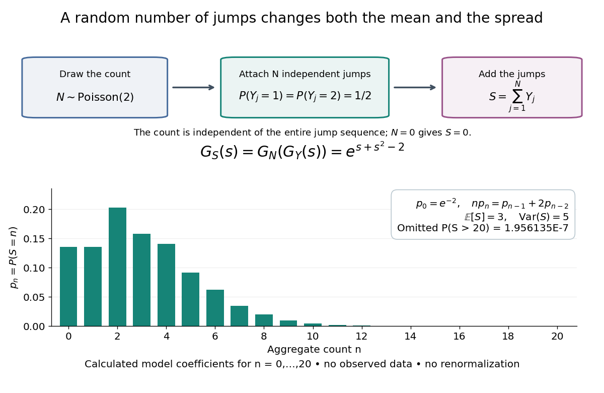

# Probability generating function of an independent random sum

↑ **Parent:** [Probability generating function](probability-generating-function.md)

Let $N$ be a nonnegative integer-valued [random variable](random-variable-split.md), and let $Y_1,Y_2,\ldots$ be nonnegative integer-valued [independent and identically distributed random variables](independent-and-identically-distributed-random-variables.md), with common [probability generating function](probability-generating-function.md) $G_Y$. Require the whole sequence to be [independent](independent-random-variables.md) of $N$, so $N,Y_1,Y_2,\ldots$ are jointly [independent](independent-random-variables.md). Set the [random sum](random-sum.md)

$$
S=\sum_{j=1}^NY_j,
$$

with the empty sum equal to zero. Given $N=n$, the [probability generating function of an independent sum](probability-generating-function-of-an-independent-sum.md) yields the [conditional expectation](conditional-expectation.md) $\mathbb E[s^S\mid N=n]=G_Y(s)^n$. By the [law of total expectation](law-of-total-expectation.md),

$$
G_S(s)=\mathbb E[G_Y(s)^N]=G_N(G_Y(s)),\qquad |s|\leq1.
$$

The composition is valid because $|G_Y(s)|\leq1$. Merely making the $Y_j$ [independent](independent-random-variables.md) of each other does not preserve their conditional laws when $N$ depends on them. This is the [probability generating function](probability-generating-function.md) version of [transform composition for an independent random sum](transform-composition-for-an-independent-random-sum.md).

For a [Poisson distribution](poisson-distribution.md) count with [mean](expected-value-split.md) $\lambda$, substitution into $G_N(u)=\exp(\lambda(u-1))$ gives a [compound Poisson distribution](compound-poisson-distribution.md) with

$$
G_S(s)=\exp\bigl(\lambda(G_Y(s)-1)\bigr).
$$

If the jumps have finite second [moment](moment.md), conditioning also gives [mean](expected-value-split.md) $\mathbb E[S]=\lambda\mathbb E[Y]$ and [variance](variance-split.md) $\operatorname{Var}(S)=\lambda\mathbb E[Y^2]$. The extra spread comes from randomness in the count as well as randomness in the jumps.[The Poisson Process, Compound Poisson Processes, Definition; Properties: mean, variance, and generating-function conditioning proof; Compound Poisson Distributions: count independent of the sequence](random-probability-mathematical-statistics-stochastic-processes-by-kyle-siegrist.md)

For an original example, choose $N\sim\operatorname{Poisson}(2)$ and jumps taking values one and two with equal [probability](probability.md). Keep the [independence](independent-random-variables.md) assumptions above. Then

$$
G_Y(s)=\frac{s+s^2}{2},\qquad G_S(s)=\exp\left(2\left[\frac{s+s^2}{2}-1\right]\right)=\exp(s+s^2-2).
$$

Here $\mathbb E[Y]=3/2$, $\operatorname{Var}(Y)=1/4$, and $\mathbb E[Y^2]=5/2$. The [law of total expectation](law-of-total-expectation.md) and [law of total variance](law-of-total-variance.md) give

$$
\mathbb E[S]=2\cdot\frac32=3,\qquad \operatorname{Var}(S)=2\cdot\frac14+2\left(\frac32\right)^2=5.
$$

Thus the aggregate is not itself a [Poisson distribution](poisson-distribution.md), whose [mean](expected-value-split.md) and [variance](variance-split.md) would coincide.

To recover the [probability mass function](probability-mass-function.md) $p_n=\mathbb P(S=n)$ without repeated [differentiation](differentiation.md), use $G_S'(s)=(1+2s)G_S(s)$ and compare [coefficients](coefficient.md):

$$
p_0=e^{-2},\qquad np_n=p_{n-1}+2p_{n-2}\quad(n\geq1),\qquad p_n=0\quad(n<0).
$$

For example, $(p_0,p_1,p_2,p_3)=e^{-2}(1,1,3/2,7/6)$. As an independent check, expanding $e^{s+s^2-2}=e^{-2}e^se^{s^2}$ gives

$$
p_n=e^{-2}\sum_{b=0}^{\lfloor n/2\rfloor}\frac{1}{(n-2b)!\,b!}.
$$

**[Figure 9](#image-a-random-number-of-one-or-two-jumps-gives-a-compound-poisson-count). A random number of one-or-two jumps gives a compound Poisson count**. The upper diagram separates the [Poisson distribution](poisson-distribution.md) count, the [independent and identically distributed](independent-and-identically-distributed-random-variables.md) jumps, and their [random sum](random-sum.md). Below are calculated [coefficients](coefficient.md) of $\exp(s+s^2-2)$ for $0\leq n\leq20$, with the omitted [tail probability](tail-probability.md) reported explicitly. They are exact model probabilities evaluated numerically, not observed data; the displayed masses have not been renormalized.

The plotted [probability masses](probability-mass.md) stop at 20, although the [support of a probability distribution](support-of-a-probability-distribution.md) is unbounded. The omitted [tail probability](tail-probability.md) is

$$
\mathbb P(S>20)=1-e^{-2}\sum_{n=0}^{20}\sum_{b=0}^{\lfloor n/2\rfloor}\frac{1}{(n-2b)!\,b!}\approx1.95613\times10^{-7}.
$$

This model has bounded jumps and an unbounded count. Its entire [probability generating function](probability-generating-function.md) does give a finite [moment-generating function](moment-generating-function.md) at every real argument, but the general [random sum](random-sum.md) composition only guarantees the stated $|s|\leq1$ domain.

## ↑ Ancestors (7)

1. [Probability generating function](probability-generating-function.md)
2. [Probability distribution](probability-distribution-split.md)
3. [Probability theory](probability-theory-split.md)
4. [Probability and statistics](probability-and-statistics-split.md)
5. [Area of mathematics](area-of-mathematics.md)
6. [Mathematics](mathematics-split.md)
7. [Codex Wiki](split.md)
