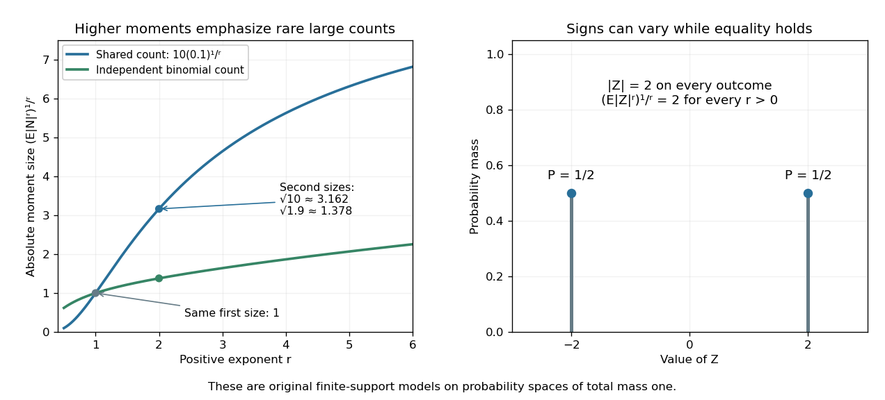
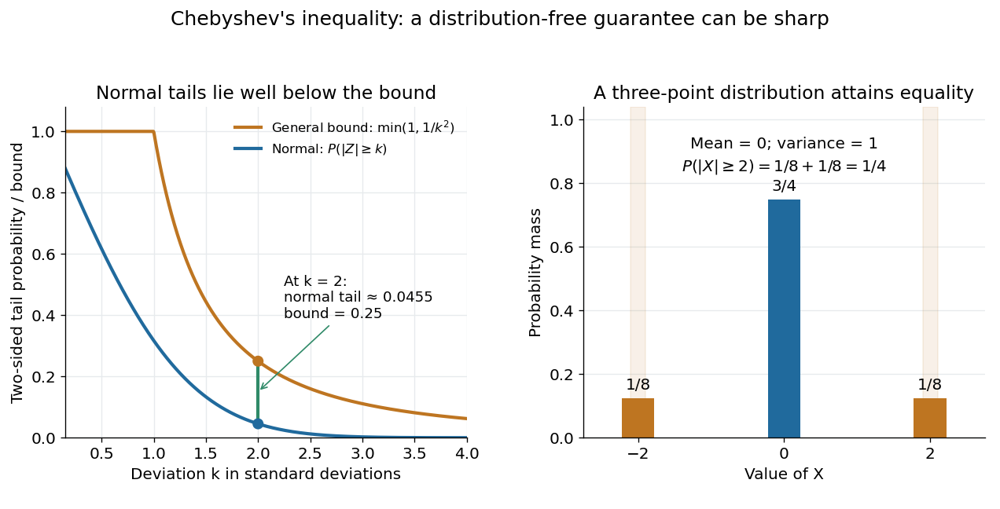
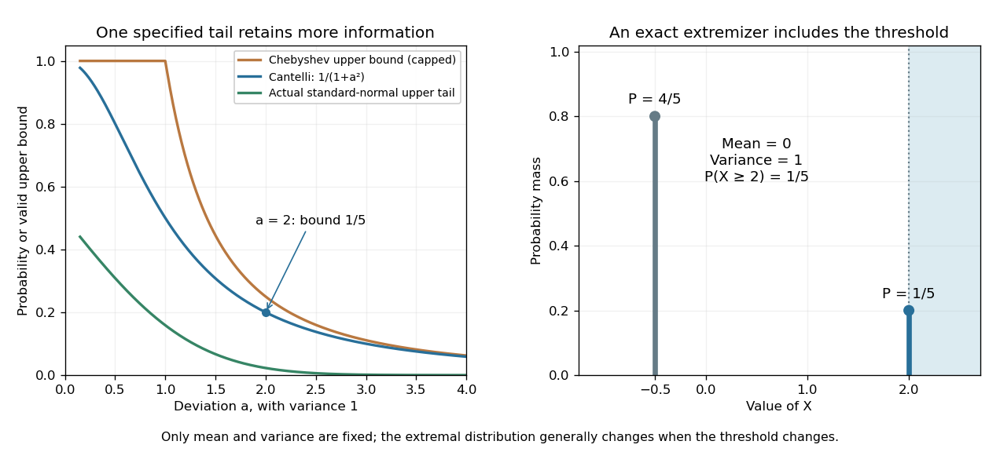
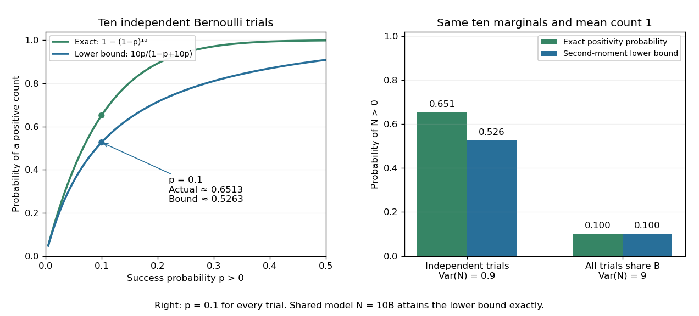
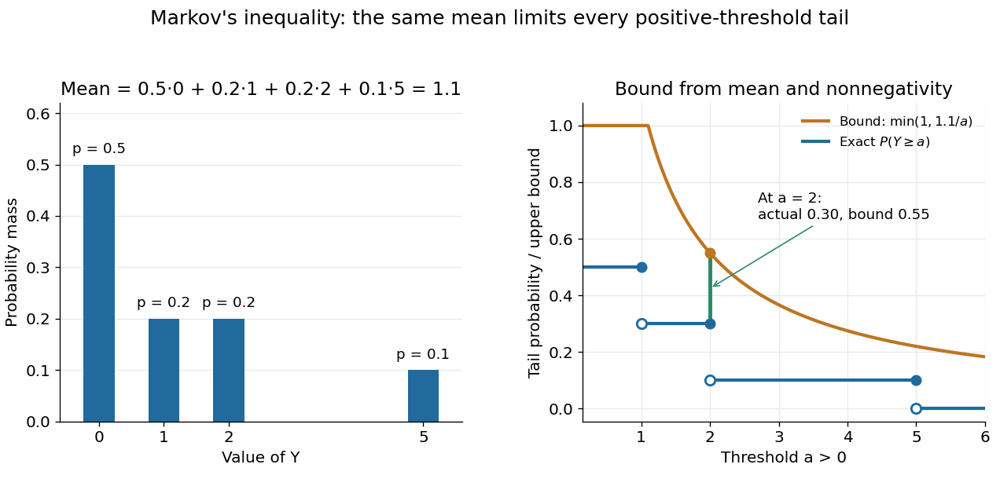
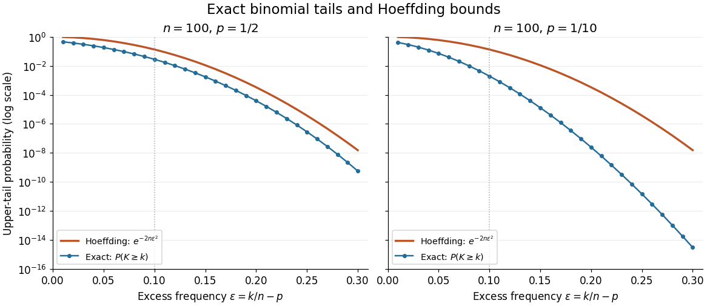
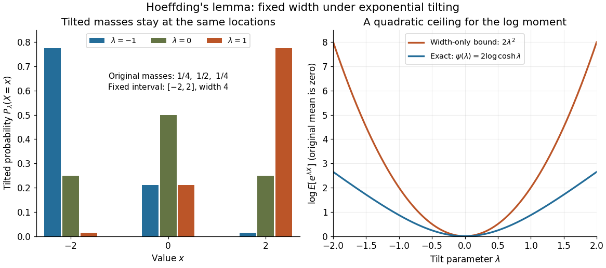
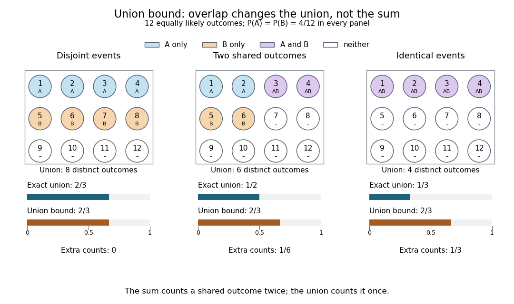
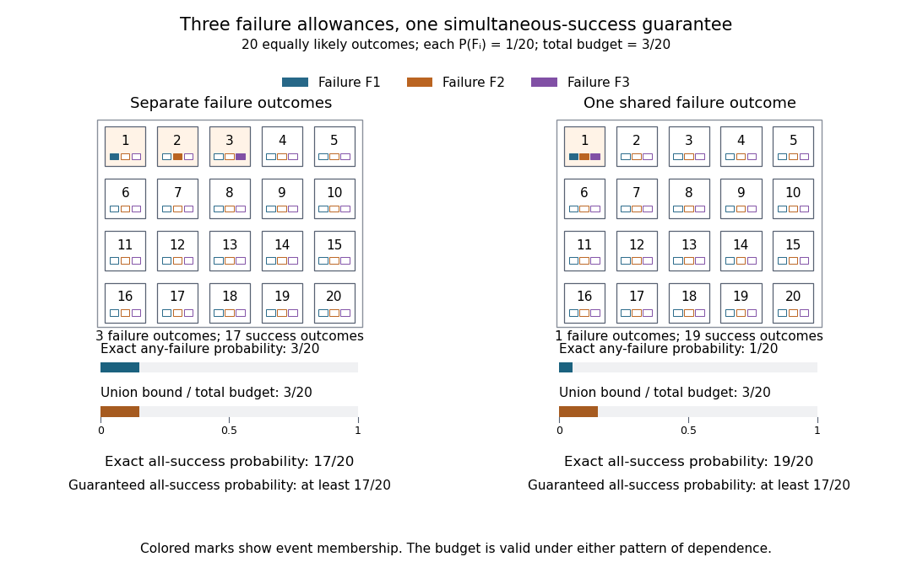

# Probability inequality

↑ **Parent:** [Probability theory](probability-theory.md)

[Probability inequalities](probability-inequality.md) bound [event](probability-theory.md#event) [probabilities](probability-theory.md#probability) from limited information, such as [moments](probability-theory.md#moment), without requiring a complete [probability distribution](probability-theory.md#probability-distribution). [Markov's inequality](#markov-s-inequality) uses a nonnegative [random variable](random-variable.md)'s [expected value](probability-theory.md#expected-value); [Chebyshev's inequality](#chebyshev-s-inequality) uses a [variance](variance.md) to bound deviations from a [mean](probability-theory.md#expected-value). The attraction is a guarantee that applies to many possible [probability distributions](probability-theory.md#probability-distribution). Their bounds can be conservative for a particular model, and distributions attaining equality show when the available information really cannot give more.

**Table of contents**

- [Lyapunov moment inequality](#lyapunov-moment-inequality)
- [Chebyshev's inequality](#chebyshev-s-inequality)
  - [Equality in Chebyshev's inequality](#equality-in-chebyshev-s-inequality)
  - [Cantelli inequality](#cantelli-inequality)
    - [Equality in Cantelli's inequality](#equality-in-cantelli-s-inequality)
- [First moment method](#first-moment-method)
- [Second moment method](#second-moment-method)
  - [Second-moment bound for positivity](#second-moment-bound-for-positivity)
- [Markov's inequality](#markov-s-inequality)
  - [Equality in Markov's inequality](#equality-in-markov-s-inequality)
  - [Exponential Markov bound](#exponential-markov-bound)
- [Concentration inequality](#concentration-inequality)
  - [Concentration of Lipschitz functions on the symmetric group](#concentration-of-lipschitz-functions-on-the-symmetric-group)
  - [Talagrand convex distance](#talagrand-convex-distance)
    - [Talagrand's convex distance inequality](#talagrand-s-convex-distance-inequality)
      - [Section induction for the Talagrand exponential moment](#section-induction-for-the-talagrand-exponential-moment)
      - [Scalar estimate for Talagrand product induction](#scalar-estimate-for-talagrand-product-induction)
  - [Entropy functional](#entropy-functional)
    - [Logarithmic Sobolev inequality](#logarithmic-sobolev-inequality)
      - [Logarithmic Sobolev inequality implies hypercontractivity](#logarithmic-sobolev-inequality-implies-hypercontractivity)
  - [Hoeffding inequality](#hoeffding-inequality)
    - [Hoeffding sample size for Bernoulli frequencies](#hoeffding-sample-size-for-bernoulli-frequencies)
    - [Hoeffding confidence interval](#hoeffding-confidence-interval)
    - [Hoeffding lemma](#hoeffding-lemma)
  - [Bennett inequality](#bennett-inequality)
    - [Bennett bounds for sparse binomial fluctuations](#bennett-bounds-for-sparse-binomial-fluctuations)
    - [Bennett rate function](#bennett-rate-function)
  - [Poincaré inequality in probability theory](#poincare-inequality-in-probability-theory)
    - [Gaussian Poincaré inequality](#gaussian-poincare-inequality)
    - [Tensorization of a Poincaré inequality](#tensorization-of-a-poincare-inequality)
    - [Pushforward of a Poincaré inequality by a Lipschitz function](#pushforward-of-a-poincare-inequality-by-a-lipschitz-function)
    - [Poincaré inequality for the uniform distribution on an interval](#poincare-inequality-for-the-uniform-distribution-on-an-interval)
    - [Gaussian logarithmic Sobolev inequality](#gaussian-logarithmic-sobolev-inequality)
      - [Sharpness of the Gaussian logarithmic Sobolev constant](#sharpness-of-the-gaussian-logarithmic-sobolev-constant)
      - [Ornstein-Uhlenbeck entropy dissipation identity](#ornstein-uhlenbeck-entropy-dissipation-identity)
    - [Convex Poincaré inequality](#convex-poincare-inequality)
  - [Chernoff bound](#chernoff-bound)
    - [Entrywise concentration of a Gaussian Gram matrix](#entrywise-concentration-of-a-gaussian-gram-matrix)
  - [Bounded differences property](#bounded-differences-property)
    - [McDiarmid's inequality](#mcdiarmid-s-inequality)
      - [Boolean cube expansion from bounded differences](#boolean-cube-expansion-from-bounded-differences)
    - [Talagrand's one-sided bounded differences inequality](#talagrand-s-one-sided-bounded-differences-inequality)
  - [Certifiable function](#certifiable-function)
    - [Entropy method for certifiable functions](#entropy-method-for-certifiable-functions)
  - [Self-bounding function](#self-bounding-function)
    - [Weakly self-bounding function](#weakly-self-bounding-function)
      - [Variance bound for a weakly self-bounding function](#variance-bound-for-a-weakly-self-bounding-function)
      - [Lower-tail concentration for a weakly self-bounding function](#lower-tail-concentration-for-a-weakly-self-bounding-function)
  - [Tensorization of entropy](#tensorization-of-entropy)
  - [Efron–Stein inequality](#efron-stein-inequality)
    - [Variance tensorization](#variance-tensorization)
  - [Modified logarithmic Sobolev inequality](#modified-logarithmic-sobolev-inequality)
    - [Herbst argument](#herbst-argument)
  - [Transport-entropy inequality](#transport-entropy-inequality)
    - [Tensorization of a transport-entropy inequality](#tensorization-of-a-transport-entropy-inequality)
  - [Sub-Poisson random variable in the right tail](#sub-poisson-random-variable-in-the-right-tail)
  - [Sub-Gamma random variable in the right tail](#sub-gamma-random-variable-in-the-right-tail)
    - [Bernstein inequalities (probability theory)](#bernstein-inequalities-probability-theory)
      - [Bernstein bound for independent sub-exponential variables](#bernstein-bound-for-independent-sub-exponential-variables)
  - [Rosenthal inequality](#rosenthal-inequality)
  - [Talagrand's concentration inequality](#talagrand-s-concentration-inequality)
    - [Talagrand concentration inequality for certifiable functions](#talagrand-concentration-inequality-for-certifiable-functions)
      - [Two-threshold concentration for certifiable functions](#two-threshold-concentration-for-certifiable-functions)
      - [Increasing-subsequence certificate concentration](#increasing-subsequence-certificate-concentration)
- [Boole's inequality](#boole-s-inequality)
  - [Equality in Boole's inequality](#equality-in-boole-s-inequality)
  - [Overlap in the union bound](#overlap-in-the-union-bound)
  - [Failure-probability budget](#failure-probability-budget)
  - [Positive common intersection from pair-intersection probabilities](#positive-common-intersection-from-pair-intersection-probabilities)
- [FKG inequality](#fkg-inequality)
  - [FKG lattice condition](#fkg-lattice-condition)
    - [Exponential-tilt proof of positive association](#exponential-tilt-proof-of-positive-association)
  - [Harris-FKG inequality](#harris-fkg-inequality)
    - [Square-root bound for increasing events](#square-root-bound-for-increasing-events)
    - [Square-root trick for positively associated events](#square-root-trick-for-positively-associated-events)
    - [Harris' inequality](#harris-inequality)
      - [Negative correlation of increasing and decreasing events](#negative-correlation-of-increasing-and-decreasing-events)
      - [Increasing event](#increasing-event)
        - [Sharp threshold](#sharp-threshold)
        - [Transitive increasing event](#transitive-increasing-event)
        - [Decreasing event](#decreasing-event)
- [Janson inequality](#janson-inequality)
  - [Janson lower-tail bound by independent thinning](#janson-lower-tail-bound-by-independent-thinning)
  - [Janson dependency sum](#janson-dependency-sum)
  - [Janson sequential product lemma](#janson-sequential-product-lemma)
- [Lévy maximal inequality](#levy-maximal-inequality)

## Lyapunov moment inequality

↑ **Parent:** [Probability inequality](probability-inequality.md)

The Lyapunov moment inequality says that higher positive [absolute moments](probability-theory.md#absolute-moment) give no smaller [absolute moment](probability-theory.md#absolute-moment) sizes on a [probability space](probability-theory.md#probability-space). For a real [random variable](random-variable.md) $Z$ and $0<r<s$,

$$
\boxed{\left(\mathbb E|Z|^r\right)^{1/r}\leq\left(\mathbb E|Z|^s\right)^{1/s},}
$$

allowing an infinite value. For $r\geq1$ the left expression is an [Lp norm](real-analysis.md#lp-norm); below one it is a [quasi-norm](functional-analysis.md#quasi-norm), so the usual [triangle inequality](topological-analysis.md#triangle-inequality) terminology needs that distinction. The comparison uses a [probability measure](probability-theory.md#probability-measure) of total mass one; arbitrary unnormalized [measure spaces](measure-theory.md#measure-space) need a factor depending on their total mass.

For a nonnegative count, the first moment size is its [expected value](probability-theory.md#expected-value), while the second is the [square root](algebra.md#square-root) of its [second moment](probability-theory.md#second-moment). Both ten-trial counts in [second moment method](#second-moment-method) have first moment size one. The [independent](random-variable.md#independent-random-variables) count has second moment size $\sqrt{1.9}\approx1.37840$, whereas the shared-outcome count $N=10B$ has second moment size $\sqrt{10}\approx3.16228$. The second moment distinguishes models with the same average because its square increases the influence of rare large counts.

More generally, for $N=10B$ with a [Bernoulli random variable](discrete-probability-distribution.md#bernoulli-distribution) $B$ of parameter $1/10$,

$$
\left(\mathbb E N^r\right)^{1/r}=10(1/10)^{1/r}.
$$

It rises from one at $r=1$ toward ten as $r\to\infty$. Replacing $1/10$ by a parameter $0<q\leq1$ gives $10q^{1/r}$, which decreases toward zero for a fixed positive [exponent](arithmetic.md#exponent) when $q\downarrow0$, making the rare-event and large-exponent limits different questions. For a scaled [Rademacher random variable](probability-theory.md#rademacher-distribution) taking values $-2$ and two with equal [probabilities](probability-theory.md#probability), every absolute moment size is exactly two: increasing the [exponent](arithmetic.md#exponent) does not distinguish signs when the [absolute value](real-analysis.md#absolute-value) is constant.

**[Figure 1](#image-lyapunov-moment-inequality-reveals-how-higher-moments-emphasize-large-outcomes-and-when-equality-holds). Lyapunov moment inequality reveals how higher moments emphasize large outcomes and when equality holds**. Left: the two original ten-trial models from [second moment method](#second-moment-method) have the same [mean](probability-theory.md#expected-value) one, but different [absolute moment](probability-theory.md#absolute-moment) sizes at [exponents](arithmetic.md#exponent) above one. The shared model has $N=10B$ with $p=1/10$. Right: equal masses at $-2$ and two keep $|Z|=2$ [almost surely](convergence-of-random-variables.md#almost-sure-convergence), giving equality for every pair of positive [exponents](arithmetic.md#exponent). These are fully specified mathematical probability models.

For finite $\mathbb E|Z|^s$, apply the reversed [Jensen's inequality](real-analysis.md#jensen-s-inequality) to the [strictly concave function](real-analysis.md#strictly-concave-function) $t^{r/s}$ and the nonnegative [random variable](random-variable.md) $|Z|^s$:

$$
\mathbb E|Z|^r\leq\left(\mathbb E|Z|^s\right)^{r/s}.
$$

Taking the positive $r$th root proves the claim. Equality in this finite case holds exactly when $|Z|$ is constant [almost surely](convergence-of-random-variables.md#almost-sure-convergence). If the higher [moment](probability-theory.md#moment) is infinite, the upper bound is infinite and remains valid. Exponent zero is excluded from the statement; logarithmic or geometric limiting summaries require separately stated conventions, especially when $Z$ can vanish.

<h2 id="chebyshev-s-inequality">Chebyshev's inequality</h2>

↑ **Parent:** [Probability inequality](probability-inequality.md)  
ⓦ [Wiki](https://en.wikipedia.org/wiki/Chebyshev's_inequality)

For a real [random variable](random-variable.md) $X$ with finite [variance](variance.md) $\sigma^2$, [expected value](probability-theory.md#expected-value) $\mu$, and a threshold $a>0$, [Chebyshev's inequality](#chebyshev-s-inequality) gives

$$
\mathbb P(|X-\mu|\geq a)\leq\frac{\sigma^2}{a^2}.
$$

One can also cap this upper bound at one, since a [probability](probability-theory.md#probability) cannot exceed one. If $\sigma>0$, taking $a=k\sigma$ gives $\mathbb P(|X-\mu|\geq k\sigma)\leq1/k^2$. For example, at least $3/4$ of the [probability](probability-theory.md#probability) lies strictly within two [standard deviations](variance.md#standard-deviation) of the [mean](probability-theory.md#expected-value). This statement needs only the finite [variance](variance.md) assumption. If the [variance](variance.md) is zero, $X=\mu$ [almost surely](convergence-of-random-variables.md#almost-sure-convergence) and every positive deviation threshold has zero [tail probability](probability-theory.md#tail-probability).

Consider a [random variable](random-variable.md) uniformly distributed on $\{-2,-1,0,1,2\}$. Its [expected value](probability-theory.md#expected-value) is zero and its [variance](variance.md) is $(4+1+0+1+4)/5=2$. At $a=2$ the actual [tail probability](probability-theory.md#tail-probability) is $2/5$, while [Chebyshev's inequality](#chebyshev-s-inequality) gives $2/2^2=1/2$. At $a=3$ the actual [tail probability](probability-theory.md#tail-probability) is zero, while the bound is $2/9$. A valid bound need not describe the exact shape or bounded support of a particular [probability distribution](probability-theory.md#probability-distribution).

**[Figure 2](#image-a-general-variance-bound-can-be-loose-for-a-normal-distribution-and-exact-for-another-distribution). A general variance bound can be loose for a normal distribution and exact for another distribution**. Left: the two-sided [tail probability](probability-theory.md#tail-probability) of the [standard normal distribution](probability-theory.md#standard-normal-distribution) is compared with the capped [Chebyshev's inequality](#chebyshev-s-inequality) bound. Right: the three-point [probability distribution](probability-theory.md#probability-distribution) places [probabilities](probability-theory.md#probability) $1/8$, $3/4$, $1/8$ at $-2$, $0$, $2$, giving [variance](variance.md) one and [probability](probability-theory.md#probability) $1/4$ at a deviation of at least two. The points at the threshold are included by $\geq$.

For the [standard normal distribution](probability-theory.md#standard-normal-distribution), the actual [tail probabilities](probability-theory.md#tail-probability) beyond two and three [standard deviations](variance.md#standard-deviation) are approximately $0.0455003$ and $0.0026998$, whereas the general bounds are $1/4$ and $1/9$. More knowledge of the [probability distribution](probability-theory.md#probability-distribution) can therefore improve the estimate. The comparison does not diminish the guarantee: the three-point example in [equality in Chebyshev's inequality](#equality-in-chebyshev-s-inequality) attains it exactly.

The proof is a one-line use of [Markov's inequality](#markov-s-inequality) on the nonnegative [random variable](random-variable.md) $Y=(X-\mu)^2$. The event $|X-\mu|\geq a$ equals $Y\geq a^2$, and $\mathbb E Y=\sigma^2$. This explains why the denominator is squared and why a finite [variance](variance.md) supplies the necessary information. [Scott Sheffield, MIT 18.175, lecture 8: Markov and Chebyshev bounds](https://ocw.mit.edu/courses/18-175-theory-of-probability-spring-2014/887e96172e82a615dac16fb26702d88b_MIT18_175S14_Lecture8.pdf).

One important use is control of a [sample mean](variance.md#sample-mean). For [independent and identically distributed random variables](random-variable.md#independent-and-identically-distributed-random-variables) with finite [variance](variance.md) $\sigma^2$, the [variance of a sample mean](probability-theory.md#variance-of-a-sample-mean) is $\sigma^2/n$. Hence

$$
\mathbb P(|\overline X_n-\mu|\geq\varepsilon)\leq\frac{\sigma^2}{n\varepsilon^2},\qquad \varepsilon>0.
$$

For every fixed tolerance, the bound tends to zero as the [sample size](probability-and-statistics.md#sample-size) grows, proving the finite-[variance](variance.md) case of the [weak law of large numbers](convergence-of-random-variables.md#weak-law-of-large-numbers). For $\sigma^2=1$ and $\varepsilon=0.1$, $n=2000$ makes the bound $0.05$. This is a sufficient bound under the stated assumptions, rather than an optimal required [sample size](probability-and-statistics.md#sample-size).

An early historical source is [Pafnuty Chebyshev](mathematics.md#pafnuty-chebyshev)'s 1867 paper “Des valeurs moyennes”, published in French translation by N. de Khanikof. Its opening theorem bounds deviations of sums using their [expected values](probability-theory.md#expected-value) and [second moments](probability-theory.md#second-moment), linking averages with control of exceptional outcomes. [Chebyshev, Journal de mathématiques pures et appliquées, 2nd series 12, 177–184 (1867)](https://www.numdam.org/item/JMPA_1867_2_12__177_0.pdf).

<h3 id="equality-in-chebyshev-s-inequality">Equality in Chebyshev's inequality</h3>

↑ **Parent:** [Chebyshev's inequality](#chebyshev-s-inequality)

For $a\geq\sigma>0$, assign [probability](probability-theory.md#probability) $\sigma^2/(2a^2)$ to each of $\mu-a$ and $\mu+a$, and the remaining [probability](probability-theory.md#probability) $1-\sigma^2/a^2$ to $\mu$. This [probability distribution](probability-theory.md#probability-distribution) has [expected value](probability-theory.md#expected-value) $\mu$, [variance](variance.md) $\sigma^2$, and [tail probability](probability-theory.md#tail-probability) $\mathbb P(|X-\mu|\geq a)=\sigma^2/a^2$. Thus [Chebyshev's inequality](#chebyshev-s-inequality) is sharp when only these two [moments](probability-theory.md#moment) are supplied. For example, $\mu=0$, $\sigma=1$, $a=2$ gives masses $1/8$, $3/4$, $1/8$. Replacing $\geq$ with $>$ would exclude the two extreme points in this example.

### Cantelli inequality

↑ **Parent:** [Chebyshev's inequality](#chebyshev-s-inequality)

[Cantelli's inequality](#cantelli-inequality) uses a [mean](probability-theory.md#expected-value) and [variance](variance.md) to control deviations in one specified direction. For a real [random variable](random-variable.md) $X$ with [expected value](probability-theory.md#expected-value) $\mu$, finite [variance](variance.md) $\sigma^2$, and $a>0$,

$$
\boxed{\mathbb P(X-\mu\geq a)\leq\frac{\sigma^2}{\sigma^2+a^2}.}
$$

Applying the same statement to $-X$ gives the lower [tail probability](probability-theory.md#tail-probability) bound $\mathbb P(X-\mu\leq-a)\leq\sigma^2/(\sigma^2+a^2)$. No [independence](random-variable.md#independent-random-variables) or particular [probability distribution](probability-theory.md#probability-distribution) is required. If $\sigma^2=0$, the [random variable](random-variable.md) equals $\mu$ [almost surely](convergence-of-random-variables.md#almost-sure-convergence) and both positive-threshold [tail probabilities](probability-theory.md#tail-probability) are zero.

For [variance](variance.md) one and a threshold two above the [mean](probability-theory.md#expected-value), **the upper-tail [probability](probability-theory.md#probability) is at most $1/5$**. Applying the two-sided [Chebyshev's inequality](#chebyshev-s-inequality) to contain that upper [event](probability-theory.md#event) would give the weaker bound $1/4$. For the [standard normal distribution](probability-theory.md#standard-normal-distribution), the actual upper [tail probability](probability-theory.md#tail-probability) at two is about $0.0227501$, much smaller than either bound. Yet the two-point [probability distribution](probability-theory.md#probability-distribution) in [equality in Cantelli's inequality](#equality-in-cantelli-s-inequality) attains $1/5$, showing why the smaller Gaussian value cannot be promised from these two [moments](probability-theory.md#moment) alone.

**[Figure 3](#image-cantelli-s-inequality-sharpens-a-variance-only-upper-tail-bound-and-is-exact-for-a-two-point-probability-distribution). Cantelli's inequality sharpens a variance-only upper-tail bound and is exact for a two-point probability distribution**. Left: actual upper [tail probabilities](probability-theory.md#tail-probability) for the [standard normal distribution](probability-theory.md#standard-normal-distribution) are compared with [Cantelli's inequality](#cantelli-inequality) and the capped two-sided [Chebyshev's inequality](#chebyshev-s-inequality) used as an upper-tail bound. Right: masses $4/5$ at $-1/2$ and $1/5$ at two have [mean](probability-theory.md#expected-value) zero and [variance](variance.md) one. The upper mass is included by the non-strict threshold $X\geq2$. These are specified mathematical models, not observations.

A short explanation is to centre $Y=X-\mu$ and choose a nonnegative shift $b$. On $Y\geq a$, the square $(Y+b)^2$ is at least $(a+b)^2$, so [Markov's inequality](#markov-s-inequality) gives

$$
\mathbb P(Y\geq a)\leq\frac{\mathbb E(Y+b)^2}{(a+b)^2}=\frac{\sigma^2+b^2}{(a+b)^2}.
$$

The best shift is $b=\sigma^2/a$, giving the displayed bound. Choosing the shift before squaring exploits the direction of the deviation; squaring the unshifted [random variable](random-variable.md) treats both directions together. This shifted-square proof is also the strategy requested in the University of Utah's 2005 qualifying problem on [Cantelli's inequality](#cantelli-inequality). [University of Utah Mathematics, 2005 question 4: shifted-square Cantelli bound](https://quals.math.utah.edu/topics/borel-cantelli-lemmas/).

The one-sided improvement should be used for a one-sided question. Adding upper and lower bounds by the [union bound](#boole-s-inequality) gives $2\sigma^2/(\sigma^2+a^2)$ for $|X-\mu|\geq a$. When $a\geq\sigma>0$, that is at least the [Chebyshev's inequality](#chebyshev-s-inequality) bound $\sigma^2/a^2$; when $a<\sigma$, both two-sided expressions exceed one and must be capped. The separate one-sided bounds generally cannot be attained simultaneously by the same [probability distribution](probability-theory.md#probability-distribution).

<h4 id="equality-in-cantelli-s-inequality">Equality in Cantelli's inequality</h4>

↑ **Parent:** [Cantelli inequality](#cantelli-inequality)

For $a>0$ and $\sigma^2>0$, place [probabilities](probability-theory.md#probability)

$$
\mathbb P(X=\mu+a)=\frac{\sigma^2}{\sigma^2+a^2},\qquad
\mathbb P\left(X=\mu-\frac{\sigma^2}{a}\right)=\frac{a^2}{\sigma^2+a^2}.
$$

Their weighted deviations cancel, giving [expected value](probability-theory.md#expected-value) $\mu$; their weighted squared deviations give [variance](variance.md) $\sigma^2$. Only the upper point belongs to $X-\mu\geq a$, so its [tail probability](probability-theory.md#tail-probability) attains [Cantelli's inequality](#cantelli-inequality). With $a=2$, $\sigma^2=1$, $\mu=0$, the locations are two and $-1/2$, with masses $1/5$ and $4/5$. The optimized shift makes the lower point zero before squaring, explaining equality in the [Markov's inequality](#markov-s-inequality) step.

The threshold convention matters: this example has $\mathbb P(X-\mu>a)=0$. For a strict threshold, placing the upper point at $a+\varepsilon$ instead gives probabilities approaching the same bound as $\varepsilon\downarrow0$, with the prescribed [mean](probability-theory.md#expected-value) and [variance](variance.md) retained. Extra restrictions on the [support of a probability distribution](probability-theory.md#support-of-a-probability-distribution) can change which extremal models are allowed.

## First moment method

↑ **Parent:** [Probability inequality](probability-inequality.md)

The [first moment method](#first-moment-method) uses the [expected value](probability-theory.md#expected-value) of a count to control whether any counted occurrence exists. For a [random variable](random-variable.md) $N$ taking nonnegative [integer](number-theory.md#integer) values, [Markov's inequality](#markov-s-inequality) gives

$$
\mathbb P(N\geq1)\leq\mathbb EN.
$$

Consequently, $\mathbb EN<1$ implies $\mathbb P(N=0)\geq1-\mathbb EN>0$, proving that an outcome with no counted occurrence exists. For a sequence of such counts, $\mathbb EN\to0$ shows that $N=0$ with [probability](probability-theory.md#probability) tending to one. The [first moment method](#first-moment-method) uses information about the average count, while the complementary [second moment method](#second-moment-method) also uses its [variance](variance.md).

## Second moment method

↑ **Parent:** [Probability inequality](probability-inequality.md)  
ⓦ [Wiki](https://en.wikipedia.org/wiki/Second_moment_method)

The second moment method uses a [random variable](random-variable.md)'s [expected value](probability-theory.md#expected-value) and [second moment](probability-theory.md#second-moment) to establish that a counted or measured quantity is positive with substantial [probability](probability-theory.md#probability). It is useful when a positive average alone could be caused by extremely large values on very rare outcomes. Controlling the [variance](variance.md) rules out too much of that concentration in rare outcomes.

For a nonnegative [random variable](random-variable.md) $N$ with $m=\mathbb EN>0$ and finite [second moment](probability-theory.md#second-moment), the [second-moment bound for positivity](#second-moment-bound-for-positivity) gives

$$
\boxed{\mathbb P(N>0)\geq\frac{(\mathbb EN)^2}{\mathbb E N^2}=\frac{m^2}{m^2+\operatorname{Var}(N)}.}
$$

Equivalently, $\mathbb P(N=0)\leq\operatorname{Var}(N)/(m^2+\operatorname{Var}(N))$. The method also includes the simpler [Chebyshev's inequality](#chebyshev-s-inequality) bound $\mathbb P(N=0)\leq\operatorname{Var}(N)/m^2$. Thus a [sequence](real-analysis.md#sequence) of such [random variables](random-variable.md) with $\operatorname{Var}(N)/(\mathbb EN)^2\to0$ has $N>0$ with [probability](probability-theory.md#probability) tending to one. These statements require no [independence](random-variable.md#independent-random-variables) assumption. The variance argument and its use for random counts are developed in Zhao's lecture notes. [Yufei Zhao, MIT 18.226, §4.1, corollaries 4.1.7–4.1.8: variance and non-existence](https://ocw.mit.edu/courses/18-226-probabilistic-methods-in-combinatorics-fall-2022/mit18_226_f22_lec06-07.pdf).

For an original toy count, let $N$ count successes in ten [independent](random-variable.md#independent-random-variables) [Bernoulli trials](discrete-probability-distribution.md#bernoulli-trial) with success [probability](probability-theory.md#probability) $p=1/10$. The [binomial distribution](discrete-probability-distribution.md#binomial-distribution) gives

$$
\mathbb EN=1,\qquad \operatorname{Var}(N)=9/10,\qquad \mathbb E N^2=19/10.
$$

Consequently **$\mathbb P(N>0)\geq10/19\approx0.526316$**. The exact [probability](probability-theory.md#probability) is $1-(9/10)^{10}\approx0.651322$. The [first moment method](#first-moment-method) and [union bound](#boole-s-inequality) only give the upper bound $\mathbb P(N>0)\leq\min\{1,\mathbb EN\}=1$ here. First and second moments therefore answer complementary existence questions.

**[Figure 4](#image-the-second-moment-method-certifies-a-positive-count-while-statistical-dependence-can-change-the-conclusion-despite-an-unchanged-mean). The second moment method certifies a positive count, while statistical dependence can change the conclusion despite an unchanged mean**. Left: exact [binomial distribution](discrete-probability-distribution.md#binomial-distribution) probabilities of at least one success and second-moment lower bounds for ten [independent](random-variable.md#independent-random-variables) trials as the success probability varies. Right: the same ten trials with $p=1/10$ either occur independently or share one common [Bernoulli](discrete-probability-distribution.md#bernoulli-distribution) outcome. Both counts have [mean](probability-theory.md#expected-value) one, but the perfectly linked count has much larger [variance](variance.md) and only $1/10$ probability of being positive. All data are original specified probability models.

For a [sum](arithmetic.md#sum) of [indicator random variables](probability-theory.md#indicator-random-variable), the [variance of a sum](variance.md#variance-of-a-sum) is

$$
\operatorname{Var}\left(\sum_i I_i\right)=\sum_i\operatorname{Var}(I_i)+2\sum_{i<j}\operatorname{Cov}(I_i,I_j).
$$

[Independence](random-variable.md#independent-random-variables) makes the [covariances](variance.md#covariance) vanish, but the formula itself also covers dependent counts. For the same ten success probabilities, let every trial share a single [Bernoulli random variable](discrete-probability-distribution.md#bernoulli-distribution) $B$: then $N=10B$, with [mean](probability-theory.md#expected-value) one, [variance](variance.md) nine, and $\mathbb P(N>0)=1/10$. The second-moment lower bound is exactly $1/10$. Ignoring the positive [covariances](variance.md#covariance) would produce the false independent-count conclusion. Zhao's discussion of sums of indicators explains why overlapping counted structures require these pairwise terms. [Zhao, MIT 18.226, §4.1: indicator covariances and Bernoulli counts](https://ocw.mit.edu/courses/18-226-probabilistic-methods-in-combinatorics-fall-2022/mit18_226_f22_lec06-07.pdf).

### Second-moment bound for positivity

↑ **Parent:** [Second moment method](#second-moment-method)

For a nonnegative [random variable](random-variable.md) $N$ with positive [expected value](probability-theory.md#expected-value) and finite [second moment](probability-theory.md#second-moment), write $N=N\mathbf1_{\{N>0\}}$. The [Cauchy-Schwarz inequality](probability-and-statistics.md#cauchy-schwarz-inequality) gives

$$
(\mathbb EN)^2=\left(\mathbb E[N\mathbf1_{\{N>0\}}]\right)^2\leq\mathbb E N^2\,\mathbb P(N>0),
$$

which proves the bound in [second moment method](#second-moment-method). It is the zero-threshold case of the [Paley-Zygmund inequality](probability-and-statistics.md#paley-zygmund-inequality). Equality occurs when $N$ is a fixed positive value on the [event](probability-theory.md#event) $N>0$ and zero elsewhere, [almost surely](convergence-of-random-variables.md#almost-sure-convergence). For $N=10B$ with $B$ a [Bernoulli random variable](discrete-probability-distribution.md#bernoulli-distribution) of parameter $1/10$, $(\mathbb EN)^2/\mathbb E N^2=1/10$ equals the exact positivity probability.

The [variance](variance.md) identity $\mathbb E N^2=(\mathbb EN)^2+\operatorname{Var}(N)$ turns the lower bound into a statement about variance relative to the squared [mean](probability-theory.md#expected-value). A small ratio forces positivity to be likely. A positive [expected value](probability-theory.md#expected-value) alone does not do so: keeping $\mathbb EN=1$ while taking $N=1/q$ with [probability](probability-theory.md#probability) $q$ and zero otherwise makes the positivity probability as small as any chosen $q>0$.

<h2 id="markov-s-inequality">Markov's inequality</h2>

↑ **Parent:** [Probability inequality](probability-inequality.md)  
ⓦ [Wiki](https://en.wikipedia.org/wiki/Markov's_inequality)

For a nonnegative [random variable](random-variable.md) $Y$ and threshold $a>0$, [Markov's inequality](#markov-s-inequality) gives

$$
\mathbb P(Y\geq a)\leq\frac{\mathbb E Y}{a}.
$$

The useful case has finite [expected value](probability-theory.md#expected-value); an infinite right side gives no finite information. The bound also holds if $Y$ is nonnegative [almost surely](convergence-of-random-variables.md#almost-sure-convergence). Combining it with the elementary bound one gives $\mathbb P(Y\geq a)\leq\min\{1,\mathbb E Y/a\}$. Nonnegativity is essential: negative values could otherwise cancel the contribution of large positive values to the [expected value](probability-theory.md#expected-value).

The idea is an average budget. Every outcome where $Y\geq a$ contributes at least $a$ times its [probability](probability-theory.md#probability) to $\mathbb E Y$, and the other outcomes contribute nonnegative amounts. Formally, the [indicator function](measure-theory.md#indicator-function) gives $Y\geq a\mathbf1_{\{Y\geq a\}}$; taking the [expected value](probability-theory.md#expected-value) proves the bound. [Sheffield, MIT 18.175, lecture 8: the expectation argument](https://ocw.mit.edu/courses/18-175-theory-of-probability-spring-2014/887e96172e82a615dac16fb26702d88b_MIT18_175S14_Lecture8.pdf).

For example, let $Y$ take $0$, $1$, $2$, $5$ with respective [probabilities](probability-theory.md#probability) $0.5$, $0.2$, $0.2$, $0.1$. Its [expected value](probability-theory.md#expected-value) is $1.1$. At $a=2$, the [tail probability](probability-theory.md#tail-probability) is $0.3$, while the bound is $1.1/2=0.55$. At $a=5$, the [tail probability](probability-theory.md#tail-probability) is $0.1$, while the bound is $0.22$. A different [probability distribution](probability-theory.md#probability-distribution) with the same [expected value](probability-theory.md#expected-value), putting masses $0.78$ and $0.22$ at $0$ and $5$, attains the bound $0.22$ exactly at $a=5$.

**[Figure 5](#image-an-average-bounds-how-much-probability-can-lie-beyond-a-positive-threshold). An average bounds how much probability can lie beyond a positive threshold**. Left: the stipulated four-point [probability distribution](probability-theory.md#probability-distribution) has [expected value](probability-theory.md#expected-value) $1.1$. Right: its exact [tail probability](probability-theory.md#tail-probability) $\mathbb P(Y\geq a)$ and the capped [Markov's inequality](#markov-s-inequality) bound. Filled markers include an atom at the threshold; open markers show the smaller value immediately after it. The highlighted threshold $a=2$ has actual [probability](probability-theory.md#probability) $0.3$ and bound $0.55$.

[Markov's inequality](#markov-s-inequality) is useful when a [moment](probability-theory.md#moment) is easy to compute but a full [probability distribution](probability-theory.md#probability-distribution) is difficult to determine. A nonnegative count with [expected value](probability-theory.md#expected-value) less than one must have some positive [probability](probability-theory.md#probability) of being zero, giving the [first moment method](#first-moment-method). Applying the same bound to a squared centered [random variable](random-variable.md) gives [Chebyshev's inequality](#chebyshev-s-inequality). Applying it to an [exponential function](calculus.md#exponential-function) of a [random variable](random-variable.md) gives an [exponential Markov bound](#exponential-markov-bound), which can exploit more than a single [moment](probability-theory.md#moment).

<h3 id="equality-in-markov-s-inequality">Equality in Markov's inequality</h3>

↑ **Parent:** [Markov's inequality](#markov-s-inequality)

For a finite-[expected value](probability-theory.md#expected-value) nonnegative [random variable](random-variable.md) and $a>0$, equality in the uncapped [Markov's inequality](#markov-s-inequality) holds exactly when $Y$ takes only $0$ and $a$ [almost surely](convergence-of-random-variables.md#almost-sure-convergence). Indeed the nonnegative difference $Y-a\mathbf1_{\{Y\geq a\}}$ has zero [expected value](probability-theory.md#expected-value) exactly when it vanishes [almost surely](convergence-of-random-variables.md#almost-sure-convergence). Giving $a$ [probability](probability-theory.md#probability) $p$ yields $\mathbb E Y=pa$ and $\mathbb P(Y\geq a)=p$. This shows the bound cannot generally be reduced using only the nonnegative [random variable](random-variable.md)'s [expected value](probability-theory.md#expected-value).

### Exponential Markov bound

↑ **Parent:** [Markov's inequality](#markov-s-inequality)

Applying [Markov's inequality](#markov-s-inequality) to the positive [random variable](random-variable.md) $e^{tX}$ gives

$$
\Pr(X\geq x)\leq e^{-tx}M_X(t),
\qquad t>0.
$$

Here $M_X(t)=\mathbb E[e^{tX}]$ is the [moment-generating function](probability-theory.md#moment-generating-function), and the useful bound requires it to be finite at the chosen $t$. Optimizing over $t>0$ gives the [Chernoff bound](#chernoff-bound) method: an [exponential function](calculus.md#exponential-function) weights large values more strongly before applying the same average-budget argument.

For example, let $N$ have the [Poisson distribution](discrete-probability-distribution.md#poisson-distribution) with parameter one. Its [expected value](probability-theory.md#expected-value) and [variance](variance.md) are both one, and its [moment-generating function](probability-theory.md#moment-generating-function) is $M_N(t)=\exp(e^t-1)$. At threshold four, choosing $t=\log4$ gives

$$
\mathbb P(N\geq4)\leq\exp(3-4\log4)=\frac{e^3}{256}\approx0.0784591.
$$

This $t$ minimizes the exponent $e^t-1-4t$ because its [derivative](calculus.md#derivative) is $e^t-4$, with positive [second derivative](calculus.md#second-derivative). The direct [Markov's inequality](#markov-s-inequality) bound is $1/4$, and the two-sided [Chebyshev's inequality](#chebyshev-s-inequality) bound, applied to a deviation of at least three from the [mean](probability-theory.md#expected-value) one, is $1/9$. The exact [Poisson distribution](discrete-probability-distribution.md#poisson-distribution) [tail probability](probability-theory.md#tail-probability) is $1-e^{-1}(1+1+1/2+1/6)\approx0.0189882$. These compare three valid bounds obtained from progressively different information; none is an exact [tail probability](probability-theory.md#tail-probability) formula for general [random variables](random-variable.md).

## Concentration inequality

↑ **Parent:** [Probability inequality](probability-inequality.md)  
ⓦ [Wiki](https://en.wikipedia.org/wiki/Concentration_inequality)

A concentration inequality bounds the probability that a [random variable](random-variable.md) differs substantially from a typical value such as its [expected value](probability-theory.md#expected-value) or [median](probability-theory.md#median).

### Concentration of Lipschitz functions on the symmetric group

↑ **Parent:** [Concentration inequality](#concentration-inequality)

Equip the [symmetric group](finite-group-theory.md#symmetric-group) $S_n$ with its uniform [probability measure](probability-theory.md#probability-measure) and unnormalized [Hamming distance](coding-theory.md#hamming-distance). If $f$ has [Lipschitz constant](real-analysis.md#lipschitz-constant) $K$, it obeys the displayed two-sided bound, and each one-sided tail has the same exponential without the factor two. Reveal a uniform [permutation](combinatorics.md#permutation) one image at a time. Two possible next images have completion sets paired by swapping those two values, changing exactly two coordinates. Thus the corresponding conditional means differ by at most $2K$. Each increment of the [Doob exposure martingale](martingale.md#doob-exposure-martingale) has conditional range length at most $2K$. Applying the conditional [Hoeffding lemma](#hoeffding-lemma) gives $\mathbb E e^{\lambda(f-\mathbb Ef)}\leq e^{n\lambda^2K^2/2}$; optimizing the [exponential Markov bound](#exponential-markov-bound) proves the bound. A mere absolute-increment bound of $2K$ gives a weaker constant, so using the range length matters.

### Talagrand convex distance

↑ **Parent:** [Concentration inequality](#concentration-inequality)

For an event $A$ in a product of finitely many [probability spaces](probability-theory.md#probability-space) with its [product measure](probability-theory.md#product-measure), take the closed [convex hull](mathematical-optimization.md#convex-hull) of the mismatch vectors $(\mathbf1_{x_i\ne y_i})_i$, $y\in A$. The distance of this hull from zero is $d_T(x,A)$. Equivalently it is the supremum, over nonnegative coordinate weights of squared sum at most one, of their minimum mismatch sum. Averaging mismatch patterns is the feature that distinguishes this quantity from ordinary Hamming distance.

<h4 id="talagrand-s-convex-distance-inequality">Talagrand's convex distance inequality</h4>

↑ **Parent:** [Talagrand convex distance](#talagrand-convex-distance)

On a finite product of standard [probability spaces](probability-theory.md#probability-space), for any measurable event $A$ of positive probability,

$$
\mathbb E\exp(d_T(X,A)^2/4)\leq1/\mathbb P(A).
$$

Consequently $\mathbb P(A)\mathbb P(d_T(X,A)\geq s)\leq e^{-s^2/4}$. Here $d_T$ is the [Talagrand convex distance](#talagrand-convex-distance). The distance-event conclusion can be read with outer probability when necessary.

##### Section induction for the Talagrand exponential moment

↑ **Parent:** [Talagrand's convex distance inequality](#talagrand-s-convex-distance-inequality)

Let the largest last-coordinate section have probability $a$, and another section probability $ar$. Mix mismatch vectors from these two sections with weights $\lambda,1-\lambda$. Their squared norm is at most $\lambda d_1^2+(1-\lambda)d_2^2+(1-\lambda)^2$. [Hölder's inequality](real-analysis.md#holder-s-inequality) and induction bound that section's exponential integral by $a^{-1}\inf_\lambda r^{-\lambda}e^{(1-\lambda)^2/4}$. The [scalar estimate for Talagrand product induction](#scalar-estimate-for-talagrand-product-induction) makes it at most $(2-r)/a$. Average over sections and use $m(2-m)\le1$ with $m=\Pr(A)/a$ to close the induction.

##### Scalar estimate for Talagrand product induction

↑ **Parent:** [Talagrand's convex distance inequality](#talagrand-s-convex-distance-inequality)

For $a\in[0,1]$,

$$
\inf_{0\leq t\leq1}e^{t^2/4}a^{-(1-t)}\leq2-a,
$$

where the endpoint $t=1$ is used directly if $a=0$. Put $L=-\log a$. For $L\leq1/2$, choose $t=2L$ and [set](set.md) $h(L)=\log(2-e^{-L})-L+L^2$. Then $h(0)=h'(0)=0$ and $h''(L)=2-2e^L/(2e^L-1)^2\geq0$, proving the bound. For $L\geq1/2$, take $t=1$; the result follows from the already proved boundary case and monotonicity of $2-a$. This estimate closes the section-by-section induction for the exponential [Talagrand convex distance](#talagrand-convex-distance) moment.

### Entropy functional

↑ **Parent:** [Concentration inequality](#concentration-inequality)

For a nonnegative integrable random variable $Z$, the entropy functional is

$$
\operatorname{Ent}(Z)
=\mathbb E[Z\log Z]-\mathbb EZ\log\mathbb EZ.
$$

It is the unnormalized [relative entropy](probability-and-statistics.md#kullback-leibler-divergence) of the measure with density proportional to $Z$ relative to the original probability measure.

#### Logarithmic Sobolev inequality

↑ **Parent:** [Entropy functional](#entropy-functional)  
ⓦ [Wiki](https://en.wikipedia.org/wiki/Logarithmic_Sobolev_inequality)

Here $\operatorname{Ent}_\mu(h)=\int h\log h\,d\mu-(\int h\,d\mu)\log\int h\,d\mu$ for a probability measure. The coefficient depends on the normalization of the energy. With the joint energy $-\langle Lg,g\rangle$ for $L=D^2-xD$, standard Gaussian measure has optimal constant two.

// Target: analysis.bigb

##### Logarithmic Sobolev inequality implies hypercontractivity

↑ **Parent:** [Logarithmic Sobolev inequality](#logarithmic-sobolev-inequality)

Differentiate $\log\|u\|_q$ with $u=P_tf$ and a changing exponent. The derivative is $q'\operatorname{Ent}(u^q)/(q^2\int u^q)-\mathcal E(u^{q-1},u)/\int u^q$. Apply the logarithmic Sobolev inequality to $u^{q/2}$ and the [power inequality for symmetric Markov energies](functional-analysis.md#power-inequality-for-symmetric-markov-energies). Choosing $q'=4(q-1)/c_{\mathrm{LS}}$ makes the upper bound zero.

// Target: probability-and-statistics.bigb

### Hoeffding inequality

↑ **Parent:** [Concentration inequality](#concentration-inequality)  
ⓦ [Wiki](https://en.wikipedia.org/wiki/Hoeffding's_inequality)

The [Hoeffding inequality](#hoeffding-inequality) turns finite [interval](real-analysis.md#interval-mathematics) bounds and [independence](random-variable.md#independent-random-variables) into exponentially small [tail probabilities](probability-theory.md#tail-probability) for a [sum](arithmetic.md#sum). It requires neither a [normal distribution](probability-theory.md#normal-distribution) nor identical [probability distributions](probability-theory.md#probability-distribution). Let $X_1,\ldots,X_n$ be [independent](random-variable.md#independent-random-variables) [essentially bounded](real-analysis.md#essentially-bounded-function) real [random variables](random-variable.md), with deterministic finite bounds $a_i\leq X_i\leq b_i$ [almost surely](convergence-of-random-variables.md#almost-sure-convergence). Define the centered [sum](arithmetic.md#sum) and its squared-width budget by

$$
S_n=\sum_{i=1}^n(X_i-\mathbb EX_i),\qquad V=\sum_{i=1}^n(b_i-a_i)^2.
$$

For $V>0$ and $t>0$,

$$
\boxed{\mathbb P(S_n\geq t)\leq e^{-2t^2/V},\qquad \mathbb P(S_n\leq-t)\leq e^{-2t^2/V}.}
$$

The [union bound](#boole-s-inequality) therefore gives $\mathbb P(|S_n|\geq t)\leq\min\{1,2e^{-2t^2/V}\}$. If $V=0$, every $X_i$ is constant [almost surely](convergence-of-random-variables.md#almost-sure-convergence), so $S_n=0$ and both positive-threshold [tail probabilities](probability-theory.md#tail-probability) vanish. The equal-width version is stated in the authored Stanford notes.[§3, p. 6, theorem 4: independent bounded variables and both tails](mathematics-bibliography.md#cs229-supplemental-lecture-notes/hoeffding’s-inequality)

The quantity $V$ is a sum of squared [interval](real-analysis.md#interval-mathematics) widths, **not the [variance](variance.md) of $S_n$**. Centering changes the endpoints to $a_i-\mathbb EX_i$ and $b_i-\mathbb EX_i$, leaving each width unchanged. For example, [independent](random-variable.md#independent-random-variables) [random variables](random-variable.md) in $[-2,1]$ and $[4,5]$ have $V=3^2+1^2=10$, whatever their [expected values](probability-theory.md#expected-value) or [probability distributions](probability-theory.md#probability-distribution). A deviation at least three above their total [expected value](probability-theory.md#expected-value) has [probability](probability-theory.md#probability) at most $e^{-18/10}\approx0.165299$. If all widths equal $b-a>0$, the [sample mean](variance.md#sample-mean) $\overline X_n=n^{-1}\sum_iX_i$ satisfies

$$
\mathbb P\left(|\overline X_n-\mathbb E\overline X_n|\geq\varepsilon\right)\leq\min\{1,2\exp(-2n\varepsilon^2/(b-a)^2)\},\qquad\varepsilon>0.
$$

[Independence](random-variable.md#independent-random-variables) is essential to this general guarantee. Take one [Bernoulli random variable](discrete-probability-distribution.md#bernoulli-distribution) $B$ with success [probability](probability-theory.md#probability) $1/2$ and set every $X_i=B$. Each lies in $[0,1]$, but for every $n$ the [sample mean](variance.md#sample-mean) is either zero or one. Thus $\mathbb P(|\overline X_n-1/2|\geq1/4)=1$, whereas incorrectly inserting these dependent observations into the formula would give $2e^{-n/8}$, less than one for $n\geq6$. Some special dependent models have their own valid [concentration inequalities](#concentration-inequality); arbitrary [statistical dependence](random-variable.md#statistical-dependence) cannot be ignored.

For the short proof, apply [Markov's inequality](#markov-s-inequality) to $e^{\lambda S_n}$ with $\lambda>0$, factor the [expectation](probability-theory.md#expected-value) using [independence](random-variable.md#independent-random-variables), and apply the [Hoeffding lemma](#hoeffding-lemma) to each factor:

$$
\mathbb P(S_n\geq t)\leq e^{-\lambda t}\prod_i\mathbb E e^{\lambda(X_i-\mathbb EX_i)}\leq\exp(-\lambda t+\lambda^2V/8).
$$

Minimizing this [quadratic polynomial](polynomial.md#quadratic-polynomial) at $\lambda=4t/V$ gives the upper [tail probability](probability-theory.md#tail-probability); applying it to $-S_n$ gives the lower one. This is the [Chernoff bound](#chernoff-bound) method. The original 1963 article is [Probability Inequalities for Sums of Bounded Random Variables by Wassily Hoeffding](mathematics-bibliography.md#probability-inequalities-for-sums-of-bounded-random-variables-by-wassily-hoeffding); its publisher record identifies the article, but its full text was unavailable during this source check. The argument above is a direct derivation rather than a claim to have inspected that article's proof.

#### Hoeffding sample size for Bernoulli frequencies

↑ **Parent:** [Hoeffding inequality](#hoeffding-inequality)

Let $B_1,\ldots,B_n$ be [independent and identically distributed](random-variable.md#independent-and-identically-distributed-random-variables) [Bernoulli random variables](discrete-probability-distribution.md#bernoulli-distribution) with success [probability](probability-theory.md#probability) $p$, and let $\widehat p_n=n^{-1}\sum_iB_i$ be their observed frequency, a [sample mean](variance.md#sample-mean). Since every [interval](real-analysis.md#interval-mathematics) width is one, $V=n$. Substituting $t=n\varepsilon$ into the [Hoeffding inequality](#hoeffding-inequality) gives

$$
\mathbb P(\widehat p_n-p\geq\varepsilon)\leq e^{-2n\varepsilon^2},\qquad \mathbb P(|\widehat p_n-p|\geq\varepsilon)\leq\min\{1,2e^{-2n\varepsilon^2}\}.
$$

For tolerance $0<\varepsilon<1$ and failure [probability](probability-theory.md#probability) $0<\delta<1$, solving $2e^{-2n\varepsilon^2}\leq\delta$ yields the sufficient [sample size](probability-and-statistics.md#sample-size)

$$
\boxed{n\geq\left\lceil\frac{\log(2/\delta)}{2\varepsilon^2}\right\rceil.}
$$

Here $\log$ is the [natural logarithm](calculus.md#natural-logarithm). For $\varepsilon=0.05$ and $\delta=0.05$, **$n=738$ guarantees an error smaller than $0.05$ with [probability](probability-theory.md#probability) at least $0.95$**, for every $p\in[0,1]$. The two-sided bound at this [sample size](probability-and-statistics.md#sample-size) is approximately $0.0499440$. A specified single direction instead needs $n\geq\lceil\log(1/\delta)/(2\varepsilon^2)\rceil$, or $600$ for these choices. Halving the tolerance multiplies the unrounded sufficient [sample size](probability-and-statistics.md#sample-size) by four; reducing the failure [probability](probability-theory.md#probability) tenfold adds $\log(10)/(2\varepsilon^2)$ before rounding.

This is a conservative sufficient [sample size](probability-and-statistics.md#sample-size), not a necessary minimum. For a specified $p$, the count $K=\sum_iB_i$ has a [binomial distribution](discrete-probability-distribution.md#binomial-distribution), whose exact upper [tail probability](probability-theory.md#tail-probability) is

$$
\mathbb P(K\geq k)=\sum_{j=k}^n\binom njp^j(1-p)^{n-j},\qquad k\in\{0,\ldots,n\}.
$$

For $k>np$, the [Hoeffding inequality](#hoeffding-inequality) bounds this by $\exp[-2(k-np)^2/n]$. An arbitrary frequency threshold uses $k=\lceil n(p+\varepsilon)\rceil$; if $k>n$, the [event](probability-theory.md#event) is impossible. The discreteness of the count and its [variance](variance.md) $np(1-p)$ can make the exact [tail probability](probability-theory.md#tail-probability) substantially smaller. At $n=100$, $p=1/2$, $k=60$, the exact upper [tail probability](probability-theory.md#tail-probability) is about $0.0284440$, while the bound is $e^{-2}\approx0.135335$. At $p=1/10$, $k=20$, the same deviation $\varepsilon=0.1$ gives the same bound but an exact upper [tail probability](probability-theory.md#tail-probability) about $0.00197856$.

**[Figure 6](#image-exact-binomial-distribution-tails-compared-with-the-hoeffding-inequality). Exact binomial distribution tails compared with the Hoeffding inequality**. Two original specified models, each with $n=100$ [independent](random-variable.md#independent-random-variables) [Bernoulli trials](discrete-probability-distribution.md#bernoulli-trial). Each dot includes its integer threshold $K\geq k$, with horizontal coordinate $\varepsilon=k/n-p$. Exact finite sums are evaluated with rational arithmetic before conversion for plotting. The [Hoeffding inequality](#hoeffding-inequality) uses the width one in both panels; it does not use the smaller [variance](variance.md) at $p=1/10$. These are model probabilities, not measured frequencies.

#### Hoeffding confidence interval

↑ **Parent:** [Hoeffding inequality](#hoeffding-inequality)

For a fixed positive [sample size](probability-and-statistics.md#sample-size) $n$ of [independent and identically distributed](random-variable.md#independent-and-identically-distributed-random-variables) [Bernoulli random variables](discrete-probability-distribution.md#bernoulli-distribution), let

$$
r_n=\sqrt{\frac{\log(2/\delta)}{2n}},\qquad C_n=[\max\{0,\widehat p_n-r_n\},\min\{1,\widehat p_n+r_n\}].
$$

The [Hoeffding inequality](#hoeffding-inequality) makes $C_n$ a conservative [confidence interval](statistical-inference.md#confidence-interval) for $p$: $\mathbb P_p(p\in C_n)\geq1-\delta$ for every $p\in[0,1]$. Indeed, exclusion from the closed [interval](real-analysis.md#interval-mathematics) implies $|\widehat p_n-p|>r_n$, an [event](probability-theory.md#event) contained in the deviation [event](probability-theory.md#event) bounded by $\delta$. Clipping to $[0,1]$ retains coverage because $p$ already lies there. For $n=738$, $\delta=0.05$, and an observed frequency $369/738=1/2$, $r_n\approx0.0499924$, giving approximately $[0.450008,0.549992]$.

Coverage concerns repeated [independent](random-variable.md#independent-random-variables) samples: the unknown $p$ is fixed and the [confidence interval](statistical-inference.md#confidence-interval) is random. This fixed-$n$ guarantee does not justify repeatedly checking the same bound and stopping as soon as it looks favorable. The [Hoeffding sample size for Bernoulli frequencies](#hoeffding-sample-size-for-bernoulli-frequencies) chooses $n$ in advance; guarantees across repeated inspection times require separate control of the additional [events](probability-theory.md#event), for example through a [union bound](#boole-s-inequality) with an allocated failure [probability](probability-theory.md#probability) at each time.

#### Hoeffding lemma

↑ **Parent:** [Hoeffding inequality](#hoeffding-inequality)  
ⓦ [Wiki](https://en.wikipedia.org/wiki/Hoeffding's_lemma)

The [Hoeffding lemma](#hoeffding-lemma) controls the entire centered [moment-generating function](probability-theory.md#moment-generating-function) using only an [interval](real-analysis.md#interval-mathematics) width. For an [essentially bounded](real-analysis.md#essentially-bounded-function) real [random variable](random-variable.md) $X$ with finite deterministic bounds $a\leq X\leq b$ [almost surely](convergence-of-random-variables.md#almost-sure-convergence), every real $\lambda$ satisfies

$$
\boxed{\psi(\lambda):=\log\mathbb E e^{\lambda(X-\mathbb EX)}\leq\frac{\lambda^2(b-a)^2}{8}.}
$$

Equivalently, $\mathbb E e^{\lambda(X-\mathbb EX)}\leq e^{\lambda^2(b-a)^2/8}$. This single-[random variable](random-variable.md) statement needs no [independence](random-variable.md#independent-random-variables) assumption; [independence](random-variable.md#independent-random-variables) enters when applying it to the factors for a [sum](arithmetic.md#sum) in the [Hoeffding inequality](#hoeffding-inequality). Both signs of $\lambda$ are allowed, and equality holds at $\lambda=0$ or when $a=b$.[§3, p. 6, lemma 5: all-real-parameter moment-generating function bound](mathematics-bibliography.md#cs229-supplemental-lecture-notes/hoeffding’s-inequality)

In the convention $\log\mathbb E e^{\lambda Y}\leq\lambda^2\sigma^2/2$ for a centered [sub-Gaussian random variable](probability-and-statistics.md#sub-gaussian-distribution) $Y$, the [Hoeffding lemma](#hoeffding-lemma) supplies $\sigma^2=(b-a)^2/4$. This upper parameter need not equal the actual [variance](variance.md). For a [Bernoulli random variable](discrete-probability-distribution.md#bernoulli-distribution) $B$ of success [probability](probability-theory.md#probability) $p$,

$$
\log\mathbb E e^{\lambda(B-p)}=\log(1-p+pe^\lambda)-p\lambda\leq\lambda^2/8.
$$

The actual [variance](variance.md) is $p(1-p)$, whereas the supplied parameter is $1/4$ for every $p$. This explains part of the conservatism visible in [Hoeffding sample size for Bernoulli frequencies](#hoeffding-sample-size-for-bernoulli-frequencies).

**[Figure 7](#image-exponential-tilting-changes-the-weights-but-preserves-the-bounded-interval). Exponential tilting changes the weights but preserves the bounded interval**. The original three-point model has $X=-2,0,2$ with [probabilities](probability-theory.md#probability) $1/4,1/2,1/4$ and [mean](probability-theory.md#expected-value) zero. Left: tilted masses proportional to $\mathbb P(X=x)e^{\lambda x}$ for $\lambda=-1,0,1$ stay within $[-2,2]$. Right: its [cumulant-generating function](probability-theory.md#cumulant-generating-function) $\psi(\lambda)=2\log\cosh\lambda$ stays below the [Hoeffding lemma](#hoeffding-lemma) bound $2\lambda^2$. Its tilted [variance](variance.md) is $\psi''(\lambda)=2/\cosh^2\lambda\leq2$, smaller than the general width-only ceiling four.

A short proof exposes why the constant is $1/8$. Put $Y=X-\mathbb EX$ and define [exponential tilting](probability-theory.md#exponential-tilting) by

$$
d\mathbb P_\lambda=e^{\lambda Y-\psi(\lambda)}d\mathbb P.
$$

The tilted [probability measure](probability-theory.md#probability-measure) has the same [interval](real-analysis.md#interval-mathematics) of possible values, and differentiating the [cumulant-generating function](probability-theory.md#cumulant-generating-function) gives $\psi''(\lambda)=\operatorname{Var}_{\mathbb P_\lambda}(Y)$. Boundedness justifies these [derivatives](calculus.md#derivative) for every finite $\lambda$. Under any such tilted law, [Popoviciu's inequality on variances](variance.md#popoviciu-s-inequality-on-variances) gives $\psi''(\lambda)\leq(b-a)^2/4$: the [variance](variance.md) is no larger than the [expected value](probability-theory.md#expected-value) of the squared distance from the [interval](real-analysis.md#interval-mathematics) midpoint, itself at most $(b-a)^2/4$. Since $\psi(0)=\psi'(0)=0$, the integral form of [Taylor's theorem](calculus.md#taylor-s-theorem) yields

$$
\psi(\lambda)=\lambda^2\int_0^1(1-s)\psi''(s\lambda)\,ds\leq\lambda^2(b-a)^2/8.
$$

This expression handles either sign of $\lambda$ without changing the argument.

The constant $1/8$ cannot be reduced uniformly over all [essentially bounded](real-analysis.md#essentially-bounded-function) real [random variables](random-variable.md). Equal endpoint [probabilities](probability-theory.md#probability) at $a$ and $b$ give $Y=\pm(b-a)/2$, a scaled [Rademacher random variable](probability-theory.md#rademacher-distribution), and

$$
\lim_{\lambda\to0}\frac{\log\mathbb E e^{\lambda Y}}{\lambda^2}=\frac{\operatorname{Var}(Y)}2=\frac{(b-a)^2}{8}.
$$

Thus the sharpness is already forced near zero by the [variance](variance.md); the bound need not be equality at nonzero parameters for a particular [probability distribution](probability-theory.md#probability-distribution).

### Bennett inequality

↑ **Parent:** [Concentration inequality](#concentration-inequality)  
ⓦ [Wiki](https://en.wikipedia.org/wiki/Bennett_inequality)

If independent centered random variables satisfy $X_i\leq b$ and $\sum_i\mathbb EX_i^2\leq v$, then

$$
\mathbb P\left(\sum_iX_i\geq t\right)
\leq\exp\left[-\frac v{b^2}h\left(\frac{bt}{v}\right)\right],
\qquad h(u)=(1+u)\log(1+u)-u.
$$

#### Bennett bounds for sparse binomial fluctuations

↑ **Parent:** [Bennett inequality](#bennett-inequality)

For a [binomial distribution](discrete-probability-distribution.md#binomial-distribution) with $p_n\to0$ and $np_n\to\infty$, the [Bennett inequality](#bennett-inequality) at $C$ standard deviations tends to $2e^{-C^2/2}$, whereas the [Hoeffding inequality](#hoeffding-inequality) tends to two. The raw [Bennett inequality](#bennett-inequality) bound is eventually smaller for any fixed $C>0$; after clipping at one it is nontrivial in the limit only when $C>\sqrt{2\log2}$.

#### Bennett rate function

↑ **Parent:** [Bennett inequality](#bennett-inequality)

The [Bennett rate function](#bennett-rate-function) has [Taylor expansion](calculus.md#taylor-expansion) $\phi(u)=u^2/2-u^3/6+O(u^4)$ near zero. It is the optimized exponent in the [Chernoff bound](#chernoff-bound) based on the [moment-generating function](probability-theory.md#moment-generating-function) estimate for the [Bennett inequality](#bennett-inequality).

<h3 id="poincare-inequality-in-probability-theory">Poincaré inequality in probability theory</h3>

↑ **Parent:** [Concentration inequality](#concentration-inequality)

A probability distribution $\mu$ has Poincaré constant $C_P$ when every sufficiently regular $f$ satisfies

$$
\operatorname{Var}_\mu f\leq C_P\int\lVert\nabla f\rVert^2d\mu.
$$

<h4 id="gaussian-poincare-inequality">Gaussian Poincaré inequality</h4>

↑ **Parent:** [Poincaré inequality in probability theory](#poincare-inequality-in-probability-theory)  
ⓦ [Wiki](https://en.wikipedia.org/wiki/Gaussian_Poincaré_inequality)

For standard Gaussian measure $\gamma$, the sharp Poincaré constant is one:

$$
\operatorname{Var}_\gamma f\leq\int\lVert\nabla f\rVert^2d\gamma.
$$

<h4 id="tensorization-of-a-poincare-inequality">Tensorization of a Poincaré inequality</h4>

↑ **Parent:** [Poincaré inequality in probability theory](#poincare-inequality-in-probability-theory)

If each probability measure $\mu_i$ has Poincaré constant $C_i$, then the product measure $\bigotimes_i\mu_i$ has Poincaré constant at most $\max_iC_i$. This follows by iterating the [law of total variance](probability-theory.md#law-of-total-variance) and applying [Jensen inequality](real-analysis.md#jensen-s-inequality) to derivatives of conditional expectations.

<h4 id="pushforward-of-a-poincare-inequality-by-a-lipschitz-function">Pushforward of a Poincaré inequality by a Lipschitz function</h4>

↑ **Parent:** [Poincaré inequality in probability theory](#poincare-inequality-in-probability-theory)

If $\mu$ has Poincaré constant $C$ and $\phi$ is $L$-Lipschitz, then the [pushforward measure](measure-theory.md#pushforward-measure) $\phi_*\mu$ has Poincaré constant at most $CL^2$. Apply the original inequality to $g\circ\phi$ and use the [chain rule](calculus.md#chain-rule).

<h4 id="poincare-inequality-for-the-uniform-distribution-on-an-interval">Poincaré inequality for the uniform distribution on an interval</h4>

↑ **Parent:** [Poincaré inequality in probability theory](#poincare-inequality-in-probability-theory)

For the uniform distribution on $[0,1]$,

$$
\operatorname{Var}(f(U))\leq\frac1{\pi^2}\mathbb E[f'(U)^2].
$$

The constant $1/\pi^2$ is sharp and is the mean-zero [Poincare-Wirtinger inequality](sobolev-space.md#poincare-wirtinger-inequality) on the interval.

#### Gaussian logarithmic Sobolev inequality

↑ **Parent:** [Poincaré inequality in probability theory](#poincare-inequality-in-probability-theory)  
ⓦ [Wiki](https://en.wikipedia.org/wiki/Gaussian_logarithmic_Sobolev_inequality)

For standard Gaussian measure $\gamma$,

$$
\operatorname{Ent}_\gamma(f^2)
\leq2\int\lVert\nabla f\rVert^2d\gamma.
$$

##### Sharpness of the Gaussian logarithmic Sobolev constant

↑ **Parent:** [Gaussian logarithmic Sobolev inequality](#gaussian-logarithmic-sobolev-inequality)

For standard one-dimensional [Gaussian measure](stochastic-process.md#gaussian-measure), $\int e^{sx}\,d\gamma=e^{s^2/2}$. Thus $\operatorname{Ent}_\gamma(e^{sx})=(s^2/2)e^{s^2/2}$, while $\int|(e^{sx/2})'|^2d\gamma=(s^2/4)e^{s^2/2}$. Every nonzero $s$ therefore attains ratio two, proving optimality of the Gaussian constant.

##### Ornstein-Uhlenbeck entropy dissipation identity

↑ **Parent:** [Gaussian logarithmic Sobolev inequality](#gaussian-logarithmic-sobolev-inequality)

For bounded smooth positive $h$ bounded away from zero, differentiation and [Gaussian integration by parts](probability-theory.md#stein-s-lemma-probability) give the displayed identity. The [Ornstein-Uhlenbeck gradient commutation identity](functional-analysis.md#ornstein-uhlenbeck-gradient-commutation-identity) and weighted [Cauchy-Schwarz inequality](probability-and-statistics.md#cauchy-schwarz-inequality) bound its right side by $e^{-2t}\int|h'|^2/h\,d\gamma$. Integrating and setting $h=f^2$ proves the [Gaussian logarithmic Sobolev inequality](#gaussian-logarithmic-sobolev-inequality). Positive clipped approximation extends it to functions of finite [Gaussian Dirichlet energy](functional-analysis.md#gaussian-dirichlet-energy).

<h4 id="convex-poincare-inequality">Convex Poincaré inequality</h4>

↑ **Parent:** [Poincaré inequality in probability theory](#poincare-inequality-in-probability-theory)

For independent random variables supported on $[0,1]$ and a differentiable convex function $f$,

$$
\operatorname{Var}(f(X))\leq\mathbb E\lVert\nabla f(X)\rVert^2.
$$

### Chernoff bound

↑ **Parent:** [Concentration inequality](#concentration-inequality)  
ⓦ [Wiki](https://en.wikipedia.org/wiki/Chernoff_bound)

For every $\lambda>0$, [Markov inequality](#markov-s-inequality) applied to $e^{\lambda X}$ gives

$$
\mathbb P(X\geq t)\leq e^{-\lambda t}\mathbb E[e^{\lambda X}].
$$

Optimizing over $\lambda$ gives the Chernoff bound in terms of the [moment-generating function](probability-theory.md#moment-generating-function) of $X$.

#### Entrywise concentration of a Gaussian Gram matrix

↑ **Parent:** [Chernoff bound](#chernoff-bound)

For a $d\times p$ matrix of independent standard normal entries and $0<t<1$, diagonal entries of $A^TA/d-I$ have two-sided tails bounded by $2e^{-dt^2/8}$, while off-diagonal entries have tails bounded by $2e^{-dt^2/4}$. A [union bound](#boole-s-inequality) over $p$ diagonal entries and $p(p-1)/2$ distinct off-diagonal entries controls their common [entrywise maximum norm](vector-space.md#entrywise-maximum-norm).

### Bounded differences property

↑ **Parent:** [Concentration inequality](#concentration-inequality)

A [function](function.md) $f(x_1,\ldots,x_n)$ has bounded differences with constants $c_i$ when changing only $x_i$ changes its value by at most $c_i$.

<h4 id="mcdiarmid-s-inequality">McDiarmid's inequality</h4>

↑ **Parent:** [Bounded differences property](#bounded-differences-property)  
ⓦ [Wiki](https://en.wikipedia.org/wiki/McDiarmid's_inequality)

If $X_1,\ldots,X_n$ are [independent random variables](random-variable.md#independent-random-variables) and $f$ has [bounded differences](#bounded-differences-property) constants $c_i$, then

$$
\mathbb P\bigl(f(X)-\mathbb Ef(X)\geq t\bigr)
\leq\exp\left(-\frac{2t^2}{\sum_i c_i^2}\right),
$$

and the same bound holds for the lower tail.

##### Boolean cube expansion from bounded differences

↑ **Parent:** [McDiarmid's inequality](#mcdiarmid-s-inequality)

For a nonempty $A\subseteq\{0,1\}^n$ of relative size at least $\varepsilon\in(0,1]$, its [Hamming distance](coding-theory.md#hamming-distance) [function](function.md) $F(x)=d(x,A)$ has the [bounded differences property](#bounded-differences-property) with all constants one. If $\mu=\mathbb EF$, the concentration bound at $F=0$ gives $\varepsilon\leq2e^{-2\mu^2/n}$, so $\mu\leq t/2$ for $t=\sqrt{2n\log(2/\varepsilon)}$. Then $\Pr(F>t)\leq2e^{-2(t-\mu)^2/n}\leq\varepsilon$, proving that the radius-$t$ neighbourhood contains at least $(1-\varepsilon)2^n$ cube points.

<h4 id="talagrand-s-one-sided-bounded-differences-inequality">Talagrand's one-sided bounded differences inequality</h4>

↑ **Parent:** [Bounded differences property](#bounded-differences-property)

If a function of independent coordinates has one-sided squared-difference proxy at most $v$, Talagrand's one-sided inequality gives a Gaussian lower-tail bound $\mathbb P(Z-\mathbb EZ\leq-t)\leq e^{-t^2/(2v)}$. Applied to the negative of a concave function, it gives the corresponding upper-tail bound.

### Certifiable function

↑ **Parent:** [Concentration inequality](#concentration-inequality)

An integer-valued [function](function.md) $f$ is $g$-certifiable when every input $x$ with $f(x)=k$ has a set of at most $g(k)$ coordinates whose values alone guarantee that $f\geq k$.

#### Entropy method for certifiable functions

↑ **Parent:** [Certifiable function](#certifiable-function)

The entropy method combines a coordinatewise certificate with [tensorization of entropy](#tensorization-of-entropy) to bound the [moment-generating function](probability-theory.md#moment-generating-function) of a certifiable random quantity and hence its tails.

### Self-bounding function

↑ **Parent:** [Concentration inequality](#concentration-inequality)

A nonnegative [function](function.md) $f$ of independent coordinates is self-bounding when there are coordinate-deleted versions $f_i$ such that $0\leq f-f_i\leq1$ and

$$
\sum_i(f-f_i)\leq f.
$$

These inequalities make the natural variance proxy no larger than the function itself.

#### Weakly self-bounding function

↑ **Parent:** [Self-bounding function](#self-bounding-function)

A nonnegative function $f$ is weakly self-bounding when coordinate-deleted functions $f_i$ satisfy $f_i\leq f$ and

$$
\sum_i(f-f_i)^2\leq f.
$$

The squared coordinate sensitivity is then controlled by the observed value of the function itself.

##### Variance bound for a weakly self-bounding function

↑ **Parent:** [Weakly self-bounding function](#weakly-self-bounding-function)

For a weakly self-bounding function $Z=f(X_1,\ldots,X_n)$ of [independent random variables](random-variable.md#independent-random-variables), the coordinatewise variance inequality gives

$$
\operatorname{Var}(Z)\leq\mathbb E\sum_i(Z-Z_i)^2\leq\mathbb EZ,
$$

where $Z_i=f_i(X^{(i)})$.

##### Lower-tail concentration for a weakly self-bounding function

↑ **Parent:** [Weakly self-bounding function](#weakly-self-bounding-function)

The entropy method gives

$$
\log\mathbb E e^{-\lambda(Z-\mathbb EZ)}
\leq\frac{\lambda^2\mathbb EZ}{2}
$$

for $\lambda\geq0$. Consequently the [Chernoff bound](#chernoff-bound) yields $\mathbb P(Z-\mathbb EZ\leq-t)\leq\exp[-t^2/(2\mathbb EZ)]$.

### Tensorization of entropy

↑ **Parent:** [Concentration inequality](#concentration-inequality)

For a nonnegative [function](function.md) $Z$ of [independent random variables](random-variable.md#independent-random-variables), entropy is at most the sum of its conditional coordinate entropies. This tensorization is a basic step of the [entropy method](#entropy-method-for-certifiable-functions).

<h3 id="efron-stein-inequality">Efron–Stein inequality</h3>

↑ **Parent:** [Concentration inequality](#concentration-inequality)  
ⓦ [Wiki](https://en.wikipedia.org/wiki/Efron–Stein_inequality)

If $Z=f(X_1,\ldots,X_n)$ for independent coordinates and $Z_i'$ replaces $X_i$ by an independent copy, then

$$
\operatorname{Var}(Z)\leq\frac12\sum_i\mathbb E(Z-Z_i')^2.
$$

#### Variance tensorization

↑ **Parent:** [Efron–Stein inequality](#efron-stein-inequality)

For independent coordinates $X_1,\ldots,X_n$ and square-integrable $f$,

$$
\operatorname{Var}f(X)
\leq\sum_i\mathbb E\!\left[\operatorname{Var}(f(X)\mid X_j,\ j\ne i)\right].
$$

For Bernoulli coordinates, each conditional variance is an explicit squared coordinate difference.

### Modified logarithmic Sobolev inequality

↑ **Parent:** [Concentration inequality](#concentration-inequality)

A modified logarithmic Sobolev inequality bounds the entropy of $e^{\lambda Z}$ by a one-sided coordinate-difference energy. For independent coordinates and arbitrary coordinate-deleted functions $f_i$, tensorization gives

$$
\operatorname{Ent}(e^{\lambda f})
\leq\mathbb E\left[e^{\lambda f}\sum_i
\phi\bigl(-\lambda(f-f_i)\bigr)\right],
\qquad \phi(u)=e^u-u-1.
$$

If that energy is at most $v$, one common normalization is

$$
\operatorname{Ent}(e^{\lambda Z})\leq\frac{\lambda^2v}{2}\mathbb Ee^{\lambda Z}.
$$

#### Herbst argument

↑ **Parent:** [Modified logarithmic Sobolev inequality](#modified-logarithmic-sobolev-inequality)

The Herbst argument integrates a logarithmic Sobolev bound on $\lambda H'(\lambda)-H(\lambda)$ to control the centered cumulant-generating function $H$, then applies a [Chernoff bound](#chernoff-bound) to obtain concentration.

### Transport-entropy inequality

↑ **Parent:** [Concentration inequality](#concentration-inequality)

A transport-entropy inequality controls an optimal expected transportation cost between [probability distributions](probability-theory.md#probability-distribution) by their [Kullback-Leibler divergence](probability-and-statistics.md#kullback-leibler-divergence).

#### Tensorization of a transport-entropy inequality

↑ **Parent:** [Transport-entropy inequality](#transport-entropy-inequality)

If each coordinate law satisfies the same convex [transport-entropy inequality](#transport-entropy-inequality), then the product law satisfies the sum-cost version. Sequentially couple conditional coordinates, apply [Jensen inequality](real-analysis.md#jensen-s-inequality), and use the [chain rule for relative entropy](probability-and-statistics.md#chain-rule-for-relative-entropy).

### Sub-Poisson random variable in the right tail

↑ **Parent:** [Concentration inequality](#concentration-inequality)

A centered [random variable](random-variable.md) $X$ is sub-Poisson in the right tail with variance parameter $\sigma^2$ when

$$
\log\mathbb E e^{\lambda X}\leq\sigma^2(e^\lambda-\lambda-1)
$$

for every $\lambda\geq0$.

### Sub-Gamma random variable in the right tail

↑ **Parent:** [Concentration inequality](#concentration-inequality)

A centered [random variable](random-variable.md) $X$ is sub-Gamma in the right tail with variance parameter $v$ and scale parameter $c$ when

$$
\log\mathbb E e^{\lambda X}\leq\frac{v\lambda^2}{2(1-c\lambda)}
$$

for $0\leq\lambda<c^{-1}$.

#### Bernstein inequalities (probability theory)

↑ **Parent:** [Sub-Gamma random variable in the right tail](#sub-gamma-random-variable-in-the-right-tail)  
ⓦ [Wiki](https://en.wikipedia.org/wiki/Bernstein_inequalities_(probability_theory))

For independent centered variables $X_i\leq b$ and $v=\sum_i\mathbb EX_i^2$,

$$
\mathbb P\left(\sum_iX_i\geq t\right)
\leq\exp\left(-\frac{t^2}{2(v+bt/3)}\right).
$$

##### Bernstein bound for independent sub-exponential variables

↑ **Parent:** [Bernstein inequalities (probability theory)](#bernstein-inequalities-probability-theory)

Suppose independent centered [sub-exponential random variables](probability-and-statistics.md#subexponential-distribution-light-tailed) satisfy $\log\mathbb E e^{\lambda X_i}\leq v_i\lambda^2/(2(1-b|\lambda|))$ for $|\lambda|<1/b$, and put $v=\sum_iv_i$. Independence adds the log [moment-generating functions](probability-theory.md#moment-generating-function). The [Chernoff bound](#chernoff-bound) with $\lambda=t/(v+bt)$ gives the displayed two-sided tail. If each variable has common scale $K$, one may take $v_i\leq CK^2$ and $b\leq CK$, giving $\mathbb P(|n^{-1}\sum_iX_i|>t)\leq2e^{-c n\min\{t^2/K^2,t/K\}}$. This form of [Bernstein's inequality](#bernstein-inequalities-probability-theory) allows unbounded variables with factorial moment control, including the [centered square of a sub-Gaussian random variable](probability-and-statistics.md#centered-square-of-a-sub-gaussian-random-variable).

### Rosenthal inequality

↑ **Parent:** [Concentration inequality](#concentration-inequality)  
ⓦ [Wiki](https://en.wikipedia.org/wiki/Rosenthal_inequality)

For independent centered variables and $p\geq2$, the $p$th moment of their sum is bounded, up to a constant depending only on $p$, by the sum of their $p$th moments plus the $p/2$ power of their total variance.

<h3 id="talagrand-s-concentration-inequality">Talagrand's concentration inequality</h3>

↑ **Parent:** [Concentration inequality](#concentration-inequality)  
ⓦ [Wiki](https://en.wikipedia.org/wiki/Talagrand's_concentration_inequality)

[Talagrand's concentration inequality](#talagrand-s-concentration-inequality) gives strong concentration in product spaces using convex distance. If $A$ has positive product probability, its convex-distance enlargement has Gaussian tails. A [Talagrand concentration inequality for certifiable functions](#talagrand-concentration-inequality-for-certifiable-functions) follows by bounding this distance using bounded differences and small certificates.

#### Talagrand concentration inequality for certifiable functions

↑ **Parent:** [Talagrand's concentration inequality](#talagrand-s-concentration-inequality)

This is an application of [Talagrand's concentration inequality](#talagrand-s-concentration-inequality) to [certifiable functions](#certifiable-function). Talagrand's product-space inequality gives sub-Gaussian-type concentration for a [bounded-differences](#bounded-differences-property), [certifiable function](#certifiable-function), with a variance scale controlled by the certificate size.

##### Two-threshold concentration for certifiable functions

↑ **Parent:** [Talagrand concentration inequality for certifiable functions](#talagrand-concentration-inequality-for-certifiable-functions)

Suppose an integer-valued [certifiable function](#certifiable-function) is $L$-Lipschitz under one-coordinate changes and a value at least $b$ has a certificate of at most $rb$ coordinates. Any input with value at most $a<b$ must differ on at least $(b-a)/L$ certificate positions. Equal weights on those positions bound its [Talagrand convex distance](#talagrand-convex-distance) from the low-value event. Applying [Talagrand's convex distance inequality](#talagrand-s-convex-distance-inequality) gives the displayed product bound. For $0\le Z\le D$, median tails integrate to $|\mathbb EZ-\operatorname{med}Z|=O(L\sqrt{rD})$, and deviations of order $D$ have exponentially small probability.

##### Increasing-subsequence certificate concentration

↑ **Parent:** [Talagrand concentration inequality for certifiable functions](#talagrand-concentration-inequality-for-certifiable-functions)

For the [longest increasing subsequence](combinatorics.md#longest-increasing-subsequence) length $L$ on a product space of independent coordinates, a witness of length $\ell$ uses only $\ell$ coordinates. Any point with subsequence length at most $a$ must differ on at least $\ell-a$ witness positions. Weights $1/\sqrt\ell$ on those positions show $d_T(x,\{L\leq a\})\geq(\ell-a)/\sqrt\ell$. Thus for $0\leq a<b$,

$$
\Pr(L\leq a)\Pr(L\geq b)\leq e^{-(b-a)^2/(4b)}.
$$

At a [median](probability-theory.md#median) $m$, this gives upper tail $2e^{-t^2/[4(m+t)]}$ and lower tail $2e^{-t^2/(4m)}$. Integrating the tails places the mean within $O(\sqrt m+1)$ of the [median](probability-theory.md#median), so the natural concentration scale near the mean is $\sqrt{\mathbb EL}$. A random permutation is represented by the ranks of independent continuous variables; arbitrary dependent sequences need not obey this conclusion.

<h2 id="boole-s-inequality">Boole's inequality</h2>

↑ **Parent:** [Probability inequality](probability-inequality.md)  
ⓦ [Wiki](https://en.wikipedia.org/wiki/Boole's_inequality)

[Boole's inequality](#boole-s-inequality), also called the [union bound](#boole-s-inequality), bounds the [probability](probability-theory.md#probability) that at least one of several [events](probability-theory.md#event) occurs by adding their individual [probabilities](probability-theory.md#probability). For a finite or [countable](set-theory.md#countable-set) family of [events](probability-theory.md#event) $A_i$ in the same [probability space](probability-theory.md#probability-space),

$$
\mathbb P\left(\bigcup_i A_i\right)\leq\min\left\{1,\sum_i\mathbb P(A_i)\right\}.
$$

The [union](set.md#set-union) includes outcomes where several [events](probability-theory.md#event) occur together. There is no [independence](random-variable.md#independent-random-variables) assumption: adding the individual [probabilities](probability-theory.md#probability) counts such outcomes repeatedly, which can only make the sum larger. The cap at one uses the total mass of a [probability measure](probability-theory.md#probability-measure). For infinitely many [events](probability-theory.md#event), the sum is a nonnegative [series](real-analysis.md#series-mathematics), possibly infinite; an infinite sum gives only the bound one. This is [countable subadditivity of a measure](measure-theory.md#countable-subadditivity-of-a-measure) specialized to a [probability measure](probability-theory.md#probability-measure). See [Probability: Theory and Examples (fifth edition) by Rick Durrett](mathematics-bibliography.md#probability-theory-and-examples-fifth-edition-by-rick-durrett) (Section 1.1, Theorem 1.1.1(ii), printed p. 2).

For example, choose uniformly from the twelve outcomes $\Omega=\{1,\ldots,12\}$, using the [discrete uniform distribution](discrete-probability-distribution.md#discrete-uniform-distribution). Put $A=\{1,2,3,4\}$. If $B=\{5,6,7,8\}$, these are [disjoint events](probability-theory.md#disjoint-events) and their [union](set.md#set-union) has [probability](probability-theory.md#probability) $8/12=2/3$, exactly the [union bound](#boole-s-inequality). If $B=\{3,4,5,6\}$, the [union](set.md#set-union) has only six outcomes, so its exact [probability](probability-theory.md#probability) is $1/2$, although both individual [probabilities](probability-theory.md#probability) are still $1/3$ and the bound is still $2/3$. If $B=A$, the exact [probability](probability-theory.md#probability) falls to $1/3$ with the same bound. These examples isolate [overlap in the union bound](#overlap-in-the-union-bound) by keeping the individual [probabilities](probability-theory.md#probability) fixed.

**[Figure 8](#image-the-same-individual-event-probabilities-give-different-exact-union-probabilities-as-overlap-increases). The same individual event probabilities give different exact union probabilities as overlap increases**. Each panel is a fully specified [discrete uniform distribution](discrete-probability-distribution.md#discrete-uniform-distribution) on twelve numbered outcomes. Blue means $A$ only, orange means $B$ only, purple means their [intersection](set.md#set-intersection), and white means neither. The bottom bars compare the exact [union](set.md#set-union) [probability](probability-theory.md#probability) with the sum of the individual [probabilities](probability-theory.md#probability). The three [unions](set.md#set-union) contain eight, six, and four outcomes; the sum counts eight in every panel.

The [union bound](#boole-s-inequality) is useful when each [event](probability-theory.md#event) is easy to control but their joint behavior is difficult to determine. A short proof uses [indicator functions](measure-theory.md#indicator-function): at every outcome,

$$
\mathbf 1_{\bigcup_{i=1}^n A_i}\leq\sum_{i=1}^n\mathbf 1_{A_i}.
$$

Taking [expected values](probability-theory.md#expected-value) and using [linearity of expectation](probability-theory.md#linearity-of-expectation) proves the finite bound.[6.2.1 The Union Bound and Extension](mathematics-bibliography.md#introduction-to-probability-statistics-and-random-processes-by-hossein-pishro-nik/6-2-1-the-union-bound-and-extension) For a [countable](set-theory.md#countable-set) family, the finite [unions](set.md#set-union) increase to the full [union](set.md#set-union); [continuity of probability](probability-theory.md#continuity-of-probability) passes the finite inequalities to the limit. The closure of a [sigma-algebra](measure-theory.md#sigma-algebra) under [countable unions](set.md#countable-union) ensures that this limiting [union](set.md#set-union) is an [event](probability-theory.md#event). For the [continuity of probability](probability-theory.md#continuity-of-probability) step, see [Probability: Theory and Examples (fifth edition) by Rick Durrett](mathematics-bibliography.md#probability-theory-and-examples-fifth-edition-by-rick-durrett) (Section 1.1, Theorem 1.1.1(iii), printed p. 2).

<h3 id="equality-in-boole-s-inequality">Equality in Boole's inequality</h3>

↑ **Parent:** [Boole's inequality](#boole-s-inequality)

For finitely many [events](probability-theory.md#event), or a [countable](set-theory.md#countable-set) family with finite sum of individual [probabilities](probability-theory.md#probability), equality in the uncapped [union bound](#boole-s-inequality) holds exactly when every pairwise [intersection](set.md#set-intersection) has [probability](probability-theory.md#probability) zero. Equivalently, at most one [event](probability-theory.md#event) occurs [almost surely](convergence-of-random-variables.md#almost-sure-convergence). Pairwise [disjoint events](probability-theory.md#disjoint-events) give equality, but literal disjointness is stronger than necessary: shared outcomes of [probability](probability-theory.md#probability) zero do not change either side. For the capped bound, if the sum exceeds one, equality instead means that the [union](set.md#set-union) is an [almost sure event](probability-theory.md#almost-sure-event); overlap can then have positive [probability](probability-theory.md#probability).

The cap and the disjoint case are both sharp. If the individual [probabilities](probability-theory.md#probability) sum to at most one, put the [events](probability-theory.md#event) on separate pieces of a [sample space](probability-theory.md#sample-space) to attain their sum. The twelve-outcome disjoint example does this with two [events](probability-theory.md#event) of [probability](probability-theory.md#probability) $1/3$. If the sum exceeds one, a covering [union](set.md#set-union) can attain the cap: on the same twelve-outcome [sample space](probability-theory.md#sample-space), $A=\{1,\ldots,8\}$ and $B=\{5,\ldots,12\}$ have sum $4/3$ and exact [union](set.md#set-union) [probability](probability-theory.md#probability) one. These are sharpness examples, not an assertion that every overlapping family attains the bound. Positive-[probability](probability-theory.md#probability) [disjoint events](probability-theory.md#disjoint-events) are also not [independent events](probability-theory.md#independent-events), because their joint [probability](probability-theory.md#probability) is zero while the product of their individual [probabilities](probability-theory.md#probability) is positive.

### Overlap in the union bound

↑ **Parent:** [Boole's inequality](#boole-s-inequality)

For a finite family, the [random variable](random-variable.md) $N=\sum_i\mathbf1_{A_i}$ counts the [events](probability-theory.md#event) that occur. [Linearity of expectation](probability-theory.md#linearity-of-expectation) gives $\mathbb E N=\sum_i\mathbb P(A_i)$, while $\mathbb P(N\geq1)$ is the exact [union](set.md#set-union) [probability](probability-theory.md#probability). Their difference is

$$
\sum_i\mathbb P(A_i)-\mathbb P\left(\bigcup_i A_i\right)=\mathbb E\left[N-\mathbf1_{\{N\geq1\}}\right].
$$

An outcome in exactly $k\geq1$ [events](probability-theory.md#event) contributes $k-1$ extra counts, weighted by its [probability](probability-theory.md#probability). This nonnegative difference vanishes exactly in [equality in Boole's inequality](#equality-in-boole-s-inequality). For two [events](probability-theory.md#event) it is $\mathbb P(A\cap B)$, as the [inclusion-exclusion principle for probabilities](combinatorics.md#inclusion-exclusion-principle-for-probabilities) shows. For more [events](probability-theory.md#event), the [Bonferroni inequalities](combinatorics.md#bonferroni-inequalities) use pairwise and higher [intersection](set.md#set-intersection) information to bound the exact [union](set.md#set-union) [probability](probability-theory.md#probability); blindly subtracting pairwise [intersections](set.md#set-intersection) from the sum gives a lower bound, rather than a corrected upper bound.

Severe overlap can make the [union bound](#boole-s-inequality) arbitrarily pessimistic. Let all $m$ [events](probability-theory.md#event) be the same [event](probability-theory.md#event) $A$ with [probability](probability-theory.md#probability) $1/m$, where $m\geq1$ is an [integer](number-theory.md#integer). A concrete model is the [discrete uniform distribution](discrete-probability-distribution.md#discrete-uniform-distribution) on $\{1,\ldots,m\}$ with $A=\{1\}$. The exact [union](set.md#set-union) [probability](probability-theory.md#probability) is $1/m$, whereas the sum and capped bound are both one. The ratio is $m$: adding more names for the same [event](probability-theory.md#event) does not create more ways to fail. The identity above describes the gap in the uncapped sum; capping at one can reduce that gap.

### Failure-probability budget

↑ **Parent:** [Boole's inequality](#boole-s-inequality)

A [failure-probability budget](#failure-probability-budget) assigns nonnegative numbers $\delta_i$ to a finite or [countable](set-theory.md#countable-set) family of failure [events](probability-theory.md#event) $F_i$ in a common [probability space](probability-theory.md#probability-space), with verified bounds $\mathbb P(F_i)\leq\delta_i$. The [union bound](#boole-s-inequality) guarantees that the [probability](probability-theory.md#probability) of any failure is at most $\min\{1,\sum_i\delta_i\}$. By [De Morgan's laws](computer-science.md#de-morgan-s-laws) and the [complement rule of probability](probability-theory.md#complement-rule-of-probability), the [probability](probability-theory.md#probability) that every requirement succeeds obeys

$$
\mathbb P\left(\bigcap_i F_i^c\right)=1-\mathbb P\left(\bigcup_i F_i\right)\geq\max\left\{0,1-\sum_i\delta_i\right\}.
$$

Thus $\sum_i\delta_i\leq\delta$ guarantees simultaneous success with [probability](probability-theory.md#probability) at least $1-\delta$, even when all failure [events](probability-theory.md#event) depend on the same observations. The numbers $\delta_i$ are upper allowances; adding them is not a calculation of the exact failure [probability](probability-theory.md#probability).

For three requirements, give each a [failure-probability budget](#failure-probability-budget) $\delta_i=1/20$. The total budget is $3/20$, so simultaneous success has [probability](probability-theory.md#probability) at least $17/20$. On a [sample space](probability-theory.md#sample-space) of twenty equally likely outcomes, let $F_1=\{1\}$, $F_2=\{2\}$, and $F_3=\{3\}$. These [disjoint events](probability-theory.md#disjoint-events) attain the budget and the success bound. If instead all three failure [events](probability-theory.md#event) equal $\{1\}$, their individual [probabilities](probability-theory.md#probability) are unchanged, but exact failure has [probability](probability-theory.md#probability) $1/20$ and simultaneous success has [probability](probability-theory.md#probability) $19/20$. This second model shows how overlap can leave the guarantee conservative.

**[Figure 9](#image-a-shared-failure-probability-budget-covers-both-separate-failures-and-one-common-failure). A shared failure-probability budget covers both separate failures and one common failure**. The two panels each have twenty equally likely numbered outcomes. The blue, orange, and purple marks identify membership in $F_1$, $F_2$, and $F_3$, respectively. Their individual [probabilities](probability-theory.md#probability) are $1/20$ in both panels. The [union](set.md#set-union) has three outcomes on the left and one on the right, while the [union bound](#boole-s-inequality) is $3/20$ in both. The [event](probability-theory.md#event) of simultaneous success is the [complement of an event](probability-theory.md#complement-of-an-event) of any failure and contains seventeen or nineteen outcomes. These are illustrative [probability](probability-theory.md#probability) models, not measured failure rates.

For $n$ requirements, an equal allocation $\delta_i=\delta/n$ is convenient; unequal allocations also work when some requirements are harder to satisfy. For infinitely many requirements indexed by $i\geq1$, the allocation $\delta_i=\delta/2^i$ uses total budget $\delta$ by the [geometric series](real-analysis.md#geometric-series). A fixed positive allowance for every requirement instead gives an infinite sum and no positive simultaneous-success guarantee from the [union bound](#boole-s-inequality). The individual [probability](probability-theory.md#probability) bounds must cover all the failure [events](probability-theory.md#event) being combined: omitting possible failure modes leaves the resulting guarantee about the listed requirements only. The same addition of error allowances underlies the [Bonferroni correction](statistical-modelling.md#bonferroni-correction) in simultaneous [hypothesis tests](statistical-modelling.md#statistical-hypothesis-test).

### Positive common intersection from pair-intersection probabilities

↑ **Parent:** [Boole's inequality](#boole-s-inequality)

For $n\geq2$, the intersection of all pairwise intersections $A_i\cap A_j$ is $\bigcap_iA_i$. Apply the [union bound](#boole-s-inequality) to the complements of the pairwise intersections and then take the complement to obtain the displayed lower bound. A sum exceeding $\binom n2-1$ therefore forces positive common probability without any [independence](random-variable.md#independent-random-variables) assumption.

## FKG inequality

↑ **Parent:** [Probability inequality](probability-inequality.md)  
ⓦ [Wiki](https://en.wikipedia.org/wiki/FKG_inequality)

The FKG inequality gives positive association under a log-supermodular probability measure on a finite distributive lattice.

### FKG lattice condition

↑ **Parent:** [FKG inequality](#fkg-inequality)

This lattice condition on configuration masses is the hypothesis of the [FKG inequality](#fkg-inequality). A [product measure](probability-theory.md#product-measure) on a finite Boolean lattice satisfies it with equality, since in each coordinate the minimum and maximum retain the original two coordinate values. It implies [positive association of random variables](probability-theory.md#positive-association-of-random-variables) for increasing functions.

#### Exponential-tilt proof of positive association

↑ **Parent:** [FKG lattice condition](#fkg-lattice-condition)

For a strictly positive law $\mu$ satisfying the [FKG lattice condition](#fkg-lattice-condition) on a finite Boolean lattice, and an increasing function $g$, tilt to $\mu_t(\omega)\propto e^{tg(\omega)}\mu(\omega)$. For $t\ge0$, the lattice inequality and $g(\omega\vee\eta)\ge g(\omega)$ give the [Holley condition](probability-and-statistics.md#holley-condition) for $\mu_t\ge_{\mathrm{st}}\mu$. For any increasing $f$, differentiate $\mathbb E_{\mu_t}f\ge\mathbb E_\mu f$ at $t=0$ from the right. The derivative is $\operatorname{Cov}_\mu(f,g)$, proving [positive association of random variables](probability-theory.md#positive-association-of-random-variables).

### Harris-FKG inequality

↑ **Parent:** [FKG inequality](#fkg-inequality)

Increasing events under a product probability measure are positively associated: $\mathbb P(A\cap B)\geq\mathbb P(A)\mathbb P(B)$.

#### Square-root bound for increasing events

↑ **Parent:** [Harris-FKG inequality](#harris-fkg-inequality)

For two [increasing events](#increasing-event) of equal [probability](probability-theory.md#probability) $a$ under a [product measure](probability-theory.md#product-measure), positive association of their complements gives $1-P(A\cup B)\ge(1-a)^2$. Hence $a\ge1-\sqrt{1-P(A\cup B)}$. For $r$ equal-probability [increasing events](#increasing-event), the same reasoning gives $a\ge1-(1-P(\bigcup_jA_j))^{1/r}$.

#### Square-root trick for positively associated events

↑ **Parent:** [Harris-FKG inequality](#harris-fkg-inequality)

If [increasing events](#increasing-event) $A_1,\ldots,A_k$ have a common probability, applying the [Harris-FKG inequality](#harris-fkg-inequality) to their decreasing complements gives $\mathbb P(A_1)\geq1-(1-\mathbb P(\bigcup_iA_i))^{1/k}$.

#### Harris' inequality

↑ **Parent:** [Harris-FKG inequality](#harris-fkg-inequality)

Harris' inequality states that two increasing events under an independent Bernoulli product measure are positively correlated.

##### Negative correlation of increasing and decreasing events

↑ **Parent:** [Harris' inequality](#harris-inequality)

Under a [product measure](probability-theory.md#product-measure) on a finite [Boolean lattice](extremal-set-theory.md#boolean-lattice), an [increasing event](#increasing-event) $E$ and a [decreasing event](#decreasing-event) $G$ obey the displayed inequality. The complement $G^c$ is an [increasing event](#increasing-event), so [Harris' inequality](#harris-inequality) gives $\mathbb P(E\cap G^c)\geq\mathbb P(E)\mathbb P(G^c)$. Subtract from $\mathbb P(E)$ to obtain the result. This implication includes degenerate [Bernoulli distribution](discrete-probability-distribution.md#bernoulli-distribution) parameters $0$ and $1$.

##### Increasing event

↑ **Parent:** [Harris' inequality](#harris-inequality)

An event in a partially ordered configuration space is increasing when changing coordinates upward cannot make a configuration leave the event.

###### Sharp threshold

↑ **Parent:** [Increasing event](#increasing-event)

For a sequence of nontrivial [increasing events](#increasing-event) on finite [product measures](probability-theory.md#product-measure), write $p_x$ for the parameter at which the success probability is $x$. An additive sharp threshold means that $p_{1-\varepsilon}-p_\varepsilon\to0$ for every fixed $0<\varepsilon<1/2$. When the threshold parameter itself tends to zero, relative sharpness instead compares this window with $p_{1/2}$; additive sharpness alone is then a weaker assertion. The [Friedgut-Kalai sharp threshold theorem](combinatorics.md#friedgut-kalai-sharp-threshold-theorem) provides an explicit additive bound for [transitive increasing events](#transitive-increasing-event).

###### Transitive increasing event

↑ **Parent:** [Increasing event](#increasing-event)

An [increasing event](#increasing-event) on a finite product of identically distributed coordinates is transitive if a [group action](group-theory.md#group-action) preserving the event is transitive on the coordinate set. Its [influences](combinatorics.md#influence-of-a-variable) are all equal. Transitivity concerns coordinates, and does not assert transitivity on successful configurations.

###### Decreasing event

↑ **Parent:** [Increasing event](#increasing-event)

An event is decreasing when closing additional edges cannot destroy it. Its complement is an [increasing event](#increasing-event).

## Janson inequality

↑ **Parent:** [Probability inequality](probability-inequality.md)  
ⓦ [Wiki](https://en.wikipedia.org/wiki/Janson_inequality)

For increasing containment events $A_i$ in a Bernoulli product space, let $X=\sum_i\mathbf1_{A_i}$, $\mu=\mathbb EX$, and

$$
\Delta=\sum_{i\ne j:\,A_i\sim A_j}\mathbb P(A_i\cap A_j),
$$

where the sum is ordered and dependency means overlapping coordinate supports. Then

$$
\mathbb P(X=0)\leq e^{-\mu+\Delta/2}.
$$

In particular it is at most $e^{-\mu/2}$ when $\Delta\leq\mu$, and at most $e^{-\mu^2/(2\Delta)}$ when $\Delta\geq\mu$.

### Janson lower-tail bound by independent thinning

↑ **Parent:** [Janson inequality](#janson-inequality)

For increasing containment indicators, attach independent Bernoulli selectors of parameter $t$. [Janson inequality](#janson-inequality) applied to the selected events gives $\mathbb E(1-t)^X\le\exp(-t\mu+t^2\Delta/2)$. Set $t=1-e^{-s}$ and apply the [exponential Markov bound](#exponential-markov-bound). The estimates $s-s^2/2\le1-e^{-s}\le s$ give exponent at most $-sa+s^2(\mu+\Delta)/2$. Optimizing at $s=a/(\mu+\Delta)$ proves the displayed lower-tail bound, with the dependency sum ordered and excluding the diagonal.

### Janson dependency sum

↑ **Parent:** [Janson inequality](#janson-inequality)

The Janson dependency sum adds $\mathbb P(A_i\cap A_j)$ over ordered pairs of distinct containment events whose coordinate supports overlap.

### Janson sequential product lemma

↑ **Parent:** [Janson inequality](#janson-inequality)

For containment-event indicators $I_1,\ldots,I_m$ in a Bernoulli product space,

$$
\mathbb P(I_1=\cdots=I_m=0)
\leq
\prod_i\left(1-\mathbb EI_i+\sum_{j<i:j\sim i}\mathbb E(I_iI_j)\right).
$$

It follows by exposing the avoidance events in sequence, separating disjoint coordinate supports, and applying [Harris' inequality](#harris-inequality) to the remaining decreasing events.

<h2 id="levy-maximal-inequality">Lévy maximal inequality</h2>

↑ **Parent:** [Probability inequality](probability-inequality.md)

For independent symmetric random variables in a normed vector space and partial sums $S_k$,

$$
\mathbb P\left(\max_{k\leq n}\lVert S_k\rVert>t\right)
\leq2\mathbb P(\lVert S_n\rVert>t).
$$

## ↑ Ancestors (5)

1. [Probability theory](probability-theory.md)
2. [Probability and statistics](probability-and-statistics.md)
3. [Area of mathematics](mathematics.md#area-of-mathematics)
4. [Mathematics](mathematics.md)
5. [Codex Wiki](README.md)

## ← Incoming links (1)

- [Probability inequality](probability-inequality.md)
