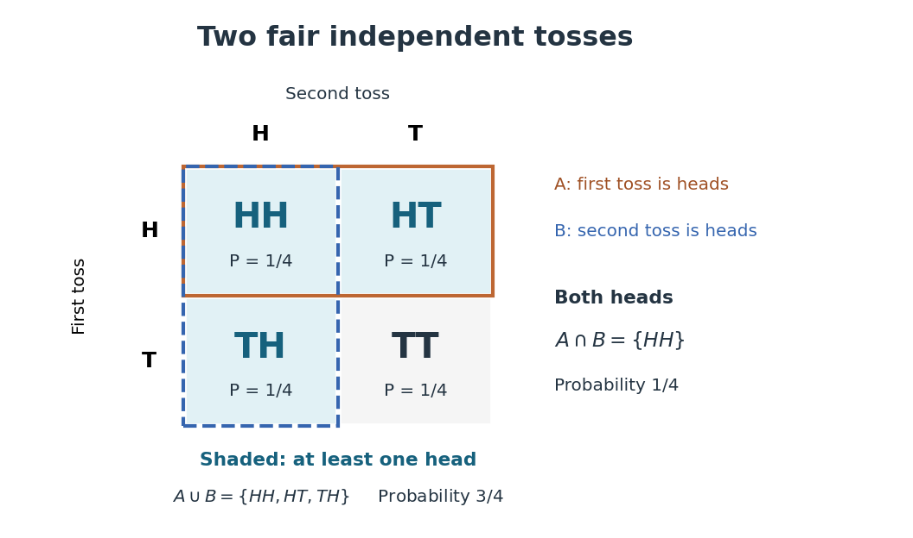
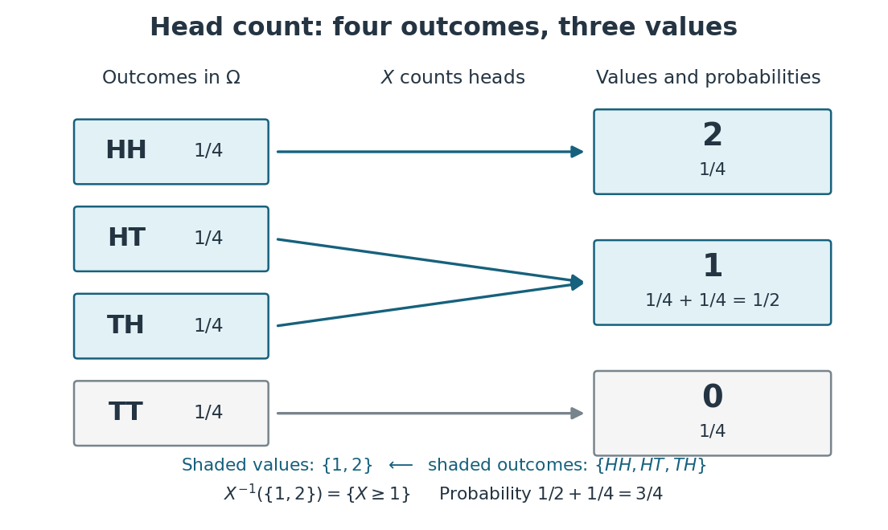
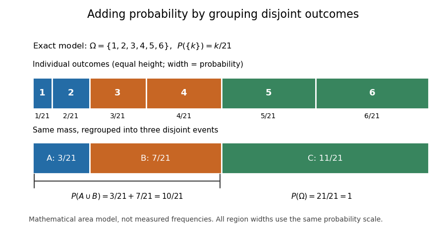
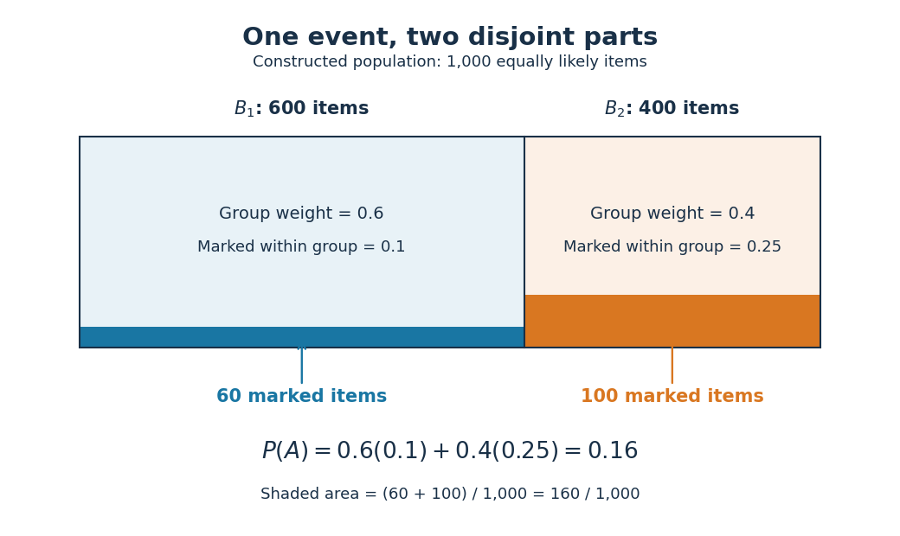
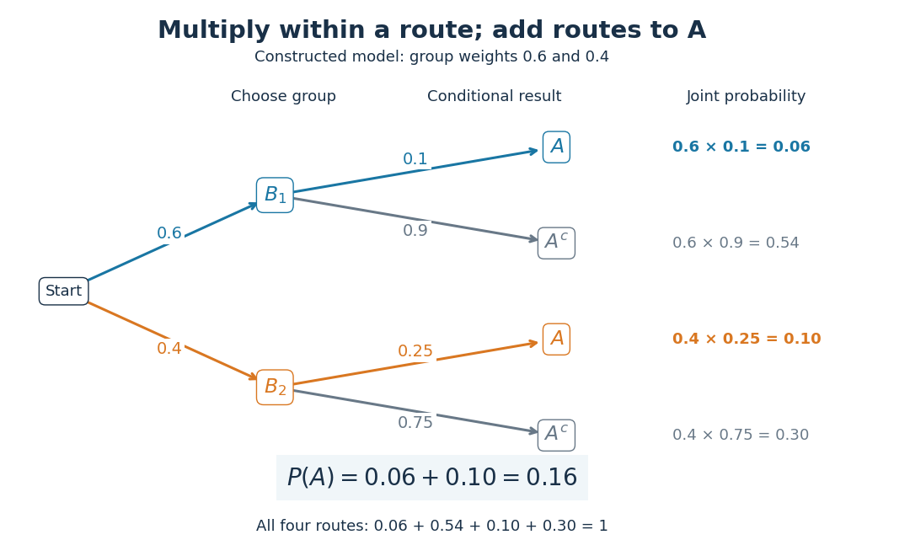

# Probability space

↑ **Parent:** [Probability theory](probability-theory.md)  
ⓦ [Wiki](https://en.wikipedia.org/wiki/Probability_space)

A probability space is a [measure space](measure.md#measure-space) $(\Omega,\mathcal F,\mathbb P)$ whose total [measure](measure.md) is one. The [sample space](#sample-space) $\Omega$ contains the elementary outcomes; the [sigma-algebra](measure-theory.md#sigma-algebra) $\mathcal F$ contains the [events](#event) to which the model assigns [probabilities](probability-theory.md#probability); the [probability measure](#probability-measure) $\mathbb P$ supplies those values. The [sigma-algebra](measure-theory.md#sigma-algebra) lets us combine observable questions using [complements](set.md#complement-of-a-set) and countable [unions](set.md#set-union) while remaining within the model.

For two independent uniform dice, take $\Omega=\{1,\ldots,6\}^2$, $\mathcal F=\mathcal P(\Omega)$, and give each ordered pair mass $1/36$. A [random variable](random-variable.md) might record the sum, the larger result, or whether both results are [even integers](integer.md#even-number). These are different [functions](function.md) on the same [sample space](#sample-space), rather than different elementary experiments. A [probability distribution](probability-distribution.md) records the mass of the values of one such [random variable](random-variable.md) and can forget information retained by the full [probability space](probability-space.md).

**Table of contents**

- [Product probability space](#product-probability-space)
- [Sample space](#sample-space)
  - [Elementary outcome](#elementary-outcome)
  - [Two-toss sample space](#two-toss-sample-space)
    - [Events determined by a random variable](#events-determined-by-a-random-variable)
- [Almost sure event](#almost-sure-event)
- [Probability measure](#probability-measure)
  - [Continuity of probability](#continuity-of-probability)
  - [Tightness of a probability measure](#tightness-of-a-probability-measure)
    - [Aldous tightness criterion](#aldous-tightness-criterion)
    - [Uniform tightness](#uniform-tightness)
      - [Helly selection for distribution functions](#helly-selection-for-distribution-functions)
  - [Zero-probability event](#zero-probability-event)
  - [Empirical measure](#empirical-measure)
  - [Compactly supported continuous functions determine a finite Borel measure](#compactly-supported-continuous-functions-determine-a-finite-borel-measure)
  - [Kolmogorov axioms](#kolmogorov-axioms)
  - [Law of total probability](#law-of-total-probability)
    - [Sharp bounds from binary conditional probabilities](#sharp-bounds-from-binary-conditional-probabilities)
- [Event](#event)
  - [Limsup of events](#limsup-of-events)
  - [Complement of an event](#complement-of-an-event)
  - [Disjoint events](#disjoint-events)
- [Cylinder sigma-algebra](#cylinder-sigma-algebra)

## Product probability space

↑ **Parent:** [Probability space](probability-space.md)

For finitely many [probability spaces](probability-space.md) $(X_i,\mathcal F_i,\mu_i)$, their product [probability](probability-theory.md#probability) space has underlying [set](set.md) $\prod_iX_i$, the [product sigma-algebra](probability-theory.md#product-sigma-algebra) and [product measure](probability-theory.md#product-measure) $\bigotimes_i\mu_i$. The coordinate projections are jointly independent: for measurable $B_i\subseteq X_i$, the [probability](probability-theory.md#probability) of all coordinate conditions is $\prod_i\mu_i(B_i)$. Conversely a family of independent coordinates has this product joint distribution. Product structure permits coordinate exposure and independent resampling in concentration arguments.

## Sample space

↑ **Parent:** [Probability space](probability-space.md)

The [sample space](#sample-space) is the [set](set.md) $\Omega$ of outcomes represented by a [probability](probability-theory.md#probability) model. One [elementary outcome](#elementary-outcome) $\omega\in\Omega$ specifies a complete result at the level of detail the model keeps. An [event](#event) is a [subset](set.md#subset) belonging to the model's [sigma-algebra](measure-theory.md#sigma-algebra) $\mathcal F$; it occurs when the actual outcome lies in that [subset](set.md#subset). Together with a [probability measure](#probability-measure) $\mathbb P$, these form a [probability space](probability-space.md) $(\Omega,\mathcal F,\mathbb P)$, with $\mathbb P(\Omega)=1$.[§1.3.1 Random Experiments: definitions of outcome, sample space, and event; three-toss example](mathematics-bibliography.md#introduction-to-probability-statistics-and-random-processes-by-hossein-pishro-nik)

Choosing a [sample space](#sample-space) means deciding which distinctions matter. For two tosses, recording the ordered head-or-tail sequence distinguishes $HT$ from $TH$; recording only the number of heads merges them. Neither representation is automatically wrong, but the second cannot answer a question about which toss was heads. Keeping a detailed [sample space](#sample-space) and defining a [random variable](random-variable.md) for the desired observation lets several questions share one model.

A [sample space](#sample-space) alone assigns no [probabilities](probability-theory.md#probability). Even writing $\Omega=\{H,T\}^2$ as a [Cartesian product](set-theory.md#cartesian-product) does not establish [independence](random-variable.md#independent-random-variables): that requires a condition on the [probability measure](#probability-measure). On a finite [sample space](#sample-space) with all [subsets](set.md#subset) admitted as [events](#event),

$$
\mathbb P(A)=\sum_{\omega\in A}\mathbb P(\{\omega\}).
$$

Only when all elementary [probabilities](probability-theory.md#probability) are equal does this become $\mathbb P(A)=|A|/|\Omega|$, where the bars denote [cardinality](cardinal-number.md#cardinality). This is the [uniform distribution on a finite set](discrete-probability-distribution.md#discrete-uniform-distribution), an additional modelling choice.

[Sample spaces](#sample-space) can also be infinite. For example, take $\Omega=[0,1]$, its [Borel sigma-algebra](measure-theory.md#borel-sigma-algebra), and the [continuous uniform distribution](continuous-probability-distribution.md#continuous-uniform-distribution). Then $\mathbb P([a,b])=b-a$ for $0\leq a\leq b\leq1$, so each [singleton](set.md#singleton-mathematics) has [probability](probability-theory.md#probability) zero while $\mathbb P(\Omega)=1$. Thus an [elementary outcome](#elementary-outcome) need not carry positive [probability](probability-theory.md#probability), and a continuous model cannot be understood by counting equally likely points. The distinction is developed in [zero-probability event](#zero-probability-event) and [countable additivity](measure.md#countable-additivity).

### Elementary outcome

↑ **Parent:** [Sample space](#sample-space)

An [elementary outcome](#elementary-outcome) is one member of the [sample space](#sample-space). For the ordered two-toss model, $HT$ is one outcome; it contains both toss results. By contrast, “at least one head” is an [event](#event) containing three outcomes. The outcome $HT$ and the [singleton set](set.md#singleton-mathematics) $\{HT\}$ are different objects: when that [singleton](set.md#singleton-mathematics) is measurable, the notation $\mathbb P(\{HT\})$ gives its [probability](probability-theory.md#probability). In the finite model below, every [subset](set.md#subset) is measurable.

The word elementary refers to the chosen level of detail. An outcome can be an [ordered pair](set.md#ordered-pair), a sequence, or an entire realization of a [point process](probability-theory.md#point-process). A [random variable](random-variable.md) then extracts a numerical feature of that outcome; the [window count of a point process](probability-theory.md#window-count-of-a-point-process) is one example.

### Two-toss sample space

↑ **Parent:** [Sample space](#sample-space)

Model two fair [independent](random-variable.md#independent-random-variables) coin tosses, recording their order. Here $H$ denotes heads and $T$ tails, and

$$
\Omega=\{HH,HT,TH,TT\},\qquad
\mathcal F=\mathcal P(\Omega),\qquad
\mathbb P(\{\omega\})=\frac14\quad(\omega\in\Omega).
$$

The [power set](set.md#power-set) $\mathcal P(\Omega)$ includes every question expressible as a [subset](set.md#subset) of these four outcomes. The mass $1/4=(1/2)(1/2)$ comes from the fairness and [independence](random-variable.md#independent-random-variables) assumptions. These are exact model [probabilities](probability-theory.md#probability), rather than measured toss frequencies.

Let $A$ be the [event](#event) that the first toss is heads and $B$ the [event](#event) that the second toss is heads. Then

$$
A=\{HH,HT\},\qquad B=\{HH,TH\},\qquad
A\cup B=\{HH,HT,TH\},\qquad A\cap B=\{HH\}.
$$

The [union](set.md#set-union) means “at least one head,” while the [intersection](set.md#set-intersection) means “both heads.” Their [probabilities](probability-theory.md#probability) are $3/4$ and $1/4$. Counting the [union](set.md#set-union) through the [inclusion-exclusion principle](combinatorics.md#inclusion-exclusion-principle) gives $1/2+1/2-1/4=3/4$; alternatively its [complement of an event](#complement-of-an-event) is $\{TT\}$, of [probability](probability-theory.md#probability) $1/4$.

**[Figure 1](#image-four-ordered-outcomes-and-the-event-of-at-least-one-head). Four ordered outcomes and the event of at least one head**. Rows record the first toss and columns the second. Each cell has [probability](probability-theory.md#probability) $1/4$ under fair [independent](random-variable.md#independent-random-variables) tosses. The highlighted [union](set.md#set-union) $A\cup B$ includes $HH$, $HT$, and $TH$; the overlap $A\cap B$ contains only $HH$.

On the same [sample space](#sample-space), assigning masses $3/8,1/8,1/8,3/8$ to $HH,HT,TH,TT$ would still make each toss fair: $\mathbb P(A)=\mathbb P(B)=1/2$. But $\mathbb P(A\cap B)=3/8\ne1/4$, so the tosses would be dependent. The [event](#event) of at least one head would have [probability](probability-theory.md#probability) $5/8$. Changing the [probability measure](#probability-measure) changes the answer even when the [sample space](#sample-space) and the single-toss [probabilities](probability-theory.md#probability) stay the same.

#### Events determined by a random variable

↑ **Parent:** [Two-toss sample space](#two-toss-sample-space)

Define the head-count [random variable](random-variable.md) $X:\Omega\to\{0,1,2\}$ by

$$
X(TT)=0,\qquad X(HT)=X(TH)=1,\qquad X(HH)=2.
$$

The four [elementary outcomes](#elementary-outcome) are inputs to this [function](function.md); its three numerical values are outputs. Each [fiber of a function](function.md#fiber-of-a-function) collects all outcomes giving one value. Under the fair [independent](random-variable.md#independent-random-variables) model, adding the masses in each [fiber](function.md#fiber-of-a-function) gives the [probability mass function](probability-distribution.md#probability-mass-function)

$$
\mathbb P(X=0)=\frac14,\qquad
\mathbb P(X=1)=\frac14+\frac14=\frac12,\qquad
\mathbb P(X=2)=\frac14.
$$

Consequently the output values are not equally likely, although the inputs are. Using the reduced [sample space](#sample-space) $\{0,1,2\}$ with these masses gives the same head-count [probability distribution](probability-distribution.md); assigning $1/3$ to each value would describe a different model.

A question about a [random variable](random-variable.md)'s value becomes an [event](#event) on the original [sample space](#sample-space) by taking an [inverse image](set-theory.md#preimage):

$$
\{X\in D\}=X^{-1}(D)=\{\omega\in\Omega:X(\omega)\in D\}.
$$

For a real-valued [random variable](random-variable.md), this is an [event](#event) whenever $D$ is a [Borel set](measure-theory.md#borel-set), by [measurability](measure-theory.md#measurability). In this finite example every [subset](set.md#subset) of $\{0,1,2\}$ is allowed. In particular,

$$
\{X\geq1\}=X^{-1}(\{1,2\})=\{HH,HT,TH\},\qquad
\mathbb P(X\geq1)=\frac12+\frac14=\frac34.
$$

This is the same “at least one head” [event](#event) counted above, expressed through an observable.[Probability Spaces, §2 Events and Random Variables, Random Variables: measurable functions and the inverse-image notation for value events](mathematics-bibliography.md#random-probability-mathematical-statistics-stochastic-processes-by-kyle-siegrist)

**[Figure 2](#image-head-count-merges-outcomes-into-fibers-and-adds-their-probabilities). Head count merges outcomes into fibers and adds their probabilities**. The [random variable](random-variable.md) sends $TT$ to zero, both $HT$ and $TH$ to one, and $HH$ to two. The [inverse image](set-theory.md#preimage) of $\{1,2\}$ is the highlighted [event](#event) of at least one head. Two arrows meeting at one explain its [probability](probability-theory.md#probability) $1/2$.

Every [event](#event) determined by $X$ is a [union](set.md#set-union) of complete [fibers](function.md#fiber-of-a-function). There are $2^3=8$ such [events](#event), whereas the full [power set](set.md#power-set) of $\Omega$ has $2^4=16$. In particular, the first-head [event](#event) $A=\{HH,HT\}$ is not determined by $X$: it contains $HT$ but excludes $TH$, although both give $X=1$. Choosing an observable makes calculations simpler precisely by forgetting distinctions; the useful choice is one that retains the distinctions the question needs.

## Almost sure event

↑ **Parent:** [Probability space](probability-space.md)

An almost sure event is a measurable event of probability one. Countable intersections of such events still have probability one, allowing a conclusion to hold simultaneously for countably many parameter choices. Further deterministic reasoning may then extend it to uncountably many parameters, as in [Brownian Hölder regularity](brownian-motion.md#brownian-holder-regularity) or [nowhere monotonicity of Brownian motion](brownian-motion.md#nowhere-monotonicity-of-brownian-motion). An uncountable intersection need not preserve probability one without such additional reasoning.

## Probability measure

↑ **Parent:** [Probability space](probability-space.md)  
ⓦ [Wiki](https://en.wikipedia.org/wiki/Probability_measure)

A probability measure is a nonnegative, [countably additive](measure.md#countable-additivity) [measure](measure.md) with total mass one. Thus $\mathbb P(\Omega)=1$, and for pairwise [disjoint events](#disjoint-events) $A_j$,

$$
\mathbb P\left(\bigcup_{j=1}^{\infty}A_j\right)=\sum_{j=1}^{\infty}\mathbb P(A_j).
$$

The [complement of an event](#complement-of-an-event) has [probability](probability-theory.md#probability) $1-\mathbb P(A)$. The [probability](probability-theory.md#probability) of a [union](set.md#set-union) of overlapping [events](#event) needs a correction: $\mathbb P(A\cup B)=\mathbb P(A)+\mathbb P(B)-\mathbb P(A\cap B)$. Counting the overlap once is the simplest instance of the [inclusion-exclusion principle](combinatorics.md#inclusion-exclusion-principle).

A [zero-probability event](#zero-probability-event) need not be impossible as a member of the [sample space](#sample-space). Under the [continuous uniform distribution](continuous-probability-distribution.md#continuous-uniform-distribution) on $[0,1]$, every individual point has [probability](probability-theory.md#probability) zero, while the whole interval has [probability](probability-theory.md#probability) one. [Countable additivity](measure.md#countable-additivity) applies to countable [unions](set.md#set-union), not arbitrary uncountable ones; there is no contradiction.

### Continuity of probability

↑ **Parent:** [Probability measure](#probability-measure)

[Continuity of probability](#continuity-of-probability) says that nested [events](#event) can be approximated by their finite stages without losing [probability](probability-theory.md#probability) in the [limit of a sequence](sequence-and-series.md#limit-of-a-sequence). In a [probability space](probability-space.md) $(\Omega,\mathcal F,\mathbb P)$, let $A_n,B_n\in\mathcal F$. Then

$$
\begin{aligned}
A_1\subseteq A_2\subseteq\cdots,\quad A=\bigcup_{n=1}^{\infty}A_n
&\quad\Longrightarrow\quad \mathbb P(A_n)\uparrow\mathbb P(A),\\
B_1\supseteq B_2\supseteq\cdots,\quad B=\bigcap_{n=1}^{\infty}B_n
&\quad\Longrightarrow\quad \mathbb P(B_n)\downarrow\mathbb P(B).
\end{aligned}
$$

The [sigma-algebra](measure-theory.md#sigma-algebra) ensures that both limiting [events](#event) belong to $\mathcal F$. These are [continuity from below of a measure](measure.md#continuity-from-below-of-a-measure) and [continuity from above of a measure](measure.md#continuity-from-above-of-a-measure). The first holds even for an infinite [measure](measure.md); the second requires finite [measure](measure.md) of the first [set](set.md), which is automatic for a [probability measure](#probability-measure) because $\mathbb P(B_1)\leq1$.[Probability 1 lecture notes, Chapter 1: Axioms of probability by Durham Statistics and Probability teaching team](mathematics-bibliography.md#probability-1-lecture-notes-chapter-1-axioms-of-probability-by-durham-statistics-and-probability-teaching-team)

For a concrete model, toss a fair coin through a sequence of [independent](random-variable.md#independent-random-variables) [Bernoulli trials](discrete-probability-distribution.md#bernoulli-trial), and let $A_n$ be the [event](#event) of at least one head in the first $n$ tosses. Its [complement](set.md#complement-of-a-set) $B_n=A_n^c$ is the [event](#event) of $n$ initial tails. On the [sample space](#sample-space) of infinite head-or-tail sequences,

$$
\mathbb P(A_n)=1-2^{-n},\qquad \mathbb P(B_n)=2^{-n},\qquad
\mathbb P\left(\bigcup_{n=1}^{\infty}A_n\right)=1,\qquad
\mathbb P\left(\bigcap_{n=1}^{\infty}B_n\right)=0.
$$

Every finite waiting horizon has positive [tail probability](probability-theory.md#tail-probability), yet the [event](#event) of waiting forever has [probability](probability-theory.md#probability) zero. That [intersection](set.md#set-intersection) is not empty: it contains the all-tails sequence. Thus a [zero-probability event](#zero-probability-event) need not be impossible as an outcome, and eventual success [almost surely](convergence-of-random-variables.md#almost-sure-convergence) does not supply a deterministic deadline. The waiting time for the first head has a [geometric distribution](discrete-probability-distribution.md#geometric-distribution) with success [probability](probability-theory.md#probability) $1/2$. After ten tosses, the remaining [tail probability](probability-theory.md#tail-probability) is exactly $1/1024<1/1000$; nine tosses leave $1/512>1/1000$.

**[Figure 3](#image-exact-fair-coin-model-success-by-toss-n-increases-to-probability-one-while-the-all-tails-prefix-probability-decreases-to-zero). Exact fair-coin model: success by toss n increases to probability one, while the all-tails prefix probability decreases to zero**.

A proof outline exposes what makes [countable additivity](measure.md#countable-additivity) stronger than [finite additivity of a set function](function.md#finite-additivity-of-a-set-function). For increasing [events](#event), put $D_1=A_1$ and $D_n=A_n\setminus A_{n-1}$ for $n\geq2$. These [set differences](set.md#set-difference) are pairwise [disjoint events](#disjoint-events), their [union](set.md#set-union) is $A$, and the first $n$ pieces have [union](set.md#set-union) $A_n$. Consequently

$$
\mathbb P(A)=\sum_{j=1}^{\infty}\mathbb P(D_j)
=\lim_{n\to\infty}\sum_{j=1}^{n}\mathbb P(D_j)
=\lim_{n\to\infty}\mathbb P(A_n).
$$

For decreasing [events](#event), their [complements](set.md#complement-of-a-set) increase to $B^c$; applying the increasing result and the [complement rule of probability](probability-theory.md#complement-rule-of-probability) gives $\mathbb P(B_n)=1-\mathbb P(B_n^c)\to1-\mathbb P(B^c)=\mathbb P(B)$. The finite-total-mass condition is essential for this subtraction. For comparison, the [counting measure](measure.md#counting-measure) of each [set](set.md) $\{n,n+1,\ldots\}$ of [natural numbers](arithmetic.md#natural-number) is infinite, although their [intersection](set.md#set-intersection) is empty and has [measure](measure.md) zero.

Conversely, on a [sigma-algebra](measure-theory.md#sigma-algebra), a nonnegative normalized [set function](function.md#set-function) satisfying [finite additivity of a set function](function.md#finite-additivity-of-a-set-function) and $R_n\downarrow\varnothing\Rightarrow\mathbb P(R_n)\to0$ satisfies [countable additivity](measure.md#countable-additivity). For pairwise [disjoint events](#disjoint-events) $D_j$ with $E=\bigcup_jD_j$, the remainders $R_n=E\setminus\bigcup_{j=1}^nD_j$ decrease to the empty [set](set.md), and

$$
\mathbb P(E)=\sum_{j=1}^{n}\mathbb P(D_j)+\mathbb P(R_n).
$$

Taking the [limit of a sequence](sequence-and-series.md#limit-of-a-sequence) recovers the infinite sum. This equivalence explains why [continuity of probability](#continuity-of-probability) is part of the foundations rather than a separate assumption about smooth curves.

One useful application controls infinitely many possible errors. If [events](#event) $E_j$ satisfy $\sum_j\mathbb P(E_j)<\infty$, then the [events](#event) $C_n=\bigcup_{j\geq n}E_j$ decrease, and the [union bound](probability-inequality.md#boole-s-inequality) gives $\mathbb P(C_n)\leq\sum_{j\geq n}\mathbb P(E_j)\to0$. [Continuity of probability](#continuity-of-probability) therefore makes $\mathbb P(\bigcap_nC_n)=0$: errors occur infinitely often with [probability](probability-theory.md#probability) zero. This is the [Borel-Cantelli first lemma](probability-theory.md#borel-cantelli-first-lemma), and it requires no [independence](random-variable.md#independent-random-variables). For the illustrative bounds $\mathbb P(E_j)\leq2^{-j}$, the [probability](probability-theory.md#probability) of any error at index $n$ or later is at most $2^{1-n}$, an explicit truncation guarantee.

The word continuity here concerns nested [sets](set.md), not the absence of atoms in a [probability distribution](probability-distribution.md). For any real-valued [random variable](random-variable.md) $X$, the [events](#event) $\{X\leq x+1/n\}$ decrease to $\{X\leq x\}$. Hence its [cumulative distribution function](probability-distribution.md#cumulative-distribution-function) is [right-continuous](calculus.md#right-continuous-function) even when it has jumps, as for a [geometric distribution](discrete-probability-distribution.md#geometric-distribution). The nesting hypothesis matters: an arbitrary sequence of [events](#event) need not admit either displayed interchange of [limit](calculus.md#limit-of-a-function) and [probability](probability-theory.md#probability).

### Tightness of a probability measure

↑ **Parent:** [Probability measure](#probability-measure)

A [probability measure](#probability-measure) is tight if compact sets carry arbitrarily nearly all its mass. Every [Borel probability measure](measure.md#borel-probability-measure) on a [Polish space](topological-analysis.md#polish-space) is tight. The stronger family condition is [uniform tightness](#uniform-tightness).

#### Aldous tightness criterion

↑ **Parent:** [Tightness of a probability measure](#tightness-of-a-probability-measure)

For càdlàg processes on a finite horizon, compact containment together with uniformly small increments over pairs of bounded [stopping times](martingale.md#stopping-time) whose separation tends to zero is a sufficient criterion for tightness in the [Skorokhod J1 topology](convergence-of-random-variables.md#skorokhod-j1-topology). The increment condition is in probability, not merely at deterministic times. If in addition the largest jump tends to zero in probability, every limiting law is supported on continuous paths.

#### Uniform tightness

↑ **Parent:** [Tightness of a probability measure](#tightness-of-a-probability-measure)

The same [compact set](topology.md#compact-space) must work simultaneously for every [measure](measure.md) in the family. [Prokhorov's theorem](convergence-of-random-variables.md#prokhorov-s-theorem) relates this condition to relative compactness for the [weak topology of probability measures](convergence-of-random-variables.md#weak-topology-of-probability-measures) on a [Polish space](topological-analysis.md#polish-space).

##### Helly selection for distribution functions

↑ **Parent:** [Uniform tightness](#uniform-tightness)

A tight sequence of [probability measures](#probability-measure) on the real line has a subsequence whose [cumulative distribution functions](probability-distribution.md#cumulative-distribution-function) converge at every continuity point of a [cumulative distribution function](probability-distribution.md#cumulative-distribution-function). Choose a diagonal subsequence converging at every rational $q$, write those limits as $f(q)$, and define $F(x)=\inf_{q>x}f(q)$. Monotonicity gives right continuity, and [tightness of probability measures](#uniform-tightness) gives limits zero and one at the two ends of the real line. Bracketing by rational continuity approximations proves convergence at the continuity points of $F$. The corresponding [probability measure](#probability-measure) is the weak subsequential limit: approximate a bounded continuous test function by step functions on a compact interval, and use tightness to bound the tails.

### Zero-probability event

↑ **Parent:** [Probability measure](#probability-measure)

A zero-probability event has [probability measure](#probability-measure) zero. It need not be empty: for a continuously distributed [random variable](random-variable.md), equality with a specified value is such an event. The complementary event occurs [almost surely](convergence-of-random-variables.md#almost-sure-convergence).

### Empirical measure

↑ **Parent:** [Probability measure](#probability-measure)

For observations or orbit points $x_0,\ldots,x_{N-1}$, the empirical measure is $\nu_N=N^{-1}\sum_{j=0}^{N-1}\delta_{x_j}$. Integrating a test function gives its sample average. For orbit points $x_j=T^jx$, the difference between $T_*\nu_N$ and $\nu_N$ telescopes to $(\delta_{T^Nx}-\delta_x)/N$, so on a compact [metric space](topological-analysis.md#metric-space) with continuous $T$, every weak limit is invariant.

### Compactly supported continuous functions determine a finite Borel measure

↑ **Parent:** [Probability measure](#probability-measure)

If finite [Borel measures](measure.md#borel-measure) $\mu$ and $\nu$ on $\mathbb R$ satisfy

$$
\int f\,d\mu=\int f\,d\nu
$$

for every compactly supported [continuous function](calculus.md#continuous-function) $f$, then $\mu=\nu$. This follows from the uniqueness part of the [Riesz representation theorem](hilbert-space.md#riesz-representation-theorem); alternatively, continuous functions that approximate indicators from above and below recover the measure of every interval and hence every Borel set.

### Kolmogorov axioms

↑ **Parent:** [Probability measure](#probability-measure)

The [Kolmogorov axioms](#kolmogorov-axioms) describe a consistent way to assign [probabilities](probability-theory.md#probability) to [events](#event). Start with a [sample space](#sample-space) $\Omega$ and an [event](#event) [sigma-algebra](measure-theory.md#sigma-algebra) $\mathcal F$: it contains $\Omega$ and is closed under [complements](set.md#complement-of-a-set) and countable [unions](set.md#set-union), hence also countable [intersections](set.md#set-intersection). The [probability measure](#probability-measure) is a [function](function.md) $\mathbb P:\mathcal F\to\mathbb R$ satisfying

$$
\begin{aligned}
&\mathbb P(A)\geq0 &&\text{for every }A\in\mathcal F,\\
&\mathbb P(\Omega)=1,\\
&\mathbb P\left(\bigcup_{j=1}^{\infty}A_j\right)
=\sum_{j=1}^{\infty}\mathbb P(A_j)
&&\text{if }A_i\cap A_j=\varnothing\text{ for }i\ne j.
\end{aligned}
$$

The triple $(\Omega,\mathcal F,\mathbb P)$ is a [probability space](probability-space.md). The third axiom is [countable additivity](measure.md#countable-additivity); the infinite [series](sequence-and-series.md#series-mathematics) means the [limit of a sequence](sequence-and-series.md#limit-of-a-sequence) of nonnegative partial sums. It applies to pairwise [disjoint events](#disjoint-events), not to overlapping [events](#event) and not to arbitrary uncountable [unions](set.md#set-union).[Introduction to Probability, Lecture 1: Probability Models and Axioms by John Tsitsiklis and others](mathematics-bibliography.md#introduction-to-probability-lecture-1-probability-models-and-axioms-by-john-tsitsiklis-and-others)

The [sigma-algebra](measure-theory.md#sigma-algebra) specifies which questions have [probabilities](probability-theory.md#probability), while the axioms specify how those [probabilities](probability-theory.md#probability) fit together. For a finite [sample space](#sample-space) one can take the entire [power set](set.md#power-set); a continuous model commonly uses a [Borel sigma-algebra](measure-theory.md#borel-sigma-algebra). Nonnegativity and normalization do not require equally likely outcomes or [independence](random-variable.md#independent-random-variables): those are additional modelling choices.

For an exact six-outcome model, take $\Omega=\{1,2,3,4,5,6\}$, $\mathcal F=\mathcal P(\Omega)$, and assign $\mathbb P(\{k\})=k/21$. The total is one because $1+2+3+4+5+6=21$. Define the [probability](probability-theory.md#probability) of an [event](#event) by summing the weights of its outcomes. The [disjoint events](#disjoint-events) $A=\{1,2\}$, $B=\{3,4\}$ and $C=\{5,6\}$ form a [partition of a set](set.md#partition-of-a-set) with

$$
\mathbb P(A)=\frac3{21},\qquad \mathbb P(B)=\frac7{21},\qquad
\mathbb P(C)=\frac{11}{21},\qquad
\mathbb P(A\cup B)=\frac{10}{21}=1-\mathbb P(C).
$$

This is a specified mathematical model, not measured die frequencies. The figure makes [probability](probability-theory.md#probability) literal area: each region has the same height and a width proportional to its assigned mass. Regrouping [disjoint events](#disjoint-events) preserves their total area.

**[Figure 4](#image-exact-six-outcome-model-with-masses-k-21-grouping-disjoint-outcomes-adds-their-probability-areas). Exact six-outcome model with masses k/21: grouping disjoint outcomes adds their probability areas**.

Several familiar rules are consequences, not further axioms. [Finite additivity of a set function](function.md#finite-additivity-of-a-set-function) follows by appending empty [events](#event) to the sequence in [countable additivity](measure.md#countable-additivity); $\mathbb P(\varnothing)=0$ follows already by writing $\Omega=\Omega\cup\varnothing$ as a disjoint [union](set.md#set-union). The [complement rule of probability](probability-theory.md#complement-rule-of-probability) gives $\mathbb P(A^c)=1-\mathbb P(A)$ and therefore $0\leq\mathbb P(A)\leq1$. Splitting larger [events](#event) into a smaller [event](#event) and a [set difference](set.md#set-difference) shows $A\subseteq B\Rightarrow\mathbb P(A)\leq\mathbb P(B)$.

For overlapping [events](#event), the [inclusion-exclusion principle](combinatorics.md#inclusion-exclusion-principle) corrects double counting:

$$
\mathbb P(D\cup E)=\mathbb P(D)+\mathbb P(E)-\mathbb P(D\cap E).
$$

In the six-outcome model, $D=\{2,3\}$ and $E=\{3,4\}$ give $5/21+7/21-3/21=9/21$, agreeing with the weight of $\{2,3,4\}$. This decomposition is useful because a complicated [event](#event) can be assembled from simpler questions with known [probabilities](probability-theory.md#probability).

On a finite [sample space](#sample-space), a family of pairwise [disjoint events](#disjoint-events) has only finitely many nonempty members, so [finite additivity of a set function](function.md#finite-additivity-of-a-set-function) already handles every countable disjoint [union](set.md#set-union). On an infinite [sample space](#sample-space), the countable axiom additionally controls what is left beyond every finite stage. In the fair-coin waiting model of [continuity of probability](#continuity-of-probability), the finite-stage calculations $\mathbb P(\text{first head at toss }j)=2^{-j}$ sum to $1-2^{-n}$ through toss $n$. [Countable additivity](measure.md#countable-additivity) makes the [probability](probability-theory.md#probability) of a head at some finite toss equal to $\sum_{j\geq1}2^{-j}=1$; finite-stage sums alone do not justify that passage. For the [continuous uniform distribution](continuous-probability-distribution.md#continuous-uniform-distribution) on $[0,1]$, each [singleton](set.md#singleton-mathematics) instead has [probability](probability-theory.md#probability) zero, while their uncountable [union](set.md#set-union) has [probability](probability-theory.md#probability) one. Countable, rather than unrestricted, additivity accommodates both models.

Historically, Kolmogorov's 1933 book _[Grundbegriffe der Wahrscheinlichkeitsrechnung](mathematics-bibliography.md#grundbegriffe-der-wahrscheinlichkeitsrechnung-by-andrei-n-kolmogorov)_ established the influential axiomatic framework connecting [probability theory](probability-theory.md) with [measure theory](measure-theory.md). The three conditions above are the modern presentation on a [sigma-algebra](measure-theory.md#sigma-algebra). Shafer and Vovk's historical study explains that the original presentation began with finite additivity on an [algebra of sets](measure-theory.md#algebra-of-sets) and added continuity for decreasing [events](#event) with empty [intersection](set.md#set-intersection), which supplies the countable extension.[The Sources of Kolmogorov’s Grundbegriffe by Glenn Shafer and others](mathematics-bibliography.md#the-sources-of-kolmogorov’s-grundbegriffe-by-glenn-shafer-and-others)

### Law of total probability

↑ **Parent:** [Probability measure](#probability-measure)  
ⓦ [Wiki](https://en.wikipedia.org/wiki/Law_of_total_probability)

Let $(B_i)$ be a countable [measurable partition](measure-theory.md#measurable-partition) of the [sample space](#sample-space), with positive [probabilities](probability-theory.md#probability). For any [event](#event) $A$, the law of total probability gives

$$
\mathbb P(A)=\sum_i\mathbb P(A\mid B_i)\mathbb P(B_i).
$$

The pieces $A\cap B_i$ are [disjoint events](#disjoint-events), so add their masses and use the definition of [conditional probability](probability-theory.md#conditional-probability). Zero-mass partition pieces can be omitted without changing the answer.

For the coin selection in [probability](probability-theory.md#probability), let $B$ mean the $3/4$-head coin was selected and let $H$ mean the first toss was heads. Then $\mathbb P(H)=\mathbb P(H\mid B)\mathbb P(B)+\mathbb P(H\mid B^c)\mathbb P(B^c)=11/20$. Each conditional answer describes one possible hidden situation; its weight describes how often that situation occurs under the model. This decomposition is useful whenever a simple conditional model sits behind a more complicated marginal [probability distribution](probability-distribution.md).

The [law of total probability](#law-of-total-probability) combines local [conditional probabilities](probability-theory.md#conditional-probability) into one overall [probability](probability-theory.md#probability). The [measurable partition](measure-theory.md#measurable-partition) must cover the [sample space](#sample-space) with pairwise [disjoint events](#disjoint-events): every [elementary outcome](#elementary-outcome) belongs to exactly one part. Its [probabilities](probability-theory.md#probability) are the weights of a [weighted mean](arithmetic.md#weighted-arithmetic-mean), and they sum to one.[Probability Spaces, §4 Conditional Probability, Basic Theory, Conditioning and Bayes' Theorem: countable partition formula and weighted-average interpretation](mathematics-bibliography.md#random-probability-mathematical-statistics-stochastic-processes-by-kyle-siegrist)

For an original constructed example, make a [finite set](set.md#finite-set) of 1,000 items: 600 belong to $B_1$ and 400 to $B_2$. Mark exactly 60 items in $B_1$ and 100 in $B_2$, and let the [event](#event) $A$ mean that the selected item is marked. Select an item using the [uniform distribution on a finite set](discrete-probability-distribution.md#discrete-uniform-distribution). These are prescribed counts, so the resulting [probabilities](probability-theory.md#probability) are exact properties of this construction:

$$
\begin{aligned}
\mathbb P(B_1)&=\frac{600}{1000}=0.6,&\mathbb P(A\mid B_1)&=\frac{60}{600}=0.1,\\
\mathbb P(B_2)&=\frac{400}{1000}=0.4,&\mathbb P(A\mid B_2)&=\frac{100}{400}=0.25.
\end{aligned}
$$

The [conditional probability](probability-theory.md#conditional-probability) $0.1$ uses only the 600 items in $B_1$ as its denominator. The [probability](probability-theory.md#probability) of the [intersection](set.md#set-intersection) $A\cap B_1$ uses all 1,000 items instead: $0.6\times0.1=0.06$. Similarly, $\mathbb P(A\cap B_2)=0.4\times0.25=0.10$. Adding the two [disjoint events](#disjoint-events) gives

$$
\mathbb P(A)=0.6(0.1)+0.4(0.25)=0.06+0.10=0.16=\frac{60+100}{1000}.
$$

**[Figure 5](#image-a-partition-turns-within-group-rates-into-whole-population-areas). A partition turns within-group rates into whole-population areas**. An original constructed [finite set](set.md#finite-set) with 1,000 items, represented by area rather than measured data. The two widths encode [probabilities](probability-theory.md#probability) $0.6$ and $0.4$; the shaded heights encode [conditional probabilities](probability-theory.md#conditional-probability) $0.1$ and $0.25$. The shaded [intersection](set.md#set-intersection) areas encode 60 and 100 marked items, totaling 160.

An unweighted [arithmetic mean](arithmetic.md#arithmetic-mean) of the two [conditional probabilities](probability-theory.md#conditional-probability) would give $(0.1+0.25)/2=0.175$. That is the answer to a different selection rule: choose either group with [probability](probability-theory.md#probability) $1/2$, then select uniformly within that group. Here the first group contains more items, so selecting uniformly among all items gives it weight $0.6$. In fact, if its weight were $w$, the overall [probability](probability-theory.md#probability) would be $0.1w+0.25(1-w)=0.25-0.15w$. Moving the weight from $1/2$ to $0.6$ lowers the result by $0.015$, explaining exactly why $0.175$ is too large for the original model.

The same construction is a [mixture distribution](probability-distribution.md#mixture-distribution): first select a group with its [mixture weight](statistical-modelling.md#mixture-weight), then select an item within that group. Multiplying the weight by its [conditional probability](probability-theory.md#conditional-probability) gives the [probability](probability-theory.md#probability) of reaching $A$ through that group; adding the contributions gives the [law of total probability](#law-of-total-probability). For example, an item in $B_1$ has selection [probability](probability-theory.md#probability) $0.6/600=1/1000$, and an item in $B_2$ has selection [probability](probability-theory.md#probability) $0.4/400=1/1000$, recovering the original [uniform distribution on a finite set](discrete-probability-distribution.md#discrete-uniform-distribution).

**[Figure 6](#image-multiply-along-each-route-and-add-the-routes-ending-in-the-event). Multiply along each route and add the routes ending in the event**. The original constructed model expressed through group selection and a marked-or-unmarked result. First-stage weights are [probabilities](probability-theory.md#probability); second-stage weights are [conditional probabilities](probability-theory.md#conditional-probability). The four final [probabilities](probability-theory.md#probability) sum to one. The two routes to the [event](#event) $A$ contribute $0.06+0.10=0.16$.

No assumption of [independent events](probability-theory.md#independent-events) is needed. In this construction $\mathbb P(A\mid B_1)=0.1$ differs from $\mathbb P(A)=0.16$, so $A$ and $B_1$ are not [independent events](probability-theory.md#independent-events). Also $B_1$ and $B_2$ are [disjoint events](#disjoint-events) with positive [probabilities](probability-theory.md#probability), so they cannot be [independent events](probability-theory.md#independent-events): their [intersection](set.md#set-intersection) has [probability](probability-theory.md#probability) zero, whereas $\mathbb P(B_1)\mathbb P(B_2)=0.24$. The [measurable partition](measure-theory.md#measurable-partition) supplies exclusive alternatives, not an [independence](random-variable.md#independent-random-variables) assumption.

For a short proof, the [intersection](set.md#set-intersection) pieces $A\cap B_i$ have [union](set.md#set-union) $A$ and are pairwise [disjoint events](#disjoint-events). Apply [countable additivity](measure.md#countable-additivity), then substitute the definition of [conditional probability](probability-theory.md#conditional-probability) on every positive-mass part:

$$
\mathbb P(A)=\sum_i\mathbb P(A\cap B_i)
=\sum_{i:\,\mathbb P(B_i)>0}\mathbb P(A\mid B_i)\mathbb P(B_i).
$$

A [zero-probability event](#zero-probability-event) $B_i$ has $\mathbb P(A\cap B_i)=0$. Omit it: writing $\mathbb P(A\mid B_i)$ would divide by zero. Countability ensures that the [union](set.md#set-union) of the omitted [zero-probability events](#zero-probability-event) also has [probability](probability-theory.md#probability) zero. Overlapping parts would double-count their [intersections](set.md#set-intersection), and incomplete coverage would omit the [probability](probability-theory.md#probability) of $A$ in the uncovered region.[Probability Spaces, §4 Conditional Probability: The Basic Definition requires a positive conditioning probability; Conditioning and Bayes' Theorem proves total probability by partition intersections](mathematics-bibliography.md#random-probability-mathematical-statistics-stochastic-processes-by-kyle-siegrist)

Reversing the question gives one compact application of [Bayes' theorem](probability-theory.md#bayes-theorem). Among the 160 marked items, 100 belong to $B_2$, so its [conditional probability](probability-theory.md#conditional-probability) after observing $A$ is

$$
\mathbb P(B_2\mid A)=\frac{\mathbb P(A\cap B_2)}{\mathbb P(A)}=\frac{0.10}{0.16}=\frac{100}{160}=0.625.
$$

The [law of total probability](#law-of-total-probability) supplied the denominator by collecting every way that $A$ can occur. Its usefulness lies in choosing a [measurable partition](measure-theory.md#measurable-partition) where the [conditional probabilities](probability-theory.md#conditional-probability) are simple, then combining them without losing the relative sizes of the alternatives.

#### Sharp bounds from binary conditional probabilities

↑ **Parent:** [Law of total probability](#law-of-total-probability)

Write $q=P(A)$, $r=P(B\mid A)$ and $s=P(B\mid A^c)$. The [law of total probability](#law-of-total-probability) gives the displayed [convex combination](convex-set.md#convex-combination). With $q,r$ fixed and $s$ free in $[0,1]$,

$$
qr\leq P(B)\leq qr+1-q.
$$

With $r,s$ fixed and $q$ free in $[0,1]$,

$$
\min(r,s)\leq P(B)\leq\max(r,s).
$$

The joint cell masses $qr,q(1-r),(1-q)s,(1-q)(1-s)$ are nonnegative and sum to one, proving sharpness in the joint-model interpretation. For ordinary [conditional probabilities](probability-theory.md#conditional-probability), a conditioning event must have positive mass. If both $r$ and $s$ are specified by ratios, then $0<q<1$: for $r\ne s$ the last bounds are strict and their endpoints are the infimum and supremum. If $r=s$, the marginal equals that common value for every $q$. Endpoint mixtures remain meaningful if the unused zero-mass conditional is treated as a prescribed conditional model rather than a defined ratio.

## Event

↑ **Parent:** [Probability space](probability-space.md)  
ⓦ [Wiki](https://en.wikipedia.org/wiki/Event_(probability_theory))

An event is a [measurable set](measure-theory.md#measurable-set) in a [probability space](probability-space.md): a question with a yes-or-no answer for each outcome. On $\Omega=\{1,\ldots,6\}^2$, the [event](#event) that the sum is at least nine consists of ten ordered pairs. Its [probability](probability-theory.md#probability) is therefore $10/36=5/18$ under independent uniform dice. Saying that an [event](#event) occurred means the actual outcome belongs to that [set](set.md).

### Limsup of events

↑ **Parent:** [Event](#event)

For [events](#event) $A_n$ in a [probability space](probability-space.md), the infinitely-often [event](#event) is

$$
\limsup_{n\to\infty}A_n
=\bigcap_{m=1}^{\infty}\bigcup_{n=m}^{\infty}A_n
=\{\omega:\text{for every }m\text{ there is }n\geq m\text{ with }\omega\in A_n\}.
$$

Its [complement of an event](#complement-of-an-event) is $\bigcup_{m\geq1}\bigcap_{n\geq m}A_n^c$: after some outcome-dependent index, no more [events](#event) occur.[§2.3 opening definition and infinitely-often notation, printed pp. 67–68](mathematics-bibliography.md#probability-theory-and-examples-fifth-edition-by-rick-durrett)

Deleting finitely many [events](#event) leaves the [limsup of events](#limsup-of-events) unchanged. It is therefore a [tail event](probability-theory.md#tail-event) of the sequence of [indicator random variables](expected-value.md#indicator-random-variable) $\mathbf1_{A_n}$, whether or not those [random variables](random-variable.md) are [independent](random-variable.md#independent-random-variables). For [independent events](probability-theory.md#independent-events), the [Kolmogorov zero-one law](probability-theory.md#kolmogorov-s-zero-one-law) restricts its [probability](probability-theory.md#probability) to zero or one; the [Borel-Cantelli lemmas](probability-theory.md#borel-cantelli-lemmas) determine which alternative holds from the [series](sequence-and-series.md#series-mathematics) of [probabilities](probability-theory.md#probability). Also $\mathbf1_{A_n}\to0$ precisely when only finitely many [events](#event) occur, connecting the [First Borel-Cantelli lemma](probability-theory.md#borel-cantelli-first-lemma) to [almost sure convergence](convergence-of-random-variables.md#almost-sure-convergence) and the existing [complete convergence](convergence-of-random-variables.md#complete-convergence-of-random-variables) criterion.

### Complement of an event

↑ **Parent:** [Event](#event)

The [event](#event) that $A$ does not occur has probability $1-P(A)$. Conditioning on an [event](#event) positively associated with $A$ negatively associates its complement with $A$.

### Disjoint events

↑ **Parent:** [Event](#event)

Two [events](#event) are disjoint when they cannot both occur. For a finite family of pairwise disjoint events, the probability of their union is the sum of their probabilities, so that sum is at most one. This condition differs from the condition defining [independent events](probability-theory.md#independent-events).

## Cylinder sigma-algebra

↑ **Parent:** [Probability space](probability-space.md)

On a product space $\mathbb R^T$, the cylinder sigma-algebra is generated by coordinate projections. Every event in it depends on at most countably many coordinates.

## ↑ Ancestors (5)

1. [Probability theory](probability-theory.md)
2. [Probability and statistics](probability-and-statistics.md)
3. [Area of mathematics](mathematics.md#area-of-mathematics)
4. [Mathematics](mathematics.md)
5. [Codex Wiki](README.md)

## ← Incoming links (74)

- [Boole's inequality](probability-inequality.md#boole-s-inequality)
- [Borel-Cantelli first lemma](probability-theory.md#borel-cantelli-first-lemma)
- [Brownian motion](brownian-motion.md)
- [Conditional expectation](measure-theory.md#conditional-expectation)
- [Continuity of probability](#continuity-of-probability)
- [Convergence in distribution to a constant implies convergence in probability](convergence-of-random-variables.md#convergence-in-distribution-to-a-constant-implies-convergence-in-probability)
- [Dyadic slope martingale](martingale.md#dyadic-slope-martingale)
- [Event](#event)
- [Expected value](expected-value.md)
- [Failure-probability budget](probability-inequality.md#failure-probability-budget)
- [Filtered probability space](stochastic-process.md#filtered-probability-space)
- [Finite-prefix invariance of tail events](probability-theory.md#finite-prefix-invariance-of-tail-events)
- [Gaussian-damped martingale density construction](fundamental-theorem-of-asset-pricing.md#gaussian-damped-martingale-density-construction)
- [Historical source for information projection](information-theory.md#historical-source-for-information-projection)
- [Indicator random variable](expected-value.md#indicator-random-variable)
- [Kolmogorov axioms](#kolmogorov-axioms)
- [L-infinity norm](real-analysis.md#l-infinity-norm)
- [Law of total variance](probability-theory.md#law-of-total-variance)
- [Lebesgue integral](measure-theory.md#lebesgue-integral)
- [Limsup of events](#limsup-of-events)
- [Linearity of expectation](expected-value.md#linearity-of-expectation)
- [Lp norm](real-analysis.md#lp-norm)
- [Lyapunov moment inequality](probability-inequality.md#lyapunov-moment-inequality)
- [Mean-square integral](measure-theory.md#mean-square-integral)
- [Measure space](measure.md#measure-space)
- [Monotone coupling of Bernoulli percolation](percolation-theory.md#monotone-coupling-of-bernoulli-percolation)
- [Outer expectation](expected-value.md#outer-expectation)
- [Solution](past-exam-of-the-mathematics-course-of-the-university-of-cambridge/2002/iii/paper-29.md#1/solution)
- [Solution](past-exam-of-the-mathematics-course-of-the-university-of-cambridge/2004/iii/paper-28.md#6/a/solution)
- [Solution](past-exam-of-the-mathematics-course-of-the-university-of-cambridge/2004/iii/paper-28.md#6/b/solution)
- [Solution](past-exam-of-the-mathematics-course-of-the-university-of-cambridge/2004/iii/paper-34.md#1/solution)
- [Solution](past-exam-of-the-mathematics-course-of-the-university-of-cambridge/2005/iii/paper-16.md#4/a/solution)
- [Solution](past-exam-of-the-mathematics-course-of-the-university-of-cambridge/2005/iii/paper-34.md#3/b/solution)
- [Solution](past-exam-of-the-mathematics-course-of-the-university-of-cambridge/2006/iii/paper-32.md#3/b/solution)
- [Solution](past-exam-of-the-mathematics-course-of-the-university-of-cambridge/2006/iii/paper-32.md#5/solution)
- [Solution](past-exam-of-the-mathematics-course-of-the-university-of-cambridge/2006/iii/paper-39.md#1/solution)
- [Solution](past-exam-of-the-mathematics-course-of-the-university-of-cambridge/2008/iii/paper-34.md#3/a/solution)
- [Solution](past-exam-of-the-mathematics-course-of-the-university-of-cambridge/2008/iii/paper-34.md#3/b/solution)
- [Solution](past-exam-of-the-mathematics-course-of-the-university-of-cambridge/2010/iii/paper-12.md#3/iii/solution)
- [Solution](past-exam-of-the-mathematics-course-of-the-university-of-cambridge/2010/iii/paper-28.md#3/a/solution)
- [Solution](past-exam-of-the-mathematics-course-of-the-university-of-cambridge/2013/iii/paper-25.md#1/a/1/solution)
- [Solution](past-exam-of-the-mathematics-course-of-the-university-of-cambridge/2013/iii/paper-25.md#1/c/1/solution)
- [Solution](past-exam-of-the-mathematics-course-of-the-university-of-cambridge/2014/ia/paper-2.md#9f/solution)
- [Solution](past-exam-of-the-mathematics-course-of-the-university-of-cambridge/2015/iii/paper-29.md#2/i/solution)
- [Solution](past-exam-of-the-mathematics-course-of-the-university-of-cambridge/2016/iii/paper-112.md#3/i/solution)
- [Solution](past-exam-of-the-mathematics-course-of-the-university-of-cambridge/2016/iii/paper-204.md#3/c/solution)
- [Solution](past-exam-of-the-mathematics-course-of-the-university-of-cambridge/2016/iii/paper-204.md#3/d/solution)
- [Solution](past-exam-of-the-mathematics-course-of-the-university-of-cambridge/2017/ii/paper-4.md#25j/c/solution)
- [Solution](past-exam-of-the-mathematics-course-of-the-university-of-cambridge/2017/iii/paper-201.md#1/a/solution)
- [Solution](past-exam-of-the-mathematics-course-of-the-university-of-cambridge/2017/iii/paper-201.md#3/c/solution)
- [Solution](past-exam-of-the-mathematics-course-of-the-university-of-cambridge/2017/iii/paper-202.md#4/a/solution)
- [Solution](past-exam-of-the-mathematics-course-of-the-university-of-cambridge/2017/iii/paper-202.md#4/d/solution)
- [Solution](past-exam-of-the-mathematics-course-of-the-university-of-cambridge/2017/iii/paper-217.md#2/solution)
- [Solution](past-exam-of-the-mathematics-course-of-the-university-of-cambridge/2020/ii/paper-3.md#26k/a/solution)
- [Solution](past-exam-of-the-mathematics-course-of-the-university-of-cambridge/2021/ii/paper-1.md#27h/b/solution)
- [Solution](past-exam-of-the-mathematics-course-of-the-university-of-cambridge/2024/iii/paper-202.md#1/b/i/solution)
- [Point process](probability-theory.md#point-process)
- [Positive-density separation proof of the one-period asset-pricing theorem](fundamental-theorem-of-asset-pricing.md#positive-density-separation-proof-of-the-one-period-asset-pricing-theorem)
- [Probabilistic use of Hölder's inequality](real-analysis.md#probabilistic-use-of-holder-s-inequality)
- [Probability space](probability-space.md)
- [Probability theory](probability-theory.md)
- [Product probability space](#product-probability-space)
- [Random element](random-variable.md#random-element)
- [Random variable](random-variable.md)
- [Sample space](#sample-space)
- [Set](set.md)
- [Set theory](set-theory.md)
- [Square-integrable function](measure-theory.md#square-integrable-function)
- [Stochastic process](stochastic-process.md)
- [Symmetrization as conditional expectation](measure-theory.md#symmetrization-as-conditional-expectation)
- [Tail sigma-algebra](probability-theory.md#tail-sigma-algebra)
- [Talagrand convex distance](probability-inequality.md#talagrand-convex-distance)
- [Talagrand's convex distance inequality](probability-inequality.md#talagrand-s-convex-distance-inequality)
- [Usual conditions for a filtration](stochastic-process.md#usual-conditions-for-a-filtration)
