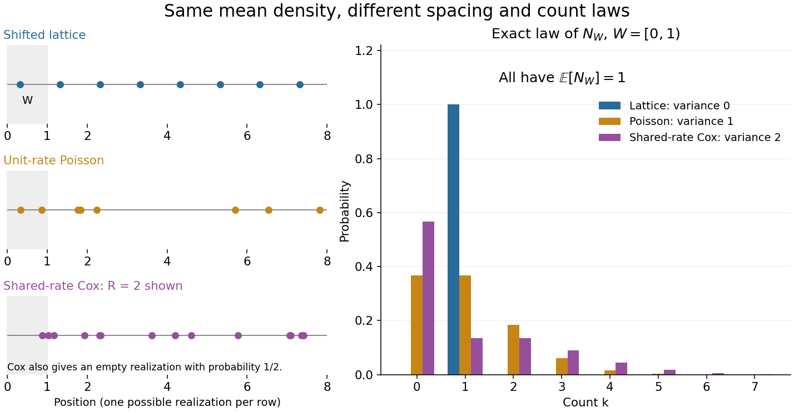
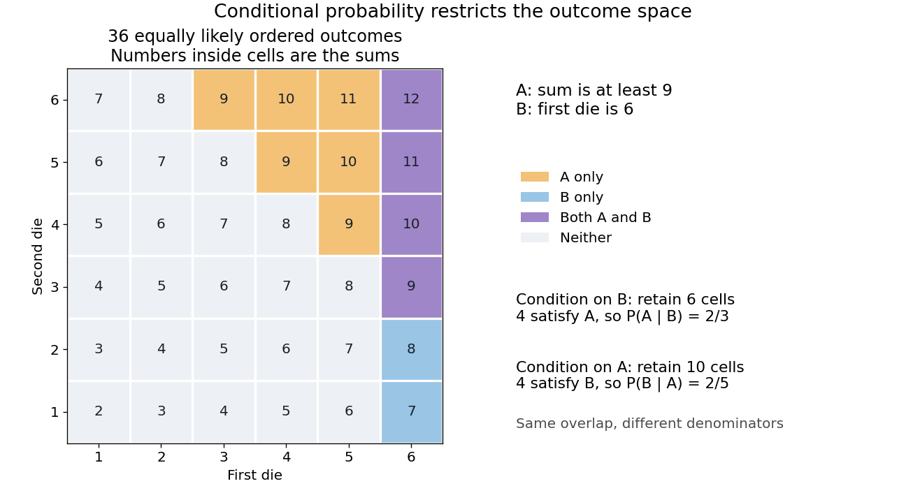

# Probability theory

↑ **Parent:** [Probability and statistics](probability-and-statistics.md)  
ⓦ [Wiki](https://en.wikipedia.org/wiki/Probability_theory)

Probability theory describes uncertainty through a [probability space](probability-space.md): possible outcomes form a [sample space](probability-space.md#sample-space), observable questions are [events](probability-space.md#event), and a [probability measure](probability-space.md#probability-measure) assigns them numbers between zero and one. The [Kolmogorov axioms](probability-space.md#kolmogorov-axioms) make those assignments consistent. They let us combine information about several [events](probability-space.md#event), update it through [conditional probability](#conditional-probability), and study [random variables](random-variable.md) without listing every possible outcome separately.

For example, roll two dice whose results are [independent random variables](random-variable.md#independent-random-variables), each with a [discrete uniform distribution](discrete-probability-distribution.md#discrete-uniform-distribution) on $\{1,\ldots,6\}$. There are 36 equally likely ordered outcomes. Only $(1,6),(2,5),\ldots,(6,1)$ have sum seven, so that [event](probability-space.md#event) has [probability](#probability) $6/36=1/6$. The sum itself is not uniformly distributed: sum two has only one outcome. Choosing a [probability distribution](probability-distribution.md) for the elementary outcomes is part of the model; equal likelihood does not follow merely from counting the named possibilities.

The subject becomes especially useful when complete outcome lists are enormous or infinite. [Independence](random-variable.md#independent-random-variables) turns a joint calculation into simpler pieces, [expected value](expected-value.md) summarizes a [random variable](random-variable.md), and the [law of large numbers](convergence-of-random-variables.md#law-of-large-numbers) explains how averages can become predictable even when individual observations are uncertain. The [central limit theorem](convergence-of-random-variables.md#central-limit-theorem) describes the scale and shape of many remaining fluctuations. These are distinct claims: a small [variance](variance.md) of an average does not make every observation close to its [expected value](expected-value.md).

There is a satisfying unity here: dice, hidden causes, and [Brownian motion](brownian-motion.md) all use the same rules for [events](probability-space.md#event) and [conditional probability](#conditional-probability). A model still needs justification. Its exact deductions describe what its assumptions imply; comparison with observations belongs to [statistical inference](statistical-inference.md).

**Table of contents**

- [Random number generation](#random-number-generation)
  - [Remainder recycling](#remainder-recycling)
- [Poissonization](#poissonization)
- [Group testing](#group-testing)
- [Bertrand paradox (probability)](#bertrand-paradox-probability)
- [Polygon probability for independent uniform rods](#polygon-probability-for-independent-uniform-rods)
- [Coverage of a sphere by random open hemispheres](#coverage-of-a-sphere-by-random-open-hemispheres)
- [Pairwise independent events](#pairwise-independent-events)
  - [Parity construction of pairwise independent bits](#parity-construction-of-pairwise-independent-bits)
- [Point process](#point-process)
  - [Simple point process](#simple-point-process)
  - [Window count of a point process](#window-count-of-a-point-process)
    - [Disjoint observation windows](#disjoint-observation-windows)
  - [Stationary point process](#stationary-point-process)
  - [Neyman-Scott process](#neyman-scott-process)
  - [Intensity measure of a point process](#intensity-measure-of-a-point-process)
    - [Local finiteness does not imply finite intensity](#local-finiteness-does-not-imply-finite-intensity)
    - [Constant intensity does not imply independence](#constant-intensity-does-not-imply-independence)
      - [Randomly shifted lattice point process](#randomly-shifted-lattice-point-process)
      - [Shared random rate gives dependent point counts](#shared-random-rate-gives-dependent-point-counts)
  - [Void probability functional](#void-probability-functional)
    - [Exponential void probabilities forbid fixed atoms](#exponential-void-probabilities-forbid-fixed-atoms)
  - [Simple locally finite point measure](#simple-locally-finite-point-measure)
    - [Dyadic occupancy approximation of a simple point measure](#dyadic-occupancy-approximation-of-a-simple-point-measure)
  - [Determinantal point process](#determinantal-point-process)
  - [Correlation function of a point process](#correlation-function-of-a-point-process)
- [Random matrix](#random-matrix)
  - [Wishart distribution](#wishart-distribution)
    - [Inverse-Wishart distribution](#inverse-wishart-distribution)
  - [Empirical spectral measure](#empirical-spectral-measure)
  - [Wigner matrix](#wigner-matrix)
    - [Centered truncation of a Wigner matrix](#centered-truncation-of-a-wigner-matrix)
      - [Second moment bound for spectral truncation](#second-moment-bound-for-spectral-truncation)
  - [Complex Wishart matrix](#complex-wishart-matrix)
    - [Laguerre unitary ensemble](#laguerre-unitary-ensemble)
- [Concentration of measure](#concentration-of-measure)
  - [Lévy family of graphs](#levy-family-of-graphs)
    - [Failure of concentration in fixed-dimensional grids](#failure-of-concentration-in-fixed-dimensional-grids)
    - [Concentration of discrete cubes at diameter scale](#concentration-of-discrete-cubes-at-diameter-scale)
- [Positive association of random variables](#positive-association-of-random-variables)
- [Extreme value theory](extreme-value-theory.md)
  - [Maximum of independent exponential random variables](extreme-value-theory.md#maximum-of-independent-exponential-random-variables)
  - [Hill estimator](extreme-value-theory.md#hill-estimator)
  - [Extremal types theorem](extreme-value-theory.md#extremal-types-theorem)
  - [Max-stable distribution](extreme-value-theory.md#max-stable-distribution)
  - [Return period](extreme-value-theory.md#return-period)
    - [Return level](extreme-value-theory.md#return-level)
      - [Return level plot](extreme-value-theory.md#return-level-plot)
  - [Generalized Pareto distribution](extreme-value-theory.md#generalized-pareto-distribution)
    - [Orthogonal shape and scale for a generalized Pareto distribution](extreme-value-theory.md#orthogonal-shape-and-scale-for-a-generalized-pareto-distribution)
    - [Peaks-over-threshold method](extreme-value-theory.md#peaks-over-threshold-method)
      - [Declustering of extremes](extreme-value-theory.md#declustering-of-extremes)
    - [Pickands-Balkema-de Haan theorem](extreme-value-theory.md#pickands-balkema-de-haan-theorem)
  - [Gumbel distribution](extreme-value-theory.md#gumbel-distribution)
    - [Moving Gumbel cutoff in an inverse-power tail](extreme-value-theory.md#moving-gumbel-cutoff-in-an-inverse-power-tail)
    - [Gumbel limit for gamma maxima](extreme-value-theory.md#gumbel-limit-for-gamma-maxima)
    - [Gumbel auxiliary function](extreme-value-theory.md#gumbel-auxiliary-function)
  - [Negative Weibull distribution](extreme-value-theory.md#negative-weibull-distribution)
  - [Fréchet distribution](extreme-value-theory.md#frechet-distribution)
  - [Maximum domain of attraction](extreme-value-theory.md#maximum-domain-of-attraction)
    - [Logarithmic-tail Fréchet normalization](extreme-value-theory.md#logarithmic-tail-frechet-normalization)
    - [Von Mises conditions for extreme values](extreme-value-theory.md#von-mises-conditions-for-extreme-values)
- [Probability](#probability)
  - [Complement rule of probability](#complement-rule-of-probability)
  - [Odds](#odds)
  - [Tail probability](#tail-probability)
- [Percolation theory](percolation-theory.md)
  - [Directed percolation](percolation-theory.md#directed-percolation)
    - [Oriented site percolation](percolation-theory.md#oriented-site-percolation)
    - [Oriented bond percolation](percolation-theory.md#oriented-bond-percolation)
    - [Parallel-bond ray with different site and bond thresholds](percolation-theory.md#parallel-bond-ray-with-different-site-and-bond-thresholds)
    - [Incoming-edge coupling of site and bond percolation](percolation-theory.md#incoming-edge-coupling-of-site-and-bond-percolation)
    - [Survival and susceptibility thresholds for directed percolation](percolation-theory.md#survival-and-susceptibility-thresholds-for-directed-percolation)
  - [Conformal invariance of planar percolation](percolation-theory.md#conformal-invariance-of-planar-percolation)
  - [Lace expansion](percolation-theory.md#lace-expansion)
  - [Bond percolation](bond-percolation.md)
    - [Rectangle crossing in bond percolation](bond-percolation.md#rectangle-crossing-in-bond-percolation)
      - [Finite-torus crossing amplification](bond-percolation.md#finite-torus-crossing-amplification)
    - [Open path in bond percolation](bond-percolation.md#open-path-in-bond-percolation)
    - [Uniform random orientation out-cluster comparison](bond-percolation.md#uniform-random-orientation-out-cluster-comparison)
    - [Percolation triangle condition](bond-percolation.md#percolation-triangle-condition)
    - [Percolation two-point connection probability](bond-percolation.md#percolation-two-point-connection-probability)
      - [Reflection lower bound for two-point percolation](bond-percolation.md#reflection-lower-bound-for-two-point-percolation)
    - [Connection decay rate in a percolation strip](bond-percolation.md#connection-decay-rate-in-a-percolation-strip)
      - [Strip approximation to the planar connection decay rate](bond-percolation.md#strip-approximation-to-the-planar-connection-decay-rate)
      - [Closed-cut bound for percolation in a strip](bond-percolation.md#closed-cut-bound-for-percolation-in-a-strip)
    - [Translation ergodicity of Bernoulli percolation](bond-percolation.md#translation-ergodicity-of-bernoulli-percolation)
    - [Percolation cluster](bond-percolation.md#percolation-cluster)
      - [Maximum cluster radius under exponential one-arm decay](bond-percolation.md#maximum-cluster-radius-under-exponential-one-arm-decay)
      - [Infinite percolation cluster](bond-percolation.md#infinite-percolation-cluster)
      - [Uniqueness of the infinite percolation cluster](bond-percolation.md#uniqueness-of-the-infinite-percolation-cluster)
        - [Percolation uniqueness on an amenable quasi-transitive graph](bond-percolation.md#percolation-uniqueness-on-an-amenable-quasi-transitive-graph)
        - [Boundary counting proof of percolation uniqueness](bond-percolation.md#boundary-counting-proof-of-percolation-uniqueness)
          - [Encounter box in percolation](bond-percolation.md#encounter-box-in-percolation)
        - [Trifurcation vertex in percolation](bond-percolation.md#trifurcation-vertex-in-percolation)
          - [Trifurcation boundary-counting lemma](bond-percolation.md#trifurcation-boundary-counting-lemma)
            - [Forest proof of trifurcation boundary counting](bond-percolation.md#forest-proof-of-trifurcation-boundary-counting)
    - [Percolation susceptibility](bond-percolation.md#percolation-susceptibility)
      - [Tree-graph moment bound for a percolation cluster](bond-percolation.md#tree-graph-moment-bound-for-a-percolation-cluster)
      - [Exponential one-arm decay from finite susceptibility](bond-percolation.md#exponential-one-arm-decay-from-finite-susceptibility)
    - [Russo-Seymour-Welsh theorem](bond-percolation.md#russo-seymour-welsh-theorem)
      - [Uniform RSW crossing estimate](bond-percolation.md#uniform-rsw-crossing-estimate)
      - [RSW reflection extension lemma](bond-percolation.md#rsw-reflection-extension-lemma)
        - [Reflected attachment estimate for percolation](bond-percolation.md#reflected-attachment-estimate-for-percolation)
      - [One-arm probability](bond-percolation.md#one-arm-probability)
        - [Weighted BK boundary-splitting estimate](bond-percolation.md#weighted-bk-boundary-splitting-estimate)
        - [Polynomial critical one-arm upper bound](bond-percolation.md#polynomial-critical-one-arm-upper-bound)
        - [Independent annular barriers for percolation](bond-percolation.md#independent-annular-barriers-for-percolation)
        - [BK boundary-splitting estimate](bond-percolation.md#bk-boundary-splitting-estimate)
        - [Percolation one-arm decay rate](bond-percolation.md#percolation-one-arm-decay-rate)
          - [Almost-subadditive percolation decay rate](bond-percolation.md#almost-subadditive-percolation-decay-rate)
        - [One-arm extension estimate](bond-percolation.md#one-arm-extension-estimate)
          - [RSW gluing lemma for two one-arm events](bond-percolation.md#rsw-gluing-lemma-for-two-one-arm-events)
    - [Van den Berg-Kesten inequality](bond-percolation.md#van-den-berg-kesten-inequality)
      - [Coordinate-splitting proof of the BK inequality](bond-percolation.md#coordinate-splitting-proof-of-the-bk-inequality)
      - [Square-lattice one-arm lower bound from disjoint occurrence](bond-percolation.md#square-lattice-one-arm-lower-bound-from-disjoint-occurrence)
      - [Disjoint occurrence of increasing events](bond-percolation.md#disjoint-occurrence-of-increasing-events)
  - [Percolation probability](percolation-theory.md#percolation-probability)
    - [Boundary-side amplification for planar percolation](percolation-theory.md#boundary-side-amplification-for-planar-percolation)
    - [Near-critical percolation power upper bound](percolation-theory.md#near-critical-percolation-power-upper-bound)
    - [Right continuity of percolation probability](percolation-theory.md#right-continuity-of-percolation-probability)
      - [Supercritical continuity of percolation probability](percolation-theory.md#supercritical-continuity-of-percolation-probability)
    - [Percolation critical probability](percolation-theory.md#percolation-critical-probability)
      - [Sharpness of the percolation transition](percolation-theory.md#sharpness-of-the-percolation-transition)
      - [Connective-constant lower bound for percolation](percolation-theory.md#connective-constant-lower-bound-for-percolation)
      - [Harris-Kesten theorem](percolation-theory.md#harris-kesten-theorem)
        - [Harris theorem for square-lattice bond percolation](percolation-theory.md#harris-theorem-for-square-lattice-bond-percolation)
        - [Alternating arms argument at the self-dual percolation parameter](percolation-theory.md#alternating-arms-argument-at-the-self-dual-percolation-parameter)
          - [Three-fold symmetric primal-dual noncoexistence](percolation-theory.md#three-fold-symmetric-primal-dual-noncoexistence)
          - [Alternating exterior-arm separation lemma](percolation-theory.md#alternating-exterior-arm-separation-lemma)
  - [Monotone coupling of Bernoulli percolation](percolation-theory.md#monotone-coupling-of-bernoulli-percolation)
    - [Finite-box comparison for percolation parameters](percolation-theory.md#finite-box-comparison-for-percolation-parameters)
    - [Coupled onset parameter for origin percolation](percolation-theory.md#coupled-onset-parameter-for-origin-percolation)
    - [Sprinkling coupling for Bernoulli percolation](percolation-theory.md#sprinkling-coupling-for-bernoulli-percolation)
  - [Site percolation](site-percolation.md)
    - [Critical probability for site percolation on the triangular lattice](site-percolation.md#critical-probability-for-site-percolation-on-the-triangular-lattice)
    - [Domain Markov property of a percolation exploration](site-percolation.md#domain-markov-property-of-a-percolation-exploration)
    - [Dependent percolation](site-percolation.md#dependent-percolation)
      - [One-independent bond percolation](site-percolation.md#one-independent-bond-percolation)
        - [Separated-block percolation renormalization](site-percolation.md#separated-block-percolation-renormalization)
        - [Peierls circuit bound for one-independent percolation](site-percolation.md#peierls-circuit-bound-for-one-independent-percolation)
      - [Monochromatic line-graph percolation counterexample](site-percolation.md#monochromatic-line-graph-percolation-counterexample)
      - [Random-cluster model](site-percolation.md#random-cluster-model)
        - [Bernoulli bounds for the random-cluster model](site-percolation.md#bernoulli-bounds-for-the-random-cluster-model)
        - [Cluster weight in the random-cluster model](site-percolation.md#cluster-weight-in-the-random-cluster-model)
        - [Random-cluster critical probability](site-percolation.md#random-cluster-critical-probability)
          - [Monotonicity of random-cluster critical probability in cluster weight](site-percolation.md#monotonicity-of-random-cluster-critical-probability-in-cluster-weight)
        - [Random-cluster weight monotonicity](site-percolation.md#random-cluster-weight-monotonicity)
        - [Self-dual parameter of the random-cluster model](site-percolation.md#self-dual-parameter-of-the-random-cluster-model)
          - [Symmetric cluster weight at the self-dual parameter](site-percolation.md#symmetric-cluster-weight-at-the-self-dual-parameter)
        - [Random-cluster single-edge conditional probability](site-percolation.md#random-cluster-single-edge-conditional-probability)
        - [Random-cluster boundary condition](site-percolation.md#random-cluster-boundary-condition)
          - [Boundary monotonicity of the random-cluster measure](site-percolation.md#boundary-monotonicity-of-the-random-cluster-measure)
          - [Wired random-cluster boundary condition](site-percolation.md#wired-random-cluster-boundary-condition)
            - [Infinite-volume wired random-cluster measure](site-percolation.md#infinite-volume-wired-random-cluster-measure)
              - [Random-cluster inverse correlation length](site-percolation.md#random-cluster-inverse-correlation-length)
                - [Reflection comparison of random-cluster connections](site-percolation.md#reflection-comparison-of-random-cluster-connections)
          - [Free random-cluster boundary condition](site-percolation.md#free-random-cluster-boundary-condition)
        - [Positive association of the random-cluster model](site-percolation.md#positive-association-of-the-random-cluster-model)
        - [Uniform connected-subgraph limit of the random-cluster model](site-percolation.md#uniform-connected-subgraph-limit-of-the-random-cluster-model)
        - [Uniform spanning-tree limit of the random-cluster model](site-percolation.md#uniform-spanning-tree-limit-of-the-random-cluster-model)
        - [Edwards-Sokal coupling](site-percolation.md#edwards-sokal-coupling)
          - [Spin-connectivity identity for the Potts model](site-percolation.md#spin-connectivity-identity-for-the-potts-model)
        - [Heat-bath Markov chain](site-percolation.md#heat-bath-markov-chain)
      - [Level-set percolation](site-percolation.md#level-set-percolation)
        - [Critical threshold for level-set percolation](site-percolation.md#critical-threshold-for-level-set-percolation)
      - [Finite-range dependent random field](site-percolation.md#finite-range-dependent-random-field)
  - [Peierls argument](percolation-theory.md#peierls-argument)
    - [Connective-constant Peierls bound](percolation-theory.md#connective-constant-peierls-bound)
  - [Finite-energy property (percolation)](percolation-theory.md#finite-energy-property-percolation)
    - [Finite-energy property of Bernoulli percolation](percolation-theory.md#finite-energy-property-of-bernoulli-percolation)
      - [Finite modification of Bernoulli percolation](percolation-theory.md#finite-modification-of-bernoulli-percolation)
  - [Exponential decay of subcritical percolation](percolation-theory.md#exponential-decay-of-subcritical-percolation)
    - [Finite-set criterion for percolation sharpness](percolation-theory.md#finite-set-criterion-for-percolation-sharpness)
    - [Exponential tail of subcritical cluster size](percolation-theory.md#exponential-tail-of-subcritical-cluster-size)
  - [One-arm event](percolation-theory.md#one-arm-event)
  - [OSSS inequality](percolation-theory.md#osss-inequality)
    - [OSSS exploration of a one-arm event](percolation-theory.md#osss-exploration-of-a-one-arm-event)
- [Finitely additive probability measure](#finitely-additive-probability-measure)
- [Probability space](probability-space.md)
  - [Product probability space](probability-space.md#product-probability-space)
  - [Sample space](probability-space.md#sample-space)
    - [Elementary outcome](probability-space.md#elementary-outcome)
    - [Two-toss sample space](probability-space.md#two-toss-sample-space)
      - [Events determined by a random variable](probability-space.md#events-determined-by-a-random-variable)
  - [Almost sure event](probability-space.md#almost-sure-event)
  - [Probability measure](probability-space.md#probability-measure)
    - [Continuity of probability](probability-space.md#continuity-of-probability)
    - [Tightness of a probability measure](probability-space.md#tightness-of-a-probability-measure)
      - [Aldous tightness criterion](probability-space.md#aldous-tightness-criterion)
      - [Uniform tightness](probability-space.md#uniform-tightness)
        - [Helly selection for distribution functions](probability-space.md#helly-selection-for-distribution-functions)
    - [Zero-probability event](probability-space.md#zero-probability-event)
    - [Empirical measure](probability-space.md#empirical-measure)
    - [Compactly supported continuous functions determine a finite Borel measure](probability-space.md#compactly-supported-continuous-functions-determine-a-finite-borel-measure)
    - [Kolmogorov axioms](probability-space.md#kolmogorov-axioms)
    - [Law of total probability](probability-space.md#law-of-total-probability)
      - [Sharp bounds from binary conditional probabilities](probability-space.md#sharp-bounds-from-binary-conditional-probabilities)
  - [Event](probability-space.md#event)
    - [Limsup of events](probability-space.md#limsup-of-events)
    - [Complement of an event](probability-space.md#complement-of-an-event)
    - [Disjoint events](probability-space.md#disjoint-events)
  - [Cylinder sigma-algebra](probability-space.md#cylinder-sigma-algebra)
- [Uniform random point in a disk](#uniform-random-point-in-a-disk)
  - [Origin in a triangle of three radial random points](#origin-in-a-triangle-of-three-radial-random-points)
- [Independent sigma-algebras](#independent-sigma-algebras)
  - [Independent events](#independent-events)
    - [Pairwise-independent three-event avoidance](#pairwise-independent-three-event-avoidance)
  - [Independence extended from generating pi-systems](#independence-extended-from-generating-pi-systems)
  - [Tail sigma-algebra](#tail-sigma-algebra)
    - [Finite-prefix invariance of tail events](#finite-prefix-invariance-of-tail-events)
    - [Tail measurability of limits of sample averages](#tail-measurability-of-limits-of-sample-averages)
    - [Tail event](#tail-event)
      - [Infinitely many heads as a tail event](#infinitely-many-heads-as-a-tail-event)
    - [Kolmogorov's zero–one law](#kolmogorov-s-zero-one-law)
      - [A shared coin prevents a zero-one conclusion](#a-shared-coin-prevents-a-zero-one-conclusion)
- [Product measure](#product-measure)
  - [Product sigma-algebra](#product-sigma-algebra)
  - [Pi-lambda theorem](#pi-lambda-theorem)
  - [Canonical model of an independent and identically distributed sequence](#canonical-model-of-an-independent-and-identically-distributed-sequence)
- [Fréchet inequalities](#frechet-inequalities)
- [Standard score](#standard-score)
- [Convergence of random variables](convergence-of-random-variables.md)
  - [Contiguity of probability measures](convergence-of-random-variables.md#contiguity-of-probability-measures)
    - [Le Cam's first lemma](convergence-of-random-variables.md#le-cam-s-first-lemma)
    - [Mutual contiguity](convergence-of-random-variables.md#mutual-contiguity)
  - [Convergence in Lp](convergence-of-random-variables.md#convergence-in-lp)
    - [Convergence in L1](convergence-of-random-variables.md#convergence-in-l1)
      - [Scheffé lemma](convergence-of-random-variables.md#scheffe-lemma)
    - [Convergence in L2](convergence-of-random-variables.md#convergence-in-l2)
      - [Almost-sure convergence and convergence of second moments](convergence-of-random-variables.md#almost-sure-convergence-and-convergence-of-second-moments)
  - [Convergence in distribution](convergence-of-random-variables.md#convergence-in-distribution)
    - [Atoms obstruct a continuous distributional limit](convergence-of-random-variables.md#atoms-obstruct-a-continuous-distributional-limit)
    - [Marginal weak convergence does not control sums](convergence-of-random-variables.md#marginal-weak-convergence-does-not-control-sums)
    - [Skorokhod representation theorem](convergence-of-random-variables.md#skorokhod-representation-theorem)
    - [Method of moments (probability theory)](convergence-of-random-variables.md#method-of-moments-probability-theory)
    - [Weak convergence of probability measures](convergence-of-random-variables.md#weak-convergence-of-probability-measures)
      - [Compact containment](convergence-of-random-variables.md#compact-containment)
      - [Scaling limit of a random curve](convergence-of-random-variables.md#scaling-limit-of-a-random-curve)
      - [Skorokhod J1 topology](convergence-of-random-variables.md#skorokhod-j1-topology)
      - [Weak topology of probability measures](convergence-of-random-variables.md#weak-topology-of-probability-measures)
        - [Bounded-Lipschitz metric](convergence-of-random-variables.md#bounded-lipschitz-metric)
      - [Prokhorov's theorem](convergence-of-random-variables.md#prokhorov-s-theorem)
        - [Closed uniformly tight compactness criterion](convergence-of-random-variables.md#closed-uniformly-tight-compactness-criterion)
        - [Compactness of probability measures on a compact metric space](convergence-of-random-variables.md#compactness-of-probability-measures-on-a-compact-metric-space)
    - [Bounded moment criterion for weak convergence](convergence-of-random-variables.md#bounded-moment-criterion-for-weak-convergence)
      - [Moment determinacy on a compact interval](convergence-of-random-variables.md#moment-determinacy-on-a-compact-interval)
    - [Portmanteau theorem](convergence-of-random-variables.md#portmanteau-theorem)
    - [Continuous mapping theorem](convergence-of-random-variables.md#continuous-mapping-theorem)
  - [Law of large numbers](convergence-of-random-variables.md#law-of-large-numbers)
  - [Almost sure convergence](convergence-of-random-variables.md#almost-sure-convergence)
    - [Complete convergence of random variables](convergence-of-random-variables.md#complete-convergence-of-random-variables)
    - [Almost sure equality](convergence-of-random-variables.md#almost-sure-equality)
    - [Strong law of large numbers](convergence-of-random-variables.md#strong-law-of-large-numbers)
      - [Strong law for uniformly L2-bounded uncorrelated random variables](convergence-of-random-variables.md#strong-law-for-uniformly-l2-bounded-uncorrelated-random-variables)
      - [Strong law for adjacent products](convergence-of-random-variables.md#strong-law-for-adjacent-products)
    - [Kolmogorov convergence theorem](convergence-of-random-variables.md#kolmogorov-convergence-theorem)
    - [Law of the iterated logarithm](convergence-of-random-variables.md#law-of-the-iterated-logarithm)
      - [Brownian upper law of the iterated logarithm](convergence-of-random-variables.md#brownian-upper-law-of-the-iterated-logarithm)
      - [Upper law of the iterated logarithm](convergence-of-random-variables.md#upper-law-of-the-iterated-logarithm)
      - [Law of the iterated logarithm for a simple symmetric random walk](convergence-of-random-variables.md#law-of-the-iterated-logarithm-for-a-simple-symmetric-random-walk)
  - [Cramér–Wold theorem](convergence-of-random-variables.md#cramer-wold-theorem)
  - [Convergence in probability](convergence-of-random-variables.md#convergence-in-probability)
    - [Uniform convergence in probability](convergence-of-random-variables.md#uniform-convergence-in-probability)
    - [Boundedness in probability](convergence-of-random-variables.md#boundedness-in-probability)
      - [Stochastic order](convergence-of-random-variables.md#stochastic-order)
        - [Uniform pointwise probability bounds do not bound a random supremum](convergence-of-random-variables.md#uniform-pointwise-probability-bounds-do-not-bound-a-random-supremum)
    - [Convergence in distribution to a constant implies convergence in probability](convergence-of-random-variables.md#convergence-in-distribution-to-a-constant-implies-convergence-in-probability)
    - [Weak law of large numbers](convergence-of-random-variables.md#weak-law-of-large-numbers)
      - [Weak law without an absolute first moment](convergence-of-random-variables.md#weak-law-without-an-absolute-first-moment)
      - [Weak law forces a characteristic-function derivative](convergence-of-random-variables.md#weak-law-forces-a-characteristic-function-derivative)
      - [Uniform law of large numbers](convergence-of-random-variables.md#uniform-law-of-large-numbers)
        - [Pointwise separable function class](convergence-of-random-variables.md#pointwise-separable-function-class)
        - [Bracketing of a function class](convergence-of-random-variables.md#bracketing-of-a-function-class)
          - [Integrable envelope of a function class](convergence-of-random-variables.md#integrable-envelope-of-a-function-class)
          - [Uniform strong law from finite L1 bracketing](convergence-of-random-variables.md#uniform-strong-law-from-finite-l1-bracketing)
            - [Uniform strong law on a compact parameter set](convergence-of-random-variables.md#uniform-strong-law-on-a-compact-parameter-set)
        - [Glivenko-Cantelli theorem](convergence-of-random-variables.md#glivenko-cantelli-theorem)
          - [Quantile proof of the Glivenko-Cantelli theorem](convergence-of-random-variables.md#quantile-proof-of-the-glivenko-cantelli-theorem)
    - [Uniqueness of a limit in probability](convergence-of-random-variables.md#uniqueness-of-a-limit-in-probability)
    - [Bounded-metric characterization of convergence in probability](convergence-of-random-variables.md#bounded-metric-characterization-of-convergence-in-probability)
    - [Almost-sure subsequence from convergence in probability](convergence-of-random-variables.md#almost-sure-subsequence-from-convergence-in-probability)
    - [Independent rare-event counterexample to almost-sure convergence](convergence-of-random-variables.md#independent-rare-event-counterexample-to-almost-sure-convergence)
  - [Convergence in Lp from convergence in probability and an Lr bound](convergence-of-random-variables.md#convergence-in-lp-from-convergence-in-probability-and-an-lr-bound)
    - [Bounded second moments do not upgrade convergence in probability to convergence in L2](convergence-of-random-variables.md#bounded-second-moments-do-not-upgrade-convergence-in-probability-to-convergence-in-l2)
  - [Uniform integrability](convergence-of-random-variables.md#uniform-integrability)
    - [Class D process](convergence-of-random-variables.md#class-d-process)
      - [Class DL process](convergence-of-random-variables.md#class-dl-process)
    - [Uniform integrability from an Lp bound](convergence-of-random-variables.md#uniform-integrability-from-an-lp-bound)
    - [L1 convergence implies uniform integrability](convergence-of-random-variables.md#l1-convergence-implies-uniform-integrability)
    - [Uniform integrability of conditional expectations](convergence-of-random-variables.md#uniform-integrability-of-conditional-expectations)
    - [Uniform integrability from bounded second moments](convergence-of-random-variables.md#uniform-integrability-from-bounded-second-moments)
  - [Large deviation principle](convergence-of-random-variables.md#large-deviation-principle)
    - [Logarithmic probabilities of open sets for a continuous rate function](convergence-of-random-variables.md#logarithmic-probabilities-of-open-sets-for-a-continuous-rate-function)
    - [Moderate deviation principle](convergence-of-random-variables.md#moderate-deviation-principle)
      - [Poisson moderate deviation principle](convergence-of-random-variables.md#poisson-moderate-deviation-principle)
    - [Principle of the largest exponential term](convergence-of-random-variables.md#principle-of-the-largest-exponential-term)
    - [Large deviations of a scaled geometric random variable](convergence-of-random-variables.md#large-deviations-of-a-scaled-geometric-random-variable)
      - [Large deviations of a fixed sum of geometric random variables](convergence-of-random-variables.md#large-deviations-of-a-fixed-sum-of-geometric-random-variables)
    - [Fixed exponential perturbation of a Gaussian empirical mean](convergence-of-random-variables.md#fixed-exponential-perturbation-of-a-gaussian-empirical-mean)
    - [Weak large deviation principle](convergence-of-random-variables.md#weak-large-deviation-principle)
      - [Exponential tightness upgrades a weak large deviation principle](convergence-of-random-variables.md#exponential-tightness-upgrades-a-weak-large-deviation-principle)
    - [Slower-speed degeneration of a large deviation principle](convergence-of-random-variables.md#slower-speed-degeneration-of-a-large-deviation-principle)
    - [Varadhan's lemma](convergence-of-random-variables.md#varadhan-s-lemma)
      - [Exponential tail extension of Varadhan's lemma](convergence-of-random-variables.md#exponential-tail-extension-of-varadhan-s-lemma)
    - [Laplace principle (large deviations theory)](convergence-of-random-variables.md#laplace-principle-large-deviations-theory)
      - [Laplace principle for probability measures](convergence-of-random-variables.md#laplace-principle-for-probability-measures)
    - [Gärtner–Ellis theorem](convergence-of-random-variables.md#gartner-ellis-theorem)
    - [Product large-deviation principle](convergence-of-random-variables.md#product-large-deviation-principle)
    - [Contraction principle for large deviations](convergence-of-random-variables.md#contraction-principle-for-large-deviations)
      - [Rate function under scalar clipping](convergence-of-random-variables.md#rate-function-under-scalar-clipping)
      - [Large-deviation rate of a minimum of independent copies](convergence-of-random-variables.md#large-deviation-rate-of-a-minimum-of-independent-copies)
        - [High moments of a clipped minimum of exponential sample means](convergence-of-random-variables.md#high-moments-of-a-clipped-minimum-of-exponential-sample-means)
    - [Exponential equivalence](convergence-of-random-variables.md#exponential-equivalence)
    - [Exponential tightness](convergence-of-random-variables.md#exponential-tightness)
    - [Large-deviation speed](convergence-of-random-variables.md#large-deviation-speed)
      - [Hurstiness](convergence-of-random-variables.md#hurstiness)
        - [Hurstiness of independent sums](convergence-of-random-variables.md#hurstiness-of-independent-sums)
    - [Rate function](convergence-of-random-variables.md#rate-function)
      - [Local convex path action](convergence-of-random-variables.md#local-convex-path-action)
      - [Good rate function](convergence-of-random-variables.md#good-rate-function)
        - [A good rate function is separated from zero away from its minimizer](convergence-of-random-variables.md#a-good-rate-function-is-separated-from-zero-away-from-its-minimizer)
    - [Freidlin--Wentzell action](convergence-of-random-variables.md#freidlin-wentzell-action)
      - [Geometric minimum action](convergence-of-random-variables.md#geometric-minimum-action)
  - [Central limit theorem](convergence-of-random-variables.md#central-limit-theorem)
    - [Lindeberg-Feller central limit theorem](convergence-of-random-variables.md#lindeberg-feller-central-limit-theorem)
      - [Lyapunov condition](convergence-of-random-variables.md#lyapunov-condition)
    - [Gaussian tails force an unbounded normalized partial-sum limsup](convergence-of-random-variables.md#gaussian-tails-force-an-unbounded-normalized-partial-sum-limsup)
    - [Normal approximation](convergence-of-random-variables.md#normal-approximation)
      - [Continuity correction](convergence-of-random-variables.md#continuity-correction)
    - [Lindeberg condition](convergence-of-random-variables.md#lindeberg-condition)
    - [Hilbert-space central limit theorem](convergence-of-random-variables.md#hilbert-space-central-limit-theorem)
    - [Self-normalized central limit theorem with a second-moment denominator](convergence-of-random-variables.md#self-normalized-central-limit-theorem-with-a-second-moment-denominator)
    - [Donsker's theorem](convergence-of-random-variables.md#donsker-s-theorem)
      - [Fourth-moment tightness of polygonal random walks](convergence-of-random-variables.md#fourth-moment-tightness-of-polygonal-random-walks)
      - [Random-walk maximum limit from Donsker invariance](convergence-of-random-variables.md#random-walk-maximum-limit-from-donsker-invariance)
      - [Integrated random-walk limit](convergence-of-random-variables.md#integrated-random-walk-limit)
    - [Multivariate central limit theorem](convergence-of-random-variables.md#multivariate-central-limit-theorem)
  - [Poisson limit theorem](convergence-of-random-variables.md#poisson-limit-theorem)
- [Martingale](martingale.md)
  - [Positive random-environment path-weight martingale](martingale.md#positive-random-environment-path-weight-martingale)
    - [Tail event for a vanishing positive path-weight limit](martingale.md#tail-event-for-a-vanishing-positive-path-weight-limit)
    - [Collision-count second moment for independent path weights](martingale.md#collision-count-second-moment-for-independent-path-weights)
  - [Bernstein bound for bounded-jump martingales](martingale.md#bernstein-bound-for-bounded-jump-martingales)
  - [Ville inequality](martingale.md#ville-inequality)
  - [Finite voter-model consensus probability](martingale.md#finite-voter-model-consensus-probability)
  - [Unchanging betting probability under sampling without replacement](martingale.md#unchanging-betting-probability-under-sampling-without-replacement)
  - [Nonnegative martingale](martingale.md#nonnegative-martingale)
  - [Doob exposure martingale](martingale.md#doob-exposure-martingale)
  - [Rare-jump martingale divergence](martingale.md#rare-jump-martingale-divergence)
  - [Characterization of a martingale by bounded continuous-time stopped expectations](martingale.md#characterization-of-a-martingale-by-bounded-continuous-time-stopped-expectations)
  - [Azuma's inequality](martingale.md#azuma-s-inequality)
    - [Two-sided Azuma-Hoeffding inequality](martingale.md#two-sided-azuma-hoeffding-inequality)
  - [Martingale increments obstruct finite convergence](martingale.md#martingale-increments-obstruct-finite-convergence)
  - [Absorption at zero of a nonnegative martingale](martingale.md#absorption-at-zero-of-a-nonnegative-martingale)
    - [Absorption-time bound from conditional variance and overshoot](martingale.md#absorption-time-bound-from-conditional-variance-and-overshoot)
      - [Square-root tail bound for martingale absorption](martingale.md#square-root-tail-bound-for-martingale-absorption)
  - [Martingale difference sequence](martingale.md#martingale-difference-sequence)
    - [Martingale difference](martingale.md#martingale-difference)
    - [Strong law for martingales with bounded increments](martingale.md#strong-law-for-martingales-with-bounded-increments)
  - [Dyadic slope martingale](martingale.md#dyadic-slope-martingale)
  - [Fair-coin doubling martingale](martingale.md#fair-coin-doubling-martingale)
  - [Martingale-difference orthogonality](martingale.md#martingale-difference-orthogonality)
  - [Submartingale](martingale.md#submartingale)
    - [Positive martingale majorant of an L1-bounded submartingale](martingale.md#positive-martingale-majorant-of-an-l1-bounded-submartingale)
    - [Doob-Meyer decomposition theorem](martingale.md#doob-meyer-decomposition-theorem)
    - [Doob maximal inequality for a nonnegative submartingale](martingale.md#doob-maximal-inequality-for-a-nonnegative-submartingale)
      - [Truncated layer-cake proof of the L2 maximal inequality](martingale.md#truncated-layer-cake-proof-of-the-l2-maximal-inequality)
      - [One-sided martingale maximal inequality](martingale.md#one-sided-martingale-maximal-inequality)
      - [Kolmogorov maximal inequality](martingale.md#kolmogorov-maximal-inequality)
      - [One-sided maximal inequality for a centered square-integrable martingale](martingale.md#one-sided-maximal-inequality-for-a-centered-square-integrable-martingale)
      - [Maximal bound for a nonnegative martingale](martingale.md#maximal-bound-for-a-nonnegative-martingale)
      - [One-sided maximal inequality for independent centered sums](martingale.md#one-sided-maximal-inequality-for-independent-centered-sums)
  - [Square martingale for independent centered sums](martingale.md#square-martingale-for-independent-centered-sums)
    - [Small-ball maximal bound for sums with bounded increments](martingale.md#small-ball-maximal-bound-for-sums-with-bounded-increments)
  - [Conditional-expectation martingale](martingale.md#conditional-expectation-martingale)
    - [Edge-exposure martingale](martingale.md#edge-exposure-martingale)
  - [Product martingale from independent mean-one factors](martingale.md#product-martingale-from-independent-mean-one-factors)
  - [Continuous-time martingale](martingale.md#continuous-time-martingale)
    - [Uniform-arrival residual mass martingale](martingale.md#uniform-arrival-residual-mass-martingale)
      - [Finite-jump boundary crossing identity](martingale.md#finite-jump-boundary-crossing-identity)
    - [Uniformly integrable martingale](martingale.md#uniformly-integrable-martingale)
    - [Càdlàg martingale](martingale.md#cadlag-martingale)
    - [Continuous martingale](martingale.md#continuous-martingale)
    - [L2-bounded continuous martingale](martingale.md#l2-bounded-continuous-martingale)
      - [Integrable terminal bracket criterion](martingale.md#integrable-terminal-bracket-criterion)
      - [Equivalent terminal and maximal norms for L2-bounded continuous martingales](martingale.md#equivalent-terminal-and-maximal-norms-for-l2-bounded-continuous-martingales)
    - [Local martingale](martingale.md#local-martingale)
      - [Bounded local martingale criterion](martingale.md#bounded-local-martingale-criterion)
      - [Integrable discrete-time local martingale is a martingale](martingale.md#integrable-discrete-time-local-martingale-is-a-martingale)
        - [Nonnegative discrete-time local martingale is a martingale](martingale.md#nonnegative-discrete-time-local-martingale-is-a-martingale)
      - [Strict local martingale](martingale.md#strict-local-martingale)
        - [Logarithm of planar Brownian radius](martingale.md#logarithm-of-planar-brownian-radius)
      - [Localizing sequence](martingale.md#localizing-sequence)
      - [Continuous local martingale](martingale.md#continuous-local-martingale)
        - [Finite-variation smooth transform of a continuous local martingale](martingale.md#finite-variation-smooth-transform-of-a-continuous-local-martingale)
        - [Exponential criterion for a continuous local martingale and its bracket](martingale.md#exponential-criterion-for-a-continuous-local-martingale-and-its-bracket)
        - [Conditionally symmetric increments](martingale.md#conditionally-symmetric-increments)
          - [Characteristic function under conditionally symmetric martingale increments](martingale.md#characteristic-function-under-conditionally-symmetric-martingale-increments)
        - [Finite-bracket convergence lemma](martingale.md#finite-bracket-convergence-lemma)
        - [Fourth-moment deficit and bracket variance identity](martingale.md#fourth-moment-deficit-and-bracket-variance-identity)
        - [Integrable-supremum martingale criterion](martingale.md#integrable-supremum-martingale-criterion)
        - [Continuous local martingale with bounded quadratic variation](martingale.md#continuous-local-martingale-with-bounded-quadratic-variation)
        - [Continuous finite-variation local martingale is constant](martingale.md#continuous-finite-variation-local-martingale-is-constant)
        - [Dambis-Dubins-Schwarz theorem](martingale.md#dambis-dubins-schwarz-theorem)
          - [Cosine-exponential Brownian local martingale](martingale.md#cosine-exponential-brownian-local-martingale)
          - [Gaussian terminal value at a deterministic bracket level](martingale.md#gaussian-terminal-value-at-a-deterministic-bracket-level)
          - [Exit with drift controlled by quadratic variation](martingale.md#exit-with-drift-controlled-by-quadratic-variation)
          - [Common-clock time change of orthogonal local martingales](martingale.md#common-clock-time-change-of-orthogonal-local-martingales)
          - [One-sided bound criterion for a martingale clock](martingale.md#one-sided-bound-criterion-for-a-martingale-clock)
          - [Finite-lifetime extension of the Dambis-Dubins-Schwarz theorem](martingale.md#finite-lifetime-extension-of-the-dambis-dubins-schwarz-theorem)
          - [Inverse-clock proof of the Dambis-Dubins-Schwarz theorem](martingale.md#inverse-clock-proof-of-the-dambis-dubins-schwarz-theorem)
          - [Stochastic-integral representation from absolutely continuous quadratic variation](martingale.md#stochastic-integral-representation-from-absolutely-continuous-quadratic-variation)
          - [Brownian motion produced by the Dambis-Dubins-Schwarz theorem need not be independent of its clock](martingale.md#brownian-motion-produced-by-the-dambis-dubins-schwarz-theorem-need-not-be-independent-of-its-clock)
        - [Burkholder-Davis-Gundy inequalities](martingale.md#burkholder-davis-gundy-inequalities)
          - [Upper maximal moment bound for a continuous local martingale](martingale.md#upper-maximal-moment-bound-for-a-continuous-local-martingale)
      - [Nonnegative local martingale](martingale.md#nonnegative-local-martingale)
        - [Maximal identity for a continuous nonnegative local martingale tending to zero](martingale.md#maximal-identity-for-a-continuous-nonnegative-local-martingale-tending-to-zero)
        - [Terminal expectation criterion for a nonnegative local martingale](martingale.md#terminal-expectation-criterion-for-a-nonnegative-local-martingale)
  - [Doob L2 maximal inequality](martingale.md#doob-l2-maximal-inequality)
  - [Doob Lp maximal inequality](martingale.md#doob-lp-maximal-inequality)
  - [L2 martingale convergence theorem](martingale.md#l2-martingale-convergence-theorem)
  - [Symmetric signs forced by the martingale property](martingale.md#symmetric-signs-forced-by-the-martingale-property)
  - [Doob upcrossing inequality](martingale.md#doob-upcrossing-inequality)
    - [Dubins upcrossing inequality](martingale.md#dubins-upcrossing-inequality)
      - [Multiplicative upcrossing supermartingale](martingale.md#multiplicative-upcrossing-supermartingale)
    - [Upcrossing](martingale.md#upcrossing)
      - [Upcrossing count](martingale.md#upcrossing-count)
    - [Martingale convergence theorem](martingale.md#martingale-convergence-theorem)
      - [Almost-sure martingale convergence to a nonintegrable limit](martingale.md#almost-sure-martingale-convergence-to-a-nonintegrable-limit)
      - [L2-bounded martingale convergence theorem](martingale.md#l2-bounded-martingale-convergence-theorem)
      - [Coin-doubling martingale](martingale.md#coin-doubling-martingale)
      - [Almost sure submartingale convergence theorem](martingale.md#almost-sure-submartingale-convergence-theorem)
      - [Lp martingale convergence theorem](martingale.md#lp-martingale-convergence-theorem)
      - [Uniformly integrable martingale convergence theorem](martingale.md#uniformly-integrable-martingale-convergence-theorem)
        - [Uniform integrability of a stopped uniformly integrable martingale](martingale.md#uniform-integrability-of-a-stopped-uniformly-integrable-martingale)
      - [Reverse martingale convergence theorem](martingale.md#reverse-martingale-convergence-theorem)
      - [Almost sure supermartingale convergence theorem](martingale.md#almost-sure-supermartingale-convergence-theorem)
        - [Multiplicative correction for summable adapted drift](martingale.md#multiplicative-correction-for-summable-adapted-drift)
        - [Supermartingale convergence with summable adapted drift](martingale.md#supermartingale-convergence-with-summable-adapted-drift)
          - [Deterministic summable drift correction](martingale.md#deterministic-summable-drift-correction)
      - [Conditional-expectation convergence along a filtration](martingale.md#conditional-expectation-convergence-along-a-filtration)
        - [Moving-variable conditional-expectation convergence](martingale.md#moving-variable-conditional-expectation-convergence)
      - [Continuous-time martingale convergence theorem](martingale.md#continuous-time-martingale-convergence-theorem)
  - [Supermartingale](martingale.md#supermartingale)
    - [Pasting supermartingales with downward jumps](martingale.md#pasting-supermartingales-with-downward-jumps)
    - [Terminal decomposition of an L1-bounded supermartingale](martingale.md#terminal-decomposition-of-an-l1-bounded-supermartingale)
    - [Stopping preserves supermartingales in discrete time](martingale.md#stopping-preserves-supermartingales-in-discrete-time)
    - [Local supermartingale](martingale.md#local-supermartingale)
    - [Square-root stock supermartingale](martingale.md#square-root-stock-supermartingale)
    - [Maximal inequality for a nonnegative supermartingale](martingale.md#maximal-inequality-for-a-nonnegative-supermartingale)
    - [Zero is absorbing for a nonnegative supermartingale](martingale.md#zero-is-absorbing-for-a-nonnegative-supermartingale)
    - [Constant-expectation supermartingale is a martingale](martingale.md#constant-expectation-supermartingale-is-a-martingale)
    - [Supermartingale majorant bound](martingale.md#supermartingale-majorant-bound)
  - [Stopping time](martingale.md#stopping-time)
    - [Closed-level hitting times of continuous adapted processes](martingale.md#closed-level-hitting-times-of-continuous-adapted-processes)
    - [Waiting time for two consecutive successes](martingale.md#waiting-time-for-two-consecutive-successes)
    - [Stopped process](martingale.md#stopped-process)
      - [Stopped predictable budget for adapted increments](martingale.md#stopped-predictable-budget-for-adapted-increments)
    - [Integrability of a stopped random-walk increment](martingale.md#integrability-of-a-stopped-random-walk-increment)
    - [Stopping-time sigma-algebra](martingale.md#stopping-time-sigma-algebra)
      - [Pasting ordered stopping times](martingale.md#pasting-ordered-stopping-times)
    - [Announcing sequence for a stopping time](martingale.md#announcing-sequence-for-a-stopping-time)
    - [Bounded stopping time](martingale.md#bounded-stopping-time)
    - [Geometric tail bound from a uniform escape probability](martingale.md#geometric-tail-bound-from-a-uniform-escape-probability)
      - [Random-walk exit bound from a positive-increment block](martingale.md#random-walk-exit-bound-from-a-positive-increment-block)
    - [Waiting time for a word in independent uniform symbols](martingale.md#waiting-time-for-a-word-in-independent-uniform-symbols)
    - [Skorokhod embedding theorem](martingale.md#skorokhod-embedding-theorem)
      - [Skorokhod embedding of a centered random walk](martingale.md#skorokhod-embedding-of-a-centered-random-walk)
        - [Central limit theorem from the Skorokhod embedding](martingale.md#central-limit-theorem-from-the-skorokhod-embedding)
    - [Stopped martingale in discrete time](martingale.md#stopped-martingale-in-discrete-time)
      - [Integrable overshoot of a stopped L1-bounded martingale](martingale.md#integrable-overshoot-of-a-stopped-l1-bounded-martingale)
      - [Stopped-martingale uniform integrability criterion](martingale.md#stopped-martingale-uniform-integrability-criterion)
      - [Characterization of a martingale by stopped expectations](martingale.md#characterization-of-a-martingale-by-stopped-expectations)
      - [Discounted symmetric random-walk exit transform](martingale.md#discounted-symmetric-random-walk-exit-transform)
    - [Optional sampling theorem for a supermartingale](martingale.md#optional-sampling-theorem-for-a-supermartingale)
      - [Bounded-increment optional stopping with integrable time](martingale.md#bounded-increment-optional-stopping-with-integrable-time)
      - [Bounded-stopping-time characterization of a martingale](martingale.md#bounded-stopping-time-characterization-of-a-martingale)
      - [Exponential-supermartingale escape bound](martingale.md#exponential-supermartingale-escape-bound)
  - [Predictable process](martingale.md#predictable-process)
    - [Martingale transform](martingale.md#martingale-transform)
      - [Terminal nonnegativity criterion for a finite-horizon martingale transform](martingale.md#terminal-nonnegativity-criterion-for-a-finite-horizon-martingale-transform)
      - [Predictable-coefficient localization of a martingale transform](martingale.md#predictable-coefficient-localization-of-a-martingale-transform)
      - [Recovery of a martingale-transform integrand by conditional covariance](martingale.md#recovery-of-a-martingale-transform-integrand-by-conditional-covariance)
      - [Stopped martingale](martingale.md#stopped-martingale)
        - [Stopped-walk martingale with almost sure but not L1 convergence](martingale.md#stopped-walk-martingale-with-almost-sure-but-not-l1-convergence)
      - [Reflection principle for simple symmetric random walk](martingale.md#reflection-principle-for-simple-symmetric-random-walk)
        - [Point probability for the maximum of simple symmetric random walk](martingale.md#point-probability-for-the-maximum-of-simple-symmetric-random-walk)
      - [Predictable representation in a Rademacher filtration](martingale.md#predictable-representation-in-a-rademacher-filtration)
        - [Stopped martingale isometry in a Rademacher filtration](martingale.md#stopped-martingale-isometry-in-a-rademacher-filtration)
    - [Predictable compensator of a discrete supermartingale](martingale.md#predictable-compensator-of-a-discrete-supermartingale)
    - [Predictable sigma-algebra](martingale.md#predictable-sigma-algebra)
      - [Predictable rectangle](martingale.md#predictable-rectangle)
      - [Survival-observation predictable sigma-algebra](martingale.md#survival-observation-predictable-sigma-algebra)
      - [Predictable sections at deterministic times](martingale.md#predictable-sections-at-deterministic-times)
      - [Elementary predictable process with stopping-time intervals](martingale.md#elementary-predictable-process-with-stopping-time-intervals)
      - [Simple predictable process](martingale.md#simple-predictable-process)
        - [Density of simple predictable processes for finite measures](martingale.md#density-of-simple-predictable-processes-for-finite-measures)
      - [Deterministic càdlàg process is predictable](martingale.md#deterministic-cadlag-process-is-predictable)
  - [Doob decomposition theorem](martingale.md#doob-decomposition-theorem)
    - [Strong law for submartingales with bounded increments](martingale.md#strong-law-for-submartingales-with-bounded-increments)
    - [Doob decomposition of an adapted integrable process](martingale.md#doob-decomposition-of-an-adapted-integrable-process)
  - [Snell envelope](martingale.md#snell-envelope)
    - [Snell envelope of a multiplicative process](martingale.md#snell-envelope-of-a-multiplicative-process)
    - [Optimal stopping](martingale.md#optimal-stopping)
      - [Bayesian optimal stopping](martingale.md#bayesian-optimal-stopping)
      - [Uniform-offer stopping recursion](martingale.md#uniform-offer-stopping-recursion)
      - [Smooth pasting](martingale.md#smooth-pasting)
      - [Optimal stopping value function](martingale.md#optimal-stopping-value-function)
        - [Convexity of a random-walk Snell value function](martingale.md#convexity-of-a-random-walk-snell-value-function)
        - [Integrability of translated convex random-walk rewards](martingale.md#integrability-of-translated-convex-random-walk-rewards)
    - [Optimal stopping time](martingale.md#optimal-stopping-time)
    - [Complementarity for the Snell envelope compensator](martingale.md#complementarity-for-the-snell-envelope-compensator)
    - [Optimal stopping time from the compensator](martingale.md#optimal-stopping-time-from-the-compensator)
  - [Doob's martingale inequality](martingale.md#doob-s-martingale-inequality)
  - [Doob's martingale convergence theorems](martingale.md#doob-s-martingale-convergence-theorems)
- [Queueing theory](queueing-theory.md)
  - [Scaling limit of a queue](queueing-theory.md#scaling-limit-of-a-queue)
    - [Heavy-traffic limit of a queue](queueing-theory.md#heavy-traffic-limit-of-a-queue)
    - [Moderate-deviation queue scaling](queueing-theory.md#moderate-deviation-queue-scaling)
    - [Many-source queue scaling](queueing-theory.md#many-source-queue-scaling)
    - [Large-buffer queue scaling](queueing-theory.md#large-buffer-queue-scaling)
      - [Cramér-Lundberg workload exponent](queueing-theory.md#cramer-lundberg-workload-exponent)
  - [Geometric-arrival single-service queue](queueing-theory.md#geometric-arrival-single-service-queue)
  - [General-service infinite-server queue](queueing-theory.md#general-service-infinite-server-queue)
    - [Clearance time after closing an infinite-server queue](queueing-theory.md#clearance-time-after-closing-an-infinite-server-queue)
  - [Alternating arrival and service queue](queueing-theory.md#alternating-arrival-and-service-queue)
  - [Queue (queueing theory)](queueing-theory.md#queue-queueing-theory)
    - [Queue population](queueing-theory.md#queue-population)
    - [Burstiness of queue input](queueing-theory.md#burstiness-of-queue-input)
    - [Bufferless queue](queueing-theory.md#bufferless-queue)
      - [Poisson large-service overflow asymptotic](queueing-theory.md#poisson-large-service-overflow-asymptotic)
      - [Bufferless queue output](queueing-theory.md#bufferless-queue-output)
        - [Moderate deviation scales of a clipped Poisson aggregate](queueing-theory.md#moderate-deviation-scales-of-a-clipped-poisson-aggregate)
        - [Moderate deviations below a bufferless queue cap](queueing-theory.md#moderate-deviations-below-a-bufferless-queue-cap)
    - [Queue overflow](queueing-theory.md#queue-overflow)
    - [Buffer size of a queue](queueing-theory.md#buffer-size-of-a-queue)
    - [Service rate of a queue](queueing-theory.md#service-rate-of-a-queue)
    - [Queueing delay](queueing-theory.md#queueing-delay)
    - [Workload of a queue](queueing-theory.md#workload-of-a-queue)
      - [Stationary workload supremum](queueing-theory.md#stationary-workload-supremum)
      - [Linear workload rate for a local convex action](queueing-theory.md#linear-workload-rate-for-a-local-convex-action)
      - [Constant-rate burst path](queueing-theory.md#constant-rate-burst-path)
      - [Finite-buffer workload map](queueing-theory.md#finite-buffer-workload-map)
        - [Finite-memory continuity of a finite-buffer queue](queueing-theory.md#finite-memory-continuity-of-a-finite-buffer-queue)
        - [Finite-buffer workload rate truncation](queueing-theory.md#finite-buffer-workload-rate-truncation)
      - [Lindley recursion](queueing-theory.md#lindley-recursion)
        - [Slower-server tandem workload identity](queueing-theory.md#slower-server-tandem-workload-identity)
  - [Heterogeneous two-server queue](queueing-theory.md#heterogeneous-two-server-queue)
  - [Busy period](queueing-theory.md#busy-period)
    - [Busy-period branching equation](queueing-theory.md#busy-period-branching-equation)
  - [Multiclass single-server queue](queueing-theory.md#multiclass-single-server-queue)
    - [Priority queue with a shared buffer](queueing-theory.md#priority-queue-with-a-shared-buffer)
      - [Effective-bandwidth admission region with a voice delay gate](queueing-theory.md#effective-bandwidth-admission-region-with-a-voice-delay-gate)
  - [Service discipline](queueing-theory.md#service-discipline)
    - [Symmetric service discipline](queueing-theory.md#symmetric-service-discipline)
    - [Processor sharing](queueing-theory.md#processor-sharing)
    - [First come first served](queueing-theory.md#first-come-first-served)
  - [Server utilization](queueing-theory.md#server-utilization)
    - [Finite-buffer server utilization](queueing-theory.md#finite-buffer-server-utilization)
  - [Queue throughput](queueing-theory.md#queue-throughput)
  - [Customer sojourn time](queueing-theory.md#customer-sojourn-time)
  - [Service time](queueing-theory.md#service-time)
  - [Quasireversibility](queueing-theory.md#quasireversibility)
  - [M-M-s queue](queueing-theory.md#m-m-s-queue)
    - [Burke theorem for a multi-server queue](queueing-theory.md#burke-theorem-for-a-multi-server-queue)
  - [Stochastic network](queueing-theory.md#stochastic-network)
    - [Sublinear path space for fluid queues](queueing-theory.md#sublinear-path-space-for-fluid-queues)
      - [Weighted cumulative-input topology for a slotted queue](queueing-theory.md#weighted-cumulative-input-topology-for-a-slotted-queue)
      - [Self-similar Gaussian workload rate](queueing-theory.md#self-similar-gaussian-workload-rate)
    - [Closed migration process](queueing-theory.md#closed-migration-process)
      - [Blocking probability in a finite-line sequential-service network](queueing-theory.md#blocking-probability-in-a-finite-line-sequential-service-network)
        - [Stationary flow conservation in a finite-line switchboard](queueing-theory.md#stationary-flow-conservation-in-a-finite-line-switchboard)
      - [Product-form stationary distribution of a closed migration process](queueing-theory.md#product-form-stationary-distribution-of-a-closed-migration-process)
    - [Product-form stationary distribution of a multiclass queueing network](queueing-theory.md#product-form-stationary-distribution-of-a-multiclass-queueing-network)
    - [Traffic equations for a multiclass queueing network](queueing-theory.md#traffic-equations-for-a-multiclass-queueing-network)
    - [Congestion control](queueing-theory.md#congestion-control)
      - [User-network decomposition of concave utility maximization](queueing-theory.md#user-network-decomposition-of-concave-utility-maximization)
      - [Resource congestion price](queueing-theory.md#resource-congestion-price)
        - [Route congestion price](queueing-theory.md#route-congestion-price)
      - [Multiplicative resource-price dynamics](queueing-theory.md#multiplicative-resource-price-dynamics)
        - [Increasing-supply resource-price dynamics](queueing-theory.md#increasing-supply-resource-price-dynamics)
          - [Positive-price convergence for increasing resource supplies](queueing-theory.md#positive-price-convergence-for-increasing-resource-supplies)
          - [Boundary equilibria of multiplicative resource prices](queueing-theory.md#boundary-equilibria-of-multiplicative-resource-prices)
        - [Relative-entropy Lyapunov function for resource prices](queueing-theory.md#relative-entropy-lyapunov-function-for-resource-prices)
          - [Full-row-rank convergence of multiplicative resource prices](queueing-theory.md#full-row-rank-convergence-of-multiplicative-resource-prices)
      - [Boundary equilibrium of multiplicative price dynamics](queueing-theory.md#boundary-equilibrium-of-multiplicative-price-dynamics)
      - [Dual congestion potential](queueing-theory.md#dual-congestion-potential)
      - [Primal congestion potential](queueing-theory.md#primal-congestion-potential)
        - [Global convergence of primal congestion control](queueing-theory.md#global-convergence-of-primal-congestion-control)
          - [Square-root coordinates for primal congestion control](queueing-theory.md#square-root-coordinates-for-primal-congestion-control)
    - [Effective bandwidth](queueing-theory.md#effective-bandwidth)
      - [Poisson effective bandwidth](queueing-theory.md#poisson-effective-bandwidth)
      - [Bernoulli effective bandwidth](queueing-theory.md#bernoulli-effective-bandwidth)
      - [Exponential workload bound from cumulative arrival moments](queueing-theory.md#exponential-workload-bound-from-cumulative-arrival-moments)
      - [Continuous-time exponential workload bound](queueing-theory.md#continuous-time-exponential-workload-bound)
      - [Monotonicity and bounds of effective bandwidth](queueing-theory.md#monotonicity-and-bounds-of-effective-bandwidth)
      - [Workload Chernoff bound for independent increments](queueing-theory.md#workload-chernoff-bound-for-independent-increments)
      - [Mean and peak limits of effective bandwidth](queueing-theory.md#mean-and-peak-limits-of-effective-bandwidth)
      - [Gaussian effective bandwidth](queueing-theory.md#gaussian-effective-bandwidth)
        - [Exact Gaussian overflow constraint](queueing-theory.md#exact-gaussian-overflow-constraint)
          - [Zero-variance boundary of an overflow constraint](queueing-theory.md#zero-variance-boundary-of-an-overflow-constraint)
    - [Open migration process](queueing-theory.md#open-migration-process)
      - [Time reversal of an open migration process](queueing-theory.md#time-reversal-of-an-open-migration-process)
        - [Poisson migration stream without a return path](queueing-theory.md#poisson-migration-stream-without-a-return-path)
      - [Service-capacity allocation in an open migration process](queueing-theory.md#service-capacity-allocation-in-an-open-migration-process)
      - [Product-form stationary distribution of an open migration process](queueing-theory.md#product-form-stationary-distribution-of-an-open-migration-process)
      - [Traffic equation of an open migration process](queueing-theory.md#traffic-equation-of-an-open-migration-process)
    - [Flow-level network model](queueing-theory.md#flow-level-network-model)
      - [Balance function of a flow-level network](queueing-theory.md#balance-function-of-a-flow-level-network)
        - [Stationary law of a proportionally fair four-cycle](queueing-theory.md#stationary-law-of-a-proportionally-fair-four-cycle)
          - [Four-cycle partition function](queueing-theory.md#four-cycle-partition-function)
          - [Stability region for the reversible four-cycle flow network](queueing-theory.md#stability-region-for-the-reversible-four-cycle-flow-network)
      - [Linear flow network](queueing-theory.md#linear-flow-network)
        - [Stationary law of a linear flow network](queueing-theory.md#stationary-law-of-a-linear-flow-network)
          - [Local-count independence in a linear flow network](queueing-theory.md#local-count-independence-in-a-linear-flow-network)
        - [Proportionally fair allocation on a linear flow network](queueing-theory.md#proportionally-fair-allocation-on-a-linear-flow-network)
        - [Two-resource linear flow network](queueing-theory.md#two-resource-linear-flow-network)
          - [Stationary law of a two-resource linear flow network](queueing-theory.md#stationary-law-of-a-two-resource-linear-flow-network)
            - [Local-count independence with through-flow dependence](queueing-theory.md#local-count-independence-with-through-flow-dependence)
            - [Stability conditions for a two-resource linear flow network](queueing-theory.md#stability-conditions-for-a-two-resource-linear-flow-network)
          - [Proportionally fair allocation on a two-resource linear network](queueing-theory.md#proportionally-fair-allocation-on-a-two-resource-linear-network)
      - [Reversible four-cycle flow model](queueing-theory.md#reversible-four-cycle-flow-model)
    - [Fluid model](queueing-theory.md#fluid-model)
      - [Ratio time change for a homogeneous fluid model](queueing-theory.md#ratio-time-change-for-a-homogeneous-fluid-model)
      - [Finite-time draining of a fluid model](queueing-theory.md#finite-time-draining-of-a-fluid-model)
      - [Fluid limit](queueing-theory.md#fluid-limit)
        - [Kurtz fluid limit theorem](queueing-theory.md#kurtz-fluid-limit-theorem)
        - [Poisson concentration proof of a density-dependent fluid limit](queueing-theory.md#poisson-concentration-proof-of-a-density-dependent-fluid-limit)
    - [Random access network](queueing-theory.md#random-access-network)
      - [Exponential backoff](queueing-theory.md#exponential-backoff)
        - [Geometric-attempt exponential backoff](queueing-theory.md#geometric-attempt-exponential-backoff)
          - [Mean delay under independent exponential-backoff failures](queueing-theory.md#mean-delay-under-independent-exponential-backoff-failures)
        - [Binary exponential backoff](queueing-theory.md#binary-exponential-backoff)
      - [Throughput](queueing-theory.md#throughput)
      - [Carrier-sense multiple access](queueing-theory.md#carrier-sense-multiple-access)
      - [Interference graph](queueing-theory.md#interference-graph)
        - [Throughput region of an interference graph](queueing-theory.md#throughput-region-of-an-interference-graph)
      - [Slotted ALOHA](queueing-theory.md#slotted-aloha)
        - [Finite-population exclusion of permanent ALOHA collisions](queueing-theory.md#finite-population-exclusion-of-permanent-aloha-collisions)
        - [Backlog-aware ALOHA with arrival-adjusted attempt probabilities](queueing-theory.md#backlog-aware-aloha-with-arrival-adjusted-attempt-probabilities)
        - [Permanent collisions in constant-probability slotted ALOHA](queueing-theory.md#permanent-collisions-in-constant-probability-slotted-aloha)
          - [Collision-path coupling for slotted ALOHA](queueing-theory.md#collision-path-coupling-for-slotted-aloha)
        - [Fluid approximation of slotted ALOHA](queueing-theory.md#fluid-approximation-of-slotted-aloha)
          - [Stable fluid controller for slotted ALOHA](queueing-theory.md#stable-fluid-controller-for-slotted-aloha)
        - [ALOHA throughput bound](queueing-theory.md#aloha-throughput-bound)
    - [Wardrop equilibrium](queueing-theory.md#wardrop-equilibrium)
      - [Braess's paradox](queueing-theory.md#braess-s-paradox)
      - [Marginal external cost toll](queueing-theory.md#marginal-external-cost-toll)
        - [Optimal-flow calibrated congestion tolling](queueing-theory.md#optimal-flow-calibrated-congestion-tolling)
      - [Route-flow nonuniqueness at a Wardrop equilibrium](queueing-theory.md#route-flow-nonuniqueness-at-a-wardrop-equilibrium)
      - [Elastic-demand Wardrop equilibrium](queueing-theory.md#elastic-demand-wardrop-equilibrium)
        - [Boundary exclusion for elastic Wardrop demand](queueing-theory.md#boundary-exclusion-for-elastic-wardrop-demand)
        - [Inverse demand function](queueing-theory.md#inverse-demand-function)
          - [Elastic-demand utility with an interior reference](queueing-theory.md#elastic-demand-utility-with-an-interior-reference)
      - [Beckmann potential](queueing-theory.md#beckmann-potential)
      - [Source-sink route incidence matrix](queueing-theory.md#source-sink-route-incidence-matrix)
    - [Link-route incidence matrix](queueing-theory.md#link-route-incidence-matrix)
    - [Loss network](queueing-theory.md#loss-network)
      - [Rearrangeable triangular loss network](queueing-theory.md#rearrangeable-triangular-loss-network)
        - [Cut feasibility for a rearrangeable triangle](queueing-theory.md#cut-feasibility-for-a-rearrangeable-triangle)
      - [Alternative routing](queueing-theory.md#alternative-routing)
        - [Multiple Erlang fixed points under alternative routing](queueing-theory.md#multiple-erlang-fixed-points-under-alternative-routing)
          - [Fluid scaling proof of multiple Erlang fixed points](queueing-theory.md#fluid-scaling-proof-of-multiple-erlang-fixed-points)
          - [Alternative-routing triangle with three Erlang fixed points](queueing-theory.md#alternative-routing-triangle-with-three-erlang-fixed-points)
      - [Erlang loss formula](queueing-theory.md#erlang-loss-formula)
        - [Rational certificates for the Erlang loss recursion](queueing-theory.md#rational-certificates-for-the-erlang-loss-recursion)
        - [Monotonicity of the Erlang blocking probability](queueing-theory.md#monotonicity-of-the-erlang-blocking-probability)
        - [Proportional scaling limit of the Erlang loss formula](queueing-theory.md#proportional-scaling-limit-of-the-erlang-loss-formula)
        - [Carried load of an Erlang loss resource](queueing-theory.md#carried-load-of-an-erlang-loss-resource)
        - [Erlang fixed point approximation](queueing-theory.md#erlang-fixed-point-approximation)
          - [Convex potential for the Erlang fixed point](queueing-theory.md#convex-potential-for-the-erlang-fixed-point)
            - [Cyclic substitution for the Erlang fixed point](queueing-theory.md#cyclic-substitution-for-the-erlang-fixed-point)
          - [Reduced-load approximation](queueing-theory.md#reduced-load-approximation)
      - [Offered traffic](queueing-theory.md#offered-traffic)
      - [Fixed routing](queueing-theory.md#fixed-routing)
        - [Product-form stationary distribution of a loss network](queueing-theory.md#product-form-stationary-distribution-of-a-loss-network)
          - [Blocking partition ratio for a loss network](queueing-theory.md#blocking-partition-ratio-for-a-loss-network)
          - [Entropy maximization for loss-network occupancy](queueing-theory.md#entropy-maximization-for-loss-network-occupancy)
            - [Poisson exponential tilting for a loss network](queueing-theory.md#poisson-exponential-tilting-for-a-loss-network)
          - [Insensitivity of loss networks](queueing-theory.md#insensitivity-of-loss-networks)
  - [Poisson arrivals see time averages](queueing-theory.md#poisson-arrivals-see-time-averages)
  - [M/G/1 queue](queueing-theory.md#m-g-1-queue)
    - [M/D/1 queue](queueing-theory.md#m-d-1-queue)
    - [Embedded departure chain of an M-G-1 queue](queueing-theory.md#embedded-departure-chain-of-an-m-g-1-queue)
      - [Pollaczek-Khinchine formula](queueing-theory.md#pollaczek-khinchine-formula)
        - [Pollaczek-Khinchine mean formula](queueing-theory.md#pollaczek-khinchine-mean-formula)
  - [Little's law](queueing-theory.md#little-s-law)
    - [Sample-path area identity for Little's law](queueing-theory.md#sample-path-area-identity-for-little-s-law)
  - [M/M/1 utilization and delay](queueing-theory.md#m-m-1-utilization-and-delay)
- [Random variable](random-variable.md)
  - [Constant random variable](random-variable.md#constant-random-variable)
  - [Random element](random-variable.md#random-element)
  - [Statistical dependence](random-variable.md#statistical-dependence)
  - [Random sum](random-variable.md#random-sum)
    - [Transform composition for an independent random sum](random-variable.md#transform-composition-for-an-independent-random-sum)
  - [Discrete random variable](random-variable.md#discrete-random-variable)
  - [Random vector](random-variable.md#random-vector)
    - [Planar projection of an isotropic random vector](random-variable.md#planar-projection-of-an-isotropic-random-vector)
    - [Joint probability mass function](random-variable.md#joint-probability-mass-function)
  - [Hilbert-space-valued random variable](random-variable.md#hilbert-space-valued-random-variable)
    - [Covariance operator](random-variable.md#covariance-operator)
      - [Covariance kernel](random-variable.md#covariance-kernel)
        - [Brownian covariance kernel](random-variable.md#brownian-covariance-kernel)
          - [Brownian covariance from an integrated orthonormal basis](random-variable.md#brownian-covariance-from-an-integrated-orthonormal-basis)
        - [Brownian bridge covariance kernel](random-variable.md#brownian-bridge-covariance-kernel)
      - [Empirical covariance operator](random-variable.md#empirical-covariance-operator)
        - [Pooled covariance operator](random-variable.md#pooled-covariance-operator)
    - [Gaussian random element](random-variable.md#gaussian-random-element)
  - [Independent random variables](random-variable.md#independent-random-variables)
    - [Pairwise independent random variables](random-variable.md#pairwise-independent-random-variables)
      - [Pairwise independence does not imply joint independence](random-variable.md#pairwise-independence-does-not-imply-joint-independence)
    - [Conditional independence](random-variable.md#conditional-independence)
      - [Conditioning can destroy independence](random-variable.md#conditioning-can-destroy-independence)
      - [Conditioning on a sum can create dependence](random-variable.md#conditioning-on-a-sum-can-create-dependence)
      - [Covariance induced by a shared latent variable](random-variable.md#covariance-induced-by-a-shared-latent-variable)
      - [Conditional independence graph](random-variable.md#conditional-independence-graph)
        - [Nodewise regression](random-variable.md#nodewise-regression)
          - [Profiling intercepts in nodewise regression](random-variable.md#profiling-intercepts-in-nodewise-regression)
          - [AND rule for nodewise graph selection](random-variable.md#and-rule-for-nodewise-graph-selection)
          - [OR rule for nodewise graph selection](random-variable.md#or-rule-for-nodewise-graph-selection)
        - [Gaussian graphical model](random-variable.md#gaussian-graphical-model)
        - [Neighbourhood selection](random-variable.md#neighbourhood-selection)
        - [Moral graph equals the conditional independence graph under faithfulness](random-variable.md#moral-graph-equals-the-conditional-independence-graph-under-faithfulness)
      - [Contraction axiom for conditional independence](random-variable.md#contraction-axiom-for-conditional-independence)
      - [Decomposition axiom for conditional independence](random-variable.md#decomposition-axiom-for-conditional-independence)
      - [Generalized covariance measure statistic](random-variable.md#generalized-covariance-measure-statistic)
        - [Studentization of the generalized covariance measure statistic](random-variable.md#studentization-of-the-generalized-covariance-measure-statistic)
    - [Orthogonality of independent centered Hilbert-space random variables](random-variable.md#orthogonality-of-independent-centered-hilbert-space-random-variables)
    - [Independent and identically distributed random variables](random-variable.md#independent-and-identically-distributed-random-variables)
      - [Sample mean of iid Bernoulli variables](random-variable.md#sample-mean-of-iid-bernoulli-variables)
      - [Common-coin averaging](random-variable.md#common-coin-averaging)
      - [IID does not imply finite moments](random-variable.md#iid-does-not-imply-finite-moments)
      - [Sampling without replacement need not be independent](random-variable.md#sampling-without-replacement-need-not-be-independent)
  - [Transformation of a random variable](random-variable.md#transformation-of-a-random-variable)
- [Borel-Cantelli lemmas](#borel-cantelli-lemmas)
  - [Summable and harmonic event probabilities](#summable-and-harmonic-event-probabilities)
  - [Gaussian sample limsup at logarithmic scale](#gaussian-sample-limsup-at-logarithmic-scale)
  - [Borel-Cantelli first lemma](#borel-cantelli-first-lemma)
  - [Borel-Cantelli second lemma](#borel-cantelli-second-lemma)
    - [Shared-uniform counterexample to the second Borel-Cantelli lemma](#shared-uniform-counterexample-to-the-second-borel-cantelli-lemma)
  - [Tail-sum formula for expectation](#tail-sum-formula-for-expectation)
  - [Extremes of independent exponential variables](#extremes-of-independent-exponential-variables)
  - [Conditional Borel-Cantelli lemma](#conditional-borel-cantelli-lemma)
- [Stochastic process](stochastic-process.md)
  - [Random sequential adsorption](stochastic-process.md#random-sequential-adsorption)
  - [Mean reversion](stochastic-process.md#mean-reversion)
  - [Bernoulli process](stochastic-process.md#bernoulli-process)
  - [Skorokhod problem](stochastic-process.md#skorokhod-problem)
    - [Skorokhod reflection map on the half-line](stochastic-process.md#skorokhod-reflection-map-on-the-half-line)
  - [Self-similarity of a stochastic process](stochastic-process.md#self-similarity-of-a-stochastic-process)
  - [Random field](stochastic-process.md#random-field)
  - [Locally bounded process](stochastic-process.md#locally-bounded-process)
  - [Branching process](stochastic-process.md#branching-process)
    - [Critical branching process](stochastic-process.md#critical-branching-process)
    - [Multitype Poisson branching process](stochastic-process.md#multitype-poisson-branching-process)
      - [Spectral survival criterion for multitype Poisson branching](stochastic-process.md#spectral-survival-criterion-for-multitype-poisson-branching)
  - [Unnormalized time autocorrelation](stochastic-process.md#unnormalized-time-autocorrelation)
    - [Intrawell phase autocorrelation](stochastic-process.md#intrawell-phase-autocorrelation)
  - [Sample path](stochastic-process.md#sample-path)
  - [Bounded increments](stochastic-process.md#bounded-increments)
    - [Bounded-increment martingale convergence-or-oscillation dichotomy](stochastic-process.md#bounded-increment-martingale-convergence-or-oscillation-dichotomy)
      - [Oscillation of a bounded centered iid random walk](stochastic-process.md#oscillation-of-a-bounded-centered-iid-random-walk)
  - [Locally defined stochastic process](stochastic-process.md#locally-defined-stochastic-process)
    - [Local solution of a stochastic differential equation](stochastic-process.md#local-solution-of-a-stochastic-differential-equation)
  - [Stochastic interval](stochastic-process.md#stochastic-interval)
  - [Modification of a stochastic process](stochastic-process.md#modification-of-a-stochastic-process)
    - [Càdlàg modification](stochastic-process.md#cadlag-modification)
    - [Continuous modification](stochastic-process.md#continuous-modification)
  - [Linear fluctuating interface](stochastic-process.md#linear-fluctuating-interface)
    - [Stationary spectrum of a linear fluctuating interface](stochastic-process.md#stationary-spectrum-of-a-linear-fluctuating-interface)
    - [Brownian zero mode of a fluctuating interface](stochastic-process.md#brownian-zero-mode-of-a-fluctuating-interface)
  - [Path probability](stochastic-process.md#path-probability)
  - [Langevin dynamics](stochastic-process.md#langevin-dynamics)
    - [Independent-record averaging versus high detector bandwidth](stochastic-process.md#independent-record-averaging-versus-high-detector-bandwidth)
    - [Thermal Langevin force normalization](stochastic-process.md#thermal-langevin-force-normalization)
    - [Velocity relaxation time](stochastic-process.md#velocity-relaxation-time)
  - [Interacting particle system](stochastic-process.md#interacting-particle-system)
    - [Voter model](stochastic-process.md#voter-model)
      - [Voter-model duality](stochastic-process.md#voter-model-duality)
        - [Finite-seed local extinction in the voter model](stochastic-process.md#finite-seed-local-extinction-in-the-voter-model)
        - [Invariant measures of the two-dimensional voter model](stochastic-process.md#invariant-measures-of-the-two-dimensional-voter-model)
    - [Exclusion process](stochastic-process.md#exclusion-process)
      - [Symmetric simple exclusion process](stochastic-process.md#symmetric-simple-exclusion-process)
        - [Bernoulli invariant laws of finite symmetric exclusion](stochastic-process.md#bernoulli-invariant-laws-of-finite-symmetric-exclusion)
        - [Stirring representation of symmetric exclusion](stochastic-process.md#stirring-representation-of-symmetric-exclusion)
          - [Product self-duality of symmetric exclusion](stochastic-process.md#product-self-duality-of-symmetric-exclusion)
            - [Exchangeable invariant laws of symmetric exclusion](stochastic-process.md#exchangeable-invariant-laws-of-symmetric-exclusion)
    - [Contact process](stochastic-process.md#contact-process)
      - [Exponential cardinality supermartingale for the contact process on a tree](stochastic-process.md#exponential-cardinality-supermartingale-for-the-contact-process-on-a-tree)
      - [Extremal invariant measures of the contact process](stochastic-process.md#extremal-invariant-measures-of-the-contact-process)
      - [Branching bound for contact-process survival](stochastic-process.md#branching-bound-for-contact-process-survival)
      - [Graphical representation of the contact process](stochastic-process.md#graphical-representation-of-the-contact-process)
        - [Independent oriented-percolation comparison for the contact process](stochastic-process.md#independent-oriented-percolation-comparison-for-the-contact-process)
        - [Dimension comparison for the contact process](stochastic-process.md#dimension-comparison-for-the-contact-process)
        - [Additivity of the contact process](stochastic-process.md#additivity-of-the-contact-process)
        - [Duality of the contact process](stochastic-process.md#duality-of-the-contact-process)
      - [Survival probability of the contact process](stochastic-process.md#survival-probability-of-the-contact-process)
        - [Local survival threshold of the contact process](stochastic-process.md#local-survival-threshold-of-the-contact-process)
          - [Height-weighted local extinction bound for the contact process](stochastic-process.md#height-weighted-local-extinction-bound-for-the-contact-process)
        - [Global survival threshold of the contact process](stochastic-process.md#global-survival-threshold-of-the-contact-process)
          - [Two-vertex branching comparison for contact-process survival](stochastic-process.md#two-vertex-branching-comparison-for-contact-process-survival)
  - [Telegraph process](stochastic-process.md#telegraph-process)
    - [Diffusion limit of the telegraph process](stochastic-process.md#diffusion-limit-of-the-telegraph-process)
  - [Increment](stochastic-process.md#increment)
  - [Stationary increments](stochastic-process.md#stationary-increments)
  - [Independent increments](stochastic-process.md#independent-increments)
  - [Finite-dimensional distribution](stochastic-process.md#finite-dimensional-distribution)
    - [Kolmogorov extension theorem](stochastic-process.md#kolmogorov-extension-theorem)
  - [Covariance function](stochastic-process.md#covariance-function)
  - [Kolmogorov continuity theorem](stochastic-process.md#kolmogorov-continuity-theorem)
    - [Dyadic increment chaining](stochastic-process.md#dyadic-increment-chaining)
  - [Brownian snake](stochastic-process.md#brownian-snake)
    - [Hölder regularity of the Brownian snake](stochastic-process.md#holder-regularity-of-the-brownian-snake)
  - [Schramm–Loewner evolution](schramm-loewner-evolution.md)
    - [Cardy boundary crossing formula](schramm-loewner-evolution.md#cardy-boundary-crossing-formula)
    - [Chordal SLE4](schramm-loewner-evolution.md#chordal-sle4)
    - [Radial Schramm–Loewner evolution](schramm-loewner-evolution.md#radial-schramm-loewner-evolution)
      - [Radial SLE2](schramm-loewner-evolution.md#radial-sle2)
    - [Scale-and-domain-Markov characterization of SLE](schramm-loewner-evolution.md#scale-and-domain-markov-characterization-of-sle)
    - [SLE angle process](schramm-loewner-evolution.md#sle-angle-process)
      - [Dirichlet boundary values of the SLE angle process](schramm-loewner-evolution.md#dirichlet-boundary-values-of-the-sle-angle-process)
      - [Logarithmic martingale for SLE4](schramm-loewner-evolution.md#logarithmic-martingale-for-sle4)
        - [Fixed-interior-point avoidance of SLE4](schramm-loewner-evolution.md#fixed-interior-point-avoidance-of-sle4)
      - [SLE4 angle martingale](schramm-loewner-evolution.md#sle4-angle-martingale)
      - [SLE interior-point martingale](schramm-loewner-evolution.md#sle-interior-point-martingale)
    - [Compact H-hull](schramm-loewner-evolution.md#compact-h-hull)
      - [Mapping-out function of a compact H-hull](schramm-loewner-evolution.md#mapping-out-function-of-a-compact-h-hull)
        - [Monotonicity of boundary derivatives of mapping-out functions](schramm-loewner-evolution.md#monotonicity-of-boundary-derivatives-of-mapping-out-functions)
        - [Differentiability estimate for a mapping-out function](schramm-loewner-evolution.md#differentiability-estimate-for-a-mapping-out-function)
        - [High-level escape representation of a mapping-out height](schramm-loewner-evolution.md#high-level-escape-representation-of-a-mapping-out-height)
        - [Height contraction of a hydrodynamically normalized mapping-out function](schramm-loewner-evolution.md#height-contraction-of-a-hydrodynamically-normalized-mapping-out-function)
        - [Inverse-at-infinity criterion for local boundedness of a mapping-out function](schramm-loewner-evolution.md#inverse-at-infinity-criterion-for-local-boundedness-of-a-mapping-out-function)
        - [Mapping-out function of a vertical slit](schramm-loewner-evolution.md#mapping-out-function-of-a-vertical-slit)
        - [Real boundary bounds for a unit-disc H-hull](schramm-loewner-evolution.md#real-boundary-bounds-for-a-unit-disc-h-hull)
          - [Sharp displacement bound for a compact H-hull](schramm-loewner-evolution.md#sharp-displacement-bound-for-a-compact-h-hull)
            - [Nearly closed semicircular slit](schramm-loewner-evolution.md#nearly-closed-semicircular-slit)
        - [Hydrodynamic normalization at infinity](schramm-loewner-evolution.md#hydrodynamic-normalization-at-infinity)
        - [Half-plane capacity](schramm-loewner-evolution.md#half-plane-capacity)
          - [Half-plane capacity versus harmonic hull capacity](schramm-loewner-evolution.md#half-plane-capacity-versus-harmonic-hull-capacity)
          - [Half-plane capacity of a half-disc](schramm-loewner-evolution.md#half-plane-capacity-of-a-half-disc)
          - [Conformal change of half-plane capacity](schramm-loewner-evolution.md#conformal-change-of-half-plane-capacity)
            - [Conformal conjugacy derivative for the chordal Loewner equation](schramm-loewner-evolution.md#conformal-conjugacy-derivative-for-the-chordal-loewner-equation)
              - [Boundary derivative diffusion under conformal Loewner conjugacy](schramm-loewner-evolution.md#boundary-derivative-diffusion-under-conformal-loewner-conjugacy)
              - [Transformed SLE driving function](schramm-loewner-evolution.md#transformed-sle-driving-function)
          - [Half-plane capacity of a vertical slit](schramm-loewner-evolution.md#half-plane-capacity-of-a-vertical-slit)
          - [Scaling and translation of half-plane capacity](schramm-loewner-evolution.md#scaling-and-translation-of-half-plane-capacity)
          - [Monotonicity of half-plane capacity](schramm-loewner-evolution.md#monotonicity-of-half-plane-capacity)
            - [Half-plane-capacity composition rule](schramm-loewner-evolution.md#half-plane-capacity-composition-rule)
          - [Brownian representation of half-plane capacity](schramm-loewner-evolution.md#brownian-representation-of-half-plane-capacity)
          - [Half-plane capacity is bounded by squared diameter](schramm-loewner-evolution.md#half-plane-capacity-is-bounded-by-squared-diameter)
          - [Half-plane capacity of a low rectangle](schramm-loewner-evolution.md#half-plane-capacity-of-a-low-rectangle)
          - [Half-plane-capacity parameterization](schramm-loewner-evolution.md#half-plane-capacity-parameterization)
        - [Boundary degeneration under a mapping-out function](schramm-loewner-evolution.md#boundary-degeneration-under-a-mapping-out-function)
    - [Loewner chain](schramm-loewner-evolution.md#loewner-chain)
      - [Domain Markov property of a chordal Loewner chain](schramm-loewner-evolution.md#domain-markov-property-of-a-chordal-loewner-chain)
        - [Simplicity of SLE from boundary-avoiding restarts](schramm-loewner-evolution.md#simplicity-of-sle-from-boundary-avoiding-restarts)
      - [Capacity-parametrized scale invariance of a Loewner chain](schramm-loewner-evolution.md#capacity-parametrized-scale-invariance-of-a-loewner-chain)
      - [Trace of a Loewner chain](schramm-loewner-evolution.md#trace-of-a-loewner-chain)
        - [Boundary extension of the inverse map for a continuous Loewner trace](schramm-loewner-evolution.md#boundary-extension-of-the-inverse-map-for-a-continuous-loewner-trace)
      - [Loewner local growth property](schramm-loewner-evolution.md#loewner-local-growth-property)
        - [Loewner correspondence theorem](schramm-loewner-evolution.md#loewner-correspondence-theorem)
      - [Loewner differential equation](schramm-loewner-evolution.md#loewner-differential-equation)
        - [Chordal Loewner equation](schramm-loewner-evolution.md#chordal-loewner-equation)
          - [Loewner variation of the Dirichlet Green function](schramm-loewner-evolution.md#loewner-variation-of-the-dirichlet-green-function)
          - [Boundary-point swallowing time for a Loewner chain](schramm-loewner-evolution.md#boundary-point-swallowing-time-for-a-loewner-chain)
            - [SLE boundary swallowing criterion](schramm-loewner-evolution.md#sle-boundary-swallowing-criterion)
          - [Interior-point swallowing time for a Loewner chain](schramm-loewner-evolution.md#interior-point-swallowing-time-for-a-loewner-chain)
          - [Loewner driving function](schramm-loewner-evolution.md#loewner-driving-function)
            - [Continuity estimate for the Loewner driving function](schramm-loewner-evolution.md#continuity-estimate-for-the-loewner-driving-function)
            - [Driving-function reconstruction for a chordal Loewner chain](schramm-loewner-evolution.md#driving-function-reconstruction-for-a-chordal-loewner-chain)
            - [Composition rule for chordal Loewner driving functions](schramm-loewner-evolution.md#composition-rule-for-chordal-loewner-driving-functions)
            - [Square-root Loewner driving function generates a straight slit](schramm-loewner-evolution.md#square-root-loewner-driving-function-generates-a-straight-slit)
            - [Boundary derivative of a chordal Loewner chain](schramm-loewner-evolution.md#boundary-derivative-of-a-chordal-loewner-chain)
    - [Scaling invariance of SLE](schramm-loewner-evolution.md#scaling-invariance-of-sle)
      - [SLE reaches every positive height](schramm-loewner-evolution.md#sle-reaches-every-positive-height)
    - [Conformal Markov property of SLE](schramm-loewner-evolution.md#conformal-markov-property-of-sle)
      - [Characterization of the SLE driving function](schramm-loewner-evolution.md#characterization-of-the-sle-driving-function)
    - [Conformal invariance of SLE](schramm-loewner-evolution.md#conformal-invariance-of-sle)
      - [Chordal SLE in a specified scale](schramm-loewner-evolution.md#chordal-sle-in-a-specified-scale)
      - [Chordal restriction property](schramm-loewner-evolution.md#chordal-restriction-property)
        - [Restriction exponent of a chordal filling](schramm-loewner-evolution.md#restriction-exponent-of-a-chordal-filling)
        - [Chordal filling](schramm-loewner-evolution.md#chordal-filling)
          - [Avoidance probabilities determine a chordal filling law](schramm-loewner-evolution.md#avoidance-probabilities-determine-a-chordal-filling-law)
        - [Derivative avoidance criterion for chordal restriction](schramm-loewner-evolution.md#derivative-avoidance-criterion-for-chordal-restriction)
        - [Avoidance probabilities determine a simple chordal curve law](schramm-loewner-evolution.md#avoidance-probabilities-determine-a-simple-chordal-curve-law)
        - [SLE eight-thirds restriction martingale](schramm-loewner-evolution.md#sle-eight-thirds-restriction-martingale)
      - [Locality property of SLE](schramm-loewner-evolution.md#locality-property-of-sle)
        - [Locality of a chord law under conformal changes of neighborhoods](schramm-loewner-evolution.md#locality-of-a-chord-law-under-conformal-changes-of-neighborhoods)
        - [Target-change locality of SLE6](schramm-loewner-evolution.md#target-change-locality-of-sle6)
          - [Target-dependent continuation of SLE6](schramm-loewner-evolution.md#target-dependent-continuation-of-sle6)
    - [Phase classification of the SLE trace](schramm-loewner-evolution.md#phase-classification-of-the-sle-trace)
      - [Space-filling SLE above parameter eight](schramm-loewner-evolution.md#space-filling-sle-above-parameter-eight)
      - [SLE Green-function estimate](schramm-loewner-evolution.md#sle-green-function-estimate)
      - [SLE4 left-passage probability](schramm-loewner-evolution.md#sle4-left-passage-probability)
      - [Boundary-intersection threshold for SLE](schramm-loewner-evolution.md#boundary-intersection-threshold-for-sle)
        - [Positive boundary-interval hitting probability for SLE above parameter four](schramm-loewner-evolution.md#positive-boundary-interval-hitting-probability-for-sle-above-parameter-four)
    - [Transience of chordal SLE](schramm-loewner-evolution.md#transience-of-chordal-sle)
    - [Reverse Loewner flow](schramm-loewner-evolution.md#reverse-loewner-flow)
      - [Reverse SLE derivative martingale](schramm-loewner-evolution.md#reverse-sle-derivative-martingale)
        - [Reverse SLE derivative bound above the space-filling threshold](schramm-loewner-evolution.md#reverse-sle-derivative-bound-above-the-space-filling-threshold)
    - [Boundary-point Bessel flow for SLE](schramm-loewner-evolution.md#boundary-point-bessel-flow-for-sle)
      - [Boundary approach forces a small SLE Bessel gap](schramm-loewner-evolution.md#boundary-approach-forces-a-small-sle-bessel-gap)
      - [SLE two-boundary-point ratio diffusion](schramm-loewner-evolution.md#sle-two-boundary-point-ratio-diffusion)
        - [Strict ordering threshold for SLE boundary swallowing](schramm-loewner-evolution.md#strict-ordering-threshold-for-sle-boundary-swallowing)
          - [Real-line visitation from strict SLE swallowing order](schramm-loewner-evolution.md#real-line-visitation-from-strict-sle-swallowing-order)
      - [SLE boundary-point logarithmic separation diffusion](schramm-loewner-evolution.md#sle-boundary-point-logarithmic-separation-diffusion)
        - [SLE does not hit a fixed nonzero boundary point](schramm-loewner-evolution.md#sle-does-not-hit-a-fixed-nonzero-boundary-point)
      - [Two-sided SLE boundary swallowing probability](schramm-loewner-evolution.md#two-sided-sle-boundary-swallowing-probability)
  - [Infinitesimal generator (stochastic processes)](stochastic-process.md#infinitesimal-generator-stochastic-processes)
    - [Dynkin's formula](stochastic-process.md#dynkin-s-formula)
    - [Diffusion generator](stochastic-process.md#diffusion-generator)
      - [Dynkin formula for a diffusion](stochastic-process.md#dynkin-formula-for-a-diffusion)
  - [Filtration (probability theory)](stochastic-process.md#filtration-probability-theory)
    - [Dyadic filtration](stochastic-process.md#dyadic-filtration)
    - [Filtered probability space](stochastic-process.md#filtered-probability-space)
      - [Usual conditions for a filtration](stochastic-process.md#usual-conditions-for-a-filtration)
    - [Left-limit sigma-algebra](stochastic-process.md#left-limit-sigma-algebra)
  - [Natural filtration](stochastic-process.md#natural-filtration)
  - [Adapted process](stochastic-process.md#adapted-process)
    - [Adaptedness of a stopped right-continuous process](stochastic-process.md#adaptedness-of-a-stopped-right-continuous-process)
    - [Progressive measurability](stochastic-process.md#progressive-measurability)
      - [Almost sure path regularity does not ensure progressive measurability](stochastic-process.md#almost-sure-path-regularity-does-not-ensure-progressive-measurability)
      - [Right-continuous adapted processes are progressively measurable](stochastic-process.md#right-continuous-adapted-processes-are-progressively-measurable)
  - [Uniform convergence on compacts in probability](stochastic-process.md#uniform-convergence-on-compacts-in-probability)
    - [Uniform convergence on compacts in probability under an absolutely continuous measure change](stochastic-process.md#uniform-convergence-on-compacts-in-probability-under-an-absolutely-continuous-measure-change)
  - [Càdlàg process](stochastic-process.md#cadlag-process)
  - [Time change of a continuous process](stochastic-process.md#time-change-of-a-continuous-process)
    - [Optional time-change theorem](stochastic-process.md#optional-time-change-theorem)
  - [Indistinguishability of stochastic processes](stochastic-process.md#indistinguishability-of-stochastic-processes)
    - [Càdlàg versions are indistinguishable](stochastic-process.md#cadlag-versions-are-indistinguishable)
  - [Stochastic calculus](stochastic-calculus.md)
    - [Itô process](stochastic-calculus.md#ito-process)
    - [Stochastic Fubini theorem](stochastic-calculus.md#stochastic-fubini-theorem)
    - [Semimartingale](stochastic-calculus.md#semimartingale)
      - [Continuous semimartingale](stochastic-calculus.md#continuous-semimartingale)
      - [Semimartingale stability under an absolutely continuous measure change](stochastic-calculus.md#semimartingale-stability-under-an-absolutely-continuous-measure-change)
        - [Stochastic integral under an absolutely continuous measure change](stochastic-calculus.md#stochastic-integral-under-an-absolutely-continuous-measure-change)
      - [Bichteler-Dellacherie theorem](stochastic-calculus.md#bichteler-dellacherie-theorem)
      - [Finite-variation process](stochastic-calculus.md#finite-variation-process)
        - [Total-variation process](stochastic-calculus.md#total-variation-process)
          - [Càdlàg regularity of finite total variation](stochastic-calculus.md#cadlag-regularity-of-finite-total-variation)
      - [Semimartingale decomposition](stochastic-calculus.md#semimartingale-decomposition)
        - [Continuous semimartingale decomposition](stochastic-calculus.md#continuous-semimartingale-decomposition)
          - [Initial-value integrability in normalized semimartingale decompositions](stochastic-calculus.md#initial-value-integrability-in-normalized-semimartingale-decompositions)
    - [Quadratic variation](stochastic-calculus.md#quadratic-variation)
      - [Predictable quadratic variation](stochastic-calculus.md#predictable-quadratic-variation)
      - [Uniqueness of an increasing square compensator](stochastic-calculus.md#uniqueness-of-an-increasing-square-compensator)
      - [Dyadic quadratic variation of a bounded continuous martingale](stochastic-calculus.md#dyadic-quadratic-variation-of-a-bounded-continuous-martingale)
      - [Finite-variation terms do not change quadratic variation](stochastic-calculus.md#finite-variation-terms-do-not-change-quadratic-variation)
      - [Localization and patching of quadratic variation](stochastic-calculus.md#localization-and-patching-of-quadratic-variation)
      - [Quadratic variation from completed grid increments](stochastic-calculus.md#quadratic-variation-from-completed-grid-increments)
      - [Weighted realized variance](stochastic-calculus.md#weighted-realized-variance)
        - [Spot variance](stochastic-calculus.md#spot-variance)
      - [Quadratic variation obstruction to Hölder regularity](stochastic-calculus.md#quadratic-variation-obstruction-to-holder-regularity)
      - [Dyadic quadratic variation of Brownian motion](stochastic-calculus.md#dyadic-quadratic-variation-of-brownian-motion)
      - [Dyadic power variation of a continuous local martingale](stochastic-calculus.md#dyadic-power-variation-of-a-continuous-local-martingale)
      - [Quadratic covariation](stochastic-calculus.md#quadratic-covariation)
        - [Quadratic covariations of an analytic Brownian image](stochastic-calculus.md#quadratic-covariations-of-an-analytic-brownian-image)
        - [Covariance identity for continuous square-integrable martingales](stochastic-calculus.md#covariance-identity-for-continuous-square-integrable-martingales)
        - [Weakly orthogonal continuous martingales](stochastic-calculus.md#weakly-orthogonal-continuous-martingales)
        - [Orthogonal continuous local martingales](stochastic-calculus.md#orthogonal-continuous-local-martingales)
          - [Knight theorem for orthogonal martingales](stochastic-calculus.md#knight-theorem-for-orthogonal-martingales)
          - [Complex exponential of two orthogonal Brownian motions](stochastic-calculus.md#complex-exponential-of-two-orthogonal-brownian-motions)
        - [Quadratic covariation under an absolutely continuous measure change](stochastic-calculus.md#quadratic-covariation-under-an-absolutely-continuous-measure-change)
          - [Quadratic variation under an absolutely continuous measure change](stochastic-calculus.md#quadratic-variation-under-an-absolutely-continuous-measure-change)
        - [Martingale product identity](stochastic-calculus.md#martingale-product-identity)
        - [Kunita-Watanabe inequality](stochastic-calculus.md#kunita-watanabe-inequality)
        - [Realized absolute covariation](stochastic-calculus.md#realized-absolute-covariation)
      - [Pathwise quadratic variation distinguishes Brownian speeds](stochastic-calculus.md#pathwise-quadratic-variation-distinguishes-brownian-speeds)
    - [Stochastic integral](stochastic-calculus.md#stochastic-integral)
      - [Semimartingale integration by parts](stochastic-calculus.md#semimartingale-integration-by-parts)
      - [Stochastic dominated convergence theorem](stochastic-calculus.md#stochastic-dominated-convergence-theorem)
      - [Left-endpoint approximation of a continuous semimartingale integral](stochastic-calculus.md#left-endpoint-approximation-of-a-continuous-semimartingale-integral)
      - [Stopping-time shift of a stochastic integral](stochastic-calculus.md#stopping-time-shift-of-a-stochastic-integral)
      - [Conditionally Gaussian stochastic integral with an independent integrator](stochastic-calculus.md#conditionally-gaussian-stochastic-integral-with-an-independent-integrator)
      - [Stratonovich integral](stochastic-calculus.md#stratonovich-integral)
        - [Stratonovich chain rule](stochastic-calculus.md#stratonovich-chain-rule)
      - [Itô integral](stochastic-calculus.md#ito-integral)
        - [Gaussianity of deterministic Brownian stochastic integrals](stochastic-calculus.md#gaussianity-of-deterministic-brownian-stochastic-integrals)
        - [Gaussian coordinates of deterministic orthonormal Wiener integrands](stochastic-calculus.md#gaussian-coordinates-of-deterministic-orthonormal-wiener-integrands)
        - [Recovery of a continuous Brownian integrand from short increments](stochastic-calculus.md#recovery-of-a-continuous-brownian-integrand-from-short-increments)
      - [Associativity of stochastic integration](stochastic-calculus.md#associativity-of-stochastic-integration)
      - [Itô isometry](stochastic-calculus.md#ito-isometry)
        - [Square-integrable stochastic integrand](stochastic-calculus.md#square-integrable-stochastic-integrand)
        - [Fractional-moment control of Brownian increment ratios](stochastic-calculus.md#fractional-moment-control-of-brownian-increment-ratios)
        - [Conditional bracket isometry for stopped martingale increments](stochastic-calculus.md#conditional-bracket-isometry-for-stopped-martingale-increments)
        - [Quadratic-variation measure](stochastic-calculus.md#quadratic-variation-measure)
      - [Quadratic variation of a stochastic integral](stochastic-calculus.md#quadratic-variation-of-a-stochastic-integral)
        - [Localized isometry proof of stochastic-integral quadratic variation](stochastic-calculus.md#localized-isometry-proof-of-stochastic-integral-quadratic-variation)
    - [Itô's lemma](stochastic-calculus.md#ito-s-lemma)
      - [Polynomial Itô formula from integration by parts](stochastic-calculus.md#polynomial-ito-formula-from-integration-by-parts)
      - [Itô formula for semimartingales with jumps](stochastic-calculus.md#ito-formula-for-semimartingales-with-jumps)
      - [Itô product rule](stochastic-calculus.md#ito-product-rule)
      - [Tanaka's formula](stochastic-calculus.md#tanaka-s-formula)
        - [Smooth convex approximation proof of the Tanaka formula](stochastic-calculus.md#smooth-convex-approximation-proof-of-the-tanaka-formula)
        - [Discrete Tanaka formula](stochastic-calculus.md#discrete-tanaka-formula)
    - [Local time (mathematics)](stochastic-calculus.md#local-time-mathematics)
      - [Local time of a semimartingale](stochastic-calculus.md#local-time-of-a-semimartingale)
        - [Brownian local time](stochastic-calculus.md#brownian-local-time)
          - [Occupation approximations for Brownian local time](stochastic-calculus.md#occupation-approximations-for-brownian-local-time)
            - [Ratio-one interpolation for shrinking-window occupation integrals](stochastic-calculus.md#ratio-one-interpolation-for-shrinking-window-occupation-integrals)
        - [Right local time of a continuous semimartingale](stochastic-calculus.md#right-local-time-of-a-continuous-semimartingale)
    - [Stochastic differential equation](stochastic-calculus.md#stochastic-differential-equation)
      - [Bounded diffusion coefficient gives square martingales](stochastic-calculus.md#bounded-diffusion-coefficient-gives-square-martingales)
      - [Bernoulli stochastic differential equation](stochastic-calculus.md#bernoulli-stochastic-differential-equation)
        - [Explosion threshold for a Bernoulli stochastic differential equation](stochastic-calculus.md#explosion-threshold-for-a-bernoulli-stochastic-differential-equation)
      - [Brownian rotation in the plane](stochastic-calculus.md#brownian-rotation-in-the-plane)
      - [Stroock-Varadhan support theorem](stochastic-calculus.md#stroock-varadhan-support-theorem)
      - [Square-root branching diffusion](stochastic-calculus.md#square-root-branching-diffusion)
        - [Cutoff construction of an absorbed square-root diffusion](stochastic-calculus.md#cutoff-construction-of-an-absorbed-square-root-diffusion)
        - [Addition law for square-root branching diffusions](stochastic-calculus.md#addition-law-for-square-root-branching-diffusions)
      - [Strict order preservation for scalar Lipschitz diffusions](stochastic-calculus.md#strict-order-preservation-for-scalar-lipschitz-diffusions)
        - [Reciprocal barrier proof of scalar diffusion comparison](stochastic-calculus.md#reciprocal-barrier-proof-of-scalar-diffusion-comparison)
      - [Global existence theorem for stochastic differential equations with Lipschitz coefficients](stochastic-calculus.md#global-existence-theorem-for-stochastic-differential-equations-with-lipschitz-coefficients)
      - [Tanaka equation](stochastic-calculus.md#tanaka-equation)
      - [Itô diffusion](stochastic-calculus.md#ito-diffusion)
        - [Exponential small-noise concentration for a Lipschitz diffusion](stochastic-calculus.md#exponential-small-noise-concentration-for-a-lipschitz-diffusion)
        - [Generator of an SDE diffusion](stochastic-calculus.md#generator-of-an-sde-diffusion)
        - [Initial mean and variance derivatives of an Itô diffusion](stochastic-calculus.md#initial-mean-and-variance-derivatives-of-an-ito-diffusion)
        - [Wright–Fisher diffusion](stochastic-calculus.md#wright-fisher-diffusion)
          - [Wright–Fisher binomial sampling chain](stochastic-calculus.md#wright-fisher-binomial-sampling-chain)
        - [Diffusion with hyperbolic tangent drift](stochastic-calculus.md#diffusion-with-hyperbolic-tangent-drift)
        - [Diffusion amplitude](stochastic-calculus.md#diffusion-amplitude)
        - [Diffusion occupation time](stochastic-calculus.md#diffusion-occupation-time)
        - [Power diffusion](stochastic-calculus.md#power-diffusion)
          - [Finite lifetime threshold for a power diffusion](stochastic-calculus.md#finite-lifetime-threshold-for-a-power-diffusion)
        - [Lamperti transform (diffusion)](stochastic-calculus.md#lamperti-transform-diffusion)
        - [Drift coefficient](stochastic-calculus.md#drift-coefficient)
          - [Drift estimator](stochastic-calculus.md#drift-estimator)
        - [Geometric Brownian motion](stochastic-calculus.md#geometric-brownian-motion)
          - [Killed geometric Brownian heat kernel](stochastic-calculus.md#killed-geometric-brownian-heat-kernel)
      - [Invariant distribution of an Itô diffusion](stochastic-calculus.md#invariant-distribution-of-an-ito-diffusion)
      - [Underdamped Langevin dynamics](stochastic-calculus.md#underdamped-langevin-dynamics)
        - [Inertial Brownian displacement with zero initial velocity](stochastic-calculus.md#inertial-brownian-displacement-with-zero-initial-velocity)
      - [Overdamped Langevin dynamics](stochastic-calculus.md#overdamped-langevin-dynamics)
        - [Isothermal diffusion with position-dependent drag](stochastic-calculus.md#isothermal-diffusion-with-position-dependent-drag)
        - [Tilted washboard potential](stochastic-calculus.md#tilted-washboard-potential)
        - [Kramers escape rate](stochastic-calculus.md#kramers-escape-rate)
      - [Euler-Maruyama method](stochastic-calculus.md#euler-maruyama-method)
        - [Milstein method](stochastic-calculus.md#milstein-method)
      - [Strong convergence of a stochastic numerical method](stochastic-calculus.md#strong-convergence-of-a-stochastic-numerical-method)
      - [Weak convergence of a stochastic numerical method](stochastic-calculus.md#weak-convergence-of-a-stochastic-numerical-method)
      - [Markov diffusion](stochastic-calculus.md#markov-diffusion)
        - [Driftless square-root diffusion](stochastic-calculus.md#driftless-square-root-diffusion)
          - [Compound Poisson transition law of a driftless square-root diffusion](stochastic-calculus.md#compound-poisson-transition-law-of-a-driftless-square-root-diffusion)
        - [Diffusion limit](stochastic-calculus.md#diffusion-limit)
        - [Speed density of a one-dimensional diffusion](stochastic-calculus.md#speed-density-of-a-one-dimensional-diffusion)
          - [Finite-interval diffusion exit Green kernel](stochastic-calculus.md#finite-interval-diffusion-exit-green-kernel)
      - [Maximal local solution of a stochastic differential equation](stochastic-calculus.md#maximal-local-solution-of-a-stochastic-differential-equation)
        - [Existence and pathwise uniqueness theorem for a stochastic differential equation](stochastic-calculus.md#existence-and-pathwise-uniqueness-theorem-for-a-stochastic-differential-equation)
          - [Linear growth condition for an SDE](stochastic-calculus.md#linear-growth-condition-for-an-sde)
            - [Maximal second-moment bound under linear growth](stochastic-calculus.md#maximal-second-moment-bound-under-linear-growth)
      - [Scale function (stochastic processes)](stochastic-calculus.md#scale-function-stochastic-processes)
        - [Arctangent transform of a two-noise affine diffusion](stochastic-calculus.md#arctangent-transform-of-a-two-noise-affine-diffusion)
          - [Endpoint convergence of a bounded angle diffusion](stochastic-calculus.md#endpoint-convergence-of-a-bounded-angle-diffusion)
        - [Scale transform for an additive-noise diffusion](stochastic-calculus.md#scale-transform-for-an-additive-noise-diffusion)
          - [Strong well-posedness of additive-noise equations with bounded continuous drift](stochastic-calculus.md#strong-well-posedness-of-additive-noise-equations-with-bounded-continuous-drift)
          - [Zero extension of a scale diffusion coefficient at finite endpoints](stochastic-calculus.md#zero-extension-of-a-scale-diffusion-coefficient-at-finite-endpoints)
        - [Boundary hitting probability from a diffusion scale function](stochastic-calculus.md#boundary-hitting-probability-from-a-diffusion-scale-function)
          - [Hypotheses for a diffusion scale hitting formula](stochastic-calculus.md#hypotheses-for-a-diffusion-scale-hitting-formula)
      - [Weak solution of a stochastic differential equation](stochastic-calculus.md#weak-solution-of-a-stochastic-differential-equation)
        - [Weak existence and uniqueness in law for an additive-noise SDE with bounded drift](stochastic-calculus.md#weak-existence-and-uniqueness-in-law-for-an-additive-noise-sde-with-bounded-drift)
      - [Strong solution of a stochastic differential equation](stochastic-calculus.md#strong-solution-of-a-stochastic-differential-equation)
        - [Strong existence](stochastic-calculus.md#strong-existence)
        - [Strong existence theorem for additive-noise SDEs with bounded measurable drift](stochastic-calculus.md#strong-existence-theorem-for-additive-noise-sdes-with-bounded-measurable-drift)
      - [Pathwise uniqueness](stochastic-calculus.md#pathwise-uniqueness)
      - [Uniqueness in law](stochastic-calculus.md#uniqueness-in-law)
      - [Kolmogorov backward equation](stochastic-calculus.md#kolmogorov-backward-equation)
        - [Bounded backward-equation stochastic representation](stochastic-calculus.md#bounded-backward-equation-stochastic-representation)
        - [Feynman-Kac formula](stochastic-calculus.md#feynman-kac-formula)
          - [Critical quadratic potential for the Ornstein-Uhlenbeck generator](stochastic-calculus.md#critical-quadratic-potential-for-the-ornstein-uhlenbeck-generator)
          - [Elliptic Feynman-Kac formula](stochastic-calculus.md#elliptic-feynman-kac-formula)
          - [Parabolic Feynman-Kac formula with a source](stochastic-calculus.md#parabolic-feynman-kac-formula-with-a-source)
          - [Discounted boundary-hitting representation](stochastic-calculus.md#discounted-boundary-hitting-representation)
          - [Feynman-Kac formula with a bounded potential](stochastic-calculus.md#feynman-kac-formula-with-a-bounded-potential)
            - [Soft killing limit for Brownian nonnegative survival](stochastic-calculus.md#soft-killing-limit-for-brownian-nonnegative-survival)
            - [Zero-noise limit with a bounded potential](stochastic-calculus.md#zero-noise-limit-with-a-bounded-potential)
            - [Positive-potential growth from Brownian recurrence](stochastic-calculus.md#positive-potential-growth-from-brownian-recurrence)
      - [Martingale problem](stochastic-calculus.md#martingale-problem)
        - [Martingale problem for Brownian motion](stochastic-calculus.md#martingale-problem-for-brownian-motion)
        - [Diffusion approximation theorem](stochastic-calculus.md#diffusion-approximation-theorem)
        - [Well-posed martingale problem](stochastic-calculus.md#well-posed-martingale-problem)
        - [Diffusion martingale problem](stochastic-calculus.md#diffusion-martingale-problem)
          - [Bounded-domain harmonic uniqueness for a diffusion](stochastic-calculus.md#bounded-domain-harmonic-uniqueness-for-a-diffusion)
          - [Projection unboundedness of a uniformly elliptic diffusion](stochastic-calculus.md#projection-unboundedness-of-a-uniformly-elliptic-diffusion)
          - [Time-dependent test functions for a diffusion martingale problem](stochastic-calculus.md#time-dependent-test-functions-for-a-diffusion-martingale-problem)
    - [Doléans-Dade exponential](stochastic-calculus.md#doleans-dade-exponential)
      - [Pathwise uniqueness for a multiplicative martingale equation](stochastic-calculus.md#pathwise-uniqueness-for-a-multiplicative-martingale-equation)
      - [Stochastic logarithm](stochastic-calculus.md#stochastic-logarithm)
        - [Divergent logarithmic clock for a positive local martingale tending to zero](stochastic-calculus.md#divergent-logarithmic-clock-for-a-positive-local-martingale-tending-to-zero)
      - [Kazamaki's condition](stochastic-calculus.md#kazamaki-s-condition)
      - [Terminal scaling inequality for stochastic exponentials](stochastic-calculus.md#terminal-scaling-inequality-for-stochastic-exponentials)
      - [Hölder factorization of stochastic exponentials](stochastic-calculus.md#holder-factorization-of-stochastic-exponentials)
        - [Half-threshold for the exponential-martingale Hölder bound](stochastic-calculus.md#half-threshold-for-the-exponential-martingale-holder-bound)
      - [Novikov's condition](stochastic-calculus.md#novikov-s-condition)
        - [Bounded-bracket criterion for a stochastic exponential](stochastic-calculus.md#bounded-bracket-criterion-for-a-stochastic-exponential)
        - [Dambis-Dubins-Schwarz proof of the Novikov condition](stochastic-calculus.md#dambis-dubins-schwarz-proof-of-the-novikov-condition)
      - [Girsanov theorem](stochastic-calculus.md#girsanov-theorem)
        - [Ornstein-Uhlenbeck likelihood relative to Wiener measure](stochastic-calculus.md#ornstein-uhlenbeck-likelihood-relative-to-wiener-measure)
        - [Bounded Girsanov density for exit of an unstable linear diffusion](stochastic-calculus.md#bounded-girsanov-density-for-exit-of-an-unstable-linear-diffusion)
        - [Semimartingale invariance under equivalent measures](stochastic-calculus.md#semimartingale-invariance-under-equivalent-measures)
        - [Finite-horizon drift replacement by a change of measure](stochastic-calculus.md#finite-horizon-drift-replacement-by-a-change-of-measure)
        - [Girsanov density for a stopped Bessel process](stochastic-calculus.md#girsanov-density-for-a-stopped-bessel-process)
          - [Brownian conditioning by a stopped Bessel density](stochastic-calculus.md#brownian-conditioning-by-a-stopped-bessel-density)
        - [Martingale transfer under a density process](stochastic-calculus.md#martingale-transfer-under-a-density-process)
          - [Initial integrability under a density change](stochastic-calculus.md#initial-integrability-under-a-density-change)
          - [Bounded-process density-product criterion](stochastic-calculus.md#bounded-process-density-product-criterion)
  - [Stochastic continuity](stochastic-process.md#stochastic-continuity)
  - [Lévy process](stochastic-process.md#levy-process)
    - [Continuous Lévy process](stochastic-process.md#continuous-levy-process)
    - [Atomic compound Poisson process with drift](stochastic-process.md#atomic-compound-poisson-process-with-drift)
    - [Closure of Lévy processes under locally controlled convergence in probability](stochastic-process.md#closure-of-levy-processes-under-locally-controlled-convergence-in-probability)
    - [Cauchy process](stochastic-process.md#cauchy-process)
      - [Self-similarity of a Cauchy process](stochastic-process.md#self-similarity-of-a-cauchy-process)
    - [Characteristic exponent of a Lévy process](stochastic-process.md#characteristic-exponent-of-a-levy-process)
      - [Exponential martingale of a Lévy process](stochastic-process.md#exponential-martingale-of-a-levy-process)
      - [Exponential form of Lévy characteristic functions](stochastic-process.md#exponential-form-of-levy-characteristic-functions)
      - [Continuity of Lévy characteristic functions](stochastic-process.md#continuity-of-levy-characteristic-functions)
    - [Subordination of a Lévy process](stochastic-process.md#subordination-of-a-levy-process)
    - [Subordinator](stochastic-process.md#subordinator)
      - [Brownian first-passage subordinator](stochastic-process.md#brownian-first-passage-subordinator)
        - [Countable dense jumps of the Brownian first-passage subordinator](stochastic-process.md#countable-dense-jumps-of-the-brownian-first-passage-subordinator)
    - [Lévy measure](stochastic-process.md#levy-measure)
      - [Lévy measure of a symmetric Laplace time-one law](stochastic-process.md#levy-measure-of-a-symmetric-laplace-time-one-law)
    - [Compound Poisson process](stochastic-process.md#compound-poisson-process)
      - [Independent compound Poisson jumps cannot cancel](stochastic-process.md#independent-compound-poisson-jumps-cannot-cancel)
      - [Grid-sampled compound Poisson workload bound](stochastic-process.md#grid-sampled-compound-poisson-workload-bound)
      - [Exponential Laplace martingale of a compound Poisson process](stochastic-process.md#exponential-laplace-martingale-of-a-compound-poisson-process)
      - [Difference of independent Poisson processes](stochastic-process.md#difference-of-independent-poisson-processes)
      - [Continuous-time symmetric simple random walk](stochastic-process.md#continuous-time-symmetric-simple-random-walk)
        - [Scaling classification of a continuous-time symmetric simple random walk](stochastic-process.md#scaling-classification-of-a-continuous-time-symmetric-simple-random-walk)
      - [Martingale compound Poisson process](stochastic-process.md#martingale-compound-poisson-process)
      - [Independent coordinates of a compound Poisson process](stochastic-process.md#independent-coordinates-of-a-compound-poisson-process)
    - [Lévy–Khintchine formula](stochastic-process.md#levy-khintchine-formula)
      - [Uncompensated Lévy–Khintchine formula](stochastic-process.md#uncompensated-levy-khintchine-formula)
      - [Lévy–Itô decomposition](stochastic-process.md#levy-ito-decomposition)
        - [Path and moment criteria from a Lévy triplet](stochastic-process.md#path-and-moment-criteria-from-a-levy-triplet)
    - [Centered square-integrable Lévy martingale](stochastic-process.md#centered-square-integrable-levy-martingale)
  - [Gaussian process](gaussian-process.md)
    - [Gaussian process regression](gaussian-process.md#gaussian-process-regression)
    - [Gaussian exponential martingale with deterministic variance](gaussian-process.md#gaussian-exponential-martingale-with-deterministic-variance)
    - [Covariance criterion for a stationary Gaussian Markov process](gaussian-process.md#covariance-criterion-for-a-stationary-gaussian-markov-process)
    - [Gaussian process construction from square-summable features](gaussian-process.md#gaussian-process-construction-from-square-summable-features)
    - [Canonical pseudometric of a Gaussian process](gaussian-process.md#canonical-pseudometric-of-a-gaussian-process)
    - [Fractional Brownian motion](gaussian-process.md#fractional-brownian-motion)
      - [Hurst exponent](gaussian-process.md#hurst-exponent)
    - [Sudakov-Fernique inequality](gaussian-process.md#sudakov-fernique-inequality)
    - [Slepian's lemma](gaussian-process.md#slepian-s-lemma)
    - [Mean-square derivative of a Gaussian process](gaussian-process.md#mean-square-derivative-of-a-gaussian-process)
      - [Differentiable modification of a stationary Gaussian process](gaussian-process.md#differentiable-modification-of-a-stationary-gaussian-process)
      - [Mean-square fundamental theorem of calculus](gaussian-process.md#mean-square-fundamental-theorem-of-calculus)
    - [Gaussian process classification](gaussian-process.md#gaussian-process-classification)
    - [Periodic covariance function](gaussian-process.md#periodic-covariance-function)
      - [Periodic Gaussian process with zero period average](gaussian-process.md#periodic-gaussian-process-with-zero-period-average)
    - [Gaussian-process marginal likelihood](gaussian-process.md#gaussian-process-marginal-likelihood)
    - [Gaussian concentration inequality](gaussian-process.md#gaussian-concentration-inequality)
      - [Brownian martingale proof of Gaussian concentration](gaussian-process.md#brownian-martingale-proof-of-gaussian-concentration)
      - [Gaussian rotation interpolation inequality](gaussian-process.md#gaussian-rotation-interpolation-inequality)
    - [Dudley entropy integral](gaussian-process.md#dudley-entropy-integral)
    - [Borell-TIS inequality](gaussian-process.md#borell-tis-inequality)
    - [Isonormal Gaussian process](gaussian-process.md#isonormal-gaussian-process)
      - [Exponential tilting of an isonormal Gaussian process](gaussian-process.md#exponential-tilting-of-an-isonormal-gaussian-process)
    - [Gaussian white noise](gaussian-process.md#gaussian-white-noise)
      - [Gaussian white noise model](gaussian-process.md#gaussian-white-noise-model)
      - [White-noise likelihood for a square-integrable shift](gaussian-process.md#white-noise-likelihood-for-a-square-integrable-shift)
      - [Gaussian sequence model](gaussian-process.md#gaussian-sequence-model)
        - [Bernstein-von Mises theorem](gaussian-process.md#bernstein-von-mises-theorem)
        - [Gaussian net test](gaussian-process.md#gaussian-net-test)
        - [Gaussian least-squares contrast](gaussian-process.md#gaussian-least-squares-contrast)
    - [Independent increments of a Gaussian martingale](gaussian-process.md#independent-increments-of-a-gaussian-martingale)
      - [Gaussian continuous martingale](gaussian-process.md#gaussian-continuous-martingale)
        - [Deterministic quadratic variation characterizes a Gaussian continuous local martingale](gaussian-process.md#deterministic-quadratic-variation-characterizes-a-gaussian-continuous-local-martingale)
    - [Exponential covariance function](gaussian-process.md#exponential-covariance-function)
    - [Gaussian random field](gaussian-process.md#gaussian-random-field)
      - [Brownian sheet](gaussian-process.md#brownian-sheet)
      - [Gaussian marginals do not imply a Gaussian random field](gaussian-process.md#gaussian-marginals-do-not-imply-a-gaussian-random-field)
      - [Centered quadratic Gaussian transformation](gaussian-process.md#centered-quadratic-gaussian-transformation)
      - [Exponential moment of a Gaussian linear functional](gaussian-process.md#exponential-moment-of-a-gaussian-linear-functional)
        - [Gaussian quadratic exponential moment](gaussian-process.md#gaussian-quadratic-exponential-moment)
      - [Stationary Gaussian random field](gaussian-process.md#stationary-gaussian-random-field)
        - [Autocorrelation function of a random field](gaussian-process.md#autocorrelation-function-of-a-random-field)
          - [Covariance of a squared random field](gaussian-process.md#covariance-of-a-squared-random-field)
      - [Novikov's theorem](gaussian-process.md#novikov-s-theorem)
      - [Markov approximation for a random medium](gaussian-process.md#markov-approximation-for-a-random-medium)
      - [Gaussian free field](gaussian-process.md#gaussian-free-field)
        - [Discrete Gaussian free field](gaussian-process.md#discrete-gaussian-free-field)
          - [Gaussian free field with Dirichlet boundary condition](gaussian-process.md#gaussian-free-field-with-dirichlet-boundary-condition)
            - [Gibbs-Markov property of the discrete Gaussian free field](gaussian-process.md#gibbs-markov-property-of-the-discrete-gaussian-free-field)
            - [Spatial Markov property of the Gaussian free field](gaussian-process.md#spatial-markov-property-of-the-gaussian-free-field)
        - [Continuum Gaussian free field](gaussian-process.md#continuum-gaussian-free-field)
          - [Conformal invariance of the two-dimensional Gaussian free field](gaussian-process.md#conformal-invariance-of-the-two-dimensional-gaussian-free-field)
          - [Zero-boundary Gaussian free field](gaussian-process.md#zero-boundary-gaussian-free-field)
            - [SLE4 coupling with a Gaussian free field](gaussian-process.md#sle4-coupling-with-a-gaussian-free-field)
              - [Gaussian characteristic-function martingale from covariance loss](gaussian-process.md#gaussian-characteristic-function-martingale-from-covariance-loss)
              - [Gaussian free field level line](gaussian-process.md#gaussian-free-field-level-line)
            - [Test-function pairing with a Gaussian free field](gaussian-process.md#test-function-pairing-with-a-gaussian-free-field)
            - [Green-kernel expansion in the Dirichlet space](gaussian-process.md#green-kernel-expansion-in-the-dirichlet-space)
              - [Finite-Green-energy measure pairing with a Gaussian free field](gaussian-process.md#finite-green-energy-measure-pairing-with-a-gaussian-free-field)
            - [Domain Markov property of the Gaussian free field](gaussian-process.md#domain-markov-property-of-the-gaussian-free-field)
              - [Local set of a Gaussian free field](gaussian-process.md#local-set-of-a-gaussian-free-field)
            - [Circle-average process of the Gaussian free field](gaussian-process.md#circle-average-process-of-the-gaussian-free-field)
              - [Circle-average process of the Gaussian free field is Brownian motion](gaussian-process.md#circle-average-process-of-the-gaussian-free-field-is-brownian-motion)
        - [Green energy](gaussian-process.md#green-energy)
        - [Pinned Gaussian free field](gaussian-process.md#pinned-gaussian-free-field)
    - [Gaussian zero-one law for measurable linear subspaces](gaussian-process.md#gaussian-zero-one-law-for-measurable-linear-subspaces)
    - [Gaussian measure](gaussian-process.md#gaussian-measure)
      - [Fernique's theorem](gaussian-process.md#fernique-s-theorem)
      - [First Gaussian chaos](gaussian-process.md#first-gaussian-chaos)
      - [Gaussian random variable in a Banach space](gaussian-process.md#gaussian-random-variable-in-a-banach-space)
        - [Strict increase of a Gaussian norm distribution](gaussian-process.md#strict-increase-of-a-gaussian-norm-distribution)
      - [Cameron-Martin theorem for a Gaussian measure](gaussian-process.md#cameron-martin-theorem-for-a-gaussian-measure)
        - [Symmetric Gaussian translation lower bound](gaussian-process.md#symmetric-gaussian-translation-lower-bound)
      - [Cameron-Martin space of a Gaussian measure](gaussian-process.md#cameron-martin-space-of-a-gaussian-measure)
        - [Cameron-Martin space of a Gaussian random variable in a Banach space](gaussian-process.md#cameron-martin-space-of-a-gaussian-random-variable-in-a-banach-space)
      - [Covariance operator of a Gaussian measure](gaussian-process.md#covariance-operator-of-a-gaussian-measure)
        - [Hilbert-space Gaussian series](gaussian-process.md#hilbert-space-gaussian-series)
      - [Bayesian inverse problem](gaussian-process.md#bayesian-inverse-problem)
        - [Bayes formula for a dominated observation model](gaussian-process.md#bayes-formula-for-a-dominated-observation-model)
        - [Well-posed Bayesian inverse problem in total variation](gaussian-process.md#well-posed-bayesian-inverse-problem-in-total-variation)
        - [Well-posed Bayesian inverse problem in Hellinger distance](gaussian-process.md#well-posed-bayesian-inverse-problem-in-hellinger-distance)
    - [Ornstein-Uhlenbeck process](gaussian-process.md#ornstein-uhlenbeck-process)
      - [Stationary trapped Brownian displacement](gaussian-process.md#stationary-trapped-brownian-displacement)
      - [Ornstein-Uhlenbeck transition distribution](gaussian-process.md#ornstein-uhlenbeck-transition-distribution)
      - [Ornstein-Uhlenbeck stationary initialization](gaussian-process.md#ornstein-uhlenbeck-stationary-initialization)
      - [Exact sampling of an Ornstein-Uhlenbeck process](gaussian-process.md#exact-sampling-of-an-ornstein-uhlenbeck-process)
      - [Stationary drift saturation](gaussian-process.md#stationary-drift-saturation)
        - [Same-noise stationary Ornstein-Uhlenbeck processes](gaussian-process.md#same-noise-stationary-ornstein-uhlenbeck-processes)
      - [Exponential Brownian time change to a stationary Ornstein-Uhlenbeck process](gaussian-process.md#exponential-brownian-time-change-to-a-stationary-ornstein-uhlenbeck-process)
      - [Ornstein-Uhlenbeck stochastic differential equation](gaussian-process.md#ornstein-uhlenbeck-stochastic-differential-equation)
      - [Ornstein-Uhlenbeck multiplicative amplification](gaussian-process.md#ornstein-uhlenbeck-multiplicative-amplification)
        - [Tilted Ornstein-Uhlenbeck oscillator transformation](gaussian-process.md#tilted-ornstein-uhlenbeck-oscillator-transformation)
      - [Integrated Ornstein-Uhlenbeck displacement](gaussian-process.md#integrated-ornstein-uhlenbeck-displacement)
      - [Explicit Ornstein-Uhlenbeck solution](gaussian-process.md#explicit-ornstein-uhlenbeck-solution)
        - [Zero-start Ornstein-Uhlenbeck covariance](gaussian-process.md#zero-start-ornstein-uhlenbeck-covariance)
      - [Multivariate Ornstein-Uhlenbeck process](gaussian-process.md#multivariate-ornstein-uhlenbeck-process)
        - [Ornstein-Uhlenbeck power spectrum](gaussian-process.md#ornstein-uhlenbeck-power-spectrum)
          - [Overdamped harmonic-trap power spectrum](gaussian-process.md#overdamped-harmonic-trap-power-spectrum)
            - [Variance of a long-time mean in a harmonic trap](gaussian-process.md#variance-of-a-long-time-mean-in-a-harmonic-trap)
            - [Graphical corner frequency of a Lorentzian spectrum](gaussian-process.md#graphical-corner-frequency-of-a-lorentzian-spectrum)
      - [Colored noise](gaussian-process.md#colored-noise)
  - [Counting process](stochastic-process.md#counting-process)
    - [Counting-process intensity](stochastic-process.md#counting-process-intensity)
    - [Counting-process intensity in survival analysis](stochastic-process.md#counting-process-intensity-in-survival-analysis)
    - [Compensator of a counting process](stochastic-process.md#compensator-of-a-counting-process)
      - [Counting-process martingale](stochastic-process.md#counting-process-martingale)
  - [Brownian motion](brownian-motion.md)
    - [Ballistic-to-diffusive Brownian displacement](brownian-motion.md#ballistic-to-diffusive-brownian-displacement)
    - [Brownian displacement conventions](brownian-motion.md#brownian-displacement-conventions)
    - [Radial Brownian displacement](brownian-motion.md#radial-brownian-displacement)
    - [Perrin sedimentation experiment](brownian-motion.md#perrin-sedimentation-experiment)
      - [Sedimentation scale height](brownian-motion.md#sedimentation-scale-height)
      - [Avogadro constant from sedimentation and diffusion](brownian-motion.md#avogadro-constant-from-sedimentation-and-diffusion)
      - [Radius sensitivity in the Perrin sedimentation experiment](brownian-motion.md#radius-sensitivity-in-the-perrin-sedimentation-experiment)
      - [Wall hindrance in Brownian diffusion](brownian-motion.md#wall-hindrance-in-brownian-diffusion)
    - [Strict comparison of one-sided and absolute Brownian maxima](brownian-motion.md#strict-comparison-of-one-sided-and-absolute-brownian-maxima)
    - [Brownian sign transform](brownian-motion.md#brownian-sign-transform)
    - [Cylindrical Brownian motion](brownian-motion.md#cylindrical-brownian-motion)
    - [Brownian motion under a quadratic time change](brownian-motion.md#brownian-motion-under-a-quadratic-time-change)
    - [Rotational invariance of Brownian motion](brownian-motion.md#rotational-invariance-of-brownian-motion)
    - [Brownian moment recursion](brownian-motion.md#brownian-moment-recursion)
      - [Centered Brownian powers need not be martingales](brownian-motion.md#centered-brownian-powers-need-not-be-martingales)
    - [Planar Brownian motion avoids a fixed point](brownian-motion.md#planar-brownian-motion-avoids-a-fixed-point)
    - [Lévy area](brownian-motion.md#levy-area)
    - [Projection criterion for Brownian avoidance of affine subspaces](brownian-motion.md#projection-criterion-for-brownian-avoidance-of-affine-subspaces)
    - [Wiener sausage](brownian-motion.md#wiener-sausage)
      - [Survival among independently moving Poisson traps](brownian-motion.md#survival-among-independently-moving-poisson-traps)
    - [Blumenthal zero-one law](brownian-motion.md#blumenthal-zero-one-law)
    - [Brownian increment](brownian-motion.md#brownian-increment)
    - [Brownian fluctuations exceed the square-root scale](brownian-motion.md#brownian-fluctuations-exceed-the-square-root-scale)
    - [Integrated Brownian motion](brownian-motion.md#integrated-brownian-motion)
    - [Integrated square of Brownian motion](brownian-motion.md#integrated-square-of-brownian-motion)
      - [Laplace transform of the integrated square of Brownian motion](brownian-motion.md#laplace-transform-of-the-integrated-square-of-brownian-motion)
    - [Brownian time reversal on a finite interval](brownian-motion.md#brownian-time-reversal-on-a-finite-interval)
      - [Independent Brownian arms at a deterministic time](brownian-motion.md#independent-brownian-arms-at-a-deterministic-time)
    - [Longitudinal Brownian field with transverse covariance](brownian-motion.md#longitudinal-brownian-field-with-transverse-covariance)
    - [Local maximum of Brownian motion](brownian-motion.md#local-maximum-of-brownian-motion)
    - [Nowhere monotonicity of Brownian motion](brownian-motion.md#nowhere-monotonicity-of-brownian-motion)
    - [Brownian hitting of lattice spheres](brownian-motion.md#brownian-hitting-of-lattice-spheres)
    - [Brownian paths are not uniformly continuous on the half-line](brownian-motion.md#brownian-paths-are-not-uniformly-continuous-on-the-half-line)
    - [Brownian filtration](brownian-motion.md#brownian-filtration)
      - [Natural Brownian filtration](brownian-motion.md#natural-brownian-filtration)
    - [Martingale representation theorem](brownian-motion.md#martingale-representation-theorem)
      - [Brownian martingale representation theorem](brownian-motion.md#brownian-martingale-representation-theorem)
        - [Clark-Ocone formula for a smooth Brownian terminal payoff](brownian-motion.md#clark-ocone-formula-for-a-smooth-brownian-terminal-payoff)
    - [Exponential martingale for Brownian motion](brownian-motion.md#exponential-martingale-for-brownian-motion)
    - [Integral of Brownian motion](brownian-motion.md#integral-of-brownian-motion)
      - [Brownian motion transform by three times its running average](brownian-motion.md#brownian-motion-transform-by-three-times-its-running-average)
    - [Diffusion coefficient](brownian-motion.md#diffusion-coefficient)
      - [Mean squared displacement](brownian-motion.md#mean-squared-displacement)
        - [Mean displacement magnitude of three-dimensional Brownian motion](brownian-motion.md#mean-displacement-magnitude-of-three-dimensional-brownian-motion)
      - [Solutal diffusivity](brownian-motion.md#solutal-diffusivity)
    - [Orthogonal invariance of Brownian motion](brownian-motion.md#orthogonal-invariance-of-brownian-motion)
    - [Meeting time of two independent Brownian motions](brownian-motion.md#meeting-time-of-two-independent-brownian-motions)
    - [Wiener measure](brownian-motion.md#wiener-measure)
      - [Wiener theorem](brownian-motion.md#wiener-theorem)
      - [Cameron-Martin space of Wiener measure](brownian-motion.md#cameron-martin-space-of-wiener-measure)
        - [Cameron-Martin theorem](brownian-motion.md#cameron-martin-theorem)
          - [Cameron-Martin shifts on infinite Wiener path space](brownian-motion.md#cameron-martin-shifts-on-infinite-wiener-path-space)
          - [Cameron-Martin theorem for a linear drift](brownian-motion.md#cameron-martin-theorem-for-a-linear-drift)
            - [First-passage density of Brownian motion with positive drift](brownian-motion.md#first-passage-density-of-brownian-motion-with-positive-drift)
    - [Brownian Hölder regularity](brownian-motion.md#brownian-holder-regularity)
    - [Brownian zero set](brownian-motion.md#brownian-zero-set)
    - [Reflection invariance of Brownian motion](brownian-motion.md#reflection-invariance-of-brownian-motion)
    - [Critical exponential moment of a drifted Brownian hitting time](brownian-motion.md#critical-exponential-moment-of-a-drifted-brownian-hitting-time)
    - [Bessel process](brownian-motion.md#bessel-process)
      - [Two-dimensional Bessel transition law](brownian-motion.md#two-dimensional-bessel-transition-law)
      - [Squared Bessel process](brownian-motion.md#squared-bessel-process)
        - [Additivity of independently driven squared Bessel processes](brownian-motion.md#additivity-of-independently-driven-squared-bessel-processes)
      - [Oppositely driven Bessel exit probability](brownian-motion.md#oppositely-driven-bessel-exit-probability)
      - [Truncation construction of a positive Bessel strong solution](brownian-motion.md#truncation-construction-of-a-positive-bessel-strong-solution)
      - [Three-dimensional Bessel process](brownian-motion.md#three-dimensional-bessel-process)
        - [Logarithmic escape rate of three-dimensional Brownian motion](brownian-motion.md#logarithmic-escape-rate-of-three-dimensional-brownian-motion)
      - [Beta integral for strict ordering of coupled Bessel lifetimes](brownian-motion.md#beta-integral-for-strict-ordering-of-coupled-bessel-lifetimes)
      - [Reciprocal three-dimensional Bessel strict local martingale](brownian-motion.md#reciprocal-three-dimensional-bessel-strict-local-martingale)
      - [Bessel power local martingale](brownian-motion.md#bessel-power-local-martingale)
        - [Stopped inverse radial power martingale classification](brownian-motion.md#stopped-inverse-radial-power-martingale-classification)
        - [All-time minimum of a transient Bessel process](brownian-motion.md#all-time-minimum-of-a-transient-bessel-process)
      - [Hitting-zero classification for a Bessel process](brownian-motion.md#hitting-zero-classification-for-a-bessel-process)
        - [Finite-time access to zero for Bessel dimensions below two](brownian-motion.md#finite-time-access-to-zero-for-bessel-dimensions-below-two)
      - [Scaling invariance of a Bessel process](brownian-motion.md#scaling-invariance-of-a-bessel-process)
      - [Exponential Brownian-to-Bessel time change](brownian-motion.md#exponential-brownian-to-bessel-time-change)
        - [Logarithmic growth of an exponential Brownian clock with positive drift](brownian-motion.md#logarithmic-growth-of-an-exponential-brownian-clock-with-positive-drift)
      - [Power time change of a Bessel process](brownian-motion.md#power-time-change-of-a-bessel-process)
    - [Reflected Brownian motion](brownian-motion.md#reflected-brownian-motion)
      - [Reflected Brownian motion with negative drift](brownian-motion.md#reflected-brownian-motion-with-negative-drift)
        - [Stationary law of negatively drifted reflected Brownian motion](brownian-motion.md#stationary-law-of-negatively-drifted-reflected-brownian-motion)
    - [Brownian occupation time](brownian-motion.md#brownian-occupation-time)
      - [Infinite occupation time of one-dimensional Brownian motion](brownian-motion.md#infinite-occupation-time-of-one-dimensional-brownian-motion)
        - [Divergence of a driftless Brownian exponential clock](brownian-motion.md#divergence-of-a-driftless-brownian-exponential-clock)
      - [Occupation-times formula](brownian-motion.md#occupation-times-formula)
    - [Planar Brownian motion](brownian-motion.md#planar-brownian-motion)
      - [Area of a planar Brownian path](brownian-motion.md#area-of-a-planar-brownian-path)
      - [Logarithmic radius of planar Brownian motion](brownian-motion.md#logarithmic-radius-of-planar-brownian-motion)
        - [Winding at logarithmic radial passage levels](brownian-motion.md#winding-at-logarithmic-radial-passage-levels)
      - [Planar Brownian stochastic area](brownian-motion.md#planar-brownian-stochastic-area)
        - [Orthogonality of the radial martingale and planar Brownian area](brownian-motion.md#orthogonality-of-the-radial-martingale-and-planar-brownian-area)
          - [Common-clock Brownian representation of radius and area](brownian-motion.md#common-clock-brownian-representation-of-radius-and-area)
      - [Brownian excursion in the upper half-plane](brownian-motion.md#brownian-excursion-in-the-upper-half-plane)
        - [Restriction probability of a Brownian half-plane excursion](brownian-motion.md#restriction-probability-of-a-brownian-half-plane-excursion)
          - [Boundary derivative is an excursion avoidance probability](brownian-motion.md#boundary-derivative-is-an-excursion-avoidance-probability)
      - [Conformal invariance of planar Brownian motion](brownian-motion.md#conformal-invariance-of-planar-brownian-motion)
        - [Small-radius Brownian winding law](brownian-motion.md#small-radius-brownian-winding-law)
        - [Cauchy exit law from a Brownian half-plane](brownian-motion.md#cauchy-exit-law-from-a-brownian-half-plane)
        - [Complex exponential construction of planar Brownian motion](brownian-motion.md#complex-exponential-construction-of-planar-brownian-motion)
        - [Power-map reduction for Brownian exit from a wedge](brownian-motion.md#power-map-reduction-for-brownian-exit-from-a-wedge)
          - [Brownian wedge-exit probability](brownian-motion.md#brownian-wedge-exit-probability)
        - [Conformal Brownian clock](brownian-motion.md#conformal-brownian-clock)
          - [Finite exit from a conformal image of a bounded planar domain](brownian-motion.md#finite-exit-from-a-conformal-image-of-a-bounded-planar-domain)
      - [Rotational invariance of planar Brownian motion](brownian-motion.md#rotational-invariance-of-planar-brownian-motion)
      - [Recurrence of planar Brownian motion](brownian-motion.md#recurrence-of-planar-brownian-motion)
        - [Polar point for planar Brownian motion](brownian-motion.md#polar-point-for-planar-brownian-motion)
        - [Divergence of a positive planar Brownian occupation integral](brownian-motion.md#divergence-of-a-positive-planar-brownian-occupation-integral)
      - [Brownian reflection coupling](brownian-motion.md#brownian-reflection-coupling)
      - [Harmonic measure](brownian-motion.md#harmonic-measure)
        - [Brownian exit law from a quadrant](brownian-motion.md#brownian-exit-law-from-a-quadrant)
        - [Harmonic capacity from infinity in the upper half-plane](brownian-motion.md#harmonic-capacity-from-infinity-in-the-upper-half-plane)
          - [Reflection lower bound for harmonic hull capacity](brownian-motion.md#reflection-lower-bound-for-harmonic-hull-capacity)
          - [Radius gives no positive lower bound for disconnected harmonic hull capacity](brownian-motion.md#radius-gives-no-positive-lower-bound-for-disconnected-harmonic-hull-capacity)
          - [Subadditivity of harmonic hull capacity](brownian-motion.md#subadditivity-of-harmonic-hull-capacity)
        - [Harmonic-measure asymptotic at infinity](brownian-motion.md#harmonic-measure-asymptotic-at-infinity)
        - [Möbius calculation of circular Brownian exit](brownian-motion.md#mobius-calculation-of-circular-brownian-exit)
        - [Reflection identity for Brownian exit from a half-disc](brownian-motion.md#reflection-identity-for-brownian-exit-from-a-half-disc)
        - [Bottom-boundary harmonic measure of a strip](brownian-motion.md#bottom-boundary-harmonic-measure-of-a-strip)
        - [Upper-half-plane harmonic measure of the positive half-axis](brownian-motion.md#upper-half-plane-harmonic-measure-of-the-positive-half-axis)
        - [Planar Brownian annulus hitting probability](brownian-motion.md#planar-brownian-annulus-hitting-probability)
        - [Brownian entrance law to a disc from infinity](brownian-motion.md#brownian-entrance-law-to-a-disc-from-infinity)
    - [Coordinatewise coalescing coupling of Brownian motions](brownian-motion.md#coordinatewise-coalescing-coupling-of-brownian-motions)
    - [Strong law for Brownian motion](brownian-motion.md#strong-law-for-brownian-motion)
    - [Brownian loop measure](brownian-motion.md#brownian-loop-measure)
      - [Pinned Brownian loop measure at an interior point](brownian-motion.md#pinned-brownian-loop-measure-at-an-interior-point)
      - [Conformal restriction measure on simple loops](brownian-motion.md#conformal-restriction-measure-on-simple-loops)
        - [Recovery of a loop measure from conformal deficits](brownian-motion.md#recovery-of-a-loop-measure-from-conformal-deficits)
    - [Nowhere differentiability of Brownian motion](brownian-motion.md#nowhere-differentiability-of-brownian-motion)
    - [Lévy characterization of Brownian motion](brownian-motion.md#levy-characterization-of-brownian-motion)
      - [Lévy characterization of multidimensional Brownian motion](brownian-motion.md#levy-characterization-of-multidimensional-brownian-motion)
    - [Brownian scaling](brownian-motion.md#brownian-scaling)
    - [Recurrence of one-dimensional Brownian motion](brownian-motion.md#recurrence-of-one-dimensional-brownian-motion)
    - [Transience of Brownian motion in dimension at least three](brownian-motion.md#transience-of-brownian-motion-in-dimension-at-least-three)
      - [Brownian sphere-hitting probability in dimension three](brownian-motion.md#brownian-sphere-hitting-probability-in-dimension-three)
        - [Last visit to a bounded ball for three-dimensional Brownian motion](brownian-motion.md#last-visit-to-a-bounded-ball-for-three-dimensional-brownian-motion)
    - [Brownian exit time](brownian-motion.md#brownian-exit-time)
      - [Brownian hitting probability of a ball](brownian-motion.md#brownian-hitting-probability-of-a-ball)
        - [Small-ball Brownian hitting asymptotic](brownian-motion.md#small-ball-brownian-hitting-asymptotic)
      - [Brownian exit-time expectation in an orthant](brownian-motion.md#brownian-exit-time-expectation-in-an-orthant)
      - [Uniform ball sampling by Brownian stopping](brownian-motion.md#uniform-ball-sampling-by-brownian-stopping)
        - [Brownian exit-time ball averaging identity](brownian-motion.md#brownian-exit-time-ball-averaging-identity)
          - [Finiteness propagation of Brownian mean exit times](brownian-motion.md#finiteness-propagation-of-brownian-mean-exit-times)
      - [Brownian exit from an interval](brownian-motion.md#brownian-exit-from-an-interval)
        - [Asymmetric Brownian interval-exit transform](brownian-motion.md#asymmetric-brownian-interval-exit-transform)
        - [Brownian exit-time skeleton](brownian-motion.md#brownian-exit-time-skeleton)
          - [Gaussian limit of a Brownian exit skeleton](brownian-motion.md#gaussian-limit-of-a-brownian-exit-skeleton)
          - [Brownian exit-skeleton clock convergence](brownian-motion.md#brownian-exit-skeleton-clock-convergence)
        - [Laplace transform of symmetric Brownian interval-exit time](brownian-motion.md#laplace-transform-of-symmetric-brownian-interval-exit-time)
        - [Brownian symmetric interval-exit moments](brownian-motion.md#brownian-symmetric-interval-exit-moments)
        - [Conditional Brownian interval-exit time](brownian-motion.md#conditional-brownian-interval-exit-time)
      - [Dynkin formula for Brownian motion](brownian-motion.md#dynkin-formula-for-brownian-motion)
    - [Brownian bridge](brownian-motion.md#brownian-bridge)
      - [Time reversal of a Brownian bridge](brownian-motion.md#time-reversal-of-a-brownian-bridge)
      - [Stochastic integral representation of a Brownian bridge](brownian-motion.md#stochastic-integral-representation-of-a-brownian-bridge)
      - [F-Brownian bridge](brownian-motion.md#f-brownian-bridge)
      - [Brownian bridge independence from its endpoint](brownian-motion.md#brownian-bridge-independence-from-its-endpoint)
      - [Brownian-bridge crossing probability](brownian-motion.md#brownian-bridge-crossing-probability)
    - [Exponential Brownian martingale](brownian-motion.md#exponential-brownian-martingale)
      - [Parameter derivative of the exponential Brownian martingale](brownian-motion.md#parameter-derivative-of-the-exponential-brownian-martingale)
    - [Gaussian-process characterization of Brownian motion](brownian-motion.md#gaussian-process-characterization-of-brownian-motion)
    - [Time inversion of Brownian motion](brownian-motion.md#time-inversion-of-brownian-motion)
    - [Brownian motion with drift](brownian-motion.md#brownian-motion-with-drift)
      - [Drifted Brownian interval-exit probability](brownian-motion.md#drifted-brownian-interval-exit-probability)
      - [Infinite-horizon singularity of Brownian motion with constant drift](brownian-motion.md#infinite-horizon-singularity-of-brownian-motion-with-constant-drift)
      - [Finite-horizon maximum of Brownian motion with negative drift](brownian-motion.md#finite-horizon-maximum-of-brownian-motion-with-negative-drift)
      - [Infinite-horizon crossing probability for Brownian motion with negative drift](brownian-motion.md#infinite-horizon-crossing-probability-for-brownian-motion-with-negative-drift)
      - [Last passage time above a level for Brownian motion with negative drift](brownian-motion.md#last-passage-time-above-a-level-for-brownian-motion-with-negative-drift)
    - [Reflection principle (Wiener process)](brownian-motion.md#reflection-principle-wiener-process)
      - [Brownian terminal-to-maximum ratio](brownian-motion.md#brownian-terminal-to-maximum-ratio)
      - [Brownian reflection at a stopping time](brownian-motion.md#brownian-reflection-at-a-stopping-time)
      - [Brownian running maximum](brownian-motion.md#brownian-running-maximum)
        - [Gaussian maximal bound for Brownian motion](brownian-motion.md#gaussian-maximal-bound-for-brownian-motion)
        - [Atomless maxima on separated Brownian intervals](brownian-motion.md#atomless-maxima-on-separated-brownian-intervals)
        - [Finite-horizon maximum of Brownian motion with drift](brownian-motion.md#finite-horizon-maximum-of-brownian-motion-with-drift)
          - [Joint endpoint and maximum law for drifted Brownian motion](brownian-motion.md#joint-endpoint-and-maximum-law-for-drifted-brownian-motion)
        - [Integral lower envelope for the Brownian maximum](brownian-motion.md#integral-lower-envelope-for-the-brownian-maximum)
        - [Brownian barrier survival asymptotic](brownian-motion.md#brownian-barrier-survival-asymptotic)
        - [Maximum before a lower Brownian barrier](brownian-motion.md#maximum-before-a-lower-brownian-barrier)
        - [Joint distribution of Brownian motion and its running maximum](brownian-motion.md#joint-distribution-of-brownian-motion-and-its-running-maximum)
        - [Lévy identity for Brownian motion](brownian-motion.md#levy-identity-for-brownian-motion)
        - [Time of the Brownian maximum](brownian-motion.md#time-of-the-brownian-maximum)
          - [Brownian motion shifted at its finite-horizon maximum](brownian-motion.md#brownian-motion-shifted-at-its-finite-horizon-maximum)
    - [Brownian transition semigroup](brownian-motion.md#brownian-transition-semigroup)
      - [Brownian transition density](brownian-motion.md#brownian-transition-density)
        - [Killed Brownian transition density](brownian-motion.md#killed-brownian-transition-density)
      - [Brownian compensator martingale](brownian-motion.md#brownian-compensator-martingale)
    - [Exponential test-function characterization of Brownian motion](brownian-motion.md#exponential-test-function-characterization-of-brownian-motion)
      - [Conditional characteristic-function criterion for Brownian increments](brownian-motion.md#conditional-characteristic-function-criterion-for-brownian-increments)
- [Lévy's continuity theorem](#levy-s-continuity-theorem)
- [Poisson process](poisson-process.md)
  - [Poisson interarrival times](poisson-process.md#poisson-interarrival-times)
  - [Poisson observation scheme and rate likelihood](poisson-process.md#poisson-observation-scheme-and-rate-likelihood)
  - [Strong law for Poisson arrival times](poisson-process.md#strong-law-for-poisson-arrival-times)
  - [Poisson exponential martingale](poisson-process.md#poisson-exponential-martingale)
  - [Poisson maximal concentration bound](poisson-process.md#poisson-maximal-concentration-bound)
  - [Every second Poisson arrival has underdispersed counts](poisson-process.md#every-second-poisson-arrival-has-underdispersed-counts)
  - [Cox process](poisson-process.md#cox-process)
    - [Poisson offspring clusters directed by their parent process](poisson-process.md#poisson-offspring-clusters-directed-by-their-parent-process)
    - [Random directing measure of a Cox process](poisson-process.md#random-directing-measure-of-a-cox-process)
  - [Inhomogeneous Poisson process](poisson-process.md#inhomogeneous-poisson-process)
    - [Time change of an inhomogeneous Poisson process](poisson-process.md#time-change-of-an-inhomogeneous-poisson-process)
  - [Symmetric Poisson difference process](poisson-process.md#symmetric-poisson-difference-process)
  - [Poisson thinning](poisson-process.md#poisson-thinning)
    - [Dependence in Poisson thinning](poisson-process.md#dependence-in-poisson-thinning)
    - [Poisson characterization by independent binomial splitting](poisson-process.md#poisson-characterization-by-independent-binomial-splitting)
    - [Categorical thinning of a Poisson claim count](poisson-process.md#categorical-thinning-of-a-poisson-claim-count)
    - [Poisson onset-bin independence](poisson-process.md#poisson-onset-bin-independence)
    - [Binomial thinning conditional on a total](poisson-process.md#binomial-thinning-conditional-on-a-total)
    - [Infinite-server queue transient distribution](poisson-process.md#infinite-server-queue-transient-distribution)
  - [Kolmogorov forward equation for a Poisson process](poisson-process.md#kolmogorov-forward-equation-for-a-poisson-process)
  - [Poisson process conditional arrival times](poisson-process.md#poisson-process-conditional-arrival-times)
  - [Number of one Poisson type before another](poisson-process.md#number-of-one-poisson-type-before-another)
  - [Exponential formula for a marked Poisson sum](poisson-process.md#exponential-formula-for-a-marked-poisson-sum)
  - [Age of a Poisson process](poisson-process.md#age-of-a-poisson-process)
- [Fokker-Planck equation](#fokker-planck-equation)
  - [Smoluchowski equation](#smoluchowski-equation)
  - [Stationary density for a Fokker-Planck equation](#stationary-density-for-a-fokker-planck-equation)
    - [Cutoff proof of invariance for a zero-flux diffusion density](#cutoff-proof-of-invariance-for-a-zero-flux-diffusion-density)
  - [Ornstein-Uhlenbeck Fokker-Planck equation](#ornstein-uhlenbeck-fokker-planck-equation)
    - [Entropy dissipation identity for Ornstein-Uhlenbeck flow](#entropy-dissipation-identity-for-ornstein-uhlenbeck-flow)
      - [Entropy convergence rate for Ornstein-Uhlenbeck flow](#entropy-convergence-rate-for-ornstein-uhlenbeck-flow)
      - [Time integrability of an entropy-dissipation product](#time-integrability-of-an-entropy-dissipation-product)
    - [Ornstein-Uhlenbeck moment equations](#ornstein-uhlenbeck-moment-equations)
  - [Fokker-Planck diffusion matrix](#fokker-planck-diffusion-matrix)
  - [Fokker-Planck drift vector](#fokker-planck-drift-vector)
  - [Fokker-Planck probability current](#fokker-planck-probability-current)
    - [Multivariate Fokker-Planck probability current](#multivariate-fokker-planck-probability-current)
      - [First two moments of a multivariate Fokker-Planck equation](#first-two-moments-of-a-multivariate-fokker-planck-equation)
      - [Stationary Gaussian density for a linear Fokker-Planck equation](#stationary-gaussian-density-for-a-linear-fokker-planck-equation)
    - [Reflecting boundary condition for a diffusion](#reflecting-boundary-condition-for-a-diffusion)
    - [Zero-flux boundary condition](#zero-flux-boundary-condition)
    - [Absorbing boundary condition for a diffusion](#absorbing-boundary-condition-for-a-diffusion)
    - [Partially absorbing boundary condition for a diffusion](#partially-absorbing-boundary-condition-for-a-diffusion)
    - [Potential condition for a Fokker--Planck equation](#potential-condition-for-a-fokker-planck-equation)
      - [Fokker--Planck free-energy functional](#fokker-planck-free-energy-functional)
- [Wald's equation](#wald-s-equation)
  - [Cost of trials until the first success](#cost-of-trials-until-the-first-success)
  - [Peeking ahead in a random sum](#peeking-ahead-in-a-random-sum)
  - [Finite mean matters in Wald's equation](#finite-mean-matters-in-wald-s-equation)
  - [Proof of Wald's equation by stopping indicators](#proof-of-wald-s-equation-by-stopping-indicators)
- [Poisson point process](poisson-point-process.md)
  - [Poisson line process](poisson-point-process.md#poisson-line-process)
    - [Intersection point process of a Poisson line process](poisson-point-process.md#intersection-point-process-of-a-poisson-line-process)
      - [Strict disk-void bound for a Poisson line process](poisson-point-process.md#strict-disk-void-bound-for-a-poisson-line-process)
  - [Poisson factorial moment measure](poisson-point-process.md#poisson-factorial-moment-measure)
  - [Poisson mapping theorem](poisson-point-process.md#poisson-mapping-theorem)
    - [Poisson polar projections share their total count](poisson-point-process.md#poisson-polar-projections-share-their-total-count)
  - [Symmetric inverse-power Poisson field on a line](poisson-point-process.md#symmetric-inverse-power-poisson-field-on-a-line)
  - [Poisson germ-grain model](poisson-point-process.md#poisson-germ-grain-model)
    - [Void probability for growing Poisson rain patches](poisson-point-process.md#void-probability-for-growing-poisson-rain-patches)
  - [Poisson random measure](poisson-point-process.md#poisson-random-measure)
    - [Mecke formula for a Poisson random measure](poisson-point-process.md#mecke-formula-for-a-poisson-random-measure)
    - [Existence of a Poisson random measure on a standard Borel space](poisson-point-process.md#existence-of-a-poisson-random-measure-on-a-standard-borel-space)
    - [L2 construction of compensated Poisson integrals](poisson-point-process.md#l2-construction-of-compensated-poisson-integrals)
    - [Laplace functional of a Poisson random measure](poisson-point-process.md#laplace-functional-of-a-poisson-random-measure)
      - [Count-weighted Laplace functional of a Poisson random measure](poisson-point-process.md#count-weighted-laplace-functional-of-a-poisson-random-measure)
        - [Small-ball conditioning for a Poisson random measure](poisson-point-process.md#small-ball-conditioning-for-a-poisson-random-measure)
    - [Exponential void probabilities characterize a Poisson random measure](poisson-point-process.md#exponential-void-probabilities-characterize-a-poisson-random-measure)
    - [Inverse-power sum over Poisson arrivals](poisson-point-process.md#inverse-power-sum-over-poisson-arrivals)
    - [Poisson stochastic integral with finite intensity](poisson-point-process.md#poisson-stochastic-integral-with-finite-intensity)
  - [Superposition theorem for Poisson point processes](poisson-point-process.md#superposition-theorem-for-poisson-point-processes)
  - [Campbell's theorem](poisson-point-process.md#campbell-s-theorem)
    - [Campbell first-moment formula](poisson-point-process.md#campbell-first-moment-formula)
  - [Non-homogeneous Poisson point process](poisson-point-process.md#non-homogeneous-poisson-point-process)
    - [Power-law boundary accumulation of a Poisson point process](poisson-point-process.md#power-law-boundary-accumulation-of-a-poisson-point-process)
    - [Two-sided order statistics of a boundary-singular Poisson process](poisson-point-process.md#two-sided-order-statistics-of-a-boundary-singular-poisson-process)
    - [Intensity function of a point process](poisson-point-process.md#intensity-function-of-a-point-process)
  - [Mapping theorem (point process)](poisson-point-process.md#mapping-theorem-point-process)
    - [Radial volume transform of a homogeneous Poisson point process](poisson-point-process.md#radial-volume-transform-of-a-homogeneous-poisson-point-process)
      - [Kth-nearest-neighbour distance in a homogeneous Poisson point process](poisson-point-process.md#kth-nearest-neighbour-distance-in-a-homogeneous-poisson-point-process)
  - [Independent marking theorem for Poisson point processes](poisson-point-process.md#independent-marking-theorem-for-poisson-point-processes)
    - [Moments of a marked Poisson integral](poisson-point-process.md#moments-of-a-marked-poisson-integral)
  - [Poisson thinning theorem](poisson-point-process.md#poisson-thinning-theorem)
    - [Joint red and green Poisson count formula](poisson-point-process.md#joint-red-and-green-poisson-count-formula)
- [Order statistic](#order-statistic)
  - [Relative rank](#relative-rank)
  - [Record value](#record-value)
  - [Failure probabilities for two independent lifetimes](#failure-probabilities-for-two-independent-lifetimes)
  - [Uniformized sample range](#uniformized-sample-range)
  - [Rank of an observation](#rank-of-an-observation)
  - [Exceedance count limit for extreme order statistics](#exceedance-count-limit-for-extreme-order-statistics)
  - [Covariance of two uniform order statistics](#covariance-of-two-uniform-order-statistics)
  - [Independent exponential order-statistic spacings](#independent-exponential-order-statistic-spacings)
  - [Waiting time for a new record after a fixed sample](#waiting-time-for-a-new-record-after-a-fixed-sample)
  - [Independent minimum and gap of two exponential variables](#independent-minimum-and-gap-of-two-exponential-variables)
  - [Distribution functions of independent minima and maxima](#distribution-functions-of-independent-minima-and-maxima)
  - [Descending order statistics](#descending-order-statistics)
  - [Sample maximum](#sample-maximum)
  - [Nearest neighbour distance](#nearest-neighbour-distance)
    - [Probability content of a nearest neighbour ball](#probability-content-of-a-nearest-neighbour-ball)
      - [Inverse probability content bound for a Lipschitz density](#inverse-probability-content-bound-for-a-lipschitz-density)
  - [Uniform order statistic](#uniform-order-statistic)
  - [Order symmetry of independent random variables](#order-symmetry-of-independent-random-variables)
    - [First ascent in independent continuous observations](#first-ascent-in-independent-continuous-observations)
- [Expected value](expected-value.md)
  - [Law of the unconscious statistician](expected-value.md#law-of-the-unconscious-statistician)
  - [Outer expectation](expected-value.md#outer-expectation)
  - [Expectation of a product of independent random variables](expected-value.md#expectation-of-a-product-of-independent-random-variables)
  - [Mean-zero function](expected-value.md#mean-zero-function)
  - [Integrable random variable](expected-value.md#integrable-random-variable)
  - [Moment](expected-value.md#moment)
    - [Raw moment](expected-value.md#raw-moment)
    - [Fourth moment](expected-value.md#fourth-moment)
    - [Moment determinacy](expected-value.md#moment-determinacy)
    - [Second moment](expected-value.md#second-moment)
    - [Absolute moment](expected-value.md#absolute-moment)
    - [Central moment](expected-value.md#central-moment)
      - [Skewness](expected-value.md#skewness)
  - [Variance](variance.md)
    - [Population variance](variance.md#population-variance)
    - [Fano factor](variance.md#fano-factor)
    - [Coefficient of variation](variance.md#coefficient-of-variation)
    - [Variance as the minimum mean squared error of a constant](variance.md#variance-as-the-minimum-mean-squared-error-of-a-constant)
    - [Conditional variance](variance.md#conditional-variance)
      - [Average conditional variance decreases with more information](variance.md#average-conditional-variance-decreases-with-more-information)
    - [Variance additivity for independent random variables](variance.md#variance-additivity-for-independent-random-variables)
      - [L2 convergence of averages of independent variables with bounded second moments](variance.md#l2-convergence-of-averages-of-independent-variables-with-bounded-second-moments)
    - [Variance of a sum](variance.md#variance-of-a-sum)
    - [Dependent uniform sampling variance lower bound](variance.md#dependent-uniform-sampling-variance-lower-bound)
    - [Standard deviation](variance.md#standard-deviation)
    - [Covariance](variance.md#covariance)
      - [Law of total covariance](variance.md#law-of-total-covariance)
      - [Strict positive covariance with an increasing payoff](variance.md#strict-positive-covariance-with-an-increasing-payoff)
      - [Conditional covariance](variance.md#conditional-covariance)
      - [Sample correlation coefficient](variance.md#sample-correlation-coefficient)
        - [Sample correlation matrix](variance.md#sample-correlation-matrix)
      - [Complex covariance](variance.md#complex-covariance)
        - [Pseudo-covariance](variance.md#pseudo-covariance)
      - [Linearity of covariance](variance.md#linearity-of-covariance)
      - [Uncorrelated random variables](variance.md#uncorrelated-random-variables)
        - [Bernoulli independence from zero covariance](variance.md#bernoulli-independence-from-zero-covariance)
      - [Covariance matrix](variance.md#covariance-matrix)
        - [Covariance ellipse](variance.md#covariance-ellipse)
        - [Correlation matrix](variance.md#correlation-matrix)
        - [Equicorrelation covariance matrix](variance.md#equicorrelation-covariance-matrix)
        - [Mahalanobis distance](variance.md#mahalanobis-distance)
        - [Compound-symmetry covariance](variance.md#compound-symmetry-covariance)
        - [Rank-one covariance spike](variance.md#rank-one-covariance-spike)
        - [Sample mean and covariance](variance.md#sample-mean-and-covariance)
          - [Uncentered empirical second-moment matrix](variance.md#uncentered-empirical-second-moment-matrix)
          - [Sample mean](variance.md#sample-mean)
          - [Sample covariance matrix](variance.md#sample-covariance-matrix)
            - [Rank of a centered sample covariance matrix](variance.md#rank-of-a-centered-sample-covariance-matrix)
            - [Sample covariance](variance.md#sample-covariance)
            - [Effective rank of a covariance matrix](variance.md#effective-rank-of-a-covariance-matrix)
              - [Gaussian sample-covariance operator-norm bound](variance.md#gaussian-sample-covariance-operator-norm-bound)
        - [Precision matrix](variance.md#precision-matrix)
          - [Gaussian conditional variance from precision](variance.md#gaussian-conditional-variance-from-precision)
          - [Conditional regression coefficients from a Gaussian precision matrix](variance.md#conditional-regression-coefficients-from-a-gaussian-precision-matrix)
          - [Profile likelihood for a Gaussian precision matrix](variance.md#profile-likelihood-for-a-gaussian-precision-matrix)
          - [Gaussian sampling from a precision Cholesky factor](variance.md#gaussian-sampling-from-a-precision-cholesky-factor)
          - [CLIME precision-matrix estimator](variance.md#clime-precision-matrix-estimator)
          - [Graphical Lasso](variance.md#graphical-lasso)
            - [Graphical Lasso column regression](variance.md#graphical-lasso-column-regression)
            - [Graphical-Lasso Karush-Kuhn-Tucker conditions](variance.md#graphical-lasso-karush-kuhn-tucker-conditions)
        - [Pearson correlation coefficient](variance.md#pearson-correlation-coefficient)
          - [Conditional correlation](variance.md#conditional-correlation)
          - [Partial correlation](variance.md#partial-correlation)
          - [Perfect positive correlation](variance.md#perfect-positive-correlation)
            - [Terminal proportionality identifies bounded stock volatility](variance.md#terminal-proportionality-identifies-bounded-stock-volatility)
            - [Terminal correlation does not identify adapted stock volatility](variance.md#terminal-correlation-does-not-identify-adapted-stock-volatility)
          - [Serial correlation](variance.md#serial-correlation)
          - [Intraclass correlation coefficient](variance.md#intraclass-correlation-coefficient)
    - [Popoviciu's inequality on variances](variance.md#popoviciu-s-inequality-on-variances)
  - [Indicator random variable](expected-value.md#indicator-random-variable)
  - [Tail-sum formula](expected-value.md#tail-sum-formula)
    - [Integer-valued hypothesis in the tail-sum formula](expected-value.md#integer-valued-hypothesis-in-the-tail-sum-formula)
    - [Expected value of a capped nonnegative random variable](expected-value.md#expected-value-of-a-capped-nonnegative-random-variable)
  - [Linearity of expectation](expected-value.md#linearity-of-expectation)
    - [Expectation of an absolutely summable random series](expected-value.md#expectation-of-an-absolutely-summable-random-series)
  - [Variance of a sample mean](expected-value.md#variance-of-a-sample-mean)
  - [Tail integral formula for moments](expected-value.md#tail-integral-formula-for-moments)
    - [Tail integral formula for expectation](expected-value.md#tail-integral-formula-for-expectation)
    - [Second moment bound from a clipped Gaussian tail](expected-value.md#second-moment-bound-from-a-clipped-gaussian-tail)
- [Probability distribution](probability-distribution.md)
  - [Normalization of a probability distribution](probability-distribution.md#normalization-of-a-probability-distribution)
  - [Mixed probability distribution](probability-distribution.md#mixed-probability-distribution)
    - [Mixture of a point mass and an exponential distribution](probability-distribution.md#mixture-of-a-point-mass-and-an-exponential-distribution)
    - [Uniform distribution with an atom at zero](probability-distribution.md#uniform-distribution-with-an-atom-at-zero)
  - [Probability mass](probability-distribution.md#probability-mass)
  - [Heavy-tailed distribution](probability-distribution.md#heavy-tailed-distribution)
    - [Subexponential distribution (heavy-tailed)](probability-distribution.md#subexponential-distribution-heavy-tailed)
  - [Infinite divisibility (probability)](probability-distribution.md#infinite-divisibility-probability)
  - [Predictive distribution](probability-distribution.md#predictive-distribution)
  - [Non-degenerate probability distribution](probability-distribution.md#non-degenerate-probability-distribution)
  - [Support of a probability distribution](probability-distribution.md#support-of-a-probability-distribution)
    - [Effort support](probability-distribution.md#effort-support)
  - [Kurtosis](probability-distribution.md#kurtosis)
    - [Excess kurtosis](probability-distribution.md#excess-kurtosis)
    - [Rare-outlier three-point distribution](probability-distribution.md#rare-outlier-three-point-distribution)
    - [Affine invariance of kurtosis](probability-distribution.md#affine-invariance-of-kurtosis)
    - [Central contribution to kurtosis](probability-distribution.md#central-contribution-to-kurtosis)
  - [Integrated tail distribution](probability-distribution.md#integrated-tail-distribution)
  - [Mixture distribution](probability-distribution.md#mixture-distribution)
    - [Gaussian mixture distribution](probability-distribution.md#gaussian-mixture-distribution)
    - [Symmetric rational mixture sampler](probability-distribution.md#symmetric-rational-mixture-sampler)
    - [Hyperexponential distribution](probability-distribution.md#hyperexponential-distribution)
  - [Nonarithmetic distribution](probability-distribution.md#nonarithmetic-distribution)
  - [Right endpoint of a distribution](probability-distribution.md#right-endpoint-of-a-distribution)
  - [Joint probability distribution](probability-distribution.md#joint-probability-distribution)
    - [Exchangeable random variables](probability-distribution.md#exchangeable-random-variables)
      - [De Finetti theorem](probability-distribution.md#de-finetti-theorem)
      - [Invariant sigma-algebra of an exchangeable sequence](probability-distribution.md#invariant-sigma-algebra-of-an-exchangeable-sequence)
        - [Exchangeable invariant events are tail events modulo null sets](probability-distribution.md#exchangeable-invariant-events-are-tail-events-modulo-null-sets)
    - [Convolution of independent random variables](probability-distribution.md#convolution-of-independent-random-variables)
      - [Gaussian smoothing of an integer-valued distribution](probability-distribution.md#gaussian-smoothing-of-an-integer-valued-distribution)
      - [Convolution of a Cauchy distribution and a uniform distribution](probability-distribution.md#convolution-of-a-cauchy-distribution-and-a-uniform-distribution)
      - [Taxi distance convolution on a rectangular road cycle](probability-distribution.md#taxi-distance-convolution-on-a-rectangular-road-cycle)
    - [Marginal distribution](probability-distribution.md#marginal-distribution)
      - [Marginalization](probability-distribution.md#marginalization)
      - [Marginal density](probability-distribution.md#marginal-density)
  - [Symmetric probability distribution](probability-distribution.md#symmetric-probability-distribution)
    - [Centrally symmetric probability distribution](probability-distribution.md#centrally-symmetric-probability-distribution)
    - [Rademacher distribution](probability-distribution.md#rademacher-distribution)
      - [Rademacher function](probability-distribution.md#rademacher-function)
      - [Rademacher sum](probability-distribution.md#rademacher-sum)
        - [Dyadic Rademacher series](probability-distribution.md#dyadic-rademacher-series)
      - [Bernoulli function (hypercube)](probability-distribution.md#bernoulli-function-hypercube)
      - [Maximum of finitely many Rademacher linear forms](probability-distribution.md#maximum-of-finitely-many-rademacher-linear-forms)
  - [Truncated distribution](probability-distribution.md#truncated-distribution)
    - [Truncated exponential distribution](probability-distribution.md#truncated-exponential-distribution)
    - [Upper-endpoint estimation in a truncated distribution](probability-distribution.md#upper-endpoint-estimation-in-a-truncated-distribution)
    - [Zero-truncated claim-count distribution](probability-distribution.md#zero-truncated-claim-count-distribution)
      - [Aggregate recursion for zero-truncated Panjer counts](probability-distribution.md#aggregate-recursion-for-zero-truncated-panjer-counts)
    - [Truncated normal distribution](probability-distribution.md#truncated-normal-distribution)
      - [Sign-truncated normal sampling](probability-distribution.md#sign-truncated-normal-sampling)
  - [Beta distribution](probability-distribution.md#beta-distribution)
    - [Moment matching for a beta prior](probability-distribution.md#moment-matching-for-a-beta-prior)
    - [Beta sampling by uniform order statistics](probability-distribution.md#beta-sampling-by-uniform-order-statistics)
    - [Beta sampling by gamma ratios](probability-distribution.md#beta-sampling-by-gamma-ratios)
  - [Cumulative distribution function](probability-distribution.md#cumulative-distribution-function)
    - [Integrated cumulative distribution function on a bounded interval](probability-distribution.md#integrated-cumulative-distribution-function-on-a-bounded-interval)
    - [Singular distribution functions have zero derivative almost everywhere](probability-distribution.md#singular-distribution-functions-have-zero-derivative-almost-everywhere)
    - [Kolmogorov distance](probability-distribution.md#kolmogorov-distance)
      - [Lattice obstruction to normal approximation](probability-distribution.md#lattice-obstruction-to-normal-approximation)
    - [Probability integral transform](probability-distribution.md#probability-integral-transform)
      - [Sequential probability integral transform](probability-distribution.md#sequential-probability-integral-transform)
    - [Uniform convergence of distribution functions to a continuous limit](probability-distribution.md#uniform-convergence-of-distribution-functions-to-a-continuous-limit)
    - [Empirical distribution function](probability-distribution.md#empirical-distribution-function)
      - [Dvoretzky-Kiefer-Wolfowitz inequality](probability-distribution.md#dvoretzky-kiefer-wolfowitz-inequality)
      - [Simultaneous empirical distribution confidence band](probability-distribution.md#simultaneous-empirical-distribution-confidence-band)
      - [Anderson–Darling test](probability-distribution.md#anderson-darling-test)
      - [Cramér–von Mises criterion](probability-distribution.md#cramer-von-mises-criterion)
      - [Empirical distribution process](probability-distribution.md#empirical-distribution-process)
        - [Donsker theorem for empirical distribution functions](probability-distribution.md#donsker-theorem-for-empirical-distribution-functions)
        - [Finite-dimensional Brownian bridge limit of an empirical distribution process](probability-distribution.md#finite-dimensional-brownian-bridge-limit-of-an-empirical-distribution-process)
  - [Cauchy distribution](probability-distribution.md#cauchy-distribution)
    - [Cauchy convolution semigroup](probability-distribution.md#cauchy-convolution-semigroup)
    - [Tangent of a uniform angle has a Cauchy distribution](probability-distribution.md#tangent-of-a-uniform-angle-has-a-cauchy-distribution)
    - [Cauchy sample mean has an unchanged distribution](probability-distribution.md#cauchy-sample-mean-has-an-unchanged-distribution)
    - [Half-Cauchy distribution](probability-distribution.md#half-cauchy-distribution)
    - [Standard Cauchy distribution](probability-distribution.md#standard-cauchy-distribution)
      - [Cauchy law of an infinite-horizon Brownian exponential integral](probability-distribution.md#cauchy-law-of-an-infinite-horizon-brownian-exponential-integral)
    - [Characteristic function of the Cauchy distribution](probability-distribution.md#characteristic-function-of-the-cauchy-distribution)
    - [Cauchy random variable](probability-distribution.md#cauchy-random-variable)
    - [Stability of the Cauchy distribution](probability-distribution.md#stability-of-the-cauchy-distribution)
    - [Stable distribution](probability-distribution.md#stable-distribution)
      - [Symmetric stable distribution](probability-distribution.md#symmetric-stable-distribution)
        - [Cosine integral for a symmetric stable exponent](probability-distribution.md#cosine-integral-for-a-symmetric-stable-exponent)
      - [Strictly stable distribution](probability-distribution.md#strictly-stable-distribution)
  - [Probability generating function](probability-distribution.md#probability-generating-function)
    - [Coefficient recovery and factorial moments of a probability generating function](probability-distribution.md#coefficient-recovery-and-factorial-moments-of-a-probability-generating-function)
    - [Probability generating function of an independent sum](probability-distribution.md#probability-generating-function-of-an-independent-sum)
    - [Probability generating function of an independent random sum](probability-distribution.md#probability-generating-function-of-an-independent-random-sum)
    - [Redistribution of polynomial factors for dice](probability-distribution.md#redistribution-of-polynomial-factors-for-dice)
    - [Dirichlet probability generating function](probability-distribution.md#dirichlet-probability-generating-function)
  - [Probability mass function](probability-distribution.md#probability-mass-function)
  - [Quantile function](probability-distribution.md#quantile-function)
    - [Percentile](probability-distribution.md#percentile)
    - [Probable error](probability-distribution.md#probable-error)
    - [Sample quantile](probability-distribution.md#sample-quantile)
    - [Quantile endpoint at probability one](probability-distribution.md#quantile-endpoint-at-probability-one)
    - [Left continuity of the quantile function](probability-distribution.md#left-continuity-of-the-quantile-function)
    - [Quantile derivative identity](probability-distribution.md#quantile-derivative-identity)
    - [Inverse transform sampling](probability-distribution.md#inverse-transform-sampling)
      - [Recycling a uniform random variable after discrete sampling](probability-distribution.md#recycling-a-uniform-random-variable-after-discrete-sampling)
    - [Quantile coupling for convergence in distribution](probability-distribution.md#quantile-coupling-for-convergence-in-distribution)
  - [Continuous probability distribution](continuous-probability-distribution.md)
    - [Cantor distribution](continuous-probability-distribution.md#cantor-distribution)
    - [Distance between two uniform points in a three-dimensional ball](continuous-probability-distribution.md#distance-between-two-uniform-points-in-a-three-dimensional-ball)
    - [Beta-prime distribution](continuous-probability-distribution.md#beta-prime-distribution)
    - [Triangular distribution](continuous-probability-distribution.md#triangular-distribution)
      - [Difference of two independent uniform random variables](continuous-probability-distribution.md#difference-of-two-independent-uniform-random-variables)
    - [Arcsine distribution](continuous-probability-distribution.md#arcsine-distribution)
      - [Arcsine distribution from a uniform angle](continuous-probability-distribution.md#arcsine-distribution-from-a-uniform-angle)
      - [Endpoint concentration in the arcsine distribution](continuous-probability-distribution.md#endpoint-concentration-in-the-arcsine-distribution)
      - [Arcsine quantiles and moments](continuous-probability-distribution.md#arcsine-quantiles-and-moments)
      - [Arcsine distribution on a bounded interval](continuous-probability-distribution.md#arcsine-distribution-on-a-bounded-interval)
    - [Log-uniform distribution](continuous-probability-distribution.md#log-uniform-distribution)
    - [Pareto distribution](continuous-probability-distribution.md#pareto-distribution)
      - [One-big-jump polynomial lower bound](continuous-probability-distribution.md#one-big-jump-polynomial-lower-bound)
      - [Pareto moment threshold](continuous-probability-distribution.md#pareto-moment-threshold)
      - [Pareto tail conditional scaling](continuous-probability-distribution.md#pareto-tail-conditional-scaling)
      - [Pareto top shares and the 80/20 rule](continuous-probability-distribution.md#pareto-top-shares-and-the-80-20-rule)
    - [Rayleigh distribution](continuous-probability-distribution.md#rayleigh-distribution)
      - [Rayleigh radius from Gaussian components](continuous-probability-distribution.md#rayleigh-radius-from-gaussian-components)
      - [Rayleigh radial thresholds and quantiles](continuous-probability-distribution.md#rayleigh-radial-thresholds-and-quantiles)
      - [Squared Rayleigh radius](continuous-probability-distribution.md#squared-rayleigh-radius)
      - [Rayleigh moments](continuous-probability-distribution.md#rayleigh-moments)
      - [Random-phase amplitude and the Rayleigh distribution](continuous-probability-distribution.md#random-phase-amplitude-and-the-rayleigh-distribution)
    - [Hypoexponential distribution](continuous-probability-distribution.md#hypoexponential-distribution)
      - [Sum of exponential variables with linearly increasing rates](continuous-probability-distribution.md#sum-of-exponential-variables-with-linearly-increasing-rates)
      - [Conditional split of two exponential times](continuous-probability-distribution.md#conditional-split-of-two-exponential-times)
    - [Student's t-distribution](continuous-probability-distribution.md#student-s-t-distribution)
      - [Normal scale mixture representation of Student t](continuous-probability-distribution.md#normal-scale-mixture-representation-of-student-t)
      - [Noncentral t-distribution](continuous-probability-distribution.md#noncentral-t-distribution)
      - [Studentized normal sample mean](continuous-probability-distribution.md#studentized-normal-sample-mean)
        - [Small normal sample mean confidence interval](continuous-probability-distribution.md#small-normal-sample-mean-confidence-interval)
      - [History of Student's t-distribution](continuous-probability-distribution.md#history-of-student-s-t-distribution)
    - [F-distribution](continuous-probability-distribution.md#f-distribution)
    - [Absolutely continuous probability distribution](continuous-probability-distribution.md#absolutely-continuous-probability-distribution)
      - [Probability density function](continuous-probability-distribution.md#probability-density-function)
        - [Change of variables for probability densities](continuous-probability-distribution.md#change-of-variables-for-probability-densities)
        - [Central angle between independent uniform sphere points](continuous-probability-distribution.md#central-angle-between-independent-uniform-sphere-points)
          - [Connectivity of three acute-angle sphere points](continuous-probability-distribution.md#connectivity-of-three-acute-angle-sphere-points)
          - [Pairwise acute central angles of three uniform sphere points](continuous-probability-distribution.md#pairwise-acute-central-angles-of-three-uniform-sphere-points)
        - [Normalizing constant](continuous-probability-distribution.md#normalizing-constant)
        - [Density ratio](continuous-probability-distribution.md#density-ratio)
        - [Log-concave probability density](continuous-probability-distribution.md#log-concave-probability-density)
        - [Lipschitz density height bound](continuous-probability-distribution.md#lipschitz-density-height-bound)
        - [Joint probability density](continuous-probability-distribution.md#joint-probability-density)
        - [Change-of-variables formula for a probability density](continuous-probability-distribution.md#change-of-variables-formula-for-a-probability-density)
    - [Gamma distribution](continuous-probability-distribution.md#gamma-distribution)
      - [Wilson-Hilferty transformation](continuous-probability-distribution.md#wilson-hilferty-transformation)
      - [Shifted gamma distribution](continuous-probability-distribution.md#shifted-gamma-distribution)
      - [Beta-gamma independence](continuous-probability-distribution.md#beta-gamma-independence)
      - [Additivity of independent gamma distributions with a common rate](continuous-probability-distribution.md#additivity-of-independent-gamma-distributions-with-a-common-rate)
      - [Gamma exponential dispersion family](continuous-probability-distribution.md#gamma-exponential-dispersion-family)
      - [Cumulant-generating function of a gamma distribution](continuous-probability-distribution.md#cumulant-generating-function-of-a-gamma-distribution)
      - [Inverse-gamma distribution](continuous-probability-distribution.md#inverse-gamma-distribution)
        - [Gamma prior for an inverse-gamma scale](continuous-probability-distribution.md#gamma-prior-for-an-inverse-gamma-scale)
      - [Erlang distribution](continuous-probability-distribution.md#erlang-distribution)
      - [Sampling an integer-shape gamma distribution](continuous-probability-distribution.md#sampling-an-integer-shape-gamma-distribution)
    - [Dirichlet distribution](continuous-probability-distribution.md#dirichlet-distribution)
    - [Exponential distribution](continuous-probability-distribution.md#exponential-distribution)
      - [Exponential clock](continuous-probability-distribution.md#exponential-clock)
      - [Slow exponential plus an exponential sample mean](continuous-probability-distribution.md#slow-exponential-plus-an-exponential-sample-mean)
      - [Maximum of two exponentials as a scaled sum](continuous-probability-distribution.md#maximum-of-two-exponentials-as-a-scaled-sum)
      - [Integer and fractional parts of an exponential variable](continuous-probability-distribution.md#integer-and-fractional-parts-of-an-exponential-variable)
      - [Laplace transform of an exponential distribution](continuous-probability-distribution.md#laplace-transform-of-an-exponential-distribution)
      - [Memorylessness of the exponential distribution](continuous-probability-distribution.md#memorylessness-of-the-exponential-distribution)
      - [Uniform ratio of independent exponential variables](continuous-probability-distribution.md#uniform-ratio-of-independent-exponential-variables)
      - [Competing exponential clocks](continuous-probability-distribution.md#competing-exponential-clocks)
        - [Positive difference of independent exponential waiting times](continuous-probability-distribution.md#positive-difference-of-independent-exponential-waiting-times)
      - [Geometric sum of exponential variables](continuous-probability-distribution.md#geometric-sum-of-exponential-variables)
    - [Continuous uniform distribution](continuous-probability-distribution.md#continuous-uniform-distribution)
      - [Coverage of antipodal points by a randomly oriented sector](continuous-probability-distribution.md#coverage-of-antipodal-points-by-a-randomly-oriented-sector)
      - [Random quadratic with uniform coefficients](continuous-probability-distribution.md#random-quadratic-with-uniform-coefficients)
      - [Uniform random variable](continuous-probability-distribution.md#uniform-random-variable)
      - [Steinhaus random variable](continuous-probability-distribution.md#steinhaus-random-variable)
        - [Steinhaus first-moment lower bound](continuous-probability-distribution.md#steinhaus-first-moment-lower-bound)
      - [Squared uniform distribution](continuous-probability-distribution.md#squared-uniform-distribution)
      - [Sum of two independent uniform variables](continuous-probability-distribution.md#sum-of-two-independent-uniform-variables)
      - [Uniform split of a random total](continuous-probability-distribution.md#uniform-split-of-a-random-total)
        - [Exponential characterization by a uniform random split](continuous-probability-distribution.md#exponential-characterization-by-a-uniform-random-split)
    - [Laplace distribution](continuous-probability-distribution.md#laplace-distribution)
      - [Laplace location and scale maximum likelihood](continuous-probability-distribution.md#laplace-location-and-scale-maximum-likelihood)
        - [Laplace median robustness example](continuous-probability-distribution.md#laplace-median-robustness-example)
      - [Laplace prior for sparse images](continuous-probability-distribution.md#laplace-prior-for-sparse-images)
      - [Laplace regression](continuous-probability-distribution.md#laplace-regression)
  - [Discrete probability distribution](discrete-probability-distribution.md)
    - [Benford law](discrete-probability-distribution.md#benford-law)
      - [Scale invariance of decimal significands](discrete-probability-distribution.md#scale-invariance-of-decimal-significands)
        - [Decimal significand](discrete-probability-distribution.md#decimal-significand)
      - [Benford law from logarithmic uniformity](discrete-probability-distribution.md#benford-law-from-logarithmic-uniformity)
      - [Benford frequencies for powers of an integer](discrete-probability-distribution.md#benford-frequencies-for-powers-of-an-integer)
    - [Discrete uniform distribution](discrete-probability-distribution.md#discrete-uniform-distribution)
      - [Discrete uniform moments on an integer interval](discrete-probability-distribution.md#discrete-uniform-moments-on-an-integer-interval)
      - [Sampling a discrete uniform distribution](discrete-probability-distribution.md#sampling-a-discrete-uniform-distribution)
      - [Nondecreasing uniform samples](discrete-probability-distribution.md#nondecreasing-uniform-samples)
    - [Bernoulli distribution](discrete-probability-distribution.md#bernoulli-distribution)
      - [Bernoulli string](discrete-probability-distribution.md#bernoulli-string)
      - [Estimating Bernoulli variance](discrete-probability-distribution.md#estimating-bernoulli-variance)
      - [Bernoulli trial](discrete-probability-distribution.md#bernoulli-trial)
      - [Bernoulli thinning](discrete-probability-distribution.md#bernoulli-thinning)
    - [Geometric distribution](discrete-probability-distribution.md#geometric-distribution)
      - [Geometric continuation after an initial tie](discrete-probability-distribution.md#geometric-continuation-after-an-initial-tie)
      - [Memorylessness of the geometric distribution](discrete-probability-distribution.md#memorylessness-of-the-geometric-distribution)
      - [Geometric success deadline](discrete-probability-distribution.md#geometric-success-deadline)
      - [Geometric return count before absorption](discrete-probability-distribution.md#geometric-return-count-before-absorption)
      - [Geometric count under Bernoulli thinning](discrete-probability-distribution.md#geometric-count-under-bernoulli-thinning)
      - [Capped geometric waiting time](discrete-probability-distribution.md#capped-geometric-waiting-time)
      - [Coupon collector problem](discrete-probability-distribution.md#coupon-collector-problem)
        - [Poissonized coupon completion time and count](discrete-probability-distribution.md#poissonized-coupon-completion-time-and-count)
        - [Waiting time to observe both Bernoulli outcomes](discrete-probability-distribution.md#waiting-time-to-observe-both-bernoulli-outcomes)
        - [Coupon collector waiting-time variance](discrete-probability-distribution.md#coupon-collector-waiting-time-variance)
    - [Negative binomial distribution](discrete-probability-distribution.md#negative-binomial-distribution)
      - [Negative binomial stopping argument](discrete-probability-distribution.md#negative-binomial-stopping-argument)
        - [Success-count and waiting-time duality](discrete-probability-distribution.md#success-count-and-waiting-time-duality)
        - [Success-failure stopping identity](discrete-probability-distribution.md#success-failure-stopping-identity)
        - [Match win probability with a fixed winning score](discrete-probability-distribution.md#match-win-probability-with-a-fixed-winning-score)
      - [Poisson-gamma mixture](discrete-probability-distribution.md#poisson-gamma-mixture)
    - [Binomial distribution](discrete-probability-distribution.md#binomial-distribution)
      - [Squared discrepancy of a digit frequency](discrete-probability-distribution.md#squared-discrepancy-of-a-digit-frequency)
      - [Binomial count](discrete-probability-distribution.md#binomial-count)
      - [Binomial probability mass](discrete-probability-distribution.md#binomial-probability-mass)
      - [Binomial tail probability](discrete-probability-distribution.md#binomial-tail-probability)
      - [Tie probability for independent binomial counts](discrete-probability-distribution.md#tie-probability-for-independent-binomial-counts)
      - [Binomial probability](discrete-probability-distribution.md#binomial-probability)
      - [Conditional composition of two independent binomial counts](discrete-probability-distribution.md#conditional-composition-of-two-independent-binomial-counts)
      - [Binomial proportion](discrete-probability-distribution.md#binomial-proportion)
        - [Grouped Bernoulli failure counts](discrete-probability-distribution.md#grouped-bernoulli-failure-counts)
      - [Zero-event binomial upper confidence bound](discrete-probability-distribution.md#zero-event-binomial-upper-confidence-bound)
      - [Zero-truncated binomial distribution](discrete-probability-distribution.md#zero-truncated-binomial-distribution)
      - [Fourth centered moment of a binomial distribution](discrete-probability-distribution.md#fourth-centered-moment-of-a-binomial-distribution)
      - [Sample proportion](discrete-probability-distribution.md#sample-proportion)
      - [Binomial likelihood](discrete-probability-distribution.md#binomial-likelihood)
    - [Hypergeometric distribution](discrete-probability-distribution.md#hypergeometric-distribution)
      - [Finite population correction](discrete-probability-distribution.md#finite-population-correction)
      - [Multivariate hypergeometric distribution](discrete-probability-distribution.md#multivariate-hypergeometric-distribution)
    - [Multinomial distribution](discrete-probability-distribution.md#multinomial-distribution)
      - [Multinomial aggregation](discrete-probability-distribution.md#multinomial-aggregation)
      - [Constrained Poisson and multinomial likelihood equivalence](discrete-probability-distribution.md#constrained-poisson-and-multinomial-likelihood-equivalence)
      - [Negative multinomial distribution](discrete-probability-distribution.md#negative-multinomial-distribution)
        - [Finite-sample bias in a negative multinomial probability estimator](discrete-probability-distribution.md#finite-sample-bias-in-a-negative-multinomial-probability-estimator)
      - [Multinomial central limit theorem](discrete-probability-distribution.md#multinomial-central-limit-theorem)
      - [Uniform balls-in-bins allocation](discrete-probability-distribution.md#uniform-balls-in-bins-allocation)
        - [Poisson limit for occupancy fractions](discrete-probability-distribution.md#poisson-limit-for-occupancy-fractions)
      - [Multinomial likelihood](discrete-probability-distribution.md#multinomial-likelihood)
        - [Multinomial deviance](discrete-probability-distribution.md#multinomial-deviance)
      - [Categorical distribution](discrete-probability-distribution.md#categorical-distribution)
    - [Poisson binomial distribution](discrete-probability-distribution.md#poisson-binomial-distribution)
      - [Poisson-binomial random variable](discrete-probability-distribution.md#poisson-binomial-random-variable)
    - [Poisson distribution](discrete-probability-distribution.md#poisson-distribution)
      - [Skellam distribution](discrete-probability-distribution.md#skellam-distribution)
      - [Mixed Poisson distribution](discrete-probability-distribution.md#mixed-poisson-distribution)
        - [Overdispersion of nondegenerate mixed Poisson counts](discrete-probability-distribution.md#overdispersion-of-nondegenerate-mixed-poisson-counts)
        - [Posterior mean from adjacent mixed Poisson probabilities](discrete-probability-distribution.md#posterior-mean-from-adjacent-mixed-poisson-probabilities)
      - [Poisson entropy monotonicity](discrete-probability-distribution.md#poisson-entropy-monotonicity)
      - [Stein-Chen method](discrete-probability-distribution.md#stein-chen-method)
        - [Stein-Chen bound with the Poisson Stein factor](discrete-probability-distribution.md#stein-chen-bound-with-the-poisson-stein-factor)
        - [Poisson approximation with dependency neighborhoods](discrete-probability-distribution.md#poisson-approximation-with-dependency-neighborhoods)
        - [Poisson Stein equation](discrete-probability-distribution.md#poisson-stein-equation)
      - [Poisson size-bias identity](discrete-probability-distribution.md#poisson-size-bias-identity)
      - [Upper-truncated Poisson distribution](discrete-probability-distribution.md#upper-truncated-poisson-distribution)
      - [Poisson mixture](discrete-probability-distribution.md#poisson-mixture)
        - [Poisson-uniform posterior mean](discrete-probability-distribution.md#poisson-uniform-posterior-mean)
        - [Shifted-exponential Poisson mixture](discrete-probability-distribution.md#shifted-exponential-poisson-mixture)
          - [Shifted-exponential Poisson count recursion](discrete-probability-distribution.md#shifted-exponential-poisson-count-recursion)
      - [Zero-truncated Poisson distribution](discrete-probability-distribution.md#zero-truncated-poisson-distribution)
        - [Parity estimator for a zero-truncated Poisson count](discrete-probability-distribution.md#parity-estimator-for-a-zero-truncated-poisson-count)
      - [Addition of independent Poisson random variables](discrete-probability-distribution.md#addition-of-independent-poisson-random-variables)
      - [Poisson approximation bound for dependent Bernoulli variables](discrete-probability-distribution.md#poisson-approximation-bound-for-dependent-bernoulli-variables)
      - [Poisson observation model](discrete-probability-distribution.md#poisson-observation-model)
        - [Poisson observation](discrete-probability-distribution.md#poisson-observation)
      - [Zero-inflated Poisson distribution](discrete-probability-distribution.md#zero-inflated-poisson-distribution)
        - [Zero-inflated Poisson regression](discrete-probability-distribution.md#zero-inflated-poisson-regression)
          - [Posterior structural-zero probability](discrete-probability-distribution.md#posterior-structural-zero-probability)
          - [Component and marginal effects in zero-inflated regression](discrete-probability-distribution.md#component-and-marginal-effects-in-zero-inflated-regression)
          - [EM algorithm for zero-inflated Poisson regression](discrete-probability-distribution.md#em-algorithm-for-zero-inflated-poisson-regression)
      - [Poisson central limit theorem](discrete-probability-distribution.md#poisson-central-limit-theorem)
        - [Poisson cumulative probability at its growing mean](discrete-probability-distribution.md#poisson-cumulative-probability-at-its-growing-mean)
      - [Poisson-multinomial conditioning](discrete-probability-distribution.md#poisson-multinomial-conditioning)
        - [Poisson trick](discrete-probability-distribution.md#poisson-trick)
          - [Flat log-rate marginalization gives the multinomial likelihood](discrete-probability-distribution.md#flat-log-rate-marginalization-gives-the-multinomial-likelihood)
            - [Gaussian log-rate correction to the Poisson trick](discrete-probability-distribution.md#gaussian-log-rate-correction-to-the-poisson-trick)
      - [Normal approximation to the Poisson distribution](discrete-probability-distribution.md#normal-approximation-to-the-poisson-distribution)
  - [Symmetric distribution](probability-distribution.md#symmetric-distribution)
  - [Median](probability-distribution.md#median)
    - [Weighted median](probability-distribution.md#weighted-median)
    - [Median minimizes expected absolute loss](probability-distribution.md#median-minimizes-expected-absolute-loss)
    - [Sample median](probability-distribution.md#sample-median)
      - [Coordinatewise median](probability-distribution.md#coordinatewise-median)
  - [Moment-generating function](probability-distribution.md#moment-generating-function)
    - [Dyadic rigidity of a moment-generating function](probability-distribution.md#dyadic-rigidity-of-a-moment-generating-function)
    - [Uniform consistency of an empirical moment-generating function](probability-distribution.md#uniform-consistency-of-an-empirical-moment-generating-function)
    - [Uniqueness theorem for moment-generating functions](probability-distribution.md#uniqueness-theorem-for-moment-generating-functions)
    - [Exponential moment](probability-distribution.md#exponential-moment)
    - [Cumulant-generating function](probability-distribution.md#cumulant-generating-function)
      - [Saddlepoint density approximation](probability-distribution.md#saddlepoint-density-approximation)
        - [Saddlepoint density of a Laplace sample mean](probability-distribution.md#saddlepoint-density-of-a-laplace-sample-mean)
        - [Lugannani-Rice saddlepoint tail approximation](probability-distribution.md#lugannani-rice-saddlepoint-tail-approximation)
        - [P-star approximation](probability-distribution.md#p-star-approximation)
          - [P-star density for two exponential rates](probability-distribution.md#p-star-density-for-two-exponential-rates)
          - [P-star density for an exponential mean](probability-distribution.md#p-star-density-for-an-exponential-mean)
          - [Ancillary-conditioned score density](probability-distribution.md#ancillary-conditioned-score-density)
        - [Polynomial tails prevent exponential tilting](probability-distribution.md#polynomial-tails-prevent-exponential-tilting)
      - [Cumulant](probability-distribution.md#cumulant)
      - [Cumulant expansion](probability-distribution.md#cumulant-expansion)
        - [Edgeworth series](probability-distribution.md#edgeworth-series)
          - [Symmetric Edgeworth coverage cancellation](probability-distribution.md#symmetric-edgeworth-coverage-cancellation)
          - [Cornish-Fisher expansion](probability-distribution.md#cornish-fisher-expansion)
      - [Legendre transform of a cumulant-generating function](probability-distribution.md#legendre-transform-of-a-cumulant-generating-function)
        - [Rademacher large-deviation rate function](probability-distribution.md#rademacher-large-deviation-rate-function)
      - [Cramér's theorem](probability-distribution.md#cramer-s-theorem)
        - [Poisson sample-mean rate function](probability-distribution.md#poisson-sample-mean-rate-function)
        - [Rate function of an exponential sample mean](probability-distribution.md#rate-function-of-an-exponential-sample-mean)
        - [Exponential sample-mean upper-tail rate](probability-distribution.md#exponential-sample-mean-upper-tail-rate)
        - [Conditional concentration at a large-deviation threshold](probability-distribution.md#conditional-concentration-at-a-large-deviation-threshold)
        - [Exponential tilting](probability-distribution.md#exponential-tilting)
          - [Mean under one-sided exponential tilting](probability-distribution.md#mean-under-one-sided-exponential-tilting)
  - [Joint distribution function](probability-distribution.md#joint-distribution-function)
    - [Copula (probability theory)](probability-distribution.md#copula-probability-theory)
  - [Normal distribution](probability-distribution.md#normal-distribution)
    - [Normality (statistics)](probability-distribution.md#normality-statistics)
    - [Gaussian characterization by independent sum and difference](probability-distribution.md#gaussian-characterization-by-independent-sum-and-difference)
    - [Normal density](probability-distribution.md#normal-density)
    - [Gaussian maximum](probability-distribution.md#gaussian-maximum)
      - [Gaussian maximum bound without independence](probability-distribution.md#gaussian-maximum-bound-without-independence)
    - [Gaussian fourth moment](probability-distribution.md#gaussian-fourth-moment)
    - [Linear combination of independent normal random variables](probability-distribution.md#linear-combination-of-independent-normal-random-variables)
    - [Multivariate Gaussian distribution](probability-distribution.md#multivariate-gaussian-distribution)
      - [Isserlis's theorem](probability-distribution.md#isserlis-s-theorem)
        - [Gaussian even-moment pairing count](probability-distribution.md#gaussian-even-moment-pairing-count)
      - [Linear combination of jointly normal random variables](probability-distribution.md#linear-combination-of-jointly-normal-random-variables)
    - [Mills ratio](probability-distribution.md#mills-ratio)
      - [Two-term bounds for Mills ratio](probability-distribution.md#two-term-bounds-for-mills-ratio)
      - [Inverse Mills ratio](probability-distribution.md#inverse-mills-ratio)
    - [Gaussian random variable](probability-distribution.md#gaussian-random-variable)
      - [Gaussian series with square-summable coefficients](probability-distribution.md#gaussian-series-with-square-summable-coefficients)
        - [Almost sure convergence criterion for an independent Gaussian series](probability-distribution.md#almost-sure-convergence-criterion-for-an-independent-gaussian-series)
          - [Threshold stopping of an independent Gaussian series](probability-distribution.md#threshold-stopping-of-an-independent-gaussian-series)
      - [Standard normal random variable](probability-distribution.md#standard-normal-random-variable)
    - [Moment-generating function of a normal distribution](probability-distribution.md#moment-generating-function-of-a-normal-distribution)
      - [Complex Gaussian exponential moment](probability-distribution.md#complex-gaussian-exponential-moment)
    - [Gaussian noise](probability-distribution.md#gaussian-noise)
    - [Product of two independent standard normal random variables](probability-distribution.md#product-of-two-independent-standard-normal-random-variables)
    - [Half-normal distribution](probability-distribution.md#half-normal-distribution)
      - [Radial-ratio independence of two half-normal variables](probability-distribution.md#radial-ratio-independence-of-two-half-normal-variables)
    - [Log-normal distribution](probability-distribution.md#log-normal-distribution)
      - [Shifted lognormal distribution](probability-distribution.md#shifted-lognormal-distribution)
      - [Truncated lognormal moment](probability-distribution.md#truncated-lognormal-moment)
    - [Stein's lemma (probability)](probability-distribution.md#stein-s-lemma-probability)
      - [Stein risk identity for normal mean estimators](probability-distribution.md#stein-risk-identity-for-normal-mean-estimators)
    - [Standard normal distribution](probability-distribution.md#standard-normal-distribution)
      - [Standard normal density](probability-distribution.md#standard-normal-density)
      - [Moment-generating function of a standard normal variable](probability-distribution.md#moment-generating-function-of-a-standard-normal-variable)
        - [Exponential moment of an absolute standard normal variable](probability-distribution.md#exponential-moment-of-an-absolute-standard-normal-variable)
      - [Standard normal distribution function](probability-distribution.md#standard-normal-distribution-function)
      - [Standard normal quantile](probability-distribution.md#standard-normal-quantile)
      - [Standardization of a normal random variable](probability-distribution.md#standardization-of-a-normal-random-variable)
  - [Chi-squared distribution](probability-distribution.md#chi-squared-distribution)
    - [Radial moments of an isotropic Gaussian vector](probability-distribution.md#radial-moments-of-an-isotropic-gaussian-vector)
    - [Chi-bar-squared distribution](probability-distribution.md#chi-bar-squared-distribution)
    - [Noncentral chi-squared distribution](probability-distribution.md#noncentral-chi-squared-distribution)
      - [Reciprocal moment of a noncentral chi-squared variable](probability-distribution.md#reciprocal-moment-of-a-noncentral-chi-squared-variable)
    - [Chi-squared concentration inequality](probability-distribution.md#chi-squared-concentration-inequality)
      - [Chi-squared Chernoff lower-tail bound](probability-distribution.md#chi-squared-chernoff-lower-tail-bound)
    - [Moment-generating function of a chi-squared distribution](probability-distribution.md#moment-generating-function-of-a-chi-squared-distribution)
    - [Scaled inverse chi-squared distribution](probability-distribution.md#scaled-inverse-chi-squared-distribution)
    - [Chi-squared stochastic ordering](probability-distribution.md#chi-squared-stochastic-ordering)
    - [Chi-squared asymptotic approximation](probability-distribution.md#chi-squared-asymptotic-approximation)
  - [Weibull distribution](probability-distribution.md#weibull-distribution)
    - [Unknown entry age in a Weibull survival segment](probability-distribution.md#unknown-entry-age-in-a-weibull-survival-segment)
  - [Characteristic function of a uniform distribution](probability-distribution.md#characteristic-function-of-a-uniform-distribution)
    - [Dyadic cosine product](probability-distribution.md#dyadic-cosine-product)
    - [Small-argument sine product asymptotic](probability-distribution.md#small-argument-sine-product-asymptotic)
  - [Variance of a uniform distribution](probability-distribution.md#variance-of-a-uniform-distribution)
  - [Exponential survival probability](probability-distribution.md#exponential-survival-probability)
- [Probability inequality](probability-inequality.md)
  - [Lyapunov moment inequality](probability-inequality.md#lyapunov-moment-inequality)
  - [Chebyshev's inequality](probability-inequality.md#chebyshev-s-inequality)
    - [Equality in Chebyshev's inequality](probability-inequality.md#equality-in-chebyshev-s-inequality)
    - [Cantelli inequality](probability-inequality.md#cantelli-inequality)
      - [Equality in Cantelli's inequality](probability-inequality.md#equality-in-cantelli-s-inequality)
  - [First moment method](probability-inequality.md#first-moment-method)
  - [Second moment method](probability-inequality.md#second-moment-method)
    - [Second-moment bound for positivity](probability-inequality.md#second-moment-bound-for-positivity)
  - [Markov's inequality](probability-inequality.md#markov-s-inequality)
    - [Equality in Markov's inequality](probability-inequality.md#equality-in-markov-s-inequality)
    - [Exponential Markov bound](probability-inequality.md#exponential-markov-bound)
  - [Concentration inequality](probability-inequality.md#concentration-inequality)
    - [Concentration of Lipschitz functions on the symmetric group](probability-inequality.md#concentration-of-lipschitz-functions-on-the-symmetric-group)
    - [Talagrand convex distance](probability-inequality.md#talagrand-convex-distance)
      - [Talagrand's convex distance inequality](probability-inequality.md#talagrand-s-convex-distance-inequality)
        - [Section induction for the Talagrand exponential moment](probability-inequality.md#section-induction-for-the-talagrand-exponential-moment)
        - [Scalar estimate for Talagrand product induction](probability-inequality.md#scalar-estimate-for-talagrand-product-induction)
    - [Entropy functional](probability-inequality.md#entropy-functional)
      - [Logarithmic Sobolev inequality](probability-inequality.md#logarithmic-sobolev-inequality)
        - [Logarithmic Sobolev inequality implies hypercontractivity](probability-inequality.md#logarithmic-sobolev-inequality-implies-hypercontractivity)
    - [Hoeffding inequality](probability-inequality.md#hoeffding-inequality)
      - [Hoeffding sample size for Bernoulli frequencies](probability-inequality.md#hoeffding-sample-size-for-bernoulli-frequencies)
      - [Hoeffding confidence interval](probability-inequality.md#hoeffding-confidence-interval)
      - [Hoeffding lemma](probability-inequality.md#hoeffding-lemma)
    - [Bennett inequality](probability-inequality.md#bennett-inequality)
      - [Bennett bounds for sparse binomial fluctuations](probability-inequality.md#bennett-bounds-for-sparse-binomial-fluctuations)
      - [Bennett rate function](probability-inequality.md#bennett-rate-function)
    - [Poincaré inequality in probability theory](probability-inequality.md#poincare-inequality-in-probability-theory)
      - [Gaussian Poincaré inequality](probability-inequality.md#gaussian-poincare-inequality)
      - [Tensorization of a Poincaré inequality](probability-inequality.md#tensorization-of-a-poincare-inequality)
      - [Pushforward of a Poincaré inequality by a Lipschitz function](probability-inequality.md#pushforward-of-a-poincare-inequality-by-a-lipschitz-function)
      - [Poincaré inequality for the uniform distribution on an interval](probability-inequality.md#poincare-inequality-for-the-uniform-distribution-on-an-interval)
      - [Gaussian logarithmic Sobolev inequality](probability-inequality.md#gaussian-logarithmic-sobolev-inequality)
        - [Sharpness of the Gaussian logarithmic Sobolev constant](probability-inequality.md#sharpness-of-the-gaussian-logarithmic-sobolev-constant)
        - [Ornstein-Uhlenbeck entropy dissipation identity](probability-inequality.md#ornstein-uhlenbeck-entropy-dissipation-identity)
      - [Convex Poincaré inequality](probability-inequality.md#convex-poincare-inequality)
    - [Chernoff bound](probability-inequality.md#chernoff-bound)
      - [Entrywise concentration of a Gaussian Gram matrix](probability-inequality.md#entrywise-concentration-of-a-gaussian-gram-matrix)
    - [Bounded differences property](probability-inequality.md#bounded-differences-property)
      - [McDiarmid's inequality](probability-inequality.md#mcdiarmid-s-inequality)
        - [Boolean cube expansion from bounded differences](probability-inequality.md#boolean-cube-expansion-from-bounded-differences)
      - [Talagrand's one-sided bounded differences inequality](probability-inequality.md#talagrand-s-one-sided-bounded-differences-inequality)
    - [Certifiable function](probability-inequality.md#certifiable-function)
      - [Entropy method for certifiable functions](probability-inequality.md#entropy-method-for-certifiable-functions)
    - [Self-bounding function](probability-inequality.md#self-bounding-function)
      - [Weakly self-bounding function](probability-inequality.md#weakly-self-bounding-function)
        - [Variance bound for a weakly self-bounding function](probability-inequality.md#variance-bound-for-a-weakly-self-bounding-function)
        - [Lower-tail concentration for a weakly self-bounding function](probability-inequality.md#lower-tail-concentration-for-a-weakly-self-bounding-function)
    - [Tensorization of entropy](probability-inequality.md#tensorization-of-entropy)
    - [Efron–Stein inequality](probability-inequality.md#efron-stein-inequality)
      - [Variance tensorization](probability-inequality.md#variance-tensorization)
    - [Modified logarithmic Sobolev inequality](probability-inequality.md#modified-logarithmic-sobolev-inequality)
      - [Herbst argument](probability-inequality.md#herbst-argument)
    - [Transport-entropy inequality](probability-inequality.md#transport-entropy-inequality)
      - [Tensorization of a transport-entropy inequality](probability-inequality.md#tensorization-of-a-transport-entropy-inequality)
    - [Sub-Poisson random variable in the right tail](probability-inequality.md#sub-poisson-random-variable-in-the-right-tail)
    - [Sub-Gamma random variable in the right tail](probability-inequality.md#sub-gamma-random-variable-in-the-right-tail)
      - [Bernstein inequalities (probability theory)](probability-inequality.md#bernstein-inequalities-probability-theory)
        - [Bernstein bound for independent sub-exponential variables](probability-inequality.md#bernstein-bound-for-independent-sub-exponential-variables)
    - [Rosenthal inequality](probability-inequality.md#rosenthal-inequality)
    - [Talagrand's concentration inequality](probability-inequality.md#talagrand-s-concentration-inequality)
      - [Talagrand concentration inequality for certifiable functions](probability-inequality.md#talagrand-concentration-inequality-for-certifiable-functions)
        - [Two-threshold concentration for certifiable functions](probability-inequality.md#two-threshold-concentration-for-certifiable-functions)
        - [Increasing-subsequence certificate concentration](probability-inequality.md#increasing-subsequence-certificate-concentration)
  - [Boole's inequality](probability-inequality.md#boole-s-inequality)
    - [Equality in Boole's inequality](probability-inequality.md#equality-in-boole-s-inequality)
    - [Overlap in the union bound](probability-inequality.md#overlap-in-the-union-bound)
    - [Failure-probability budget](probability-inequality.md#failure-probability-budget)
    - [Positive common intersection from pair-intersection probabilities](probability-inequality.md#positive-common-intersection-from-pair-intersection-probabilities)
  - [FKG inequality](probability-inequality.md#fkg-inequality)
    - [FKG lattice condition](probability-inequality.md#fkg-lattice-condition)
      - [Exponential-tilt proof of positive association](probability-inequality.md#exponential-tilt-proof-of-positive-association)
    - [Harris-FKG inequality](probability-inequality.md#harris-fkg-inequality)
      - [Square-root bound for increasing events](probability-inequality.md#square-root-bound-for-increasing-events)
      - [Square-root trick for positively associated events](probability-inequality.md#square-root-trick-for-positively-associated-events)
      - [Harris' inequality](probability-inequality.md#harris-inequality)
        - [Negative correlation of increasing and decreasing events](probability-inequality.md#negative-correlation-of-increasing-and-decreasing-events)
        - [Increasing event](probability-inequality.md#increasing-event)
          - [Sharp threshold](probability-inequality.md#sharp-threshold)
          - [Transitive increasing event](probability-inequality.md#transitive-increasing-event)
          - [Decreasing event](probability-inequality.md#decreasing-event)
  - [Janson inequality](probability-inequality.md#janson-inequality)
    - [Janson lower-tail bound by independent thinning](probability-inequality.md#janson-lower-tail-bound-by-independent-thinning)
    - [Janson dependency sum](probability-inequality.md#janson-dependency-sum)
    - [Janson sequential product lemma](probability-inequality.md#janson-sequential-product-lemma)
  - [Lévy maximal inequality](probability-inequality.md#levy-maximal-inequality)
- [Conditional probability](#conditional-probability)
  - [Three prisoners problem](#three-prisoners-problem)
  - [Chain rule for probabilities](#chain-rule-for-probabilities)
  - [Disintegration theorem for a probability measure](#disintegration-theorem-for-a-probability-measure)
    - [Conditional measures of a factor](#conditional-measures-of-a-factor)
  - [Measurable probability kernel](#measurable-probability-kernel)
  - [Positive association of two events](#positive-association-of-two-events)
  - [Bayes formula for conditional expectation](#bayes-formula-for-conditional-expectation)
  - [Bayes' theorem](#bayes-theorem)
    - [Posterior probability for a unique source after a positive test](#posterior-probability-for-a-unique-source-after-a-positive-test)
    - [Posterior replacement probability after different-colour draws](#posterior-replacement-probability-after-different-colour-draws)
    - [Posterior coin count after exactly one head](#posterior-coin-count-after-exactly-one-head)
    - [Posterior equality for proportional likelihoods](#posterior-equality-for-proportional-likelihoods)
    - [Posterior coin selection from repeated tosses](#posterior-coin-selection-from-repeated-tosses)
  - [Conditional distribution](#conditional-distribution)
    - [Regular conditional distribution](#regular-conditional-distribution)
    - [Conditional density](#conditional-density)
    - [Full conditional distribution](#full-conditional-distribution)
- [Random partition](#random-partition)
  - [Poisson-Dirichlet distribution](#poisson-dirichlet-distribution)
    - [One-parameter Poisson-Dirichlet distribution](#one-parameter-poisson-dirichlet-distribution)
      - [Largest component of a Poisson-Dirichlet partition](#largest-component-of-a-poisson-dirichlet-partition)
      - [Factorial moment densities of Poisson-Dirichlet components](#factorial-moment-densities-of-poisson-dirichlet-components)
      - [Mean measure of Poisson-Dirichlet components](#mean-measure-of-poisson-dirichlet-components)
  - [Restricted-growth string](#restricted-growth-string)
  - [Singleton block](#singleton-block)
  - [Exchangeable random partition](#exchangeable-random-partition)
- [Random path in a binary tree](#random-path-in-a-binary-tree)
- [Markov process](markov-process.md)
  - [Markov operator](markov-process.md#markov-operator)
    - [Markov semigroup](markov-process.md#markov-semigroup)
  - [Invariant probability law of a Markov process](markov-process.md#invariant-probability-law-of-a-markov-process)
  - [Affine process](markov-process.md#affine-process)
    - [Affine autoregressive process](markov-process.md#affine-autoregressive-process)
    - [Joint affine transform](markov-process.md#joint-affine-transform)
  - [Doob h-transform](markov-process.md#doob-h-transform)
    - [Brownian change of measure by a positive space-time harmonic function](markov-process.md#brownian-change-of-measure-by-a-positive-space-time-harmonic-function)
    - [Brownian motion conditioned to exit at a boundary point](markov-process.md#brownian-motion-conditioned-to-exit-at-a-boundary-point)
      - [Radial restriction for a conditioned Brownian path](markov-process.md#radial-restriction-for-a-conditioned-brownian-path)
  - [Hidden Markov model](markov-process.md#hidden-markov-model)
    - [Emission probability](markov-process.md#emission-probability)
    - [Backward algorithm](markov-process.md#backward-algorithm)
    - [Forward algorithm](markov-process.md#forward-algorithm)
    - [Insertion state](markov-process.md#insertion-state)
    - [Match state](markov-process.md#match-state)
    - [Profile hidden Markov model](markov-process.md#profile-hidden-markov-model)
    - [Screening misclassification model](markov-process.md#screening-misclassification-model)
  - [Chapman-Kolmogorov equation](markov-process.md#chapman-kolmogorov-equation)
  - [Markov chain](markov-chain.md)
    - [Acyclic Markov chain](markov-chain.md#acyclic-markov-chain)
    - [Absorbing Markov chain](markov-chain.md#absorbing-markov-chain)
    - [Harmonic function for a Markov chain](markov-chain.md#harmonic-function-for-a-markov-chain)
      - [Five-state harmonic absorption example](markov-chain.md#five-state-harmonic-absorption-example)
    - [Two-lane Markov chain with a deterministic restart](markov-chain.md#two-lane-markov-chain-with-a-deterministic-restart)
    - [Jump chain of a discrete-time Markov chain](markov-chain.md#jump-chain-of-a-discrete-time-markov-chain)
      - [Recurrence survives deletion of self-transitions](markov-chain.md#recurrence-survives-deletion-of-self-transitions)
    - [Reflected chain with geometric downward jumps](markov-chain.md#reflected-chain-with-geometric-downward-jumps)
    - [Last-excursion direction law at a transient junction](markov-chain.md#last-excursion-direction-law-at-a-transient-junction)
    - [Discrete-time Markov chain](markov-chain.md#discrete-time-markov-chain)
    - [Discrete-time Markov chain martingale characterization](markov-chain.md#discrete-time-markov-chain-martingale-characterization)
    - [Nonnegative superharmonic function for a Markov chain](markov-chain.md#nonnegative-superharmonic-function-for-a-markov-chain)
      - [Recurrence characterized by constant nonnegative superharmonic functions](markov-chain.md#recurrence-characterized-by-constant-nonnegative-superharmonic-functions)
    - [Markov chain invariant measure](markov-chain.md#markov-chain-invariant-measure)
      - [Excursion occupation measure](markov-chain.md#excursion-occupation-measure)
    - [Geometric-jump countdown Markov chain](markov-chain.md#geometric-jump-countdown-markov-chain)
      - [Stationary distribution of a regenerative countdown chain](markov-chain.md#stationary-distribution-of-a-regenerative-countdown-chain)
    - [Strong lumpability](markov-chain.md#strong-lumpability)
    - [Harris recurrent Markov chain](markov-chain.md#harris-recurrent-markov-chain)
    - [Discrete-time multi-state model](markov-chain.md#discrete-time-multi-state-model)
      - [Discrete-time multi-state diagnosis model](markov-chain.md#discrete-time-multi-state-diagnosis-model)
    - [Positive Harris recurrent Markov chain](markov-chain.md#positive-harris-recurrent-markov-chain)
      - [Ergodic theorem for a positive Harris recurrent Markov chain](markov-chain.md#ergodic-theorem-for-a-positive-harris-recurrent-markov-chain)
    - [Ehrenfest urn model](markov-chain.md#ehrenfest-urn-model)
    - [Random transposition shuffle](markov-chain.md#random-transposition-shuffle)
      - [Separation chain for two labels in a circular transposition shuffle](markov-chain.md#separation-chain-for-two-labels-in-a-circular-transposition-shuffle)
    - [Random adjacent transposition shuffle](markov-chain.md#random-adjacent-transposition-shuffle)
      - [Spectral gap of the adjacent transposition shuffle](markov-chain.md#spectral-gap-of-the-adjacent-transposition-shuffle)
      - [Tagged-label Rayleigh quotient for adjacent transpositions](markov-chain.md#tagged-label-rayleigh-quotient-for-adjacent-transpositions)
    - [Absorbing state](markov-chain.md#absorbing-state)
      - [Fundamental matrix of a finite absorbing Markov chain](markov-chain.md#fundamental-matrix-of-a-finite-absorbing-markov-chain)
    - [Markov kernel](markov-chain.md#markov-kernel)
    - [Birth-death chain](markov-chain.md#birth-death-chain)
      - [Scale function of a birth-death chain](markov-chain.md#scale-function-of-a-birth-death-chain)
      - [Finite-interval exit times have geometric tails](markov-chain.md#finite-interval-exit-times-have-geometric-tails)
      - [Scale increments for a birth-death chain](markov-chain.md#scale-increments-for-a-birth-death-chain)
      - [Period-two martingale corrector for a birth-death chain](markov-chain.md#period-two-martingale-corrector-for-a-birth-death-chain)
      - [Excursion weights of a reflected birth-death chain](markov-chain.md#excursion-weights-of-a-reflected-birth-death-chain)
    - [Product Markov chain](markov-chain.md#product-markov-chain)
    - [Stochastic matrix](markov-chain.md#stochastic-matrix)
      - [Transition probability](markov-chain.md#transition-probability)
        - [Holding probability of a Markov chain](markov-chain.md#holding-probability-of-a-markov-chain)
    - [Irreducible Markov chain](markov-chain.md#irreducible-markov-chain)
      - [Phi-irreducibility](markov-chain.md#phi-irreducibility)
    - [Aperiodic Markov chain](markov-chain.md#aperiodic-markov-chain)
    - [Recurrent state](markov-chain.md#recurrent-state)
    - [Transient state](markov-chain.md#transient-state)
    - [First return time](markov-chain.md#first-return-time)
      - [Mean recurrence time](markov-chain.md#mean-recurrence-time)
    - [Preservation under enlargement of transition support](markov-chain.md#preservation-under-enlargement-of-transition-support)
    - [Running minimum of an independent sequence is Markov](markov-chain.md#running-minimum-of-an-independent-sequence-is-markov)
    - [Overlapping moving sum need not be Markov](markov-chain.md#overlapping-moving-sum-need-not-be-markov)
    - [Reversible Markov chain](markov-chain.md#reversible-markov-chain)
      - [Weighted matching Markov chain](markov-chain.md#weighted-matching-markov-chain)
        - [Canonical paths for the weighted matching chain](markov-chain.md#canonical-paths-for-the-weighted-matching-chain)
      - [Ordered-state visit times in a reversible chain](markov-chain.md#ordered-state-visit-times-in-a-reversible-chain)
      - [Reversible density-ratio propagation](markov-chain.md#reversible-density-ratio-propagation)
      - [Spectral kernel expansion of a reversible chain](markov-chain.md#spectral-kernel-expansion-of-a-reversible-chain)
      - [Detailed balance](markov-chain.md#detailed-balance)
        - [Detailed balance for a continuous-time Markov chain](markov-chain.md#detailed-balance-for-a-continuous-time-markov-chain)
      - [Dirichlet form of a Markov chain](markov-chain.md#dirichlet-form-of-a-markov-chain)
        - [Poincare inequality for a reversible Markov chain](markov-chain.md#poincare-inequality-for-a-reversible-markov-chain)
        - [Discrete Dirichlet energy](markov-chain.md#discrete-dirichlet-energy)
        - [Canonical paths comparison theorem](markov-chain.md#canonical-paths-comparison-theorem)
          - [Canonical paths Poincare bound](markov-chain.md#canonical-paths-poincare-bound)
            - [Path congestion](markov-chain.md#path-congestion)
        - [Dirichlet energy space with zero boundary at infinity](markov-chain.md#dirichlet-energy-space-with-zero-boundary-at-infinity)
        - [Relaxation time](markov-chain.md#relaxation-time)
          - [Absolute relaxation time](markov-chain.md#absolute-relaxation-time)
          - [Spectral profile](markov-chain.md#spectral-profile)
            - [Generalized Cheeger inequality](markov-chain.md#generalized-cheeger-inequality)
      - [Conductance of a Markov chain](markov-chain.md#conductance-of-a-markov-chain)
      - [Cheeger constant](markov-chain.md#cheeger-constant)
        - [Cheeger inequality](markov-chain.md#cheeger-inequality)
    - [Mixing time of a Markov chain](markov-chain.md#mixing-time-of-a-markov-chain)
      - [Eigenvalue lower bound for total variation mixing](markov-chain.md#eigenvalue-lower-bound-for-total-variation-mixing)
      - [Pairwise mixing diameter](markov-chain.md#pairwise-mixing-diameter)
      - [Strong stationary time](markov-chain.md#strong-stationary-time)
        - [Separation distance](markov-chain.md#separation-distance)
      - [Spectral upper bound for total variation mixing](markov-chain.md#spectral-upper-bound-for-total-variation-mixing)
      - [Cutoff for Markov chains](markov-chain.md#cutoff-for-markov-chains)
        - [Ratio definition of cutoff](markov-chain.md#ratio-definition-of-cutoff)
          - [Peres product condition](markov-chain.md#peres-product-condition)
        - [Random-to-top card shuffle](markov-chain.md#random-to-top-card-shuffle)
          - [Top-to-random card shuffle](markov-chain.md#top-to-random-card-shuffle)
        - [Pre-cutoff for Markov chains](markov-chain.md#pre-cutoff-for-markov-chains)
        - [Stationary-reset perturbation of a Markov chain](markov-chain.md#stationary-reset-perturbation-of-a-markov-chain)
        - [Shift-refresh chain on a hypercube](markov-chain.md#shift-refresh-chain-on-a-hypercube)
      - [Path coupling theorem](markov-chain.md#path-coupling-theorem)
    - [Noisy voter model](markov-chain.md#noisy-voter-model)
    - [Lumped Markov chain](markov-chain.md#lumped-markov-chain)
      - [Uniform conditional law for a triangular-wedge walk](markov-chain.md#uniform-conditional-law-for-a-triangular-wedge-walk)
    - [Hitting probability](markov-chain.md#hitting-probability)
      - [Maximum occupation is not a hitting probability](markov-chain.md#maximum-occupation-is-not-a-hitting-probability)
      - [Tournament won by two consecutive victories](markov-chain.md#tournament-won-by-two-consecutive-victories)
      - [Hitting probability is the minimal nonnegative harmonic extension](markov-chain.md#hitting-probability-is-the-minimal-nonnegative-harmonic-extension)
      - [Splitting probability](markov-chain.md#splitting-probability)
      - [First-passage time](markov-chain.md#first-passage-time)
        - [Brownian first-passage time](markov-chain.md#brownian-first-passage-time)
          - [Exponential terminal moment below a linear Brownian boundary](markov-chain.md#exponential-terminal-moment-below-a-linear-brownian-boundary)
          - [Inverse-square Gaussian law of Brownian first passage](markov-chain.md#inverse-square-gaussian-law-of-brownian-first-passage)
          - [Drifted Brownian first-passage density](markov-chain.md#drifted-brownian-first-passage-density)
            - [Linear-boundary Brownian first-passage distribution](markov-chain.md#linear-boundary-brownian-first-passage-distribution)
            - [Truncated discounted Brownian first passage](markov-chain.md#truncated-discounted-brownian-first-passage)
          - [First-passage Laplace transform for Brownian motion with drift](markov-chain.md#first-passage-laplace-transform-for-brownian-motion-with-drift)
          - [Fixed-level versus simultaneous Brownian passage-time equality](markov-chain.md#fixed-level-versus-simultaneous-brownian-passage-time-equality)
          - [Brownian first-passage Laplace transform](markov-chain.md#brownian-first-passage-laplace-transform)
        - [First-passage-time density](markov-chain.md#first-passage-time-density)
        - [Mean first-passage time](markov-chain.md#mean-first-passage-time)
          - [Transition-completion time in a Markov chain](markov-chain.md#transition-completion-time-in-a-markov-chain)
        - [Survival probability](markov-chain.md#survival-probability)
          - [Survival under a linear force ramp](markov-chain.md#survival-under-a-linear-force-ramp)
            - [Most probable rupture force under a linear ramp](markov-chain.md#most-probable-rupture-force-under-a-linear-ramp)
            - [Median rupture force under a linear ramp](markov-chain.md#median-rupture-force-under-a-linear-ramp)
      - [Harmonic hitting probability for the balanced-difference urn](markov-chain.md#harmonic-hitting-probability-for-the-balanced-difference-urn)
    - [Expected hitting time](markov-chain.md#expected-hitting-time)
      - [Constant-drift hitting-time identity](markov-chain.md#constant-drift-hitting-time-identity)
      - [Hitting a hub from two four-cycles](markov-chain.md#hitting-a-hub-from-two-four-cycles)
      - [Hitting time of the bridge vertex between two cliques](markov-chain.md#hitting-time-of-the-bridge-vertex-between-two-cliques)
      - [Uniform decreasing Markov chain](markov-chain.md#uniform-decreasing-markov-chain)
    - [Expected occupation count before absorption](markov-chain.md#expected-occupation-count-before-absorption)
      - [Killed-walk occupation voltage](markov-chain.md#killed-walk-occupation-voltage)
      - [Four-state reflecting absorbing random walk](markov-chain.md#four-state-reflecting-absorbing-random-walk)
    - [Conditional hitting time](markov-chain.md#conditional-hitting-time)
    - [Periodic Markov chain](markov-chain.md#periodic-markov-chain)
      - [Parity balance on entry to a period-two Markov class](markov-chain.md#parity-balance-on-entry-to-a-period-two-markov-class)
    - [Lazy Markov chain](markov-chain.md#lazy-markov-chain)
    - [Convergence to an invariant distribution](markov-chain.md#convergence-to-an-invariant-distribution)
      - [Countable-state Markov chain convergence theorem](markov-chain.md#countable-state-markov-chain-convergence-theorem)
    - [Recurrent Markov chain](markov-chain.md#recurrent-markov-chain)
      - [Positive recurrent Markov chain](markov-chain.md#positive-recurrent-markov-chain)
      - [Positive recurrent state](markov-chain.md#positive-recurrent-state)
        - [Ergodic state of a Markov chain](markov-chain.md#ergodic-state-of-a-markov-chain)
      - [Null recurrent state](markov-chain.md#null-recurrent-state)
      - [Recurrence criterion by return probabilities](markov-chain.md#recurrence-criterion-by-return-probabilities)
      - [Biased random walk hitting probability](markov-chain.md#biased-random-walk-hitting-probability)
    - [Random walk](random-walk.md)
      - [Lazy random walk](random-walk.md#lazy-random-walk)
      - [Upward skip-free random walk](random-walk.md#upward-skip-free-random-walk)
        - [Geometric maximum of an upward skip-free random walk](random-walk.md#geometric-maximum-of-an-upward-skip-free-random-walk)
      - [Gaussian random walk spends zero density of time in bounded sets](random-walk.md#gaussian-random-walk-spends-zero-density-of-time-in-bounded-sets)
      - [Mean-square displacement of an isotropic planar random walk](random-walk.md#mean-square-displacement-of-an-isotropic-planar-random-walk)
      - [Exponential martingale of a random walk](random-walk.md#exponential-martingale-of-a-random-walk)
        - [Stopped likelihood ratio under exponential tilting](random-walk.md#stopped-likelihood-ratio-under-exponential-tilting)
        - [Exponential first-passage transform for an upward skip-free random walk](random-walk.md#exponential-first-passage-transform-for-an-upward-skip-free-random-walk)
        - [Exponential moment bound for a Gaussian random-walk maximum](random-walk.md#exponential-moment-bound-for-a-gaussian-random-walk-maximum)
      - [Random walk on a graph](random-walk.md#random-walk-on-a-graph)
        - [Radial random walk on a regular tree](random-walk.md#radial-random-walk-on-a-regular-tree)
        - [Non-backtracking random walk](random-walk.md#non-backtracking-random-walk)
        - [Random walk on a multigraph](random-walk.md#random-walk-on-a-multigraph)
        - [Recurrent graph](random-walk.md#recurrent-graph)
          - [Edge deletion preserves recurrence](random-walk.md#edge-deletion-preserves-recurrence)
        - [Weighted graph](random-walk.md#weighted-graph)
          - [Killing measure of a weighted graph](random-walk.md#killing-measure-of-a-weighted-graph)
          - [Electrical network](random-walk.md#electrical-network)
            - [Electrical current from stopped random-walk traversals](random-walk.md#electrical-current-from-stopped-random-walk-traversals)
            - [Voltage](random-walk.md#voltage)
            - [Current flow](random-walk.md#current-flow)
              - [Kirchhoff cycle law](random-walk.md#kirchhoff-cycle-law)
              - [Kirchhoff node law](random-walk.md#kirchhoff-node-law)
            - [Effective resistance](random-walk.md#effective-resistance)
              - [Return probability from effective resistance](random-walk.md#return-probability-from-effective-resistance)
              - [Foster's theorem](random-walk.md#foster-s-theorem)
              - [Effective resistance to infinity](random-walk.md#effective-resistance-to-infinity)
              - [Rayleigh monotonicity principle](random-walk.md#rayleigh-monotonicity-principle)
              - [Effective conductance](random-walk.md#effective-conductance)
              - [Thomson principle](random-walk.md#thomson-principle)
              - [Nash-Williams inequality](random-walk.md#nash-williams-inequality)
              - [Commute time identity](random-walk.md#commute-time-identity)
                - [Directed edge occupation in a random-walk commute](random-walk.md#directed-edge-occupation-in-a-random-walk-commute)
        - [Bishop random walk](random-walk.md#bishop-random-walk)
        - [Transient graph](random-walk.md#transient-graph)
          - [Green function of a transient weighted graph](random-walk.md#green-function-of-a-transient-weighted-graph)
            - [Green-function decay for simple random walk on the integer lattice](random-walk.md#green-function-decay-for-simple-random-walk-on-the-integer-lattice)
          - [Equilibrium potential of a finite set](random-walk.md#equilibrium-potential-of-a-finite-set)
            - [Equilibrium measure of a finite set](random-walk.md#equilibrium-measure-of-a-finite-set)
              - [Capacity of a finite set for a transient random walk](random-walk.md#capacity-of-a-finite-set-for-a-transient-random-walk)
            - [Singleton equilibrium potential from the Green function](random-walk.md#singleton-equilibrium-potential-from-the-green-function)
          - [Last-exit decomposition for a transient random walk](random-walk.md#last-exit-decomposition-for-a-transient-random-walk)
        - [Loop-erased random walk](random-walk.md#loop-erased-random-walk)
          - [Loop-erasure of planar Brownian motion](random-walk.md#loop-erasure-of-planar-brownian-motion)
          - [Uniform-spanning-tree path representation of loop-erased random walk](random-walk.md#uniform-spanning-tree-path-representation-of-loop-erased-random-walk)
          - [Loop erasure](random-walk.md#loop-erasure)
          - [Reversibility of loop-erased random walk](random-walk.md#reversibility-of-loop-erased-random-walk)
        - [Simple random walk](random-walk.md#simple-random-walk)
          - [Simple symmetric random walk](random-walk.md#simple-symmetric-random-walk)
            - [Multinomial collision proof of three-dimensional walk transience](random-walk.md#multinomial-collision-proof-of-three-dimensional-walk-transience)
            - [Infinite mean first passage of a simple symmetric random walk](random-walk.md#infinite-mean-first-passage-of-a-simple-symmetric-random-walk)
            - [Origin capture by a sufficiently sleepy planar random walk](random-walk.md#origin-capture-by-a-sufficiently-sleepy-planar-random-walk)
            - [Exponential maximal bound for a symmetric random walk](random-walk.md#exponential-maximal-bound-for-a-symmetric-random-walk)
            - [First-return generating function of the simple symmetric random walk](random-walk.md#first-return-generating-function-of-the-simple-symmetric-random-walk)
            - [Expected time to expand a random-walk range](random-walk.md#expected-time-to-expand-a-random-walk-range)
            - [Square-minus-time martingale of a simple symmetric random walk](random-walk.md#square-minus-time-martingale-of-a-simple-symmetric-random-walk)
              - [Stopped second-moment identity for a simple symmetric random walk](random-walk.md#stopped-second-moment-identity-for-a-simple-symmetric-random-walk)
          - [Simple random walk on the hypercube](random-walk.md#simple-random-walk-on-the-hypercube)
            - [Spectrum of lazy random walk on the hypercube](random-walk.md#spectrum-of-lazy-random-walk-on-the-hypercube)
          - [Simple random walk in two dimensions is recurrent](random-walk.md#simple-random-walk-in-two-dimensions-is-recurrent)
        - [Simple random walk on the integer line](random-walk.md#simple-random-walk-on-the-integer-line)
          - [Expected visits to the origin by a simple random walk](random-walk.md#expected-visits-to-the-origin-by-a-simple-random-walk)
          - [Simultaneous returns of independent simple random walks](random-walk.md#simultaneous-returns-of-independent-simple-random-walks)
          - [Biased random walk](random-walk.md#biased-random-walk)
            - [Exponential martingale of a biased simple random walk](random-walk.md#exponential-martingale-of-a-biased-simple-random-walk)
            - [Hitting time of a downward-biased walk reflected at an upper barrier](random-walk.md#hitting-time-of-a-downward-biased-walk-reflected-at-an-upper-barrier)
            - [Diffusion limit of a weakly biased random walk](random-walk.md#diffusion-limit-of-a-weakly-biased-random-walk)
            - [Maximum of a downward-biased random walk](random-walk.md#maximum-of-a-downward-biased-random-walk)
            - [Reflected biased random walk on the nonnegative integers](random-walk.md#reflected-biased-random-walk-on-the-nonnegative-integers)
        - [Stationary distribution of a graph random walk](random-walk.md#stationary-distribution-of-a-graph-random-walk)
    - [Gambler's ruin](markov-chain.md#gambler-s-ruin)
      - [Duration of gambler's ruin conditioned on a chosen boundary](markov-chain.md#duration-of-gambler-s-ruin-conditioned-on-a-chosen-boundary)
      - [Discounted gambler's ruin hitting probability](markov-chain.md#discounted-gambler-s-ruin-hitting-probability)
      - [Expected duration of biased gambler's ruin](markov-chain.md#expected-duration-of-biased-gambler-s-ruin)
      - [Biased gambler's ruin probability](markov-chain.md#biased-gambler-s-ruin-probability)
      - [Expected duration of symmetric gambler's ruin](markov-chain.md#expected-duration-of-symmetric-gambler-s-ruin)
    - [Strong Markov property](markov-chain.md#strong-markov-property)
      - [Maximum of a killed telegraph integral](markov-chain.md#maximum-of-a-killed-telegraph-integral)
      - [Two-state excursion visit law](markov-chain.md#two-state-excursion-visit-law)
    - [Stationary cycle occupation formula](markov-chain.md#stationary-cycle-occupation-formula)
    - [Markov property](markov-chain.md#markov-property)
      - [Transition operator](markov-chain.md#transition-operator)
      - [Markov factorization](markov-chain.md#markov-factorization)
      - [Time-homogeneous Markov property](markov-chain.md#time-homogeneous-markov-property)
    - [Continuous-time Markov chain](continuous-time-markov-chain.md)
      - [Nonexplosion of a continuous-time Markov chain](continuous-time-markov-chain.md#nonexplosion-of-a-continuous-time-markov-chain)
      - [Markov jump process](continuous-time-markov-chain.md#markov-jump-process)
        - [Symmetric stochastic attrition process](continuous-time-markov-chain.md#symmetric-stochastic-attrition-process)
          - [Squared-population near-invariant for stochastic attrition](continuous-time-markov-chain.md#squared-population-near-invariant-for-stochastic-attrition)
            - [Exponential concentration of terminal stochastic attrition survivors](continuous-time-markov-chain.md#exponential-concentration-of-terminal-stochastic-attrition-survivors)
        - [Single marked exponential jump process](continuous-time-markov-chain.md#single-marked-exponential-jump-process)
        - [Lévy kernel of a Markov jump process](continuous-time-markov-chain.md#levy-kernel-of-a-markov-jump-process)
          - [Centered finite-rate jump kernel gives square martingales](continuous-time-markov-chain.md#centered-finite-rate-jump-kernel-gives-square-martingales)
        - [Jump measure of a Markov jump process](continuous-time-markov-chain.md#jump-measure-of-a-markov-jump-process)
          - [Predictable compensator of a jump measure](continuous-time-markov-chain.md#predictable-compensator-of-a-jump-measure)
          - [Compensated jump-measure local martingale](continuous-time-markov-chain.md#compensated-jump-measure-local-martingale)
        - [Density-dependent Markov jump process](continuous-time-markov-chain.md#density-dependent-markov-jump-process)
          - [Cyclic imitation chain](continuous-time-markov-chain.md#cyclic-imitation-chain)
            - [Product decay in a cyclic imitation chain](continuous-time-markov-chain.md#product-decay-in-a-cyclic-imitation-chain)
          - [Martingale decomposition of a density-dependent jump process](continuous-time-markov-chain.md#martingale-decomposition-of-a-density-dependent-jump-process)
      - [Destination-dependent reset chain](continuous-time-markov-chain.md#destination-dependent-reset-chain)
      - [Hitting probabilities for a velocity-switching Markov ladder](continuous-time-markov-chain.md#hitting-probabilities-for-a-velocity-switching-markov-ladder)
      - [Nonexplosive continuous-time Markov chain](continuous-time-markov-chain.md#nonexplosive-continuous-time-markov-chain)
        - [Absorption-or-escape dichotomy for a chain with killing](continuous-time-markov-chain.md#absorption-or-escape-dichotomy-for-a-chain-with-killing)
      - [Equilibrium distribution of a continuous-time Markov chain](continuous-time-markov-chain.md#equilibrium-distribution-of-a-continuous-time-markov-chain)
      - [Transition intensity matrix](continuous-time-markov-chain.md#transition-intensity-matrix)
      - [Ergodic theorem for a finite continuous-time Markov chain](continuous-time-markov-chain.md#ergodic-theorem-for-a-finite-continuous-time-markov-chain)
      - [Nonexplosive Markov chain](continuous-time-markov-chain.md#nonexplosive-markov-chain)
      - [Global balance for a continuous-time Markov chain](continuous-time-markov-chain.md#global-balance-for-a-continuous-time-markov-chain)
      - [Poisson time-change representation of a Markov chain](continuous-time-markov-chain.md#poisson-time-change-representation-of-a-markov-chain)
      - [Interchange process](continuous-time-markov-chain.md#interchange-process)
        - [Aldous spectral gap theorem](continuous-time-markov-chain.md#aldous-spectral-gap-theorem)
      - [Time reversal of a continuous-time Markov chain](continuous-time-markov-chain.md#time-reversal-of-a-continuous-time-markov-chain)
      - [Kingman's coalescent](continuous-time-markov-chain.md#kingman-s-coalescent)
        - [Mutation count on a neutral coalescent tree](continuous-time-markov-chain.md#mutation-count-on-a-neutral-coalescent-tree)
          - [Moments of the mutation count on a neutral coalescent tree](continuous-time-markov-chain.md#moments-of-the-mutation-count-on-a-neutral-coalescent-tree)
          - [Geometric mutation count in a coalescent epoch](continuous-time-markov-chain.md#geometric-mutation-count-in-a-coalescent-epoch)
          - [Independent mutation counts in coalescent epochs](continuous-time-markov-chain.md#independent-mutation-counts-in-coalescent-epochs)
        - [Total branch length of a neutral coalescent](continuous-time-markov-chain.md#total-branch-length-of-a-neutral-coalescent)
        - [Kingman's infinite coalescent](continuous-time-markov-chain.md#kingman-s-infinite-coalescent)
          - [Coming down from infinity of the Kingman coalescent](continuous-time-markov-chain.md#coming-down-from-infinity-of-the-kingman-coalescent)
      - [Entry count of a continuous-time Markov chain](continuous-time-markov-chain.md#entry-count-of-a-continuous-time-markov-chain)
      - [Occupation time of a continuous-time Markov chain](continuous-time-markov-chain.md#occupation-time-of-a-continuous-time-markov-chain)
        - [Occupation time at an interior state of a variable-rate symmetric walk](continuous-time-markov-chain.md#occupation-time-at-an-interior-state-of-a-variable-rate-symmetric-walk)
        - [Expected finite-horizon occupation time](continuous-time-markov-chain.md#expected-finite-horizon-occupation-time)
      - [Holding time](continuous-time-markov-chain.md#holding-time)
        - [Mean holding time from a transition intensity matrix](continuous-time-markov-chain.md#mean-holding-time-from-a-transition-intensity-matrix)
          - [Confidence interval for an inverse rate](continuous-time-markov-chain.md#confidence-interval-for-an-inverse-rate)
      - [Master equation](continuous-time-markov-chain.md#master-equation)
        - [Entropy production rate of a Markov chain](continuous-time-markov-chain.md#entropy-production-rate-of-a-markov-chain)
      - [Continuous-time random walk](continuous-time-markov-chain.md#continuous-time-random-walk)
        - [Coalescing random walks](continuous-time-markov-chain.md#coalescing-random-walks)
      - [Martingale problem for a continuous-time Markov chain](continuous-time-markov-chain.md#martingale-problem-for-a-continuous-time-markov-chain)
      - [Transition-rate matrix](continuous-time-markov-chain.md#transition-rate-matrix)
      - [Transition semigroup of a continuous-time Markov chain](continuous-time-markov-chain.md#transition-semigroup-of-a-continuous-time-markov-chain)
        - [Poisson-sampled continuous-time Markov chain](continuous-time-markov-chain.md#poisson-sampled-continuous-time-markov-chain)
        - [Kolmogorov equations](continuous-time-markov-chain.md#kolmogorov-equations)
      - [Markov reward model](continuous-time-markov-chain.md#markov-reward-model)
      - [Markov jump-process generator](continuous-time-markov-chain.md#markov-jump-process-generator)
        - [Exponential martingale from a jump generator](continuous-time-markov-chain.md#exponential-martingale-from-a-jump-generator)
        - [Forward operator of a Markov jump process](continuous-time-markov-chain.md#forward-operator-of-a-markov-jump-process)
      - [Holding-time reversal along a fixed CTMC jump path](continuous-time-markov-chain.md#holding-time-reversal-along-a-fixed-ctmc-jump-path)
      - [Recurrence equivalence for a CTMC and its fixed-time skeleton](continuous-time-markov-chain.md#recurrence-equivalence-for-a-ctmc-and-its-fixed-time-skeleton)
      - [Jump chain](continuous-time-markov-chain.md#jump-chain)
        - [Reflected nearest-neighbour random walk](continuous-time-markov-chain.md#reflected-nearest-neighbour-random-walk)
        - [Invariant-measure transfer between a jump chain and a CTMC](continuous-time-markov-chain.md#invariant-measure-transfer-between-a-jump-chain-and-a-ctmc)
          - [Slow holding rates destroy positive recurrence](continuous-time-markov-chain.md#slow-holding-rates-destroy-positive-recurrence)
          - [Fast holding rates create continuous-time positive recurrence](continuous-time-markov-chain.md#fast-holding-rates-create-continuous-time-positive-recurrence)
        - [Nonexplosion from recurrent visits to a slow state](continuous-time-markov-chain.md#nonexplosion-from-recurrent-visits-to-a-slow-state)
        - [Irreducibility and recurrence pass between a CTMC and its jump chain](continuous-time-markov-chain.md#irreducibility-and-recurrence-pass-between-a-ctmc-and-its-jump-chain)
      - [Explosion of a continuous-time Markov chain](continuous-time-markov-chain.md#explosion-of-a-continuous-time-markov-chain)
        - [Nonexplosion under uniformly bounded jump rates](continuous-time-markov-chain.md#nonexplosion-under-uniformly-bounded-jump-rates)
        - [Explosion by summable holding times](continuous-time-markov-chain.md#explosion-by-summable-holding-times)
        - [Explosion of an upward-biased walk with geometrically increasing rates](continuous-time-markov-chain.md#explosion-of-an-upward-biased-walk-with-geometrically-increasing-rates)
      - [Invariant distribution of a continuous-time Markov chain](continuous-time-markov-chain.md#invariant-distribution-of-a-continuous-time-markov-chain)
        - [Nonuniqueness of invariant distributions of a finite Markov chain](continuous-time-markov-chain.md#nonuniqueness-of-invariant-distributions-of-a-finite-markov-chain)
        - [Invariant distribution of an explosive chain](continuous-time-markov-chain.md#invariant-distribution-of-an-explosive-chain)
      - [Batch-birth linear-death process](continuous-time-markov-chain.md#batch-birth-linear-death-process)
        - [Moments of a batch-birth linear-death process](continuous-time-markov-chain.md#moments-of-a-batch-birth-linear-death-process)
      - [Birth-death process](continuous-time-markov-chain.md#birth-death-process)
        - [Birth process](continuous-time-markov-chain.md#birth-process)
          - [Exponential martingale of a pure birth process](continuous-time-markov-chain.md#exponential-martingale-of-a-pure-birth-process)
          - [Logistic cell-division process](continuous-time-markov-chain.md#logistic-cell-division-process)
          - [Nonexplosion criterion for a pure birth process](continuous-time-markov-chain.md#nonexplosion-criterion-for-a-pure-birth-process)
          - [Linear birth process with immigration](continuous-time-markov-chain.md#linear-birth-process-with-immigration)
            - [Linear birth process with catastrophes](continuous-time-markov-chain.md#linear-birth-process-with-catastrophes)
        - [Yule process](continuous-time-markov-chain.md#yule-process)
          - [Mean population of a Yule process](continuous-time-markov-chain.md#mean-population-of-a-yule-process)
          - [Conditional Yule birth times](continuous-time-markov-chain.md#conditional-yule-birth-times)
        - [Extinction probability of a linear birth-death process](continuous-time-markov-chain.md#extinction-probability-of-a-linear-birth-death-process)
        - [Detailed balance for a birth-death process](continuous-time-markov-chain.md#detailed-balance-for-a-birth-death-process)
        - [Birth-death master equation](continuous-time-markov-chain.md#birth-death-master-equation)
          - [First-moment equation of a birth-death process](continuous-time-markov-chain.md#first-moment-equation-of-a-birth-death-process)
          - [Moment equations of a linear birth-death process](continuous-time-markov-chain.md#moment-equations-of-a-linear-birth-death-process)
          - [Factorial moment](continuous-time-markov-chain.md#factorial-moment)
            - [Factorial-moment inversion](continuous-time-markov-chain.md#factorial-moment-inversion)
            - [Poisson factorial moments](continuous-time-markov-chain.md#poisson-factorial-moments)
              - [Factorial-moment criterion for Poisson convergence](continuous-time-markov-chain.md#factorial-moment-criterion-for-poisson-convergence)
        - [Poisson moment closure for a birth-death process](continuous-time-markov-chain.md#poisson-moment-closure-for-a-birth-death-process)
        - [Diffusion approximation of a birth-death process](continuous-time-markov-chain.md#diffusion-approximation-of-a-birth-death-process)
          - [Linear noise approximation](continuous-time-markov-chain.md#linear-noise-approximation)
            - [Chemical diffusion matrix](continuous-time-markov-chain.md#chemical-diffusion-matrix)
            - [Normalized stationary fluctuation-dissipation relation for a reaction network](continuous-time-markov-chain.md#normalized-stationary-fluctuation-dissipation-relation-for-a-reaction-network)
              - [Feedback attenuation of gene-expression noise](continuous-time-markov-chain.md#feedback-attenuation-of-gene-expression-noise)
            - [Ornstein-Uhlenbeck fluctuation limit at a stable population equilibrium](continuous-time-markov-chain.md#ornstein-uhlenbeck-fluctuation-limit-at-a-stable-population-equilibrium)
          - [Mean drift from a Fokker--Planck equation](continuous-time-markov-chain.md#mean-drift-from-a-fokker-planck-equation)
        - [Birth-death recurrence classification](continuous-time-markov-chain.md#birth-death-recurrence-classification)
        - [M/M/1 queue](continuous-time-markov-chain.md#m-m-1-queue)
          - [Stationary workload of an exponential-payload queue](continuous-time-markov-chain.md#stationary-workload-of-an-exponential-payload-queue)
          - [M-M-1 queue with state-dependent admission](continuous-time-markov-chain.md#m-m-1-queue-with-state-dependent-admission)
          - [Positive recurrence of an M-M-1 queue](continuous-time-markov-chain.md#positive-recurrence-of-an-m-m-1-queue)
          - [Stationary distribution of an M-M-1 queue](continuous-time-markov-chain.md#stationary-distribution-of-an-m-m-1-queue)
          - [Burke's theorem](continuous-time-markov-chain.md#burke-s-theorem)
          - [M-M-1 queue with Bernoulli feedback](continuous-time-markov-chain.md#m-m-1-queue-with-bernoulli-feedback)
            - [Poisson output theorem for a feedback queue](continuous-time-markov-chain.md#poisson-output-theorem-for-a-feedback-queue)
          - [Mean busy period of an M-M-1 queue](continuous-time-markov-chain.md#mean-busy-period-of-an-m-m-1-queue)
        - [M/M/∞ queue](continuous-time-markov-chain.md#m-m-∞-queue)
          - [Stationary distribution of an M-M-infinity queue](continuous-time-markov-chain.md#stationary-distribution-of-an-m-m-infinity-queue)
          - [Burke theorem for an M-M-infinity queue](continuous-time-markov-chain.md#burke-theorem-for-an-m-m-infinity-queue)
          - [Transient distribution of an M-M-infinity queue](continuous-time-markov-chain.md#transient-distribution-of-an-m-m-infinity-queue)
          - [Mean busy period of an M-M-infinity queue](continuous-time-markov-chain.md#mean-busy-period-of-an-m-m-infinity-queue)
        - [M-M-s-K queue](continuous-time-markov-chain.md#m-m-s-k-queue)
          - [Stationary distribution of an M-M-s-K queue](continuous-time-markov-chain.md#stationary-distribution-of-an-m-m-s-k-queue)
    - [Finite Markov chain](markov-chain.md#finite-markov-chain)
      - [Markov chain ergodic theorem](markov-chain.md#markov-chain-ergodic-theorem)
      - [Constant nonzero drift is impossible on a finite Markov chain](markov-chain.md#constant-nonzero-drift-is-impossible-on-a-finite-markov-chain)
    - [Communicating class](markov-chain.md#communicating-class)
      - [Accessible state of a Markov chain](markov-chain.md#accessible-state-of-a-markov-chain)
      - [Open communicating class](markov-chain.md#open-communicating-class)
      - [Communicating states](markov-chain.md#communicating-states)
      - [Closed communicating class](markov-chain.md#closed-communicating-class)
      - [Transient communicating class](markov-chain.md#transient-communicating-class)
      - [Period of a state in a Markov chain](markov-chain.md#period-of-a-state-in-a-markov-chain)
        - [Return-free state in a Markov chain](markov-chain.md#return-free-state-in-a-markov-chain)
        - [Period is constant on a communicating class](markov-chain.md#period-is-constant-on-a-communicating-class)
    - [Stationary distribution](markov-chain.md#stationary-distribution)
      - [Product stationarity under single-coordinate Markov updates](markov-chain.md#product-stationarity-under-single-coordinate-markov-updates)
    - [Time-reversed Markov chain](markov-chain.md#time-reversed-markov-chain)
- [Renewal process](#renewal-process)
  - [Alternating split of a Poisson process](#alternating-split-of-a-poisson-process)
  - [Uniform-sum crossing time below one](#uniform-sum-crossing-time-below-one)
  - [Renewal measure](#renewal-measure)
  - [Key renewal theorem](#key-renewal-theorem)
  - [Renewal equation](#renewal-equation)
    - [Renewal representation](#renewal-representation)
    - [Defective renewal equation](#defective-renewal-equation)
      - [Exponential tilt of the ruin renewal kernel](#exponential-tilt-of-the-ruin-renewal-kernel)
  - [Exponential moment of a renewal count](#exponential-moment-of-a-renewal-count)
  - [Renewal function](#renewal-function)
    - [Elementary renewal theorem](#elementary-renewal-theorem)
  - [Renewal-reward process](#renewal-reward-process)
    - [Renewal-reward theorem](#renewal-reward-theorem)
      - [Long-run availability under periodic inspection](#long-run-availability-under-periodic-inspection)
  - [Renewal counting law of large numbers](#renewal-counting-law-of-large-numbers)
  - [Renewal interval containing a fixed time](#renewal-interval-containing-a-fixed-time)
    - [Size-biased distribution](#size-biased-distribution)
    - [Exponential renewal interval limit](#exponential-renewal-interval-limit)
    - [Stochastic length bias of a renewal interval](#stochastic-length-bias-of-a-renewal-interval)
  - [Residual lifetime process](#residual-lifetime-process)
    - [Renewal excess limit theorem](#renewal-excess-limit-theorem)
      - [Exponential first interarrival in a renewal superposition containing a Poisson process](#exponential-first-interarrival-in-a-renewal-superposition-containing-a-poisson-process)
    - [Residual lifetime Markov chain](#residual-lifetime-markov-chain)
    - [Equilibrium residual-life distribution](#equilibrium-residual-life-distribution)
      - [Equilibrium delay of an Erlang renewal process](#equilibrium-delay-of-an-erlang-renewal-process)
- [Law of total variance](#law-of-total-variance)
- [Laplace transform of a nonnegative random variable](#laplace-transform-of-a-nonnegative-random-variable)
  - [Second-moment expansion of a Laplace transform](#second-moment-expansion-of-a-laplace-transform)
  - [Uniqueness theorem for Laplace transforms of nonnegative random variables](#uniqueness-theorem-for-laplace-transforms-of-nonnegative-random-variables)
- [Characteristic function](characteristic-function.md)
  - [Gil-Pelaez inversion formula](characteristic-function.md#gil-pelaez-inversion-formula)
  - [Characteristic-function derivative under an absolute first moment](characteristic-function.md#characteristic-function-derivative-under-an-absolute-first-moment)
  - [Characteristic-function derivatives from finite absolute moments](characteristic-function.md#characteristic-function-derivatives-from-finite-absolute-moments)
  - [Characteristic-function tail bound](characteristic-function.md#characteristic-function-tail-bound)
  - [Conditional characteristic function](characteristic-function.md#conditional-characteristic-function)
  - [Empirical characteristic function](characteristic-function.md#empirical-characteristic-function)
    - [Empirical characteristic process](characteristic-function.md#empirical-characteristic-process)
  - [Continuity of a characteristic function](characteristic-function.md#continuity-of-a-characteristic-function)
  - [Unit modulus of a characteristic function](characteristic-function.md#unit-modulus-of-a-characteristic-function)
    - [Irrational unit-modulus frequencies force a point mass](characteristic-function.md#irrational-unit-modulus-frequencies-force-a-point-mass)
  - [Characteristic function of a random vector](characteristic-function.md#characteristic-function-of-a-random-vector)
    - [Characteristic function of an isotropic Gaussian vector](characteristic-function.md#characteristic-function-of-an-isotropic-gaussian-vector)
    - [Orthogonally invariant random vector](characteristic-function.md#orthogonally-invariant-random-vector)
      - [Maxwell characterization of the normal distribution](characteristic-function.md#maxwell-characterization-of-the-normal-distribution)
  - [Uniqueness theorem for characteristic functions](characteristic-function.md#uniqueness-theorem-for-characteristic-functions)
    - [Fourier-cutoff recovery of expectations from a characteristic function](characteristic-function.md#fourier-cutoff-recovery-of-expectations-from-a-characteristic-function)
  - [Characteristic function of a sum of independent variables](characteristic-function.md#characteristic-function-of-a-sum-of-independent-variables)
    - [Three Bernoulli variables through characteristic functions](characteristic-function.md#three-bernoulli-variables-through-characteristic-functions)
    - [Characteristic functions of symmetric sign sums](characteristic-function.md#characteristic-functions-of-symmetric-sign-sums)
  - [Lévy continuity theorem](characteristic-function.md#levy-continuity-theorem)
    - [Characteristic-function tightness bound](characteristic-function.md#characteristic-function-tightness-bound)
    - [Weak law from a characteristic-function expansion](characteristic-function.md#weak-law-from-a-characteristic-function-expansion)
- [Variance normalization](#variance-normalization)
- [Cox--Ross--Rubinstein model](#cox-ross-rubinstein-model)
  - [Cox-Ross-Rubinstein diffusion approximation](#cox-ross-rubinstein-diffusion-approximation)
  - [Risk-neutral probability in the Cox--Ross--Rubinstein model](#risk-neutral-probability-in-the-cox-ross-rubinstein-model)
    - [Risk-neutral valuation in the Cox--Ross--Rubinstein model](#risk-neutral-valuation-in-the-cox-ross-rubinstein-model)
      - [Running-maximum state reduction in the Cox--Ross--Rubinstein model](#running-maximum-state-reduction-in-the-cox-ross-rubinstein-model)
- [Thinning of a point process](#thinning-of-a-point-process)

## Random number generation

↑ **Parent:** [Probability theory](probability-theory.md)

### Remainder recycling

↑ **Parent:** [Random number generation](#random-number-generation)

A [random number generation](#random-number-generation) technique that retains the unused equally likely outcomes after a rejected trial in [rejection sampling](monte-carlo-method.md#rejection-sampling). Instead of discarding those outcomes, it uses their [conditional probability](#conditional-probability) to obtain a new [uniform distribution on a finite set](discrete-probability-distribution.md#discrete-uniform-distribution) for the input state of the next trial.

## Poissonization

↑ **Parent:** [Probability theory](probability-theory.md)

Poissonization replaces a fixed number of independent trials by a [Poisson process](poisson-process.md) clock. Independent exponential arrival clocks can then simplify occupancy and collection problems, after which the original counting quantity is recovered from the clock rate.

## Group testing

↑ **Parent:** [Probability theory](probability-theory.md)

A testing strategy that pools samples to determine which individuals satisfy a binary condition. A negative pool rules out every member, whereas a positive pool requires more information to identify the affected individuals. [Conditional probabilities](#conditional-probability) and [dynamic programming](mathematical-optimization.md#dynamic-programming) can determine an efficient adaptive strategy under a specified model.

## Bertrand paradox (probability)

↑ **Parent:** [Probability theory](probability-theory.md)  
ⓦ [Wiki](https://en.wikipedia.org/wiki/Bertrand_paradox_(probability))

Different precise measures on random chords give different probabilities; the phrase “random chord” does not select a unique [probability distribution](probability-distribution.md). In a circle of radius $r$, a chord exceeds the side of an inscribed equilateral triangle exactly when its midpoint distance from the center is below $r/2$. Uniform midpoint area gives probability $1/4$, independent uniform endpoints give $1/3$, and uniform midpoint distance gives $1/2$. The difference is in the sampling laws, not a contradiction in [probability theory](probability-theory.md).

## Polygon probability for independent uniform rods

↑ **Parent:** [Probability theory](probability-theory.md)

For $n\ge3$ independent lengths with the [uniform distribution](continuous-probability-distribution.md#continuous-uniform-distribution) on $[0,1]$, the [probability](#probability) of forming a nondegenerate [polygon](euclidean-geometry.md#polygon) is $1-1/(n-1)!$. The necessary and sufficient condition is that every length is less than the sum of the others. The failure events are disjoint except on sets of probability zero. The sum of $n-1$ lengths has [probability density function](continuous-probability-distribution.md#probability-density-function) $s^{n-2}/(n-2)!$ on $0<s<1$, by repeated [convolution of probability densities](probability-distribution.md#convolution-of-independent-random-variables). A specified rod is too long with probability $\int_0^1(1-s)s^{n-2}/(n-2)!\,ds=1/n!$; summing over the $n$ rods proves the formula. For three and four rods the probabilities are $1/2$ and $5/6$.

## Coverage of a sphere by random open hemispheres

↑ **Parent:** [Probability theory](probability-theory.md)

The probability that $N\geq1$ [independent](random-variable.md#independent-random-variables) uniformly oriented open [hemispheres](euclidean-geometry.md#hemisphere) cover a [sphere](euclidean-geometry.md#sphere) is the displayed quantity. Coverage fails exactly when their normals lie in a closed hemisphere. With probability one, no three normals are coplanar and no pair is antipodal; a closed hemisphere containing the normals can then be perturbed into an open one. Condition on the unoriented axes of the normals. Their $N$ orientation signs remain independent fair bits, and the [regions of a general-position great-circle arrangement](euclidean-geometry.md#regions-of-a-general-position-great-circle-arrangement) realize exactly $N(N-1)+2$ of the $2^N$ possible sign vectors. Each such vector corresponds to normals that fit into one open hemisphere, proving the complementary probability. The argument counts equiprobable orientation choices, not equal-area regions.

## Pairwise independent events

↑ **Parent:** [Probability theory](probability-theory.md)

[Pairwise independent events](#pairwise-independent-events) describe a subtle kind of uncertainty: learning that one [event](probability-space.md#event) occurred leaves each other [event](probability-space.md#event)'s [probability](#probability) unchanged, yet learning that two occurred can reveal a third completely. Checking every pair therefore answers a weaker question than checking the whole collection. The [parity construction of pairwise independent bits](#parity-construction-of-pairwise-independent-bits) makes this distinction visible with just four equally likely outcomes.

A family of [events](probability-space.md#event) $A_i$ is pairwise independent when

$$
\mathbb P(A_i\cap A_j)=\mathbb P(A_i)\mathbb P(A_j)\qquad(i\ne j).
$$

If $\mathbb P(A_j)>0$, this is equivalent to the [conditional probability](#conditional-probability) identity $\mathbb P(A_i\mid A_j)=\mathbb P(A_i)$. The product definition also handles [events](probability-space.md#event) of [probability](#probability) zero. [Independent events](#independent-events), meaning mutually independent [events](probability-space.md#event), require the same product rule for every finite subfamily, including triples. For three [events](probability-space.md#event), the three pair equations and the triple equation are four separate requirements. [Kyle Siegrist, Random Services: independence of two events and general independence of events](https://www.randomservices.org/random/prob/Independence.html).

For a worked example, take [independent](random-variable.md#independent-random-variables) fair [bits](information-theory.md#bit) $U,V$: the [sample space](probability-space.md#sample-space) is $\{00,01,10,11\}$ with [probability](#probability) $1/4$ per outcome. Set $X=U$, $Y=V$, and $Z=U\mathbin\oplus V$, using [exclusive or](theoretical-computer-science.md#exclusive-or), which is one precisely when its inputs differ. The [events](probability-space.md#event) $A=\{X=1\}$, $B=\{Y=1\}$, and $C=\{Z=1\}$ each contain two outcomes. Their pair [intersections](set.md#set-intersection) are

$$
A\cap B=\{11\},\qquad A\cap C=\{10\},\qquad B\cap C=\{01\}.
$$

Thus each [event](probability-space.md#event) has [probability](#probability) $1/2$ and each pair [intersection](set.md#set-intersection) has [probability](#probability) $1/4=(1/2)^2$: these are [pairwise independent events](#pairwise-independent-events). But $X=Y=1$ forces $Z=0$, so

$$
A\cap B\cap C=\varnothing,\qquad
\mathbb P(A\cap B\cap C)=0\ne\frac18=\mathbb P(A)\mathbb P(B)\mathbb P(C).
$$

The three are not [independent events](#independent-events). This is the complementary-third-event version of the two-toss example in [Tsitsiklis and Jaillet, MIT Introduction to Probability, Lecture 3, slides 7–8](https://ocw.mit.edu/courses/res-6-012-introduction-to-probability-spring-2018/09ea15bdcd65f91318c38285884983f9_MITRES_6_012S18_L03.pdf).

**[Figure 1](#image-four-outcomes-give-three-pairwise-independent-bits-with-a-joint-parity-constraint). Four outcomes give three pairwise independent bits with a joint parity constraint**. Each row has [probability](#probability) $1/4$. Each pair's [joint probability mass function](random-variable.md#joint-probability-mass-function) contains all four value combinations with [probability](#probability) $1/4$, although only four of the eight triple combinations can occur.

Another useful diagnostic preserves a special common-[intersection](set.md#set-intersection) case. Suppose three [events](probability-space.md#event) have common [probability](#probability) $s$ and every pair and triple intersect in the same [event](probability-space.md#event), of [probability](#probability) $q$. [Pairwise independence](#pairwise-independent-events) requires $q=s^2$, while mutual [independence](random-variable.md#independent-random-variables) additionally requires $q=s^3$. Both hold only for $s=0$ or $s=1$. For a concrete nontrivial instance, assign [probability](#probability) $1/4$ to each of four outcomes, let all three [events](probability-space.md#event) contain the first outcome, and give each [event](probability-space.md#event) one different additional outcome. Then $s=1/2$ and $q=1/4$: the pair equations hold, while the triple equation fails. Unlike the [exclusive or](theoretical-computer-science.md#exclusive-or) example above, this triple [intersection](set.md#set-intersection) is nonempty.

### Parity construction of pairwise independent bits

↑ **Parent:** [Pairwise independent events](#pairwise-independent-events)

The [parity construction of pairwise independent bits](#parity-construction-of-pairwise-independent-bits) turns two [independent](random-variable.md#independent-random-variables) fair [bits](information-theory.md#bit) into three [pairwise independent random variables](random-variable.md#pairwise-independent-random-variables). With $X=U$, $Y=V$, and $Z=U\mathbin\oplus V$, their allowed triples are $000,011,101,110$, each of [probability](#probability) $1/4$. Every coordinate has the [Bernoulli distribution](discrete-probability-distribution.md#bernoulli-distribution) with parameter $1/2$. Every pair has the same [joint probability mass function](random-variable.md#joint-probability-mass-function):

$$
\begin{array}{c|cccc}
(a,b)&(0,0)&(0,1)&(1,0)&(1,1)\\\hline
\mathbb P(X=a,Y=b)&1/4&1/4&1/4&1/4\\
\mathbb P(X=a,Z=b)&1/4&1/4&1/4&1/4\\
\mathbb P(Y=a,Z=b)&1/4&1/4&1/4&1/4
\end{array}
$$

All twelve pair cells equal the product of the corresponding [probabilities](#probability) in their [marginal distributions](probability-distribution.md#marginal-distribution). This establishes [pairwise independent random variables](random-variable.md#pairwise-independent-random-variables), a requirement involving every pair of value-[events](probability-space.md#event), rather than merely one chosen [event](probability-space.md#event) per coordinate. For general real-valued [random variables](random-variable.md) $R_i$, the requirement is

$$
\mathbb P(R_i\in D,R_j\in E)=\mathbb P(R_i\in D)\mathbb P(R_j\in E)
\qquad(i\ne j)
$$

for every pair of [Borel sets](measure-theory.md#borel-set) $D,E$. For these binary [random variables](random-variable.md), checking all four cells of each pair suffices: any value-[event](probability-space.md#event) is a union of the checked cells. In fact, for binary [random variables](random-variable.md), [independence](random-variable.md#independent-random-variables) of their one-value [events](probability-space.md#event) also gives the other cells by taking complements. Siegrist gives the all-set definition and its connection to [indicator random variables](expected-value.md#indicator-random-variable) in [Random Services: independence of random variables](https://www.randomservices.org/random/prob/Independence.html).

The full [joint probability mass function](random-variable.md#joint-probability-mass-function) tells a different story:

$$
\begin{array}{c|cccccccc}
(x,y,z)&000&001&010&011&100&101&110&111\\\hline
\mathbb P(X=x,Y=y,Z=z)&1/4&0&0&1/4&0&1/4&1/4&0\\
\mathbb P(X=x)\mathbb P(Y=y)\mathbb P(Z=z)&1/8&1/8&1/8&1/8&1/8&1/8&1/8&1/8
\end{array}
$$

The [integer parity](integer.md#parity-mathematics) of $X+Y+Z$ is always even. Any two [bits](information-theory.md#bit) determine the third: $Z=X\mathbin\oplus Y$, $X=Y\mathbin\oplus Z$, and $Y=X\mathbin\oplus Z$. Each coordinate is [independent](random-variable.md#independent-random-variables) of either other coordinate individually, but is dependent on the pair together. For example, the [conditional probabilities](#conditional-probability) satisfy $\mathbb P(Z=1\mid X=1)=1/2$ and $\mathbb P(Z=1\mid X=1,Y=1)=0$. See also [pairwise independence does not imply joint independence](random-variable.md#pairwise-independence-does-not-imply-joint-independence) for the general distinction.

The constraint changes the sum's [probability distribution](probability-distribution.md) without changing its [expected value](expected-value.md) or [variance](variance.md). Let $S=X+Y+Z$. Only $000$ gives $S=0$; each other allowed triple gives $S=2$. Direct calculation gives

$$
\mathbb P(S=0)=\frac14,\qquad \mathbb P(S=2)=\frac34,\qquad
\mathbb E[S]=0\cdot\frac14+2\cdot\frac34=\frac32,\qquad
\mathbb E[S^2]=4\cdot\frac34=3,\qquad
\operatorname{Var}(S)=3-\left(\frac32\right)^2=\frac34.
$$

The same [variance](variance.md) follows from the [variance of a sum](variance.md#variance-of-a-sum): each [Bernoulli distribution](discrete-probability-distribution.md#bernoulli-distribution) has [variance](variance.md) $1/4$, and [pairwise independent random variables](random-variable.md#pairwise-independent-random-variables) have zero cross [covariances](variance.md#covariance). [Linearity of expectation](expected-value.md#linearity-of-expectation) gives the [expected value](expected-value.md) $3/2$ even without [independence](random-variable.md#independent-random-variables).

For comparison, the sum $T$ of three mutually [independent](random-variable.md#independent-random-variables) fair [bits](information-theory.md#bit) has the [binomial distribution](discrete-probability-distribution.md#binomial-distribution) $\operatorname{Binomial}(3,1/2)$:

$$
\begin{array}{c|cccc}
t&0&1&2&3\\\hline
\mathbb P(T=t)&1/8&3/8&3/8&1/8
\end{array}
\qquad \mathbb E[T]=\frac32,\qquad \operatorname{Var}(T)=\frac34.
$$

Both sums have identical [expected values](expected-value.md) and [variances](variance.md), but $S$ never takes the values one or three. Even their third [moments](expected-value.md#moment) differ: $\mathbb E[S^3]=6$, whereas $\mathbb E[T^3]=27/4$. [Pairwise independence](#pairwise-independent-events) preserves these first two sum summaries while allowing a different [joint probability distribution](probability-distribution.md#joint-probability-distribution) and a different sum law. The calculation is an exact finite example.

**[Figure 2](#image-pairwise-independence-preserves-the-mean-and-variance-but-changes-the-sum-distribution). Pairwise independence preserves the mean and variance but changes the sum distribution**. The [parity construction of pairwise independent bits](#parity-construction-of-pairwise-independent-bits) gives sum [probabilities](#probability) $(1/4,0,3/4,0)$; three mutually [independent](random-variable.md#independent-random-variables) fair [bits](information-theory.md#bit) give the [binomial distribution](discrete-probability-distribution.md#binomial-distribution) [probabilities](#probability) $(1/8,3/8,3/8,1/8)$. Both [expected values](expected-value.md) are $3/2$ and both [variances](variance.md) are $3/4$.

## Point process

↑ **Parent:** [Probability theory](probability-theory.md)

A [point process](#point-process) records random locations by a [random measure](measure-theory.md#random-measure) that counts them. Examples include arrival times of a [queue](queueing-theory.md#queue-queueing-theory), positions of [stars](stellar-astrophysics.md#star), and the finite [eigenvalue](linear-operator-theory.md#eigenvalue) configuration of a [random matrix](#random-matrix). The count in an observation window is a [random variable](random-variable.md); its [expected value](expected-value.md) is supplied by the [intensity measure of a point process](#intensity-measure-of-a-point-process), while its fluctuations and relationships with other windows require more information.

For a precise spatial convention, take $E=\mathbb R^d$ with its [Borel sigma-algebra](measure-theory.md#borel-sigma-algebra) and a [probability space](probability-space.md) $(\Omega,\mathcal F,\mathbb P)$. A locally finite [point process](#point-process) $\Pi$ is a [measurable function](measure-theory.md#measurable-function) from $\Omega$ to the space $\mathcal N_{\mathrm{lf}}(E)$ of locally finite point [measures](measure.md), equipped with the [sigma-algebra](measure-theory.md#sigma-algebra) generated by evaluations $\nu\mapsto\nu(A)$ for [Borel sets](measure-theory.md#borel-set) $A$. Each realization has the form

$$
\Pi_\omega=\sum_{j\in J(\omega)}\delta_{X_j(\omega)},\qquad
\Pi_\omega(A)=\sum_{j\in J(\omega)}\mathbf1_{\{X_j(\omega)\in A\}},
$$

where $J(\omega)$ is finite or [countable](cardinal-number.md#countable-set) and repeated locations are allowed; $\delta_x$ is a [Dirac measure](measure.md#dirac-measure). Here a point [measure](measure.md) is a [counting measure](measure.md#counting-measure) with possible multiplicities, rather than the [counting measure](measure.md#counting-measure) of a [set](set.md) of distinct locations.[Section 2.1, Definition 2.1, printed pp. 10-11: point measures and the sigma-algebra generated by evaluations](mathematics-bibliography.md#lectures-on-the-poisson-process-by-gunter-last-and-others)

Local finiteness means $\Pi_\omega(B)<\infty$ for every bounded [Borel set](measure-theory.md#borel-set) $B$, on a single [almost sure event](probability-space.md#almost-sure-event). In $\mathbb R^d$ it suffices to check the [countable](cardinal-number.md#countable-set) collection of balls of integer radius centered at the origin, and this is equivalent to finiteness on every [compact set](topology.md#compact-space). On a general [measurable space](measure-theory.md#measurable-space) there is no notion of boundedness without additional structure: state a [metric](topological-analysis.md#metric) or an explicit family of observation windows. Another convention on [locally compact spaces](topology.md#locally-compact-space) requires finiteness on [compact sets](topology.md#compact-space); this need not coincide with finiteness on all [bounded sets](topological-analysis.md#bounded-set) outside $\mathbb R^d$. Local finiteness does not require finitely many points in all of $E$.[Section 2.4, Definitions 2.11 and 2.13, printed pp. 16-17: bounded-set local finiteness and the countable ball exhaustion](mathematics-bibliography.md#lectures-on-the-poisson-process-by-gunter-last-and-others)

### Simple point process

↑ **Parent:** [Point process](#point-process)

A [point process](#point-process) is simple when, on a single [almost sure event](probability-space.md#almost-sure-event), every location has multiplicity at most one. Its realizations are [simple locally finite point measures](#simple-locally-finite-point-measure). For instance, $\delta_{0.4}+2\delta_{1.1}+\delta_{1.8}$ is locally finite but not simple: it has four points counted with multiplicity at three distinct locations. Simplicity is a statement about each entire realization. Checking $\mathbb P(\Pi(\{x\})>1)=0$ separately for every fixed $x$ is insufficient: $2\delta_U$ with $U$ having the [uniform distribution](continuous-probability-distribution.md#continuous-uniform-distribution) on $(0,1)$ passes every such fixed-location check, yet always has a double point.[Section 6.2, Definitions 6.6 and 6.8, printed p. 49: simple measures and simple point processes](mathematics-bibliography.md#lectures-on-the-poisson-process-by-gunter-last-and-others)

### Window count of a point process

↑ **Parent:** [Point process](#point-process)

For a bounded [Borel set](measure-theory.md#borel-set) $W\subset\mathbb R^d$, the window count $N_W$ of a locally finite [point process](#point-process) is a finite [nonnegative integer](arithmetic.md#natural-number) [random variable](random-variable.md). It counts multiplicities, and the convention for window boundaries matters. On the time half-line, $N(t)=\Pi((0,t])$ is a [counting process](stochastic-process.md#counting-process) and $N(t)-N(s)=\Pi((s,t])$. For pairwise [disjoint observation windows](#disjoint-observation-windows) $W_1,\ldots,W_m$, the [measure](measure.md) identity

$$
\Pi\!\left(\bigcup_{i=1}^m W_i\right)=\sum_{i=1}^m\Pi(W_i)
$$

is valid for every realization. Additivity of counts supplies no [independence](random-variable.md#independent-random-variables) assumption.

**[Figure 3](#image-window-counts-include-multiplicity-and-depend-on-boundary-conventions). Window counts include multiplicity and depend on boundary conventions**. One locally finite point [measure](measure.md) is $\delta_{0.4}+2\delta_{1.1}+\delta_{1.8}+\delta_{2.4}+\delta_{3.0}$. The half-open windows $A=[0,1.5)$ and $B=[1.5,3)$ have counts three and two; $\Pi(A\cup B)=5$. The atom at three lies outside both windows. Two stacked dots denote the double atom at $1.1$, and the step plot records $N(t)=\Pi((0,t])$, which includes the atom at three.

#### Disjoint observation windows

↑ **Parent:** [Window count of a point process](#window-count-of-a-point-process)

Observation windows are [measurable sets](measure-theory.md#measurable-set) used to count points of a [point process](#point-process). They are pairwise disjoint when $W_i\cap W_j=\varnothing$ for every $i\ne j$. Half-open intervals such as $[0,1)$ and $[1,2)$ meet at a boundary without sharing any point, whereas the closed intervals $[0,1]$ and $[1,2]$ both contain one. A [disjoint union](set-theory.md#disjoint-union) makes window counts additive; it does not make their [random variables](random-variable.md) [independent](random-variable.md#independent-random-variables).

### Stationary point process

↑ **Parent:** [Point process](#point-process)

A [point process](#point-process) on $\mathbb R^d$ is stationary if every [translation](geometry-and-topology.md#translation-geometry) preserves its [probability law](probability-distribution.md). If its mean count in a unit cube is finite, its [intensity measure](#intensity-measure-of-a-point-process) is $\mu(A)=\rho|A|$ for some $\rho\ge0$, where $|A|$ denotes [Lebesgue measure](measure-theory.md#lebesgue-measure). This follows because [stationarity](time-series.md#stationary-process) makes the mean [measure](measure.md) invariant under [translations](geometry-and-topology.md#translation-geometry). A constant [intensity function of a point process](poisson-point-process.md#intensity-function-of-a-point-process) describes only these mean counts, and by itself asserts neither [stationarity](time-series.md#stationary-process) of the entire law nor [independence](random-variable.md#independent-random-variables).[Section 8.1, Proposition 8.2, printed pp. 69-70: stationarity and constant intensity under a finite unit-cube mean](mathematics-bibliography.md#lectures-on-the-poisson-process-by-gunter-last-and-others)

### Neyman-Scott process

↑ **Parent:** [Point process](#point-process)  
ⓦ [Wiki](https://en.wikipedia.org/wiki/Neyman–Scott_process)

A [Neyman-Scott process](#neyman-scott-process) places [independent](random-variable.md#independent-random-variables) offspring clusters around points of a Poisson parent process, with an independently drawn offspring count and displacements. Poisson offspring counts make the offspring process conditionally Poisson given the parents, and therefore give a [Cox process](poisson-process.md#cox-process). Arbitrary offspring counts need not have that property.

### Intensity measure of a point process

↑ **Parent:** [Point process](#point-process)

The [intensity measure of a point process](#intensity-measure-of-a-point-process) $\Pi$ is its expected counting [measure](measure.md):

$$
\mu(A)=\mathbb E[\Pi(A)],\qquad A\in\mathcal B(E).
$$

It may take the value $+\infty$.[Section 2.2, Definition 2.5, printed p. 12: intensity as the expected counting measure](mathematics-bibliography.md#lectures-on-the-poisson-process-by-gunter-last-and-others) Countable additivity follows by applying the [monotone convergence theorem](measure-theory.md#monotone-convergence-theorem) to the counts of finite unions of pairwise [disjoint observation windows](#disjoint-observation-windows). If $\mu$ is locally finite and [absolutely continuous with respect to](measure-theory.md#absolute-continuity-of-measures) [Lebesgue measure](measure-theory.md#lebesgue-measure), its [Radon-Nikodym derivative](measure-theory.md#radon-nikodym-derivative) is the [intensity function of a point process](poisson-point-process.md#intensity-function-of-a-point-process) $\lambda$:

$$
\mu(A)=\int_A\lambda(x)\,dx.
$$

This is an expected number per unit volume, not a [probability density function](continuous-probability-distribution.md#probability-density-function) for a randomly selected point. For example, a single deterministic point has $\mu=\delta_0$, a [Dirac measure](measure.md#dirac-measure), and no [Lebesgue measure](measure-theory.md#lebesgue-measure) density. The density representation requires its own assumption.[Section 2.1, Definitions 2.1-2.2, printed pp. 26-27: expected counts and intensity functions](mathematics-bibliography.md#stochastic-geometry-lectures-given-at-the-c-i-m-e-summer-school-held-in-martina-franca-italy-september-13-18-2004/spatial-point-processes-and-their-applications)

For a bounded [Borel set](measure-theory.md#borel-set) $W$, $\mathbb E[N_W]=\mu(W)$, but local finiteness alone does not ensure that this [expected value](expected-value.md) is finite. Conversely, $\mu(W)<\infty$ implies $N_W<\infty$ [almost surely](convergence-of-random-variables.md#almost-sure-convergence), even when $W$ is unbounded. A constant finite [intensity function of a point process](poisson-point-process.md#intensity-function-of-a-point-process) on all of $\mathbb R^d$ has infinite total [intensity measure](#intensity-measure-of-a-point-process), although every bounded window has finite [expected value](expected-value.md).

#### Local finiteness does not imply finite intensity

↑ **Parent:** [Intensity measure of a point process](#intensity-measure-of-a-point-process)

Here is an explicit example even within [simple point processes](#simple-point-process). Let $K$ be a positive integer with [probability mass function](probability-distribution.md#probability-mass-function) $\mathbb P(K=k)=1/[k(k+1)]$. The telescoping series sums to one, $K$ is finite [almost surely](convergence-of-random-variables.md#almost-sure-convergence), but $\mathbb E[K]=\sum_{k\ge1}1/(k+1)=\infty$. Conditional on $K$, sample $K$ [independent](random-variable.md#independent-random-variables) points with the [uniform distribution](continuous-probability-distribution.md#continuous-uniform-distribution) on $(0,1)$. The resulting [point process](#point-process) has finitely many distinct points [almost surely](convergence-of-random-variables.md#almost-sure-convergence), while $\mu((0,1))=\infty$. Thus finite counts in each realization and finite mean counts are separate requirements; local finiteness of the [intensity measure](#intensity-measure-of-a-point-process) is an integrability assumption.

#### Constant intensity does not imply independence

↑ **Parent:** [Intensity measure of a point process](#intensity-measure-of-a-point-process)

The same [intensity measure](#intensity-measure-of-a-point-process) can belong to very different [point processes](#point-process). A [Poisson point process](poisson-point-process.md) with a locally finite [intensity measure](#intensity-measure-of-a-point-process) $\mu$ adds two requirements: each finite-intensity window count has the [Poisson distribution](discrete-probability-distribution.md#poisson-distribution) of mean $\mu(W)$, and counts in pairwise [disjoint observation windows](#disjoint-observation-windows) are mutually [independent](random-variable.md#independent-random-variables). These requirements determine its [probability law](probability-distribution.md); they do not follow from the formula for $\mu$.[Section 3.1, Definition 3.1 and Proposition 3.2, printed pp. 19-20: Poisson count laws, independence, and uniqueness](mathematics-bibliography.md#lectures-on-the-poisson-process-by-gunter-last-and-others)

A [randomly shifted lattice point process](#randomly-shifted-lattice-point-process), a unit-rate [Poisson point process](poisson-point-process.md), and the [shared random rate gives dependent point counts](#shared-random-rate-gives-dependent-point-counts) construction all satisfy $\mu(A)=|A|$ on the real line. Nevertheless, their counts in $[0,1)$ have respectively [variance](variance.md) zero, one, and two. Counts in the [disjoint observation windows](#disjoint-observation-windows) $[0,1/2)$ and $[1/2,1)$ have respectively [covariance](variance.md#covariance) $-1/4$, zero, and $1/4$. These exact calculations show why measuring mean density cannot identify a spacing or [statistical dependence](random-variable.md#statistical-dependence) model.

**[Figure 4](#image-equal-intensity-permits-regular-spacing-poisson-counts-and-shared-rate-dependence). Equal intensity permits regular spacing, Poisson counts, and shared-rate dependence**. All three laws have [intensity measure](#intensity-measure-of-a-point-process) $\mu(A)=|A|$. Left: illustrative realizations of a [randomly shifted lattice point process](#randomly-shifted-lattice-point-process), a unit-rate [Poisson point process](poisson-point-process.md), and the [shared random rate gives dependent point counts](#shared-random-rate-gives-dependent-point-counts) construction conditional on rate two; the latter also has a completely empty outcome with [probability](#probability) $1/2$. Right: exact [probability mass functions](probability-distribution.md#probability-mass-function) of the count in $[0,1)$, with the axis displayed through seven. Equal [expected values](expected-value.md) of one coexist with [variances](variance.md) zero, one, and two. Realizations illustrate spacing; the bars describe laws, not frequencies estimated from those realizations.

##### Randomly shifted lattice point process

↑ **Parent:** [Constant intensity does not imply independence](#constant-intensity-does-not-imply-independence)

Let $U$ have the [uniform distribution](continuous-probability-distribution.md#continuous-uniform-distribution) on $[0,1)$ and place a point at every $k+U$, $k\in\mathbb Z$. This is a [simple point process](#simple-point-process), locally finite, and a [stationary point process](#stationary-point-process): a [translation](geometry-and-topology.md#translation-geometry) only changes the phase modulo one, preserving its [uniform distribution](continuous-probability-distribution.md#continuous-uniform-distribution). For every [Borel set](measure-theory.md#borel-set) $A$, the [Tonelli theorem](measure-theory.md#tonelli-theorem) gives

$$
\mathbb E[\Pi(A)]=\sum_{k\in\mathbb Z}\int_0^1\mathbf1_A(k+u)\,du=|A|.
$$

Its consecutive points are exactly one unit apart, despite having the same [intensity measure](#intensity-measure-of-a-point-process) as a unit-rate [Poisson point process](poisson-point-process.md). This is the one-dimensional translated-grid construction.[Section 2.1, Example 2.3, printed pp. 26-27: randomly translated grids have constant intensity](mathematics-bibliography.md#stochastic-geometry-lectures-given-at-the-c-i-m-e-summer-school-held-in-martina-franca-italy-september-13-18-2004/spatial-point-processes-and-their-applications)

Every half-open interval of length one contains exactly one point. For $A=[0,1/2)$ and $B=[1/2,1)$, $\Pi(A)+\Pi(B)=1$, each count has the [Bernoulli distribution](discrete-probability-distribution.md#bernoulli-distribution) with parameter $1/2$, and

$$
\operatorname{Cov}(\Pi(A),\Pi(B))=0-\frac12\frac12=-\frac14.
$$

More generally, an interval of length $L=m+r$, with $m$ a [nonnegative integer](arithmetic.md#natural-number) and $0\le r<1$, contains $m$ or $m+1$ points with [probabilities](#probability) $1-r$ and $r$. Its count [variance](variance.md) is $r(1-r)$, while a unit-rate [Poisson point process](poisson-point-process.md) has count [variance](variance.md) $L$.

##### Shared random rate gives dependent point counts

↑ **Parent:** [Constant intensity does not imply independence](#constant-intensity-does-not-imply-independence)

Draw one [random variable](random-variable.md) $R$, taking values zero and two with equal [probabilities](#probability). Conditional on $R$, generate a [Poisson point process](poisson-point-process.md) on the real line with constant rate $R$. This is a [Cox process](poisson-process.md#cox-process) directed by the [random measure](measure-theory.md#random-measure) $R\,dx$: the same rate is shared by every window. It is a locally finite [simple point process](#simple-point-process) and a [stationary point process](#stationary-point-process). The [law of total expectation](measure-theory.md#law-of-total-expectation) gives $\mu(A)=\mathbb E[R]|A|=|A|$; the [law of total variance](#law-of-total-variance) and [law of total covariance](variance.md#law-of-total-covariance) give, for bounded [Borel sets](measure-theory.md#borel-set) $A,B$ with $A\cap B=\varnothing$,

$$
\operatorname{Var}(\Pi(A))=|A|+|A|^2,\qquad
\operatorname{Cov}(\Pi(A),\Pi(B))=|A||B|.
$$

The conditional [covariance](variance.md#covariance) vanishes by [independence](random-variable.md#independent-random-variables), but the shared conditional means fluctuate together. This distinguishes conditional from unconditional [independence](random-variable.md#independent-random-variables).[Section 13.2, equation (13.7) and Proposition 13.6, printed p. 130: Cox mean measures and the extra directing-measure variance](mathematics-bibliography.md#lectures-on-the-poisson-process-by-gunter-last-and-others)

For a window of length $L$, the exact [probability mass function](probability-distribution.md#probability-mass-function) is

$$
\mathbb P(N_W=k)=\frac12\mathbf1_{\{k=0\}}+\frac12 e^{-2L}\frac{(2L)^k}{k!},\qquad k=0,1,2,\ldots.
$$

In particular, its [void probability functional](#void-probability-functional) is $(1+e^{-2L})/2$, compared with $e^{-L}$ for the unit-rate [Poisson point process](poisson-point-process.md). Whole realizations can be empty or comparatively crowded, while their mean density remains one. This example demonstrates shared-rate [statistical dependence](random-variable.md#statistical-dependence), rather than a model of short-range offspring clusters.

### Void probability functional

↑ **Parent:** [Point process](#point-process)

The void [probability](#probability) functional assigns to a measurable set the [probability](#probability) that it contains no atom of a random point [measure](measure.md). For a [Poisson random measure](poisson-point-process.md#poisson-random-measure) of intensity $\mu$, it is $e^{-\mu(A)}$. The [exponential void probabilities characterize a Poisson random measure](poisson-point-process.md#exponential-void-probabilities-characterize-a-poisson-random-measure) result uses simplicity; doubling every atom of a Poisson [measure](measure.md) preserves void [probabilities](#probability) but changes count distributions.

#### Exponential void probabilities forbid fixed atoms

↑ **Parent:** [Void probability functional](#void-probability-functional)

If bounded intervals have void [probabilities](#probability) $e^{-\lambda(I)}$ for [Lebesgue measure](measure-theory.md#lebesgue-measure) $\lambda$, a fixed deterministic point $x$ has zero chance of being an atom. Surround it by intervals of lengths tending to zero and use $\mathbb P(M(\{x\})>0)\leq1-e^{-\lambda(I)}$. This holds for each fixed endpoint, not simultaneously for all real points of a nonempty point process.

### Simple locally finite point measure

↑ **Parent:** [Point process](#point-process)

A point [measure](measure.md) is a countable sum of [Dirac measures](measure.md#dirac-measure). It is simple if all its atoms have mass one, and locally finite if every bounded set has finite mass. Simplicity lets fine enough cells count individual points, whereas occupation indicators would lose multiplicities in a nonsimple [measure](measure.md).

#### Dyadic occupancy approximation of a simple point measure

↑ **Parent:** [Simple locally finite point measure](#simple-locally-finite-point-measure)

For a fixed bounded interval with no atoms at its endpoints, the occupation count of fully contained half-open [dyadic intervals](real-analysis.md#dyadic-interval) increases to the true count of a [simple locally finite point measure](#simple-locally-finite-point-measure). Refinement cannot reduce occupancy. Finitely many distinct atoms in a bounding interval have positive minimum separation; for fine enough cells each atom lies alone, and every interior atom's cell is contained in the target interval. Thus the counts eventually agree, path by path.

### Determinantal point process

↑ **Parent:** [Point process](#point-process)

A point process is determinantal with kernel $K$ relative to a specified reference measure if every [correlation function of a point process](#correlation-function-of-a-point-process) is the indicated [determinant](multilinear-algebra.md#determinant). A rank-$m$ [finite-rank projection kernel](functional-analysis.md#finite-rank-projection-kernel) gives an exactly $m$-point process, whose symmetric joint density is $\det[K(x_i,x_j)]/m!$.

### Correlation function of a point process

↑ **Parent:** [Point process](#point-process)

The $k$th correlation [function](function.md) is the density of the $k$th [factorial](combinatorics.md#factorial) moment measure: integrating a nonnegative test [function](function.md) against $R_k$ gives the [expectation](expected-value.md) of its sum over ordered $k$-tuples of distinct points. For exactly $m$ exchangeably labelled points with symmetric joint density $f_m$, it is $m!/(m-k)!$ times the marginal density of $k$ labels. It is not normalized to have total mass one.

## Random matrix

↑ **Parent:** [Probability theory](probability-theory.md)

A random [matrix](vector-space.md#matrix) is a [matrix](vector-space.md#matrix) whose entries are [random variables](random-variable.md). Its [eigenvalues](linear-operator-theory.md#eigenvalue) form a random configuration, and its [empirical spectral measure](#empirical-spectral-measure) records their distribution with equal mass on each [eigenvalue](linear-operator-theory.md#eigenvalue). Entry assumptions and normalization determine the spectral regime.

### Wishart distribution

↑ **Parent:** [Random matrix](#random-matrix)  
ⓦ [Wiki](https://en.wikipedia.org/wiki/Wishart_distribution)

For integer $\nu$, the sum $\sum_{j=1}^{\nu}X_jX_j^T$ of independent $N_p(0,V)$ vectors has a Wishart distribution. Its positive-definite density extends to real $\nu>p-1$ and is proportional to $|W|^{(\nu-p-1)/2}\exp[-\operatorname{tr}(V^{-1}W)/2]$. It is a [conjugate prior](exponential-family.md#conjugate-prior) for the [precision matrix](variance.md#precision-matrix) of a [multivariate normal distribution](probability-and-statistics.md#multivariate-normal-distribution). Its mean is $\nu V$.

The [WinBUGS](bayesian-statistics.md#winbugs) declaration `dwish(R, nu)` uses $R=V^{-1}$; the density convention is documented in [the NIMBLE BUGS-language manual](https://r-nimble.org/manual/cha-writing-models.html). For $\nu=p=3$ it is proper, while the expected inverse matrix does not exist: that expectation requires $\nu>p+1$. Specifying a Wishart prior on precision is therefore a substantive covariance assumption.

#### Inverse-Wishart distribution

↑ **Parent:** [Wishart distribution](#wishart-distribution)  
ⓦ [Wiki](https://en.wikipedia.org/wiki/Inverse-Wishart_distribution)

If $W\sim W_p(\nu,R^{-1})$ has the [Wishart distribution](#wishart-distribution), then $W^{-1}$ has the inverse-Wishart distribution. For $\nu>p+1$, its [expected value](expected-value.md) is $R/(\nu-p-1)$; below this threshold the matrix mean does not exist. It commonly models a [covariance matrix](variance.md#covariance-matrix), but couples the prior behavior of variances and correlations.

### Empirical spectral measure

↑ **Parent:** [Random matrix](#random-matrix)

For an $N$-by-$N$ [Hermitian matrix](hilbert-space.md#hermitian-operator), the empirical spectral measure puts mass $1/N$ at each [eigenvalue](linear-operator-theory.md#eigenvalue), counted with multiplicity. It is a [probability measure](probability-space.md#probability-measure). Integrating a test [function](function.md) against it gives the average of that [function](function.md) evaluated at the [eigenvalues](linear-operator-theory.md#eigenvalue).

### Wigner matrix

↑ **Parent:** [Random matrix](#random-matrix)

A real Wigner [matrix](vector-space.md#matrix) is a real [symmetric matrix](linear-algebra.md#symmetric-matrix) whose upper off-diagonal entries are independent centered copies of a fixed [random variable](random-variable.md), scaled to have [variance](variance.md) of order $1/N$. Diagonal conventions may vary and should be specified separately. A common version has variance-one unscaled off-diagonal entries and either zero diagonal entries or independent diagonal entries with a bounded second moment.

#### Centered truncation of a Wigner matrix

↑ **Parent:** [Wigner matrix](#wigner-matrix)

Truncate the unscaled entries of a [Wigner matrix](#wigner-matrix) at a fixed threshold and subtract their [expected values](expected-value.md). The difference between original and truncated entries is $N^{-1/2}(Z_C-\mathbb EZ_C)$ with $Z_C=Y\mathbf1_{|Y|\geq C}$, so its [variance](variance.md) is bounded by $N^{-1}\mathbb E[Y^2\mathbf1_{|Y|\geq C}]$. The centering term cannot be discarded for an asymmetric entry law.

##### Second moment bound for spectral truncation

↑ **Parent:** [Centered truncation of a Wigner matrix](#centered-truncation-of-a-wigner-matrix)

For a fixed mean-zero variance-one real entry law, [centered truncation of a Wigner matrix](#centered-truncation-of-a-wigner-matrix) satisfies $\mathbb E[N^{-1}\operatorname{Tr}(X-\widehat X)^2]\leq t(C)$, where $t(C)=\mathbb E[Y^2\mathbf1_{|Y|\geq C}]\to0$. The [spectral Lipschitz bound from Frobenius distance](linear-operator-theory.md#spectral-lipschitz-bound-from-frobenius-distance) and [Markov inequality](probability-inequality.md#markov-s-inequality) give probability at most $t(C)/\varepsilon^2$ for a spectral test-function discrepancy exceeding $\varepsilon$. Thus $t(C)<\varepsilon^3$ works uniformly in [matrix](vector-space.md#matrix) size. A varying entry-law family requires uniform second-moment tail decay instead.

### Complex Wishart matrix

↑ **Parent:** [Random matrix](#random-matrix)

A complex Wishart [matrix](vector-space.md#matrix) is the Gram [matrix](vector-space.md#matrix) of an $n$-by-$m$ [matrix](vector-space.md#matrix) of independent centered complex [Gaussian random variables](probability-distribution.md#gaussian-random-variable) with an indicated [variance](variance.md) convention. It is a [positive semidefinite matrix](quadratic-form.md#positive-semidefinite-matrix). In the standard convention with joint entry density proportional to $e^{-\operatorname{Tr}X^*X}$ and $n\geq m$, its [eigenvalue](linear-operator-theory.md#eigenvalue) density contains the weight $x^{n-m}e^{-x}$ and a squared [Vandermonde determinant](galois-theory.md#vandermonde-determinant).

#### Laguerre unitary ensemble

↑ **Parent:** [Complex Wishart matrix](#complex-wishart-matrix)

The Laguerre unitary ensemble is the positive-eigenvalue ensemble with joint density proportional to $\prod_{i<j}(x_j-x_i)^2\prod_i x_i^a e^{-x_i}$, for $a>-1$. Integer $a=n-m\geq0$ is realized by a [complex Wishart matrix](#complex-wishart-matrix). The [Laguerre projection kernel](functional-analysis.md#laguerre-projection-kernel) expresses its [correlation functions of a point process](#correlation-function-of-a-point-process) as determinants.

## Concentration of measure

↑ **Parent:** [Probability theory](probability-theory.md)

For a [metric space](topological-analysis.md#metric-space) with a [probability measure](probability-space.md#probability-measure) $\mu$, the concentration function is $\alpha(\varepsilon)=\sup_{\mu(A)\geq1/2}(1-\mu(A_\varepsilon))$, where $A_\varepsilon$ is the metric neighbourhood of radius $\varepsilon$. A sequence exhibits [concentration of measure](#concentration-of-measure) if these functions tend to zero for every fixed positive radius. The metric scale is part of this definition.

<h3 id="levy-family-of-graphs">Lévy family of graphs</h3>

↑ **Parent:** [Concentration of measure](#concentration-of-measure)

A [Lévy family of graphs](#levy-family-of-graphs) consists of finite connected [graphs](graph.md) with their uniform [probability measures](probability-space.md#probability-measure) and [graph distances](graph-theory.md#distance-graph-theory) divided by their diameters, whose [concentration of measure](#concentration-of-measure) functions vanish at every fixed positive normalized radius. Equivalently, every family occupying at least half the vertices has a radius-$\lfloor\varepsilon D_n\rfloor$ neighbourhood occupying a proportion tending to one, uniformly over such families. [Harper theorem](analysis-of-boolean-functions.md#vertex-isoperimetric-inequality-in-the-discrete-cube) and [binomial distribution](discrete-probability-distribution.md#binomial-distribution) tail bounds prove this for the [hypercube graphs](graph.md#hypercube-graph).

#### Failure of concentration in fixed-dimensional grids

↑ **Parent:** [Lévy family of graphs](#levy-family-of-graphs)

Equip $[n]^d$ with uniform [probability measure](probability-space.md#probability-measure) and its nearest-neighbour [graph distance](graph-theory.md#distance-graph-theory) divided by $d(n-1)$, for fixed positive $d$. The [set](set.md) $\{x:x_1\leq\lceil n/2\rceil\}$ has at least half the vertices. Its radius-$\varepsilon d(n-1)$ [graph neighbourhood](graph-theory.md#graph-neighbourhood) still omits a proportion tending to $1/2-\varepsilon d$ when $0<\varepsilon<1/(2d)$. These grids therefore do not form a [Lévy family of graphs](#levy-family-of-graphs).

#### Concentration of discrete cubes at diameter scale

↑ **Parent:** [Lévy family of graphs](#levy-family-of-graphs)

Equip the [Boolean hypercube](analysis-of-boolean-functions.md#boolean-hypercube) with uniform [probability measure](probability-space.md#probability-measure) and [graph distance](graph-theory.md#distance-graph-theory) divided by its [graph diameter](graph-theory.md#graph-diameter). These spaces form a [Lévy family of graphs](#levy-family-of-graphs). The [vertex-isoperimetric inequality in the discrete cube](analysis-of-boolean-functions.md#vertex-isoperimetric-inequality-in-the-discrete-cube) reduces the complement of a positive-density [set](set.md)'s radius-$\varepsilon n$ [graph neighbourhood](graph-theory.md#graph-neighbourhood) to a [binomial distribution](discrete-probability-distribution.md#binomial-distribution) tail. For fixed density $\delta>0$, [Chebyshev's inequality](probability-inequality.md#chebyshev-s-inequality) puts a lower density quantile at least $n/2-C_\delta\sqrt n-O(1)$. After enlarging by $\varepsilon n$, the omitted mass is at most $n/[4(\varepsilon n-C_\delta\sqrt n-O(1))^2]$, which tends to zero.

## Positive association of random variables

↑ **Parent:** [Probability theory](probability-theory.md)

A random vector $X$ is positively associated if $\operatorname{Cov}(f(X),g(X))\geq0$ for every pair of coordinatewise nondecreasing bounded functions $f,g$. The same inequality holds when both are nonincreasing, by negating them. Repeatedly applying it to products of nonnegative increasing indicators gives $\mathbb P(\bigcap_iE_i)\geq\prod_i\mathbb P(E_i)$ for increasing events; the same is true for decreasing events. Thus associated rejection indicators have [familywise error rate](statistical-hypothesis-test.md#familywise-error-rate) no greater than [independent](random-variable.md#independent-random-variables) indicators with the same marginals. Pairwise positive [correlation coefficients](variance.md#pearson-correlation-coefficient) alone do not give this stronger property. The classical definition is in [Esary, Proschan and Walkup (1967)](https://www.stat.cmu.edu/~brian/720/week02/esary-proschan-walkup-1967.pdf).

## Extreme value theory

↑ **Parent:** [Probability theory](probability-theory.md)

[This section is present in another page, follow this link to view it.](extreme-value-theory.md)

## Probability

↑ **Parent:** [Probability theory](probability-theory.md)  
ⓦ [Wiki](https://en.wikipedia.org/wiki/Probability)

The probability of an [event](probability-space.md#event) is its value under a [probability measure](probability-space.md#probability-measure), a [real number](arithmetic.md#real-number) between zero and one. It compares the mass assigned to that [event](probability-space.md#event) with the unit mass of the whole [sample space](probability-space.md#sample-space). For a finite [sample space](probability-space.md#sample-space) with equally likely outcomes, $\mathbb P(A)=|A|/|\Omega|$. For unequal outcome masses, add their individual [probabilities](#probability) instead.

For example, selecting a coin with head [probability](#probability) $1/2$ with chance $4/5$, or a coin with head [probability](#probability) $3/4$ with chance $1/5$, gives head [probability](#probability) $(4/5)(1/2)+(1/5)(3/4)=11/20$. This is the [law of total probability](probability-space.md#law-of-total-probability): averaging over the hidden selection is part of calculating the outcome's [probability](#probability).

### Complement rule of probability

↑ **Parent:** [Probability](#probability)

For an [event](probability-space.md#event) $A$ in a [sample space](probability-space.md#sample-space) $\Omega$, the complementary [event](probability-space.md#event) $A^c=\Omega\setminus A$ occurs exactly when $A$ does not occur. The [complement rule of probability](#complement-rule-of-probability) follows from the [Kolmogorov axioms](probability-space.md#kolmogorov-axioms): $A$ and $A^c$ are disjoint, their union is $\Omega$, and their [probabilities](#probability) therefore add to $\mathbb P(\Omega)=1$.

This rule is useful when an [event](probability-space.md#event) is easier to describe through its failure. For a nonnegative [integer](integer.md)-valued [random variable](random-variable.md) $K$, $\mathbb P(K\geq1)=1-\mathbb P(K=0)$ turns an at-least-one calculation into a single value of the [probability mass function](probability-distribution.md#probability-mass-function). In [sampling without replacement](statistical-inference.md#sampling-without-replacement), the [hypergeometric distribution](discrete-probability-distribution.md#hypergeometric-distribution) gives the chance of missing all marked objects, so its complement gives the chance of finding at least one.

### Odds

↑ **Parent:** [Probability](#probability)  
ⓦ [Wiki](https://en.wikipedia.org/wiki/Odds)

For an [event](probability-space.md#event) of [probability](#probability) $0<p<1$, its odds in favor are $o=p/(1-p)$. They compare the [probability](#probability) of the [event](probability-space.md#event) with that of its [complement](set.md#complement-of-a-set). Conversely $p=o/(1+o)$. For example, [probability](#probability) $1/4$ gives [odds](#odds) $1/3$, or one to three in favor. The same transformation applies to a [conditional probability](#conditional-probability); an [odds ratio](statistical-modelling.md#odds-ratio) compares these transformed [probabilities](#probability) in two groups, while a [risk ratio](statistical-modelling.md#risk-ratio) compares the [probabilities](#probability) themselves.

### Tail probability

↑ **Parent:** [Probability](#probability)

For a real [random variable](random-variable.md) $X$, an upper-tail [probability](#probability) has the form $\mathbb P(X\geq t)$ and a lower-tail [probability](#probability) has the form $\mathbb P(X\leq t)$. Each is the [probability](#probability) of an [event](probability-space.md#event) lying beyond a chosen threshold in one direction. A [tail probability](#tail-probability) need not be small: the threshold determines how much of the [probability distribution](probability-distribution.md) it includes. A [concentration inequality](probability-inequality.md#concentration-inequality) bounds such [probabilities](#probability), often for deviations from an [expected value](expected-value.md).

Endpoint conventions matter. Write $F(t)=\mathbb P(X\leq t)$ for the [cumulative distribution function](probability-distribution.md#cumulative-distribution-function) and $F(t^-)=\lim_{s\uparrow t}F(s)=\mathbb P(X<t)$. The [complement rule of probability](#complement-rule-of-probability) gives four distinct formulas:

$$
\begin{aligned}
\mathbb P(X\geq t)&=1-F(t^-),&\mathbb P(X>t)&=1-F(t),\\
\mathbb P(X\leq t)&=F(t),&\mathbb P(X<t)&=F(t^-).
\end{aligned}
$$

The strict upper-tail convention is the [survival function](survival-analysis.md#survival-function) $S(t)=\mathbb P(X>t)$. Its value differs from the inclusive upper [tail probability](#tail-probability) by exactly the [probability mass](probability-distribution.md#probability-mass) at the threshold:

$$
\mathbb P(X\geq t)-\mathbb P(X>t)=\mathbb P(X=t)=F(t)-F(t^-).
$$

A [singleton](set.md#singleton-mathematics) with positive [probability mass](probability-distribution.md#probability-mass) is an [atom of a measure](measure.md#atom-measure-theory). Thus $1-F(t)$ excludes an [atom of a measure](measure.md#atom-measure-theory) at $t$, whereas $1-F(t^-)$ includes it. These endpoint identities follow directly from the [cumulative distribution function](probability-distribution.md#cumulative-distribution-function) properties in [Kyle Siegrist, Distribution and Quantile Functions: endpoint probabilities and right tails](https://www.randomservices.org/random/dist/CDF.html).

As the threshold increases, both upper [tail probabilities](#tail-probability) are [nonincreasing functions](calculus.md#nonincreasing-function). The strict [survival function](survival-analysis.md#survival-function) is a [right-continuous function](calculus.md#right-continuous-function); the inclusive upper [tail probability](#tail-probability) takes the upper endpoint value at a downward jump, equal to the left [limit](calculus.md#limit-of-a-function) of the [survival function](survival-analysis.md#survival-function). Both tend to zero as $t\to\infty$ for a real [random variable](random-variable.md), but the speed of that decay differs across [probability distributions](probability-distribution.md). The [cumulative distribution function](probability-distribution.md#cumulative-distribution-function) properties and their proof from continuity of [probability measures](probability-space.md#probability-measure) are given in [MIT 6.436J, Lecture 4: random variables and cumulative distribution function properties](https://ocw.mit.edu/courses/6-436j-fundamentals-of-probability-fall-2018/9797310bed4c7f5b5d40d007783eec8d_MIT6_436JF18_lec04.pdf).

For a fair six-sided die $D$, the [discrete uniform distribution](discrete-probability-distribution.md#discrete-uniform-distribution) assigns [probability mass](probability-distribution.md#probability-mass) $1/6$ to each of $1,\ldots,6$. At threshold four,

$$
\mathbb P(D\geq4)=\frac36=\frac12,\qquad \mathbb P(D>4)=\frac26=\frac13,\qquad F_D(4)=\frac46,\qquad F_D(4^-)=\frac36.
$$

Between four and five, both upper [tail probabilities](#tail-probability) equal $1/3$. At the largest possible outcome the distinction is especially visible: $\mathbb P(D\geq6)=1/6$, but $\mathbb P(D>6)=0$. The diagram shows exact [probabilities](#probability) for this mathematical model; its dots specify which endpoints belong to each [step function](measure-theory.md#step-function).

**[Figure 5](#image-exact-fair-die-probabilities-including-or-excluding-a-threshold-changes-the-tail-by-one-atom). Exact fair-die probabilities: including or excluding a threshold changes the tail by one atom**.

If a [probability distribution](probability-distribution.md) has a [probability density function](continuous-probability-distribution.md#probability-density-function) $f$, then every [singleton](set.md#singleton-mathematics) has zero [probability mass](probability-distribution.md#probability-mass) and

$$
\mathbb P(X\geq t)=\mathbb P(X>t)=\int_t^\infty f(x)\,dx.
$$

For an [exponential distribution](continuous-probability-distribution.md#exponential-distribution) of rate two, $f(x)=2e^{-2x}$ for $x\geq0$ and zero otherwise, so $S(t)=e^{-2t}$ for $t\geq0$ and $S(t)=1$ for $t<0$. Hence $\mathbb P(X\geq1)=e^{-2}\approx0.135335$. This [tail probability](#tail-probability) is an [integral](integral.md) of the [probability density function](continuous-probability-distribution.md#probability-density-function), not its height $f(1)=2e^{-2}\approx0.270671$. A [mixed probability distribution](probability-distribution.md#mixed-probability-distribution) retains endpoint jumps even with a smooth component: give zero [probability mass](probability-distribution.md#probability-mass) $1/4$ and choose this [exponential distribution](continuous-probability-distribution.md#exponential-distribution) with [probability](#probability) $3/4$. Then $\mathbb P(X\geq0)=1$, $\mathbb P(X>0)=3/4$, and $S(t)=(3/4)e^{-2t}$ for $t\geq0$.

A two-sided [tail probability](#tail-probability) can measure the [absolute value](real-analysis.md#absolute-value) of displacement from a specified center $c$. For $a>0$, the two extreme [events](probability-space.md#event) are [disjoint events](probability-space.md#disjoint-events), so

$$
\mathbb P(|X-c|\geq a)=\mathbb P(X\leq c-a)+\mathbb P(X\geq c+a)=F(c-a)+1-F((c+a)^-).
$$

For strict displacement $|X-c|>a$, replace the last expression by $F((c-a)^-)+1-F(c+a)$. The condition $a>0$ prevents overlap; at $a=0$ adding inclusive tails double-counts any [probability mass](probability-distribution.md#probability-mass) at $c$. For a [uniform distribution](continuous-probability-distribution.md#continuous-uniform-distribution) on $[-2,2]$, take $c=0$ and $a=1$: the two [tail probabilities](#tail-probability) are $1/4$ each and their sum is $1/2$. Equal tails follow from this [symmetric probability distribution](probability-distribution.md#symmetric-probability-distribution), not from the phrase two-sided alone; for a [uniform distribution](continuous-probability-distribution.md#continuous-uniform-distribution) on $[0,4]$ with $c=1,a=1$, the two [tail probabilities](#tail-probability) are zero and $1/2$.

The [tail-sum formula for expectation](#tail-sum-formula-for-expectation) turns a whole curve of [tail probabilities](#tail-probability) into an [expected value](expected-value.md). For any nonnegative [random variable](random-variable.md) $Y$, without assuming a [probability density function](continuous-probability-distribution.md#probability-density-function) or a finite [expected value](expected-value.md),

$$
\mathbb E Y=\int_0^\infty\mathbb P(Y>t)\,dt=\int_0^\infty\mathbb P(Y\geq t)\,dt\quad\text{in }[0,\infty].
$$

For a proof outline, write $Y=\int_0^\infty\mathbf1_{\{Y>t\}}\,dt$ pointwise and exchange the [expected value](expected-value.md) and [Lebesgue integral](measure-theory.md#lebesgue-integral) using [Tonelli theorem](measure-theory.md#tonelli-theorem); $\mathbf1$ is an [indicator function](measure-theory.md#indicator-function). The inclusive version has the same [Lebesgue integral](measure-theory.md#lebesgue-integral): positive [probability masses](probability-distribution.md#probability-mass) occur at only a [countable set](cardinal-number.md#countable-set) of thresholds, which has [Lebesgue measure](measure-theory.md#lebesgue-measure) zero. For a nonnegative [integer](integer.md)-valued [random variable](random-variable.md) $N$, the [tail-sum formula](expected-value.md#tail-sum-formula) instead gives $\mathbb E N=\sum_{k=1}^\infty\mathbb P(N\geq k)=\sum_{k=0}^\infty\mathbb P(N>k)$. The integer hypothesis is essential for these sums. The integral identity, its [indicator function](measure-theory.md#indicator-function) proof, and the integer version appear in [Kyle Siegrist, Additional Properties of Expected Value: integration and summation of right tails](https://www.randomservices.org/random/expect/Properties2.html).

For the fair die, this [tail-sum formula](expected-value.md#tail-sum-formula) yields $(6+5+4+3+2+1)/6=7/2$, equal to the direct [weighted arithmetic mean](arithmetic.md#weighted-arithmetic-mean) $(1+2+3+4+5+6)/6$. For the rate-two [exponential distribution](continuous-probability-distribution.md#exponential-distribution), the area under the [survival function](survival-analysis.md#survival-function) is $\int_0^\infty e^{-2t}\,dt=1/2$, its [expected value](expected-value.md). The first panel below shades an [integral](integral.md) of the [probability density function](continuous-probability-distribution.md#probability-density-function) for a single threshold; the second shades an [integral](integral.md) of the [survival function](survival-analysis.md#survival-function) across all nonnegative thresholds. These are analytical illustrations, with the displayed curves truncated at three; their exact total areas use an infinite integration range.

**[Figure 6](#image-exponential-model-one-tail-probability-is-density-area-while-expectation-is-total-survival-area). Exponential model: one tail probability is density area, while expectation is total survival area**.

Nonnegativity is essential to interpreting the upper [tail probability](#tail-probability) area as $\mathbb E Y$: for a general real [random variable](random-variable.md) that area equals the [expected value](expected-value.md) of its [positive part](function.md#positive-part-of-a-real-valued-function). An [integrable random variable](expected-value.md#integrable-random-variable) satisfies $\mathbb E X=\mathbb E X^+-\mathbb E X^-$, subtracting the [expected value](expected-value.md) of its [negative part](function.md#negative-part-of-a-real-valued-function); infinite terms cannot be canceled. Even when $Y$ is finite [almost surely](convergence-of-random-variables.md#almost-sure-convergence), its [expected value](expected-value.md) can be infinite. For the shape-one [Pareto distribution](continuous-probability-distribution.md#pareto-distribution) on $[1,\infty)$, $S(t)=1$ on $[0,1)$ and $S(t)=1/t$ for $t\geq1$, so the area is $1+\int_1^\infty dt/t=\infty$. The finite versus infinite [expected value](expected-value.md) distinction is illustrated in [Kyle Siegrist, Definitions and Basic Properties: exponential and Pareto expected values](https://www.randomservices.org/random/expect/Properties.html).

Why are [tail probabilities](#tail-probability) useful? They answer threshold questions directly, and a [concentration inequality](probability-inequality.md#concentration-inequality) can bound them without knowing the full [probability distribution](probability-distribution.md). For nonnegative $Y$ with finite [expected value](expected-value.md), [Markov inequality](probability-inequality.md#markov-s-inequality) gives $\mathbb P(Y\geq t)\leq\mathbb E Y/t$ for $t>0$: a large threshold relative to the [expected value](expected-value.md) forces rarity. The [quantile function](probability-distribution.md#quantile-function) reverses the question by choosing a threshold for a prescribed cumulative level. If $q=Q(1-\alpha)$ with $0<\alpha<1$, then $\mathbb P(X>q)\leq\alpha\leq\mathbb P(X\geq q)$; an [atom of a measure](measure.md#atom-measure-theory) may prevent equality. For the die, $Q(0.9)=6$, with strict upper [tail probability](#tail-probability) zero and inclusive upper [tail probability](#tail-probability) $1/6$.

A [tail probability](#tail-probability) describes rarity under a specified [probability distribution](probability-distribution.md); it is not automatically a [conditional probability](#conditional-probability) after extra information. For $u\geq t$ with $\mathbb P(X\geq t)>0$,

$$
\mathbb P(X\geq u\mid X\geq t)=\frac{\mathbb P(X\geq u)}{\mathbb P(X\geq t)},
$$

because the threshold [events](probability-space.md#event) are nested. Thus the die has $\mathbb P(D\geq5)=1/3$ but $\mathbb P(D\geq5\mid D\geq4)=2/3$. Conditioning changes the [sample space](probability-space.md#sample-space) and renormalizes its [probability measure](probability-space.md#probability-measure); the same extreme outcomes can become common in that restricted population.

## Percolation theory

↑ **Parent:** [Probability theory](probability-theory.md)

[This section is present in another page, follow this link to view it.](percolation-theory.md)

## Finitely additive probability measure

↑ **Parent:** [Probability theory](probability-theory.md)

A finitely additive probability measure on a set $X$ is a function $m:\mathcal P(X)\to[0,1]$ such that $m(X)=1$ and $m(A\sqcup B)=m(A)+m(B)$ for disjoint subsets $A,B\subseteq X$. Unlike a [probability measure](probability-space.md#probability-measure), it need not be countably additive.

## Probability space

↑ **Parent:** [Probability theory](probability-theory.md)

[This section is present in another page, follow this link to view it.](probability-space.md)

## Uniform random point in a disk

↑ **Parent:** [Probability theory](probability-theory.md)

For a point uniformly distributed in the unit disk, its polar coordinates are independent with densities

$$
f_R(r)=2r\mathbf1_{[0,1]}(r),
\qquad
f_\Theta(\theta)=\frac1{2\pi}\mathbf1_{[0,2\pi)}(\theta).
$$

### Origin in a triangle of three radial random points

↑ **Parent:** [Uniform random point in a disk](#uniform-random-point-in-a-disk)

For three independent points from any rotationally symmetric planar distribution with nonzero radii, the origin lies in their triangle exactly when their three angles do not all lie in one semicircle. Three independent uniform angles have this property with probability $1/4$.

## Independent sigma-algebras

↑ **Parent:** [Probability theory](probability-theory.md)

Two sub-sigma-algebras $\mathcal F_1,\mathcal F_2$ are independent when

$$
\mathbb P(A\cap B)=\mathbb P(A)\mathbb P(B)
$$

for every $A\in\mathcal F_1$ and $B\in\mathcal F_2$.

### Independent events

↑ **Parent:** [Independent sigma-algebras](#independent-sigma-algebras)

Events $A_1,\ldots,A_n$ are mutually independent when

$$
\mathbb P\left(\bigcap_{j\in J}A_j\right)
=\prod_{j\in J}\mathbb P(A_j)
$$

for every nonempty index subset $J\subseteq\{1,\ldots,n\}$. For two [events](probability-space.md#event) and $\mathbb P(B)>0$, this is equivalent to $\mathbb P(A\mid B)=\mathbb P(A)$: learning whether $B$ occurred does not change the chance of $A$.

For independent uniform dice, the [events](probability-space.md#event) that the first result is an [even integer](integer.md#even-number) and that the second result is an [even integer](integer.md#even-number) each have [probability](#probability) $1/2$; their [intersection](set.md#set-intersection) has [probability](#probability) $9/36=1/4$. In contrast, "first result is an [even integer](integer.md#even-number)" and "first result is an [odd integer](integer.md#odd-integer)" are [disjoint events](probability-space.md#disjoint-events) of positive [probability](#probability), so they cannot be [independent events](#independent-events). Learning one occurred completely rules out the other.

[Pairwise independence](#pairwise-independent-events) is weaker than mutual independence. Take two [independent](random-variable.md#independent-random-variables) fair [bits](information-theory.md#bit) $X,Y$. The three [events](probability-space.md#event) $X=0$, $Y=0$, and $X=Y$ each have [probability](#probability) $1/2$ and every pair has [intersection](set.md#set-intersection) [probability](#probability) $1/4$. Their triple [intersection](set.md#set-intersection) is the single outcome $(0,0)$, of [probability](#probability) $1/4$ rather than $1/8$. Checking pairs alone misses the joint constraint.

#### Pairwise-independent three-event avoidance

↑ **Parent:** [Independent events](#independent-events)

For three pairwise [independent events](#independent-events) of common probability $a$, write $x=\mathbb P(A_1\cap A_2\cap A_3)$. [Inclusion-exclusion principle](combinatorics.md#inclusion-exclusion-principle) gives avoidance probability $1-3a+3a^2-x$, and $x\leq a^2$ gives the displayed lower bound. It is strictly positive for $0<a<1/2$. For $1/2\leq a<1$, a symmetric atomic law with no zero-success atom has mass $(1-a)^2$ on each singleton success pattern, $(1-a)(2a-1)$ on each doubleton, and $1-3a+3a^2$ on the tripleton. These masses sum to one, have marginal $a$, and have pair intersections $a^2$.

### Independence extended from generating pi-systems

↑ **Parent:** [Independent sigma-algebras](#independent-sigma-algebras)

If two pi-systems satisfy the probability factorization pairwise, their generated sigma-algebras are independent. For one event in the first family, the events in the second sigma-algebra satisfying the factorization form a Dynkin system; apply [Dynkin lemma](measure-theory.md#dynkin-lemma), then repeat with the roles reversed.

### Tail sigma-algebra

↑ **Parent:** [Independent sigma-algebras](#independent-sigma-algebras)

For a [sequence](sequence-and-series.md#sequence) of [random variables](random-variable.md) $(X_n)_{n\geq1}$ on a [probability space](probability-space.md) $(\Omega,\mathcal F,\mathbb P)$, define

$$
\mathcal G_n=\sigma(X_n,X_{n+1},\ldots),\qquad
\mathcal T=\bigcap_{n\geq1}\mathcal G_n.
$$

The decreasing [sigma-algebras](measure-theory.md#sigma-algebra) $\mathcal G_n$ are generated by the listed [random variables](random-variable.md). Their [intersection](set.md#set-intersection) consists of [events](probability-space.md#event) expressible after discarding every finite prefix. No [independence](random-variable.md#independent-random-variables) is required.[Probability: Theory and Examples (fifth edition), §2.5 Convergence of Random Series, printed p. 81: definition of the tail sigma-field](mathematics-bibliography.md#probability-theory-and-examples-fifth-edition-by-rick-durrett)

The point is to distinguish a long observation record from a property of an infinite [sequence](sequence-and-series.md#sequence). The [event](probability-space.md#event) of seeing infinitely many heads and the [event](probability-space.md#event) that [sample means](variance.md#sample-mean) converge survive any finite change, while an exact first-head time does not. [Kolmogorov's zero–one law](#kolmogorov-s-zero-one-law) adds the striking conclusion that under [independence](random-variable.md#independent-random-variables) each [tail event](#tail-event) has [probability](#probability) zero or one; the [tail sigma-algebra](#tail-sigma-algebra) itself can still contain many nonempty [sets](set.md).

#### Finite-prefix invariance of tail events

↑ **Parent:** [Tail sigma-algebra](#tail-sigma-algebra)

On the full [Cartesian product](set-theory.md#cartesian-product) $\Omega=\mathbb R^{\mathbb N}$ with its [product sigma-algebra](#product-sigma-algebra), take the coordinate [random variables](random-variable.md) $X_j(x)=x_j$. A product-measurable [set](set.md) $A$ is a [tail event](#tail-event) if and only if membership is unchanged whenever two [sequences](sequence-and-series.md#sequence) differ in finitely many coordinates. The [measurability](measure-theory.md#measurability) condition is essential: invariance alone is not a license to assign a [probability](#probability) to an arbitrary [subset](set.md#subset).

For the forward implication, fix $m$. An [event](probability-space.md#event) in $\sigma(X_{m+1},X_{m+2},\ldots)$ cannot distinguish points with the same remaining coordinates. Since a [tail event](#tail-event) belongs to this [sigma-algebra](measure-theory.md#sigma-algebra) for every $m$, every finite change preserves membership.

For the converse, freeze the first $m$ coordinates to zero. The insertion [map](function.md#function-class)

$$
i_m(y_{m+1},y_{m+2},\ldots)
=(\underbrace{0,\ldots,0}_{m\text{ entries}},y_{m+1},y_{m+2},\ldots)
$$

is a [measurable function](measure-theory.md#measurable-function) for the [product sigma-algebras](#product-sigma-algebra). Thus $B_m=i_m^{-1}(A)$ is a [measurable set](measure-theory.md#measurable-set). Invariance gives $A=\pi_m^{-1}(B_m)$, where the coordinate projection $\pi_m$ discards the first $m$ entries. Hence $A\in\sigma(X_{m+1},X_{m+2},\ldots)$ for every $m$. The same argument works on $\{0,1\}^{\mathbb N}$. On a general [probability space](probability-space.md), coordinates need not admit arbitrary replacements, so the defining [intersection](set.md#set-intersection) of [sigma-algebras](measure-theory.md#sigma-algebra) remains the reliable formulation.

#### Tail measurability of limits of sample averages

↑ **Parent:** [Tail sigma-algebra](#tail-sigma-algebra)

Let $(X_j)$ be a [sequence](sequence-and-series.md#sequence) of finite real [random variables](random-variable.md), and write $M_n=n^{-1}\sum_{j=1}^nX_j$ for its [sample mean](variance.md#sample-mean). For fixed $m$ and $n>m$, put $M_n^{(m)}=n^{-1}\sum_{j=m+1}^nX_j$. Then, at each outcome,

$$
M_n-M_n^{(m)}=\frac{X_1+\cdots+X_m}{n}\longrightarrow0.
$$

Consequently $\limsup_n M_n=\limsup_n M_n^{(m)}$. The right-hand [limit superior](sequence-and-series.md#limit-superior) is a [measurable function](measure-theory.md#measurable-function) of $X_{m+1},X_{m+2},\ldots$ for every $m$, so the extended-real [random variable](random-variable.md) $\limsup_n M_n$ is measurable with respect to the [tail sigma-algebra](#tail-sigma-algebra). The same holds for the [limit inferior](sequence-and-series.md#limit-inferior). Thus the [event](probability-space.md#event) of convergence to a finite [limit of a sequence](sequence-and-series.md#limit-of-a-sequence), and the [event](probability-space.md#event) $\{M_n\to a\}$ for any specified real $a$, are [tail events](#tail-event).

For a worked deterministic example, let $x_j$ alternate $0,1,0,1,\ldots$, and replace its first three entries $0,1,0$ by $1,0,1$. For every $n\geq3$ the two [sample means](variance.md#sample-mean) differ by exactly $1/n$, so both converge to $1/2$. Finite edits can change small-sample answers while preserving the infinite [limit of a sequence](sequence-and-series.md#limit-of-a-sequence).

Under [independence](random-variable.md#independent-random-variables), [Kolmogorov's zero–one law](#kolmogorov-s-zero-one-law) makes each specified convergence [event](probability-space.md#event) have [probability](#probability) zero or one. It does not select which value occurs. If a finite [random variable](random-variable.md) measurable with respect to the [tail sigma-algebra](#tail-sigma-algebra) $L$ exists, the [events](probability-space.md#event) $\{L\leq q\}$ for rational $q$ each have [probability](#probability) zero or one; [continuity of probability](probability-space.md#continuity-of-probability) and their nesting force $L$ to be constant [almost surely](convergence-of-random-variables.md#almost-sure-convergence). For fair [independent](random-variable.md#independent-random-variables) [Bernoulli trials](discrete-probability-distribution.md#bernoulli-trial), the [strong law of large numbers](convergence-of-random-variables.md#strong-law-of-large-numbers) establishes $M_n\to1/2$ [almost surely](convergence-of-random-variables.md#almost-sure-convergence); the zero–one conclusion alone proves neither convergence nor the value $1/2$.

#### Tail event

↑ **Parent:** [Tail sigma-algebra](#tail-sigma-algebra)  
ⓦ [Wiki](https://en.wikipedia.org/wiki/Tail_event)

A tail event is an [event](probability-space.md#event) $A\in\mathcal T$, where $\mathcal T$ is the [tail sigma-algebra](#tail-sigma-algebra) of the chosen [sequence](sequence-and-series.md#sequence) of [random variables](random-variable.md). It concerns information available arbitrarily far along the [sequence](sequence-and-series.md#sequence). In the measurable coordinate models described in [finite-prefix invariance of tail events](#finite-prefix-invariance-of-tail-events), any finite edit preserves whether it occurs.

This is stronger than merely needing a long waiting time. On $\{0,1\}^{\mathbb N}$, with $1$ denoting heads, let $K=\inf\{j\geq1:X_j=1\}$, taking $K=\infty$ if there is no head. The [event](probability-space.md#event)

$$
\{K=3\}=\{X_1=0,X_2=0,X_3=1\}
$$

is not a [tail event](#tail-event): changing only $X_1$ from zero to one changes membership. Under fair [independent](random-variable.md#independent-random-variables) [Bernoulli trials](discrete-probability-distribution.md#bernoulli-trial) its [probability](#probability) is $1/8$. Even the [event](probability-space.md#event) $\{K<\infty\}$, of [probability](#probability) one in this model, is not a [tail event](#tail-event) as a literal [set](set.md): the all-zero [sequence](sequence-and-series.md#sequence) and the [sequence](sequence-and-series.md#sequence) with just one initial head differ in one coordinate. A [probability](#probability) of zero or one does not characterize [tail events](#tail-event).

##### Infinitely many heads as a tail event

↑ **Parent:** [Tail event](#tail-event)

On $\{0,1\}^{\mathbb N}$, the [event](probability-space.md#event) of infinitely many heads is

$$
A=\bigcap_{m=1}^{\infty}\bigcup_{j\geq m}\{X_j=1\}.
$$

It says that after every index there is another head. For each $n$, the same [intersection](set.md#set-intersection) can start at $m=n$, so $A\in\sigma(X_n,X_{n+1},\ldots)$; therefore $A$ is a [tail event](#tail-event). This verifies [measurability](measure-theory.md#measurability) directly using countable [unions](set.md#set-union) and [intersections](set.md#set-intersection).

**[Figure 7](#image-a-finite-prefix-admits-both-infinitely-many-heads-and-only-finitely-many-heads). A finite prefix admits both infinitely many heads and only finitely many heads**. The two illustrated extensions have the same initial observations. An alternating continuation belongs to the [tail event](#tail-event) of infinitely many heads; an all-tails continuation does not. Changing the highlighted finite prefix cannot change that infinite property, but it can change the exact first-head time.

Assume now that the coordinates are fair [independent](random-variable.md#independent-random-variables) [Bernoulli trials](discrete-probability-distribution.md#bernoulli-trial). For fixed $m$, let $B_{m,r}$ be the [event](probability-space.md#event) of at least one head among $X_m,\ldots,X_{m+r-1}$. Its [complement](set.md#complement-of-a-set) requires $r$ tails, so

$$
\mathbb P(B_{m,r})=1-2^{-r},\qquad
B_m=\bigcup_{r\geq1}B_{m,r},\qquad
\mathbb P(B_m)=1.
$$

The last equality follows from [continuity of probability](probability-space.md#continuity-of-probability). Now $A=\bigcap_{m\geq1}B_m$, a countable [intersection](set.md#set-intersection) of [almost sure events](probability-space.md#almost-sure-event), and hence $\mathbb P(A)=1$. This determines which of the two possibilities in [Kolmogorov's zero–one law](#kolmogorov-s-zero-one-law) occurs. Equivalently, the [Borel-Cantelli second lemma](#borel-cantelli-second-lemma) applies to the [independent events](#independent-events) $\{X_j=1\}$.

Nevertheless, no finite prefix certifies membership in $A$: every finite record can be extended by all tails or by alternating heads and tails. Under the fair [independent](random-variable.md#independent-random-variables) model, conditioning on any exact finite prefix leaves $\mathbb P(A)=1$, since $A$ is independent of the initial [sigma-algebra](measure-theory.md#sigma-algebra). The excluded all-tails continuation has [probability](#probability) zero, but remains a possible member of the [sample space](probability-space.md#sample-space). Logical determination by a finite record and a conclusion holding [almost surely](convergence-of-random-variables.md#almost-sure-convergence) are different statements.

<h4 id="kolmogorov-s-zero-one-law">Kolmogorov's zero–one law</h4>

↑ **Parent:** [Tail sigma-algebra](#tail-sigma-algebra)  
ⓦ [Wiki](https://en.wikipedia.org/wiki/Kolmogorov's_zero–one_law)

For mutually [independent random variables](random-variable.md#independent-random-variables), every [tail event](#tail-event) has $\mathbb P(A)\in\{0,1\}$. Identical [probability distributions](probability-distribution.md) are unnecessary. The [tail sigma-algebra](#tail-sigma-algebra) is trivial in [probability](#probability): its [events](probability-space.md#event) have [probability](#probability) zero or one, though it can contain nonempty proper [sets](set.md).[Probability: Theory and Examples (fifth edition), §2.5, Theorem 2.5.3, printed pp. 81–82](mathematics-bibliography.md#probability-theory-and-examples-fifth-edition-by-rick-durrett)

For a proof, set $\mathcal F_m=\sigma(X_1,\ldots,X_m)$ and $\mathcal F_X=\sigma(X_1,X_2,\ldots)$. [Independence extended from generating pi-systems](#independence-extended-from-generating-pi-systems) makes $\mathcal F_m$ independent of $\sigma(X_{m+1},X_{m+2},\ldots)$, hence of each [tail event](#tail-event) $A$. The increasing [union](set.md#set-union) $\bigcup_m\mathcal F_m$ is a generating [pi-system](measure-theory.md#pi-system) for $\mathcal F_X$. For fixed $A$, the [events](probability-space.md#event) $B$ satisfying $\mathbb P(A\cap B)=\mathbb P(A)\mathbb P(B)$ form a [Dynkin system](measure-theory.md#dynkin-system). The [pi-lambda theorem](#pi-lambda-theorem) extends this equality to all $B\in\mathcal F_X$. Taking $B=A$ gives

$$
\mathbb P(A)=\mathbb P(A\cap A)=\mathbb P(A)^2,
\qquad \mathbb P(A)(1-\mathbb P(A))=0.
$$

Thus $A$ is independent of itself, forcing the two stated values.[Probability: Theory and Examples (fifth edition), proof of Theorem 2.5.3, steps (a) and (b), printed pp. 81–82](mathematics-bibliography.md#probability-theory-and-examples-fifth-edition-by-rick-durrett)

The useful feature is the absence of intermediate [probabilities](#probability) for infinite properties that ignore every finite prefix. It reduces some calculations to showing that a [tail event](#tail-event) has positive [probability](#probability), or that its [complement](set.md#complement-of-a-set) does. The theorem supplies no finite observation deadline, and an extra argument such as the calculation in [infinitely many heads as a tail event](#infinitely-many-heads-as-a-tail-event) is needed to decide which value occurs.

##### A shared coin prevents a zero-one conclusion

↑ **Parent:** [Kolmogorov's zero–one law](#kolmogorov-s-zero-one-law)

Let $Z$ have the fair [Bernoulli distribution](discrete-probability-distribution.md#bernoulli-distribution) and set $X_j=Z$ for every $j$. Each coordinate has the same fair [probability distribution](probability-distribution.md) as in the independent model, but the coordinates are dependent: $\mathbb P(X_1=1,X_2=1)=1/2$, whereas the product of the marginal [probabilities](#probability) is $1/4$. Every future [sigma-algebra](measure-theory.md#sigma-algebra) equals $\sigma(Z)$, so the [tail sigma-algebra](#tail-sigma-algebra) also equals $\sigma(Z)$.

The [tail event](#tail-event) of infinitely many heads is now exactly $\{Z=1\}$, with [probability](#probability) $1/2$. For the finite-window [events](probability-space.md#event) $B_{m,r}$ in [infinitely many heads as a tail event](#infinitely-many-heads-as-a-tail-event),

$$
\begin{array}{c|cc}
&\text{independent fair coordinates}&\text{one shared fair coin}\\
\mathbb P(B_{m,r})&1-2^{-r}&1/2\\
\mathbb P(A)&1&1/2
\end{array}
$$

The [sample space](probability-space.md#sample-space) can even be the same full [Cartesian product](set-theory.md#cartesian-product) $\{0,1\}^{\mathbb N}$ in both models: the dependent [probability measure](probability-space.md#probability-measure) assigns mass $1/2$ to each of the all-zero and all-one [sequences](sequence-and-series.md#sequence). Then $A$ is the same literal [tail event](#tail-event) in both models. Only the [probability measure](probability-space.md#probability-measure) and its [independence](random-variable.md#independent-random-variables) properties change.

**[Figure 8](#image-more-independent-trials-increase-the-chance-of-a-head-repeated-copies-of-one-coin-do-not). More independent trials increase the chance of a head; repeated copies of one coin do not**. Exact constructed [probabilities](#probability) for at least one head in a window of $r$ coordinates. The independent curve is $1-2^{-r}$ and tends to one; the shared-coin curve stays at $1/2$. These are calculations from the two specified [probability measures](probability-space.md#probability-measure), not measurements or simulated frequencies.

## Product measure

↑ **Parent:** [Probability theory](probability-theory.md)  
ⓦ [Wiki](https://en.wikipedia.org/wiki/Product_measure)

The product measure $\bigotimes_n\mu_n$ is characterized on measurable rectangles depending on finitely many coordinates by the product of their component measures.

### Product sigma-algebra

↑ **Parent:** [Product measure](#product-measure)

The product sigma-algebra on $X_1\times X_2$ is generated by the measurable rectangles $A_1\times A_2$. It is the smallest sigma-algebra making both coordinate projections measurable.

### Pi-lambda theorem

↑ **Parent:** [Product measure](#product-measure)

If a [Dynkin system](measure-theory.md#dynkin-system) contains a [pi-system](measure-theory.md#pi-system), then it contains the sigma-algebra generated by that pi-system. This proves uniqueness of finite measures from agreement on a generating pi-system.

### Canonical model of an independent and identically distributed sequence

↑ **Parent:** [Product measure](#product-measure)

For a probability law $\nu$ on $E$, take the sequence space $E^{\mathbb N}$ with [product measure](#product-measure) $\nu^{\otimes\mathbb N}$. The coordinate maps form an [independent and identically distributed sequence](random-variable.md#independent-and-identically-distributed-random-variables) with common law $\nu$, and they generate the product [sigma-algebra](measure-theory.md#sigma-algebra).

<h2 id="frechet-inequalities">Fréchet inequalities</h2>

↑ **Parent:** [Probability theory](probability-theory.md)

For events $A$ and $B$, the Fréchet inequalities are

$$
\max\{0,\mathbb P(A)+\mathbb P(B)-1\}
\leq\mathbb P(A\cap B)
\leq\min\{\mathbb P(A),\mathbb P(B)\}.
$$

## Standard score

↑ **Parent:** [Probability theory](probability-theory.md)  
ⓦ [Wiki](https://en.wikipedia.org/wiki/Standard_score)

A [standard score](#standard-score) expresses an outcome $x$ as a signed number of [standard deviations](variance.md#standard-deviation) from a [mean](expected-value.md) $\mu$, assuming $0<\sigma<\infty$. It is a [dimensionless quantity](physics.md#dimensionless-quantity). For a [random variable](random-variable.md) with finite positive [variance](variance.md) $\sigma^2$, $(X-\mu)/\sigma$ has [mean](expected-value.md) zero and [variance](variance.md) one; it has a [standard normal distribution](probability-distribution.md#standard-normal-distribution) when $X$ has a [normal distribution](probability-distribution.md#normal-distribution), but centering and scaling alone do not make other [probability distributions](probability-distribution.md) normal. [MIT 18.05, Reading 6b, §5.1: standardization](https://ocw.mit.edu/courses/18-05-introduction-to-probability-and-statistics-spring-2022/mit18_05_s22_class06-prep-b.pdf).

## Convergence of random variables

↑ **Parent:** [Probability theory](probability-theory.md)

[This section is present in another page, follow this link to view it.](convergence-of-random-variables.md)

## Martingale

↑ **Parent:** [Probability theory](probability-theory.md)

[This section is present in another page, follow this link to view it.](martingale.md)

## Queueing theory

↑ **Parent:** [Probability theory](probability-theory.md)

[This section is present in another page, follow this link to view it.](queueing-theory.md)

## Random variable

↑ **Parent:** [Probability theory](probability-theory.md)

[This section is present in another page, follow this link to view it.](random-variable.md)

## Borel-Cantelli lemmas

↑ **Parent:** [Probability theory](probability-theory.md)

The [Borel-Cantelli lemmas](#borel-cantelli-lemmas) turn a [series](sequence-and-series.md#series-mathematics) of [event](probability-space.md#event) [probabilities](#probability) into a statement about an entire infinite sequence of observations. A [summable sequence](sequence-and-series.md#summable-sequence) of [probabilities](#probability) forces only finitely many occurrences [almost surely](convergence-of-random-variables.md#almost-sure-convergence), regardless of [independence](random-variable.md#independent-random-variables). A divergent [series](sequence-and-series.md#series-mathematics) forces infinitely many occurrences when the [events](probability-space.md#event) are mutually [independent events](#independent-events). The precise [event](probability-space.md#event) being measured is the [limsup of events](probability-space.md#limsup-of-events).

Imagine alarms with [probabilities](#probability) $p_n=1/(n+1)^2$ or $p_n=1/(n+1)$, starting at $n=1$. Both individual [probabilities](#probability) tend to zero. Nevertheless, the first alarm sequence eventually stops [almost surely](convergence-of-random-variables.md#almost-sure-convergence), whereas the second keeps returning [almost surely](convergence-of-random-variables.md#almost-sure-convergence) if its [events](probability-space.md#event) are mutually [independent events](#independent-events). Reusing one [uniform random variable](continuous-probability-distribution.md#uniform-random-variable) for every alarm instead produces the [shared-uniform counterexample to the second Borel-Cantelli lemma](#shared-uniform-counterexample-to-the-second-borel-cantelli-lemma). Thus the individual [probabilities](#probability) alone do not determine long-run recurrence.

### Summable and harmonic event probabilities

↑ **Parent:** [Borel-Cantelli lemmas](#borel-cantelli-lemmas)

Take [independent random variables](random-variable.md#independent-random-variables) $U_n$, each with the [continuous uniform distribution](continuous-probability-distribution.md#continuous-uniform-distribution) on $[0,1]$, and set $A_n=\{U_n\leq p_n\}$. Then $\mathbb P(A_n)=p_n$, and the [events](probability-space.md#event) are mutually [independent events](#independent-events). The [product probability space](probability-space.md#product-probability-space) supplies a model for the entire infinite sequence; a finite list of simulated values is only an illustration.

For $p_n=1/(n+1)^2$, the [p-series](sequence-and-series.md#p-series) is [summable](sequence-and-series.md#summable-sequence):

$$
\sum_{n=1}^{\infty}p_n=\frac{\pi^2}{6}-1,\qquad
\sum_{n=m}^{\infty}p_n\leq\int_m^{\infty}\frac{dx}{x^2}=\frac1m.
$$

The [Basel problem](analytic-number-theory.md#basel-problem) supplies the total sum, and the [integral test for convergence](sequence-and-series.md#integral-test-for-convergence) gives the displayed tail bound. The [First Borel-Cantelli lemma](#borel-cantelli-first-lemma) makes the [limsup of events](probability-space.md#limsup-of-events) have [probability](#probability) zero. In fact, the tail bound implies that the [probability](#probability) of even one alarm at or after $m$ is at most $1/m$; for $m=100$, it is at most $0.01$. This bound remains valid for dependent [events](probability-space.md#event) with the same individual [probabilities](#probability).

For $p_n=1/(n+1)$, the [harmonic series](sequence-and-series.md#harmonic-series) diverges, so the [Second Borel-Cantelli lemma](#borel-cantelli-second-lemma) makes the [limsup of events](probability-space.md#limsup-of-events) have [probability](#probability) one. There is also an exact finite-horizon calculation using [independent events](#independent-events):

$$
\mathbb P\left(\bigcap_{n=m}^{M}A_n^c\right)
=\prod_{n=m}^{M}\frac{n}{n+1}=\frac{m}{M+1}.
$$

For any fixed $m$, this finite [product of numbers](arithmetic.md#product-of-numbers) tends to zero as $M\to\infty$. Every infinite tail therefore contains an alarm [almost surely](convergence-of-random-variables.md#almost-sure-convergence), even though the individual [probabilities](#probability) tend to zero.

**[Figure 9](#image-summable-and-harmonic-probabilities-partial-sums-and-the-probability-of-a-later-event). Summable and harmonic probabilities: partial sums and the probability of a later event**. The left panel shows finite [partial sums](sequence-and-series.md#partial-sum). On the right, the blue curve is the infinite tail of the squared-reciprocal [p-series](sequence-and-series.md#p-series), bounding the [probability](#probability) of a later [event](probability-space.md#event) by the [union bound](probability-inequality.md#boole-s-inequality); the gray curve is its $1/m$ upper bound. For harmonic [probabilities](#probability), mutually [independent events](#independent-events) have a later occurrence with [probability](#probability) one, while the [shared-uniform counterexample to the second Borel-Cantelli lemma](#shared-uniform-counterexample-to-the-second-borel-cantelli-lemma) has tail [probability](#probability) $1/(m+1)$. The infinite claims follow from the calculations, not from the finite plotted range.

### Gaussian sample limsup at logarithmic scale

↑ **Parent:** [Borel-Cantelli lemmas](#borel-cantelli-lemmas)

For independent [standard normal random variables](probability-distribution.md#standard-normal-random-variable) $X_n$, the displayed [limit superior](sequence-and-series.md#limit-superior) equals two [almost surely](convergence-of-random-variables.md#almost-sure-convergence). The [Mills ratio](probability-distribution.md#mills-ratio) asymptotic gives, for $a>0$,

$$
\mathbb P(X_n^2>a\log n)\sim\sqrt{\frac{2}{\pi a}}\frac{n^{-a/2}}{\sqrt{\log n}}.
$$

The series converges for $a>2$ and diverges for $0<a\leq2$. The two [Borel-Cantelli lemmas](#borel-cantelli-lemmas), applied at countably many thresholds approaching two, give the result. In particular, the value two is also a threshold exceeded infinitely often, despite being the almost-sure [limit superior](sequence-and-series.md#limit-superior).

### Borel-Cantelli first lemma

↑ **Parent:** [Borel-Cantelli lemmas](#borel-cantelli-lemmas)

For arbitrary [events](probability-space.md#event) $A_n$ in one [probability space](probability-space.md),

$$
\sum_{n=1}^{\infty}\mathbb P(A_n)<\infty
\quad\Longrightarrow\quad
\mathbb P\left(\limsup_{n\to\infty}A_n\right)=0.
$$

Equivalently, only finitely many [events](probability-space.md#event) occur [almost surely](convergence-of-random-variables.md#almost-sure-convergence); no [independence](random-variable.md#independent-random-variables) is needed.[§2.3, Theorem 2.3.1, printed p. 68](mathematics-bibliography.md#probability-theory-and-examples-fifth-edition-by-rick-durrett)

Proof outline: put $B_m=\bigcup_{n\geq m}A_n$. The [union bound](probability-inequality.md#boole-s-inequality) gives

$$
0\leq\mathbb P\left(\limsup_n A_n\right)
\leq\mathbb P(B_m)\leq\sum_{n=m}^{\infty}\mathbb P(A_n)\longrightarrow0.
$$

The tail of a convergent nonnegative [series](sequence-and-series.md#series-mathematics) tends to zero.

### Borel-Cantelli second lemma

↑ **Parent:** [Borel-Cantelli lemmas](#borel-cantelli-lemmas)

If the [events](probability-space.md#event) $A_n$ are mutually [independent events](#independent-events) and $\sum_{n=1}^{\infty}\mathbb P(A_n)=\infty$, then $\mathbb P(\limsup_n A_n)=1$. For an infinite family, mutual [independence](random-variable.md#independent-random-variables) means every finite subfamily satisfies the factorization defining [independent events](#independent-events).[§2.3, Theorem 2.3.7 and its proof, printed p. 70](mathematics-bibliography.md#probability-theory-and-examples-fifth-edition-by-rick-durrett)

Proof outline: for $M\geq m$, [independent events](#independent-events) and $1-x\leq e^{-x}$ give

$$
\mathbb P\left(\bigcap_{n=m}^{M}A_n^c\right)
=\prod_{n=m}^{M}\left(1-\mathbb P(A_n)\right)
\leq\exp\left(-\sum_{n=m}^{M}\mathbb P(A_n)\right)\longrightarrow0.
$$

[Continuity of probability](probability-space.md#continuity-of-probability) makes each infinite tail [union](set.md#set-union) have [probability](#probability) one; their countable [intersection](set.md#set-intersection) has [probability](#probability) one as well.

#### Shared-uniform counterexample to the second Borel-Cantelli lemma

↑ **Parent:** [Borel-Cantelli second lemma](#borel-cantelli-second-lemma)

Choose one [random variable](random-variable.md) $U$ with the [continuous uniform distribution](continuous-probability-distribution.md#continuous-uniform-distribution) on $[0,1]$, and reuse it in every [event](probability-space.md#event):

$$
A_n=\left\{U\leq\frac1{n+1}\right\},\qquad n\geq1.
$$

Each [probability](#probability) is $1/(n+1)$, so their [harmonic series](sequence-and-series.md#harmonic-series) diverges, just as in [summable and harmonic event probabilities](#summable-and-harmonic-event-probabilities). But the [events](probability-space.md#event) are decreasing: $A_{n+1}\subseteq A_n$. For every outcome $U=u>0$, all indices with $n+1>1/u$ fail. Only finitely many [events](probability-space.md#event) occur on that outcome. The [limsup of events](probability-space.md#limsup-of-events) is exactly $\{U=0\}$, a [zero-probability event](probability-space.md#zero-probability-event). This is a concrete closed-interval version of the shrinking-interval dependence example.[§2.3, Example 2.3.6, printed p. 70: shrinking intervals with divergent total probability](mathematics-bibliography.md#probability-theory-and-examples-fifth-edition-by-rick-durrett)

The missing assumption is visible already in two [events](probability-space.md#event). For $i<j$, their [intersection](set.md#set-intersection) is $A_j$, hence

$$
\mathbb P(A_i\cap A_j)=\frac1{j+1}
\ne\frac1{(i+1)(j+1)}=\mathbb P(A_i)\mathbb P(A_j).
$$

Moreover, the whole tail [union](set.md#set-union) is just $A_m$, with [probability](#probability) $1/(m+1)\to0$. This calculation explains directly why divergence alone fails: overlapping [events](probability-space.md#event) keep spending their individual [probabilities](#probability) on the same outcomes.

Let $N=\sum_{n\geq1}\mathbf1_{A_n}$ be the total number of occurrences, a sum of [indicator random variables](expected-value.md#indicator-random-variable). Although $N<\infty$ [almost surely](convergence-of-random-variables.md#almost-sure-convergence), [Tonelli theorem](measure-theory.md#tonelli-theorem) gives $\mathbb E[N]=\sum_{n\geq1}1/(n+1)=\infty$. More explicitly, $\mathbb P(N\geq k)=1/(k+1)$ for $k\geq1$: very small positive values of $U$ give very long, but finite, initial runs. Infinite [expected value](expected-value.md) does not imply a positive [probability](#probability) of an infinite count.

**[Figure 10](#image-equal-harmonic-event-probabilities-with-fresh-independent-inputs-or-one-shared-input). Equal harmonic event probabilities with fresh independent inputs or one shared input**. Each row is one finite simulation of the [indicator random variables](expected-value.md#indicator-random-variable) of $A_n$ for $1\leq n\leq120$; a dot means the [event](probability-space.md#event) occurred. Fresh [independent random variables](random-variable.md#independent-random-variables) allow scattered returns; a shared [uniform random variable](continuous-probability-distribution.md#uniform-random-variable) yields an initial run followed by zeros. The horizontal axis uses a [logarithmic scale](calculus.md#logarithmic-scale) to show early runs clearly. These finite simulations illustrate the two models and cannot prove infinitely many occurrences or eventual stopping.

### Tail-sum formula for expectation

↑ **Parent:** [Borel-Cantelli lemmas](#borel-cantelli-lemmas)

For a nonnegative [random variable](random-variable.md) $X$, [Tonelli theorem](measure-theory.md#tonelli-theorem) gives

$$
\mathbb E[X]=\int_0^\infty\mathbb P(X>t)\,dt.
$$

Consequently, for each $a>0$, $\mathbb E[X]=\infty$ exactly when $\sum_{n\geq1}\mathbb P(X>an)=\infty$; compare the integral on successive intervals of length $a$.

### Extremes of independent exponential variables

↑ **Parent:** [Borel-Cantelli lemmas](#borel-cantelli-lemmas)

For independent rate-one exponential variables $X_n$ and $M_n=\max_{m\leq n}X_m$,

$$
\limsup_{n\to\infty}\frac{X_n}{\log n}=1,
\qquad
\liminf_{n\to\infty}\frac{M_n}{\log n}\geq1
$$

almost surely. The first follows by applying both Borel--Cantelli lemmas to thresholds $(1\pm\varepsilon)\log n$; the second uses  
$\mathbb P(M_n\leq(1-\varepsilon)\log n)\leq e^{-n^\varepsilon}$.

### Conditional Borel-Cantelli lemma

↑ **Parent:** [Borel-Cantelli lemmas](#borel-cantelli-lemmas)  
ⓦ [Wiki](https://en.wikipedia.org/wiki/Conditional_Borel-Cantelli_lemma)

For events $B_n\in\mathcal F_n$, put $p_n=\mathbb P(B_n\mid\mathcal F_{n-1})$. Then $\sum_n\mathbf1_{B_n}<\infty$ almost surely on $\{\sum_np_n<\infty\}$, while $\sum_n\mathbf1_{B_n}=\infty$ almost surely on $\{\sum_np_n=\infty\}$. The proof applies the [martingale convergence theorem](martingale.md#martingale-convergence-theorem) to compensated sums $\sum_{j\leq n}(\mathbf1_{B_j}-p_j)$ and uses [Kronecker lemma](sequence-and-series.md#kronecker-lemma) in the divergent case.

## Stochastic process

↑ **Parent:** [Probability theory](probability-theory.md)

[This section is present in another page, follow this link to view it.](stochastic-process.md)

<h2 id="levy-s-continuity-theorem">Lévy's continuity theorem</h2>

↑ **Parent:** [Probability theory](probability-theory.md)  
ⓦ [Wiki](https://en.wikipedia.org/wiki/Lévy's_continuity_theorem)

Pointwise convergence of characteristic functions to a function continuous at zero implies convergence in distribution.

## Poisson process

↑ **Parent:** [Probability theory](probability-theory.md)

[This section is present in another page, follow this link to view it.](poisson-process.md)

## Fokker-Planck equation

↑ **Parent:** [Probability theory](probability-theory.md)  
ⓦ [Wiki](https://en.wikipedia.org/wiki/Fokker–Planck_equation)

A Fokker-Planck equation evolves a density by drift and diffusion in conservation-law form.

### Smoluchowski equation

↑ **Parent:** [Fokker-Planck equation](#fokker-planck-equation)

For overdamped [Brownian motion](brownian-motion.md) at uniform [temperature](temperature.md) in a [potential energy](energy.md#potential-energy) $U$, constant [diffusion coefficient](brownian-motion.md#diffusion-coefficient) $D$ gives the displayed [Fokker-Planck equation](#fokker-planck-equation), with $\beta=(k_BT)^{-1}$. The [probability current](wave-function.md#probability-current) is $\boldsymbol J=-D(\nabla p+\beta p\nabla U)$. Zero current recovers the [Boltzmann distribution](thermodynamics.md#boltzmann-distribution); absorbing boundaries instead permit transport and [mean first-passage times](markov-chain.md#mean-first-passage-time). This diffusion equation should be distinguished from the similarly named coagulation equation.

### Stationary density for a Fokker-Planck equation

↑ **Parent:** [Fokker-Planck equation](#fokker-planck-equation)

A [probability density](wave-function.md#probability-density) left unchanged by the [Fokker-Planck equation](#fokker-planck-equation) $\partial_tf=L^*f$. Equivalently its [Fokker-Planck probability current](#fokker-planck-probability-current) has zero [divergence](multivariable-calculus.md#divergence); the current itself need not vanish. For the [Ornstein-Uhlenbeck Fokker-Planck equation](#ornstein-uhlenbeck-fokker-planck-equation), the normalized standard [Gaussian density](probability-and-statistics.md#multivariate-normal-density) has zero current and is stationary.

#### Cutoff proof of invariance for a zero-flux diffusion density

↑ **Parent:** [Stationary density for a Fokker-Planck equation](#stationary-density-for-a-fokker-planck-equation)

If $q=\sigma^2p$ and $q'=2bp$, then $pLu=(qu_x)'/2$. Insert compact cutoffs $\chi_R$, integrate the backward equation in time, and integrate by parts twice to move spatial derivatives onto $\chi_R$. The error is bounded by $t\|u\|_\infty(CR^{-2}\|q\|_1+CR^{-1}\|q'\|_1)/2$. When these norms are finite it vanishes, proving $\int u(t)p=\int fp$ without assuming derivative behavior at infinity.

### Ornstein-Uhlenbeck Fokker-Planck equation

↑ **Parent:** [Fokker-Planck equation](#fokker-planck-equation)

The probability-density equation for the [Ornstein-Uhlenbeck process](gaussian-process.md#ornstein-uhlenbeck-process) with drift $-v$ and diffusion coefficient $\sqrt2$. The unit-covariance [Gaussian density](probability-and-statistics.md#multivariate-normal-density) is stationary because its [Fokker-Planck probability current](#fokker-planck-probability-current) vanishes. This normalization makes [mean velocity](kinetic-theory.md#mean-velocity-of-a-kinetic-distribution) decay at rate one and [energy](energy.md) excess decay at rate two.

#### Entropy dissipation identity for Ornstein-Uhlenbeck flow

↑ **Parent:** [Ornstein-Uhlenbeck Fokker-Planck equation](#ornstein-uhlenbeck-fokker-planck-equation)

For a sufficiently regular unit-mass solution, the [Ornstein-Uhlenbeck Fokker-Planck equation](#ornstein-uhlenbeck-fokker-planck-equation) is $\partial_tf=\nabla\cdot(f\nabla\log(f/\gamma))$. [Integration by parts](calculus.md#integration-by-parts) proves the displayed identity. Consequently [relative entropy](f-divergence.md#kullback-leibler-divergence) decreases, and its dissipation is [relative Fisher information](f-divergence.md#relative-fisher-information).

##### Entropy convergence rate for Ornstein-Uhlenbeck flow

↑ **Parent:** [Entropy dissipation identity for Ornstein-Uhlenbeck flow](#entropy-dissipation-identity-for-ornstein-uhlenbeck-flow)

The inequality $H\leq I/2$ and the [entropy dissipation identity for Ornstein-Uhlenbeck flow](#entropy-dissipation-identity-for-ornstein-uhlenbeck-flow) imply $H'\leq-2H$. An integrating factor proves the displayed estimate from initial entropy alone. [Pinsker's inequality](probability-and-statistics.md#pinsker-s-inequality) then gives $\|f_t-\gamma\|_1\leq\sqrt{2H(f_0\mid\gamma)}e^{-t}$.

##### Time integrability of an entropy-dissipation product

↑ **Parent:** [Entropy dissipation identity for Ornstein-Uhlenbeck flow](#entropy-dissipation-identity-for-ornstein-uhlenbeck-flow)

If finite nonnegative entropy $H(t)$ decreases, its limit $H_\infty$ exists. The [fundamental theorem of calculus](calculus.md#fundamental-theorem-of-calculus) applied to $H^2$ proves the displayed absolute-integrability identity. This product conclusion does not require a zero limiting entropy.

#### Ornstein-Uhlenbeck moment equations

↑ **Parent:** [Ornstein-Uhlenbeck Fokker-Planck equation](#ornstein-uhlenbeck-fokker-planck-equation)

[Integration by parts](calculus.md#integration-by-parts) against $1$, $v_i$ and $|v|^2/2$ gives these equations for [mass](classical-mechanics.md#mass), unnormalized [momentum](momentum.md) and [kinetic energy](energy.md#kinetic-energy). With $M_0\ne0$, the mean is $u(t)=e^{-t}u_0$, and $E(t)=dM_0/2+(E_0-dM_0/2)e^{-2t}$. Normalizing by [mass](classical-mechanics.md#mass) is invalid if that [mass](classical-mechanics.md#mass) is zero.

### Fokker-Planck diffusion matrix

↑ **Parent:** [Fokker-Planck equation](#fokker-planck-equation)

The diffusion matrix is the infinitesimal second jump moment, $B_{ij}(x)=\sum_r r_ir_jW(x,r)$. It is symmetric and positive semidefinite and multiplies the second-derivative term of the [Fokker-Planck equation](#fokker-planck-equation).

### Fokker-Planck drift vector

↑ **Parent:** [Fokker-Planck equation](#fokker-planck-equation)

The drift vector is the expected infinitesimal displacement per unit time. For jumps $r$ with rates $W(x,r)$, it is $A_i(x)=\sum_r r_iW(x,r)$. It is the first jump moment entering the [Fokker-Planck equation](#fokker-planck-equation).

### Fokker-Planck probability current

↑ **Parent:** [Fokker-Planck equation](#fokker-planck-equation)

Writing a Fokker-Planck equation as $\partial_tP=-\partial_xJ$ defines its probability current. For $\partial_tP=\partial_x(gP)+\tfrac12\partial_x^2(hP)$,

$$
J=-gP-\frac12\partial_x(hP).
$$

#### Multivariate Fokker-Planck probability current

↑ **Parent:** [Fokker-Planck probability current](#fokker-planck-probability-current)

For

$$
\partial_tP=-\partial_i(A_iP)+\frac12\partial_i\partial_j(B_{ij}P),
$$

the probability current is

$$
J_i=A_iP-\frac12\partial_j(B_{ij}P),
$$

so the equation is the continuity equation $\partial_tP+\partial_iJ_i=0$.

##### First two moments of a multivariate Fokker-Planck equation

↑ **Parent:** [Multivariate Fokker-Planck probability current](#multivariate-fokker-planck-probability-current)

When boundary terms vanish, integration by parts gives

$$
\frac d{dt}\langle X_k\rangle=\langle A_k\rangle,
\qquad
\frac d{dt}\langle X_kX_l\rangle
=\langle X_lA_k+X_kA_l+B_{kl}\rangle.
$$

##### Stationary Gaussian density for a linear Fokker-Planck equation

↑ **Parent:** [Multivariate Fokker-Planck probability current](#multivariate-fokker-planck-probability-current)

For linear drift $A(x)=ax$ and constant symmetric positive-definite diffusion matrix $b$, a zero-current stationary Gaussian $P(x)\propto\exp(-x^TDx/2)$ obeys

$$
a+\frac12bD=0.
$$

This reversible solution exists when $D=-2b^{-1}a$ is symmetric positive definite. Its covariance $C=D^{-1}$ satisfies the [Continuous Lyapunov equation](control-theory.md#continuous-lyapunov-equation)

$$
aC+Ca^T+b=0.
$$

#### Reflecting boundary condition for a diffusion

↑ **Parent:** [Fokker-Planck probability current](#fokker-planck-probability-current)

A reflecting boundary confines a diffusion without losing probability. Its forward condition is zero outward [Fokker-Planck probability current](#fokker-planck-probability-current), $J\mathbin\cdot n=0$, and its backward condition is a zero conormal derivative.

#### Zero-flux boundary condition

↑ **Parent:** [Fokker-Planck probability current](#fokker-planck-probability-current)

A zero-flux boundary condition sets the normal probability current to zero. It conserves total probability inside the domain and represents reflection for a confined diffusion.

#### Absorbing boundary condition for a diffusion

↑ **Parent:** [Fokker-Planck probability current](#fokker-planck-probability-current)

An absorbing boundary removes a diffusion when it is reached. The forward density and backward observables satisfy [Dirichlet boundary conditions](differential-equation.md#dirichlet-boundary-condition) there.

#### Partially absorbing boundary condition for a diffusion

↑ **Parent:** [Fokker-Planck probability current](#fokker-planck-probability-current)

A partially absorbing boundary removes a particle at finite surface reactivity $\kappa$ and reflects it otherwise. Its forward [Robin boundary condition](differential-equation.md#robin-boundary-condition) is $J\mathbin\cdot n=\kappa p$. If the normal diffusion coefficient is $b/2$, integration by parts gives the backward condition

$$
\frac b2\partial_nu=-\kappa u.
$$

<h4 id="potential-condition-for-a-fokker-planck-equation">Potential condition for a Fokker--Planck equation</h4>

↑ **Parent:** [Fokker-Planck probability current](#fokker-planck-probability-current)

For current $J=aP-\kappa\nabla P/2$, a scalar potential exists when the one-form $\kappa^{-1}a$ is exact. Then $D=\kappa/2$, $a=-D\nabla V$, and $J=-PD\nabla(V+\log P)$.

<h5 id="fokker-planck-free-energy-functional">Fokker--Planck free-energy functional</h5>

↑ **Parent:** [Potential condition for a Fokker--Planck equation](#potential-condition-for-a-fokker-planck-equation)

For positive-definite $D$ and no-flux boundaries,

$$
\mathcal F[P]=\int(VP+P\log P)\,dx
$$

decreases as $\dot{\mathcal F}=-\int P\nabla(V+\log P)^TD\nabla(V+\log P)\,dx$. Its unique normalized minimizer is proportional to $e^{-V}$.

<h2 id="wald-s-equation">Wald's equation</h2>

↑ **Parent:** [Probability theory](probability-theory.md)  
ⓦ [Wiki](https://en.wikipedia.org/wiki/Wald's_equation)

Wald's equation turns a [random sum](random-variable.md#random-sum) into a product of two [expected values](expected-value.md): the average contribution per step and the average number of steps. Its surprising feature is that the number of steps may depend on what has already happened. A procedure can stop on its first successful [Bernoulli trial](discrete-probability-distribution.md#bernoulli-trial), for example, while the identity still accounts for its total cost. The crucial restriction is that the decision to take the next step cannot use that step's unobserved outcome.

Let $X_1,X_2,\ldots$ be real [independent and identically distributed random variables](random-variable.md#independent-and-identically-distributed-random-variables) with $\mathbb E|X_1|<\infty$, let $\mu=\mathbb E[X_1]$, and put $S_0=0$ and $S_n=\sum_{i=1}^nX_i$. Suppose $N$ is a nonnegative integer-valued [stopping time](martingale.md#stopping-time) for the [natural filtration](stochastic-process.md#natural-filtration) $\mathcal F_n=\sigma(X_1,\ldots,X_n)$, with $\mathbb E[N]<\infty$. Then $S_N$ is an [integrable random variable](expected-value.md#integrable-random-variable) and

$$
\boxed{\mathbb E[S_N]=\mu\,\mathbb E[N].}
$$

These hypotheses allow [statistical dependence](random-variable.md#statistical-dependence) between $N$ and the [increments](stochastic-process.md#increment); they do not allow access to future [increments](stochastic-process.md#increment). The finite-[expected value](expected-value.md) requirement is stronger than stopping [almost surely](convergence-of-random-variables.md#almost-sure-convergence).[PDF pp. 38–42 and 45–47](mathematics-bibliography.md#18-175-lecture-16-conditional-expectation-random-walks-martingales-by-scott-sheffield)

For the proof idea, count step $i$ only on $\{N\geq i\}$. This [event](probability-space.md#event) is determined by the first $i-1$ observations, so its [indicator function](measure-theory.md#indicator-function) is [independent](random-variable.md#independent-random-variables) of $X_i$. The [Proof of Wald's equation by stopping indicators](#proof-of-wald-s-equation-by-stopping-indicators) combines this observation with the [tail-sum formula for expectation](#tail-sum-formula-for-expectation). The same calculation with $|X_i|$ gives $\mathbb E\sum_{i=1}^N|X_i|=\mathbb E|X_1|\,\mathbb E[N]<\infty$, which justifies interchanging the [expected value](expected-value.md) and the infinite [series](sequence-and-series.md#series-mathematics). This is why the result survives a data-dependent end point without assuming an [independent](random-variable.md#independent-random-variables) count.

The identity is useful in [randomized algorithms](algorithm.md#randomized-algorithm) and repeated sampling: one can translate an average amount of work into an average number of attempts, or conversely, without first finding the full [probability distribution](probability-distribution.md) of the total. The examples below separate a permissible stopping rule from a rule that peeks ahead and from a valid rule whose average waiting time is infinite.

### Cost of trials until the first success

↑ **Parent:** [Wald's equation](#wald-s-equation)

Consider a stipulated repeated-attempt model, with [independent](random-variable.md#independent-random-variables) [Bernoulli trials](discrete-probability-distribution.md#bernoulli-trial) of success [probability](#probability) $p\in(0,1]$. An unsuccessful attempt costs three units of work, and a successful attempt costs one. Let $B_i$ be its success [indicator function](measure-theory.md#indicator-function), $X_i=3-2B_i$ its cost, and $N=\inf\{i\geq1:B_i=1\}$ the first success. Observing $X_i$ reveals $B_i$, so $N$ is a [stopping time](martingale.md#stopping-time) for the costs' [natural filtration](stochastic-process.md#natural-filtration). The [geometric distribution](discrete-probability-distribution.md#geometric-distribution) gives $\mathbb P(N\geq i)=(1-p)^{i-1}$ and $\mathbb E[N]=1/p$, including the deterministic case $p=1$. Thus

$$
\mathbb E[X_1]=3-2p,\qquad \boxed{\mathbb E[S_N]=(3-2p)/p=3/p-2.}
$$

At $p=1/4$, the average is **four attempts and ten units of work**. An independent check uses the pathwise identity $S_N=3(N-1)+1$: there are $N-1$ failures and one final success. No success probabilities or costs in this example are measured data.

**[Figure 11](#image-cost-and-survival-probabilities-for-stopping-at-the-first-success). Cost and survival probabilities for stopping at the first success**. Original stipulated model with success [probability](#probability) $1/4$, failure cost three, and success cost one. The top shows one illustrative stopped sequence; the lower panels show exact [probabilities](#probability) and the contributions to the [expected value](expected-value.md) from each admitted step.

Here $N$ is not [independent](random-variable.md#independent-random-variables) of the observed costs. In particular, conditioning on $N=n$ forces every preceding cost to be three and the final cost to be one, so $\mathbb E[S_N\mid N=n]=3n-2$, generally different from $n\mathbb E[X_1]=(5/2)n$ at $p=1/4$. Nevertheless the unconditional identity holds. This distinction explains why conditioning on the total count as though the original cost law remained unchanged is a faulty proof.

### Peeking ahead in a random sum

↑ **Parent:** [Wald's equation](#wald-s-equation)

Let $X_1,X_2$ be [independent](random-variable.md#independent-random-variables) fair signs, each taking $-1$ and $1$ with equal [probability](#probability). Set $N=1$ if $X_2=1$, and $N=2$ if $X_2=-1$. Deciding whether $N\leq1$ requires the second sign, so $N$ is not a [stopping time](martingale.md#stopping-time) for the [natural filtration](stochastic-process.md#natural-filtration). The four equally likely possibilities give

$$
\begin{array}{c|c|c|c}
X_1&X_2&N&S_N\\\hline
1&1&1&1\\
-1&1&1&-1\\
1&-1&2&0\\
-1&-1&2&-2
\end{array}
\qquad
\mathbb E[N]=\frac32,\quad \mathbb E[S_N]=-\frac12,\quad \mu\mathbb E[N]=0.
$$

Both the [increments](stochastic-process.md#increment) and the count are bounded, but the identity fails because the second contribution is retained only when it is negative. This is selection using an unobserved outcome, rather than a legitimate sequential decision. Boundedness alone cannot replace the [stopping time](martingale.md#stopping-time) hypothesis.[§4.3, Problem 4.8 and its solution](mathematics-bibliography.md#lecture-notes-for-introduction-to-stochastic-processes-by-gordan-zitkovic/more-about-random-walks)

<h3 id="finite-mean-matters-in-wald-s-equation">Finite mean matters in Wald's equation</h3>

↑ **Parent:** [Wald's equation](#wald-s-equation)

For a [simple symmetric random walk](random-walk.md#simple-symmetric-random-walk) starting at zero, let $T_1$ be its first [hitting time](markov-chain.md#first-passage-time) of $1$. The [infinite mean first passage of a simple symmetric random walk](random-walk.md#infinite-mean-first-passage-of-a-simple-symmetric-random-walk) shows that $T_1<\infty$ [almost surely](convergence-of-random-variables.md#almost-sure-convergence) but $\mathbb E[T_1]=\infty$. Since $S_{T_1}=1$, assuming a finite [expected value](expected-value.md) for $T_1$ would let Wald's equation assert $1=0\mathbb E[T_1]=0$, a contradiction. The formal expression $0\cdot\infty$ is not an allowed use of the theorem.[§4.3, Problem 4.10 and its solution](mathematics-bibliography.md#lecture-notes-for-introduction-to-stochastic-processes-by-gordan-zitkovic/more-about-random-walks)

Compare $T_{\pm2}=\inf\{n\geq0:|S_n|=2\}$. From every surviving position in $\{-1,0,1\}$, three consecutive positive [increments](stochastic-process.md#increment) force absorption within three steps. Each fresh block has [probability](#probability) $1/8$ of this event, so $\mathbb P(T_{\pm2}>3k)\leq(7/8)^k$ and $\mathbb E[T_{\pm2}]\leq24$. This establishes finiteness before invoking the theorem. If $e_j$ is the average remaining time from position $j$, the [law of total expectation](measure-theory.md#law-of-total-expectation) gives

$$
e_{-2}=e_2=0,\qquad e_0=1+\frac{e_{-1}+e_1}{2},\qquad e_{-1}=e_1=1+\frac{e_0}{2},
$$

so **$\mathbb E[T_{\pm2}]=4$**. Symmetry gives equal exit [probabilities](#probability) at $-2$ and $2$, and $\mathbb E[S_{T_{\pm2}}]=0$, as Wald's equation predicts. This is a small [gambler's ruin](markov-chain.md#gambler-s-ruin) problem with two absorbing barriers.

**[Figure 12](#image-almost-sure-stopping-can-have-either-a-finite-or-an-infinite-mean). Almost sure stopping can have either a finite or an infinite mean**. Original exact [simple symmetric random walk](random-walk.md#simple-symmetric-random-walk) calculation from zero. The left compares survival [probabilities](#probability) for first hitting $1$ and first hitting either $-2$ or $2$; the right sums these tails to obtain capped average waiting times $\mathbb E[\min(T,n)]$. These are calculated laws, not simulated measurements.

Even for $T_1$, each bounded [stopping time](martingale.md#stopping-time) $T_1\wedge n$ satisfies $\mathbb E[S_{T_1\wedge n}]=0$. The [stopped process](martingale.md#stopped-process) tends to $1$ [almost surely](convergence-of-random-variables.md#almost-sure-convergence), but its [expected value](expected-value.md) does not tend to $1$. Rare long negative excursions retain the balancing contribution. The existing [stopped-walk martingale with almost sure but not L1 convergence](martingale.md#stopped-walk-martingale-with-almost-sure-but-not-l1-convergence) explains the related failure of [uniform integrability](convergence-of-random-variables.md#uniform-integrability); almost sure convergence alone does not permit exchanging a [limit](calculus.md#limit-of-a-function) and an [expected value](expected-value.md).

<h3 id="proof-of-wald-s-equation-by-stopping-indicators">Proof of Wald's equation by stopping indicators</h3>

↑ **Parent:** [Wald's equation](#wald-s-equation)

If $M$ is a [stopping time](martingale.md#stopping-time) for independent identically distributed integrable variables $X_i$ and $\mathbb EM<\infty$, then $\{M\geq i\}$ depends only on $X_1,\ldots,X_{i-1}$ and is independent of $X_i$. Hence

$$
\mathbb E\sum_{i=1}^M X_i
=\sum_{i\geq1}\mathbb E[X_i\mathbf1_{\{M\geq i\}}]
=\mathbb EX_1\sum_{i\geq1}\mathbb P(M\geq i)
=\mathbb EX_1\,\mathbb EM.
$$

The interchange is justified because the same calculation with $|X_i|$ gives finite expected absolute sum.

## Poisson point process

↑ **Parent:** [Probability theory](probability-theory.md)

[This section is present in another page, follow this link to view it.](poisson-point-process.md)

## Order statistic

↑ **Parent:** [Probability theory](probability-theory.md)  
ⓦ [Wiki](https://en.wikipedia.org/wiki/Order_statistic)

An [order statistic](#order-statistic) is a value selected by its position in a sorted [statistical sample](statistical-inference.md#statistical-sample). For real observations $X_1,\ldots,X_n$, write

$$
X_{(1)}\leq X_{(2)}\leq\cdots\leq X_{(n)}.
$$

The $r$th [order statistic](#order-statistic) $X_{(r)}$ is the $r$th smallest value, counting repeated values separately. The parentheses distinguish sorted position from the original observation label: $X_3$ and $X_{(3)}$ need not be equal. This definition permits ties and requires neither [independence](random-variable.md#independent-random-variables) nor a [continuous probability distribution](continuous-probability-distribution.md). For a random [statistical sample](statistical-inference.md#statistical-sample), each [order statistic](#order-statistic) is itself a [random variable](random-variable.md) and a [statistic](statistical-inference.md#statistic).

For example, the five fixed observations

$$
(x_1,x_2,x_3,x_4,x_5)=(0.7,0.1,0.9,0.4,0.2)
$$

sort to

$$
(x_{(1)},x_{(2)},x_{(3)},x_{(4)},x_{(5)})=(0.1,0.2,0.4,0.7,0.9).
$$

Their original indices in sorted order are $(2,5,4,1,3)$, so $x_{(3)}=x_4=0.4$. Their [ranks of observations](#rank-of-an-observation), listed in original observation order, are $(4,1,5,3,2)$. Here $x_{(1)}=0.1$ is the [minimum](set.md#minimum-of-a-subset-of-a-total-order), $x_{(5)}=0.9$ is the [sample maximum](#sample-maximum), and $x_{(3)}=0.4$ is the [sample median](probability-distribution.md#sample-median). These are deliberately chosen observations, rather than simulated draws.

**[Figure 13](#image-five-observations-original-indices-sorted-positions-and-the-third-order-statistic). Five observations: original indices, sorted positions, and the third order statistic**.

[Order statistics](#order-statistic) put extremes and typical values in one language: the first and last locate the [minimum](set.md#minimum-of-a-subset-of-a-total-order) and [sample maximum](#sample-maximum), while intermediate positions give [sample quantiles](probability-distribution.md#sample-quantile) and the [sample median](probability-distribution.md#sample-median). Under the existing generalized-inverse convention, the [sample quantile](probability-distribution.md#sample-quantile) at level $p$ is $X_{(\lceil np\rceil)}$. For the five observations, the [sample quantiles](probability-distribution.md#sample-quantile) at $p=0.2,0.5,0.8$ are $0.1,0.4,0.7$. The distinction between a fixed observed value and its [sampling distribution](statistical-modelling.md#sampling-distribution) lets us quantify how much an extreme or [sample median](probability-distribution.md#sample-median) would vary across repeated [statistical samples](statistical-inference.md#statistical-sample).

The useful counting identity is

$$
\{X_{(r)}\leq t\}=\{\text{at least }r\text{ of the observations are at most }t\}.
$$

For [independent and identically distributed random variables](random-variable.md#independent-and-identically-distributed-random-variables) with a continuous [cumulative distribution function](probability-distribution.md#cumulative-distribution-function) $F$, the count on the right has [binomial distribution](discrete-probability-distribution.md#binomial-distribution) with parameters $n,F(t)$, giving

$$
\mathbb P(X_{(r)}\leq t)=\sum_{k=r}^{n}\binom{n}{k}F(t)^k[1-F(t)]^{n-k},\qquad 1\leq r\leq n.
$$

This [cumulative distribution function](probability-distribution.md#cumulative-distribution-function) is a [binomial distribution](discrete-probability-distribution.md#binomial-distribution) tail: a question about sorting becomes a question about counting successes in [Bernoulli trials](discrete-probability-distribution.md#bernoulli-trial). The counting proof also works for [probability distributions](probability-distribution.md) with atoms and ties, although a [probability density function](continuous-probability-distribution.md#probability-density-function) need not then exist. For a [uniform order statistic](#uniform-order-statistic), $F(t)=t$ on $0\leq t\leq1$, which makes the formula particularly explicit.

### Relative rank

↑ **Parent:** [Order statistic](#order-statistic)

### Record value

↑ **Parent:** [Order statistic](#order-statistic)

### Failure probabilities for two independent lifetimes

↑ **Parent:** [Order statistic](#order-statistic)

For independent [survival times](survival-analysis.md#survival-time) $T_1,T_2$ with [cumulative distribution functions](probability-distribution.md#cumulative-distribution-function) $F_1,F_2$, the probability both components have failed by time $t$ is

$$
P(\max(T_1,T_2)\leq t)=F_1(t)F_2(t).
$$

The probability at least one has failed is

$$
P(\min(T_1,T_2)\leq t)=1-(1-F_1(t))(1-F_2(t)).
$$

The first equality uses [independence of random variables](random-variable.md#independent-random-variables); the second applies it to the complementary event that both survive. These are the distributions of the two extreme [order statistics](#order-statistic).

Marginal distributions alone do not determine these probabilities. Without independence, the [Fréchet inequalities](#frechet-inequalities) give $\max(0,F_1+F_2-1)\leq P(\text{both})\leq\min(F_1,F_2)$, and [inclusion-exclusion](combinatorics.md#inclusion-exclusion-principle) gives $P(\text{at least one})=F_1+F_2-P(\text{both})$.

### Uniformized sample range

↑ **Parent:** [Order statistic](#order-statistic)

For an iid sample of size $n\geq2$ from a continuous [cumulative distribution function](probability-distribution.md#cumulative-distribution-function), the [probability integral transform](probability-distribution.md#probability-integral-transform) makes the transformed sample uniform. Integrating the joint density of its minimum and maximum gives range density $n(n-1)r^{n-2}(1-r)$ on $0<r<1$. Its distribution function is $nr^{n-1}-(n-1)r^n$. The result describes population content between the extreme [order statistics](#order-statistic), independently of the underlying continuous distribution.

### Rank of an observation

↑ **Parent:** [Order statistic](#order-statistic)

The [rank of an observation](#rank-of-an-observation) records where that observation lies among the [order statistics](#order-statistic) of a [statistical sample](statistical-inference.md#statistical-sample). When all values are distinct, $r_i=1+\#\{j:x_j<x_i\}$ and $x_i=x_{(r_i)}$. For $(0.7,0.1,0.9,0.4,0.2)$, the [ranks of observations](#rank-of-an-observation) in original order are $(4,1,5,3,2)$: the first observation is fourth smallest, while the fourth observation is third smallest.

Ties require a convention. A tied block occupying sorted positions $a,\ldots,b$ can assign each member the average [rank of an observation](#rank-of-an-observation) $(a+b)/2$, the minimum position $a$, or the maximum position $b$; an explicit rule can also break ties into distinct positions. R's official documentation describes these choices and uses average ranks by default. [R base documentation: sample ranks and tie methods](https://stat.ethz.ch/R-manual/R-devel/library/base/html/rank.html).

For example, $(0.1,0.4,0.4,0.9)$ has [order statistics](#order-statistic) $(0.1,0.4,0.4,0.9)$. The two $0.4$ observations occupy positions $2$ and $3$; average [ranks of observations](#rank-of-an-observation) are $(1,2.5,2.5,4)$, whereas minimum-position ranks are $(1,2,2,4)$. A fractional average rank is a summary of tied positions, rather than an index of one [order statistic](#order-statistic). Without omissions, distinct ranks and average ranks sum to $n(n+1)/2$, since averaging each tied block preserves its sum; minimum-position ranks need not.

[Wilcoxon signed-rank tests](nonparametric-statistics.md#wilcoxon-signed-rank-test) rank the absolute nonzero paired differences, while [Wilcoxon rank sum tests](nonparametric-statistics.md#mann-whitney-u-test) rank the pooled observations from two samples; these are different rankings.

### Exceedance count limit for extreme order statistics

↑ **Parent:** [Order statistic](#order-statistic)

For [independent and identically distributed random variables](random-variable.md#independent-and-identically-distributed-random-variables), suppose normalized [sample maxima](#sample-maximum) have limiting [distribution function](probability-distribution.md#cumulative-distribution-function) $G$. At a threshold $a_nx+b_n$ with $G(x)>0$, the exceedance count has limiting [Poisson distribution](discrete-probability-distribution.md#poisson-distribution) with parameter $-\log G(x)$. The $r$th largest observation lies below the threshold exactly when at most $r-1$ observations strictly exceed it, including in samples with ties. Summing the first $r$ limiting Poisson probabilities gives the displayed limit for every fixed positive integer $r$. The equivalence follows from $F(a_nx+b_n)^n\to G(x)$ and $-\log(1-p)\sim p$ as $p\downarrow0$.

### Covariance of two uniform order statistics

↑ **Parent:** [Order statistic](#order-statistic)

For two [independent random variables](random-variable.md#independent-random-variables) with the [uniform distribution](continuous-probability-distribution.md#continuous-uniform-distribution) on $[0,1]$, put $U=\min(X,Y)$ and $V=\max(X,Y)$. Then $P(U>u)=(1-u)^2$, so $\mathbb EU=1/3$. Since $U+V=X+Y$ and $UV=XY$, $\mathbb EV=2/3$ and $\mathbb E(UV)=1/4$. Thus their [covariance](variance.md#covariance) is $1/36$, although the original variables are independent. Rescaling the interval to $[a,b]$ multiplies the covariance by $(b-a)^2$.

### Independent exponential order-statistic spacings

↑ **Parent:** [Order statistic](#order-statistic)

For $n$ [independent and identically distributed](random-variable.md#independent-and-identically-distributed-random-variables) rate-$\lambda$ [exponential random variables](continuous-probability-distribution.md#exponential-distribution), let $M_0=0$ and $M_1<\cdots<M_n$ be their [order statistics](#order-statistic). The gaps $D_i=M_i-M_{i-1}$ are [independent](random-variable.md#independent-random-variables) and have rates $(n-i+1)\lambda$. After the first clock rings, the [memoryless property](continuous-probability-distribution.md#memorylessness-of-the-exponential-distribution) makes the surviving clocks fresh independent exponentials, independently of the elapsed minimum and the winning label. Induction gives the result. Equivalently, the ordered [joint probability density](continuous-probability-distribution.md#joint-probability-density) is $n!\lambda^n\exp[-\lambda\sum_i m_i]$ on $0<m_1<\cdots<m_n$; changing to gaps gives a product of exponential densities because $\sum_i m_i=\sum_i(n-i+1)D_i$.

### Waiting time for a new record after a fixed sample

↑ **Parent:** [Order statistic](#order-statistic)

For independent identically distributed observations with continuous [cumulative distribution function](probability-distribution.md#cumulative-distribution-function) $F$, fix the maximum $Y_n$ of the first $n\geq1$ observations and let $\tau$ be the first subsequent observation exceeding it. The [probability integral transform](probability-distribution.md#probability-integral-transform) gives $U=F(Y_n)$ density $nu^{n-1}$ on $(0,1)$. Conditional on $U=u$, $\tau$ has a [geometric distribution](discrete-probability-distribution.md#geometric-distribution) of parameter $1-u$. Therefore

$$
P(\tau=k)=n\int_0^1u^{n+k-2}(1-u)\,du
=\frac n{(n+k-1)(n+k)},\qquad
P(\tau>k)=\frac n{n+k}.
$$

The masses sum to one, so the waiting time is finite almost surely, but the [tail-sum formula for expectation](#tail-sum-formula-for-expectation) gives $E\tau=\infty$. These conclusions require only continuity of $F$, not a density or a strictly increasing distribution function.

### Independent minimum and gap of two exponential variables

↑ **Parent:** [Order statistic](#order-statistic)

For two independent rate-$\lambda>0$ [exponential distributions](continuous-probability-distribution.md#exponential-distribution), set $U=\min(X,Y)$ and $V=\max(X,Y)$. Summing the two ordering branches gives [joint probability density](continuous-probability-distribution.md#joint-probability-density) $2\lambda^2e^{-\lambda(2u+d)}$ for $(U,d=V-U)$ with $u,d>0$. It factors into independent exponential [probability density functions](continuous-probability-distribution.md#probability-density-function). Thus $V$ is distributed as $X+Y/2$, with [expected value](expected-value.md) $3/(2\lambda)$ and [variance](variance.md) $5/(4\lambda^2)$. This spacing result is the order-statistic manifestation of the [memorylessness of the exponential distribution](continuous-probability-distribution.md#memorylessness-of-the-exponential-distribution).

### Distribution functions of independent minima and maxima

↑ **Parent:** [Order statistic](#order-statistic)

Independence factors the events that both variables exceed a threshold or both lie below it. This gives the two [cumulative distribution functions](probability-distribution.md#cumulative-distribution-function) above, including for distributions with atoms. The minimum formula is most naturally expressed through survival [probabilities](#probability), while the maximum formula uses the CDFs directly.

### Descending order statistics

↑ **Parent:** [Order statistic](#order-statistic)

Descending order statistics list a sample from greatest to least. If $V_{(1)}\leq\cdots\leq V_{(n)}$ uses the usual increasing convention, then $V_{[k]}=V_{(n-k+1)}$. This notation distinguishes the next-highest value used by [revenue equivalence](game-theory.md#revenue-equivalence) from the second-smallest sample value.

### Sample maximum

↑ **Parent:** [Order statistic](#order-statistic)

For [independent and identically distributed random variables](random-variable.md#independent-and-identically-distributed-random-variables) with [distribution function](probability-distribution.md#cumulative-distribution-function) $F$, the [sample maximum](#sample-maximum) $M_n=\max_{1\leq i\leq n}X_i$ has [distribution function](probability-distribution.md#cumulative-distribution-function) $F(x)^n$.

### Nearest neighbour distance

↑ **Parent:** [Order statistic](#order-statistic)

For observations $X_1,\ldots,X_n$, the [nearest neighbour distance](#nearest-neighbour-distance) of order $k$ at $x$ is the $k$th [order statistic](#order-statistic) of the distances $|X_i-x|$. An atomless distance [distribution function](probability-distribution.md#cumulative-distribution-function) ensures ties occur with probability zero.

#### Probability content of a nearest neighbour ball

↑ **Parent:** [Nearest neighbour distance](#nearest-neighbour-distance)

For [independent and identically distributed random variables](random-variable.md#independent-and-identically-distributed-random-variables) with continuous distance [distribution function](probability-distribution.md#cumulative-distribution-function) $p_x$, the [probability integral transform](probability-distribution.md#probability-integral-transform) makes the probability content of the order-$k$ nearest ball a [uniform order statistic](#uniform-order-statistic), with the [Beta distribution](probability-distribution.md#beta-distribution) $\operatorname{Beta}(k,n+1-k)$.

##### Inverse probability content bound for a Lipschitz density

↑ **Parent:** [Probability content of a nearest neighbour ball](#probability-content-of-a-nearest-neighbour-ball)

For a strictly positive [probability density function](continuous-probability-distribution.md#probability-density-function) with [Lipschitz bound](real-analysis.md#lipschitz-bound) $L$, $p_x(r)=\int_{x-r}^{x+r}f(y)\,dy$ satisfies $|p_x(r)-2rf(x)|\leq Lr^2$. If $0<s<1$ and $s\leq f(x)^2/L$, monotonicity gives $p_x^{-1}(s)\leq s/f(x)$ and hence $|2f(x)p_x^{-1}(s)-s|\leq Ls^2/f(x)^2$. The [Lipschitz density height bound](continuous-probability-distribution.md#lipschitz-density-height-bound) prevents extending this local argument to every $s\in(0,1)$ by assuming $f(x)\geq\sqrt L$ for a strictly positive density.

### Uniform order statistic

↑ **Parent:** [Order statistic](#order-statistic)

For [independent and identically distributed random variables](random-variable.md#independent-and-identically-distributed-random-variables) $U_1,\ldots,U_n$ with the continuous [uniform distribution](continuous-probability-distribution.md#continuous-uniform-distribution) on $(0,1)$, the $r$th [order statistic](#order-statistic) has [Beta distribution](probability-distribution.md#beta-distribution)

$$
U_{(r)}\sim\operatorname{Beta}(r,n+1-r),\qquad 1\leq r\leq n.
$$

Its [probability density function](continuous-probability-distribution.md#probability-density-function), [mean](expected-value.md), and [variance](variance.md) are

$$
f_r(t)=\frac{n!}{(r-1)!(n-r)!}\,t^{r-1}(1-t)^{n-r},\qquad 0<t<1,
$$

$$
\mathbb E[U_{(r)}]=\frac{r}{n+1},\qquad
\operatorname{Var}(U_{(r)})=\frac{r(n+1-r)}{(n+1)^2(n+2)}.
$$

The [probability density function](continuous-probability-distribution.md#probability-density-function) is zero outside $[0,1]$; values assigned to its endpoints do not change any [probability](#probability). Peter Kempthorne's MIT lecture notes derive the [uniform order statistic](#uniform-order-statistic) law and these [moments](expected-value.md#moment). [Peter Kempthorne, MIT 18.443, Lecture 11, slides 12–14](https://ocw.mit.edu/courses/18-443-statistics-for-applications-spring-2015/06daf6d78e7eb0465d6bb53e8f96b2ff_MIT18_443S15_LEC11.pdf).

For $n=5$, the [minimum](set.md#minimum-of-a-subset-of-a-total-order), [sample median](probability-distribution.md#sample-median), and [sample maximum](#sample-maximum) correspond to $r=1,3,5$. Their [probability density functions](continuous-probability-distribution.md#probability-density-function) are $5(1-t)^4$, $30t^2(1-t)^2$, and $5t^4$, respectively. The [sample median](probability-distribution.md#sample-median) therefore has [Beta distribution](probability-distribution.md#beta-distribution) $\operatorname{Beta}(3,3)$, [mean](expected-value.md) $1/2$, and [variance](variance.md) $1/28\approx0.0357143$. Its [cumulative distribution function](probability-distribution.md#cumulative-distribution-function) is

$$
\mathbb P(U_{(3)}\leq t)=10t^3(1-t)^2+5t^4(1-t)+t^5=10t^3-15t^4+6t^5,\qquad 0\leq t\leq1.
$$

For instance, $\mathbb P(U_{(3)}\leq1/4)=53/512\approx0.103516$. The [mean](expected-value.md) of the [minimum](set.md#minimum-of-a-subset-of-a-total-order) is $1/6$, and the [mean](expected-value.md) of the [sample maximum](#sample-maximum) is $5/6$. The fixed observed [sample median](probability-distribution.md#sample-median) $0.4$ in the [order statistic](#order-statistic) example is one possible outcome; $1/2$ is the average over repeated [statistical samples](statistical-inference.md#statistical-sample) from this [uniform distribution](continuous-probability-distribution.md#continuous-uniform-distribution).

**[Figure 14](#image-minimum-median-and-maximum-densities-for-five-independent-uniform-observations). Minimum, median, and maximum densities for five independent uniform observations**.

Each curve has area one. The extreme [order statistics](#order-statistic) favor the ends, while the [sample median](probability-distribution.md#sample-median) favors the center. The endpoint density height $5$ is legitimate: the [probability density function](continuous-probability-distribution.md#probability-density-function) gives area per unit length, rather than point [probability](#probability). In particular, a continuous [uniform distribution](continuous-probability-distribution.md#continuous-uniform-distribution) has zero [probability](#probability) of producing an endpoint.

For a short proof, the [binomial distribution](discrete-probability-distribution.md#binomial-distribution) counting identity under [order statistic](#order-statistic) gives $\mathbb P(U_{(r)}\leq t)=\sum_{k=r}^{n}\binom{n}{k}t^k(1-t)^{n-k}$. Taking its [derivative](calculus.md#derivative) cancels consecutive terms, leaving the displayed [probability density function](continuous-probability-distribution.md#probability-density-function). Recognize its normalizing [factorial](combinatorics.md#factorial) coefficient as that of the [Beta distribution](probability-distribution.md#beta-distribution), then substitute $\alpha=r$, $\beta=n+1-r$ into the [Beta distribution](probability-distribution.md#beta-distribution) [mean](expected-value.md) and [variance](variance.md) formulas. Although the original observations are [independent](random-variable.md#independent-random-variables), their [order statistics](#order-statistic) generally are dependent; see the positive [covariance of two uniform order statistics](#covariance-of-two-uniform-order-statistics).

### Order symmetry of independent random variables

↑ **Parent:** [Order statistic](#order-statistic)

[Independent and identically distributed random variables](random-variable.md#independent-and-identically-distributed-random-variables) with a [continuous probability distribution](continuous-probability-distribution.md) realize each of their possible strict orderings with equal probability.

#### First ascent in independent continuous observations

↑ **Parent:** [Order symmetry of independent random variables](#order-symmetry-of-independent-random-variables)

For [independent and identically distributed random variables](random-variable.md#independent-and-identically-distributed-random-variables) with a [continuous probability distribution](continuous-probability-distribution.md), let $N\geq2$ be the index of the first increase. The event $N\geq n$ requires the first $n-1$ observations to be decreasing; symmetry among their $(n-1)!$ possible strict orders gives probability $1/(n-1)!$ for $n\geq2$. Subtracting successive tails gives the displayed mass function for $r\geq2$. The tails tend to zero, so $N$ is finite almost surely. The [tail-sum formula for expectation](#tail-sum-formula-for-expectation) gives $\mathbb EN=1+\sum_{j\geq1}1/j!=e$, independently of the continuous sampling law.

## Expected value

↑ **Parent:** [Probability theory](probability-theory.md)

[This section is present in another page, follow this link to view it.](expected-value.md)

## Probability distribution

↑ **Parent:** [Probability theory](probability-theory.md)

[This section is present in another page, follow this link to view it.](probability-distribution.md)

## Probability inequality

↑ **Parent:** [Probability theory](probability-theory.md)

[This section is present in another page, follow this link to view it.](probability-inequality.md)

## Conditional probability

↑ **Parent:** [Probability theory](probability-theory.md)  
ⓦ [Wiki](https://en.wikipedia.org/wiki/Conditional_probability)

For [events](probability-space.md#event) $A,B$ with $\mathbb P(B)>0$, conditional probability is

$$
\mathbb P(A\mid B)=\frac{\mathbb P(A\cap B)}{\mathbb P(B)}.
$$

Restrict attention to the outcomes in $B$, then renormalize their [probability measure](probability-space.md#probability-measure) so its total mass becomes one. The resulting rule $A\mapsto\mathbb P(A\mid B)$ is itself a [probability measure](probability-space.md#probability-measure). The definition and its connection to [independent events](#independent-events) are developed in [MIT 18.05, Reading 3: Conditional Probability, Independence and Bayes' Theorem](https://ocw.mit.edu/courses/18-05-introduction-to-probability-and-statistics-spring-2022/resources/mit18_05_s22_class03-prep_pdf/).

For the two-dice model, let $A$ mean the sum is at least nine and $B$ mean the first result is six. Of the six outcomes in $B$, four belong to $A$: the second die can be 3, 4, 5, or 6. Thus **$\mathbb P(A\mid B)=2/3$**. Reversing the information gives a different answer: four of the ten outcomes in $A$ have first result six, so **$\mathbb P(B\mid A)=2/5$**. Both ratios use the same overlap; their denominators describe different information.

**[Figure 15](#image-conditioning-selects-a-different-denominator-in-the-same-dice-outcome-grid). Conditioning selects a different denominator in the same dice outcome grid**.

The definition requires positive conditioning mass. For a continuously distributed [random variable](random-variable.md) $X$, it cannot directly define $\mathbb P(A\mid X=x)$ when $\mathbb P(X=x)=0$. A [regular conditional distribution](#regular-conditional-distribution) or [conditional density](#conditional-density) supplies the appropriate extension, with the usual [almost everywhere](measure-theory.md#almost-everywhere) qualification. Nor does conditioning by itself justify [causal inference](causal-inference.md): changing which outcomes are considered is different from physically changing how the experiment is generated.

### Three prisoners problem

↑ **Parent:** [Conditional probability](#conditional-probability)  
ⓦ [Wiki](https://en.wikipedia.org/wiki/Three_prisoners_problem)

A messenger names an excluded candidate while concealing the uniquely selected one. The [conditional probability](#conditional-probability) depends on the naming rule. With three equally likely selected candidates and a messenger forbidden to name the observing candidate A, let $s$ be the probability of naming B when A is selected. When C is selected the messenger must name B, and when B is selected cannot name B. Thus the probability that A is not selected, conditional on B being named, is $1/(1+s)$. Unbiased naming has $s=1/2$ and leaves this probability $2/3$; bias toward B gives $1/2$, and bias toward C gives one. Conditioning on the name is different from conditioning only on B's exclusion.

### Chain rule for probabilities

↑ **Parent:** [Conditional probability](#conditional-probability)

When all conditioning events have positive [probability](#probability), repeatedly apply the definition of [conditional probability](#conditional-probability) to factor a joint event into successive conditional factors. For a sequence of discrete responses, this yields the product of conditional masses along the actual outcome path. It requires no unconditional independence assumption.

### Disintegration theorem for a probability measure

↑ **Parent:** [Conditional probability](#conditional-probability)

For a [probability measure](probability-space.md#probability-measure) on a standard Borel space and a measurable map $\pi$ to another standard Borel space, there is an almost-everywhere unique [measurable probability kernel](#measurable-probability-kernel) $y\mapsto\mu_y$ supported on $\pi^{-1}\{y\}$. It integrates to $\mu$, and $\int f\,d\mu_{\pi(x)}$ realizes [conditional expectation](measure-theory.md#conditional-expectation) given $\pi$. These measures are the [conditional measures of a factor](#conditional-measures-of-a-factor).

#### Conditional measures of a factor

↑ **Parent:** [Disintegration theorem for a probability measure](#disintegration-theorem-for-a-probability-measure)

The fiber-supported [measurable probability kernel](#measurable-probability-kernel) supplied by the [disintegration theorem for a probability measure](#disintegration-theorem-for-a-probability-measure) for a [factor map](ergodic-theory.md#factor-map-between-measure-preserving-systems). For integrable $f$, $\mathbb E[f\mid\varphi^{-1}\mathcal B_Y](x)=\int f\,d\mu_{\varphi(x)}$ [almost everywhere](measure-theory.md#almost-everywhere). The same construction applies to general measurable maps and countably generated sub-sigma-algebras modulo null sets.

### Measurable probability kernel

↑ **Parent:** [Conditional probability](#conditional-probability)

A family of probability measures $K_y$ on a measurable space for which $y\mapsto K_y(A)$ is measurable for every measurable set $A$. This combines measurable dependence on a parameter with a [probability measure](probability-space.md#probability-measure) at each parameter. The [conditional measures of a factor](#conditional-measures-of-a-factor) form such a kernel, with the additional fiber-support property from disintegration.

### Positive association of two events

↑ **Parent:** [Conditional probability](#conditional-probability)

For nontrivial [events](probability-space.md#event), strict attraction under [conditional probability](#conditional-probability) is equivalent to a positive covariance of their indicator variables. This condition is symmetric in the two [events](probability-space.md#event). Complementing exactly one of the [events](probability-space.md#event) reverses the strict inequality. This two-event condition should be distinguished from association of an entire family of random variables.

### Bayes formula for conditional expectation

↑ **Parent:** [Conditional probability](#conditional-probability)

If $d\widetilde{\mathbb P}=Z\,d\mathbb P$ and $Z_t=\mathbb E[Z\mid\mathcal F_t]>0$, then

$$
\widetilde{\mathbb E}[X\mid\mathcal F_t]
=\frac{\mathbb E[ZX\mid\mathcal F_t]}{Z_t}.
$$

### Bayes' theorem

↑ **Parent:** [Conditional probability](#conditional-probability)  
ⓦ [Wiki](https://en.wikipedia.org/wiki/Bayes'_theorem)

For a finite [measurable partition](measure-theory.md#measurable-partition) $(B_j)$ with positive [probabilities](#probability), and an [event](probability-space.md#event) $A$ of positive [probability](#probability),

$$
\mathbb P(B_j\mid A)
=\frac{\mathbb P(A\mid B_j)\mathbb P(B_j)}
{\sum_k\mathbb P(A\mid B_k)\mathbb P(B_k)}.
$$

Its beauty is that a model predicting observations from a hidden state can also describe uncertainty about the state after an observation. Each numerator is a joint [probability](#probability); the denominator, supplied by the [law of total probability](probability-space.md#law-of-total-probability), makes the answers sum to one. This is a direct consequence of [conditional probability](#conditional-probability), rather than an extra axiom.

Select the coin from [law of total probability](probability-space.md#law-of-total-probability) once, then toss that same coin repeatedly, with [conditionally independent](random-variable.md#conditional-independence) tosses given its identity. Let $B$ denote the $3/4$-head coin, initially of [prior probability](bayesian-statistics.md#prior-probability) $1/5$. After one head $H$, its [posterior probability](bayesian-statistics.md#posterior-probability) is

$$
\boxed{\mathbb P(B\mid H)=\frac{(1/5)(3/4)}{(1/5)(3/4)+(4/5)(1/2)}=\frac3{11}.}
$$

The [likelihood](maximum-likelihood-estimation.md#likelihood-function) of a head is larger under $B$, but $B$ remains less likely than the other coin because its [prior probability](bayesian-statistics.md#prior-probability) was smaller. A large [likelihood](maximum-likelihood-estimation.md#likelihood-function) for an observation does not itself imply a large [posterior probability](bayesian-statistics.md#posterior-probability) for the hypothesis.

After an ordered sequence containing $h$ heads and $t$ tails, its [likelihood ratio](statistical-hypothesis-test.md#likelihood-ratio) between the two coins is $(3/2)^h(1/2)^t$. Bayes' theorem therefore gives [posterior odds](bayesian-statistics.md#posterior-odds)

$$
O_{B:B^c}=\frac14\left(\frac32\right)^h\left(\frac12\right)^t,\qquad
\mathbb P(B\mid\text{sequence})=\frac{O_{B:B^c}}{1+O_{B:B^c}}.
$$

Each head multiplies the [odds](#odds) by $3/2$ and each tail by $1/2$. Three heads give [posterior probability](bayesian-statistics.md#posterior-probability) $27/59$, still below one half; four give $81/145$, above one half. The finite-model update and the distinction between [prior probability](bayesian-statistics.md#prior-probability), [likelihood](maximum-likelihood-estimation.md#likelihood-function) and [posterior probability](bayesian-statistics.md#posterior-probability) are set out in [MIT 18.05, Reading 11: Bayesian Updating with Discrete Priors](https://ocw.mit.edu/courses/18-05-introduction-to-probability-and-statistics-spring-2022/mit18_05_s22_statistics.pdf).

**[Figure 16](#image-updating-uncertainty-about-one-selected-coin-after-repeated-observations). Updating uncertainty about one selected coin after repeated observations**.

The hidden selection also creates dependence. Each toss has marginal head [probability](#probability) $11/20$, but two heads have joint [probability](#probability) $(4/5)(1/2)^2+(1/5)(3/4)^2=5/16$, greater than $(11/20)^2=121/400$. Their indicator [covariance](variance.md#covariance) is $1/100$. Seeing a head makes the head-favoring coin more likely, so it also raises the chance of a future head. This is [covariance induced by a shared latent variable](random-variable.md#covariance-induced-by-a-shared-latent-variable), despite [conditional independence](random-variable.md#conditional-independence) of the tosses given the coin.

Historically, Thomas Bayes's essay on an unknown success [probability](#probability) appeared in 1763 after his death, communicated by Richard Price. Its opening problem asks how observed successes and failures constrain that unknown [probability](#probability); Price's introductory letter explains the connection to reasoning from experience. That is a more substantial inference problem than simply rearranging today's elementary identity. [Bayes, An Essay towards solving a Problem in the Doctrine of Chances, 1763; original text transcribed, introductory letter and statement of the problem](https://www.gtfp.cs.rhul.ac.uk/pulskamp/Bayes/bayesessay-rjp.pdf)

#### Posterior probability for a unique source after a positive test

↑ **Parent:** [Bayes' theorem](#bayes-theorem)

Suppose exactly one of $N$ equally likely candidates is the source of an observation. A test is always positive for that source and is positive with probability $p$ for any nonsource candidate. For one randomly selected candidate, [Bayes' theorem](#bayes-theorem) gives $P(G\mid+)=(1/N)/[(1/N)+p(1-1/N)]$, proving the displayed result. Even a small [false positive rate](statistical-learning.md#false-positive-rate) can leave a substantial chance of a different source when there are many alternatives. The model concerns one selected candidate with the stated prior; searching many candidates and selecting a match requires accounting for that selection procedure.

#### Posterior replacement probability after different-colour draws

↑ **Parent:** [Bayes' theorem](#bayes-theorem)

An urn has $N$ balls, including $K$ of one colour and $N-K$ of the other, with $0<K<N$. After a uniform first draw, an independent decision returns that ball with [probability](#probability) $r$; the second draw is uniform from the remaining contents. Let $B_j$ mean the $j$th draw has the first colour and $R$ mean replacement. The two relevant joint [probabilities](#probability) are

$$
P(\overline B_1\cap R\cap B_2)=\frac{N-K}{N}\,r\,\frac KN,\qquad
P(\overline B_1\cap\overline R\cap B_2)=\frac{N-K}{N}\,(1-r)\,\frac K{N-1}.
$$

Applying [Bayes' theorem](#bayes-theorem) and cancelling the common factors gives the displayed [conditional probability](#conditional-probability). It is independent of $K$ and satisfies

$$
r-P(R\mid\overline B_1\cap B_2)=\frac{r(1-r)}{N-r}\ge0.
$$

Two different observed colours therefore decrease the posterior [probability](#probability) of replacement: removing the first colour makes the second more likely. The replacement decision must be independent of the first draw for this formula; its marginal [probability](#probability) alone does not specify the model.

#### Posterior coin count after exactly one head

↑ **Parent:** [Bayes' theorem](#bayes-theorem)

Let $N$ have the positive-integer [geometric distribution](discrete-probability-distribution.md#geometric-distribution) with success parameter $p\in(0,1)$, and conditionally toss $N$ independent coins with head [probability](#probability) $\theta\in(0,1)$. Exactly one head has conditional [probability](#probability) $n\theta(1-\theta)^{n-1}$. Combining this with the prior by [Bayes' theorem](#bayes-theorem) gives the displayed posterior with $r=(1-p)(1-\theta)$; its normalization uses $\sum_{n\geq1}nr^{n-1}=(1-r)^{-2}$. For $p=\theta=1/2$, the posterior is $9n/4^{n+1}$. It is also a shifted [negative binomial distribution](discrete-probability-distribution.md#negative-binomial-distribution), with $N-1$ equal in law to the number of failures before two successes of [probability](#probability) $1-r$.

#### Posterior equality for proportional likelihoods

↑ **Parent:** [Bayes' theorem](#bayes-theorem)

If every model's [likelihood](maximum-likelihood-estimation.md#likelihood-function) is multiplied by the same positive factor independent of its parameter or model index, [Bayes' theorem](#bayes-theorem) cancels that factor from the normalized posterior. Fixed-count Bernoulli sampling and sampling stopped at a specified positive head count give such proportional [likelihoods](maximum-likelihood-estimation.md#likelihood-function) for the same total heads and tails. This conclusion uses their actual sampling [likelihoods](maximum-likelihood-estimation.md#likelihood-function); it is not a claim that every selection or stopping rule can be ignored.

#### Posterior coin selection from repeated tosses

↑ **Parent:** [Bayes' theorem](#bayes-theorem)

If a hidden coin is selected once with prior probability $\pi$ of coin $B$, repeated tosses are [independent](random-variable.md#independent-random-variables) conditional on that coin. [Bayes' theorem](#bayes-theorem) weights the prior by each all-heads likelihood. They need not be [independent](random-variable.md#independent-random-variables) without conditioning on the chosen coin.

### Conditional distribution

↑ **Parent:** [Conditional probability](#conditional-probability)  
ⓦ [Wiki](https://en.wikipedia.org/wiki/Conditional_distribution)

A conditional distribution is the probability law of one random quantity given information about another.

#### Regular conditional distribution

↑ **Parent:** [Conditional distribution](#conditional-distribution)

A regular conditional distribution of a [random variable](random-variable.md) $X$ given $Y$ is a [Markov kernel](markov-chain.md#markov-kernel) $K$ such that, for all measurable sets $A,B$,

$$
P(X\in B,Y\in A)=\int_A K(y,B)\,P_Y(dy).
$$

For each $y$, $K(y,\cdot)$ is a [probability measure](probability-space.md#probability-measure); for each $B$, $K(\cdot,B)$ is measurable. Thus it assigns an actual probability distribution to a specified observation even when $P(Y=y)=0$. Such kernels exist for standard Borel state spaces, including real-valued variables, and their uniqueness is only up to $P_Y$-null sets. With a joint density and positive marginal density, the ratio of the two densities defines the usual conditional density kernel. Values outside the marginal support or on a null set are not uniquely determined by the joint law.

#### Conditional density

↑ **Parent:** [Conditional distribution](#conditional-distribution)

Where the [marginal density](probability-distribution.md#marginal-density) $f_X(x)$ is positive, a [joint probability density](continuous-probability-distribution.md#joint-probability-density) determines the conditional density

$$
f_{Y\mid X=x}(y)=\frac{f_{X,Y}(x,y)}{f_X(x)}.
$$

It integrates to one in $y$, and supplies [conditional expectations](measure-theory.md#conditional-expectation) by integrating against it. Its values on a probability-zero set of conditioning points are not fixed by the [joint probability distribution](probability-distribution.md#joint-probability-distribution).

#### Full conditional distribution

↑ **Parent:** [Conditional distribution](#conditional-distribution)

A full conditional distribution is the conditional law of one component of a joint model given all the other components and the observed data. A [Gibbs sampler](bayesian-statistics.md#gibbs-sampler) updates components by drawing from these laws.

## Random partition

↑ **Parent:** [Probability theory](probability-theory.md)  
ⓦ [Wiki](https://en.wikipedia.org/wiki/Random_partition)

A random partition is a probability distribution on partitions of a finite or countable set.

### Poisson-Dirichlet distribution

↑ **Parent:** [Random partition](#random-partition)  
ⓦ [Wiki](https://en.wikipedia.org/wiki/Poisson-Dirichlet_distribution)

The Poisson-Dirichlet family consists of laws of decreasing random mass partitions $(p_i)$ with $\sum_i p_i=1$. Its two-parameter notation is $PD(\alpha,\theta)$, with $0\le\alpha<1$ and $\theta>-\alpha$. The conventional one-parameter [probability distribution](probability-distribution.md) $PD(\theta)$ means $PD(0,\theta)$, for $\theta>0$, and can be constructed from normalized gamma jumps.

#### One-parameter Poisson-Dirichlet distribution

↑ **Parent:** [Poisson-Dirichlet distribution](#poisson-dirichlet-distribution)

Take a [Poisson random measure](poisson-point-process.md#poisson-random-measure) on $(0,\infty)$ with intensity $\theta e^{-u}du/u$ and arrange its atoms as $J_1>J_2>\cdots$. The sum $T=\sum_iJ_i$ is finite and positive [almost surely](convergence-of-random-variables.md#almost-sure-convergence), has [Gamma distribution](continuous-probability-distribution.md#gamma-distribution) with shape $\theta$ and rate one, and the law of $(J_i/T)$ is $PD(\theta)$. The order is decreasing, so the first component is the largest; a size-biased selection of a component has a different law.

##### Largest component of a Poisson-Dirichlet partition

↑ **Parent:** [One-parameter Poisson-Dirichlet distribution](#one-parameter-poisson-dirichlet-distribution)

For $a\ge1/2$, at most one component exceeds $a$, so $1-F_\theta(a)=\theta\int_a^1x^{-1}(1-x)^{\theta-1}dx$. Below one half several components can exceed the threshold. Put $N_a=\#\{i:p_i>a\}$ and use the finite identity $\mathbf1_{\{N_a=0\}}=\sum_m(-1)^m(N_a)_m/m!$, with the [factorial moment densities of Poisson-Dirichlet components](#factorial-moment-densities-of-poisson-dirichlet-components). It gives the full [probability distribution](probability-distribution.md) as finite [inclusion-exclusion](combinatorics.md#inclusion-exclusion-principle) over $x_i>a$, $\sum_i x_i<1$. In contrast, a size-biased component is beta-distributed.

##### Factorial moment densities of Poisson-Dirichlet components

↑ **Parent:** [One-parameter Poisson-Dirichlet distribution](#one-parameter-poisson-dirichlet-distribution)

This density is supported where all $x_i>0$ and $\sum_i x_i<1$, and gives the expected sum over ordered distinct components of $PD(\theta)$. Apply the iterated [Mecke formula for a Poisson random measure](poisson-point-process.md#mecke-formula-for-a-poisson-random-measure) to $m$ selected jumps $u_i$ and the remaining gamma total $t$. With $s=t+\sum_i u_i$ and $x_i=u_i/s$, the Jacobian is $s^m$ and the integral in $s$ is $\Gamma(\theta)$, giving the density. It describes joint counts of large components, beyond the first-moment measure.

##### Mean measure of Poisson-Dirichlet components

↑ **Parent:** [One-parameter Poisson-Dirichlet distribution](#one-parameter-poisson-dirichlet-distribution)

For $PD(\theta)$, $\mathbb E\sum_i\varphi(p_i)=\int\varphi\,d\alpha_\theta$ whenever the absolute integral is finite. Apply the [Mecke formula for a Poisson random measure](poisson-point-process.md#mecke-formula-for-a-poisson-random-measure) to a selected jump $u$ and the remaining total $t$, whose density is $t^{\theta-1}e^{-t}/\Gamma(\theta)$. Changing variables to $s=u+t$ and $x=u/s$ factors out a [Gamma function](complex-analysis.md#gamma-function) and gives the displayed measure. Weighting it by $x$ gives a [probability](#probability) density $\theta(1-x)^{\theta-1}$, the [Beta distribution](probability-distribution.md#beta-distribution) of a size-biased component.

### Restricted-growth string

↑ **Parent:** [Random partition](#random-partition)

A restricted-growth string encodes a set partition by numbering blocks in order of first appearance.

### Singleton block

↑ **Parent:** [Random partition](#random-partition)

A singleton block is a block containing exactly one element.

### Exchangeable random partition

↑ **Parent:** [Random partition](#random-partition)  
ⓦ [Wiki](https://en.wikipedia.org/wiki/Exchangeable_random_partition)

An exchangeable random partition has a law invariant under finite permutations of the underlying labels.

## Random path in a binary tree

↑ **Parent:** [Probability theory](probability-theory.md)

In a fair random root-to-leaf path, a specified leaf at depth $d$ is reached with probability $2^{-d}$.

## Markov process

↑ **Parent:** [Probability theory](probability-theory.md)

[This section is present in another page, follow this link to view it.](markov-process.md)

## Renewal process

↑ **Parent:** [Probability theory](probability-theory.md)  
ⓦ [Wiki](https://en.wikipedia.org/wiki/Renewal_process)

A renewal process with independent identically distributed nonnegative interarrival times $\xi_1,\xi_2,\ldots$ has renewal epochs

$$
S_0=0,\qquad S_n=\xi_1+\cdots+\xi_n,
$$

and counting process $N_t=\max\{n:S_n\leq t\}$.

### Alternating split of a Poisson process

↑ **Parent:** [Renewal process](#renewal-process)

Alternately routing a rate-$r$ [Poisson process](poisson-process.md) produces non-Poisson streams with common interarrival law Erlang$(2,r)$. The odd-numbered stream has an initial exponential delay, while the even-numbered stream is an ordinary renewal process. Their equilibrium delay survivor is $e^{-rt}(1+rt/2)$. The probability of no odd-stream point in $(s,s+t]$ is $e^{-rt}[1+rt(1-e^{-2rs})/2]$; for the even stream replace the minus by a plus. Conditioning on the parity of $N(s)$ proves these formulas.

### Uniform-sum crossing time below one

↑ **Parent:** [Renewal process](#renewal-process)

For independent [uniform distribution](continuous-probability-distribution.md#continuous-uniform-distribution) increments on $(0,1)$ and $0\leq x\leq1$, let $N(x)$ be the first index at which their partial sum exceeds $x$. [First-step analysis](analysis.md#first-step-analysis) gives $M(x)=\mathbb E N(x)=1+\int_0^xM(s)ds$, hence $M=e^x$. Equivalently, $\mathbb P(N(x)>n)=x^n/n!$ is a simplex-volume probability and the [tail-sum formula](expected-value.md#tail-sum-formula) sums to $e^x$. The strict inequality gives $N(0)=1$ almost surely.

### Renewal measure

↑ **Parent:** [Renewal process](#renewal-process)

For a positive interarrival law $K$, the renewal measure $U=\sum_{j\geq0}K^{*j}$ counts the expected number of renewal epochs in a set, including the epoch at zero through $K^{*0}=\delta_0$. Its cumulative function is one plus the usual [renewal function](#renewal-function). Convolution against $U$ solves a [renewal equation](#renewal-equation).

### Key renewal theorem

↑ **Parent:** [Renewal process](#renewal-process)

For positive nonarithmetic interarrival times with law $K$ and mean $m\in(0,\infty]$, let $U=\sum_{j\geq0}K^{*j}$ be their [renewal measure](#renewal-measure). If $g$ is [directly Riemann integrable](real-analysis.md#direct-riemann-integrability), then $\int_{[0,t]}g(t-x)U(dx)\to m^{-1}\int_0^\infty g(x)\,dx$, with $1/\infty=0$. Thus a locally bounded solution of $z=g+z*K$ has this limit through its [renewal representation](#renewal-representation). Arithmetic laws require the corresponding lattice version.

### Renewal equation

↑ **Parent:** [Renewal process](#renewal-process)

A renewal equation decomposes a process at its first renewal. For returns of a [Markov chain](markov-chain.md) to a fixed state, $f_k$ is the first-return probability and $u_n$ the probability of being at that state at time $n$. Their [probability generating functions](probability-distribution.md#probability-generating-function) satisfy $U=1+FU$.

#### Renewal representation

↑ **Parent:** [Renewal equation](#renewal-equation)

For positive interarrivals with law $K$, the unique locally bounded solution of $z=g+z*K$ is $z=g*U=\sum_{j\geq0}g*K^{*j}$, where $U$ is the [renewal measure](#renewal-measure). Iteration proves the identity: the residual is bounded on each compact interval by a constant times the probability that the sum of many positive interarrivals stays in that interval, which tends to zero.

#### Defective renewal equation

↑ **Parent:** [Renewal equation](#renewal-equation)

A defective renewal equation is $z(u)=g(u)+\int_{[0,u]}z(u-x)Q(dx)$ where the nonnegative kernel measure has total mass less than one. Its [renewal representation](#renewal-representation) is a convergent sum of convolutions. [Exponential tilting](probability-distribution.md#exponential-tilting) can turn the kernel into a probability measure, enabling the [key renewal theorem](#key-renewal-theorem).

##### Exponential tilt of the ruin renewal kernel

↑ **Parent:** [Defective renewal equation](#defective-renewal-equation)

The [ultimate ruin probability](actuarial-statistics.md#ultimate-ruin-probability) satisfies a tail-forced [defective renewal equation](#defective-renewal-equation). Multiplying it by $e^{Ru}$ at an [adjustment coefficient](actuarial-statistics.md#adjustment-coefficient) turns its kernel into the probability density $k_R$. Normalization is exactly $\lambda(M(R)-1)=cR$. The density is absolutely continuous even when the original claim law has atoms; thus it has a [nonarithmetic distribution](probability-distribution.md#nonarithmetic-distribution).

### Exponential moment of a renewal count

↑ **Parent:** [Renewal process](#renewal-process)

For nonnegative finite [independent and identically distributed random variables](random-variable.md#independent-and-identically-distributed-random-variables) as inter-arrivals with positive probability of exceeding $\varepsilon>0$, write $p=\mathbb P(X_1\geq\varepsilon)>0$. The count tail is bounded by $\mathbb P(\operatorname{Bin}(n,p)\leq\lfloor t/\varepsilon\rfloor)$, which has geometric decay times a polynomial in $n$. Hence $\mathbb E e^{\theta N(t)}<\infty$ for every fixed finite $t$ and sufficiently small $\theta>0$.

### Renewal function

↑ **Parent:** [Renewal process](#renewal-process)

The renewal function is the expected number of renewals by time $t$:

$$
m(t)=\mathbb E N_t.
$$

#### Elementary renewal theorem

↑ **Parent:** [Renewal function](#renewal-function)

For strictly positive independent identically distributed interarrival times of finite mean $\mu$,

$$
\lim_{t\to\infty}\frac{\mathbb EN_t}{t}=\frac1\mu.
$$

### Renewal-reward process

↑ **Parent:** [Renewal process](#renewal-process)

A renewal-reward process attaches an integrable reward $R_n$ to each i.i.d. renewal cycle of length $\xi_n$. Its cumulative reward sums completed-cycle rewards and may include reward accrued in the current unfinished cycle.

#### Renewal-reward theorem

↑ **Parent:** [Renewal-reward process](#renewal-reward-process)  
ⓦ [Wiki](https://en.wikipedia.org/wiki/Renewal-reward_theorem)

For independent identically distributed regenerative cycles with $0<\mathbb E\xi_1<\infty$ and $\mathbb E|R_1|<\infty$, the long-run reward rate is

$$
\lim_{t\to\infty}\frac{Z(t)}t
=\frac{\mathbb ER_1}{\mathbb E\xi_1}
$$

almost surely, provided the unfinished-cycle reward is negligible after division by $t$.

##### Long-run availability under periodic inspection

↑ **Parent:** [Renewal-reward theorem](#renewal-reward-theorem)

If a repaired machine has independent exponential lifetimes of rate $\lambda$ and is inspected and repaired every $m$ time units after each repair, then its cycle length is $m\lceil X/m\rceil$ and its working reward is $X$. Its long-run working proportion is

$$
\frac{1-e^{-\lambda m}}{\lambda m}.
$$

### Renewal counting law of large numbers

↑ **Parent:** [Renewal process](#renewal-process)

If $0<\mathbb E\xi_1=1/\lambda<\infty$, then the strong law $S_n/n\to1/\lambda$ and the inequalities $S_{N_t}\leq t<S_{N_t+1}$ imply $N_t/t\to\lambda$ almost surely.

### Renewal interval containing a fixed time

↑ **Parent:** [Renewal process](#renewal-process)

The renewal interval containing $t$ has length

$$
L(t)=S_{N_t+1}-S_{N_t}=\xi_{N_t+1}.
$$

Selection by a fixed observation time favours longer interarrival times.

#### Size-biased distribution

↑ **Parent:** [Renewal interval containing a fixed time](#renewal-interval-containing-a-fixed-time)  
ⓦ [Wiki](https://en.wikipedia.org/wiki/Size-biased_distribution)

For a nonnegative random variable $X$ with $0<\mathbb EX<\infty$, its size-biased version $\widehat X$ is defined by

$$
\mathbb E h(\widehat X)=\frac{\mathbb E[Xh(X)]}{\mathbb EX}
$$

for bounded measurable $h$. If $X$ has density $f$, then $\widehat X$ has density $xf(x)/\mathbb EX$.

#### Exponential renewal interval limit

↑ **Parent:** [Renewal interval containing a fixed time](#renewal-interval-containing-a-fixed-time)

For exponential interarrival times of rate $\lambda$, the age and residual life at time $t$ converge jointly to independent rate-$\lambda$ exponential variables. Their sum therefore converges to the gamma distribution with density $\lambda^2xe^{-\lambda x}$, the size-biased exponential law.

#### Stochastic length bias of a renewal interval

↑ **Parent:** [Renewal interval containing a fixed time](#renewal-interval-containing-a-fixed-time)

At every deterministic $t>0$, the containing interval stochastically dominates an unselected interarrival time:

$$
\mathbb P(L(t)\geq x)\geq\mathbb P(\xi_1\geq x),\qquad x>0.
$$

Conditioning on the first interarrival gives a renewal equation; subtracting the constant tail probability leaves a renewal equation with a nonnegative forcing term.

### Residual lifetime process

↑ **Parent:** [Renewal process](#renewal-process)  
ⓦ [Wiki](https://en.wikipedia.org/wiki/Residual_lifetime_process)

The residual lifetime is the time remaining until the next renewal.

#### Renewal excess limit theorem

↑ **Parent:** [Residual lifetime process](#residual-lifetime-process)

For non-arithmetic inter-renewal times with finite positive mean $\mu$, the excess $E(t)=S_{N(t)+1}-t$ converges in distribution to $E_\infty$ with

$$
\mathbb P(E_\infty>x)
=\frac1\mu\int_x^\infty\mathbb P(\xi_1>y)\,dy.
$$

##### Exponential first interarrival in a renewal superposition containing a Poisson process

↑ **Parent:** [Renewal excess limit theorem](#renewal-excess-limit-theorem)

If an independent superposition of a Poisson process and a non-arithmetic finite-mean renewal process is itself a renewal process, then its first interarrival is exponential. Equating the limiting excess law computed as a renewal excess with the minimum of the Poisson and second-process excesses yields an integral equation whose survival-function solutions are exponential.

#### Residual lifetime Markov chain

↑ **Parent:** [Residual lifetime process](#residual-lifetime-process)  
ⓦ [Wiki](https://en.wikipedia.org/wiki/Residual_lifetime_Markov_chain)

With bounded integer lifetimes, residual lifetime decreases deterministically and resets randomly at zero.

#### Equilibrium residual-life distribution

↑ **Parent:** [Residual lifetime process](#residual-lifetime-process)  
ⓦ [Wiki](https://en.wikipedia.org/wiki/Equilibrium_residual-life_distribution)

The invariant residual-life mass at i is proportional to the probability that a lifetime exceeds i.

##### Equilibrium delay of an Erlang renewal process

↑ **Parent:** [Equilibrium residual-life distribution](#equilibrium-residual-life-distribution)

For inter-renewal times with an [Erlang distribution](continuous-probability-distribution.md#erlang-distribution) of integer shape $r$ and rate $\lambda$, the mean is $r/\lambda$ and survival function is $e^{-\lambda t}\sum_{j=0}^{r-1}(\lambda t)^j/j!$. The equilibrium first-delay density is survival divided by the mean,

$$
f_e(t)=\frac\lambda r e^{-\lambda t}\sum_{j=0}^{r-1}\frac{(\lambda t)^j}{j!},\qquad t>0.
$$

This is the equal mixture of Erlang distributions of shapes $1,\ldots,r$. It can be constructed by observing a Poisson clock with uniformly randomized phase modulo $r$, whose every $r$th event is a renewal.

## Law of total variance

↑ **Parent:** [Probability theory](probability-theory.md)  
ⓦ [Wiki](https://en.wikipedia.org/wiki/Law_of_total_variance)

The [law of total variance](#law-of-total-variance) separates the spread of a population into spread inside groups and spread between their [means](expected-value.md). For a real [square-integrable](measure-theory.md#square-integrable-function) [random variable](random-variable.md) $X$, so that $\mathbb E[X^2]<\infty$, and another [random variable](random-variable.md) $Y$ on the same [probability space](probability-space.md),

$$
\boxed{\operatorname{Var}(X)=\mathbb E[\operatorname{Var}(X\mid Y)]+\operatorname{Var}(\mathbb E[X\mid Y]).}
$$

The first term averages the [conditional variance](variance.md#conditional-variance) over the possible information $Y$; the second measures how much the [conditional mean](measure-theory.md#conditional-expectation) changes with that information. There is no [independence](random-variable.md#independent-random-variables) assumption, and $Y$ need not be numerical or have finite [variance](variance.md). Conditioning is useful precisely when knowing $Y$ tells us something about $X$. See [MIT tutorial on using conditional expectation and variance](https://ocw.mit.edu/courses/6-041sc-probabilistic-systems-analysis-and-applied-probability-fall-2013/2aae0a59cd484849fec4aa12a6f18969_MIT6_041SCF13_Law_of_Total_Variance_300k.pdf).

More generally, the available information can be a sub-[sigma-algebra](measure-theory.md#sigma-algebra) $\mathcal G$ of the ambient [probability space](probability-space.md). With $m=\mathbb E[X\mid\mathcal G]$, the existing [conditional expectation](measure-theory.md#conditional-expectation) definition gives

$$
\operatorname{Var}(X\mid\mathcal G)=\mathbb E[(X-m)^2\mid\mathcal G],\qquad
\operatorname{Var}(X)=\mathbb E[\operatorname{Var}(X\mid\mathcal G)]+\operatorname{Var}(m).
$$

Taking $\mathcal G=\sigma(Y)$ recovers the displayed formula. The [conditional mean](measure-theory.md#conditional-expectation) and [conditional variance](variance.md#conditional-variance) are themselves [random variables](random-variable.md): before learning the group, we do not yet know which group average or group spread will apply. Their outer [expectation](expected-value.md) and [variance](variance.md) turn these varying quantities into numbers.

For a fully explicit [mixture distribution](probability-distribution.md#mixture-distribution), choose a group $Y=A$ or $Y=B$ with equal [probabilities](#probability). In group $A$, choose $X=1$ or $X=3$ with equal [conditional probabilities](#conditional-probability); in group $B$, choose $X=5$ or $X=11$ with equal [conditional probabilities](#conditional-probability). Thus the complete [joint probability distribution](probability-distribution.md#joint-probability-distribution) consists of $(A,1),(A,3),(B,5),(B,11)$, each with [probability](#probability) $1/4$, and no other outcomes. The [conditional means](measure-theory.md#conditional-expectation) are $2$ and $8$. Squaring the deviations $\pm1$ and $\pm3$ gives [conditional variances](variance.md#conditional-variance) $1$ and $9$, respectively. The [law of total expectation](measure-theory.md#law-of-total-expectation) gives the overall [mean](expected-value.md) $\mu=(2+8)/2=5$.

The within-group contribution to [variance](variance.md) is

$$
\mathbb E[\operatorname{Var}(X\mid Y)]=\tfrac12(1)+\tfrac12(9)=5.
$$

For the between-group contribution, the [conditional mean](measure-theory.md#conditional-expectation) takes values $2$ and $8$, each three units from the overall [mean](expected-value.md). Consequently,

$$
\operatorname{Var}(\mathbb E[X\mid Y])=\tfrac12(2-5)^2+\tfrac12(8-5)^2=9,
\qquad \operatorname{Var}(X)=5+9=14.
$$

We can check this without any conditioning: the [discrete random variable](random-variable.md#discrete-random-variable) $X$ takes values $1,3,5,11$ with equal [probabilities](#probability), so

$$
\operatorname{Var}(X)=\frac{(1-5)^2+(3-5)^2+(5-5)^2+(11-5)^2}{4}
=\frac{16+4+0+36}{4}=14.
$$

Equivalently, its [second moment](expected-value.md#second-moment) is $(1+9+25+121)/4=39$, and subtracting the squared [mean](expected-value.md) gives $39-25=14$. These are population [variances](variance.md), with the stated [probabilities](#probability) as weights, rather than estimates using the corrected denominator of a [sample variance](statistical-inference.md#sample-variance).

**[Figure 17](#image-four-equally-likely-outcomes-split-total-variance-into-within-group-5-and-between-group-9). Four equally likely outcomes split total variance into within-group 5 and between-group 9**.

The figure makes the two sources of spread visible. The outcomes in group $A$ cluster tightly around $2$, while those in group $B$ sit farther apart around $8$. Replacing every outcome by its [conditional mean](measure-theory.md#conditional-expectation) removes the internal spread but leaves the separation between groups. Conversely, subtracting each group's [conditional mean](measure-theory.md#conditional-expectation) aligns the two groups around zero. Averaging only the [conditional variances](variance.md#conditional-variance) would miss nine units of [variance](variance.md); retaining only the [conditional means](measure-theory.md#conditional-expectation) would miss five. Neither summary alone describes the whole population.

Two modifications clarify what each contribution measures. Shift group $A$ to outcomes $4,6$ and group $B$ to outcomes $2,8$, keeping all four [probabilities](#probability) equal. Both [conditional means](measure-theory.md#conditional-expectation) are now $5$, while the [conditional variances](variance.md#conditional-variance) remain $1,9$. The between-group contribution vanishes, and total [variance](variance.md) is just $5$. Group membership still tells us how uncertain an outcome is, even though the best point prediction stays the same. Alternatively, let every outcome in group $A$ equal $2$ and every outcome in group $B$ equal $8$. Now both [conditional variances](variance.md#conditional-variance) vanish, and all nine units of total [variance](variance.md) come from group separation. Knowing the group predicts the outcome perfectly. These limiting cases distinguish differences in average outcome from differences in internal spread; the original [mixture distribution](probability-distribution.md#mixture-distribution) contains both.

The same calculation answers a prediction question. If the group is hidden, the best constant prediction is the overall [mean](expected-value.md) $5$, with [mean squared error](statistical-modelling.md#mean-squared-error) $14$, by [variance as the minimum mean squared error of a constant](variance.md#variance-as-the-minimum-mean-squared-error-of-a-constant). If the group is revealed, predict $2$ for $A$ and $8$ for $B$. The errors become $-1,1,-3,3$, and their [mean squared error](statistical-modelling.md#mean-squared-error) is $5$. Knowing the group therefore improves the best achievable [mean squared error](statistical-modelling.md#mean-squared-error) by $9$, exactly the between-group contribution. This is an interpretation relative to the information available: the remaining uncertainty could shrink further if additional information were revealed.

For any [square-integrable](measure-theory.md#square-integrable-function) [measurable function](measure-theory.md#measurable-function) $a(Y)$ used as a predictor, write $m(Y)=\mathbb E[X\mid Y]$. The prediction identity is

$$
\mathbb E[(X-a(Y))^2]=\mathbb E[\operatorname{Var}(X\mid Y)]+\mathbb E[(m(Y)-a(Y))^2].
$$

Thus predicting with the [regression function](statistical-learning.md#regression-function) $m(y)=\mathbb E[X\mid Y=y]$ gives the [conditional expectation](measure-theory.md#conditional-expectation) $m(Y)$ and minimizes [mean squared error](statistical-modelling.md#mean-squared-error) over every permitted predictor, including nonlinear ones. This minimizes average squared error, not the error for each individual outcome. See [Berkeley Statistics 201A notes, sections 36–37](https://www.stat.berkeley.edu/~aditya/resources/AllLectures2018Fall201A.pdf#page=71).

Why do the two pieces add cleanly? Put $R=X-m(Y)$. Its [conditional expectation](measure-theory.md#conditional-expectation) given $Y$ is zero, so $\mathbb E[R]=0$ and $\mathbb E[Rb(Y)]=0$ for every [square-integrable](measure-theory.md#square-integrable-function) [measurable function](measure-theory.md#measurable-function) $b(Y)$. In particular, $R$ and $m(Y)$ are [uncorrelated random variables](variance.md#uncorrelated-random-variables). Splitting $X-\mu=R+(m(Y)-\mu)$ and squaring therefore leaves no cross term after taking [expectation](expected-value.md). Geometrically, the [conditional expectation](measure-theory.md#conditional-expectation) is an [orthogonal projection](hilbert-space.md#orthogonal-projection) in the [L2 space](measure-theory.md#l2-space-is-a-hilbert-space), and the [law of total variance](#law-of-total-variance) is its [Pythagorean theorem](euclidean-geometry.md#pythagorean-theorem) for centered [random variables](random-variable.md).

**[Figure 18](#image-conditional-prediction-leaves-zero-group-means-but-different-residual-spreads). Conditional prediction leaves zero group means but different residual spreads**.

In our example, the four products $R(m(Y)-5)$ are $3,-3,-9,9$, which average to zero. Yet $R$ and $Y$ are not [independent](random-variable.md#independent-random-variables): observing $|R|=1$ identifies group $A$, while observing $|R|=3$ identifies group $B$. This is a concrete instance of [heteroscedasticity](statistical-modelling.md#heteroscedastic), with different [conditional variances](variance.md#conditional-variance) despite zero [conditional means](measure-theory.md#conditional-expectation) of the errors. A group can predict uncertainty even when it cannot predict the error's sign.

The [law of total variance](#law-of-total-variance) is useful whenever aggregated data conceal distinct groups. Changing [mixture weights](statistical-modelling.md#mixture-weight) changes both contributions, so the weighting must match the population being described. For example, giving group $A$ weight $3/4$ changes the overall [mean](expected-value.md) to $7/2$, the within-group [variance](variance.md) contribution to $3$, and the between-group contribution to $27/4$, making the total $39/4$. Group differences account for spread and prediction gains; assigning them a causal explanation requires a separate [causal inference](causal-inference.md) argument.

## Laplace transform of a nonnegative random variable

↑ **Parent:** [Probability theory](probability-theory.md)

For a nonnegative [random variable](random-variable.md) $X$, its Laplace transform is

$$
\psi_X(s)=\mathbb E[e^{-sX}],
\qquad s\geq0.
$$

### Second-moment expansion of a Laplace transform

↑ **Parent:** [Laplace transform of a nonnegative random variable](#laplace-transform-of-a-nonnegative-random-variable)

For nonnegative $X$ with finite [second moment](expected-value.md#second-moment), [differentiation](calculus.md#differentiation) under the [expectation](expected-value.md) gives $\phi'(\lambda)=-\mathbb E[Xe^{-\lambda X}]$ for $\lambda>0$. The exponential Taylor remainder divided by $\lambda^2$ tends pointwise to zero and is bounded in absolute value by $X^2/2$. The [dominated convergence theorem](measure-theory.md#dominated-convergence-theorem) therefore proves the displayed expansion without requiring a third moment.

### Uniqueness theorem for Laplace transforms of nonnegative random variables

↑ **Parent:** [Laplace transform of a nonnegative random variable](#laplace-transform-of-a-nonnegative-random-variable)

The [Laplace transform of a nonnegative random variable](#laplace-transform-of-a-nonnegative-random-variable) determines its [probability law](probability-distribution.md). Indeed, $U=e^{-X}$ takes values in $(0,1]$, and $\mathbb E[U^n]=\psi_X(n)$. Thus the transform determines every moment of $U$; [moment determinacy on a compact interval](convergence-of-random-variables.md#moment-determinacy-on-a-compact-interval) determines the law of $U$, and the injective inverse $X=-\log U$ determines the law of $X$.

## Characteristic function

↑ **Parent:** [Probability theory](probability-theory.md)

[This section is present in another page, follow this link to view it.](characteristic-function.md)

## Variance normalization

↑ **Parent:** [Probability theory](probability-theory.md)

Dividing a centered sum by the square root of its total variance gives unit variance and is the natural central-limit scaling.

<h2 id="cox-ross-rubinstein-model">Cox--Ross--Rubinstein model</h2>

↑ **Parent:** [Probability theory](probability-theory.md)

In the Cox--Ross--Rubinstein model, a stock changes at each discrete time by an up factor $U$ or a down factor $D$, while the money-market account changes by a deterministic factor $R$. After discounting by the money-market account, the factors are $u=U/R$ and $d=D/R$. The model is arbitrage-free exactly when $D<R<U$, equivalently $d<1<u$.

### Cox-Ross-Rubinstein diffusion approximation

↑ **Parent:** [Cox--Ross--Rubinstein model](#cox-ross-rubinstein-model)

For mesh $h$, the risk-neutral up probability is $(e^{\rho h}-d)/(u-d)$. The log-price increment has mean $(\rho-\sigma^2/2)h+O(h^2)$ and variance $\sigma^2h+O(h^2)$. The [Donsker invariance principle](convergence-of-random-variables.md#donsker-s-theorem) gives convergence of the log-price process to Brownian motion with this drift, hence of prices to the [Black-Scholes model](mathematical-finance.md#black-scholes-model). Payoff-price convergence additionally uses continuity at almost every limiting path and uniform integrability for unbounded payoffs.

<h3 id="risk-neutral-probability-in-the-cox-ross-rubinstein-model">Risk-neutral probability in the Cox--Ross--Rubinstein model</h3>

↑ **Parent:** [Cox--Ross--Rubinstein model](#cox-ross-rubinstein-model)

The unique equivalent martingale measure in the one-stock Cox--Ross--Rubinstein model assigns each up move probability

$$
q=\frac{R-D}{U-D}=\frac{1-d}{u-d}
$$

and each down move probability $1-q$. Under this measure the discounted stock is a [martingale](martingale.md).

<h4 id="risk-neutral-valuation-in-the-cox-ross-rubinstein-model">Risk-neutral valuation in the Cox--Ross--Rubinstein model</h4>

↑ **Parent:** [Risk-neutral probability in the Cox--Ross--Rubinstein model](#risk-neutral-probability-in-the-cox-ross-rubinstein-model)

For a discounted claim $H$, the arbitrage-free value process is $V_t=\mathbb E_Q[H\mid\mathcal F_t]$. A terminal payoff $h(S_T)$ has value

$$
V_t=\sum_{k=0}^{T-t}\binom{T-t}{k}q^k(1-q)^{T-t-k}
h(S_tu^kd^{T-t-k}).
$$

<h5 id="running-maximum-state-reduction-in-the-cox-ross-rubinstein-model">Running-maximum state reduction in the Cox--Ross--Rubinstein model</h5>

↑ **Parent:** [Risk-neutral valuation in the Cox--Ross--Rubinstein model](#risk-neutral-valuation-in-the-cox-ross-rubinstein-model)

For a payoff $h(S_T,M_T)$ with $M_t=\max_{s\leq t}S_s$, the pair $(S_t,M_t)$ is a sufficient Markov state for valuation. If an independent restarted stock path has initial value $y$, terminal value $z$, and running maximum $w$, then the continued payoff is

$$
g(x,m,y,z,w)=h\left(\frac{xz}{y},\max\left\{m,\frac{xw}{y}\right\}\right).
$$

## Thinning of a point process

↑ **Parent:** [Probability theory](probability-theory.md)

Thinning removes points from a [point process](#point-process) according to a retention rule. Independent retention with probability $p(x)$ changes the intensity measure to $p(x)\mu(dx)$. For a [Poisson point process](poisson-point-process.md), the retained and removed point processes are independent Poisson processes.

## ↑ Ancestors (4)

1. [Probability and statistics](probability-and-statistics.md)
2. [Area of mathematics](mathematics.md#area-of-mathematics)
3. [Mathematics](mathematics.md)
4. [Codex Wiki](README.md)

## ← Incoming links (14)

- [Actuarial statistics](actuarial-statistics.md)
- [Analysis of Boolean functions](analysis-of-boolean-functions.md)
- [Bertrand paradox (probability)](#bertrand-paradox-probability)
- [Coding theory](coding-theory.md)
- [Consistent histories](foundations-of-quantum-mechanics.md#consistent-histories)
- [Gamma function](complex-analysis.md#gamma-function)
- [Kolmogorov axioms](probability-space.md#kolmogorov-axioms)
- [Kyle Siegrist](mathematics.md#kyle-siegrist)
- [Mathematical finance](mathematical-finance.md)
- [Monotonic function](calculus.md#monotonic-function)
- [Solution](past-exam-of-the-mathematics-course-of-the-university-of-cambridge/2020/ii/paper-1.md#31j/b/solution)
- [Solution](past-exam-of-the-mathematics-course-of-the-university-of-cambridge/2020/ii/paper-1.md#31j/c/solution)
- [Paul Lévy](mathematics.md#paul-levy)
- [Rademacher excess-risk bound for empirical risk minimization](foundations-of-mathematics.md#rademacher-excess-risk-bound-for-empirical-risk-minimization)
