# Probability theory

↑ **Parent:** [Probability and statistics](probability-and-statistics.md)  
ⓦ [Wiki](https://en.wikipedia.org/wiki/Probability_theory)

Probability theory describes uncertainty through a [probability space](probability-space.md): possible outcomes form a [sample space](probability-space.md#sample-space), observable questions are [events](probability-space.md#event), and a [probability measure](probability-space.md#probability-measure) assigns them numbers between zero and one. The [Kolmogorov axioms](probability-space.md#kolmogorov-axioms) make those assignments consistent. They let us combine information about several [events](probability-space.md#event), update it through [conditional probability](#conditional-probability), and study [random variables](random-variable.md) without listing every possible outcome separately.

For example, roll two dice whose results are [independent random variables](random-variable.md#independent-random-variables), each with a [discrete uniform distribution](discrete-probability-distribution.md#discrete-uniform-distribution) on $\{1,\ldots,6\}$. There are 36 equally likely ordered outcomes. Only $(1,6),(2,5),\ldots,(6,1)$ have sum seven, so that [event](probability-space.md#event) has [probability](#probability) $6/36=1/6$. The sum itself is not uniformly distributed: sum two has only one outcome. Choosing a [probability distribution](probability-distribution.md) for the elementary outcomes is part of the model; equal likelihood does not follow merely from counting the named possibilities.

The subject becomes especially useful when complete outcome lists are enormous or infinite. [Independence](random-variable.md#independent-random-variables) turns a joint calculation into simpler pieces, [expected value](expected-value.md) summarizes a [random variable](random-variable.md), and the [law of large numbers](convergence-of-random-variables.md#law-of-large-numbers) explains how averages can become predictable even when individual observations are uncertain. The [central limit theorem](convergence-of-random-variables.md#central-limit-theorem) describes the scale and shape of many remaining fluctuations. These are distinct claims: a small [variance](variance.md) of an average does not make every observation close to its [expected value](expected-value.md).

There is a satisfying unity here: dice, hidden causes, and [Brownian motion](brownian-motion.md) all use the same rules for [events](probability-space.md#event) and [conditional probability](#conditional-probability). A model still needs justification. Its exact deductions describe what its assumptions imply; comparison with observations belongs to [statistical inference](statistical-inference.md).

**Table of contents**

- [Probability model](#probability-model)
- [Decision theory](#decision-theory)
  - [Iowa gambling task](#iowa-gambling-task)
  - [Effort-based decision-making](#effort-based-decision-making)
  - [Ecological rationality](#ecological-rationality)
- [Random number generation](#random-number-generation)
  - [Remainder recycling](#remainder-recycling)
- [Poissonization](#poissonization)
- [Group testing](#group-testing)
- [Bertrand paradox (probability)](#bertrand-paradox-probability)
- [Polygon probability for independent uniform rods](#polygon-probability-for-independent-uniform-rods)
- [Coverage of a sphere by random open hemispheres](#coverage-of-a-sphere-by-random-open-hemispheres)
- [Pairwise independent events](#pairwise-independent-events)
  - [Parity construction of pairwise independent bits](#parity-construction-of-pairwise-independent-bits)
- [Point process](#point-process)
  - [Simple point process](#simple-point-process)
  - [Window count of a point process](#window-count-of-a-point-process)
  - [Stationary point process](#stationary-point-process)
  - [Neyman-Scott process](#neyman-scott-process)
  - [Intensity measure of a point process](#intensity-measure-of-a-point-process)
  - [Void probability functional](#void-probability-functional)
  - [Simple locally finite point measure](#simple-locally-finite-point-measure)
  - [Determinantal point process](#determinantal-point-process)
  - [Correlation function of a point process](#correlation-function-of-a-point-process)
- [Random matrix](#random-matrix)
  - [Gaussian unitary ensemble](#gaussian-unitary-ensemble)
  - [Gaussian orthogonal ensemble](#gaussian-orthogonal-ensemble)
  - [Gaussian random matrix](#gaussian-random-matrix)
  - [Wishart distribution](#wishart-distribution)
  - [Empirical spectral measure](#empirical-spectral-measure)
  - [Wigner matrix](#wigner-matrix)
  - [Complex Wishart matrix](#complex-wishart-matrix)
- [Concentration of measure](#concentration-of-measure)
  - [Lévy family of graphs](#levy-family-of-graphs)
- [Positive association of random variables](#positive-association-of-random-variables)
- [Extreme value theory](extreme-value-theory.md)
  - [Maximum of independent exponential random variables](extreme-value-theory.md#maximum-of-independent-exponential-random-variables)
  - [Hill estimator](extreme-value-theory.md#hill-estimator)
  - [Extremal types theorem](extreme-value-theory.md#extremal-types-theorem)
  - [Max-stable distribution](extreme-value-theory.md#max-stable-distribution)
  - [Return period](extreme-value-theory.md#return-period)
  - [Generalized Pareto distribution](extreme-value-theory.md#generalized-pareto-distribution)
  - [Gumbel distribution](extreme-value-theory.md#gumbel-distribution)
  - [Negative Weibull distribution](extreme-value-theory.md#negative-weibull-distribution)
  - [Fréchet distribution](extreme-value-theory.md#frechet-distribution)
  - [Maximum domain of attraction](extreme-value-theory.md#maximum-domain-of-attraction)
- [Probability](#probability)
  - [Statistical fluctuation](#statistical-fluctuation)
  - [Complement rule of probability](#complement-rule-of-probability)
  - [Odds](#odds)
  - [Tail probability](#tail-probability)
- [Percolation theory](percolation-theory.md)
  - [Directed percolation](percolation-theory.md#directed-percolation)
  - [Conformal invariance of planar percolation](percolation-theory.md#conformal-invariance-of-planar-percolation)
  - [Lace expansion](percolation-theory.md#lace-expansion)
  - [Bond percolation](bond-percolation.md)
  - [Percolation probability](percolation-theory.md#percolation-probability)
  - [Monotone coupling of Bernoulli percolation](percolation-theory.md#monotone-coupling-of-bernoulli-percolation)
  - [Site percolation](site-percolation.md)
  - [Peierls argument](percolation-theory.md#peierls-argument)
  - [Finite-energy property (percolation)](percolation-theory.md#finite-energy-property-percolation)
  - [Exponential decay of subcritical percolation](percolation-theory.md#exponential-decay-of-subcritical-percolation)
  - [One-arm event](percolation-theory.md#one-arm-event)
  - [OSSS inequality](percolation-theory.md#osss-inequality)
- [Finitely additive probability measure](#finitely-additive-probability-measure)
- [Probability space](probability-space.md)
  - [Product probability space](probability-space.md#product-probability-space)
  - [Sample space](probability-space.md#sample-space)
  - [Almost sure event](probability-space.md#almost-sure-event)
  - [Probability measure](probability-space.md#probability-measure)
  - [Event](probability-space.md#event)
  - [Cylinder sigma-algebra](probability-space.md#cylinder-sigma-algebra)
- [Uniform random point in a disk](#uniform-random-point-in-a-disk)
  - [Origin in a triangle of three radial random points](#origin-in-a-triangle-of-three-radial-random-points)
- [Independent sigma-algebras](#independent-sigma-algebras)
  - [Independent events](#independent-events)
  - [Independence extended from generating pi-systems](#independence-extended-from-generating-pi-systems)
  - [Tail sigma-algebra](#tail-sigma-algebra)
- [Product measure](#product-measure)
  - [Product sigma-algebra](#product-sigma-algebra)
  - [Pi-lambda theorem](#pi-lambda-theorem)
  - [Canonical model of an independent and identically distributed sequence](#canonical-model-of-an-independent-and-identically-distributed-sequence)
- [Fréchet inequalities](#frechet-inequalities)
- [Standard score](#standard-score)
- [Convergence of random variables](convergence-of-random-variables.md)
  - [Contiguity of probability measures](convergence-of-random-variables.md#contiguity-of-probability-measures)
  - [Convergence in Lp](convergence-of-random-variables.md#convergence-in-lp)
  - [Convergence in distribution](convergence-of-random-variables.md#convergence-in-distribution)
  - [Law of large numbers](convergence-of-random-variables.md#law-of-large-numbers)
  - [Almost sure convergence](convergence-of-random-variables.md#almost-sure-convergence)
  - [Cramér–Wold theorem](convergence-of-random-variables.md#cramer-wold-theorem)
  - [Convergence in probability](convergence-of-random-variables.md#convergence-in-probability)
  - [Convergence in Lp from convergence in probability and an Lr bound](convergence-of-random-variables.md#convergence-in-lp-from-convergence-in-probability-and-an-lr-bound)
  - [Uniform integrability](convergence-of-random-variables.md#uniform-integrability)
  - [Large deviation principle](convergence-of-random-variables.md#large-deviation-principle)
  - [Central limit theorem](convergence-of-random-variables.md#central-limit-theorem)
  - [Poisson limit theorem](convergence-of-random-variables.md#poisson-limit-theorem)
- [Martingale](martingale.md)
  - [Square-integrable martingale](martingale.md#square-integrable-martingale)
  - [Bernoulli polarization martingale](martingale.md#bernoulli-polarization-martingale)
  - [Product martingale for three-player token exchange](martingale.md#product-martingale-for-three-player-token-exchange)
  - [Positive random-environment path-weight martingale](martingale.md#positive-random-environment-path-weight-martingale)
  - [Bernstein bound for bounded-jump martingales](martingale.md#bernstein-bound-for-bounded-jump-martingales)
  - [Ville inequality](martingale.md#ville-inequality)
  - [Finite voter-model consensus probability](martingale.md#finite-voter-model-consensus-probability)
  - [Unchanging betting probability under sampling without replacement](martingale.md#unchanging-betting-probability-under-sampling-without-replacement)
  - [Nonnegative martingale](martingale.md#nonnegative-martingale)
  - [Doob exposure martingale](martingale.md#doob-exposure-martingale)
  - [Rare-jump martingale divergence](martingale.md#rare-jump-martingale-divergence)
  - [Characterization of a martingale by bounded continuous-time stopped expectations](martingale.md#characterization-of-a-martingale-by-bounded-continuous-time-stopped-expectations)
  - [Azuma's inequality](martingale.md#azuma-s-inequality)
  - [Martingale increments obstruct finite convergence](martingale.md#martingale-increments-obstruct-finite-convergence)
  - [Absorption at zero of a nonnegative martingale](martingale.md#absorption-at-zero-of-a-nonnegative-martingale)
  - [Martingale difference sequence](martingale.md#martingale-difference-sequence)
  - [Dyadic slope martingale](martingale.md#dyadic-slope-martingale)
  - [Fair-coin doubling martingale](martingale.md#fair-coin-doubling-martingale)
  - [Martingale-difference orthogonality](martingale.md#martingale-difference-orthogonality)
  - [Submartingale](martingale.md#submartingale)
  - [Square martingale for independent centered sums](martingale.md#square-martingale-for-independent-centered-sums)
  - [Conditional-expectation martingale](martingale.md#conditional-expectation-martingale)
  - [Product martingale from independent mean-one factors](martingale.md#product-martingale-from-independent-mean-one-factors)
  - [Continuous-time martingale](martingale.md#continuous-time-martingale)
  - [Doob L2 maximal inequality](martingale.md#doob-l2-maximal-inequality)
  - [Doob Lp maximal inequality](martingale.md#doob-lp-maximal-inequality)
  - [L2 martingale convergence theorem](martingale.md#l2-martingale-convergence-theorem)
  - [Symmetric signs forced by the martingale property](martingale.md#symmetric-signs-forced-by-the-martingale-property)
  - [Doob upcrossing inequality](martingale.md#doob-upcrossing-inequality)
  - [Supermartingale](martingale.md#supermartingale)
  - [Stopping time](martingale.md#stopping-time)
  - [Predictable process](martingale.md#predictable-process)
  - [Doob decomposition theorem](martingale.md#doob-decomposition-theorem)
  - [Snell envelope](martingale.md#snell-envelope)
  - [Doob's martingale inequality](martingale.md#doob-s-martingale-inequality)
  - [Doob's martingale convergence theorems](martingale.md#doob-s-martingale-convergence-theorems)
- [Queueing theory](queueing-theory.md)
  - [Scaling limit of a queue](queueing-theory.md#scaling-limit-of-a-queue)
  - [Geometric-arrival single-service queue](queueing-theory.md#geometric-arrival-single-service-queue)
  - [General-service infinite-server queue](queueing-theory.md#general-service-infinite-server-queue)
  - [Alternating arrival and service queue](queueing-theory.md#alternating-arrival-and-service-queue)
  - [Queue (queueing theory)](queueing-theory.md#queue-queueing-theory)
  - [Heterogeneous two-server queue](queueing-theory.md#heterogeneous-two-server-queue)
  - [Busy period](queueing-theory.md#busy-period)
  - [Multiclass single-server queue](queueing-theory.md#multiclass-single-server-queue)
  - [Service discipline](queueing-theory.md#service-discipline)
  - [Server utilization](queueing-theory.md#server-utilization)
  - [Queue throughput](queueing-theory.md#queue-throughput)
  - [Customer sojourn time](queueing-theory.md#customer-sojourn-time)
  - [Service time](queueing-theory.md#service-time)
  - [Quasireversibility](queueing-theory.md#quasireversibility)
  - [M-M-s queue](queueing-theory.md#m-m-s-queue)
  - [Stochastic network](queueing-theory.md#stochastic-network)
  - [Poisson arrivals see time averages](queueing-theory.md#poisson-arrivals-see-time-averages)
  - [M/G/1 queue](queueing-theory.md#m-g-1-queue)
  - [Little's law](queueing-theory.md#little-s-law)
  - [M/M/1 utilization and delay](queueing-theory.md#m-m-1-utilization-and-delay)
- [Random variable](random-variable.md)
  - [Continuous random variable](random-variable.md#continuous-random-variable)
  - [Constant random variable](random-variable.md#constant-random-variable)
  - [Random element](random-variable.md#random-element)
  - [Statistical dependence](random-variable.md#statistical-dependence)
  - [Random sum](random-variable.md#random-sum)
  - [Discrete random variable](random-variable.md#discrete-random-variable)
  - [Random vector](random-variable.md#random-vector)
  - [Hilbert-space-valued random variable](random-variable.md#hilbert-space-valued-random-variable)
  - [Independent random variables](random-variable.md#independent-random-variables)
  - [Transformation of a random variable](random-variable.md#transformation-of-a-random-variable)
- [Borel-Cantelli lemmas](#borel-cantelli-lemmas)
  - [Summable and harmonic event probabilities](#summable-and-harmonic-event-probabilities)
  - [Gaussian sample limsup at logarithmic scale](#gaussian-sample-limsup-at-logarithmic-scale)
  - [Borel-Cantelli first lemma](#borel-cantelli-first-lemma)
  - [Borel-Cantelli second lemma](#borel-cantelli-second-lemma)
  - [Tail-sum formula for expectation](#tail-sum-formula-for-expectation)
  - [Extremes of independent exponential variables](#extremes-of-independent-exponential-variables)
  - [Conditional Borel-Cantelli lemma](#conditional-borel-cantelli-lemma)
- [Stochastic process](stochastic-process.md)
  - [Pólya urn model](stochastic-process.md#polya-urn-model)
  - [Chaining](stochastic-process.md#chaining)
  - [Random sequential adsorption](stochastic-process.md#random-sequential-adsorption)
  - [Mean reversion](stochastic-process.md#mean-reversion)
  - [Bernoulli process](stochastic-process.md#bernoulli-process)
  - [Skorokhod problem](stochastic-process.md#skorokhod-problem)
  - [Self-similarity of a stochastic process](stochastic-process.md#self-similarity-of-a-stochastic-process)
  - [Random field](stochastic-process.md#random-field)
  - [Locally bounded process](stochastic-process.md#locally-bounded-process)
  - [Branching process](stochastic-process.md#branching-process)
  - [Unnormalized time autocorrelation](stochastic-process.md#unnormalized-time-autocorrelation)
  - [Sample path](stochastic-process.md#sample-path)
  - [Bounded increments](stochastic-process.md#bounded-increments)
  - [Locally defined stochastic process](stochastic-process.md#locally-defined-stochastic-process)
  - [Stochastic interval](stochastic-process.md#stochastic-interval)
  - [Modification of a stochastic process](stochastic-process.md#modification-of-a-stochastic-process)
  - [Linear fluctuating interface](stochastic-process.md#linear-fluctuating-interface)
  - [Path probability](stochastic-process.md#path-probability)
  - [Langevin dynamics](stochastic-process.md#langevin-dynamics)
  - [Interacting particle system](stochastic-process.md#interacting-particle-system)
  - [Telegraph process](stochastic-process.md#telegraph-process)
  - [Increment](stochastic-process.md#increment)
  - [Stationary increments](stochastic-process.md#stationary-increments)
  - [Independent increments](stochastic-process.md#independent-increments)
  - [Finite-dimensional distribution](stochastic-process.md#finite-dimensional-distribution)
  - [Covariance function](stochastic-process.md#covariance-function)
  - [Kolmogorov continuity theorem](stochastic-process.md#kolmogorov-continuity-theorem)
  - [Brownian snake](stochastic-process.md#brownian-snake)
  - [Schramm–Loewner evolution](schramm-loewner-evolution.md)
  - [Infinitesimal generator (stochastic processes)](stochastic-process.md#infinitesimal-generator-stochastic-processes)
  - [Filtration (probability theory)](stochastic-process.md#filtration-probability-theory)
  - [Natural filtration](stochastic-process.md#natural-filtration)
  - [Adapted process](stochastic-process.md#adapted-process)
  - [Uniform convergence on compacts in probability](stochastic-process.md#uniform-convergence-on-compacts-in-probability)
  - [Càdlàg process](stochastic-process.md#cadlag-process)
  - [Time change of a continuous process](stochastic-process.md#time-change-of-a-continuous-process)
  - [Indistinguishability of stochastic processes](stochastic-process.md#indistinguishability-of-stochastic-processes)
  - [Stochastic calculus](stochastic-calculus.md)
  - [Stochastic continuity](stochastic-process.md#stochastic-continuity)
  - [Lévy process](stochastic-process.md#levy-process)
  - [Gaussian process](gaussian-process.md)
  - [Counting process](stochastic-process.md#counting-process)
  - [Brownian motion](brownian-motion.md)
- [Lévy's continuity theorem](#levy-s-continuity-theorem)
- [Poisson process](poisson-process.md)
  - [Two-sided interarrival test for overlap](poisson-process.md#two-sided-interarrival-test-for-overlap)
  - [Poisson count-arrival joint central limit theorem](poisson-process.md#poisson-count-arrival-joint-central-limit-theorem)
  - [Negative quadrant dependence of a Poisson count and an arrival time](poisson-process.md#negative-quadrant-dependence-of-a-poisson-count-and-an-arrival-time)
  - [Poisson arrival time](poisson-process.md#poisson-arrival-time)
  - [Poisson interarrival times](poisson-process.md#poisson-interarrival-times)
  - [Poisson observation scheme and rate likelihood](poisson-process.md#poisson-observation-scheme-and-rate-likelihood)
  - [Strong law for Poisson arrival times](poisson-process.md#strong-law-for-poisson-arrival-times)
  - [Poisson exponential martingale](poisson-process.md#poisson-exponential-martingale)
  - [Poisson maximal concentration bound](poisson-process.md#poisson-maximal-concentration-bound)
  - [Every second Poisson arrival has underdispersed counts](poisson-process.md#every-second-poisson-arrival-has-underdispersed-counts)
  - [Cox process](poisson-process.md#cox-process)
  - [Inhomogeneous Poisson process](poisson-process.md#inhomogeneous-poisson-process)
  - [Symmetric Poisson difference process](poisson-process.md#symmetric-poisson-difference-process)
  - [Poisson thinning](poisson-process.md#poisson-thinning)
  - [Kolmogorov forward equation for a Poisson process](poisson-process.md#kolmogorov-forward-equation-for-a-poisson-process)
  - [Poisson process conditional arrival times](poisson-process.md#poisson-process-conditional-arrival-times)
  - [Number of one Poisson type before another](poisson-process.md#number-of-one-poisson-type-before-another)
  - [Exponential formula for a marked Poisson sum](poisson-process.md#exponential-formula-for-a-marked-poisson-sum)
  - [Age of a Poisson process](poisson-process.md#age-of-a-poisson-process)
- [Fokker-Planck equation](#fokker-planck-equation)
  - [Smoluchowski equation](#smoluchowski-equation)
  - [Stationary density for a Fokker-Planck equation](#stationary-density-for-a-fokker-planck-equation)
  - [Ornstein-Uhlenbeck Fokker-Planck equation](#ornstein-uhlenbeck-fokker-planck-equation)
  - [Fokker-Planck diffusion matrix](#fokker-planck-diffusion-matrix)
  - [Fokker-Planck drift vector](#fokker-planck-drift-vector)
  - [Fokker-Planck probability current](#fokker-planck-probability-current)
- [Wald's equation](#wald-s-equation)
  - [Cost of trials until the first success](#cost-of-trials-until-the-first-success)
  - [Peeking ahead in a random sum](#peeking-ahead-in-a-random-sum)
  - [Finite mean matters in Wald's equation](#finite-mean-matters-in-wald-s-equation)
  - [Proof of Wald's equation by stopping indicators](#proof-of-wald-s-equation-by-stopping-indicators)
- [Poisson point process](poisson-point-process.md)
  - [Poisson line process](poisson-point-process.md#poisson-line-process)
  - [Poisson factorial moment measure](poisson-point-process.md#poisson-factorial-moment-measure)
  - [Poisson mapping theorem](poisson-point-process.md#poisson-mapping-theorem)
  - [Symmetric inverse-power Poisson field on a line](poisson-point-process.md#symmetric-inverse-power-poisson-field-on-a-line)
  - [Poisson germ-grain model](poisson-point-process.md#poisson-germ-grain-model)
  - [Poisson random measure](poisson-point-process.md#poisson-random-measure)
  - [Superposition theorem for Poisson point processes](poisson-point-process.md#superposition-theorem-for-poisson-point-processes)
  - [Campbell's theorem](poisson-point-process.md#campbell-s-theorem)
  - [Non-homogeneous Poisson point process](poisson-point-process.md#non-homogeneous-poisson-point-process)
  - [Mapping theorem (point process)](poisson-point-process.md#mapping-theorem-point-process)
  - [Independent marking theorem for Poisson point processes](poisson-point-process.md#independent-marking-theorem-for-poisson-point-processes)
  - [Poisson thinning theorem](poisson-point-process.md#poisson-thinning-theorem)
- [Order statistic](#order-statistic)
  - [Relative rank](#relative-rank)
  - [Record value](#record-value)
  - [Failure probabilities for two independent lifetimes](#failure-probabilities-for-two-independent-lifetimes)
  - [Uniformized sample range](#uniformized-sample-range)
  - [Rank of an observation](#rank-of-an-observation)
  - [Exceedance count limit for extreme order statistics](#exceedance-count-limit-for-extreme-order-statistics)
  - [Covariance of two uniform order statistics](#covariance-of-two-uniform-order-statistics)
  - [Independent exponential order-statistic spacings](#independent-exponential-order-statistic-spacings)
  - [Waiting time for a new record after a fixed sample](#waiting-time-for-a-new-record-after-a-fixed-sample)
  - [Independent minimum and gap of two exponential variables](#independent-minimum-and-gap-of-two-exponential-variables)
  - [Distribution functions of independent minima and maxima](#distribution-functions-of-independent-minima-and-maxima)
  - [Descending order statistics](#descending-order-statistics)
  - [Sample maximum](#sample-maximum)
  - [Nearest neighbour distance](#nearest-neighbour-distance)
  - [Uniform order statistic](#uniform-order-statistic)
  - [Order symmetry of independent random variables](#order-symmetry-of-independent-random-variables)
- [Expected value](expected-value.md)
  - [Population mean](expected-value.md#population-mean)
  - [Law of the unconscious statistician](expected-value.md#law-of-the-unconscious-statistician)
  - [Outer expectation](expected-value.md#outer-expectation)
  - [Expectation of a product of independent random variables](expected-value.md#expectation-of-a-product-of-independent-random-variables)
  - [Mean-zero function](expected-value.md#mean-zero-function)
  - [Integrable random variable](expected-value.md#integrable-random-variable)
  - [Moment](expected-value.md#moment)
  - [Variance](variance.md)
  - [Indicator random variable](expected-value.md#indicator-random-variable)
  - [Tail-sum formula](expected-value.md#tail-sum-formula)
  - [Linearity of expectation](expected-value.md#linearity-of-expectation)
  - [Variance of a sample mean](expected-value.md#variance-of-a-sample-mean)
  - [Tail integral formula for moments](expected-value.md#tail-integral-formula-for-moments)
- [Probability distribution](probability-distribution.md)
  - [Probability vector](probability-distribution.md#probability-vector)
  - [Finite probability distribution](probability-distribution.md#finite-probability-distribution)
  - [Waiting-time distribution](probability-distribution.md#waiting-time-distribution)
  - [Two-step catalytic waiting time](probability-distribution.md#two-step-catalytic-waiting-time)
  - [Self-decomposable distribution](probability-distribution.md#self-decomposable-distribution)
  - [Normalization of a probability distribution](probability-distribution.md#normalization-of-a-probability-distribution)
  - [Mixed probability distribution](probability-distribution.md#mixed-probability-distribution)
  - [Probability mass](probability-distribution.md#probability-mass)
  - [Heavy-tailed distribution](probability-distribution.md#heavy-tailed-distribution)
  - [Infinite divisibility (probability)](probability-distribution.md#infinite-divisibility-probability)
  - [Predictive distribution](probability-distribution.md#predictive-distribution)
  - [Non-degenerate probability distribution](probability-distribution.md#non-degenerate-probability-distribution)
  - [Support of a probability distribution](probability-distribution.md#support-of-a-probability-distribution)
  - [Kurtosis](probability-distribution.md#kurtosis)
  - [Integrated tail distribution](probability-distribution.md#integrated-tail-distribution)
  - [Mixture distribution](probability-distribution.md#mixture-distribution)
  - [Nonarithmetic distribution](probability-distribution.md#nonarithmetic-distribution)
  - [Right endpoint of a distribution](probability-distribution.md#right-endpoint-of-a-distribution)
  - [Joint probability distribution](probability-distribution.md#joint-probability-distribution)
  - [Symmetric probability distribution](probability-distribution.md#symmetric-probability-distribution)
  - [Truncated distribution](probability-distribution.md#truncated-distribution)
  - [Beta distribution](probability-distribution.md#beta-distribution)
  - [Cumulative distribution function](probability-distribution.md#cumulative-distribution-function)
  - [Cauchy distribution](probability-distribution.md#cauchy-distribution)
  - [Probability generating function](probability-distribution.md#probability-generating-function)
  - [Probability mass function](probability-distribution.md#probability-mass-function)
  - [Quantile function](probability-distribution.md#quantile-function)
  - [Continuous probability distribution](continuous-probability-distribution.md)
  - [Discrete probability distribution](discrete-probability-distribution.md)
  - [Symmetric distribution](probability-distribution.md#symmetric-distribution)
  - [Median](probability-distribution.md#median)
  - [Moment-generating function](probability-distribution.md#moment-generating-function)
  - [Joint distribution function](probability-distribution.md#joint-distribution-function)
  - [Normal distribution](probability-distribution.md#normal-distribution)
  - [Chi-squared distribution](probability-distribution.md#chi-squared-distribution)
  - [Weibull distribution](probability-distribution.md#weibull-distribution)
  - [Characteristic function of a uniform distribution](probability-distribution.md#characteristic-function-of-a-uniform-distribution)
  - [Variance of a uniform distribution](probability-distribution.md#variance-of-a-uniform-distribution)
  - [Exponential survival probability](probability-distribution.md#exponential-survival-probability)
- [Probability inequality](probability-inequality.md)
  - [Lyapunov moment inequality](probability-inequality.md#lyapunov-moment-inequality)
  - [Chebyshev's inequality](probability-inequality.md#chebyshev-s-inequality)
  - [First moment method](probability-inequality.md#first-moment-method)
  - [Second moment method](probability-inequality.md#second-moment-method)
  - [Markov's inequality](probability-inequality.md#markov-s-inequality)
  - [Concentration inequality](probability-inequality.md#concentration-inequality)
  - [Boole's inequality](probability-inequality.md#boole-s-inequality)
  - [FKG inequality](probability-inequality.md#fkg-inequality)
  - [Janson inequality](probability-inequality.md#janson-inequality)
  - [Lévy maximal inequality](probability-inequality.md#levy-maximal-inequality)
- [Conditional probability](#conditional-probability)
  - [Red-ball prediction with one certain red ball](#red-ball-prediction-with-one-certain-red-ball)
  - [Three prisoners problem](#three-prisoners-problem)
  - [Chain rule for probabilities](#chain-rule-for-probabilities)
  - [Disintegration theorem for a probability measure](#disintegration-theorem-for-a-probability-measure)
  - [Measurable probability kernel](#measurable-probability-kernel)
  - [Positive association of two events](#positive-association-of-two-events)
  - [Bayes formula for conditional expectation](#bayes-formula-for-conditional-expectation)
  - [Bayes' theorem](#bayes-theorem)
  - [Conditional distribution](#conditional-distribution)
- [Random partition](#random-partition)
  - [Poisson-Dirichlet distribution](#poisson-dirichlet-distribution)
  - [Restricted-growth string](#restricted-growth-string)
  - [Singleton block](#singleton-block)
  - [Exchangeable random partition](#exchangeable-random-partition)
- [Random path in a binary tree](#random-path-in-a-binary-tree)
- [Markov process](markov-process.md)
  - [Random affine recursion](markov-process.md#random-affine-recursion)
  - [Piecewise-deterministic Markov process](markov-process.md#piecewise-deterministic-markov-process)
  - [Markov operator](markov-process.md#markov-operator)
  - [Invariant probability law of a Markov process](markov-process.md#invariant-probability-law-of-a-markov-process)
  - [Affine process](markov-process.md#affine-process)
  - [Doob h-transform](markov-process.md#doob-h-transform)
  - [Hidden Markov model](markov-process.md#hidden-markov-model)
  - [Chapman-Kolmogorov equation](markov-process.md#chapman-kolmogorov-equation)
  - [Markov chain](markov-chain.md)
- [Renewal process](#renewal-process)
  - [Alternating split of a Poisson process](#alternating-split-of-a-poisson-process)
  - [Uniform-sum crossing time below one](#uniform-sum-crossing-time-below-one)
  - [Renewal measure](#renewal-measure)
  - [Key renewal theorem](#key-renewal-theorem)
  - [Renewal equation](#renewal-equation)
  - [Exponential moment of a renewal count](#exponential-moment-of-a-renewal-count)
  - [Renewal function](#renewal-function)
  - [Renewal-reward process](#renewal-reward-process)
  - [Renewal counting law of large numbers](#renewal-counting-law-of-large-numbers)
  - [Renewal interval containing a fixed time](#renewal-interval-containing-a-fixed-time)
  - [Residual lifetime process](#residual-lifetime-process)
- [Law of total variance](#law-of-total-variance)
- [Laplace transform of a nonnegative random variable](#laplace-transform-of-a-nonnegative-random-variable)
  - [Second-moment expansion of a Laplace transform](#second-moment-expansion-of-a-laplace-transform)
  - [Uniqueness theorem for Laplace transforms of nonnegative random variables](#uniqueness-theorem-for-laplace-transforms-of-nonnegative-random-variables)
- [Characteristic function](characteristic-function.md)
  - [Gil-Pelaez inversion formula](characteristic-function.md#gil-pelaez-inversion-formula)
  - [Characteristic-function derivative under an absolute first moment](characteristic-function.md#characteristic-function-derivative-under-an-absolute-first-moment)
  - [Characteristic-function derivatives from finite absolute moments](characteristic-function.md#characteristic-function-derivatives-from-finite-absolute-moments)
  - [Characteristic-function tail bound](characteristic-function.md#characteristic-function-tail-bound)
  - [Conditional characteristic function](characteristic-function.md#conditional-characteristic-function)
  - [Empirical characteristic function](characteristic-function.md#empirical-characteristic-function)
  - [Continuity of a characteristic function](characteristic-function.md#continuity-of-a-characteristic-function)
  - [Unit modulus of a characteristic function](characteristic-function.md#unit-modulus-of-a-characteristic-function)
  - [Characteristic function of a random vector](characteristic-function.md#characteristic-function-of-a-random-vector)
  - [Uniqueness theorem for characteristic functions](characteristic-function.md#uniqueness-theorem-for-characteristic-functions)
  - [Characteristic function of a sum of independent variables](characteristic-function.md#characteristic-function-of-a-sum-of-independent-variables)
  - [Lévy continuity theorem](characteristic-function.md#levy-continuity-theorem)
- [Variance normalization](#variance-normalization)
- [Cox--Ross--Rubinstein model](#cox-ross-rubinstein-model)
  - [Cox-Ross-Rubinstein diffusion approximation](#cox-ross-rubinstein-diffusion-approximation)
  - [Risk-neutral probability in the Cox--Ross--Rubinstein model](#risk-neutral-probability-in-the-cox-ross-rubinstein-model)
- [Thinning of a point process](#thinning-of-a-point-process)

## Probability model

↑ **Parent:** [Probability theory](probability-theory.md)

A mathematical account of random outcomes using a [probability space](probability-space.md) and specified [random variables](random-variable.md). It determines [probabilities](#probability) for events or observed data. A [statistical model](statistical-model.md) commonly supplies a family of such [probability distributions](probability-distribution.md) with unknown parameters; choosing a model and estimating its parameters are distinct tasks.

## Decision theory

↑ **Parent:** [Probability theory](probability-theory.md)  
ⓦ [Wiki](https://en.wikipedia.org/wiki/Decision_theory)

The study of choices under uncertainty and consistency conditions on preferences. In a quantum application, recovering [Born rule](wave-function.md#born-rule) weights from preferences requires specifying how physically equivalent games and irrelevant branch refinements affect value; it is not a consequence of [decoherence](quantum-theory.md#quantum-decoherence) alone.

### Iowa gambling task

↑ **Parent:** [Decision theory](#decision-theory)

A choice task in which options differ in immediate outcomes and their accumulated future consequences. Performance combines learning, valuation, [human memory](neuroscience.md#human-memory) and uncertainty; disadvantageous choices do not uniquely diagnose one emotional mechanism.

### Effort-based decision-making

↑ **Parent:** [Decision theory](#decision-theory)

Choosing between options that differ in benefits and required effort. Varying [reward](animal-behaviour.md#reward) and effort independently helps distinguish reduced [reward](animal-behaviour.md#reward) sensitivity from increased effort cost.[2018, reward and physical-effort choice](psychology-bibliography.md#distinct-effects-of-apathy-and-dopamine-on-effort-based-decision-making-in-parkinson-s-disease-by-campbell-le-heron-and-others)

#### Single-offer reward-effort ambiguity

↑ **Parent:** [Effort-based decision-making](#effort-based-decision-making)

Consider a logistic choice rule $P(\mathrm{accept})=1/(1+\exp(-U))$ with $U=\alpha R-\kappa E$ and fixed noise scale. At one positive offer $(R_0,E_0)$, changes satisfying $\delta\alpha R_0=\delta\kappa E_0$ leave [utility](mathematics.md#utility) and acceptance [probability](#probability) unchanged. One offer therefore cannot identify [reward](animal-behaviour.md#reward) gain and effort cost separately.

For example, $(\alpha,\kappa)=(0.6,0.2)$ and $(1,1)$ both give $U=1$ at $(R,E)=(2,1)$. Their predictions differ at other offers. Independently varying [reward](animal-behaviour.md#reward) and effort can identify the two coefficients within this model when the design has rank two and choice data are informative. If noise scale is also unknown, its tradeoff with the coefficients requires additional constraints.

#### Effort discounting

↑ **Parent:** [Effort-based decision-making](#effort-based-decision-making)

Reduction in the subjective attractiveness of an outcome as required effort increases. The form and strength of the reduction must be estimated under a specified model and task.

### Ecological rationality

↑ **Parent:** [Decision theory](#decision-theory)

Evaluation of a reasoning strategy in relation to the informational structure and task environment in which it operates. The claim that an algorithm works well for natural sampling must be tested separately from whether a particular [probability](#probability)-worded task supplies that representation.

## Random number generation

↑ **Parent:** [Probability theory](probability-theory.md)

### Remainder recycling

↑ **Parent:** [Random number generation](#random-number-generation)

A [random number generation](#random-number-generation) technique that retains the unused equally likely outcomes after a rejected trial in [rejection sampling](monte-carlo-method.md#rejection-sampling). Instead of discarding those outcomes, it uses their [conditional probability](#conditional-probability) to obtain a new [uniform distribution on a finite set](discrete-probability-distribution.md#discrete-uniform-distribution) for the input state of the next trial.

## Poissonization

↑ **Parent:** [Probability theory](probability-theory.md)

Poissonization replaces a fixed number of independent trials by a [Poisson process](poisson-process.md) clock. Independent exponential arrival clocks can then simplify occupancy and collection problems, after which the original counting quantity is recovered from the clock rate.

## Group testing

↑ **Parent:** [Probability theory](probability-theory.md)

A testing strategy that pools samples to determine which individuals satisfy a binary condition. A negative pool rules out every member, whereas a positive pool requires more information to identify the affected individuals. [Conditional probabilities](#conditional-probability) and [dynamic programming](mathematical-optimization.md#dynamic-programming) can determine an efficient adaptive strategy under a specified model.

## Bertrand paradox (probability)

↑ **Parent:** [Probability theory](probability-theory.md)  
ⓦ [Wiki](https://en.wikipedia.org/wiki/Bertrand_paradox_(probability))

Different precise measures on random chords give different probabilities; the phrase “random chord” does not select a unique [probability distribution](probability-distribution.md). In a circle of radius $r$, a chord exceeds the side of an inscribed equilateral triangle exactly when its midpoint distance from the center is below $r/2$. Uniform midpoint area gives probability $1/4$, independent uniform endpoints give $1/3$, and uniform midpoint distance gives $1/2$. The difference is in the sampling laws, not a contradiction in [probability theory](probability-theory.md).

## Polygon probability for independent uniform rods

↑ **Parent:** [Probability theory](probability-theory.md)

For $n\ge3$ independent lengths with the [uniform distribution](continuous-probability-distribution.md#continuous-uniform-distribution) on $[0,1]$, the [probability](#probability) of forming a nondegenerate [polygon](euclidean-geometry.md#polygon) is $1-1/(n-1)!$. The necessary and sufficient condition is that every length is less than the sum of the others. The failure events are disjoint except on sets of probability zero. The sum of $n-1$ lengths has [probability density function](continuous-probability-distribution.md#probability-density-function) $s^{n-2}/(n-2)!$ on $0<s<1$, by repeated [convolution of probability densities](probability-distribution.md#convolution-of-independent-random-variables). A specified rod is too long with probability $\int_0^1(1-s)s^{n-2}/(n-2)!\,ds=1/n!$; summing over the $n$ rods proves the formula. For three and four rods the probabilities are $1/2$ and $5/6$.

## Coverage of a sphere by random open hemispheres

↑ **Parent:** [Probability theory](probability-theory.md)

The probability that $N\geq1$ [independent](random-variable.md#independent-random-variables) uniformly oriented open [hemispheres](euclidean-geometry.md#hemisphere) cover a [sphere](euclidean-geometry.md#sphere) is the displayed quantity. Coverage fails exactly when their normals lie in a closed hemisphere. With probability one, no three normals are coplanar and no pair is antipodal; a closed hemisphere containing the normals can then be perturbed into an open one. Condition on the unoriented axes of the normals. Their $N$ orientation signs remain independent fair bits, and the [regions of a general-position great-circle arrangement](euclidean-geometry.md#regions-of-a-general-position-great-circle-arrangement) realize exactly $N(N-1)+2$ of the $2^N$ possible sign vectors. Each such vector corresponds to normals that fit into one open hemisphere, proving the complementary probability. The argument counts equiprobable orientation choices, not equal-area regions.

## Pairwise independent events

↑ **Parent:** [Probability theory](probability-theory.md)

[Pairwise independent events](#pairwise-independent-events) describe a subtle kind of uncertainty: learning that one [event](probability-space.md#event) occurred leaves each other [event](probability-space.md#event)'s [probability](#probability) unchanged, yet learning that two occurred can reveal a third completely. Checking every pair therefore answers a weaker question than checking the whole collection. The [parity construction of pairwise independent bits](#parity-construction-of-pairwise-independent-bits) makes this distinction visible with just four equally likely outcomes.

A family of [events](probability-space.md#event) $A_i$ is pairwise independent when

$$
\mathbb P(A_i\cap A_j)=\mathbb P(A_i)\mathbb P(A_j)\qquad(i\ne j).
$$

If $\mathbb P(A_j)>0$, this is equivalent to the [conditional probability](#conditional-probability) identity $\mathbb P(A_i\mid A_j)=\mathbb P(A_i)$. The product definition also handles [events](probability-space.md#event) of [probability](#probability) zero. [Independent events](#independent-events), meaning mutually independent [events](probability-space.md#event), require the same product rule for every finite subfamily, including triples. For three [events](probability-space.md#event), the three pair equations and the triple equation are four separate requirements. [Kyle Siegrist, Random Services: independence of two events and general independence of events](https://www.randomservices.org/random/prob/Independence.html).

For a worked example, take [independent](random-variable.md#independent-random-variables) fair [bits](information-theory.md#bit) $U,V$: the [sample space](probability-space.md#sample-space) is $\{00,01,10,11\}$ with [probability](#probability) $1/4$ per outcome. Set $X=U$, $Y=V$, and $Z=U\mathbin\oplus V$, using [exclusive or](theoretical-computer-science.md#exclusive-or), which is one precisely when its inputs differ. The [events](probability-space.md#event) $A=\{X=1\}$, $B=\{Y=1\}$, and $C=\{Z=1\}$ each contain two outcomes. Their pair [intersections](set.md#set-intersection) are

$$
A\cap B=\{11\},\qquad A\cap C=\{10\},\qquad B\cap C=\{01\}.
$$

Thus each [event](probability-space.md#event) has [probability](#probability) $1/2$ and each pair [intersection](set.md#set-intersection) has [probability](#probability) $1/4=(1/2)^2$: these are [pairwise independent events](#pairwise-independent-events). But $X=Y=1$ forces $Z=0$, so

$$
A\cap B\cap C=\varnothing,\qquad
\mathbb P(A\cap B\cap C)=0\ne\frac18=\mathbb P(A)\mathbb P(B)\mathbb P(C).
$$

The three are not [independent events](#independent-events). This is the complementary-third-event version of the two-toss example in [Tsitsiklis and Jaillet, MIT Introduction to Probability, Lecture 3, slides 7–8](https://ocw.mit.edu/courses/res-6-012-introduction-to-probability-spring-2018/09ea15bdcd65f91318c38285884983f9_MITRES_6_012S18_L03.pdf).

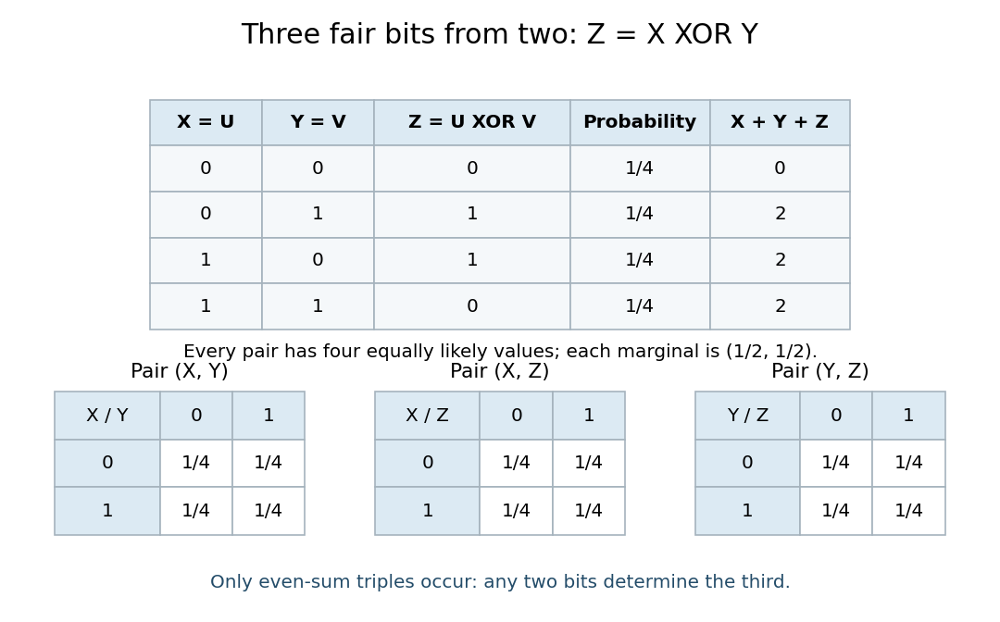

**[Figure 1](#image-four-outcomes-give-three-pairwise-independent-bits-with-a-joint-parity-constraint). Four outcomes give three pairwise independent bits with a joint parity constraint**. Each row has [probability](#probability) $1/4$. Each pair's [joint probability mass function](random-variable.md#joint-probability-mass-function) contains all four value combinations with [probability](#probability) $1/4$, although only four of the eight triple combinations can occur.

Another useful diagnostic preserves a special common-[intersection](set.md#set-intersection) case. Suppose three [events](probability-space.md#event) have common [probability](#probability) $s$ and every pair and triple intersect in the same [event](probability-space.md#event), of [probability](#probability) $q$. [Pairwise independence](#pairwise-independent-events) requires $q=s^2$, while mutual [independence](random-variable.md#independent-random-variables) additionally requires $q=s^3$. Both hold only for $s=0$ or $s=1$. For a concrete nontrivial instance, assign [probability](#probability) $1/4$ to each of four outcomes, let all three [events](probability-space.md#event) contain the first outcome, and give each [event](probability-space.md#event) one different additional outcome. Then $s=1/2$ and $q=1/4$: the pair equations hold, while the triple equation fails. Unlike the [exclusive or](theoretical-computer-science.md#exclusive-or) example above, this triple [intersection](set.md#set-intersection) is nonempty.

### Parity construction of pairwise independent bits

↑ **Parent:** [Pairwise independent events](#pairwise-independent-events)

The [parity construction of pairwise independent bits](#parity-construction-of-pairwise-independent-bits) turns two [independent](random-variable.md#independent-random-variables) fair [bits](information-theory.md#bit) into three [pairwise independent random variables](random-variable.md#pairwise-independent-random-variables). With $X=U$, $Y=V$, and $Z=U\mathbin\oplus V$, their allowed triples are $000,011,101,110$, each of [probability](#probability) $1/4$. Every coordinate has the [Bernoulli distribution](discrete-probability-distribution.md#bernoulli-distribution) with parameter $1/2$. Every pair has the same [joint probability mass function](random-variable.md#joint-probability-mass-function):

$$
\begin{array}{c|cccc}
(a,b)&(0,0)&(0,1)&(1,0)&(1,1)\\\hline
\mathbb P(X=a,Y=b)&1/4&1/4&1/4&1/4\\
\mathbb P(X=a,Z=b)&1/4&1/4&1/4&1/4\\
\mathbb P(Y=a,Z=b)&1/4&1/4&1/4&1/4
\end{array}
$$

All twelve pair cells equal the product of the corresponding [probabilities](#probability) in their [marginal distributions](probability-distribution.md#marginal-distribution). This establishes [pairwise independent random variables](random-variable.md#pairwise-independent-random-variables), a requirement involving every pair of value-[events](probability-space.md#event), rather than merely one chosen [event](probability-space.md#event) per coordinate. For general real-valued [random variables](random-variable.md) $R_i$, the requirement is

$$
\mathbb P(R_i\in D,R_j\in E)=\mathbb P(R_i\in D)\mathbb P(R_j\in E)
\qquad(i\ne j)
$$

for every pair of [Borel sets](measure-theory.md#borel-set) $D,E$. For these binary [random variables](random-variable.md), checking all four cells of each pair suffices: any value-[event](probability-space.md#event) is a union of the checked cells. In fact, for binary [random variables](random-variable.md), [independence](random-variable.md#independent-random-variables) of their one-value [events](probability-space.md#event) also gives the other cells by taking complements. Siegrist gives the all-set definition and its connection to [indicator random variables](expected-value.md#indicator-random-variable) in [Random Services: independence of random variables](https://www.randomservices.org/random/prob/Independence.html).

The full [joint probability mass function](random-variable.md#joint-probability-mass-function) tells a different story:

$$
\begin{array}{c|cccccccc}
(x,y,z)&000&001&010&011&100&101&110&111\\\hline
\mathbb P(X=x,Y=y,Z=z)&1/4&0&0&1/4&0&1/4&1/4&0\\
\mathbb P(X=x)\mathbb P(Y=y)\mathbb P(Z=z)&1/8&1/8&1/8&1/8&1/8&1/8&1/8&1/8
\end{array}
$$

The [integer parity](integer.md#parity-mathematics) of $X+Y+Z$ is always even. Any two [bits](information-theory.md#bit) determine the third: $Z=X\mathbin\oplus Y$, $X=Y\mathbin\oplus Z$, and $Y=X\mathbin\oplus Z$. Each coordinate is [independent](random-variable.md#independent-random-variables) of either other coordinate individually, but is dependent on the pair together. For example, the [conditional probabilities](#conditional-probability) satisfy $\mathbb P(Z=1\mid X=1)=1/2$ and $\mathbb P(Z=1\mid X=1,Y=1)=0$. See also [pairwise independence does not imply joint independence](random-variable.md#pairwise-independence-does-not-imply-joint-independence) for the general distinction.

The constraint changes the sum's [probability distribution](probability-distribution.md) without changing its [expected value](expected-value.md) or [variance](variance.md). Let $S=X+Y+Z$. Only $000$ gives $S=0$; each other allowed triple gives $S=2$. Direct calculation gives

$$
\mathbb P(S=0)=\frac14,\qquad \mathbb P(S=2)=\frac34,\qquad
\mathbb E[S]=0\cdot\frac14+2\cdot\frac34=\frac32,\qquad
\mathbb E[S^2]=4\cdot\frac34=3,\qquad
\operatorname{Var}(S)=3-\left(\frac32\right)^2=\frac34.
$$

The same [variance](variance.md) follows from the [variance of a sum](variance.md#variance-of-a-sum): each [Bernoulli distribution](discrete-probability-distribution.md#bernoulli-distribution) has [variance](variance.md) $1/4$, and [pairwise independent random variables](random-variable.md#pairwise-independent-random-variables) have zero cross [covariances](variance.md#covariance). [Linearity of expectation](expected-value.md#linearity-of-expectation) gives the [expected value](expected-value.md) $3/2$ even without [independence](random-variable.md#independent-random-variables).

For comparison, the sum $T$ of three mutually [independent](random-variable.md#independent-random-variables) fair [bits](information-theory.md#bit) has the [binomial distribution](discrete-probability-distribution.md#binomial-distribution) $\operatorname{Binomial}(3,1/2)$:

$$
\begin{array}{c|cccc}
t&0&1&2&3\\\hline
\mathbb P(T=t)&1/8&3/8&3/8&1/8
\end{array}
\qquad \mathbb E[T]=\frac32,\qquad \operatorname{Var}(T)=\frac34.
$$

Both sums have identical [expected values](expected-value.md) and [variances](variance.md), but $S$ never takes the values one or three. Even their third [moments](expected-value.md#moment) differ: $\mathbb E[S^3]=6$, whereas $\mathbb E[T^3]=27/4$. [Pairwise independence](#pairwise-independent-events) preserves these first two sum summaries while allowing a different [joint probability distribution](probability-distribution.md#joint-probability-distribution) and a different sum law. The calculation is an exact finite example.

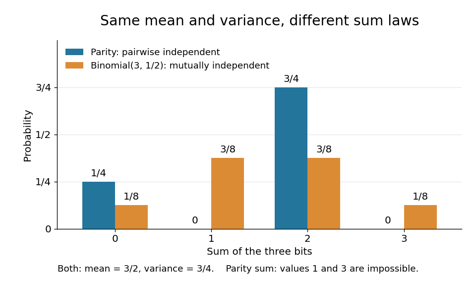

**[Figure 2](#image-pairwise-independence-preserves-the-mean-and-variance-but-changes-the-sum-distribution). Pairwise independence preserves the mean and variance but changes the sum distribution**. The [parity construction of pairwise independent bits](#parity-construction-of-pairwise-independent-bits) gives sum [probabilities](#probability) $(1/4,0,3/4,0)$; three mutually [independent](random-variable.md#independent-random-variables) fair [bits](information-theory.md#bit) give the [binomial distribution](discrete-probability-distribution.md#binomial-distribution) [probabilities](#probability) $(1/8,3/8,3/8,1/8)$. Both [expected values](expected-value.md) are $3/2$ and both [variances](variance.md) are $3/4$.

## Point process

↑ **Parent:** [Probability theory](probability-theory.md)

A [point process](#point-process) records random locations by a [random measure](measure-theory.md#random-measure) that counts them. Examples include arrival times of a [queue](queueing-theory.md#queue-queueing-theory), positions of [stars](stellar-astrophysics.md#star), and the finite [eigenvalue](linear-operator-theory.md#eigenvalue) configuration of a [random matrix](#random-matrix). The count in an observation window is a [random variable](random-variable.md); its [expected value](expected-value.md) is supplied by the [intensity measure of a point process](#intensity-measure-of-a-point-process), while its fluctuations and relationships with other windows require more information.

For a precise spatial convention, take $E=\mathbb R^d$ with its [Borel sigma-algebra](measure-theory.md#borel-sigma-algebra) and a [probability space](probability-space.md) $(\Omega,\mathcal F,\mathbb P)$. A locally finite [point process](#point-process) $\Pi$ is a [measurable function](measure-theory.md#measurable-function) from $\Omega$ to the space $\mathcal N_{\mathrm{lf}}(E)$ of locally finite point [measures](measure.md), equipped with the [sigma-algebra](measure-theory.md#sigma-algebra) generated by evaluations $\nu\mapsto\nu(A)$ for [Borel sets](measure-theory.md#borel-set) $A$. Each realization has the form

$$
\Pi_\omega=\sum_{j\in J(\omega)}\delta_{X_j(\omega)},\qquad
\Pi_\omega(A)=\sum_{j\in J(\omega)}\mathbf1_{\{X_j(\omega)\in A\}},
$$

where $J(\omega)$ is finite or [countable](cardinal-number.md#countable-set) and repeated locations are allowed; $\delta_x$ is a [Dirac measure](measure.md#dirac-measure). Here a point [measure](measure.md) is a [counting measure](measure.md#counting-measure) with possible multiplicities, rather than the [counting measure](measure.md#counting-measure) of a [set](set.md) of distinct locations.[Section 2.1, Definition 2.1, printed pp. 10-11: point measures and the sigma-algebra generated by evaluations](mathematics-bibliography.md#lectures-on-the-poisson-process-by-gunter-last-and-others)

Local finiteness means $\Pi_\omega(B)<\infty$ for every bounded [Borel set](measure-theory.md#borel-set) $B$, on a single [almost sure event](probability-space.md#almost-sure-event). In $\mathbb R^d$ it suffices to check the [countable](cardinal-number.md#countable-set) collection of balls of integer radius centered at the origin, and this is equivalent to finiteness on every [compact set](topology.md#compact-space). On a general [measurable space](measure-theory.md#measurable-space) there is no notion of boundedness without additional structure: state a [metric](topological-analysis.md#metric) or an explicit family of observation windows. Another convention on [locally compact spaces](topology.md#locally-compact-space) requires finiteness on [compact sets](topology.md#compact-space); this need not coincide with finiteness on all [bounded sets](topological-analysis.md#bounded-set) outside $\mathbb R^d$. Local finiteness does not require finitely many points in all of $E$.[Section 2.4, Definitions 2.11 and 2.13, printed pp. 16-17: bounded-set local finiteness and the countable ball exhaustion](mathematics-bibliography.md#lectures-on-the-poisson-process-by-gunter-last-and-others)

### Simple point process

↑ **Parent:** [Point process](#point-process)

A [point process](#point-process) is simple when, on a single [almost sure event](probability-space.md#almost-sure-event), every location has multiplicity at most one. Its realizations are [simple locally finite point measures](#simple-locally-finite-point-measure). For instance, $\delta_{0.4}+2\delta_{1.1}+\delta_{1.8}$ is locally finite but not simple: it has four points counted with multiplicity at three distinct locations. Simplicity is a statement about each entire realization. Checking $\mathbb P(\Pi(\{x\})>1)=0$ separately for every fixed $x$ is insufficient: $2\delta_U$ with $U$ having the [uniform distribution](continuous-probability-distribution.md#continuous-uniform-distribution) on $(0,1)$ passes every such fixed-location check, yet always has a double point.[Section 6.2, Definitions 6.6 and 6.8, printed p. 49: simple measures and simple point processes](mathematics-bibliography.md#lectures-on-the-poisson-process-by-gunter-last-and-others)

### Window count of a point process

↑ **Parent:** [Point process](#point-process)

For a bounded [Borel set](measure-theory.md#borel-set) $W\subset\mathbb R^d$, the window count $N_W$ of a locally finite [point process](#point-process) is a finite [nonnegative integer](arithmetic.md#natural-number) [random variable](random-variable.md). It counts multiplicities, and the convention for window boundaries matters. On the time half-line, $N(t)=\Pi((0,t])$ is a [counting process](stochastic-process.md#counting-process) and $N(t)-N(s)=\Pi((s,t])$. For pairwise [disjoint observation windows](#disjoint-observation-windows) $W_1,\ldots,W_m$, the [measure](measure.md) identity

$$
\Pi\!\left(\bigcup_{i=1}^m W_i\right)=\sum_{i=1}^m\Pi(W_i)
$$

is valid for every realization. Additivity of counts supplies no [independence](random-variable.md#independent-random-variables) assumption.

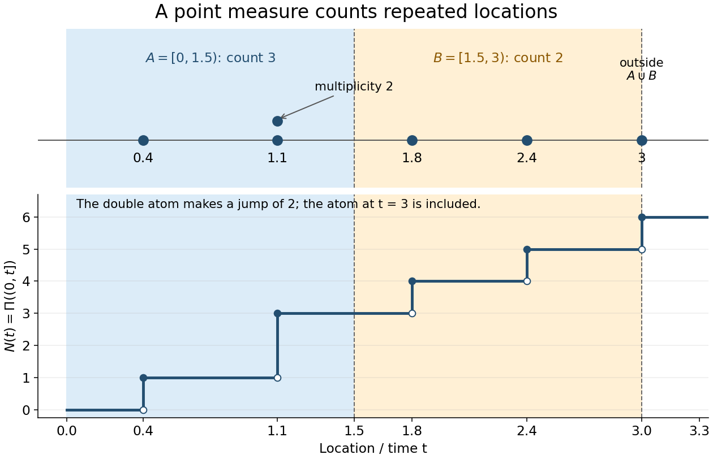

**[Figure 3](#image-window-counts-include-multiplicity-and-depend-on-boundary-conventions). Window counts include multiplicity and depend on boundary conventions**. One locally finite point [measure](measure.md) is $\delta_{0.4}+2\delta_{1.1}+\delta_{1.8}+\delta_{2.4}+\delta_{3.0}$. The half-open windows $A=[0,1.5)$ and $B=[1.5,3)$ have counts three and two; $\Pi(A\cup B)=5$. The atom at three lies outside both windows. Two stacked dots denote the double atom at $1.1$, and the step plot records $N(t)=\Pi((0,t])$, which includes the atom at three.

#### Disjoint observation windows

↑ **Parent:** [Window count of a point process](#window-count-of-a-point-process)

Observation windows are [measurable sets](measure-theory.md#measurable-set) used to count points of a [point process](#point-process). They are pairwise disjoint when $W_i\cap W_j=\varnothing$ for every $i\ne j$. Half-open intervals such as $[0,1)$ and $[1,2)$ meet at a boundary without sharing any point, whereas the closed intervals $[0,1]$ and $[1,2]$ both contain one. A [disjoint union](set-theory.md#disjoint-union) makes window counts additive; it does not make their [random variables](random-variable.md) [independent](random-variable.md#independent-random-variables).

### Stationary point process

↑ **Parent:** [Point process](#point-process)

A [point process](#point-process) on $\mathbb R^d$ is stationary if every [translation](geometry-and-topology.md#translation-geometry) preserves its [probability law](probability-distribution.md). If its mean count in a unit cube is finite, its [intensity measure](#intensity-measure-of-a-point-process) is $\mu(A)=\rho|A|$ for some $\rho\ge0$, where $|A|$ denotes [Lebesgue measure](measure-theory.md#lebesgue-measure). This follows because [stationarity](time-series.md#stationary-process) makes the mean [measure](measure.md) invariant under [translations](geometry-and-topology.md#translation-geometry). A constant [intensity function of a point process](poisson-point-process.md#intensity-function-of-a-point-process) describes only these mean counts, and by itself asserts neither [stationarity](time-series.md#stationary-process) of the entire law nor [independence](random-variable.md#independent-random-variables).[Section 8.1, Proposition 8.2, printed pp. 69-70: stationarity and constant intensity under a finite unit-cube mean](mathematics-bibliography.md#lectures-on-the-poisson-process-by-gunter-last-and-others)

### Neyman-Scott process

↑ **Parent:** [Point process](#point-process)  
ⓦ [Wiki](https://en.wikipedia.org/wiki/Neyman–Scott_process)

A [Neyman-Scott process](#neyman-scott-process) places [independent](random-variable.md#independent-random-variables) offspring clusters around points of a Poisson parent process, with an independently drawn offspring count and displacements. Poisson offspring counts make the offspring process conditionally Poisson given the parents, and therefore give a [Cox process](poisson-process.md#cox-process). Arbitrary offspring counts need not have that property.

### Intensity measure of a point process

↑ **Parent:** [Point process](#point-process)

The [intensity measure of a point process](#intensity-measure-of-a-point-process) $\Pi$ is its expected counting [measure](measure.md):

$$
\mu(A)=\mathbb E[\Pi(A)],\qquad A\in\mathcal B(E).
$$

It may take the value $+\infty$.[Section 2.2, Definition 2.5, printed p. 12: intensity as the expected counting measure](mathematics-bibliography.md#lectures-on-the-poisson-process-by-gunter-last-and-others) Countable additivity follows by applying the [monotone convergence theorem](measure-theory.md#monotone-convergence-theorem) to the counts of finite unions of pairwise [disjoint observation windows](#disjoint-observation-windows). If $\mu$ is locally finite and [absolutely continuous with respect to](measure-theory.md#absolute-continuity-of-measures) [Lebesgue measure](measure-theory.md#lebesgue-measure), its [Radon-Nikodym derivative](measure-theory.md#radon-nikodym-derivative) is the [intensity function of a point process](poisson-point-process.md#intensity-function-of-a-point-process) $\lambda$:

$$
\mu(A)=\int_A\lambda(x)\,dx.
$$

This is an expected number per unit volume, not a [probability density function](continuous-probability-distribution.md#probability-density-function) for a randomly selected point. For example, a single deterministic point has $\mu=\delta_0$, a [Dirac measure](measure.md#dirac-measure), and no [Lebesgue measure](measure-theory.md#lebesgue-measure) density. The density representation requires its own assumption.[Section 2.1, Definitions 2.1-2.2, printed pp. 26-27: expected counts and intensity functions](mathematics-bibliography.md#stochastic-geometry-lectures-given-at-the-c-i-m-e-summer-school-held-in-martina-franca-italy-september-13-18-2004/spatial-point-processes-and-their-applications)

For a bounded [Borel set](measure-theory.md#borel-set) $W$, $\mathbb E[N_W]=\mu(W)$, but local finiteness alone does not ensure that this [expected value](expected-value.md) is finite. Conversely, $\mu(W)<\infty$ implies $N_W<\infty$ [almost surely](convergence-of-random-variables.md#almost-sure-convergence), even when $W$ is unbounded. A constant finite [intensity function of a point process](poisson-point-process.md#intensity-function-of-a-point-process) on all of $\mathbb R^d$ has infinite total [intensity measure](#intensity-measure-of-a-point-process), although every bounded window has finite [expected value](expected-value.md).

#### Local finiteness does not imply finite intensity

↑ **Parent:** [Intensity measure of a point process](#intensity-measure-of-a-point-process)

Here is an explicit example even within [simple point processes](#simple-point-process). Let $K$ be a positive integer with [probability mass function](probability-distribution.md#probability-mass-function) $\mathbb P(K=k)=1/[k(k+1)]$. The telescoping series sums to one, $K$ is finite [almost surely](convergence-of-random-variables.md#almost-sure-convergence), but $\mathbb E[K]=\sum_{k\ge1}1/(k+1)=\infty$. Conditional on $K$, sample $K$ [independent](random-variable.md#independent-random-variables) points with the [uniform distribution](continuous-probability-distribution.md#continuous-uniform-distribution) on $(0,1)$. The resulting [point process](#point-process) has finitely many distinct points [almost surely](convergence-of-random-variables.md#almost-sure-convergence), while $\mu((0,1))=\infty$. Thus finite counts in each realization and finite mean counts are separate requirements; local finiteness of the [intensity measure](#intensity-measure-of-a-point-process) is an integrability assumption.

#### Constant intensity does not imply independence

↑ **Parent:** [Intensity measure of a point process](#intensity-measure-of-a-point-process)

The same [intensity measure](#intensity-measure-of-a-point-process) can belong to very different [point processes](#point-process). A [Poisson point process](poisson-point-process.md) with a locally finite [intensity measure](#intensity-measure-of-a-point-process) $\mu$ adds two requirements: each finite-intensity window count has the [Poisson distribution](discrete-probability-distribution.md#poisson-distribution) of mean $\mu(W)$, and counts in pairwise [disjoint observation windows](#disjoint-observation-windows) are mutually [independent](random-variable.md#independent-random-variables). These requirements determine its [probability law](probability-distribution.md); they do not follow from the formula for $\mu$.[Section 3.1, Definition 3.1 and Proposition 3.2, printed pp. 19-20: Poisson count laws, independence, and uniqueness](mathematics-bibliography.md#lectures-on-the-poisson-process-by-gunter-last-and-others)

A [randomly shifted lattice point process](#randomly-shifted-lattice-point-process), a unit-rate [Poisson point process](poisson-point-process.md), and the [shared random rate gives dependent point counts](#shared-random-rate-gives-dependent-point-counts) construction all satisfy $\mu(A)=|A|$ on the real line. Nevertheless, their counts in $[0,1)$ have respectively [variance](variance.md) zero, one, and two. Counts in the [disjoint observation windows](#disjoint-observation-windows) $[0,1/2)$ and $[1/2,1)$ have respectively [covariance](variance.md#covariance) $-1/4$, zero, and $1/4$. These exact calculations show why measuring mean density cannot identify a spacing or [statistical dependence](random-variable.md#statistical-dependence) model.

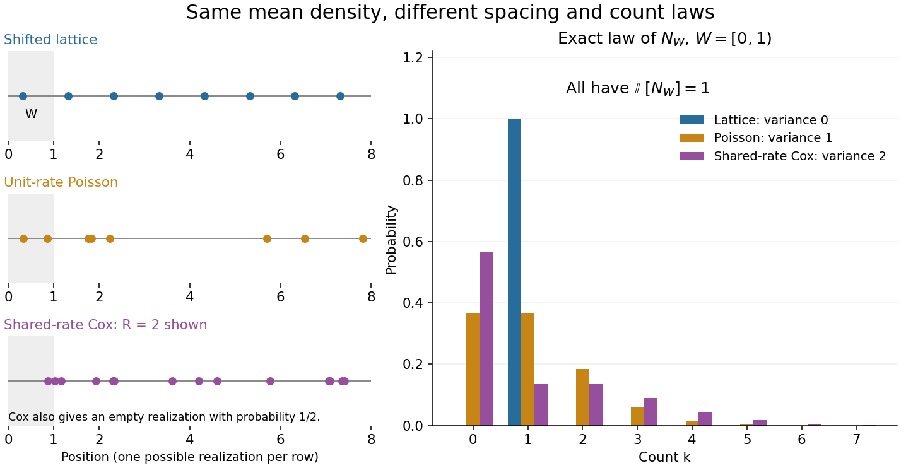

**[Figure 4](#image-equal-intensity-permits-regular-spacing-poisson-counts-and-shared-rate-dependence). Equal intensity permits regular spacing, Poisson counts, and shared-rate dependence**. All three laws have [intensity measure](#intensity-measure-of-a-point-process) $\mu(A)=|A|$. Left: illustrative realizations of a [randomly shifted lattice point process](#randomly-shifted-lattice-point-process), a unit-rate [Poisson point process](poisson-point-process.md), and the [shared random rate gives dependent point counts](#shared-random-rate-gives-dependent-point-counts) construction conditional on rate two; the latter also has a completely empty outcome with [probability](#probability) $1/2$. Right: exact [probability mass functions](probability-distribution.md#probability-mass-function) of the count in $[0,1)$, with the axis displayed through seven. Equal [expected values](expected-value.md) of one coexist with [variances](variance.md) zero, one, and two. Realizations illustrate spacing; the bars describe laws, not frequencies estimated from those realizations.

##### Randomly shifted lattice point process

↑ **Parent:** [Constant intensity does not imply independence](#constant-intensity-does-not-imply-independence)

Let $U$ have the [uniform distribution](continuous-probability-distribution.md#continuous-uniform-distribution) on $[0,1)$ and place a point at every $k+U$, $k\in\mathbb Z$. This is a [simple point process](#simple-point-process), locally finite, and a [stationary point process](#stationary-point-process): a [translation](geometry-and-topology.md#translation-geometry) only changes the phase modulo one, preserving its [uniform distribution](continuous-probability-distribution.md#continuous-uniform-distribution). For every [Borel set](measure-theory.md#borel-set) $A$, the [Tonelli theorem](measure-theory.md#tonelli-theorem) gives

$$
\mathbb E[\Pi(A)]=\sum_{k\in\mathbb Z}\int_0^1\mathbf1_A(k+u)\,du=|A|.
$$

Its consecutive points are exactly one unit apart, despite having the same [intensity measure](#intensity-measure-of-a-point-process) as a unit-rate [Poisson point process](poisson-point-process.md). This is the one-dimensional translated-grid construction.[Section 2.1, Example 2.3, printed pp. 26-27: randomly translated grids have constant intensity](mathematics-bibliography.md#stochastic-geometry-lectures-given-at-the-c-i-m-e-summer-school-held-in-martina-franca-italy-september-13-18-2004/spatial-point-processes-and-their-applications)

Every half-open interval of length one contains exactly one point. For $A=[0,1/2)$ and $B=[1/2,1)$, $\Pi(A)+\Pi(B)=1$, each count has the [Bernoulli distribution](discrete-probability-distribution.md#bernoulli-distribution) with parameter $1/2$, and

$$
\operatorname{Cov}(\Pi(A),\Pi(B))=0-\frac12\frac12=-\frac14.
$$

More generally, an interval of length $L=m+r$, with $m$ a [nonnegative integer](arithmetic.md#natural-number) and $0\le r<1$, contains $m$ or $m+1$ points with [probabilities](#probability) $1-r$ and $r$. Its count [variance](variance.md) is $r(1-r)$, while a unit-rate [Poisson point process](poisson-point-process.md) has count [variance](variance.md) $L$.

##### Shared random rate gives dependent point counts

↑ **Parent:** [Constant intensity does not imply independence](#constant-intensity-does-not-imply-independence)

Draw one [random variable](random-variable.md) $R$, taking values zero and two with equal [probabilities](#probability). Conditional on $R$, generate a [Poisson point process](poisson-point-process.md) on the real line with constant rate $R$. This is a [Cox process](poisson-process.md#cox-process) directed by the [random measure](measure-theory.md#random-measure) $R\,dx$: the same rate is shared by every window. It is a locally finite [simple point process](#simple-point-process) and a [stationary point process](#stationary-point-process). The [law of total expectation](measure-theory.md#law-of-total-expectation) gives $\mu(A)=\mathbb E[R]|A|=|A|$; the [law of total variance](#law-of-total-variance) and [law of total covariance](variance.md#law-of-total-covariance) give, for bounded [Borel sets](measure-theory.md#borel-set) $A,B$ with $A\cap B=\varnothing$,

$$
\operatorname{Var}(\Pi(A))=|A|+|A|^2,\qquad
\operatorname{Cov}(\Pi(A),\Pi(B))=|A||B|.
$$

The conditional [covariance](variance.md#covariance) vanishes by [independence](random-variable.md#independent-random-variables), but the shared conditional means fluctuate together. This distinguishes conditional from unconditional [independence](random-variable.md#independent-random-variables).[Section 13.2, equation (13.7) and Proposition 13.6, printed p. 130: Cox mean measures and the extra directing-measure variance](mathematics-bibliography.md#lectures-on-the-poisson-process-by-gunter-last-and-others)

For a window of length $L$, the exact [probability mass function](probability-distribution.md#probability-mass-function) is

$$
\mathbb P(N_W=k)=\frac12\mathbf1_{\{k=0\}}+\frac12 e^{-2L}\frac{(2L)^k}{k!},\qquad k=0,1,2,\ldots.
$$

In particular, its [void probability functional](#void-probability-functional) is $(1+e^{-2L})/2$, compared with $e^{-L}$ for the unit-rate [Poisson point process](poisson-point-process.md). Whole realizations can be empty or comparatively crowded, while their mean density remains one. This example demonstrates shared-rate [statistical dependence](random-variable.md#statistical-dependence), rather than a model of short-range offspring clusters.

### Void probability functional

↑ **Parent:** [Point process](#point-process)

The void [probability](#probability) functional assigns to a measurable set the [probability](#probability) that it contains no atom of a random point [measure](measure.md). For a [Poisson random measure](poisson-point-process.md#poisson-random-measure) of intensity $\mu$, it is $e^{-\mu(A)}$. The [exponential void probabilities characterize a Poisson random measure](poisson-point-process.md#exponential-void-probabilities-characterize-a-poisson-random-measure) result uses simplicity; doubling every atom of a Poisson [measure](measure.md) preserves void [probabilities](#probability) but changes count distributions.

#### Exponential void probabilities forbid fixed atoms

↑ **Parent:** [Void probability functional](#void-probability-functional)

If bounded intervals have void [probabilities](#probability) $e^{-\lambda(I)}$ for [Lebesgue measure](measure-theory.md#lebesgue-measure) $\lambda$, a fixed deterministic point $x$ has zero chance of being an atom. Surround it by intervals of lengths tending to zero and use $\mathbb P(M(\{x\})>0)\leq1-e^{-\lambda(I)}$. This holds for each fixed endpoint, not simultaneously for all real points of a nonempty point process.

### Simple locally finite point measure

↑ **Parent:** [Point process](#point-process)

A point [measure](measure.md) is a countable sum of [Dirac measures](measure.md#dirac-measure). It is simple if all its atoms have mass one, and locally finite if every bounded set has finite mass. Simplicity lets fine enough cells count individual points, whereas occupation indicators would lose multiplicities in a nonsimple [measure](measure.md).

#### Dyadic occupancy approximation of a simple point measure

↑ **Parent:** [Simple locally finite point measure](#simple-locally-finite-point-measure)

For a fixed bounded interval with no atoms at its endpoints, the occupation count of fully contained half-open [dyadic intervals](real-analysis.md#dyadic-interval) increases to the true count of a [simple locally finite point measure](#simple-locally-finite-point-measure). Refinement cannot reduce occupancy. Finitely many distinct atoms in a bounding interval have positive minimum separation; for fine enough cells each atom lies alone, and every interior atom's cell is contained in the target interval. Thus the counts eventually agree, path by path.

### Determinantal point process

↑ **Parent:** [Point process](#point-process)

A point process is determinantal with kernel $K$ relative to a specified reference measure if every [correlation function of a point process](#correlation-function-of-a-point-process) is the indicated [determinant](multilinear-algebra.md#determinant). A rank-$m$ [finite-rank projection kernel](functional-analysis.md#finite-rank-projection-kernel) gives an exactly $m$-point process, whose symmetric joint density is $\det[K(x_i,x_j)]/m!$.

### Correlation function of a point process

↑ **Parent:** [Point process](#point-process)

The $k$th correlation [function](function.md) is the density of the $k$th [factorial](combinatorics.md#factorial) moment measure: integrating a nonnegative test [function](function.md) against $R_k$ gives the [expectation](expected-value.md) of its sum over ordered $k$-tuples of distinct points. For exactly $m$ exchangeably labelled points with symmetric joint density $f_m$, it is $m!/(m-k)!$ times the marginal density of $k$ labels. It is not normalized to have total mass one.

## Random matrix

↑ **Parent:** [Probability theory](probability-theory.md)

A random [matrix](vector-space.md#matrix) is a [matrix](vector-space.md#matrix) whose entries are [random variables](random-variable.md). Its [eigenvalues](linear-operator-theory.md#eigenvalue) form a random configuration, and its [empirical spectral measure](#empirical-spectral-measure) records their distribution with equal mass on each [eigenvalue](linear-operator-theory.md#eigenvalue). Entry assumptions and normalization determine the spectral regime.

### Gaussian unitary ensemble

↑ **Parent:** [Random matrix](#random-matrix)

In the unscaled convention with diagonal [variance](variance.md) one, a Gaussian unitary ensemble [matrix](vector-space.md#matrix) $H$ is a [Hermitian matrix](hilbert-space.md#hermitian-operator) with independent real diagonal entries $N(0,1)$ and upper off-diagonal entries $(A_{ij}+iB_{ij})/\sqrt2$, where all the $A_{ij},B_{ij}$ and diagonal entries are [independent](random-variable.md#independent-random-variables) and have the [standard normal distribution](probability-distribution.md#standard-normal-distribution). Its density on the real coordinates of [Hermitian matrices](hilbert-space.md#hermitian-operator) is proportional to $\exp[-\operatorname{tr}(H^2)/2]$. Its exchangeably labelled real [eigenvalues](linear-operator-theory.md#eigenvalue) have symmetric [joint probability density function](continuous-probability-distribution.md#joint-probability-density) proportional to $\prod_{i<j}(\lambda_i-\lambda_j)^2e^{-\sum_i\lambda_i^2/2}$. The squared [Vandermonde determinant](galois-theory.md#vandermonde-determinant) suppresses coincident [eigenvalues](linear-operator-theory.md#eigenvalue); [orthogonal polynomial projection kernels](functional-analysis.md#orthogonal-polynomial-projection-kernel) express the [correlation functions of a point process](#correlation-function-of-a-point-process) as [determinants](multilinear-algebra.md#determinant).

### Gaussian orthogonal ensemble

↑ **Parent:** [Random matrix](#random-matrix)

In the unscaled variance-one convention, a Gaussian orthogonal ensemble [matrix](vector-space.md#matrix) $M$ is a real [symmetric matrix](linear-algebra.md#symmetric-matrix) whose upper-triangular entries are [independent](random-variable.md#independent-random-variables), with $M_{ij}\sim N(0,1)$ for $i<j$ and $M_{ii}\sim N(0,2)$. Its [joint probability density function](continuous-probability-distribution.md#joint-probability-density) relative to the upper-triangular coordinates is proportional to $\exp[-\operatorname{tr}(M^2)/4]$. The scaled convention uses $M/\sqrt n$; the scaling must be stated. If $X$ has independent standard [normal](probability-distribution.md#normal-distribution) entries, $(X+X^T)/\sqrt2$ realizes the unscaled convention. Expanding in the entries of $X$ gives the [covariance](variance.md#covariance) identity $\mathbb E[M_{ij}M_{kl}]=\delta_{ik}\delta_{jl}+\delta_{il}\delta_{jk}$, with [Kronecker deltas](multilinear-algebra.md#kronecker-delta).

### Gaussian random matrix

↑ **Parent:** [Random matrix](#random-matrix)

A standard real Gaussian [random matrix](#random-matrix) has [independent and identically distributed](random-variable.md#independent-and-identically-distributed-random-variables) [standard normal](probability-distribution.md#standard-normal-distribution) entries. Each column is an [orthogonally invariant random vector](characteristic-function.md#orthogonally-invariant-random-vector): its [probability density function](continuous-probability-distribution.md#probability-density-function) is proportional to $\exp(-\|z\|_2^2/2)$. Consequently multiplying on either side by a fixed [orthogonal matrix](linear-algebra.md#orthogonal-matrix) preserves the joint distribution. Its [singular values](linear-algebra.md#singular-value) are random; the expressions $\sqrt m\pm\sqrt n$ for an $m\times n$ [matrix](vector-space.md#matrix) describe useful spectral scales, not deterministic endpoints that hold for every realization.

### Wishart distribution

↑ **Parent:** [Random matrix](#random-matrix)  
ⓦ [Wiki](https://en.wikipedia.org/wiki/Wishart_distribution)

For integer $\nu$, the sum $\sum_{j=1}^{\nu}X_jX_j^T$ of independent $N_p(0,V)$ vectors has a Wishart distribution. Its positive-definite density extends to real $\nu>p-1$ and is proportional to $|W|^{(\nu-p-1)/2}\exp[-\operatorname{tr}(V^{-1}W)/2]$. It is a [conjugate prior](exponential-family.md#conjugate-prior) for the [precision matrix](variance.md#precision-matrix) of a [multivariate normal distribution](probability-and-statistics.md#multivariate-normal-distribution). Its mean is $\nu V$.

The [WinBUGS](bayesian-statistics.md#winbugs) declaration `dwish(R, nu)` uses $R=V^{-1}$; the density convention is documented in [the NIMBLE BUGS-language manual](https://r-nimble.org/manual/cha-writing-models.html). For $\nu=p=3$ it is proper, while the expected inverse matrix does not exist: that expectation requires $\nu>p+1$. Specifying a Wishart prior on precision is therefore a substantive covariance assumption.

#### Inverse-Wishart distribution

↑ **Parent:** [Wishart distribution](#wishart-distribution)  
ⓦ [Wiki](https://en.wikipedia.org/wiki/Inverse-Wishart_distribution)

If $W\sim W_p(\nu,R^{-1})$ has the [Wishart distribution](#wishart-distribution), then $W^{-1}$ has the inverse-Wishart distribution. For $\nu>p+1$, its [expected value](expected-value.md) is $R/(\nu-p-1)$; below this threshold the matrix mean does not exist. It commonly models a [covariance matrix](variance.md#covariance-matrix), but couples the prior behavior of variances and correlations.

### Empirical spectral measure

↑ **Parent:** [Random matrix](#random-matrix)

For an $N$-by-$N$ [Hermitian matrix](hilbert-space.md#hermitian-operator), the empirical spectral measure puts mass $1/N$ at each [eigenvalue](linear-operator-theory.md#eigenvalue), counted with multiplicity. It is a [probability measure](probability-space.md#probability-measure). Integrating a test [function](function.md) against it gives the average of that [function](function.md) evaluated at the [eigenvalues](linear-operator-theory.md#eigenvalue).

### Wigner matrix

↑ **Parent:** [Random matrix](#random-matrix)

A real Wigner [matrix](vector-space.md#matrix) is a real [symmetric matrix](linear-algebra.md#symmetric-matrix) whose upper off-diagonal entries are independent centered copies of a fixed [random variable](random-variable.md), scaled to have [variance](variance.md) of order $1/N$. Diagonal conventions may vary and should be specified separately. A common version has variance-one unscaled off-diagonal entries and either zero diagonal entries or independent diagonal entries with a bounded second moment.

#### Centered truncation of a Wigner matrix

↑ **Parent:** [Wigner matrix](#wigner-matrix)

Truncate the unscaled entries of a [Wigner matrix](#wigner-matrix) at a fixed threshold and subtract their [expected values](expected-value.md). The difference between original and truncated entries is $N^{-1/2}(Z_C-\mathbb EZ_C)$ with $Z_C=Y\mathbf1_{|Y|\geq C}$, so its [variance](variance.md) is bounded by $N^{-1}\mathbb E[Y^2\mathbf1_{|Y|\geq C}]$. The centering term cannot be discarded for an asymmetric entry law.

##### Second moment bound for spectral truncation

↑ **Parent:** [Centered truncation of a Wigner matrix](#centered-truncation-of-a-wigner-matrix)

For a fixed mean-zero variance-one real entry law, [centered truncation of a Wigner matrix](#centered-truncation-of-a-wigner-matrix) satisfies $\mathbb E[N^{-1}\operatorname{Tr}(X-\widehat X)^2]\leq t(C)$, where $t(C)=\mathbb E[Y^2\mathbf1_{|Y|\geq C}]\to0$. The [spectral Lipschitz bound from Frobenius distance](linear-operator-theory.md#spectral-lipschitz-bound-from-frobenius-distance) and [Markov inequality](probability-inequality.md#markov-s-inequality) give probability at most $t(C)/\varepsilon^2$ for a spectral test-function discrepancy exceeding $\varepsilon$. Thus $t(C)<\varepsilon^3$ works uniformly in [matrix](vector-space.md#matrix) size. A varying entry-law family requires uniform second-moment tail decay instead.

### Complex Wishart matrix

↑ **Parent:** [Random matrix](#random-matrix)

A complex Wishart [matrix](vector-space.md#matrix) is the Gram [matrix](vector-space.md#matrix) of an $n$-by-$m$ [matrix](vector-space.md#matrix) of independent centered complex [Gaussian random variables](probability-distribution.md#gaussian-random-variable) with an indicated [variance](variance.md) convention. It is a [positive semidefinite matrix](quadratic-form.md#positive-semidefinite-matrix). In the standard convention with joint entry density proportional to $e^{-\operatorname{Tr}X^*X}$ and $n\geq m$, its [eigenvalue](linear-operator-theory.md#eigenvalue) density contains the weight $x^{n-m}e^{-x}$ and a squared [Vandermonde determinant](galois-theory.md#vandermonde-determinant).

#### Laguerre unitary ensemble

↑ **Parent:** [Complex Wishart matrix](#complex-wishart-matrix)

The Laguerre unitary ensemble is the positive-eigenvalue ensemble with joint density proportional to $\prod_{i<j}(x_j-x_i)^2\prod_i x_i^a e^{-x_i}$, for $a>-1$. Integer $a=n-m\geq0$ is realized by a [complex Wishart matrix](#complex-wishart-matrix). The [Laguerre projection kernel](functional-analysis.md#laguerre-projection-kernel) expresses its [correlation functions of a point process](#correlation-function-of-a-point-process) as determinants.

## Concentration of measure

↑ **Parent:** [Probability theory](probability-theory.md)

For a [metric space](topological-analysis.md#metric-space) with a [probability measure](probability-space.md#probability-measure) $\mu$, the concentration function is $\alpha(\varepsilon)=\sup_{\mu(A)\geq1/2}(1-\mu(A_\varepsilon))$, where $A_\varepsilon$ is the metric neighbourhood of radius $\varepsilon$. A sequence exhibits [concentration of measure](#concentration-of-measure) if these functions tend to zero for every fixed positive radius. The metric scale is part of this definition.

<h3 id="levy-family-of-graphs">Lévy family of graphs</h3>

↑ **Parent:** [Concentration of measure](#concentration-of-measure)

A [Lévy family of graphs](#levy-family-of-graphs) consists of finite connected [graphs](graph.md) with their uniform [probability measures](probability-space.md#probability-measure) and [graph distances](graph-theory.md#distance-graph-theory) divided by their diameters, whose [concentration of measure](#concentration-of-measure) functions vanish at every fixed positive normalized radius. Equivalently, every family occupying at least half the vertices has a radius-$\lfloor\varepsilon D_n\rfloor$ neighbourhood occupying a proportion tending to one, uniformly over such families. [Harper theorem](analysis-of-boolean-functions.md#vertex-isoperimetric-inequality-in-the-discrete-cube) and [binomial distribution](discrete-probability-distribution.md#binomial-distribution) tail bounds prove this for the [hypercube graphs](graph.md#hypercube-graph).

#### Failure of concentration in fixed-dimensional grids

↑ **Parent:** [Lévy family of graphs](#levy-family-of-graphs)

Equip $[n]^d$ with uniform [probability measure](probability-space.md#probability-measure) and its nearest-neighbour [graph distance](graph-theory.md#distance-graph-theory) divided by $d(n-1)$, for fixed positive $d$. The [set](set.md) $\{x:x_1\leq\lceil n/2\rceil\}$ has at least half the vertices. Its radius-$\varepsilon d(n-1)$ [graph neighbourhood](graph-theory.md#graph-neighbourhood) still omits a proportion tending to $1/2-\varepsilon d$ when $0<\varepsilon<1/(2d)$. These grids therefore do not form a [Lévy family of graphs](#levy-family-of-graphs).

#### Concentration of discrete cubes at diameter scale

↑ **Parent:** [Lévy family of graphs](#levy-family-of-graphs)

Equip the [Boolean hypercube](analysis-of-boolean-functions.md#boolean-hypercube) with uniform [probability measure](probability-space.md#probability-measure) and [graph distance](graph-theory.md#distance-graph-theory) divided by its [graph diameter](graph-theory.md#graph-diameter). These spaces form a [Lévy family of graphs](#levy-family-of-graphs). The [vertex-isoperimetric inequality in the discrete cube](analysis-of-boolean-functions.md#vertex-isoperimetric-inequality-in-the-discrete-cube) reduces the complement of a positive-density [set](set.md)'s radius-$\varepsilon n$ [graph neighbourhood](graph-theory.md#graph-neighbourhood) to a [binomial distribution](discrete-probability-distribution.md#binomial-distribution) tail. For fixed density $\delta>0$, [Chebyshev's inequality](probability-inequality.md#chebyshev-s-inequality) puts a lower density quantile at least $n/2-C_\delta\sqrt n-O(1)$. After enlarging by $\varepsilon n$, the omitted mass is at most $n/[4(\varepsilon n-C_\delta\sqrt n-O(1))^2]$, which tends to zero.

## Positive association of random variables

↑ **Parent:** [Probability theory](probability-theory.md)

A random vector $X$ is positively associated if $\operatorname{Cov}(f(X),g(X))\geq0$ for every pair of coordinatewise nondecreasing bounded functions $f,g$. The same inequality holds when both are nonincreasing, by negating them. Repeatedly applying it to products of nonnegative increasing indicators gives $\mathbb P(\bigcap_iE_i)\geq\prod_i\mathbb P(E_i)$ for increasing events; the same is true for decreasing events. Thus associated rejection indicators have [familywise error rate](statistical-hypothesis-test.md#familywise-error-rate) no greater than [independent](random-variable.md#independent-random-variables) indicators with the same marginals. Pairwise positive [correlation coefficients](variance.md#pearson-correlation-coefficient) alone do not give this stronger property. The classical definition is in [Esary, Proschan and Walkup (1967)](https://www.stat.cmu.edu/~brian/720/week02/esary-proschan-walkup-1967.pdf).

## Extreme value theory

↑ **Parent:** [Probability theory](probability-theory.md)

[This section is present in another page, follow this link to view it.](extreme-value-theory.md)

## Probability

↑ **Parent:** [Probability theory](probability-theory.md)  
ⓦ [Wiki](https://en.wikipedia.org/wiki/Probability)

The probability of an [event](probability-space.md#event) is its value under a [probability measure](probability-space.md#probability-measure), a [real number](arithmetic.md#real-number) between zero and one. It compares the mass assigned to that [event](probability-space.md#event) with the unit mass of the whole [sample space](probability-space.md#sample-space). For a finite [sample space](probability-space.md#sample-space) with equally likely outcomes, $\mathbb P(A)=|A|/|\Omega|$. For unequal outcome masses, add their individual [probabilities](#probability) instead.

For example, selecting a coin with head [probability](#probability) $1/2$ with chance $4/5$, or a coin with head [probability](#probability) $3/4$ with chance $1/5$, gives head [probability](#probability) $(4/5)(1/2)+(1/5)(3/4)=11/20$. This is the [law of total probability](probability-space.md#law-of-total-probability): averaging over the hidden selection is part of calculating the outcome's [probability](#probability).

### Statistical fluctuation

↑ **Parent:** [Probability](#probability)

A statistical fluctuation is variation between repeated random outcomes or samples. Its scale can be quantified by [variance](variance.md) or [standard deviation](variance.md#standard-deviation). For independent signal counts with a Poisson mean proportional to deposited [energy](energy.md), the absolute fluctuation grows as the square root of [energy](energy.md) and its relative size decreases as the inverse square root.

### Complement rule of probability

↑ **Parent:** [Probability](#probability)

For an [event](probability-space.md#event) $A$ in a [sample space](probability-space.md#sample-space) $\Omega$, the complementary [event](probability-space.md#event) $A^c=\Omega\setminus A$ occurs exactly when $A$ does not occur. The [complement rule of probability](#complement-rule-of-probability) follows from the [Kolmogorov axioms](probability-space.md#kolmogorov-axioms): $A$ and $A^c$ are disjoint, their union is $\Omega$, and their [probabilities](#probability) therefore add to $\mathbb P(\Omega)=1$.

This rule is useful when an [event](probability-space.md#event) is easier to describe through its failure. For a nonnegative [integer](integer.md)-valued [random variable](random-variable.md) $K$, $\mathbb P(K\geq1)=1-\mathbb P(K=0)$ turns an at-least-one calculation into a single value of the [probability mass function](probability-distribution.md#probability-mass-function). In [sampling without replacement](statistical-inference.md#sampling-without-replacement), the [hypergeometric distribution](discrete-probability-distribution.md#hypergeometric-distribution) gives the chance of missing all marked objects, so its complement gives the chance of finding at least one.

### Odds

↑ **Parent:** [Probability](#probability)  
ⓦ [Wiki](https://en.wikipedia.org/wiki/Odds)

For an [event](probability-space.md#event) of [probability](#probability) $0<p<1$, its odds in favor are $o=p/(1-p)$. They compare the [probability](#probability) of the [event](probability-space.md#event) with that of its [complement](set.md#complement-of-a-set). Conversely $p=o/(1+o)$. For example, [probability](#probability) $1/4$ gives [odds](#odds) $1/3$, or one to three in favor. The same transformation applies to a [conditional probability](#conditional-probability); an [odds ratio](statistical-modelling.md#odds-ratio) compares these transformed [probabilities](#probability) in two groups, while a [risk ratio](statistical-modelling.md#risk-ratio) compares the [probabilities](#probability) themselves.

### Tail probability

↑ **Parent:** [Probability](#probability)

For a real [random variable](random-variable.md) $X$, an upper-tail [probability](#probability) has the form $\mathbb P(X\geq t)$ and a lower-tail [probability](#probability) has the form $\mathbb P(X\leq t)$. Each is the [probability](#probability) of an [event](probability-space.md#event) lying beyond a chosen threshold in one direction. A [tail probability](#tail-probability) need not be small: the threshold determines how much of the [probability distribution](probability-distribution.md) it includes. A [concentration inequality](probability-inequality.md#concentration-inequality) bounds such [probabilities](#probability), often for deviations from an [expected value](expected-value.md).

Endpoint conventions matter. Write $F(t)=\mathbb P(X\leq t)$ for the [cumulative distribution function](probability-distribution.md#cumulative-distribution-function) and $F(t^-)=\lim_{s\uparrow t}F(s)=\mathbb P(X<t)$. The [complement rule of probability](#complement-rule-of-probability) gives four distinct formulas:

$$
\begin{aligned}
\mathbb P(X\geq t)&=1-F(t^-),&\mathbb P(X>t)&=1-F(t),\\
\mathbb P(X\leq t)&=F(t),&\mathbb P(X<t)&=F(t^-).
\end{aligned}
$$

The strict upper-tail convention is the [survival function](survival-analysis.md#survival-function) $S(t)=\mathbb P(X>t)$. Its value differs from the inclusive upper [tail probability](#tail-probability) by exactly the [probability mass](probability-distribution.md#probability-mass) at the threshold:

$$
\mathbb P(X\geq t)-\mathbb P(X>t)=\mathbb P(X=t)=F(t)-F(t^-).
$$

A [singleton](set.md#singleton-mathematics) with positive [probability mass](probability-distribution.md#probability-mass) is an [atom of a measure](measure.md#atom-measure-theory). Thus $1-F(t)$ excludes an [atom of a measure](measure.md#atom-measure-theory) at $t$, whereas $1-F(t^-)$ includes it. These endpoint identities follow directly from the [cumulative distribution function](probability-distribution.md#cumulative-distribution-function) properties in [Kyle Siegrist, Distribution and Quantile Functions: endpoint probabilities and right tails](https://www.randomservices.org/random/dist/CDF.html).

As the threshold increases, both upper [tail probabilities](#tail-probability) are [nonincreasing functions](calculus.md#nonincreasing-function). The strict [survival function](survival-analysis.md#survival-function) is a [right-continuous function](calculus.md#right-continuous-function); the inclusive upper [tail probability](#tail-probability) takes the upper endpoint value at a downward jump, equal to the left [limit](calculus.md#limit-of-a-function) of the [survival function](survival-analysis.md#survival-function). Both tend to zero as $t\to\infty$ for a real [random variable](random-variable.md), but the speed of that decay differs across [probability distributions](probability-distribution.md). The [cumulative distribution function](probability-distribution.md#cumulative-distribution-function) properties and their proof from continuity of [probability measures](probability-space.md#probability-measure) are given in [MIT 6.436J, Lecture 4: random variables and cumulative distribution function properties](https://ocw.mit.edu/courses/6-436j-fundamentals-of-probability-fall-2018/9797310bed4c7f5b5d40d007783eec8d_MIT6_436JF18_lec04.pdf).

For a fair six-sided die $D$, the [discrete uniform distribution](discrete-probability-distribution.md#discrete-uniform-distribution) assigns [probability mass](probability-distribution.md#probability-mass) $1/6$ to each of $1,\ldots,6$. At threshold four,

$$
\mathbb P(D\geq4)=\frac36=\frac12,\qquad \mathbb P(D>4)=\frac26=\frac13,\qquad F_D(4)=\frac46,\qquad F_D(4^-)=\frac36.
$$

Between four and five, both upper [tail probabilities](#tail-probability) equal $1/3$. At the largest possible outcome the distinction is especially visible: $\mathbb P(D\geq6)=1/6$, but $\mathbb P(D>6)=0$. The diagram shows exact [probabilities](#probability) for this mathematical model; its dots specify which endpoints belong to each [step function](measure-theory.md#step-function).

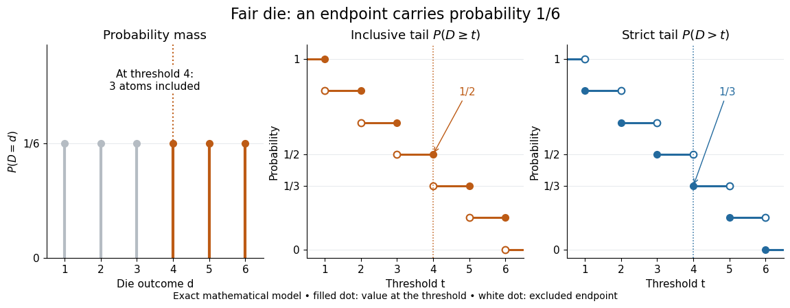

**[Figure 5](#image-exact-fair-die-probabilities-including-or-excluding-a-threshold-changes-the-tail-by-one-atom). Exact fair-die probabilities: including or excluding a threshold changes the tail by one atom**.

If a [probability distribution](probability-distribution.md) has a [probability density function](continuous-probability-distribution.md#probability-density-function) $f$, then every [singleton](set.md#singleton-mathematics) has zero [probability mass](probability-distribution.md#probability-mass) and

$$
\mathbb P(X\geq t)=\mathbb P(X>t)=\int_t^\infty f(x)\,dx.
$$

For an [exponential distribution](continuous-probability-distribution.md#exponential-distribution) of rate two, $f(x)=2e^{-2x}$ for $x\geq0$ and zero otherwise, so $S(t)=e^{-2t}$ for $t\geq0$ and $S(t)=1$ for $t<0$. Hence $\mathbb P(X\geq1)=e^{-2}\approx0.135335$. This [tail probability](#tail-probability) is an [integral](integral.md) of the [probability density function](continuous-probability-distribution.md#probability-density-function), not its height $f(1)=2e^{-2}\approx0.270671$. A [mixed probability distribution](probability-distribution.md#mixed-probability-distribution) retains endpoint jumps even with a smooth component: give zero [probability mass](probability-distribution.md#probability-mass) $1/4$ and choose this [exponential distribution](continuous-probability-distribution.md#exponential-distribution) with [probability](#probability) $3/4$. Then $\mathbb P(X\geq0)=1$, $\mathbb P(X>0)=3/4$, and $S(t)=(3/4)e^{-2t}$ for $t\geq0$.

A two-sided [tail probability](#tail-probability) can measure the [absolute value](real-analysis.md#absolute-value) of displacement from a specified center $c$. For $a>0$, the two extreme [events](probability-space.md#event) are [disjoint events](probability-space.md#disjoint-events), so

$$
\mathbb P(|X-c|\geq a)=\mathbb P(X\leq c-a)+\mathbb P(X\geq c+a)=F(c-a)+1-F((c+a)^-).
$$

For strict displacement $|X-c|>a$, replace the last expression by $F((c-a)^-)+1-F(c+a)$. The condition $a>0$ prevents overlap; at $a=0$ adding inclusive tails double-counts any [probability mass](probability-distribution.md#probability-mass) at $c$. For a [uniform distribution](continuous-probability-distribution.md#continuous-uniform-distribution) on $[-2,2]$, take $c=0$ and $a=1$: the two [tail probabilities](#tail-probability) are $1/4$ each and their sum is $1/2$. Equal tails follow from this [symmetric probability distribution](probability-distribution.md#symmetric-probability-distribution), not from the phrase two-sided alone; for a [uniform distribution](continuous-probability-distribution.md#continuous-uniform-distribution) on $[0,4]$ with $c=1,a=1$, the two [tail probabilities](#tail-probability) are zero and $1/2$.

The [tail-sum formula for expectation](#tail-sum-formula-for-expectation) turns a whole curve of [tail probabilities](#tail-probability) into an [expected value](expected-value.md). For any nonnegative [random variable](random-variable.md) $Y$, without assuming a [probability density function](continuous-probability-distribution.md#probability-density-function) or a finite [expected value](expected-value.md),

$$
\mathbb E Y=\int_0^\infty\mathbb P(Y>t)\,dt=\int_0^\infty\mathbb P(Y\geq t)\,dt\quad\text{in }[0,\infty].
$$

For a proof outline, write $Y=\int_0^\infty\mathbf1_{\{Y>t\}}\,dt$ pointwise and exchange the [expected value](expected-value.md) and [Lebesgue integral](measure-theory.md#lebesgue-integral) using [Tonelli theorem](measure-theory.md#tonelli-theorem); $\mathbf1$ is an [indicator function](measure-theory.md#indicator-function). The inclusive version has the same [Lebesgue integral](measure-theory.md#lebesgue-integral): positive [probability masses](probability-distribution.md#probability-mass) occur at only a [countable set](cardinal-number.md#countable-set) of thresholds, which has [Lebesgue measure](measure-theory.md#lebesgue-measure) zero. For a nonnegative [integer](integer.md)-valued [random variable](random-variable.md) $N$, the [tail-sum formula](expected-value.md#tail-sum-formula) instead gives $\mathbb E N=\sum_{k=1}^\infty\mathbb P(N\geq k)=\sum_{k=0}^\infty\mathbb P(N>k)$. The integer hypothesis is essential for these sums. The integral identity, its [indicator function](measure-theory.md#indicator-function) proof, and the integer version appear in [Kyle Siegrist, Additional Properties of Expected Value: integration and summation of right tails](https://www.randomservices.org/random/expect/Properties2.html).

For the fair die, this [tail-sum formula](expected-value.md#tail-sum-formula) yields $(6+5+4+3+2+1)/6=7/2$, equal to the direct [weighted arithmetic mean](arithmetic.md#weighted-arithmetic-mean) $(1+2+3+4+5+6)/6$. For the rate-two [exponential distribution](continuous-probability-distribution.md#exponential-distribution), the area under the [survival function](survival-analysis.md#survival-function) is $\int_0^\infty e^{-2t}\,dt=1/2$, its [expected value](expected-value.md). The first panel below shades an [integral](integral.md) of the [probability density function](continuous-probability-distribution.md#probability-density-function) for a single threshold; the second shades an [integral](integral.md) of the [survival function](survival-analysis.md#survival-function) across all nonnegative thresholds. These are analytical illustrations, with the displayed curves truncated at three; their exact total areas use an infinite integration range.

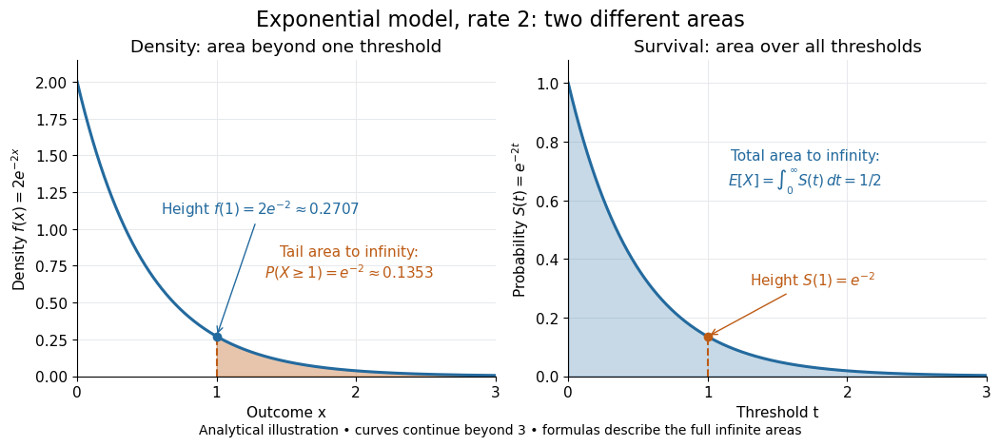

**[Figure 6](#image-exponential-model-one-tail-probability-is-density-area-while-expectation-is-total-survival-area). Exponential model: one tail probability is density area, while expectation is total survival area**.

Nonnegativity is essential to interpreting the upper [tail probability](#tail-probability) area as $\mathbb E Y$: for a general real [random variable](random-variable.md) that area equals the [expected value](expected-value.md) of its [positive part](function.md#positive-part-of-a-real-valued-function). An [integrable random variable](expected-value.md#integrable-random-variable) satisfies $\mathbb E X=\mathbb E X^+-\mathbb E X^-$, subtracting the [expected value](expected-value.md) of its [negative part](function.md#negative-part-of-a-real-valued-function); infinite terms cannot be canceled. Even when $Y$ is finite [almost surely](convergence-of-random-variables.md#almost-sure-convergence), its [expected value](expected-value.md) can be infinite. For the shape-one [Pareto distribution](continuous-probability-distribution.md#pareto-distribution) on $[1,\infty)$, $S(t)=1$ on $[0,1)$ and $S(t)=1/t$ for $t\geq1$, so the area is $1+\int_1^\infty dt/t=\infty$. The finite versus infinite [expected value](expected-value.md) distinction is illustrated in [Kyle Siegrist, Definitions and Basic Properties: exponential and Pareto expected values](https://www.randomservices.org/random/expect/Properties.html).

Why are [tail probabilities](#tail-probability) useful? They answer threshold questions directly, and a [concentration inequality](probability-inequality.md#concentration-inequality) can bound them without knowing the full [probability distribution](probability-distribution.md). For nonnegative $Y$ with finite [expected value](expected-value.md), [Markov inequality](probability-inequality.md#markov-s-inequality) gives $\mathbb P(Y\geq t)\leq\mathbb E Y/t$ for $t>0$: a large threshold relative to the [expected value](expected-value.md) forces rarity. The [quantile function](probability-distribution.md#quantile-function) reverses the question by choosing a threshold for a prescribed cumulative level. If $q=Q(1-\alpha)$ with $0<\alpha<1$, then $\mathbb P(X>q)\leq\alpha\leq\mathbb P(X\geq q)$; an [atom of a measure](measure.md#atom-measure-theory) may prevent equality. For the die, $Q(0.9)=6$, with strict upper [tail probability](#tail-probability) zero and inclusive upper [tail probability](#tail-probability) $1/6$.

A [tail probability](#tail-probability) describes rarity under a specified [probability distribution](probability-distribution.md); it is not automatically a [conditional probability](#conditional-probability) after extra information. For $u\geq t$ with $\mathbb P(X\geq t)>0$,

$$
\mathbb P(X\geq u\mid X\geq t)=\frac{\mathbb P(X\geq u)}{\mathbb P(X\geq t)},
$$

because the threshold [events](probability-space.md#event) are nested. Thus the die has $\mathbb P(D\geq5)=1/3$ but $\mathbb P(D\geq5\mid D\geq4)=2/3$. Conditioning changes the [sample space](probability-space.md#sample-space) and renormalizes its [probability measure](probability-space.md#probability-measure); the same extreme outcomes can become common in that restricted population.

## Percolation theory

↑ **Parent:** [Probability theory](probability-theory.md)

[This section is present in another page, follow this link to view it.](percolation-theory.md)

## Finitely additive probability measure

↑ **Parent:** [Probability theory](probability-theory.md)

A finitely additive probability measure on a set $X$ is a function $m:\mathcal P(X)\to[0,1]$ such that $m(X)=1$ and $m(A\sqcup B)=m(A)+m(B)$ for disjoint subsets $A,B\subseteq X$. Unlike a [probability measure](probability-space.md#probability-measure), it need not be countably additive.

## Probability space

↑ **Parent:** [Probability theory](probability-theory.md)

[This section is present in another page, follow this link to view it.](probability-space.md)

## Uniform random point in a disk

↑ **Parent:** [Probability theory](probability-theory.md)

For a point uniformly distributed in the unit disk, its polar coordinates are independent with densities

$$
f_R(r)=2r\mathbf1_{[0,1]}(r),
\qquad
f_\Theta(\theta)=\frac1{2\pi}\mathbf1_{[0,2\pi)}(\theta).
$$

### Origin in a triangle of three radial random points

↑ **Parent:** [Uniform random point in a disk](#uniform-random-point-in-a-disk)

For three independent points from any rotationally symmetric planar distribution with nonzero radii, the origin lies in their triangle exactly when their three angles do not all lie in one semicircle. Three independent uniform angles have this property with probability $1/4$.

## Independent sigma-algebras

↑ **Parent:** [Probability theory](probability-theory.md)

Two sub-sigma-algebras $\mathcal F_1,\mathcal F_2$ are independent when

$$
\mathbb P(A\cap B)=\mathbb P(A)\mathbb P(B)
$$

for every $A\in\mathcal F_1$ and $B\in\mathcal F_2$.

### Independent events

↑ **Parent:** [Independent sigma-algebras](#independent-sigma-algebras)

Events $A_1,\ldots,A_n$ are mutually independent when

$$
\mathbb P\left(\bigcap_{j\in J}A_j\right)
=\prod_{j\in J}\mathbb P(A_j)
$$

for every nonempty index subset $J\subseteq\{1,\ldots,n\}$. For two [events](probability-space.md#event) and $\mathbb P(B)>0$, this is equivalent to $\mathbb P(A\mid B)=\mathbb P(A)$: learning whether $B$ occurred does not change the chance of $A$.

For independent uniform dice, the [events](probability-space.md#event) that the first result is an [even integer](integer.md#even-number) and that the second result is an [even integer](integer.md#even-number) each have [probability](#probability) $1/2$; their [intersection](set.md#set-intersection) has [probability](#probability) $9/36=1/4$. In contrast, "first result is an [even integer](integer.md#even-number)" and "first result is an [odd integer](integer.md#odd-integer)" are [disjoint events](probability-space.md#disjoint-events) of positive [probability](#probability), so they cannot be [independent events](#independent-events). Learning one occurred completely rules out the other.

[Pairwise independence](#pairwise-independent-events) is weaker than mutual independence. Take two [independent](random-variable.md#independent-random-variables) fair [bits](information-theory.md#bit) $X,Y$. The three [events](probability-space.md#event) $X=0$, $Y=0$, and $X=Y$ each have [probability](#probability) $1/2$ and every pair has [intersection](set.md#set-intersection) [probability](#probability) $1/4$. Their triple [intersection](set.md#set-intersection) is the single outcome $(0,0)$, of [probability](#probability) $1/4$ rather than $1/8$. Checking pairs alone misses the joint constraint.

#### Pairwise-independent three-event avoidance

↑ **Parent:** [Independent events](#independent-events)

For three pairwise [independent events](#independent-events) of common probability $a$, write $x=\mathbb P(A_1\cap A_2\cap A_3)$. [Inclusion-exclusion principle](combinatorics.md#inclusion-exclusion-principle) gives avoidance probability $1-3a+3a^2-x$, and $x\leq a^2$ gives the displayed lower bound. It is strictly positive for $0<a<1/2$. For $1/2\leq a<1$, a symmetric atomic law with no zero-success atom has mass $(1-a)^2$ on each singleton success pattern, $(1-a)(2a-1)$ on each doubleton, and $1-3a+3a^2$ on the tripleton. These masses sum to one, have marginal $a$, and have pair intersections $a^2$.

### Independence extended from generating pi-systems

↑ **Parent:** [Independent sigma-algebras](#independent-sigma-algebras)

If two pi-systems satisfy the probability factorization pairwise, their generated sigma-algebras are independent. For one event in the first family, the events in the second sigma-algebra satisfying the factorization form a Dynkin system; apply [Dynkin lemma](measure-theory.md#dynkin-lemma), then repeat with the roles reversed.

### Tail sigma-algebra

↑ **Parent:** [Independent sigma-algebras](#independent-sigma-algebras)

For a [sequence](sequence-and-series.md#sequence) of [random variables](random-variable.md) $(X_n)_{n\geq1}$ on a [probability space](probability-space.md) $(\Omega,\mathcal F,\mathbb P)$, define

$$
\mathcal G_n=\sigma(X_n,X_{n+1},\ldots),\qquad
\mathcal T=\bigcap_{n\geq1}\mathcal G_n.
$$

The decreasing [sigma-algebras](measure-theory.md#sigma-algebra) $\mathcal G_n$ are generated by the listed [random variables](random-variable.md). Their [intersection](set.md#set-intersection) consists of [events](probability-space.md#event) expressible after discarding every finite prefix. No [independence](random-variable.md#independent-random-variables) is required.[Probability: Theory and Examples (fifth edition), §2.5 Convergence of Random Series, printed p. 81: definition of the tail sigma-field](mathematics-bibliography.md#probability-theory-and-examples-fifth-edition-by-rick-durrett)

The point is to distinguish a long observation record from a property of an infinite [sequence](sequence-and-series.md#sequence). The [event](probability-space.md#event) of seeing infinitely many heads and the [event](probability-space.md#event) that [sample means](variance.md#sample-mean) converge survive any finite change, while an exact first-head time does not. [Kolmogorov's zero–one law](#kolmogorov-s-zero-one-law) adds the striking conclusion that under [independence](random-variable.md#independent-random-variables) each [tail event](#tail-event) has [probability](#probability) zero or one; the [tail sigma-algebra](#tail-sigma-algebra) itself can still contain many nonempty [sets](set.md).

#### Finite-prefix invariance of tail events

↑ **Parent:** [Tail sigma-algebra](#tail-sigma-algebra)

On the full [Cartesian product](set-theory.md#cartesian-product) $\Omega=\mathbb R^{\mathbb N}$ with its [product sigma-algebra](#product-sigma-algebra), take the coordinate [random variables](random-variable.md) $X_j(x)=x_j$. A product-measurable [set](set.md) $A$ is a [tail event](#tail-event) if and only if membership is unchanged whenever two [sequences](sequence-and-series.md#sequence) differ in finitely many coordinates. The [measurability](measure-theory.md#measurability) condition is essential: invariance alone is not a license to assign a [probability](#probability) to an arbitrary [subset](set.md#subset).

For the forward implication, fix $m$. An [event](probability-space.md#event) in $\sigma(X_{m+1},X_{m+2},\ldots)$ cannot distinguish points with the same remaining coordinates. Since a [tail event](#tail-event) belongs to this [sigma-algebra](measure-theory.md#sigma-algebra) for every $m$, every finite change preserves membership.

For the converse, freeze the first $m$ coordinates to zero. The insertion [map](function.md#function-class)

$$
i_m(y_{m+1},y_{m+2},\ldots)
=(\underbrace{0,\ldots,0}_{m\text{ entries}},y_{m+1},y_{m+2},\ldots)
$$

is a [measurable function](measure-theory.md#measurable-function) for the [product sigma-algebras](#product-sigma-algebra). Thus $B_m=i_m^{-1}(A)$ is a [measurable set](measure-theory.md#measurable-set). Invariance gives $A=\pi_m^{-1}(B_m)$, where the coordinate projection $\pi_m$ discards the first $m$ entries. Hence $A\in\sigma(X_{m+1},X_{m+2},\ldots)$ for every $m$. The same argument works on $\{0,1\}^{\mathbb N}$. On a general [probability space](probability-space.md), coordinates need not admit arbitrary replacements, so the defining [intersection](set.md#set-intersection) of [sigma-algebras](measure-theory.md#sigma-algebra) remains the reliable formulation.

#### Tail measurability of limits of sample averages

↑ **Parent:** [Tail sigma-algebra](#tail-sigma-algebra)

Let $(X_j)$ be a [sequence](sequence-and-series.md#sequence) of finite real [random variables](random-variable.md), and write $M_n=n^{-1}\sum_{j=1}^nX_j$ for its [sample mean](variance.md#sample-mean). For fixed $m$ and $n>m$, put $M_n^{(m)}=n^{-1}\sum_{j=m+1}^nX_j$. Then, at each outcome,

$$
M_n-M_n^{(m)}=\frac{X_1+\cdots+X_m}{n}\longrightarrow0.
$$

Consequently $\limsup_n M_n=\limsup_n M_n^{(m)}$. The right-hand [limit superior](sequence-and-series.md#limit-superior) is a [measurable function](measure-theory.md#measurable-function) of $X_{m+1},X_{m+2},\ldots$ for every $m$, so the extended-real [random variable](random-variable.md) $\limsup_n M_n$ is measurable with respect to the [tail sigma-algebra](#tail-sigma-algebra). The same holds for the [limit inferior](sequence-and-series.md#limit-inferior). Thus the [event](probability-space.md#event) of convergence to a finite [limit of a sequence](sequence-and-series.md#limit-of-a-sequence), and the [event](probability-space.md#event) $\{M_n\to a\}$ for any specified real $a$, are [tail events](#tail-event).

For a worked deterministic example, let $x_j$ alternate $0,1,0,1,\ldots$, and replace its first three entries $0,1,0$ by $1,0,1$. For every $n\geq3$ the two [sample means](variance.md#sample-mean) differ by exactly $1/n$, so both converge to $1/2$. Finite edits can change small-sample answers while preserving the infinite [limit of a sequence](sequence-and-series.md#limit-of-a-sequence).

Under [independence](random-variable.md#independent-random-variables), [Kolmogorov's zero–one law](#kolmogorov-s-zero-one-law) makes each specified convergence [event](probability-space.md#event) have [probability](#probability) zero or one. It does not select which value occurs. If a finite [random variable](random-variable.md) measurable with respect to the [tail sigma-algebra](#tail-sigma-algebra) $L$ exists, the [events](probability-space.md#event) $\{L\leq q\}$ for rational $q$ each have [probability](#probability) zero or one; [continuity of probability](probability-space.md#continuity-of-probability) and their nesting force $L$ to be constant [almost surely](convergence-of-random-variables.md#almost-sure-convergence). For fair [independent](random-variable.md#independent-random-variables) [Bernoulli trials](discrete-probability-distribution.md#bernoulli-trial), the [strong law of large numbers](convergence-of-random-variables.md#strong-law-of-large-numbers) establishes $M_n\to1/2$ [almost surely](convergence-of-random-variables.md#almost-sure-convergence); the zero–one conclusion alone proves neither convergence nor the value $1/2$.

#### Tail event

↑ **Parent:** [Tail sigma-algebra](#tail-sigma-algebra)  
ⓦ [Wiki](https://en.wikipedia.org/wiki/Tail_event)

A tail event is an [event](probability-space.md#event) $A\in\mathcal T$, where $\mathcal T$ is the [tail sigma-algebra](#tail-sigma-algebra) of the chosen [sequence](sequence-and-series.md#sequence) of [random variables](random-variable.md). It concerns information available arbitrarily far along the [sequence](sequence-and-series.md#sequence). In the measurable coordinate models described in [finite-prefix invariance of tail events](#finite-prefix-invariance-of-tail-events), any finite edit preserves whether it occurs.

This is stronger than merely needing a long waiting time. On $\{0,1\}^{\mathbb N}$, with $1$ denoting heads, let $K=\inf\{j\geq1:X_j=1\}$, taking $K=\infty$ if there is no head. The [event](probability-space.md#event)

$$
\{K=3\}=\{X_1=0,X_2=0,X_3=1\}
$$

is not a [tail event](#tail-event): changing only $X_1$ from zero to one changes membership. Under fair [independent](random-variable.md#independent-random-variables) [Bernoulli trials](discrete-probability-distribution.md#bernoulli-trial) its [probability](#probability) is $1/8$. Even the [event](probability-space.md#event) $\{K<\infty\}$, of [probability](#probability) one in this model, is not a [tail event](#tail-event) as a literal [set](set.md): the all-zero [sequence](sequence-and-series.md#sequence) and the [sequence](sequence-and-series.md#sequence) with just one initial head differ in one coordinate. A [probability](#probability) of zero or one does not characterize [tail events](#tail-event).

##### Infinitely many heads as a tail event

↑ **Parent:** [Tail event](#tail-event)

On $\{0,1\}^{\mathbb N}$, the [event](probability-space.md#event) of infinitely many heads is

$$
A=\bigcap_{m=1}^{\infty}\bigcup_{j\geq m}\{X_j=1\}.
$$

It says that after every index there is another head. For each $n$, the same [intersection](set.md#set-intersection) can start at $m=n$, so $A\in\sigma(X_n,X_{n+1},\ldots)$; therefore $A$ is a [tail event](#tail-event). This verifies [measurability](measure-theory.md#measurability) directly using countable [unions](set.md#set-union) and [intersections](set.md#set-intersection).

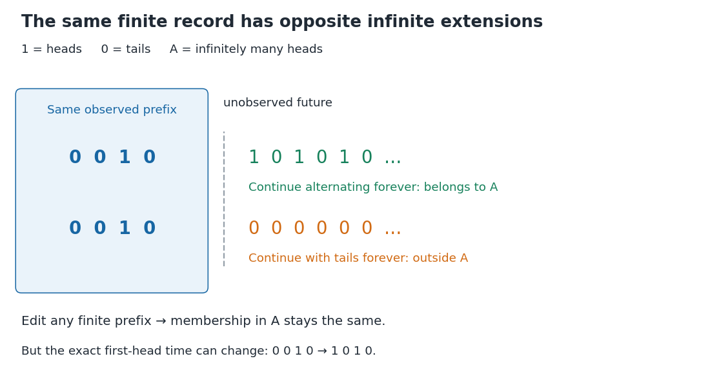

**[Figure 7](#image-a-finite-prefix-admits-both-infinitely-many-heads-and-only-finitely-many-heads). A finite prefix admits both infinitely many heads and only finitely many heads**. The two illustrated extensions have the same initial observations. An alternating continuation belongs to the [tail event](#tail-event) of infinitely many heads; an all-tails continuation does not. Changing the highlighted finite prefix cannot change that infinite property, but it can change the exact first-head time.

Assume now that the coordinates are fair [independent](random-variable.md#independent-random-variables) [Bernoulli trials](discrete-probability-distribution.md#bernoulli-trial). For fixed $m$, let $B_{m,r}$ be the [event](probability-space.md#event) of at least one head among $X_m,\ldots,X_{m+r-1}$. Its [complement](set.md#complement-of-a-set) requires $r$ tails, so

$$
\mathbb P(B_{m,r})=1-2^{-r},\qquad
B_m=\bigcup_{r\geq1}B_{m,r},\qquad
\mathbb P(B_m)=1.
$$

The last equality follows from [continuity of probability](probability-space.md#continuity-of-probability). Now $A=\bigcap_{m\geq1}B_m$, a countable [intersection](set.md#set-intersection) of [almost sure events](probability-space.md#almost-sure-event), and hence $\mathbb P(A)=1$. This determines which of the two possibilities in [Kolmogorov's zero–one law](#kolmogorov-s-zero-one-law) occurs. Equivalently, the [Borel-Cantelli second lemma](#borel-cantelli-second-lemma) applies to the [independent events](#independent-events) $\{X_j=1\}$.

Nevertheless, no finite prefix certifies membership in $A$: every finite record can be extended by all tails or by alternating heads and tails. Under the fair [independent](random-variable.md#independent-random-variables) model, conditioning on any exact finite prefix leaves $\mathbb P(A)=1$, since $A$ is independent of the initial [sigma-algebra](measure-theory.md#sigma-algebra). The excluded all-tails continuation has [probability](#probability) zero, but remains a possible member of the [sample space](probability-space.md#sample-space). Logical determination by a finite record and a conclusion holding [almost surely](convergence-of-random-variables.md#almost-sure-convergence) are different statements.

<h4 id="kolmogorov-s-zero-one-law">Kolmogorov's zero–one law</h4>

↑ **Parent:** [Tail sigma-algebra](#tail-sigma-algebra)  
ⓦ [Wiki](https://en.wikipedia.org/wiki/Kolmogorov's_zero–one_law)

For mutually [independent random variables](random-variable.md#independent-random-variables), every [tail event](#tail-event) has $\mathbb P(A)\in\{0,1\}$. Identical [probability distributions](probability-distribution.md) are unnecessary. The [tail sigma-algebra](#tail-sigma-algebra) is trivial in [probability](#probability): its [events](probability-space.md#event) have [probability](#probability) zero or one, though it can contain nonempty proper [sets](set.md).[Probability: Theory and Examples (fifth edition), §2.5, Theorem 2.5.3, printed pp. 81–82](mathematics-bibliography.md#probability-theory-and-examples-fifth-edition-by-rick-durrett)

For a proof, set $\mathcal F_m=\sigma(X_1,\ldots,X_m)$ and $\mathcal F_X=\sigma(X_1,X_2,\ldots)$. [Independence extended from generating pi-systems](#independence-extended-from-generating-pi-systems) makes $\mathcal F_m$ independent of $\sigma(X_{m+1},X_{m+2},\ldots)$, hence of each [tail event](#tail-event) $A$. The increasing [union](set.md#set-union) $\bigcup_m\mathcal F_m$ is a generating [pi-system](measure-theory.md#pi-system) for $\mathcal F_X$. For fixed $A$, the [events](probability-space.md#event) $B$ satisfying $\mathbb P(A\cap B)=\mathbb P(A)\mathbb P(B)$ form a [Dynkin system](measure-theory.md#dynkin-system). The [pi-lambda theorem](#pi-lambda-theorem) extends this equality to all $B\in\mathcal F_X$. Taking $B=A$ gives

$$
\mathbb P(A)=\mathbb P(A\cap A)=\mathbb P(A)^2,
\qquad \mathbb P(A)(1-\mathbb P(A))=0.
$$

Thus $A$ is independent of itself, forcing the two stated values.[Probability: Theory and Examples (fifth edition), proof of Theorem 2.5.3, steps (a) and (b), printed pp. 81–82](mathematics-bibliography.md#probability-theory-and-examples-fifth-edition-by-rick-durrett)

The useful feature is the absence of intermediate [probabilities](#probability) for infinite properties that ignore every finite prefix. It reduces some calculations to showing that a [tail event](#tail-event) has positive [probability](#probability), or that its [complement](set.md#complement-of-a-set) does. The theorem supplies no finite observation deadline, and an extra argument such as the calculation in [infinitely many heads as a tail event](#infinitely-many-heads-as-a-tail-event) is needed to decide which value occurs.

##### A shared coin prevents a zero-one conclusion

↑ **Parent:** [Kolmogorov's zero–one law](#kolmogorov-s-zero-one-law)

Let $Z$ have the fair [Bernoulli distribution](discrete-probability-distribution.md#bernoulli-distribution) and set $X_j=Z$ for every $j$. Each coordinate has the same fair [probability distribution](probability-distribution.md) as in the independent model, but the coordinates are dependent: $\mathbb P(X_1=1,X_2=1)=1/2$, whereas the product of the marginal [probabilities](#probability) is $1/4$. Every future [sigma-algebra](measure-theory.md#sigma-algebra) equals $\sigma(Z)$, so the [tail sigma-algebra](#tail-sigma-algebra) also equals $\sigma(Z)$.

The [tail event](#tail-event) of infinitely many heads is now exactly $\{Z=1\}$, with [probability](#probability) $1/2$. For the finite-window [events](probability-space.md#event) $B_{m,r}$ in [infinitely many heads as a tail event](#infinitely-many-heads-as-a-tail-event),

$$
\begin{array}{c|cc}
&\text{independent fair coordinates}&\text{one shared fair coin}\\
\mathbb P(B_{m,r})&1-2^{-r}&1/2\\
\mathbb P(A)&1&1/2
\end{array}
$$

The [sample space](probability-space.md#sample-space) can even be the same full [Cartesian product](set-theory.md#cartesian-product) $\{0,1\}^{\mathbb N}$ in both models: the dependent [probability measure](probability-space.md#probability-measure) assigns mass $1/2$ to each of the all-zero and all-one [sequences](sequence-and-series.md#sequence). Then $A$ is the same literal [tail event](#tail-event) in both models. Only the [probability measure](probability-space.md#probability-measure) and its [independence](random-variable.md#independent-random-variables) properties change.

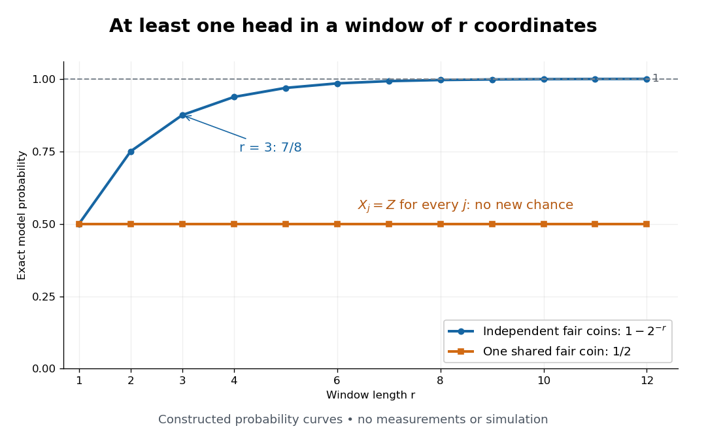

**[Figure 8](#image-more-independent-trials-increase-the-chance-of-a-head-repeated-copies-of-one-coin-do-not). More independent trials increase the chance of a head; repeated copies of one coin do not**. Exact constructed [probabilities](#probability) for at least one head in a window of $r$ coordinates. The independent curve is $1-2^{-r}$ and tends to one; the shared-coin curve stays at $1/2$. These are calculations from the two specified [probability measures](probability-space.md#probability-measure), not measurements or simulated frequencies.

## Product measure

↑ **Parent:** [Probability theory](probability-theory.md)  
ⓦ [Wiki](https://en.wikipedia.org/wiki/Product_measure)

The product measure $\bigotimes_n\mu_n$ is characterized on measurable rectangles depending on finitely many coordinates by the product of their component measures.

### Product sigma-algebra

↑ **Parent:** [Product measure](#product-measure)

The product sigma-algebra on $X_1\times X_2$ is generated by the measurable rectangles $A_1\times A_2$. It is the smallest sigma-algebra making both coordinate projections measurable.

### Pi-lambda theorem

↑ **Parent:** [Product measure](#product-measure)

If a [Dynkin system](measure-theory.md#dynkin-system) contains a [pi-system](measure-theory.md#pi-system), then it contains the sigma-algebra generated by that pi-system. This proves uniqueness of finite measures from agreement on a generating pi-system.

### Canonical model of an independent and identically distributed sequence

↑ **Parent:** [Product measure](#product-measure)

For a probability law $\nu$ on $E$, take the sequence space $E^{\mathbb N}$ with [product measure](#product-measure) $\nu^{\otimes\mathbb N}$. The coordinate maps form an [independent and identically distributed sequence](random-variable.md#independent-and-identically-distributed-random-variables) with common law $\nu$, and they generate the product [sigma-algebra](measure-theory.md#sigma-algebra).

<h2 id="frechet-inequalities">Fréchet inequalities</h2>

↑ **Parent:** [Probability theory](probability-theory.md)

For events $A$ and $B$, the Fréchet inequalities are

$$
\max\{0,\mathbb P(A)+\mathbb P(B)-1\}
\leq\mathbb P(A\cap B)
\leq\min\{\mathbb P(A),\mathbb P(B)\}.
$$

## Standard score

↑ **Parent:** [Probability theory](probability-theory.md)  
ⓦ [Wiki](https://en.wikipedia.org/wiki/Standard_score)

A [standard score](#standard-score) expresses an outcome $x$ as a signed number of [standard deviations](variance.md#standard-deviation) from a [mean](expected-value.md) $\mu$, assuming $0<\sigma<\infty$. It is a [dimensionless quantity](physics.md#dimensionless-quantity). For a [random variable](random-variable.md) with finite positive [variance](variance.md) $\sigma^2$, $(X-\mu)/\sigma$ has [mean](expected-value.md) zero and [variance](variance.md) one; it has a [standard normal distribution](probability-distribution.md#standard-normal-distribution) when $X$ has a [normal distribution](probability-distribution.md#normal-distribution), but centering and scaling alone do not make other [probability distributions](probability-distribution.md) normal. [MIT 18.05, Reading 6b, §5.1: standardization](https://ocw.mit.edu/courses/18-05-introduction-to-probability-and-statistics-spring-2022/mit18_05_s22_class06-prep-b.pdf).

## Convergence of random variables

↑ **Parent:** [Probability theory](probability-theory.md)

[This section is present in another page, follow this link to view it.](convergence-of-random-variables.md)

## Martingale

↑ **Parent:** [Probability theory](probability-theory.md)

[This section is present in another page, follow this link to view it.](martingale.md)

## Queueing theory

↑ **Parent:** [Probability theory](probability-theory.md)

[This section is present in another page, follow this link to view it.](queueing-theory.md)

## Random variable

↑ **Parent:** [Probability theory](probability-theory.md)

[This section is present in another page, follow this link to view it.](random-variable.md)

## Borel-Cantelli lemmas

↑ **Parent:** [Probability theory](probability-theory.md)

The [Borel-Cantelli lemmas](#borel-cantelli-lemmas) turn a [series](sequence-and-series.md#series-mathematics) of [event](probability-space.md#event) [probabilities](#probability) into a statement about an entire infinite sequence of observations. A [summable sequence](sequence-and-series.md#summable-sequence) of [probabilities](#probability) forces only finitely many occurrences [almost surely](convergence-of-random-variables.md#almost-sure-convergence), regardless of [independence](random-variable.md#independent-random-variables). A divergent [series](sequence-and-series.md#series-mathematics) forces infinitely many occurrences when the [events](probability-space.md#event) are mutually [independent events](#independent-events). The precise [event](probability-space.md#event) being measured is the [limsup of events](probability-space.md#limsup-of-events).

Imagine alarms with [probabilities](#probability) $p_n=1/(n+1)^2$ or $p_n=1/(n+1)$, starting at $n=1$. Both individual [probabilities](#probability) tend to zero. Nevertheless, the first alarm sequence eventually stops [almost surely](convergence-of-random-variables.md#almost-sure-convergence), whereas the second keeps returning [almost surely](convergence-of-random-variables.md#almost-sure-convergence) if its [events](probability-space.md#event) are mutually [independent events](#independent-events). Reusing one [uniform random variable](continuous-probability-distribution.md#uniform-random-variable) for every alarm instead produces the [shared-uniform counterexample to the second Borel-Cantelli lemma](#shared-uniform-counterexample-to-the-second-borel-cantelli-lemma). Thus the individual [probabilities](#probability) alone do not determine long-run recurrence.

### Summable and harmonic event probabilities

↑ **Parent:** [Borel-Cantelli lemmas](#borel-cantelli-lemmas)

Take [independent random variables](random-variable.md#independent-random-variables) $U_n$, each with the [continuous uniform distribution](continuous-probability-distribution.md#continuous-uniform-distribution) on $[0,1]$, and set $A_n=\{U_n\leq p_n\}$. Then $\mathbb P(A_n)=p_n$, and the [events](probability-space.md#event) are mutually [independent events](#independent-events). The [product probability space](probability-space.md#product-probability-space) supplies a model for the entire infinite sequence; a finite list of simulated values is only an illustration.

For $p_n=1/(n+1)^2$, the [p-series](sequence-and-series.md#p-series) is [summable](sequence-and-series.md#summable-sequence):

$$
\sum_{n=1}^{\infty}p_n=\frac{\pi^2}{6}-1,\qquad
\sum_{n=m}^{\infty}p_n\leq\int_m^{\infty}\frac{dx}{x^2}=\frac1m.
$$

The [Basel problem](analytic-number-theory.md#basel-problem) supplies the total sum, and the [integral test for convergence](sequence-and-series.md#integral-test-for-convergence) gives the displayed tail bound. The [First Borel-Cantelli lemma](#borel-cantelli-first-lemma) makes the [limsup of events](probability-space.md#limsup-of-events) have [probability](#probability) zero. In fact, the tail bound implies that the [probability](#probability) of even one alarm at or after $m$ is at most $1/m$; for $m=100$, it is at most $0.01$. This bound remains valid for dependent [events](probability-space.md#event) with the same individual [probabilities](#probability).

For $p_n=1/(n+1)$, the [harmonic series](sequence-and-series.md#harmonic-series) diverges, so the [Second Borel-Cantelli lemma](#borel-cantelli-second-lemma) makes the [limsup of events](probability-space.md#limsup-of-events) have [probability](#probability) one. There is also an exact finite-horizon calculation using [independent events](#independent-events):

$$
\mathbb P\left(\bigcap_{n=m}^{M}A_n^c\right)
=\prod_{n=m}^{M}\frac{n}{n+1}=\frac{m}{M+1}.
$$

For any fixed $m$, this finite [product of numbers](arithmetic.md#product-of-numbers) tends to zero as $M\to\infty$. Every infinite tail therefore contains an alarm [almost surely](convergence-of-random-variables.md#almost-sure-convergence), even though the individual [probabilities](#probability) tend to zero.

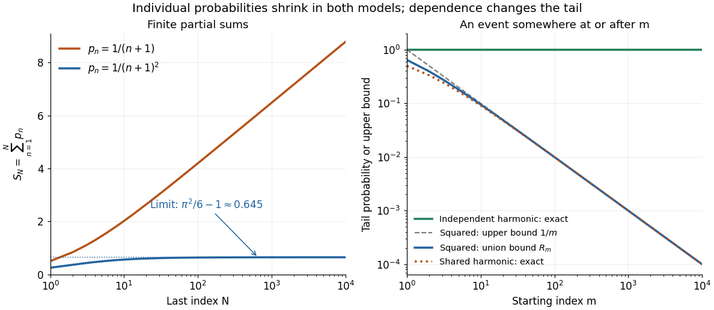

**[Figure 9](#image-summable-and-harmonic-probabilities-partial-sums-and-the-probability-of-a-later-event). Summable and harmonic probabilities: partial sums and the probability of a later event**. The left panel shows finite [partial sums](sequence-and-series.md#partial-sum). On the right, the blue curve is the infinite tail of the squared-reciprocal [p-series](sequence-and-series.md#p-series), bounding the [probability](#probability) of a later [event](probability-space.md#event) by the [union bound](probability-inequality.md#boole-s-inequality); the gray curve is its $1/m$ upper bound. For harmonic [probabilities](#probability), mutually [independent events](#independent-events) have a later occurrence with [probability](#probability) one, while the [shared-uniform counterexample to the second Borel-Cantelli lemma](#shared-uniform-counterexample-to-the-second-borel-cantelli-lemma) has tail [probability](#probability) $1/(m+1)$. The infinite claims follow from the calculations, not from the finite plotted range.

### Gaussian sample limsup at logarithmic scale

↑ **Parent:** [Borel-Cantelli lemmas](#borel-cantelli-lemmas)

For independent [standard normal random variables](probability-distribution.md#standard-normal-random-variable) $X_n$, the displayed [limit superior](sequence-and-series.md#limit-superior) equals two [almost surely](convergence-of-random-variables.md#almost-sure-convergence). The [Mills ratio](probability-distribution.md#mills-ratio) asymptotic gives, for $a>0$,

$$
\mathbb P(X_n^2>a\log n)\sim\sqrt{\frac{2}{\pi a}}\frac{n^{-a/2}}{\sqrt{\log n}}.
$$

The series converges for $a>2$ and diverges for $0<a\leq2$. The two [Borel-Cantelli lemmas](#borel-cantelli-lemmas), applied at countably many thresholds approaching two, give the result. In particular, the value two is also a threshold exceeded infinitely often, despite being the almost-sure [limit superior](sequence-and-series.md#limit-superior).

### Borel-Cantelli first lemma

↑ **Parent:** [Borel-Cantelli lemmas](#borel-cantelli-lemmas)

For arbitrary [events](probability-space.md#event) $A_n$ in one [probability space](probability-space.md),

$$
\sum_{n=1}^{\infty}\mathbb P(A_n)<\infty
\quad\Longrightarrow\quad
\mathbb P\left(\limsup_{n\to\infty}A_n\right)=0.
$$

Equivalently, only finitely many [events](probability-space.md#event) occur [almost surely](convergence-of-random-variables.md#almost-sure-convergence); no [independence](random-variable.md#independent-random-variables) is needed.[§2.3, Theorem 2.3.1, printed p. 68](mathematics-bibliography.md#probability-theory-and-examples-fifth-edition-by-rick-durrett)

Proof outline: put $B_m=\bigcup_{n\geq m}A_n$. The [union bound](probability-inequality.md#boole-s-inequality) gives

$$
0\leq\mathbb P\left(\limsup_n A_n\right)
\leq\mathbb P(B_m)\leq\sum_{n=m}^{\infty}\mathbb P(A_n)\longrightarrow0.
$$

The tail of a convergent nonnegative [series](sequence-and-series.md#series-mathematics) tends to zero.

### Borel-Cantelli second lemma

↑ **Parent:** [Borel-Cantelli lemmas](#borel-cantelli-lemmas)

If the [events](probability-space.md#event) $A_n$ are mutually [independent events](#independent-events) and $\sum_{n=1}^{\infty}\mathbb P(A_n)=\infty$, then $\mathbb P(\limsup_n A_n)=1$. For an infinite family, mutual [independence](random-variable.md#independent-random-variables) means every finite subfamily satisfies the factorization defining [independent events](#independent-events).[§2.3, Theorem 2.3.7 and its proof, printed p. 70](mathematics-bibliography.md#probability-theory-and-examples-fifth-edition-by-rick-durrett)

Proof outline: for $M\geq m$, [independent events](#independent-events) and $1-x\leq e^{-x}$ give

$$
\mathbb P\left(\bigcap_{n=m}^{M}A_n^c\right)
=\prod_{n=m}^{M}\left(1-\mathbb P(A_n)\right)
\leq\exp\left(-\sum_{n=m}^{M}\mathbb P(A_n)\right)\longrightarrow0.
$$

[Continuity of probability](probability-space.md#continuity-of-probability) makes each infinite tail [union](set.md#set-union) have [probability](#probability) one; their countable [intersection](set.md#set-intersection) has [probability](#probability) one as well.

#### Shared-uniform counterexample to the second Borel-Cantelli lemma

↑ **Parent:** [Borel-Cantelli second lemma](#borel-cantelli-second-lemma)

Choose one [random variable](random-variable.md) $U$ with the [continuous uniform distribution](continuous-probability-distribution.md#continuous-uniform-distribution) on $[0,1]$, and reuse it in every [event](probability-space.md#event):

$$
A_n=\left\{U\leq\frac1{n+1}\right\},\qquad n\geq1.
$$

Each [probability](#probability) is $1/(n+1)$, so their [harmonic series](sequence-and-series.md#harmonic-series) diverges, just as in [summable and harmonic event probabilities](#summable-and-harmonic-event-probabilities). But the [events](probability-space.md#event) are decreasing: $A_{n+1}\subseteq A_n$. For every outcome $U=u>0$, all indices with $n+1>1/u$ fail. Only finitely many [events](probability-space.md#event) occur on that outcome. The [limsup of events](probability-space.md#limsup-of-events) is exactly $\{U=0\}$, a [zero-probability event](probability-space.md#zero-probability-event). This is a concrete closed-interval version of the shrinking-interval dependence example.[§2.3, Example 2.3.6, printed p. 70: shrinking intervals with divergent total probability](mathematics-bibliography.md#probability-theory-and-examples-fifth-edition-by-rick-durrett)

The missing assumption is visible already in two [events](probability-space.md#event). For $i<j$, their [intersection](set.md#set-intersection) is $A_j$, hence

$$
\mathbb P(A_i\cap A_j)=\frac1{j+1}
\ne\frac1{(i+1)(j+1)}=\mathbb P(A_i)\mathbb P(A_j).
$$

Moreover, the whole tail [union](set.md#set-union) is just $A_m$, with [probability](#probability) $1/(m+1)\to0$. This calculation explains directly why divergence alone fails: overlapping [events](probability-space.md#event) keep spending their individual [probabilities](#probability) on the same outcomes.

Let $N=\sum_{n\geq1}\mathbf1_{A_n}$ be the total number of occurrences, a sum of [indicator random variables](expected-value.md#indicator-random-variable). Although $N<\infty$ [almost surely](convergence-of-random-variables.md#almost-sure-convergence), [Tonelli theorem](measure-theory.md#tonelli-theorem) gives $\mathbb E[N]=\sum_{n\geq1}1/(n+1)=\infty$. More explicitly, $\mathbb P(N\geq k)=1/(k+1)$ for $k\geq1$: very small positive values of $U$ give very long, but finite, initial runs. Infinite [expected value](expected-value.md) does not imply a positive [probability](#probability) of an infinite count.

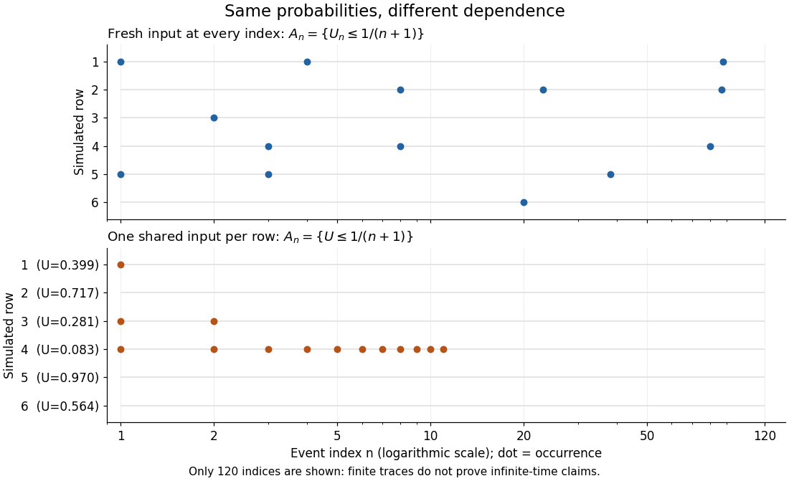

**[Figure 10](#image-equal-harmonic-event-probabilities-with-fresh-independent-inputs-or-one-shared-input). Equal harmonic event probabilities with fresh independent inputs or one shared input**. Each row is one finite simulation of the [indicator random variables](expected-value.md#indicator-random-variable) of $A_n$ for $1\leq n\leq120$; a dot means the [event](probability-space.md#event) occurred. Fresh [independent random variables](random-variable.md#independent-random-variables) allow scattered returns; a shared [uniform random variable](continuous-probability-distribution.md#uniform-random-variable) yields an initial run followed by zeros. The horizontal axis uses a [logarithmic scale](calculus.md#logarithmic-scale) to show early runs clearly. These finite simulations illustrate the two models and cannot prove infinitely many occurrences or eventual stopping.

### Tail-sum formula for expectation

↑ **Parent:** [Borel-Cantelli lemmas](#borel-cantelli-lemmas)

For a nonnegative [random variable](random-variable.md) $X$, [Tonelli theorem](measure-theory.md#tonelli-theorem) gives

$$
\mathbb E[X]=\int_0^\infty\mathbb P(X>t)\,dt.
$$

Consequently, for each $a>0$, $\mathbb E[X]=\infty$ exactly when $\sum_{n\geq1}\mathbb P(X>an)=\infty$; compare the integral on successive intervals of length $a$.

### Extremes of independent exponential variables

↑ **Parent:** [Borel-Cantelli lemmas](#borel-cantelli-lemmas)

For independent rate-one exponential variables $X_n$ and $M_n=\max_{m\leq n}X_m$,

$$
\limsup_{n\to\infty}\frac{X_n}{\log n}=1,
\qquad
\liminf_{n\to\infty}\frac{M_n}{\log n}\geq1
$$

almost surely. The first follows by applying both Borel--Cantelli lemmas to thresholds $(1\pm\varepsilon)\log n$; the second uses  
$\mathbb P(M_n\leq(1-\varepsilon)\log n)\leq e^{-n^\varepsilon}$.

### Conditional Borel-Cantelli lemma

↑ **Parent:** [Borel-Cantelli lemmas](#borel-cantelli-lemmas)  
ⓦ [Wiki](https://en.wikipedia.org/wiki/Conditional_Borel-Cantelli_lemma)

For events $B_n\in\mathcal F_n$, put $p_n=\mathbb P(B_n\mid\mathcal F_{n-1})$. Then $\sum_n\mathbf1_{B_n}<\infty$ almost surely on $\{\sum_np_n<\infty\}$, while $\sum_n\mathbf1_{B_n}=\infty$ almost surely on $\{\sum_np_n=\infty\}$. The proof applies the [martingale convergence theorem](martingale.md#martingale-convergence-theorem) to compensated sums $\sum_{j\leq n}(\mathbf1_{B_j}-p_j)$ and uses [Kronecker lemma](sequence-and-series.md#kronecker-lemma) in the divergent case.

## Stochastic process

↑ **Parent:** [Probability theory](probability-theory.md)

[This section is present in another page, follow this link to view it.](stochastic-process.md)

<h2 id="levy-s-continuity-theorem">Lévy's continuity theorem</h2>

↑ **Parent:** [Probability theory](probability-theory.md)  
ⓦ [Wiki](https://en.wikipedia.org/wiki/Lévy's_continuity_theorem)

Pointwise convergence of characteristic functions to a function continuous at zero implies convergence in distribution.

## Poisson process

↑ **Parent:** [Probability theory](probability-theory.md)

[This section is present in another page, follow this link to view it.](poisson-process.md)

## Fokker-Planck equation

↑ **Parent:** [Probability theory](probability-theory.md)  
ⓦ [Wiki](https://en.wikipedia.org/wiki/Fokker–Planck_equation)

A Fokker-Planck equation evolves a density by drift and diffusion in conservation-law form.

### Smoluchowski equation

↑ **Parent:** [Fokker-Planck equation](#fokker-planck-equation)

For overdamped [Brownian motion](brownian-motion.md) at uniform [temperature](temperature.md) in a [potential energy](energy.md#potential-energy) $U$, constant [diffusion coefficient](brownian-motion.md#diffusion-coefficient) $D$ gives the displayed [Fokker-Planck equation](#fokker-planck-equation), with $\beta=(k_BT)^{-1}$. The [probability current](wave-function.md#probability-current) is $\boldsymbol J=-D(\nabla p+\beta p\nabla U)$. Zero current recovers the [Boltzmann distribution](thermodynamics.md#boltzmann-distribution); absorbing boundaries instead permit transport and [mean first-passage times](markov-chain.md#mean-first-passage-time). This diffusion equation should be distinguished from the similarly named coagulation equation.

### Stationary density for a Fokker-Planck equation

↑ **Parent:** [Fokker-Planck equation](#fokker-planck-equation)

A [probability density](wave-function.md#probability-density) left unchanged by the [Fokker-Planck equation](#fokker-planck-equation) $\partial_tf=L^*f$. Equivalently its [Fokker-Planck probability current](#fokker-planck-probability-current) has zero [divergence](multivariable-calculus.md#divergence); the current itself need not vanish. For the [Ornstein-Uhlenbeck Fokker-Planck equation](#ornstein-uhlenbeck-fokker-planck-equation), the normalized standard [Gaussian density](probability-and-statistics.md#multivariate-normal-density) has zero current and is stationary.

#### Cutoff proof of invariance for a zero-flux diffusion density

↑ **Parent:** [Stationary density for a Fokker-Planck equation](#stationary-density-for-a-fokker-planck-equation)

If $q=\sigma^2p$ and $q'=2bp$, then $pLu=(qu_x)'/2$. Insert compact cutoffs $\chi_R$, integrate the backward equation in time, and integrate by parts twice to move spatial derivatives onto $\chi_R$. The error is bounded by $t\|u\|_\infty(CR^{-2}\|q\|_1+CR^{-1}\|q'\|_1)/2$. When these norms are finite it vanishes, proving $\int u(t)p=\int fp$ without assuming derivative behavior at infinity.

### Ornstein-Uhlenbeck Fokker-Planck equation

↑ **Parent:** [Fokker-Planck equation](#fokker-planck-equation)

The probability-density equation for the [Ornstein-Uhlenbeck process](gaussian-process.md#ornstein-uhlenbeck-process) with drift $-v$ and diffusion coefficient $\sqrt2$. The unit-covariance [Gaussian density](probability-and-statistics.md#multivariate-normal-density) is stationary because its [Fokker-Planck probability current](#fokker-planck-probability-current) vanishes. This normalization makes [mean velocity](kinetic-theory.md#mean-velocity-of-a-kinetic-distribution) decay at rate one and [energy](energy.md) excess decay at rate two.

#### Entropy dissipation identity for Ornstein-Uhlenbeck flow

↑ **Parent:** [Ornstein-Uhlenbeck Fokker-Planck equation](#ornstein-uhlenbeck-fokker-planck-equation)

For a sufficiently regular unit-mass solution, the [Ornstein-Uhlenbeck Fokker-Planck equation](#ornstein-uhlenbeck-fokker-planck-equation) is $\partial_tf=\nabla\cdot(f\nabla\log(f/\gamma))$. [Integration by parts](calculus.md#integration-by-parts) proves the displayed identity. Consequently [relative entropy](f-divergence.md#kullback-leibler-divergence) decreases, and its dissipation is [relative Fisher information](f-divergence.md#relative-fisher-information).

##### Entropy convergence rate for Ornstein-Uhlenbeck flow

↑ **Parent:** [Entropy dissipation identity for Ornstein-Uhlenbeck flow](#entropy-dissipation-identity-for-ornstein-uhlenbeck-flow)

The inequality $H\leq I/2$ and the [entropy dissipation identity for Ornstein-Uhlenbeck flow](#entropy-dissipation-identity-for-ornstein-uhlenbeck-flow) imply $H'\leq-2H$. An integrating factor proves the displayed estimate from initial entropy alone. [Pinsker's inequality](probability-and-statistics.md#pinsker-s-inequality) then gives $\|f_t-\gamma\|_1\leq\sqrt{2H(f_0\mid\gamma)}e^{-t}$.

##### Time integrability of an entropy-dissipation product

↑ **Parent:** [Entropy dissipation identity for Ornstein-Uhlenbeck flow](#entropy-dissipation-identity-for-ornstein-uhlenbeck-flow)

If finite nonnegative entropy $H(t)$ decreases, its limit $H_\infty$ exists. The [fundamental theorem of calculus](calculus.md#fundamental-theorem-of-calculus) applied to $H^2$ proves the displayed absolute-integrability identity. This product conclusion does not require a zero limiting entropy.

#### Ornstein-Uhlenbeck moment equations

↑ **Parent:** [Ornstein-Uhlenbeck Fokker-Planck equation](#ornstein-uhlenbeck-fokker-planck-equation)

[Integration by parts](calculus.md#integration-by-parts) against $1$, $v_i$ and $|v|^2/2$ gives these equations for [mass](classical-mechanics.md#mass), unnormalized [momentum](momentum.md) and [kinetic energy](energy.md#kinetic-energy). With $M_0\ne0$, the mean is $u(t)=e^{-t}u_0$, and $E(t)=dM_0/2+(E_0-dM_0/2)e^{-2t}$. Normalizing by [mass](classical-mechanics.md#mass) is invalid if that [mass](classical-mechanics.md#mass) is zero.

### Fokker-Planck diffusion matrix

↑ **Parent:** [Fokker-Planck equation](#fokker-planck-equation)

The diffusion matrix is the infinitesimal second jump moment, $B_{ij}(x)=\sum_r r_ir_jW(x,r)$. It is symmetric and positive semidefinite and multiplies the second-derivative term of the [Fokker-Planck equation](#fokker-planck-equation).

### Fokker-Planck drift vector

↑ **Parent:** [Fokker-Planck equation](#fokker-planck-equation)

The drift vector is the expected infinitesimal displacement per unit time. For jumps $r$ with rates $W(x,r)$, it is $A_i(x)=\sum_r r_iW(x,r)$. It is the first jump moment entering the [Fokker-Planck equation](#fokker-planck-equation).

### Fokker-Planck probability current

↑ **Parent:** [Fokker-Planck equation](#fokker-planck-equation)

Writing a Fokker-Planck equation as $\partial_tP=-\partial_xJ$ defines its probability current. For $\partial_tP=\partial_x(gP)+\tfrac12\partial_x^2(hP)$,

$$
J=-gP-\frac12\partial_x(hP).
$$

#### Probability current velocity

↑ **Parent:** [Fokker-Planck probability current](#fokker-planck-probability-current)

Where a [probability density](wave-function.md#probability-density) $\psi$ is positive, its [Fokker-Planck probability current](#fokker-planck-probability-current) can be written $\mathbf J=\psi\mathbf V$, giving a continuity equation $\partial_t\psi+\nabla\cdot(\psi\mathbf V)=0$. This velocity transports probability. It is not a differentiable instantaneous velocity of an overdamped [Brownian motion](brownian-motion.md) path. In the [Hookean dumbbell model](polymer.md#hookean-dumbbell-model), its osmotic term is $-(2k_BT/\zeta)\nabla\log\psi$.

#### Multivariate Fokker-Planck probability current

↑ **Parent:** [Fokker-Planck probability current](#fokker-planck-probability-current)

For

$$
\partial_tP=-\partial_i(A_iP)+\frac12\partial_i\partial_j(B_{ij}P),
$$

the probability current is

$$
J_i=A_iP-\frac12\partial_j(B_{ij}P),
$$

so the equation is the continuity equation $\partial_tP+\partial_iJ_i=0$.

##### First two moments of a multivariate Fokker-Planck equation

↑ **Parent:** [Multivariate Fokker-Planck probability current](#multivariate-fokker-planck-probability-current)

When boundary terms vanish, integration by parts gives

$$
\frac d{dt}\langle X_k\rangle=\langle A_k\rangle,
\qquad
\frac d{dt}\langle X_kX_l\rangle
=\langle X_lA_k+X_kA_l+B_{kl}\rangle.
$$

##### Stationary Gaussian density for a linear Fokker-Planck equation

↑ **Parent:** [Multivariate Fokker-Planck probability current](#multivariate-fokker-planck-probability-current)

For linear drift $A(x)=ax$ and constant symmetric positive-definite diffusion matrix $b$, a zero-current stationary Gaussian $P(x)\propto\exp(-x^TDx/2)$ obeys

$$
a+\frac12bD=0.
$$

This reversible solution exists when $D=-2b^{-1}a$ is symmetric positive definite. Its covariance $C=D^{-1}$ satisfies the [Continuous Lyapunov equation](control-theory.md#continuous-lyapunov-equation)

$$
aC+Ca^T+b=0.
$$

#### Reflecting boundary condition for a diffusion

↑ **Parent:** [Fokker-Planck probability current](#fokker-planck-probability-current)

A reflecting boundary confines a diffusion without losing probability. Its forward condition is zero outward [Fokker-Planck probability current](#fokker-planck-probability-current), $J\mathbin\cdot n=0$, and its backward condition is a zero conormal derivative.

#### Zero-flux boundary condition

↑ **Parent:** [Fokker-Planck probability current](#fokker-planck-probability-current)

A zero-flux boundary condition sets the normal probability current to zero. It conserves total probability inside the domain and represents reflection for a confined diffusion.

#### Absorbing boundary condition for a diffusion

↑ **Parent:** [Fokker-Planck probability current](#fokker-planck-probability-current)

An absorbing boundary removes a diffusion when it is reached. The forward density and backward observables satisfy [Dirichlet boundary conditions](differential-equation.md#dirichlet-boundary-condition) there.

#### Partially absorbing boundary condition for a diffusion

↑ **Parent:** [Fokker-Planck probability current](#fokker-planck-probability-current)

A partially absorbing boundary removes a particle at finite surface reactivity $\kappa$ and reflects it otherwise. Its forward [Robin boundary condition](differential-equation.md#robin-boundary-condition) is $J\mathbin\cdot n=\kappa p$. If the normal diffusion coefficient is $b/2$, integration by parts gives the backward condition

$$
\frac b2\partial_nu=-\kappa u.
$$

<h4 id="potential-condition-for-a-fokker-planck-equation">Potential condition for a Fokker--Planck equation</h4>

↑ **Parent:** [Fokker-Planck probability current](#fokker-planck-probability-current)

For current $J=aP-\kappa\nabla P/2$, a scalar potential exists when the one-form $\kappa^{-1}a$ is exact. Then $D=\kappa/2$, $a=-D\nabla V$, and $J=-PD\nabla(V+\log P)$.

<h5 id="fokker-planck-free-energy-functional">Fokker--Planck free-energy functional</h5>

↑ **Parent:** [Potential condition for a Fokker--Planck equation](#potential-condition-for-a-fokker-planck-equation)

For positive-definite $D$ and no-flux boundaries,

$$
\mathcal F[P]=\int(VP+P\log P)\,dx
$$

decreases as $\dot{\mathcal F}=-\int P\nabla(V+\log P)^TD\nabla(V+\log P)\,dx$. Its unique normalized minimizer is proportional to $e^{-V}$.

<h2 id="wald-s-equation">Wald's equation</h2>

↑ **Parent:** [Probability theory](probability-theory.md)  
ⓦ [Wiki](https://en.wikipedia.org/wiki/Wald's_equation)

Wald's equation turns a [random sum](random-variable.md#random-sum) into a product of two [expected values](expected-value.md): the average contribution per step and the average number of steps. Its surprising feature is that the number of steps may depend on what has already happened. A procedure can stop on its first successful [Bernoulli trial](discrete-probability-distribution.md#bernoulli-trial), for example, while the identity still accounts for its total cost. The crucial restriction is that the decision to take the next step cannot use that step's unobserved outcome.

Let $X_1,X_2,\ldots$ be real [independent and identically distributed random variables](random-variable.md#independent-and-identically-distributed-random-variables) with $\mathbb E|X_1|<\infty$, let $\mu=\mathbb E[X_1]$, and put $S_0=0$ and $S_n=\sum_{i=1}^nX_i$. Suppose $N$ is a nonnegative integer-valued [stopping time](martingale.md#stopping-time) for the [natural filtration](stochastic-process.md#natural-filtration) $\mathcal F_n=\sigma(X_1,\ldots,X_n)$, with $\mathbb E[N]<\infty$. Then $S_N$ is an [integrable random variable](expected-value.md#integrable-random-variable) and

$$
\boxed{\mathbb E[S_N]=\mu\,\mathbb E[N].}
$$

These hypotheses allow [statistical dependence](random-variable.md#statistical-dependence) between $N$ and the [increments](stochastic-process.md#increment); they do not allow access to future [increments](stochastic-process.md#increment). The finite-[expected value](expected-value.md) requirement is stronger than stopping [almost surely](convergence-of-random-variables.md#almost-sure-convergence).[PDF pp. 38–42 and 45–47](mathematics-bibliography.md#18-175-lecture-16-conditional-expectation-random-walks-martingales-by-scott-sheffield)

For the proof idea, count step $i$ only on $\{N\geq i\}$. This [event](probability-space.md#event) is determined by the first $i-1$ observations, so its [indicator function](measure-theory.md#indicator-function) is [independent](random-variable.md#independent-random-variables) of $X_i$. The [Proof of Wald's equation by stopping indicators](#proof-of-wald-s-equation-by-stopping-indicators) combines this observation with the [tail-sum formula for expectation](#tail-sum-formula-for-expectation). The same calculation with $|X_i|$ gives $\mathbb E\sum_{i=1}^N|X_i|=\mathbb E|X_1|\,\mathbb E[N]<\infty$, which justifies interchanging the [expected value](expected-value.md) and the infinite [series](sequence-and-series.md#series-mathematics). This is why the result survives a data-dependent end point without assuming an [independent](random-variable.md#independent-random-variables) count.

The identity is useful in [randomized algorithms](algorithm.md#randomized-algorithm) and repeated sampling: one can translate an average amount of work into an average number of attempts, or conversely, without first finding the full [probability distribution](probability-distribution.md) of the total. The examples below separate a permissible stopping rule from a rule that peeks ahead and from a valid rule whose average waiting time is infinite.

### Cost of trials until the first success

↑ **Parent:** [Wald's equation](#wald-s-equation)

Consider a stipulated repeated-attempt model, with [independent](random-variable.md#independent-random-variables) [Bernoulli trials](discrete-probability-distribution.md#bernoulli-trial) of success [probability](#probability) $p\in(0,1]$. An unsuccessful attempt costs three units of work, and a successful attempt costs one. Let $B_i$ be its success [indicator function](measure-theory.md#indicator-function), $X_i=3-2B_i$ its cost, and $N=\inf\{i\geq1:B_i=1\}$ the first success. Observing $X_i$ reveals $B_i$, so $N$ is a [stopping time](martingale.md#stopping-time) for the costs' [natural filtration](stochastic-process.md#natural-filtration). The [geometric distribution](discrete-probability-distribution.md#geometric-distribution) gives $\mathbb P(N\geq i)=(1-p)^{i-1}$ and $\mathbb E[N]=1/p$, including the deterministic case $p=1$. Thus

$$
\mathbb E[X_1]=3-2p,\qquad \boxed{\mathbb E[S_N]=(3-2p)/p=3/p-2.}
$$

At $p=1/4$, the average is **four attempts and ten units of work**. An independent check uses the pathwise identity $S_N=3(N-1)+1$: there are $N-1$ failures and one final success. No success probabilities or costs in this example are measured data.

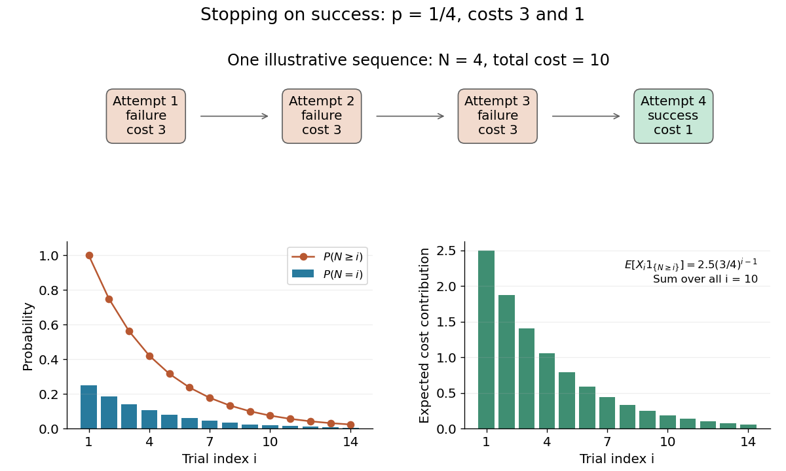

**[Figure 11](#image-cost-and-survival-probabilities-for-stopping-at-the-first-success). Cost and survival probabilities for stopping at the first success**. Original stipulated model with success [probability](#probability) $1/4$, failure cost three, and success cost one. The top shows one illustrative stopped sequence; the lower panels show exact [probabilities](#probability) and the contributions to the [expected value](expected-value.md) from each admitted step.

Here $N$ is not [independent](random-variable.md#independent-random-variables) of the observed costs. In particular, conditioning on $N=n$ forces every preceding cost to be three and the final cost to be one, so $\mathbb E[S_N\mid N=n]=3n-2$, generally different from $n\mathbb E[X_1]=(5/2)n$ at $p=1/4$. Nevertheless the unconditional identity holds. This distinction explains why conditioning on the total count as though the original cost law remained unchanged is a faulty proof.

### Peeking ahead in a random sum

↑ **Parent:** [Wald's equation](#wald-s-equation)

Let $X_1,X_2$ be [independent](random-variable.md#independent-random-variables) fair signs, each taking $-1$ and $1$ with equal [probability](#probability). Set $N=1$ if $X_2=1$, and $N=2$ if $X_2=-1$. Deciding whether $N\leq1$ requires the second sign, so $N$ is not a [stopping time](martingale.md#stopping-time) for the [natural filtration](stochastic-process.md#natural-filtration). The four equally likely possibilities give

$$
\begin{array}{c|c|c|c}
X_1&X_2&N&S_N\\\hline
1&1&1&1\\
-1&1&1&-1\\
1&-1&2&0\\
-1&-1&2&-2
\end{array}
\qquad
\mathbb E[N]=\frac32,\quad \mathbb E[S_N]=-\frac12,\quad \mu\mathbb E[N]=0.
$$

Both the [increments](stochastic-process.md#increment) and the count are bounded, but the identity fails because the second contribution is retained only when it is negative. This is selection using an unobserved outcome, rather than a legitimate sequential decision. Boundedness alone cannot replace the [stopping time](martingale.md#stopping-time) hypothesis.[§4.3, Problem 4.8 and its solution](mathematics-bibliography.md#lecture-notes-for-introduction-to-stochastic-processes-by-gordan-zitkovic/more-about-random-walks)

<h3 id="finite-mean-matters-in-wald-s-equation">Finite mean matters in Wald's equation</h3>

↑ **Parent:** [Wald's equation](#wald-s-equation)

For a [simple symmetric random walk](random-walk.md#simple-symmetric-random-walk) starting at zero, let $T_1$ be its first [hitting time](markov-chain.md#first-passage-time) of $1$. The [infinite mean first passage of a simple symmetric random walk](random-walk.md#infinite-mean-first-passage-of-a-simple-symmetric-random-walk) shows that $T_1<\infty$ [almost surely](convergence-of-random-variables.md#almost-sure-convergence) but $\mathbb E[T_1]=\infty$. Since $S_{T_1}=1$, assuming a finite [expected value](expected-value.md) for $T_1$ would let Wald's equation assert $1=0\mathbb E[T_1]=0$, a contradiction. The formal expression $0\cdot\infty$ is not an allowed use of the theorem.[§4.3, Problem 4.10 and its solution](mathematics-bibliography.md#lecture-notes-for-introduction-to-stochastic-processes-by-gordan-zitkovic/more-about-random-walks)

Compare $T_{\pm2}=\inf\{n\geq0:|S_n|=2\}$. From every surviving position in $\{-1,0,1\}$, three consecutive positive [increments](stochastic-process.md#increment) force absorption within three steps. Each fresh block has [probability](#probability) $1/8$ of this event, so $\mathbb P(T_{\pm2}>3k)\leq(7/8)^k$ and $\mathbb E[T_{\pm2}]\leq24$. This establishes finiteness before invoking the theorem. If $e_j$ is the average remaining time from position $j$, the [law of total expectation](measure-theory.md#law-of-total-expectation) gives

$$
e_{-2}=e_2=0,\qquad e_0=1+\frac{e_{-1}+e_1}{2},\qquad e_{-1}=e_1=1+\frac{e_0}{2},
$$

so **$\mathbb E[T_{\pm2}]=4$**. Symmetry gives equal exit [probabilities](#probability) at $-2$ and $2$, and $\mathbb E[S_{T_{\pm2}}]=0$, as Wald's equation predicts. This is a small [gambler's ruin](markov-chain.md#gambler-s-ruin) problem with two absorbing barriers.

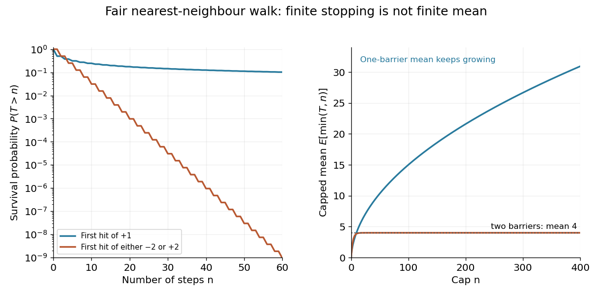

**[Figure 12](#image-almost-sure-stopping-can-have-either-a-finite-or-an-infinite-mean). Almost sure stopping can have either a finite or an infinite mean**. Original exact [simple symmetric random walk](random-walk.md#simple-symmetric-random-walk) calculation from zero. The left compares survival [probabilities](#probability) for first hitting $1$ and first hitting either $-2$ or $2$; the right sums these tails to obtain capped average waiting times $\mathbb E[\min(T,n)]$. These are calculated laws, not simulated measurements.

Even for $T_1$, each bounded [stopping time](martingale.md#stopping-time) $T_1\wedge n$ satisfies $\mathbb E[S_{T_1\wedge n}]=0$. The [stopped process](martingale.md#stopped-process) tends to $1$ [almost surely](convergence-of-random-variables.md#almost-sure-convergence), but its [expected value](expected-value.md) does not tend to $1$. Rare long negative excursions retain the balancing contribution. The existing [stopped-walk martingale with almost sure but not L1 convergence](martingale.md#stopped-walk-martingale-with-almost-sure-but-not-l1-convergence) explains the related failure of [uniform integrability](convergence-of-random-variables.md#uniform-integrability); almost sure convergence alone does not permit exchanging a [limit](calculus.md#limit-of-a-function) and an [expected value](expected-value.md).

<h3 id="proof-of-wald-s-equation-by-stopping-indicators">Proof of Wald's equation by stopping indicators</h3>

↑ **Parent:** [Wald's equation](#wald-s-equation)

If $M$ is a [stopping time](martingale.md#stopping-time) for independent identically distributed integrable variables $X_i$ and $\mathbb EM<\infty$, then $\{M\geq i\}$ depends only on $X_1,\ldots,X_{i-1}$ and is independent of $X_i$. Hence

$$
\mathbb E\sum_{i=1}^M X_i
=\sum_{i\geq1}\mathbb E[X_i\mathbf1_{\{M\geq i\}}]
=\mathbb EX_1\sum_{i\geq1}\mathbb P(M\geq i)
=\mathbb EX_1\,\mathbb EM.
$$

The interchange is justified because the same calculation with $|X_i|$ gives finite expected absolute sum.

## Poisson point process

↑ **Parent:** [Probability theory](probability-theory.md)

[This section is present in another page, follow this link to view it.](poisson-point-process.md)

## Order statistic

↑ **Parent:** [Probability theory](probability-theory.md)  
ⓦ [Wiki](https://en.wikipedia.org/wiki/Order_statistic)

An [order statistic](#order-statistic) is a value selected by its position in a sorted [statistical sample](statistical-inference.md#statistical-sample). For real observations $X_1,\ldots,X_n$, write

$$
X_{(1)}\leq X_{(2)}\leq\cdots\leq X_{(n)}.
$$

The $r$th [order statistic](#order-statistic) $X_{(r)}$ is the $r$th smallest value, counting repeated values separately. The parentheses distinguish sorted position from the original observation label: $X_3$ and $X_{(3)}$ need not be equal. This definition permits ties and requires neither [independence](random-variable.md#independent-random-variables) nor a [continuous probability distribution](continuous-probability-distribution.md). For a random [statistical sample](statistical-inference.md#statistical-sample), each [order statistic](#order-statistic) is itself a [random variable](random-variable.md) and a [statistic](statistical-inference.md#statistic).

For example, the five fixed observations

$$
(x_1,x_2,x_3,x_4,x_5)=(0.7,0.1,0.9,0.4,0.2)
$$

sort to

$$
(x_{(1)},x_{(2)},x_{(3)},x_{(4)},x_{(5)})=(0.1,0.2,0.4,0.7,0.9).
$$

Their original indices in sorted order are $(2,5,4,1,3)$, so $x_{(3)}=x_4=0.4$. Their [ranks of observations](#rank-of-an-observation), listed in original observation order, are $(4,1,5,3,2)$. Here $x_{(1)}=0.1$ is the [minimum](set.md#minimum-of-a-subset-of-a-total-order), $x_{(5)}=0.9$ is the [sample maximum](#sample-maximum), and $x_{(3)}=0.4$ is the [sample median](probability-distribution.md#sample-median). These are deliberately chosen observations, rather than simulated draws.

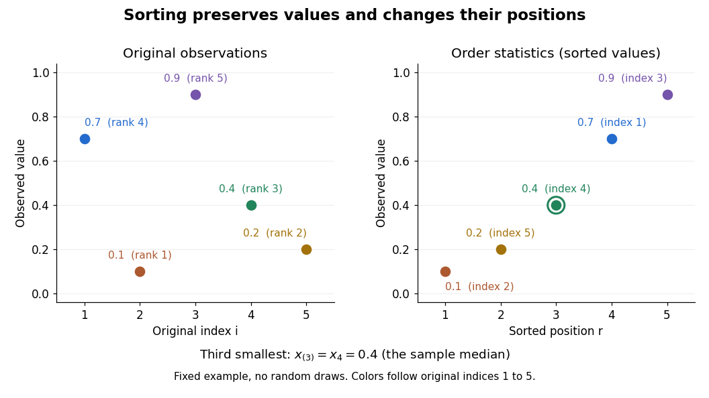

**[Figure 13](#image-five-observations-original-indices-sorted-positions-and-the-third-order-statistic). Five observations: original indices, sorted positions, and the third order statistic**.

[Order statistics](#order-statistic) put extremes and typical values in one language: the first and last locate the [minimum](set.md#minimum-of-a-subset-of-a-total-order) and [sample maximum](#sample-maximum), while intermediate positions give [sample quantiles](probability-distribution.md#sample-quantile) and the [sample median](probability-distribution.md#sample-median). Under the existing generalized-inverse convention, the [sample quantile](probability-distribution.md#sample-quantile) at level $p$ is $X_{(\lceil np\rceil)}$. For the five observations, the [sample quantiles](probability-distribution.md#sample-quantile) at $p=0.2,0.5,0.8$ are $0.1,0.4,0.7$. The distinction between a fixed observed value and its [sampling distribution](statistical-modelling.md#sampling-distribution) lets us quantify how much an extreme or [sample median](probability-distribution.md#sample-median) would vary across repeated [statistical samples](statistical-inference.md#statistical-sample).

The useful counting identity is

$$
\{X_{(r)}\leq t\}=\{\text{at least }r\text{ of the observations are at most }t\}.
$$

For [independent and identically distributed random variables](random-variable.md#independent-and-identically-distributed-random-variables) with a continuous [cumulative distribution function](probability-distribution.md#cumulative-distribution-function) $F$, the count on the right has [binomial distribution](discrete-probability-distribution.md#binomial-distribution) with parameters $n,F(t)$, giving

$$
\mathbb P(X_{(r)}\leq t)=\sum_{k=r}^{n}\binom{n}{k}F(t)^k[1-F(t)]^{n-k},\qquad 1\leq r\leq n.
$$

This [cumulative distribution function](probability-distribution.md#cumulative-distribution-function) is a [binomial distribution](discrete-probability-distribution.md#binomial-distribution) tail: a question about sorting becomes a question about counting successes in [Bernoulli trials](discrete-probability-distribution.md#bernoulli-trial). The counting proof also works for [probability distributions](probability-distribution.md) with atoms and ties, although a [probability density function](continuous-probability-distribution.md#probability-density-function) need not then exist. For a [uniform order statistic](#uniform-order-statistic), $F(t)=t$ on $0\leq t\leq1$, which makes the formula particularly explicit.

### Relative rank

↑ **Parent:** [Order statistic](#order-statistic)

### Record value

↑ **Parent:** [Order statistic](#order-statistic)

### Failure probabilities for two independent lifetimes

↑ **Parent:** [Order statistic](#order-statistic)

For independent [survival times](survival-analysis.md#survival-time) $T_1,T_2$ with [cumulative distribution functions](probability-distribution.md#cumulative-distribution-function) $F_1,F_2$, the probability both components have failed by time $t$ is

$$
P(\max(T_1,T_2)\leq t)=F_1(t)F_2(t).
$$

The probability at least one has failed is

$$
P(\min(T_1,T_2)\leq t)=1-(1-F_1(t))(1-F_2(t)).
$$

The first equality uses [independence of random variables](random-variable.md#independent-random-variables); the second applies it to the complementary event that both survive. These are the distributions of the two extreme [order statistics](#order-statistic).

Marginal distributions alone do not determine these probabilities. Without independence, the [Fréchet inequalities](#frechet-inequalities) give $\max(0,F_1+F_2-1)\leq P(\text{both})\leq\min(F_1,F_2)$, and [inclusion-exclusion](combinatorics.md#inclusion-exclusion-principle) gives $P(\text{at least one})=F_1+F_2-P(\text{both})$.

### Uniformized sample range

↑ **Parent:** [Order statistic](#order-statistic)

For an iid sample of size $n\geq2$ from a continuous [cumulative distribution function](probability-distribution.md#cumulative-distribution-function), the [probability integral transform](probability-distribution.md#probability-integral-transform) makes the transformed sample uniform. Integrating the joint density of its minimum and maximum gives range density $n(n-1)r^{n-2}(1-r)$ on $0<r<1$. Its distribution function is $nr^{n-1}-(n-1)r^n$. The result describes population content between the extreme [order statistics](#order-statistic), independently of the underlying continuous distribution.

### Rank of an observation

↑ **Parent:** [Order statistic](#order-statistic)

The [rank of an observation](#rank-of-an-observation) records where that observation lies among the [order statistics](#order-statistic) of a [statistical sample](statistical-inference.md#statistical-sample). When all values are distinct, $r_i=1+\#\{j:x_j<x_i\}$ and $x_i=x_{(r_i)}$. For $(0.7,0.1,0.9,0.4,0.2)$, the [ranks of observations](#rank-of-an-observation) in original order are $(4,1,5,3,2)$: the first observation is fourth smallest, while the fourth observation is third smallest.

Ties require a convention. A tied block occupying sorted positions $a,\ldots,b$ can assign each member the average [rank of an observation](#rank-of-an-observation) $(a+b)/2$, the minimum position $a$, or the maximum position $b$; an explicit rule can also break ties into distinct positions. R's official documentation describes these choices and uses average ranks by default. [R base documentation: sample ranks and tie methods](https://stat.ethz.ch/R-manual/R-devel/library/base/html/rank.html).

For example, $(0.1,0.4,0.4,0.9)$ has [order statistics](#order-statistic) $(0.1,0.4,0.4,0.9)$. The two $0.4$ observations occupy positions $2$ and $3$; average [ranks of observations](#rank-of-an-observation) are $(1,2.5,2.5,4)$, whereas minimum-position ranks are $(1,2,2,4)$. A fractional average rank is a summary of tied positions, rather than an index of one [order statistic](#order-statistic). Without omissions, distinct ranks and average ranks sum to $n(n+1)/2$, since averaging each tied block preserves its sum; minimum-position ranks need not.

[Wilcoxon signed-rank tests](nonparametric-statistics.md#wilcoxon-signed-rank-test) rank the absolute nonzero paired differences, while [Wilcoxon rank sum tests](nonparametric-statistics.md#mann-whitney-u-test) rank the pooled observations from two samples; these are different rankings.

### Exceedance count limit for extreme order statistics

↑ **Parent:** [Order statistic](#order-statistic)

For [independent and identically distributed random variables](random-variable.md#independent-and-identically-distributed-random-variables), suppose normalized [sample maxima](#sample-maximum) have limiting [distribution function](probability-distribution.md#cumulative-distribution-function) $G$. At a threshold $a_nx+b_n$ with $G(x)>0$, the exceedance count has limiting [Poisson distribution](discrete-probability-distribution.md#poisson-distribution) with parameter $-\log G(x)$. The $r$th largest observation lies below the threshold exactly when at most $r-1$ observations strictly exceed it, including in samples with ties. Summing the first $r$ limiting Poisson probabilities gives the displayed limit for every fixed positive integer $r$. The equivalence follows from $F(a_nx+b_n)^n\to G(x)$ and $-\log(1-p)\sim p$ as $p\downarrow0$.

### Covariance of two uniform order statistics

↑ **Parent:** [Order statistic](#order-statistic)

For two [independent random variables](random-variable.md#independent-random-variables) with the [uniform distribution](continuous-probability-distribution.md#continuous-uniform-distribution) on $[0,1]$, put $U=\min(X,Y)$ and $V=\max(X,Y)$. Then $P(U>u)=(1-u)^2$, so $\mathbb EU=1/3$. Since $U+V=X+Y$ and $UV=XY$, $\mathbb EV=2/3$ and $\mathbb E(UV)=1/4$. Thus their [covariance](variance.md#covariance) is $1/36$, although the original variables are independent. Rescaling the interval to $[a,b]$ multiplies the covariance by $(b-a)^2$.

### Independent exponential order-statistic spacings

↑ **Parent:** [Order statistic](#order-statistic)

For $n$ [independent and identically distributed](random-variable.md#independent-and-identically-distributed-random-variables) rate-$\lambda$ [exponential random variables](continuous-probability-distribution.md#exponential-distribution), let $M_0=0$ and $M_1<\cdots<M_n$ be their [order statistics](#order-statistic). The gaps $D_i=M_i-M_{i-1}$ are [independent](random-variable.md#independent-random-variables) and have rates $(n-i+1)\lambda$. After the first clock rings, the [memoryless property](continuous-probability-distribution.md#memorylessness-of-the-exponential-distribution) makes the surviving clocks fresh independent exponentials, independently of the elapsed minimum and the winning label. Induction gives the result. Equivalently, the ordered [joint probability density](continuous-probability-distribution.md#joint-probability-density) is $n!\lambda^n\exp[-\lambda\sum_i m_i]$ on $0<m_1<\cdots<m_n$; changing to gaps gives a product of exponential densities because $\sum_i m_i=\sum_i(n-i+1)D_i$.

### Waiting time for a new record after a fixed sample

↑ **Parent:** [Order statistic](#order-statistic)

For independent identically distributed observations with continuous [cumulative distribution function](probability-distribution.md#cumulative-distribution-function) $F$, fix the maximum $Y_n$ of the first $n\geq1$ observations and let $\tau$ be the first subsequent observation exceeding it. The [probability integral transform](probability-distribution.md#probability-integral-transform) gives $U=F(Y_n)$ density $nu^{n-1}$ on $(0,1)$. Conditional on $U=u$, $\tau$ has a [geometric distribution](discrete-probability-distribution.md#geometric-distribution) of parameter $1-u$. Therefore

$$
P(\tau=k)=n\int_0^1u^{n+k-2}(1-u)\,du
=\frac n{(n+k-1)(n+k)},\qquad
P(\tau>k)=\frac n{n+k}.
$$

The masses sum to one, so the waiting time is finite almost surely, but the [tail-sum formula for expectation](#tail-sum-formula-for-expectation) gives $E\tau=\infty$. These conclusions require only continuity of $F$, not a density or a strictly increasing distribution function.

### Independent minimum and gap of two exponential variables

↑ **Parent:** [Order statistic](#order-statistic)

For two independent rate-$\lambda>0$ [exponential distributions](continuous-probability-distribution.md#exponential-distribution), set $U=\min(X,Y)$ and $V=\max(X,Y)$. Summing the two ordering branches gives [joint probability density](continuous-probability-distribution.md#joint-probability-density) $2\lambda^2e^{-\lambda(2u+d)}$ for $(U,d=V-U)$ with $u,d>0$. It factors into independent exponential [probability density functions](continuous-probability-distribution.md#probability-density-function). Thus $V$ is distributed as $X+Y/2$, with [expected value](expected-value.md) $3/(2\lambda)$ and [variance](variance.md) $5/(4\lambda^2)$. This spacing result is the order-statistic manifestation of the [memorylessness of the exponential distribution](continuous-probability-distribution.md#memorylessness-of-the-exponential-distribution).

### Distribution functions of independent minima and maxima

↑ **Parent:** [Order statistic](#order-statistic)

Independence factors the events that both variables exceed a threshold or both lie below it. This gives the two [cumulative distribution functions](probability-distribution.md#cumulative-distribution-function) above, including for distributions with atoms. The minimum formula is most naturally expressed through survival [probabilities](#probability), while the maximum formula uses the CDFs directly.

### Descending order statistics

↑ **Parent:** [Order statistic](#order-statistic)

Descending order statistics list a sample from greatest to least. If $V_{(1)}\leq\cdots\leq V_{(n)}$ uses the usual increasing convention, then $V_{[k]}=V_{(n-k+1)}$. This notation distinguishes the next-highest value used by [revenue equivalence](game-theory.md#revenue-equivalence) from the second-smallest sample value.

### Sample maximum

↑ **Parent:** [Order statistic](#order-statistic)

For [independent and identically distributed random variables](random-variable.md#independent-and-identically-distributed-random-variables) with [distribution function](probability-distribution.md#cumulative-distribution-function) $F$, the [sample maximum](#sample-maximum) $M_n=\max_{1\leq i\leq n}X_i$ has [distribution function](probability-distribution.md#cumulative-distribution-function) $F(x)^n$.

### Nearest neighbour distance

↑ **Parent:** [Order statistic](#order-statistic)

For observations $X_1,\ldots,X_n$, the [nearest neighbour distance](#nearest-neighbour-distance) of order $k$ at $x$ is the $k$th [order statistic](#order-statistic) of the distances $|X_i-x|$. An atomless distance [distribution function](probability-distribution.md#cumulative-distribution-function) ensures ties occur with probability zero.

#### Probability content of a nearest neighbour ball

↑ **Parent:** [Nearest neighbour distance](#nearest-neighbour-distance)

For [independent and identically distributed random variables](random-variable.md#independent-and-identically-distributed-random-variables) with continuous distance [distribution function](probability-distribution.md#cumulative-distribution-function) $p_x$, the [probability integral transform](probability-distribution.md#probability-integral-transform) makes the probability content of the order-$k$ nearest ball a [uniform order statistic](#uniform-order-statistic), with the [Beta distribution](probability-distribution.md#beta-distribution) $\operatorname{Beta}(k,n+1-k)$.

##### Inverse probability content bound for a Lipschitz density

↑ **Parent:** [Probability content of a nearest neighbour ball](#probability-content-of-a-nearest-neighbour-ball)

For a strictly positive [probability density function](continuous-probability-distribution.md#probability-density-function) with [Lipschitz bound](real-analysis.md#lipschitz-bound) $L$, $p_x(r)=\int_{x-r}^{x+r}f(y)\,dy$ satisfies $|p_x(r)-2rf(x)|\leq Lr^2$. If $0<s<1$ and $s\leq f(x)^2/L$, monotonicity gives $p_x^{-1}(s)\leq s/f(x)$ and hence $|2f(x)p_x^{-1}(s)-s|\leq Ls^2/f(x)^2$. The [Lipschitz density height bound](continuous-probability-distribution.md#lipschitz-density-height-bound) prevents extending this local argument to every $s\in(0,1)$ by assuming $f(x)\geq\sqrt L$ for a strictly positive density.

### Uniform order statistic

↑ **Parent:** [Order statistic](#order-statistic)

For [independent and identically distributed random variables](random-variable.md#independent-and-identically-distributed-random-variables) $U_1,\ldots,U_n$ with the continuous [uniform distribution](continuous-probability-distribution.md#continuous-uniform-distribution) on $(0,1)$, the $r$th [order statistic](#order-statistic) has [Beta distribution](probability-distribution.md#beta-distribution)

$$
U_{(r)}\sim\operatorname{Beta}(r,n+1-r),\qquad 1\leq r\leq n.
$$

Its [probability density function](continuous-probability-distribution.md#probability-density-function), [mean](expected-value.md), and [variance](variance.md) are

$$
f_r(t)=\frac{n!}{(r-1)!(n-r)!}\,t^{r-1}(1-t)^{n-r},\qquad 0<t<1,
$$

$$
\mathbb E[U_{(r)}]=\frac{r}{n+1},\qquad
\operatorname{Var}(U_{(r)})=\frac{r(n+1-r)}{(n+1)^2(n+2)}.
$$

The [probability density function](continuous-probability-distribution.md#probability-density-function) is zero outside $[0,1]$; values assigned to its endpoints do not change any [probability](#probability). Peter Kempthorne's MIT lecture notes derive the [uniform order statistic](#uniform-order-statistic) law and these [moments](expected-value.md#moment). [Peter Kempthorne, MIT 18.443, Lecture 11, slides 12–14](https://ocw.mit.edu/courses/18-443-statistics-for-applications-spring-2015/06daf6d78e7eb0465d6bb53e8f96b2ff_MIT18_443S15_LEC11.pdf).

For $n=5$, the [minimum](set.md#minimum-of-a-subset-of-a-total-order), [sample median](probability-distribution.md#sample-median), and [sample maximum](#sample-maximum) correspond to $r=1,3,5$. Their [probability density functions](continuous-probability-distribution.md#probability-density-function) are $5(1-t)^4$, $30t^2(1-t)^2$, and $5t^4$, respectively. The [sample median](probability-distribution.md#sample-median) therefore has [Beta distribution](probability-distribution.md#beta-distribution) $\operatorname{Beta}(3,3)$, [mean](expected-value.md) $1/2$, and [variance](variance.md) $1/28\approx0.0357143$. Its [cumulative distribution function](probability-distribution.md#cumulative-distribution-function) is

$$
\mathbb P(U_{(3)}\leq t)=10t^3(1-t)^2+5t^4(1-t)+t^5=10t^3-15t^4+6t^5,\qquad 0\leq t\leq1.
$$

For instance, $\mathbb P(U_{(3)}\leq1/4)=53/512\approx0.103516$. The [mean](expected-value.md) of the [minimum](set.md#minimum-of-a-subset-of-a-total-order) is $1/6$, and the [mean](expected-value.md) of the [sample maximum](#sample-maximum) is $5/6$. The fixed observed [sample median](probability-distribution.md#sample-median) $0.4$ in the [order statistic](#order-statistic) example is one possible outcome; $1/2$ is the average over repeated [statistical samples](statistical-inference.md#statistical-sample) from this [uniform distribution](continuous-probability-distribution.md#continuous-uniform-distribution).

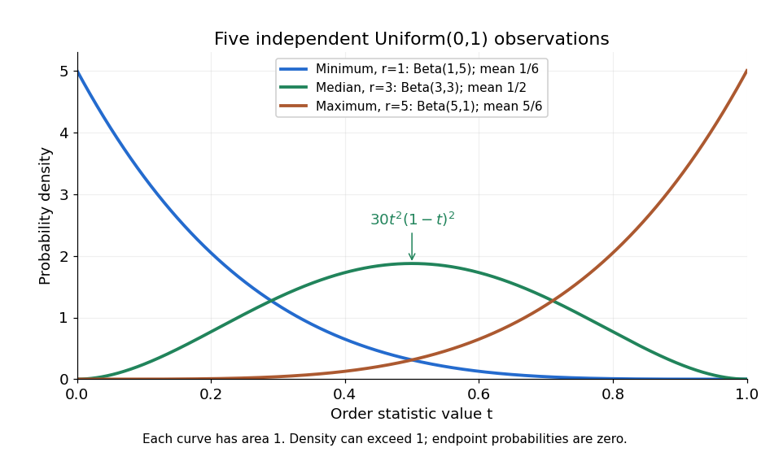

**[Figure 14](#image-minimum-median-and-maximum-densities-for-five-independent-uniform-observations). Minimum, median, and maximum densities for five independent uniform observations**.

Each curve has area one. The extreme [order statistics](#order-statistic) favor the ends, while the [sample median](probability-distribution.md#sample-median) favors the center. The endpoint density height $5$ is legitimate: the [probability density function](continuous-probability-distribution.md#probability-density-function) gives area per unit length, rather than point [probability](#probability). In particular, a continuous [uniform distribution](continuous-probability-distribution.md#continuous-uniform-distribution) has zero [probability](#probability) of producing an endpoint.

For a short proof, the [binomial distribution](discrete-probability-distribution.md#binomial-distribution) counting identity under [order statistic](#order-statistic) gives $\mathbb P(U_{(r)}\leq t)=\sum_{k=r}^{n}\binom{n}{k}t^k(1-t)^{n-k}$. Taking its [derivative](calculus.md#derivative) cancels consecutive terms, leaving the displayed [probability density function](continuous-probability-distribution.md#probability-density-function). Recognize its normalizing [factorial](combinatorics.md#factorial) coefficient as that of the [Beta distribution](probability-distribution.md#beta-distribution), then substitute $\alpha=r$, $\beta=n+1-r$ into the [Beta distribution](probability-distribution.md#beta-distribution) [mean](expected-value.md) and [variance](variance.md) formulas. Although the original observations are [independent](random-variable.md#independent-random-variables), their [order statistics](#order-statistic) generally are dependent; see the positive [covariance of two uniform order statistics](#covariance-of-two-uniform-order-statistics).

#### Exponential endpoint limit of a uniform maximum

↑ **Parent:** [Uniform order statistic](#uniform-order-statistic)

For [independent and identically distributed random variables](random-variable.md#independent-and-identically-distributed-random-variables) $U_i$ with the [continuous uniform distribution](continuous-probability-distribution.md#continuous-uniform-distribution) on $[0,1]$, let $M_n=\max_{1\leq i\leq n}U_i$. Its [cumulative distribution function](probability-distribution.md#cumulative-distribution-function) is $x^n$ on $[0,1]$, so $M_n\xrightarrow{\mathrm d}1$. The endpoint error has a nonconstant limiting [probability distribution](probability-distribution.md): for fixed $z\geq0$ and $n\geq z$,

$$
\mathbb P(n(1-M_n)>z)=(1-z/n)^n\longrightarrow e^{-z}.
$$

This [survival function](survival-analysis.md#survival-function) gives the displayed [exponential distribution](continuous-probability-distribution.md#exponential-distribution) limit. More generally, for observations uniform on $[a,b]$, $n(b-M_n)/(b-a)$ has the same limit. The scaling identifies an error of order $1/n$, in contrast to the $1/\sqrt n$ fluctuations of a typical [sample mean](variance.md#sample-mean) with nonzero finite [variance](variance.md).

### Order symmetry of independent random variables

↑ **Parent:** [Order statistic](#order-statistic)

[Independent and identically distributed random variables](random-variable.md#independent-and-identically-distributed-random-variables) with a [continuous probability distribution](continuous-probability-distribution.md) realize each of their possible strict orderings with equal probability.

#### First ascent in independent continuous observations

↑ **Parent:** [Order symmetry of independent random variables](#order-symmetry-of-independent-random-variables)

For [independent and identically distributed random variables](random-variable.md#independent-and-identically-distributed-random-variables) with a [continuous probability distribution](continuous-probability-distribution.md), let $N\geq2$ be the index of the first increase. The event $N\geq n$ requires the first $n-1$ observations to be decreasing; symmetry among their $(n-1)!$ possible strict orders gives probability $1/(n-1)!$ for $n\geq2$. Subtracting successive tails gives the displayed mass function for $r\geq2$. The tails tend to zero, so $N$ is finite almost surely. The [tail-sum formula for expectation](#tail-sum-formula-for-expectation) gives $\mathbb EN=1+\sum_{j\geq1}1/j!=e$, independently of the continuous sampling law.

## Expected value

↑ **Parent:** [Probability theory](probability-theory.md)

[This section is present in another page, follow this link to view it.](expected-value.md)

## Probability distribution

↑ **Parent:** [Probability theory](probability-theory.md)

[This section is present in another page, follow this link to view it.](probability-distribution.md)

## Probability inequality

↑ **Parent:** [Probability theory](probability-theory.md)

[This section is present in another page, follow this link to view it.](probability-inequality.md)

## Conditional probability

↑ **Parent:** [Probability theory](probability-theory.md)  
ⓦ [Wiki](https://en.wikipedia.org/wiki/Conditional_probability)

For [events](probability-space.md#event) $A,B$ with $\mathbb P(B)>0$, conditional probability is

$$
\mathbb P(A\mid B)=\frac{\mathbb P(A\cap B)}{\mathbb P(B)}.
$$

Restrict attention to the outcomes in $B$, then renormalize their [probability measure](probability-space.md#probability-measure) so its total mass becomes one. The resulting rule $A\mapsto\mathbb P(A\mid B)$ is itself a [probability measure](probability-space.md#probability-measure). The definition and its connection to [independent events](#independent-events) are developed in [MIT 18.05, Reading 3: Conditional Probability, Independence and Bayes' Theorem](https://ocw.mit.edu/courses/18-05-introduction-to-probability-and-statistics-spring-2022/resources/mit18_05_s22_class03-prep_pdf/).

For the two-dice model, let $A$ mean the sum is at least nine and $B$ mean the first result is six. Of the six outcomes in $B$, four belong to $A$: the second die can be 3, 4, 5, or 6. Thus **$\mathbb P(A\mid B)=2/3$**. Reversing the information gives a different answer: four of the ten outcomes in $A$ have first result six, so **$\mathbb P(B\mid A)=2/5$**. Both ratios use the same overlap; their denominators describe different information.

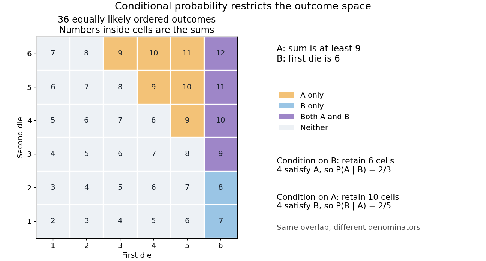

**[Figure 15](#image-conditioning-selects-a-different-denominator-in-the-same-dice-outcome-grid). Conditioning selects a different denominator in the same dice outcome grid**.

The definition requires positive conditioning mass. For a continuously distributed [random variable](random-variable.md) $X$, it cannot directly define $\mathbb P(A\mid X=x)$ when $\mathbb P(X=x)=0$. A [regular conditional distribution](#regular-conditional-distribution) or [conditional density](#conditional-density) supplies the appropriate extension, with the usual [almost everywhere](measure-theory.md#almost-everywhere) qualification. Nor does conditioning by itself justify [causal inference](causal-inference.md): changing which outcomes are considered is different from physically changing how the experiment is generated.

### Red-ball prediction with one certain red ball

↑ **Parent:** [Conditional probability](#conditional-probability)

A box contains one certainly red ball and $n\geq1$ independently coloured extra balls, each red with [probability](#probability) $1/2$. Conditional on the first draw being red, a second draw without replacement is red with [probability](#probability) $(n+3)/(2(n+2))$. To see the effect of using a [conditional probability](#conditional-probability), let $R=1+B$, where $B$ has a [binomial distribution](discrete-probability-distribution.md#binomial-distribution) with parameters $n,1/2$. The [conditional probability](#conditional-probability) is $\mathbb E[R(R-1)]/(n\mathbb E[R])$: histories with more red balls are more likely to produce the first red draw and therefore receive greater weight.

### Three prisoners problem

↑ **Parent:** [Conditional probability](#conditional-probability)  
ⓦ [Wiki](https://en.wikipedia.org/wiki/Three_prisoners_problem)

A messenger names an excluded candidate while concealing the uniquely selected one. The [conditional probability](#conditional-probability) depends on the naming rule. With three equally likely selected candidates and a messenger forbidden to name the observing candidate A, let $s$ be the probability of naming B when A is selected. When C is selected the messenger must name B, and when B is selected cannot name B. Thus the probability that A is not selected, conditional on B being named, is $1/(1+s)$. Unbiased naming has $s=1/2$ and leaves this probability $2/3$; bias toward B gives $1/2$, and bias toward C gives one. Conditioning on the name is different from conditioning only on B's exclusion.

### Chain rule for probabilities

↑ **Parent:** [Conditional probability](#conditional-probability)

When all conditioning events have positive [probability](#probability), repeatedly apply the definition of [conditional probability](#conditional-probability) to factor a joint event into successive conditional factors. For a sequence of discrete responses, this yields the product of conditional masses along the actual outcome path. It requires no unconditional independence assumption.

### Disintegration theorem for a probability measure

↑ **Parent:** [Conditional probability](#conditional-probability)

For a [probability measure](probability-space.md#probability-measure) on a standard Borel space and a measurable map $\pi$ to another standard Borel space, there is an almost-everywhere unique [measurable probability kernel](#measurable-probability-kernel) $y\mapsto\mu_y$ supported on $\pi^{-1}\{y\}$. It integrates to $\mu$, and $\int f\,d\mu_{\pi(x)}$ realizes [conditional expectation](measure-theory.md#conditional-expectation) given $\pi$. These measures are the [conditional measures of a factor](#conditional-measures-of-a-factor).

#### Conditional measures of a factor

↑ **Parent:** [Disintegration theorem for a probability measure](#disintegration-theorem-for-a-probability-measure)

The fiber-supported [measurable probability kernel](#measurable-probability-kernel) supplied by the [disintegration theorem for a probability measure](#disintegration-theorem-for-a-probability-measure) for a [factor map](ergodic-theory.md#factor-map-between-measure-preserving-systems). For integrable $f$, $\mathbb E[f\mid\varphi^{-1}\mathcal B_Y](x)=\int f\,d\mu_{\varphi(x)}$ [almost everywhere](measure-theory.md#almost-everywhere). The same construction applies to general measurable maps and countably generated sub-sigma-algebras modulo null sets.

### Measurable probability kernel

↑ **Parent:** [Conditional probability](#conditional-probability)

A family of probability measures $K_y$ on a measurable space for which $y\mapsto K_y(A)$ is measurable for every measurable set $A$. This combines measurable dependence on a parameter with a [probability measure](probability-space.md#probability-measure) at each parameter. The [conditional measures of a factor](#conditional-measures-of-a-factor) form such a kernel, with the additional fiber-support property from disintegration.

### Positive association of two events

↑ **Parent:** [Conditional probability](#conditional-probability)

For nontrivial [events](probability-space.md#event), strict attraction under [conditional probability](#conditional-probability) is equivalent to a positive covariance of their indicator variables. This condition is symmetric in the two [events](probability-space.md#event). Complementing exactly one of the [events](probability-space.md#event) reverses the strict inequality. This two-event condition should be distinguished from association of an entire family of random variables.

### Bayes formula for conditional expectation

↑ **Parent:** [Conditional probability](#conditional-probability)

If $d\widetilde{\mathbb P}=Z\,d\mathbb P$ and $Z_t=\mathbb E[Z\mid\mathcal F_t]>0$, then

$$
\widetilde{\mathbb E}[X\mid\mathcal F_t]
=\frac{\mathbb E[ZX\mid\mathcal F_t]}{Z_t}.
$$

### Bayes' theorem

↑ **Parent:** [Conditional probability](#conditional-probability)  
ⓦ [Wiki](https://en.wikipedia.org/wiki/Bayes'_theorem)

For a finite [measurable partition](measure-theory.md#measurable-partition) $(B_j)$ with positive [probabilities](#probability), and an [event](probability-space.md#event) $A$ of positive [probability](#probability),

$$
\mathbb P(B_j\mid A)
=\frac{\mathbb P(A\mid B_j)\mathbb P(B_j)}
{\sum_k\mathbb P(A\mid B_k)\mathbb P(B_k)}.
$$

Its beauty is that a model predicting observations from a hidden state can also describe uncertainty about the state after an observation. Each numerator is a joint [probability](#probability); the denominator, supplied by the [law of total probability](probability-space.md#law-of-total-probability), makes the answers sum to one. This is a direct consequence of [conditional probability](#conditional-probability), rather than an extra axiom.

Select the coin from [law of total probability](probability-space.md#law-of-total-probability) once, then toss that same coin repeatedly, with [conditionally independent](random-variable.md#conditional-independence) tosses given its identity. Let $B$ denote the $3/4$-head coin, initially of [prior probability](bayesian-statistics.md#prior-probability) $1/5$. After one head $H$, its [posterior probability](bayesian-statistics.md#posterior-probability) is

$$
\boxed{\mathbb P(B\mid H)=\frac{(1/5)(3/4)}{(1/5)(3/4)+(4/5)(1/2)}=\frac3{11}.}
$$

The [likelihood](maximum-likelihood-estimation.md#likelihood-function) of a head is larger under $B$, but $B$ remains less likely than the other coin because its [prior probability](bayesian-statistics.md#prior-probability) was smaller. A large [likelihood](maximum-likelihood-estimation.md#likelihood-function) for an observation does not itself imply a large [posterior probability](bayesian-statistics.md#posterior-probability) for the hypothesis.

After an ordered sequence containing $h$ heads and $t$ tails, its [likelihood ratio](statistical-hypothesis-test.md#likelihood-ratio) between the two coins is $(3/2)^h(1/2)^t$. Bayes' theorem therefore gives [posterior odds](bayesian-statistics.md#posterior-odds)

$$
O_{B:B^c}=\frac14\left(\frac32\right)^h\left(\frac12\right)^t,\qquad
\mathbb P(B\mid\text{sequence})=\frac{O_{B:B^c}}{1+O_{B:B^c}}.
$$

Each head multiplies the [odds](#odds) by $3/2$ and each tail by $1/2$. Three heads give [posterior probability](bayesian-statistics.md#posterior-probability) $27/59$, still below one half; four give $81/145$, above one half. The finite-model update and the distinction between [prior probability](bayesian-statistics.md#prior-probability), [likelihood](maximum-likelihood-estimation.md#likelihood-function) and [posterior probability](bayesian-statistics.md#posterior-probability) are set out in [MIT 18.05, Reading 11: Bayesian Updating with Discrete Priors](https://ocw.mit.edu/courses/18-05-introduction-to-probability-and-statistics-spring-2022/mit18_05_s22_statistics.pdf).

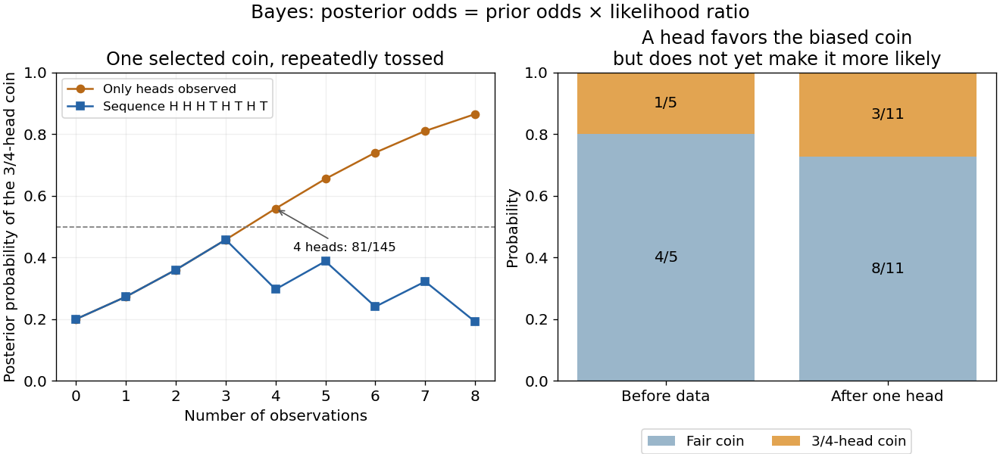

**[Figure 16](#image-updating-uncertainty-about-one-selected-coin-after-repeated-observations). Updating uncertainty about one selected coin after repeated observations**.

The hidden selection also creates dependence. Each toss has marginal head [probability](#probability) $11/20$, but two heads have joint [probability](#probability) $(4/5)(1/2)^2+(1/5)(3/4)^2=5/16$, greater than $(11/20)^2=121/400$. Their indicator [covariance](variance.md#covariance) is $1/100$. Seeing a head makes the head-favoring coin more likely, so it also raises the chance of a future head. This is [covariance induced by a shared latent variable](random-variable.md#covariance-induced-by-a-shared-latent-variable), despite [conditional independence](random-variable.md#conditional-independence) of the tosses given the coin.

Historically, Thomas Bayes's essay on an unknown success [probability](#probability) appeared in 1763 after his death, communicated by Richard Price. Its opening problem asks how observed successes and failures constrain that unknown [probability](#probability); Price's introductory letter explains the connection to reasoning from experience. That is a more substantial inference problem than simply rearranging today's elementary identity. [Bayes, An Essay towards solving a Problem in the Doctrine of Chances, 1763; original text transcribed, introductory letter and statement of the problem](https://www.gtfp.cs.rhul.ac.uk/pulskamp/Bayes/bayesessay-rjp.pdf)

#### Posterior probability for a unique source after a positive test

↑ **Parent:** [Bayes' theorem](#bayes-theorem)

Suppose exactly one of $N$ equally likely candidates is the source of an observation. A test is always positive for that source and is positive with probability $p$ for any nonsource candidate. For one randomly selected candidate, [Bayes' theorem](#bayes-theorem) gives $P(G\mid+)=(1/N)/[(1/N)+p(1-1/N)]$, proving the displayed result. Even a small [false positive rate](statistical-learning.md#false-positive-rate) can leave a substantial chance of a different source when there are many alternatives. The model concerns one selected candidate with the stated prior; searching many candidates and selecting a match requires accounting for that selection procedure.

#### Posterior replacement probability after different-colour draws

↑ **Parent:** [Bayes' theorem](#bayes-theorem)

An urn has $N$ balls, including $K$ of one colour and $N-K$ of the other, with $0<K<N$. After a uniform first draw, an independent decision returns that ball with [probability](#probability) $r$; the second draw is uniform from the remaining contents. Let $B_j$ mean the $j$th draw has the first colour and $R$ mean replacement. The two relevant joint [probabilities](#probability) are

$$
P(\overline B_1\cap R\cap B_2)=\frac{N-K}{N}\,r\,\frac KN,\qquad
P(\overline B_1\cap\overline R\cap B_2)=\frac{N-K}{N}\,(1-r)\,\frac K{N-1}.
$$

Applying [Bayes' theorem](#bayes-theorem) and cancelling the common factors gives the displayed [conditional probability](#conditional-probability). It is independent of $K$ and satisfies

$$
r-P(R\mid\overline B_1\cap B_2)=\frac{r(1-r)}{N-r}\ge0.
$$

Two different observed colours therefore decrease the posterior [probability](#probability) of replacement: removing the first colour makes the second more likely. The replacement decision must be independent of the first draw for this formula; its marginal [probability](#probability) alone does not specify the model.

#### Posterior coin count after exactly one head

↑ **Parent:** [Bayes' theorem](#bayes-theorem)

Let $N$ have the positive-integer [geometric distribution](discrete-probability-distribution.md#geometric-distribution) with success parameter $p\in(0,1)$, and conditionally toss $N$ independent coins with head [probability](#probability) $\theta\in(0,1)$. Exactly one head has conditional [probability](#probability) $n\theta(1-\theta)^{n-1}$. Combining this with the prior by [Bayes' theorem](#bayes-theorem) gives the displayed posterior with $r=(1-p)(1-\theta)$; its normalization uses $\sum_{n\geq1}nr^{n-1}=(1-r)^{-2}$. For $p=\theta=1/2$, the posterior is $9n/4^{n+1}$. It is also a shifted [negative binomial distribution](discrete-probability-distribution.md#negative-binomial-distribution), with $N-1$ equal in law to the number of failures before two successes of [probability](#probability) $1-r$.

#### Posterior equality for proportional likelihoods

↑ **Parent:** [Bayes' theorem](#bayes-theorem)

If every model's [likelihood](maximum-likelihood-estimation.md#likelihood-function) is multiplied by the same positive factor independent of its parameter or model index, [Bayes' theorem](#bayes-theorem) cancels that factor from the normalized posterior. Fixed-count Bernoulli sampling and sampling stopped at a specified positive head count give such proportional [likelihoods](maximum-likelihood-estimation.md#likelihood-function) for the same total heads and tails. This conclusion uses their actual sampling [likelihoods](maximum-likelihood-estimation.md#likelihood-function); it is not a claim that every selection or stopping rule can be ignored.

#### Posterior coin selection from repeated tosses

↑ **Parent:** [Bayes' theorem](#bayes-theorem)

If a hidden coin is selected once with prior probability $\pi$ of coin $B$, repeated tosses are [independent](random-variable.md#independent-random-variables) conditional on that coin. [Bayes' theorem](#bayes-theorem) weights the prior by each all-heads likelihood. They need not be [independent](random-variable.md#independent-random-variables) without conditioning on the chosen coin.

### Conditional distribution

↑ **Parent:** [Conditional probability](#conditional-probability)  
ⓦ [Wiki](https://en.wikipedia.org/wiki/Conditional_distribution)

A conditional distribution is the probability law of one random quantity given information about another.

#### Conditional probability mass function

↑ **Parent:** [Conditional distribution](#conditional-distribution)

The [probability mass function](probability-distribution.md#probability-mass-function) of a discrete [conditional distribution](#conditional-distribution). The elementary ratio requires $p_X(x)>0$; a value of zero gives no event-conditioning definition through this ratio.

#### Regular conditional distribution

↑ **Parent:** [Conditional distribution](#conditional-distribution)

A regular conditional distribution of a [random variable](random-variable.md) $X$ given $Y$ is a [Markov kernel](markov-chain.md#markov-kernel) $K$ such that, for all measurable sets $A,B$,

$$
P(X\in B,Y\in A)=\int_A K(y,B)\,P_Y(dy).
$$

For each $y$, $K(y,\cdot)$ is a [probability measure](probability-space.md#probability-measure); for each $B$, $K(\cdot,B)$ is measurable. Thus it assigns an actual probability distribution to a specified observation even when $P(Y=y)=0$. Such kernels exist for standard Borel state spaces, including real-valued variables, and their uniqueness is only up to $P_Y$-null sets. With a joint density and positive marginal density, the ratio of the two densities defines the usual conditional density kernel. Values outside the marginal support or on a null set are not uniquely determined by the joint law.

#### Conditional density

↑ **Parent:** [Conditional distribution](#conditional-distribution)

Where the [marginal density](probability-distribution.md#marginal-density) $f_X(x)$ is positive, a [joint probability density](continuous-probability-distribution.md#joint-probability-density) determines the conditional density

$$
f_{Y\mid X=x}(y)=\frac{f_{X,Y}(x,y)}{f_X(x)}.
$$

It integrates to one in $y$, and supplies [conditional expectations](measure-theory.md#conditional-expectation) by integrating against it. Its values on a probability-zero set of conditioning points are not fixed by the [joint probability distribution](probability-distribution.md#joint-probability-distribution).

#### Full conditional distribution

↑ **Parent:** [Conditional distribution](#conditional-distribution)

A full conditional distribution is the conditional law of one component of a joint model given all the other components and the observed data. A [Gibbs sampler](bayesian-statistics.md#gibbs-sampler) updates components by drawing from these laws.

## Random partition

↑ **Parent:** [Probability theory](probability-theory.md)  
ⓦ [Wiki](https://en.wikipedia.org/wiki/Random_partition)

A random partition is a probability distribution on partitions of a finite or countable set.

### Poisson-Dirichlet distribution

↑ **Parent:** [Random partition](#random-partition)  
ⓦ [Wiki](https://en.wikipedia.org/wiki/Poisson-Dirichlet_distribution)

The Poisson-Dirichlet family consists of laws of decreasing random mass partitions $(p_i)$ with $\sum_i p_i=1$. Its two-parameter notation is $PD(\alpha,\theta)$, with $0\le\alpha<1$ and $\theta>-\alpha$. The conventional one-parameter [probability distribution](probability-distribution.md) $PD(\theta)$ means $PD(0,\theta)$, for $\theta>0$, and can be constructed from normalized gamma jumps.

#### One-parameter Poisson-Dirichlet distribution

↑ **Parent:** [Poisson-Dirichlet distribution](#poisson-dirichlet-distribution)

Take a [Poisson random measure](poisson-point-process.md#poisson-random-measure) on $(0,\infty)$ with intensity $\theta e^{-u}du/u$ and arrange its atoms as $J_1>J_2>\cdots$. The sum $T=\sum_iJ_i$ is finite and positive [almost surely](convergence-of-random-variables.md#almost-sure-convergence), has [Gamma distribution](continuous-probability-distribution.md#gamma-distribution) with shape $\theta$ and rate one, and the law of $(J_i/T)$ is $PD(\theta)$. The order is decreasing, so the first component is the largest; a size-biased selection of a component has a different law.

##### Largest component of a Poisson-Dirichlet partition

↑ **Parent:** [One-parameter Poisson-Dirichlet distribution](#one-parameter-poisson-dirichlet-distribution)

For $a\ge1/2$, at most one component exceeds $a$, so $1-F_\theta(a)=\theta\int_a^1x^{-1}(1-x)^{\theta-1}dx$. Below one half several components can exceed the threshold. Put $N_a=\#\{i:p_i>a\}$ and use the finite identity $\mathbf1_{\{N_a=0\}}=\sum_m(-1)^m(N_a)_m/m!$, with the [factorial moment densities of Poisson-Dirichlet components](#factorial-moment-densities-of-poisson-dirichlet-components). It gives the full [probability distribution](probability-distribution.md) as finite [inclusion-exclusion](combinatorics.md#inclusion-exclusion-principle) over $x_i>a$, $\sum_i x_i<1$. In contrast, a size-biased component is beta-distributed.

##### Factorial moment densities of Poisson-Dirichlet components

↑ **Parent:** [One-parameter Poisson-Dirichlet distribution](#one-parameter-poisson-dirichlet-distribution)

This density is supported where all $x_i>0$ and $\sum_i x_i<1$, and gives the expected sum over ordered distinct components of $PD(\theta)$. Apply the iterated [Mecke formula for a Poisson random measure](poisson-point-process.md#mecke-formula-for-a-poisson-random-measure) to $m$ selected jumps $u_i$ and the remaining gamma total $t$. With $s=t+\sum_i u_i$ and $x_i=u_i/s$, the Jacobian is $s^m$ and the integral in $s$ is $\Gamma(\theta)$, giving the density. It describes joint counts of large components, beyond the first-moment measure.

##### Mean measure of Poisson-Dirichlet components

↑ **Parent:** [One-parameter Poisson-Dirichlet distribution](#one-parameter-poisson-dirichlet-distribution)

For $PD(\theta)$, $\mathbb E\sum_i\varphi(p_i)=\int\varphi\,d\alpha_\theta$ whenever the absolute integral is finite. Apply the [Mecke formula for a Poisson random measure](poisson-point-process.md#mecke-formula-for-a-poisson-random-measure) to a selected jump $u$ and the remaining total $t$, whose density is $t^{\theta-1}e^{-t}/\Gamma(\theta)$. Changing variables to $s=u+t$ and $x=u/s$ factors out a [Gamma function](complex-analysis.md#gamma-function) and gives the displayed measure. Weighting it by $x$ gives a [probability](#probability) density $\theta(1-x)^{\theta-1}$, the [Beta distribution](probability-distribution.md#beta-distribution) of a size-biased component.

### Restricted-growth string

↑ **Parent:** [Random partition](#random-partition)

A restricted-growth string encodes a set partition by numbering blocks in order of first appearance.

### Singleton block

↑ **Parent:** [Random partition](#random-partition)

A singleton block is a block containing exactly one element.

### Exchangeable random partition

↑ **Parent:** [Random partition](#random-partition)  
ⓦ [Wiki](https://en.wikipedia.org/wiki/Exchangeable_random_partition)

An exchangeable random partition has a law invariant under finite permutations of the underlying labels.

## Random path in a binary tree

↑ **Parent:** [Probability theory](probability-theory.md)

In a fair random root-to-leaf path, a specified leaf at depth $d$ is reached with probability $2^{-d}$.

## Markov process

↑ **Parent:** [Probability theory](probability-theory.md)

[This section is present in another page, follow this link to view it.](markov-process.md)

## Renewal process

↑ **Parent:** [Probability theory](probability-theory.md)  
ⓦ [Wiki](https://en.wikipedia.org/wiki/Renewal_process)

A renewal process with independent identically distributed nonnegative interarrival times $\xi_1,\xi_2,\ldots$ has renewal epochs

$$
S_0=0,\qquad S_n=\xi_1+\cdots+\xi_n,
$$

and counting process $N_t=\max\{n:S_n\leq t\}$.

### Alternating split of a Poisson process

↑ **Parent:** [Renewal process](#renewal-process)

Alternately routing a rate-$r$ [Poisson process](poisson-process.md) produces non-Poisson streams with common interarrival law Erlang$(2,r)$. The odd-numbered stream has an initial exponential delay, while the even-numbered stream is an ordinary renewal process. Their equilibrium delay survivor is $e^{-rt}(1+rt/2)$. The probability of no odd-stream point in $(s,s+t]$ is $e^{-rt}[1+rt(1-e^{-2rs})/2]$; for the even stream replace the minus by a plus. Conditioning on the parity of $N(s)$ proves these formulas.

### Uniform-sum crossing time below one

↑ **Parent:** [Renewal process](#renewal-process)

For independent [uniform distribution](continuous-probability-distribution.md#continuous-uniform-distribution) increments on $(0,1)$ and $0\leq x\leq1$, let $N(x)$ be the first index at which their partial sum exceeds $x$. [First-step analysis](analysis.md#first-step-analysis) gives $M(x)=\mathbb E N(x)=1+\int_0^xM(s)ds$, hence $M=e^x$. Equivalently, $\mathbb P(N(x)>n)=x^n/n!$ is a simplex-volume probability and the [tail-sum formula](expected-value.md#tail-sum-formula) sums to $e^x$. The strict inequality gives $N(0)=1$ almost surely.

### Renewal measure

↑ **Parent:** [Renewal process](#renewal-process)

For a positive interarrival law $K$, the renewal measure $U=\sum_{j\geq0}K^{*j}$ counts the expected number of renewal epochs in a set, including the epoch at zero through $K^{*0}=\delta_0$. Its cumulative function is one plus the usual [renewal function](#renewal-function). Convolution against $U$ solves a [renewal equation](#renewal-equation).

### Key renewal theorem

↑ **Parent:** [Renewal process](#renewal-process)

For positive nonarithmetic interarrival times with law $K$ and mean $m\in(0,\infty]$, let $U=\sum_{j\geq0}K^{*j}$ be their [renewal measure](#renewal-measure). If $g$ is [directly Riemann integrable](real-analysis.md#direct-riemann-integrability), then $\int_{[0,t]}g(t-x)U(dx)\to m^{-1}\int_0^\infty g(x)\,dx$, with $1/\infty=0$. Thus a locally bounded solution of $z=g+z*K$ has this limit through its [renewal representation](#renewal-representation). Arithmetic laws require the corresponding lattice version.

### Renewal equation

↑ **Parent:** [Renewal process](#renewal-process)

A renewal equation decomposes a process at its first renewal. For returns of a [Markov chain](markov-chain.md) to a fixed state, $f_k$ is the first-return probability and $u_n$ the probability of being at that state at time $n$. Their [probability generating functions](probability-distribution.md#probability-generating-function) satisfy $U=1+FU$.

#### Renewal representation

↑ **Parent:** [Renewal equation](#renewal-equation)

For positive interarrivals with law $K$, the unique locally bounded solution of $z=g+z*K$ is $z=g*U=\sum_{j\geq0}g*K^{*j}$, where $U$ is the [renewal measure](#renewal-measure). Iteration proves the identity: the residual is bounded on each compact interval by a constant times the probability that the sum of many positive interarrivals stays in that interval, which tends to zero.

#### Defective renewal equation

↑ **Parent:** [Renewal equation](#renewal-equation)

A defective renewal equation is $z(u)=g(u)+\int_{[0,u]}z(u-x)Q(dx)$ where the nonnegative kernel measure has total mass less than one. Its [renewal representation](#renewal-representation) is a convergent sum of convolutions. [Exponential tilting](probability-distribution.md#exponential-tilting) can turn the kernel into a probability measure, enabling the [key renewal theorem](#key-renewal-theorem).

##### Exponential tilt of the ruin renewal kernel

↑ **Parent:** [Defective renewal equation](#defective-renewal-equation)

The [ultimate ruin probability](actuarial-statistics.md#ultimate-ruin-probability) satisfies a tail-forced [defective renewal equation](#defective-renewal-equation). Multiplying it by $e^{Ru}$ at an [adjustment coefficient](actuarial-statistics.md#adjustment-coefficient) turns its kernel into the probability density $k_R$. Normalization is exactly $\lambda(M(R)-1)=cR$. The density is absolutely continuous even when the original claim law has atoms; thus it has a [nonarithmetic distribution](probability-distribution.md#nonarithmetic-distribution).

### Exponential moment of a renewal count

↑ **Parent:** [Renewal process](#renewal-process)

For nonnegative finite [independent and identically distributed random variables](random-variable.md#independent-and-identically-distributed-random-variables) as inter-arrivals with positive probability of exceeding $\varepsilon>0$, write $p=\mathbb P(X_1\geq\varepsilon)>0$. The count tail is bounded by $\mathbb P(\operatorname{Bin}(n,p)\leq\lfloor t/\varepsilon\rfloor)$, which has geometric decay times a polynomial in $n$. Hence $\mathbb E e^{\theta N(t)}<\infty$ for every fixed finite $t$ and sufficiently small $\theta>0$.

### Renewal function

↑ **Parent:** [Renewal process](#renewal-process)

The renewal function is the expected number of renewals by time $t$:

$$
m(t)=\mathbb E N_t.
$$

#### Elementary renewal theorem

↑ **Parent:** [Renewal function](#renewal-function)

For strictly positive independent identically distributed interarrival times of finite mean $\mu$,

$$
\lim_{t\to\infty}\frac{\mathbb EN_t}{t}=\frac1\mu.
$$

### Renewal-reward process

↑ **Parent:** [Renewal process](#renewal-process)

A renewal-reward process attaches an integrable reward $R_n$ to each i.i.d. renewal cycle of length $\xi_n$. Its cumulative reward sums completed-cycle rewards and may include reward accrued in the current unfinished cycle.

#### Renewal-reward theorem

↑ **Parent:** [Renewal-reward process](#renewal-reward-process)  
ⓦ [Wiki](https://en.wikipedia.org/wiki/Renewal-reward_theorem)

For independent identically distributed regenerative cycles with $0<\mathbb E\xi_1<\infty$ and $\mathbb E|R_1|<\infty$, the long-run reward rate is

$$
\lim_{t\to\infty}\frac{Z(t)}t
=\frac{\mathbb ER_1}{\mathbb E\xi_1}
$$

almost surely, provided the unfinished-cycle reward is negligible after division by $t$.

##### Long-run availability under periodic inspection

↑ **Parent:** [Renewal-reward theorem](#renewal-reward-theorem)

If a repaired machine has independent exponential lifetimes of rate $\lambda$ and is inspected and repaired every $m$ time units after each repair, then its cycle length is $m\lceil X/m\rceil$ and its working reward is $X$. Its long-run working proportion is

$$
\frac{1-e^{-\lambda m}}{\lambda m}.
$$

### Renewal counting law of large numbers

↑ **Parent:** [Renewal process](#renewal-process)

If $0<\mathbb E\xi_1=1/\lambda<\infty$, then the strong law $S_n/n\to1/\lambda$ and the inequalities $S_{N_t}\leq t<S_{N_t+1}$ imply $N_t/t\to\lambda$ almost surely.

### Renewal interval containing a fixed time

↑ **Parent:** [Renewal process](#renewal-process)

The renewal interval containing $t$ has length

$$
L(t)=S_{N_t+1}-S_{N_t}=\xi_{N_t+1}.
$$

Selection by a fixed observation time favours longer interarrival times.

#### Size-biased distribution

↑ **Parent:** [Renewal interval containing a fixed time](#renewal-interval-containing-a-fixed-time)  
ⓦ [Wiki](https://en.wikipedia.org/wiki/Size-biased_distribution)

For a nonnegative random variable $X$ with $0<\mathbb EX<\infty$, its size-biased version $\widehat X$ is defined by

$$
\mathbb E h(\widehat X)=\frac{\mathbb E[Xh(X)]}{\mathbb EX}
$$

for bounded measurable $h$. If $X$ has density $f$, then $\widehat X$ has density $xf(x)/\mathbb EX$.

##### Size bias

↑ **Parent:** [Size-biased distribution](#size-biased-distribution)

Reweight probabilities proportionally to the nonnegative value being observed, then divide by its positive finite [expected value](expected-value.md). This produces a [size-biased distribution](#size-biased-distribution). Values twice as large receive twice the original relative weight; this is a change in the sampling law rather than a deterministic multiplication of the sampled value.

##### Size-biased geometric distribution

↑ **Parent:** [Size-biased distribution](#size-biased-distribution)

For the positive-support [geometric distribution](discrete-probability-distribution.md#geometric-distribution) with success probability $p$, [size bias](#size-bias) gives $\mathbb P(\widetilde Y=k)=kp^2(1-p)^{k-1}$. The sum of two independent copies has $k$ positive-integer decompositions at value $k+1$, so its shifted probability is exactly this expression. Its [probability generating function](probability-distribution.md#probability-generating-function) is $p^2s/(1-(1-p)s)^2$, also obtained by the [size-biased probability generating function](#size-biased-probability-generating-function) identity.

##### Size-biased probability generating function

↑ **Parent:** [Size-biased distribution](#size-biased-distribution)

For a positive [integer](integer.md)-valued [random variable](random-variable.md) with finite mean $\mu$, the [size-biased distribution](#size-biased-distribution) has probabilities $k\mathbb P(Y=k)/\mu$. They sum to one by the definition of [expected value](expected-value.md). Multiplying the differentiated [probability generating function](probability-distribution.md#probability-generating-function) by $s/\mu$ gives the displayed identity for $0\leq s<1$, with the endpoint interpreted by its limit.

#### Exponential renewal interval limit

↑ **Parent:** [Renewal interval containing a fixed time](#renewal-interval-containing-a-fixed-time)

For exponential interarrival times of rate $\lambda$, the age and residual life at time $t$ converge jointly to independent rate-$\lambda$ exponential variables. Their sum therefore converges to the gamma distribution with density $\lambda^2xe^{-\lambda x}$, the size-biased exponential law.

#### Stochastic length bias of a renewal interval

↑ **Parent:** [Renewal interval containing a fixed time](#renewal-interval-containing-a-fixed-time)

At every deterministic $t>0$, the containing interval stochastically dominates an unselected interarrival time:

$$
\mathbb P(L(t)\geq x)\geq\mathbb P(\xi_1\geq x),\qquad x>0.
$$

Conditioning on the first interarrival gives a renewal equation; subtracting the constant tail probability leaves a renewal equation with a nonnegative forcing term.

### Residual lifetime process

↑ **Parent:** [Renewal process](#renewal-process)  
ⓦ [Wiki](https://en.wikipedia.org/wiki/Residual_lifetime_process)

The residual lifetime is the time remaining until the next renewal.

#### Renewal excess limit theorem

↑ **Parent:** [Residual lifetime process](#residual-lifetime-process)

For non-arithmetic inter-renewal times with finite positive mean $\mu$, the excess $E(t)=S_{N(t)+1}-t$ converges in distribution to $E_\infty$ with

$$
\mathbb P(E_\infty>x)
=\frac1\mu\int_x^\infty\mathbb P(\xi_1>y)\,dy.
$$

##### Exponential first interarrival in a renewal superposition containing a Poisson process

↑ **Parent:** [Renewal excess limit theorem](#renewal-excess-limit-theorem)

If an independent superposition of a Poisson process and a non-arithmetic finite-mean renewal process is itself a renewal process, then its first interarrival is exponential. Equating the limiting excess law computed as a renewal excess with the minimum of the Poisson and second-process excesses yields an integral equation whose survival-function solutions are exponential.

#### Residual lifetime Markov chain

↑ **Parent:** [Residual lifetime process](#residual-lifetime-process)  
ⓦ [Wiki](https://en.wikipedia.org/wiki/Residual_lifetime_Markov_chain)

With bounded integer lifetimes, residual lifetime decreases deterministically and resets randomly at zero.

#### Equilibrium residual-life distribution

↑ **Parent:** [Residual lifetime process](#residual-lifetime-process)  
ⓦ [Wiki](https://en.wikipedia.org/wiki/Equilibrium_residual-life_distribution)

The invariant residual-life mass at i is proportional to the probability that a lifetime exceeds i.

##### Equilibrium delay of an Erlang renewal process

↑ **Parent:** [Equilibrium residual-life distribution](#equilibrium-residual-life-distribution)

For inter-renewal times with an [Erlang distribution](continuous-probability-distribution.md#erlang-distribution) of integer shape $r$ and rate $\lambda$, the mean is $r/\lambda$ and survival function is $e^{-\lambda t}\sum_{j=0}^{r-1}(\lambda t)^j/j!$. The equilibrium first-delay density is survival divided by the mean,

$$
f_e(t)=\frac\lambda r e^{-\lambda t}\sum_{j=0}^{r-1}\frac{(\lambda t)^j}{j!},\qquad t>0.
$$

This is the equal mixture of Erlang distributions of shapes $1,\ldots,r$. It can be constructed by observing a Poisson clock with uniformly randomized phase modulo $r$, whose every $r$th event is a renewal.

## Law of total variance

↑ **Parent:** [Probability theory](probability-theory.md)  
ⓦ [Wiki](https://en.wikipedia.org/wiki/Law_of_total_variance)

The [law of total variance](#law-of-total-variance) separates the spread of a population into spread inside groups and spread between their [means](expected-value.md). For a real [square-integrable](measure-theory.md#square-integrable-function) [random variable](random-variable.md) $X$, so that $\mathbb E[X^2]<\infty$, and another [random variable](random-variable.md) $Y$ on the same [probability space](probability-space.md),

$$
\boxed{\operatorname{Var}(X)=\mathbb E[\operatorname{Var}(X\mid Y)]+\operatorname{Var}(\mathbb E[X\mid Y]).}
$$

The first term averages the [conditional variance](variance.md#conditional-variance) over the possible information $Y$; the second measures how much the [conditional mean](measure-theory.md#conditional-expectation) changes with that information. There is no [independence](random-variable.md#independent-random-variables) assumption, and $Y$ need not be numerical or have finite [variance](variance.md). Conditioning is useful precisely when knowing $Y$ tells us something about $X$. See [MIT tutorial on using conditional expectation and variance](https://ocw.mit.edu/courses/6-041sc-probabilistic-systems-analysis-and-applied-probability-fall-2013/2aae0a59cd484849fec4aa12a6f18969_MIT6_041SCF13_Law_of_Total_Variance_300k.pdf).

More generally, the available information can be a sub-[sigma-algebra](measure-theory.md#sigma-algebra) $\mathcal G$ of the ambient [probability space](probability-space.md). With $m=\mathbb E[X\mid\mathcal G]$, the existing [conditional expectation](measure-theory.md#conditional-expectation) definition gives

$$
\operatorname{Var}(X\mid\mathcal G)=\mathbb E[(X-m)^2\mid\mathcal G],\qquad
\operatorname{Var}(X)=\mathbb E[\operatorname{Var}(X\mid\mathcal G)]+\operatorname{Var}(m).
$$

Taking $\mathcal G=\sigma(Y)$ recovers the displayed formula. The [conditional mean](measure-theory.md#conditional-expectation) and [conditional variance](variance.md#conditional-variance) are themselves [random variables](random-variable.md): before learning the group, we do not yet know which group average or group spread will apply. Their outer [expectation](expected-value.md) and [variance](variance.md) turn these varying quantities into numbers.

For a fully explicit [mixture distribution](probability-distribution.md#mixture-distribution), choose a group $Y=A$ or $Y=B$ with equal [probabilities](#probability). In group $A$, choose $X=1$ or $X=3$ with equal [conditional probabilities](#conditional-probability); in group $B$, choose $X=5$ or $X=11$ with equal [conditional probabilities](#conditional-probability). Thus the complete [joint probability distribution](probability-distribution.md#joint-probability-distribution) consists of $(A,1),(A,3),(B,5),(B,11)$, each with [probability](#probability) $1/4$, and no other outcomes. The [conditional means](measure-theory.md#conditional-expectation) are $2$ and $8$. Squaring the deviations $\pm1$ and $\pm3$ gives [conditional variances](variance.md#conditional-variance) $1$ and $9$, respectively. The [law of total expectation](measure-theory.md#law-of-total-expectation) gives the overall [mean](expected-value.md) $\mu=(2+8)/2=5$.

The within-group contribution to [variance](variance.md) is

$$
\mathbb E[\operatorname{Var}(X\mid Y)]=\tfrac12(1)+\tfrac12(9)=5.
$$

For the between-group contribution, the [conditional mean](measure-theory.md#conditional-expectation) takes values $2$ and $8$, each three units from the overall [mean](expected-value.md). Consequently,

$$
\operatorname{Var}(\mathbb E[X\mid Y])=\tfrac12(2-5)^2+\tfrac12(8-5)^2=9,
\qquad \operatorname{Var}(X)=5+9=14.
$$

We can check this without any conditioning: the [discrete random variable](random-variable.md#discrete-random-variable) $X$ takes values $1,3,5,11$ with equal [probabilities](#probability), so

$$
\operatorname{Var}(X)=\frac{(1-5)^2+(3-5)^2+(5-5)^2+(11-5)^2}{4}
=\frac{16+4+0+36}{4}=14.
$$

Equivalently, its [second moment](expected-value.md#second-moment) is $(1+9+25+121)/4=39$, and subtracting the squared [mean](expected-value.md) gives $39-25=14$. These are population [variances](variance.md), with the stated [probabilities](#probability) as weights, rather than estimates using the corrected denominator of a [sample variance](statistical-inference.md#sample-variance).

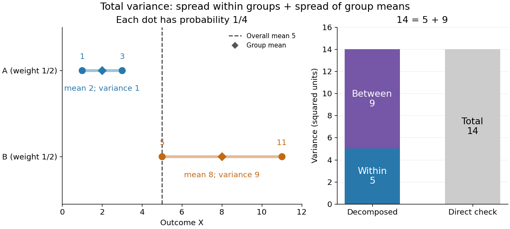

**[Figure 17](#image-four-equally-likely-outcomes-split-total-variance-into-within-group-5-and-between-group-9). Four equally likely outcomes split total variance into within-group 5 and between-group 9**.

The figure makes the two sources of spread visible. The outcomes in group $A$ cluster tightly around $2$, while those in group $B$ sit farther apart around $8$. Replacing every outcome by its [conditional mean](measure-theory.md#conditional-expectation) removes the internal spread but leaves the separation between groups. Conversely, subtracting each group's [conditional mean](measure-theory.md#conditional-expectation) aligns the two groups around zero. Averaging only the [conditional variances](variance.md#conditional-variance) would miss nine units of [variance](variance.md); retaining only the [conditional means](measure-theory.md#conditional-expectation) would miss five. Neither summary alone describes the whole population.

Two modifications clarify what each contribution measures. Shift group $A$ to outcomes $4,6$ and group $B$ to outcomes $2,8$, keeping all four [probabilities](#probability) equal. Both [conditional means](measure-theory.md#conditional-expectation) are now $5$, while the [conditional variances](variance.md#conditional-variance) remain $1,9$. The between-group contribution vanishes, and total [variance](variance.md) is just $5$. Group membership still tells us how uncertain an outcome is, even though the best point prediction stays the same. Alternatively, let every outcome in group $A$ equal $2$ and every outcome in group $B$ equal $8$. Now both [conditional variances](variance.md#conditional-variance) vanish, and all nine units of total [variance](variance.md) come from group separation. Knowing the group predicts the outcome perfectly. These limiting cases distinguish differences in average outcome from differences in internal spread; the original [mixture distribution](probability-distribution.md#mixture-distribution) contains both.

The same calculation answers a prediction question. If the group is hidden, the best constant prediction is the overall [mean](expected-value.md) $5$, with [mean squared error](statistical-modelling.md#mean-squared-error) $14$, by [variance as the minimum mean squared error of a constant](variance.md#variance-as-the-minimum-mean-squared-error-of-a-constant). If the group is revealed, predict $2$ for $A$ and $8$ for $B$. The errors become $-1,1,-3,3$, and their [mean squared error](statistical-modelling.md#mean-squared-error) is $5$. Knowing the group therefore improves the best achievable [mean squared error](statistical-modelling.md#mean-squared-error) by $9$, exactly the between-group contribution. This is an interpretation relative to the information available: the remaining uncertainty could shrink further if additional information were revealed.

For any [square-integrable](measure-theory.md#square-integrable-function) [measurable function](measure-theory.md#measurable-function) $a(Y)$ used as a predictor, write $m(Y)=\mathbb E[X\mid Y]$. The prediction identity is

$$
\mathbb E[(X-a(Y))^2]=\mathbb E[\operatorname{Var}(X\mid Y)]+\mathbb E[(m(Y)-a(Y))^2].
$$

Thus predicting with the [regression function](statistical-learning.md#regression-function) $m(y)=\mathbb E[X\mid Y=y]$ gives the [conditional expectation](measure-theory.md#conditional-expectation) $m(Y)$ and minimizes [mean squared error](statistical-modelling.md#mean-squared-error) over every permitted predictor, including nonlinear ones. This minimizes average squared error, not the error for each individual outcome. See [Berkeley Statistics 201A notes, sections 36–37](https://www.stat.berkeley.edu/~aditya/resources/AllLectures2018Fall201A.pdf#page=71).

Why do the two pieces add cleanly? Put $R=X-m(Y)$. Its [conditional expectation](measure-theory.md#conditional-expectation) given $Y$ is zero, so $\mathbb E[R]=0$ and $\mathbb E[Rb(Y)]=0$ for every [square-integrable](measure-theory.md#square-integrable-function) [measurable function](measure-theory.md#measurable-function) $b(Y)$. In particular, $R$ and $m(Y)$ are [uncorrelated random variables](variance.md#uncorrelated-random-variables). Splitting $X-\mu=R+(m(Y)-\mu)$ and squaring therefore leaves no cross term after taking [expectation](expected-value.md). Geometrically, the [conditional expectation](measure-theory.md#conditional-expectation) is an [orthogonal projection](hilbert-space.md#orthogonal-projection) in the [L2 space](measure-theory.md#l2-space-is-a-hilbert-space), and the [law of total variance](#law-of-total-variance) is its [Pythagorean theorem](euclidean-geometry.md#pythagorean-theorem) for centered [random variables](random-variable.md).

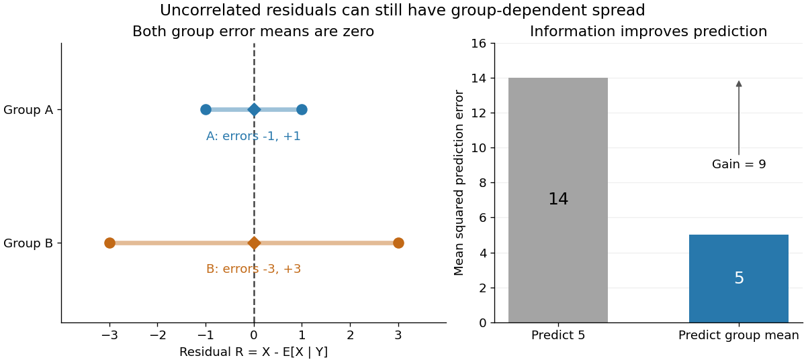

**[Figure 18](#image-conditional-prediction-leaves-zero-group-means-but-different-residual-spreads). Conditional prediction leaves zero group means but different residual spreads**.

In our example, the four products $R(m(Y)-5)$ are $3,-3,-9,9$, which average to zero. Yet $R$ and $Y$ are not [independent](random-variable.md#independent-random-variables): observing $|R|=1$ identifies group $A$, while observing $|R|=3$ identifies group $B$. This is a concrete instance of [heteroscedasticity](statistical-modelling.md#heteroscedastic), with different [conditional variances](variance.md#conditional-variance) despite zero [conditional means](measure-theory.md#conditional-expectation) of the errors. A group can predict uncertainty even when it cannot predict the error's sign.

The [law of total variance](#law-of-total-variance) is useful whenever aggregated data conceal distinct groups. Changing [mixture weights](statistical-modelling.md#mixture-weight) changes both contributions, so the weighting must match the population being described. For example, giving group $A$ weight $3/4$ changes the overall [mean](expected-value.md) to $7/2$, the within-group [variance](variance.md) contribution to $3$, and the between-group contribution to $27/4$, making the total $39/4$. Group differences account for spread and prediction gains; assigning them a causal explanation requires a separate [causal inference](causal-inference.md) argument.

## Laplace transform of a nonnegative random variable

↑ **Parent:** [Probability theory](probability-theory.md)

For a nonnegative [random variable](random-variable.md) $X$, its Laplace transform is

$$
\psi_X(s)=\mathbb E[e^{-sX}],
\qquad s\geq0.
$$

### Second-moment expansion of a Laplace transform

↑ **Parent:** [Laplace transform of a nonnegative random variable](#laplace-transform-of-a-nonnegative-random-variable)

For nonnegative $X$ with finite [second moment](expected-value.md#second-moment), [differentiation](calculus.md#differentiation) under the [expectation](expected-value.md) gives $\phi'(\lambda)=-\mathbb E[Xe^{-\lambda X}]$ for $\lambda>0$. The exponential Taylor remainder divided by $\lambda^2$ tends pointwise to zero and is bounded in absolute value by $X^2/2$. The [dominated convergence theorem](measure-theory.md#dominated-convergence-theorem) therefore proves the displayed expansion without requiring a third moment.

### Uniqueness theorem for Laplace transforms of nonnegative random variables

↑ **Parent:** [Laplace transform of a nonnegative random variable](#laplace-transform-of-a-nonnegative-random-variable)

The [Laplace transform of a nonnegative random variable](#laplace-transform-of-a-nonnegative-random-variable) determines its [probability law](probability-distribution.md). Indeed, $U=e^{-X}$ takes values in $(0,1]$, and $\mathbb E[U^n]=\psi_X(n)$. Thus the transform determines every moment of $U$; [moment determinacy on a compact interval](convergence-of-random-variables.md#moment-determinacy-on-a-compact-interval) determines the law of $U$, and the injective inverse $X=-\log U$ determines the law of $X$.

## Characteristic function

↑ **Parent:** [Probability theory](probability-theory.md)

[This section is present in another page, follow this link to view it.](characteristic-function.md)

## Variance normalization

↑ **Parent:** [Probability theory](probability-theory.md)

Dividing a centered sum by the square root of its total variance gives unit variance and is the natural central-limit scaling.

<h2 id="cox-ross-rubinstein-model">Cox--Ross--Rubinstein model</h2>

↑ **Parent:** [Probability theory](probability-theory.md)

In the Cox--Ross--Rubinstein model, a stock changes at each discrete time by an up factor $U$ or a down factor $D$, while the money-market account changes by a deterministic factor $R$. After discounting by the money-market account, the factors are $u=U/R$ and $d=D/R$. The model is arbitrage-free exactly when $D<R<U$, equivalently $d<1<u$.

### Cox-Ross-Rubinstein diffusion approximation

↑ **Parent:** [Cox--Ross--Rubinstein model](#cox-ross-rubinstein-model)

For mesh $h$, the risk-neutral up probability is $(e^{\rho h}-d)/(u-d)$. The log-price increment has mean $(\rho-\sigma^2/2)h+O(h^2)$ and variance $\sigma^2h+O(h^2)$. The [Donsker invariance principle](convergence-of-random-variables.md#donsker-s-theorem) gives convergence of the log-price process to Brownian motion with this drift, hence of prices to the [Black-Scholes model](mathematical-finance.md#black-scholes-model). Payoff-price convergence additionally uses continuity at almost every limiting path and uniform integrability for unbounded payoffs.

<h3 id="risk-neutral-probability-in-the-cox-ross-rubinstein-model">Risk-neutral probability in the Cox--Ross--Rubinstein model</h3>

↑ **Parent:** [Cox--Ross--Rubinstein model](#cox-ross-rubinstein-model)

The unique equivalent martingale measure in the one-stock Cox--Ross--Rubinstein model assigns each up move probability

$$
q=\frac{R-D}{U-D}=\frac{1-d}{u-d}
$$

and each down move probability $1-q$. Under this measure the discounted stock is a [martingale](martingale.md).

<h4 id="risk-neutral-valuation-in-the-cox-ross-rubinstein-model">Risk-neutral valuation in the Cox--Ross--Rubinstein model</h4>

↑ **Parent:** [Risk-neutral probability in the Cox--Ross--Rubinstein model](#risk-neutral-probability-in-the-cox-ross-rubinstein-model)

For a discounted claim $H$, the arbitrage-free value process is $V_t=\mathbb E_Q[H\mid\mathcal F_t]$. A terminal payoff $h(S_T)$ has value

$$
V_t=\sum_{k=0}^{T-t}\binom{T-t}{k}q^k(1-q)^{T-t-k}
h(S_tu^kd^{T-t-k}).
$$

<h5 id="running-maximum-state-reduction-in-the-cox-ross-rubinstein-model">Running-maximum state reduction in the Cox--Ross--Rubinstein model</h5>

↑ **Parent:** [Risk-neutral valuation in the Cox--Ross--Rubinstein model](#risk-neutral-valuation-in-the-cox-ross-rubinstein-model)

For a payoff $h(S_T,M_T)$ with $M_t=\max_{s\leq t}S_s$, the pair $(S_t,M_t)$ is a sufficient Markov state for valuation. If an independent restarted stock path has initial value $y$, terminal value $z$, and running maximum $w$, then the continued payoff is

$$
g(x,m,y,z,w)=h\left(\frac{xz}{y},\max\left\{m,\frac{xw}{y}\right\}\right).
$$

## Thinning of a point process

↑ **Parent:** [Probability theory](probability-theory.md)

Thinning removes points from a [point process](#point-process) according to a retention rule. Independent retention with probability $p(x)$ changes the intensity measure to $p(x)\mu(dx)$. For a [Poisson point process](poisson-point-process.md), the retained and removed point processes are independent Poisson processes.

## ↑ Ancestors (4)

1. [Probability and statistics](probability-and-statistics.md)
2. [Area of mathematics](mathematics.md#area-of-mathematics)
3. [Mathematics](mathematics.md)
4. [Codex Wiki](README.md)

## ← Incoming links (21)

- [Actuarial statistics](actuarial-statistics.md)
- [Analysis of Boolean functions](analysis-of-boolean-functions.md)
- [Bertrand paradox (probability)](#bertrand-paradox-probability)
- [Coding theory](coding-theory.md)
- [Consistent histories](foundations-of-quantum-mechanics.md#consistent-histories)
- [Discrete mathematics, probability and continuous mathematics examination paper by the University of Oxford (2013)](computer-science-bibliography.md#discrete-mathematics-probability-and-continuous-mathematics-examination-paper-by-the-university-of-oxford-2013)
- [Exponential limit](calculus.md#exponential-limit)
- [Gamma function](complex-analysis.md#gamma-function)
- [James R. Norris](mathematics.md#james-r-norris)
- [Kolmogorov axioms](probability-space.md#kolmogorov-axioms)
- [Konrad Jacobs](mathematics.md#konrad-jacobs)
- [Kyle Siegrist](mathematics.md#kyle-siegrist)
- [Mathematical finance](mathematical-finance.md)
- [Monotonic function](calculus.md#monotonic-function)
- [Solution](past-exam-of-the-mathematics-course-of-the-university-of-cambridge/2020/ii/paper-1.md#31j/b/solution)
- [Solution](past-exam-of-the-mathematics-course-of-the-university-of-cambridge/2020/ii/paper-1.md#31j/c/solution)
- [Paul Lévy](mathematics.md#paul-levy)
- [Rademacher excess-risk bound for empirical risk minimization](foundations-of-mathematics.md#rademacher-excess-risk-bound-for-empirical-risk-minimization)
- [Sub-sigma-algebra](measure-theory.md#sub-sigma-algebra)
- [Year 1 of the psychology (experimental) course of the University of Oxford](university-of-oxford.md#year-1-of-the-psychology-experimental-course-of-the-university-of-oxford)
- [Year 1 of the psychology, philosophy and linguistics course of the University of Oxford](university-of-oxford.md#year-1-of-the-psychology-philosophy-and-linguistics-course-of-the-university-of-oxford)
