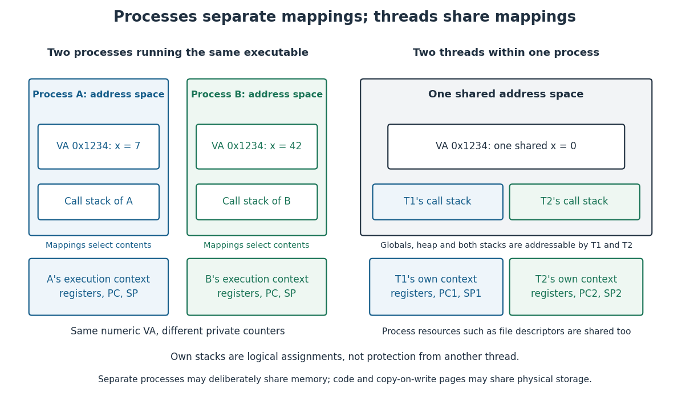

# Process (computing)

↑ **Parent:** [Operating system](operating-system-split.md)  
ⓦ [Wiki](https://en.wikipedia.org/wiki/Process_(computing))

An [operating-system process](process-computing.md) is an execution instance of a program, with an [address space](address-space.md), one or more [software threads](thread-computing.md) carrying [execution contexts](execution-context.md), and [operating system](operating-system-split.md) resources such as [file descriptors](file-descriptor.md). A program describes instructions; an executable [file](computer-file.md) stores a form that can be loaded for execution. Starting the same executable twice can create two [operating-system processes](process-computing.md), each with its own evolving state. A [operating-system process](process-computing.md) can be waiting for [input-output](input-output.md) or waiting for a turn on the [CPU](central-processing-unit.md), rather than executing at every instant. [Remzi H. Arpaci-Dusseau and Andrea C. Arpaci-Dusseau, Operating Systems: Three Easy Pieces, chapter 4, sections 4.1, 4.3–4.4: program, process and execution states](https://pages.cs.wisc.edu/~remzi/OSTEP/cpu-intro.pdf)

For example, start the same counter program as [operating-system processes](process-computing.md) A and B. In this toy mapping, both use [virtual address](virtual-address.md) `0x1234` for a counter `x`, but A reads `x = 7` while B reads `x = 42`. The number `0x1234` is interpreted through the current [address space](address-space.md), so it need not denote the same contents in both [operating-system processes](process-computing.md). Writing A's ordinary private counter does not change B's counter. Compare [virtual memory](virtual-memory-split.md) for an explicit mapping to different [physical addresses](physical-address.md).

**[Figure 6](#image-separate-operating-system-processes-can-interpret-the-same-virtual-address-differently-software-threads-in-one-process-share-an-address-space). Separate operating-system processes can interpret the same virtual address differently; software threads in one process share an address space**.

Separate [virtual memory](virtual-memory-split.md) [address spaces](address-space.md) provide a usual default isolation boundary, not a claim that all [computer memory](computer-memory.md) is universally private. Deliberately shared mappings let [operating-system processes](process-computing.md) communicate through the same stored data. Even logically private contents need not occupy distinct [page frames](page-frame.md) at every moment: read-only program code can be shared, and [copy-on-write](copy-on-write.md) can keep a common [memory page](memory-page.md) until a write requires a private copy. The distinction is between which accesses and changes are permitted and which physical storage is currently reused. [Arpaci-Dusseau and Arpaci-Dusseau, OSTEP chapter 23, section 23.1, Other Neat Tricks: copy-on-write and shared mappings](https://pages.cs.wisc.edu/~remzi/OSTEP/vm-complete.pdf)[The Open Group, POSIX shared-memory object interface, shm\_open: multiple processes can refer to the same shared memory object](https://pubs.opengroup.org/onlinepubs/009695099/functions/shm_open.html)

This abstraction lets independent activities reuse the same executable while keeping their changing state separate. [Process scheduling](process-scheduling.md) distributes [CPU](central-processing-unit.md) time; [virtual memory](virtual-memory-split.md) interprets and protects addresses; [file descriptors](file-descriptor.md) connect an execution to open resources. The useful design is controlled independence with explicit ways to share. Creating [operating-system processes](process-computing.md), maintaining their mappings and performing [context switches](context-switch.md) require time and [computer memory](computer-memory.md); isolation alone gives no universal performance guarantee.

**Table of contents**

- [File descriptor](file-descriptor.md)
  - [Open file description](open-file-description.md)
- [Thread (computing)](thread-computing.md)
  - [Race condition](race-condition.md)
  - [Synchronization (computing)](synchronization-computing.md)
    - [Mutual exclusion](mutual-exclusion.md)
      - [Critical section](critical-section.md)
      - [Mutex](mutex.md)
        - [Spinlock](spinlock.md)
          - [Test-and-set](test-and-set.md)
      - [Thread interleaving](thread-interleaving.md)
        - [Lost update](lost-update.md)
    - [Safety property](safety-property.md)
    - [Liveness property](liveness-property.md)
      - [Starvation freedom](starvation-freedom.md)
    - [Deadlock](deadlock.md)
      - [Deadlock freedom](deadlock-freedom.md)
      - [Lock ordering](lock-ordering.md)
    - [Memory model](memory-model.md)
      - [Sequential consistency](sequential-consistency.md)
      - [Data race](data-race.md)
      - [Happens-before](happens-before.md)
        - [Acquire-release synchronization](acquire-release-synchronization.md)
    - [Atomic operation](atomic-operation.md)
      - [Atomic read-modify-write](atomic-read-modify-write.md)

## ↑ Ancestors (3)

1. [Operating system](operating-system-split.md)
2. [Computer science](computer-science-split.md)
3. [Codex Wiki](split.md)
