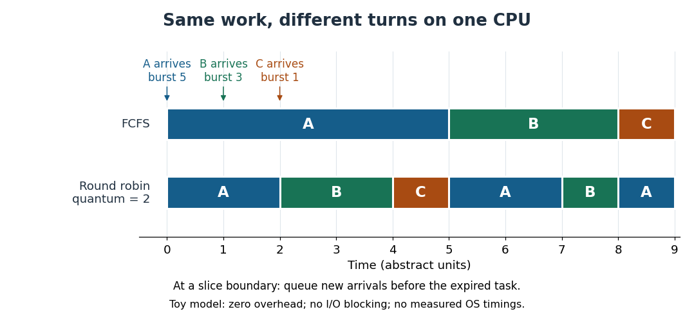

# Process scheduling

↑ **Parent:** [Operating system](operating-system.md)

[Process scheduling](process-scheduling.md) chooses which runnable [operating-system process](process-computing.md) or [software thread](thread-computing.md) uses a [CPU](central-processing-unit.md) next, and when it gives up that [CPU](central-processing-unit.md). Runnable means able to execute now; work waiting for an [input-output](input-output.md) operation is not eligible until that wait ends. A [ready queue](ready-queue.md) records eligible work. The policy chooses a recipient; a [context switch](context-switch.md) supplies the mechanism for transferring execution. Sharing a single [CPU](central-processing-unit.md) lets a long calculation and an interactive program both make progress, although only one execution stream runs on that [CPU](central-processing-unit.md) at an instant.

Consider three single-[software thread](thread-computing.md) [operating-system processes](process-computing.md) on one [CPU](central-processing-unit.md), with abstract time units, zero [context switch](context-switch.md) or scheduler overhead, and no [input-output](input-output.md) blocking. Their arrival times and [CPU bursts](cpu-burst.md) are $(a_A,b_A)=(0,5)$, $(a_B,b_B)=(1,3)$ and $(a_C,b_C)=(2,1)$. Each [CPU burst](cpu-burst.md) is all the execution that its task needs. With [FCFS](first-come-first-served.md), the current task runs to completion: A occupies $[0,5)$, B $[5,8)$ and C $[8,9)$. With [round-robin scheduling](round-robin-scheduling.md) and [scheduling quantum](scheduling-quantum.md) $q=2$, the intervals are A $[0,2)$, B $[2,4)$, C $[4,5)$, A $[5,7)$, B $[7,8)$ and A $[8,9)$. At a boundary, arrivals join the [ready queue](ready-queue.md) before the unfinished task whose [scheduling quantum](scheduling-quantum.md) has expired; this fixes the otherwise ambiguous ordering at time 2.

**[Figure 45](#image-fcfs-and-round-robin-scheduling-share-the-same-nine-units-of-useful-cpu-work-differently). FCFS and round-robin scheduling share the same nine units of useful CPU work differently**.

The following triples always list A, B, C. Completion is an absolute time; [scheduling turnaround time](scheduling-turnaround-time.md), [scheduling waiting time](scheduling-waiting-time.md) and [scheduling response time](scheduling-response-time.md) are durations measured from the relevant events.

| Policy | Completion times | [Scheduling turnaround times](scheduling-turnaround-time.md) | [Scheduling waiting times](scheduling-waiting-time.md) | [Scheduling response times](scheduling-response-time.md) |
| --- | --- | --- | --- | --- |
| [FCFS](first-come-first-served.md) | $(5,8,9)$ | $(5,7,7)$ | $(0,4,6)$ | $(0,4,6)$ |
| [Round-robin scheduling](round-robin-scheduling.md), $q=2$ | $(9,8,5)$ | $(9,7,3)$ | $(4,4,2)$ | $(0,1,2)$ |

For example, B first runs at time 2 under [round-robin scheduling](round-robin-scheduling.md), so its [scheduling response time](scheduling-response-time.md) is $2-1=1$. It finishes at time 8, giving [scheduling turnaround time](scheduling-turnaround-time.md) $8-1=7$ and [scheduling waiting time](scheduling-waiting-time.md) $7-3=4$. Under [FCFS](first-come-first-served.md), C waits $8-2=6$ before its sole execution interval. Under [round-robin scheduling](round-robin-scheduling.md), A waits during $[2,5)$ and $[7,8)$, totaling $3+1=4$. Both timelines do exactly $5+3+1=9$ units of useful [CPU](central-processing-unit.md) work; changing the order changes who benefits first.

The appeal is that shared progress can improve responsiveness: B and C get their first [CPU](central-processing-unit.md) service sooner under [round-robin scheduling](round-robin-scheduling.md), while A completes later. The [arithmetic mean](arithmetic-mean.md) of the [scheduling response times](scheduling-response-time.md) falls from $10/3$ to $1$; the [arithmetic mean](arithmetic-mean.md) of the [scheduling turnaround times](scheduling-turnaround-time.md) is $19/3$ for both policies in this particular example. These are different goals, and this workload establishes no universal ranking. Giving each continuously runnable task repeated turns is a practical form of fairness. A smaller [scheduling quantum](scheduling-quantum.md) can shorten waits between turns, but makes [context switches](context-switch.md) more frequent when competitors remain runnable. If each full slice performs $q$ units of useful work and incurs a fixed switching cost $s$, the overhead fraction in that simplified repeated cycle is $s/(q+s)$. Real costs and workloads determine the choice. [Remzi H. Arpaci-Dusseau and Andrea C. Arpaci-Dusseau, Operating Systems: Three Easy Pieces, chapter 7, sections 7.2–7.3 and 7.6–7.7: metrics, FCFS and round robin](https://pages.cs.wisc.edu/~remzi/OSTEP/cpu-sched.pdf)

**Table of contents**

- [Ready queue](ready-queue.md)
- [CPU burst](cpu-burst.md)
- [Round-robin scheduling](round-robin-scheduling.md)
  - [Scheduling quantum](scheduling-quantum.md)
- [Scheduling preemption](scheduling-preemption.md)
- [Scheduling response time](scheduling-response-time.md)
- [Scheduling turnaround time](scheduling-turnaround-time.md)
- [Scheduling waiting time](scheduling-waiting-time.md)
- [Context switch](context-switch.md)
  - [Execution context](execution-context.md)

## ↑ Ancestors (3)

1. [Operating system](operating-system.md)
2. [Computer science](computer-science-split.md)
3. [Codex Wiki](split.md)

## ← Incoming links (15)

- [Context switch](context-switch.md)
- [CPU burst](cpu-burst.md)
- [Kernel (operating system)](kernel-operating-system.md)
- [Microkernel communication cost](microkernel-communication-cost.md)
- [Microkernel service failure isolation](microkernel-service-failure-isolation.md)
- [Multiprogramming](multiprogramming.md)
- [Solution](past-exam-of-the-mathematics-course-of-the-university-of-cambridge/2007/ia/paper-5/2/a/solution.md)
- [Process (computing)](process-computing.md)
- [Process scheduling](process-scheduling.md)
- [Round-robin scheduling](round-robin-scheduling.md)
- [Scheduling response time](scheduling-response-time.md)
- [Scheduling turnaround time](scheduling-turnaround-time.md)
- [Scheduling waiting time](scheduling-waiting-time.md)
- [Thread (computing)](thread-computing.md)
- [Working set](working-set.md)
