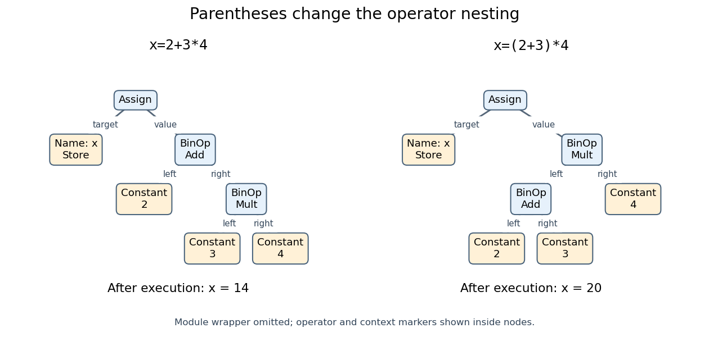
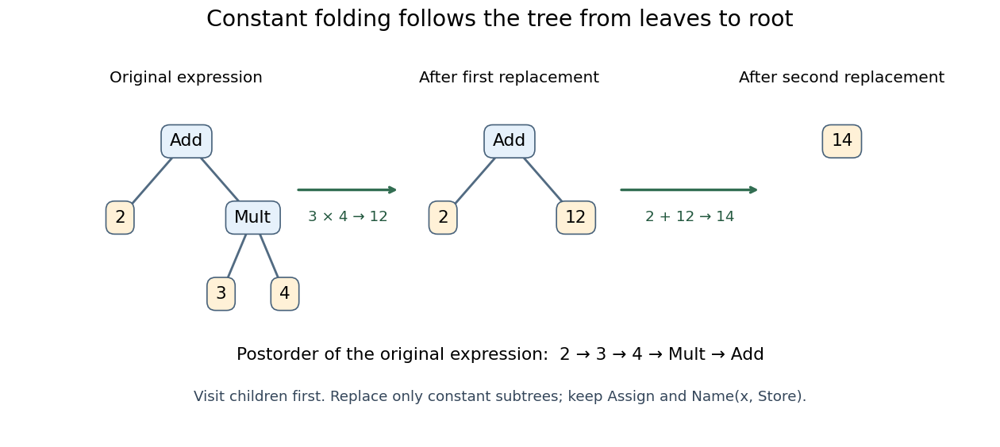
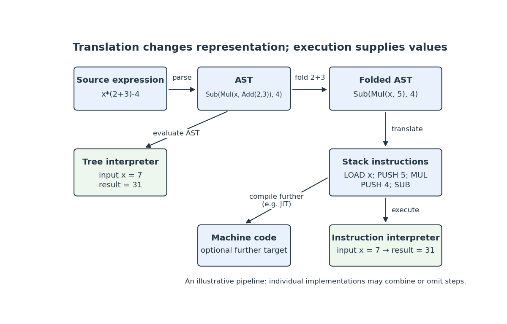
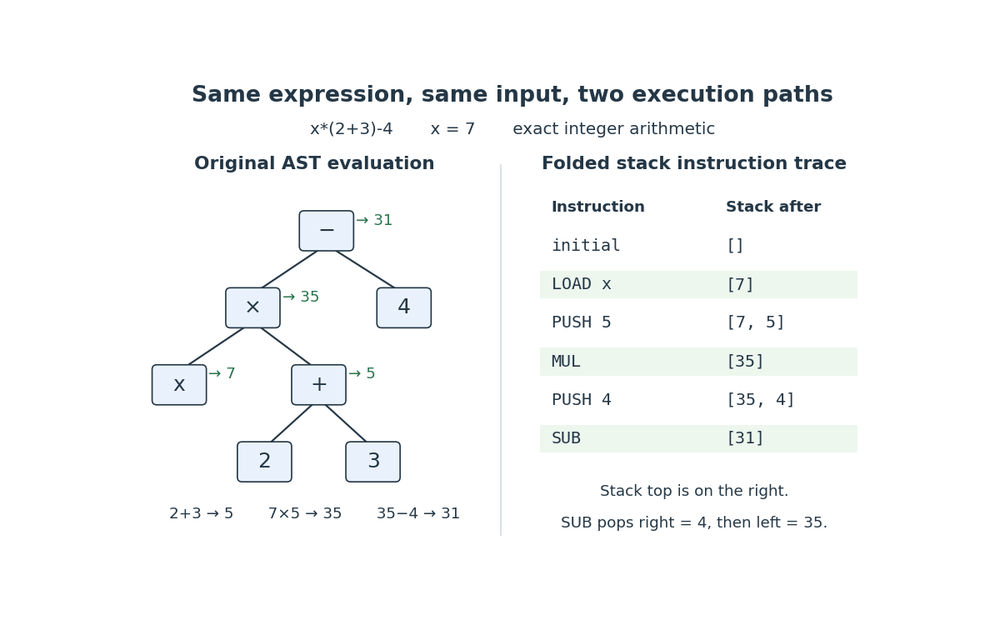
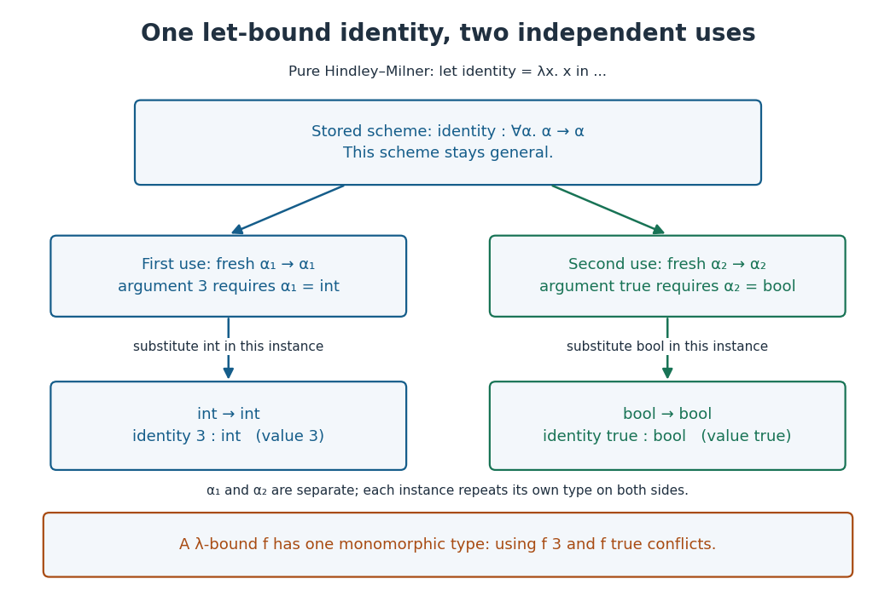
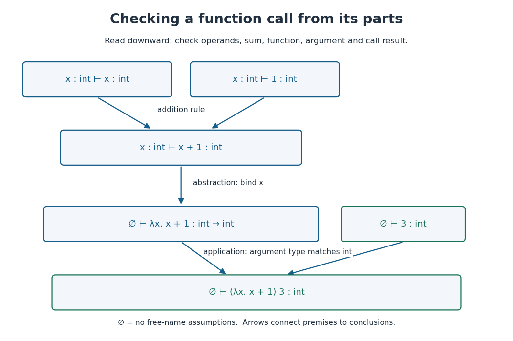

# Programming language

↑ **Parent:** [Computer science](computer-science.md)  
ⓦ [Wiki](https://en.wikipedia.org/wiki/Programming_language)

A [programming language](programming-language.md) specifies how programs are written and what their execution means. Its [type system](#type-system) describes which operations may be combined; an [abstract syntax tree](#abstract-syntax-tree) records the structure on which these rules act. The examples under [type system](#type-system) use a small teaching language with [integers](integer.md), Boolean values and [function types](#function-type).

// Target: computer-science.bigb

**Table of contents**

- [Implicit conversion](#implicit-conversion)
  - [Numeric widening](#numeric-widening)
- [Oberon (programming language)](#oberon-programming-language)
- [Tail call](#tail-call)
- [Probabilistic programming](#probabilistic-programming)
  - [Stochastic computation graph](#stochastic-computation-graph)
  - [Probabilistic program](#probabilistic-program)
    - [Uniform-interval encoding of conditioning and a binary query](#uniform-interval-encoding-of-conditioning-and-a-binary-query)
- [Pattern matching](#pattern-matching)
  - [Irrefutable pattern](#irrefutable-pattern)
- [C programming language](#c-programming-language)
  - [Volatile-qualified objects in C](#volatile-qualified-objects-in-c)
  - [Unsigned integer arithmetic in C](#unsigned-integer-arithmetic-in-c)
- [Assembly language](#assembly-language)
  - [Assembler](#assembler)
  - [Pseudoinstruction](#pseudoinstruction)
  - [Calling convention](#calling-convention)
    - [Return value](#return-value)
    - [Return address](#return-address)
    - [AAPCS32](#aapcs32)
    - [Caller-saved register](#caller-saved-register)
    - [Callee-saved register](#callee-saved-register)
- [String data type](#string-data-type)
- [Scala](#scala)
  - [Scala Swing](#scala-swing)
- [Haskell](#haskell)
  - [Haskell zip function](#haskell-zip-function)
  - [Haskell takeWhile function](#haskell-takewhile-function)
  - [Haskell iterate function](#haskell-iterate-function)
  - [Haskell concatMap function](#haskell-concatmap-function)
  - [Operator section](#operator-section)
  - [Standard Prelude](#standard-prelude)
- [MATLAB](#matlab)
- [R (programming language)](#r-programming-language)
- [List comprehension](#list-comprehension)
  - [Cartesian lifting of a binary operation to lists](#cartesian-lifting-of-a-binary-operation-to-lists)
- [FRACTRAN](#fractran)
- [Bit mask](#bit-mask)
  - [Submask enumeration](#submask-enumeration)
  - [Bitboard](#bitboard)
  - [Bitwise OR](#bitwise-or)
- [Bit shift](#bit-shift)
  - [Bit rotation](#bit-rotation)
  - [Arithmetic right shift](#arithmetic-right-shift)
  - [Logical right shift](#logical-right-shift)
  - [Left bit shift](#left-bit-shift)
- [Two's complement](#two-s-complement)
  - [Sign extension](#sign-extension)
- [Hexadecimal](#hexadecimal)
- [Abstract syntax tree](#abstract-syntax-tree)
  - [Syntax tree of a formula](#syntax-tree-of-a-formula)
    - [Unique readability theorem](#unique-readability-theorem)
      - [Prefix-freeness of fully parenthesized formulas](#prefix-freeness-of-fully-parenthesized-formulas)
  - [Abstract syntax tree precedence example](#abstract-syntax-tree-precedence-example)
  - [Abstract syntax tree traversal](#abstract-syntax-tree-traversal)
  - [Abstract syntax tree transformation](#abstract-syntax-tree-transformation)
    - [Constant folding](#constant-folding)
  - [Abstract syntax tree source location](#abstract-syntax-tree-source-location)
- [Programming language syntax](#programming-language-syntax)
  - [Syntactic sugar](#syntactic-sugar)
  - [Lexical analysis](#lexical-analysis)
    - [Lexical token](#lexical-token)
  - [Parser](#parser)
    - [Parsing](#parsing)
  - [Program identifier](#program-identifier)
  - [Literal value](#literal-value)
  - [Program expression](#program-expression)
    - [Operator precedence](#operator-precedence)
      - [Operator associativity](#operator-associativity)
  - [Variable assignment](#variable-assignment)
    - [Snapshot-before-update semantics](#snapshot-before-update-semantics)
- [Programming language semantics](#programming-language-semantics)
  - [Semantic environment](#semantic-environment)
  - [Continuation (computer science)](#continuation-computer-science)
    - [Coroutine](#coroutine)
      - [Cooperative multitasking](#cooperative-multitasking)
    - [First-class continuation](#first-class-continuation)
      - [Call-with-current-continuation](#call-with-current-continuation)
    - [Continuation-passing style](#continuation-passing-style)
  - [Nonlocal variable](#nonlocal-variable)
  - [Lexical scope](#lexical-scope)
  - [Thunk](#thunk)
  - [Parameter passing](#parameter-passing)
    - [Call-by-value](#call-by-value)
    - [Value parameter](#value-parameter)
    - [Reference parameter](#reference-parameter)
  - [Short-circuit evaluation](#short-circuit-evaluation)
  - [Lazy evaluation](#lazy-evaluation)
    - [Lazy iterator-to-cursor adapter](#lazy-iterator-to-cursor-adapter)
  - [Bottom value](#bottom-value)
  - [Program state](#program-state)
  - [Integer overflow](#integer-overflow)
  - [Hoare logic](#hoare-logic)
    - [Hoare triple](#hoare-triple)
- [Compiler](#compiler)
  - [Instruction selection](#instruction-selection)
  - [Alias analysis](#alias-analysis)
  - [Common subexpression elimination](#common-subexpression-elimination)
  - [Compilation](#compilation)
    - [Compilation arithmetic example](#compilation-arithmetic-example)
    - [Just-in-time compilation](#just-in-time-compilation)
  - [Intermediate representation](#intermediate-representation)
    - [Temporary variable](#temporary-variable)
    - [Bytecode](#bytecode)
  - [LLVM](#llvm)
- [Interpreter (computing)](#interpreter-computing)
  - [Monadic interpreter](#monadic-interpreter)
  - [Interpreter arithmetic trace](#interpreter-arithmetic-trace)
- [Machine code](#machine-code)
- [Python (programming language)](#python-programming-language)
  - [CPython](#cpython)
- [Object-oriented programming](#object-oriented-programming)
  - [Companion object](#companion-object)
  - [Object interface](#object-interface)
  - [Software object](#software-object)
    - [Value equality](#value-equality)
    - [Singleton object](#singleton-object)
    - [Object method](#object-method)
  - [Command-query separation](#command-query-separation)
  - [Immutable object](#immutable-object)
  - [Object composition](#object-composition)
  - [Class inheritance](#class-inheritance)
    - [Subclass](#subclass)
    - [Fragile base class problem](#fragile-base-class-problem)
  - [Decorator object](#decorator-object)
  - [Decorator pattern](#decorator-pattern)
  - [Memento pattern](#memento-pattern)
  - [Software design pattern](#software-design-pattern)
    - [Behavioral pattern](#behavioral-pattern)
      - [Visitor pattern](#visitor-pattern)
      - [State pattern](#state-pattern)
      - [Strategy pattern](#strategy-pattern)
    - [Structural pattern](#structural-pattern)
    - [Creational pattern](#creational-pattern)
      - [Abstract factory pattern](#abstract-factory-pattern)
      - [Factory method pattern](#factory-method-pattern)
      - [Singleton pattern](#singleton-pattern)
      - [Prototype pattern](#prototype-pattern)
    - [Command pattern](#command-pattern)
      - [Inverse command correctness](#inverse-command-correctness)
    - [Observer pattern](#observer-pattern)
    - [Iterator pattern](#iterator-pattern)
    - [Adapter pattern](#adapter-pattern)
  - [Mixin](#mixin)
    - [Stackable trait modification](#stackable-trait-modification)
      - [Transform-sensitive trait frequency counter](#transform-sensitive-trait-frequency-counter)
  - [Overload selection followed by dynamic dispatch](#overload-selection-followed-by-dynamic-dispatch)
  - [Dynamic dispatch](#dynamic-dispatch)
    - [Double dispatch](#double-dispatch)
  - [Method overriding](#method-overriding)
  - [Method overloading](#method-overloading)
  - [Companion class](#companion-class)
  - [Trait](#trait)
    - [Scala trait linearization](#scala-trait-linearization)
  - [Encapsulation in object-oriented programming](#encapsulation-in-object-oriented-programming)
    - [Protected access](#protected-access)
  - [Class (programming)](#class-programming)
    - [Object constructor](#object-constructor)
    - [Abstract class](#abstract-class)
- [Java (programming language)](#java-programming-language)
  - [Java interface](#java-interface)
  - [Private field in Java](#private-field-in-java)
  - [Final class in Java](#final-class-in-java)
  - [Protected method in Java](#protected-method-in-java)
  - [Java array](#java-array)
  - [Generics in Java](#generics-in-java)
    - [Generic method in Java](#generic-method-in-java)
    - [Generic type invariance](#generic-type-invariance)
    - [Type erasure](#type-erasure)
- [Exception handling](#exception-handling)
  - [ML exception type](#ml-exception-type)
- [Type system](#type-system)
  - [Monomorphic type](#monomorphic-type)
  - [Data type](#data-type)
    - [Unit type](#unit-type)
  - [Type guard](#type-guard)
  - [Kind (type theory)](#kind-type-theory)
  - [Type constructor](#type-constructor)
  - [Algebraic data type](#algebraic-data-type)
    - [Tagged union](#tagged-union)
    - [Data constructor](#data-constructor)
  - [Programming language polymorphism](#programming-language-polymorphism)
  - [Ad hoc polymorphism](#ad-hoc-polymorphism)
  - [Boolean data type](#boolean-data-type)
  - [Haskell type class](#haskell-type-class)
    - [Eq type class](#eq-type-class)
    - [Haskell Ord class](#haskell-ord-class)
  - [Variance-position rule](#variance-position-rule)
  - [Path-dependent type](#path-dependent-type)
  - [Runtime type](#runtime-type)
  - [Static type](#static-type)
  - [Subtyping](#subtyping)
    - [Lower type bound](#lower-type-bound)
    - [Upper type bound](#upper-type-bound)
      - [F-bounded polymorphism](#f-bounded-polymorphism)
    - [Supertype](#supertype)
    - [Subtype polymorphism](#subtype-polymorphism)
    - [Behavioral subtyping](#behavioral-subtyping)
  - [Type signature](#type-signature)
    - [Return type](#return-type)
  - [Type synonym](#type-synonym)
  - [Simple type](#simple-type)
  - [Typing judgment](#typing-judgment)
    - [Typing context](#typing-context)
  - [Type safety](#type-safety)
  - [Type inference](#type-inference)
    - [Principal type](#principal-type)
    - [Type unification](#type-unification)
  - [Type variable](#type-variable)
    - [Type substitution](#type-substitution)
    - [Type scheme](#type-scheme)
    - [Occurs check](#occurs-check)
  - [Recursive type](#recursive-type)
  - [Function type](#function-type)
    - [Procedure type](#procedure-type)
      - [Procedural parameter](#procedural-parameter)
    - [Function subtyping variance](#function-subtyping-variance)
  - [Parametric polymorphism](#parametric-polymorphism)
    - [Generic method](#generic-method)
    - [Polymorphic type](#polymorphic-type)
    - [Type parameter](#type-parameter)
      - [Type argument](#type-argument)
    - [Contravariant type parameter](#contravariant-type-parameter)
    - [Covariant type parameter](#covariant-type-parameter)
      - [Covariance failure for a mutable collection](#covariance-failure-for-a-mutable-collection)
    - [Type variance](#type-variance)
  - [Hindley-Milner type system](#hindley-milner-type-system)
    - [Hindley-Milner type inference](#hindley-milner-type-inference)
    - [Algorithm W](#algorithm-w)
    - [Let polymorphism](#let-polymorphism)
- [Imperative programming](#imperative-programming)
  - [Event-driven programming](#event-driven-programming)
    - [Reentrant event handler](#reentrant-event-handler)
  - [While loop](#while-loop)
  - [Side effect (computer science)](#side-effect-computer-science)
- [Functional programming](#functional-programming)
  - [Computational monad](#computational-monad)
    - [Continuation monad](#continuation-monad)
    - [Identity monad](#identity-monad)
    - [State monad](#state-monad)
    - [Monad transformer](#monad-transformer)
      - [Continuation monad transformer](#continuation-monad-transformer)
      - [Exception monad transformer](#exception-monad-transformer)
      - [State monad transformer](#state-monad-transformer)
    - [Monad laws](#monad-laws)
  - [Higher-order function](#higher-order-function)
    - [Map (higher-order function)](#map-higher-order-function)
  - [Closure (computer programming)](#closure-computer-programming)
    - [Recursive closure](#recursive-closure)
      - [Mutually recursive closures](#mutually-recursive-closures)
  - [List filter](#list-filter)
  - [Stable list partition](#stable-list-partition)
  - [List unfold](#list-unfold)
    - [Filtering a list by unfolding](#filtering-a-list-by-unfolding)
  - [Left fold](#left-fold)
    - [Left scan](#left-scan)
    - [Continuation representation of a left fold](#continuation-representation-of-a-left-fold)
    - [Left-fold fusion law](#left-fold-fusion-law)
  - [Tree unfold](#tree-unfold)
  - [Tree fold](#tree-fold)
    - [Direct tree-fold information obstruction](#direct-tree-fold-information-obstruction)
  - [Lazy feedback stream](#lazy-feedback-stream)
    - [Sorted multiplicative closure stream](#sorted-multiplicative-closure-stream)
      - [Stream sharing in Hamming-number construction](#stream-sharing-in-hamming-number-construction)
  - [Fold factorisation criterion](#fold-factorisation-criterion)
  - [List fold](#list-fold)
    - [Left-right fold equivalence](#left-right-fold-equivalence)
    - [Predicate span](#predicate-span)
    - [Direct fold obstruction for dropping a prefix](#direct-fold-obstruction-for-dropping-a-prefix)
    - [Right-fold fusion law](#right-fold-fusion-law)
  - [Strict function](#strict-function)
  - [Pure function](#pure-function)
  - [Structural recursion](#structural-recursion)
    - [Natural-number fold](#natural-number-fold)
      - [Natural-number fold fusion law](#natural-number-fold-fusion-law)
- [Standard ML](#standard-ml)
  - [ML reference type](#ml-reference-type)
- [Source code](#source-code)

## Implicit conversion

↑ **Parent:** [Programming language](programming-language.md)

A conversion inserted by the language's typing rules rather than an explicit conversion call in source code. Its availability depends on scope and the conversion rules; converting a method receiver and converting an argument are distinct uses. In [Scala](#scala), an imported implicit conversion can supply a rational-number receiver for an integer expression lacking an applicable multiplication overload.

### Numeric widening

↑ **Parent:** [Implicit conversion](#implicit-conversion)

A language-defined conversion from a numeric type to another admitted numeric type, such as [Scala](#scala)'s conversion of an `Int` argument to `Double`. It can make an overloaded method applicable even when the argument's [static type](#static-type) differs from the parameter type. It does not imply a [subtyping](#subtyping) relationship between every pair of numeric types or exact representation of every source value; sufficiently large integers can lose precision in a floating-point target. [Numeric Widening](computer-science-bibliography.md#scala-2-11-expressions-specification)

## Oberon (programming language)

↑ **Parent:** [Programming language](programming-language.md)  
ⓦ [Wiki](https://en.wikipedia.org/wiki/Oberon_(programming_language))

## Tail call

↑ **Parent:** [Programming language](programming-language.md)  
ⓦ [Wiki](https://en.wikipedia.org/wiki/Tail_call)

A call whose result is returned directly, with no further computation waiting in its caller. Its caller's activation record can therefore be replaced rather than retained. A recursive tail call gives [tail recursion](algorithm.md#tail-recursion); an explicit loop updating the current arguments performs the same control transfer without requiring compiler optimization.

## Probabilistic programming

↑ **Parent:** [Programming language](programming-language.md)

[Probabilistic programming](#probabilistic-programming) expresses a [probability model](probability-theory.md#probability-model) as an executable program with random choices and observations. Executing the generative part induces a [probability distribution](probability-distribution.md); observations then restrict or weight executions, and inference computes the resulting [conditional distribution](probability-theory.md#conditional-distribution). Program syntax and inference algorithm are separate choices: the same model can be evaluated by [rejection sampling](monte-carlo-method.md#rejection-sampling), [importance sampling](monte-carlo-method.md#importance-sampling) or [Markov chain Monte Carlo](bayesian-statistics.md#markov-chain-monte-carlo).

### Stochastic computation graph

↑ **Parent:** [Probabilistic programming](#probabilistic-programming)

A [stochastic computation graph](#stochastic-computation-graph) is a [Directed acyclic graph](combinatorics.md#directed-acyclic-graph) combining deterministic transformations, random choices and costs. The changing [probabilities](probability-theory.md#probability) of random choices contribute [score-function gradient estimators](statistical-modelling.md#score-function-gradient-estimator), while differentiable deterministic paths contribute [pathwise gradients](bayesian-statistics.md#reparameterization-gradient). This accounts for both sources of a parameter's effect on an expected cost.[Sections 2–3](computer-science-bibliography.md#gradient-estimation-using-stochastic-computation-graphs-by-john-schulman-and-others)

### Probabilistic program

↑ **Parent:** [Probabilistic programming](#probabilistic-programming)

A [probabilistic program](#probabilistic-program) maps elementary random choices to outputs and observation weights. Its mathematical meaning can be specified by the [pushforward measure](measure.md#pushforward-measure) on outputs, normalized after conditioning when the observation has finite positive mass. Different random-choice spaces can implement the same output law.

#### Uniform-interval encoding of conditioning and a binary query

↑ **Parent:** [Probabilistic program](#probabilistic-program)

Let a model have parameter [prior density](bayesian-statistics.md#prior-density) $\rho$, observation [probability](probability-theory.md#probability) $L(\theta)\in[0,1]$ and conditional binary-query [probability](probability-theory.md#probability) $h(\theta)\in[0,1]$ after observation. Draw $\theta\sim\rho$ and an independent [uniform random variable](continuous-probability-distribution.md#uniform-random-variable) $U$. Accept exactly when $U<L(\theta)$, then output whether $U<L(\theta)h(\theta)$. At fixed $\theta$, the accepted true and false intervals have lengths $Lh$ and $L(1-h)$. Integrating against $\rho$ and dividing by the positive evidence proves equality of the joint posterior law of parameters and answer. This can replace many latent choices by one auxiliary coordinate. It preserves that joint law, not unreported latent traces. More generally the bounded factor must be a [probability](probability-theory.md#probability) or first be divided by a valid common rejection envelope.

## Pattern matching

↑ **Parent:** [Programming language](programming-language.md)

Selecting a branch and binding components according to a value's constructor structure. In [Haskell](#haskell), matching a constructor can demand the outer constructor without demanding every field; a failed or undefined match has distinct consequences from an [irrefutable pattern](#irrefutable-pattern).

### Irrefutable pattern

↑ **Parent:** [Pattern matching](#pattern-matching)

A pattern that does not force its matched value merely to establish the match. A [Haskell](#haskell) pattern written with `~` can defer evaluation of a recursive pair until one component is demanded. This can preserve [productivity](data-structure.md#stream-productivity) in definitions involving [lazy evaluation](#lazy-evaluation). It does not make every later use of the components terminate.

## C programming language

↑ **Parent:** [Programming language](programming-language.md)

A systems [programming language](programming-language.md) supporting explicit memory access, [arrays](data-structure.md#array-data-structure), and implementation-dependent integer widths. Signed [integer overflow](#integer-overflow) is not generally specified as modular arithmetic; correctness arguments must state the relevant range assumptions.

### Volatile-qualified objects in C

↑ **Parent:** [C programming language](#c-programming-language)

[Volatile-qualified objects in C](#volatile-qualified-objects-in-c) are objects whose accesses must follow the implementation's observable-access rules even when the optimizer cannot see an ordinary program dependency. They are commonly used for device registers and state changed by an [interrupt handler](operating-system.md#interrupt-handler), under the target compiler's embedded execution model. `volatile` does not by itself provide atomic multiword access, [mutual exclusion](operating-system.md#mutual-exclusion) or inter-thread synchronization. Protecting a shared snapshot still requires a suitable [critical section](operating-system.md#critical-section) or another synchronization protocol.[Sections 5.1.2.3 and 6.7.3, especially the implementation-defined meaning of volatile access](computer-science-bibliography.md#c11-committee-draft-n1570)

### Unsigned integer arithmetic in C

↑ **Parent:** [C programming language](#c-programming-language)

For a $w$-bit unsigned [integer](integer.md) type without padding, [C programming language](#c-programming-language) arithmetic on that type reduces results modulo $2^w$. In particular, subtracting two `uint32_t` timestamps gives their modular difference when that subtraction is evaluated in the 32-bit unsigned type. [Integer](integer.md) promotions must be checked for narrower types or unusual implementations. Signed [integer overflow](#integer-overflow) has different rules and must not be treated as the same operation.[Section 6.2.5 paragraph 9 and Section 6.3.1.1](computer-science-bibliography.md#c11-committee-draft-n1570)

## Assembly language

↑ **Parent:** [Programming language](programming-language.md)  
ⓦ [Wiki](https://en.wikipedia.org/wiki/Assembly_language)

A [programming language](programming-language.md) expressing machine instructions through symbolic operation names, [processor registers](computer-science.md#processor-register), labels and data directives. A concrete program must respect its instruction set's operand restrictions and the platform's [calling convention](#calling-convention).

### Assembler

↑ **Parent:** [Assembly language](#assembly-language)

A program that translates [assembly language](#assembly-language) into [machine code](#machine-code). A pseudo-instruction can expand into several instructions, for example to construct a constant that cannot fit one [immediate operand](computer-science.md#immediate-operand).

### Pseudoinstruction

↑ **Parent:** [Assembly language](#assembly-language)

An assembler convenience that expands into one or more actual [machine instructions](computer-science.md#machine-instruction). Its expansion matters when counting instructions, reasoning about temporary registers, or filling a [branch delay slot](computer-science.md#branch-delay-slot).

### Calling convention

↑ **Parent:** [Assembly language](#assembly-language)

The agreement between a caller and a subroutine on argument and result placement, [processor register](computer-science.md#processor-register) preservation, and [call stack](data-structure.md#call-stack) organization. [Callee-saved registers](#callee-saved-register) retain their incoming values across a call; [caller-saved registers](#caller-saved-register) must be saved by the caller if their values are still needed afterwards.

#### Return value

↑ **Parent:** [Calling convention](#calling-convention)

The result a called procedure supplies to its caller on returning. A [calling convention](#calling-convention) specifies the [processor register](computer-science.md#processor-register) or memory location carrying it, separately from the [return address](#return-address), which identifies where execution resumes. In the elementary [MIPS architecture](computer-science.md#mips-architecture) convention, an integer result is placed in `$v0`, while `$ra` carries the [return address](#return-address).

#### Return address

↑ **Parent:** [Calling convention](#calling-convention)

The saved instruction address at which execution resumes after a function returns. A recursive call must preserve the current [return address](#return-address) before another call overwrites the link register.

#### AAPCS32

↑ **Parent:** [Calling convention](#calling-convention)

The 32-[bit](information-theory.md#bit) [calling convention](#calling-convention) for the [ARM architecture family](computer-science.md#arm-architecture-family). Its base variant passes initial arguments in `r0`–`r3`, returns a word in `r0`, preserves `r4`–`r8`, `r10`, `r11`, and `sp`, and requires eight-byte [stack pointer](computer-science.md#stack-pointer) alignment at public calls.[Sections 6.1.1, 6.2.1.2, 6.4 and 6.5](computer-science-bibliography.md#procedure-call-standard-for-the-arm-architecture-by-arm-limited)

#### Caller-saved register

↑ **Parent:** [Calling convention](#calling-convention)

A [processor register](computer-science.md#processor-register) that a subroutine may overwrite. A caller retaining a live value in such a [processor register](computer-science.md#processor-register) must preserve it elsewhere before calling. Argument and result [processor registers](computer-science.md#processor-register) commonly have this role.

#### Callee-saved register

↑ **Parent:** [Calling convention](#calling-convention)

A [processor register](computer-science.md#processor-register) whose incoming value a called subroutine must restore before returning if it modifies it. This lets a caller retain live values across calls, but the caller must in turn preserve its own caller's values when using these [processor registers](computer-science.md#processor-register).

## String data type

↑ **Parent:** [Programming language](programming-language.md)

A type representing a finite sequence of characters or other specified text units. Its indexing and encoding conventions depend on the language. Immutable [strings](foundations-of-mathematics.md#string) can be shared safely by a saved snapshot because later replacement of a variable does not mutate the saved string's contents.

## Scala

↑ **Parent:** [Programming language](programming-language.md)

A [programming language](programming-language.md) supporting [object-oriented programming](#object-oriented-programming) and [functional programming](#functional-programming). Its [traits](#trait) support reusable [mixin](#mixin) behavior, while [type variance](#type-variance) controls how parameterized types participate in [subtyping](#subtyping). The Scala 2 and Scala 3 language versions differ in some syntax and typing details; examples should state the version relevant to a particular claim. Official documentation: [https://docs.scala-lang.org](https://docs.scala-lang.org)

### Scala Swing

↑ **Parent:** [Scala](#scala)

A [Scala](#scala) wrapper library for [Java](#java-programming-language) Swing interfaces. Its event system uses publishers, reactors and partial-[function](function.md) reactions. The examination supplies the central subscription and publication contract; archived and current official documentation corroborate that design without identifying an exact installed course library build.

## Haskell

↑ **Parent:** [Programming language](programming-language.md)

A [functional programming](#functional-programming) language with [parametric polymorphism](#parametric-polymorphism) and [lazy evaluation](#lazy-evaluation). The code examples here use the [Haskell 2010 Language Report](computer-science-bibliography.md#haskell-2010-language-report) specification.

### Haskell zip function

↑ **Parent:** [Haskell](#haskell)

The [function](function.md) `zip :: [a] -> [b] -> [(a,b)]` pairs corresponding list positions, stopping when either input ends. Pairing a finite [list](data-structure.md#list-abstract-data-type) with `[0..]` attaches its zero-based indices without constructing an infinite result. With the unbounded `Integer` index type this avoids index overflow for arbitrarily long finite inputs.

### Haskell takeWhile function

↑ **Parent:** [Haskell](#haskell)

The [higher-order function](#higher-order-function) `takeWhile :: (a -> Bool) -> [a] -> [a]` retains the longest initial segment whose elements all satisfy its predicate. It stops at the first failure and does not resume later. Thus it differs from a [list filter](#list-filter), which tests later elements as well.

### Haskell iterate function

↑ **Parent:** [Haskell](#haskell)

The [higher-order function](#higher-order-function) `iterate :: (a -> a) -> a -> [a]`, satisfying `iterate f x = x : iterate f (f x)`. Its result begins with the initial value and continues with successive applications. [Lazy evaluation](#lazy-evaluation) permits finite prefixes of this infinite [list](data-structure.md#list-abstract-data-type) to be observed whenever the necessary applications terminate.

### Haskell concatMap function

↑ **Parent:** [Haskell](#haskell)

The [higher-order function](#higher-order-function) with type `(a -> [b]) -> [a] -> [b]` and value `concat (map f xs)`. It replaces each input element by a [list](data-structure.md#list-abstract-data-type) and concatenates those lists in input order. A direct definition is `concatMap f = foldr (\x rest -> f x ++ rest) []`. This formulation processes an input element's produced list once; it need not repeatedly append an already accumulated output prefix.

### Operator section

↑ **Parent:** [Haskell](#haskell)

A partially applied infix operator: `(a op)` means `\x -> a op x`, and `(op b)` means `\x -> x op b`, subject to [Haskell](#haskell)'s syntax rules. In particular, `(f .)` maps a [function](function.md) `g` to the [function composition](function.md#function-composition) `f . g`. Composing such a section with a curried binary [function](function.md) composes at two argument levels: `((f .) . g) x y = f (g x y)` on total inputs.[§3.5, Sections](computer-science-bibliography.md#haskell-2010-language-report)

### Standard Prelude

↑ **Parent:** [Haskell](#haskell)

The automatically available standard module of [Haskell](#haskell), supplying basic types, classes and operations such as [list folds](#list-fold), arithmetic and [list comprehension](#list-comprehension) support. A program can explicitly hide an imported name when providing an alternative definition. The reference definitions specify behavior, rather than requiring a particular implementation strategy.[Chapter 9, introductory paragraphs and module Prelude exports](computer-science-bibliography.md#haskell-2010-language-report)

## MATLAB

↑ **Parent:** [Programming language](programming-language.md)  
ⓦ [Wiki](https://en.wikipedia.org/wiki/MATLAB)

## R (programming language)

↑ **Parent:** [Programming language](programming-language.md)  
ⓦ [Wiki](https://en.wikipedia.org/wiki/R_(programming_language))

[R](#r-programming-language) is a [programming language](programming-language.md) and environment for [statistics](probability-and-statistics.md#statistics), data analysis and graphics. For [matrix](vector-space.md#matrix) algorithms, `drop = FALSE` preserves dimensions when extracting submatrices. To choose an element uniformly from a possibly singleton numeric vector `indices`, use `indices[sample.int(length(indices), 1L)]`: `sample(indices, 1L)` has a special interpretation when its first argument is a single positive number. Official documentation: [Extraction and the drop argument](https://stat.ethz.ch/R-manual/R-devel/library/base/html/Extract.html) and [Sampling, including the singleton numeric argument rule](https://stat.ethz.ch/R-manual/R-devel/library/base/html/sample.html).

## List comprehension

↑ **Parent:** [Programming language](programming-language.md)  
ⓦ [Wiki](https://en.wikipedia.org/wiki/List_comprehension)

### Cartesian lifting of a binary operation to lists

↑ **Parent:** [List comprehension](#list-comprehension)

For a [binary operation](algebraic-operation.md#binary-operation) $\oplus$, its Cartesian lifting sends [lists](data-structure.md#list-abstract-data-type) $xs,ys$ to the [list comprehension](#list-comprehension) $[x\oplus y\mid x\leftarrow xs; y\leftarrow ys]$, with the right generator varying fastest. On finite [lists](data-structure.md#list-abstract-data-type) this preserves [associativity](algebraic-operation.md#associative-property) but need not preserve [commutativity](algebraic-operation.md#commutativity) or [idempotence](algebraic-operation.md#idempotence), because [list](data-structure.md#list-abstract-data-type) order and repeated entries matter.

## FRACTRAN

↑ **Parent:** [Programming language](programming-language.md)

A programming language whose program is an ordered list of positive [rational numbers](number-theory.md#rational-number). Starting with a [positive integer](integer.md#positive-integer), multiply by the first listed [fraction](number-theory.md#fraction) that produces an [integer](integer.md), then repeat; halt if none applies. Encoding registers as [prime](prime-number.md) exponents relates this operation to a [register machine](computability-theory.md#register-machine).

## Bit mask

↑ **Parent:** [Programming language](programming-language.md)

A word selecting specified binary positions under a bitwise operation. To extract a stored bit at position $b$, logically shift by $b$ and combine with the mask `1`. Grouping thirty-two cells into one [Java](#java-programming-language) integer permits a compact representation of a [Conway Game of Life](computer-science.md#conway-game-of-life) board.

// Destination: computer-science.bigb

### Submask enumeration

↑ **Parent:** [Bit mask](#bit-mask)

For a bit mask $m$, the update $s\gets(s-1)\mathbin{\&}m$ visits its nonzero submasks in decreasing order. Every submask uses only positions set in $m$, so a mask with $k$ set bits has $2^k$ submasks including zero.

### Bitboard

↑ **Parent:** [Bit mask](#bit-mask)

A bitboard represents occupied positions on a finite board by the bits of an [integer](integer.md). Bitwise operations combine occupancy masks and test whether pieces overlap.

### Bitwise OR

↑ **Parent:** [Bit mask](#bit-mask)

Bitwise OR combines binary representations position by position: an output bit is one exactly when at least one input bit is one. On [bit masks](#bit-mask) representing sets, it computes their union.

## Bit shift

↑ **Parent:** [Programming language](programming-language.md)

A fixed-width left shift discards high bits and inserts low zeros. A logical right shift inserts high zeros; an arithmetic right shift propagates the sign bit. In [Java](#java-programming-language), `<<`, `>>>` and `>>` distinguish these operations. Left shift by $k$ is multiplication by $2^k$ modulo the word modulus.

// Destination: computer-science.bigb

### Bit rotation

↑ **Parent:** [Bit shift](#bit-shift)

A [bit rotation](#bit-rotation) cyclically moves the [bits](information-theory.md#bit) of a fixed-width [machine word](computer-science.md#machine-word): positions discarded at one end reappear at the other. A logical shift instead fills vacated positions with zero and discards outgoing [bits](information-theory.md#bit). Consequently they have different wiring at the edge of a [barrel shifter](theoretical-computer-science.md#barrel-shifter).

### Arithmetic right shift

↑ **Parent:** [Bit shift](#bit-shift)

An [arithmetic right shift](#arithmetic-right-shift) propagates the sign [bit](information-theory.md#bit) into the vacated high positions. For a signed [two's complement](#two-s-complement) [integer](integer.md), its result is division by $2^k$ rounded down. This differs from [C integer division](arithmetic.md#c-integer-division) on negative nonmultiples of $2^k$, because that quotient truncates towards zero. Shifting an $n$-[bit](information-theory.md#bit) word arithmetically by $n-1$ produces zero for a nonnegative value and the all-one word, representing $-1$, for a negative value.

### Logical right shift

↑ **Parent:** [Bit shift](#bit-shift)

A [logical right shift](#logical-right-shift) moves [bits](information-theory.md#bit) toward less significant positions, discards those shifted out, and fills the high positions with zero. On the [unsigned interpretation](arithmetic.md#unsigned-interpretation-of-a-bit-string) of a [machine word](computer-science.md#machine-word), it computes the quotient in [integer division](arithmetic.md#integer-division) by $2^k$. Indeed, splitting the [binary representation](arithmetic.md#binary-number) after its lowest $k$ [bits](information-theory.md#bit) gives $a=2^kq+r$ with $0\leq r<2^k$; the retained upper [bits](information-theory.md#bit) represent $q$. A fixed-width [left bit shift](#left-bit-shift) by $n-k$ followed by a [logical right shift](#logical-right-shift) by $n-k$ extracts precisely the low $k$ [bits](information-theory.md#bit), giving the remainder.

### Left bit shift

↑ **Parent:** [Bit shift](#bit-shift)

A [bit shift](#bit-shift) toward more significant positions, filling low positions with zeros. On an unbounded nonnegative [integer](integer.md), shifting left by $k$ places multiplies it by $2^k$; fixed-width representations may discard overflowing high bits.

<h2 id="two-s-complement">Two's complement</h2>

↑ **Parent:** [Programming language](programming-language.md)

For a fixed word width $w$, signed integers have the same bit patterns as residues modulo $2^w$. The leading bit has negative positional weight in the signed interpretation. Reading the same bits as unsigned gives $2^w+x$ for a negative signed integer $x$.

// Destination: computer-science.bigb

### Sign extension

↑ **Parent:** [Two's complement](#two-s-complement)  
ⓦ [Wiki](https://en.wikipedia.org/wiki/Sign_extension)

To widen an $m$-[bit](information-theory.md#bit) [two's complement](#two-s-complement) [integer](integer.md) to $w>m$ [bits](information-theory.md#bit), preserve the original low [bits](information-theory.md#bit) and fill the new high positions with the old sign [bit](information-theory.md#bit) $s$. The change in signed positional weights is $-s2^{w-1}+s\sum_{i=m-1}^{w-2}2^i=-s2^{m-1}$, so the represented signed value is unchanged. Zero extension instead preserves the [unsigned interpretation](arithmetic.md#unsigned-interpretation-of-a-bit-string), and changes the signed value of negative inputs.

## Hexadecimal

↑ **Parent:** [Programming language](programming-language.md)

Base-sixteen representation, with digit values zero through fifteen conventionally written `0` through `9` and `a` through `f`. A group of four binary digits selects one hexadecimal digit.

// Destination: computer-science.bigb

## Abstract syntax tree

↑ **Parent:** [Programming language](programming-language.md)  
ⓦ [Wiki](https://en.wikipedia.org/wiki/Abstract_syntax_tree)

An [abstract syntax tree](#abstract-syntax-tree) is a [rooted tree](tree-graph-theory.md#rooted-tree) recording the meaningful syntactic pieces of a program and how they fit together. A [program identifier](#program-identifier) such as `x`, a [literal value](#literal-value) such as `2`, and a node representing [addition](arithmetic.md#addition) have different roles. Their arrangement answers structural questions: which [program expression](#program-expression) supplies an operand, which name is a [variable assignment](#variable-assignment) target, and which construct encloses another. This makes an [abstract syntax tree](#abstract-syntax-tree) useful to a [compiler](#compiler), an [interpreter](#interpreter-computing), and the [type system](#type-system) that checks a program.

The word "abstract" describes what is omitted. [Lexical analysis](#lexical-analysis) first recognizes [lexical tokens](#lexical-token), such as `x`, `=`, `2`, `+`, `3`, `*`, `4`. A concrete [parse tree](foundations-of-mathematics.md#parse-tree) can retain [grammar derivation](foundations-of-mathematics.md#grammar-derivation) structure, including punctuation and intermediate [context-free grammar](foundations-of-mathematics.md#context-free-grammar) categories such as expression, term and factor. An [abstract syntax tree](#abstract-syntax-tree) usually keeps the operation and its operands without all those grammar scaffolds. Parentheses can determine its shape without surviving as separate nodes. A [parser](#parser) may construct the [abstract syntax tree](#abstract-syntax-tree) directly; it need not first allocate a concrete [parse tree](foundations-of-mathematics.md#parse-tree).

An [abstract syntax tree](#abstract-syntax-tree) records [programming language syntax](#programming-language-syntax), but does not by itself supply all [programming language semantics](#programming-language-semantics). In `a+b`, the names do not reveal their current values, and `+` might perform [addition](arithmetic.md#addition) of [integers](integer.md) or concatenate strings. The [programming language](programming-language.md) rules, name bindings, and operand types determine the meaning. In [Python](#python-programming-language), successfully calling `ast.parse` also does not guarantee that later [compilation](#compilation) will accept the result: parsing `return 42` succeeds, but compiling that statement outside a function fails. [ast.parse: parsing performs no scoping checks; the return 42 example](computer-science-bibliography.md#python-3-14-documentation/ast-abstract-syntax-trees-python-3-14-documentation)

An [abstract syntax tree](#abstract-syntax-tree) is not [machine code](#machine-code). Its nodes describe language constructs. A [compiler](#compiler) can check and transform this structure before translating it into executable instructions; an [interpreter](#interpreter-computing) can evaluate an appropriate tree directly. The little evaluator below demonstrates this distinction without pretending to implement an entire [programming language](programming-language.md).

### Syntax tree of a formula

↑ **Parent:** [Abstract syntax tree](#abstract-syntax-tree)

The [syntax tree](#syntax-tree-of-a-formula) of a [logical formula](mathematical-logic.md#logical-formula) records its [recursive construction](foundations-of-mathematics.md#structural-induction). A [propositional variable](mathematical-logic.md#propositional-variable) is a leaf, [negation](theoretical-computer-science.md#negation) has one child, and [binary implication](mathematical-logic.md#logical-implication) has an [ordered pair](set.md#ordered-pair) of children. A [subformula occurrence](mathematical-logic.md#subformula) corresponds to a node together with the subtree rooted there. Different occurrences may have identical [formula strings](mathematical-logic.md#logical-formula).

#### Unique readability theorem

↑ **Parent:** [Syntax tree of a formula](#syntax-tree-of-a-formula)

The [unique readability theorem](#unique-readability-theorem) asserts uniqueness of the outer [formation rule](foundations-of-mathematics.md#formal-grammar) and its immediate components in a [logical formula](mathematical-logic.md#logical-formula). For the fully parenthesized language with [negation](theoretical-computer-science.md#negation) and [implication](mathematical-logic.md#logical-implication), every [formula](mathematical-logic.md#logical-formula) is uniquely a [variable](mathematical-logic.md#logical-variable), a [negation](theoretical-computer-science.md#negation) of one [formula](mathematical-logic.md#logical-formula), or an [implication](mathematical-logic.md#logical-implication) between an [ordered pair](set.md#ordered-pair) of [formulas](mathematical-logic.md#logical-formula). It gives a well-defined [syntax tree](#syntax-tree-of-a-formula) and licenses recursive definitions and [structural induction](foundations-of-mathematics.md#structural-induction) on [formulas](mathematical-logic.md#logical-formula).

##### Prefix-freeness of fully parenthesized formulas

↑ **Parent:** [Unique readability theorem](#unique-readability-theorem)

In the grammar $\phi::=p_i\mid\neg\phi\mid(\phi\to\phi)$, no [logical formula](mathematical-logic.md#logical-formula) is a proper initial segment of another. A recursive [parser](#parser) reads one [variable](mathematical-logic.md#logical-variable), or a [negation](theoretical-computer-science.md#negation) followed by one [formula](mathematical-logic.md#logical-formula), or a parenthesized pair of [formulas](mathematical-logic.md#logical-formula) separated by [implication](mathematical-logic.md#logical-implication). [Structural induction](foundations-of-mathematics.md#structural-induction) shows that this [parser](#parser) consumes precisely one whole [formula](mathematical-logic.md#logical-formula). Its deterministic stopping position proves [prefix-freeness](#prefix-freeness-of-fully-parenthesized-formulas). Consequently any [formula](mathematical-logic.md#logical-formula) substring in a valid [formula](mathematical-logic.md#logical-formula) coincides with the [formula](mathematical-logic.md#logical-formula) of a syntax subtree.

### Abstract syntax tree precedence example

↑ **Parent:** [Abstract syntax tree](#abstract-syntax-tree)

Consider [Python](#python-programming-language) programs `x=2+3*4` and `x=(2+3)*4`. [Operator precedence](#operator-precedence) places [multiplication](arithmetic.md#multiplication) inside the right operand of [addition](arithmetic.md#addition) in the first [abstract syntax tree](#abstract-syntax-tree). The parentheses instead place [addition](arithmetic.md#addition) inside the left operand of [multiplication](arithmetic.md#multiplication) in the second. Their right-hand sides evaluate to $2+(3\cdot4)=14$ and $(2+3)\cdot4=20$. No rule that simply reads all operators left to right would recover both structures. [Python language reference, section 6.17, multiplicative operators bind more tightly than additive operators](https://docs.python.org/3.14/reference/expressions.html#operator-precedence)

<a id="image-abstract-syntax-tree-precedence"></a>


**[Figure 1](#image-abstract-syntax-tree-precedence). Two abstract syntax trees for variable assignment: operator precedence gives `x=2+3*4` the value $14$, while parentheses give `x=(2+3)*4` the value $20$**.

These are schematic views of [Python](#python-programming-language) trees: `Module` is omitted, and the `Add`/`Mult` and `Store` markers are written inside their owning nodes. In the actual schema, `BinOp` has `left`, `op` and `right` fields; `Assign` has a list of `targets` and a `value`. `Name(id='x', ctx=Store())` marks the name as a [variable assignment](#variable-assignment) target. Reading `x` in a [program expression](#program-expression) instead uses `Load`. A [variable assignment](#variable-assignment) is a statement, not an [equation](algebra.md#equation) asserting that two values are equal. [CPython 3.14, Parser/Python.asdl: Module, Assign, BinOp, Constant, Name and expr\_context constructors](computer-science-bibliography.md#abstract-syntax-schema-for-cpython-3-14)

A restricted recursive evaluator can follow those fields. It accepts only [integer](integer.md) [literal values](#literal-value) and binary [addition](arithmetic.md#addition), [subtraction](arithmetic.md#subtraction) and [multiplication](arithmetic.md#multiplication); the surrounding [variable assignment](#variable-assignment) remains a separate action. Using `type(value) is int` excludes Boolean constants, even though [Python](#python-programming-language) treats `bool` as a subclass of `int`.

```
import ast

OPS = {ast.Add: lambda a, b: a + b,
       ast.Sub: lambda a, b: a - b,
       ast.Mult: lambda a, b: a * b}

def evaluate(node):
    if isinstance(node, ast.Constant) and type(node.value) is int:
        return node.value
    if isinstance(node, ast.BinOp) and type(node.op) in OPS:
        return OPS[type(node.op)](evaluate(node.left), evaluate(node.right))
    raise ValueError("outside the integer-expression language")

for source in ("x=2+3*4", "x=(2+3)*4"):
    tree = ast.parse(source, optimize=0)
    statement = tree.body[0]
    print(statement.targets[0].id, evaluate(statement.value))
# x 14
# x 20
```

The [children in a rooted tree](tree-graph-theory.md#child-in-a-rooted-tree) have ordered roles: `left` and `right` cannot be interchanged. For [subtraction](arithmetic.md#subtraction), `8-3` gives $5$ while `3-8` gives $-5$. [Operator associativity](#operator-associativity) also matters: `8-3-1` parses as `(8-3)-1`, giving $4$, whereas `8-(3-1)` gives $6$. Here the syntax groups operators to the left; this does not assert the mathematical [associativity](algebraic-operation.md#associative-property) of [subtraction](arithmetic.md#subtraction). [Operator precedence](#operator-precedence) determines grouping, rather than a general permission to reorder execution. For example, [Python](#python-programming-language) evaluates the calls in `f()+g()*h()` in the order `f`, `g`, `h`, although the [multiplication](arithmetic.md#multiplication) result must be ready before the outer [addition](arithmetic.md#addition). [Python language reference, sections 6.16 and 6.17: left-to-right evaluation and left grouping of additive operators](https://docs.python.org/3.14/reference/expressions.html#evaluation-order)

### Abstract syntax tree traversal

↑ **Parent:** [Abstract syntax tree](#abstract-syntax-tree)

An [abstract syntax tree](#abstract-syntax-tree) traversal systematically visits its nodes. A [depth-first traversal of a tree](tree-graph-theory.md#depth-first-traversal-of-a-tree) that processes each child before its parent is called postorder. For the [program expression](#program-expression) `2+3*4`, the schematic postorder is `2, 3, 4, Mult, Add`. This order lets an evaluator obtain each operand value before applying its operation. A traversal of the entire [Python](#python-programming-language) schema additionally visits marker nodes such as `Add` and `Store`; this shorter list concerns only the expression nodes drawn in the figures. Visiting an [abstract syntax tree](#abstract-syntax-tree) is a structural operation, and is not a general model of execution: a conditional may select only one branch, while a structural visitor examines both.

### Abstract syntax tree transformation

↑ **Parent:** [Abstract syntax tree](#abstract-syntax-tree)

An [abstract syntax tree](#abstract-syntax-tree) transformation replaces or rearranges nodes. It can simplify a [program expression](#program-expression), insert instrumentation, or translate a language construct into simpler constructs. When intended to preserve [programming language semantics](#programming-language-semantics), it must preserve the relevant observable behavior, including values, [side effects](#side-effect-computer-science), and failures. A changed tree can be structurally valid while changing the program's meaning.

#### Constant folding

↑ **Parent:** [Abstract syntax tree transformation](#abstract-syntax-tree-transformation)  
ⓦ [Wiki](https://en.wikipedia.org/wiki/Constant_folding)

[Constant folding](#constant-folding) replaces a [program expression](#program-expression) whose value is known during translation by a [literal value](#literal-value). For `x=2+3*4`, first replace the [multiplication](arithmetic.md#multiplication) subtree by `Constant(value=12)`, then replace the [addition](arithmetic.md#addition) subtree by `Constant(value=14)`. The [variable assignment](#variable-assignment) and its `Store` target survive: the result still assigns to `x`. This illustrates why a bottom-up [abstract syntax tree traversal](#abstract-syntax-tree-traversal) is convenient: replacing one child can make its parent eligible for the next replacement.

<a id="image-abstract-syntax-tree-constant-folding"></a>


**[Figure 2](#image-abstract-syntax-tree-constant-folding). Constant folding and postorder abstract syntax tree traversal for `2+3*4`: replace $3\cdot4$ by $12$, then $2+12$ by $14$**.

Here is a deliberately small [Python](#python-programming-language) transformer. Calling `generic_visit` first transforms the children; returning a node replaces the visited node. The location helpers retain or supply the metadata expected for [compilation](#compilation). [NodeTransformer, generic\_visit, copy\_location and fix\_missing\_locations](computer-science-bibliography.md#python-3-14-documentation/ast-abstract-syntax-trees-python-3-14-documentation)

```
class FoldIntegers(ast.NodeTransformer):
    def visit_BinOp(self, node):
        self.generic_visit(node)
        if (isinstance(node.left, ast.Constant)
                and isinstance(node.right, ast.Constant)
                and type(node.left.value) is int
                and type(node.right.value) is int
                and type(node.op) in OPS):
            value = OPS[type(node.op)](node.left.value, node.right.value)
            return ast.copy_location(ast.Constant(value=value), node)
        return node

tree = ast.parse("x=2+3*4", optimize=0)
folded = ast.fix_missing_locations(FoldIntegers().visit(tree))
namespace = {}
exec(compile(folded, "<folded example>", "exec"), namespace)
assert namespace["x"] == 14
assert ast.unparse(folded) == "x = 14"
```

This transformer folds literal [integer](integer.md) operands only. It leaves `a+3*4` as `a+12`, without inventing a value for the [program identifier](#program-identifier) `a`. It leaves calls intact: replacing `0*f()` by `0` could discard a [side effect](#side-effect-computer-science) or a failure. Nor does it reassociate [floating-point arithmetic](floating-point-arithmetic.md), where changing parentheses can change rounding. For the supported [integer arithmetic](arithmetic.md#integer-arithmetic), a short [structural induction](foundations-of-mathematics.md#structural-induction) explains correctness: a retained [literal value](#literal-value) has the same value; at each folded binary node, the already-correct child values are combined by exactly the original operation in the original left/right order. This claim concerns the supported fragment's values, not unrestricted equivalence of arbitrary [Python](#python-programming-language) programs.

### Abstract syntax tree source location

↑ **Parent:** [Abstract syntax tree](#abstract-syntax-tree)

An [abstract syntax tree](#abstract-syntax-tree) can retain source locations even while omitting punctuation nodes. [Python](#python-programming-language) records one-based line numbers and zero-based UTF-8 byte offsets, with the end offset exclusive. In `x=2+3*4`, the [multiplication](arithmetic.md#multiplication) node spans offsets $4$ through $7$, and `ast.get_source_segment` returns `3*4`. A copied location on a folded `12` describes the original span, not text newly present in the source. Such metadata supports error messages and editing tools without making an [abstract syntax tree](#abstract-syntax-tree) a lossless record of formatting. [Node classes: lineno, col\_offset, end\_lineno and end\_col\_offset; get\_source\_segment and copy\_location](computer-science-bibliography.md#python-3-14-documentation/ast-abstract-syntax-trees-python-3-14-documentation)

// Target: computer-science.bigb

## Programming language syntax

↑ **Parent:** [Programming language](programming-language.md)

The rules for forming programs in a [programming language](programming-language.md). A [parser](#parser) checks and structures text according to these rules; an [abstract syntax tree](#abstract-syntax-tree) records the resulting constructs.

### Syntactic sugar

↑ **Parent:** [Programming language syntax](#programming-language-syntax)  
ⓦ [Wiki](https://en.wikipedia.org/wiki/Syntactic_sugar)

A language construct defined by expansion into other constructs. Its direct semantic equation can be derived by substituting the expansion into the existing [programming language semantics](#programming-language-semantics).

### Lexical analysis

↑ **Parent:** [Programming language syntax](#programming-language-syntax)  
ⓦ [Wiki](https://en.wikipedia.org/wiki/Lexical_analysis)

Recognition of [lexical tokens](#lexical-token) in program text before or during [parsing](#parsing).

#### Lexical token

↑ **Parent:** [Lexical analysis](#lexical-analysis)

A categorized piece of program text, such as a [program identifier](#program-identifier), a numeral denoting a [literal value](#literal-value), or an operator symbol. Its spelling and category help a [parser](#parser) recognize the larger construct.

### Parser

↑ **Parent:** [Programming language syntax](#programming-language-syntax)

A parser recognizes how text fits a [programming language syntax](#programming-language-syntax) and can construct a [parse tree](foundations-of-mathematics.md#parse-tree) or [abstract syntax tree](#abstract-syntax-tree).

#### Parsing

↑ **Parent:** [Parser](#parser)

The recognition process performed by a [parser](#parser), producing a structural description of text according to a [programming language syntax](#programming-language-syntax).

### Program identifier

↑ **Parent:** [Programming language syntax](#programming-language-syntax)

A name used by a program, such as `x` in a [variable assignment](#variable-assignment). An [abstract syntax tree](#abstract-syntax-tree) can record the name without determining which value it denotes.

### Literal value

↑ **Parent:** [Programming language syntax](#programming-language-syntax)

A value written directly in program text, such as an [integer](integer.md) numeral or a quoted string, rather than obtained through a [program identifier](#program-identifier). Distinct spellings can denote the same value.

### Program expression

↑ **Parent:** [Programming language syntax](#programming-language-syntax)

A program construct that is evaluated to obtain a value, potentially with [side effects](#side-effect-computer-science) or failure. An arithmetic [mathematical expression](algebra.md#expression-mathematics) is one example; its [abstract syntax tree](#abstract-syntax-tree) records how operands and operations nest.

#### Operator precedence

↑ **Parent:** [Program expression](#program-expression)

The syntactic priority that resolves grouping when different operators occur together without parentheses. It determines the [abstract syntax tree](#abstract-syntax-tree) shape before evaluation.

##### Operator associativity

↑ **Parent:** [Operator precedence](#operator-precedence)

The syntactic grouping convention for successive operators of the same precedence. Left grouping of [subtraction](arithmetic.md#subtraction) makes `a-b-c` mean `(a-b)-c`; it does not make [subtraction](arithmetic.md#subtraction) an [associative](algebraic-operation.md#associative-property) operation.

### Variable assignment

↑ **Parent:** [Programming language syntax](#programming-language-syntax)

A program action that associates a value with a target name. For [Python](#python-programming-language) `x=2+3*4`, evaluate the right-hand [program expression](#program-expression) and bind `x` to its result. [Python language reference, section 7.2: assignment to an identifier and evaluation of the right-hand side](https://docs.python.org/3.14/reference/simple_stmts.html#assignment-statements)

#### Snapshot-before-update semantics

↑ **Parent:** [Variable assignment](#variable-assignment)

For an update $a\gets F(a,b)$, compute from $a_0,b_0$, the values before any mutation. Stable snapshots ensure self-addition doubles the old value and self-subtraction produces zero. Building a replacement representation privately and committing it once can additionally preserve the receiver if validation or checked arithmetic fails. This makes the meaning of an update independent of iteration order and aliasing between its operands.

## Programming language semantics

↑ **Parent:** [Programming language](programming-language.md)

The meaning of constructs in a [programming language](programming-language.md), including their permitted values and execution behavior. [Programming language syntax](#programming-language-syntax) organizes constructs; a [type system](#type-system) and execution rules give further constraints and meaning.

### Semantic environment

↑ **Parent:** [Programming language semantics](#programming-language-semantics)

A mapping from identifiers to their semantic values. A [programming closure](#closure-computer-programming) retains its defining [semantic environment](#semantic-environment); extending it for parameters preserves [lexical scope](#lexical-scope) and lets those parameters shadow outer bindings.

### Continuation (computer science)

↑ **Parent:** [Programming language semantics](#programming-language-semantics)

A representation of the rest of a computation. In [continuation-passing style](#continuation-passing-style), a computation receives a [function](function.md) telling it how to use its result. An explicit [computer memory](computer-memory.md) argument can be supplied when the [continuation](#continuation-computer-science) is invoked, so capturing control need not capture a snapshot of [computer memory](computer-memory.md).

#### Coroutine

↑ **Parent:** [Continuation (computer science)](#continuation-computer-science)  
ⓦ [Wiki](https://en.wikipedia.org/wiki/Coroutine)

A computation that can suspend and later resume. A [first-class continuation](#first-class-continuation) can represent its suspended control state while mutable [computer memory](computer-memory.md) remains shared.

##### Cooperative multitasking

↑ **Parent:** [Coroutine](#coroutine)  
ⓦ [Wiki](https://en.wikipedia.org/wiki/Cooperative_multitasking)

Tasks transfer control at explicit suspension points. A [FIFO queue](data-structure.md#fifo-queue) of runnable [continuations](#continuation-computer-science) implements [round-robin scheduling](operating-system.md#round-robin-scheduling); a task that never transfers control can prevent others from running.

#### First-class continuation

↑ **Parent:** [Continuation (computer science)](#continuation-computer-science)

A [continuation](#continuation-computer-science) represented as an ordinary language value that can be stored and later invoked. Whether it may be invoked once or repeatedly, and whether mutable [program state](#program-state) is restored, are separate semantic choices.

##### Call-with-current-continuation

↑ **Parent:** [First-class continuation](#first-class-continuation)  
ⓦ [Wiki](https://en.wikipedia.org/wiki/Call-with-current-continuation)

Supply the current [continuation](#continuation-computer-science) to a user [function](function.md). A language can expose this as an escape [function](function.md) or as a separate [continuation](#continuation-computer-science) value with its own invocation primitive; those interfaces need corresponding semantic definitions.

#### Continuation-passing style

↑ **Parent:** [Continuation (computer science)](#continuation-computer-science)  
ⓦ [Wiki](https://en.wikipedia.org/wiki/Continuation-passing_style)

Pass the remaining computation explicitly as a [continuation](#continuation-computer-science). Returning a value means invoking that [continuation](#continuation-computer-science); a different control destination can be selected by invoking a different [continuation](#continuation-computer-science).

### Nonlocal variable

↑ **Parent:** [Programming language semantics](#programming-language-semantics)

A variable used within a procedure but declared outside it. Under [lexical scope](#lexical-scope), its binding is determined by enclosing declarations and the associated runtime environment, often accessed through a [static chain](data-structure.md#static-chain) or [programming closure](#closure-computer-programming).

### Lexical scope

↑ **Parent:** [Programming language semantics](#programming-language-semantics)

Name resolution determined by the nesting of declarations in the source program. An activation of a nested procedure obtains its [nonlocal variables](#nonlocal-variable) from its defining environment, which can differ from the newest activation of the same enclosing procedure when [procedural parameters](#procedural-parameter) are used.

### Thunk

↑ **Parent:** [Programming language semantics](#programming-language-semantics)  
ⓦ [Wiki](https://en.wikipedia.org/wiki/Thunk)

A suspended computation together with the information needed to evaluate it later. In [lazy evaluation](#lazy-evaluation) by need, forcing a [thunk](#thunk) computes and records its result, so subsequent demands can reuse it. Deferral and memoization are distinct: a merely delayed computation need not share its result unless its evaluation mechanism provides that sharing.

### Parameter passing

↑ **Parent:** [Programming language semantics](#programming-language-semantics)

The convention relating a procedure's formal parameters to its arguments. Copying a large [array](data-structure.md#array-data-structure) at every [recursive call](algorithm.md#recursive-call) can dominate [running time](algorithm.md#running-time), even when the procedure never modifies the argument.

#### Call-by-value

↑ **Parent:** [Parameter passing](#parameter-passing)

Evaluate argument expressions before invoking a [function](function.md). A [monadic interpreter](#monadic-interpreter) must also specify the order of those evaluations when its [computational monad](#computational-monad) represents effects.

#### Value parameter

↑ **Parent:** [Parameter passing](#parameter-passing)

A parameter initialized from the actual argument's value. Whether passing an aggregate copies all elements or merely a reference is language-dependent; in whole-array copying semantics, a length-$L$ argument costs $\Theta(L)$ per call. This differs from a language that passes an object reference by value.

#### Reference parameter

↑ **Parent:** [Parameter passing](#parameter-passing)

A parameter that designates the caller's actual storage, rather than a complete copied value. Read-only algorithms may use [reference parameters](#reference-parameter) to avoid copying, while their correctness arguments still prohibit writes. The `VAR` convention used in [Oberon](#oberon-programming-language) exam pseudocode has this purpose.

### Short-circuit evaluation

↑ **Parent:** [Programming language semantics](#programming-language-semantics)

Evaluation that skips a later operand once an earlier operand determines the result. In [Scala](#scala), `p != null && p.field == x` does not dereference `p` when it is null, and `i < n && a(i) != x` avoids an out-of-range access at $i=n$. The order is part of the safety argument: exchanging these operands can preserve a Boolean formula in mathematics while changing whether a program raises an exception.

### Lazy evaluation

↑ **Parent:** [Programming language semantics](#programming-language-semantics)

Evaluation delayed until a result is demanded, with sharing of the delayed computation's result. A [lazy list](data-structure.md#lazy-list) can expose a constructor before computing its tail; this permits productive infinite structures and [lazy feedback streams](#lazy-feedback-stream). A non-strict language can implement its semantics this way without making every [function](function.md) non-strict.

#### Lazy iterator-to-cursor adapter

↑ **Parent:** [Lazy evaluation](#lazy-evaluation)

Represent a cursor by an underlying consuming [iterator](data-structure.md#iterator) plus an optional cached head. Without a cache, its abstract sequence is the iterator's sequence; with cached $v$, it is $[v]$ concatenated with the remaining iterator sequence. `current` fetches and caches exactly one value when needed, repeated reads reuse it, and advance discards it. Availability testing need not fetch a value, and construction need not query the input. This avoids forcing a future stream element that the client may never request.

### Bottom value

↑ **Parent:** [Programming language semantics](#programming-language-semantics)

An undefined or nonterminating computation in the denotational account of [Haskell](#haskell). A structured value may contain [bottom values](#bottom-value) while retaining a defined outer constructor: `undefined : []` is distinguishable from an entirely undefined [list](data-structure.md#list-abstract-data-type).[§3.1, Errors](computer-science-bibliography.md#haskell-2010-language-report)

### Program state

↑ **Parent:** [Programming language semantics](#programming-language-semantics)

A description of the information needed to determine a program's next permitted step. In the [summation loop verification](algorithm.md#summation-loop-verification), this includes the current [variable](mathematics.md#variable-mathematics) values and the position in the instructions.

### Integer overflow

↑ **Parent:** [Programming language semantics](#programming-language-semantics)  
ⓦ [Wiki](https://en.wikipedia.org/wiki/Integer_overflow)

An [integer arithmetic](arithmetic.md#integer-arithmetic) result outside the range of its chosen representation. A [programming language](programming-language.md) may specify wrapping, trapping or another behavior; a proof over mathematical [integers](integer.md) must account for that difference.

### Hoare logic

↑ **Parent:** [Programming language semantics](#programming-language-semantics)  
ⓦ [Wiki](https://en.wikipedia.org/wiki/Hoare_logic)

A system of rules for proving [Hoare triples](#hoare-triple) by following a program's structure. [Variable assignment](#variable-assignment), sequential composition and loops have corresponding proof obligations.

#### Hoare triple

↑ **Parent:** [Hoare logic](#hoare-logic)

A [partial correctness](algorithm.md#partial-correctness) claim connecting a [precondition](algorithm.md#precondition) $P$, a program $C$ and a [postcondition](algorithm.md#postcondition) $Q$: every terminating execution begun with $P$ ends with $Q$. State separately whether [total correctness](algorithm.md#total-correctness) is intended.

## Compiler

↑ **Parent:** [Programming language](programming-language.md)  
ⓦ [Wiki](https://en.wikipedia.org/wiki/Compiler)

A [compiler](#compiler) translates a program from one representation to another while aiming to preserve its [programming language semantics](#programming-language-semantics). Its input might be [source code](#source-code) or an [intermediate representation](#intermediate-representation); its output might be another [programming language](programming-language.md), [bytecode](#bytecode), an [intermediate representation](#intermediate-representation), or [machine code](#machine-code). Producing [machine code](#machine-code) is therefore one possible destination, rather than the definition of [compilation](#compilation). For example, the [LLVM](#llvm) 20.1.0 tutorial translates an [abstract syntax tree](#abstract-syntax-tree) into an [intermediate representation](#intermediate-representation) before introducing execution.[LLVM 20.1.0 documentation; Implementing a language with LLVM, chapter 3, sections 3.1 and 3.5: AST to LLVM IR and the initial driver that prints IR](computer-science-bibliography.md#llvm-20-1-0-documentation/3-kaleidoscope-code-generation-to-llvm-ir)

[Compilation](#compilation) can use an [abstract syntax tree](#abstract-syntax-tree) for checking and transformations such as [constant folding](#constant-folding) before producing [machine code](#machine-code). These are useful possibilities, not a compulsory sequence of separate stages for every [compiler](#compiler). The central distinction is between translating a program and executing its operations: a [compiler](#compiler) can translate `x*(2+3)-4` without knowing the input value of `x`, whereas an [interpreter](#interpreter-computing) needs that value to produce this [program expression](#program-expression)'s result.

Different representations expose different questions. [Source code](#source-code) preserves what a programmer wrote; an [abstract syntax tree](#abstract-syntax-tree) exposes grouping; a [type system](#type-system) checks permitted combinations; a [stack machine](theoretical-computer-science.md#stack-machine) makes operand movement explicit. Retaining [abstract syntax tree source locations](#abstract-syntax-tree-source-location) across [compilation](#compilation) helps an error message identify the original construct even after [constant folding](#constant-folding) has changed its shape. A malformed `x*(2+)-4` is a [programming language syntax](#programming-language-syntax) error; an unavailable `x` in the valid example is instead a missing input. Locating the failing rule is more helpful than treating both as an unexplained execution failure.

### Instruction selection

↑ **Parent:** [Compiler](#compiler)  
ⓦ [Wiki](https://en.wikipedia.org/wiki/Instruction_selection)

Choosing target-machine instructions to implement an [intermediate representation](#intermediate-representation). A memory operand using [register-offset addressing](computer-memory.md#register-offset-addressing) can cover both an address [addition](arithmetic.md#addition) and a load or store; computing the full address into a [temporary variable](#temporary-variable) can prevent that covering and add an unnecessary instruction.

### Alias analysis

↑ **Parent:** [Compiler](#compiler)  
ⓦ [Wiki](https://en.wikipedia.org/wiki/Alias_analysis)

Analysis of whether two accesses may designate the same storage location. [Common subexpression elimination](#common-subexpression-elimination) must not reuse a previously loaded value after a store that might change that location, unless an additional argument justifies it. A saved [memory address](computer-memory.md#memory-address) can remain valid even though a value previously loaded at that address is invalidated.

### Common subexpression elimination

↑ **Parent:** [Compiler](#compiler)  
ⓦ [Wiki](https://en.wikipedia.org/wiki/Common_subexpression_elimination)

A transformation that computes a repeated [program expression](#program-expression) once and reuses its saved result when the value is known not to have changed. A repeated load can be reused only when intervening stores, calls or other changes cannot alter the relevant location. [Alias analysis](#alias-analysis) helps establish that fact. Maximal address sharing can be counterproductive if [instruction selection](#instruction-selection) could otherwise fold an address [addition](arithmetic.md#addition) into [register-offset addressing](computer-memory.md#register-offset-addressing).

### Compilation

↑ **Parent:** [Compiler](#compiler)

[Compilation](#compilation) is the translation process performed by a [compiler](#compiler), which may include checking and transforming an [abstract syntax tree](#abstract-syntax-tree). Translation can finish before execution, or happen during execution through [just-in-time compilation](#just-in-time-compilation). Reusing the translated representation can avoid repeated [parsing](#parsing) and repeated [constant folding](#constant-folding) when only the inputs change. This does not guarantee a speedup: translation itself costs work, and the choice of representation and execution mechanism matters.

<a id="image-compiler-representation-pipeline"></a>


**[Figure 3](#image-compiler-representation-pipeline). One possible compilation pipeline for `x*(2+3)-4`, with execution from an abstract syntax tree, a stack machine instruction sequence, or machine code**.

#### Compilation arithmetic example

↑ **Parent:** [Compilation](#compilation)

Consider the [program expression](#program-expression) `x*(2+3)-4` in a deliberately small [programming language](programming-language.md). Its only [program identifier](#program-identifier) is `x`, supplied as an [integer](integer.md) input. Its [literal values](#literal-value) are nonnegative decimal numerals, interpreted as [integers](integer.md). Whitespace is ignored between [lexical tokens](#lexical-token). Its [context-free grammar](foundations-of-mathematics.md#context-free-grammar) is:

```
expression ::= term (("+" | "-") term)*
term       ::= factor ("*" factor)*
factor     ::= numeral | "x" | "(" expression ")"
numeral    ::= digit digit*
digit      ::= "0" | "1" | "2" | "3" | "4"
             | "5" | "6" | "7" | "8" | "9"
```

Here `*` outside quotation marks means zero or more repetitions. Repeated operators are grouped to the left, specifying [operator associativity](#operator-associativity); `term` gives [multiplication](arithmetic.md#multiplication) higher [operator precedence](#operator-precedence) than [addition](arithmetic.md#addition) and [subtraction](arithmetic.md#subtraction). Parentheses override that grouping. There is no unary minus, [variable assignment](#variable-assignment), function call, or [side effect](#side-effect-computer-science) in this language. Evaluation obtains each left operand before its right operand and uses exact [integer arithmetic](arithmetic.md#integer-arithmetic), with no fixed-width overflow.

[Lexical analysis](#lexical-analysis) recognizes `x`, `*`, `(`, `2`, `+`, `3`, `)`, `-`, `4`. [Parsing](#parsing) constructs the concrete [abstract syntax tree](#abstract-syntax-tree) `Sub(Mul(Name(x), Add(Int(2), Int(3))), Int(4))`. Parentheses have done their work by making `Add` a child of `Mul`; they need not survive as nodes. [Constant folding](#constant-folding) changes this to `Sub(Mul(Name(x), Int(5)), Int(4))`. It cannot replace `Name(x)` by a [literal value](#literal-value) because the input is supplied at execution. The resulting [function](function.md) of the input is $f(x)=5x-4$.

A [compiler](#compiler) for our [stack machine](theoretical-computer-science.md#stack-machine) emits `LOAD x; PUSH 5; MUL; PUSH 4; SUB`. `LOAD x` pushes the current input; `PUSH n` pushes the [integer](integer.md) [literal value](#literal-value) `n`. Each binary instruction removes the top item as its right operand, then the next item as its left operand, and pushes the result. The instruction sequence is an [intermediate representation](#intermediate-representation) that an [interpreter](#interpreter-computing) can execute; no [machine code](#machine-code) has been emitted. A compact binary encoding could make it [bytecode](#bytecode), but these printed instruction names are only a readable notation.

Why does this [compilation](#compilation) preserve the result? A [structural induction](foundations-of-mathematics.md#structural-induction) supplies a short proof outline. Translating a [literal value](#literal-value) or `x` appends its value to any initial [stack](data-structure.md#stack-data-structure). For a binary [abstract syntax tree](#abstract-syntax-tree) node, first translating the left child and then the right child appends the two operand values; the matching instruction replaces them by exactly the original operation's result. Previously present [stack](data-structure.md#stack-data-structure) items remain intact. [Constant folding](#constant-folding) also preserves the result because $2+3=5$ in the specified [integer arithmetic](arithmetic.md#integer-arithmetic). Together these facts explain agreement for every [integer](integer.md) input, rather than merely agreement for one trial.

#### Just-in-time compilation

↑ **Parent:** [Compilation](#compilation)  
ⓦ [Wiki](https://en.wikipedia.org/wiki/Just-in-time_compilation)

[Compilation](#compilation) performed during execution, often producing [machine code](#machine-code) for subsequent execution.

### Intermediate representation

↑ **Parent:** [Compiler](#compiler)  
ⓦ [Wiki](https://en.wikipedia.org/wiki/Intermediate_representation)

A program representation used between input and final output, convenient for analysis, transformation or execution. An [abstract syntax tree](#abstract-syntax-tree) and [bytecode](#bytecode) can each serve this role.

#### Temporary variable

↑ **Parent:** [Intermediate representation](#intermediate-representation)

A fresh internal name introduced during [compilation](#compilation) to hold an intermediate result. Its lifetime and uses can be exposed to [instruction selection](#instruction-selection) and allocation of [processor registers](computer-science.md#processor-register); it need not correspond to a variable named in the source.

#### Bytecode

↑ **Parent:** [Intermediate representation](#intermediate-representation)  
ⓦ [Wiki](https://en.wikipedia.org/wiki/Bytecode)

An encoded instruction representation for a software execution mechanism. [Compilation](#compilation) can produce [bytecode](#bytecode) that an [interpreter](#interpreter-computing) executes.

### LLVM

↑ **Parent:** [Compiler](#compiler)  
ⓦ [Wiki](https://en.wikipedia.org/wiki/LLVM)

An infrastructure project providing reusable tools for [compilation](#compilation) and [intermediate representations](#intermediate-representation).

## Interpreter (computing)

↑ **Parent:** [Programming language](programming-language.md)  
ⓦ [Wiki](https://en.wikipedia.org/wiki/Interpreter_(computing))

An [interpreter](#interpreter-computing) executes a program's operations according to its [programming language semantics](#programming-language-semantics). It can recursively evaluate an [abstract syntax tree](#abstract-syntax-tree), or follow an instruction sequence using an execution state such as a [stack](data-structure.md#stack-data-structure) and an [instruction pointer](computer-science.md#instruction-pointer). It need not repeatedly read [source code](#source-code) characters, and it need not use an [abstract syntax tree](#abstract-syntax-tree) at all.

[Compilation](#compilation) and interpretation can coexist. In [CPython](#cpython), [Python](#python-programming-language) [source code](#source-code) is compiled into [bytecode](#bytecode) for execution by an [interpreter](#interpreter-computing); its [bytecode](#bytecode) is not promised to remain stable between releases.[Python 3.14 documentation; Python 3.14 glossary: bytecode and virtual machine entries; compilation, execution and release-specific bytecodes](computer-science-bibliography.md#python-3-14-documentation/glossary-python-3-14-documentation) The [Python](#python-programming-language) 3.14 `compile` function accepts text or an [abstract syntax tree](#abstract-syntax-tree) and can produce a code object, which `eval` or `exec` can execute.[Python 3.14 documentation; Python 3.14 Built-in Functions: compile, accepted source forms, code objects and execution by eval or exec](computer-science-bibliography.md#python-3-14-documentation/built-in-functions-python-3-14-documentation) These operations make translation and execution separately accessible without requiring them to live in different applications.

[Just-in-time compilation](#just-in-time-compilation) gives another combination: an interactive implementation can translate a submitted [program expression](#program-expression) into [machine code](#machine-code) and then execute it immediately. The [LLVM](#llvm) 20.1.0 tutorial demonstrates this by adding an [intermediate representation](#intermediate-representation) module to its [just-in-time compilation](#just-in-time-compilation) facility, looking up the generated function, and calling it.[LLVM 20.1.0 documentation; Implementing a language with LLVM, chapter 4, section 4.4: HandleTopLevelExpression, addModule, lookup and calling the generated native function](computer-science-bibliography.md#llvm-20-1-0-documentation/4-kaleidoscope-adding-jit-and-optimizer-support) Thus calling a [programming language](programming-language.md) permanently "compiled" or "interpreted" hides an implementation choice: ask which representation is translated, which is executed, and when.

### Monadic interpreter

↑ **Parent:** [Interpreter (computing)](#interpreter-computing)

An [interpreter](#interpreter-computing) whose evaluator returns computations in a [computational monad](#computational-monad). Its semantic equations specify effect order by sequencing, while [monad laws](#monad-laws) support proofs of program equivalence independently of the particular effects.

### Interpreter arithmetic trace

↑ **Parent:** [Interpreter (computing)](#interpreter-computing)

Use the [compilation arithmetic example](#compilation-arithmetic-example) with input $x=7$. An [abstract syntax tree](#abstract-syntax-tree) [interpreter](#interpreter-computing) first reads `x`, obtains $2+3=5$, forms $7\cdot5=35$, and finally computes $35-4=31$. Interpreting the folded [abstract syntax tree](#abstract-syntax-tree) skips the [addition](arithmetic.md#addition) but gives the same result. The compiled [stack machine](theoretical-computer-science.md#stack-machine) instructions instead produce the following trace; the top of the [stack](data-structure.md#stack-data-structure) is written on the right:

```
instruction    stack after instruction
initial        []
LOAD x         [7]
PUSH 5         [7, 5]
MUL            [35]
PUSH 4         [35, 4]
SUB            [31]
```

<a id="image-interpreter-tree-stack-trace"></a>


**[Figure 4](#image-interpreter-tree-stack-trace). Execution of `x*(2+3)-4` at $x=7$: the original abstract syntax tree and the folded stack machine instructions both give $31$**.

The order in `SUB` is essential: reversing its two popped operands would give $4-35=-31$. The same stored instruction sequence works for input $x=-2$, yielding $(-2)\cdot5-4=-14$, without repeating [parsing](#parsing) or [constant folding](#constant-folding). An [abstract syntax tree](#abstract-syntax-tree) [interpreter](#interpreter-computing) can likewise reuse its already-parsed tree. Reusing a representation is therefore useful to both approaches; it does not itself distinguish [compilation](#compilation) from interpretation.

The pleasing part is that a nested [rooted tree](tree-graph-theory.md#rooted-tree) and a flat instruction sequence express the same computation. The [structural induction](foundations-of-mathematics.md#structural-induction) in the [compilation arithmetic example](#compilation-arithmetic-example) connects them by a precise [stack](data-structure.md#stack-data-structure) property. This tiny language always terminates and has no [side effects](#side-effect-computer-science); richer [programming language semantics](#programming-language-semantics) require a correctness argument that also accounts for failures, externally visible actions, and possible nontermination.

## Machine code

↑ **Parent:** [Programming language](programming-language.md)  
ⓦ [Wiki](https://en.wikipedia.org/wiki/Machine_code)

Encoded instructions executed by a [central processing unit](computer-science.md#central-processing-unit). An [abstract syntax tree](#abstract-syntax-tree) instead describes [programming language](programming-language.md) constructs and their nesting.

## Python (programming language)

↑ **Parent:** [Programming language](programming-language.md)  
ⓦ [Wiki](https://en.wikipedia.org/wiki/Python_(programming_language))

A [programming language](programming-language.md) whose standard-library `ast` module provides access to its [abstract syntax trees](#abstract-syntax-tree). The examples here use its version 3.14 schema and literal [integer arithmetic](arithmetic.md#integer-arithmetic).

### CPython

↑ **Parent:** [Python (programming language)](#python-programming-language)  
ⓦ [Wiki](https://en.wikipedia.org/wiki/CPython)

The canonical implementation of [Python](#python-programming-language), distributed through python.org.

## Object-oriented programming

↑ **Parent:** [Programming language](programming-language.md)  
ⓦ [Wiki](https://en.wikipedia.org/wiki/Object-oriented_programming)

// Target: computer-science.bigb

### Companion object

↑ **Parent:** [Object-oriented programming](#object-oriented-programming)

In [Scala](#scala), a singleton object associated with a same-named [companion class](#companion-class) in the required source context. Object members and instance members are distinct: `B.g(x)` invokes a member of object `B`, while `b.g(x)` invokes an instance member through `b`. Both can use [method overloading](#method-overloading), but the instance's members are not automatically part of the companion's overload set.[Object Definitions](computer-science-bibliography.md#scala-2-11-classes-and-objects-specification)

### Object interface

↑ **Parent:** [Object-oriented programming](#object-oriented-programming)

The operations and behavioral contract exposed by a [software object](#software-object) to its clients. Different classes can implement a common interface while hiding different state representations. Correct substitution requires agreement with the contract, not only matching [object method](#object-method) names.

### Software object

↑ **Parent:** [Object-oriented programming](#object-oriented-programming)

An object combines an identity, state and operations exposed through an [object interface](#object-interface). Distinct [software objects](#software-object) can hold equal data while remaining different by [object identity](computer-memory.md#object-identity). [Reference aliasing](computer-memory.md#reference-aliasing) occurs when multiple references designate the same object, so a state update through one reference can affect observations through another.

#### Value equality

↑ **Parent:** [Software object](#software-object)

Equality according to the abstract content a [software class](#class-programming) exposes, rather than [object identity](computer-memory.md#object-identity). Distinct [software objects](#software-object) can be equal by value. A [Java](#java-programming-language) `equals(Object)` override should define an [equivalence relation](set-theory.md#equivalence-relation) and agree with its [hash code](computer-science.md#hash-code). Equal content can have different internal subdivisions: occupied colour runs, for example, can be equal despite different brick boundaries.

#### Singleton object

↑ **Parent:** [Software object](#software-object)

A named [software object](#software-object) instantiated once in the scope of its definition. A top-level [Scala](#scala) `object` can implement the [singleton pattern](#singleton-pattern). Nested object definitions can have different instances for different enclosing instances, so the relevant scope matters.

#### Object method

↑ **Parent:** [Software object](#software-object)

An operation invoked on a [software object](#software-object) that can read or modify that receiver's state. Its contract specifies accepted inputs and effects. [Dynamic dispatch](#dynamic-dispatch) can select an overriding implementation according to the receiver's concrete [software class](#class-programming); [method overloading](#method-overloading) instead selects among different signatures using static type information.

### Command-query separation

↑ **Parent:** [Object-oriented programming](#object-oriented-programming)

Command-query separation distinguishes commands that change state from queries that return observations without changing that state. It permits repeated inspection without further updates, but clients may need a protocol connecting updates and subsequent observations. Combining a command and its resulting observation into one [object method](#object-method) can be convenient for transformation [object interfaces](#object-interface). Neither organization alone guarantees thread safety.

### Immutable object

↑ **Parent:** [Object-oriented programming](#object-oriented-programming)

An immutable object does not change its observable state after construction. Immutable fields prevent reassignment of their stored values, but fields containing references to mutable [software objects](#software-object) do not automatically make the reachable [software object](#software-object) graph immutable. Read-only generic producers can often support covariant [type parameters](#type-parameter); publicly writable fields generally cannot.

### Object composition

↑ **Parent:** [Object-oriented programming](#object-oriented-programming)

Object composition builds behavior by storing component [software objects](#software-object) and delegating operations to them. A containing [software object](#software-object) can expose a distinct [object interface](#object-interface) and control which operations affect additional state. Exclusive ownership or a specified reference-aliasing discipline may be needed to protect its [representation invariant](computer-science.md#representation-invariant). Unlike subclass overrides, [object methods](#object-method) of a separate component do not dynamically dispatch into the containing wrapper.

### Class inheritance

↑ **Parent:** [Object-oriented programming](#object-oriented-programming)

Class inheritance defines a [software class](#class-programming) using another [software class](#class-programming)'s implementation and may add or override behavior. When it also establishes [subtyping](#subtyping), the derived [software class](#class-programming) must satisfy the base [software class](#class-programming)'s behavioral contract for clients to substitute it safely. Code reuse alone is not sufficient justification for an inheritance relationship. [Object composition](#object-composition) often better represents a [software object](#software-object) containing a replaceable component.

#### Subclass

↑ **Parent:** [Class inheritance](#class-inheritance)

A [software class](#class-programming) declared to inherit from another [software class](#class-programming). In nominal [object-oriented programming](#object-oriented-programming), subclass relationships commonly induce [subtype](#subtyping) relationships. Valid behavioral substitution also requires satisfying the parent's observable contract, beyond merely declaring the inheritance.

#### Fragile base class problem

↑ **Parent:** [Class inheritance](#class-inheritance)

A subclass may depend on its superclass's internal calls to overridable [object methods](#object-method). A base implementation change that preserves the base abstraction can then change subclass behavior. For example, a set subclass may count insertion attempts by overriding insertion. If a revised deletion operation rebuilds the set by dynamically dispatched clear and insert calls, it unexpectedly resets and increases that counter. [Object composition](#object-composition) can isolate the counting wrapper from the component's internal dispatch, provided only wrapper operations can mutate the owned component.

### Decorator object

↑ **Parent:** [Object-oriented programming](#object-oriented-programming)

A wrapper component in the [Decorator pattern](#decorator-pattern). It implements the same interface as its inner component, delegates existing work, and contributes one additional responsibility. For per-channel message distribution, a wrapper can forward prior sends, add one channel send and add the corresponding cost, keeping behavior and accounting in the same component.

### Decorator pattern

↑ **Parent:** [Object-oriented programming](#object-oriented-programming)

Represent an optional responsibility by an object implementing the same interface as its wrapped component. The wrapper delegates existing work and adds its own behavior. Independent responsibilities can then be assembled as a chain instead of defining a concrete class for every subset of options. [Structural induction](foundations-of-mathematics.md#structural-induction) on the chain proves accumulated behavior, provided each wrapper preserves the base interface contract.

### Memento pattern

↑ **Parent:** [Object-oriented programming](#object-oriented-programming)

A design in which an originator creates an opaque snapshot of its state, a caretaker retains it, and the originator can later restore it. [Encapsulation](computer-science.md#encapsulation-computer-programming) prevents the caretaker from depending on internal state representation. A memento must freeze the relevant state: references to mutable objects can require a [deep copy](computer-memory.md#deep-copy), while immutable values can safely be shared. [Scala](#scala)'s access controls and [path-dependent types](#path-dependent-type) can restrict snapshot construction and associate it with its originating instance.

### Software design pattern

↑ **Parent:** [Object-oriented programming](#object-oriented-programming)

A reusable organization of responsibilities and interactions for a recurring software-design problem. The [Memento pattern](#memento-pattern) separates snapshot creation/restoration from history management, while the [Decorator pattern](#decorator-pattern) composes independent responsibilities behind one interface. A pattern specifies an arrangement rather than one mandatory class naming scheme.

#### Behavioral pattern

↑ **Parent:** [Software design pattern](#software-design-pattern)  
ⓦ [Wiki](https://en.wikipedia.org/wiki/Behavioral_pattern)

A [software design pattern](#software-design-pattern) concerned with allocating behavior and communication responsibilities among objects. [Observer patterns](#observer-pattern) notify dependents, while a [command pattern](#command-pattern) represents a request as an object.

##### Visitor pattern

↑ **Parent:** [Behavioral pattern](#behavioral-pattern)

Separate operations from a relatively stable hierarchy of element classes. An element's accept operation calls the visitor overload appropriate to its own concrete type, combining virtual dispatch with static overload selection to obtain [double dispatch](#double-dispatch). New operations can be added as visitors; adding an element type generally requires extending the visitor interface and existing visitors.

##### State pattern

↑ **Parent:** [Behavioral pattern](#behavioral-pattern)

Delegate state-dependent behavior to a separate state object. Transitions replace that object, changing how subsequent requests are handled without spreading state tests through every operation.

##### Strategy pattern

↑ **Parent:** [Behavioral pattern](#behavioral-pattern)

Interchange algorithms through a common interface, allowing a client or context to select the policy without embedding every alternative in one implementation. Different strategies solve the same kind of task; the selected algorithm can be varied independently of its caller.

#### Structural pattern

↑ **Parent:** [Software design pattern](#software-design-pattern)  
ⓦ [Wiki](https://en.wikipedia.org/wiki/Structural_pattern)

A [software design pattern](#software-design-pattern) organizing composition of classes and objects into larger structures. The [decorator pattern](#decorator-pattern) wraps a component behind the same [object interface](#object-interface), delegating existing work and adding one responsibility. Wrappers can be nested without declaring a new class for each combination.

#### Creational pattern

↑ **Parent:** [Software design pattern](#software-design-pattern)  
ⓦ [Wiki](https://en.wikipedia.org/wiki/Creational_pattern)

A [software design pattern](#software-design-pattern) organizing how [software objects](#software-object) are created. A [prototype pattern](#prototype-pattern) creates an object by asking an existing example to copy itself, letting a client choose a concrete configuration at runtime through an [object interface](#object-interface).

##### Abstract factory pattern

↑ **Parent:** [Creational pattern](#creational-pattern)  
ⓦ [Wiki](https://en.wikipedia.org/wiki/Abstract_factory_pattern)

Provide an interface for creating a family of related products while hiding their concrete [software classes](#class-programming). Unlike a single [factory method pattern](#factory-method-pattern) operation returning one product abstraction, an abstract factory typically exposes several related product-creation operations whose implementations coordinate a consistent family.

##### Factory method pattern

↑ **Parent:** [Creational pattern](#creational-pattern)  
ⓦ [Wiki](https://en.wikipedia.org/wiki/Factory_method_pattern)

Declare a creation operation returning an abstract product interface and let concrete creators specialize how products are built. Clients call the creator interface rather than hard-coding construction of each concrete product. For example two regional manufacturers can implement `build(carType): Car` to select a concrete car and apply regional settings; optional wrappers can then be composed independently using the [decorator pattern](#decorator-pattern).

##### Singleton pattern

↑ **Parent:** [Creational pattern](#creational-pattern)  
ⓦ [Wiki](https://en.wikipedia.org/wiki/Singleton_pattern)

Provide a shared unique instance of a service or state holder. A [Scala](#scala) `object` supplies one instance of that object definition; a top-level object can therefore centralize shared state such as a registry of current scores. A singleton does not by itself implement [thread safety](computer-science.md#thread-safety), remove stale entries, or define the lifetime of registered objects. Those remain separate design responsibilities.

##### Prototype pattern

↑ **Parent:** [Creational pattern](#creational-pattern)  
ⓦ [Wiki](https://en.wikipedia.org/wiki/Prototype_pattern)

Expose a cloning operation through a common [object interface](#object-interface) and create new objects by asking a configured prototype for a copy. Concrete prototypes implement the copy operation; the client need not name their concrete [software classes](#class-programming). This is useful when creation depends on runtime configuration or expensive reusable initial state. The contract must specify whether nested mutable data requires a [deep copy](computer-memory.md#deep-copy); copying only outer fields can preserve unintended [reference aliasing](computer-memory.md#reference-aliasing).

#### Command pattern

↑ **Parent:** [Software design pattern](#software-design-pattern)  
ⓦ [Wiki](https://en.wikipedia.org/wiki/Command_pattern)

Represent a request and the information needed to execute it as a [software object](#software-object) with a common command interface. Undoable commands additionally retain enough information to invert their change: an insertion retains its position and value, a deletion retains the removed value, and a positional move retains the source and final destination indices.

For sequential undo/redo, a history manager stores applied commands on one [stack](data-structure.md#stack-data-structure) and undone commands on another. Undo transfers the most recent applied command to the redo [stack](data-structure.md#stack-data-structure); redo transfers its head back after reapplying it. A fresh edit clears the redo branch. Command inverses are valid under this chronological protocol, not generally after unrelated intervening edits. Saving complete immutable versions instead gives a [Memento pattern](#memento-pattern) implementation of the same undo/redo interface.

##### Inverse command correctness

↑ **Parent:** [Command pattern](#command-pattern)

An undoable command records enough information to restore its input state when applied immediately after its corresponding edit. In a [sequence](sequence-and-series.md#sequence), insertion at index $i$ is reversed by deletion at $i$; deletion is reversed by reinsertion of the saved value. If a move places an entry at final index $j$ after removing it from index $i$, the inverse moves it from $j$ back to $i$. Removing the moved entry recovers the original [sequence](sequence-and-series.md#sequence) with exactly that entry missing, which proves the inverse for both directions and for $i=j$.

These local inverse identities extend to a history by applying inverses in reverse chronological order. A [stack](data-structure.md#stack-data-structure) of completed commands and a [stack](data-structure.md#stack-data-structure) of undone commands maintain that order. A fresh command invalidates the old redo branch. Arbitrary inverses after unrelated intervening edits need not satisfy the restoration identity. State snapshots in the [Memento pattern](#memento-pattern) supply a different way to realize the same chronological undo/redo contract.

#### Observer pattern

↑ **Parent:** [Software design pattern](#software-design-pattern)

Register consumers through an observation interface so that a producer can notify interested consumers without depending on all of their concrete classes. Registration can change independently of the producer's core state changes. Notifications should expose coherent states, and unregistration or update discipline is still needed to avoid stale subscriptions or notification cycles.

#### Iterator pattern

↑ **Parent:** [Software design pattern](#software-design-pattern)

Expose sequential consumption through availability and next-element operations while hiding storage and traversal details. The abstraction supports common clients for [arrays](data-structure.md#array-data-structure), linked structures or generated [sequences](sequence-and-series.md#sequence). A separate [iterator](data-structure.md#iterator) can own separate cursor state; an alias of the same [iterator](data-structure.md#iterator) does not create an independent traversal.

#### Adapter pattern

↑ **Parent:** [Software design pattern](#software-design-pattern)

An adapter presents an [object interface](#object-interface) expected by clients while delegating to a component with a different [object interface](#object-interface). Correct adaptation preserves the meaning and order of operations, not merely [object method](#object-method) names. Adapting a combined update-and-result operation to separate update and query operations requires storing the last result and specifying its initial value. An adapter should not perform a hidden dummy update just to manufacture that initial observation.

### Mixin

↑ **Parent:** [Object-oriented programming](#object-oriented-programming)

Reusable behavior composed into a host [class in object-oriented programming](#class-programming), often through a [trait](#trait). [Scala](#scala) allows one superclass and several mixed-in traits. Required abstract members let a mixin depend on host capabilities without fixing one concrete superclass; member conflicts and `super` calls are resolved using the language's linearization rules.

#### Stackable trait modification

↑ **Parent:** [Mixin](#mixin)

A [Scala](#scala) trait can intercept a method, call the next implementation through `super`, and add behavior before or after it. `abstract override` marks such an implementation as requiring an appropriate concrete method later in the class linearization. A character-counting plugin can update its cached counts only after a successful underlying document edit, preserving its additional [representation invariant](computer-science.md#representation-invariant) without changing the edit's abstract result.

##### Transform-sensitive trait frequency counter

↑ **Parent:** [Stackable trait modification](#stackable-trait-modification)

A counting [trait](#trait) that increments the original argument to insertion assumes that subsequent [traits](#trait) store that argument unchanged. A later capitalization [trait](#trait) breaks the assumption: the counter can record lowercase `a` while the document stores uppercase `A`. To maintain counts of actual document contents across such a composition, inspect the stored character after delegation or constrain the legal mixin order. Correctness for one base implementation does not establish correctness under every [trait](#trait) combination.

### Overload selection followed by dynamic dispatch

↑ **Parent:** [Object-oriented programming](#object-oriented-programming)

To analyze an ordinary overloaded instance call, first enumerate members visible through the receiver's [static type](#static-type) and choose the applicable signature using argument [static types](#static-type). Only then use the receiver's [runtime type](#runtime-type) to select the effective override of that signature. This two-stage rule explains why changing a reference's declared type can change the selected overload even when every reference points to the same object. A `super` call selects the inherited implementation according to the language's superclass or linearization rules instead of recursively redispatching to the overriding body.

### Dynamic dispatch

↑ **Parent:** [Object-oriented programming](#object-oriented-programming)

Selection of an instance method implementation using the receiver's [runtime type](#runtime-type). It operates on the method signature already determined by the language's call typing and overload rules. It does not imply dispatch on every argument's runtime type; in particular, [method overloading](#method-overloading) in [Scala](#scala) normally uses static argument types.

#### Double dispatch

↑ **Parent:** [Dynamic dispatch](#dynamic-dispatch)  
ⓦ [Wiki](https://en.wikipedia.org/wiki/Double_dispatch)

Select behavior using the runtime types of two participating [software objects](#software-object), typically through two virtual method calls. A method on the first participant calls a virtual method on the second, passing `this` with the concrete static type established in that second method's class. [Method overloading](#method-overloading) there selects a signature, after which [dynamic dispatch](#dynamic-dispatch) selects the implementation on the other runtime receiver. This differs from expecting ordinary overload resolution to inspect a method argument's runtime class.

### Method overriding

↑ **Parent:** [Object-oriented programming](#object-oriented-programming)

A subclass or composed trait supplies an implementation of an inherited method signature. Ordinary instance calls use [dynamic dispatch](#dynamic-dispatch) to choose the effective implementation for the receiver, after any overload selection. In [Scala](#scala), overriding a concrete inherited member requires the `override` modifier; a qualified `super` invocation selects the corresponding inherited implementation.

### Method overloading

↑ **Parent:** [Object-oriented programming](#object-oriented-programming)

Several callable methods share one name but differ in parameter signatures. In ordinary [Scala](#scala) calls, the [compiler](#compiler) chooses among applicable alternatives using the receiver and arguments' [static types](#static-type), preferring a uniquely most-specific applicable alternative. Overloading is therefore a different step from [method overriding](#method-overriding) and receiver-based [dynamic dispatch](#dynamic-dispatch).

### Companion class

↑ **Parent:** [Object-oriented programming](#object-oriented-programming)

In [Scala](#scala), a class paired with a same-named companion object in the appropriate source context. They can access each other's private members. This permits a companion object to hide implementation-node definitions while the corresponding class creates and manipulates those nodes.[Private modifier and companion access](computer-science-bibliography.md#scala-2-13-classes-and-objects-specification)

### Trait

↑ **Parent:** [Object-oriented programming](#object-oriented-programming)

A reusable type and collection of members that can be composed into a [class in object-oriented programming](#class-programming). In [Scala](#scala), a [trait](#trait) can declare required members and provide concrete implementations. Several [traits](#trait) can contribute [mixin](#mixin) behavior to one class, subject to linearization and member-conflict rules.

#### Scala trait linearization

↑ **Parent:** [Trait](#trait)

[Scala](#scala) orders a class and its inherited traits to resolve member lookup and `super` calls. For two independent traits sharing a base, the rightmost mixed-in trait comes first, followed by the earlier trait and then the common base. Ordinary virtual calls start at the receiver's most specific override; an unqualified `super` call starts after the implementation's owner in that receiver's linearization. It does not necessarily call the textual parent of the trait in isolation.[Class Linearization; Inheritance](computer-science-bibliography.md#scala-2-13-classes-and-objects-specification)

### Encapsulation in object-oriented programming

↑ **Parent:** [Object-oriented programming](#object-oriented-programming)

In [object-oriented programming](#object-oriented-programming), encapsulation packages an object's state with the operations that act on it and can restrict direct access to its implementation. It is the object-oriented use of [encapsulation](computer-science.md#encapsulation-computer-programming).

#### Protected access

↑ **Parent:** [Encapsulation in object-oriented programming](#encapsulation-in-object-oriented-programming)

Protected access permits designated subclass code to use a member while excluding ordinary clients. The precise receiver and scope restrictions depend on the language; it should not be confused with public access to every instance's representation. Access control helps protect [representation invariants](computer-science.md#representation-invariant) but does not ensure that authorized subclass code maintains them.

### Class (programming)

↑ **Parent:** [Object-oriented programming](#object-oriented-programming)  
ⓦ [Wiki](https://en.wikipedia.org/wiki/Class_(programming))

// Target: computer-science.bigb

#### Object constructor

↑ **Parent:** [Class (programming)](#class-programming)

An operation used when creating and initializing a [software class](#class-programming) instance. Construction should establish the [representation invariant](computer-science.md#representation-invariant) before ordinary clients can access the [software object](#software-object). [Class inheritance](#class-inheritance) and initialization order require care if construction invokes overridable [object methods](#object-method) before subclass fields are initialized.

#### Abstract class

↑ **Parent:** [Class (programming)](#class-programming)

An abstract class cannot be instantiated directly and may combine concrete state or behavior with abstract operations that subclasses implement. Concrete [object methods](#object-method) can depend on a representation convention that every subclass must maintain. An abstract declaration still has a result type: omitted result types in [Scala](#scala) 2 procedure syntax mean Unit, not an unspecified Boolean query.

## Java (programming language)

↑ **Parent:** [Programming language](programming-language.md)  
ⓦ [Wiki](https://en.wikipedia.org/wiki/Java_(programming_language))

// Target: computer-science.bigb

### Java interface

↑ **Parent:** [Java (programming language)](#java-programming-language)

An interface specifies a type contract that independent classes can implement. Code accepting the interface can operate on multiple implementations, avoiding dependence on one concrete class. A class may implement several interfaces despite having only one direct class superclass.

// Destination: computer-science.bigb

### Private field in Java

↑ **Parent:** [Java (programming language)](#java-programming-language)

A field declared `private` is hidden from ordinary external source-level access. Library methods can enforce invariants and change the representation without exposing storage to clients. Returning a mutable internal object can still undermine this [encapsulation in object-oriented programming](#encapsulation-in-object-oriented-programming).

// Destination: computer-science.bigb

### Final class in Java

↑ **Parent:** [Java (programming language)](#java-programming-language)

A class declared `final` cannot be subclassed. This can protect an implementation contract against overriding in an untrusted subclass. It does not by itself make the class immutable, and it rules out subclass-based customization.

// Destination: computer-science.bigb

### Protected method in Java

↑ **Parent:** [Java (programming language)](#java-programming-language)

A `protected` method is accessible to code in its package and, subject to the cross-package receiver restriction, to subclasses elsewhere. It can expose a subclass customization hook without being a public client operation. Protected access is broader than subclass-only access.

// Destination: computer-science.bigb

### Java array

↑ **Parent:** [Java (programming language)](#java-programming-language)

Java arrays are fixed-length objects. A two-dimensional array is an array of row-array references, so rows can have different lengths and must be allocated separately if not allocated by the initial expression.

// Target: computer-science.bigb

### Generics in Java

↑ **Parent:** [Java (programming language)](#java-programming-language)  
ⓦ [Wiki](https://en.wikipedia.org/wiki/Generics_in_Java)

// Target: computer-science.bigb

#### Generic method in Java

↑ **Parent:** [Generics in Java](#generics-in-java)

A method declaring its own type parameters, for example `<T> List<T> singletonList(T value)`. The type parameter connects argument and result types and permits compile-time checking without casts at ordinary call sites. A method mentioning only a generic class's type parameter need not itself be a generic method.

// Destination: computer-science.bigb

#### Generic type invariance

↑ **Parent:** [Generics in Java](#generics-in-java)

Even when `S` is a subtype of `T`, neither `G<S>` nor `G<T>` is generally a subtype of the other. This prevents unsafe writes into mutable generic containers. Wildcards express restricted views.

// Target: computer-science.bigb

#### Type erasure

↑ **Parent:** [Generics in Java](#generics-in-java)  
ⓦ [Wiki](https://en.wikipedia.org/wiki/Type_erasure)

// Target: computer-science.bigb

## Exception handling

↑ **Parent:** [Programming language](programming-language.md)  
ⓦ [Wiki](https://en.wikipedia.org/wiki/Exception_handling)

// Target: computer-science.bigb

### ML exception type

↑ **Parent:** [Exception handling](#exception-handling)

In [Standard ML](#standard-ml), `exn` is an extensible datatype of exception packets. Fresh declarations introduce constructors, optionally with payloads; rebinding can alias an existing constructor; `raise` propagates a packet and `handle` performs dynamic pattern-based recovery.

// Target: computer-science.bigb

## Type system

↑ **Parent:** [Programming language](programming-language.md)  
ⓦ [Wiki](https://en.wikipedia.org/wiki/Type_system)

A [type system](#type-system) assigns types to program expressions and supplies rules governing their use. A type constrains permitted operations: in our teaching [programming language](programming-language.md), `int` admits [integer](integer.md) addition, `bool` supplies `true` and `false` for conditions, and a [function type](#function-type) specifies an argument type and a result type. Storage as [bits](information-theory.md#bit) alone does not explain these distinctions; the [type system](#type-system) determines whether an expression can serve as an argument, a condition or an operand.

A [typing judgment](#typing-judgment) $\Gamma\vdash e:\tau$ says that expression $e$ has type $\tau$ under the assumptions in the [typing context](#typing-context) $\Gamma$. For example,

$$
\Gamma=\{x:\mathrm{int},y:\mathrm{int}\},\qquad \Gamma\vdash x+y:\mathrm{int}.
$$

The assumptions give each operand type `int`; the addition rule then gives the sum type `int`. Changing $y$ to type `bool` prevents this derivation. Our teaching [programming language](programming-language.md) has distinct `int` and `bool` types and no implicit conversions between them.

The conditional rule requires a Boolean condition and the same type for both branches:

$$
\frac{\Gamma\vdash c:\mathrm{bool}\qquad\Gamma\vdash e_1:\tau\qquad\Gamma\vdash e_2:\tau}{\Gamma\vdash\mathrm{if}\ c\ \mathrm{then}\ e_1\ \mathrm{else}\ e_2:\tau}.
$$

Thus `if true then 1 else 2` has type `int`, while `if true then 1 else false` is rejected: its branches would require $\tau=\mathrm{int}$ and $\tau=\mathrm{bool}$ simultaneously. Even a branch that will not execute is checked by this rule. This is a rule of this particular [type system](#type-system); a different [programming language](programming-language.md) can choose different rules. [Software Foundations, Programming Language Foundations, Type Systems: typing relation](https://softwarefoundations.cis.upenn.edu/plf-current/Types.html)

The useful feature is compositional reasoning: after checking the parts, a rule explains how to check the whole. The [function type](#function-type) diagram shows this for a call. [Type inference](#type-inference) can discover the required types automatically, and [type variables](#type-variable) let one express relationships that recur across many concrete types. The result is both a practical early error detector and a small, readable derivation explaining why an expression fits its intended use.

The guarantee depends on the rules and execution model. [Type safety](#type-safety) can exclude specified failures such as adding a Boolean or calling an [integer](integer.md) as a function. It does not by itself establish every desired runtime property or guarantee that execution terminates. A [type system](#type-system) that permits unrestricted recursion can accept a computation that runs forever; [exception handling](#exception-handling) also needs its own account of permitted outcomes.

### Monomorphic type

↑ **Parent:** [Type system](#type-system)

A [data type](#data-type) without universally quantified type variables. During [Hindley-Milner type inference](#hindley-milner-type-inference), every use of a lambda-bound parameter shares one type, even if that type initially contains unknowns to be unified. In contrast, suitable let-bound definitions may admit [let polymorphism](#let-polymorphism).

### Data type

↑ **Parent:** [Type system](#type-system)

A classification of program values together with the operations permitted on them. An [algebraic data type](#algebraic-data-type) describes values by [data constructors](#data-constructor); a [function type](#function-type) describes acceptable arguments and produced results.

#### Unit type

↑ **Parent:** [Data type](#data-type)  
ⓦ [Wiki](https://en.wikipedia.org/wiki/Unit_type)

A [data type](#data-type) with exactly one value. In [Haskell](#haskell), both the [data type](#data-type) and its sole value are written `()`; it is often the result of a computation whose purpose is an effect.

### Type guard

↑ **Parent:** [Type system](#type-system)

An operation checking that a value has a requested runtime extension type and exposing the fields of that type. In [Oberon](#oberon-programming-language), a pointer guard such as `p(RealTail)` permits a [pointer](computer-memory.md#pointer-computer-programming) to a base record to access the real-valued field of an appropriate record extension. Failure of the dynamic type check is a runtime error, so a [representation invariant](computer-science.md#representation-invariant) should establish that guarded values have the requested extension before the operation is used.

### Kind (type theory)

↑ **Parent:** [Type system](#type-system)  
ⓦ [Wiki](https://en.wikipedia.org/wiki/Kind_(type_theory))

A classification of type-level expressions. In the traditional [Haskell](#haskell) notation, ordinary types have kind `*`, while a unary [type constructor](#type-constructor) such as `Tree` has kind `* -> *`. Applying it to a suitable [type argument](#type-argument) produces an ordinary type. This distinguishes the type-level application from applying a value with a [function type](#function-type).

### Type constructor

↑ **Parent:** [Type system](#type-system)  
ⓦ [Wiki](https://en.wikipedia.org/wiki/Type_constructor)

A type-level constructor accepting the number and kinds of [type arguments](#type-argument) specified by its [kind of a type](#kind-type-theory). For example, `Tree` accepts one ordinary type and produces `Tree a`; it has kind `* -> *`. A [data constructor](#data-constructor) such as `One` operates at the value level instead. The two levels can use separate namespaces in a [programming language](programming-language.md).

### Algebraic data type

↑ **Parent:** [Type system](#type-system)  
ⓦ [Wiki](https://en.wikipedia.org/wiki/Algebraic_data_type)

A type whose values are described by named [data constructors](#data-constructor) with specified fields. For example, `data Tree a = One a | Two (Tree a) (Tree a)` describes a [leaf-labelled binary tree](data-structure.md#leaf-labelled-binary-tree). Its two alternatives are distinguished by [pattern matching](#pattern-matching); the recursive fields give a [recursive type](#recursive-type).

#### Tagged union

↑ **Parent:** [Algebraic data type](#algebraic-data-type)  
ⓦ [Wiki](https://en.wikipedia.org/wiki/Tagged_union)

A [data type](#data-type) whose values belong to one of several alternatives, with a logical tag distinguishing the chosen alternative. If `Number n` and `Operator op` are its constructors, [pattern matching](#pattern-matching) can distinguish the variants even if their payloads use similar representations. The tag need not occupy a separate physical memory field in every implementation.

#### Data constructor

↑ **Parent:** [Algebraic data type](#algebraic-data-type)

A named way to construct one alternative of an [algebraic data type](#algebraic-data-type). In `data Tree a = One a | Two (Tree a) (Tree a)`, `One` has [type signature](#type-signature) `a -> Tree a` and `Two` has [type signature](#type-signature) `Tree a -> Tree a -> Tree a`. They construct values; the [type constructor](#type-constructor) `Tree` instead constructs types from a [type argument](#type-argument).

### Programming language polymorphism

↑ **Parent:** [Type system](#type-system)

Using an interface or definition across multiple types. [Subtype polymorphism](#subtype-polymorphism) dispatches through a common supertype; [parametric polymorphism](#parametric-polymorphism) uses a type parameter uniformly; [method overloading](#method-overloading) selects among signatures by [static types](#static-type) in languages such as [Scala](#scala). These mechanisms should be distinguished from genetic or materials-science polymorphism.

### Ad hoc polymorphism

↑ **Parent:** [Type system](#type-system)

Ad hoc polymorphism provides distinct implementations for selected types behind a common operation name. [Method overloading](#method-overloading) is a common instance, where parameter signatures and static argument types determine the selected operation. It differs from a uniform type-parameterized definition and from [dynamic dispatch](#dynamic-dispatch) on the receiver after an instance-method signature has been selected.

### Boolean data type

↑ **Parent:** [Type system](#type-system)

A [Boolean data type](#boolean-data-type) has two truth values. A binary probabilistic query returns such a value; rejection or failure must be represented separately if false outcomes are valid observations of the query.

### Haskell type class

↑ **Parent:** [Type system](#type-system)

A class specifies overloaded methods and a constraint supplies the applicable instance operations for a type. This programming-language concept is distinct from an information-theoretic type class. A method signature does not enforce algebraic laws such as a lawful [total order](set.md#total-order).

#### Eq type class

↑ **Parent:** [Haskell type class](#haskell-type-class)

The [Haskell type class](#haskell-type-class) providing the overloaded operations `==` and `/=`. A signature `Eq a => [a] -> [a] -> Bool` requires the corresponding operations for the element type. Correctness arguments treating them as mathematical equality additionally assume that the instance supplies the intended equality relation.

#### Haskell Ord class

↑ **Parent:** [Haskell type class](#haskell-type-class)

The [Haskell](#haskell) class providing ordering operations, including `compare`. A comparison-based [sorting algorithm](algorithm.md#sorting-algorithm) requires the associated constraint to inspect the order of arbitrary keys. Its correctness additionally assumes that the supplied operations obey the intended ordering laws.

### Variance-position rule

↑ **Parent:** [Type system](#type-system)

To check a parameter's variance, start in a positive position, reverse the sign when entering a function or method input, and preserve it through covariant outputs and covariant containers. Contravariant containers reverse the sign; invariant positions prohibit variation. Thus an immutable list of pairs exposes both pair types covariantly; a relatives-enumeration method consumes its first type and produces its second; a two-argument predicate consumes both. This derives the safe variance of three common representations of a [binary relation](set-theory.md#binary-relation) from the roles of their inputs and outputs.

### Path-dependent type

↑ **Parent:** [Type system](#type-system)

A type selected through a stable object path, allowing an object's nested type to retain its association with that instance. In [Scala](#scala), `editor.Snapshot` can differ from `otherEditor.Snapshot` even when both objects have the same outer class. This is useful for originator-specific mementos and other values that must not be mixed across owners.[Paths and type selections](computer-science-bibliography.md#scala-2-13-types-specification)

### Runtime type

↑ **Parent:** [Type system](#type-system)

The concrete type of a value or allocated object during execution. For ordinary instance methods in [object-oriented programming](#object-oriented-programming), [dynamic dispatch](#dynamic-dispatch) uses the receiver's [runtime type](#runtime-type) after a signature has been selected. The runtime type of an argument does not in general restart compile-time [method overloading](#method-overloading).

### Static type

↑ **Parent:** [Type system](#type-system)

The type assigned to a program expression during type checking. It controls which members and overloads are available at that expression. A reference with a broad [static type](#static-type) can designate an object with a narrower [runtime type](#runtime-type); that does not expose additional overloads through the broad reference.

### Subtyping

↑ **Parent:** [Type system](#type-system)

A relationship in which values of one type can be used wherever values of a broader type are required, subject to the language's compatibility rules. In nominal [object-oriented programming](#object-oriented-programming), extending a class or implementing a trait establishes relevant subtype relationships. [Type variance](#type-variance) describes how these relationships lift through parameterized types.

#### Lower type bound

↑ **Parent:** [Subtyping](#subtyping)

A lower bound requires an admissible [type argument](#type-argument) to be a [supertype](#supertype) of a specified type. In [Scala](#scala), `[V >: U]` means $U<:V$. For an immutable [software class](#class-programming) covariant in `U`, a method accepting a new output value cannot consume `U` directly in a contravariant method-parameter position. Instead, `add[V >: U](x: V)` accepts a possibly wider value and returns a fresh instance parameterized by `V`. The original narrower instance remains unchanged. The [variance-position rule](#variance-position-rule) and [subtyping](#subtyping) justify this widening; a bound alone does not authorize mutating an existing instance through a widened reference.[Variance Annotations, lower-bound widening in the Sequence.append example](computer-science-bibliography.md#scala-2-13-variance-annotations-specification)

#### Upper type bound

↑ **Parent:** [Subtyping](#subtyping)

An upper type bound $A<:B$ requires the [type argument](#type-argument) assigned to $A$ to be a [subtype](#subtyping) of $B$. Two independently bounded parameters can retain different precise component types while sharing the same upper bound. Bounds and [type variance](#type-variance) answer different questions: admissible arguments versus [subtyping](#subtyping) between instantiations.

##### F-bounded polymorphism

↑ **Parent:** [Upper type bound](#upper-type-bound)

A [type parameter](#type-parameter) can be bounded using a type expression containing that same parameter. In [Scala](#scala), `[T <: Ordered[T]]` requires each admissible `T` to provide comparison with another `T`. This gives a generic minimum scan access to `x < y` for two elements of type `T`. An arbitrary unrelated upper bound would not establish the needed argument type.

#### Supertype

↑ **Parent:** [Subtyping](#subtyping)

A type $S$ is a supertype of $T$ when $T$ is a [subtype](#subtyping) of $S$. A [lower type bound](#lower-type-bound) requires an admissible [type argument](#type-argument) to lie above a specified type in this [subtyping](#subtyping) relation.

#### Subtype polymorphism

↑ **Parent:** [Subtyping](#subtyping)

Subtype polymorphism lets a value implementing a more specific type be used through a common supertype [object interface](#object-interface). Calls to overridable [instance methods](#object-method) can select implementations by [dynamic dispatch](#dynamic-dispatch). [Behavioral subtyping](#behavioral-subtyping) additionally requires the concrete implementation to honor the common contract, including [preconditions](algorithm.md#precondition), [postconditions](algorithm.md#postcondition) and state invariants; structural access to [object method](#object-method) names alone does not establish that guarantee.

#### Behavioral subtyping

↑ **Parent:** [Subtyping](#subtyping)

Substitution of an implementation for an interface while preserving its behavioral contracts, not just method types. Strengthening a method's [precondition](algorithm.md#precondition) or weakening its [postcondition](algorithm.md#postcondition) can invalidate substitution. A nonnegative immutable refinement of a signed count value can inherit an exact subtraction returning the signed supertype; changing that same operation into truncated subtraction would not satisfy its parent's exact-difference postcondition.

### Type signature

↑ **Parent:** [Type system](#type-system)

The type-level description of a value or operation, including parameter and result types. A [type signature](#type-signature) can rule out some invalid uses, but ordinary type annotations alone do not express every [precondition](algorithm.md#precondition), [postcondition](algorithm.md#postcondition) or relationship to an abstract [program state](#program-state).

#### Return type

↑ **Parent:** [Type signature](#type-signature)

The [data type](#data-type) of the value produced by a [function](function.md) or [object method](#object-method) when it returns normally.

### Type synonym

↑ **Parent:** [Type system](#type-system)

A name for an existing type expression, without constructing a distinct runtime datatype. In [Haskell](#haskell), `type Seq a = a -> [Integer]` names a function representation; an [equality test](algorithm.md#equality-test) constraint can belong to an operation on that representation without belonging to the synonym itself.

### Simple type

↑ **Parent:** [Type system](#type-system)

In the examples here, a [simple type](#simple-type) is a finite expression built from the base types `int` and `bool` using [function types](#function-type):

$$
\tau::=\mathrm{int}\mid\mathrm{bool}\mid(\tau\to\tau).
$$

For example, $\mathrm{int}\to\mathrm{bool}$ describes a function accepting an [integer](integer.md) and producing a Boolean value. During [type inference](#type-inference), the grammar is extended with [type variables](#type-variable) such as $\alpha$ for types not yet determined. A [type scheme](#type-scheme) additionally binds such [type variables](#type-variable); it is distinct from the individual [simple type](#simple-type) used at one call.

### Typing judgment

↑ **Parent:** [Type system](#type-system)

A [typing judgment](#typing-judgment) asserts that expression $e$ has type $\tau$ under a [typing context](#typing-context) $\Gamma$. A rule displays prerequisite [typing judgments](#typing-judgment) above a line and their conclusion below it. Repeatedly applying rules gives a derivation; the addition example under [type system](#type-system) uses two assumptions and one addition rule.

#### Typing context

↑ **Parent:** [Typing judgment](#typing-judgment)

A [typing context](#typing-context) records the types assumed for available program names. In $\Gamma=\{x:\mathrm{int},y:\mathrm{int}\}$, looking up either name yields `int`. Checking a [lambda abstraction](computability-theory.md#lambda-abstraction) extends the [typing context](#typing-context) with its argument's type for the body. In the [Hindley-Milner type system](#hindley-milner-type-system), a [typing context](#typing-context) can also hold [type schemes](#type-scheme) for names introduced by [let polymorphism](#let-polymorphism).

### Type safety

↑ **Parent:** [Type system](#type-system)  
ⓦ [Wiki](https://en.wikipedia.org/wiki/Type_safety)

For a specified [programming language](programming-language.md) and execution model, [type safety](#type-safety) commonly follows from two properties: a closed expression satisfying a [typing judgment](#typing-judgment) is either a value or can take an execution step, and taking a step preserves its type. Proofs proceed by [structural induction](foundations-of-mathematics.md#structural-induction) on derivations, using [capture-avoiding substitution](computability-theory.md#capture-avoiding-substitution) for function calls. Repeated preservation keeps the remaining expression typed; the first property then rules out getting stuck at an operation outside the model's permitted cases. This argument does not imply termination or correctness of an arbitrary specification. [Software Foundations, Programming Language Foundations, Type Systems: progress, preservation and type soundness](https://softwarefoundations.cis.upenn.edu/plf-current/Types.html)

### Type inference

↑ **Parent:** [Type system](#type-system)  
ⓦ [Wiki](https://en.wikipedia.org/wiki/Type_inference)

[Type inference](#type-inference) discovers types consistent with a program's structure and [typing context](#typing-context). In our examples, it introduces fresh [type variables](#type-variable), generates [equations](algebra.md#equation) from [typing judgments](#typing-judgment), and solves them by [type unification](#type-unification). For $f\,3$, if $f$ initially has unknown type $\alpha$ and the result has fresh type $\beta$, [lambda application](computability-theory.md#lambda-application) requires $\alpha=\mathrm{int}\to\beta$.

#### Principal type

↑ **Parent:** [Type inference](#type-inference)

A [principal type](#principal-type) is a most general valid type scheme: every other valid typing of the expression is obtained by substituting types for its quantified type variables, subject to any declared class constraints. For example, `\s x f y -> f (s y x)` has type `(u -> v -> w) -> v -> (w -> r) -> u -> r`; the application constraints require precisely these connections and no equality between the four type variables. A concrete typing is an instance, not evidence that the expression needs that particular type.

#### Type unification

↑ **Parent:** [Type inference](#type-inference)

[Type unification](#type-unification) finds a [type substitution](#type-substitution) making specified type expressions equal, or reports incompatible constraints. In our [simple type](#simple-type) grammar, matching two [function types](#function-type) reduces to matching their argument types and their result types. Distinct base types `int` and `bool` fail to match; solving a [type variable](#type-variable) against a nontrivial type expression uses the [occurs check](#occurs-check).

// Target: computer-science.bigb

### Type variable

↑ **Parent:** [Type system](#type-system)  
ⓦ [Wiki](https://en.wikipedia.org/wiki/Type_variable)

A [type variable](#type-variable) is a placeholder for a type. In a [function type](#function-type) $\alpha\to\alpha$, the repeated [type variable](#type-variable) requires the argument and result types to agree; $\alpha\to\beta$ does not impose that agreement. A [type substitution](#type-substitution) replacing $\alpha$ by `int` changes $\alpha\to\alpha$ to $\mathrm{int}\to\mathrm{int}$ everywhere within that instance.

For the [identity function](function.md#identity-function) written as the [lambda abstraction](computability-theory.md#lambda-abstraction) $\lambda x.x$, assume $x:\alpha$ in the body. Looking up $x$ gives result type $\alpha$, so the abstraction rule gives $\lambda x.x:\alpha\to\alpha$. In the pure [Hindley-Milner type system](#hindley-milner-type-system), `let identity = λx.x in ...` gives `identity` the [type scheme](#type-scheme) $\forall\alpha.\alpha\to\alpha$ by [let polymorphism](#let-polymorphism). Each use receives fresh [type variables](#type-variable): `identity 3` chooses `int` for its instance, and `identity true` chooses `bool` for a separate instance. These choices do not change the original [type scheme](#type-scheme).

<a id="image-independent-type-instantiations-of-a-let-bound-identity-function"></a>


**[Figure 5](#image-independent-type-instantiations-of-a-let-bound-identity-function). Independent type instantiations of a let-bound identity function**. The [type scheme](#type-scheme) stays general while two uses receive different [type substitutions](#type-substitution). Each use preserves the equality of its own argument and result types.

For example, `let identity = λx.x in let a = identity 3 in identity true` is valid and has type `bool`. By contrast, `(λf. let a = f 3 in f true) (λx.x)` is rejected by the [Hindley-Milner type system](#hindley-milner-type-system): the [lambda abstraction](computability-theory.md#lambda-abstraction) binds `f` to one monomorphic [function type](#function-type). The first call requires its argument type to be `int`, and the second requires that same type to be `bool`. Naming the first result with `let a` does not generalize `f`. The distinction makes reusable code possible while keeping the assumptions about a supplied argument consistent.

// Target: computer-science.bigb

#### Type substitution

↑ **Parent:** [Type variable](#type-variable)

A [type substitution](#type-substitution) replaces [type variables](#type-variable) by type expressions consistently. For example, $S=\{\alpha\mapsto\mathrm{int}\}$ gives $S(\alpha\to\alpha)=\mathrm{int}\to\mathrm{int}$. Applying a [type substitution](#type-substitution) to a [type scheme](#type-scheme) must respect its bound [type variables](#type-variable); separate instantiation first replaces those bound placeholders by fresh ones.

#### Type scheme

↑ **Parent:** [Type variable](#type-variable)

A [type scheme](#type-scheme) binds [type variables](#type-variable) that may be instantiated independently at different uses. The [identity function](function.md#identity-function) has [type scheme](#type-scheme) $\forall\alpha.\alpha\to\alpha$: choose one type per use, then use that same choice on both sides of its [function type](#function-type). A free [type variable](#type-variable) shared with the [typing context](#typing-context) is not automatically such an independently selectable parameter.

#### Occurs check

↑ **Parent:** [Type variable](#type-variable)

The [occurs check](#occurs-check) tests whether a [type variable](#type-variable) occurs inside the expression proposed as its replacement during [type unification](#type-unification). After discarding a trivial [equation](algebra.md#equation) such as $\alpha=\alpha$, solving $\alpha=\tau$ by a [type substitution](#type-substitution) requires that $\alpha$ not occur in $\tau$. Thus $\alpha=\mathrm{int}\to\beta$ is permitted when $\alpha$ and $\beta$ are distinct, but $\alpha=\alpha\to\beta$ is rejected in our finite [simple type](#simple-type) grammar.

There is a short reason for the rejection. If a finite replacement $T$ for $\alpha$ existed, with replacement $B$ for $\beta$, the [equation](algebra.md#equation) would become $T=T\to B$. The right side's [abstract syntax tree](#abstract-syntax-tree) has one new arrow node plus the nodes of $T$ and $B$, so it has strictly more nodes than $T$. Equal finite type expressions cannot have different sizes. [Recursive types](#recursive-type) are a different design: they explicitly describe self-reference and specify how it interacts with [typing judgments](#typing-judgment).

### Recursive type

↑ **Parent:** [Type system](#type-system)

A [recursive type](#recursive-type) explicitly names a type in terms of itself. Notation $\mu\alpha.\tau$ binds $\alpha$ within $\tau$. A [programming language](programming-language.md) must specify whether unfolding gives type equality or requires explicit operations; this is outside the finite [simple type](#simple-type) grammar used here. See Benjamin C. Pierce's treatment of [recursive types](#recursive-type) in chapters 20–21. [Pierce, Types and Programming Languages (2002), author-hosted contents, chapters 20–21](https://www.cis.upenn.edu/~bcpierce/tapl/contents.pdf)

### Function type

↑ **Parent:** [Type system](#type-system)  
ⓦ [Wiki](https://en.wikipedia.org/wiki/Function_type)

A [function type](#function-type) $\tau_1\to\tau_2$ classifies functions that accept arguments of type $\tau_1$ and produce results of type $\tau_2$ if they return. For example, $\lambda x.x+1$ has [function type](#function-type) $\mathrm{int}\to\mathrm{int}$ in our teaching [programming language](programming-language.md), while $\lambda b.\mathrm{if}\ b\ \mathrm{then}\ 1\ \mathrm{else}\ 2$ has [function type](#function-type) $\mathrm{bool}\to\mathrm{int}$. A [function type](#function-type) specifies how a function may be used; it does not guarantee that a call returns.

<a id="image-checking-an-integer-function-call-from-its-parts"></a>


**[Figure 6](#image-checking-an-integer-function-call-from-its-parts). Checking an integer function call from its parts**. An addition rule checks the body of a [lambda abstraction](computability-theory.md#lambda-abstraction), the abstraction rule gives its [function type](#function-type), and [lambda application](computability-theory.md#lambda-application) checks the argument and obtains the result type. Arrows run from prerequisite [typing judgments](#typing-judgment) to their conclusions.

The two central [typing judgment](#typing-judgment) rules are

$$
\frac{\Gamma,x:\tau_1\vdash e:\tau_2}{\Gamma\vdash\lambda x.e:\tau_1\to\tau_2},\qquad
\frac{\Gamma\vdash f:\tau_1\to\tau_2\qquad\Gamma\vdash a:\tau_1}{\Gamma\vdash f\,a:\tau_2}.
$$

The [lambda abstraction](computability-theory.md#lambda-abstraction) rule checks the body under an extended [typing context](#typing-context); the [lambda application](computability-theory.md#lambda-application) rule checks that the argument has exactly the required type. These rules describe our [simple type](#simple-type) examples. [Software Foundations, Programming Language Foundations, The Simply Typed Lambda-Calculus: typing rules](https://softwarefoundations.cis.upenn.edu/plf-current/Stlc.html)

For $(\lambda x.x+1)\,3$, assume $x:\mathrm{int}$; both $x$ and $1$ have type `int`, so $x+1$ has type `int`. The abstraction therefore has [function type](#function-type) $\mathrm{int}\to\mathrm{int}$. Since $3$ has type `int`, the call has type `int` and evaluates to $4$. Replacing $3$ by `true` fails the argument requirement. This local derivation explains each step without running the program.

Arrows associate to the right: $\tau_1\to\tau_2\to\tau_3$ means $\tau_1\to(\tau_2\to\tau_3)$, a function returning another function. For instance, $\lambda x.\lambda y.x+y$ has [function type](#function-type) $\mathrm{int}\to(\mathrm{int}\to\mathrm{int})$. Supplying one [integer](integer.md) yields a function awaiting the second. Functions can also be arguments: $(\mathrm{int}\to\mathrm{int})\to\mathrm{int}$ accepts an [integer](integer.md)-to-[integer](integer.md) function and has an [integer](integer.md) result type.

// Target: computer-science.bigb

#### Procedure type

↑ **Parent:** [Function type](#function-type)

A [data type](#data-type) describing a callable procedure's parameter types and any [return type](#return-type). A traversal callback taking an [integer](integer.md) and producing no data result can be passed using an [Oberon](#oberon-programming-language) declaration such as `Visit = PROCEDURE(x: INTEGER)`.

##### Procedural parameter

↑ **Parent:** [Procedure type](#procedure-type)

A procedure passed as an argument to another procedure. For a nested procedure under [lexical scope](#lexical-scope), the argument must preserve both its code and its defining environment, for example as a [programming closure](#closure-computer-programming).

#### Function subtyping variance

↑ **Parent:** [Function type](#function-type)

If $A'<:A$ and $B<:B'$, a [function](function.md) of type $A\to B$ safely supplies a contract of type $A'\to B'$. Every input permitted by the new contract is already accepted, and every possible returned value meets the weakened result promise. This proves contravariance of inputs and covariance of outputs. Reversing either direction can respectively supply an unsupported input or promise a result more specific than the implementation returns. A language's generic type [object constructor](#object-constructor) may nevertheless be invariant unless its declaration exposes the appropriate variance.

### Parametric polymorphism

↑ **Parent:** [Type system](#type-system)  
ⓦ [Wiki](https://en.wikipedia.org/wiki/Parametric_polymorphism)

A function or data structure is parameterized by types and can operate uniformly over their instantiations.

// Target: computer-science.bigb

#### Generic method

↑ **Parent:** [Parametric polymorphism](#parametric-polymorphism)

An [object method](#object-method) with its own [type parameters](#type-parameter), instantiated or inferred at each call. In [Scala](#scala), `def identity[T](x: T): T = x` is a generic method. A method `def accept(x: T)` inside `class Box[T]` instead uses a class type parameter fixed by the receiver's [type argument](#type-argument); it is not itself a generic method with a separately chosen `T` on every call. This distinction matters in [method overloading](#method-overloading).

#### Polymorphic type

↑ **Parent:** [Parametric polymorphism](#parametric-polymorphism)

A [type scheme](#type-scheme) describing a family of instances through [type variables](#type-variable). In [Hindley-Milner type inference](#hindley-milner-type-inference), a principal type describes the most general valid instance pattern; concrete types arise by consistently substituting for the quantified variables. Reusing one variable constrains the corresponding positions to the same type, whereas distinct variables can vary independently.

#### Type parameter

↑ **Parent:** [Parametric polymorphism](#parametric-polymorphism)

A type parameter is a named variable ranging over admissible types in a generic definition. Instantiation substitutes a particular [type argument](#type-argument), allowing one declaration to retain type information across uses. An [upper type bound](#upper-type-bound) restricts the admissible arguments; a variance annotation instead describes how instantiated types participate in [subtyping](#subtyping).

##### Type argument

↑ **Parent:** [Type parameter](#type-parameter)

A type substituted for a [type parameter](#type-parameter) when a generic declaration is instantiated. A type argument must satisfy the declaration's upper and lower bounds. It is distinct from an ordinary run-time argument supplied to a [function](function.md) call.

#### Contravariant type parameter

↑ **Parent:** [Parametric polymorphism](#parametric-polymorphism)

A parameter position for which $S<:T$ implies $F[T]<:F[S]$. In [Scala](#scala), it is annotated `-`. A consumer capable of accepting every broad-type value can safely serve a context that supplies only narrower values. Returning a value of that parameter type would generally break this guarantee.

#### Covariant type parameter

↑ **Parent:** [Parametric polymorphism](#parametric-polymorphism)

A parameter position for which $S<:T$ implies $F[S]<:F[T]$. In [Scala](#scala), it is annotated `+`. An immutable producer can return narrower values where broader values are expected. A method consuming that parameter directly would generally make covariance unsafe, since a widened reference could then receive unsupported inputs.

##### Covariance failure for a mutable collection

↑ **Parent:** [Covariant type parameter](#covariant-type-parameter)

Suppose a mutable collection of narrow-type values could be viewed as a mutable collection of a wider type. Inserting a wider-only value through that alias would make a subsequent narrow-type read invalid. For example, hypothetical covariance would let one insert a [string](foundations-of-mathematics.md#string) through an `Any`-typed alias of an integer multiset. [Generic type invariance](#generic-type-invariance) prevents that substitution; making a parameter covariant does not authorize an unsound consuming method.

#### Type variance

↑ **Parent:** [Parametric polymorphism](#parametric-polymorphism)

How [subtyping](#subtyping) between parameter types affects [subtyping](#subtyping) between instances of a parameterized type. A [covariant type parameter](#covariant-type-parameter) preserves the direction, a [contravariant type parameter](#contravariant-type-parameter) reverses it, and [generic type invariance](#generic-type-invariance) permits neither conversion solely from the parameter relationship. Safe variance depends on how a type is consumed, produced and stored.

### Hindley-Milner type system

↑ **Parent:** [Type system](#type-system)  
ⓦ [Wiki](https://en.wikipedia.org/wiki/Hindley–Milner_type_system)

The pure [Hindley-Milner type system](#hindley-milner-type-system) combines [function types](#function-type), [type inference](#type-inference) and [let polymorphism](#let-polymorphism). It solves constraints by [type unification](#type-unification) and generalizes eligible [type variables](#type-variable) at `let` bindings. Robin Milner's 1978 paper presents [Algorithm W](#algorithm-w) and proves its soundness for the paper's language; it also acknowledges Roger Hindley's earlier work on finding general types. [Milner, A Theory of Type Polymorphism in Programming (1978), introduction and sections 3.5, 4.1–4.2](https://www.pure.ed.ac.uk/ws/files/15143545/1_s2.0_0022000078900144_main.pdf)

#### Hindley-Milner type inference

↑ **Parent:** [Hindley-Milner type system](#hindley-milner-type-system)

Inference of a [principal type](#principal-type) in the [Hindley-Milner type system](#hindley-milner-type-system) uses fresh [type variables](#type-variable) and [type unification](#type-unification) to satisfy the constraints imposed by expressions. A successful result describes every valid monomorphic instance through [type substitution](#type-substitution); generalization at suitable bindings forms a [type scheme](#type-scheme) for later instantiation.

#### Algorithm W

↑ **Parent:** [Hindley-Milner type system](#hindley-milner-type-system)

[Algorithm W](#algorithm-w) performs [type inference](#type-inference) by traversing the program's [abstract syntax tree](#abstract-syntax-tree), introducing fresh [type variables](#type-variable), combining [type substitutions](#type-substitution) obtained by [type unification](#type-unification), and generalizing eligible `let` bindings. It distinguishes fresh instances of a [type scheme](#type-scheme) from the shared monomorphic types of parameters to a [lambda abstraction](computability-theory.md#lambda-abstraction).

#### Let polymorphism

↑ **Parent:** [Hindley-Milner type system](#hindley-milner-type-system)

[Let polymorphism](#let-polymorphism) gives an eligible `let`-bound name a [type scheme](#type-scheme), allowing fresh instantiation at each use. In the pure [Hindley-Milner type system](#hindley-milner-type-system), generalize the inferred type's [type variables](#type-variable) that are free in that type and not free in the current [typing context](#typing-context). The [identity function](function.md#identity-function) example under [type variable](#type-variable) meets this condition. A [lambda abstraction](computability-theory.md#lambda-abstraction)'s parameter receives one monomorphic type shared by its uses. Languages with mutation, such as [Standard ML](#standard-ml) with [ML reference types](#ml-reference-type), need additional restrictions on generalization.

## Imperative programming

↑ **Parent:** [Programming language](programming-language.md)  
ⓦ [Wiki](https://en.wikipedia.org/wiki/Imperative_programming)

### Event-driven programming

↑ **Parent:** [Imperative programming](#imperative-programming)

Organize computation around handling events emitted by input sources or changing state. A handler may update a model and then refresh derived views. The event source, subscription mechanism and handler logic are separate responsibilities; registering code without subscribing to its producer does not guarantee delivery.

#### Reentrant event handler

↑ **Parent:** [Event-driven programming](#event-driven-programming)

A handler invoked again before a previous invocation has completed, for example through a synchronous notification caused by its own display update. A guarded refresh can suppress unintended recursive commits. Such a flag does not replace the need for a coherent state [invariant](mathematics.md#invariant-mathematics) and an explicit rule deciding which edit is authoritative.

### While loop

↑ **Parent:** [Imperative programming](#imperative-programming)

A while loop tests a Boolean condition before each iteration and repeats its body while that condition is true. A [loop invariant](algorithm.md#loop-invariant) is established initially and preserved by every iteration; a [loop variant](algorithm.md#loop-variant) decreases in a well-founded order to prove [algorithm termination](algorithm.md#algorithm-termination). The invariant together with the false exit guard establishes the [postcondition](algorithm.md#postcondition).

### Side effect (computer science)

↑ **Parent:** [Imperative programming](#imperative-programming)  
ⓦ [Wiki](https://en.wikipedia.org/wiki/Side_effect_(computer_science))

// Target: computer-science.bigb

## Functional programming

↑ **Parent:** [Programming language](programming-language.md)  
ⓦ [Wiki](https://en.wikipedia.org/wiki/Functional_programming)

### Computational monad

↑ **Parent:** [Functional programming](#functional-programming)

A [type constructor](#type-constructor) $M$ with operations $\operatorname{result}:A\to M A$ and $\mathbin{\triangleright}:M A\to(A\to M B)\to M B$ satisfying the [monad laws](#monad-laws). The first embeds a value; the second sequences a computation with a value-dependent continuation. This is the programming interface to a [monad](category-theory.md#monad).

#### Continuation monad

↑ **Parent:** [Computational monad](#computational-monad)

A [computational monad](#computational-monad) for [continuation-passing style](#continuation-passing-style). Result invokes the supplied [continuation](#continuation-computer-science) immediately; sequencing replaces it with a [continuation](#continuation-computer-science) that runs the next computation.

#### Identity monad

↑ **Parent:** [Computational monad](#computational-monad)

The [computational monad](#computational-monad) whose result is the [identity function](function.md#identity-function) and whose sequencing is ordinary application. It adds no effects and provides a starting point for a stack of [monad transformers](#monad-transformer).

#### State monad

↑ **Parent:** [Computational monad](#computational-monad)

A computation represented by a [function](function.md) from an initial [program state](#program-state) to a result and a final [program state](#program-state). Its sequencing passes each output [program state](#program-state) to the next computation.

#### Monad transformer

↑ **Parent:** [Computational monad](#computational-monad)  
ⓦ [Wiki](https://en.wikipedia.org/wiki/Monad_transformer)

A construction taking a [computational monad](#computational-monad) $M$ to another [computational monad](#computational-monad) $T M$, normally with a lift from $M A$ to $T M A$. The order of [monad transformers](#monad-transformer) can affect which information survives an exception or a control transfer.

##### Continuation monad transformer

↑ **Parent:** [Monad transformer](#monad-transformer)

A [continuation monad](#continuation-monad) whose final answer is computed in a base [computational monad](#computational-monad). The answer type $R$ is fixed throughout a computation.

##### Exception monad transformer

↑ **Parent:** [Monad transformer](#monad-transformer)

An unlabelled exception can be represented by an [algebraic data type](#algebraic-data-type) with successful and failed alternatives, sequenced inside a base [computational monad](#computational-monad). Sequencing skips the next computation after failure; a handler runs an alternative computation. The base effects already performed need not be undone.

##### State monad transformer

↑ **Parent:** [Monad transformer](#monad-transformer)

A [state monad](#state-monad) layered over a base [computational monad](#computational-monad). An unsuccessful base computation may return no final [program state](#program-state); this matters when combining it with an [exception monad transformer](#exception-monad-transformer).

#### Monad laws

↑ **Parent:** [Computational monad](#computational-monad)

The left and right identity laws and the [associativity](algebraic-operation.md#associative-property) law for a [computational monad](#computational-monad). They justify regrouping sequencing while preserving the order and multiplicity of effects.

### Higher-order function

↑ **Parent:** [Functional programming](#functional-programming)  
ⓦ [Wiki](https://en.wikipedia.org/wiki/Higher-order_function)

A [function](function.md) taking another [function](function.md) as an argument or returning one as a result. [Function composition](function.md#function-composition), the [map function](#map-higher-order-function) and a [list fold](#list-fold) are standard examples.

#### Map (higher-order function)

↑ **Parent:** [Higher-order function](#higher-order-function)  
ⓦ [Wiki](https://en.wikipedia.org/wiki/Map_(higher-order_function))

Apply a [function](function.md) to each element of a collection while retaining its arrangement. On [lists](data-structure.md#list-abstract-data-type), `map f [] = []` and `map f (x:xs) = f x : map f xs`. Its [principal type](#principal-type) in [Haskell](#haskell) is `(a -> b) -> [a] -> [b]`. The element types may change independently; no [equality test](algorithm.md#equality-test) or ordering of elements is required.

### Closure (computer programming)

↑ **Parent:** [Functional programming](#functional-programming)

A [function](function.md) together with the bindings of variables from its defining environment. A mutable captured variable makes successive calls stateful. Sharing such a closure between copied [iterators](data-structure.md#iterator) can violate the promised independent enumeration even when their current values are copied separately.

#### Recursive closure

↑ **Parent:** [Closure (computer programming)](#closure-computer-programming)

A [programming closure](#closure-computer-programming) whose defining [semantic environment](#semantic-environment) contains a binding for that same [programming closure](#closure-computer-programming). In a host with [lazy evaluation](#lazy-evaluation), this can be represented by a recursive data definition without first running the function's body.

##### Mutually recursive closures

↑ **Parent:** [Recursive closure](#recursive-closure)

A family of [programming closures](#closure-computer-programming) sharing a [semantic environment](#semantic-environment) that binds every name in the family. Each body therefore sees every family member, including those whose definitions occur later in the source.

### List filter

↑ **Parent:** [Functional programming](#functional-programming)

Keep exactly the elements of a [list](data-structure.md#list-abstract-data-type) satisfying a [predicate](analysis-of-boolean-functions.md#predicate), preserving their relative order. A recursive step tests the head, prepending it to the filtered tail when it passes and otherwise returning that filtered tail alone. On a finite input, this uses one predicate evaluation per element; an infinite rejected tail cannot produce a next output under [lazy evaluation](#lazy-evaluation).

### Stable list partition

↑ **Parent:** [Functional programming](#functional-programming)

Split a [list](data-structure.md#list-abstract-data-type) into the subsequence satisfying a [predicate](analysis-of-boolean-functions.md#predicate) and the subsequence failing it, preserving relative order in both. One recursive traversal computes the pair for the tail once, evaluates the head's [predicate](analysis-of-boolean-functions.md#predicate) once and prepends the head to the appropriate component. A shared irrefutable pair binding preserves lazy access to either component. Fully consuming both finite outputs takes [linear time](theoretical-computer-science.md#linear-time) in addition to [predicate](analysis-of-boolean-functions.md#predicate) evaluation costs.

### List unfold

↑ **Parent:** [Functional programming](#functional-programming)

Generate a [list](data-structure.md#list-abstract-data-type) from a state: a step returning `Nothing` terminates; `Just (x,s')` emits `x` and continues from `s'`. Thus `unfoldr step s = case step s of Nothing -> []; Just (x,s') -> x : unfoldr step s'`. A [list unfold](#list-unfold) decomposes the evolving state, whereas a [list fold](#list-fold) consumes existing constructors. [Productivity](data-structure.md#stream-productivity) depends on each demanded constructor becoming available, not merely on using [lazy evaluation](#lazy-evaluation).

#### Filtering a list by unfolding

↑ **Parent:** [List unfold](#list-unfold)

For a [predicate](analysis-of-boolean-functions.md#predicate) $p$, normalize the state to the first remaining passing element with `seek = dropWhile (not . p)`. Stop on an empty state, otherwise emit its head and continue from `seek (tail state)`. The invariant is that every nonempty state starts with a passing element. An initial `seek` establishes it; removing the emitted head and seeking again preserves it. Each rejected run is traversed once, giving [linear time](theoretical-computer-science.md#linear-time) in the examined input prefix under constant-cost predicate tests.

### Left fold

↑ **Parent:** [Functional programming](#functional-programming)

A [list](data-structure.md#list-abstract-data-type) reduction carrying an accumulator from left to right: `foldl s z [] = z` and `foldl s z (x:xs) = foldl s (s z x) xs`. In a lazy language this does not by itself force each intermediate accumulator; its association and evaluation strictness are separate issues. An infinite input spine prevents this operation from returning a result.[Chapter 9, Standard Prelude, definitions of foldl and foldl1](computer-science-bibliography.md#haskell-2010-language-report)

#### Left scan

↑ **Parent:** [Left fold](#left-fold)

Return the successive accumulator values of a [left fold](#left-fold), including the initial accumulator: `scanl f e [] = [e]` and `scanl f e (x:xs) = e : scanl f (f e x) xs`. The $k$th result is the fold of the first $k$ elements, proved by the fold equation. Thus the scan equals `map (foldl f e) . inits`, but computes $n$ updates instead of $n(n+1)/2$ on a finite input of length $n$. Accumulator strictness and the cost of an update remain separate from this operation count.

#### Continuation representation of a left fold

↑ **Parent:** [Left fold](#left-fold)

A [right fold](#list-fold) can build a [function](function.md) that accepts the initial accumulator later. Its empty result is `id`; its step prepends one update before the continuation supplied by the tail. The invariant `foldr c id xs a = foldl s a xs`, quantified over all `a`, follows from the two fold equations. Both applied sides give the [bottom value](#bottom-value) on an undefined spine; finite approximation then covers infinite [lazy lists](data-structure.md#lazy-list). The larger result type retains information that a direct same-result-type fold can lose.

#### Left-fold fusion law

↑ **Parent:** [Left fold](#left-fold)

If $f$ is a [strict function](#strict-function) and $f(g(a,x))=h(f(a),x)$ for every $a,x$, then `f (foldl g a xs) = foldl h (f a) xs`. Prove the equation simultaneously for all accumulators by [structural induction](foundations-of-mathematics.md#structural-induction) on the [list](data-structure.md#list-abstract-data-type). The empty case is immediate; at a cons, apply the hypothesis with accumulator `g a x` and then rewrite its image using the assumed equation. At the [bottom value](#bottom-value), strictness supplies the required equality. For pure definable [functions](function.md), equality on finite [partial lists](data-structure.md#partial-list) extends to infinite [lazy lists](data-structure.md#lazy-list) by finite approximations. For finite terminating spines alone, strictness is unnecessary.

### Tree unfold

↑ **Parent:** [Functional programming](#functional-programming)

Expand a seed by a function returning either no node or a left seed, root label and right seed. Recursively expanding the two seeds produces a binary tree. A finite ascending [list](data-structure.md#list-abstract-data-type) split about its midpoint supplies an unfold into a [balanced binary tree](data-structure.md#balanced-binary-tree) that is a [binary search tree](data-structure.md#binary-search-tree).

### Tree fold

↑ **Parent:** [Functional programming](#functional-programming)

A [structural recursion](#structural-recursion) replacing the empty binary tree by a value and a nonempty node by a combining function on its two folded children and root label. The result type may itself be a [function type](#function-type), allowing a fold to construct a membership [predicate](analysis-of-boolean-functions.md#predicate) or a [difference list](data-structure.md#difference-list) rather than traversing all branches for every subsequent query.

More generally, choose one operation for each [data constructor](#data-constructor). For a [leaf-labelled binary tree](data-structure.md#leaf-labelled-binary-tree) represented by `One a | Two (Tree a) (Tree a)`, the [tree fold](#tree-fold) instead has [type signature](#type-signature) `(a -> b) -> (b -> b -> b) -> Tree a -> b`: one operation handles the leaf label, and the other combines the two folded children. Replacing the operations by the original [data constructors](#data-constructor) reconstructs the input, as [structural induction](foundations-of-mathematics.md#structural-induction) proves.

#### Direct tree-fold information obstruction

↑ **Parent:** [Tree fold](#tree-fold)

A direct [tree fold](#tree-fold) gives a parent operation only its children's folded summaries. If two different children have equal summaries, the parent cannot distinguish them. For a [leaf-labelled binary tree](data-structure.md#leaf-labelled-binary-tree), a function returning proper [subtrees](data-structure.md#subtree) maps every leaf to `[]`. A direct fold with precisely that result type would therefore map every two-leaf tree to the same result, despite their possibly different labels. This rules out that direct fold, while permitting a richer folded summary followed by projection.

### Lazy feedback stream

↑ **Parent:** [Functional programming](#functional-programming)

Mutually dependent streams evaluated by [lazy evaluation](#lazy-evaluation). A useful sufficient condition for [productivity](data-structure.md#stream-productivity) is that one participant emits its first constructor independently of any reply, while its $(j+1)$-st output depends only on the first $j$ replies. A scorer mapping each guess to a terminating response then lets each finite interaction prefix be constructed inductively. Inspecting the reply stream before emitting the first guess instead creates a circular demand.

#### Sorted multiplicative closure stream

↑ **Parent:** [Lazy feedback stream](#lazy-feedback-stream)

For a finite nonempty collection of exact real multipliers greater than one, the multiplicative closure of one can be enumerated by a shared [lazy list](data-structure.md#lazy-list): emit one, then merge its elementwise multiples by all generators. Every value after one has a smaller predecessor obtained by removing one factor, proving [productivity](data-structure.md#stream-productivity) by increasing value. There are only finitely many exponent tuples below any fixed bound, because every generator is greater than one; thus [locally finite sorted-stream merge](algorithm.md#locally-finite-sorted-stream-merge) eventually emits every generated value. Equal products are emitted once.

A multiplier below one contradicts increasing order starting at one. A multiplier equal to one adds no new values and should be removed from the recursive streams; an empty remaining generator collection has the finite closure consisting of one. These qualifications concern exact arithmetic: finite precision or overflow can violate the order and growth assumptions.

##### Stream sharing in Hamming-number construction

↑ **Parent:** [Sorted multiplicative closure stream](#sorted-multiplicative-closure-stream)

The [Hamming number](number-theory.md#5-smooth-number) stream merges its shared multiples by two, three and five. To emit its first $n$ values, each of the fixed number of mapped streams and merge nodes advances at most $n+O(1)$ positions. With [lazy evaluation](#lazy-evaluation) that shares each evaluated list cell, this takes $\Theta(n)$ comparisons and fixed-factor multiplications. The statement counts arithmetic operations, rather than bits: the growing exact [integers](integer.md) make their bit-operation costs larger. Recomputing independent copies of the recursively defined stream loses this sharing argument.

### Fold factorisation criterion

↑ **Parent:** [Functional programming](#functional-programming)

For the pure definable functions under consideration, a function on [lazy lists](data-structure.md#lazy-list) is `foldr c z` when it is a [strict function](#strict-function), maps `[]` to `z`, and satisfies `f (x:xs) = c x (f xs)` on partial as well as total inputs. Necessity follows from the fold equations. For sufficiency, [structural induction](foundations-of-mathematics.md#structural-induction) proves equality on finite lists and finite spines ending in the [bottom value](#bottom-value); definable continuous functions are determined on an infinite list by those finite approximations. The important information constraint is that a step receives the tail only through its folded result. Equal folded tails must yield equal extended results when the new head is the same.

### List fold

↑ **Parent:** [Functional programming](#functional-programming)

The [structural recursion](#structural-recursion) that replaces an empty [list](data-structure.md#list-abstract-data-type) by a chosen value and a cons constructor by a combining [function](function.md) applied to the head and folded tail. A direct [list fold](#list-fold) is strict in the list spine at its outermost constructor, even when the combining function does not demand the folded tail. Its algebraic recognition rule is the [fold factorisation criterion](#fold-factorisation-criterion).

#### Left-right fold equivalence

↑ **Parent:** [List fold](#list-fold)

For finite [lists](data-structure.md#list-abstract-data-type), if $x\oplus(y\otimes z)=(x\oplus y)\otimes z$ and $x\oplus a=a\otimes x$, then the [right fold](#list-fold) with step $\oplus$ and seed $a$ equals the [left fold](#left-fold) with step $\otimes$ and seed $a$. The two steps need not be identical. Equality of the resulting values does not imply equal [time complexity](theoretical-computer-science.md#time-complexity); [list concatenation](data-structure.md#list-concatenation) is an important example.

#### Predicate span

↑ **Parent:** [List fold](#list-fold)

Splitting a [list](data-structure.md#list-abstract-data-type) into its longest initially accepted [list prefix](data-structure.md#prefix-of-a-list) and the remaining [list suffix](data-structure.md#suffix-of-a-list). On finite total [lists](data-structure.md#list-abstract-data-type) with terminating [predicate](analysis-of-boolean-functions.md#predicate) tests, the pair is a direct [right fold](#list-fold): the true branch prepends to the first component; the false branch reconstructs the original tail by concatenating the two tail components and puts the current head before it. The richer pair result retains information that a direct dropped-[list suffix](data-structure.md#suffix-of-a-list) [list fold](#list-fold) loses. Conventional recursive span is strict in the input spine; a literal pair of its two projections can expose an outer pair even on bottom, so partial-value equations require care.

#### Direct fold obstruction for dropping a prefix

↑ **Parent:** [List fold](#list-fold)

Suppose a [predicate](analysis-of-boolean-functions.md#predicate) accepts some $u$ and rejects some $v$. Dropping its initial accepted [list prefix](data-structure.md#prefix-of-a-list) maps both the empty [list](data-structure.md#list-abstract-data-type) and the singleton $u$ to the empty [list](data-structure.md#list-abstract-data-type), but maps the extensions by $v$ to different [lists](data-structure.md#list-abstract-data-type). A direct [list fold](#list-fold) cannot do this: its combining [function](function.md) receives the same head and the same folded-tail summary in both cases. This is an instance of the [fold factorisation criterion](#fold-factorisation-criterion). An auxiliary [list fold](#list-fold) retaining more information followed by projection is not ruled out.

#### Right-fold fusion law

↑ **Parent:** [List fold](#list-fold)

If $f$ is strict, $f(a)=b$, and $f(g(x,y))=h(x,f(y))$, then $f\circ\operatorname{foldr}(g,a)=\operatorname{foldr}(h,b)$. The empty case uses the base image and the cons case uses compatibility followed by [structural induction](foundations-of-mathematics.md#structural-induction). Strictness handles a bottom-valued spine. For pure definable continuous [functions](function.md), equality on finite [partial lists](data-structure.md#partial-list) extends to infinite [lists](data-structure.md#list-abstract-data-type) by finite approximation. For finite total inputs alone, [induction](foundations-of-mathematics.md#mathematical-induction) does not require the strictness hypothesis.

### Strict function

↑ **Parent:** [Functional programming](#functional-programming)

A [function](function.md) is strict in an argument if replacing that argument by the [bottom value](#bottom-value) makes the result bottom. This semantic property does not prescribe evaluation order: a function that always diverges is strict without inspecting its argument. Strictness of a structured argument also does not mean evaluation of every component.[§6.2, Strict Evaluation](computer-science-bibliography.md#haskell-2010-language-report)

### Pure function

↑ **Parent:** [Functional programming](#functional-programming)  
ⓦ [Wiki](https://en.wikipedia.org/wiki/Pure_function)

A procedure whose result depends only on its explicit argument values and which has no observable [side effects](#side-effect-computer-science). For terminating calls with reusable results, this makes the value condition of the [memoization cache contract](algorithm.md#memoization-cache-contract) particularly simple.

// Target: computer-science.bigb

### Structural recursion

↑ **Parent:** [Functional programming](#functional-programming)  
ⓦ [Wiki](https://en.wikipedia.org/wiki/Structural_recursion)

Recursion following the constructors of a finite inductive datatype. Correctness is naturally proved by [structural induction](foundations-of-mathematics.md#structural-induction).

// Target: computer-science.bigb

#### Natural-number fold

↑ **Parent:** [Structural recursion](#structural-recursion)

For `data Natural = Zero | Succ Natural`, replace `Zero` by a base value and `Succ` by a step [function](function.md): `foldNat g a Zero = a` and `foldNat g a (Succ n) = g (foldNat g a n)`. On a finite total [natural number](arithmetic.md#natural-number) $n$ this iterates $g$ exactly $n$ times.

##### Natural-number fold fusion law

↑ **Parent:** [Natural-number fold](#natural-number-fold)

Suppose $f$ is a [strict function](#strict-function), $f(a)=b$ and $f\circ g=h\circ f$. The zero case of the asserted equation is the base identity; the successor case rewrites $f(g(z))$ as $h(f(z))$ and applies [structural induction](foundations-of-mathematics.md#structural-induction). At an undefined argument, the [strict function](#strict-function) premise makes both sides the [bottom value](#bottom-value). For pure definable [Haskell](#haskell) functions, equality on finite partial approximations extends to infinite constructor chains by continuity in the information order. For finite total arguments alone, the zero and successor proof does not require strictness.

## Standard ML

↑ **Parent:** [Programming language](programming-language.md)  
ⓦ [Wiki](https://en.wikipedia.org/wiki/Standard_ML)

A strict functional [programming language](programming-language.md) with [parametric polymorphism](#parametric-polymorphism), algebraic datatypes, [exception handling](#exception-handling) and mutable references.

// Target: computer-science.bigb

### ML reference type

↑ **Parent:** [Standard ML](#standard-ml)

A mutable cell holding a value of type `'a`. `ref` allocates a cell, `!` reads it and `:=` updates it. Aliases share the same cell; the value restriction prevents unsafe polymorphic mutable storage.

// Target: computer-science.bigb

## Source code

↑ **Parent:** [Programming language](programming-language.md)  
ⓦ [Wiki](https://en.wikipedia.org/wiki/Source_code)

A program written in the input notation of a [compiler](#compiler) or [interpreter](#interpreter-computing), before the particular translation being discussed.

## ↑ Ancestors (2)

1. [Computer science](computer-science.md)
2. [Codex Wiki](README.md)

## ← Incoming links (28)

- [Abstract syntax tree](#abstract-syntax-tree)
- [Algorithm](algorithm.md)
- [Assembly language](#assembly-language)
- [Boolean operation](theoretical-computer-science.md#boolean-operation)
- [C programming language](#c-programming-language)
- [Compilation arithmetic example](#compilation-arithmetic-example)
- [Compiler](#compiler)
- [Equational reasoning](foundations-of-mathematics.md#equational-reasoning)
- [Formal verification](algorithm.md#formal-verification)
- [Function type](#function-type)
- [Integer overflow](#integer-overflow)
- [Interpreter (computing)](#interpreter-computing)
- [Machine code](#machine-code)
- [Memoization](algorithm.md#memoization)
- [Solution](past-exam-of-the-computer-science-course-of-the-university-of-oxford/2015/principles-of-programming-languages.md#1/f/solution)
- [Pointer (computer programming)](computer-memory.md#pointer-computer-programming)
- [Programming language](programming-language.md)
- [Programming language semantics](#programming-language-semantics)
- [Programming language syntax](#programming-language-syntax)
- [Python (programming language)](#python-programming-language)
- [R (programming language)](#r-programming-language)
- [Recursive type](#recursive-type)
- [Scala](#scala)
- [Standard ML](#standard-ml)
- [Type constructor](#type-constructor)
- [Type safety](#type-safety)
- [Type system](#type-system)
- [Volatile memory access](computer-memory.md#volatile-memory-access)
