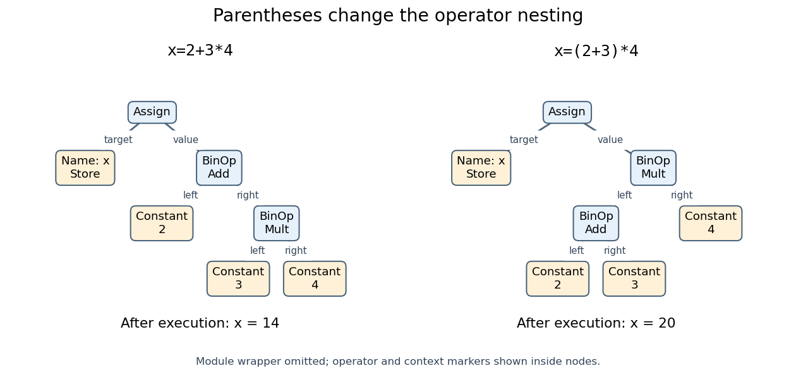
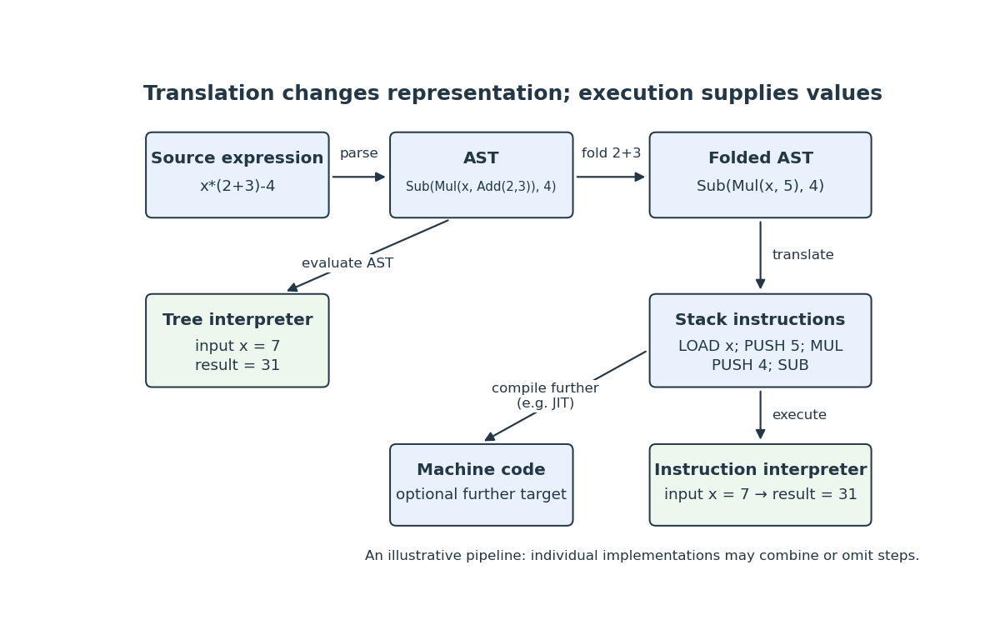
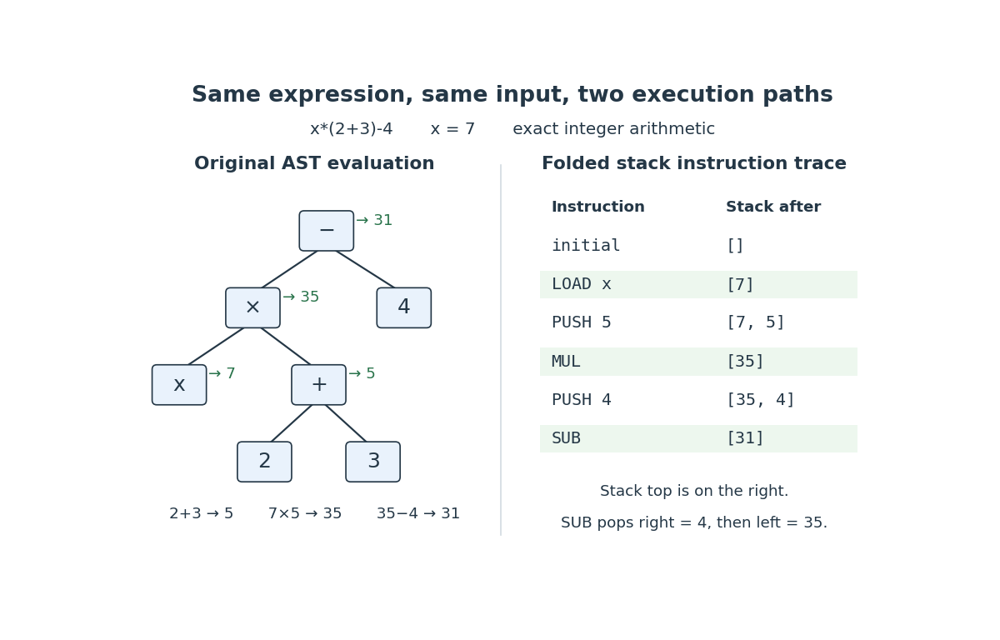

# Programming language

↑ **Parent:** [Computer science](computer-science.md)  
ⓦ [Wiki](https://en.wikipedia.org/wiki/Programming_language)

A [programming language](programming-language.md) specifies how programs are written and what their execution means. Its [type system](#type-system) describes which operations may be combined; an [abstract syntax tree](#abstract-syntax-tree) records the structure on which these rules act. The examples under [type system](#type-system) use a small teaching language with [integers](integer.md), Boolean values and [function types](#function-type).

// Target: computer-science.bigb

**Table of contents**

- [List comprehension](#list-comprehension)
- [FRACTRAN](#fractran)
- [Bit mask](#bit-mask)
  - [Submask enumeration](#submask-enumeration)
  - [Bitboard](#bitboard)
  - [Bitwise OR](#bitwise-or)
- [Bit shift](#bit-shift)
  - [Left bit shift](#left-bit-shift)
- [Two's complement](#two-s-complement)
- [Hexadecimal](#hexadecimal)
- [Abstract syntax tree](#abstract-syntax-tree)
  - [Abstract syntax tree precedence example](#abstract-syntax-tree-precedence-example)
  - [Abstract syntax tree traversal](#abstract-syntax-tree-traversal)
  - [Abstract syntax tree transformation](#abstract-syntax-tree-transformation)
    - [Constant folding](#constant-folding)
  - [Abstract syntax tree source location](#abstract-syntax-tree-source-location)
- [Programming language syntax](#programming-language-syntax)
  - [Lexical analysis](#lexical-analysis)
    - [Lexical token](#lexical-token)
  - [Parser](#parser)
    - [Parsing](#parsing)
  - [Program identifier](#program-identifier)
  - [Literal value](#literal-value)
  - [Program expression](#program-expression)
    - [Operator precedence](#operator-precedence)
      - [Operator associativity](#operator-associativity)
  - [Variable assignment](#variable-assignment)
- [Programming language semantics](#programming-language-semantics)
  - [Program state](#program-state)
  - [Integer overflow](#integer-overflow)
  - [Hoare logic](#hoare-logic)
    - [Hoare triple](#hoare-triple)
- [Compiler](#compiler)
  - [Compilation](#compilation)
    - [Compilation arithmetic example](#compilation-arithmetic-example)
    - [Just-in-time compilation](#just-in-time-compilation)
  - [Intermediate representation](#intermediate-representation)
    - [Bytecode](#bytecode)
  - [LLVM](#llvm)
- [Interpreter (computing)](#interpreter-computing)
  - [Interpreter arithmetic trace](#interpreter-arithmetic-trace)
- [Machine code](#machine-code)
- [Python (programming language)](#python-programming-language)
  - [CPython](#cpython)
- [Object-oriented programming](#object-oriented-programming)
  - [Encapsulation in object-oriented programming](#encapsulation-in-object-oriented-programming)
  - [Class (programming)](#class-programming)
- [Java (programming language)](#java-programming-language)
  - [Java interface](#java-interface)
  - [Private field in Java](#private-field-in-java)
  - [Final class in Java](#final-class-in-java)
  - [Protected method in Java](#protected-method-in-java)
  - [Java array](#java-array)
  - [Generics in Java](#generics-in-java)
    - [Generic method in Java](#generic-method-in-java)
    - [Generic type invariance](#generic-type-invariance)
    - [Type erasure](#type-erasure)
- [Exception handling](#exception-handling)
  - [ML exception type](#ml-exception-type)
- [Type system](#type-system)
  - [Simple type](#simple-type)
  - [Typing judgment](#typing-judgment)
    - [Typing context](#typing-context)
  - [Type safety](#type-safety)
  - [Type inference](#type-inference)
    - [Type unification](#type-unification)
  - [Type variable](#type-variable)
    - [Type substitution](#type-substitution)
    - [Type scheme](#type-scheme)
    - [Occurs check](#occurs-check)
  - [Recursive type](#recursive-type)
  - [Function type](#function-type)
  - [Parametric polymorphism](#parametric-polymorphism)
  - [Hindley-Milner type system](#hindley-milner-type-system)
    - [Algorithm W](#algorithm-w)
    - [Let polymorphism](#let-polymorphism)
- [Imperative programming](#imperative-programming)
  - [Side effect (computer science)](#side-effect-computer-science)
- [Functional programming](#functional-programming)
  - [Pure function](#pure-function)
  - [Structural recursion](#structural-recursion)
- [Standard ML](#standard-ml)
  - [ML reference type](#ml-reference-type)
- [Source code](#source-code)

## List comprehension

↑ **Parent:** [Programming language](programming-language.md)  
ⓦ [Wiki](https://en.wikipedia.org/wiki/List_comprehension)

## FRACTRAN

↑ **Parent:** [Programming language](programming-language.md)

A programming language whose program is an ordered list of positive [rational numbers](number-theory.md#rational-number). Starting with a [positive integer](integer.md#positive-integer), multiply by the first listed [fraction](number-theory.md#fraction) that produces an [integer](integer.md), then repeat; halt if none applies. Encoding registers as [prime](prime-number.md) exponents relates this operation to a [register machine](computability-theory.md#register-machine).

## Bit mask

↑ **Parent:** [Programming language](programming-language.md)

A word selecting specified binary positions under a bitwise operation. To extract a stored bit at position $b$, logically shift by $b$ and combine with the mask `1`. Grouping thirty-two cells into one [Java](#java-programming-language) integer permits a compact representation of a [Conway Game of Life](computer-science.md#conway-game-of-life) board.

// Destination: computer-science.bigb

### Submask enumeration

↑ **Parent:** [Bit mask](#bit-mask)

For a bit mask $m$, the update $s\gets(s-1)\mathbin{\&}m$ visits its nonzero submasks in decreasing order. Every submask uses only positions set in $m$, so a mask with $k$ set bits has $2^k$ submasks including zero.

### Bitboard

↑ **Parent:** [Bit mask](#bit-mask)

A bitboard represents occupied positions on a finite board by the bits of an [integer](integer.md). Bitwise operations combine occupancy masks and test whether pieces overlap.

### Bitwise OR

↑ **Parent:** [Bit mask](#bit-mask)

Bitwise OR combines binary representations position by position: an output bit is one exactly when at least one input bit is one. On [bit masks](#bit-mask) representing sets, it computes their union.

## Bit shift

↑ **Parent:** [Programming language](programming-language.md)

A fixed-width left shift discards high bits and inserts low zeros. A logical right shift inserts high zeros; an arithmetic right shift propagates the sign bit. In [Java](#java-programming-language), `<<`, `>>>` and `>>` distinguish these operations. Left shift by $k$ is multiplication by $2^k$ modulo the word modulus.

// Destination: computer-science.bigb

### Left bit shift

↑ **Parent:** [Bit shift](#bit-shift)

A [bit shift](#bit-shift) toward more significant positions, filling low positions with zeros. On an unbounded nonnegative [integer](integer.md), shifting left by $k$ places multiplies it by $2^k$; fixed-width representations may discard overflowing high bits.

<h2 id="two-s-complement">Two's complement</h2>

↑ **Parent:** [Programming language](programming-language.md)

For a fixed word width $w$, signed integers have the same bit patterns as residues modulo $2^w$. The leading bit has negative positional weight in the signed interpretation. Reading the same bits as unsigned gives $2^w+x$ for a negative signed integer $x$.

// Destination: computer-science.bigb

## Hexadecimal

↑ **Parent:** [Programming language](programming-language.md)

Base-sixteen representation, with digit values zero through fifteen conventionally written `0` through `9` and `a` through `f`. A group of four binary digits selects one hexadecimal digit.

// Destination: computer-science.bigb

## Abstract syntax tree

↑ **Parent:** [Programming language](programming-language.md)  
ⓦ [Wiki](https://en.wikipedia.org/wiki/Abstract_syntax_tree)

An [abstract syntax tree](#abstract-syntax-tree) is a [rooted tree](tree-graph-theory.md#rooted-tree) recording the meaningful syntactic pieces of a program and how they fit together. A [program identifier](#program-identifier) such as `x`, a [literal value](#literal-value) such as `2`, and a node representing [addition](arithmetic.md#addition) have different roles. Their arrangement answers structural questions: which [program expression](#program-expression) supplies an operand, which name is a [variable assignment](#variable-assignment) target, and which construct encloses another. This makes an [abstract syntax tree](#abstract-syntax-tree) useful to a [compiler](#compiler), an [interpreter](#interpreter-computing), and the [type system](#type-system) that checks a program.

The word "abstract" describes what is omitted. [Lexical analysis](#lexical-analysis) first recognizes [lexical tokens](#lexical-token), such as `x`, `=`, `2`, `+`, `3`, `*`, `4`. A concrete [parse tree](foundations-of-mathematics.md#parse-tree) can retain [grammar derivation](foundations-of-mathematics.md#grammar-derivation) structure, including punctuation and intermediate [context-free grammar](foundations-of-mathematics.md#context-free-grammar) categories such as expression, term and factor. An [abstract syntax tree](#abstract-syntax-tree) usually keeps the operation and its operands without all those grammar scaffolds. Parentheses can determine its shape without surviving as separate nodes. A [parser](#parser) may construct the [abstract syntax tree](#abstract-syntax-tree) directly; it need not first allocate a concrete [parse tree](foundations-of-mathematics.md#parse-tree).

An [abstract syntax tree](#abstract-syntax-tree) records [programming language syntax](#programming-language-syntax), but does not by itself supply all [programming language semantics](#programming-language-semantics). In `a+b`, the names do not reveal their current values, and `+` might perform [addition](arithmetic.md#addition) of [integers](integer.md) or concatenate strings. The [programming language](programming-language.md) rules, name bindings, and operand types determine the meaning. In [Python](#python-programming-language), successfully calling `ast.parse` also does not guarantee that later [compilation](#compilation) will accept the result: parsing `return 42` succeeds, but compiling that statement outside a function fails. [ast.parse: parsing performs no scoping checks; the return 42 example](computer-science-bibliography.md#python-3-14-documentation/ast-abstract-syntax-trees-python-3-14-documentation)

An [abstract syntax tree](#abstract-syntax-tree) is not [machine code](#machine-code). Its nodes describe language constructs. A [compiler](#compiler) can check and transform this structure before translating it into executable instructions; an [interpreter](#interpreter-computing) can evaluate an appropriate tree directly. The little evaluator below demonstrates this distinction without pretending to implement an entire [programming language](programming-language.md).

### Abstract syntax tree precedence example

↑ **Parent:** [Abstract syntax tree](#abstract-syntax-tree)

Consider [Python](#python-programming-language) programs `x=2+3*4` and `x=(2+3)*4`. [Operator precedence](#operator-precedence) places [multiplication](arithmetic.md#multiplication) inside the right operand of [addition](arithmetic.md#addition) in the first [abstract syntax tree](#abstract-syntax-tree). The parentheses instead place [addition](arithmetic.md#addition) inside the left operand of [multiplication](arithmetic.md#multiplication) in the second. Their right-hand sides evaluate to $2+(3\cdot4)=14$ and $(2+3)\cdot4=20$. No rule that simply reads all operators left to right would recover both structures. [Python language reference, section 6.17, multiplicative operators bind more tightly than additive operators](https://docs.python.org/3.14/reference/expressions.html#operator-precedence)

<a id="image-abstract-syntax-tree-precedence"></a>


**[Figure 1](#image-abstract-syntax-tree-precedence). Two abstract syntax trees for variable assignment: operator precedence gives `x=2+3*4` the value $14$, while parentheses give `x=(2+3)*4` the value $20$**.

These are schematic views of [Python](#python-programming-language) trees: `Module` is omitted, and the `Add`/`Mult` and `Store` markers are written inside their owning nodes. In the actual schema, `BinOp` has `left`, `op` and `right` fields; `Assign` has a list of `targets` and a `value`. `Name(id='x', ctx=Store())` marks the name as a [variable assignment](#variable-assignment) target. Reading `x` in a [program expression](#program-expression) instead uses `Load`. A [variable assignment](#variable-assignment) is a statement, not an [equation](algebra.md#equation) asserting that two values are equal. [CPython 3.14, Parser/Python.asdl: Module, Assign, BinOp, Constant, Name and expr\_context constructors](computer-science-bibliography.md#abstract-syntax-schema-for-cpython-3-14)

A restricted recursive evaluator can follow those fields. It accepts only [integer](integer.md) [literal values](#literal-value) and binary [addition](arithmetic.md#addition), [subtraction](arithmetic.md#subtraction) and [multiplication](arithmetic.md#multiplication); the surrounding [variable assignment](#variable-assignment) remains a separate action. Using `type(value) is int` excludes Boolean constants, even though [Python](#python-programming-language) treats `bool` as a subclass of `int`.

```
import ast

OPS = {ast.Add: lambda a, b: a + b,
       ast.Sub: lambda a, b: a - b,
       ast.Mult: lambda a, b: a * b}

def evaluate(node):
    if isinstance(node, ast.Constant) and type(node.value) is int:
        return node.value
    if isinstance(node, ast.BinOp) and type(node.op) in OPS:
        return OPS[type(node.op)](evaluate(node.left), evaluate(node.right))
    raise ValueError("outside the integer-expression language")

for source in ("x=2+3*4", "x=(2+3)*4"):
    tree = ast.parse(source, optimize=0)
    statement = tree.body[0]
    print(statement.targets[0].id, evaluate(statement.value))
# x 14
# x 20
```

The [children in a rooted tree](tree-graph-theory.md#child-in-a-rooted-tree) have ordered roles: `left` and `right` cannot be interchanged. For [subtraction](arithmetic.md#subtraction), `8-3` gives $5$ while `3-8` gives $-5$. [Operator associativity](#operator-associativity) also matters: `8-3-1` parses as `(8-3)-1`, giving $4$, whereas `8-(3-1)` gives $6$. Here the syntax groups operators to the left; this does not assert the mathematical [associativity](algebraic-operation.md#associative-property) of [subtraction](arithmetic.md#subtraction). [Operator precedence](#operator-precedence) determines grouping, rather than a general permission to reorder execution. For example, [Python](#python-programming-language) evaluates the calls in `f()+g()*h()` in the order `f`, `g`, `h`, although the [multiplication](arithmetic.md#multiplication) result must be ready before the outer [addition](arithmetic.md#addition). [Python language reference, sections 6.16 and 6.17: left-to-right evaluation and left grouping of additive operators](https://docs.python.org/3.14/reference/expressions.html#evaluation-order)

### Abstract syntax tree traversal

↑ **Parent:** [Abstract syntax tree](#abstract-syntax-tree)

An [abstract syntax tree](#abstract-syntax-tree) traversal systematically visits its nodes. A [depth-first traversal of a tree](tree-graph-theory.md#depth-first-traversal-of-a-tree) that processes each child before its parent is called postorder. For the [program expression](#program-expression) `2+3*4`, the schematic postorder is `2, 3, 4, Mult, Add`. This order lets an evaluator obtain each operand value before applying its operation. A traversal of the entire [Python](#python-programming-language) schema additionally visits marker nodes such as `Add` and `Store`; this shorter list concerns only the expression nodes drawn in the figures. Visiting an [abstract syntax tree](#abstract-syntax-tree) is a structural operation, and is not a general model of execution: a conditional may select only one branch, while a structural visitor examines both.

### Abstract syntax tree transformation

↑ **Parent:** [Abstract syntax tree](#abstract-syntax-tree)

An [abstract syntax tree](#abstract-syntax-tree) transformation replaces or rearranges nodes. It can simplify a [program expression](#program-expression), insert instrumentation, or translate a language construct into simpler constructs. When intended to preserve [programming language semantics](#programming-language-semantics), it must preserve the relevant observable behavior, including values, [side effects](#side-effect-computer-science), and failures. A changed tree can be structurally valid while changing the program's meaning.

#### Constant folding

↑ **Parent:** [Abstract syntax tree transformation](#abstract-syntax-tree-transformation)  
ⓦ [Wiki](https://en.wikipedia.org/wiki/Constant_folding)

[Constant folding](#constant-folding) replaces a [program expression](#program-expression) whose value is known during translation by a [literal value](#literal-value). For `x=2+3*4`, first replace the [multiplication](arithmetic.md#multiplication) subtree by `Constant(value=12)`, then replace the [addition](arithmetic.md#addition) subtree by `Constant(value=14)`. The [variable assignment](#variable-assignment) and its `Store` target survive: the result still assigns to `x`. This illustrates why a bottom-up [abstract syntax tree traversal](#abstract-syntax-tree-traversal) is convenient: replacing one child can make its parent eligible for the next replacement.

<a id="image-abstract-syntax-tree-constant-folding"></a>


**[Figure 2](#image-abstract-syntax-tree-constant-folding). Constant folding and postorder abstract syntax tree traversal for `2+3*4`: replace $3\cdot4$ by $12$, then $2+12$ by $14$**.

Here is a deliberately small [Python](#python-programming-language) transformer. Calling `generic_visit` first transforms the children; returning a node replaces the visited node. The location helpers retain or supply the metadata expected for [compilation](#compilation). [NodeTransformer, generic\_visit, copy\_location and fix\_missing\_locations](computer-science-bibliography.md#python-3-14-documentation/ast-abstract-syntax-trees-python-3-14-documentation)

```
class FoldIntegers(ast.NodeTransformer):
    def visit_BinOp(self, node):
        self.generic_visit(node)
        if (isinstance(node.left, ast.Constant)
                and isinstance(node.right, ast.Constant)
                and type(node.left.value) is int
                and type(node.right.value) is int
                and type(node.op) in OPS):
            value = OPS[type(node.op)](node.left.value, node.right.value)
            return ast.copy_location(ast.Constant(value=value), node)
        return node

tree = ast.parse("x=2+3*4", optimize=0)
folded = ast.fix_missing_locations(FoldIntegers().visit(tree))
namespace = {}
exec(compile(folded, "<folded example>", "exec"), namespace)
assert namespace["x"] == 14
assert ast.unparse(folded) == "x = 14"
```

This transformer folds literal [integer](integer.md) operands only. It leaves `a+3*4` as `a+12`, without inventing a value for the [program identifier](#program-identifier) `a`. It leaves calls intact: replacing `0*f()` by `0` could discard a [side effect](#side-effect-computer-science) or a failure. Nor does it reassociate [floating-point arithmetic](floating-point-arithmetic.md), where changing parentheses can change rounding. For the supported [integer arithmetic](arithmetic.md#integer-arithmetic), a short [structural induction](foundations-of-mathematics.md#structural-induction) explains correctness: a retained [literal value](#literal-value) has the same value; at each folded binary node, the already-correct child values are combined by exactly the original operation in the original left/right order. This claim concerns the supported fragment's values, not unrestricted equivalence of arbitrary [Python](#python-programming-language) programs.

### Abstract syntax tree source location

↑ **Parent:** [Abstract syntax tree](#abstract-syntax-tree)

An [abstract syntax tree](#abstract-syntax-tree) can retain source locations even while omitting punctuation nodes. [Python](#python-programming-language) records one-based line numbers and zero-based UTF-8 byte offsets, with the end offset exclusive. In `x=2+3*4`, the [multiplication](arithmetic.md#multiplication) node spans offsets $4$ through $7$, and `ast.get_source_segment` returns `3*4`. A copied location on a folded `12` describes the original span, not text newly present in the source. Such metadata supports error messages and editing tools without making an [abstract syntax tree](#abstract-syntax-tree) a lossless record of formatting. [Node classes: lineno, col\_offset, end\_lineno and end\_col\_offset; get\_source\_segment and copy\_location](computer-science-bibliography.md#python-3-14-documentation/ast-abstract-syntax-trees-python-3-14-documentation)

// Target: computer-science.bigb

## Programming language syntax

↑ **Parent:** [Programming language](programming-language.md)

The rules for forming programs in a [programming language](programming-language.md). A [parser](#parser) checks and structures text according to these rules; an [abstract syntax tree](#abstract-syntax-tree) records the resulting constructs.

### Lexical analysis

↑ **Parent:** [Programming language syntax](#programming-language-syntax)  
ⓦ [Wiki](https://en.wikipedia.org/wiki/Lexical_analysis)

Recognition of [lexical tokens](#lexical-token) in program text before or during [parsing](#parsing).

#### Lexical token

↑ **Parent:** [Lexical analysis](#lexical-analysis)

A categorized piece of program text, such as a [program identifier](#program-identifier), a numeral denoting a [literal value](#literal-value), or an operator symbol. Its spelling and category help a [parser](#parser) recognize the larger construct.

### Parser

↑ **Parent:** [Programming language syntax](#programming-language-syntax)

A parser recognizes how text fits a [programming language syntax](#programming-language-syntax) and can construct a [parse tree](foundations-of-mathematics.md#parse-tree) or [abstract syntax tree](#abstract-syntax-tree).

#### Parsing

↑ **Parent:** [Parser](#parser)

The recognition process performed by a [parser](#parser), producing a structural description of text according to a [programming language syntax](#programming-language-syntax).

### Program identifier

↑ **Parent:** [Programming language syntax](#programming-language-syntax)

A name used by a program, such as `x` in a [variable assignment](#variable-assignment). An [abstract syntax tree](#abstract-syntax-tree) can record the name without determining which value it denotes.

### Literal value

↑ **Parent:** [Programming language syntax](#programming-language-syntax)

A value written directly in program text, such as an [integer](integer.md) numeral or a quoted string, rather than obtained through a [program identifier](#program-identifier). Distinct spellings can denote the same value.

### Program expression

↑ **Parent:** [Programming language syntax](#programming-language-syntax)

A program construct that is evaluated to obtain a value, potentially with [side effects](#side-effect-computer-science) or failure. An arithmetic [mathematical expression](algebra.md#expression-mathematics) is one example; its [abstract syntax tree](#abstract-syntax-tree) records how operands and operations nest.

#### Operator precedence

↑ **Parent:** [Program expression](#program-expression)

The syntactic priority that resolves grouping when different operators occur together without parentheses. It determines the [abstract syntax tree](#abstract-syntax-tree) shape before evaluation.

##### Operator associativity

↑ **Parent:** [Operator precedence](#operator-precedence)

The syntactic grouping convention for successive operators of the same precedence. Left grouping of [subtraction](arithmetic.md#subtraction) makes `a-b-c` mean `(a-b)-c`; it does not make [subtraction](arithmetic.md#subtraction) an [associative](algebraic-operation.md#associative-property) operation.

### Variable assignment

↑ **Parent:** [Programming language syntax](#programming-language-syntax)

A program action that associates a value with a target name. For [Python](#python-programming-language) `x=2+3*4`, evaluate the right-hand [program expression](#program-expression) and bind `x` to its result. [Python language reference, section 7.2: assignment to an identifier and evaluation of the right-hand side](https://docs.python.org/3.14/reference/simple_stmts.html#assignment-statements)

## Programming language semantics

↑ **Parent:** [Programming language](programming-language.md)

The meaning of constructs in a [programming language](programming-language.md), including their permitted values and execution behavior. [Programming language syntax](#programming-language-syntax) organizes constructs; a [type system](#type-system) and execution rules give further constraints and meaning.

### Program state

↑ **Parent:** [Programming language semantics](#programming-language-semantics)

A description of the information needed to determine a program's next permitted step. In the [summation loop verification](algorithm.md#summation-loop-verification), this includes the current [variable](mathematics.md#variable-mathematics) values and the position in the instructions.

### Integer overflow

↑ **Parent:** [Programming language semantics](#programming-language-semantics)  
ⓦ [Wiki](https://en.wikipedia.org/wiki/Integer_overflow)

An [integer arithmetic](arithmetic.md#integer-arithmetic) result outside the range of its chosen representation. A [programming language](programming-language.md) may specify wrapping, trapping or another behavior; a proof over mathematical [integers](integer.md) must account for that difference.

### Hoare logic

↑ **Parent:** [Programming language semantics](#programming-language-semantics)  
ⓦ [Wiki](https://en.wikipedia.org/wiki/Hoare_logic)

A system of rules for proving [Hoare triples](#hoare-triple) by following a program's structure. [Variable assignment](#variable-assignment), sequential composition and loops have corresponding proof obligations.

#### Hoare triple

↑ **Parent:** [Hoare logic](#hoare-logic)

A [partial correctness](algorithm.md#partial-correctness) claim connecting a [precondition](algorithm.md#precondition) $P$, a program $C$ and a [postcondition](algorithm.md#postcondition) $Q$: every terminating execution begun with $P$ ends with $Q$. State separately whether [total correctness](algorithm.md#total-correctness) is intended.

## Compiler

↑ **Parent:** [Programming language](programming-language.md)  
ⓦ [Wiki](https://en.wikipedia.org/wiki/Compiler)

A [compiler](#compiler) translates a program from one representation to another while aiming to preserve its [programming language semantics](#programming-language-semantics). Its input might be [source code](#source-code) or an [intermediate representation](#intermediate-representation); its output might be another [programming language](programming-language.md), [bytecode](#bytecode), an [intermediate representation](#intermediate-representation), or [machine code](#machine-code). Producing [machine code](#machine-code) is therefore one possible destination, rather than the definition of [compilation](#compilation). For example, the [LLVM](#llvm) 20.1.0 tutorial translates an [abstract syntax tree](#abstract-syntax-tree) into an [intermediate representation](#intermediate-representation) before introducing execution.[LLVM 20.1.0 documentation; Implementing a language with LLVM, chapter 3, sections 3.1 and 3.5: AST to LLVM IR and the initial driver that prints IR](computer-science-bibliography.md#llvm-20-1-0-documentation/3-kaleidoscope-code-generation-to-llvm-ir)

[Compilation](#compilation) can use an [abstract syntax tree](#abstract-syntax-tree) for checking and transformations such as [constant folding](#constant-folding) before producing [machine code](#machine-code). These are useful possibilities, not a compulsory sequence of separate stages for every [compiler](#compiler). The central distinction is between translating a program and executing its operations: a [compiler](#compiler) can translate `x*(2+3)-4` without knowing the input value of `x`, whereas an [interpreter](#interpreter-computing) needs that value to produce this [program expression](#program-expression)'s result.

Different representations expose different questions. [Source code](#source-code) preserves what a programmer wrote; an [abstract syntax tree](#abstract-syntax-tree) exposes grouping; a [type system](#type-system) checks permitted combinations; a [stack machine](theoretical-computer-science.md#stack-machine) makes operand movement explicit. Retaining [abstract syntax tree source locations](#abstract-syntax-tree-source-location) across [compilation](#compilation) helps an error message identify the original construct even after [constant folding](#constant-folding) has changed its shape. A malformed `x*(2+)-4` is a [programming language syntax](#programming-language-syntax) error; an unavailable `x` in the valid example is instead a missing input. Locating the failing rule is more helpful than treating both as an unexplained execution failure.

### Compilation

↑ **Parent:** [Compiler](#compiler)

[Compilation](#compilation) is the translation process performed by a [compiler](#compiler), which may include checking and transforming an [abstract syntax tree](#abstract-syntax-tree). Translation can finish before execution, or happen during execution through [just-in-time compilation](#just-in-time-compilation). Reusing the translated representation can avoid repeated [parsing](#parsing) and repeated [constant folding](#constant-folding) when only the inputs change. This does not guarantee a speedup: translation itself costs work, and the choice of representation and execution mechanism matters.

<a id="image-compiler-representation-pipeline"></a>


**[Figure 3](#image-compiler-representation-pipeline). One possible compilation pipeline for `x*(2+3)-4`, with execution from an abstract syntax tree, a stack machine instruction sequence, or machine code**.

#### Compilation arithmetic example

↑ **Parent:** [Compilation](#compilation)

Consider the [program expression](#program-expression) `x*(2+3)-4` in a deliberately small [programming language](programming-language.md). Its only [program identifier](#program-identifier) is `x`, supplied as an [integer](integer.md) input. Its [literal values](#literal-value) are nonnegative decimal numerals, interpreted as [integers](integer.md). Whitespace is ignored between [lexical tokens](#lexical-token). Its [context-free grammar](foundations-of-mathematics.md#context-free-grammar) is:

```
expression ::= term (("+" | "-") term)*
term       ::= factor ("*" factor)*
factor     ::= numeral | "x" | "(" expression ")"
numeral    ::= digit digit*
digit      ::= "0" | "1" | "2" | "3" | "4"
             | "5" | "6" | "7" | "8" | "9"
```

Here `*` outside quotation marks means zero or more repetitions. Repeated operators are grouped to the left, specifying [operator associativity](#operator-associativity); `term` gives [multiplication](arithmetic.md#multiplication) higher [operator precedence](#operator-precedence) than [addition](arithmetic.md#addition) and [subtraction](arithmetic.md#subtraction). Parentheses override that grouping. There is no unary minus, [variable assignment](#variable-assignment), function call, or [side effect](#side-effect-computer-science) in this language. Evaluation obtains each left operand before its right operand and uses exact [integer arithmetic](arithmetic.md#integer-arithmetic), with no fixed-width overflow.

[Lexical analysis](#lexical-analysis) recognizes `x`, `*`, `(`, `2`, `+`, `3`, `)`, `-`, `4`. [Parsing](#parsing) constructs the concrete [abstract syntax tree](#abstract-syntax-tree) `Sub(Mul(Name(x), Add(Int(2), Int(3))), Int(4))`. Parentheses have done their work by making `Add` a child of `Mul`; they need not survive as nodes. [Constant folding](#constant-folding) changes this to `Sub(Mul(Name(x), Int(5)), Int(4))`. It cannot replace `Name(x)` by a [literal value](#literal-value) because the input is supplied at execution. The resulting [function](function.md) of the input is $f(x)=5x-4$.

A [compiler](#compiler) for our [stack machine](theoretical-computer-science.md#stack-machine) emits `LOAD x; PUSH 5; MUL; PUSH 4; SUB`. `LOAD x` pushes the current input; `PUSH n` pushes the [integer](integer.md) [literal value](#literal-value) `n`. Each binary instruction removes the top item as its right operand, then the next item as its left operand, and pushes the result. The instruction sequence is an [intermediate representation](#intermediate-representation) that an [interpreter](#interpreter-computing) can execute; no [machine code](#machine-code) has been emitted. A compact binary encoding could make it [bytecode](#bytecode), but these printed instruction names are only a readable notation.

Why does this [compilation](#compilation) preserve the result? A [structural induction](foundations-of-mathematics.md#structural-induction) supplies a short proof outline. Translating a [literal value](#literal-value) or `x` appends its value to any initial [stack](data-structure.md#stack-data-structure). For a binary [abstract syntax tree](#abstract-syntax-tree) node, first translating the left child and then the right child appends the two operand values; the matching instruction replaces them by exactly the original operation's result. Previously present [stack](data-structure.md#stack-data-structure) items remain intact. [Constant folding](#constant-folding) also preserves the result because $2+3=5$ in the specified [integer arithmetic](arithmetic.md#integer-arithmetic). Together these facts explain agreement for every [integer](integer.md) input, rather than merely agreement for one trial.

#### Just-in-time compilation

↑ **Parent:** [Compilation](#compilation)  
ⓦ [Wiki](https://en.wikipedia.org/wiki/Just-in-time_compilation)

[Compilation](#compilation) performed during execution, often producing [machine code](#machine-code) for subsequent execution.

### Intermediate representation

↑ **Parent:** [Compiler](#compiler)  
ⓦ [Wiki](https://en.wikipedia.org/wiki/Intermediate_representation)

A program representation used between input and final output, convenient for analysis, transformation or execution. An [abstract syntax tree](#abstract-syntax-tree) and [bytecode](#bytecode) can each serve this role.

#### Bytecode

↑ **Parent:** [Intermediate representation](#intermediate-representation)  
ⓦ [Wiki](https://en.wikipedia.org/wiki/Bytecode)

An encoded instruction representation for a software execution mechanism. [Compilation](#compilation) can produce [bytecode](#bytecode) that an [interpreter](#interpreter-computing) executes.

### LLVM

↑ **Parent:** [Compiler](#compiler)  
ⓦ [Wiki](https://en.wikipedia.org/wiki/LLVM)

An infrastructure project providing reusable tools for [compilation](#compilation) and [intermediate representations](#intermediate-representation).

## Interpreter (computing)

↑ **Parent:** [Programming language](programming-language.md)  
ⓦ [Wiki](https://en.wikipedia.org/wiki/Interpreter_(computing))

An [interpreter](#interpreter-computing) executes a program's operations according to its [programming language semantics](#programming-language-semantics). It can recursively evaluate an [abstract syntax tree](#abstract-syntax-tree), or follow an instruction sequence using an execution state such as a [stack](data-structure.md#stack-data-structure) and an [instruction pointer](computer-science.md#instruction-pointer). It need not repeatedly read [source code](#source-code) characters, and it need not use an [abstract syntax tree](#abstract-syntax-tree) at all.

[Compilation](#compilation) and interpretation can coexist. In [CPython](#cpython), [Python](#python-programming-language) [source code](#source-code) is compiled into [bytecode](#bytecode) for execution by an [interpreter](#interpreter-computing); its [bytecode](#bytecode) is not promised to remain stable between releases.[Python 3.14 documentation; Python 3.14 glossary: bytecode and virtual machine entries; compilation, execution and release-specific bytecodes](computer-science-bibliography.md#python-3-14-documentation/glossary-python-3-14-documentation) The [Python](#python-programming-language) 3.14 `compile` function accepts text or an [abstract syntax tree](#abstract-syntax-tree) and can produce a code object, which `eval` or `exec` can execute.[Python 3.14 documentation; Python 3.14 Built-in Functions: compile, accepted source forms, code objects and execution by eval or exec](computer-science-bibliography.md#python-3-14-documentation/built-in-functions-python-3-14-documentation) These operations make translation and execution separately accessible without requiring them to live in different applications.

[Just-in-time compilation](#just-in-time-compilation) gives another combination: an interactive implementation can translate a submitted [program expression](#program-expression) into [machine code](#machine-code) and then execute it immediately. The [LLVM](#llvm) 20.1.0 tutorial demonstrates this by adding an [intermediate representation](#intermediate-representation) module to its [just-in-time compilation](#just-in-time-compilation) facility, looking up the generated function, and calling it.[LLVM 20.1.0 documentation; Implementing a language with LLVM, chapter 4, section 4.4: HandleTopLevelExpression, addModule, lookup and calling the generated native function](computer-science-bibliography.md#llvm-20-1-0-documentation/4-kaleidoscope-adding-jit-and-optimizer-support) Thus calling a [programming language](programming-language.md) permanently "compiled" or "interpreted" hides an implementation choice: ask which representation is translated, which is executed, and when.

### Interpreter arithmetic trace

↑ **Parent:** [Interpreter (computing)](#interpreter-computing)

Use the [compilation arithmetic example](#compilation-arithmetic-example) with input $x=7$. An [abstract syntax tree](#abstract-syntax-tree) [interpreter](#interpreter-computing) first reads `x`, obtains $2+3=5$, forms $7\cdot5=35$, and finally computes $35-4=31$. Interpreting the folded [abstract syntax tree](#abstract-syntax-tree) skips the [addition](arithmetic.md#addition) but gives the same result. The compiled [stack machine](theoretical-computer-science.md#stack-machine) instructions instead produce the following trace; the top of the [stack](data-structure.md#stack-data-structure) is written on the right:

```
instruction    stack after instruction
initial        []
LOAD x         [7]
PUSH 5         [7, 5]
MUL            [35]
PUSH 4         [35, 4]
SUB            [31]
```

<a id="image-interpreter-tree-stack-trace"></a>


**[Figure 4](#image-interpreter-tree-stack-trace). Execution of `x*(2+3)-4` at $x=7$: the original abstract syntax tree and the folded stack machine instructions both give $31$**.

The order in `SUB` is essential: reversing its two popped operands would give $4-35=-31$. The same stored instruction sequence works for input $x=-2$, yielding $(-2)\cdot5-4=-14$, without repeating [parsing](#parsing) or [constant folding](#constant-folding). An [abstract syntax tree](#abstract-syntax-tree) [interpreter](#interpreter-computing) can likewise reuse its already-parsed tree. Reusing a representation is therefore useful to both approaches; it does not itself distinguish [compilation](#compilation) from interpretation.

The pleasing part is that a nested [rooted tree](tree-graph-theory.md#rooted-tree) and a flat instruction sequence express the same computation. The [structural induction](foundations-of-mathematics.md#structural-induction) in the [compilation arithmetic example](#compilation-arithmetic-example) connects them by a precise [stack](data-structure.md#stack-data-structure) property. This tiny language always terminates and has no [side effects](#side-effect-computer-science); richer [programming language semantics](#programming-language-semantics) require a correctness argument that also accounts for failures, externally visible actions, and possible nontermination.

## Machine code

↑ **Parent:** [Programming language](programming-language.md)  
ⓦ [Wiki](https://en.wikipedia.org/wiki/Machine_code)

Encoded instructions executed by a [central processing unit](computer-science.md#central-processing-unit). An [abstract syntax tree](#abstract-syntax-tree) instead describes [programming language](programming-language.md) constructs and their nesting.

## Python (programming language)

↑ **Parent:** [Programming language](programming-language.md)  
ⓦ [Wiki](https://en.wikipedia.org/wiki/Python_(programming_language))

A [programming language](programming-language.md) whose standard-library `ast` module provides access to its [abstract syntax trees](#abstract-syntax-tree). The examples here use its version 3.14 schema and literal [integer arithmetic](arithmetic.md#integer-arithmetic).

### CPython

↑ **Parent:** [Python (programming language)](#python-programming-language)  
ⓦ [Wiki](https://en.wikipedia.org/wiki/CPython)

The canonical implementation of [Python](#python-programming-language), distributed through python.org.

## Object-oriented programming

↑ **Parent:** [Programming language](programming-language.md)  
ⓦ [Wiki](https://en.wikipedia.org/wiki/Object-oriented_programming)

// Target: computer-science.bigb

### Encapsulation in object-oriented programming

↑ **Parent:** [Object-oriented programming](#object-oriented-programming)

In [object-oriented programming](#object-oriented-programming), encapsulation packages an object's state with the operations that act on it and can restrict direct access to its implementation. It is the object-oriented use of [encapsulation](computer-science.md#encapsulation-computer-programming).

### Class (programming)

↑ **Parent:** [Object-oriented programming](#object-oriented-programming)  
ⓦ [Wiki](https://en.wikipedia.org/wiki/Class_(programming))

// Target: computer-science.bigb

## Java (programming language)

↑ **Parent:** [Programming language](programming-language.md)  
ⓦ [Wiki](https://en.wikipedia.org/wiki/Java_(programming_language))

// Target: computer-science.bigb

### Java interface

↑ **Parent:** [Java (programming language)](#java-programming-language)

An interface specifies a type contract that independent classes can implement. Code accepting the interface can operate on multiple implementations, avoiding dependence on one concrete class. A class may implement several interfaces despite having only one direct class superclass.

// Destination: computer-science.bigb

### Private field in Java

↑ **Parent:** [Java (programming language)](#java-programming-language)

A field declared `private` is hidden from ordinary external source-level access. Library methods can enforce invariants and change the representation without exposing storage to clients. Returning a mutable internal object can still undermine this [encapsulation in object-oriented programming](#encapsulation-in-object-oriented-programming).

// Destination: computer-science.bigb

### Final class in Java

↑ **Parent:** [Java (programming language)](#java-programming-language)

A class declared `final` cannot be subclassed. This can protect an implementation contract against overriding in an untrusted subclass. It does not by itself make the class immutable, and it rules out subclass-based customization.

// Destination: computer-science.bigb

### Protected method in Java

↑ **Parent:** [Java (programming language)](#java-programming-language)

A `protected` method is accessible to code in its package and, subject to the cross-package receiver restriction, to subclasses elsewhere. It can expose a subclass customization hook without being a public client operation. Protected access is broader than subclass-only access.

// Destination: computer-science.bigb

### Java array

↑ **Parent:** [Java (programming language)](#java-programming-language)

Java arrays are fixed-length objects. A two-dimensional array is an array of row-array references, so rows can have different lengths and must be allocated separately if not allocated by the initial expression.

// Target: computer-science.bigb

### Generics in Java

↑ **Parent:** [Java (programming language)](#java-programming-language)  
ⓦ [Wiki](https://en.wikipedia.org/wiki/Generics_in_Java)

// Target: computer-science.bigb

#### Generic method in Java

↑ **Parent:** [Generics in Java](#generics-in-java)

A method declaring its own type parameters, for example `<T> List<T> singletonList(T value)`. The type parameter connects argument and result types and permits compile-time checking without casts at ordinary call sites. A method mentioning only a generic class's type parameter need not itself be a generic method.

// Destination: computer-science.bigb

#### Generic type invariance

↑ **Parent:** [Generics in Java](#generics-in-java)

Even when `S` is a subtype of `T`, neither `G<S>` nor `G<T>` is generally a subtype of the other. This prevents unsafe writes into mutable generic containers. Wildcards express restricted views.

// Target: computer-science.bigb

#### Type erasure

↑ **Parent:** [Generics in Java](#generics-in-java)  
ⓦ [Wiki](https://en.wikipedia.org/wiki/Type_erasure)

// Target: computer-science.bigb

## Exception handling

↑ **Parent:** [Programming language](programming-language.md)  
ⓦ [Wiki](https://en.wikipedia.org/wiki/Exception_handling)

// Target: computer-science.bigb

### ML exception type

↑ **Parent:** [Exception handling](#exception-handling)

In [Standard ML](#standard-ml), `exn` is an extensible datatype of exception packets. Fresh declarations introduce constructors, optionally with payloads; rebinding can alias an existing constructor; `raise` propagates a packet and `handle` performs dynamic pattern-based recovery.

// Target: computer-science.bigb

## Type system

↑ **Parent:** [Programming language](programming-language.md)  
ⓦ [Wiki](https://en.wikipedia.org/wiki/Type_system)

A [type system](#type-system) assigns types to program expressions and supplies rules governing their use. A type constrains permitted operations: in our teaching [programming language](programming-language.md), `int` admits [integer](integer.md) addition, `bool` supplies `true` and `false` for conditions, and a [function type](#function-type) specifies an argument type and a result type. Storage as [bits](information-theory.md#bit) alone does not explain these distinctions; the [type system](#type-system) determines whether an expression can serve as an argument, a condition or an operand.

A [typing judgment](#typing-judgment) $\Gamma\vdash e:\tau$ says that expression $e$ has type $\tau$ under the assumptions in the [typing context](#typing-context) $\Gamma$. For example,

$$
\Gamma=\{x:\mathrm{int},y:\mathrm{int}\},\qquad \Gamma\vdash x+y:\mathrm{int}.
$$

The assumptions give each operand type `int`; the addition rule then gives the sum type `int`. Changing $y$ to type `bool` prevents this derivation. Our teaching [programming language](programming-language.md) has distinct `int` and `bool` types and no implicit conversions between them.

The conditional rule requires a Boolean condition and the same type for both branches:

$$
\frac{\Gamma\vdash c:\mathrm{bool}\qquad\Gamma\vdash e_1:\tau\qquad\Gamma\vdash e_2:\tau}{\Gamma\vdash\mathrm{if}\ c\ \mathrm{then}\ e_1\ \mathrm{else}\ e_2:\tau}.
$$

Thus `if true then 1 else 2` has type `int`, while `if true then 1 else false` is rejected: its branches would require $\tau=\mathrm{int}$ and $\tau=\mathrm{bool}$ simultaneously. Even a branch that will not execute is checked by this rule. This is a rule of this particular [type system](#type-system); a different [programming language](programming-language.md) can choose different rules. [Software Foundations, Programming Language Foundations, Type Systems: typing relation](https://softwarefoundations.cis.upenn.edu/plf-current/Types.html)

The useful feature is compositional reasoning: after checking the parts, a rule explains how to check the whole. The [function type](#function-type) diagram shows this for a call. [Type inference](#type-inference) can discover the required types automatically, and [type variables](#type-variable) let one express relationships that recur across many concrete types. The result is both a practical early error detector and a small, readable derivation explaining why an expression fits its intended use.

The guarantee depends on the rules and execution model. [Type safety](#type-safety) can exclude specified failures such as adding a Boolean or calling an [integer](integer.md) as a function. It does not by itself establish every desired runtime property or guarantee that execution terminates. A [type system](#type-system) that permits unrestricted recursion can accept a computation that runs forever; [exception handling](#exception-handling) also needs its own account of permitted outcomes.

### Simple type

↑ **Parent:** [Type system](#type-system)

In the examples here, a [simple type](#simple-type) is a finite expression built from the base types `int` and `bool` using [function types](#function-type):

$$
\tau::=\mathrm{int}\mid\mathrm{bool}\mid(\tau\to\tau).
$$

For example, $\mathrm{int}\to\mathrm{bool}$ describes a function accepting an [integer](integer.md) and producing a Boolean value. During [type inference](#type-inference), the grammar is extended with [type variables](#type-variable) such as $\alpha$ for types not yet determined. A [type scheme](#type-scheme) additionally binds such [type variables](#type-variable); it is distinct from the individual [simple type](#simple-type) used at one call.

### Typing judgment

↑ **Parent:** [Type system](#type-system)

A [typing judgment](#typing-judgment) asserts that expression $e$ has type $\tau$ under a [typing context](#typing-context) $\Gamma$. A rule displays prerequisite [typing judgments](#typing-judgment) above a line and their conclusion below it. Repeatedly applying rules gives a derivation; the addition example under [type system](#type-system) uses two assumptions and one addition rule.

#### Typing context

↑ **Parent:** [Typing judgment](#typing-judgment)

A [typing context](#typing-context) records the types assumed for available program names. In $\Gamma=\{x:\mathrm{int},y:\mathrm{int}\}$, looking up either name yields `int`. Checking a [lambda abstraction](computability-theory.md#lambda-abstraction) extends the [typing context](#typing-context) with its argument's type for the body. In the [Hindley-Milner type system](#hindley-milner-type-system), a [typing context](#typing-context) can also hold [type schemes](#type-scheme) for names introduced by [let polymorphism](#let-polymorphism).

### Type safety

↑ **Parent:** [Type system](#type-system)  
ⓦ [Wiki](https://en.wikipedia.org/wiki/Type_safety)

For a specified [programming language](programming-language.md) and execution model, [type safety](#type-safety) commonly follows from two properties: a closed expression satisfying a [typing judgment](#typing-judgment) is either a value or can take an execution step, and taking a step preserves its type. Proofs proceed by [structural induction](foundations-of-mathematics.md#structural-induction) on derivations, using [capture-avoiding substitution](computability-theory.md#capture-avoiding-substitution) for function calls. Repeated preservation keeps the remaining expression typed; the first property then rules out getting stuck at an operation outside the model's permitted cases. This argument does not imply termination or correctness of an arbitrary specification. [Software Foundations, Programming Language Foundations, Type Systems: progress, preservation and type soundness](https://softwarefoundations.cis.upenn.edu/plf-current/Types.html)

### Type inference

↑ **Parent:** [Type system](#type-system)  
ⓦ [Wiki](https://en.wikipedia.org/wiki/Type_inference)

[Type inference](#type-inference) discovers types consistent with a program's structure and [typing context](#typing-context). In our examples, it introduces fresh [type variables](#type-variable), generates [equations](algebra.md#equation) from [typing judgments](#typing-judgment), and solves them by [type unification](#type-unification). For $f\,3$, if $f$ initially has unknown type $\alpha$ and the result has fresh type $\beta$, [lambda application](computability-theory.md#lambda-application) requires $\alpha=\mathrm{int}\to\beta$.

#### Type unification

↑ **Parent:** [Type inference](#type-inference)

[Type unification](#type-unification) finds a [type substitution](#type-substitution) making specified type expressions equal, or reports incompatible constraints. In our [simple type](#simple-type) grammar, matching two [function types](#function-type) reduces to matching their argument types and their result types. Distinct base types `int` and `bool` fail to match; solving a [type variable](#type-variable) against a nontrivial type expression uses the [occurs check](#occurs-check).

// Target: computer-science.bigb

### Type variable

↑ **Parent:** [Type system](#type-system)  
ⓦ [Wiki](https://en.wikipedia.org/wiki/Type_variable)

A [type variable](#type-variable) is a placeholder for a type. In a [function type](#function-type) $\alpha\to\alpha$, the repeated [type variable](#type-variable) requires the argument and result types to agree; $\alpha\to\beta$ does not impose that agreement. A [type substitution](#type-substitution) replacing $\alpha$ by `int` changes $\alpha\to\alpha$ to $\mathrm{int}\to\mathrm{int}$ everywhere within that instance.

For the [identity function](function.md#identity-function) written as the [lambda abstraction](computability-theory.md#lambda-abstraction) $\lambda x.x$, assume $x:\alpha$ in the body. Looking up $x$ gives result type $\alpha$, so the abstraction rule gives $\lambda x.x:\alpha\to\alpha$. In the pure [Hindley-Milner type system](#hindley-milner-type-system), `let identity = λx.x in ...` gives `identity` the [type scheme](#type-scheme) $\forall\alpha.\alpha\to\alpha$ by [let polymorphism](#let-polymorphism). Each use receives fresh [type variables](#type-variable): `identity 3` chooses `int` for its instance, and `identity true` chooses `bool` for a separate instance. These choices do not change the original [type scheme](#type-scheme).

<a id="image-independent-type-instantiations-of-a-let-bound-identity-function"></a>


**[Figure 5](#image-independent-type-instantiations-of-a-let-bound-identity-function). Independent type instantiations of a let-bound identity function**. The [type scheme](#type-scheme) stays general while two uses receive different [type substitutions](#type-substitution). Each use preserves the equality of its own argument and result types.

For example, `let identity = λx.x in let a = identity 3 in identity true` is valid and has type `bool`. By contrast, `(λf. let a = f 3 in f true) (λx.x)` is rejected by the [Hindley-Milner type system](#hindley-milner-type-system): the [lambda abstraction](computability-theory.md#lambda-abstraction) binds `f` to one monomorphic [function type](#function-type). The first call requires its argument type to be `int`, and the second requires that same type to be `bool`. Naming the first result with `let a` does not generalize `f`. The distinction makes reusable code possible while keeping the assumptions about a supplied argument consistent.

// Target: computer-science.bigb

#### Type substitution

↑ **Parent:** [Type variable](#type-variable)

A [type substitution](#type-substitution) replaces [type variables](#type-variable) by type expressions consistently. For example, $S=\{\alpha\mapsto\mathrm{int}\}$ gives $S(\alpha\to\alpha)=\mathrm{int}\to\mathrm{int}$. Applying a [type substitution](#type-substitution) to a [type scheme](#type-scheme) must respect its bound [type variables](#type-variable); separate instantiation first replaces those bound placeholders by fresh ones.

#### Type scheme

↑ **Parent:** [Type variable](#type-variable)

A [type scheme](#type-scheme) binds [type variables](#type-variable) that may be instantiated independently at different uses. The [identity function](function.md#identity-function) has [type scheme](#type-scheme) $\forall\alpha.\alpha\to\alpha$: choose one type per use, then use that same choice on both sides of its [function type](#function-type). A free [type variable](#type-variable) shared with the [typing context](#typing-context) is not automatically such an independently selectable parameter.

#### Occurs check

↑ **Parent:** [Type variable](#type-variable)

The [occurs check](#occurs-check) tests whether a [type variable](#type-variable) occurs inside the expression proposed as its replacement during [type unification](#type-unification). After discarding a trivial [equation](algebra.md#equation) such as $\alpha=\alpha$, solving $\alpha=\tau$ by a [type substitution](#type-substitution) requires that $\alpha$ not occur in $\tau$. Thus $\alpha=\mathrm{int}\to\beta$ is permitted when $\alpha$ and $\beta$ are distinct, but $\alpha=\alpha\to\beta$ is rejected in our finite [simple type](#simple-type) grammar.

There is a short reason for the rejection. If a finite replacement $T$ for $\alpha$ existed, with replacement $B$ for $\beta$, the [equation](algebra.md#equation) would become $T=T\to B$. The right side's [abstract syntax tree](#abstract-syntax-tree) has one new arrow node plus the nodes of $T$ and $B$, so it has strictly more nodes than $T$. Equal finite type expressions cannot have different sizes. [Recursive types](#recursive-type) are a different design: they explicitly describe self-reference and specify how it interacts with [typing judgments](#typing-judgment).

### Recursive type

↑ **Parent:** [Type system](#type-system)

A [recursive type](#recursive-type) explicitly names a type in terms of itself. Notation $\mu\alpha.\tau$ binds $\alpha$ within $\tau$. A [programming language](programming-language.md) must specify whether unfolding gives type equality or requires explicit operations; this is outside the finite [simple type](#simple-type) grammar used here. See Benjamin C. Pierce's treatment of [recursive types](#recursive-type) in chapters 20–21. [Pierce, Types and Programming Languages (2002), author-hosted contents, chapters 20–21](https://www.cis.upenn.edu/~bcpierce/tapl/contents.pdf)

### Function type

↑ **Parent:** [Type system](#type-system)  
ⓦ [Wiki](https://en.wikipedia.org/wiki/Function_type)

A [function type](#function-type) $\tau_1\to\tau_2$ classifies functions that accept arguments of type $\tau_1$ and produce results of type $\tau_2$ if they return. For example, $\lambda x.x+1$ has [function type](#function-type) $\mathrm{int}\to\mathrm{int}$ in our teaching [programming language](programming-language.md), while $\lambda b.\mathrm{if}\ b\ \mathrm{then}\ 1\ \mathrm{else}\ 2$ has [function type](#function-type) $\mathrm{bool}\to\mathrm{int}$. A [function type](#function-type) specifies how a function may be used; it does not guarantee that a call returns.

<a id="image-checking-an-integer-function-call-from-its-parts"></a>


**[Figure 6](#image-checking-an-integer-function-call-from-its-parts). Checking an integer function call from its parts**. An addition rule checks the body of a [lambda abstraction](computability-theory.md#lambda-abstraction), the abstraction rule gives its [function type](#function-type), and [lambda application](computability-theory.md#lambda-application) checks the argument and obtains the result type. Arrows run from prerequisite [typing judgments](#typing-judgment) to their conclusions.

The two central [typing judgment](#typing-judgment) rules are

$$
\frac{\Gamma,x:\tau_1\vdash e:\tau_2}{\Gamma\vdash\lambda x.e:\tau_1\to\tau_2},\qquad
\frac{\Gamma\vdash f:\tau_1\to\tau_2\qquad\Gamma\vdash a:\tau_1}{\Gamma\vdash f\,a:\tau_2}.
$$

The [lambda abstraction](computability-theory.md#lambda-abstraction) rule checks the body under an extended [typing context](#typing-context); the [lambda application](computability-theory.md#lambda-application) rule checks that the argument has exactly the required type. These rules describe our [simple type](#simple-type) examples. [Software Foundations, Programming Language Foundations, The Simply Typed Lambda-Calculus: typing rules](https://softwarefoundations.cis.upenn.edu/plf-current/Stlc.html)

For $(\lambda x.x+1)\,3$, assume $x:\mathrm{int}$; both $x$ and $1$ have type `int`, so $x+1$ has type `int`. The abstraction therefore has [function type](#function-type) $\mathrm{int}\to\mathrm{int}$. Since $3$ has type `int`, the call has type `int` and evaluates to $4$. Replacing $3$ by `true` fails the argument requirement. This local derivation explains each step without running the program.

Arrows associate to the right: $\tau_1\to\tau_2\to\tau_3$ means $\tau_1\to(\tau_2\to\tau_3)$, a function returning another function. For instance, $\lambda x.\lambda y.x+y$ has [function type](#function-type) $\mathrm{int}\to(\mathrm{int}\to\mathrm{int})$. Supplying one [integer](integer.md) yields a function awaiting the second. Functions can also be arguments: $(\mathrm{int}\to\mathrm{int})\to\mathrm{int}$ accepts an [integer](integer.md)-to-[integer](integer.md) function and has an [integer](integer.md) result type.

// Target: computer-science.bigb

### Parametric polymorphism

↑ **Parent:** [Type system](#type-system)  
ⓦ [Wiki](https://en.wikipedia.org/wiki/Parametric_polymorphism)

A function or data structure is parameterized by types and can operate uniformly over their instantiations.

// Target: computer-science.bigb

### Hindley-Milner type system

↑ **Parent:** [Type system](#type-system)  
ⓦ [Wiki](https://en.wikipedia.org/wiki/Hindley–Milner_type_system)

The pure [Hindley-Milner type system](#hindley-milner-type-system) combines [function types](#function-type), [type inference](#type-inference) and [let polymorphism](#let-polymorphism). It solves constraints by [type unification](#type-unification) and generalizes eligible [type variables](#type-variable) at `let` bindings. Robin Milner's 1978 paper presents [Algorithm W](#algorithm-w) and proves its soundness for the paper's language; it also acknowledges Roger Hindley's earlier work on finding general types. [Milner, A Theory of Type Polymorphism in Programming (1978), introduction and sections 3.5, 4.1–4.2](https://www.pure.ed.ac.uk/ws/files/15143545/1_s2.0_0022000078900144_main.pdf)

#### Algorithm W

↑ **Parent:** [Hindley-Milner type system](#hindley-milner-type-system)

[Algorithm W](#algorithm-w) performs [type inference](#type-inference) by traversing the program's [abstract syntax tree](#abstract-syntax-tree), introducing fresh [type variables](#type-variable), combining [type substitutions](#type-substitution) obtained by [type unification](#type-unification), and generalizing eligible `let` bindings. It distinguishes fresh instances of a [type scheme](#type-scheme) from the shared monomorphic types of parameters to a [lambda abstraction](computability-theory.md#lambda-abstraction).

#### Let polymorphism

↑ **Parent:** [Hindley-Milner type system](#hindley-milner-type-system)

[Let polymorphism](#let-polymorphism) gives an eligible `let`-bound name a [type scheme](#type-scheme), allowing fresh instantiation at each use. In the pure [Hindley-Milner type system](#hindley-milner-type-system), generalize the inferred type's [type variables](#type-variable) that are free in that type and not free in the current [typing context](#typing-context). The [identity function](function.md#identity-function) example under [type variable](#type-variable) meets this condition. A [lambda abstraction](computability-theory.md#lambda-abstraction)'s parameter receives one monomorphic type shared by its uses. Languages with mutation, such as [Standard ML](#standard-ml) with [ML reference types](#ml-reference-type), need additional restrictions on generalization.

## Imperative programming

↑ **Parent:** [Programming language](programming-language.md)  
ⓦ [Wiki](https://en.wikipedia.org/wiki/Imperative_programming)

### Side effect (computer science)

↑ **Parent:** [Imperative programming](#imperative-programming)  
ⓦ [Wiki](https://en.wikipedia.org/wiki/Side_effect_(computer_science))

// Target: computer-science.bigb

## Functional programming

↑ **Parent:** [Programming language](programming-language.md)  
ⓦ [Wiki](https://en.wikipedia.org/wiki/Functional_programming)

### Pure function

↑ **Parent:** [Functional programming](#functional-programming)  
ⓦ [Wiki](https://en.wikipedia.org/wiki/Pure_function)

A procedure whose result depends only on its explicit argument values and which has no observable [side effects](#side-effect-computer-science). For terminating calls with reusable results, this makes the value condition of the [memoization cache contract](algorithm.md#memoization-cache-contract) particularly simple.

// Target: computer-science.bigb

### Structural recursion

↑ **Parent:** [Functional programming](#functional-programming)  
ⓦ [Wiki](https://en.wikipedia.org/wiki/Structural_recursion)

Recursion following the constructors of a finite inductive datatype. Correctness is naturally proved by [structural induction](foundations-of-mathematics.md#structural-induction).

// Target: computer-science.bigb

## Standard ML

↑ **Parent:** [Programming language](programming-language.md)  
ⓦ [Wiki](https://en.wikipedia.org/wiki/Standard_ML)

A strict functional [programming language](programming-language.md) with [parametric polymorphism](#parametric-polymorphism), algebraic datatypes, [exception handling](#exception-handling) and mutable references.

// Target: computer-science.bigb

### ML reference type

↑ **Parent:** [Standard ML](#standard-ml)

A mutable cell holding a value of type `'a`. `ref` allocates a cell, `!` reads it and `:=` updates it. Aliases share the same cell; the value restriction prevents unsafe polymorphic mutable storage.

// Target: computer-science.bigb

## Source code

↑ **Parent:** [Programming language](programming-language.md)  
ⓦ [Wiki](https://en.wikipedia.org/wiki/Source_code)

A program written in the input notation of a [compiler](#compiler) or [interpreter](#interpreter-computing), before the particular translation being discussed.

## ↑ Ancestors (2)

1. [Computer science](computer-science.md)
2. [Codex Wiki](README.md)

## ← Incoming links (19)

- [Abstract syntax tree](#abstract-syntax-tree)
- [Algorithm](algorithm.md)
- [Boolean operation](theoretical-computer-science.md#boolean-operation)
- [Compilation arithmetic example](#compilation-arithmetic-example)
- [Compiler](#compiler)
- [Formal verification](algorithm.md#formal-verification)
- [Function type](#function-type)
- [Integer overflow](#integer-overflow)
- [Interpreter (computing)](#interpreter-computing)
- [Machine code](#machine-code)
- [Memoization](algorithm.md#memoization)
- [Programming language](programming-language.md)
- [Programming language semantics](#programming-language-semantics)
- [Programming language syntax](#programming-language-syntax)
- [Python (programming language)](#python-programming-language)
- [Recursive type](#recursive-type)
- [Standard ML](#standard-ml)
- [Type safety](#type-safety)
- [Type system](#type-system)
