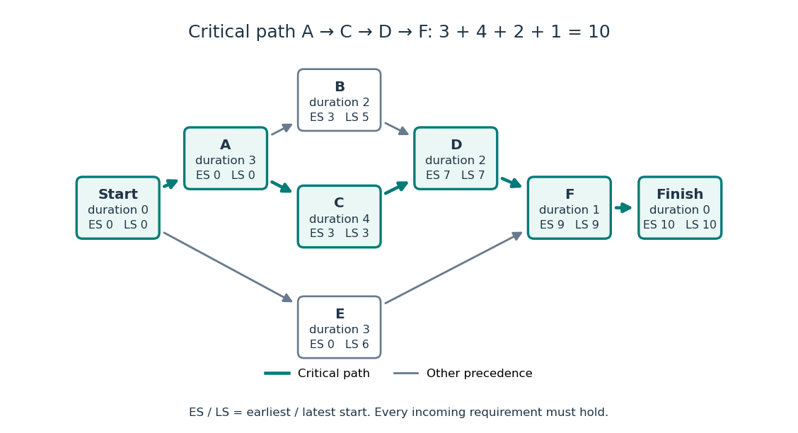

# Project scheduling

↑ **Parent:** [Mathematical optimization](mathematical-optimization-split.md)

[Project scheduling](project-scheduling.md) asks how quickly a collection of dependent activities can finish. Adding their durations usually overestimates the answer, because independent activities can run together; taking only the longest single activity usually underestimates it, because some activities must wait. The [critical path method](critical-path-method.md) identifies the chain of dependencies that determines the finish time. Its simplest model assumes known, fixed durations, unlimited parallel processing, and precedence requirements saying that each predecessor must finish before its successor starts. These are the assumptions of the basic model in [Hendrickson, Project Management for Construction, §10.2](https://www.cmu.edu/cee/projects/PMbook/10_Fundamental_Scheduling_Procedures.html#10.2).

Represent each activity by a [vertex](vertex-graph-theory.md) of a finite [Directed acyclic graph](directed-acyclic-graph.md); an [edge](edge-of-a-graph.md) $i\to j$ means that activity $j$ waits for activity $i$. Activity $i$ runs without interruption for duration $\tau_i\geq0$, starting at $t_i\geq0$. The [optimization constraints](optimization-constraint.md) and project finish time are

$$
t_j\geq t_i+\tau_i\quad(i\to j),\qquad T=\max_i(t_i+\tau_i).
$$

The [objective function](objective-function.md) is to minimize $T$. All durations and start times use the same time unit, and the project starts at time zero. The [Directed acyclic graph](directed-acyclic-graph.md) assumption allows a [topological order](topological-order.md) in which every predecessor is processed first.

Consider this small, abstract project:

| Activity | Duration | Immediate predecessors |
| --- | --- | --- |
| A | 3 | None |
| B | 2 | A |
| C | 4 | A |
| D | 2 | B and C |
| E | 3 | None |
| F | 1 | D and E |

Activities A and E may start together. After A finishes, B and C may run together, but D must wait for both. F must similarly wait for both D and E: a merge means all incoming requirements must hold. This activity-as-[vertex](vertex-graph-theory.md) convention keeps durations on the activities and uses arrows only to express precedence.

**[Figure 2](#image-six-activity-project-scheduling-network-the-critical-graph-path-a-c-d-f-takes-10-time-units). Six-activity project scheduling network: the critical graph path A-C-D-F takes 10 time units**.

Unlimited parallel processing is essential to the equality between the longest [graph path](path-in-a-graph.md) duration and the optimal finish time. For example, two independent chains, each containing two activities of duration 3, have longest [graph path](path-in-a-graph.md) duration 6. Two processors can finish both chains in 6, but one processor needs 12 because all four activities must run sequentially. Thus with limited resources the longest [graph path](path-in-a-graph.md) still gives a lower bound, but it need not be achievable. Such resource requirements belong to the broader subject of [scheduling](scheduling.md).

// Target: mathematical-optimization.bigb

**Table of contents**

- [Critical path method](critical-path-method.md)
  - [Task float](task-float.md)
  - [Project scheduling duality](project-scheduling-duality.md)
    - [Unit-flow certificate for project duration](unit-flow-certificate-for-project-duration.md)

## ↑ Ancestors (4)

1. [Mathematical optimization](mathematical-optimization-split.md)
2. [Area of mathematics](area-of-mathematics.md)
3. [Mathematics](mathematics-split.md)
4. [Codex Wiki](split.md)

## ← Incoming links (4)

- [Critical path method](critical-path-method.md)
- [Solution](past-exam-of-the-mathematics-course-of-the-university-of-cambridge/2006/iii/paper-38/2/solution.md)
- [Project scheduling](project-scheduling.md)
- [Task float](task-float.md)
