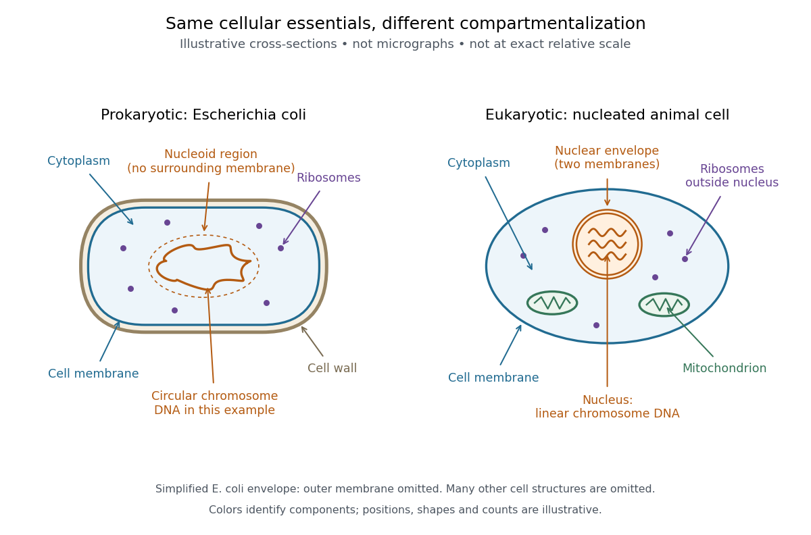

# Prokaryote

↑ **Parent:** [Organism](organism-split.md)  
ⓦ [Wiki](https://en.wikipedia.org/wiki/Prokaryote)

A [prokaryote](prokaryote.md) is an [organism](organism-split.md) whose [biological cells](biological-cell-split.md) lack a membrane-bounded [cell nucleus](cell-nucleus.md). The [DNA](deoxyribonucleic-acid.md) of its [chromosomes](chromosome.md) occupies a [nucleoid](nucleoid.md) within the [cytoplasm](cytoplasm.md). [Bacteria](bacteria.md) and [archaea](archaea.md) have this cellular organization. Both contain [ribosomes](ribosome.md) that perform [biological translation](translation-biology.md) and a selective [cell membrane](cell-membrane-split.md); neither is a bag of unorganized chemicals. See [OpenStax Biology 2e, 4.2: prokaryotic organization](https://openstax.org/books/biology-2e/pages/4-2-prokaryotic-cells).

The word [prokaryotic](prokaryote.md) describes organization, not a single exclusive [clade](clade.md). Grouping [bacteria](bacteria.md) and [archaea](archaea.md) by the absence of a [cell nucleus](cell-nucleus.md) is useful for comparing [biological cells](biological-cell-split.md), but does not establish that they share a more recent ancestor with one another than either does with [eukaryotes](eukaryote.md). See [three-domain system](three-domain-system.md) and [two-domain system](two-domain-system.md) for the different ancestry models.

[Prokaryotic](prokaryote.md) does not mean membrane-free. [Cyanobacteria](cyanobacteria.md) contain internal [thylakoid](thylakoid.md) membranes for [oxygenic photosynthesis](oxygenic-photosynthesis.md), despite lacking [chloroplasts](chloroplast.md) and a [cell nucleus](cell-nucleus.md). Many [prokaryotes](prokaryote.md) have circular [chromosomes](chromosome.md), but circular shape and a single [chromosome](chromosome.md) are not defining requirements. See [OpenStax Biology 2e, 22.2: bacterial and archaeal structures](https://openstax.org/books/biology-2e/pages/22-2-structure-of-prokaryotes-bacteria-and-archaea).

**[Figure 5](#image-cell-organization-an-escherichia-coli-example-beside-a-nucleated-animal-cell). Cell organization: an Escherichia coli example beside a nucleated animal cell**. Original schematic cross-sections, not micrographs and not at exact relative scale. Both show a [cell membrane](cell-membrane-split.md), [cytoplasm](cytoplasm.md), [DNA](deoxyribonucleic-acid.md) and [ribosomes](ribosome.md). The [Escherichia coli](escherichia-coli.md) envelope is simplified: its outer membrane is omitted. The [animal](animal.md) cell additionally shows a [nuclear envelope](nuclear-envelope.md) and [mitochondria](mitochondria.md); many other structures are omitted. The outlined [nucleoid](nucleoid.md) is a region, not a membrane.

**Table of contents**

- [Bacteria](bacteria.md)
  - [Rhizobia](rhizobia.md)
  - [Shewanella oneidensis](shewanella-oneidensis.md)
  - [Wolbachia](wolbachia.md)
  - [Biofilm](biofilm.md)
  - [Paenibacillus larvae](paenibacillus-larvae.md)
  - [Streptococcus pyogenes](streptococcus-pyogenes.md)
  - [Alteromonas](alteromonas.md)
  - [Coxiella burnetii](coxiella-burnetii.md)
  - [Buchnera aphidicola](buchnera-aphidicola.md)
  - [Rickettsia parkeri](rickettsia-parkeri.md)
  - [Chlamydia](chlamydia.md)
  - [Rickettsia prowazekii](rickettsia-prowazekii.md)
  - [Chlamydia trachomatis](chlamydia-trachomatis.md)
  - [Pseudomonas aeruginosa](pseudomonas-aeruginosa.md)
  - [Alphaproteobacteria](alphaproteobacteria.md)
  - [Escherichia coli](escherichia-coli.md)
  - [Cyanobacteria](cyanobacteria.md)
    - [Synechocystis](synechocystis.md)
    - [Prochlorococcus](prochlorococcus.md)
  - [Gram-positive bacteria](gram-positive-bacteria.md)
  - [Gram-negative bacteria](gram-negative-bacteria.md)
  - [Bacillus megaterium](bacillus-megaterium.md)
- [Archaea](archaea.md)
  - [Asgard archaea](asgard-archaea.md)

## ↑ Ancestors (3)

1. [Organism](organism-split.md)
2. [Biology](biology-split.md)
3. [Codex Wiki](split.md)

## ← Incoming links (8)

- [Biological cell](biological-cell-split.md)
- [Cell membrane](cell-membrane-split.md)
- [Cell nucleus](cell-nucleus.md)
- [Cytoplasm](cytoplasm.md)
- [Organism](organism-split.md)
- [Prokaryote](prokaryote.md)
- [Ribosome](ribosome.md)
- [Three-domain system](three-domain-system.md)
