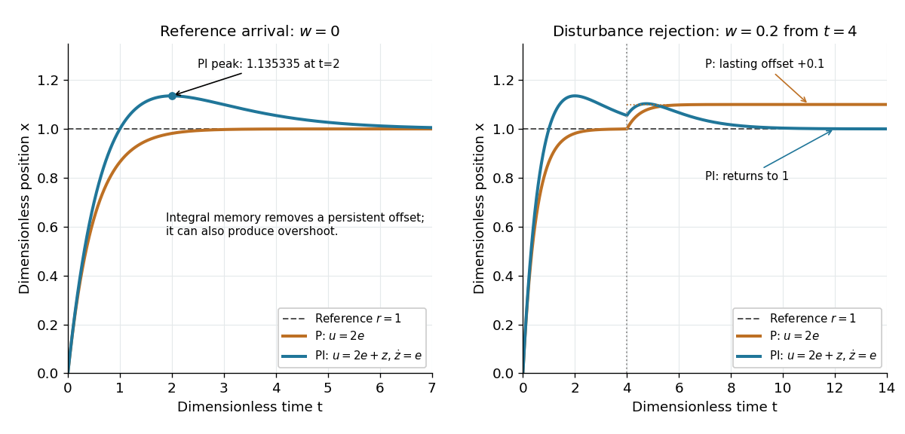

# Proportional-integral control

↑ **Parent:** [Integral action](integral-action.md)

[Proportional-integral control](proportional-integral-control.md) is the proportional and integral part of a [PID controller](pid-controller.md), with the derivative term omitted. [Proportional-integral control](proportional-integral-control.md) combines [proportional control](proportional-control.md) with [integral action](integral-action.md). For the ideal [controlled plant](plant-control-theory.md), a constant [reference signal](reference-signal.md), exact measurement and a constant [control disturbance](control-disturbance.md), the [ordinary differential equations](ordinary-differential-equation.md) give

$$
\dot e=-k_p e-k_i z-w,\qquad\dot z=e,\qquad
\ddot e+k_p\dot e+k_i e=0.
$$

The [characteristic polynomial](characteristic-polynomial.md) is $\lambda^2+k_p\lambda+k_i$. Positive $k_p$ and $k_i$ imply [asymptotic stability](asymptotic-stability.md) of the [equilibrium point](equilibrium-point-of-a-dynamical-system.md): real [roots of a polynomial](root-of-a-polynomial.md) have negative sum and positive product, hence are both negative; a nonreal [complex conjugate](complex-conjugate.md) pair has real part $-k_p/2<0$. This is a short stability check for this ideal [controlled plant](plant-control-theory.md), rather than a rule for every [dynamical system](dynamical-system.md).

At the [equilibrium point](equilibrium-point-of-a-dynamical-system.md), $e_*=0$, $x_*=r$, and $z_*=-w/k_i$. For $w=0.2$ and $k_i=1$, the stored value $z_*=-0.2$ supplies $u_*=-0.2$ even though the [tracking error](tracking-error.md) is zero. This separates the eventual accuracy from the transient response: [integral action](integral-action.md) cancels the lasting offset but can make the [plant output](output-control-theory.md) pass beyond the goal. The authors discuss practical limits on [integral action](integral-action.md) in [Åström and Murray, Feedback Systems, Chapter 11](https://www.fbswiki.org/wiki/index.php/PID_Control).

For $k_p=2$, $k_i=1$, $x(0)=z(0)=0$ and $w=0$, the [characteristic polynomial](characteristic-polynomial.md) is $(\lambda+1)^2$. The [initial conditions](initial-condition.md) are $e(0)=1$ and $\dot e(0)=-2$, giving

$$
e(t)=(1-t)e^{-t},\qquad x(t)=1-(1-t)e^{-t},\qquad z(t)=te^{-t}.
$$

The [tracking error](tracking-error.md) changes sign at $t=1$. Since $\dot x=(2-t)e^{-t}$, the largest [plant output](output-control-theory.md) occurs at $t=2$ and is $1+e^{-2}\simeq1.135335$, about $13.53\%$ above the [reference signal](reference-signal.md).

For a separate comparison, start the [control disturbance](control-disturbance.md) $w=0.2$ at $t=4$. For $t\ge4$, write $s=t-4$. The exact responses are

$$
x_P(t)=1-e^{-2t}+0.1(1-e^{-2s}),\qquad
x_{PI}(t)=1-(1-t)e^{-t}+0.2s e^{-s}.
$$

The [proportional control](proportional-control.md) response tends to $1.1$, while the [proportional-integral control](proportional-integral-control.md) response returns to $1$. At $t=8$, the values are approximately $1.099966$ and $1.017001$. The added term in the [proportional-integral control](proportional-integral-control.md) response eventually vanishes, exposing how memory removes a constant [control disturbance](control-disturbance.md)'s lasting effect.

**[Figure 6](#image-proportional-control-and-integral-action-arrival-and-disturbance-rejection). Proportional control and integral action: arrival and disturbance rejection**. Left: the ideal [controlled plant](plant-control-theory.md) has [reference signal](reference-signal.md) $r=1$ and no [control disturbance](control-disturbance.md); [proportional-integral control](proportional-integral-control.md) reaches a peak $1.135335$ at $t=2$. Right: a [control disturbance](control-disturbance.md) $w=0.2$ begins at $t=4$; [proportional control](proportional-control.md) settles at $1.1$, while [proportional-integral control](proportional-integral-control.md) returns to $1$. The generator uses the [classical fourth-order Runge-Kutta method](classical-fourth-order-runge-kutta-method.md) with step $0.002$, splits the computation at $t=4$, and checks both full responses and the stored memory against their exact formulas. All coordinates are [dimensionless quantities](dimensionless-quantity.md).

## ↑ Ancestors (6)

1. [Integral action](integral-action.md)
2. [Closed-loop control](closed-loop-control.md)
3. [Control theory](control-theory-split.md)
4. [Area of mathematics](area-of-mathematics.md)
5. [Mathematics](mathematics-split.md)
6. [Codex Wiki](split.md)

## ← Incoming links (5)

- [Solution](past-exam-of-the-mphil-in-micro-and-nanotechnology-enterprise-course-of-the-university-of-cambridge/2020/paper-1/section-a-i/1/ii/a/solution.md)
- [PID controller](pid-controller.md)
- [Proportional-integral control](proportional-integral-control.md)
- [Steady-state tracking error](steady-state-tracking-error.md)
- [Tracking error](tracking-error.md)
