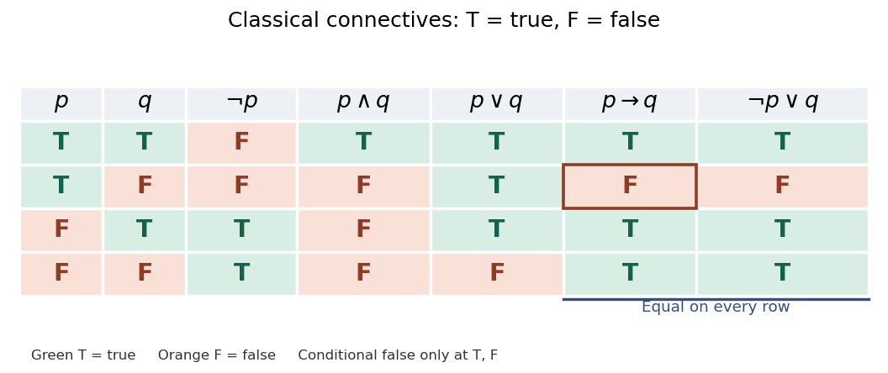
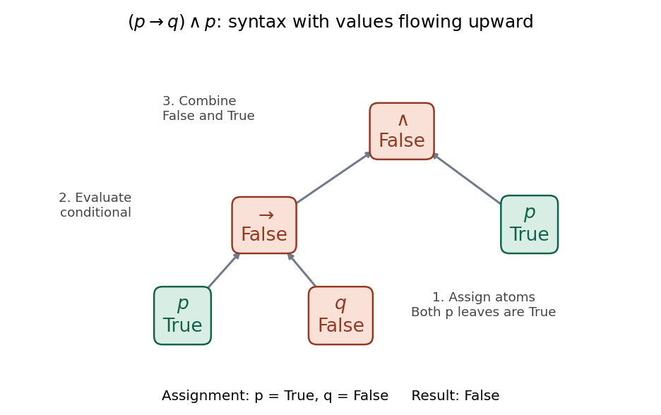

# Propositional logic

↑ **Parent:** [Mathematical logic](mathematical-logic-split.md)  
ⓦ [Wiki](https://en.wikipedia.org/wiki/Propositional_logic)

[Propositional logic](propositional-logic.md) studies reasoning with whole [propositions](proposition.md) represented by letters such as $p$ and $q$, and [propositional formulas](propositional-formula.md) built from them using [logical connectives](logical-connective.md). The classical two-valued, truth-functional presentation below assigns each primitive [proposition](proposition.md) either true or false: each compound value depends only on its component values. This is [classical propositional logic](classical-propositional-logic.md); other systems, including [Intuitionistic propositional logic](intuitionistic-propositional-logic.md), have different semantics and rules.

Starting with $p$ and $q$, one can build $\neg p$ by [logical negation](negation.md), $p\land q$ by [logical conjunction](logical-conjunction.md), $p\lor q$ by [logical disjunction](logical-disjunction.md), and $p\to q$ by [logical implication](logical-implication.md), then combine these into larger [propositional formulas](propositional-formula.md). Parentheses specify the construction: $(p\to q)\land p$ has [logical conjunction](logical-conjunction.md) as its outermost [logical connective](logical-connective.md). Primitive [propositions](proposition.md) have no internal structure in this language; a [first-order formula](first-order-formula.md) can additionally describe objects and quantify over them. The formation rules are given in [forall x: Calgary, chapter 6](https://forallx.openlogicproject.org/html/Ch6.html).

The following [truth table](truth-table.md) shows the four basic [logical connectives](logical-connective.md). [Logical disjunction](logical-disjunction.md) is inclusive: $p\lor q$ is true when either or both inputs are true. Classical [logical implication](logical-implication.md) has exactly the same values as $\neg p\lor q$; its only false row has $p$ true and $q$ false. These truth conditions are specified in [forall x: Calgary, chapter 9](https://forallx.openlogicproject.org/html/Ch9.html).

**[Figure 2](#image-classical-logical-connectives-on-all-four-boolean-valuations-with-matching-columns-for-p-to-q-and-neg-p-lor-q). Classical logical connectives on all four Boolean valuations, with matching columns for $p\to q$ and $\neg p\lor q$**.

Evaluate $(p\to q)\land p$ from the inside out: first the [logical implication](logical-implication.md), then the outer [logical conjunction](logical-conjunction.md). The final column also tests the [logical implication](logical-implication.md) expressing the [modus ponens rule](implication-elimination-rule.md):

$$
\begin{array}{cc|c|c|c}
p&q&p\to q&(p\to q)\land p&((p\to q)\land p)\to q\\\hline
\mathrm T&\mathrm T&\mathrm T&\mathrm T&\mathrm T\\
\mathrm T&\mathrm F&\mathrm F&\mathrm F&\mathrm T\\
\mathrm F&\mathrm T&\mathrm T&\mathrm F&\mathrm T\\
\mathrm F&\mathrm F&\mathrm T&\mathrm F&\mathrm T
\end{array}
$$

At $p=\mathrm T,q=\mathrm F$, the [logical implication](logical-implication.md) is false, so the [logical conjunction](logical-conjunction.md) is false. The [abstract syntax tree](abstract-syntax-tree.md) below separates the construction of the [propositional formula](propositional-formula.md) from the values propagated through it. Both occurrences of $p$ receive the same value from the [Boolean valuation](boolean-valuation.md). With the opposite assignment $p=\mathrm F,q=\mathrm T$, the [logical implication](logical-implication.md) is true but the [logical conjunction](logical-conjunction.md) is still false because its second input $p$ is false. Recursive evaluation and exhaustive [truth tables](truth-table.md) are explained in [forall x: Calgary, chapter 11](https://forallx.openlogicproject.org/html/Ch11.html).

**[Figure 3](#image-an-abstract-syntax-tree-evaluating-p-to-q-land-p-to-false-at-the-boolean-valuation-p-mathrm-t-q-mathrm-f). An abstract syntax tree evaluating $(p\to q)\land p$ to false at the Boolean valuation $p=\mathrm T,q=\mathrm F$**.

The last column is always true: $((p\to q)\land p)\to q$ is a [tautology](tautology.md). This expresses the [logical validity](logical-validity.md) of the [modus ponens rule](implication-elimination-rule.md): whenever both premises $p\to q$ and $p$ are true, $q$ is true. It does not say the premises are true under every [Boolean valuation](boolean-valuation.md); their [logical conjunction](logical-conjunction.md) is true only on the first row. For a short [natural deduction](natural-deduction.md) proof outline, assume $(p\to q)\land p$, extract both conjuncts, apply the [implication elimination rule](implication-elimination-rule.md) to obtain $q$, then discharge the assumption by the [implication introduction rule](implication-introduction-rule.md). See [forall x: Calgary, sections 17.3–17.5](https://forallx.openlogicproject.org/html/Ch17.html).

Three tests answer different questions: [Boolean satisfiability](boolean-satisfiability-problem.md) requires at least one true row, a [tautology](tautology.md) requires every row true, and a [contradiction](contradiction.md) has every row false. Thus $p\lor\neg p$ is a [tautology](tautology.md), $p\land\neg p$ is a [contradiction](contradiction.md), and $p\land q$ is satisfiable but not a [tautology](tautology.md): it is true only at $p=q=\mathrm T$. See [forall x: Calgary, sections 12.1–12.4](https://forallx.openlogicproject.org/html/Ch12.html).

[Propositional logic](propositional-logic.md) is useful because an inference pattern can be checked once and reused for many choices of [propositions](proposition.md). Its beauty is that a finite [truth table](truth-table.md) completely settles classical truth-functional questions about a fixed [propositional formula](propositional-formula.md). But [logical validity](logical-validity.md) does not verify real atomic claims. If $p$ means “the switch is closed” and $q$ means “the lamp is lit”, a valid use of the [modus ponens rule](implication-elimination-rule.md) still requires establishing its premises about the apparatus; the [truth table](truth-table.md) supplies neither an observation nor a causal explanation. See [forall x: Calgary, chapter 2](https://forallx.openlogicproject.org/html/Ch2.html) and [chapter 10](https://forallx.openlogicproject.org/html/Ch10.html).

**Table of contents**

- [Contradiction](contradiction.md)
- [Lindenbaum algebra](lindenbaum-algebra.md)
- [Propositional theory](propositional-theory.md)
  - [Propositional type](propositional-type.md)
    - [Extended omitting types theorem for propositional logic](extended-omitting-types-theorem-for-propositional-logic.md)
    - [Nonprincipal propositional type](nonprincipal-propositional-type.md)
- [Propositional formula](propositional-formula.md)
  - [Propositional variable elimination](propositional-variable-elimination.md)
    - [Propositional interpolation](propositional-interpolation.md)
- [Deduction theorem for propositional logic](deduction-theorem-for-propositional-logic.md)
- [Classical propositional logic](classical-propositional-logic.md)
  - [Tautology](tautology.md)
  - [Logical validity](logical-validity.md)
  - [Law of excluded middle](law-of-excluded-middle.md)
  - [Double-negation elimination](double-negation-elimination.md)
- [Boolean valuation](boolean-valuation.md)
  - [Truth table](truth-table.md)
- [Proposition](proposition.md)
  - [Logical connective](logical-connective.md)
    - [Logical implication](logical-implication.md)
      - [Contrapositive](contrapositive.md)
      - [Converse implication](converse-implication.md)
      - [Vacuous truth](vacuous-truth.md)
    - [Logical conjunction](logical-conjunction.md)
    - [Logical disjunction](logical-disjunction.md)
    - [Logical truth](logical-truth.md)
    - [Logical falsity](logical-falsity.md)
  - [Truth value](truth-value.md)
- [Natural deduction](natural-deduction.md)
  - [Identity weakening rule](identity-weakening-rule.md)
  - [Implication elimination rule](implication-elimination-rule.md)
  - [Implication introduction rule](implication-introduction-rule.md)
- [Intuitionistic propositional logic](intuitionistic-propositional-logic.md)
  - [Lattice](lattice.md)
    - [Join and meet](join-and-meet.md)
      - [Join in a lattice](join-in-a-lattice.md)
      - [Meet in a lattice](meet-in-a-lattice.md)
    - [Homomorphism of lattices](homomorphism-of-lattices.md)
    - [Complete lattice](complete-lattice.md)
      - [Knaster–Tarski fixed-point theorem](knaster-tarski-fixed-point-theorem.md)
    - [Distributive lattice](distributive-lattice.md)
      - [Distributive law for lattices](distributive-law-for-lattices.md)
      - [Boolean algebra](boolean-algebra.md)
        - [Boolean prime ideal theorem](boolean-prime-ideal-theorem.md)
        - [Ideal frame of a Boolean algebra](ideal-frame-of-a-boolean-algebra.md)
        - [Complete Boolean algebra](complete-boolean-algebra.md)
        - [Double-negation Boolean algebra](double-negation-boolean-algebra.md)
      - [Lattice filter](lattice-filter.md)
        - [Prime filter of a distributive lattice](prime-filter-of-a-distributive-lattice.md)
          - [Stone prime filter theorem](stone-prime-filter-theorem.md)
      - [Lattice ideal](lattice-ideal.md)
        - [Prime lattice ideal](prime-lattice-ideal.md)
      - [Priestley duality](priestley-duality.md)
        - [Priestley dual space](priestley-dual-space.md)
          - [Clopen up-set](clopen-up-set.md)
          - [Stone map of a distributive lattice](stone-map-of-a-distributive-lattice.md)
  - [Heyting algebra](heyting-algebra.md)
    - [Heyting implication](heyting-implication.md)
      - [Pseudocomplement](pseudocomplement.md)
    - [Heyting operations on subsheaves](heyting-operations-on-subsheaves.md)
    - [Regular element of a Heyting algebra](regular-element-of-a-heyting-algebra.md)
    - [Distributivity of a Heyting algebra](distributivity-of-a-heyting-algebra.md)
  - [Implicational Curry-Howard correspondence](implicational-curry-howard-correspondence.md)
  - [Curry-Howard correspondence](curry-howard-correspondence.md)
  - [Kripke model for intuitionistic propositional logic](kripke-model-for-intuitionistic-propositional-logic.md)
    - [Kripke forcing relation](kripke-forcing-relation.md)
      - [Persistence of intuitionistic Kripke forcing](persistence-of-intuitionistic-kripke-forcing.md)
      - [Kripke countermodel](kripke-countermodel.md)
    - [Kripke completeness theorem for intuitionistic propositional logic](kripke-completeness-theorem-for-intuitionistic-propositional-logic.md)
    - [Filtration of a Kripke model](filtration-of-a-kripke-model.md)
    - [Unravelling of a Kripke model](unravelling-of-a-kripke-model.md)
    - [Finite model property of intuitionistic propositional logic](finite-model-property-of-intuitionistic-propositional-logic.md)
  - [Disjunction property of intuitionistic propositional logic](disjunction-property-of-intuitionistic-propositional-logic.md)
  - [Implication-free fragment of intuitionistic propositional logic](implication-free-fragment-of-intuitionistic-propositional-logic.md)
    - [Completeness of implication-free intuitionistic propositional logic for distributive lattices](completeness-of-implication-free-intuitionistic-propositional-logic-for-distributive-lattices.md)
  - [Implicational fragment of intuitionistic propositional logic](implicational-fragment-of-intuitionistic-propositional-logic.md)
    - [Canonical Kripke model for implicational intuitionistic logic](canonical-kripke-model-for-implicational-intuitionistic-logic.md)
    - [Kripke completeness of implicational intuitionistic logic](kripke-completeness-of-implicational-intuitionistic-logic.md)
    - [Conservativity of intuitionistic propositional logic over its implicational fragment](conservativity-of-intuitionistic-propositional-logic-over-its-implicational-fragment.md)
- [Soundness theorem for propositional logic](soundness-theorem-for-propositional-logic.md)
- [Completeness theorem for propositional logic](completeness-theorem-for-propositional-logic.md)
  - [Maximal consistent set truth lemma](maximal-consistent-set-truth-lemma.md)
    - [Maximum consistent propositional theory gives a model](maximum-consistent-propositional-theory-gives-a-model.md)
  - [Uncountable-language proof of propositional completeness](uncountable-language-proof-of-propositional-completeness.md)
- [Decidability theorem for propositional logic](decidability-theorem-for-propositional-logic.md)
- [Deductively closed set of formulae](deductively-closed-set-of-formulae.md)
- [Consistent set of formulae](consistent-set-of-formulae.md)
- [Finitary set of formulae](finitary-set-of-formulae.md)
- [Increasing union of deductively closed sets](increasing-union-of-deductively-closed-sets.md)
- [Maximal consistent set in propositional logic](maximal-consistent-set-in-propositional-logic.md)
- [Propositional compactness theorem](propositional-compactness-theorem.md)
  - [Compactness obstruction to expressing totality over an infinite codomain](compactness-obstruction-to-expressing-totality-over-an-infinite-codomain.md)
- [Logical equivalence](logical-equivalence.md)

## ↑ Ancestors (5)

1. [Mathematical logic](mathematical-logic-split.md)
2. [Foundations of mathematics](foundations-of-mathematics-split.md)
3. [Area of mathematics](area-of-mathematics.md)
4. [Mathematics](mathematics-split.md)
5. [Codex Wiki](split.md)

## ← Incoming links (6)

- [Boolean satisfiability problem](boolean-satisfiability-problem.md)
- [Complement of a set](complement-of-a-set.md)
- [Decidability theorem for propositional logic](decidability-theorem-for-propositional-logic.md)
- [Solution](past-exam-of-the-mathematics-course-of-the-university-of-cambridge/2007/ii/paper-2/16g/solution.md)
- [Solution](past-exam-of-the-mathematics-course-of-the-university-of-cambridge/2020/ii/paper-2/16h/a/solution.md)
- [Propositional logic](propositional-logic.md)
