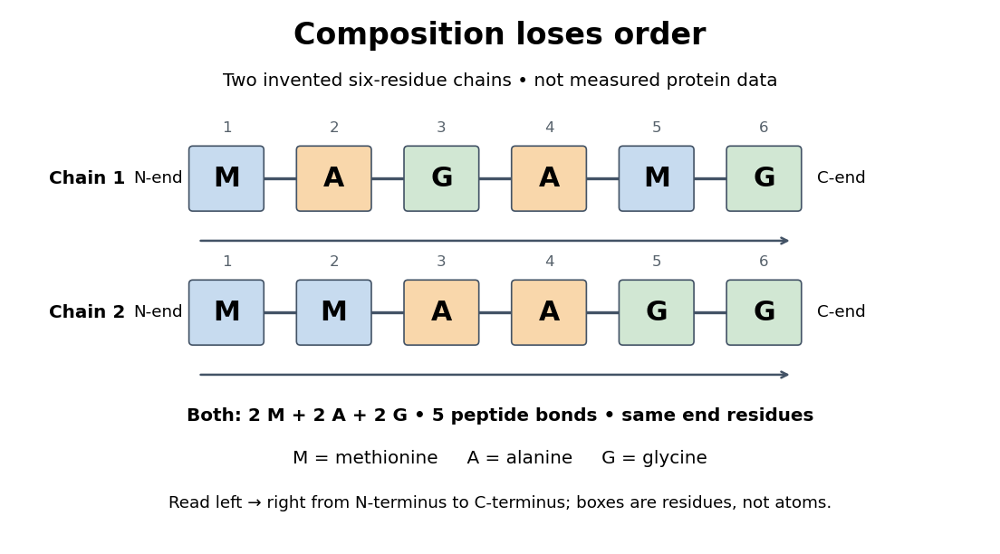

# Protein primary structure

↑ **Parent:** [Protein structure](protein-structure.md)  
ⓦ [Wiki](https://en.wikipedia.org/wiki/Protein_primary_structure)

The [protein primary structure](protein-primary-structure.md) specifies the ordered [amino acid residues](amino-acid-residue.md) of each [polypeptide chain](polypeptide.md), joined through [peptide bonds](peptide-bond.md). A chain is conventionally written from its [N-terminus](n-terminus.md) to its [C-terminus](c-terminus.md). In the broader chemical sense, a complete [protein primary structure](protein-primary-structure.md) also specifies [covalent bond](covalent-bond.md) crosslinks between chain positions, including [protein disulfide bonds](protein-disulfide-bond.md); a bare sequence string leaves that information unstated. This describes chemical connectivity rather than the spatial arrangement of [protein tertiary structure](protein-tertiary-structure.md) or [protein quaternary structure](protein-quaternary-structure.md). See [IUPAC Gold Book: primary structure, sequence and chain crosslinking](https://goldbook.iupac.org/terms/view/P04843) and [IUPAC-IUB, 3AA-16: writing residue sequences from the amino end](https://iupac.qmul.ac.uk/AminoAcid/A1416.html). Some conventions reserve [protein primary structure](protein-primary-structure.md) for sequence alone and call the complete chemical connectivity the covalent structure; the distinction should be stated when comparing descriptions. See [IUPAC-IUB polypeptide-conformation recommendations, section 6.1: the narrower sequence-only convention](https://iupac.qmul.ac.uk/misc/noGreek/ppep4.html).

**[Figure 32](#image-equal-amino-acid-composition-and-equal-termini-do-not-determine-protein-primary-structure). Equal amino acid composition and equal termini do not determine protein primary structure**. Original toy [polypeptide chains](polypeptide.md) MAGAMG and MMAAGG, read from the [N-terminus](n-terminus.md) to the [C-terminus](c-terminus.md). Each contains two [methionine](methionine.md), two [alanine](alanine.md) and two [glycine](glycine.md) [amino acid residues](amino-acid-residue.md), but their internal order differs. Letters denote chain positions rather than free [amino acids](amino-acid.md); lines denote [peptide bonds](peptide-bond.md). Neither string is identified as a natural [protein](protein.md) or a measured sequence.

In this toy example M denotes [methionine](methionine.md), A [alanine](alanine.md) and G [glycine](glycine.md). Both [polypeptide chains](polypeptide.md) have six [amino acid residues](amino-acid-residue.md), five [peptide bonds](peptide-bond.md), an M at the [N-terminus](n-terminus.md) and a G at the [C-terminus](c-terminus.md). Their [amino acid composition](amino-acid-composition.md) is identical, yet position 2 is A in MAGAMG and M in MMAAGG. There are $6!/(2!2!2!)=90$ distinct orders with these counts, a [multinomial coefficient](multinomial-coefficient.md). Even fixing those two end residues leaves $4!/(1!2!1!)=12$ orders. The counts constrain the answer without determining it.

For multiple [polypeptide chains](polypeptide.md), record each sequence separately and specify any [protein disulfide bonds](protein-disulfide-bond.md) between [cysteine](cysteine.md) positions. Mature [insulin](insulin.md), for example, has an A chain of 21 [amino acid residues](amino-acid-residue.md) and a B chain of 30 [amino acid residues](amino-acid-residue.md). Their combined 51 residues give $(21-1)+(30-1)=49$ [peptide bonds](peptide-bond.md), rather than the 50 of one unbroken 51-residue chain. See [Cooper, The Cell: insulin's two chains and cysteine crosslinks, figure 2.16](https://www.ncbi.nlm.nih.gov/books/NBK9879/). A [protein disulfide bond](protein-disulfide-bond.md) joins side groups; it does not concatenate the [C-terminus](c-terminus.md) of one chain with the [N-terminus](n-terminus.md) of another. The three [insulin](insulin.md) [protein disulfide bonds](protein-disulfide-bond.md) connect A6 to A11 within the A chain, and A7 to B7 and A20 to B19 between chains. Positions are numbered from each chain's [N-terminus](n-terminus.md). See [Replacement of the interchain disulfide bridge-forming amino acids A7 and B7 by glutamate impairs the structure and activity of insulin: native disulfide positions](https://pubmed.ncbi.nlm.nih.gov/15653430/).

Why keep this information? [Protein primary structure](protein-primary-structure.md) lets us distinguish changes of chemical identity from changes of shape, and compare corresponding positions between [proteins](protein.md). [Protein folding](protein-folding.md) can bring distant [amino acid residues](amino-acid-residue.md) together at a [protein binding site](protein-binding-site.md) while preserving their sequence. The attractive idea is that a readable linear record can constrain a complicated three-dimensional object; it is not, by itself, a guarantee of a unique fold in every environment. See [protein folding](protein-folding.md) and the [ribonuclease A refolding experiment](ribonuclease-a-refolding-experiment.md). Merely bending an intact chain preserves its [protein primary structure](protein-primary-structure.md); [hydrolysis](hydrolysis.md) of a [peptide bond](peptide-bond.md), or changing which positions a [protein disulfide bond](protein-disulfide-bond.md) connects, changes its chemical connectivity.

**Table of contents**

- [Amino acid composition](amino-acid-composition.md)
  - [Glycine](glycine.md)
  - [Phenylalanine](phenylalanine.md)
  - [Cysteine](cysteine.md)
- [Sanger's insulin sequencing experiment](sanger-s-insulin-sequencing-experiment.md)
- [Insulin](insulin.md)
  - [Proinsulin](proinsulin.md)
    - [C-peptide](c-peptide.md)
  - [Glucose clamp technique](glucose-clamp-technique.md)

## ↑ Ancestors (4)

1. [Protein structure](protein-structure.md)
2. [Protein](protein.md)
3. [Biology](biology-split.md)
4. [Codex Wiki](split.md)

## ← Incoming links (17)

- [Active site](active-site.md)
- [Amino acid composition](amino-acid-composition.md)
- [Amino acid residue](amino-acid-residue.md)
- [Beta sheet](beta-sheet.md)
- [Chaperone (protein)](chaperone-protein.md)
- [Denaturation (biochemistry)](denaturation-biochemistry.md)
- [Disulfide bond](disulfide-bond.md)
- [Induced fit](induced-fit.md)
- [Paratope](paratope.md)
- [Phosphotyrosine residue](phosphotyrosine-residue.md)
- [Protein](protein.md)
- [Protein aggregation](protein-aggregation.md)
- [Protein primary structure](protein-primary-structure.md)
- [Protein secondary structure](protein-secondary-structure.md)
- [Protein structure](protein-structure.md)
- [Protein tertiary structure](protein-tertiary-structure.md)
- [Ribonuclease A](ribonuclease-a.md)
