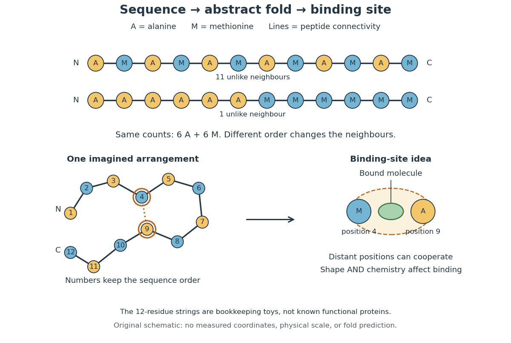

# Protein

↑ **Parent:** [Biology](biology-split.md)  
ⓦ [Wiki](https://en.wikipedia.org/wiki/Protein)

A [protein](protein-split.md) is a biological [molecule](molecule-split.md) made of one or more [polypeptide chains](polypeptide.md): ordered [amino acid residues](amino-acid-residue.md) joined by [peptide bonds](peptide-bond.md). [Biological translation](translation-biology.md) assembles a chain in the order specified by [messenger RNA](messenger-rna.md) [codons](codon.md). [Protein folding](protein-folding.md) then brings parts of that chain into spatial relationships that support its function. See [Cooper, The Cell: protein composition and structure](https://www.ncbi.nlm.nih.gov/books/NBK9879/). These processes can overlap in a [biological cell](biological-cell-split.md); the sequence-to-shape explanation does not require waiting until [biological translation](translation-biology.md) finishes before any folding begins. See [Cooper, The Cell: protein folding and processing](https://www.ncbi.nlm.nih.gov/books/NBK9843/).

The useful connection is from information to physical work. A [protein](protein-split.md)'s [protein primary structure](protein-primary-structure.md) records an order; its [protein tertiary structure](protein-tertiary-structure.md) can bring distant [amino acid residues](amino-acid-residue.md) together at an [active site](active-site.md). An [enzyme](enzyme-split.md) uses such an arrangement to recognize a [substrate](substrate-biochemistry.md) and accelerate a [chemical reaction](chemical-reaction-split.md). Other [proteins](protein-split.md) serve as [receptors](receptor-biochemistry.md), [membrane transport proteins](membrane-transport-protein.md) or structural material. For example, [actin](actin.md) assembles into filaments whose mechanical properties can be described by [biopolymer mechanics](biopolymer-mechanics.md). See [Alberts et al., Molecular Biology of the Cell: protein function and binding](https://www.ncbi.nlm.nih.gov/books/NBK26911/).

Order matters beyond composition. Let A stand for [alanine](alanine.md) and M for [methionine](methionine.md), and read from the [N-terminus](n-terminus.md) to the [C-terminus](c-terminus.md). The illustrative strings AMAMAMAMAMAM and AAAAAAMMMMMM each contain exactly six A and six M [amino acid residues](amino-acid-residue.md). Each has $12-1=11$ [peptide bonds](peptide-bond.md) when made into one unbranched [polypeptide chain](polypeptide.md). In the first string all eleven neighboring pairs have different letters; in the second only the pair at positions 6 and 7 does. A composition [histogram](histogram.md) therefore loses information about which [amino acid residues](amino-acid-residue.md) are neighbors. Their arrangements can affect [protein folding](protein-folding.md) and function; these short invented strings neither specify a known functional [protein](protein-split.md) nor establish what shape either would adopt.

**[Figure 1](#image-from-amino-acid-order-to-an-imagined-fold-and-binding-site). From amino acid order to an imagined fold and binding site**. Original schematic using two twelve-residue strings with equal composition. The imagined fold uses the first string: colors and numbers preserve its [protein primary structure](protein-primary-structure.md), while positions 4 and 9 approach one another. The binding-site cartoon explains spatial cooperation, not an actual [enzyme](enzyme-split.md) or a measured [protein structure](protein-structure.md). No actual coordinates, physical scale or exact [protein folding](protein-folding.md) predictor are implied.

[Protein structure](protein-structure.md) is a moving arrangement, not a permanently rigid outline. [Substrate](substrate-biochemistry.md) binding can change an [enzyme](enzyme-split.md)'s shape through [induced fit](induced-fit.md), and a functional [protein](protein-split.md) can include flexible regions. Sequence, surroundings and interacting [molecules](molecule-split.md) must therefore be considered together. See [Alberts et al.: binding, conformational changes and protein function](https://www.ncbi.nlm.nih.gov/books/NBK26911/).

**Table of contents**

- [Exportin-5](exportin-5.md)
- [DKK1](dkk1.md)
- [LEFTY1](lefty1.md)
- [CER1](cer1.md)
- [Protein perdurance](protein-perdurance.md)
- [Protein–DNA interaction](protein-dna-interaction.md)
  - [DNA bridging](dna-bridging.md)
  - [DNA competition assay](dna-competition-assay.md)
    - [Nonspecific competitor DNA](nonspecific-competitor-dna.md)
    - [Specific competitor DNA](specific-competitor-dna.md)
  - [Ternary protein–DNA complex](ternary-protein-dna-complex.md)
- [Lectin](lectin.md)
  - [Concanavalin A](concanavalin-a.md)
- [CD34-family sialomucin](cd34-family-sialomucin.md)
- [Moesin](moesin.md)
- [VEGF-A](vegf-a.md)
- [FGFR2](fgfr2.md)
- [FGF10](fgf10.md)
- [Podocalyxin](podocalyxin.md)
- [Rabin8](rabin8.md)
- [Lethal giant larvae](lethal-giant-larvae.md)
- [Discs large](discs-large.md)
- [PATJ](patj.md)
- [PALS1](pals1.md)
- [PAR-6](par-6.md)
- [PITX2](pitx2.md)
- [TBX3](tbx3.md)
- [TBX2](tbx2.md)
- [ISL1](isl1.md)
- [Mesp1](mesp1.md)
- [Ascl2](ascl2.md)
- [Bmi1](bmi1.md)
- [SoxR](soxr.md)
- [PqsE](pqse.md)
- [PqsR](pqsr.md)
- [RhlR](rhlr.md)
- [LasR](lasr.md)
- [FtsZ](ftsz.md)
- [MreB](mreb.md)
- [MtrC](mtrc.md)
- [CymA](cyma.md)
- [Acyl carrier protein](acyl-carrier-protein.md)
- [Calmodulin](calmodulin.md)
- [Lipid transfer protein](lipid-transfer-protein.md)
- [Centrosomin](centrosomin.md)
- [Protein degradation](protein-degradation.md)
  - [Acute protein depletion](acute-protein-depletion.md)
    - [Inducible degron](inducible-degron.md)
- [Transformer protein](transformer-protein.md)
- [Ferritin](ferritin.md)
- [Epitope tag](epitope-tag.md)
  - [FLAG tag](flag-tag.md)
- [Streptavidin](streptavidin.md)
- [Ligand binding](ligand-binding.md)
  - [Binding affinity](binding-affinity.md)
- [DNA-binding protein](dna-binding-protein.md)
- [Intrinsically disordered protein](intrinsically-disordered-protein.md)
- [Adaptor protein](adaptor-protein.md)
  - [Nck](nck.md)
- [CadC](cadc.md)
- [Perforin](perforin.md)
- [Ferredoxin](ferredoxin.md)
- [Myoglobin](myoglobin.md)
- [Guanine nucleotide exchange factor](guanine-nucleotide-exchange-factor.md)
  - [eEF1B](eef1b.md)
  - [EF-Ts](ef-ts.md)
- [MT1-MMP](mt1-mmp.md)
- [Munc18](munc18.md)
- [Scribble](scribble.md)
- [Vermiform](vermiform.md)
- [Coracle](coracle.md)
- [Yurt](yurt.md)
- [Crumbs](crumbs.md)
- [Bazooka](bazooka.md)
- [PAR-3](par-3.md)
- [Cdc42](cdc42.md)
- [Beta-catenin](beta-catenin.md)
- [p53](p53.md)
  - [MDM2](mdm2.md)
- [Mahjong protein](mahjong-protein.md)
- [R-spondin](r-spondin.md)
- [Lgr5](lgr5.md)
- [Fluorescent protein](fluorescent-protein.md)
  - [Photoconvertible fluorescent protein](photoconvertible-fluorescent-protein.md)
  - [Fluorescent reporter](fluorescent-reporter.md)
- [Sca2](sca2.md)
- [PDZD8](pdzd8.md)
- [TANGO1](tango1.md)
- [Sec24](sec24.md)
- [GTPase-activating protein](gtpase-activating-protein.md)
  - [Regulator of G protein signalling](regulator-of-g-protein-signalling.md)
- [Sec23](sec23.md)
- [Sar1](sar1.md)
- [Sec12](sec12.md)
- [WWTR1](wwtr1.md)
- [Vinculin](vinculin.md)
- [Talin](talin.md)
- [LINC complex](linc-complex.md)
- [Cadherin](cadherin.md)
  - [VE-cadherin](ve-cadherin.md)
- [SNX9](snx9.md)
- [Dynamin](dynamin.md)
- [Epsin](epsin.md)
- [AP-2 complex](ap-2-complex.md)
- [Histidine tag](histidine-tag.md)
- [Ubiquitin-proteasome system](ubiquitin-proteasome-system.md)
- [Drp1](drp1.md)
- [OPA1](opa1.md)
- [Mitofusin](mitofusin.md)
- [Proteasomal degradation](proteasomal-degradation.md)
- [Rational protein design](rational-protein-design.md)
- [Directed evolution](directed-evolution.md)
  - [DNA shuffling](dna-shuffling.md)
- [Limited proteolysis](limited-proteolysis.md)
- [Hfq](hfq.md)
- [Beta-2-microglobulin](beta-2-microglobulin.md)
- [Vimentin](vimentin.md)
- [E-cadherin](e-cadherin.md)
- [Replication protein A](replication-protein-a.md)
- [Single-stranded DNA-binding protein](single-stranded-dna-binding-protein.md)
- [ESCRT-III](escrt-iii.md)
- [RhoA](rhoa.md)
- [ECT2](ect2.md)
- [Centralspindlin](centralspindlin.md)
- [Securin](securin.md)
- [PD-L1](pd-l1.md)
- [Separase](separase.md)
- [Cyclin](cyclin.md)
  - [Cyclin A](cyclin-a.md)
- [Antizyme](antizyme.md)
- [Clathrin](clathrin.md)
- [HCF244](hcf244.md)
- [GCN1](gcn1.md)
- [KAP1](kap1.md)
- [HP1 protein](hp1-protein.md)
  - [Swi6](swi6.md)
- [Histone](histone.md)
  - [Histone variant](histone-variant.md)
    - [CENP-A](cenp-a.md)
  - [Linker histone](linker-histone.md)
  - [Histone H3](histone-h3.md)
- [RNA-binding protein](rna-binding-protein.md)
  - [DGCR8](dgcr8.md)
  - [Pumilio](pumilio.md)
  - [G3BP2](g3bp2.md)
  - [G3BP1](g3bp1.md)
  - [Sex-lethal](sex-lethal.md)
  - [RNA recognition motif](rna-recognition-motif.md)
  - [Cth2](cth2.md)
  - [GW182](gw182.md)
  - [PP7 coat protein](pp7-coat-protein.md)
  - [MS2 coat protein](ms2-coat-protein.md)
  - [Pentatricopeptide repeat protein](pentatricopeptide-repeat-protein.md)
    - [PPR10](ppr10.md)
  - [ZBP1](zbp1.md)
  - [IGF2BP protein](igf2bp-protein.md)
  - [Poly(A)-binding protein](poly-a-binding-protein.md)
  - [Argonaute](argonaute.md)
    - [HRDE-1](hrde-1.md)
    - [Argonaute slicing](argonaute-slicing.md)
    - [Piwi protein](piwi-protein.md)
      - [PRG-1](prg-1.md)
      - [MIWI2](miwi2.md)
      - [MILI](mili.md)
      - [AGO3](ago3.md)
      - [Aubergine](aubergine.md)
    - [AGO4](ago4.md)
  - [HNRNPC](hnrnpc.md)
  - [PTBP protein](ptbp-protein.md)
    - [PTBP1](ptbp1.md)
  - [RBFOX protein](rbfox-protein.md)
  - [NOVA protein](nova-protein.md)
- [KRAS4B](kras4b.md)
- [Polybasic region](polybasic-region.md)
- [Ras](ras.md)
  - [KRAS G12C protein](kras-g12c-protein.md)
    - [AMG 510](amg-510.md)
- [Prenylation](prenylation.md)
- [N-myristoylation](n-myristoylation.md)
- [S-palmitoylation](s-palmitoylation.md)
- [Protein lipidation](protein-lipidation.md)
- [Apoferritin](apoferritin.md)
- [RAD51](rad51.md)
- [Nucleoprotein filament](nucleoprotein-filament.md)
- [RecA](reca.md)
- [Allostery](allostery.md)
  - [Allosteric modulator](allosteric-modulator.md)
  - [Thermodynamic linkage](thermodynamic-linkage.md)
  - [Cooperative binding](cooperative-binding.md)
    - [Hill equation](hill-equation.md)
      - [Hill constant](hill-constant.md)
      - [Hill activation function](hill-activation-function.md)
      - [Hill coefficient](hill-coefficient.md)
- [Globular protein](globular-protein.md)
- [Protein interaction network](protein-interaction-network.md)
- [Post-translational modification](post-translational-modification.md)
  - [Histone modification](histone-modification.md)
    - [Histone methylation](histone-methylation.md)
      - [Polycomb repressive complex 2](polycomb-repressive-complex-2.md)
      - [SUVH6](suvh6.md)
      - [SUVH5](suvh5.md)
      - [SUVH4](suvh4.md)
      - [H3K4 methylation](h3k4-methylation.md)
      - [H3K27 trimethylation](h3k27-trimethylation.md)
  - [Protein deamidation](protein-deamidation.md)
  - [Modification site occupancy](modification-site-occupancy.md)
- [Affinity tag](affinity-tag.md)
- [Protein-protein interaction](protein-protein-interaction.md)
  - [Homotypic protein interaction](homotypic-protein-interaction.md)
  - [Protein oligomerization](protein-oligomerization.md)
    - [Protein dimer](protein-dimer.md)
  - [Multivalency](multivalency.md)
  - [Weak biomolecular binding](weak-biomolecular-binding.md)
  - [Protein-protein interaction network](protein-protein-interaction-network.md)
  - [Dominant-negative effect](dominant-negative-effect.md)
- [Trypsinogen](trypsinogen.md)
- [Antifreeze glycoprotein](antifreeze-glycoprotein.md)
- [PIE-1](pie-1.md)
- [P-TEFb](p-tefb.md)
- [Pgc protein](pgc-protein.md)
- [Nanos](nanos.md)
- [Tudor](tudor.md)
- [Vasa](vasa.md)
- [Oskar](oskar.md)
- [Cactus protein](cactus-protein.md)
- [Spätzle](spatzle.md)
- [Proteolytic cascade](proteolytic-cascade.md)
- [Pipe](pipe.md)
- [Collagen](collagen.md)
  - [Procollagen](procollagen.md)
- [Beta-lactoglobulin](beta-lactoglobulin.md)
- [Cohesin](cohesin.md)
  - [Scc1](scc1.md)
- [Bovine serum albumin](bovine-serum-albumin.md)
- [Antibody](antibody.md)
  - [Catalytic antibody](catalytic-antibody.md)
  - [Antibody-drug conjugate](antibody-drug-conjugate.md)
  - [Antibody phage display](antibody-phage-display.md)
  - [Hybridoma technology](hybridoma-technology.md)
  - [Primary antibody](primary-antibody.md)
  - [Secondary antibody](secondary-antibody.md)
  - [Epitope](epitope.md)
    - [Epitope mapping](epitope-mapping.md)
  - [Immunoglobulin G](immunoglobulin-g.md)
    - [IgG chain reduction experiment](igg-chain-reduction-experiment.md)
    - [Antibody hinge region](antibody-hinge-region.md)
  - [Immunoglobulin heavy chain](immunoglobulin-heavy-chain.md)
  - [Immunoglobulin light chain](immunoglobulin-light-chain.md)
  - [Antibody variable region](antibody-variable-region.md)
    - [Complementarity-determining region](complementarity-determining-region.md)
  - [Antibody constant region](antibody-constant-region.md)
  - [Fragment antigen-binding](fragment-antigen-binding.md)
    - [Papain digestion of IgG](papain-digestion-of-igg.md)
  - [Fragment crystallizable region](fragment-crystallizable-region.md)
  - [Paratope](paratope.md)
  - [Antigen](antigen.md)
    - [Neoantigen](neoantigen.md)
    - [Tumour-associated antigen](tumour-associated-antigen.md)
  - [Antibody specificity](antibody-specificity.md)
    - [Cross-reactivity](cross-reactivity.md)
  - [Monoclonal antibody](monoclonal-antibody.md)
  - [Avidity](avidity.md)
    - [Effective local concentration](effective-local-concentration.md)
  - [Antibody affinity](antibody-affinity.md)
    - [Affinity maturation](affinity-maturation.md)
    - [Antibody equilibrium occupancy](antibody-equilibrium-occupancy.md)
    - [Antibody surface plasmon resonance experiment](antibody-surface-plasmon-resonance-experiment.md)
- [Western blot](western-blot.md)
  - [Western blot separation](western-blot-separation.md)
  - [Western blot transfer](western-blot-transfer.md)
    - [Western blot membrane](western-blot-membrane.md)
      - [Nitrocellulose Western blot membrane](nitrocellulose-western-blot-membrane.md)
  - [Western blot antibody detection](western-blot-antibody-detection.md)
  - [Western blot band interpretation](western-blot-band-interpretation.md)
  - [Western blot controls](western-blot-controls.md)
    - [Western blot loading control](western-blot-loading-control.md)
    - [Western blot transfer control](western-blot-transfer-control.md)
    - [Western blot antibody specificity control](western-blot-antibody-specificity-control.md)
  - [Western blot normalization](western-blot-normalization.md)
  - [Western blot response saturation](western-blot-response-saturation.md)
- [Protein targeting](protein-targeting.md)
  - [Protein secretion](protein-secretion.md)
  - [Signal peptide](signal-peptide.md)
    - [Signal peptidase](signal-peptidase.md)
  - [Signal anchor](signal-anchor.md)
  - [Stop-transfer sequence](stop-transfer-sequence.md)
  - [Organelle protein import](organelle-protein-import.md)
    - [Organelle import assay](organelle-import-assay.md)
    - [Cotranslational protein translocation](cotranslational-protein-translocation.md)
      - [Signal recognition particle](signal-recognition-particle.md)
        - [Ffh](ffh.md)
        - [SRP54](srp54.md)
        - [Signal recognition particle receptor](signal-recognition-particle-receptor.md)
          - [SRP receptor alpha subunit](srp-receptor-alpha-subunit.md)
          - [FtsY](ftsy.md)
      - [Translocon](translocon.md)
        - [Sec61 complex](sec61-complex.md)
      - [Microsomal protein import experiment](microsomal-protein-import-experiment.md)
        - [Protease protection assay](protease-protection-assay.md)
- [Globin](globin.md)
- [Polypeptide](polypeptide.md)
  - [Amino acid residue](amino-acid-residue.md)
    - [Histidine residue](histidine-residue.md)
    - [Glutamate residue](glutamate-residue.md)
    - [Lysine residue](lysine-residue.md)
    - [Serine residue](serine-residue.md)
    - [Tryptophan residue](tryptophan-residue.md)
    - [Threonine residue](threonine-residue.md)
    - [Tyrosine residue](tyrosine-residue.md)
      - [Phosphotyrosine residue](phosphotyrosine-residue.md)
    - [Amino acid side chain](amino-acid-side-chain.md)
    - [Amino acid alpha carbon](amino-acid-alpha-carbon.md)
    - [Glutamic acid residue](glutamic-acid-residue.md)
  - [Peptide bond](peptide-bond.md)
  - [Protein backbone](protein-backbone.md)
    - [Peptide backbone dihedral angles](peptide-backbone-dihedral-angles.md)
  - [Nascent chain](nascent-chain.md)
- [Protein structure](protein-structure.md)
  - [Ramachandran plot](ramachandran-plot.md)
  - [Intrinsically disordered region](intrinsically-disordered-region.md)
  - [Protein fold](protein-fold.md)
    - [Globin fold](globin-fold.md)
  - [Conformational ensemble](conformational-ensemble.md)
  - [Protein dynamics](protein-dynamics.md)
    - [Enzyme conformational ensemble](enzyme-conformational-ensemble.md)
    - [Protein NMR order parameter](protein-nmr-order-parameter.md)
  - [AlphaFold 3](alphafold-3.md)
  - [Protein domain](protein-domain.md)
    - [Zinc finger](zinc-finger.md)
    - [Homeodomain](homeodomain.md)
    - [Domain shuffling](domain-shuffling.md)
    - [Carbohydrate-binding module](carbohydrate-binding-module.md)
    - [Helix-turn-helix](helix-turn-helix.md)
    - [Activation domain](activation-domain.md)
    - [DNA-binding domain](dna-binding-domain.md)
    - [Chromodomain](chromodomain.md)
    - [SH2 domain](sh2-domain.md)
  - [Protein primary structure](protein-primary-structure.md)
    - [Polyproline](polyproline.md)
    - [Protein sequence](protein-sequence.md)
      - [Protein sequence space](protein-sequence-space.md)
    - [Amino acid composition](amino-acid-composition.md)
      - [Glycine](glycine.md)
      - [Phenylalanine](phenylalanine.md)
      - [Cysteine](cysteine.md)
    - [Sanger's insulin sequencing experiment](sanger-s-insulin-sequencing-experiment.md)
    - [Insulin](insulin.md)
      - [Proinsulin](proinsulin.md)
        - [C-peptide](c-peptide.md)
      - [Glucose clamp technique](glucose-clamp-technique.md)
  - [Protein secondary structure](protein-secondary-structure.md)
    - [Pi helix](pi-helix.md)
    - [3-10 helix](3-10-helix.md)
    - [Gamma turn](gamma-turn.md)
    - [Amphipathic helix](amphipathic-helix.md)
    - [Alpha helix](alpha-helix.md)
    - [Beta sheet](beta-sheet.md)
      - [Beta strand](beta-strand.md)
      - [Parallel beta sheet](parallel-beta-sheet.md)
      - [Antiparallel beta sheet](antiparallel-beta-sheet.md)
    - [Backbone hydrogen bond](backbone-hydrogen-bond.md)
  - [Protein tertiary structure](protein-tertiary-structure.md)
    - [Protein binding site](protein-binding-site.md)
    - [Protein disulfide bond](protein-disulfide-bond.md)
  - [Protein quaternary structure](protein-quaternary-structure.md)
    - [Protein complex](protein-complex.md)
      - [Exocyst](exocyst.md)
      - [Cellulosome](cellulosome.md)
      - [ERMES](ermes.md)
- [Protein folding](protein-folding.md)
  - [Cotranslational folding](cotranslational-folding.md)
  - [Inclusion body](inclusion-body.md)
  - [Protein contact map](protein-contact-map.md)
  - [Folding funnel](folding-funnel.md)
  - [Conformational entropy](conformational-entropy.md)
  - [Chaperone (protein)](chaperone-protein.md)
- [Denaturation (biochemistry)](denaturation-biochemistry.md)
  - [Protein aggregation](protein-aggregation.md)
- [Ribonuclease A](ribonuclease-a.md)
  - [Ribonuclease A refolding experiment](ribonuclease-a-refolding-experiment.md)
- [Lysozyme](lysozyme.md)
- [N-terminus](n-terminus.md)
- [C-terminus](c-terminus.md)
- [Actin](actin.md)
  - [Actin monomer](actin-monomer.md)
    - [Actin monomer sequestration](actin-monomer-sequestration.md)
  - [Actin filament](actin-filament.md)
    - [Phalloidin](phalloidin.md)
    - [Actin filament capping](actin-filament-capping.md)
    - [Actin filament severing](actin-filament-severing.md)
    - [Actin cable](actin-cable.md)
    - [Actin patch](actin-patch.md)
    - [Actin turnover](actin-turnover.md)
    - [Actin depolymerization](actin-depolymerization.md)
    - [Actin polymerization](actin-polymerization.md)
      - [Pyrene-actin assay](pyrene-actin-assay.md)
      - [Actin critical concentration](actin-critical-concentration.md)
      - [Actin filament elongation](actin-filament-elongation.md)
      - [Actin nucleation](actin-nucleation.md)
  - [N-WASP](n-wasp.md)
- [Epidermal growth factor](epidermal-growth-factor.md)
  - [Gurken](gurken.md)
- [Receptor (biochemistry)](receptor-biochemistry.md)
  - [PYR-PYL-RCAR ABA receptor](pyr-pyl-rcar-aba-receptor.md)
  - [Methyl-accepting chemotaxis protein](methyl-accepting-chemotaxis-protein.md)
  - [Ionotropic receptor](ionotropic-receptor.md)
    - [GABA-A receptor](gaba-a-receptor.md)
    - [Nicotinic acetylcholine receptor](nicotinic-acetylcholine-receptor.md)
  - [Metabotropic receptor](metabotropic-receptor.md)
    - [G protein-coupled receptor](g-protein-coupled-receptor.md)
      - [Arrestin](arrestin.md)
      - [Receptor reserve](receptor-reserve.md)
      - [Biased agonism](biased-agonism.md)
        - [TRV130](trv130.md)
      - [Orthosteric antagonist](orthosteric-antagonist.md)
      - [Beta-2 adrenergic receptor](beta-2-adrenergic-receptor.md)
      - [Adrenergic receptor](adrenergic-receptor.md)
        - [Beta-adrenergic receptor](beta-adrenergic-receptor.md)
        - [Alpha-adrenergic receptor](alpha-adrenergic-receptor.md)
          - [Alpha-1 adrenergic receptor](alpha-1-adrenergic-receptor.md)
          - [Alpha-2 adrenergic receptor](alpha-2-adrenergic-receptor.md)
      - [Glucagon receptor](glucagon-receptor.md)
      - [Glucagon-like peptide-1 receptor](glucagon-like-peptide-1-receptor.md)
  - [Cell-surface receptor](cell-surface-receptor.md)
    - [CTLA-4](ctla-4.md)
    - [Chimeric antigen receptor](chimeric-antigen-receptor.md)
    - [T-cell receptor](t-cell-receptor.md)
    - [PD-1](pd-1.md)
    - [Toll receptor](toll-receptor.md)
    - [Receptor tyrosine kinase](receptor-tyrosine-kinase.md)
      - [ErbB receptor](erbb-receptor.md)
      - [PDGFR](pdgfr.md)
      - [FGF receptor](fgf-receptor.md)
        - [FGFR1](fgfr1.md)
      - [Epidermal growth factor receptor](epidermal-growth-factor-receptor.md)
      - [Insulin receptor](insulin-receptor.md)
        - [Insulin receptor substrate](insulin-receptor-substrate.md)
      - [Receptor phosphorylation assay](receptor-phosphorylation-assay.md)
        - [Ligand-dependent membrane phosphorylation experiment](ligand-dependent-membrane-phosphorylation-experiment.md)
      - [Reversible receptor phosphorylation model](reversible-receptor-phosphorylation-model.md)
  - [Intracellular receptor](intracellular-receptor.md)
    - [Nuclear receptor](nuclear-receptor.md)
      - [Glucocorticoid receptor](glucocorticoid-receptor.md)
  - [Receptor binding occupancy](receptor-binding-occupancy.md)
- [G protein](g-protein.md)
  - [YM-254890](ym-254890.md)
  - [Small GTPase](small-gtpase.md)
    - [Rac1](rac1.md)
    - [Rab GTPase](rab-gtpase.md)
      - [Rab8a](rab8a.md)
      - [Rab11a](rab11a.md)
      - [Rab7](rab7.md)
      - [Rab5](rab5.md)
      - [Rab conversion](rab-conversion.md)
    - [ARF GTPase](arf-gtpase.md)
    - [Sar1 GTPase](sar1-gtpase.md)
  - [Heterotrimeric G protein](heterotrimeric-g-protein.md)
    - [G protein beta-gamma complex](g-protein-beta-gamma-complex.md)
    - [G protein alpha subunit](g-protein-alpha-subunit.md)
      - [Gαi](g-alpha-i.md)
      - [Gαs](g-alpha-s.md)
      - [Gαq](g-alpha-q.md)
- [Ligand (biochemistry)](ligand-biochemistry.md)
  - [Agonist](agonist.md)
    - [Intrinsic efficacy](intrinsic-efficacy.md)
    - [Partial agonist](partial-agonist.md)
- [Ovalbumin](ovalbumin.md)
- [Peptide](peptide.md)
  - [Tripeptide](tripeptide.md)
- [Aprotinin](aprotinin.md)
- [Cytochrome c](cytochrome-c.md)
- [Myosin](myosin.md)
  - [Myosin processivity](myosin-processivity.md)
  - [Myosin power stroke](myosin-power-stroke.md)
  - [Myosin lever arm](myosin-lever-arm.md)
  - [Myosin duty ratio](myosin-duty-ratio.md)
  - [Myosin VI](myosin-vi.md)
  - [Myosin V](myosin-v.md)
  - [Myosin II](myosin-ii.md)
- [Importin](importin.md)
- [Nucleoplasmin](nucleoplasmin.md)
- [Ribonucleoprotein](ribonucleoprotein.md)
- [Hemoglobin](hemoglobin.md)
- [Proteasome](proteasome.md)
- [Ubiquitin](ubiquitin.md)
  - [Ubiquitination](ubiquitination.md)
    - [Ubiquitin ligase](ubiquitin-ligase.md)
      - [FBXL5](fbxl5.md)
      - [Cdc4](cdc4.md)
    - [Ubiquitin-conjugating enzyme](ubiquitin-conjugating-enzyme.md)
    - [Ubiquitin-activating enzyme](ubiquitin-activating-enzyme.md)
  - [Deubiquitinating enzyme](deubiquitinating-enzyme.md)

## ↑ Ancestors (2)

1. [Biology](biology-split.md)
2. [Codex Wiki](split.md)

## ← Incoming links (494)

- [A gradient of bicoid protein in Drosophila embryos by Wolfgang Driever and Christiane Nüsslein-Volhard](a-gradient-of-bicoid-protein-in-drosophila-embryos-by-wolfgang-driever-and-christiane-nusslein-volhard.md)
- [Actin](actin.md)
- [Active site](active-site.md)
- [Acute protein depletion](acute-protein-depletion.md)
- [Affinity purification-mass spectrometry](affinity-purification-mass-spectrometry.md)
- [Affinity tag](affinity-tag.md)
- [AGO3](ago3.md)
- [Alanine](alanine.md)
- [Allostery](allostery.md)
- [Amino acid](amino-acid.md)
- [Amino acid alpha carbon](amino-acid-alpha-carbon.md)
- [Amino acid composition](amino-acid-composition.md)
- [Analytical chemistry](analytical-chemistry.md)
- [Anaphase-promoting complex](anaphase-promoting-complex.md)
- [Antibody](antibody.md)
- [Antibody specificity](antibody-specificity.md)
- [Antifreeze glycoprotein](antifreeze-glycoprotein.md)
- [Antigen](antigen.md)
- [Argonaute](argonaute.md)
- [Arrestin](arrestin.md)
- [ATP-driven sugar phosphorylation](atp-driven-sugar-phosphorylation.md)
- [AU-rich element](au-rich-element.md)
- [Aubergine](aubergine.md)
- [Bacteria](bacteria.md)
- [Beta-lactoglobulin](beta-lactoglobulin.md)
- [Beta sheet](beta-sheet.md)
- [Bicinchoninic acid assay](bicinchoninic-acid-assay.md)
- [Bicoid](bicoid.md)
- [bicoid messenger RNA](bicoid-messenger-rna.md)
- [Biological cell](biological-cell-split.md)
- [Biology](biology-split.md)
- [Biopolymer](biopolymer.md)
- [Biotin](biotin.md)
- [Bottom-up proteomics](bottom-up-proteomics.md)
- [Bovine serum albumin](bovine-serum-albumin.md)
- [Bradford assay](bradford-assay.md)
- [Buffer exchange](buffer-exchange.md)
- [Buoyant density](buoyant-density.md)
- [C-terminus](c-terminus.md)
- [Cadherin](cadherin.md)
- [Carbohydrate-binding module](carbohydrate-binding-module.md)
- [caudal messenger RNA](caudal-messenger-rna.md)
- [CCR4-NOT complex](ccr4-not-complex.md)
- [Cdc20](cdc20.md)
- [CDK-activating kinase](cdk-activating-kinase.md)
- [CDK1 activity and protein abundance](cdk1-activity-and-protein-abundance.md)
- [Cell cycle](cell-cycle-split.md)
- [Cell membrane](cell-membrane-split.md)
- [Cell nucleus](cell-nucleus.md)
- [Cellular differentiation](cellular-differentiation.md)
- [Centralspindlin](centralspindlin.md)
- [Centrifugation](centrifugation.md)
- [Chaperone (protein)](chaperone-protein.md)
- [Chemokine](chemokine.md)
- [CheY](chey.md)
- [Chirality (chemistry)](chirality-chemistry.md)
- [Chlorophyll](chlorophyll.md)
- [Chloroplast](chloroplast.md)
- [Chloroplast gene expression](chloroplast-gene-expression.md)
- [Chloroplast stroma](chloroplast-stroma.md)
- [Chromatin immunoprecipitation](chromatin-immunoprecipitation.md)
- [Chromatin immunoprecipitation sequencing](chromatin-immunoprecipitation-sequencing.md)
- [Chromodomain](chromodomain.md)
- [Chromosome](chromosome.md)
- [Cisternal maturation](cisternal-maturation.md)
- [Clamp loader](clamp-loader.md)
- [Co-fractionation mass spectrometry](co-fractionation-mass-spectrometry.md)
- [Co-immunoprecipitation](co-immunoprecipitation.md)
- [Coding strand](coding-strand.md)
- [Codon](codon.md)
- [Collagen](collagen.md)
- [Complement system](complement-system.md)
- [Conformational entropy](conformational-entropy.md)
- [CRISPR locus labelling](crispr-locus-labelling.md)
- [Cross-reactivity](cross-reactivity.md)
- [Crosslinking and immunoprecipitation](crosslinking-and-immunoprecipitation.md)
- [CUT&RUN](cut-and-run.md)
- [Cyclic adenosine monophosphate](cyclic-adenosine-monophosphate.md)
- [Cyclin](cyclin.md)
- [Cyclin B](cyclin-b.md)
- [Cyclin-dependent kinase 1](cyclin-dependent-kinase-1.md)
- [Cytochrome c](cytochrome-c.md)
- [Cytokine](cytokine.md)
- [Cytoplasm](cytoplasm.md)
- [Cytosol](cytosol.md)
- [D1 protein](d1-protein.md)
- [DamID](damid.md)
- [Degron](degron.md)
- [Denaturation (biochemistry)](denaturation-biochemistry.md)
- [Density-gradient flotation](density-gradient-flotation.md)
- [Deoxyribonucleic acid](deoxyribonucleic-acid.md)
- [Deuteration](deuteration.md)
- [Dialysis (biochemistry)](dialysis-biochemistry.md)
- [Dialysis salt-removal and protein-retention experiments](dialysis-salt-removal-and-protein-retention-experiments.md)
- [Dishevelled](dishevelled.md)
- [Disulfide bond](disulfide-bond.md)
- [DNA bridging](dna-bridging.md)
- [DNA replication](dna-replication.md)
- [Drp1](drp1.md)
- [Dynamin](dynamin.md)
- [E-cadherin](e-cadherin.md)
- [Electron paramagnetic resonance](electron-paramagnetic-resonance.md)
- [Electron transfer dissociation](electron-transfer-dissociation.md)
- [Electrophoretic mobility shift assay](electrophoretic-mobility-shift-assay.md)
- [Endocytosis](endocytosis.md)
- [Endosymbiosis](endosymbiosis.md)
- [Endosymbiotic gene transfer](endosymbiotic-gene-transfer.md)
- [Endosymbiotic theory](endosymbiotic-theory.md)
- [Enzyme](enzyme-split.md)
- [Epidermal growth factor](epidermal-growth-factor.md)
- [Epitope](epitope.md)
- [ER lumen](er-lumen.md)
- [ER signal sequence](er-signal-sequence.md)
- [ESCRT-III](escrt-iii.md)
- [Evolutionary game theory](evolutionary-game-theory.md)
- [Exon](exon.md)
- [Expression vector](expression-vector.md)
- [Facilitated diffusion](facilitated-diffusion.md)
- [FBXL5](fbxl5.md)
- [Ferritin](ferritin.md)
- [Ferroportin](ferroportin.md)
- [Fluid mosaic model](fluid-mosaic-model.md)
- [Fluorescent operator-repressor chromosome labelling](fluorescent-operator-repressor-chromosome-labelling.md)
- [Fluorescent protein](fluorescent-protein.md)
- [Folding funnel](folding-funnel.md)
- [Förster resonance energy transfer](forster-resonance-energy-transfer.md)
- [Fragment crystallizable region](fragment-crystallizable-region.md)
- [Frederick Sanger](frederick-sanger.md)
- [FRET dipole orientation factor](fret-dipole-orientation-factor.md)
- [FRET optical crosstalk](fret-optical-crosstalk.md)
- [Functional plastid-to-nucleus gene transfer experiment](functional-plastid-to-nucleus-gene-transfer-experiment.md)
- [G protein](g-protein.md)
- [Gel electrophoresis](gel-electrophoresis.md)
- [Geminin](geminin.md)
- [Gene](gene.md)
- [Gene expression](gene-expression.md)
- [Gene fusion](gene-fusion.md)
- [Gene overexpression](gene-overexpression.md)
- [GINS](gins.md)
- [Glucagon](glucagon.md)
- [Glycogen phosphorylase](glycogen-phosphorylase.md)
- [Glycosylation](glycosylation.md)
- [Golgi apparatus](golgi-apparatus.md)
- [Golgi lumen](golgi-lumen.md)
- [Group I catalytic intron](group-i-catalytic-intron.md)
- [H3K9 methylation](h3k9-methylation.md)
- [Hemoglobin](hemoglobin.md)
- [Histidine tag](histidine-tag.md)
- [Histone](histone.md)
- [Histone H1](histone-h1.md)
- [Histone H1 kinase assay](histone-h1-kinase-assay.md)
- [Homotypic protein interaction](homotypic-protein-interaction.md)
- [hunchback messenger RNA](hunchback-messenger-rna.md)
- [Hydrogen bond](hydrogen-bond.md)
- [Hydrogen bond donor](hydrogen-bond-donor.md)
- [IGF2BP protein](igf2bp-protein.md)
- [IgG chain reduction experiment](igg-chain-reduction-experiment.md)
- [Immunoglobulin G](immunoglobulin-g.md)
- [Importin](importin.md)
- [Induced fit](induced-fit.md)
- [Inducible degron](inducible-degron.md)
- [Inner mitochondrial membrane](inner-mitochondrial-membrane.md)
- [Insulin](insulin.md)
- [Insulin receptor substrate](insulin-receptor-substrate.md)
- [Intrinsically disordered region](intrinsically-disordered-region.md)
- [Ionotropic receptor](ionotropic-receptor.md)
- [IP3-sensitive calcium store](ip3-sensitive-calcium-store.md)
- [Iron regulatory protein](iron-regulatory-protein.md)
- [Iron-sulfur cluster](iron-sulfur-cluster.md)
- [IRP1](irp1.md)
- [Isoelectric point](isoelectric-point.md)
- [James D. Jamieson](james-d-jamieson.md)
- [Kinetochore](kinetochore.md)
- [KRAB zinc-finger protein](krab-zinc-finger-protein.md)
- [KRAS G12C protein](kras-g12c-protein.md)
- [Lateral mobility of membrane proteins](lateral-mobility-of-membrane-proteins.md)
- [Lectin](lectin.md)
- [Ligand (biochemistry)](ligand-biochemistry.md)
- [Ligand-dependent membrane phosphorylation experiment](ligand-dependent-membrane-phosphorylation-experiment.md)
- [Lipid bilayer nanodisc](lipid-bilayer-nanodisc.md)
- [Lysosome](lysosome.md)
- [Lysozyme](lysozyme.md)
- [Macromolecule](macromolecule.md)
- [Membrane mimic](membrane-mimic.md)
- [Membrane protein](membrane-protein.md)
- [Metabotropic receptor](metabotropic-receptor.md)
- [Methionine](methionine.md)
- [Methyl-TROSY](methyl-trosy.md)
- [Middle-down proteomics](middle-down-proteomics.md)
- [MILI](mili.md)
- [Mitochondria](mitochondria.md)
- [Mitochondrial dicarboxylate carrier](mitochondrial-dicarboxylate-carrier.md)
- [Mitochondrial phosphate carrier](mitochondrial-phosphate-carrier.md)
- [Mitofusin](mitofusin.md)
- [Mitotic checkpoint complex](mitotic-checkpoint-complex.md)
- [MIWI2](miwi2.md)
- [Model organism evidence transfer](model-organism-evidence-transfer.md)
- [Modeled mitochondrial oxygen traces](modeled-mitochondrial-oxygen-traces.md)
- [Molecular weight cut-off](molecular-weight-cut-off.md)
- [Morphogen](morphogen.md)
- [Morphogen response threshold](morphogen-response-threshold.md)
- [MS2 coat protein](ms2-coat-protein.md)
- [Multicellular organism](multicellular-organism.md)
- [Mutagenesis](mutagenesis.md)
- [MutL complex](mutl-complex.md)
- [N-linked glycosylation](n-linked-glycosylation.md)
- [N-terminus](n-terminus.md)
- [Nanos response element](nanos-response-element.md)
- [Nascent-chain imaging](nascent-chain-imaging.md)
- [Nephrin](nephrin.md)
- [Northern blot](northern-blot.md)
- [Nuclear localization sequence](nuclear-localization-sequence.md)
- [Nuclear pore complex](nuclear-pore-complex.md)
- [Nuclear pore transport balance](nuclear-pore-transport-balance.md)
- [Nuclear receptor](nuclear-receptor.md)
- [Nuclease protection assay](nuclease-protection-assay.md)
- [Nucleolus (biology)](nucleolus-biology.md)
- [Nucleoplasmin](nucleoplasmin.md)
- [Nucleoprotein filament](nucleoprotein-filament.md)
- [Nucleotide exchange](nucleotide-exchange.md)
- [O-linked glycosylation](o-linked-glycosylation.md)
- [Oligosaccharyltransferase](oligosaccharyltransferase.md)
- [OmpX](ompx.md)
- [Oncogene](oncogene.md)
- [Organelle protein import](organelle-protein-import.md)
- [Origin recognition complex](origin-recognition-complex.md)
- [Outer mitochondrial membrane](outer-mitochondrial-membrane.md)
- [Ovalbumin](ovalbumin.md)
- [Pancreatic IP3 store fractionation experiment](pancreatic-ip3-store-fractionation-experiment.md)
- [Pancreatic secretory-protein pulse-chase experiment](pancreatic-secretory-protein-pulse-chase-experiment.md)
- [Paratope](paratope.md)
- [Solution](past-exam-of-the-biochemistry-and-molecular-biology-course-of-the-university-of-cambridge/2024/paper-1/section-a/1/solution.md)
- [Solution](past-exam-of-the-biochemistry-and-molecular-biology-course-of-the-university-of-cambridge/2024/paper-1/section-a/2/solution.md)
- [Solution](past-exam-of-the-biochemistry-and-molecular-biology-course-of-the-university-of-cambridge/2024/paper-1/section-a/3/solution.md)
- [Solution](past-exam-of-the-biochemistry-and-molecular-biology-course-of-the-university-of-cambridge/2024/paper-1/section-b/5/solution.md)
- [Solution](past-exam-of-the-biochemistry-and-molecular-biology-course-of-the-university-of-cambridge/2024/paper-1/section-b/6/solution.md)
- [Solution](past-exam-of-the-biochemistry-and-molecular-biology-course-of-the-university-of-cambridge/2024/paper-1/section-c/7/solution.md)
- [Solution](past-exam-of-the-biochemistry-and-molecular-biology-course-of-the-university-of-cambridge/2024/paper-1/section-d/10/solution.md)
- [Solution](past-exam-of-the-biochemistry-and-molecular-biology-course-of-the-university-of-cambridge/2024/paper-1/section-d/11/solution.md)
- [Solution](past-exam-of-the-biochemistry-and-molecular-biology-course-of-the-university-of-cambridge/2024/paper-1/section-d/12/solution.md)
- [Solution](past-exam-of-the-biochemistry-and-molecular-biology-course-of-the-university-of-cambridge/2024/paper-1/section-e/13/solution.md)
- [Solution](past-exam-of-the-biochemistry-and-molecular-biology-course-of-the-university-of-cambridge/2024/paper-1/section-e/14/solution.md)
- [Solution](past-exam-of-the-biochemistry-and-molecular-biology-course-of-the-university-of-cambridge/2025/paper-1/section-a/1/solution.md)
- [Solution](past-exam-of-the-biochemistry-and-molecular-biology-course-of-the-university-of-cambridge/2025/paper-1/section-a/2/solution.md)
- [Solution](past-exam-of-the-biochemistry-and-molecular-biology-course-of-the-university-of-cambridge/2025/paper-1/section-b/4/solution.md)
- [Solution](past-exam-of-the-biochemistry-and-molecular-biology-course-of-the-university-of-cambridge/2025/paper-2/section-a/10/solution.md)
- [Solution](past-exam-of-the-biochemistry-and-molecular-biology-course-of-the-university-of-cambridge/2025/paper-2/section-a/6/solution.md)
- [Solution](past-exam-of-the-biochemistry-and-molecular-biology-course-of-the-university-of-cambridge/2025/paper-2/section-a/7/solution.md)
- [Solution](past-exam-of-the-biochemistry-and-molecular-biology-course-of-the-university-of-cambridge/2025/paper-2/section-b/11/d/solution.md)
- [Solution](past-exam-of-the-biochemistry-and-molecular-biology-course-of-the-university-of-cambridge/2025/paper-2/section-b/11/e/solution.md)
- [Solution](past-exam-of-the-biochemistry-and-molecular-biology-course-of-the-university-of-cambridge/2025/paper-2/section-b/12/e/solution.md)
- [Solution](past-exam-of-the-biochemistry-and-molecular-biology-course-of-the-university-of-cambridge/2025/paper-2/section-b/13/a/solution.md)
- [Solution](past-exam-of-the-biochemistry-and-molecular-biology-course-of-the-university-of-cambridge/2025/paper-2/section-b/13/d/solution.md)
- [Solution](past-exam-of-the-biochemistry-and-molecular-biology-course-of-the-university-of-cambridge/2025/paper-2/section-b/13/f/solution.md)
- [Solution](past-exam-of-the-biochemistry-and-molecular-biology-course-of-the-university-of-cambridge/2025/paper-2/section-b/13/g/solution.md)
- [Solution](past-exam-of-the-biochemistry-and-molecular-biology-course-of-the-university-of-cambridge/2025/paper-2/section-c/14/k/solution.md)
- [Solution](past-exam-of-the-biochemistry-and-molecular-biology-course-of-the-university-of-cambridge/2025/paper-2/section-c/14/p/solution.md)
- [Solution](past-exam-of-the-biochemistry-and-molecular-biology-course-of-the-university-of-cambridge/2025/paper-2/section-c/14/t/solution.md)
- [Solution](past-exam-of-the-biochemistry-course-of-the-university-of-cambridge/2024/paper-1/section-i/1/solution.md)
- [Solution](past-exam-of-the-biochemistry-course-of-the-university-of-cambridge/2024/paper-1/section-i/2/solution.md)
- [Solution](past-exam-of-the-biochemistry-course-of-the-university-of-cambridge/2024/paper-1/section-ii/3/solution.md)
- [Solution](past-exam-of-the-biochemistry-course-of-the-university-of-cambridge/2024/paper-1/section-ii/4/solution.md)
- [Solution](past-exam-of-the-biochemistry-course-of-the-university-of-cambridge/2024/paper-1/section-ii/5/solution.md)
- [Solution](past-exam-of-the-biochemistry-course-of-the-university-of-cambridge/2024/paper-1/section-ii/7/solution.md)
- [Solution](past-exam-of-the-biochemistry-course-of-the-university-of-cambridge/2024/paper-2/section-i/1/solution.md)
- [Solution](past-exam-of-the-biochemistry-course-of-the-university-of-cambridge/2024/paper-2/section-i/2/solution.md)
- [Solution](past-exam-of-the-biochemistry-course-of-the-university-of-cambridge/2024/paper-2/section-ii/3/solution.md)
- [Solution](past-exam-of-the-biochemistry-course-of-the-university-of-cambridge/2024/paper-2/section-ii/4/solution.md)
- [Solution](past-exam-of-the-biochemistry-course-of-the-university-of-cambridge/2024/paper-2/section-ii/5/solution.md)
- [Solution](past-exam-of-the-biochemistry-course-of-the-university-of-cambridge/2024/paper-2/section-ii/6/solution.md)
- [Solution](past-exam-of-the-biochemistry-course-of-the-university-of-cambridge/2024/paper-2/section-ii/7/solution.md)
- [Solution](past-exam-of-the-biochemistry-course-of-the-university-of-cambridge/2024/paper-3/section-i/1/solution.md)
- [Solution](past-exam-of-the-biochemistry-course-of-the-university-of-cambridge/2024/paper-3/section-i/2/solution.md)
- [Solution](past-exam-of-the-biochemistry-course-of-the-university-of-cambridge/2024/paper-3/section-ii/7/solution.md)
- [Solution](past-exam-of-the-biochemistry-course-of-the-university-of-cambridge/2024/paper-5/section-1/c/solution.md)
- [Solution](past-exam-of-the-biochemistry-course-of-the-university-of-cambridge/2024/paper-5/section-1/d/solution.md)
- [Solution](past-exam-of-the-biochemistry-course-of-the-university-of-cambridge/2024/paper-5/section-1/g/solution.md)
- [Solution](past-exam-of-the-biochemistry-course-of-the-university-of-cambridge/2024/paper-5/section-1/i/solution.md)
- [Solution](past-exam-of-the-biochemistry-course-of-the-university-of-cambridge/2024/paper-5/section-1/j/solution.md)
- [Solution](past-exam-of-the-biochemistry-course-of-the-university-of-cambridge/2024/paper-5/section-1/m/solution.md)
- [Solution](past-exam-of-the-biochemistry-course-of-the-university-of-cambridge/2024/paper-5/section-1/n/solution.md)
- [Solution](past-exam-of-the-biochemistry-course-of-the-university-of-cambridge/2024/paper-5/section-1/p/solution.md)
- [Solution](past-exam-of-the-biochemistry-course-of-the-university-of-cambridge/2024/paper-5/section-2/a/solution.md)
- [Solution](past-exam-of-the-biochemistry-course-of-the-university-of-cambridge/2024/paper-5/section-2/b/solution.md)
- [Solution](past-exam-of-the-biochemistry-course-of-the-university-of-cambridge/2024/paper-5/section-2/m/solution.md)
- [Solution](past-exam-of-the-biochemistry-course-of-the-university-of-cambridge/2025/paper-1/section-i/1/solution.md)
- [Solution](past-exam-of-the-biochemistry-course-of-the-university-of-cambridge/2025/paper-1/section-i/2/solution.md)
- [Solution](past-exam-of-the-biochemistry-course-of-the-university-of-cambridge/2025/paper-1/section-ii/3/solution.md)
- [Solution](past-exam-of-the-biochemistry-course-of-the-university-of-cambridge/2025/paper-1/section-ii/5/solution.md)
- [Solution](past-exam-of-the-biochemistry-course-of-the-university-of-cambridge/2025/paper-1/section-ii/7/solution.md)
- [Solution](past-exam-of-the-biochemistry-course-of-the-university-of-cambridge/2025/paper-2/section-i/1/solution.md)
- [Solution](past-exam-of-the-biochemistry-course-of-the-university-of-cambridge/2025/paper-2/section-i/2/solution.md)
- [Solution](past-exam-of-the-biochemistry-course-of-the-university-of-cambridge/2025/paper-2/section-ii/3/solution.md)
- [Solution](past-exam-of-the-biochemistry-course-of-the-university-of-cambridge/2025/paper-2/section-ii/4/solution.md)
- [Solution](past-exam-of-the-biochemistry-course-of-the-university-of-cambridge/2025/paper-2/section-ii/5/solution.md)
- [Solution](past-exam-of-the-biochemistry-course-of-the-university-of-cambridge/2025/paper-2/section-ii/6/solution.md)
- [Solution](past-exam-of-the-biochemistry-course-of-the-university-of-cambridge/2025/paper-2/section-ii/7/solution.md)
- [Solution](past-exam-of-the-biochemistry-course-of-the-university-of-cambridge/2025/paper-3/section-ii/4/solution.md)
- [Solution](past-exam-of-the-biochemistry-course-of-the-university-of-cambridge/2025/paper-3/section-ii/5/solution.md)
- [Solution](past-exam-of-the-biochemistry-course-of-the-university-of-cambridge/2025/paper-3/section-ii/6/solution.md)
- [Solution](past-exam-of-the-biochemistry-course-of-the-university-of-cambridge/2025/paper-3/section-ii/7/solution.md)
- [Solution](past-exam-of-the-biochemistry-course-of-the-university-of-cambridge/2025/paper-4/section-i/1/solution.md)
- [Solution](past-exam-of-the-biochemistry-course-of-the-university-of-cambridge/2025/paper-4/section-ii/3/solution.md)
- [Solution](past-exam-of-the-biochemistry-course-of-the-university-of-cambridge/2025/paper-4/section-ii/4/solution.md)
- [Solution](past-exam-of-the-biochemistry-course-of-the-university-of-cambridge/2025/paper-4/section-ii/5/solution.md)
- [Solution](past-exam-of-the-biochemistry-course-of-the-university-of-cambridge/2025/paper-4/section-iii/6/solution.md)
- [Solution](past-exam-of-the-biochemistry-course-of-the-university-of-cambridge/2025/paper-4/section-iii/7/solution.md)
- [Solution](past-exam-of-the-biochemistry-course-of-the-university-of-cambridge/2025/paper-4/section-iv/10/solution.md)
- [Solution](past-exam-of-the-biochemistry-course-of-the-university-of-cambridge/2025/paper-4/section-iv/9/solution.md)
- [Solution](past-exam-of-the-biochemistry-course-of-the-university-of-cambridge/2025/paper-5/section-1/1/a/solution.md)
- [Solution](past-exam-of-the-biochemistry-course-of-the-university-of-cambridge/2025/paper-5/section-1/1/b/solution.md)
- [Solution](past-exam-of-the-biochemistry-course-of-the-university-of-cambridge/2025/paper-5/section-1/1/c/solution.md)
- [Solution](past-exam-of-the-biochemistry-course-of-the-university-of-cambridge/2025/paper-5/section-1/1/d/solution.md)
- [Solution](past-exam-of-the-biochemistry-course-of-the-university-of-cambridge/2025/paper-5/section-1/1/e/solution.md)
- [Solution](past-exam-of-the-biochemistry-course-of-the-university-of-cambridge/2025/paper-5/section-1/1/f/solution.md)
- [Solution](past-exam-of-the-biochemistry-course-of-the-university-of-cambridge/2025/paper-5/section-1/1/g/solution.md)
- [Solution](past-exam-of-the-biochemistry-course-of-the-university-of-cambridge/2025/paper-5/section-1/1/o/solution.md)
- [Solution](past-exam-of-the-biochemistry-course-of-the-university-of-cambridge/2025/paper-5/section-1/1/r/solution.md)
- [Solution](past-exam-of-the-biochemistry-course-of-the-university-of-cambridge/2025/paper-5/section-2/2/b/solution.md)
- [Solution](past-exam-of-the-biochemistry-course-of-the-university-of-cambridge/2025/paper-5/section-2/2/e/solution.md)
- [Solution](past-exam-of-the-biochemistry-course-of-the-university-of-cambridge/2025/paper-5/section-2/2/h/solution.md)
- [Solution](past-exam-of-the-biochemistry-course-of-the-university-of-cambridge/2025/paper-5/section-2/2/i/solution.md)
- [Solution](past-exam-of-the-biochemistry-course-of-the-university-of-cambridge/2025/paper-5/section-2/2/l/solution.md)
- [Solution](past-exam-of-the-biochemistry-course-of-the-university-of-cambridge/2025/paper-5/section-2/2/n/solution.md)
- [Solution](past-exam-of-the-biochemistry-course-of-the-university-of-cambridge/2025/paper-5/section-2/2/o/solution.md)
- [Solution](past-exam-of-the-chemistry-b-course-of-the-university-of-cambridge/2024/paper-1/b5/b/ii/solution.md)
- [Solution](past-exam-of-the-genetics-course-of-the-university-of-cambridge/2024/paper-1/1/solution.md)
- [Solution](past-exam-of-the-genetics-course-of-the-university-of-cambridge/2024/paper-1/2/solution.md)
- [Solution](past-exam-of-the-genetics-course-of-the-university-of-cambridge/2024/paper-1/3/solution.md)
- [Solution](past-exam-of-the-genetics-course-of-the-university-of-cambridge/2024/paper-1/7/e/solution.md)
- [Solution](past-exam-of-the-genetics-course-of-the-university-of-cambridge/2024/paper-1/7/f/solution.md)
- [Solution](past-exam-of-the-genetics-course-of-the-university-of-cambridge/2024/paper-1/7/g/solution.md)
- [Solution](past-exam-of-the-genetics-course-of-the-university-of-cambridge/2024/paper-2/1/solution.md)
- [Solution](past-exam-of-the-genetics-course-of-the-university-of-cambridge/2024/paper-2/2/solution.md)
- [Solution](past-exam-of-the-genetics-course-of-the-university-of-cambridge/2024/paper-2/4/solution.md)
- [Solution](past-exam-of-the-genetics-course-of-the-university-of-cambridge/2024/paper-2/5/solution.md)
- [Solution](past-exam-of-the-genetics-course-of-the-university-of-cambridge/2024/paper-2/6/solution.md)
- [Solution](past-exam-of-the-genetics-course-of-the-university-of-cambridge/2024/paper-2/7/solution.md)
- [Solution](past-exam-of-the-genetics-course-of-the-university-of-cambridge/2024/paper-4/4/solution.md)
- [Solution](past-exam-of-the-genetics-course-of-the-university-of-cambridge/2024/paper-4/6/solution.md)
- [Solution](past-exam-of-the-genetics-course-of-the-university-of-cambridge/2025/paper-2/2/solution.md)
- [Solution](past-exam-of-the-genetics-course-of-the-university-of-cambridge/2025/paper-2/3/solution.md)
- [Solution](past-exam-of-the-genetics-course-of-the-university-of-cambridge/2025/paper-2/5/solution.md)
- [Solution](past-exam-of-the-genetics-course-of-the-university-of-cambridge/2025/paper-2/6/solution.md)
- [Solution](past-exam-of-the-genetics-course-of-the-university-of-cambridge/2025/paper-4/2/solution.md)
- [Solution](past-exam-of-the-mathematical-and-computational-biology-course-of-the-university-of-cambridge/2024/paper-1/c4/a/solution.md)
- [Solution](past-exam-of-the-mathematical-and-computational-biology-course-of-the-university-of-cambridge/2024/paper-1/c4/f/solution.md)
- [Solution](past-exam-of-the-mathematical-and-computational-biology-course-of-the-university-of-cambridge/2024/paper-1/c4/g/solution.md)
- [Solution](past-exam-of-the-mathematical-and-computational-biology-course-of-the-university-of-cambridge/2024/paper-1/d6/a/solution.md)
- [Solution](past-exam-of-the-plant-sciences-course-of-the-university-of-cambridge/2025/paper-plm3/4/solution.md)
- [Solution](past-exam-of-the-quantum-condensed-matter-course-of-the-university-of-cambridge/2006/section-a/a1/a/solution.md)
- [Solution](past-exam-of-the-quantum-condensed-matter-course-of-the-university-of-cambridge/2009/section-a/a2/b/solution.md)
- [Solution](past-exam-of-the-soft-condensed-matter-course-of-the-university-of-cambridge/2019/section-b/b4/solution.md)
- [Solution](past-exam-of-the-systems-biology-course-of-the-university-of-cambridge/2024/paper-1/section-i/1-2/solution.md)
- [Solution](past-exam-of-the-systems-biology-course-of-the-university-of-cambridge/2024/paper-1/section-ii/2-3/solution.md)
- [Solution](past-exam-of-the-systems-biology-course-of-the-university-of-cambridge/2024/paper-2/1/solution.md)
- [Solution](past-exam-of-the-systems-biology-course-of-the-university-of-cambridge/2024/paper-2/3/i/solution.md)
- [Solution](past-exam-of-the-systems-biology-course-of-the-university-of-cambridge/2024/paper-2/4/solution.md)
- [Solution](past-exam-of-the-systems-biology-course-of-the-university-of-cambridge/2024/paper-3/3/a/solution.md)
- [Solution](past-exam-of-the-systems-biology-course-of-the-university-of-cambridge/2024/paper-3/3/e/solution.md)
- [Solution](past-exam-of-the-systems-biology-course-of-the-university-of-cambridge/2024/paper-4/section-ii/2-1/solution.md)
- [Solution](past-exam-of-the-systems-biology-course-of-the-university-of-cambridge/2024/paper-4/section-ii/2-2/solution.md)
- [Pentatricopeptide repeat protein](pentatricopeptide-repeat-protein.md)
- [Peptide mapping](peptide-mapping.md)
- [Persistence detector](persistence-detector.md)
- [Phosphoinositide](phosphoinositide.md)
- [Phytochrome](phytochrome.md)
- [Piwi-interacting RNA](piwi-interacting-rna.md)
- [Poly(A)-binding protein](poly-a-binding-protein.md)
- [Poly(A) tail](poly-a-tail.md)
- [Polycomb repression](polycomb-repression.md)
- [Polypeptide](polypeptide.md)
- [Post-translational modification](post-translational-modification.md)
- [Prenylation](prenylation.md)
- [PRG-1](prg-1.md)
- [Primary antibody](primary-antibody.md)
- [Prion disease](prion-disease.md)
- [Protease protection assay](protease-protection-assay.md)
- [Proteasome](proteasome.md)
- [Protein](protein-split.md)
- [Protein aggregation](protein-aggregation.md)
- [Protein complex](protein-complex.md)
- [Protein contact map](protein-contact-map.md)
- [Protein dimer](protein-dimer.md)
- [Protein domain](protein-domain.md)
- [Protein dynamics](protein-dynamics.md)
- [Protein engineering](protein-engineering.md)
- [Protein folding](protein-folding.md)
- [Protein glycosylation](protein-glycosylation.md)
- [Protein interaction network](protein-interaction-network.md)
- [Protein kinase](protein-kinase.md)
- [Protein lipidation](protein-lipidation.md)
- [Protein perdurance](protein-perdurance.md)
- [Protein phosphatase](protein-phosphatase.md)
- [Protein primary structure](protein-primary-structure.md)
- [Protein-protein interaction](protein-protein-interaction.md)
- [Protein quaternary structure](protein-quaternary-structure.md)
- [Protein secretion](protein-secretion.md)
- [Protein structure](protein-structure.md)
- [Protein targeting](protein-targeting.md)
- [Protein tertiary structure](protein-tertiary-structure.md)
- [Proteinogenic amino acid](proteinogenic-amino-acid.md)
- [Proteoform](proteoform.md)
- [Proteolysis](proteolysis.md)
- [Proteomics](proteomics.md)
- [PTBP1](ptbp1.md)
- [RB pathway](rb-pathway.md)
- [Receptor (biochemistry)](receptor-biochemistry.md)
- [Receptor phosphorylation assay](receptor-phosphorylation-assay.md)
- [Receptor tyrosine kinase](receptor-tyrosine-kinase.md)
- [Regulator of G protein signalling](regulator-of-g-protein-signalling.md)
- [Release factor](release-factor.md)
- [Repeated-bath dialysis model](repeated-bath-dialysis-model.md)
- [Reporter assay](reporter-assay.md)
- [Reporter gene](reporter-gene.md)
- [Ribonuclease A refolding experiment](ribonuclease-a-refolding-experiment.md)
- [Ribonuclease P](ribonuclease-p.md)
- [Ribonucleic acid](ribonucleic-acid.md)
- [Ribonucleoprotein](ribonucleoprotein.md)
- [Ribosomal protein](ribosomal-protein.md)
- [Ribosome](ribosome.md)
- [Ribosome profiling](ribosome-profiling.md)
- [Ribozyme](ribozyme.md)
- [RNA-binding protein](rna-binding-protein.md)
- [RNA immunoprecipitation](rna-immunoprecipitation.md)
- [RNA recognition motif](rna-recognition-motif.md)
- [RNA structure probing](rna-structure-probing.md)
- [Rough endoplasmic reticulum](rough-endoplasmic-reticulum.md)
- [Sanger's insulin sequencing experiment](sanger-s-insulin-sequencing-experiment.md)
- [Sca2](sca2.md)
- [SDS-PAGE](sds-page.md)
- [SEC molar mass calibration](sec-molar-mass-calibration.md)
- [SEC protein conformation experiment](sec-protein-conformation-experiment.md)
- [Second messenger](second-messenger.md)
- [Secondary antibody](secondary-antibody.md)
- [Secretory protein routing](secretory-protein-routing.md)
- [Sedimentation coefficient](sedimentation-coefficient.md)
- [Sequence alignment](sequence-alignment.md)
- [SH2 domain](sh2-domain.md)
- [Sigma factor](sigma-factor.md)
- [Signal amplification](signal-amplification.md)
- [Signal recognition particle](signal-recognition-particle.md)
- [Signal transduction](signal-transduction-split.md)
- [Single-stranded DNA](single-stranded-dna.md)
- [Single-stranded DNA-binding protein](single-stranded-dna-binding-protein.md)
- [Size-exclusion chromatography](size-exclusion-chromatography.md)
- [Small GTPase](small-gtpase.md)
- [SNX9](snx9.md)
- [Specific competitor DNA](specific-competitor-dna.md)
- [Src](src.md)
- [Subcellular localization](subcellular-localization.md)
- [SunTag](suntag.md)
- [Synaptic vesicle](synaptic-vesicle.md)
- [TATA-binding protein](tata-binding-protein.md)
- [Telomere](telomere.md)
- [Ternary protein–DNA complex](ternary-protein-dna-complex.md)
- [The bicoid protein determines position in the Drosophila embryo in a concentration-dependent manner by Wolfgang Driever and Christiane Nüsslein-Volhard](the-bicoid-protein-determines-position-in-the-drosophila-embryo-in-a-concentration-dependent-manner-by-wolfgang-driever-and-christiane-nusslein-volhard.md)
- [Phosphodegron](the-cell-a-molecular-approach-2nd-edition-by-geoffrey-m-cooper/phosphodegron.md)
- [Thylakoid](thylakoid.md)
- [Top-down proteomics](top-down-proteomics.md)
- [TP53](tp53.md)
- [Trans-Golgi network](trans-golgi-network.md)
- [Transcript isoform](transcript-isoform.md)
- [Transcription factor](transcription-factor.md)
- [Translation (biology)](translation-biology.md)
- [Translation efficiency](translation-efficiency.md)
- [Translational regulation](translational-regulation.md)
- [Translational repression](translational-repression.md)
- [Trichloroacetic acid](trichloroacetic-acid.md)
- [Trypsin](trypsin.md)
- [Trypsin colorimetric assay](trypsin-colorimetric-assay.md)
- [TurboID](turboid.md)
- [Tus-Ter system](tus-ter-system.md)
- [Ubiquitin](ubiquitin.md)
- [Ubiquitin-proteasome system](ubiquitin-proteasome-system.md)
- [Unicellular organism](unicellular-organism.md)
- [Vimentin](vimentin.md)
- [Vinculin](vinculin.md)
- [Viral capsid](viral-capsid.md)
- [Wee1](wee1.md)
- [Western blot](western-blot.md)
- [Western blot antibody detection](western-blot-antibody-detection.md)
- [Western blot antibody specificity control](western-blot-antibody-specificity-control.md)
- [Western blot band interpretation](western-blot-band-interpretation.md)
- [Western blot controls](western-blot-controls.md)
- [Western blot loading control](western-blot-loading-control.md)
- [Western blot membrane](western-blot-membrane.md)
- [Western blot normalization](western-blot-normalization.md)
- [Western blot response saturation](western-blot-response-saturation.md)
- [Western blot separation](western-blot-separation.md)
- [Western blot transfer](western-blot-transfer.md)
- [Western blot transfer control](western-blot-transfer-control.md)
- [Yeast cross-species complementation experiment](yeast-cross-species-complementation-experiment.md)
- [Zinc finger](zinc-finger.md)
