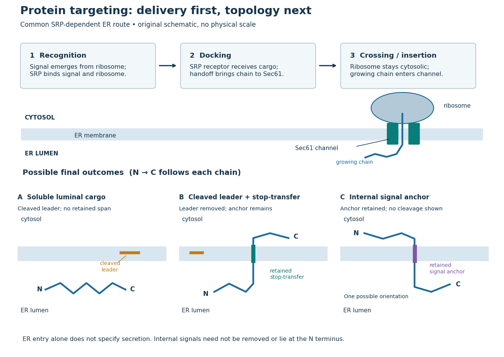

# Protein targeting

↑ **Parent:** [Protein](protein-split.md)  
ⓦ [Wiki](https://en.wikipedia.org/wiki/Protein_targeting)

[Protein targeting](protein-targeting.md) directs a [protein](protein-split.md) to its cellular destination. Synthesis in the [cytosol](cytosol.md) does not imply that the [protein](protein-split.md) works there.

For entry into the [endoplasmic reticulum](endoplasmic-reticulum.md), distinguish three questions: does the [nascent chain](nascent-chain.md) reach the membrane, does part of it cross into the [ER lumen](er-lumen.md), and does a segment remain embedded as a [transmembrane protein](transmembrane-protein.md)? [Cotranslational protein translocation](cotranslational-protein-translocation.md) couples these events to [biological translation](translation-biology.md). A [signal peptide](signal-peptide.md) can initiate delivery without specifying the eventual destination of the mature [protein](protein-split.md).

**[Figure 8](#image-protein-targeting-to-the-endoplasmic-reticulum-delivery-and-three-possible-outcomes). Protein targeting to the endoplasmic reticulum: delivery and three possible outcomes**. Original pathway and [membrane topology](membrane-topology.md) schematic. The upper row separates [SRP](signal-recognition-particle.md) recognition, membrane docking and passage through a [translocon](translocon.md). Lower cartoons stipulate a soluble cargo, a cleaved [signal peptide](signal-peptide.md) plus retained [stop-transfer sequence](stop-transfer-sequence.md), and an uncleaved internal [signal anchor](signal-anchor.md). Each drawn terminus is labeled; the internal-anchor orientation is one possibility. Shapes and lengths are illustrative, with no molecular coordinates or measured timings.

This distinction matters experimentally. Finding a [protein](protein-split.md) in a membrane-containing [centrifugation pellet](centrifugation-pellet.md) could reflect surface binding or [protein aggregation](protein-aggregation.md). The [microsomal protein import experiment](microsomal-protein-import-experiment.md) instead asks whether an intact membrane prevents an external [protease](protease.md) from reaching the product. That tests accessibility across a barrier, rather than proximity to it.

**Table of contents**

- [Protein secretion](protein-secretion.md)
- [Signal peptide](signal-peptide.md)
  - [Signal peptidase](signal-peptidase.md)
- [Signal anchor](signal-anchor.md)
- [Stop-transfer sequence](stop-transfer-sequence.md)
- [Organelle protein import](organelle-protein-import.md)
  - [Organelle import assay](organelle-import-assay.md)
  - [Cotranslational protein translocation](cotranslational-protein-translocation.md)
    - [Signal recognition particle](signal-recognition-particle.md)
      - [Ffh](ffh.md)
      - [SRP54](srp54.md)
      - [Signal recognition particle receptor](signal-recognition-particle-receptor.md)
        - [SRP receptor alpha subunit](srp-receptor-alpha-subunit.md)
        - [FtsY](ftsy.md)
    - [Translocon](translocon.md)
      - [Sec61 complex](sec61-complex.md)
    - [Microsomal protein import experiment](microsomal-protein-import-experiment.md)
      - [Protease protection assay](protease-protection-assay.md)

## ↑ Ancestors (3)

1. [Protein](protein-split.md)
2. [Biology](biology-split.md)
3. [Codex Wiki](split.md)

## ← Incoming links (12)

- [Chloroplast](chloroplast.md)
- [Chloroplast stroma](chloroplast-stroma.md)
- [Cotranslational protein translocation](cotranslational-protein-translocation.md)
- [Lysosome](lysosome.md)
- [Microsome](microsome.md)
- [Mitochondrial matrix](mitochondrial-matrix.md)
- [Solution](past-exam-of-the-biochemistry-course-of-the-university-of-cambridge/2025/paper-2/section-ii/5/solution.md)
- [Protein targeting](protein-targeting.md)
- [Rough endoplasmic reticulum](rough-endoplasmic-reticulum.md)
- [Stop-transfer sequence](stop-transfer-sequence.md)
- [Translocon](translocon.md)
- [Western blot band interpretation](western-blot-band-interpretation.md)
