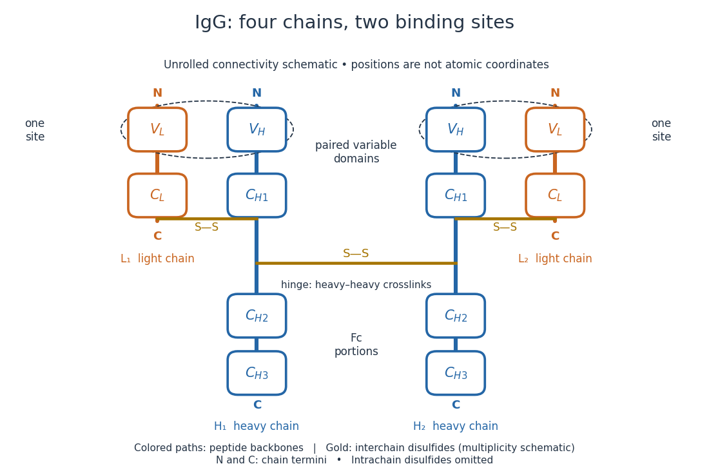
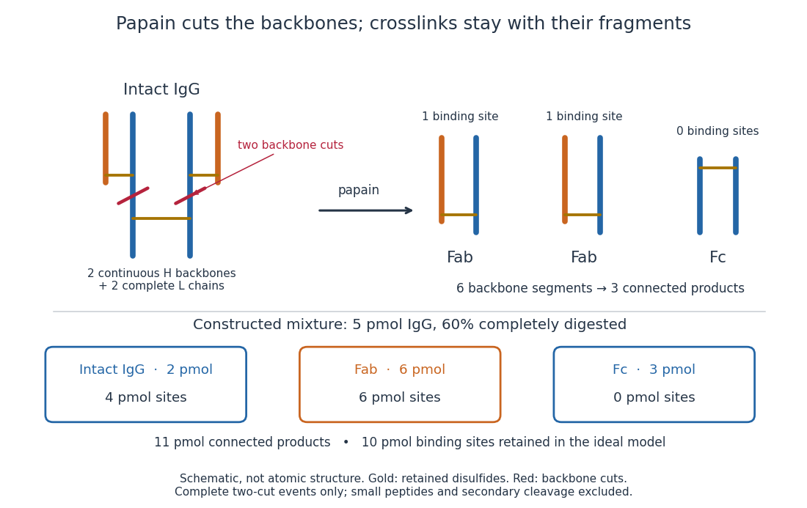
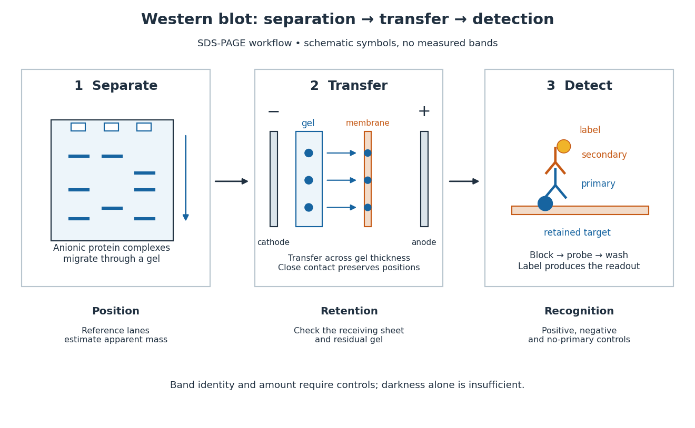
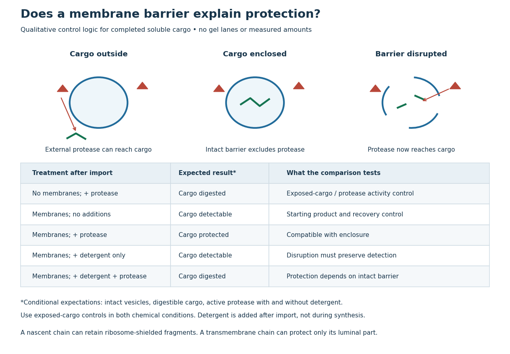
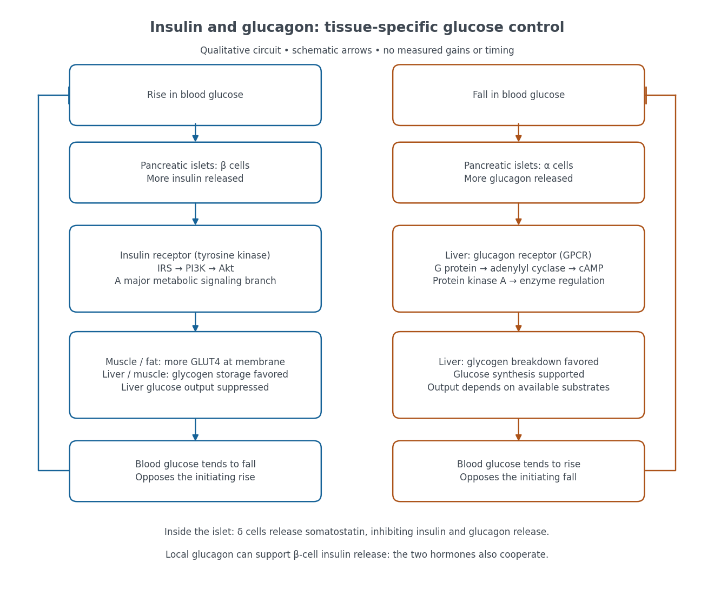

# Protein

↑ **Parent:** [Biology](biology.md)  
ⓦ [Wiki](https://en.wikipedia.org/wiki/Protein)

A [protein](protein.md) is a biological [molecule](molecule.md) made of one or more [polypeptide chains](#polypeptide): ordered [amino acid residues](#amino-acid-residue) joined by [peptide bonds](#peptide-bond). [Biological translation](molecular-genetics.md#translation-biology) assembles a chain in the order specified by [messenger RNA](polymer.md#messenger-rna) [codons](molecular-genetics.md#codon). [Protein folding](#protein-folding) then brings parts of that chain into spatial relationships that support its function. See [Cooper, The Cell: protein composition and structure](https://www.ncbi.nlm.nih.gov/books/NBK9879/). These processes can overlap in a [biological cell](biological-cell.md); the sequence-to-shape explanation does not require waiting until [biological translation](molecular-genetics.md#translation-biology) finishes before any folding begins. See [Cooper, The Cell: protein folding and processing](https://www.ncbi.nlm.nih.gov/books/NBK9843/).

The useful connection is from information to physical work. A [protein](protein.md)'s [protein primary structure](#protein-primary-structure) records an order; its [protein tertiary structure](#protein-tertiary-structure) can bring distant [amino acid residues](#amino-acid-residue) together at an [active site](enzyme.md#active-site). An [enzyme](enzyme.md) uses such an arrangement to recognize a [substrate](enzyme.md#substrate-biochemistry) and accelerate a [chemical reaction](chemical-reaction.md). Other [proteins](protein.md) serve as [receptors](#receptor-biochemistry), [membrane transport proteins](cell-membrane.md#membrane-transport-protein) or structural material. For example, [actin](#actin) assembles into filaments whose mechanical properties can be described by [biopolymer mechanics](mathematical-biology.md#biopolymer-mechanics). See [Alberts et al., Molecular Biology of the Cell: protein function and binding](https://www.ncbi.nlm.nih.gov/books/NBK26911/).

Order matters beyond composition. Let A stand for [alanine](chemical-substance.md#alanine) and M for [methionine](chemical-substance.md#methionine), and read from the [N-terminus](#n-terminus) to the [C-terminus](#c-terminus). The illustrative strings AMAMAMAMAMAM and AAAAAAMMMMMM each contain exactly six A and six M [amino acid residues](#amino-acid-residue). Each has $12-1=11$ [peptide bonds](#peptide-bond) when made into one unbranched [polypeptide chain](#polypeptide). In the first string all eleven neighboring pairs have different letters; in the second only the pair at positions 6 and 7 does. A composition [histogram](probability-and-statistics.md#histogram) therefore loses information about which [amino acid residues](#amino-acid-residue) are neighbors. Their arrangements can affect [protein folding](#protein-folding) and function; these short invented strings neither specify a known functional [protein](protein.md) nor establish what shape either would adopt.

**[Figure 1](#image-from-amino-acid-order-to-an-imagined-fold-and-binding-site). From amino acid order to an imagined fold and binding site**. Original schematic using two twelve-residue strings with equal composition. The imagined fold uses the first string: colors and numbers preserve its [protein primary structure](#protein-primary-structure), while positions 4 and 9 approach one another. The binding-site cartoon explains spatial cooperation, not an actual [enzyme](enzyme.md) or a measured [protein structure](#protein-structure). No actual coordinates, physical scale or exact [protein folding](#protein-folding) predictor are implied.

[Protein structure](#protein-structure) is a moving arrangement, not a permanently rigid outline. [Substrate](enzyme.md#substrate-biochemistry) binding can change an [enzyme](enzyme.md)'s shape through [induced fit](enzyme.md#induced-fit), and a functional [protein](protein.md) can include flexible regions. Sequence, surroundings and interacting [molecules](molecule.md) must therefore be considered together. See [Alberts et al.: binding, conformational changes and protein function](https://www.ncbi.nlm.nih.gov/books/NBK26911/).

**Table of contents**

- [Exportin-5](#exportin-5)
- [DKK1](#dkk1)
- [LEFTY1](#lefty1)
- [CER1](#cer1)
- [Protein perdurance](#protein-perdurance)
- [Protein–DNA interaction](#protein-dna-interaction)
  - [DNA bridging](#dna-bridging)
  - [DNA competition assay](#dna-competition-assay)
    - [Nonspecific competitor DNA](#nonspecific-competitor-dna)
    - [Specific competitor DNA](#specific-competitor-dna)
  - [Ternary protein–DNA complex](#ternary-protein-dna-complex)
- [Lectin](#lectin)
  - [Concanavalin A](#concanavalin-a)
- [CD34-family sialomucin](#cd34-family-sialomucin)
- [Moesin](#moesin)
- [VEGF-A](#vegf-a)
- [FGFR2](#fgfr2)
- [FGF10](#fgf10)
- [Podocalyxin](#podocalyxin)
- [Rabin8](#rabin8)
- [Lethal giant larvae](#lethal-giant-larvae)
- [Discs large](#discs-large)
- [PATJ](#patj)
- [PALS1](#pals1)
- [PAR-6](#par-6)
- [PITX2](#pitx2)
- [TBX3](#tbx3)
- [TBX2](#tbx2)
- [ISL1](#isl1)
- [Mesp1](#mesp1)
- [Ascl2](#ascl2)
- [Bmi1](#bmi1)
- [SoxR](#soxr)
- [PqsE](#pqse)
- [PqsR](#pqsr)
- [RhlR](#rhlr)
- [LasR](#lasr)
- [FtsZ](#ftsz)
- [MreB](#mreb)
- [MtrC](#mtrc)
- [CymA](#cyma)
- [Acyl carrier protein](#acyl-carrier-protein)
- [Calmodulin](#calmodulin)
- [Lipid transfer protein](#lipid-transfer-protein)
- [Centrosomin](#centrosomin)
- [Protein degradation](#protein-degradation)
  - [Acute protein depletion](#acute-protein-depletion)
    - [Inducible degron](#inducible-degron)
- [Transformer protein](#transformer-protein)
- [Ferritin](#ferritin)
- [Epitope tag](#epitope-tag)
  - [FLAG tag](#flag-tag)
- [Streptavidin](#streptavidin)
- [Ligand binding](#ligand-binding)
  - [Binding affinity](#binding-affinity)
- [DNA-binding protein](#dna-binding-protein)
- [Intrinsically disordered protein](#intrinsically-disordered-protein)
- [Adaptor protein](#adaptor-protein)
  - [Nck](#nck)
- [CadC](#cadc)
- [Perforin](#perforin)
- [Ferredoxin](#ferredoxin)
- [Myoglobin](#myoglobin)
- [Guanine nucleotide exchange factor](#guanine-nucleotide-exchange-factor)
  - [eEF1B](#eef1b)
  - [EF-Ts](#ef-ts)
- [MT1-MMP](#mt1-mmp)
- [Munc18](#munc18)
- [Scribble](#scribble)
- [Vermiform](#vermiform)
- [Coracle](#coracle)
- [Yurt](#yurt)
- [Crumbs](#crumbs)
- [Bazooka](#bazooka)
- [PAR-3](#par-3)
- [Cdc42](#cdc42)
- [Beta-catenin](#beta-catenin)
- [p53](#p53)
  - [MDM2](#mdm2)
- [Mahjong protein](#mahjong-protein)
- [R-spondin](#r-spondin)
- [Lgr5](#lgr5)
- [Fluorescent protein](#fluorescent-protein)
  - [Photoconvertible fluorescent protein](#photoconvertible-fluorescent-protein)
  - [Fluorescent reporter](#fluorescent-reporter)
- [Sca2](#sca2)
- [PDZD8](#pdzd8)
- [TANGO1](#tango1)
- [Sec24](#sec24)
- [GTPase-activating protein](#gtpase-activating-protein)
  - [Regulator of G protein signalling](#regulator-of-g-protein-signalling)
- [Sec23](#sec23)
- [Sar1](#sar1)
- [Sec12](#sec12)
- [WWTR1](#wwtr1)
- [Vinculin](#vinculin)
- [Talin](#talin)
- [LINC complex](#linc-complex)
- [Cadherin](#cadherin)
  - [VE-cadherin](#ve-cadherin)
- [SNX9](#snx9)
- [Dynamin](#dynamin)
- [Epsin](#epsin)
- [AP-2 complex](#ap-2-complex)
- [Histidine tag](#histidine-tag)
- [Ubiquitin-proteasome system](#ubiquitin-proteasome-system)
- [Drp1](#drp1)
- [OPA1](#opa1)
- [Mitofusin](#mitofusin)
- [Proteasomal degradation](#proteasomal-degradation)
- [Rational protein design](#rational-protein-design)
- [Directed evolution](#directed-evolution)
  - [DNA shuffling](#dna-shuffling)
- [Limited proteolysis](#limited-proteolysis)
- [Hfq](#hfq)
- [Beta-2-microglobulin](#beta-2-microglobulin)
- [Vimentin](#vimentin)
- [E-cadherin](#e-cadherin)
- [Replication protein A](#replication-protein-a)
- [Single-stranded DNA-binding protein](#single-stranded-dna-binding-protein)
- [ESCRT-III](#escrt-iii)
- [RhoA](#rhoa)
- [ECT2](#ect2)
- [Centralspindlin](#centralspindlin)
- [Securin](#securin)
- [PD-L1](#pd-l1)
- [Separase](#separase)
- [Cyclin](#cyclin)
  - [Cyclin A](#cyclin-a)
- [Antizyme](#antizyme)
- [Clathrin](#clathrin)
- [HCF244](#hcf244)
- [GCN1](#gcn1)
- [KAP1](#kap1)
- [HP1 protein](#hp1-protein)
  - [Swi6](#swi6)
- [Histone](#histone)
  - [Histone variant](#histone-variant)
    - [CENP-A](#cenp-a)
  - [Linker histone](#linker-histone)
  - [Histone H3](#histone-h3)
- [RNA-binding protein](#rna-binding-protein)
  - [DGCR8](#dgcr8)
  - [Pumilio](#pumilio)
  - [G3BP2](#g3bp2)
  - [G3BP1](#g3bp1)
  - [Sex-lethal](#sex-lethal)
  - [RNA recognition motif](#rna-recognition-motif)
  - [Cth2](#cth2)
  - [GW182](#gw182)
  - [PP7 coat protein](#pp7-coat-protein)
  - [MS2 coat protein](#ms2-coat-protein)
  - [Pentatricopeptide repeat protein](#pentatricopeptide-repeat-protein)
    - [PPR10](#ppr10)
  - [ZBP1](#zbp1)
  - [IGF2BP protein](#igf2bp-protein)
  - [Poly(A)-binding protein](#poly-a-binding-protein)
  - [Argonaute](#argonaute)
    - [HRDE-1](#hrde-1)
    - [Argonaute slicing](#argonaute-slicing)
    - [Piwi protein](#piwi-protein)
      - [PRG-1](#prg-1)
      - [MIWI2](#miwi2)
      - [MILI](#mili)
      - [AGO3](#ago3)
      - [Aubergine](#aubergine)
    - [AGO4](#ago4)
  - [HNRNPC](#hnrnpc)
  - [PTBP protein](#ptbp-protein)
    - [PTBP1](#ptbp1)
  - [RBFOX protein](#rbfox-protein)
  - [NOVA protein](#nova-protein)
- [KRAS4B](#kras4b)
- [Polybasic region](#polybasic-region)
- [Ras](#ras)
  - [KRAS G12C protein](#kras-g12c-protein)
    - [AMG 510](#amg-510)
- [Prenylation](#prenylation)
- [N-myristoylation](#n-myristoylation)
- [S-palmitoylation](#s-palmitoylation)
- [Protein lipidation](#protein-lipidation)
- [Apoferritin](#apoferritin)
- [RAD51](#rad51)
- [Nucleoprotein filament](#nucleoprotein-filament)
- [RecA](#reca)
- [Allostery](#allostery)
  - [Allosteric modulator](#allosteric-modulator)
  - [Thermodynamic linkage](#thermodynamic-linkage)
  - [Cooperative binding](#cooperative-binding)
    - [Hill equation](#hill-equation)
      - [Hill constant](#hill-constant)
      - [Hill activation function](#hill-activation-function)
      - [Hill coefficient](#hill-coefficient)
- [Globular protein](#globular-protein)
- [Protein interaction network](#protein-interaction-network)
- [Post-translational modification](#post-translational-modification)
  - [Histone modification](#histone-modification)
    - [Histone methylation](#histone-methylation)
      - [Polycomb repressive complex 2](#polycomb-repressive-complex-2)
      - [SUVH6](#suvh6)
      - [SUVH5](#suvh5)
      - [SUVH4](#suvh4)
      - [H3K4 methylation](#h3k4-methylation)
      - [H3K27 trimethylation](#h3k27-trimethylation)
  - [Protein deamidation](#protein-deamidation)
  - [Modification site occupancy](#modification-site-occupancy)
- [Affinity tag](#affinity-tag)
- [Protein-protein interaction](#protein-protein-interaction)
  - [Homotypic protein interaction](#homotypic-protein-interaction)
  - [Protein oligomerization](#protein-oligomerization)
    - [Protein dimer](#protein-dimer)
  - [Multivalency](#multivalency)
  - [Weak biomolecular binding](#weak-biomolecular-binding)
  - [Protein-protein interaction network](#protein-protein-interaction-network)
  - [Dominant-negative effect](#dominant-negative-effect)
- [Trypsinogen](#trypsinogen)
- [Antifreeze glycoprotein](#antifreeze-glycoprotein)
- [PIE-1](#pie-1)
- [P-TEFb](#p-tefb)
- [Pgc protein](#pgc-protein)
- [Nanos](#nanos)
- [Tudor](#tudor)
- [Vasa](#vasa)
- [Oskar](#oskar)
- [Cactus protein](#cactus-protein)
- [Spätzle](#spatzle)
- [Proteolytic cascade](#proteolytic-cascade)
- [Pipe](#pipe)
- [Collagen](#collagen)
  - [Procollagen](#procollagen)
- [Beta-lactoglobulin](#beta-lactoglobulin)
- [Cohesin](#cohesin)
  - [Scc1](#scc1)
- [Bovine serum albumin](#bovine-serum-albumin)
- [Antibody](#antibody)
  - [Catalytic antibody](#catalytic-antibody)
  - [Antibody-drug conjugate](#antibody-drug-conjugate)
  - [Antibody phage display](#antibody-phage-display)
  - [Hybridoma technology](#hybridoma-technology)
  - [Primary antibody](#primary-antibody)
  - [Secondary antibody](#secondary-antibody)
  - [Epitope](#epitope)
    - [Epitope mapping](#epitope-mapping)
  - [Immunoglobulin G](#immunoglobulin-g)
    - [IgG chain reduction experiment](#igg-chain-reduction-experiment)
    - [Antibody hinge region](#antibody-hinge-region)
  - [Immunoglobulin heavy chain](#immunoglobulin-heavy-chain)
  - [Immunoglobulin light chain](#immunoglobulin-light-chain)
  - [Antibody variable region](#antibody-variable-region)
    - [Complementarity-determining region](#complementarity-determining-region)
  - [Antibody constant region](#antibody-constant-region)
  - [Fragment antigen-binding](#fragment-antigen-binding)
    - [Papain digestion of IgG](#papain-digestion-of-igg)
  - [Fragment crystallizable region](#fragment-crystallizable-region)
  - [Paratope](#paratope)
  - [Antigen](#antigen)
    - [Neoantigen](#neoantigen)
    - [Tumour-associated antigen](#tumour-associated-antigen)
  - [Antibody specificity](#antibody-specificity)
    - [Cross-reactivity](#cross-reactivity)
  - [Monoclonal antibody](#monoclonal-antibody)
  - [Avidity](#avidity)
    - [Effective local concentration](#effective-local-concentration)
  - [Antibody affinity](#antibody-affinity)
    - [Affinity maturation](#affinity-maturation)
    - [Antibody equilibrium occupancy](#antibody-equilibrium-occupancy)
    - [Antibody surface plasmon resonance experiment](#antibody-surface-plasmon-resonance-experiment)
- [Western blot](#western-blot)
  - [Western blot separation](#western-blot-separation)
  - [Western blot transfer](#western-blot-transfer)
    - [Western blot membrane](#western-blot-membrane)
      - [Nitrocellulose Western blot membrane](#nitrocellulose-western-blot-membrane)
  - [Western blot antibody detection](#western-blot-antibody-detection)
  - [Western blot band interpretation](#western-blot-band-interpretation)
  - [Western blot controls](#western-blot-controls)
    - [Western blot loading control](#western-blot-loading-control)
    - [Western blot transfer control](#western-blot-transfer-control)
    - [Western blot antibody specificity control](#western-blot-antibody-specificity-control)
  - [Western blot normalization](#western-blot-normalization)
  - [Western blot response saturation](#western-blot-response-saturation)
- [Protein targeting](#protein-targeting)
  - [Protein secretion](#protein-secretion)
  - [Signal peptide](#signal-peptide)
    - [Signal peptidase](#signal-peptidase)
  - [Signal anchor](#signal-anchor)
  - [Stop-transfer sequence](#stop-transfer-sequence)
  - [Organelle protein import](#organelle-protein-import)
    - [Organelle import assay](#organelle-import-assay)
    - [Cotranslational protein translocation](#cotranslational-protein-translocation)
      - [Signal recognition particle](#signal-recognition-particle)
        - [Ffh](#ffh)
        - [SRP54](#srp54)
        - [Signal recognition particle receptor](#signal-recognition-particle-receptor)
          - [SRP receptor alpha subunit](#srp-receptor-alpha-subunit)
          - [FtsY](#ftsy)
      - [Translocon](#translocon)
        - [Sec61 complex](#sec61-complex)
      - [Microsomal protein import experiment](#microsomal-protein-import-experiment)
        - [Protease protection assay](#protease-protection-assay)
- [Globin](#globin)
- [Polypeptide](#polypeptide)
  - [Amino acid residue](#amino-acid-residue)
    - [Histidine residue](#histidine-residue)
    - [Glutamate residue](#glutamate-residue)
    - [Lysine residue](#lysine-residue)
    - [Serine residue](#serine-residue)
    - [Tryptophan residue](#tryptophan-residue)
    - [Threonine residue](#threonine-residue)
    - [Tyrosine residue](#tyrosine-residue)
      - [Phosphotyrosine residue](#phosphotyrosine-residue)
    - [Amino acid side chain](#amino-acid-side-chain)
    - [Amino acid alpha carbon](#amino-acid-alpha-carbon)
    - [Glutamic acid residue](#glutamic-acid-residue)
  - [Peptide bond](#peptide-bond)
  - [Protein backbone](#protein-backbone)
    - [Peptide backbone dihedral angles](#peptide-backbone-dihedral-angles)
  - [Nascent chain](#nascent-chain)
- [Protein structure](#protein-structure)
  - [Ramachandran plot](#ramachandran-plot)
  - [Intrinsically disordered region](#intrinsically-disordered-region)
  - [Protein fold](#protein-fold)
    - [Globin fold](#globin-fold)
  - [Conformational ensemble](#conformational-ensemble)
  - [Protein dynamics](#protein-dynamics)
    - [Enzyme conformational ensemble](#enzyme-conformational-ensemble)
    - [Protein NMR order parameter](#protein-nmr-order-parameter)
  - [AlphaFold 3](#alphafold-3)
  - [Protein domain](#protein-domain)
    - [Zinc finger](#zinc-finger)
    - [Homeodomain](#homeodomain)
    - [Domain shuffling](#domain-shuffling)
    - [Carbohydrate-binding module](#carbohydrate-binding-module)
    - [Helix-turn-helix](#helix-turn-helix)
    - [Activation domain](#activation-domain)
    - [DNA-binding domain](#dna-binding-domain)
    - [Chromodomain](#chromodomain)
    - [SH2 domain](#sh2-domain)
  - [Protein primary structure](#protein-primary-structure)
    - [Polyproline](#polyproline)
    - [Protein sequence](#protein-sequence)
      - [Protein sequence space](#protein-sequence-space)
    - [Amino acid composition](#amino-acid-composition)
      - [Glycine](#glycine)
      - [Phenylalanine](#phenylalanine)
      - [Cysteine](#cysteine)
    - [Sanger's insulin sequencing experiment](#sanger-s-insulin-sequencing-experiment)
    - [Insulin](#insulin)
      - [Proinsulin](#proinsulin)
        - [C-peptide](#c-peptide)
      - [Glucose clamp technique](#glucose-clamp-technique)
  - [Protein secondary structure](#protein-secondary-structure)
    - [Pi helix](#pi-helix)
    - [3-10 helix](#3-10-helix)
    - [Gamma turn](#gamma-turn)
    - [Amphipathic helix](#amphipathic-helix)
    - [Alpha helix](#alpha-helix)
    - [Beta sheet](#beta-sheet)
      - [Beta strand](#beta-strand)
      - [Parallel beta sheet](#parallel-beta-sheet)
      - [Antiparallel beta sheet](#antiparallel-beta-sheet)
    - [Backbone hydrogen bond](#backbone-hydrogen-bond)
  - [Protein tertiary structure](#protein-tertiary-structure)
    - [Protein binding site](#protein-binding-site)
    - [Protein disulfide bond](#protein-disulfide-bond)
  - [Protein quaternary structure](#protein-quaternary-structure)
    - [Protein complex](#protein-complex)
      - [Exocyst](#exocyst)
      - [Cellulosome](#cellulosome)
      - [ERMES](#ermes)
- [Protein folding](#protein-folding)
  - [Cotranslational folding](#cotranslational-folding)
  - [Inclusion body](#inclusion-body)
  - [Protein contact map](#protein-contact-map)
  - [Folding funnel](#folding-funnel)
  - [Conformational entropy](#conformational-entropy)
  - [Chaperone (protein)](#chaperone-protein)
- [Denaturation (biochemistry)](#denaturation-biochemistry)
  - [Protein aggregation](#protein-aggregation)
- [Ribonuclease A](#ribonuclease-a)
  - [Ribonuclease A refolding experiment](#ribonuclease-a-refolding-experiment)
- [Lysozyme](#lysozyme)
- [N-terminus](#n-terminus)
- [C-terminus](#c-terminus)
- [Actin](#actin)
  - [Actin monomer](#actin-monomer)
    - [Actin monomer sequestration](#actin-monomer-sequestration)
  - [Actin filament](#actin-filament)
    - [Phalloidin](#phalloidin)
    - [Actin filament capping](#actin-filament-capping)
    - [Actin filament severing](#actin-filament-severing)
    - [Actin cable](#actin-cable)
    - [Actin patch](#actin-patch)
    - [Actin turnover](#actin-turnover)
    - [Actin depolymerization](#actin-depolymerization)
    - [Actin polymerization](#actin-polymerization)
      - [Pyrene-actin assay](#pyrene-actin-assay)
      - [Actin critical concentration](#actin-critical-concentration)
      - [Actin filament elongation](#actin-filament-elongation)
      - [Actin nucleation](#actin-nucleation)
  - [N-WASP](#n-wasp)
- [Epidermal growth factor](#epidermal-growth-factor)
  - [Gurken](#gurken)
- [Receptor (biochemistry)](#receptor-biochemistry)
  - [PYR-PYL-RCAR ABA receptor](#pyr-pyl-rcar-aba-receptor)
  - [Methyl-accepting chemotaxis protein](#methyl-accepting-chemotaxis-protein)
  - [Ionotropic receptor](#ionotropic-receptor)
    - [GABA-A receptor](#gaba-a-receptor)
    - [Nicotinic acetylcholine receptor](#nicotinic-acetylcholine-receptor)
  - [Metabotropic receptor](#metabotropic-receptor)
    - [G protein-coupled receptor](#g-protein-coupled-receptor)
      - [Arrestin](#arrestin)
      - [Receptor reserve](#receptor-reserve)
      - [Biased agonism](#biased-agonism)
        - [TRV130](#trv130)
      - [Orthosteric antagonist](#orthosteric-antagonist)
      - [Beta-2 adrenergic receptor](#beta-2-adrenergic-receptor)
      - [Adrenergic receptor](#adrenergic-receptor)
        - [Beta-adrenergic receptor](#beta-adrenergic-receptor)
        - [Alpha-adrenergic receptor](#alpha-adrenergic-receptor)
          - [Alpha-1 adrenergic receptor](#alpha-1-adrenergic-receptor)
          - [Alpha-2 adrenergic receptor](#alpha-2-adrenergic-receptor)
      - [Glucagon receptor](#glucagon-receptor)
      - [Glucagon-like peptide-1 receptor](#glucagon-like-peptide-1-receptor)
  - [Cell-surface receptor](#cell-surface-receptor)
    - [CTLA-4](#ctla-4)
    - [Chimeric antigen receptor](#chimeric-antigen-receptor)
    - [T-cell receptor](#t-cell-receptor)
    - [PD-1](#pd-1)
    - [Toll receptor](#toll-receptor)
    - [Receptor tyrosine kinase](#receptor-tyrosine-kinase)
      - [ErbB receptor](#erbb-receptor)
      - [PDGFR](#pdgfr)
      - [FGF receptor](#fgf-receptor)
        - [FGFR1](#fgfr1)
      - [Epidermal growth factor receptor](#epidermal-growth-factor-receptor)
      - [Insulin receptor](#insulin-receptor)
        - [Insulin receptor substrate](#insulin-receptor-substrate)
      - [Receptor phosphorylation assay](#receptor-phosphorylation-assay)
        - [Ligand-dependent membrane phosphorylation experiment](#ligand-dependent-membrane-phosphorylation-experiment)
      - [Reversible receptor phosphorylation model](#reversible-receptor-phosphorylation-model)
  - [Intracellular receptor](#intracellular-receptor)
    - [Nuclear receptor](#nuclear-receptor)
      - [Glucocorticoid receptor](#glucocorticoid-receptor)
  - [Receptor binding occupancy](#receptor-binding-occupancy)
- [G protein](#g-protein)
  - [YM-254890](#ym-254890)
  - [Small GTPase](#small-gtpase)
    - [Rac1](#rac1)
    - [Rab GTPase](#rab-gtpase)
      - [Rab8a](#rab8a)
      - [Rab11a](#rab11a)
      - [Rab7](#rab7)
      - [Rab5](#rab5)
      - [Rab conversion](#rab-conversion)
    - [ARF GTPase](#arf-gtpase)
    - [Sar1 GTPase](#sar1-gtpase)
  - [Heterotrimeric G protein](#heterotrimeric-g-protein)
    - [G protein beta-gamma complex](#g-protein-beta-gamma-complex)
    - [G protein alpha subunit](#g-protein-alpha-subunit)
      - [Gαi](#g-alpha-i)
      - [Gαs](#g-alpha-s)
      - [Gαq](#g-alpha-q)
- [Ligand (biochemistry)](#ligand-biochemistry)
  - [Agonist](#agonist)
    - [Intrinsic efficacy](#intrinsic-efficacy)
    - [Partial agonist](#partial-agonist)
- [Ovalbumin](#ovalbumin)
- [Peptide](#peptide)
  - [Tripeptide](#tripeptide)
- [Aprotinin](#aprotinin)
- [Cytochrome c](#cytochrome-c)
- [Myosin](#myosin)
  - [Myosin processivity](#myosin-processivity)
  - [Myosin power stroke](#myosin-power-stroke)
  - [Myosin lever arm](#myosin-lever-arm)
  - [Myosin duty ratio](#myosin-duty-ratio)
  - [Myosin VI](#myosin-vi)
  - [Myosin V](#myosin-v)
  - [Myosin II](#myosin-ii)
- [Importin](#importin)
- [Nucleoplasmin](#nucleoplasmin)
- [Ribonucleoprotein](#ribonucleoprotein)
- [Hemoglobin](#hemoglobin)
- [Proteasome](#proteasome)
- [Ubiquitin](#ubiquitin)
  - [Ubiquitination](#ubiquitination)
    - [Ubiquitin ligase](#ubiquitin-ligase)
      - [FBXL5](#fbxl5)
      - [Cdc4](#cdc4)
    - [Ubiquitin-conjugating enzyme](#ubiquitin-conjugating-enzyme)
    - [Ubiquitin-activating enzyme](#ubiquitin-activating-enzyme)
  - [Deubiquitinating enzyme](#deubiquitinating-enzyme)

## Exportin-5

↑ **Parent:** [Protein](protein.md)

A nuclear transport factor carrying suitable precursor [microRNA](polymer.md#microrna) hairpins into the [cytoplasm](biological-cell.md#cytoplasm).

## DKK1

↑ **Parent:** [Protein](protein.md)

A secreted antagonist of canonical [Wnt signalling](signal-transduction.md#wnt-signalling) important in developmental patterning.

## LEFTY1

↑ **Parent:** [Protein](protein.md)

A secreted antagonist of Nodal-family signalling expressed in developmentally restricted domains.

## CER1

↑ **Parent:** [Protein](protein.md)

A secreted antagonist involved in early embryonic signalling, including [anterior visceral endoderm](biology.md#anterior-visceral-endoderm) function in mouse.

## Protein perdurance

↑ **Parent:** [Protein](protein.md)

Persistence of a pre-existing [protein](protein.md) after its [gene](genetics.md#gene) is removed or its synthesis stops. A late [mutant](genetics.md#mutant) [phenotype](genetics.md#phenotype) can therefore lag behind the time when the [gene](genetics.md#gene) normally acts.

<h2 id="protein-dna-interaction">Protein–DNA interaction</h2>

↑ **Parent:** [Protein](protein.md)

### DNA bridging

↑ **Parent:** [Protein–DNA interaction](#protein-dna-interaction)

Simultaneous connection of separated [DNA](polymer.md#deoxyribonucleic-acid) segments by a [protein](protein.md) assembly. Intramolecular bridging produces a loop; intermolecular bridging connects distinct molecules.

### DNA competition assay

↑ **Parent:** [Protein–DNA interaction](#protein-dna-interaction)

A binding experiment challenging a labelled complex with unlabelled [DNA](polymer.md#deoxyribonucleic-acid). Specific and nonspecific competitors can distinguish sequence recognition from transfer of other DNA-bound components.

#### Nonspecific competitor DNA

↑ **Parent:** [DNA competition assay](#dna-competition-assay)

[DNA](polymer.md#deoxyribonucleic-acid) that lacks the selected recognition sequence but can accept nonspecific interactions or transferred [histones](#histone). Its effect must be interpreted against controls for all components.

#### Specific competitor DNA

↑ **Parent:** [DNA competition assay](#dna-competition-assay)

Unlabelled [DNA](polymer.md#deoxyribonucleic-acid) containing recognition sites for the [protein](protein.md) being tested. Competition can draw that [protein](protein.md) away from labelled [DNA](polymer.md#deoxyribonucleic-acid) without necessarily removing other [proteins](protein.md) from the labelled assembly.

<h3 id="ternary-protein-dna-complex">Ternary protein–DNA complex</h3>

↑ **Parent:** [Protein–DNA interaction](#protein-dna-interaction)

An assembly of [DNA](polymer.md#deoxyribonucleic-acid) and two distinguishable [protein](protein.md) components. A mobility shift alone does not establish composition; selective competition and component-specific detection can test which components remain.

## Lectin

↑ **Parent:** [Protein](protein.md)

A [protein](protein.md) that binds particular carbohydrate features. A [lectin](#lectin) stain reports accessible binding sites rather than every molecule in a [cell wall](biological-cell.md#cell-wall).

### Concanavalin A

↑ **Parent:** [Lectin](#lectin)

A [lectin](#lectin) used to label accessible carbohydrate-containing surfaces, including [yeast](organism.md#yeast) [biological cell](biological-cell.md) walls. A pre-growth pulse marks old surface material; a new unlabelled bud can identify newly deposited wall.

## CD34-family sialomucin

↑ **Parent:** [Protein](protein.md)

A member of a family of heavily glycosylated surface proteins involved in specialized membrane organization, including the developing vascular lumen.

## Moesin

↑ **Parent:** [Protein](protein.md)

A membrane–cytoskeleton linker studied in organization of prospective vascular luminal surfaces.

## VEGF-A

↑ **Parent:** [Protein](protein.md)

A secreted signalling protein with roles in endothelial development and vascular [morphogenesis](biology.md#morphogenesis).

## FGFR2

↑ **Parent:** [Protein](protein.md)

## FGF10

↑ **Parent:** [Protein](protein.md)

## Podocalyxin

↑ **Parent:** [Protein](protein.md)

## Rabin8

↑ **Parent:** [Protein](protein.md)

## Lethal giant larvae

↑ **Parent:** [Protein](protein.md)

## Discs large

↑ **Parent:** [Protein](protein.md)

## PATJ

↑ **Parent:** [Protein](protein.md)

## PALS1

↑ **Parent:** [Protein](protein.md)

## PAR-6

↑ **Parent:** [Protein](protein.md)

## PITX2

↑ **Parent:** [Protein](protein.md)

## TBX3

↑ **Parent:** [Protein](protein.md)

## TBX2

↑ **Parent:** [Protein](protein.md)

## ISL1

↑ **Parent:** [Protein](protein.md)

## Mesp1

↑ **Parent:** [Protein](protein.md)

## Ascl2

↑ **Parent:** [Protein](protein.md)

## Bmi1

↑ **Parent:** [Protein](protein.md)

## SoxR

↑ **Parent:** [Protein](protein.md)

A redox-sensitive transcriptional regulator. In Pseudomonas its regulon includes functions associated with handling redox-active metabolites.

## PqsE

↑ **Parent:** [Protein](protein.md)

A Pseudomonas aeruginosa protein with enzymatic activity and a distinct interaction-dependent role in promoting RhlR-controlled virulence expression.

## PqsR

↑ **Parent:** [Protein](protein.md)

A Pseudomonas aeruginosa quinolone-responsive transcription factor, also called MvfR.

## RhlR

↑ **Parent:** [Protein](protein.md)

A Pseudomonas aeruginosa quorum-sensing transcription factor whose DNA-binding activity is promoted by interaction with PqsE.

## LasR

↑ **Parent:** [Protein](protein.md)

A Pseudomonas aeruginosa transcriptional regulator responding to its LasI-produced acyl-homoserine-lactone signal.

## FtsZ

↑ **Parent:** [Protein](protein.md)

A tubulin-related bacterial GTPase whose polymers help organize division-site machinery.

## MreB

↑ **Parent:** [Protein](protein.md)

An actin-related bacterial cytoskeletal protein that helps organize and orient cell-wall growth in many rod-shaped bacteria.

## MtrC

↑ **Parent:** [Protein](protein.md)

A surface-exposed decaheme cytochrome in the Shewanella extracellular electron-transfer system.

## CymA

↑ **Parent:** [Protein](protein.md)

A tetraheme inner-membrane-associated cytochrome in Shewanella that links quinol oxidation to periplasmic electron-transfer routes.

## Acyl carrier protein

↑ **Parent:** [Protein](protein.md)

A protein carrying covalently attached growing acyl intermediates through fatty-acid synthesis.

## Calmodulin

↑ **Parent:** [Protein](protein.md)

A calcium-binding regulatory protein that can also act as a myosin-associated light chain in appropriate motor classes.

## Lipid transfer protein

↑ **Parent:** [Protein](protein.md)

A protein that binds and transports a lipid between membranes or promotes its exchange at a contact site.

## Centrosomin

↑ **Parent:** [Protein](protein.md)

A fly centrosomal protein involved in centrosome organization and the [centrosome orientation checkpoint](cell-cycle.md#centrosome-orientation-checkpoint).

## Protein degradation

↑ **Parent:** [Protein](protein.md)

### Acute protein depletion

↑ **Parent:** [Protein degradation](#protein-degradation)

Rapid removal of an existing [protein](protein.md) pool to separate immediate effects from later adaptation. Depletion kinetics and perturbation specificity need direct measurement.

#### Inducible degron

↑ **Parent:** [Acute protein depletion](#acute-protein-depletion)

A [protein](protein.md) tag enabling regulated degradation of a fusion [protein](protein.md). It can sharpen perturbation timing, but the tagged [protein](protein.md) and induction treatment require independent function controls.

## Transformer protein

↑ **Parent:** [Protein](protein.md)

A Drosophila sex-determination regulator whose productive expression depends on the splice pattern of its precursor [RNA](polymer.md#ribonucleic-acid).

## Ferritin

↑ **Parent:** [Protein](protein.md)

An iron-storage [protein](protein.md) assembly. [translational regulation](molecular-genetics.md#translational-regulation) through an [iron-responsive element](polymer.md#iron-responsive-element) helps match storage capacity to [iron](chemical-substance.md#iron) availability; the iron-free [protein](protein.md) is [apoferritin](#apoferritin).

## Epitope tag

↑ **Parent:** [Protein](protein.md)

### FLAG tag

↑ **Parent:** [Epitope tag](#epitope-tag)

## Streptavidin

↑ **Parent:** [Protein](protein.md)

## Ligand binding

↑ **Parent:** [Protein](protein.md)

### Binding affinity

↑ **Parent:** [Ligand binding](#ligand-binding)

The equilibrium strength of association under specified conditions. For simple one-to-one [ligand binding](#ligand-binding), a smaller [dissociation constant](chemical-potential.md#dissociation-constant) corresponds to stronger affinity; a predicted bound pose does not itself determine this constant.

## DNA-binding protein

↑ **Parent:** [Protein](protein.md)

## Intrinsically disordered protein

↑ **Parent:** [Protein](protein.md)

## Adaptor protein

↑ **Parent:** [Protein](protein.md)

### Nck

↑ **Parent:** [Adaptor protein](#adaptor-protein)

A signalling adaptor with several recognition domains, useful in reconstituted studies of [multivalency](#multivalency) and assembly.

## CadC

↑ **Parent:** [Protein](protein.md)

A bacterial regulator whose expression can depend on EF-P-sensitive [proline](chemical-substance.md#proline) sequences.[Physiological translation regulation](biology-bibliography.md#translation-elongation-factor-ef-p-alleviates-ribosome-stalling-at-polyproline-stretches-by-susanne-ude-and-others)

## Perforin

↑ **Parent:** [Protein](protein.md)

A cytotoxic-lymphocyte pore-forming protein supporting delivery of granzymes during target-cell killing.

## Ferredoxin

↑ **Parent:** [Protein](protein.md)

An iron–sulfur electron-transfer protein. Photosynthetic ferredoxin receives electrons downstream of photosystem I and supplies reduction pathways including NADP reduction.

## Myoglobin

↑ **Parent:** [Protein](protein.md)

A chiefly monomeric oxygen-binding globin. Its conserved core and haem pocket resemble those of haemoglobin subunits, while its assembly and physiological role differ.

## Guanine nucleotide exchange factor

↑ **Parent:** [Protein](protein.md)

A factor accelerating release of bound guanine nucleotide from a target protein, permitting reloading from the free pool. It does not phosphorylate bound [GDP](molecule.md#guanosine-diphosphate) into [GTP](molecule.md#guanosine-triphosphate).

### eEF1B

↑ **Parent:** [Guanine nucleotide exchange factor](#guanine-nucleotide-exchange-factor)

Eukaryotic exchange machinery promoting GDP release from [eEF1A](molecular-genetics.md#eef1a) and reloading with GTP for another elongation cycle.

### EF-Ts

↑ **Parent:** [Guanine nucleotide exchange factor](#guanine-nucleotide-exchange-factor)

The bacterial exchange factor for [EF-Tu](molecular-genetics.md#ef-tu). It lowers nucleotide affinity, enabling GDP release and subsequent GTP binding.

## MT1-MMP

↑ **Parent:** [Protein](protein.md)

## Munc18

↑ **Parent:** [Protein](protein.md)

## Scribble

↑ **Parent:** [Protein](protein.md)

An epithelial polarity regulator with additional roles in growth control and tissue organization. Mutant phenotypes need not follow the same downstream route as those of every other basolateral regulator.

## Vermiform

↑ **Parent:** [Protein](protein.md)

A secreted matrix-modifying protein involved in organizing the Drosophila tracheal lumen. Testing its secretion helps distinguish matrix defects from parallel polarity-dependent tube-size defects.

## Coracle

↑ **Parent:** [Protein](protein.md)

A Drosophila septate-junction-associated protein with structural and morphogenetic functions. Tube-size control and luminal secretion can be experimentally separable outputs.

## Yurt

↑ **Parent:** [Protein](protein.md)

A Drosophila polarity regulator whose interaction with Crumbs-associated activity contributes to epithelial tube-size control.

## Crumbs

↑ **Parent:** [Protein](protein.md)

An epithelial apical-domain regulator. Its activity must be balanced with other polarity regulators to control apical membrane extent and epithelial tube dimensions.

## Bazooka

↑ **Parent:** [Protein](protein.md)

A Drosophila PAR-3-family polarity scaffold. Its anisotropic cortical distribution can participate in coordinating epithelial neighbour exchange.

## PAR-3

↑ **Parent:** [Protein](protein.md)

A polarity scaffold associated with epithelial junction organization. Its fly counterpart is [Bazooka](#bazooka).

## Cdc42

↑ **Parent:** [Protein](protein.md)

A small GTPase regulating cellular organization. Its contributions to surface trafficking, polarity and spindle positioning depend on the epithelial model.

## Beta-catenin

↑ **Parent:** [Protein](protein.md)

A protein participating in cell adhesion and canonical [Wnt signalling](signal-transduction.md#wnt-signalling). Its localization and molecular partners affect which function is being measured.

## p53

↑ **Parent:** [Protein](protein.md)

A stress-responsive regulatory protein encoded by [TP53](genetics.md#tp53). Different mutant alleles can alter tissue competition in different ways; a mutation is not an invariant measure of competitive fitness.

### MDM2

↑ **Parent:** [p53](#p53)

A regulator and ubiquitin ligase that restrains p53 abundance and activity. Induction of MDM2 by p53 provides negative feedback in the stress response.

## Mahjong protein

↑ **Parent:** [Protein](protein.md)

A protein whose perturbation has been used to generate prospective loser cells in Drosophila cell-competition experiments.

## R-spondin

↑ **Parent:** [Protein](protein.md)

A family of extracellular proteins that potentiate [Wnt signalling](signal-transduction.md#wnt-signalling) in appropriate receptor contexts and help sustain stem-cell activity in intestinal culture systems.

## Lgr5

↑ **Parent:** [Protein](protein.md)

A receptor used as a marker of active stem-cell populations in several epithelial settings. Reporter expression must be distinguished from functional evidence that a cell sustains long-term tissue renewal.

## Fluorescent protein

↑ **Parent:** [Protein](protein.md)

A genetically encodable [protein](protein.md) that emits [fluorescence](fluorescence.md) after appropriate excitation. Fusion constructs can label cellular structures, but expression and illumination must be controlled for effects on the process being observed.

### Photoconvertible fluorescent protein

↑ **Parent:** [Fluorescent protein](#fluorescent-protein)

A [fluorescent protein](#fluorescent-protein) whose emission can be changed by controlled illumination. Conversion of one imaged progenitor enables independent spatial [lineage tracing](biological-cell.md#lineage-tracing), limited by dilution, turnover and inadvertent conversion of neighbouring [cells](biological-cell.md).

### Fluorescent reporter

↑ **Parent:** [Fluorescent protein](#fluorescent-protein)

A fluorescent readout engineered to report a molecular state or lineage history. Signal onset can lag the biological event because of expression and fluorophore maturation.

## Sca2

↑ **Parent:** [Protein](protein.md)

[Sca2](#sca2) is a rickettsial surface [protein](protein.md) with actin-assembly activity in studied species. Purified-component assays reveal formin-like mechanisms, while cellular experiments test their contribution to movement and spread.

## PDZD8

↑ **Parent:** [Protein](protein.md)

[PDZD8](#pdzd8) contributes to mammalian ER–mitochondrial contact organization and [calcium](chemical-substance.md#calcium) handling in studied cellular contexts. Contact morphology, organelle potential and calcium-store loading need separate measurements when interpreting depletion.

## TANGO1

↑ **Parent:** [Protein](protein.md)

[TANGO1](#tango1) is an ER-exit-site organizer that connects lumenal cargo handling with cytoplasmic transport machinery. Its involvement in [collagen](#collagen) export does not require that every [collagen](#collagen) carrier have one fixed geometry.

## Sec24

↑ **Parent:** [Protein](protein.md)

[Sec24](#sec24) is a [COPII](cell-membrane.md#copii) inner-coat component with distinct cargo-binding surfaces. Selective packaging defects can identify recognition sites when general coat assembly remains intact.

## GTPase-activating protein

↑ **Parent:** [Protein](protein.md)

A [GTPase-activating protein](#gtpase-activating-protein) accelerates [GTP](molecule.md#guanosine-triphosphate) hydrolysis by a target GTPase. It changes the kinetics of a [nucleotide](molecule.md#nucleotide) switch rather than loading [GTP](molecule.md#guanosine-triphosphate) in place of [GDP](molecule.md#guanosine-diphosphate).

### Regulator of G protein signalling

↑ **Parent:** [GTPase-activating protein](#gtpase-activating-protein)

A [protein](protein.md) that accelerates [GTP](molecule.md#guanosine-triphosphate) [hydrolysis](chemical-reaction.md#hydrolysis) by an appropriate [G protein alpha subunit](#g-protein-alpha-subunit), shortening its activated lifetime. Family and tissue specificity matter for therapeutic manipulation.

## Sec23

↑ **Parent:** [Protein](protein.md)

[Sec23](#sec23) is an inner-COPII-coat component that contacts [Sar1](#sar1) and contributes GTPase-activating activity. Its assembly role and catalytic regulation need not be affected equally by a mutation.

## Sar1

↑ **Parent:** [Protein](protein.md)

[Sar1](#sar1) is a small GTPase that initiates [COPII](cell-membrane.md#copii) assembly. In its activated state an N-terminal amphipathic helix inserts into the cytosolic membrane leaflet, contributing to curvature and coat recruitment.

## Sec12

↑ **Parent:** [Protein](protein.md)

[Sec12](#sec12) is an ER-associated nucleotide-exchange factor for [Sar1](#sar1). Promoting [GTP](molecule.md#guanosine-triphosphate) loading couples [Sar1](#sar1) activation to the donor membrane.

## WWTR1

↑ **Parent:** [Protein](protein.md)

[WWTR1](#wwtr1), also called [TAZ](#wwtr1), is a transcriptional coactivator involved in growth regulation and [mechanotransduction](signal-transduction.md#mechanotransduction).

## Vinculin

↑ **Parent:** [Protein](protein.md)

[vinculin](#vinculin) is an adhesion-associated [protein](protein.md) that can bind exposed regions of [talin](#talin) and contribute to coupling adhesions to [actin](#actin). Recruitment and load depend on the state of the surrounding linkage.

## Talin

↑ **Parent:** [Protein](protein.md)

[talin](#talin) links integrin-associated adhesions to cytoskeletal machinery. Force-induced opening of its rod domains can expose [vinculin](#vinculin)-binding sites, providing a molecular mechanism of [mechanotransduction](signal-transduction.md#mechanotransduction).

## LINC complex

↑ **Parent:** [Protein](protein.md)

The [LINC complex](#linc-complex) connects structures across the nuclear envelope, contributing to mechanical linkage between the [cytoskeleton](biological-cell.md#cytoskeleton) and the nuclear interior.

## Cadherin

↑ **Parent:** [Protein](protein.md)

A [cadherin](#cadherin) is a cell-adhesion [protein](protein.md) contributing to contacts between cells. Cadherin-associated machinery can couple intercellular adhesion to cytoskeletal organization and force transmission.

### VE-cadherin

↑ **Parent:** [Cadherin](#cadherin)

An endothelial adhesion protein that helps organize cell contacts and vascular [morphogenesis](biology.md#morphogenesis).

## SNX9

↑ **Parent:** [Protein](protein.md)

[SNX9](#snx9) is a sorting nexin whose membrane-interacting domains connect lipid recognition with membrane remodeling. Its recruitment to endocytic structures depends on local lipid and [protein](protein.md) context.

## Dynamin

↑ **Parent:** [Protein](protein.md)

[dynamin](#dynamin) is a large [GTP](molecule.md#guanosine-triphosphate)-dependent membrane-remodeling [protein](protein.md). In several endocytic pathways it contributes to constriction and [membrane fission](cell-membrane.md#membrane-fission); its role is distinct from initial cargo capture.

## Epsin

↑ **Parent:** [Protein](protein.md)

[epsin](#epsin) is an endocytic adaptor whose membrane-binding region can couple [phosphoinositide](chemical-substance.md#phosphoinositide) recognition to membrane deformation and coat assembly.

## AP-2 complex

↑ **Parent:** [Protein](protein.md)

The [AP-2 complex](#ap-2-complex) is an adaptor complex that links cargo and membrane recognition to [clathrin](#clathrin)-coat assembly at the [plasma membrane](cell-membrane.md). [phosphatidylinositol 4,5-bisphosphate](chemical-substance.md#phosphatidylinositol-4-5-bisphosphate) contributes to its recruitment and activation.

## Histidine tag

↑ **Parent:** [Protein](protein.md)

An engineered sequence containing several [histidine residues](#histidine-residue), used to bind a target [protein](protein.md) to an immobilized metal-affinity matrix.

## Ubiquitin-proteasome system

↑ **Parent:** [Protein](protein.md)

A [protein](protein.md) turnover system in which [ubiquitin](#ubiquitin) marking can direct substrates to the [proteasome](#proteasome). Regulated reporter degradation can measure activity of this system indirectly.

## Drp1

↑ **Parent:** [Protein](protein.md)

A dynamin-related [GTP](molecule.md#guanosine-triphosphate)-dependent [protein](protein.md) recruited to mitochondrial constrictions during division.[Abstract](biology-bibliography.md#dynamin-related-protein-drp1-is-required-for-mitochondrial-division-in-mammalian-cells-by-elena-smirnova-and-others)

## OPA1

↑ **Parent:** [Protein](protein.md)

An inner-mitochondrial-membrane-associated regulator contributing to inner-membrane fusion and organization.

## Mitofusin

↑ **Parent:** [Protein](protein.md)

A family of outer-mitochondrial-membrane [proteins](protein.md) supporting [GTP](molecule.md#guanosine-triphosphate)-dependent membrane fusion. Loss-and-rescue experiments establish a role beyond merely correlating protein abundance with network shape.[Abstract](biology-bibliography.md#mitofusins-mfn1-and-mfn2-coordinately-regulate-mitochondrial-fusion-and-are-essential-for-embryonic-development-by-hsiuchen-chen-and-others)

## Proteasomal degradation

↑ **Parent:** [Protein](protein.md)

[Proteasomal degradation](#proteasomal-degradation) destroys selected proteins through the proteasome. Regulated substrate targeting, often involving ubiquitin, allows a cell to terminate activities by removing the protein rather than merely reversing a modification.

## Rational protein design

↑ **Parent:** [Protein](protein.md)

[Rational protein design](#rational-protein-design) proposes sequences or substitutions using structural, chemical or evolutionary information. A plausible model narrows the search but does not establish that the resulting protein folds, binds or catalyses as intended.

## Directed evolution

↑ **Parent:** [Protein](protein.md)

[Directed evolution](#directed-evolution) iterates sequence diversification, functional screening or selection, and recovery of successful variants. A reliable genotype–phenotype link and an assay faithful to the desired property are more important than library size alone.

### DNA shuffling

↑ **Parent:** [Directed evolution](#directed-evolution)

[Recombination](genetics.md#genetic-recombination) of sequence fragments followed by reassembly, allowing parental sequence blocks to be combined. Homology, crossover distribution and [epistasis](genetics.md#epistasis) affect the resulting diversity.[Original reassembly experiments](biology-bibliography.md#dna-shuffling-by-random-fragmentation-and-reassembly-in-vitro-recombination-for-molecular-evolution-by-willem-p-c-stemmer)

## Limited proteolysis

↑ **Parent:** [Protein](protein.md)

[Limited proteolysis](#limited-proteolysis) cleaves a protein under controlled conditions to probe exposed regions or recover stable domains. Resistance can reflect accessibility and dynamics as well as sequence specificity of the chosen protease.

## Hfq

↑ **Parent:** [Protein](protein.md)

[Hfq](#hfq) is a bacterial RNA-binding protein that can facilitate interactions between regulatory RNAs and target transcripts. Its contribution depends on the particular RNA pair and does not make every Hfq-dependent expression change a direct binding effect.

## Beta-2-microglobulin

↑ **Parent:** [Protein](protein.md)

A component required for conventional stable [MHC class I](biology.md#mhc-class-i) surface complexes; its loss can impair recognition by peptide–MHC-I-dependent [T cells](biological-cell.md#t-cell).

## Vimentin

↑ **Parent:** [Protein](protein.md)

An intermediate-filament [protein](protein.md) often used as one mesenchymal-associated marker. Its expression alone is not a complete definition of epithelial–mesenchymal transition.

## E-cadherin

↑ **Parent:** [Protein](protein.md)

A cell–cell adhesion [protein](protein.md) important in epithelial organisation. Its loss can affect tissue behaviour but alone does not identify every transition-associated state.

## Replication protein A

↑ **Parent:** [Protein](protein.md)

A [eukaryotic](organism.md#eukaryote) single-stranded DNA-binding complex participating in replication, repair and signalling responses.

## Single-stranded DNA-binding protein

↑ **Parent:** [Protein](protein.md)

A [protein](protein.md) that binds and protects single-stranded [DNA](polymer.md#deoxyribonucleic-acid) while influencing its accessibility to replication and repair machinery.

## ESCRT-III

↑ **Parent:** [Protein](protein.md)

A membrane-remodelling [protein](protein.md) system involved in processes including the final membrane constriction and separation of animal [cytokinesis](cell-cycle.md#cytokinesis).

## RhoA

↑ **Parent:** [Protein](protein.md)

A small GTPase that promotes [actin](#actin) assembly and myosin regulation during contractile-ring formation and other cellular processes.

## ECT2

↑ **Parent:** [Protein](protein.md)

A guanine-nucleotide exchange factor involved in local activation of [RhoA](#rhoa) during animal [cytokinesis](cell-cycle.md#cytokinesis).

## Centralspindlin

↑ **Parent:** [Protein](protein.md)

A cytokinetic [protein](protein.md) complex coupling spindle organisation to cortical signalling, including regulation of ECT2-dependent [RhoA](#rhoa) activation.

## Securin

↑ **Parent:** [Protein](protein.md)

An inhibitory regulator of [separase](#separase). Its regulated destruction helps permit sister-chromatid separation.

## PD-L1

↑ **Parent:** [Protein](protein.md)

A ligand for [PD-1](#pd-1) expressed in some [tumours](biology.md#tumour) and normal tissues; its interaction can restrain T-cell activity.

## Separase

↑ **Parent:** [Protein](protein.md)

A regulated protease that promotes sister-chromatid separation by cleaving the remaining cohesion-bearing kleisin subunit of [cohesin](#cohesin).

## Cyclin

↑ **Parent:** [Protein](protein.md)

A regulatory [protein](protein.md) whose association with a [cyclin-dependent kinase](enzyme.md#cyclin-dependent-kinase) influences kinase activity and substrate control during the [cell cycle](cell-cycle.md).

### Cyclin A

↑ **Parent:** [Cyclin](#cyclin)

A cyclin regulating cell-cycle CDK activity. Its spatial control is important in the fly male germline [centrosome orientation checkpoint](cell-cycle.md#centrosome-orientation-checkpoint).

## Antizyme

↑ **Parent:** [Protein](protein.md)

## Clathrin

↑ **Parent:** [Protein](protein.md)  
ⓦ [Wiki](https://en.wikipedia.org/wiki/Clathrin)

[Clathrin](#clathrin) assembles a scaffold around selected membrane buds. Cargo recognition generally depends on associated adaptors, so the scaffold alone neither selects every cargo nor specifies every destination.

## HCF244

↑ **Parent:** [Protein](protein.md)

A nuclear-encoded factor implicated in coordination of [photosystem II](biology.md#photosystem-ii) assembly and [psbA messenger RNA](polymer.md#psba-messenger-rna) [biological translation](molecular-genetics.md#translation-biology).[Abstract and Results](biology-bibliography.md#light-induced-psba-translation-in-plants-is-triggered-by-photosystem-ii-damage-via-an-assembly-linked-autoregulatory-circuit-by-prakitchai-chotewutmontri-and-alice-barkan)

## GCN1

↑ **Parent:** [Protein](protein.md)

A [ribosome](biological-cell.md#ribosome)-associated regulator supporting activation of [GCN2](enzyme.md#gcn2) during nutrient stress.

## KAP1

↑ **Parent:** [Protein](protein.md)

A transcriptional corepressor also known as TRIM28. Its interactions with [SETDB1](enzyme.md#setdb1) and other factors contribute to repression of particular [endogenous retroviruses](genetics.md#endogenous-retrovirus).[Abstract](biology-bibliography.md#kap1-controls-endogenous-retroviruses-in-embryonic-stem-cells-by-helen-m-rowe-and-others)

## HP1 protein

↑ **Parent:** [Protein](protein.md)

A heterochromatin protein 1 family member that can read [H3K9 methylation](molecular-genetics.md#h3k9-methylation) through a [chromodomain](#chromodomain) and associate with other repressive machinery.

### Swi6

↑ **Parent:** [HP1 protein](#hp1-protein)

A [Schizosaccharomyces pombe](organism.md#schizosaccharomyces-pombe) [HP1 protein](#hp1-protein) associated with [heterochromatin](molecular-genetics.md#heterochromatin) and methylated [histone H3](#histone-h3).

## Histone

↑ **Parent:** [Protein](protein.md)

A class of [proteins](protein.md) that package [DNA](polymer.md#deoxyribonucleic-acid) within [chromatin](molecular-genetics.md#chromatin). Specific modifications and binding partners help determine local regulatory behavior.

### Histone variant

↑ **Parent:** [Histone](#histone)

A distinct [histone](#histone) sequence with properties or localization differing from another histone of the same broad class. [CENP-A](#cenp-a) provides a specialized centromeric example.

#### CENP-A

↑ **Parent:** [Histone variant](#histone-variant)

The centromere-associated histone-H3 variant supporting [kinetochore](genetics.md#kinetochore) assembly. Its genomic occupancy helps mark centromeric identity, which can persist without one universal underlying repeat sequence.

### Linker histone

↑ **Parent:** [Histone](#histone)

A [histone](#histone) associated with nucleosomal linker regions and higher-order organization, distinct from a member of the core [histone octamer](molecular-genetics.md#histone-octamer).

### Histone H3

↑ **Parent:** [Histone](#histone)

A core [histone](#histone) carrying several sites of regulatory modification, including the lysine modified in [H3K9 methylation](molecular-genetics.md#h3k9-methylation).

## RNA-binding protein

↑ **Parent:** [Protein](protein.md)

A [protein](protein.md) that binds [RNA](polymer.md#ribonucleic-acid). Binding specificity can depend on [nucleotide sequence](polymer.md#nucleic-acid-sequence), [RNA secondary structure](polymer.md#rna-secondary-structure), chemical modification and other partners; recovery in an [RNA](polymer.md#ribonucleic-acid) pull-down alone does not establish direct recognition.

### DGCR8

↑ **Parent:** [RNA-binding protein](#rna-binding-protein)

A partner of [Drosha](enzyme.md#drosha) in canonical [animal](organism.md#animal) primary [microRNA](polymer.md#microrna) processing.

### Pumilio

↑ **Parent:** [RNA-binding protein](#rna-binding-protein)

An [RNA-binding protein](#rna-binding-protein) that collaborates with [Nanos](#nanos) and other factors in sequence-specific repression of target [messenger RNAs](polymer.md#messenger-rna).

### G3BP2

↑ **Parent:** [RNA-binding protein](#rna-binding-protein)

### G3BP1

↑ **Parent:** [RNA-binding protein](#rna-binding-protein)

An RNA-associated regulator of stress-granule assembly. Requirements for assembly depend on stress and partner context.

### Sex-lethal

↑ **Parent:** [RNA-binding protein](#rna-binding-protein)

A Drosophila regulator whose [RNA](polymer.md#ribonucleic-acid) recognition supports sex-specific and autoregulatory splicing. It can act through competition at early recognition or through substrate-specific later spliceosomal interactions.

### RNA recognition motif

↑ **Parent:** [RNA-binding protein](#rna-binding-protein)

A common structured RNA-binding domain. Multiple motifs in a [protein](protein.md) can recognize separated [RNA](polymer.md#ribonucleic-acid) segments and support geometry-dependent regulation.

### Cth2

↑ **Parent:** [RNA-binding protein](#rna-binding-protein)

A budding-yeast regulator that targets selected AU-rich transcripts for degradation during [iron](chemical-substance.md#iron) deficiency, reallocating resources away from iron-consuming processes.[Iron-deficiency-dependent target turnover](biology-bibliography.md#coordinated-remodeling-of-cellular-metabolism-during-iron-deficiency-through-targeted-mrna-degradation-by-sergi-puig-and-others)

### GW182

↑ **Parent:** [RNA-binding protein](#rna-binding-protein)

A family of microRNA-silencing effectors linking Argonaute-associated recognition to downstream repression and RNA-deadenylation machinery.[Direct recruitment interactions](biology-bibliography.md#gw182-proteins-directly-recruit-cytoplasmic-deadenylase-complexes-to-mirna-targets-by-joerg-e-braun-and-others)

### PP7 coat protein

↑ **Parent:** [RNA-binding protein](#rna-binding-protein)

A bacteriophage RNA-recognition module used as a complement to [MS2 coat protein](#ms2-coat-protein) for experimental [RNA](polymer.md#ribonucleic-acid) recruitment and imaging.

### MS2 coat protein

↑ **Parent:** [RNA-binding protein](#rna-binding-protein)

A bacteriophage [protein](protein.md) recognizing a defined [RNA](polymer.md#ribonucleic-acid) hairpin, used as a fusion partner in [RNA tethering assays](molecular-genetics.md#rna-tethering-assay) and [RNA](polymer.md#ribonucleic-acid) imaging. Hairpin arrays and bound fusion [proteins](protein.md) can themselves perturb [RNA](polymer.md#ribonucleic-acid) behaviour.

### Pentatricopeptide repeat protein

↑ **Parent:** [RNA-binding protein](#rna-binding-protein)

A member of a repeat-containing [protein](protein.md) family with major roles in organellar [RNA](polymer.md#ribonucleic-acid) recognition and regulation. Different members can support distinct processing, editing, stability or translational functions.

#### PPR10

↑ **Parent:** [Pentatricopeptide repeat protein](#pentatricopeptide-repeat-protein)

A plastid [RNA-binding protein](#rna-binding-protein) that can protect a bound region against exonucleolytic decay from either direction, helping define stable transcript termini.[Abstract](biology-bibliography.md#site-specific-binding-of-a-ppr-protein-defines-and-stabilizes-5′-and-3′-mrna-termini-in-chloroplasts-by-jeannette-pfalz-and-others)

### ZBP1

↑ **Parent:** [RNA-binding protein](#rna-binding-protein)

Zipcode-binding protein 1, also known as IGF2BP1. It recognizes a localization element in [beta-actin messenger RNA](polymer.md#beta-actin-messenger-rna) and can repress its [biological translation](molecular-genetics.md#translation-biology) during transport.[Abstract](biology-bibliography.md#spatial-regulation-of-beta-actin-translation-by-src-dependent-phosphorylation-of-zbp1-by-stefan-huttelmaier-and-others)

### IGF2BP protein

↑ **Parent:** [RNA-binding protein](#rna-binding-protein)

An insulin-like growth factor 2 messenger RNA-binding [protein](protein.md) family member. Stabilization and enhanced [biological translation](molecular-genetics.md#translation-biology) of modified targets have been reported; this does not identify every modification-dependent stabilizer as an [IGF2BP protein](#igf2bp-protein).[Abstract](biology-bibliography.md#recognition-of-rna-n6-methyladenosine-by-igf2bp-proteins-enhances-mrna-stability-and-translation-by-huilin-huang-and-others)

<h3 id="poly-a-binding-protein">Poly(A)-binding protein</h3>

↑ **Parent:** [RNA-binding protein](#rna-binding-protein)

A [protein](protein.md) that binds a [poly(A) tail](polymer.md#poly-a-tail) and can influence [messenger RNA](polymer.md#messenger-rna) stability and [biological translation](molecular-genetics.md#translation-biology).

### Argonaute

↑ **Parent:** [RNA-binding protein](#rna-binding-protein)

A [protein](protein.md) family that binds small guide [RNAs](polymer.md#ribonucleic-acid) and participates in sequence-directed regulation. Guide complementarity can identify targets, but cleavage activity varies among family members and pathways.

#### HRDE-1

↑ **Parent:** [Argonaute](#argonaute)

A [germline](biological-cell.md#germline) nuclear [Caenorhabditis elegans](organism.md#caenorhabditis-elegans) [Argonaute](#argonaute) required for maintenance of some inherited small-[RNA](polymer.md#ribonucleic-acid)-dependent silencing states.

#### Argonaute slicing

↑ **Parent:** [Argonaute](#argonaute)

Endonucleolytic target cleavage directed by a small-[RNA](polymer.md#ribonucleic-acid) guide and a catalytically competent [Argonaute](#argonaute). Cleavage typically falls opposite guide positions 10 and 11; not all Argonautes can slice.

#### Piwi protein

↑ **Parent:** [Argonaute](#argonaute)

An [Argonaute](#argonaute)-family branch binding piRNAs. Cytoplasmic cleavage and nuclear transcriptional silencing protect the [germline](biological-cell.md#germline) in many [animals](organism.md#animal), with important [species](biology.md#species) and tissue differences.

##### PRG-1

↑ **Parent:** [Piwi protein](#piwi-protein)

The [Caenorhabditis elegans](organism.md#caenorhabditis-elegans) Piwi-family [protein](protein.md) associated with 21U piRNAs and [germline](biological-cell.md#germline) surveillance of [RNA](polymer.md#ribonucleic-acid) expression.

##### MIWI2

↑ **Parent:** [Piwi protein](#piwi-protein)

A mouse Piwi-family [protein](protein.md) associated with fetal male germ-[cell](biological-cell.md) transposon repression and de novo [DNA methylation](molecular-genetics.md#dna-methylation).

##### MILI

↑ **Parent:** [Piwi protein](#piwi-protein)

A mouse Piwi-family [protein](protein.md) participating in germ-[cell](biological-cell.md) [piRNA](polymer.md#piwi-interacting-rna) biogenesis and transposon control.

##### AGO3

↑ **Parent:** [Piwi protein](#piwi-protein)

A [Drosophila](organism.md#drosophila) Piwi-family [protein](protein.md) that participates with [Aubergine](#aubergine) in [piRNA ping-pong amplification](polymer.md#pirna-ping-pong-amplification).

##### Aubergine

↑ **Parent:** [Piwi protein](#piwi-protein)

A [Drosophila](organism.md#drosophila) Piwi-family [protein](protein.md) participating in [germline](biological-cell.md#germline) [piRNA](polymer.md#piwi-interacting-rna)-mediated regulation, including ping-pong amplification.

#### AGO4

↑ **Parent:** [Argonaute](#argonaute)

An Argonaute protein participating in RNA-directed [chromatin](molecular-genetics.md#chromatin) silencing.

### HNRNPC

↑ **Parent:** [RNA-binding protein](#rna-binding-protein)

A heterogeneous nuclear ribonucleoprotein involved in [RNA](polymer.md#ribonucleic-acid) processing. Its binding can respond to modification-dependent accessibility of an [RNA](polymer.md#ribonucleic-acid) motif.[Abstract](biology-bibliography.md#n6-methyladenosine-dependent-rna-structural-switches-regulate-rna-protein-interactions-by-nian-liu-and-others)

### PTBP protein

↑ **Parent:** [RNA-binding protein](#rna-binding-protein)

A polypyrimidine-tract-binding [RNA-binding protein](#rna-binding-protein) family member involved in precursor-[RNA](polymer.md#ribonucleic-acid) processing and other aspects of [gene expression](molecular-genetics.md#gene-expression).

#### PTBP1

↑ **Parent:** [PTBP protein](#ptbp-protein)

A polypyrimidine-tract-binding [protein](protein.md) with four [RNA recognition motifs](#rna-recognition-motif). Its splicing effects depend on site position, [RNA](polymer.md#ribonucleic-acid) geometry and other [proteins](protein.md); it is not exclusively a repressor.

### RBFOX protein

↑ **Parent:** [RNA-binding protein](#rna-binding-protein)

A member of a family of sequence-selective [RNA-binding proteins](#rna-binding-protein) involved in regulating [alternative splicing](biology.md#alternative-splicing).

### NOVA protein

↑ **Parent:** [RNA-binding protein](#rna-binding-protein)

A member of a neural [RNA-binding protein](#rna-binding-protein) family with position-dependent effects on [alternative splicing](biology.md#alternative-splicing). Binding-site position helps predict activation or repression of [exon](biology.md#exon) inclusion.[Abstract and Figures 1–4](biology-bibliography.md#an-rna-map-predicting-nova-dependent-splicing-regulation-by-jernej-ule-and-others)

## KRAS4B

↑ **Parent:** [Protein](protein.md)

[KRAS4B](#kras4b) is a [Ras](#ras) isoform with a prenylated membrane-targeting region and a [polybasic region](#polybasic-region). Contacts between its folded domain and the membrane can alter access to effector-binding surfaces.[pp. 6625–6630, nanodisc NMR and membrane-facing orientations](biology-bibliography.md#oncogenic-and-rasopathy-associated-k-ras-mutations-relieve-membrane-dependent-occlusion-of-the-effector-binding-site-by-mohammad-t-mazhab-jafari-and-others)

## Polybasic region

↑ **Parent:** [Protein](protein.md)

A [polybasic region](#polybasic-region) is a sequence enriched in basic, usually positively charged residues. In a membrane-targeting sequence, it can cooperate with a lipid anchor to promote association with negatively charged [lipids](chemical-substance.md#lipid).

## Ras

↑ **Parent:** [Protein](protein.md)

[Ras](#ras) denotes a family of [small GTPases](#small-gtpase) that relay signaling through nucleotide-state-dependent interactions with effectors. Membrane targeting depends on lipid anchors and additional sequence features.

### KRAS G12C protein

↑ **Parent:** [Ras](#ras)

A KRAS [protein](protein.md) bearing cysteine in place of glycine at residue 12. The introduced cysteine permits selective covalent chemistry at a suitable pocket; this strategy does not automatically apply to other [Ras](#ras) [mutations](genetics.md#mutation).

#### AMG 510

↑ **Parent:** [KRAS G12C protein](#kras-g12c-protein)

A covalent inhibitor developed against [KRAS G12C protein](#kras-g12c-protein), also called [sotorasib](#amg-510). Its state-dependent binding illustrates targeting a mutant [small GTPase](#small-gtpase) outside the nucleotide site.[Chemical and preclinical characterization](biology-bibliography.md#the-clinical-kras-g12c-inhibitor-amg-510-drives-anti-tumour-immunity-by-jude-canon-and-others)

## Prenylation

↑ **Parent:** [Protein](protein.md)

[prenylation](#prenylation) covalently attaches an isoprenoid-derived lipid group to a target [protein](protein.md). In many signaling proteins, this helps membrane association but needs additional features to specify precise localization.

## N-myristoylation

↑ **Parent:** [Protein](protein.md)

[N-myristoylation](#n-myristoylation) attaches a myristoyl group through an amide linkage to an N-terminal residue, usually [glycine](#glycine). It can cooperate with other targeting features rather than by itself specifying a unique membrane.

## S-palmitoylation

↑ **Parent:** [Protein](protein.md)

[S-palmitoylation](#s-palmitoylation) attaches a palmitoyl group to a [cysteine](#cysteine) side chain through a thioester linkage. Reversibility permits regulation of membrane association and trafficking; not every [G protein](#g-protein) subunit uses the same acylation pattern.

## Protein lipidation

↑ **Parent:** [Protein](protein.md)

[protein lipidation](#protein-lipidation) is covalent attachment of a [lipid](chemical-substance.md#lipid) group to a [protein](protein.md). Anchor chemistry, additional basic residues and other protein contacts together determine membrane residence and localization.

## Apoferritin

↑ **Parent:** [Protein](protein.md)

[apoferritin](#apoferritin) is the iron-free ferritin protein assembly. Its rigid, symmetric structure makes suitable preparations a useful high-resolution imaging benchmark, without guaranteeing comparable performance for heterogeneous targets.[Fig. 3, atomic-resolution mouse apoferritin reconstruction](biology-bibliography.md#single-particle-cryo-em-at-atomic-resolution-by-takanori-nakane-and-others)

## RAD51

↑ **Parent:** [Protein](protein.md)

[RAD51](#rad51) is a eukaryotic [RecA](#reca)-family [recombinase](enzyme.md#recombinase) that forms [DNA](polymer.md#deoxyribonucleic-acid)-bound filaments and promotes [DNA strand exchange](molecular-genetics.md#dna-strand-exchange).[Figs. 1–5, structural states of human RAD51–DNA assemblies](biology-bibliography.md#cryo-em-structures-of-human-rad51-recombinase-filaments-during-catalysis-of-dna-strand-exchange-by-jingfei-xu-and-others)

## Nucleoprotein filament

↑ **Parent:** [Protein](protein.md)

A [nucleoprotein filament](#nucleoprotein-filament) is an extended assembly containing [protein](protein.md) and [nucleic acid](polymer.md#nucleic-acid). In [RecA](#reca)-family reactions, repeated subunits organize [DNA](polymer.md#deoxyribonucleic-acid) and couple neighboring nucleotide states.

## RecA

↑ **Parent:** [Protein](protein.md)

[RecA](#reca) is a bacterial [recombinase](enzyme.md#recombinase) that assembles with [single-stranded DNA](polymer.md#single-stranded-dna) and [ATP](molecule.md#adenosine-triphosphate) into a [presynaptic filament](molecular-genetics.md#presynaptic-filament). It promotes donor capture, complementarity testing and [DNA strand exchange](molecular-genetics.md#dna-strand-exchange).

## Allostery

↑ **Parent:** [Protein](protein.md)

[allostery](#allostery) is coupling in which a perturbation at one region of a [protein](protein.md) changes a functional property elsewhere. It can act through altered [conformational ensemble](#conformational-ensemble) populations and need not require a large change in the mean structure.

### Allosteric modulator

↑ **Parent:** [Allostery](#allostery)

A molecule binding away from the principal [ligand](#ligand-biochemistry) site and changing its affinity or efficacy. The direction and size of modulation can depend on the orthosteric [ligand](#ligand-biochemistry) and measured response.

### Thermodynamic linkage

↑ **Parent:** [Allostery](#allostery)

Coupling between equilibria such that favouring one state changes another measured equilibrium. For example, preferential [ligand](#ligand-biochemistry) binding to an assembled state can shift an assembly equilibrium; the coupling follows from consistent free-energy differences around the thermodynamic cycle.

### Cooperative binding

↑ **Parent:** [Allostery](#allostery)

Binding at one site changes binding at another. Positive cooperativity can produce a steep occupancy response. Several independent sites alone do not establish cooperativity.

#### Hill equation

↑ **Parent:** [Cooperative binding](#cooperative-binding)

An empirical occupancy relation, with half-occupancy concentration $K_{1/2}$ and [Hill coefficient](#hill-coefficient) $n$. A fitted $K_{1/2}$ need not be an individual site's microscopic [dissociation constant](chemical-potential.md#dissociation-constant).

##### Hill constant

↑ **Parent:** [Hill equation](#hill-equation)

The positive concentration giving half of the maximal response in a [Hill equation](#hill-equation). This effective threshold need not equal an individual binding site's microscopic [dissociation constant](chemical-potential.md#dissociation-constant).

##### Hill activation function

↑ **Parent:** [Hill equation](#hill-equation)

A [Hill activation function](#hill-activation-function) is an increasing saturating input function for phenomenological [regulation of gene expression](molecular-genetics.md#regulation-of-gene-expression). For positive $K,n$, its value is one-half at $u=K$. The [Hill coefficient](#hill-coefficient) controls steepness; it need not equal a literal molecular binding-site count.

##### Hill coefficient

↑ **Parent:** [Hill equation](#hill-equation)

The slope of $\log[\theta/(1-\theta)]$ against $\log[L]$ in a [Hill equation](#hill-equation) description. A value above one supports positive [cooperative binding](#cooperative-binding) under the model's assumptions. It does not by itself count occupied sites or identify a molecular mechanism.

## Globular protein

↑ **Parent:** [Protein](protein.md)

A [globular protein](#globular-protein) has a relatively compact folded architecture, in contrast to an extended fibrous organization. Compactness does not imply rigidity: domain and loop movements can regulate function.

## Protein interaction network

↑ **Parent:** [Protein](protein.md)

A [protein interaction network](#protein-interaction-network) represents [proteins](protein.md) as nodes and supported associations as edges. Edges should retain evidence type, because copurification, direct [protein-protein interaction](#protein-protein-interaction) and [proximity labeling](biology.md#proximity-labeling) answer different questions.

## Post-translational modification

↑ **Parent:** [Protein](protein.md)

A [post-translational modification](#post-translational-modification) is a chemical change to a [protein](protein.md) after its synthesis, such as [phosphorylation](chemical-reaction.md#phosphorylation) or [protein lipidation](#protein-lipidation). It can change activity, stability, localization or partner binding without changing the encoded sequence.

### Histone modification

↑ **Parent:** [Post-translational modification](#post-translational-modification)

A covalent modification of a [histone](#histone). Its genomic distribution and associated regulatory state do not by themselves specify [chromatin accessibility](molecular-genetics.md#chromatin-accessibility) or causation.

#### Histone methylation

↑ **Parent:** [Histone modification](#histone-modification)

##### Polycomb repressive complex 2

↑ **Parent:** [Histone methylation](#histone-methylation)

A [chromatin](molecular-genetics.md#chromatin) complex that catalyses H3K27 methylation, with locus-specific recruitment and developmental functions.

##### SUVH6

↑ **Parent:** [Histone methylation](#histone-methylation)

A [plant](organism.md#plant) histone methyltransferase participating in the reinforcing relationship between H3K9 methylation and methylated DNA.

##### SUVH5

↑ **Parent:** [Histone methylation](#histone-methylation)

A [plant](organism.md#plant) histone methyltransferase participating in the reinforcing relationship between H3K9 methylation and methylated DNA.

##### SUVH4

↑ **Parent:** [Histone methylation](#histone-methylation)

A [plant](organism.md#plant) histone methyltransferase participating in the reinforcing relationship between H3K9 methylation and methylated DNA.

##### H3K4 methylation

↑ **Parent:** [Histone methylation](#histone-methylation)

##### H3K27 trimethylation

↑ **Parent:** [Histone methylation](#histone-methylation)

### Protein deamidation

↑ **Parent:** [Post-translational modification](#post-translational-modification)

### Modification site occupancy

↑ **Parent:** [Post-translational modification](#post-translational-modification)

The fraction of molecules modified at a specified site under specified conditions. Occupancies at separate sites do not alone establish the joint distribution of modifications across intact [proteoforms](biochemistry.md#proteoform).

## Affinity tag

↑ **Parent:** [Protein](protein.md)

An [affinity tag](#affinity-tag) is an engineered sequence or chemical attachment used to capture a [protein](protein.md) selectively. Tag placement and abundance need validation because the tag can alter [protein folding](#protein-folding), [subcellular localization](biological-cell.md#subcellular-localization) or partner binding.

## Protein-protein interaction

↑ **Parent:** [Protein](protein.md)

A [protein-protein interaction](#protein-protein-interaction) is an association between [proteins](protein.md) through physical contact. Copurification or [proximity labeling](biology.md#proximity-labeling) can suggest an association without establishing that the measured pair contacts directly.

### Homotypic protein interaction

↑ **Parent:** [Protein-protein interaction](#protein-protein-interaction)

Association between molecules of the same [protein](protein.md). Such contacts can create cooperative assemblies or bridges; visible clustering alone does not establish phase separation.

### Protein oligomerization

↑ **Parent:** [Protein-protein interaction](#protein-protein-interaction)

#### Protein dimer

↑ **Parent:** [Protein oligomerization](#protein-oligomerization)

An assembly containing two [protein](protein.md) subunits. A binding unit in an assay need not be a single polypeptide chain.

### Multivalency

↑ **Parent:** [Protein-protein interaction](#protein-protein-interaction)

The possession of several interaction sites in one molecule or assembly. Multiple contacts can give [avidity](#avidity), crosslinking or collective assembly, depending on geometry and partner concentrations.

### Weak biomolecular binding

↑ **Parent:** [Protein-protein interaction](#protein-protein-interaction)

Reversible biomolecular association with a relatively high [dissociation constant](chemical-potential.md#dissociation-constant) under specified conditions. The same equilibrium constant can result from different association and dissociation rates, so weak binding does not alone establish a short lifetime.

### Protein-protein interaction network

↑ **Parent:** [Protein-protein interaction](#protein-protein-interaction)

### Dominant-negative effect

↑ **Parent:** [Protein-protein interaction](#protein-protein-interaction)

An altered or isolated component interferes with the activity of its normal counterpart, for example by sequestering a limiting partner into a nonproductive [protein complex](#protein-complex).

## Trypsinogen

↑ **Parent:** [Protein](protein.md)

A precursor of a digestive [enzyme](enzyme.md). Portions of an ancestral trypsinogen [gene](genetics.md#gene) contributed to the origin of an Antarctic fish [antifreeze glycoprotein](#antifreeze-glycoprotein); this does not mean that the new product retained the original digestive function.

## Antifreeze glycoprotein

↑ **Parent:** [Protein](protein.md)

A sugar-bearing [protein](protein.md) that inhibits ice growth in relevant organisms. Comparative analysis traced the Antarctic notothenioid form to recruitment of ancestral [trypsinogen](#trypsinogen) gene segments and amplification of a short coding element.[PNAS 94, pp. 3811–3816](biology-bibliography.md#evolution-of-antifreeze-glycoprotein-gene-from-a-trypsinogen-gene-in-antarctic-notothenioid-fish-by-liangbiao-chen-and-others)

## PIE-1

↑ **Parent:** [Protein](protein.md)

A maternally supplied protein segregating to germline blastomeres in [Caenorhabditis elegans](organism.md#caenorhabditis-elegans), where it suppresses inappropriate somatic transcription.

## P-TEFb

↑ **Parent:** [Protein](protein.md)

Positive transcription elongation factor b, a kinase complex promoting productive [RNA polymerase II](molecular-genetics.md#rna-polymerase-ii) elongation, including phosphorylation of the polymerase C-terminal domain.

## Pgc protein

↑ **Parent:** [Protein](protein.md)

The small polar granule component protein that represses productive transcription in early fly [pole cells](biological-cell.md#pole-cell) by interfering with [P-TEFb](#p-tefb) recruitment.

## Nanos

↑ **Parent:** [Protein](protein.md)

A developmental translational regulator important in germ-cell development and, in some contexts, posterior body patterning.

## Tudor

↑ **Parent:** [Protein](protein.md)

A germ-plasm component in [Drosophila melanogaster](organism.md#drosophila-melanogaster) that participates in organising germline-associated molecular assemblies.

## Vasa

↑ **Parent:** [Protein](protein.md)

A conserved RNA-associated protein commonly used in germ-cell studies; its presence is informative but alone does not prove a cell can generate functional [gametes](biology.md#gamete).

## Oskar

↑ **Parent:** [Protein](protein.md)

An organising protein for [Drosophila melanogaster](organism.md#drosophila-melanogaster) [germ plasm](biological-cell.md#germ-plasm); ectopic local expression can redirect germ-cell formation in a permissive cellular context.

## Cactus protein

↑ **Parent:** [Protein](protein.md)

An inhibitory protein that restrains [Dorsal protein](molecular-genetics.md#dorsal-protein) nuclear activity in [Drosophila melanogaster](organism.md#drosophila-melanogaster); regulated removal of that inhibition is part of embryonic ventral patterning.

<h2 id="spatzle">Spätzle</h2>

↑ **Parent:** [Protein](protein.md)

A ligand whose proteolytically activated form stimulates the [Toll receptor](#toll-receptor) in [Drosophila melanogaster](organism.md#drosophila-melanogaster).

## Proteolytic cascade

↑ **Parent:** [Protein](protein.md)

A sequence of regulated protein-cleavage events in which activation of one component permits activation of another. Spatial restriction can turn widely supplied precursors into a local signal.

## Pipe

↑ **Parent:** [Protein](protein.md)

A sulfotransferase whose ventrally restricted expression in ovarian [follicle cells](biology.md#follicle-cell) helps orient extracellular activation of the embryonic dorsal-ventral patterning system in [Drosophila melanogaster](organism.md#drosophila-melanogaster).

## Collagen

↑ **Parent:** [Protein](protein.md)  
ⓦ [Wiki](https://en.wikipedia.org/wiki/Collagen)

A family of structural [proteins](protein.md) important in the [extracellular matrix](biology.md#extracellular-matrix). Their extended molecular architecture makes a friction-equivalent [hydrodynamic radius](mixture.md#hydrodynamic-radius) different from a compact sphere's radius at the same molecular mass.

### Procollagen

↑ **Parent:** [Collagen](#collagen)

[procollagen](#procollagen) is a precursor form of [collagen](#collagen) synthesized and processed in the secretory pathway. Its extended organization creates a geometrical challenge for export in small spherical carriers.

## Beta-lactoglobulin

↑ **Parent:** [Protein](protein.md)  
ⓦ [Wiki](https://en.wikipedia.org/wiki/Beta-lactoglobulin)

A whey [protein](protein.md) used as a model solute in studies of [protein](protein.md) association and transport. Its effective [electric charge](electric-charge.md), association state and [hydrodynamic radius](mixture.md#hydrodynamic-radius) depend on solution conditions. In a specified spherical-particle model, its [electrophoretic mobility](physical-chemistry.md#electrophoretic-mobility) and [sedimentation](suspension-chemistry.md#sedimentation) speed depend on its charge and buoyant mass through the same [Stokes drag law](stokes-flow.md#stokes-s-law).

## Cohesin

↑ **Parent:** [Protein](protein.md)  
ⓦ [Wiki](https://en.wikipedia.org/wiki/Cohesin)

### Scc1

↑ **Parent:** [Cohesin](#cohesin)

A budding-yeast kleisin subunit of [cohesin](#cohesin) whose cleavage at [anaphase](cell-cycle.md#anaphase) releases sister-chromatid cohesion. Cleavage-resistant forms provide a direct test of that requirement.

## Bovine serum albumin

↑ **Parent:** [Protein](protein.md)  
ⓦ [Wiki](https://en.wikipedia.org/wiki/Bovine_serum_albumin)

A [protein](protein.md) obtained from cattle serum and widely used as a reference sample in [biochemistry](biochemistry.md). It serves as a [protein](protein.md) standard for assays such as the [bicinchoninic acid assay](chemistry.md#bicinchoninic-acid-assay), and as a model [protein](protein.md) in [dialysis](biochemistry.md#dialysis-biochemistry) experiments.

## Antibody

↑ **Parent:** [Protein](protein.md)  
ⓦ [Wiki](https://en.wikipedia.org/wiki/Antibody)

An [antibody](#antibody) is a [protein](protein.md) that recognizes particular molecular targets through binding. [Antibodies](#antibody) participate in [immunity](biology.md#immunity-medical); laboratory assays such as [Western blots](#western-blot) exploit their selective binding to detect chosen [proteins](protein.md).

An [IgG](#immunoglobulin-g) gives a concrete architecture: two [immunoglobulin heavy chains](#immunoglobulin-heavy-chain) and two [immunoglobulin light chains](#immunoglobulin-light-chain), joined by [disulfide bonds](covalent-bond.md#disulfide-bond). Each arm ends in a [paratope](#paratope) assembled from an [antibody variable region](#antibody-variable-region) of each kind of chain. The two [paratopes](#paratope) recognize the same [epitope](#epitope) in this conventional [IgG](#immunoglobulin-g); the flexible hinge allows different arm separations. The [antibody constant regions](#antibody-constant-region) form the remaining portions. This is an illustrative [IgG](#immunoglobulin-g), rather than the architecture of every [antibody](#antibody) format. [Immunobiology: The Immune System in Health and Disease, 5th edition by Charles A. Janeway, Jr. and others; Immunobiology, 5th edition, §§3-1, 3-2 and 3-4, Figures 3.2 and 3.4: four chains, paired sites and hinge flexibility](biology-bibliography.md#immunobiology-the-immune-system-in-health-and-disease-5th-edition-by-charles-a-janeway-jr-and-others/the-structure-of-a-typical-antibody-molecule)

**[Figure 2](#image-igg-chains-paratopes-and-two-arm-binding). IgG chains, paratopes and two-arm binding**. Original schematic of a conventional [IgG](#immunoglobulin-g). Color distinguishes [immunoglobulin heavy chains](#immunoglobulin-heavy-chain) from [immunoglobulin light chains](#immunoglobulin-light-chain); darker tips mark [antibody variable regions](#antibody-variable-region). Each outlined [paratope](#paratope) includes both chain tips. The second panel contrasts one contact with two contacts to appropriately spaced [epitopes](#epitope) on an imagined surface. Shapes, spacing and chain paths are illustrative, with no structural coordinates or physical scale.

Three questions must be kept separate. [Antibody specificity](#antibody-specificity) asks which [antigens](#antigen) are recognized. [Antibody affinity](#antibody-affinity) describes one [paratope](#paratope)–[epitope](#epitope) interaction. [Avidity](#avidity) describes the combined attachment when several contacts can cooperate. A selective [antibody](#antibody) can have modest [antibody affinity](#antibody-affinity), and a [monoclonal antibody](#monoclonal-antibody) can still show [cross-reactivity](#cross-reactivity). For an assay, the practical question is whether the observed readout identifies the intended [antigen](#antigen) under the tested conditions; [Western blot antibody specificity controls](#western-blot-antibody-specificity-control) make that question concrete.

### Catalytic antibody

↑ **Parent:** [Antibody](#antibody)

An antibody possessing catalytic activity. Selection against a stable transition-state analogue can produce rate enhancement, but affinity for an analogue alone does not guarantee rapid turnover or product release.

### Antibody-drug conjugate

↑ **Parent:** [Antibody](#antibody)

An [antibody](#antibody) linked to a cytotoxic payload for targeted delivery to antigen-bearing [biological cells](biological-cell.md). Binding, uptake, linker stability and drug release all influence selectivity.

### Antibody phage display

↑ **Parent:** [Antibody](#antibody)

[Antibody phage display](#antibody-phage-display) displays antibody fragments on phage particles carrying their encoding sequences. Binding selection enriches candidates while maintaining genotype–phenotype linkage, followed by testing in soluble and intended therapeutic formats.

### Hybridoma technology

↑ **Parent:** [Antibody](#antibody)

[Hybridoma technology](#hybridoma-technology) combines an antibody-producing primary cell with an immortal cell line to establish continued production of a chosen antibody. Fusion-product survival and antigen specificity require separate selection and screening steps.

### Primary antibody

↑ **Parent:** [Antibody](#antibody)

In an indirect [Western blot](#western-blot), the [primary antibody](#primary-antibody) binds an [epitope](#epitope) on the proposed target [protein](protein.md). Its binding must be tested in the actual sample and assay conditions through [Western blot antibody specificity controls](#western-blot-antibody-specificity-control).

### Secondary antibody

↑ **Parent:** [Antibody](#antibody)

A [secondary antibody](#secondary-antibody) recognizes another [antibody](#antibody), rather than the proposed target [protein](protein.md) directly. In [Western blot antibody detection](#western-blot-antibody-detection), its attached label makes retained [primary antibodies](#primary-antibody) visible. A [secondary antibody](#secondary-antibody) must recognize the kind of [primary antibody](#primary-antibody) used.

### Epitope

↑ **Parent:** [Antibody](#antibody)  
ⓦ [Wiki](https://en.wikipedia.org/wiki/Epitope)

An [epitope](#epitope) is the molecular feature recognized by an [antibody](#antibody). [Protein denaturation](#denaturation-biochemistry) can expose an [epitope](#epitope) or destroy the spatial arrangement required for its recognition; an [antibody](#antibody) that works on a folded [protein](protein.md) need not work in [SDS-PAGE](biology.md#sds-page)-based [Western blot antibody detection](#western-blot-antibody-detection).

#### Epitope mapping

↑ **Parent:** [Epitope](#epitope)

[Epitope mapping](#epitope-mapping) investigates which target regions or residues contribute to recognition by an antibody. Loss of binding after a target mutation must be distinguished from target misfolding or loss of expression.

### Immunoglobulin G

↑ **Parent:** [Antibody](#antibody)  
ⓦ [Wiki](https://en.wikipedia.org/wiki/Immunoglobulin_G)

[Immunoglobulin G](#immunoglobulin-g) is an [antibody](#antibody) class whose conventional four-chain architecture supplies the example above.

An ordinary [IgG](#immunoglobulin-g) has two matching [immunoglobulin heavy chains](#immunoglobulin-heavy-chain) and two matching [immunoglobulin light chains](#immunoglobulin-light-chain), abbreviated $H_2L_2$. Its gamma-type [immunoglobulin heavy chains](#immunoglobulin-heavy-chain) contribute both to recognition and to interactions with immune partners.[Gerald M. Edelman, Antibody Structure and Molecular Immunology, printed pp. 35–37, Table 1 and Figure 3: gamma chains, four-chain architecture and separate functional regions](biology-bibliography.md#antibody-structure-and-molecular-immunology-by-gerald-m-edelman)

**[Figure 3](#image-igg-chain-continuity-and-protein-disulfide-bond-connectivity). IgG chain continuity and protein disulfide bond connectivity**. Original chain-connectivity schematic. Gold crossbars denote interchain [protein disulfide bonds](#protein-disulfide-bond); intrachain crosslinks are omitted. The drawn crossbar count and geometry illustrate connectivity, rather than atomic coordinates or a universal [IgG](#immunoglobulin-g) subclass inventory.

A useful way to read this picture is to follow a single [polypeptide chain](#polypeptide) continuously from its [N-terminus](#n-terminus) to its [C-terminus](#c-terminus), then examine the crosslinks separately. The same [immunoglobulin heavy chain](#immunoglobulin-heavy-chain) contributes to a [Fab fragment](#fragment-antigen-binding) and to the [Fc fragment](#fragment-crystallizable-region); these named fragments are not pre-existing separate chains. Conversely, one [Fab fragment](#fragment-antigen-binding) contains material from two different chains. The [protein primary structure](#protein-primary-structure) and the fragment inventory therefore answer different questions about the same [protein](protein.md).

#### IgG chain reduction experiment

↑ **Parent:** [Immunoglobulin G](#immunoglobulin-g)

[Gerald M. Edelman](biology.md#gerald-maurice-edelman) reduced [IgG](#immunoglobulin-g) [disulfide bonds](covalent-bond.md#disulfide-bond) and used dissociating [chemical solutions](mixture.md#solution-chemistry), including $6\,\mathrm{mol\,L^{-1}}$ [urea](chemical-substance.md#urea). Ultracentrifugal analysis showed a decrease in [molar mass](chemistry.md#molar-mass), supporting a multichain [protein](protein.md). In the comparison reproduced in his lecture, [starch gel electrophoresis](biology.md#starch-gel-electrophoresis) in [urea](chemical-substance.md#urea) separated serum [IgG](#immunoglobulin-g) and a urinary [protein](protein.md) from the same patient, alongside their reduced and [alkylation](chemical-reaction.md#alkylation)-treated preparations. The untreated samples provided the treatment comparison; the urinary material provided a chain-identity comparison. The treated serum sample revealed heavy- and light-chain bands. Two-dimensional [peptide mapping](biochemistry.md#peptide-mapping) compared the urinary [protein](protein.md) with the isolated [immunoglobulin light chain](#immunoglobulin-light-chain). Together these readouts supported a shared chain identity.[Gerald M. Edelman, Antibody Structure and Molecular Immunology, Nobel Lecture dated 12 December 1972, printed pp. 33–34 and Figure 2a–b: dissociation, four comparison lanes and peptide maps](biology-bibliography.md#antibody-structure-and-molecular-immunology-by-gerald-m-edelman)

The controls address distinct alternatives. Treatment-dependent separation supports chains joined in the starting [protein](protein.md); a matching [gel electrophoresis](biology.md#gel-electrophoresis) position alone would not uniquely identify a chain. Agreement of [peptide mapping](biochemistry.md#peptide-mapping) adds an independent chemical comparison. Neither readout gives atomic coordinates, and this patient's preparation does not establish a common [protein primary structure](#protein-primary-structure) for all [antibodies](#antibody).

[Reduction](chemical-reaction.md#reduction-chemistry) targets [protein disulfide bonds](#protein-disulfide-bond), while [protein denaturation](#denaturation-biochemistry) weakens the folded assembly. Neither operation is the [proteolysis](biochemistry.md#proteolysis) that cuts [peptide bonds](#peptide-bond). This explains why chain separation and [Papain digestion of IgG](#papain-digestion-of-igg) give different inventories: four intact chain backbones in the first case, three assembled fragments in the second.

#### Antibody hinge region

↑ **Parent:** [Immunoglobulin G](#immunoglobulin-g)

The [antibody hinge region](#antibody-hinge-region) is a flexible [IgG](#immunoglobulin-g) [immunoglobulin heavy chain](#immunoglobulin-heavy-chain) segment between $C_{H1}$ and $C_{H2}$ containing inter-heavy-chain [disulfide bonds](covalent-bond.md#disulfide-bond).[Immunobiology: The Immune System in Health and Disease, 5th edition by Charles A. Janeway, Jr. and others; §3-3 and Figure 3.3: hinge and cleavage on the amino-terminal side of its inter-heavy-chain disulfides](biology-bibliography.md#immunobiology-the-immune-system-in-health-and-disease-5th-edition-by-charles-a-janeway-jr-and-others/the-structure-of-a-typical-antibody-molecule)

### Immunoglobulin heavy chain

↑ **Parent:** [Antibody](#antibody)  
ⓦ [Wiki](https://en.wikipedia.org/wiki/Immunoglobulin_heavy_chain)

An [immunoglobulin heavy chain](#immunoglobulin-heavy-chain) extends through an arm and the stem of the illustrated [IgG](#immunoglobulin-g).

Its [IgG](#immunoglobulin-g) [protein domains](#protein-domain) run from the [N-terminus](#n-terminus) as $V_H,C_{H1},C_{H2},C_{H3}$: the first pair contributes to [Fab fragments](#fragment-antigen-binding), the last pair to the [Fc fragment](#fragment-crystallizable-region).[Immunobiology: The Immune System in Health and Disease, 5th edition by Charles A. Janeway, Jr. and others; §§3-2–3-3: four heavy-chain domains and their allocation to fragments](biology-bibliography.md#immunobiology-the-immune-system-in-health-and-disease-5th-edition-by-charles-a-janeway-jr-and-others/the-structure-of-a-typical-antibody-molecule)

### Immunoglobulin light chain

↑ **Parent:** [Antibody](#antibody)  
ⓦ [Wiki](https://en.wikipedia.org/wiki/Immunoglobulin_light_chain)

An [immunoglobulin light chain](#immunoglobulin-light-chain) accompanies an arm of the illustrated [IgG](#immunoglobulin-g), contributing to its [paratope](#paratope).

Its [protein domains](#protein-domain) are $V_L,C_L$, read from the [N-terminus](#n-terminus); a [Fab fragment](#fragment-antigen-binding) retains both.[Immunobiology: The Immune System in Health and Disease, 5th edition by Charles A. Janeway, Jr. and others; §§3-2–3-3: two light-chain domains and complete light chain in Fab](biology-bibliography.md#immunobiology-the-immune-system-in-health-and-disease-5th-edition-by-charles-a-janeway-jr-and-others/the-structure-of-a-typical-antibody-molecule)

### Antibody variable region

↑ **Parent:** [Antibody](#antibody)

The paired [antibody variable regions](#antibody-variable-region) of an [immunoglobulin heavy chain](#immunoglobulin-heavy-chain) and an [immunoglobulin light chain](#immunoglobulin-light-chain) contribute to an [antibody binding site](#paratope). Variation refers to differences between [antibody](#antibody) sequences, not to a tip continually changing identity while binding.

#### Complementarity-determining region

↑ **Parent:** [Antibody variable region](#antibody-variable-region)

A [complementarity-determining region](#complementarity-determining-region) is a variable-region segment contributing to an antibody binding site. Transfer of these regions can transfer specificity, but framework residues also influence conformation and affinity.

### Antibody constant region

↑ **Parent:** [Antibody](#antibody)

An [antibody constant region](#antibody-constant-region) is a chain portion outside the [antibody variable region](#antibody-variable-region). Constant does not mean identical across every [antibody](#antibody) class.

### Fragment antigen-binding

↑ **Parent:** [Antibody](#antibody)  
ⓦ [Wiki](https://en.wikipedia.org/wiki/Fragment_antigen-binding)

A [Fab fragment](#fragment-antigen-binding) contains one [antibody binding site](#paratope), allowing comparison with the two-site intact [IgG](#immunoglobulin-g) in the [antibody surface plasmon resonance experiment](#antibody-surface-plasmon-resonance-experiment).

A [Fab fragment](#fragment-antigen-binding) combines one complete [immunoglobulin light chain](#immunoglobulin-light-chain) with one [immunoglobulin heavy chain](#immunoglobulin-heavy-chain) $V_H,C_{H1}$ portion, including [antibody constant regions](#antibody-constant-region).[Immunobiology: The Immune System in Health and Disease, 5th edition by Charles A. Janeway, Jr. and others; §3-3: complete light chain paired with heavy-chain VH and CH1 in Fab](biology-bibliography.md#immunobiology-the-immune-system-in-health-and-disease-5th-edition-by-charles-a-janeway-jr-and-others/the-structure-of-a-typical-antibody-molecule)

The single [paratope](#paratope) makes a [Fab fragment](#fragment-antigen-binding) useful for separating [antibody affinity](#antibody-affinity) from two-arm [avidity](#avidity). If an intact [IgG](#immunoglobulin-g) attaches strongly to a surface but its matched [Fab fragments](#fragment-antigen-binding) detach more readily, loss of the second arm is a candidate explanation even if the individual [paratope](#paratope) is unchanged. Comparing the formats asks a structural question; it does not by itself establish which binding mechanism dominates.

#### Papain digestion of IgG

↑ **Parent:** [Fragment antigen-binding](#fragment-antigen-binding)

Limited [Papain digestion of IgG](#papain-digestion-of-igg) cuts each [immunoglobulin heavy chain](#immunoglobulin-heavy-chain) on the [N-terminus](#n-terminus) side of the hinge crosslinks, releasing two [Fab fragments](#fragment-antigen-binding) and one [Fc fragment](#fragment-crystallizable-region).[Immunobiology: The Immune System in Health and Disease, 5th edition by Charles A. Janeway, Jr. and others; §3-3 and Figure 3.3: papain cut positions and two Fab plus one Fc](biology-bibliography.md#immunobiology-the-immune-system-in-health-and-disease-5th-edition-by-charles-a-janeway-jr-and-others/the-structure-of-a-typical-antibody-molecule)

**[Figure 4](#image-two-backbone-cuts-give-two-fab-fragments-and-one-fc-fragment). Two backbone cuts give two Fab fragments and one Fc fragment**. Original schematic of ideal limited [Papain digestion of IgG](#papain-digestion-of-igg), with cuts distinguished from retained [protein disulfide bonds](#protein-disulfide-bond). The lower panel counts products for a constructed partial-digestion example, not a measured digest. Small released [peptides](#peptide), incomplete cleavage of one arm and secondary cleavage are excluded from that model.

A connectivity argument explains the three products. Treat each continuous backbone segment as a [graph vertex](graph.md#vertex-graph-theory), and retained interchain [disulfide bonds](covalent-bond.md#disulfide-bond) as [edges](graph-theory.md#edge-of-a-graph). After the two stipulated cuts, six backbone segments remain: two complete [immunoglobulin light chains](#immunoglobulin-light-chain), two [immunoglobulin heavy chain](#immunoglobulin-heavy-chain) arm segments and two [immunoglobulin heavy chain](#immunoglobulin-heavy-chain) stem segments. Each light chain remains attached to its own arm segment, producing two separate [Fab fragments](#fragment-antigen-binding). The two stem segments remain attached to each other, producing one [Fc fragment](#fragment-crystallizable-region). Thus six backbone segments form three [connected components of a graph](graph.md#component-graph-theory), not six independently released products. Removing crosslinks instead, while keeping each backbone intact, would leave four chain components in this simplified covalent-connectivity model.

For a constructed mixture, start with $5\,\mathrm{pmol}$ of intact [IgG](#immunoglobulin-g) and stipulate that $60\%$ undergoes the complete two-cut event while the rest remains intact. Count [amount of substance](physics.md#amount-of-substance) of each product:

$$
n_{\mathrm{intact}}=2\,\mathrm{pmol},\qquad n_{\mathrm{Fab}}=6\,\mathrm{pmol},\qquad n_{\mathrm{Fc}}=3\,\mathrm{pmol}.
$$

The total amount of separately connected products becomes $11\,\mathrm{pmol}$, although the starting amount was $5\,\mathrm{pmol}$. Each digested [IgG](#immunoglobulin-g) replaces one connected assembly with three. The [antibody binding site](#paratope) inventory is conserved in this model:

$$
2n_{\mathrm{intact}}+n_{\mathrm{Fab}}=(2\cdot2+6)\,\mathrm{pmol}=10\,\mathrm{pmol}.
$$

The factor two counts sites per intact [IgG](#immunoglobulin-g), not extra [immunoglobulin light chains](#immunoglobulin-light-chain) per [Fab fragment](#fragment-antigen-binding). Fragment counts, backbone-segment counts and [antibody binding site](#paratope) counts must be kept distinct. A real digest's retained binding would additionally depend on preservation of the [paratopes](#paratope).

The historical functional test was more subtle than asking whether a fragment still formed a visible precipitate. [Rodney Robert Porter](biochemistry.md#rodney-robert-porter)'s earlier rabbit anti-[ovalbumin](#ovalbumin) preparation was digested with [papain](enzyme.md#papain) powder. The resulting fragment did not precipitate [ovalbumin](#ovalbumin) itself, but specifically inhibited [ovalbumin](#ovalbumin) [precipitation](chemical-reaction.md#precipitation-chemistry) with undigested antiserum. The intact-antiserum reaction supplied the positive comparison: failure to precipitate alone did not mean failure to recognize the [antigen](#antigen).[Rodney R. Porter, Separation and Isolation of Fractions of Rabbit Gamma-Globulin containing the Antibody and Antigenic Combining Sites, 1958, opening paragraph: earlier papain-powder digest and inhibition of precipitation](biology-bibliography.md#separation-and-isolation-of-fractions-of-rabbit-gamma-globulin-containing-the-antibody-and-antigenic-combining-sites-by-rodney-robert-porter)

The inference is that binding and assembly of a precipitating network are different abilities. A one-site [Fab fragment](#fragment-antigen-binding) can occupy an [epitope](#epitope) without providing the two-arm bridge available to intact [IgG](#immunoglobulin-g). The inhibition readout supports retained recognition under the tested conditions; it does not locate individual contacts or show that every [papain](enzyme.md#papain)-generated product binds. This is the conceptual benefit of fragmenting an [antibody](#antibody): one can ask which functions survive loss of a structural connection.

### Fragment crystallizable region

↑ **Parent:** [Antibody](#antibody)  
ⓦ [Wiki](https://en.wikipedia.org/wiki/Fragment_crystallizable_region)

The [Fc fragment](#fragment-crystallizable-region) comprises paired [immunoglobulin heavy chain](#immunoglobulin-heavy-chain) $C_{H2},C_{H3}$ portions, interacts with immune partners and lacks [paratopes](#paratope). Its name records historical crystallization.[Immunobiology: The Immune System in Health and Disease, 5th edition by Charles A. Janeway, Jr. and others; §3-3: crystallization-based name, paired CH2 and CH3, and effector interactions](biology-bibliography.md#immunobiology-the-immune-system-in-health-and-disease-5th-edition-by-charles-a-janeway-jr-and-others/the-structure-of-a-typical-antibody-molecule)

For example, [Fc fragments](#fragment-crystallizable-region) can bind components of the [complement system](biology.md#complement-system), illustrating a function distinct from [epitope](#epitope) recognition.[Antibody Structure and Molecular Immunology, printed p. 37: Fc binding to complement components](biology-bibliography.md#antibody-structure-and-molecular-immunology-by-gerald-m-edelman)

An isolated [Fc fragment](#fragment-crystallizable-region) therefore separates one set of [protein](protein.md) interactions from target recognition. In the connectivity example under [Papain digestion of IgG](#papain-digestion-of-igg), the [Fc fragment](#fragment-crystallizable-region) contributes one connected product but zero [antibody binding sites](#paratope). Retaining it preserves different interaction surfaces; it does not restore either severed arm. Conversely, the two [Fab fragments](#fragment-antigen-binding) preserve the stipulated [epitope](#epitope)-recognition sites while losing their connection to this common stem.

### Paratope

↑ **Parent:** [Antibody](#antibody)  
ⓦ [Wiki](https://en.wikipedia.org/wiki/Paratope)

A [paratope](#paratope) is the recognizing surface on an [antibody](#antibody); the [epitope](#epitope) is the recognized feature on its [antigen](#antigen). Contacts depend on spatial arrangement and chemistry, including [hydrogen bonds](chemical-bond.md#hydrogen-bond) and [Van der Waals forces](force.md#van-der-waals-force). Thus a [paratope](#paratope) is not simply a slot for a [protein primary structure](#protein-primary-structure) string. A folded [protein](protein.md) can bring distant [amino acid residues](#amino-acid-residue) into one [epitope](#epitope). [Immunobiology, 5th edition, §§3-6, 3-8 and 3-9: paired variable regions, discontinuous epitopes and reversible noncovalent contacts](biology-bibliography.md#immunobiology-the-immune-system-in-health-and-disease-5th-edition-by-charles-a-janeway-jr-and-others/the-interaction-of-the-antibody-molecule-with-specific-antigen)

### Antigen

↑ **Parent:** [Antibody](#antibody)  
ⓦ [Wiki](https://en.wikipedia.org/wiki/Antigen)

In [antibody](#antibody) binding, an [antigen](#antigen) is material bearing a recognized [epitope](#epitope). An [antigen](#antigen) need not be a [protein](protein.md); [polysaccharides](chemical-substance.md#polysaccharide) can also carry [epitopes](#epitope). One [antigen](#antigen) may present several different [epitopes](#epitope), so recognizing one feature does not imply recognizing every part of the target. [Immunobiology, 5th edition, §3-8: small recognized regions of protein and polysaccharide antigens](biology-bibliography.md#immunobiology-the-immune-system-in-health-and-disease-5th-edition-by-charles-a-janeway-jr-and-others/the-interaction-of-the-antibody-molecule-with-specific-antigen)

#### Neoantigen

↑ **Parent:** [Antigen](#antigen)

An antigen arising from a tumour-associated alteration, potentially providing selective immune recognition. Mutation detection alone does not demonstrate processing, presentation or immunogenicity.

#### Tumour-associated antigen

↑ **Parent:** [Antigen](#antigen)

An antigen associated with malignant cells that can also be expressed in normal tissues. Association with a [tumour](biology.md#tumour) is not proof of tumour-specific expression.

### Antibody specificity

↑ **Parent:** [Antibody](#antibody)

[Antibody specificity](#antibody-specificity) describes preferential recognition of selected [epitopes](#epitope). It is established relative to tested alternatives and assay conditions, rather than inferred from a reagent's name. [Western blot antibody specificity controls](#western-blot-antibody-specificity-control) distinguish recognition of the proposed [protein](protein.md) from retained label caused by other material.

#### Cross-reactivity

↑ **Parent:** [Antibody specificity](#antibody-specificity)  
ⓦ [Wiki](https://en.wikipedia.org/wiki/Cross-reactivity)

[Cross-reactivity](#cross-reactivity) occurs when an [antibody](#antibody) also recognizes another [antigen](#antigen) beyond the one against which it was raised. This may involve related features, but obvious overall similarity is not required. [Immunobiology, 5th edition, Appendix I, antiserum generation: cross-reactive antigens and absorption](biology-bibliography.md#immunobiology-the-immune-system-in-health-and-disease-5th-edition-by-charles-a-janeway-jr-and-others/appendix-i-immunologists-toolbox)

For an imagined example, a [paratope](#paratope) contacts a small surface patch shared by two otherwise different [proteins](protein.md). Both can bind even though their remaining surfaces differ. Increasing [antibody](#antibody) [concentration](mathematical-physics.md#concentration) can reveal weak binding that was previously undetectable. Conversely, an extra [Western blot](#western-blot) band need not prove [cross-reactivity](#cross-reactivity): the intended [protein](protein.md) may occur in multiple forms, or detection reagents may contribute background. The target-deleted and no-[primary antibody](#primary-antibody) comparisons under [Western blot antibody specificity controls](#western-blot-antibody-specificity-control) test different explanations.

### Monoclonal antibody

↑ **Parent:** [Antibody](#antibody)  
ⓦ [Wiki](https://en.wikipedia.org/wiki/Monoclonal_antibody)

A [monoclonal antibody](#monoclonal-antibody) preparation derives from one selected antibody-producing [biological cell](biological-cell.md) and its descendants, or reproduces their specified [antibody](#antibody) sequences. Monoclonal describes the origin and composition of the preparation; it does not guarantee absence of [cross-reactivity](#cross-reactivity) or establish [antibody affinity](#antibody-affinity). [Immunobiology, 5th edition, Glossary: Monoclonal antibodies](biology-bibliography.md#immunobiology-the-immune-system-in-health-and-disease-5th-edition-by-charles-a-janeway-jr-and-others/glossary)

### Avidity

↑ **Parent:** [Antibody](#antibody)  
ⓦ [Wiki](https://en.wikipedia.org/wiki/Avidity)

[Avidity](#avidity) is the combined strength of multivalent attachment. An intact [IgG](#immunoglobulin-g) can make two contacts when accessible [epitopes](#epitope) have suitable spacing. [Chapter 24, B Cells and Antibodies, A Typical Antibody Has Two Identical Antigen-Binding Sites; The Strength of an Antibody-Antigen Interaction Depends on Both the Number and the Affinity of the Antigen-Binding Sites: avidity](biology-bibliography.md#molecular-biology-of-the-cell-4th-edition-by-bruce-alberts-and-others) If one contact breaks while the other remains, the detached arm stays nearby and can bind again before the whole [antibody](#antibody) escapes. That geometric advantage does not require changing either [paratope](#paratope)'s intrinsic [antibody affinity](#antibody-affinity). Two arms binding two separate freely moving [antigens](#antigen) do not automatically provide the same tethering advantage. [Epitope](#epitope) spacing, accessibility and surface density matter; [avidity](#avidity) is not obtained by adding two [dissociation constants](chemical-potential.md#dissociation-constant).

#### Effective local concentration

↑ **Parent:** [Avidity](#avidity)

The concentration-equivalent measure of how a tethered group is presented to a second binding site. Geometry, linker flexibility and accessibility affect the probability of forming an additional contact.

### Antibody affinity

↑ **Parent:** [Antibody](#antibody)

[Antibody affinity](#antibody-affinity) concerns one [paratope](#paratope) binding one [epitope](#epitope). A [Fab fragment](#fragment-antigen-binding) supplies a single-site comparison. [Immunobiology, 5th edition, Glossary: affinity, single-site binding](biology-bibliography.md#immunobiology-the-immune-system-in-health-and-disease-5th-edition-by-charles-a-janeway-jr-and-others/glossary) In the dilute [chemical equilibrium](chemical-potential.md#chemical-equilibrium) model below, smaller [dissociation constant](chemical-potential.md#dissociation-constant) $K_d$ means larger [antibody equilibrium occupancy](#antibody-equilibrium-occupancy) at the same free [antigen](#antigen) [concentration](mathematical-physics.md#concentration). State the [antigen](#antigen), [temperature](temperature.md) and [buffer solution](acid-base-chemistry.md#buffer-solution): a [dissociation constant](chemical-potential.md#dissociation-constant) is not a context-free score. It does not alone specify how fast attachment or detachment occurs.

#### Affinity maturation

↑ **Parent:** [Antibody affinity](#antibody-affinity)

[Affinity maturation](#affinity-maturation) improves antigen-binding performance through sequence variation and selection. In engineered antibodies it must be assessed alongside specificity, folding, aggregation and the effects of multivalent avidity.

#### Antibody equilibrium occupancy

↑ **Parent:** [Antibody affinity](#antibody-affinity)

[Antibody equilibrium occupancy](#antibody-equilibrium-occupancy) counts occupied [antibody binding sites](#paratope), rather than retained assay label. For an original 1:1 model, let $A$ denote an unoccupied site, $E$ free [antigen](#antigen) bearing one accessible [epitope](#epitope), and $AE$ their complex. At [chemical equilibrium](chemical-potential.md#chemical-equilibrium), write

$$
A+E\rightleftharpoons AE,\qquad c=[E],\qquad K_d=\frac{[A]c}{[AE]},\qquad A_T=[A]+[AE],\qquad \theta=\frac{[AE]}{A_T}=\frac{c}{K_d+c}.
$$

Square brackets mean [concentrations](mathematical-physics.md#concentration). The [dissociation constant](chemical-potential.md#dissociation-constant) $K_d$ here has [concentration](mathematical-physics.md#concentration) units. This is the same independent-site calculation as [receptor binding occupancy](#receptor-binding-occupancy), now applied to an [antibody binding site](#paratope). The last equality follows by substituting $[AE]=[A]c/K_d$ into the occupied fraction and cancelling $[A]$.

Assume identical independent sites, reversible 1:1 binding, dilute [chemical solution](mixture.md#solution-chemistry) behavior, fixed [temperature](temperature.md) and [buffer solution](acid-base-chemistry.md#buffer-solution), and enough time for [chemical equilibrium](chemical-potential.md#chemical-equilibrium). Exclude two-arm bridging, [cross-reactivity](#cross-reactivity) and inaccessible sites from this model. Crucially, $c$ is free [antigen](#antigen) [concentration](mathematical-physics.md#concentration); substituting the amount supplied per volume requires negligible depletion by binding. Independent [IgG](#immunoglobulin-g) arms could obey this model site by site, but it does not describe [avidity](#avidity) from bridging a surface.

Stipulate $K_d=20\,\mathrm{nM}$, with $1\,\mathrm{nM}=10^{-9}\,\mathrm{mol\,L^{-1}}$. Free [antigen](#antigen) [concentrations](mathematical-physics.md#concentration) $2$, $20$ and $200\,\mathrm{nM}$ give $\theta=1/11$, $1/2$ and $10/11$. A second stipulated [dissociation constant](chemical-potential.md#dissociation-constant) of $200\,\mathrm{nM}$ instead gives $\theta=1/11$ at $c=20\,\mathrm{nM}$. Both curves approach one at large $c$: a nearly saturated readout can conceal an [antibody affinity](#antibody-affinity) difference. These are invented values, with no universal threshold for a useful [antibody](#antibody).

**[Figure 5](#image-antibody-equilibrium-occupancy-and-the-additional-steps-in-an-assay-readout). Antibody equilibrium occupancy and the additional steps in an assay readout**. Original analytic curves for stipulated [dissociation constants](chemical-potential.md#dissociation-constant) of $20$ and $200\,\mathrm{nM}$; marked examples belong to the first curve. The adjacent schematic separates [epitope](#epitope) accessibility, binding, washing and detection. It contains no measured sensorgrams, fitted assay parameters or experimental signals. A [logarithmic scale](calculus.md#logarithmic-scale) changes the display, not the independent-site assumptions.

A [Western blot](#western-blot) readout additionally depends on [Western blot transfer](#western-blot-transfer), accessible [epitopes](#epitope), loss during washing and [Western blot antibody detection](#western-blot-antibody-detection). [Western blot response saturation](#western-blot-response-saturation) can flatten the final signal even when binding itself remains responsive. An [ELISA](biology.md#elisa) also reports retained label through an [enzyme](enzyme.md) readout, rather than automatically reporting $\theta$. Thus half of an assay's maximum signal need not occur at $c=K_d$. Varying free [antigen](#antigen) through [concentrations](mathematical-physics.md#concentration) near the candidate [dissociation constant](chemical-potential.md#dissociation-constant), while checking depletion and the readout's response, is more informative than comparing a single saturated point.

#### Antibody surface plasmon resonance experiment

↑ **Parent:** [Antibody affinity](#antibody-affinity)

A concrete comparison used a Biacore T100 with a CM5 chip bearing the target [receptor](#receptor-biochemistry); unused reactive surface groups were blocked. At $25\,{}^{\circ}\mathrm{C}$ in a [pH](acid-base-chemistry.md#ph) 7.4 [buffer solution](acid-base-chemistry.md#buffer-solution), intact [IgG](#immunoglobulin-g) and its [Fab fragment](#fragment-antigen-binding) were injected for $180\,\mathrm s$ at $5\,\mu\mathrm L/\mathrm{min}$; dissociation was monitored for $3600\,\mathrm s$. The optical response tracks changes in [refractive index](electromagnetic-wave.md#refractive-index) near the surface, rather than counting occupied [paratopes](#paratope) directly. A reference surface and blank injections corrected background; association and dissociation responses were fitted with a 1:1 model. The reported intact-[IgG](#immunoglobulin-g) detachment was slower than that of the [Fab fragment](#fragment-antigen-binding). [Kaur and others, Materials and Methods, Surface plasmon resonance; Table 1, whole IgG and Fab rows](biology-bibliography.md#antibody-unfolding-and-metastable-state-binding-in-force-spectroscopy-and-recognition-imaging-by-parminder-kaur-and-others)

This comparison supports format-dependent attachment, not an intrinsic single-site [antibody affinity](#antibody-affinity) for intact [IgG](#immunoglobulin-g). The reference and blanks address background, not two-arm [avidity](#avidity), surface accessibility or delivery by [diffusion](thermodynamics.md#diffusion). The paper's fitted 1:1 constants alone cannot distinguish those mechanisms. Its [Fab fragment](#fragment-antigen-binding) comparison therefore motivates specifying the binding format before interpreting a [dissociation constant](chemical-potential.md#dissociation-constant); a good fit does not establish a unique molecular model.

## Western blot

↑ **Parent:** [Protein](protein.md)  
ⓦ [Wiki](https://en.wikipedia.org/wiki/Western_blot)

A [Western blot](#western-blot) detects selected [proteins](protein.md) after their separation and transfer to a membrane, using [antibodies](#antibody). In the [yeast cross-species complementation experiment](biology.md#yeast-cross-species-complementation-experiment), detection helps distinguish failed [protein](protein.md) production from failure of an expressed [protein](protein.md) to restore growth.

The useful idea is to preserve where [proteins](protein.md) migrated in [gel electrophoresis](biology.md#gel-electrophoresis), then ask which positions retain an [antibody](#antibody). [Western blot separation](#western-blot-separation), [Western blot transfer](#western-blot-transfer) and [Western blot antibody detection](#western-blot-antibody-detection) answer different questions. A band is evidence of retained label at a position; [Western blot band interpretation](#western-blot-band-interpretation) requires [Western blot controls](#western-blot-controls) before assigning identity or comparing abundance.

**[Figure 6](#image-western-blot-separation-western-blot-transfer-and-western-blot-antibody-detection). Western blot separation, Western blot transfer and Western blot antibody detection**. Original schematic of an [SDS-PAGE](biology.md#sds-page)-based workflow, showing transfer towards the [anode](electrochemistry.md#anode) and an indirect [antibody](#antibody) readout. The drawn bands and binding shapes are explanatory symbols, not measured data or a reconstruction of the original apparatus. The acidic [urea](chemical-substance.md#urea)-gel experiment discussed under [Western blot transfer](#western-blot-transfer) used the opposite polarity.

### Western blot separation

↑ **Parent:** [Western blot](#western-blot)

In the common [SDS-PAGE](biology.md#sds-page) version, [protein denaturation](#denaturation-biochemistry) and binding of an anionic [surfactant](surface-tension.md#surfactant) reduce differences due to folded shape and intrinsic [electric charge](electric-charge.md). An [electric field](electric-field.md) drives the resulting [protein](protein.md) complexes through the gel; smaller chains generally migrate farther. A lane of reference [proteins](protein.md) supplies positions for estimating apparent [mass](classical-mechanics.md#mass). This estimate depends on the separation conditions: it is not a direct weighing of a [molecule](molecule.md), and different [proteins](protein.md) can migrate together.

### Western blot transfer

↑ **Parent:** [Western blot](#western-blot)

[Western blot transfer](#western-blot-transfer) moves separated [proteins](protein.md) out of the gel onto a [Western blot membrane](#western-blot-membrane), using an [electric field](electric-field.md) across the gel thickness. Maintaining close contact preserves the lane pattern. Contact gaps, incomplete removal from the gel and passage through the receiving sheet can change how much [protein](protein.md) is retained.

The original 1979 experiment pressed a wetted, $0.45\,\mu\mathrm m$-pore [nitrocellulose Western blot membrane](#nitrocellulose-western-blot-membrane) against the gel between scouring pads and plastic pipette-tray grids, held by elastic bands. The [urea](chemical-substance.md#urea)-gel assembly faced the [cathode](electrochemistry.md#cathode) in acidic solution, with $6\,\mathrm{V/cm}$ applied for one hour; the [SDS-PAGE](biology.md#sds-page) variant reversed polarity and used a [glycine](#glycine)/[methanol](chemical-substance.md#methanol) [buffer solution](acid-base-chemistry.md#buffer-solution). Stained gel/blot pairs checked pattern preservation. Corresponding labelled [ribosome](biological-cell.md#ribosome) [protein](protein.md) spots from two gels were compared through [radioactive decay](physics.md#radioactive-decay) readouts after combustion. The stained gel remaining after transfer supplied a removal check; a second receiving sheet revealed breakthrough on overloading. These tests supported recovery for the examined [urea](chemical-substance.md#urea)-gel [proteins](protein.md), within experimental variation, while the [SDS-PAGE](biology.md#sds-page) results showed unequal staining recovery. Preserved band positions therefore did not establish universal quantitative transfer. [Towbin, Staehelin and Gordon, pp. 4350–4352: Electrophoretic Blotting Procedures, Figure 1, Figures 2–3 and Table 1](biology-bibliography.md#electrophoretic-transfer-of-proteins-from-polyacrylamide-gels-to-nitrocellulose-sheets-procedure-and-some-applications-by-harry-towbin-and-others)

#### Western blot membrane

↑ **Parent:** [Western blot transfer](#western-blot-transfer)

A [Western blot membrane](#western-blot-membrane) is a thin [protein](protein.md)-binding support that receives the separated pattern. It is a laboratory support, distinct from a [cell membrane](cell-membrane.md). Retaining [proteins](protein.md) on its surface makes them accessible for [Western blot antibody detection](#western-blot-antibody-detection).

##### Nitrocellulose Western blot membrane

↑ **Parent:** [Western blot membrane](#western-blot-membrane)

A [nitrocellulose Western blot membrane](#nitrocellulose-western-blot-membrane) is a [Western blot membrane](#western-blot-membrane) made from nitrated [cellulose](chemical-substance.md#cellulose). Its retention capacity is finite; the original [Western blot transfer](#western-blot-transfer) experiment tested breakthrough with a second receiving sheet.

### Western blot antibody detection

↑ **Parent:** [Western blot](#western-blot)

Blocking occupies unused binding sites on the [Western blot membrane](#western-blot-membrane). The [primary antibody](#primary-antibody) is applied, unbound material is washed away, and a labelled [secondary antibody](#secondary-antibody) detects retained [primary antibody](#primary-antibody). A [fluorescence](fluorescence.md) label emits detectable [light](optics.md#light) after excitation; an [enzyme](enzyme.md)-linked label can instead generate a colored product or [light](optics.md#light). Washing reduces background but does not prove that remaining binding is selective.

In the original experiment, blocking used excess [protein](protein.md). An anti-[ribosome](biological-cell.md#ribosome)-[protein](protein.md) serum followed by labelled [secondary antibody](#secondary-antibody) produced colored or [fluorescence](fluorescence.md) bands; preimmune serum supplied comparison strips. The color readout was an [enzyme](enzyme.md) reaction product, rather than a measurement of target [enzyme](enzyme.md) activity. [Towbin, Staehelin and Gordon, pp. 4351–4353: Immunological Detection of Proteins on Nitrocellulose and Figure 4, including preimmune-serum controls](biology-bibliography.md#electrophoretic-transfer-of-proteins-from-polyacrylamide-gels-to-nitrocellulose-sheets-procedure-and-some-applications-by-harry-towbin-and-others)

### Western blot band interpretation

↑ **Parent:** [Western blot](#western-blot)

Band position gives an apparent [mass](classical-mechanics.md#mass), not unique [protein](protein.md) identity. Intensity depends on retention, [epitope](#epitope) recognition and detection response; it does not establish folded state, [enzyme](enzyme.md) activity or successful [protein targeting](#protein-targeting). Missing bands can reflect missing targets or failed [Western blot transfer](#western-blot-transfer) or [Western blot antibody detection](#western-blot-antibody-detection). [McDonough and others, “Consider the Specificity of the Antibody for the Target” and “Consider the Linearity of the Detection System”](biology-bibliography.md#considerations-when-quantitating-protein-abundance-by-immunoblot-by-alicia-a-mcdonough-and-others)

The [yeast cross-species complementation experiment](biology.md#yeast-cross-species-complementation-experiment) consequently combines two logically different readouts: [Western blot](#western-blot) evidence about production of an [antibody](#antibody)-recognized [protein](protein.md), and growth evidence about [functional complementation](genetics.md#functional-complementation). A detectable [protein](protein.md) need not perform the biological task required for growth.

### Western blot controls

↑ **Parent:** [Western blot](#western-blot)

[Western blot loading controls](#western-blot-loading-control) ask how much sample entered each lane; [Western blot transfer controls](#western-blot-transfer-control) ask what reached the receiving sheet; [Western blot antibody specificity controls](#western-blot-antibody-specificity-control) ask what the [antibodies](#antibody) recognized. Each closes a different gap in [Western blot band interpretation](#western-blot-band-interpretation).

**[Figure 7](#image-conceptual-lanes-for-western-blot-controls). Conceptual lanes for Western blot controls**. Original schematic, with invented qualitative marks only. Candidate bands disappear in a target-deleted sample while a lower band persists; a separate panel shows how a loading or transfer difference can accompany a target-band difference. No lane, darkness, band position or relative amount represents a measurement, a specific real [protein](protein.md) or confirmed identity. The no-primary comparison denotes a matched strip processed without [primary antibody](#primary-antibody).

#### Western blot loading control

↑ **Parent:** [Western blot controls](#western-blot-controls)

A [Western blot loading control](#western-blot-loading-control) estimates lane-to-lane sample differences. A reference [protein](protein.md), such as [actin](#actin), must have stable abundance and detection responsive to amount. Equal saturated bands fail to establish equal loading. [McDonough and others, “Consider the Loading Controls”, Figure 4: sample doubling changes claudin detection but not the actin signal](biology-bibliography.md#considerations-when-quantitating-protein-abundance-by-immunoblot-by-alicia-a-mcdonough-and-others)

#### Western blot transfer control

↑ **Parent:** [Western blot controls](#western-blot-controls)

A [Western blot transfer control](#western-blot-transfer-control) tests retention after [Western blot transfer](#western-blot-transfer). Total-[protein](protein.md) staining of the [Western blot membrane](#western-blot-membrane) can reveal uneven lanes or blank patches; staining the gel after transfer tests what remained behind. Transferred reference bands check selected positions, not recovery of every target. A pretransfer loading image alone cannot establish the amount retained on the receiving sheet.

#### Western blot antibody specificity control

↑ **Parent:** [Western blot controls](#western-blot-controls)

A known target-containing sample is a positive comparison for [Western blot antibody detection](#western-blot-antibody-detection). A matched sample with [gene deletion](genetics.md#gene-deletion) supplies a negative comparison: disappearance of the proposed band supports the assignment, while a persisting band indicates binding unrelated to the deleted target. Deletion must actually remove the recognized [protein](protein.md); changes in other [proteins](protein.md) can complicate the comparison. Omitting the [primary antibody](#primary-antibody) checks binding or background from the [secondary antibody](#secondary-antibody) and detection reagents, but cannot exclude binding of the [primary antibody](#primary-antibody) to an unintended [protein](protein.md). Independent [antibodies](#antibody) recognizing different [epitopes](#epitope) add evidence. [McDonough and others, “Consider the Specificity of the Antibody for the Target”, Figure 2: positive tissue, knockout tissue and antibodies to different termini](biology-bibliography.md#considerations-when-quantitating-protein-abundance-by-immunoblot-by-alicia-a-mcdonough-and-others)

### Western blot normalization

↑ **Parent:** [Western blot](#western-blot)

Total-[protein](protein.md) [Western blot normalization](#western-blot-normalization) compares a target-band signal with a signal representing many transferred [proteins](protein.md) in that lane. It is distinct from measuring one reference [protein](protein.md), and from measuring the target itself. Its denominator is a loading proxy: normalization estimates target abundance relative to detected total [protein](protein.md), rather than target amount per [biological cell](biological-cell.md). Different sample compositions, selective [Western blot transfer](#western-blot-transfer) losses or unequal stain responses can still matter.

For an original calculation, suppose background-corrected target signals $I_A=12$, $I_B=24$ and total-[protein](protein.md) signals $P_A=30$, $P_B=60$ are in their respective proportional response ranges. Then

$$
\frac{I_B/P_B}{I_A/P_A}=\frac{24/60}{12/30}=1.
$$

The invented signals double together, so this calculation supplies no evidence for a higher target fraction. With $I_B=24$ but $P_B=30$, the same calculation gives $2$. These examples assume a common target response and a common total-[protein](protein.md) response between lanes, negligible remaining background, and comparable target recovery; they do not equate total-[protein](protein.md) staining with target abundance. Multiplying both signals in a lane by the same loading factor cancels in their [ratio](arithmetic.md#ratio); a selective target loss does not cancel.

### Western blot response saturation

↑ **Parent:** [Western blot](#western-blot)

[Western blot response saturation](#western-blot-response-saturation) means that increasing target amount no longer increases the recorded signal proportionally. It can arise before imaging, through limited binding or reagent availability, as well as through detector limits. Shortening exposure can address a detector limit without repairing an already unresponsive assay. Test the target and normalization readouts with a dilution series under the actual assay conditions; merely seeing a gray band does not establish a proportional response.

In a 2013 methods experiment, a [biological cell](biological-cell.md) extract containing added purified [yeast](organism.md#yeast) [protein](protein.md) was separated on gels, transferred with a Trans-Blot Turbo to [polymer](polymer.md) membranes, and read with an [enzyme](enzyme.md)-linked [secondary antibody](#secondary-antibody). A ChemiDoc MP imager and film recorded the same dilution-series blots. The target and an abundant reference [protein](protein.md) had different usable response ranges; transferred total-[protein](protein.md) imaging and the reference bands did not track loading equally well. This demonstrates the need for assay-specific response checks, rather than a universal conversion from darkness to amount. [Taylor, Berkelman, Yadav and Hammond, Materials and Methods; Figures 2–4 and 5–7: transfer apparatus, film/imager comparison and loading normalization](biology-bibliography.md#a-defined-methodology-for-reliable-quantification-of-western-blot-data-by-sean-c-taylor-and-others)

An illustrative response model separates background $b$, target amount $T$, retained fraction $q$, response scale $S$ and characteristic amount $K$:

$$
I(T)=b+S\frac{qT}{K+qT},\qquad S,K>0,\quad 0<q\leq1.
$$

This is an assumed model, not a fitted [Western blot](#western-blot) calibration. When $qT\ll K$, $I-b\approx(Sq/K)T$. When $qT\gg K$, $I-b$ approaches $S$. For two otherwise identical lanes, doubling $T$ gives the background-corrected [ratio](arithmetic.md#ratio)

$$
\frac{I(2T)-b}{I(T)-b}=\frac{2(K+qT)}{K+2qT}.
$$

At $qT=K$ the [ratio](arithmetic.md#ratio) is $4/3$, despite a true twofold amount change. Thus [Western blot normalization](#western-blot-normalization) cannot recover a lost amount difference merely by dividing two saturated readouts.

## Protein targeting

↑ **Parent:** [Protein](protein.md)  
ⓦ [Wiki](https://en.wikipedia.org/wiki/Protein_targeting)

[Protein targeting](#protein-targeting) directs a [protein](protein.md) to its cellular destination. Synthesis in the [cytosol](biological-cell.md#cytosol) does not imply that the [protein](protein.md) works there.

For entry into the [endoplasmic reticulum](biological-cell.md#endoplasmic-reticulum), distinguish three questions: does the [nascent chain](#nascent-chain) reach the membrane, does part of it cross into the [ER lumen](biological-cell.md#er-lumen), and does a segment remain embedded as a [transmembrane protein](cell-membrane.md#transmembrane-protein)? [Cotranslational protein translocation](#cotranslational-protein-translocation) couples these events to [biological translation](molecular-genetics.md#translation-biology). A [signal peptide](#signal-peptide) can initiate delivery without specifying the eventual destination of the mature [protein](protein.md).

**[Figure 8](#image-protein-targeting-to-the-endoplasmic-reticulum-delivery-and-three-possible-outcomes). Protein targeting to the endoplasmic reticulum: delivery and three possible outcomes**. Original pathway and [membrane topology](cell-membrane.md#membrane-topology) schematic. The upper row separates [SRP](#signal-recognition-particle) recognition, membrane docking and passage through a [translocon](#translocon). Lower cartoons stipulate a soluble cargo, a cleaved [signal peptide](#signal-peptide) plus retained [stop-transfer sequence](#stop-transfer-sequence), and an uncleaved internal [signal anchor](#signal-anchor). Each drawn terminus is labeled; the internal-anchor orientation is one possibility. Shapes and lengths are illustrative, with no molecular coordinates or measured timings.

This distinction matters experimentally. Finding a [protein](protein.md) in a membrane-containing [centrifugation pellet](biology.md#centrifugation-pellet) could reflect surface binding or [protein aggregation](#protein-aggregation). The [microsomal protein import experiment](#microsomal-protein-import-experiment) instead asks whether an intact membrane prevents an external [protease](enzyme.md#protease) from reaching the product. That tests accessibility across a barrier, rather than proximity to it.

### Protein secretion

↑ **Parent:** [Protein targeting](#protein-targeting)

Delivery of a [protein](protein.md) from its producing cell to the extracellular environment, enabling communication and extracellular functions.

### Signal peptide

↑ **Parent:** [Protein targeting](#protein-targeting)  
ⓦ [Wiki](https://en.wikipedia.org/wiki/Signal_peptide)

A [signal peptide](#signal-peptide) is a short targeting segment of a newly made [polypeptide chain](#polypeptide). A familiar [ER signal sequence](biological-cell.md#er-signal-sequence) lies near the [N-terminus](#n-terminus) and is removed during entry; [Günter Blobel](biology.md#gunter-blobel) and [Bernhard Dobberstein](biology.md#bernhard-dobberstein)'s 1975 experiments linked a larger [immunoglobulin light chain](#immunoglobulin-light-chain) precursor to a processed product.[Transfer of proteins across membranes. I, Introduction p. 836; Figures 5 and 14; Discussion pp. 845–847](biology-bibliography.md#transfer-of-proteins-across-membranes-i-by-gunter-blobel-and-bernhard-dobberstein)

Cleavage is a separate question from recognition. Not every targeting signal is a cleaved [signal peptide](#signal-peptide): an internal [signal anchor](#signal-anchor) can remain part of a [transmembrane protein](cell-membrane.md#transmembrane-protein). Conversely, loss of a segment does not by itself prove membrane crossing. Compare the independent size and accessibility readouts in the [microsomal protein import experiment](#microsomal-protein-import-experiment).

#### Signal peptidase

↑ **Parent:** [Signal peptide](#signal-peptide)  
ⓦ [Wiki](https://en.wikipedia.org/wiki/Signal_peptidase)

A [signal peptidase](#signal-peptidase) removes a cleavable [signal peptide](#signal-peptide); a suitable cleavage site and access are required.[Molecular Biology of the Cell, 4th edition by Bruce Alberts and others; “The ER Signal Sequence Is Removed from Most Soluble Proteins After Translocation”: adjacent cleavage-site requirement](biology-bibliography.md#molecular-biology-of-the-cell-4th-edition-by-bruce-alberts-and-others/the-endoplasmic-reticulum)

For the stipulated $180$-[amino acid residue](#amino-acid-residue) precursor under [ER signal sequence](biological-cell.md#er-signal-sequence), removal of the first $20$ [amino acid residues](#amino-acid-residue) leaves $160$. Now stipulate that positions $101$–$120$ of that precursor are instead retained as a [stop-transfer sequence](#stop-transfer-sequence). Their positions in the mature chain become $81$–$100$, because the numbering origin changes when the first $20$ positions are removed. The mature chain still has $160$ [amino acid residues](#amino-acid-residue), but its membrane-spanning segment is retained. A second hypothetical chain with an uncleaved internal [signal anchor](#signal-anchor) loses no positions at all. These are conditional bookkeeping examples, not predictions from invented biological sequences.

### Signal anchor

↑ **Parent:** [Protein targeting](#protein-targeting)

A [signal anchor](#signal-anchor) combines targeting or initiation of membrane passage with a retained membrane-spanning segment. Its orientation determines which flanking part enters the [ER lumen](biological-cell.md#er-lumen); a single internal signal can yield either orientation.[Shao and Hegde, 2011; “Cotranslational Membrane Protein Topogenesis”, Figure 5](biology-bibliography.md#membrane-protein-insertion-at-the-endoplasmic-reticulum-by-sichen-shao-and-ramanujan-s-hegde)

In the figure's stipulated internal-anchor example, the [N-terminus](#n-terminus) remains in the [cytosol](biological-cell.md#cytosol) and the [C-terminus](#c-terminus) enters the [ER lumen](biological-cell.md#er-lumen). Reversing that orientation would reverse which end is protected from an externally added [protease](enzyme.md#protease). Merely counting one membrane-spanning segment cannot choose between the two.

### Stop-transfer sequence

↑ **Parent:** [Protein targeting](#protein-targeting)

A [stop-transfer sequence](#stop-transfer-sequence) interrupts ongoing passage of a [polypeptide chain](#polypeptide) across a membrane and retains a membrane-spanning segment. [Protein targeting](#protein-targeting), insertion and subsequent sorting involve distinguishable sequence instructions.[Blobel, Intracellular protein topogenesis, 1980; abstract: signal, stop-transfer, sorting and insertion sequences](biology-bibliography.md#intracellular-protein-topogenesis-by-gunter-blobel)

In the figure's cleaved-leader example, assume the [N-terminus](#n-terminus) of the mature chain has entered the [ER lumen](biological-cell.md#er-lumen), a [stop-transfer sequence](#stop-transfer-sequence) remains in the membrane, and the remaining [C-terminus](#c-terminus) is made on the [cytosol](biological-cell.md#cytosol) side. The outcome differs from releasing the entire mature chain into the [ER lumen](biological-cell.md#er-lumen). The latter is soluble cargo, potentially retained there or transported onward; entry alone does not establish secretion.

### Organelle protein import

↑ **Parent:** [Protein targeting](#protein-targeting)

[Organelle protein import](#organelle-protein-import) brings externally synthesized [proteins](protein.md) into an [organelle](biological-cell.md#organelle). Many [plastid](biological-cell.md#plastid) [proteins](protein.md) made from nuclear [genes](genetics.md#gene) carry targeting information recognized by machinery that transports them across the envelope membranes. This delivery enables nuclear [genes](genetics.md#gene) to supply functions inside a [plastid](biological-cell.md#plastid), but the presence of targeting information is not itself evidence that a [gene](genetics.md#gene) was acquired through [endosymbiotic gene transfer](ecology.md#endosymbiotic-gene-transfer). [“How to tame your symbiont”: targeting, membrane passage and host-derived proteins](biology-bibliography.md#origin-and-evolution-of-plastids-and-photosynthesis-in-eukaryotes-by-geoffrey-i-mcfadden)

For the [endoplasmic reticulum](biological-cell.md#endoplasmic-reticulum), [cotranslational protein translocation](#cotranslational-protein-translocation) illustrates how [organelle protein import](#organelle-protein-import) can begin before a [polypeptide chain](#polypeptide) is complete. Import into the [ER lumen](biological-cell.md#er-lumen) and insertion as a [transmembrane protein](cell-membrane.md#transmembrane-protein) are different outcomes; neither alone establishes subsequent secretion from the [biological cell](biological-cell.md).

#### Organelle import assay

↑ **Parent:** [Organelle protein import](#organelle-protein-import)

A test of whether a protein crosses a specified organelle boundary, with controls distinguishing import from surface binding or membrane rupture.

#### Cotranslational protein translocation

↑ **Parent:** [Organelle protein import](#organelle-protein-import)

[Cotranslational protein translocation](#cotranslational-protein-translocation) is passage of a growing [polypeptide chain](#polypeptide) across a membrane during [biological translation](molecular-genetics.md#translation-biology). [SRP](#signal-recognition-particle) recognizes an exposed [hydrophobic](physical-chemistry.md#hydrophobicity) [ER signal sequence](biological-cell.md#er-signal-sequence). The [SRP receptor](#signal-recognition-particle-receptor) enables handoff to the [Sec61 complex](#sec61-complex). [Biological translation](molecular-genetics.md#translation-biology) can slow during delivery; the [ribosome](biological-cell.md#ribosome) remains on the [cytosol](biological-cell.md#cytosol) side.[Shao and Hegde, Membrane Protein Insertion at the Endoplasmic Reticulum, 2011; “Cotranslational Targeting”, Figure 3](biology-bibliography.md#membrane-protein-insertion-at-the-endoplasmic-reticulum-by-sichen-shao-and-ramanujan-s-hegde)

The useful engineering feature is coordination: a targeting instruction can become accessible while the rest of its cargo is still being made. Recognition, docking and crossing remain distinct operations. A defect in any one can prevent successful import even when the [protein primary structure](#protein-primary-structure) contains an appropriate signal.

This route is not universal. Many [tail-anchored proteins](cell-membrane.md#tail-anchored-protein) use delivery after [biological translation](molecular-genetics.md#translation-biology), and their membrane-spanning segment lies near the [C-terminus](#c-terminus). Thus [protein targeting](#protein-targeting) signals need not be at the [N-terminus](#n-terminus).[Shao and Hegde, 2011; “Posttranslational Membrane Protein Topogenesis”, Figure 6](biology-bibliography.md#membrane-protein-insertion-at-the-endoplasmic-reticulum-by-sichen-shao-and-ramanujan-s-hegde)

##### Signal recognition particle

↑ **Parent:** [Cotranslational protein translocation](#cotranslational-protein-translocation)  
ⓦ [Wiki](https://en.wikipedia.org/wiki/Signal_recognition_particle)

The [signal recognition particle](#signal-recognition-particle) is an [RNA](polymer.md#ribonucleic-acid)–[protein](protein.md) targeting complex linking a [ribosome](biological-cell.md#ribosome)-associated [nascent chain](#nascent-chain) to the [SRP receptor](#signal-recognition-particle-receptor).[Shao and Hegde, 2011; “Cotranslational Targeting”, Figure 3](biology-bibliography.md#membrane-protein-insertion-at-the-endoplasmic-reticulum-by-sichen-shao-and-ramanujan-s-hegde)

###### Ffh

↑ **Parent:** [Signal recognition particle](#signal-recognition-particle)

The bacterial homolog of the SRP54 protein, containing a GTPase involved in cotranslational membrane targeting.

###### SRP54

↑ **Parent:** [Signal recognition particle](#signal-recognition-particle)

The conserved eukaryotic SRP subunit containing a signal-sequence-binding region and a GTPase domain; bacterial Ffh is its homolog.

###### Signal recognition particle receptor

↑ **Parent:** [Signal recognition particle](#signal-recognition-particle)  
ⓦ [Wiki](https://en.wikipedia.org/wiki/Signal_recognition_particle_receptor)

The [SRP receptor](#signal-recognition-particle-receptor) receives the [SRP](#signal-recognition-particle)–[ribosome](biological-cell.md#ribosome)–[nascent chain](#nascent-chain) complex for handoff to the [translocon](#translocon).[Shao and Hegde, 2011; “Cotranslational Targeting”, Figure 3](biology-bibliography.md#membrane-protein-insertion-at-the-endoplasmic-reticulum-by-sichen-shao-and-ramanujan-s-hegde)

###### SRP receptor alpha subunit

↑ **Parent:** [Signal recognition particle receptor](#signal-recognition-particle-receptor)

The eukaryotic receptor subunit whose GTPase partners with the SRP54 GTPase during targeting.

###### FtsY

↑ **Parent:** [Signal recognition particle receptor](#signal-recognition-particle-receptor)

The bacterial SRP receptor GTPase that partners with Ffh in membrane targeting.

##### Translocon

↑ **Parent:** [Cotranslational protein translocation](#cotranslational-protein-translocation)  
ⓦ [Wiki](https://en.wikipedia.org/wiki/Translocon)

A [translocon](#translocon) is membrane machinery through which a [polypeptide chain](#polypeptide) crosses or enters a membrane. In [endoplasmic reticulum](biological-cell.md#endoplasmic-reticulum) [protein targeting](#protein-targeting), the [Sec61 complex](#sec61-complex) supplies the central channel.[Shao and Hegde, 2011; “The Sec61 Translocon”, Figure 4](biology-bibliography.md#membrane-protein-insertion-at-the-endoplasmic-reticulum-by-sichen-shao-and-ramanujan-s-hegde)

###### Sec61 complex

↑ **Parent:** [Translocon](#translocon)

The [Sec61 complex](#sec61-complex) supports passage across the [endoplasmic reticulum](biological-cell.md#endoplasmic-reticulum) membrane and lateral entry of membrane-spanning segments into its [lipid bilayer](mathematical-biology.md#lipid-bilayer).[Shao and Hegde, 2011; “The Sec61 Translocon”, Figure 4](biology-bibliography.md#membrane-protein-insertion-at-the-endoplasmic-reticulum-by-sichen-shao-and-ramanujan-s-hegde)

##### Microsomal protein import experiment

↑ **Parent:** [Cotranslational protein translocation](#cotranslational-protein-translocation)

In 1975, [Günter Blobel](biology.md#gunter-blobel) and [Bernhard Dobberstein](biology.md#bernhard-dobberstein) combined [cell-free translation](molecular-genetics.md#cell-free-translation) with dog-pancreas [microsomes](biological-cell.md#microsome). [Density-gradient centrifugation](biology.md#density-gradient-centrifugation) isolated the membranes; removal of resident [ribosomes](biological-cell.md#ribosome) allowed reconstitution with rabbit-reticulocyte [ribosome](biological-cell.md#ribosome) subunits. Added [messenger RNA](polymer.md#messenger-rna) encoded an [immunoglobulin light chain](#immunoglobulin-light-chain); [globin](#globin) provided a comparison. Products made with or without membranes were challenged with [proteases](enzyme.md#protease) and analyzed by [SDS-PAGE](biology.md#sds-page) and [autoradiography](biology.md#autoradiography). Membranes present during synthesis yielded processed, protected light chain; [globin](#globin) remained susceptible. Adding membranes after precursor synthesis failed to reproduce import. These comparisons support selective passage during synthesis in this preparation.[Transfer of proteins across membranes. II, Methods p. 853; Figure 6 and text pp. 856–859; Figure 7 pp. 860–861; Figure 8 and text pp. 861–862](biology-bibliography.md#transfer-of-proteins-across-membranes-ii-by-gunter-blobel-and-bernhard-dobberstein)

The companion paper specifies radioactive [amino acid](chemical-substance.md#amino-acid) incorporation, ice-cold [trypsin](enzyme.md#trypsin) plus [chymotrypsin](enzyme.md#chymotrypsin) treatment, a slab-gel electrophoresis apparatus and dried-gel exposure to X-ray film. Product-size analysis distinguishes a preserved full-size product from residual labeled fragments.[Methods pp. 837–838: proteolysis, SDS-PAGE and autoradiography; Discussion p. 847](biology-bibliography.md#transfer-of-proteins-across-membranes-i-by-gunter-blobel-and-bernhard-dobberstein)

Protection was incomplete. The authors considered leaky vesicles, and warned that heat treatment could damage processing as well as [ribosome](biological-cell.md#ribosome) attachment. Their experiments did not identify [SRP](#signal-recognition-particle) or the [Sec61 complex](#sec61-complex). Nor does failure of late membrane addition establish that all [organelle protein import](#organelle-protein-import) must occur during synthesis.[pp. 858–859: incomplete protection; p. 861: heat-inactivation caveat; p. 862: alternatives for failed processing](biology-bibliography.md#transfer-of-proteins-across-membranes-ii-by-gunter-blobel-and-bernhard-dobberstein)

###### Protease protection assay

↑ **Parent:** [Microsomal protein import experiment](#microsomal-protein-import-experiment)

A [protease protection assay](#protease-protection-assay) asks whether a barrier prevents an added [protease](enzyme.md#protease) from reaching a [protein](protein.md). A membrane-disruption comparison tests whether protection depends on that barrier.

**[Figure 9](#image-protease-protection-assay-accessibility-and-control-logic). Protease protection assay: accessibility and control logic**. Original qualitative decision diagram for a completed soluble cargo. Icons and words describe expected outcomes under stated assumptions; they are not an [autoradiography](biology.md#autoradiography) readout, copied historical lanes, measured survival fractions or simulated experimental intensities. [Detergent](surface-tension.md#detergent) is added after the import reaction. The historical [nascent chain](#nascent-chain) experiment also retained small [ribosome](biological-cell.md#ribosome)-protected fragments, which this completed-cargo model deliberately distinguishes.

The membrane-disruption test was performed by [David D. Sabatini](biology.md#david-d-sabatini) and [Günter Blobel](biology.md#gunter-blobel) in 1970. Rat-liver [microsomes](biological-cell.md#microsome) purified by [sucrose](chemical-substance.md#sucrose) [centrifugation](biology.md#centrifugation) incorporated radioactive [leucine](chemical-substance.md#leucine) during [cell-free translation](molecular-genetics.md#cell-free-translation). Samples received cold [trypsin](enzyme.md#trypsin) and [chymotrypsin](enzyme.md#chymotrypsin), with or without membrane-solubilizing [detergents](surface-tension.md#detergent). [Electron microscopy](optics.md#electron-microscopy) checked vesicle preservation; [size-exclusion chromatography](chromatography.md#size-exclusion-chromatography) separated protected fragment sizes. Large membrane-associated fragments lost protection after disruption, whereas small [ribosome](biological-cell.md#ribosome)-protected fragments persisted. An exposed [ribosome](biological-cell.md#ribosome) preparation remained digestible when mixed with [microsomes](biological-cell.md#microsome), checking that membranes did not simply inhibit the [proteases](enzyme.md#protease).[Controlled proteolysis of nascent polypeptides in rat liver cell fractions. II, Methods p. 147; activity control p. 148; Figure 5C–D and text p. 152; Discussion pp. 155–156](biology-bibliography.md#controlled-proteolysis-of-nascent-polypeptides-in-rat-liver-cell-fractions-ii-by-david-d-sabatini-and-gunter-blobel)

To read the qualitative diagram, first compare untreated aliquots: they establish that detectable cargo exists before digestion. Next compare external [protease](enzyme.md#protease) with intact versus disrupted membranes. Persistence only while the barrier remains intact supports enclosure, provided the exposed-cargo control confirms active [protease](enzyme.md#protease) in both chemical conditions. The [detergent](surface-tension.md#detergent)-only aliquot checks that disruption itself does not destroy recovery or detection. Adding membranes after synthesis tests a different alternative: capture of a completed product rather than entry during [biological translation](molecular-genetics.md#translation-biology).

This is an argument from controlled accessibility. Binding predicts membrane association but generally leaves an exposed cargo digestible. Enclosure predicts protection that depends on membrane integrity. However, [protein aggregation](#protein-aggregation), intrinsic resistance to [proteolysis](biochemistry.md#proteolysis), inactive [protease](enzyme.md#protease) or undetected small fragments can obscure this distinction. For a [transmembrane protein](cell-membrane.md#transmembrane-protein), expect protection of the enclosed portion rather than necessarily the full chain. Combine fragment size, compartment controls and [membrane topology](cell-membrane.md#membrane-topology); a protected signal alone does not uniquely specify the whole [protein](protein.md)'s location.

## Globin

↑ **Parent:** [Protein](protein.md)  
ⓦ [Wiki](https://en.wikipedia.org/wiki/Globin)

## Polypeptide

↑ **Parent:** [Protein](protein.md)

A [polypeptide](#polypeptide) is a chain of [amino acid residues](#amino-acid-residue) linked by [peptide bonds](#peptide-bond). The term describes chain chemistry; calling a chain a [polypeptide](#polypeptide) alone does not establish that it is folded or functional. The [gene expression](molecular-genetics.md#gene-expression) example N–[methionine](chemical-substance.md#methionine)–[alanine](chemical-substance.md#alanine)–C contains two [amino acid residues](#amino-acid-residue) and one [peptide bond](#peptide-bond); the twelve-residue example under [protein](protein.md) contains eleven [peptide bonds](#peptide-bond). See [IUPAC-IUB: amino-acid symbols and representation of residues in chains](https://iupac.qmul.ac.uk/AminoAcid/A1416.html).

### Amino acid residue

↑ **Parent:** [Polypeptide](#polypeptide)

An [amino acid residue](#amino-acid-residue) is the portion of an [amino acid](chemical-substance.md#amino-acid) incorporated into a [polypeptide chain](#polypeptide). For example, the A in the illustrative [protein primary structure](#protein-primary-structure) is an [alanine](chemical-substance.md#alanine) residue, rather than a free [alanine](chemical-substance.md#alanine) [molecule](molecule.md) floating beside the chain. Counting [amino acid residues](#amino-acid-residue) counts chain positions; repeated letters are separate positions. See [IUPAC-IUB, section 3AA-16: symbols for amino-acid residues](https://iupac.qmul.ac.uk/AminoAcid/A1416.html).

#### Histidine residue

↑ **Parent:** [Amino acid residue](#amino-acid-residue)

A [histidine](chemical-substance.md#histidine) unit within a [polypeptide](#polypeptide).

#### Glutamate residue

↑ **Parent:** [Amino acid residue](#amino-acid-residue)

A [glutamate](chemical-substance.md#glutamate) unit in a [polypeptide](#polypeptide). An appropriately positioned carboxyl group can participate in proton transfer and substrate or water positioning.

#### Lysine residue

↑ **Parent:** [Amino acid residue](#amino-acid-residue)

A [lysine](chemical-substance.md#lysine) unit in a [polypeptide](#polypeptide). The protonation and reactivity of its side chain depend on the surrounding molecular environment.

#### Serine residue

↑ **Parent:** [Amino acid residue](#amino-acid-residue)

A [serine](chemical-substance.md#serine) unit within a [polypeptide](#polypeptide). Its side-chain hydroxyl can participate in [phosphorylation](chemical-reaction.md#phosphorylation) or, in a suitable [active site](enzyme.md#active-site), act as a catalytic [nucleophile](chemical-reaction.md#nucleophile).

#### Tryptophan residue

↑ **Parent:** [Amino acid residue](#amino-acid-residue)

A [tryptophan residue](#tryptophan-residue) is tryptophan incorporated in a polypeptide. Its aromatic group contributes to ultraviolet absorption and intrinsic protein fluorescence, with optical behaviour dependent on the surrounding structure.

#### Threonine residue

↑ **Parent:** [Amino acid residue](#amino-acid-residue)

#### Tyrosine residue

↑ **Parent:** [Amino acid residue](#amino-acid-residue)

A [tyrosine residue](#tyrosine-residue) is an [amino acid residue](#amino-acid-residue) whose [amino acid side chain](#amino-acid-side-chain) can accept a [phosphate](chemical-substance.md#phosphate) group during [receptor tyrosine kinase](#receptor-tyrosine-kinase) signaling. The conventional one-letter sequence symbol is $Y$.

##### Phosphotyrosine residue

↑ **Parent:** [Tyrosine residue](#tyrosine-residue)

A [phosphotyrosine residue](#phosphotyrosine-residue) is a [tyrosine residue](#tyrosine-residue) modified by [phosphorylation](chemical-reaction.md#phosphorylation). Its location and surrounding [protein primary structure](#protein-primary-structure) help determine which [SH2 domains](#sh2-domain) can recognize it.

#### Amino acid side chain

↑ **Parent:** [Amino acid residue](#amino-acid-residue)

An [amino acid side chain](#amino-acid-side-chain) is the variable group attached to an [amino acid alpha carbon](#amino-acid-alpha-carbon), conventionally denoted $R$. For [alanine](chemical-substance.md#alanine) it is $\mathrm{CH_3}$: a [carbon](chemical-substance.md#carbon) bonded to three [hydrogen](chemical-substance.md#hydrogen) [chemical atoms](physics.md#atom-physics). In a [beta strand](#beta-strand), successive [amino acid side chains](#amino-acid-side-chain) alternate between the two faces in the idealized arrangement. See [Clark, Douglas and Choi: amino-acid R groups](https://openstax.org/books/biology-2e/pages/3-4-proteins).

#### Amino acid alpha carbon

↑ **Parent:** [Amino acid residue](#amino-acid-residue)

The [amino acid alpha carbon](#amino-acid-alpha-carbon) is the backbone [carbon](chemical-substance.md#carbon) carrying the [amino acid side chain](#amino-acid-side-chain) in the usual [protein](protein.md) [amino acid residue](#amino-acid-residue). Marking successive [amino acid alpha carbons](#amino-acid-alpha-carbon) is a useful way to trace a [polypeptide chain](#polypeptide), but omits intervening backbone [chemical atoms](physics.md#atom-physics). See [Clark, Douglas and Choi: the central alpha carbon](https://openstax.org/books/biology-2e/pages/3-4-proteins).

#### Glutamic acid residue

↑ **Parent:** [Amino acid residue](#amino-acid-residue)

A [glutamic acid residue](#glutamic-acid-residue) is an [amino acid residue](#amino-acid-residue) represented by Glu or E in [polypeptide](#polypeptide) sequence notation. GAA and GAG specify [glutamic acid residues](#glutamic-acid-residue) in the standard [genetic code](molecular-genetics.md#genetic-code); the [ribosome](biological-cell.md#ribosome) example uses GAA as its third [codon](molecular-genetics.md#codon). See [Elzanowski and Ostell, NCBI: standard genetic code, table 1](https://www.ncbi.nlm.nih.gov/Taxonomy/Utils/wprintgc.cgi#SG1). The name denotes an incorporated chain position, as distinguished from a free [amino acid](chemical-substance.md#amino-acid) [molecule](molecule.md).

### Peptide bond

↑ **Parent:** [Polypeptide](#polypeptide)  
ⓦ [Wiki](https://en.wikipedia.org/wiki/Peptide_bond)

A [peptide bond](#peptide-bond) is the [covalent bond](covalent-bond.md) between the carboxyl [carbon](chemical-substance.md#carbon) of one [amino acid residue](#amino-acid-residue) and the amino [nitrogen](chemical-substance.md#nitrogen) of the next. The displayed group shows the usual linkage, with the central carbon–nitrogen connection being the [peptide bond](#peptide-bond). In an intact unbranched chain of $n$ [amino acid residues](#amino-acid-residue), adjacent positions supply $n-1$ [peptide bonds](#peptide-bond). Cutting one internal [peptide bond](#peptide-bond) produces two fragments; merely changing the chain's shape need not cut it. See [Clark, Douglas and Choi, Biology 2e: peptide bonds and protein structure](https://openstax.org/books/biology-2e/pages/3-4-proteins).

### Protein backbone

↑ **Parent:** [Polypeptide](#polypeptide)

The [protein backbone](#protein-backbone) is the repeating chain of [chemical atoms](physics.md#atom-physics) that connects successive [amino acid residues](#amino-acid-residue), including their [peptide bonds](#peptide-bond). The attached groups that distinguish [amino acids](chemical-substance.md#amino-acid) project from this shared framework. [Protein folding](#protein-folding) changes the framework's spatial arrangement while ordinarily preserving its sequence connectivity. See [Cooper: polypeptide backbone and attached groups](https://www.ncbi.nlm.nih.gov/books/NBK9879/).

#### Peptide backbone dihedral angles

↑ **Parent:** [Protein backbone](#protein-backbone)

The [peptide backbone dihedral angles](#peptide-backbone-dihedral-angles) are $\phi=\angle(C^{\prime}_{i-1},N_i,C_{\alpha i},C^{\prime}_i)$ and $\psi=\angle(N_i,C_{\alpha i},C^{\prime}_i,N_{i+1})$. Rotation is restricted by ring closure, [peptide](#peptide) geometry and steric contacts.

### Nascent chain

↑ **Parent:** [Polypeptide](#polypeptide)

A [nascent chain](#nascent-chain) is a [polypeptide chain](#polypeptide) still being synthesized by a [ribosome](biological-cell.md#ribosome). Its exposed targeting information can direct entry into the [endoplasmic reticulum](biological-cell.md#endoplasmic-reticulum) before [biological translation](molecular-genetics.md#translation-biology) finishes.

## Protein structure

↑ **Parent:** [Protein](protein.md)  
ⓦ [Wiki](https://en.wikipedia.org/wiki/Protein_structure)

[Protein structure](#protein-structure) describes both the chain's chemical organization and its spatial arrangement. Four levels answer different questions: [protein primary structure](#protein-primary-structure) gives the order; [protein secondary structure](#protein-secondary-structure) gives recurring local patterns; [protein tertiary structure](#protein-tertiary-structure) gives one chain's overall arrangement; [protein quaternary structure](#protein-quaternary-structure) gives the assembly of multiple chains. These are levels of description, not four mandatory stages that every [protein](protein.md) must pass through. See [Clark, Douglas and Choi: four levels of protein structure](https://openstax.org/books/biology-2e/pages/3-4-proteins).

### Ramachandran plot

↑ **Parent:** [Protein structure](#protein-structure)

A [Ramachandran plot](#ramachandran-plot) displays backbone $\phi,\psi$ angles. [glycine](#glycine) has a broader sterically allowed region because its side chain is [hydrogen](chemical-substance.md#hydrogen), whereas [proline](chemical-substance.md#proline) ring closure strongly restricts $\phi$.

### Intrinsically disordered region

↑ **Parent:** [Protein structure](#protein-structure)

A segment of a [protein](protein.md) that does not maintain one stable folded structure under the specified conditions. An otherwise folded protein can contain such a region, so a region should not be equated with an entire [intrinsically disordered protein](#intrinsically-disordered-protein).

### Protein fold

↑ **Parent:** [Protein structure](#protein-structure)

A recurring organization of [protein secondary structure](#protein-secondary-structure) elements in three dimensions. Structural-cluster counts depend on comparison criteria and should not automatically be equated to counts of distinct topological folds.

#### Globin fold

↑ **Parent:** [Protein fold](#protein-fold)

The predominantly alpha-helical structural framework characteristic of globins. Conserved haem-pocket architecture in myoglobin and haemoglobin supplies evidence for divergence from a shared ancestor.

### Conformational ensemble

↑ **Parent:** [Protein structure](#protein-structure)

A [conformational ensemble](#conformational-ensemble) is a distribution over molecular conformations under specified conditions. Different measurements average different functions of that distribution; a single mean structure can conceal rare states important for binding or activity.

### Protein dynamics

↑ **Parent:** [Protein structure](#protein-structure)

[protein dynamics](#protein-dynamics) describes structural fluctuations and transitions between conformations of a [protein](protein.md). Functional interpretation needs the populations and timescales of these transitions, not merely a list of static structures.

#### Enzyme conformational ensemble

↑ **Parent:** [Protein dynamics](#protein-dynamics)

The distribution of molecular conformations and their interconversion in an [enzyme](enzyme.md) under specified chemical conditions. A minor population can be functionally important even when a mean structure changes little.

#### Protein NMR order parameter

↑ **Parent:** [Protein dynamics](#protein-dynamics)

A model-based measure of the amplitude of internal bond-vector motion inferred from suitable relaxation measurements. It requires assumptions about overall tumbling and timescale separation.

### AlphaFold 3

↑ **Parent:** [Protein structure](#protein-structure)

[AlphaFold 3](#alphafold-3) is a learned model for predicting structures of biomolecular assemblies. A predicted interface is a structural hypothesis; its occurrence, occupancy and function in a particular biological condition need experimental support.[main article, model scope and structural evaluations](biology-bibliography.md#accurate-structure-prediction-of-biomolecular-interactions-with-alphafold-3-by-josh-abramson-and-others)

### Protein domain

↑ **Parent:** [Protein structure](#protein-structure)  
ⓦ [Wiki](https://en.wikipedia.org/wiki/Protein_domain)

A [protein domain](#protein-domain) is a distinguishable structural and functional region of a [protein](protein.md). A catalytic [protein domain](#protein-domain) and a binding [protein domain](#protein-domain) can carry out different tasks within one chain.

#### Zinc finger

↑ **Parent:** [Protein domain](#protein-domain)

A [protein](protein.md) structural motif stabilized by zinc coordination. Different zinc-[finger](biology.md#finger) families can bind [DNA](polymer.md#deoxyribonucleic-acid), [RNA](polymer.md#ribonucleic-acid) or [proteins](protein.md); the motif alone does not establish a transcriptional role.

#### Homeodomain

↑ **Parent:** [Protein domain](#protein-domain)

A [DNA-binding protein](#dna-binding-protein) domain encoded by a [homeobox](genetics.md#homeobox), typically about 60 amino acids long.

#### Domain shuffling

↑ **Parent:** [Protein domain](#protein-domain)

#### Carbohydrate-binding module

↑ **Parent:** [Protein domain](#protein-domain)

A [carbohydrate-binding module](#carbohydrate-binding-module) targets an associated [protein](protein.md) to a carbohydrate substrate. Surface enrichment can help insoluble-substrate catalysis, but binding alone does not establish productive access.

#### Helix-turn-helix

↑ **Parent:** [Protein domain](#protein-domain)

A [helix-turn-helix](#helix-turn-helix) is a structural DNA-binding motif in which an intervening turn relates two helices, one often contributing major-groove recognition contacts. The motif alone does not specify which DNA sequence is recognized.

#### Activation domain

↑ **Parent:** [Protein domain](#protein-domain)

An [activation domain](#activation-domain) is a protein region that promotes transcription when appropriately recruited, often through cofactor interactions. Tethering experiments can distinguish activation capacity from the sequence specificity supplied by a [DNA-binding domain](#dna-binding-domain).

#### DNA-binding domain

↑ **Parent:** [Protein domain](#protein-domain)

A [DNA-binding domain](#dna-binding-domain) is a region of a protein contributing to DNA recognition or binding. Its binding specificity can be separable from an [activation domain](#activation-domain), allowing experimental tests of recognition and transcriptional stimulation.

#### Chromodomain

↑ **Parent:** [Protein domain](#protein-domain)

A [protein domain](#protein-domain) that can recognize particular methylated [histone](#histone) states, with specificity depending on the particular [protein](protein.md).

#### SH2 domain

↑ **Parent:** [Protein domain](#protein-domain)  
ⓦ [Wiki](https://en.wikipedia.org/wiki/SH2_domain)

An [SH2 domain](#sh2-domain) is a [protein domain](#protein-domain) that recognizes a [phosphotyrosine residue](#phosphotyrosine-residue) together with surrounding sequence features. This selective binding recruits a [protein](protein.md) to a modified [receptor](#receptor-biochemistry) or docking [protein](protein.md); it does not itself imply [catalysis](chemical-kinetics.md#catalysis).[“Phosphorylated Tyrosines Serve as Docking Sites For Proteins With SH2 Domains”, Figure 15-53](biology-bibliography.md#molecular-biology-of-the-cell-4th-edition-by-bruce-alberts-and-others/signaling-through-enzyme-linked-cell-surface-receptors)

### Protein primary structure

↑ **Parent:** [Protein structure](#protein-structure)  
ⓦ [Wiki](https://en.wikipedia.org/wiki/Protein_primary_structure)

The [protein primary structure](#protein-primary-structure) specifies the ordered [amino acid residues](#amino-acid-residue) of each [polypeptide chain](#polypeptide), joined through [peptide bonds](#peptide-bond). A chain is conventionally written from its [N-terminus](#n-terminus) to its [C-terminus](#c-terminus). In the broader chemical sense, a complete [protein primary structure](#protein-primary-structure) also specifies [covalent bond](covalent-bond.md) crosslinks between chain positions, including [protein disulfide bonds](#protein-disulfide-bond); a bare sequence string leaves that information unstated. This describes chemical connectivity rather than the spatial arrangement of [protein tertiary structure](#protein-tertiary-structure) or [protein quaternary structure](#protein-quaternary-structure). See [IUPAC Gold Book: primary structure, sequence and chain crosslinking](https://goldbook.iupac.org/terms/view/P04843) and [IUPAC-IUB, 3AA-16: writing residue sequences from the amino end](https://iupac.qmul.ac.uk/AminoAcid/A1416.html). Some conventions reserve [protein primary structure](#protein-primary-structure) for sequence alone and call the complete chemical connectivity the covalent structure; the distinction should be stated when comparing descriptions. See [IUPAC-IUB polypeptide-conformation recommendations, section 6.1: the narrower sequence-only convention](https://iupac.qmul.ac.uk/misc/noGreek/ppep4.html).

**[Figure 10](#image-equal-amino-acid-composition-and-equal-termini-do-not-determine-protein-primary-structure). Equal amino acid composition and equal termini do not determine protein primary structure**. Original toy [polypeptide chains](#polypeptide) MAGAMG and MMAAGG, read from the [N-terminus](#n-terminus) to the [C-terminus](#c-terminus). Each contains two [methionine](chemical-substance.md#methionine), two [alanine](chemical-substance.md#alanine) and two [glycine](#glycine) [amino acid residues](#amino-acid-residue), but their internal order differs. Letters denote chain positions rather than free [amino acids](chemical-substance.md#amino-acid); lines denote [peptide bonds](#peptide-bond). Neither string is identified as a natural [protein](protein.md) or a measured sequence.

In this toy example M denotes [methionine](chemical-substance.md#methionine), A [alanine](chemical-substance.md#alanine) and G [glycine](#glycine). Both [polypeptide chains](#polypeptide) have six [amino acid residues](#amino-acid-residue), five [peptide bonds](#peptide-bond), an M at the [N-terminus](#n-terminus) and a G at the [C-terminus](#c-terminus). Their [amino acid composition](#amino-acid-composition) is identical, yet position 2 is A in MAGAMG and M in MMAAGG. There are $6!/(2!2!2!)=90$ distinct orders with these counts, a [multinomial coefficient](binomial-coefficient.md#multinomial-coefficient). Even fixing those two end residues leaves $4!/(1!2!1!)=12$ orders. The counts constrain the answer without determining it.

For multiple [polypeptide chains](#polypeptide), record each sequence separately and specify any [protein disulfide bonds](#protein-disulfide-bond) between [cysteine](#cysteine) positions. Mature [insulin](#insulin), for example, has an A chain of 21 [amino acid residues](#amino-acid-residue) and a B chain of 30 [amino acid residues](#amino-acid-residue). Their combined 51 residues give $(21-1)+(30-1)=49$ [peptide bonds](#peptide-bond), rather than the 50 of one unbroken 51-residue chain. See [Cooper, The Cell: insulin's two chains and cysteine crosslinks, figure 2.16](https://www.ncbi.nlm.nih.gov/books/NBK9879/). A [protein disulfide bond](#protein-disulfide-bond) joins side groups; it does not concatenate the [C-terminus](#c-terminus) of one chain with the [N-terminus](#n-terminus) of another. The three [insulin](#insulin) [protein disulfide bonds](#protein-disulfide-bond) connect A6 to A11 within the A chain, and A7 to B7 and A20 to B19 between chains. Positions are numbered from each chain's [N-terminus](#n-terminus). See [Replacement of the interchain disulfide bridge-forming amino acids A7 and B7 by glutamate impairs the structure and activity of insulin: native disulfide positions](https://pubmed.ncbi.nlm.nih.gov/15653430/).

Why keep this information? [Protein primary structure](#protein-primary-structure) lets us distinguish changes of chemical identity from changes of shape, and compare corresponding positions between [proteins](protein.md). [Protein folding](#protein-folding) can bring distant [amino acid residues](#amino-acid-residue) together at a [protein binding site](#protein-binding-site) while preserving their sequence. The attractive idea is that a readable linear record can constrain a complicated three-dimensional object; it is not, by itself, a guarantee of a unique fold in every environment. See [protein folding](#protein-folding) and the [ribonuclease A refolding experiment](#ribonuclease-a-refolding-experiment). Merely bending an intact chain preserves its [protein primary structure](#protein-primary-structure); [hydrolysis](chemical-reaction.md#hydrolysis) of a [peptide bond](#peptide-bond), or changing which positions a [protein disulfide bond](#protein-disulfide-bond) connects, changes its chemical connectivity.

#### Polyproline

↑ **Parent:** [Protein primary structure](#protein-primary-structure)

#### Protein sequence

↑ **Parent:** [Protein primary structure](#protein-primary-structure)

A [protein sequence](#protein-sequence) records the order of [amino acid residues](#amino-acid-residue) in a [polypeptide chain](#polypeptide). The sequence alone does not specify every modification, covalent crosslink, assembly state or conformation present in a purified sample.

##### Protein sequence space

↑ **Parent:** [Protein sequence](#protein-sequence)

For fixed length $n$ and the standard twenty-amino-acid alphabet, there are $20^n$ sequences: each position has twenty choices. This counts possible sequences, not stable [protein folds](#protein-fold); the sequence-to-structure relationship is many-to-one and some sequences do not form a stable folded protein.

#### Amino acid composition

↑ **Parent:** [Protein primary structure](#protein-primary-structure)

The [amino acid composition](#amino-acid-composition) lists amounts or proportions of the different [amino acid residues](#amino-acid-residue) in a [protein](protein.md) or specified [polypeptide chain](#polypeptide), without giving their order. The toy MAGAMG and MMAAGG each have counts M:2, A:2, G:2, or a proportion $1/3$ of each. Knowing composition therefore does not supply [protein primary structure](#protein-primary-structure). Sanger's account begins by distinguishing the already available composition measurements from the largely unknown residue order. See [Sanger's authored 1985 account of the move from composition to terminal-residue analysis](https://garfield.library.upenn.edu/classics1985/A1985ADE5900002.pdf).

##### Glycine

↑ **Parent:** [Amino acid composition](#amino-acid-composition)  
ⓦ [Wiki](https://en.wikipedia.org/wiki/Glycine)

[Glycine](#glycine) is an [amino acid](chemical-substance.md#amino-acid), represented by Gly or G for an incorporated [amino acid residue](#amino-acid-residue). Its [amino acid side chain](#amino-acid-side-chain) is a [hydrogen](chemical-substance.md#hydrogen) [chemical atom](physics.md#atom-physics). It was identified at one [insulin](#insulin) [N-terminus](#n-terminus) in [Sanger's insulin sequencing experiment](#sanger-s-insulin-sequencing-experiment). See [IUPAC Blue Book, P-103.1: amino-acid names, symbols and structures](https://iupac.qmul.ac.uk/BlueBook/P10.html).

##### Phenylalanine

↑ **Parent:** [Amino acid composition](#amino-acid-composition)  
ⓦ [Wiki](https://en.wikipedia.org/wiki/Phenylalanine)

[Phenylalanine](#phenylalanine) is an [amino acid](chemical-substance.md#amino-acid), represented by Phe or F for an incorporated [amino acid residue](#amino-acid-residue). It was identified at the other [insulin](#insulin) [N-terminus](#n-terminus) in [Sanger's insulin sequencing experiment](#sanger-s-insulin-sequencing-experiment). See [IUPAC Blue Book, P-103.1: amino-acid names and symbols](https://iupac.qmul.ac.uk/BlueBook/P10.html).

##### Cysteine

↑ **Parent:** [Amino acid composition](#amino-acid-composition)  
ⓦ [Wiki](https://en.wikipedia.org/wiki/Cysteine)

[Cysteine](#cysteine) is an [amino acid](chemical-substance.md#amino-acid) whose [amino acid side chain](#amino-acid-side-chain) contains [sulfur](chemical-substance.md#sulfur), represented by Cys or C for an incorporated [amino acid residue](#amino-acid-residue). Two [cysteine](#cysteine) positions can be joined through a [protein disulfide bond](#protein-disulfide-bond). See [IUPAC Blue Book, P-103.1: cysteine's structure and symbols](https://iupac.qmul.ac.uk/BlueBook/P10.html) and [Cooper: cysteine crosslinks in proteins](https://www.ncbi.nlm.nih.gov/books/NBK9879/). The C in a sequence means [cysteine](#cysteine), whereas the C-end label in the toy diagram means [C-terminus](#c-terminus).

<h4 id="sanger-s-insulin-sequencing-experiment">Sanger's insulin sequencing experiment</h4>

↑ **Parent:** [Protein primary structure](#protein-primary-structure)

The motivating question was experimental: how could one recover the order in a [protein](protein.md) when breaking all its [peptide bonds](#peptide-bond) destroys that order? Frederick Sanger and colleagues used complementary tests on portions of [insulin](#insulin). The following is an explanation of their evidence, not a laboratory recipe.

First, mark ends before destroying the chains. Sanger used the colored reagent fluorodinitrobenzene, abbreviated FDNB, to label free amino groups. After acid [hydrolysis](chemical-reaction.md#hydrolysis), the attached label remained on the end-residue products. Separating these derivatives by their different movement through solvents and comparing them with reference derivatives made the labels readable. The [N-terminus](#n-terminus) products identified [glycine](#glycine) and [phenylalanine](#phenylalanine). Sanger emphasized that finding a stable label and a way to separate its products were both essential. See [Sanger, Citation Classic (1985), discussing The free amino groups of insulin (1945)](https://garfield.library.upenn.edu/classics1985/A1985ADE5900002.pdf). FDNB also labels suitable free amino groups on [amino acid side chains](#amino-acid-side-chain), so a labeled product is not automatically an [N-terminus](#n-terminus) product. See [Sanger, The Chemistry of Insulin, Nobel lecture (1958), pp. 546–547](https://www.nobelprize.org/uploads/2018/06/sanger-lecture.pdf).

Next, separate chains and preserve local order. [Oxidation](chemical-reaction.md#oxidation) with performic acid broke the [protein disulfide bonds](#protein-disulfide-bond), allowing A and B chains to be isolated. Partial [hydrolysis](chemical-reaction.md#hydrolysis) and [enzyme](enzyme.md) treatments produced fragments; these were separated and their composition and local sequences characterized. Overlaps between different fragment sets linked smaller sequences into longer ones. Many more fragments than minimally necessary were checked for consistency. See [Sanger's authored Nobel lecture, pp. 547–552: chain separation, fragment analysis and sequence reconstruction](https://www.nobelprize.org/uploads/2018/06/sanger-lecture.pdf).

**[Figure 11](#image-complementary-evidence-in-sanger-s-insulin-sequencing-experiment-with-a-toy-overlap-puzzle). Complementary evidence in Sanger's insulin sequencing experiment, with a toy overlap puzzle**. Original schematic of tests on separate portions of [insulin](#insulin), followed by invented fragments from MAGAMG. The lower rows are aligned after deduction; the isolated fragments do not arrive with position labels. The cut patterns are chosen for teaching and assert no real [enzyme](enzyme.md) specificity. This is neither a copied historical illustration nor measured experimental data.

The toy fragments make the logic visible. Suppose one cut pattern yields MAG and AMG, and another yields MA, GA and MG. The first set alone permits MAGAMG or AMGMAG. The fragment GA in the second set crosses the MAG–AMG boundary in MAGAMG; it does not occur in AMGMAG. Among concatenations of the first set, therefore, the second set selects MAGAMG. This example assumes intact, correctly identified fragments from one homogeneous chain and known fragment membership in each cut pattern. Repeated stretches, missing fragments or sample mixtures can leave ambiguities; the picture illustrates inference from overlaps, not a universal guarantee of reconstruction.

Finally, determine the [protein disulfide bonds](#protein-disulfide-bond) separately. [Oxidation](chemical-reaction.md#oxidation) used to separate whole chains erases their original connections. Sanger and colleagues instead studied fragments still joined by [protein disulfide bonds](#protein-disulfide-bond), then oxidized the isolated joined fragments to identify their component pieces and locate the connected chain regions. An important trap was rearrangement of [disulfide bonds](covalent-bond.md#disulfide-bond) during treatment: products can acquire connections absent from the starting [protein](protein.md). Their work therefore had to establish conditions that prevented rearrangement before interpreting a linked fragment as evidence. See [Ryle and Sanger, A Disulphide Interchange Reaction, Nature 171, 1025–1026 (1953)](https://www.nature.com/articles/1711025a0) and [Sanger's Nobel lecture, pp. 553–554: preserving and identifying disulfide connections](https://www.nobelprize.org/uploads/2018/06/sanger-lecture.pdf). The result was an experimentally constrained chemical structure rather than a composition list or a photograph of a fold.

#### Insulin

↑ **Parent:** [Protein primary structure](#protein-primary-structure)  
ⓦ [Wiki](https://en.wikipedia.org/wiki/Insulin)

[Insulin](#insulin) is a [protein](protein.md) [hormone](signal-transduction.md#hormone). Its mature form has two [polypeptide chains](#polypeptide); identifying their sequences and [protein disulfide bonds](#protein-disulfide-bond) provided the motivating example in [Sanger's insulin sequencing experiment](#sanger-s-insulin-sequencing-experiment). See [Cooper: insulin as a two-chain hormone, figure 2.16](https://www.ncbi.nlm.nih.gov/books/NBK9879/).

A meal illustrates the [insulin](#insulin) side of [blood glucose](physiology.md#blood-sugar) [homeostasis](physiology.md#homeostasis): rising [glucose](chemical-substance.md#glucose) stimulates [beta cells](physiology.md#beta-cell) in the [pancreatic islets](physiology.md#pancreatic-islets), and released [insulin](#insulin) favors uptake and storage of fuel. [Alpha cells](physiology.md#alpha-cell) produce [glucagon](signal-transduction.md#glucagon), while [delta cells](physiology.md#delta-cell) produce [somatostatin](signal-transduction.md#somatostatin), which inhibits release of both [insulin](#insulin) and [glucagon](signal-transduction.md#glucagon). The [pancreas](physiology.md#pancreas) therefore contains interacting sensor and secretory [biological cells](biological-cell.md), rather than one undifferentiated source of [hormones](signal-transduction.md#hormone). [17.9 The Endocrine Pancreas](biology-bibliography.md#anatomy-and-physiology-2e-by-j-gordon-betts-and-others/17-9-the-endocrine-pancreas)

[Insulin](#insulin) and [glucagon](signal-transduction.md#glucagon) are [peptide hormones](signal-transduction.md#peptide-hormone), built from [amino acid residues](#amino-acid-residue) joined by [peptide bonds](#peptide-bond); [glucose](chemical-substance.md#glucose) is a small [carbohydrate](chemical-substance.md#carbohydrate) [molecule](molecule.md). A [hormone](signal-transduction.md#hormone) changes [signal transduction](signal-transduction.md), not the identity of the fuel it regulates. Human mature [insulin](#insulin) has 51 [amino acid residues](#amino-acid-residue) in two [polypeptide chains](#polypeptide). [Beta cells](physiology.md#beta-cell) process [proinsulin](#proinsulin) to [insulin](#insulin) and [C-peptide](#c-peptide), storing the products in [secretory granules](biological-cell.md#secretory-granule) for [exocytosis](cell-membrane.md#exocytosis). Increased [glucose](chemical-substance.md#glucose) [metabolism](biology.md#metabolism) raises the [ATP](molecule.md#adenosine-triphosphate)-to-[ADP](molecule.md#adenosine-diphosphate) [ratio](arithmetic.md#ratio), tending to close [ATP-sensitive potassium channels](cell-membrane.md#atp-sensitive-potassium-channel); [depolarization](membrane-potential.md#depolarization) and entry of [calcium](chemical-substance.md#calcium) [ions](chemistry.md#ion) then trigger [exocytosis](cell-membrane.md#exocytosis). This is an important triggering pathway, with additional amplification and modulatory inputs.[pp. 1, 4–8, 10–11](biology-bibliography.md#endotext/insulin-biosynthesis-secretion-structure-and-structure-activity-relationships)

**[Figure 12](#image-insulin-and-glucagon-couple-pancreatic-islets-to-different-tissue-responses). Insulin and glucagon couple pancreatic islets to different tissue responses**. Original qualitative [physiology](physiology.md) circuit. Each outer return closes a [negative feedback](signal-transduction.md#negative-feedback) loop for [blood glucose](physiology.md#blood-sugar); the arrows summarize direction, not measured gain or timing. [Insulin receptor](#insulin-receptor) signaling changes [GLUT4](cell-membrane.md#glut4) distribution in [skeletal muscle](physiology.md#skeletal-muscle) and [adipose tissue](physiology.md#adipose-tissue), while the [glucagon receptor](#glucagon-receptor) pathway principally supports [liver](physiology.md#liver) [glucose](chemical-substance.md#glucose) output. The local interactions within [pancreatic islets](physiology.md#pancreatic-islets) explain why the two [hormones](signal-transduction.md#hormone) are not independent switches.

Binding to the [insulin receptor](#insulin-receptor), a [receptor tyrosine kinase](#receptor-tyrosine-kinase), starts [phosphorylation](chemical-reaction.md#phosphorylation) of the [receptor](#receptor-biochemistry) and [insulin receptor substrates](#insulin-receptor-substrate). Recruitment of [phosphoinositide 3-kinase](enzyme.md#phosphoinositide-3-kinase) and activation of [Akt](enzyme.md#protein-kinase-b) transmit a major metabolic branch. In [skeletal muscle](physiology.md#skeletal-muscle) and [adipose tissue](physiology.md#adipose-tissue), that branch helps move [GLUT4](cell-membrane.md#glut4) to the [cell membrane](cell-membrane.md), increasing [glucose](chemical-substance.md#glucose) uptake by [facilitated diffusion](cell-membrane.md#facilitated-diffusion). [GLUT4](cell-membrane.md#glut4) is a [membrane transport protein](cell-membrane.md#membrane-transport-protein), not an [insulin receptor](#insulin-receptor). [Insulin](#insulin) also favors [glycogenesis](biology.md#glycogenesis) in [skeletal muscle](physiology.md#skeletal-muscle) and the [liver](physiology.md#liver), and inhibits [lipolysis](biology.md#lipolysis) in [adipose tissue](physiology.md#adipose-tissue). In the [liver](physiology.md#liver), suppression of [glucose](chemical-substance.md#glucose) output involves [enzyme](enzyme.md) regulation, [gene expression](molecular-genetics.md#gene-expression), and indirect changes in [substrate](enzyme.md#substrate-biochemistry) supply. Its relative direct and indirect contributions are more complex than a single [Akt](enzyme.md#protein-kinase-b) arrow. [Insulin signaling in health and disease by Alan R. Saltiel](biology-bibliography.md#insulin-signaling-in-health-and-disease-by-alan-r-saltiel)

[Insulin](#insulin) is not a universal permission slip for [glucose](chemical-substance.md#glucose) entry: [red blood cells](biological-cell.md#red-blood-cell) and much of the nervous system use uptake mechanisms that are not acutely dependent on [insulin](#insulin). Nor does the [liver](physiology.md#liver) use the same [GLUT4](cell-membrane.md#glut4) switch as [skeletal muscle](physiology.md#skeletal-muscle). This is why reduced [insulin](#insulin) action can change [blood glucose](physiology.md#blood-sugar) dramatically without stopping all [glucose](chemical-substance.md#glucose) uptake. [Introduction to Diabetes](biology-bibliography.md#the-genetic-landscape-of-diabetes/introduction-to-diabetes)

[Diabetes](biology.md#diabetes) can disrupt production, response, and counterregulation. [Type 1 diabetes](biology.md#type-1-diabetes) usually involves destruction of [beta cells](physiology.md#beta-cell) and severe loss of endogenous [insulin](#insulin); [type 2 diabetes](biology.md#type-2-diabetes) combines [insulin resistance](biology.md#insulin-resistance) with insufficient [beta cell](physiology.md#beta-cell) compensation. High circulating [insulin](#insulin) can therefore coexist with impaired [insulin](#insulin) action. Inappropriate [glucagon](signal-transduction.md#glucagon) release can add to excessive [liver](physiology.md#liver) [glucose](chemical-substance.md#glucose) output, and the response to low [blood glucose](physiology.md#blood-sugar) can also be impaired: "more [glucagon](signal-transduction.md#glucagon)" is not a complete description of [diabetes](biology.md#diabetes). These distinctions explain mechanisms, rather than prescribe treatment. [Introduction to Diabetes](biology-bibliography.md#the-genetic-landscape-of-diabetes/introduction-to-diabetes) [Glucagon Physiology](biology-bibliography.md#endotext/glucagon-physiology)

##### Proinsulin

↑ **Parent:** [Insulin](#insulin)  
ⓦ [Wiki](https://en.wikipedia.org/wiki/Proinsulin)

A single [polypeptide](#polypeptide) precursor whose processing yields mature [insulin](#insulin) and [C-peptide](#c-peptide); it is not the two-chain mature [hormone](signal-transduction.md#hormone). The biosynthetic distinction is described under [insulin](#insulin).

###### C-peptide

↑ **Parent:** [Proinsulin](#proinsulin)  
ⓦ [Wiki](https://en.wikipedia.org/wiki/C-peptide)

##### Glucose clamp technique

↑ **Parent:** [Insulin](#insulin)  
ⓦ [Wiki](https://en.wikipedia.org/wiki/Glucose_clamp_technique)

[Glucose clamp technique: a method for quantifying insulin secretion and resistance. by R. A. DeFronzo and others](biology-bibliography.md#glucose-clamp-technique-a-method-for-quantifying-insulin-secretion-and-resistance-by-r-a-defronzo-and-others) separates two questions. In a hyperglycemic clamp, variable [glucose](chemical-substance.md#glucose) infusion holds [blood glucose](physiology.md#blood-sugar) above baseline while sampled [insulin](#insulin) reports the response. The 1979 article's abstract reports an early release burst followed by a slower rise. In a euglycemic [insulin](#insulin) clamp, infused [insulin](#insulin) is held elevated and variable [glucose](chemical-substance.md#glucose) infusion holds [blood glucose](physiology.md#blood-sugar) at baseline. Frequent blood sampling, a [glucose](chemical-substance.md#glucose) analyzer, and controlled infusion apparatus make the imposed [concentration](mathematical-physics.md#concentration) a maintained condition rather than an uncontrolled consequence. [Glucose clamp technique: a method for quantifying insulin secretion and resistance. by R. A. DeFronzo and others](biology-bibliography.md#glucose-clamp-technique-a-method-for-quantifying-insulin-secretion-and-resistance-by-r-a-defronzo-and-others)[pp. 4–6](biology-bibliography.md#endotext/assessing-insulin-sensitivity-and-resistance-in-humans)

The maintained [glucose](chemical-substance.md#glucose) level controls an important [confounder](causal-inference.md#confounder): a change in [blood glucose](physiology.md#blood-sugar) would itself change uptake and [hormone](signal-transduction.md#hormone) release. At a [steady state](dynamical-systems.md#steady-state), [conservation of mass](continuum-mechanics.md#mass-conservation) gives uptake equal to infused supply plus endogenous production, after accounting for losses. Consequently, infusion alone estimates uptake only if endogenous production is negligible and the other balance assumptions hold. Labelled [glucose](chemical-substance.md#glucose) measurements can estimate residual endogenous production; matching infused [insulin](#insulin) across comparisons matters. Whole-body uptake cannot by itself identify the responding tissue, and plasma [insulin](#insulin) reflects both release and removal. This interpretation uses the accessible 1979 abstract and the later authored methods chapter; the original article's full methods were not available for inspection.[pp. 4–6](biology-bibliography.md#endotext/assessing-insulin-sensitivity-and-resistance-in-humans)

### Protein secondary structure

↑ **Parent:** [Protein structure](#protein-structure)  
ⓦ [Wiki](https://en.wikipedia.org/wiki/Protein_secondary_structure)

[Protein secondary structure](#protein-secondary-structure) consists of recurring local arrangements of the [protein backbone](#protein-backbone), notably the [alpha helix](#alpha-helix) and [beta sheet](#beta-sheet). [Backbone hydrogen bonds](#backbone-hydrogen-bond) help stabilize these patterns. A [beta sheet](#beta-sheet) can bring together stretches far apart in the [protein primary structure](#protein-primary-structure); local refers to the pattern of backbone geometry, not necessarily neighboring sequence positions. See [Alberts et al.: alpha helices, beta sheets and backbone interactions](https://www.ncbi.nlm.nih.gov/books/NBK26830/).

#### Pi helix

↑ **Parent:** [Protein secondary structure](#protein-secondary-structure)  
ⓦ [Wiki](https://en.wikipedia.org/wiki/Pi_helix)

A [pi helix](#pi-helix) contains carbonyl-i to NH-(i+5) hydrogen bonds, sixteen-membered hydrogen-bonded rings, and approximately 4.4 residues per turn.

#### 3-10 helix

↑ **Parent:** [Protein secondary structure](#protein-secondary-structure)

A [3-10 helix](#3-10-helix) repeats carbonyl-i to NH-(i+3) hydrogen bonds and has about three residues per turn. The “10” counts atoms in its hydrogen-bonded ring.

#### Gamma turn

↑ **Parent:** [Protein secondary structure](#protein-secondary-structure)

A [gamma turn](#gamma-turn) commonly contains a seven-membered backbone hydrogen-bonded ring, connecting a residue-i carbonyl to the NH of residue i+2.

#### Amphipathic helix

↑ **Parent:** [Protein secondary structure](#protein-secondary-structure)

An [amphipathic helix](#amphipathic-helix) presents chemically different faces, often a relatively polar face and a hydrophobic face. Shallow membrane insertion can change leaflet packing without making a full transmembrane segment.

#### Alpha helix

↑ **Parent:** [Protein secondary structure](#protein-secondary-structure)  
ⓦ [Wiki](https://en.wikipedia.org/wiki/Alpha_helix)

An [alpha helix](#alpha-helix) is a coiled [protein secondary structure](#protein-secondary-structure) with a repeated pattern of [backbone hydrogen bonds](#backbone-hydrogen-bond). In the standard pattern, the backbone group of [amino acid residue](#amino-acid-residue) $i$ bonds to that of residue $i+4$: for example, positions 2 and 6. This is an additional spatial interaction, not a replacement [peptide bond](#peptide-bond) between those positions. Pauling, Corey and Branson proposed the helical arrangement in their 1951 paper by reasoning from the geometry of small [molecules](molecule.md). See [Pauling, Corey and Branson, The Structure of Proteins: Two Hydrogen-Bonded Helical Configurations of the Polypeptide Chain, PNAS 37, 205–211 (1951)](https://williams.chemistry.gatech.edu/course_Information/6572/papers/pauling_1951_helix.pdf).

#### Beta sheet

↑ **Parent:** [Protein secondary structure](#protein-secondary-structure)  
ⓦ [Wiki](https://en.wikipedia.org/wiki/Beta_sheet)

A [beta sheet](#beta-sheet) consists of extended stretches of [protein backbone](#protein-backbone) lying alongside one another, joined by [backbone hydrogen bonds](#backbone-hydrogen-bond). The stretches can belong to different portions of the same [polypeptide chain](#polypeptide) or to different chains.

Each extended stretch is a [beta strand](#beta-strand). Neighboring [beta strands](#beta-strand) pack side by side, with repeated [backbone hydrogen bonds](#backbone-hydrogen-bond) between their backbone $\mathrm{C=O}$ and $\mathrm{N-H}$ groups: the [oxygen](chemical-substance.md#oxygen) is a [hydrogen bond acceptor](chemical-bond.md#hydrogen-bond-acceptor), and the backbone [nitrogen](chemical-substance.md#nitrogen) with its attached [hydrogen](chemical-substance.md#hydrogen) provides a [hydrogen bond donor](chemical-bond.md#hydrogen-bond-donor). These are interactions of the shared [protein backbone](#protein-backbone), not merely contacts between [amino acid side chains](#amino-acid-side-chain). Unlike an [alpha helix](#alpha-helix), a [beta sheet](#beta-sheet) joins adjacent extended stretches rather than coiling one stretch around an axis. See [Clark, Douglas and Choi, Biology 2e, 3.4: backbone groups in secondary structure](https://openstax.org/books/biology-2e/pages/3-4-proteins).

Read each [beta strand](#beta-strand) in the sequence direction from the [N-terminus](#n-terminus) toward the [C-terminus](#c-terminus), even when it is an internal part of a longer [polypeptide chain](#polypeptide). In a [parallel beta sheet](#parallel-beta-sheet), neighboring [beta strands](#beta-strand) run in the same N→C direction; in an [antiparallel beta sheet](#antiparallel-beta-sheet), they run in opposite N→C directions. A three-strand example can therefore have arrows right–right–right or right–left–right. A [beta sheet](#beta-sheet) can also mix the two arrangements. Direction does not identify chain membership: a single [polypeptide chain](#polypeptide) can fold back to supply several [beta strands](#beta-strand), and different [polypeptide chains](#polypeptide) can contribute to one [beta sheet](#beta-sheet). See [Alberts et al., Molecular Biology of the Cell: beta-sheet strand arrangements](https://www.ncbi.nlm.nih.gov/books/NBK26830/).

**[Figure 13](#image-parallel-beta-sheet-and-antiparallel-beta-sheet-sequence-directions). Parallel beta sheet and antiparallel beta sheet: sequence directions**. Three [beta strands](#beta-strand) in each panel, with arrows showing N→C sequence direction. N-side and C-side labels indicate direction toward the [N-terminus](#n-terminus) and [C-terminus](#c-terminus), not necessarily free chain ends. Dashed links symbolize interstrand [backbone hydrogen bonds](#backbone-hydrogen-bond); they locate no [chemical atoms](physics.md#atom-physics) and specify neither actual bond angles nor an exact pairing of [amino acid residues](#amino-acid-residue). Chain connections are omitted.

The pleated appearance comes from the geometry of the [protein backbone](#protein-backbone). Successive [amino acid residues](#amino-acid-residue) carry [amino acid side chains](#amino-acid-side-chain) on alternating faces of an ideal [beta strand](#beta-strand), conventionally drawn above and below the sheet. The attachment positions are the [amino acid alpha carbons](#amino-acid-alpha-carbon). Thus a six-position cartoon has groups 1, 3 and 5 on one face and 2, 4 and 6 on the other. This alternation is a spatial pattern, not a rule that alternating positions must contain identical [amino acids](chemical-substance.md#amino-acid). See [Clark, Douglas and Choi: side chains above and below the pleats](https://openstax.org/books/biology-2e/pages/3-4-proteins).

**[Figure 14](#image-pleating-and-alternating-amino-acid-side-chains-along-a-beta-strand). Pleating and alternating amino acid side chains along a beta strand**. An original two-dimensional side-view cartoon of six consecutive [amino acid alpha carbons](#amino-acid-alpha-carbon), numbered in N→C sequence order, with generic R groups alternating above and below. Segments between marked positions summarize the intervening [protein backbone](#protein-backbone), not every individual [covalent bond](covalent-bond.md) or literal atomic coordinates. No [backbone hydrogen bonds](#backbone-hydrogen-bond) are drawn: their [hydrogen bond donor](chemical-bond.md#hydrogen-bond-donor) and [hydrogen bond acceptor](chemical-bond.md#hydrogen-bond-acceptor) groups would have to be shown separately from the marked [carbon](chemical-substance.md#carbon) positions.

Real [beta sheets](#beta-sheet) commonly twist and curve; pleating does not make them perfectly flat plates. Which [beta strands](#beta-strand) are neighbors, how connecting regions join them, and how their faces pack are features of the three-dimensional [protein structure](#protein-structure). An alternating pattern in the [protein primary structure](#protein-primary-structure) alone neither establishes a [beta sheet](#beta-sheet) nor specifies a unique fold independently of surroundings and interacting [molecules](molecule.md). See [Breda et al., Protein Structure, Modelling and Applications: extended strands, sheet twist and three-dimensional organization](https://www.ncbi.nlm.nih.gov/books/NBK6824/) and [protein folding](#protein-folding).

Why this arrangement is useful: repeated [backbone hydrogen bonds](#backbone-hydrogen-bond) organize extended chain regions into a framework that can contribute to the interior of a folded [protein](protein.md). [Amino acid side chains](#amino-acid-side-chain) and connecting loops give that framework chemical variety and can shape a [protein binding site](#protein-binding-site) for a [ligand](#ligand-biochemistry). Its attractive feature is the combination of a reusable backbone pattern with variable exposed groups: similar [beta sheets](#beta-sheet) can support different recognition surfaces. See [Alberts et al.: beta-sheet cores and loops that form binding sites](https://www.ncbi.nlm.nih.gov/books/NBK26830/).

Historically, Linus Pauling and Robert B. Corey published _The Pleated Sheet, a New Layer Configuration of Polypeptide Chains_ in PNAS 37, 251–256 (1951). They reasoned from [peptide bond](#peptide-bond) geometry and possible [backbone hydrogen bonds](#backbone-hydrogen-bond), proposing an idealized layer rather than measuring every modern [beta sheet](#beta-sheet). Their initial model should not be identified with all present-day [beta sheet](#beta-sheet) geometries; they published further pleated-sheet configurations later in 1951. See [Pauling and Corey: original 1951 paper and scan](https://authors.library.caltech.edu/records/esvfg-ahe09), [accessible scan of the original paper](https://williams.chemistry.gatech.edu/course_Information/6572/papers/Pauling_PNAS-1951_sheet.pdf), and [Pauling and Corey, Configurations of Polypeptide Chains With Favored Orientations Around Single Bonds: Two New Pleated Sheets, PNAS 37, 729–740 (1951)](https://authors.library.caltech.edu/records/hq2fj-hqw64).

##### Beta strand

↑ **Parent:** [Beta sheet](#beta-sheet)

A [beta strand](#beta-strand) is an extended segment of [protein backbone](#protein-backbone) in the geometry characteristic of a [beta sheet](#beta-sheet). Several [beta strands](#beta-strand) can associate through [backbone hydrogen bonds](#backbone-hydrogen-bond). A [beta strand](#beta-strand) need not be an entire [polypeptide chain](#polypeptide).

##### Parallel beta sheet

↑ **Parent:** [Beta sheet](#beta-sheet)

A [parallel beta sheet](#parallel-beta-sheet) has neighboring [beta strands](#beta-strand) running in the same direction along their [amino acid residue](#amino-acid-residue) sequences, from the [N-terminus](#n-terminus) toward the [C-terminus](#c-terminus).

##### Antiparallel beta sheet

↑ **Parent:** [Beta sheet](#beta-sheet)

An [antiparallel beta sheet](#antiparallel-beta-sheet) has neighboring [beta strands](#beta-strand) running in opposite N→C sequence directions. This specifies strand orientation rather than whether the [beta strands](#beta-strand) belong to one [polypeptide chain](#polypeptide) or several.

#### Backbone hydrogen bond

↑ **Parent:** [Protein secondary structure](#protein-secondary-structure)

A [backbone hydrogen bond](#backbone-hydrogen-bond) is a [hydrogen bond](chemical-bond.md#hydrogen-bond) involving groups of the [protein backbone](#protein-backbone), typically a backbone [oxygen](chemical-substance.md#oxygen) [chemical atom](physics.md#atom-physics) and a [hydrogen](chemical-substance.md#hydrogen) [chemical atom](physics.md#atom-physics) already joined by a [covalent bond](covalent-bond.md) to backbone [nitrogen](chemical-substance.md#nitrogen). It can connect positions that are not adjacent along the [polypeptide chain](#polypeptide). The [peptide bonds](#peptide-bond) still determine which [amino acid residues](#amino-acid-residue) are consecutive. See the original structural argument cited under [alpha helix](#alpha-helix).

### Protein tertiary structure

↑ **Parent:** [Protein structure](#protein-structure)  
ⓦ [Wiki](https://en.wikipedia.org/wiki/Protein_tertiary_structure)

The [protein tertiary structure](#protein-tertiary-structure) is the overall spatial arrangement of one [polypeptide chain](#polypeptide). It includes how its [protein secondary structures](#protein-secondary-structure) and intervening regions fit together. For example, the schematic under [protein](protein.md) places positions 4 and 9 near each other despite their separation in [protein primary structure](#protein-primary-structure). Such cooperation can help construct an [active site](enzyme.md#active-site); sequence distance and spatial separation answer different questions. [Hydrophobicity](physical-chemistry.md#hydrophobicity), [backbone hydrogen bonds](#backbone-hydrogen-bond) and other interactions help stabilize folds, and some [proteins](protein.md) additionally contain [protein disulfide bonds](#protein-disulfide-bond). See [Cooper: tertiary structure and interactions between chain regions](https://www.ncbi.nlm.nih.gov/books/NBK9879/).

#### Protein binding site

↑ **Parent:** [Protein tertiary structure](#protein-tertiary-structure)

A [protein binding site](#protein-binding-site) is a region of a [protein structure](#protein-structure) that interacts with a [ligand](#ligand-biochemistry). Its arrangement of [amino acid residues](#amino-acid-residue) helps determine recognition; connecting loops supported by a [beta sheet](#beta-sheet) can contribute to it. An [enzyme](enzyme.md)'s [active site](enzyme.md#active-site) binds a [substrate](enzyme.md#substrate-biochemistry) and accelerates a [chemical reaction](chemical-reaction.md). See [Alberts et al.: protein binding sites and active sites](https://www.ncbi.nlm.nih.gov/books/NBK26911/).

#### Protein disulfide bond

↑ **Parent:** [Protein tertiary structure](#protein-tertiary-structure)

A [protein disulfide bond](#protein-disulfide-bond) is a [disulfide bond](covalent-bond.md#disulfide-bond) linking two [sulfur](chemical-substance.md#sulfur) [chemical atoms](physics.md#atom-physics) carried by suitable [amino acid residues](#amino-acid-residue). It can connect distant portions of a [polypeptide chain](#polypeptide) or different chains. See [Cooper: sulfur-containing residues and disulfide crosslinks](https://www.ncbi.nlm.nih.gov/books/NBK9879/). The four internal [protein disulfide bonds](#protein-disulfide-bond) of [ribonuclease A](#ribonuclease-a) are central to the [ribonuclease A refolding experiment](#ribonuclease-a-refolding-experiment); breaking these crosslinks need not break the [peptide bonds](#peptide-bond) along its [protein backbone](#protein-backbone).

### Protein quaternary structure

↑ **Parent:** [Protein structure](#protein-structure)  
ⓦ [Wiki](https://en.wikipedia.org/wiki/Protein_quaternary_structure)

The [protein quaternary structure](#protein-quaternary-structure) is the arrangement of multiple [polypeptide chains](#polypeptide) in a functional assembly. A single-chain [protein](protein.md) has [protein tertiary structure](#protein-tertiary-structure) without requiring [protein quaternary structure](#protein-quaternary-structure). For an exact bookkeeping example, two intact model chains of twelve [amino acid residues](#amino-acid-residue) each contain $2\times12=24$ residues and $2\times11=22$ [peptide bonds](#peptide-bond). Assembly alone adds no [peptide bond](#peptide-bond) joining their ends. Stable functional assembly should also be distinguished from [protein aggregation](#protein-aggregation). See [Alberts et al.: proteins as assemblies of polypeptide subunits](https://www.ncbi.nlm.nih.gov/books/NBK26830/).

#### Protein complex

↑ **Parent:** [Protein quaternary structure](#protein-quaternary-structure)

A [protein complex](#protein-complex) is an assembly of associated [proteins](protein.md). Its composition specifies component identities and their [stoichiometry](chemical-reaction.md#stoichiometry); variable accessory occupancy and transient partners can make the assembly a population of related forms rather than one fixed object.

##### Exocyst

↑ **Parent:** [Protein complex](#protein-complex)

A vesicle-tethering complex connecting membrane traffic to a selected cell surface. Recruitment to an apical initiation site helps coordinate delivery during epithelial lumen formation.

##### Cellulosome

↑ **Parent:** [Protein complex](#protein-complex)

A [cellulosome](#cellulosome) organizes multiple carbohydrate-degrading enzymes on a scaffold. Local cooperation, substrate attachment and diffusion constraints jointly influence its performance.

##### ERMES

↑ **Parent:** [Protein complex](#protein-complex)

[ERMES](#ermes) is the yeast ER–mitochondria encounter structure, a contact-associated complex. Synthetic-tether rescue and lipid-conversion assays help distinguish its architectural and functional contributions.

## Protein folding

↑ **Parent:** [Protein](protein.md)  
ⓦ [Wiki](https://en.wikipedia.org/wiki/Protein_folding)

[Protein folding](#protein-folding) is the process by which a [polypeptide chain](#polypeptide) acquires an organized spatial arrangement. The interactions of its [amino acid residues](#amino-acid-residue) with one another and the surroundings favor some arrangements over others. [Protein folding](#protein-folding) can bring chemically useful groups together at an [active site](enzyme.md#active-site) without changing their order along the [protein backbone](#protein-backbone). Its importance is practical: knowing a sequence alone does not tell us whether a sample has the structure needed for function. See [Cooper: acquiring functional protein structure](https://www.ncbi.nlm.nih.gov/books/NBK9843/).

The [ribonuclease A refolding experiment](#ribonuclease-a-refolding-experiment) showed that an isolated [protein](protein.md) could recover its native properties without a pre-existing folded template under suitable laboratory conditions. Anfinsen interpreted this through a thermodynamic hypothesis: the native arrangement minimizes the whole system's [Gibbs free energy](thermodynamic-potential.md#gibbs-free-energy) in the appropriate environment. His Nobel lecture was delivered on 11 December 1972 and published in Science in 1973. The specified environment is part of the claim, not a disposable qualification. See [Anfinsen, Principles that Govern the Folding of Protein Chains, Science 181, 223–230 (1973): Nobel lecture, especially p. 223](https://web.iitd.ac.in/~amittal/1973_Anfinsen_Science.pdf).

This does not imply that every [protein](protein.md) rapidly folds unaided. [Molecular chaperones](#chaperone-protein) can assist [protein folding](#protein-folding) and reduce [protein aggregation](#protein-aggregation); required partners, surroundings and time still matter. Goloubinoff and colleagues' 1989 reconstitution experiments demonstrated assistance from two [molecular chaperones](#chaperone-protein) and [ATP](molecule.md#adenosine-triphosphate) in recovering an active [enzyme](enzyme.md) from unfolded chains. This is experimental evidence that assistance can matter even when the chains already have their specified sequences. See [Goloubinoff, Christeller, Gatenby and Lorimer, 1989: chaperone-assisted reconstitution of an active enzyme](https://www.nature.com/articles/342884a0).

### Cotranslational folding

↑ **Parent:** [Protein folding](#protein-folding)

Folding while a chain is being synthesized. Changes in elongation timing can affect the resulting folded and functional fraction.

### Inclusion body

↑ **Parent:** [Protein folding](#protein-folding)

An [inclusion body](#inclusion-body) in recombinant protein production is an insoluble aggregate-rich fraction containing the expressed material. Abundance does not demonstrate native folding; any recovered refolded product needs independent identity, assembly and activity checks.

### Protein contact map

↑ **Parent:** [Protein folding](#protein-folding)

A representation of which pairs of residues in a [protein](protein.md) are in contact. In a lattice model, nonconsecutive residues may count as contacting when their lattice sites are adjacent. Several geometric foldings can have the same contact map, making it useful for compressing an enumeration of [self-avoiding walks](combinatorics.md#self-avoiding-walk).

### Folding funnel

↑ **Parent:** [Protein folding](#protein-folding)

A folding funnel is a schematic [energy landscape](statistical-physics.md#energy-landscape) in which increasingly native-like [protein](protein.md) conformations tend to have lower [free energy](thermodynamic-potential.md#thermodynamic-free-energy), while the many unfolded conformations occupy a broad region. Roughness represents barriers and possible kinetic traps. The funnel is an organizing description, not a claim that every protein follows one unique geometrical trajectory or possesses a rigid isolated native state.

### Conformational entropy

↑ **Parent:** [Protein folding](#protein-folding)

Conformational entropy measures the multiplicity of molecular conformations compatible with specified macroscopic constraints. For equally weighted accessible conformations it is $k_B\ln\Omega$; for probabilities $p_i$, it is $-k_B\sum_i p_i\ln p_i$. A folded [protein](protein.md) generally has less chain conformational entropy than its unfolded ensemble, but folding can still lower total [Gibbs free energy](thermodynamic-potential.md#gibbs-free-energy) when solvent and interaction contributions are included.

### Chaperone (protein)

↑ **Parent:** [Protein folding](#protein-folding)  
ⓦ [Wiki](https://en.wikipedia.org/wiki/Chaperone_(protein))

A [molecular chaperone](#chaperone-protein) is a [protein](protein.md) that assists other [proteins](protein.md) in reaching or maintaining useful arrangements, for example by limiting unwanted association during [protein folding](#protein-folding). Assistance does not rewrite the client's [protein primary structure](#protein-primary-structure). In a crowded [cytoplasm](biological-cell.md#cytoplasm), reducing [protein aggregation](#protein-aggregation) can make successful [protein folding](#protein-folding) more reliable. See [Cooper: molecular chaperones and folding assistance](https://www.ncbi.nlm.nih.gov/books/NBK9843/).

## Denaturation (biochemistry)

↑ **Parent:** [Protein](protein.md)  
ⓦ [Wiki](https://en.wikipedia.org/wiki/Denaturation_(biochemistry))

[Protein denaturation](#denaturation-biochemistry) is the loss of a [protein](protein.md)'s native spatial organization, often with loss of biological function. Changes in [temperature](temperature.md), [pH](acid-base-chemistry.md#ph) or surroundings can disrupt [protein secondary structure](#protein-secondary-structure), [protein tertiary structure](#protein-tertiary-structure) or [protein quaternary structure](#protein-quaternary-structure). [Protein denaturation](#denaturation-biochemistry) ordinarily preserves the [peptide bonds](#peptide-bond) and [protein primary structure](#protein-primary-structure); it is different from cutting the chain. Recovery by [protein folding](#protein-folding) is possible in some cases, but removing the denaturing conditions does not guarantee that every [protein](protein.md) recovers. See [Clark, Douglas and Choi: denaturation, environmental conditions and loss of function](https://openstax.org/books/biology-2e/pages/3-4-proteins).

**[Figure 15](#image-protein-folding-protein-denaturation-chain-cleavage-and-protein-aggregation-are-distinct-events). Protein folding, protein denaturation, chain cleavage and protein aggregation are distinct events**. Original toy schematic. Folded and unfolded drawings both preserve all twelve [amino acid residues](#amino-acid-residue) in the same order and all eleven [peptide bonds](#peptide-bond). Cleavage removes one internal [peptide bond](#peptide-bond), leaving two fragments with ten remaining [peptide bonds](#peptide-bond) in total. The separate [protein aggregation](#protein-aggregation) drawing contains two associated chains with eleven [peptide bonds](#peptide-bond) each. Refolding is a qualified possibility, not a universal outcome. The drawings are not actual [protein](protein.md) coordinates.

In the diagram, unfolding preserves all eleven [peptide bonds](#peptide-bond). Cleaving the connection between positions 6 and 7 leaves two six-residue fragments: each contains five [peptide bonds](#peptide-bond), so there are $5+5=10$ in total. Simply cooling or otherwise restoring suitable conditions cannot recover the original chain by [protein folding](#protein-folding) alone; the missing [covalent bond](covalent-bond.md) would have to be remade. Conversely, [protein aggregation](#protein-aggregation) can impede recovery without breaking any [peptide bond](#peptide-bond). These distinctions explain why loss of function does not by itself reveal whether a [protein](protein.md) unfolded, associated with other chains, or suffered chemical damage.

### Protein aggregation

↑ **Parent:** [Denaturation (biochemistry)](#denaturation-biochemistry)  
ⓦ [Wiki](https://en.wikipedia.org/wiki/Protein_aggregation)

[Protein aggregation](#protein-aggregation) is the association of [proteins](protein.md) into clusters, often involving exposed regions of partly folded or unfolded [polypeptide chains](#polypeptide). It can prevent recovery of normal function while leaving the [protein primary structures](#protein-primary-structure) intact. It is distinct from both unfolding one chain and the functional assembly described by [protein quaternary structure](#protein-quaternary-structure). See [Cooper: partly folded chains, aggregation and chaperone protection](https://www.ncbi.nlm.nih.gov/books/NBK9843/).

## Ribonuclease A

↑ **Parent:** [Protein](protein.md)

[Ribonuclease A](#ribonuclease-a) is an [enzyme](enzyme.md) that catalyzes cleavage of [RNA](polymer.md#ribonucleic-acid). The bovine pancreatic [ribonuclease A](#ribonuclease-a) studied by Anfinsen and colleagues has 124 [amino acid residues](#amino-acid-residue) and four internal [protein disulfide bonds](#protein-disulfide-bond). It supplied a particularly informative test of the relationship between [protein primary structure](#protein-primary-structure), [protein folding](#protein-folding) and biological function: recovery could be measured through restored [enzyme](enzyme.md) activity. See the primary sources under [ribonuclease A refolding experiment](#ribonuclease-a-refolding-experiment).

### Ribonuclease A refolding experiment

↑ **Parent:** [Ribonuclease A](#ribonuclease-a)

Anfinsen, Haber, Sela and White's 1961 experiments began by treating bovine pancreatic [ribonuclease A](#ribonuclease-a) with [mercaptoethanol](chemical-substance.md#2-mercaptoethanol) in $8\,\mathrm{mol\,L^{-1}}$ [urea](chemical-substance.md#urea). [Urea](chemical-substance.md#urea) promotes unfolding; [mercaptoethanol](chemical-substance.md#2-mercaptoethanol) breaks [protein disulfide bonds](#protein-disulfide-bond). The [peptide bonds](#peptide-bond) along the chain remain intact. After separating the chain from those reagents, the authors allowed its reactive [sulfur](chemical-substance.md#sulfur) groups to form [protein disulfide bonds](#protein-disulfide-bond) in the presence of [molecular oxygen](chemical-substance.md#molecular-oxygen), at [pH](acid-base-chemistry.md#ph) $8.2$ and [temperature](temperature.md) $23$–$24\,{}^{\circ}\mathrm C$. They examined [protein](protein.md) [concentrations](mathematical-physics.md#concentration) of $0.1$ and $2.0\,\mathrm{mg\,mL^{-1}}$. Measurements showed recovery of native properties under these conditions; the isolated major component had normal activity toward both [RNA](polymer.md#ribonucleic-acid) and a synthetic [substrate](enzyme.md#substrate-biochemistry). See [Anfinsen, Haber, Sela and White, The Kinetics of Formation of Native Ribonuclease during Oxidation of the Reduced Polypeptide Chain, PNAS 47, 1309–1314 (1961), pp. 1309–1311](https://williams.chemistry.gatech.edu/course_Information/6572_fall_2021/papers/ANFINSEN_1961.pdf).

The observation supports the sufficiency of that intact sequence to recover native [protein structure](#protein-structure) in the tested surroundings without a folded template. It does not establish that every [protein](protein.md) refolds, that the original living [biological cell](biological-cell.md) needed no assistance, or that activity always returns immediately. [Protein folding](#protein-folding), forming [protein disulfide bonds](#protein-disulfide-bond) and recovering an [active site](enzyme.md#active-site) are related processes rather than interchangeable measurements.

Anfinsen's lecture also discusses forming [protein disulfide bonds](#protein-disulfide-bond) while the chain remains in concentrated [urea](chemical-substance.md#urea). This gave mostly inactive material; after removing [urea](chemical-substance.md#urea), a small amount of [mercaptoethanol](chemical-substance.md#2-mercaptoethanol) permitted rearrangement toward the native form. As an exact combinatorial check, eight labeled reactive [sulfur](chemical-substance.md#sulfur) groups have $7\times5\times3\times1=105$ ways to be paired into four [protein disulfide bonds](#protein-disulfide-bond): choose the partner of one group, then repeat with the unpaired groups. Only one pairing is the native one. Equal counting does not mean that all pairings are equally likely experimentally, nor that actual [protein folding](#protein-folding) searches them uniformly. See [Anfinsen's Nobel lecture, 1973 publication: scrambled ribonuclease and the 105 pairings, p. 223](https://web.iitd.ac.in/~amittal/1973_Anfinsen_Science.pdf).

## Lysozyme

↑ **Parent:** [Protein](protein.md)  
ⓦ [Wiki](https://en.wikipedia.org/wiki/Lysozyme)

[Lysozyme](#lysozyme) is a [protein](protein.md) [enzyme](enzyme.md) that attacks the [peptidoglycan](biological-cell.md#peptidoglycan) of bacterial [cell walls](biological-cell.md#cell-wall). Its [active site](enzyme.md#active-site) is a cleft in the folded [protein structure](#protein-structure), where a suitable [substrate](enzyme.md#substrate-biochemistry) can interact with positioned chemical groups. This illustrates why possessing the right [amino acid residues](#amino-acid-residue) is insufficient if their spatial arrangement is lost. See [Alberts et al.: lysozyme as a worked example of protein binding and enzyme function](https://www.ncbi.nlm.nih.gov/books/NBK26911/).

A concrete structural example is Cheetham, Artymiuk and Phillips's 1992 study of hen egg-white [lysozyme](#lysozyme) bound to a short [carbohydrate](chemical-substance.md#carbohydrate) that inhibits its action. The bound [carbohydrate](chemical-substance.md#carbohydrate) occupies part of the [active site](enzyme.md#active-site); it is not a reacting [substrate](enzyme.md#substrate-biochemistry) in this complex. The study describes specific interactions and changes of shape accompanying binding. Thus a real binding site has chemical interactions and flexibility as well as a geometric outline. See [Cheetham, Artymiuk and Phillips, 1992: structure of a lysozyme complex with bound inhibitor](https://pubmed.ncbi.nlm.nih.gov/1569548/) and [RCSB PDB entry 1HEW: the authors' structure and bound three-unit carbohydrate](https://www.rcsb.org/structure/1HEW). The diagrams above illustrate the idea; their twelve-residue strings are not [lysozyme](#lysozyme) sequences or coordinates.

## N-terminus

↑ **Parent:** [Protein](protein.md)  
ⓦ [Wiki](https://en.wikipedia.org/wiki/N-terminus)

The N-terminus is the amino end of a [protein](protein.md) or [amino acid](chemical-substance.md#amino-acid) chain. Sequence notation lists residues from the [N-terminus](#n-terminus) toward the [C-terminus](#c-terminus), the same direction in which [biological translation](molecular-genetics.md#translation-biology) builds a chain. The two-residue example under [gene expression](molecular-genetics.md#gene-expression) places [methionine](chemical-substance.md#methionine) at the N-terminal end before any subsequent processing. [OpenStax Biology 2e, 3.4: amino acids and polypeptide direction](https://openstax.org/books/biology-2e/pages/3-4-proteins)

## C-terminus

↑ **Parent:** [Protein](protein.md)  
ⓦ [Wiki](https://en.wikipedia.org/wiki/C-terminus)

The C-terminus is the carboxyl end of a [protein](protein.md) or [amino acid](chemical-substance.md#amino-acid) chain. During [biological translation](molecular-genetics.md#translation-biology), each new residue is added at this end. The example under [gene expression](molecular-genetics.md#gene-expression) gives N–[methionine](chemical-substance.md#methionine)–[alanine](chemical-substance.md#alanine)–C, placing [alanine](chemical-substance.md#alanine) at the [C-terminus](#c-terminus); its [stop codon](molecular-genetics.md#stop-codon) supplies no further residue. [OpenStax Biology 2e, 3.4: polypeptide termini](https://openstax.org/books/biology-2e/pages/3-4-proteins)

## Actin

↑ **Parent:** [Protein](protein.md)

[Actin](#actin) is a [protein](protein.md) whose monomers assemble into filaments. An idealized actin filament has a bending modulus and persistence length; inferring its effective elastic modulus from those measurements additionally requires a cross-sectional model.

### Actin monomer

↑ **Parent:** [Actin](#actin)

An individual soluble [actin](#actin) subunit. Total [actin monomer](#actin-monomer) [concentration](mathematical-physics.md#concentration) and [concentration](mathematical-physics.md#concentration) available for assembly differ when [actin monomers](#actin-monomer) are bound by sequestering molecules.

#### Actin monomer sequestration

↑ **Parent:** [Actin monomer](#actin-monomer)

Binding that reduces the pool of [actin monomers](#actin-monomer) available for productive [actin filament](#actin-filament) assembly. Existing [actin filaments](#actin-filament) can then disappear through ordinary turnover; their loss does not establish direct severing.

### Actin filament

↑ **Parent:** [Actin](#actin)

A [actin filament](#actin-filament) assembled from [actin](#actin) subunits. [actin filament](#actin-filament) mass and [actin filament](#actin-filament) number are distinct quantities; subunit exchange can continue while the total mass is approximately steady.

#### Phalloidin

↑ **Parent:** [Actin filament](#actin-filament)

An actin-binding molecule used in fluorescent conjugates to visualize [filamentous actin](#actin-filament). Weak staining must be distinguished from background, and staining accessibility can affect inference about residual [polymer](polymer.md).

#### Actin filament capping

↑ **Parent:** [Actin filament](#actin-filament)

Binding that restricts subunit exchange at a [actin filament](#actin-filament) end. [actin filament capping](#actin-filament-capping) and [actin monomer sequestration](#actin-monomer-sequestration) can both reduce bulk assembly but have different microscopic mechanisms.

#### Actin filament severing

↑ **Parent:** [Actin filament](#actin-filament)

Breakage of a [actin filament](#actin-filament) into shorter pieces. This changes [actin filament](#actin-filament) number and end number and should be distinguished from loss of subunits at pre-existing ends.

#### Actin cable

↑ **Parent:** [Actin filament](#actin-filament)

A bundle of [actin filaments](#actin-filament) that can support directed [intracellular transport](biology.md#intracellular-transport). Absence of a visible cable does not exclude sparse short [actin filaments](#actin-filament) below an imaging threshold.

#### Actin patch

↑ **Parent:** [Actin filament](#actin-filament)

A localized [actin](#actin) assembly in [budding yeast](organism.md#budding-yeast), commonly associated with [endocytosis](cell-membrane.md#endocytosis). The lifetime of a visible patch and the lifetime of an individual constituent [actin filament](#actin-filament) are different measurements.

#### Actin turnover

↑ **Parent:** [Actin filament](#actin-filament)

Replacement and redistribution of subunits through assembly and disassembly. A persistent structure can be highly dynamic even when its appearance is stable.

#### Actin depolymerization

↑ **Parent:** [Actin filament](#actin-filament)

Loss of subunits from [actin filaments](#actin-filament). Blocking replacement from soluble [actin monomers](#actin-monomer) can cause net [actin filament](#actin-filament) loss without direct drug binding to the [actin filament](#actin-filament).

#### Actin polymerization

↑ **Parent:** [Actin filament](#actin-filament)

Assembly of [actin](#actin) subunits into [actin filaments](#actin-filament). An unseeded bulk reaction can show a [actin nucleation](#actin-nucleation) lag, a growth phase and an approximately constant final [polymer](polymer.md) mass; equal endpoints need not imply equal kinetics.

##### Pyrene-actin assay

↑ **Parent:** [Actin polymerization](#actin-polymerization)

A [fluorescence](fluorescence.md) readout of [actin](#actin) assembly using polymerization-dependent signal from a labelled [actin](#actin) fraction. Label effects, direct [fluorescence](fluorescence.md) changes, quenching and background must be controlled.[Assay principle](biology-bibliography.md#preparation-of-pyrenyl-actin-by-the-maciver-laboratory)

##### Actin critical concentration

↑ **Parent:** [Actin polymerization](#actin-polymerization)

The free assembly-competent [actin monomer](#actin-monomer) [concentration](mathematical-physics.md#concentration) at which net addition at a specified [actin filament](#actin-filament) end is zero in a specified model: $C_c=k_-/k_+$. Different ends and [nucleotide](molecule.md#nucleotide) conditions can have different values.

##### Actin filament elongation

↑ **Parent:** [Actin polymerization](#actin-polymerization)

Net addition of subunits at a [actin filament](#actin-filament) end. A simple end model gives $v=k_+[G]-k_-$, with the sign changing at the relevant [actin critical concentration](#actin-critical-concentration).

##### Actin nucleation

↑ **Parent:** [Actin polymerization](#actin-polymerization)

Formation of a stable assembly from which an [actin filament](#actin-filament) can grow. Lowering the [concentration](mathematical-physics.md#concentration) of assembly-competent [actin monomer](#actin-monomer) can affect [actin nucleation](#actin-nucleation) much more strongly than addition to an existing end.

### N-WASP

↑ **Parent:** [Actin](#actin)

A regulator of [actin](#actin) assembly used with [Nck](#nck) and [nephrin](cell-membrane.md#nephrin) in studies of multivalent signalling.

## Epidermal growth factor

↑ **Parent:** [Protein](protein.md)  
ⓦ [Wiki](https://en.wikipedia.org/wiki/Epidermal_growth_factor)

[Epidermal growth factor](#epidermal-growth-factor) is a [protein](protein.md) [ligand](#ligand-biochemistry) for the [epidermal growth factor receptor](#epidermal-growth-factor-receptor).

### Gurken

↑ **Parent:** [Epidermal growth factor](#epidermal-growth-factor)

An oocyte-derived signalling protein that activates the [epidermal growth factor receptor](#epidermal-growth-factor-receptor) in neighbouring [Drosophila melanogaster](organism.md#drosophila-melanogaster) [follicle cells](biology.md#follicle-cell), helping establish ovarian polarity.

## Receptor (biochemistry)

↑ **Parent:** [Protein](protein.md)  
ⓦ [Wiki](https://en.wikipedia.org/wiki/Receptor_(biochemistry))

A biochemical [receptor](#receptor-biochemistry) is a [protein](protein.md) that recognizes a signal and couples its detection to a biological effect. Its binding partner is a [ligand](#ligand-biochemistry); recognition depends on compatible shape and chemical interactions at a binding site within the [protein structure](#protein-structure). Specificity is selective recognition, not a guarantee that only one [ligand](#ligand-biochemistry) can bind. Binding also need not activate the [receptor](#receptor-biochemistry): a competing [ligand](#ligand-biochemistry) may occupy it while preventing activation by another [ligand](#ligand-biochemistry). See [Alberts et al., Molecular Biology of the Cell, 4th edition: protein binding and specificity](https://www.ncbi.nlm.nih.gov/books/NBK26911/).

Compare a [cell-surface receptor](#cell-surface-receptor), accessible to an extracellular [ligand](#ligand-biochemistry), with an [intracellular receptor](#intracellular-receptor), whose [ligand](#ligand-biochemistry) must reach the interior. A [cell-surface receptor](#cell-surface-receptor) can detect a [hydrophilic](physical-chemistry.md#hydrophilicity) [ligand](#ligand-biochemistry) without transporting it through the [cell membrane](cell-membrane.md). In contrast, some membrane-permeable signals reach [intracellular receptors](#intracellular-receptor) that regulate [gene expression](molecular-genetics.md#gene-expression). Location and downstream coupling are separate distinctions: an [ionotropic receptor](#ionotropic-receptor) directly gates an [ion channel](cell-membrane.md#ion-channel), whereas a [metabotropic receptor](#metabotropic-receptor) works through intracellular [signal transduction](signal-transduction.md). See [Clark, Douglas and Choi, Biology 2e, 9.1: receptor locations and mechanisms](https://openstax.org/books/biology-2e/pages/9-1-signaling-molecules-and-cellular-receptors).

[Receptor binding occupancy](#receptor-binding-occupancy) quantifies recognition separately from response. A [dissociation constant](chemical-potential.md#dissociation-constant) measures binding in a specified equilibrium model; it does not by itself predict the cellular effect. This separation is useful when comparing signals that bind equally well but produce different responses, or when interpreting a binding experiment alongside a functional measurement.

### PYR-PYL-RCAR ABA receptor

↑ **Parent:** [Receptor (biochemistry)](#receptor-biochemistry)

A family of soluble [abscisic acid](signal-transduction.md#abscisic-acid) receptors. ABA-bound receptor complexes inhibit selected clade-A [protein phosphatase 2C](enzyme.md#protein-phosphatase-2c) enzymes, allowing ABA-responsive kinases to remain active.

### Methyl-accepting chemotaxis protein

↑ **Parent:** [Receptor (biochemistry)](#receptor-biochemistry)

A [methyl-accepting chemotaxis protein](#methyl-accepting-chemotaxis-protein) is a bacterial chemoreceptor whose signalling and adaptation are coupled to receptor modification. Receptor arrays interact with CheW and CheA to regulate downstream phosphorylation.

### Ionotropic receptor

↑ **Parent:** [Receptor (biochemistry)](#receptor-biochemistry)

An [ionotropic receptor](#ionotropic-receptor) is a [receptor](#receptor-biochemistry) in which binding of a [ligand](#ligand-biochemistry) directly gates an [ion channel](cell-membrane.md#ion-channel) within the same [protein](protein.md) complex. The binding site detects the chemical signal; the pore supplies a path across the [cell membrane](cell-membrane.md). At a [chemical synapse](neuroscience.md#chemical-synapse), a [neurotransmitter](neuroscience.md#neurotransmitter) therefore changes [synaptic conductance](neuroscience.md#synaptic-conductance) without an obligatory intervening [G protein](#g-protein) or [second messenger](signal-transduction.md#second-messenger). [Two Families of Postsynaptic Receptors](biology-bibliography.md#neuroscience-2nd-edition-edited-by-d-purves-and-others/two-families-of-postsynaptic-receptors)

A familiar example is the nicotinic [acetylcholine](neuroscience.md#acetylcholine) [receptor](#receptor-biochemistry) of skeletal muscle: [acetylcholine](neuroscience.md#acetylcholine) binding opens a pore passing [cations](chemistry.md#cation), including [sodium](chemical-substance.md#sodium) and [potassium](chemical-substance.md#potassium). The muscarinic [acetylcholine](neuroscience.md#acetylcholine) [receptor](#receptor-biochemistry) instead uses intracellular [signal transduction](signal-transduction.md); the same [neurotransmitter](neuroscience.md#neurotransmitter) can engage different mechanisms. Direct gating does not mean that an [ionotropic receptor](#ionotropic-receptor) pumps [ions](chemistry.md#ion): [electrochemical gradients](chemical-potential.md#electrochemical-gradient) drive passage through the open [ion channel](cell-membrane.md#ion-channel). Nor does “ionotropic” specify excitation. The [reversal potential](membrane-potential.md#reversal-potential), initial [membrane potential](membrane-potential.md) and other conductances determine whether the effect favors an [action potential](neuroscience.md#action-potential), causes [hyperpolarization](membrane-potential.md#hyperpolarization), or supplies [shunting inhibition](neuroscience.md#shunting-inhibition). [Ion Channels and the Electrical Properties of Membranes](biology-bibliography.md#molecular-biology-of-the-cell-4th-edition-by-bruce-alberts-and-others/ion-channels-and-the-electrical-properties-of-membranes)

A concrete electrical approximation separates opening from drive. Let $N$ identical [ion channels](cell-membrane.md#ion-channel) each have open-channel [electrical conductance](electric-charge.md#electrical-conductance) $\gamma$ and opening [probability](probability-theory.md#probability) $p(t)$. At fixed [membrane potential](membrane-potential.md) $V$, with common [reversal potential](membrane-potential.md#reversal-potential) $E_{\mathrm{rev}}$, the [expected value](expected-value.md) of inward-positive [electric current](electric-charge.md#electric-current) is

$$
I_{\mathrm{in}}(t)=N\gamma p(t)(E_{\mathrm{rev}}-V).
$$

For stipulated values $N=100$, $\gamma=20\,\mathrm{pS}$, $p=0.2$, $V=-60\,\mathrm{mV}$ and $E_{\mathrm{rev}}=0$, the mean open count is $20$, the population [electrical conductance](electric-charge.md#electrical-conductance) is $0.4\,\mathrm{nS}$ and $I_{\mathrm{in}}=24\,\mathrm{pA}$. One open [ion channel](cell-membrane.md#ion-channel) carries $1.2\,\mathrm{pA}$. These are illustrative values, not measurements. At $V=E_{\mathrm{rev}}$, the net [electric current](electric-charge.md#electric-current) vanishes despite open [ion channels](cell-membrane.md#ion-channel); neither binding nor opening alone determines the readout. The approximation omits changes in [ion](chemistry.md#ion) [concentrations](mathematical-physics.md#concentration) and voltage-dependent open-channel [electrical conductance](electric-charge.md#electrical-conductance).

**[Figure 16](#image-direct-ionotropic-receptor-gating-and-two-routes-of-metabotropic-receptor-action). Direct ionotropic receptor gating and two routes of metabotropic receptor action**. Original mechanism cartoons, not molecular structures or measured pathways. Solid blue arrows show one possible net movement of positive [ions](chemistry.md#ion) when the [electrochemical gradient](chemical-potential.md#electrochemical-gradient) favors entry; dashed orange arrows relay a signal. In the first panel binding and pore functions belong to one [protein](protein.md) complex. In the other panels a separate [ion channel](cell-membrane.md#ion-channel) is regulated through a [G protein](#g-protein), either locally or through an [enzyme](enzyme.md), [inositol trisphosphate](signal-transduction.md#inositol-trisphosphate) and stored [calcium](chemical-substance.md#calcium). Positions, shapes and arrow lengths encode no measured distances or times.

A motivating experiment made the elementary electrical events visible. As Bert Sakmann recounts, chronically denervated frog muscle fibers had [acetylcholine](neuroscience.md#acetylcholine)-sensitive [receptors](#receptor-biochemistry) spread beyond the original nerve contact. Mild [enzyme](enzyme.md) treatment exposed the [cell membrane](cell-membrane.md); a polished glass pipette sealed over a small patch to reduce background noise. Two intracellular electrodes held the local [membrane potential](membrane-potential.md) through [voltage clamp](neuroscience.md#voltage-clamp), while the patch pipette recorded tiny [electric currents](electric-charge.md#electric-current). Applying suberyldicholine, a [ligand](#ligand-biochemistry) that activates the [acetylcholine](neuroscience.md#acetylcholine) [receptor](#receptor-biochemistry) and prolongs openings, revealed abrupt, approximately rectangular current events. Their amplitudes agreed reasonably with estimates from whole-membrane current fluctuations. This established discrete opening and closing events; it did not make every [ligand](#ligand-biochemistry) response instantaneous. Background noise and finite recording bandwidth concealed sufficiently small or brief events.[pp. 33–35](biology-bibliography.md#elementary-steps-in-synaptic-transmission-revealed-by-currents-through-single-ion-channels-by-bert-sakmann)

Recording an intact membrane patch alone does not exclude intracellular relays. Tank, Huganir, Greengard and Webb supplied a complementary isolation test in 1983: they purified nicotinic [acetylcholine](neuroscience.md#acetylcholine) [receptors](#receptor-biochemistry) from an electric ray's electric organ, incorporated them into artificial [lipid](chemical-substance.md#lipid) membranes, and fused small vesicles into larger vesicles by freezing and thawing. Sealed glass-pipette recordings from isolated membrane patches resolved functional [ion channels](cell-membrane.md#ion-channel) with properties resembling those in muscle. Removing the intact [cytoplasm](biological-cell.md#cytoplasm) and its signaling machinery supports the sufficiency of the [receptor](#receptor-biochemistry) complex for channel function; an artificial [lipid](chemical-substance.md#lipid) environment still cannot reproduce every native regulatory interaction.[abstract](biology-bibliography.md#patch-recorded-single-channel-currents-of-the-purified-and-reconstituted-torpedo-acetylcholine-receptor-by-d-w-tank-and-others)

Direct gating supports millisecond communication at many [chemical synapses](neuroscience.md#chemical-synapse). Response duration also depends on [neurotransmitter clearance](neuroscience.md#neurotransmitter-clearance), binding and channel-state transitions. Continued [ligand](#ligand-biochemistry) exposure can prolong activity. Classify an [ionotropic receptor](#ionotropic-receptor) by its direct connection between recognition and pore gating, rather than a universal duration cutoff. [Two Families of Postsynaptic Receptors](biology-bibliography.md#neuroscience-2nd-edition-edited-by-d-purves-and-others/two-families-of-postsynaptic-receptors)

#### GABA-A receptor

↑ **Parent:** [Ionotropic receptor](#ionotropic-receptor)

A [GABA-A receptor](#gaba-a-receptor) is an ionotropic GABA receptor whose pore primarily supports anion conductance. Its effect on membrane voltage depends on the relevant ion gradients as well as opening probability.

#### Nicotinic acetylcholine receptor

↑ **Parent:** [Ionotropic receptor](#ionotropic-receptor)

A [nicotinic acetylcholine receptor](#nicotinic-acetylcholine-receptor) is a pentameric cation-selective channel gated by acetylcholine. Extracellular binding interfaces communicate with a pore lined by M2 helices; transmitter recognition and ion selectivity are different properties.

### Metabotropic receptor

↑ **Parent:** [Receptor (biochemistry)](#receptor-biochemistry)  
ⓦ [Wiki](https://en.wikipedia.org/wiki/Metabotropic_receptor)

A [metabotropic receptor](#metabotropic-receptor) couples [ligand](#ligand-biochemistry) recognition to intracellular [signal transduction](signal-transduction.md), which can regulate a separate [ion channel](cell-membrane.md#ion-channel), alter [enzyme](enzyme.md) activity or change [gene expression](molecular-genetics.md#gene-expression). In the usual [neurotransmitter](neuroscience.md#neurotransmitter) context, [metabotropic receptors](#metabotropic-receptor) are [G protein-coupled receptors](#g-protein-coupled-receptor): receptor activation is relayed by a [G protein](#g-protein). There need not be a change in [membrane potential](membrane-potential.md) at all. [Two Families of Postsynaptic Receptors](biology-bibliography.md#neuroscience-2nd-edition-edited-by-d-purves-and-others/two-families-of-postsynaptic-receptors)

Two routes should be distinguished. An activated [G protein](#g-protein) can regulate an [ion channel](cell-membrane.md#ion-channel) locally at the [cell membrane](cell-membrane.md), without an obligatory diffusible [second messenger](signal-transduction.md#second-messenger). Alternatively, it can regulate an [enzyme](enzyme.md) that changes the availability of a [second messenger](signal-transduction.md#second-messenger), such as [cAMP](signal-transduction.md#cyclic-adenosine-monophosphate) or [inositol trisphosphate](signal-transduction.md#inositol-trisphosphate). Downstream [proteins](protein.md) then change channel opening, [phosphorylation](chemical-reaction.md#phosphorylation) or other cellular activities. The [receptor](#receptor-biochemistry), [G protein](#g-protein), [second messenger](signal-transduction.md#second-messenger) and final target are distinct components; an activated [G protein](#g-protein) is a relay [protein](protein.md), rather than itself a small-molecule [second messenger](signal-transduction.md#second-messenger).[Figure 15-15](biology-bibliography.md#molecular-biology-of-the-cell-4th-edition-by-bruce-alberts-and-others/general-principles-of-cell-communication)

Do not turn this useful [chemical synapse](neuroscience.md#chemical-synapse) classification into the claim that every [receptor](#receptor-biochemistry) is a [GPCR](#g-protein-coupled-receptor), or that every indirect response must pass through a [G protein](#g-protein). For example, the [insulin](#insulin) [receptor](#receptor-biochemistry) is an [enzyme](enzyme.md)-linked [cell-surface receptor](#cell-surface-receptor) whose intracellular catalytic activity initiates [protein](protein.md) [phosphorylation](chemical-reaction.md#phosphorylation). [Intracellular receptors](#intracellular-receptor) supply another category. “Metabotropic” commonly names the [GPCR](#g-protein-coupled-receptor) branch in [neuroscience](neuroscience.md); the broader idea of biochemical coupling does not make all non-channel [receptors](#receptor-biochemistry) structurally identical. [Signaling through Enzyme-Linked Cell-Surface Receptors](biology-bibliography.md#molecular-biology-of-the-cell-4th-edition-by-bruce-alberts-and-others/signaling-through-enzyme-linked-cell-surface-receptors)

Separating recognition from execution allows [signal amplification](signal-transduction.md#signal-amplification) and branching. A persistently activated [receptor](#receptor-biochemistry) can activate several relay [proteins](protein.md); a regulated [enzyme](enzyme.md) can produce many [second messenger](signal-transduction.md#second-messenger) [molecules](molecule.md). As an explicitly invented count example, suppose one activated [receptor](#receptor-biochemistry) activates four relay [proteins](protein.md) during one interval, and each relay activates a distinct [enzyme](enzyme.md) that produces fifteen [second messenger](signal-transduction.md#second-messenger) [molecules](molecule.md) during the next interval. With sufficient substrates and no loss, this gives $4\times15=60$ [molecules](molecule.md). Those counts do not specify a physiological gain or response duration. A directly gated [ion channel](cell-membrane.md#ion-channel) also passes many [ions](chemistry.md#ion) while open, so amplification is not an exclusive property of [metabotropic receptors](#metabotropic-receptor): always name the input and output being compared. [Pathways of Intracellular Signal Transduction](biology-bibliography.md#the-cell-a-molecular-approach-2nd-edition-by-geoffrey-m-cooper/pathways-of-intracellular-signal-transduction)

A particularly instructive electrophysiology experiment separated a chemical trigger from the [ion channel](cell-membrane.md#ion-channel) carrying its eventual [electric current](electric-charge.md#electric-current). In 1987, Hirono, Ito and Sugiyama injected [messenger RNA](polymer.md#messenger-rna) from rat brain into frog egg cells, then tested acquired responses to neurotensin and muscarinic [acetylcholine](neuroscience.md#acetylcholine) stimulation. Under [voltage clamp](neuroscience.md#voltage-clamp) at $-60\,\mathrm{mV}$, neurotensin elicited transient, oscillatory inward [electric currents](electric-charge.md#electric-current) after a delay of several tens of seconds. This delay refers to that response and preparation. [Reversal potential](membrane-potential.md#reversal-potential) measurements implicated increased permeability to chloride [anions](chemistry.md#anion), rather than a pore specific to the applied [ligand](#ligand-biochemistry). Both neurotensin and [acetylcholine](neuroscience.md#acetylcholine) responses were inhibited by pertussis toxin, which interferes with susceptible [G proteins](#g-protein), and by intracellular EGTA, which binds free [calcium](chemical-substance.md#calcium). Injecting [inositol trisphosphate](signal-transduction.md#inositol-trisphosphate) mimicked the responses; a large prior dose of [inositol trisphosphate](signal-transduction.md#inositol-trisphosphate) reduced subsequent responses to either extracellular signal. These interventions implicate a shared intracellular relay and [calcium](chemical-substance.md#calcium)-dependent channel opening.[abstract](biology-bibliography.md#neurotensin-and-acetylcholine-evoke-common-responses-in-frog-oocytes-injected-with-rat-brain-messenger-ribonucleic-acid-by-c-hirono-and-others)

The informative comparison with the nicotinic [acetylcholine](neuroscience.md#acetylcholine) [receptor](#receptor-biochemistry) experiment is mechanistic: an extracellular [ligand](#ligand-biochemistry) can produce an inward [electric current](electric-charge.md#electric-current) either by directly gating the pore or by mobilizing an intracellular [second messenger](signal-transduction.md#second-messenger) and stored [calcium](chemical-substance.md#calcium) that activate another pore. Intracellular [inositol trisphosphate](signal-transduction.md#inositol-trisphosphate) bypasses reception, whereas EGTA tests the need for free [calcium](chemical-substance.md#calcium). However, neither inhibition nor mimicry alone identifies every molecular connection: a perturbation can affect several targets, and an injected mediator can activate a pathway without proving that it is the only natural route. The egg cell's endogenous machinery and the mixed [messenger RNA](polymer.md#messenger-rna) preparation also limit extrapolation to an intact [neuron](neuroscience.md#neuron). The experiment establishes functional coupling in its preparation, rather than the exact molecular composition or timing of every [metabotropic receptor](#metabotropic-receptor).

Even [G protein](#g-protein)-dependent channel regulation need not involve a lengthy [second messenger](signal-transduction.md#second-messenger) cascade. Pfaffinger and colleagues reported in 1985 that [acetylcholine](neuroscience.md#acetylcholine)-evoked [potassium](chemical-substance.md#potassium) channel activation in embryonic chick atrial cells required intracellular GTP, a [guanine](molecule.md#guanine)-containing [nucleotide](molecule.md#nucleotide), and was abolished by pertussis-toxin pretreatment. Changes in cyclic [nucleotides](molecule.md#nucleotide), including [cAMP](signal-transduction.md#cyclic-adenosine-monophosphate), did not account for the channel response. The report discusses intrinsic activation delays of roughly $30$–$100\,\mathrm{ms}$, illustrating relatively rapid [metabotropic receptor](#metabotropic-receptor) action. These observations support a [G protein](#g-protein) coupling step without cyclic-nucleotide [second messengers](signal-transduction.md#second-messenger); they do not by themselves exclude every possible intermediary or prove the specific subunit-channel interaction.[abstract](biology-bibliography.md#gtp-binding-proteins-couple-cardiac-muscarinic-receptors-to-a-k-channel-by-p-j-pfaffinger-and-others)

A small timing model makes the extra steps visible without inventing an experimental trace. Let $u(t)$ jump from zero to one at $t=0$ and remain on. For a direct-gating model output $d$, one relay variable $x$, and its downstream output $y$, take zero [initial conditions](differential-equation.md#initial-condition) and

$$
\tau_d\frac{dd}{dt}=u-d,\qquad \tau_x\frac{dx}{dt}=u-x,\qquad \tau_y\frac{dy}{dt}=x-y.
$$

All outputs are normalized [dimensionless variables](mathematics.md#dimensionless-variable); they are neither recorded [electric currents](electric-charge.md#electric-current) nor fitted [concentrations](mathematical-physics.md#concentration). With illustrative [time constants](analysis.md#time-constant) $\tau_d=2\,\mathrm{ms}$, $\tau_x=20\,\mathrm{ms}$ and $\tau_y=100\,\mathrm{ms}$, their [exponential function](calculus.md#exponential-function) solutions for $t\geq0$ are

$$
d(t)=1-e^{-t/\tau_d},\qquad x(t)=1-e^{-t/\tau_x},\qquad y(t)=1-\frac{\tau_y e^{-t/\tau_y}-\tau_x e^{-t/\tau_x}}{\tau_y-\tau_x}.
$$

Initially $d'(0)=1/\tau_d$, while $y'(0)=0$ because its relay must first build up. Both outputs eventually approach one. Equal normalized final values do not imply equal biological amplitudes or absence of [signal amplification](signal-transduction.md#signal-amplification); normalization deliberately removes that question.

**[Figure 17](#image-one-step-and-two-step-responses-to-a-sustained-input-an-illustrative-timing-model). One-step and two-step responses to a sustained input: an illustrative timing model**. Original analytic model curves with stipulated [time constants](analysis.md#time-constant) of $2$, $20$ and $100\,\mathrm{ms}$ and zero [initial conditions](differential-equation.md#initial-condition). Both panels show the same functions on different time windows; the dashed curve is the intermediate relay. Values are normalized and do not represent measured [electric currents](electric-charge.md#electric-current), physiological receptor-specific timings, or universal boundaries between [ionotropic receptors](#ionotropic-receptor) and [metabotropic receptors](#metabotropic-receptor). The model omits [signaling feedback](signal-transduction.md#signaling-feedback), saturation and input removal.

The model's useful feature is the delayed buildup created by sequential relaxation, not its arbitrary numbers. Actual kinetics also depend on [ligand](#ligand-biochemistry) delivery, relay deactivation, [neurotransmitter clearance](neuroscience.md#neurotransmitter-clearance) and the final target. A local [G protein](#g-protein) route can act promptly, while an [ionotropic receptor](#ionotropic-receptor) can remain active during continued exposure or feed a longer-lasting intracellular response. The beauty of [metabotropic receptor](#metabotropic-receptor) coupling is its flexibility: the same recognition event can adjust electrical responsiveness and other cellular tasks through different targets. To classify an observed response, combine timing with molecular identity and controlled perturbations.

#### G protein-coupled receptor

↑ **Parent:** [Metabotropic receptor](#metabotropic-receptor)  
ⓦ [Wiki](https://en.wikipedia.org/wiki/G_protein-coupled_receptor)

A [G protein-coupled receptor](#g-protein-coupled-receptor) is a [cell-surface receptor](#cell-surface-receptor) that relays activation through a [G protein](#g-protein) on the intracellular side of the [cell membrane](cell-membrane.md). The activated [G protein](#g-protein) can regulate an [enzyme](enzyme.md) or [ion channel](cell-membrane.md#ion-channel), so a [GPCR](#g-protein-coupled-receptor) supplies a concrete [metabotropic receptor](#metabotropic-receptor) example: [ligand](#ligand-biochemistry) recognition and the eventual response are connected through distinct components. Different [G proteins](#g-protein) couple to different targets. See [Alberts et al., Molecular Biology of the Cell, 4th edition: signaling through G-protein-linked cell-surface receptors](https://www.ncbi.nlm.nih.gov/books/NBK26912/).

##### Arrestin

↑ **Parent:** [G protein-coupled receptor](#g-protein-coupled-receptor)

A [protein](protein.md) family involved in regulation and signalling of activated receptors; recruitment can alter receptor coupling and trafficking.

##### Receptor reserve

↑ **Parent:** [G protein-coupled receptor](#g-protein-coupled-receptor)

The capacity of a signalling system to produce a maximal response without occupancy or activation of all receptors. It makes observed maximal response an unreliable direct measure of intrinsic [ligand](#ligand-biochemistry) efficacy.

##### Biased agonism

↑ **Parent:** [G protein-coupled receptor](#g-protein-coupled-receptor)

Preferential activation of one receptor-linked response relative to another, defined against a reference [ligand](#ligand-biochemistry) and appropriate system controls. Different amplification or [receptor reserve](#receptor-reserve) can mimic apparent bias.[Comparison of G protein efficacy and bias](biology-bibliography.md#low-intrinsic-efficacy-for-g-protein-activation-can-explain-the-improved-side-effect-profiles-of-new-opioid-agonists-by-alexander-gillis-and-others)

###### TRV130

↑ **Parent:** [Biased agonism](#biased-agonism)

An opioid receptor [ligand](#ligand-biochemistry), also called [oliceridine](#trv130), studied for differences between [G protein](#g-protein) activation and [arrestin](#arrestin) recruitment. Apparent signalling preference must be distinguished from low [intrinsic efficacy](#intrinsic-efficacy).

##### Orthosteric antagonist

↑ **Parent:** [G protein-coupled receptor](#g-protein-coupled-receptor)

A [ligand](#ligand-biochemistry) that inhibits receptor activation by occupying the binding site used by an activating [ligand](#ligand-biochemistry).

##### Beta-2 adrenergic receptor

↑ **Parent:** [G protein-coupled receptor](#g-protein-coupled-receptor)

The [beta-2 adrenergic receptor](#beta-2-adrenergic-receptor) is a [G protein-coupled receptor](#g-protein-coupled-receptor) whose ligand-dependent conformational populations have been studied by [NMR spectroscopy](nuclear-magnetic-resonance.md) and [electron paramagnetic resonance](physics.md#electron-paramagnetic-resonance).[pp. 1101–1111, ligand and intracellular-partner effects on receptor dynamics](biology-bibliography.md#structural-insights-into-the-dynamic-process-of-beta-2-adrenergic-receptor-signaling-by-aashish-manglik-and-others)

##### Adrenergic receptor

↑ **Parent:** [G protein-coupled receptor](#g-protein-coupled-receptor)  
ⓦ [Wiki](https://en.wikipedia.org/wiki/Adrenergic_receptor)

###### Beta-adrenergic receptor

↑ **Parent:** [Adrenergic receptor](#adrenergic-receptor)

###### Alpha-adrenergic receptor

↑ **Parent:** [Adrenergic receptor](#adrenergic-receptor)

###### Alpha-1 adrenergic receptor

↑ **Parent:** [Alpha-adrenergic receptor](#alpha-adrenergic-receptor)

###### Alpha-2 adrenergic receptor

↑ **Parent:** [Alpha-adrenergic receptor](#alpha-adrenergic-receptor)

##### Glucagon receptor

↑ **Parent:** [G protein-coupled receptor](#g-protein-coupled-receptor)  
ⓦ [Wiki](https://en.wikipedia.org/wiki/Glucagon_receptor)

##### Glucagon-like peptide-1 receptor

↑ **Parent:** [G protein-coupled receptor](#g-protein-coupled-receptor)  
ⓦ [Wiki](https://en.wikipedia.org/wiki/Glucagon-like_peptide-1_receptor)

### Cell-surface receptor

↑ **Parent:** [Receptor (biochemistry)](#receptor-biochemistry)  
ⓦ [Wiki](https://en.wikipedia.org/wiki/Cell-surface_receptor)

A [cell-surface receptor](#cell-surface-receptor) detects an extracellular signal at the [cell membrane](cell-membrane.md). Its changed state affects the intracellular side, coupling reception to [signal transduction](signal-transduction.md) or directly to an [ion channel](cell-membrane.md#ion-channel)'s opening.

#### CTLA-4

↑ **Parent:** [Cell-surface receptor](#cell-surface-receptor)

An inhibitory immune regulator whose blockade can enhance T-cell responses while also increasing risk of immune-mediated damage.

#### Chimeric antigen receptor

↑ **Parent:** [Cell-surface receptor](#cell-surface-receptor)

An engineered receptor combining an antigen-binding region with intracellular signalling modules. Conventional designs recognise accessible cell-surface targets without peptide–[HLA](biology.md#hla) presentation.

#### T-cell receptor

↑ **Parent:** [Cell-surface receptor](#cell-surface-receptor)

The receptor complex through which a [T cell](biological-cell.md#t-cell) recognises antigen, conventionally a peptide presented by a compatible MHC molecule.

#### PD-1

↑ **Parent:** [Cell-surface receptor](#cell-surface-receptor)

An inhibitory receptor on immune cells whose engagement can reduce activity during antigen stimulation. Blocking it does not replace missing antigen recognition or presentation.

#### Toll receptor

↑ **Parent:** [Cell-surface receptor](#cell-surface-receptor)

A receptor involved in embryonic patterning and immunity. In the early [Drosophila melanogaster](organism.md#drosophila-melanogaster) embryo, spatially restricted activation by [Spätzle](#spatzle) promotes nuclear [Dorsal protein](molecular-genetics.md#dorsal-protein).

#### Receptor tyrosine kinase

↑ **Parent:** [Cell-surface receptor](#cell-surface-receptor)  
ⓦ [Wiki](https://en.wikipedia.org/wiki/Receptor_tyrosine_kinase)

A [receptor tyrosine kinase](#receptor-tyrosine-kinase) combines extracellular [ligand](#ligand-biochemistry) recognition with an intracellular [protein kinase](enzyme.md#protein-kinase) [protein domain](#protein-domain). A membrane-spanning segment connects these parts across the [cell membrane](cell-membrane.md): the signal changes the intracellular machinery without requiring the [ligand](#ligand-biochemistry) to enter the [cytosol](biological-cell.md#cytosol). The [protein kinase](enzyme.md#protein-kinase) transfers a [phosphate](chemical-substance.md#phosphate) group from [ATP](molecule.md#adenosine-triphosphate) to selected [tyrosine residues](#tyrosine-residue) on [proteins](protein.md), including the [receptor](#receptor-biochemistry) itself.[“Activated Receptor Tyrosine Kinases Phosphorylate Themselves”: extracellular binding, intracellular catalytic domains and ATP-dependent phosphate transfer](biology-bibliography.md#molecular-biology-of-the-cell-4th-edition-by-bruce-alberts-and-others/signaling-through-enzyme-linked-cell-surface-receptors)

This architecture makes a reception event useful in two ways: it can change catalytic activity and assemble a local group of signaling [proteins](protein.md). [Trans-autophosphorylation](enzyme.md#trans-autophosphorylation) can create [phosphotyrosine residues](#phosphotyrosine-residue) recognized by [SH2 domains](#sh2-domain). Recruitment positions a downstream [enzyme](enzyme.md) or relay [protein](protein.md) near its partners. Neither every modified site nor every recruited [protein](protein.md) has the same effect; association is a specific molecular connection, rather than a universal command to activate everything nearby.[“Phosphorylated Tyrosines Serve as Docking Sites For Proteins With SH2 Domains”, Figure 15-53: signaling enzymes, adaptors and negative regulators](biology-bibliography.md#molecular-biology-of-the-cell-4th-edition-by-bruce-alberts-and-others/signaling-through-enzyme-linked-cell-surface-receptors)

Compare the [epidermal growth factor receptor](#epidermal-growth-factor-receptor) with the [insulin receptor](#insulin-receptor). Their common topology does not impose one activation geometry or make assembly equivalent to activity. The [receptor phosphorylation assay](#receptor-phosphorylation-assay) consequently needs more than evidence that two [protein](protein.md) chains associate.

**[Figure 18](#image-receptor-tyrosine-kinase-architecture-and-distinct-activation-mechanisms). Receptor tyrosine kinase architecture and distinct activation mechanisms**. Original topology cartoons contrasting [EGFR](#epidermal-growth-factor-receptor) with the preassembled [insulin receptor](#insulin-receptor). Orange dots mark [phosphotyrosine residues](#phosphotyrosine-residue); S–S marks [protein disulfide bonds](#protein-disulfide-bond). The [EGFR](#epidermal-growth-factor-receptor) panel separates asymmetric catalytic contact from partner-tail [phosphorylation](chemical-reaction.md#phosphorylation). Shapes, distances and drawn [ligand](#ligand-biochemistry) counts are explanatory, rather than atomic structures or binding stoichiometry.

##### ErbB receptor

↑ **Parent:** [Receptor tyrosine kinase](#receptor-tyrosine-kinase)

A member of the ErbB receptor family. Different ligands and receptor combinations have distinct signalling properties.

##### PDGFR

↑ **Parent:** [Receptor tyrosine kinase](#receptor-tyrosine-kinase)

Platelet-derived growth factor receptor, a [receptor tyrosine kinase](#receptor-tyrosine-kinase) activated by [PDGF](arithmetic.md#pdgf). Its characteristic ligand-induced phosphotyrosines require an appropriate detection reagent.

##### FGF receptor

↑ **Parent:** [Receptor tyrosine kinase](#receptor-tyrosine-kinase)

A receptor for fibroblast growth factors. Its outputs include, but are not restricted to, [MEK](signal-transduction.md#mek) and [ERK](signal-transduction.md#erk) activity.

###### FGFR1

↑ **Parent:** [FGF receptor](#fgf-receptor)

A [receptor](#receptor-biochemistry) important in early mouse lineage responses and primitive-streak [morphogenesis](biology.md#morphogenesis). Its effects on fate and movement require separate measurements.

##### Epidermal growth factor receptor

↑ **Parent:** [Receptor tyrosine kinase](#receptor-tyrosine-kinase)  
ⓦ [Wiki](https://en.wikipedia.org/wiki/Epidermal_growth_factor_receptor)

In an illustrative [EGFR](#epidermal-growth-factor-receptor) activation route, [EGF](#epidermal-growth-factor) stabilizes an associated pair of [receptor](#receptor-biochemistry) chains. Asymmetric contact between their [protein kinase](enzyme.md#protein-kinase) [protein domains](#protein-domain) activates one catalytic partner without requiring its activation-loop [phosphorylation](chemical-reaction.md#phosphorylation). Subsequent [phosphorylation](chemical-reaction.md#phosphorylation) of cytoplasmic tails creates recruitment sites. Preassociated inactive [EGFR](#epidermal-growth-factor-receptor) populations can also occur: the cartoon's separated starting chains are not a universal initial condition.[Lemmon and Schlessinger, “Mechanisms of Receptor Activation” and “Allosteric activation of TKDs”, Figure 2F](biology-bibliography.md#cell-signaling-by-receptor-tyrosine-kinases-by-mark-a-lemmon-and-joseph-schlessinger)

##### Insulin receptor

↑ **Parent:** [Receptor tyrosine kinase](#receptor-tyrosine-kinase)  
ⓦ [Wiki](https://en.wikipedia.org/wiki/Insulin_receptor)

The mature [insulin receptor](#insulin-receptor) already contains two extracellular $\alpha$ chains and two membrane-spanning $\beta$ chains, joined through [protein disulfide bonds](#protein-disulfide-bond), before [insulin](#insulin) binds. [Insulin](#insulin) induces rearrangement of this $(\alpha\beta)_2$ assembly. Partner-mediated [phosphorylation](chemical-reaction.md#phosphorylation) of the inhibitory activation loop permits increased [protein kinase](enzyme.md#protein-kinase) activity. Ligand-induced creation of a previously absent dimer is therefore an unsuitable universal explanation.[“Mechanisms of Receptor Activation” and “TKD autoinhibition by the activation loop: insulin and FGF receptors”, Figure 2E](biology-bibliography.md#cell-signaling-by-receptor-tyrosine-kinases-by-mark-a-lemmon-and-joseph-schlessinger)

###### Insulin receptor substrate

↑ **Parent:** [Insulin receptor](#insulin-receptor)  
ⓦ [Wiki](https://en.wikipedia.org/wiki/Insulin_receptor_substrate)

An [insulin receptor substrate](#insulin-receptor-substrate) is a docking [protein](protein.md) phosphorylated by the activated [insulin receptor](#insulin-receptor). Its [phosphotyrosine residues](#phosphotyrosine-residue) recruit downstream signaling [proteins](protein.md), including [SH2 domain](#sh2-domain)-containing components of [phosphoinositide 3-kinase](enzyme.md#phosphoinositide-3-kinase). This connects reception to the pathway described under [insulin](#insulin), rather than making the [insulin receptor substrate](#insulin-receptor-substrate) another extracellular [ligand](#ligand-biochemistry).[“Linking RTK activation to cell signaling”: IRS docking proteins and Figure 3A](biology-bibliography.md#cell-signaling-by-receptor-tyrosine-kinases-by-mark-a-lemmon-and-joseph-schlessinger)

##### Receptor phosphorylation assay

↑ **Parent:** [Receptor tyrosine kinase](#receptor-tyrosine-kinase)

A [receptor phosphorylation assay](#receptor-phosphorylation-assay) asks whether, and how much, a specified [receptor](#receptor-biochemistry) is modified by [phosphorylation](chemical-reaction.md#phosphorylation) under defined conditions. It is distinct from a binding assay for [receptor binding occupancy](#receptor-binding-occupancy), a test of [protein kinase](enzyme.md#protein-kinase) activity on a supplied [substrate](enzyme.md#substrate-biochemistry), and a test of downstream [signal transduction](signal-transduction.md). Those measurements answer related but different questions.

For a [Western blot](#western-blot) implementation, compare matched samples with [ligand](#ligand-biochemistry) omitted or added, detect a specified phosphorylated [epitope](#epitope), and separately detect total [receptor](#receptor-biochemistry) abundance. Preserve the sampled state by stopping further [enzyme](enzyme.md) reactions during sample preparation; otherwise [protein kinase](enzyme.md#protein-kinase) or [protein phosphatase](enzyme.md#protein-phosphatase) activity after sampling can change the result. A general anti-[phosphotyrosine residue](#phosphotyrosine-residue) [antibody](#antibody) recognizes many modified [proteins](protein.md); a site-selective [antibody](#antibody) gives a narrower readout, but still needs [Western blot antibody specificity controls](#western-blot-antibody-specificity-control).

Reason through the controls before interpreting the difference. Loss of the proposed signal after receptor-specific [gene deletion](genetics.md#gene-deletion) supports [protein](protein.md) identity. Treatment with a [protein phosphatase](enzyme.md#protein-phosphatase), alongside preservation of the total-[receptor](#receptor-biochemistry) signal, tests phosphate-dependent recognition. [Western blot loading controls](#western-blot-loading-control) and [Western blot transfer controls](#western-blot-transfer-control) address sample recovery; a usable detection range addresses [Western blot response saturation](#western-blot-response-saturation). Lower signal after perturbing [protein kinase](enzyme.md#protein-kinase) activity supports dependence on that perturbation, but alternative targets and altered [receptor](#receptor-biochemistry) abundance can complicate the inference. These are proposed assay comparisons, not outcomes attributed to the historical membrane experiment.

**[Figure 19](#image-controls-connecting-a-receptor-phosphorylation-assay-to-a-defensible-inference). Controls connecting a receptor phosphorylation assay to a defensible inference**. Original reasoning diagram for a [Western blot](#western-blot) implementation. Separate comparisons address [protein](protein.md) identity, phosphate-dependent [epitope](#epitope) recognition, recovery and detection response. Boxes prescribe questions; they contain no measured bands, observed experimental outcomes or synthetic time course.

An original idealized measurement model explains the normalization. Let $N$ be the retained number of [receptor](#receptor-biochemistry) [molecules](molecule.md), $f$ the fraction carrying the selected modified [epitope](#epitope), and $c_p,c_t>0$ fixed detection gains. After subtracting their respective backgrounds, suppose the phosphorylated and total-[receptor](#receptor-biochemistry) signals lie in a linear response range:

$$
A=c_pNf,\qquad B=c_tN,\qquad \frac{A}{B}=\frac{c_p}{c_t}f.
$$

Dividing by total [receptor](#receptor-biochemistry) cancels $N$ under these assumptions. It differs from total-[protein](protein.md) [Western blot normalization](#western-blot-normalization), whose denominator includes many other [proteins](protein.md). For invented values $c_p=c_t=1$, samples with $(N,f)=(100,0.2)$ and $(200,0.2)$ give $A=20$ and $40$, but both give $A/B=0.2$. Twice the phospho signal here means twice the retained [receptor](#receptor-biochemistry) amount, with no change in fractional modification. Unequal recovery, changed [epitope](#epitope) accessibility, nonzero uncorrected background or [Western blot response saturation](#western-blot-response-saturation) invalidates the cancellation. Unknown relative gains prevent reading an absolute modified fraction directly from the [ratio](arithmetic.md#ratio).

###### Ligand-dependent membrane phosphorylation experiment

↑ **Parent:** [Receptor phosphorylation assay](#receptor-phosphorylation-assay)

A motivating experiment used isolated membranes from A-431 [biological cells](biological-cell.md), which supplied abundant [EGFR](#epidermal-growth-factor-receptor). Separate membrane aliquots were incubated at $0\,{}^{\circ}\mathrm C$ with [ATP](molecule.md#adenosine-triphosphate) carrying radioactive [phosphorus](chemical-substance.md#phosphorus) in its terminal [phosphate](chemical-substance.md#phosphate) group, plus [magnesium](chemical-substance.md#magnesium) or [manganese](chemical-substance.md#manganese) [ions](chemistry.md#ion). Radioactivity in material recovered by [chemical acid](acid-base-chemistry.md#acid-chemistry)-induced [precipitation](chemical-reaction.md#precipitation-chemistry) supplied the readout. Adding [EGF](#epidermal-growth-factor) beforehand enhanced incorporation relative to the unstimulated preparation; this placed a ligand-dependent biochemical response in a cell-free membrane system.[Cohen, Epidermal Growth Factor, printed p. 339: A-431 membrane aliquots, terminally labeled ATP, divalent ions and trichloroacetic acid-insoluble incorporation](biology-bibliography.md#epidermal-growth-factor-by-stanley-cohen)

The follow-up comparisons separated increased addition from suppressed removal: [phosphate](chemical-substance.md#phosphate) removal was rapid but unaffected by [EGF](#epidermal-growth-factor), and anti-[EGF](#epidermal-growth-factor) [antibody](#antibody) reversed activation by removing the [ligand](#ligand-biochemistry). These observations support reversible regulation of membrane-associated [protein kinase](enzyme.md#protein-kinase) activity.[printed p. 341, numbered observations 1–4: rapid activation, dephosphorylation, lack of soluble kinase release and anti-EGF reversal](biology-bibliography.md#epidermal-growth-factor-by-stanley-cohen) Total incorporation alone cannot identify which [protein](protein.md) or [amino acid residue](#amino-acid-residue) received the label, prove intrinsic receptor [catalysis](chemical-kinetics.md#catalysis), or predict an intact [biological cell](biological-cell.md)'s response.

The same account records an instructive identification error: receptor [phosphorylation](chemical-reaction.md#phosphorylation) was initially assigned to the wrong [amino acid residue](#amino-acid-residue) because released modified [amino acids](chemical-substance.md#amino-acid) migrated together in the electrophoretic [electric field](electric-field.md). Reanalysis identified [phosphotyrosine residues](#phosphotyrosine-residue). Retained radioactivity is evidence about the assay's separation and detection, not unique chemical identity.[printed p. 341: co-migration in the electrophoretic system and subsequent identification of tyrosine phosphorylation](biology-bibliography.md#epidermal-growth-factor-by-stanley-cohen)

##### Reversible receptor phosphorylation model

↑ **Parent:** [Receptor tyrosine kinase](#receptor-tyrosine-kinase)

[Protein kinase](enzyme.md#protein-kinase) activity adds modification, while [protein tyrosine phosphatase](enzyme.md#protein-tyrosine-phosphatase) activity can remove it. An original one-site model shows why a [receptor phosphorylation assay](#receptor-phosphorylation-assay) cannot determine either process from a single modified fraction. Let $f(t)\in[0,1]$ be the fraction of a fixed [receptor](#receptor-biochemistry) population carrying one selected [phosphotyrosine residue](#phosphotyrosine-residue). Stipulate constant effective first-order [rate constants](chemical-kinetics.md#rate-constant) $k_+,k_->0$, with [ATP](molecule.md#adenosine-triphosphate) availability absorbed into $k_+$, and no [receptor](#receptor-biochemistry) synthesis, degradation or trafficking:

$$
\frac{df}{dt}=k_+(1-f)-k_-f,\qquad
f_* = \frac{k_+}{k_++k_-},\qquad
\tau=\frac{1}{k_++k_-}.
$$

Here $f_*$ is the [steady state](dynamical-systems.md#steady-state) fraction and $\tau$ the [time constant](analysis.md#time-constant). The [ordinary differential equation](differential-equation.md#ordinary-differential-equation) has the [exponential function](calculus.md#exponential-function) solution

$$
f(t)=f_*+(f(0)-f_*)e^{-t/\tau}.
$$

The balance equation and a single relaxation step give this result; it is an illustrative model, rather than a fit or a claim about every [RTK](#receptor-tyrosine-kinase).

With stipulated [rate constants](chemical-kinetics.md#rate-constant) $(k_+,k_-)=(2,1)\,\mathrm{min}^{-1}$, $f_*=2/3$ and $\tau=1/3\,\mathrm{min}$. Doubling both [rate constants](chemical-kinetics.md#rate-constant) leaves $f_*=2/3$ but changes $\tau$ to $1/6\,\mathrm{min}$. The balanced [phosphate](chemical-substance.md#phosphate) turnover per site,

$$
J_*=k_+(1-f_*)=k_-f_*=\frac{k_+k_-}{k_++k_-},
$$

doubles from $2/3$ to $4/3\,\mathrm{min}^{-1}$. Identical [steady state](dynamical-systems.md#steady-state) modification therefore permits different catalytic fluxes. Removing the addition term instead gives $f(t)=f(0)e^{-k_-t}$; this illustrates why a perturbation that stops [protein kinase](enzyme.md#protein-kinase) activity can expose removal dynamics, subject to the model's unchanged-removal assumption. A maintained [steady state](dynamical-systems.md#steady-state) with ongoing [ATP](molecule.md#adenosine-triphosphate) consumption is not [chemical equilibrium](chemical-potential.md#chemical-equilibrium).

### Intracellular receptor

↑ **Parent:** [Receptor (biochemistry)](#receptor-biochemistry)  
ⓦ [Wiki](https://en.wikipedia.org/wiki/Intracellular_receptor)

An [intracellular receptor](#intracellular-receptor) recognizes a [ligand](#ligand-biochemistry) inside a [biological cell](biological-cell.md), including in the [cytoplasm](biological-cell.md#cytoplasm) or [cell nucleus](biological-cell.md#cell-nucleus). Some [intracellular receptors](#intracellular-receptor) regulate [transcription](molecular-genetics.md#transcription-biology) after binding a membrane-permeable signal; an [intracellular receptor](#intracellular-receptor) does not universally imply direct control of [DNA](polymer.md#deoxyribonucleic-acid). See the receptor-location reference under [receptor](#receptor-biochemistry).

#### Nuclear receptor

↑ **Parent:** [Intracellular receptor](#intracellular-receptor)

A ligand-regulated [protein](protein.md) family whose members often act as [DNA](polymer.md#deoxyribonucleic-acid)-binding regulators of [transcription](molecular-genetics.md#transcription-biology). Subcellular distribution and activation mechanisms vary between members.

##### Glucocorticoid receptor

↑ **Parent:** [Nuclear receptor](#nuclear-receptor)

A [nuclear receptor](#nuclear-receptor) responding to glucocorticoid ligands, with regulated localization and recruitment of transcriptional partners.

### Receptor binding occupancy

↑ **Parent:** [Receptor (biochemistry)](#receptor-biochemistry)

[Receptor binding occupancy](#receptor-binding-occupancy) is the fraction of binding sites occupied by a [ligand](#ligand-biochemistry). Consider reversible, noncooperative binding at [chemical equilibrium](chemical-potential.md#chemical-equilibrium), with homogeneous independent sites: every site has the same binding properties, and binding at one site does not change binding at another. Let $L$ denote free [ligand](#ligand-biochemistry), $R$ an unoccupied [receptor](#receptor-biochemistry) site and $RL$ the bound complex. In this dilute [concentration](mathematical-physics.md#concentration) model,

$$
L+R\rightleftharpoons RL,\qquad K_d=\frac{[L][R]}{[RL]},\qquad R_T=[R]+[RL],\qquad \theta=\frac{[RL]}{R_T}=\frac{[L]}{K_d+[L]}.
$$

Square brackets denote [concentrations](mathematical-physics.md#concentration); $R_T$ is the total site [concentration](mathematical-physics.md#concentration). Here the [dissociation constant](chemical-potential.md#dissociation-constant) $K_d$ has [concentration](mathematical-physics.md#concentration) units. Use free [ligand](#ligand-biochemistry) in excess so binding negligibly depletes it; only under that approximation may the supplied total [ligand](#ligand-biochemistry) [concentration](mathematical-physics.md#concentration) substitute for $[L]$. See [Analysis of Receptor–Ligand Interactions: equilibrium binding and saturation](https://pmc.ncbi.nlm.nih.gov/articles/PMC5521016/).

For an illustrative [dissociation constant](chemical-potential.md#dissociation-constant) $K_d=10\,\mathrm{nM}$, where $1\,\mathrm{nM}=10^{-9}\,\mathrm{mol\,L^{-1}}$, free [ligand](#ligand-biochemistry) [concentrations](mathematical-physics.md#concentration) $1$, $10$ and $100\,\mathrm{nM}$ give $\theta=1/11\approx0.091$, $\theta=1/2=0.5$ and $\theta=10/11\approx0.909$, respectively. At $[L]=K_d$, exactly half the sites are occupied in this model. Raising $[L]$ tenfold from $10$ to $100\,\mathrm{nM}$ raises occupancy from $50\%$ to about $91\%$, rather than tenfold: the finite pool of sites causes saturation.

**[Figure 20](#image-receptor-binding-occupancy-for-a-toy-dissociation-constant-of-10-mathrm-nm). Receptor binding occupancy for a toy dissociation constant of $10\,\mathrm{nM}$**. The same independent-site [chemical equilibrium](chemical-potential.md#chemical-equilibrium) model on linear and logarithmic [ligand](#ligand-biochemistry) [concentration](mathematical-physics.md#concentration) axes. Marked examples are $1/11$, $1/2$ and $10/11$. The logarithmic axis changes the apparent curve shape without introducing cooperative binding. The vertical axis is fraction occupied, not cellular response.

A short derivation uses the [law of mass action](mathematical-biology.md#law-of-mass-action): at [chemical equilibrium](chemical-potential.md#chemical-equilibrium), association balances dissociation, giving $[RL]=[L][R]/K_d$. Substitute this into $\theta=[RL]/([R]+[RL])$ and cancel $[R]$ to obtain the displayed formula. The limiting values follow directly: zero free [ligand](#ligand-biochemistry) gives zero occupancy, and increasing $[L]$ far above $K_d$ drives occupancy toward one.

[Receptor binding occupancy](#receptor-binding-occupancy) is not automatically the fraction of maximal response. [Signal amplification](signal-transduction.md#signal-amplification), differing effects of bound [ligands](#ligand-biochemistry), and downstream saturation can change the relationship. Consequently, $[L]=K_d$ specifies half occupancy here; it does not universally specify either half-maximal or maximal cellular response. These numbers describe a toy binding model, not measured responses of every [receptor](#receptor-biochemistry). See [Higham and Colquhoun, 2024: the affinity–efficacy problem](https://pmc.ncbi.nlm.nih.gov/articles/PMC11267233/).

## G protein

↑ **Parent:** [Protein](protein.md)  
ⓦ [Wiki](https://en.wikipedia.org/wiki/G_protein)

A [G protein](#g-protein) is a [protein](protein.md) switch whose activity depends on the bound [guanine](molecule.md#guanine) [nucleotide](molecule.md#nucleotide). The three-subunit [G proteins](#g-protein) coupled to [G protein-coupled receptors](#g-protein-coupled-receptor) relay activation to other [proteins](protein.md); they are distinct from the [receptors](#receptor-biochemistry) themselves. See the Alberts reference under [G protein-coupled receptor](#g-protein-coupled-receptor).

### YM-254890

↑ **Parent:** [G protein](#g-protein)

A small-molecule inhibitor that stabilizes a GDP-bound arrangement of [Gαq](#g-alpha-q) and inhibits nucleotide exchange.[Exchange-inhibition mechanism](biology-bibliography.md#structural-basis-for-the-specific-inhibition-of-heterotrimeric-gq-protein-by-a-small-molecule-by-akiyuki-nishimura-and-others)

### Small GTPase

↑ **Parent:** [G protein](#g-protein)

A [small GTPase](#small-gtpase) is a relatively small nucleotide-switch [protein](protein.md) that cycles between [GDP](molecule.md#guanosine-diphosphate)- and [GTP](molecule.md#guanosine-triphosphate)-bound states. [Ras](#ras) family proteins illustrate signaling mechanisms distinct from the three-subunit organization of a [heterotrimeric G protein](#heterotrimeric-g-protein).

#### Rac1

↑ **Parent:** [Small GTPase](#small-gtpase)

A [small GTPase](#small-gtpase) participating in protrusion and polarity in migrating [cells](biological-cell.md).

#### Rab GTPase

↑ **Parent:** [Small GTPase](#small-gtpase)

##### Rab8a

↑ **Parent:** [Rab GTPase](#rab-gtpase)

##### Rab11a

↑ **Parent:** [Rab GTPase](#rab-gtpase)

##### Rab7

↑ **Parent:** [Rab GTPase](#rab-gtpase)

A Rab-family regulator associated with late endosomal and degradative trafficking.

##### Rab5

↑ **Parent:** [Rab GTPase](#rab-gtpase)

A Rab-family regulator associated with early endosomal membrane domains.

##### Rab conversion

↑ **Parent:** [Rab GTPase](#rab-gtpase)

Replacement of an early Rab-regulated membrane identity by a later one, exemplified by Rab5 loss and Rab7 acquisition during endosome maturation.

#### ARF GTPase

↑ **Parent:** [Small GTPase](#small-gtpase)

#### Sar1 GTPase

↑ **Parent:** [Small GTPase](#small-gtpase)

### Heterotrimeric G protein

↑ **Parent:** [G protein](#g-protein)

A [heterotrimeric G protein](#heterotrimeric-g-protein) is a signaling assembly with $\alpha$, $\beta$ and $\gamma$ subunits. Receptor-promoted nucleotide exchange on $\alpha$ regulates interactions with $\beta\gamma$ and effectors; both signaling components can contribute downstream.

#### G protein beta-gamma complex

↑ **Parent:** [Heterotrimeric G protein](#heterotrimeric-g-protein)

The associated β and γ subunits of a [heterotrimeric G protein](#heterotrimeric-g-protein). Their interactions with downstream effectors transmit signals as well as support heterotrimer assembly.

#### G protein alpha subunit

↑ **Parent:** [Heterotrimeric G protein](#heterotrimeric-g-protein)

The guanine-nucleotide-binding subunit of a [heterotrimeric G protein](#heterotrimeric-g-protein). Nucleotide state changes its interactions with receptors, [Gβγ](#g-protein-beta-gamma-complex) and effectors.

<h5 id="g-alpha-i">Gαi</h5>

↑ **Parent:** [G protein alpha subunit](#g-protein-alpha-subunit)

A Gα family member that can inhibit [adenylyl cyclase](enzyme.md#adenylyl-cyclase).

<h5 id="g-alpha-s">Gαs</h5>

↑ **Parent:** [G protein alpha subunit](#g-protein-alpha-subunit)

A Gα family member that can stimulate [adenylyl cyclase](enzyme.md#adenylyl-cyclase).

<h5 id="g-alpha-q">Gαq</h5>

↑ **Parent:** [G protein alpha subunit](#g-protein-alpha-subunit)

A Gα family member that activates [phospholipase C](enzyme.md#phospholipase-c) signalling.

## Ligand (biochemistry)

↑ **Parent:** [Protein](protein.md)  
ⓦ [Wiki](https://en.wikipedia.org/wiki/Ligand_(biochemistry))

A biochemical [ligand](#ligand-biochemistry) is an [ion](chemistry.md#ion) or [molecule](molecule.md) that binds a [protein](protein.md). For a [receptor](#receptor-biochemistry), a [ligand](#ligand-biochemistry) may activate signaling, prevent activation, or have another effect. This usage concerns [protein](protein.md) binding; it is distinct from the coordination-chemistry use of the word. See the protein-binding reference under [receptor](#receptor-biochemistry).

### Agonist

↑ **Parent:** [Ligand (biochemistry)](#ligand-biochemistry)

A [ligand](#ligand-biochemistry) that activates a receptor. Response depends on [ligand](#ligand-biochemistry) efficacy, occupancy and the signalling system in which it is measured.

#### Intrinsic efficacy

↑ **Parent:** [Agonist](#agonist)

The ability of a bound [ligand](#ligand-biochemistry) to promote receptor activation. Its estimation must account for receptor abundance and downstream amplification.

#### Partial agonist

↑ **Parent:** [Agonist](#agonist)

An [agonist](#agonist) whose efficacy produces less than the maximum response of a higher-efficacy [agonist](#agonist) under specified conditions. High [receptor reserve](#receptor-reserve) can conceal partial efficacy.

## Ovalbumin

↑ **Parent:** [Protein](protein.md)  
ⓦ [Wiki](https://en.wikipedia.org/wiki/Ovalbumin)

[Ovalbumin](#ovalbumin) is the [protein](protein.md) target in the historical binding comparison discussed under [Papain digestion of IgG](#papain-digestion-of-igg).

## Peptide

↑ **Parent:** [Protein](protein.md)  
ⓦ [Wiki](https://en.wikipedia.org/wiki/Peptide)

A [peptide](#peptide) comprises [amino acid residues](#amino-acid-residue) joined through [peptide bonds](#peptide-bond).

### Tripeptide

↑ **Parent:** [Peptide](#peptide)

## Aprotinin

↑ **Parent:** [Protein](protein.md)  
ⓦ [Wiki](https://en.wikipedia.org/wiki/Aprotinin)

## Cytochrome c

↑ **Parent:** [Protein](protein.md)

An [electron carrier](biochemistry.md#electron-carrier) [protein](protein.md) in the [mitochondrial respiratory chain](biochemistry.md#mitochondrial-respiratory-chain).

## Myosin

↑ **Parent:** [Protein](protein.md)  
ⓦ [Wiki](https://en.wikipedia.org/wiki/Myosin)

### Myosin processivity

↑ **Parent:** [Myosin](#myosin)

The ability of a motor assembly to take repeated steps along actin before dissociating, often requiring coordination of multiple actin-binding heads.

### Myosin power stroke

↑ **Parent:** [Myosin](#myosin)

A mechanically productive transition coupled to changes in nucleotide and actin binding. Load and isoform affect its detailed kinetics.

### Myosin lever arm

↑ **Parent:** [Myosin](#myosin)

The neck-associated structural element that amplifies conformational changes in the motor domain into displacement.

### Myosin duty ratio

↑ **Parent:** [Myosin](#myosin)

The fraction of an ATPase cycle spent strongly bound to actin. It contributes to processivity and tension holding but does not alone determine cellular function.

### Myosin VI

↑ **Parent:** [Myosin](#myosin)

An unconventional actin-based motor whose movement is toward the pointed end, opposite the direction of most characterized myosins.

### Myosin V

↑ **Parent:** [Myosin](#myosin)

A class of actin-based cargo motors; well-studied dimeric members coordinate their heads for processive stepping.

### Myosin II

↑ **Parent:** [Myosin](#myosin)

[Myosin II](#myosin-ii) participates in the [actomyosin ring](cell-cycle.md#actomyosin-ring) of typical [animal](organism.md#animal) [cytokinesis](cell-cycle.md#cytokinesis).[The Cell: A Molecular Approach, 2nd edition by Geoffrey M. Cooper; Chapter 14, The Events of M Phase, Cytokinesis and Figure 14.30](biology-bibliography.md#the-cell-a-molecular-approach-2nd-edition-by-geoffrey-m-cooper/the-events-of-m-phase)

## Importin

↑ **Parent:** [Protein](protein.md)

An [importin](#importin) is a [protein](protein.md) involved in selective import through a [nuclear pore complex](biological-cell.md#nuclear-pore-complex).

## Nucleoplasmin

↑ **Parent:** [Protein](protein.md)

[Nucleoplasmin](#nucleoplasmin) is a nuclear [protein](protein.md) used in the [nuclear pore localization experiment](biological-cell.md#nuclear-pore-localization-experiment).

## Ribonucleoprotein

↑ **Parent:** [Protein](protein.md)

A [ribonucleoprotein](#ribonucleoprotein) is an association of [RNA](polymer.md#ribonucleic-acid) with [proteins](protein.md).

## Hemoglobin

↑ **Parent:** [Protein](protein.md)  
ⓦ [Wiki](https://en.wikipedia.org/wiki/Hemoglobin)

[Hemoglobin](#hemoglobin) is an [oxygen](chemical-substance.md#oxygen)-binding [protein](protein.md); its oxygenation can supply a spectroscopic [molecular oxygen](chemical-substance.md#molecular-oxygen) readout, as in the early [Hill reaction](biological-cell.md#hill-reaction) work.

## Proteasome

↑ **Parent:** [Protein](protein.md)  
ⓦ [Wiki](https://en.wikipedia.org/wiki/Proteasome)

A [proteasome](#proteasome) is a [protein](protein.md) complex that carries out [proteolysis](biochemistry.md#proteolysis); unlike a [lysosome](biological-cell.md#lysosome), it has no surrounding [lipid bilayer](mathematical-biology.md#lipid-bilayer).

## Ubiquitin

↑ **Parent:** [Protein](protein.md)  
ⓦ [Wiki](https://en.wikipedia.org/wiki/Ubiquitin)

[Ubiquitin](#ubiquitin) is a small [protein](protein.md) attached to other [proteins](protein.md) in cellular sorting and regulation, including targeting many substrates to a [proteasome](#proteasome).

### Ubiquitination

↑ **Parent:** [Ubiquitin](#ubiquitin)

[Ubiquitination](#ubiquitination) covalently attaches [ubiquitin](#ubiquitin) to a substrate, usually through successive action of a [ubiquitin-activating enzyme](#ubiquitin-activating-enzyme), [ubiquitin-conjugating enzyme](#ubiquitin-conjugating-enzyme) and [ubiquitin ligase](#ubiquitin-ligase). The modification can change degradation, localization or signalling; attachment alone does not specify which outcome occurs.

#### Ubiquitin ligase

↑ **Parent:** [Ubiquitination](#ubiquitination)

##### FBXL5

↑ **Parent:** [Ubiquitin ligase](#ubiquitin-ligase)

A substrate-recognition [protein](protein.md) in an iron-sensitive ubiquitin-ligase pathway controlling [IRP2](biology.md#irp2). Its stability depends on [iron](chemical-substance.md#iron) and oxygen conditions.[Sensor and degradation experiments](biology-bibliography.md#an-e3-ligase-possessing-an-iron-responsive-hemerythrin-domain-is-a-regulator-of-iron-homeostasis-by-ameen-a-salahudeen-and-others)

##### Cdc4

↑ **Parent:** [Ubiquitin ligase](#ubiquitin-ligase)

A substrate-recognition component of a [ubiquitin ligase](#ubiquitin-ligase) that recognizes phosphorylated [substrates](enzyme.md#substrate-biochemistry), including [Sic1](cell-cycle.md#sic1).

#### Ubiquitin-conjugating enzyme

↑ **Parent:** [Ubiquitination](#ubiquitination)

#### Ubiquitin-activating enzyme

↑ **Parent:** [Ubiquitination](#ubiquitination)

### Deubiquitinating enzyme

↑ **Parent:** [Ubiquitin](#ubiquitin)  
ⓦ [Wiki](https://en.wikipedia.org/wiki/Deubiquitinating_enzyme)

A [deubiquitinating enzyme](#deubiquitinating-enzyme) cleaves ubiquitin from a substrate or edits ubiquitin chains. Removing a modification can rescue a substrate from recognition, recycle ubiquitin during degradation, or change a signalling outcome.

## ↑ Ancestors (2)

1. [Biology](biology.md)
2. [Codex Wiki](README.md)

## ← Incoming links (494)

- [A gradient of bicoid protein in Drosophila embryos by Wolfgang Driever and Christiane Nüsslein-Volhard](biology-bibliography.md#a-gradient-of-bicoid-protein-in-drosophila-embryos-by-wolfgang-driever-and-christiane-nusslein-volhard)
- [Actin](#actin)
- [Active site](enzyme.md#active-site)
- [Acute protein depletion](#acute-protein-depletion)
- [Affinity purification-mass spectrometry](biology.md#affinity-purification-mass-spectrometry)
- [Affinity tag](#affinity-tag)
- [AGO3](#ago3)
- [Alanine](chemical-substance.md#alanine)
- [Allostery](#allostery)
- [Amino acid](chemical-substance.md#amino-acid)
- [Amino acid alpha carbon](#amino-acid-alpha-carbon)
- [Amino acid composition](#amino-acid-composition)
- [Analytical chemistry](chemistry.md#analytical-chemistry)
- [Anaphase-promoting complex](cell-cycle.md#anaphase-promoting-complex)
- [Antibody](#antibody)
- [Antibody specificity](#antibody-specificity)
- [Antifreeze glycoprotein](#antifreeze-glycoprotein)
- [Antigen](#antigen)
- [Argonaute](#argonaute)
- [Arrestin](#arrestin)
- [ATP-driven sugar phosphorylation](biochemistry.md#atp-driven-sugar-phosphorylation)
- [AU-rich element](molecular-genetics.md#au-rich-element)
- [Aubergine](#aubergine)
- [Bacteria](organism.md#bacteria)
- [Beta-lactoglobulin](#beta-lactoglobulin)
- [Beta sheet](#beta-sheet)
- [Bicinchoninic acid assay](chemistry.md#bicinchoninic-acid-assay)
- [Bicoid](molecular-genetics.md#bicoid)
- [bicoid messenger RNA](polymer.md#bicoid-messenger-rna)
- [Biological cell](biological-cell.md)
- [Biology](biology.md)
- [Biopolymer](polymer.md#biopolymer)
- [Biotin](chemical-substance.md#biotin)
- [Bottom-up proteomics](biochemistry.md#bottom-up-proteomics)
- [Bovine serum albumin](#bovine-serum-albumin)
- [Bradford assay](biology.md#bradford-assay)
- [Buffer exchange](biochemistry.md#buffer-exchange)
- [Buoyant density](biology.md#buoyant-density)
- [C-terminus](#c-terminus)
- [Cadherin](#cadherin)
- [Carbohydrate-binding module](#carbohydrate-binding-module)
- [caudal messenger RNA](polymer.md#caudal-messenger-rna)
- [CCR4-NOT complex](polymer.md#ccr4-not-complex)
- [Cdc20](cell-cycle.md#cdc20)
- [CDK-activating kinase](signal-transduction.md#cdk-activating-kinase)
- [CDK1 activity and protein abundance](signal-transduction.md#cdk1-activity-and-protein-abundance)
- [Cell cycle](cell-cycle.md)
- [Cell membrane](cell-membrane.md)
- [Cell nucleus](biological-cell.md#cell-nucleus)
- [Cellular differentiation](organism.md#cellular-differentiation)
- [Centralspindlin](#centralspindlin)
- [Centrifugation](biology.md#centrifugation)
- [Chaperone (protein)](#chaperone-protein)
- [Chemokine](signal-transduction.md#chemokine)
- [CheY](signal-transduction.md#chey)
- [Chirality (chemistry)](stereochemistry.md#chirality-chemistry)
- [Chlorophyll](biology.md#chlorophyll)
- [Chloroplast](biological-cell.md#chloroplast)
- [Chloroplast gene expression](biological-cell.md#chloroplast-gene-expression)
- [Chloroplast stroma](biological-cell.md#chloroplast-stroma)
- [Chromatin immunoprecipitation](biology.md#chromatin-immunoprecipitation)
- [Chromatin immunoprecipitation sequencing](biology.md#chromatin-immunoprecipitation-sequencing)
- [Chromodomain](#chromodomain)
- [Chromosome](genetics.md#chromosome)
- [Cisternal maturation](biological-cell.md#cisternal-maturation)
- [Clamp loader](molecular-genetics.md#clamp-loader)
- [Co-fractionation mass spectrometry](chemistry.md#co-fractionation-mass-spectrometry)
- [Co-immunoprecipitation](biology.md#co-immunoprecipitation)
- [Coding strand](molecular-genetics.md#coding-strand)
- [Codon](molecular-genetics.md#codon)
- [Collagen](#collagen)
- [Complement system](biology.md#complement-system)
- [Conformational entropy](#conformational-entropy)
- [CRISPR locus labelling](molecular-genetics.md#crispr-locus-labelling)
- [Cross-reactivity](#cross-reactivity)
- [Crosslinking and immunoprecipitation](biology.md#crosslinking-and-immunoprecipitation)
- [CUT&RUN](biology.md#cut-and-run)
- [Cyclic adenosine monophosphate](signal-transduction.md#cyclic-adenosine-monophosphate)
- [Cyclin](#cyclin)
- [Cyclin B](signal-transduction.md#cyclin-b)
- [Cyclin-dependent kinase 1](signal-transduction.md#cyclin-dependent-kinase-1)
- [Cytochrome c](#cytochrome-c)
- [Cytokine](signal-transduction.md#cytokine)
- [Cytoplasm](biological-cell.md#cytoplasm)
- [Cytosol](biological-cell.md#cytosol)
- [D1 protein](biology.md#d1-protein)
- [DamID](biology.md#damid)
- [Degron](biochemistry.md#degron)
- [Denaturation (biochemistry)](#denaturation-biochemistry)
- [Density-gradient flotation](biology.md#density-gradient-flotation)
- [Deoxyribonucleic acid](polymer.md#deoxyribonucleic-acid)
- [Deuteration](biology.md#deuteration)
- [Dialysis (biochemistry)](biochemistry.md#dialysis-biochemistry)
- [Dialysis salt-removal and protein-retention experiments](biochemistry.md#dialysis-salt-removal-and-protein-retention-experiments)
- [Dishevelled](signal-transduction.md#dishevelled)
- [Disulfide bond](covalent-bond.md#disulfide-bond)
- [DNA bridging](#dna-bridging)
- [DNA replication](molecular-genetics.md#dna-replication)
- [Drp1](#drp1)
- [Dynamin](#dynamin)
- [E-cadherin](#e-cadherin)
- [Electron paramagnetic resonance](physics.md#electron-paramagnetic-resonance)
- [Electron transfer dissociation](chemistry.md#electron-transfer-dissociation)
- [Electrophoretic mobility shift assay](biology.md#electrophoretic-mobility-shift-assay)
- [Endocytosis](cell-membrane.md#endocytosis)
- [Endosymbiosis](ecology.md#endosymbiosis)
- [Endosymbiotic gene transfer](ecology.md#endosymbiotic-gene-transfer)
- [Endosymbiotic theory](ecology.md#endosymbiotic-theory)
- [Enzyme](enzyme.md)
- [Epidermal growth factor](#epidermal-growth-factor)
- [Epitope](#epitope)
- [ER lumen](biological-cell.md#er-lumen)
- [ER signal sequence](biological-cell.md#er-signal-sequence)
- [ESCRT-III](#escrt-iii)
- [Evolutionary game theory](game-theory.md#evolutionary-game-theory)
- [Exon](biology.md#exon)
- [Expression vector](molecular-genetics.md#expression-vector)
- [Facilitated diffusion](cell-membrane.md#facilitated-diffusion)
- [FBXL5](#fbxl5)
- [Ferritin](#ferritin)
- [Ferroportin](cell-membrane.md#ferroportin)
- [Fluid mosaic model](cell-membrane.md#fluid-mosaic-model)
- [Fluorescent operator-repressor chromosome labelling](molecular-genetics.md#fluorescent-operator-repressor-chromosome-labelling)
- [Fluorescent protein](#fluorescent-protein)
- [Folding funnel](#folding-funnel)
- [Förster resonance energy transfer](biology.md#forster-resonance-energy-transfer)
- [Fragment crystallizable region](#fragment-crystallizable-region)
- [Frederick Sanger](biochemistry.md#frederick-sanger)
- [FRET dipole orientation factor](biology.md#fret-dipole-orientation-factor)
- [FRET optical crosstalk](biology.md#fret-optical-crosstalk)
- [Functional plastid-to-nucleus gene transfer experiment](ecology.md#functional-plastid-to-nucleus-gene-transfer-experiment)
- [G protein](#g-protein)
- [Gel electrophoresis](biology.md#gel-electrophoresis)
- [Geminin](cell-cycle.md#geminin)
- [Gene](genetics.md#gene)
- [Gene expression](molecular-genetics.md#gene-expression)
- [Gene fusion](genetics.md#gene-fusion)
- [Gene overexpression](molecular-genetics.md#gene-overexpression)
- [GINS](molecular-genetics.md#gins)
- [Glucagon](signal-transduction.md#glucagon)
- [Glycogen phosphorylase](enzyme.md#glycogen-phosphorylase)
- [Glycosylation](biochemistry.md#glycosylation)
- [Golgi apparatus](biological-cell.md#golgi-apparatus)
- [Golgi lumen](biological-cell.md#golgi-lumen)
- [Group I catalytic intron](biology.md#group-i-catalytic-intron)
- [H3K9 methylation](molecular-genetics.md#h3k9-methylation)
- [Hemoglobin](#hemoglobin)
- [Histidine tag](#histidine-tag)
- [Histone](#histone)
- [Histone H1](signal-transduction.md#histone-h1)
- [Histone H1 kinase assay](signal-transduction.md#histone-h1-kinase-assay)
- [Homotypic protein interaction](#homotypic-protein-interaction)
- [hunchback messenger RNA](polymer.md#hunchback-messenger-rna)
- [Hydrogen bond](chemical-bond.md#hydrogen-bond)
- [Hydrogen bond donor](chemical-bond.md#hydrogen-bond-donor)
- [IGF2BP protein](#igf2bp-protein)
- [IgG chain reduction experiment](#igg-chain-reduction-experiment)
- [Immunoglobulin G](#immunoglobulin-g)
- [Importin](#importin)
- [Induced fit](enzyme.md#induced-fit)
- [Inducible degron](#inducible-degron)
- [Inner mitochondrial membrane](biological-cell.md#inner-mitochondrial-membrane)
- [Insulin](#insulin)
- [Insulin receptor substrate](#insulin-receptor-substrate)
- [Intrinsically disordered region](#intrinsically-disordered-region)
- [Ionotropic receptor](#ionotropic-receptor)
- [IP3-sensitive calcium store](signal-transduction.md#ip3-sensitive-calcium-store)
- [Iron regulatory protein](biology.md#iron-regulatory-protein)
- [Iron-sulfur cluster](molecule.md#iron-sulfur-cluster)
- [IRP1](biology.md#irp1)
- [Isoelectric point](acid-base-chemistry.md#isoelectric-point)
- [James D. Jamieson](biology.md#james-d-jamieson)
- [Kinetochore](genetics.md#kinetochore)
- [KRAB zinc-finger protein](molecular-genetics.md#krab-zinc-finger-protein)
- [KRAS G12C protein](#kras-g12c-protein)
- [Lateral mobility of membrane proteins](cell-membrane.md#lateral-mobility-of-membrane-proteins)
- [Lectin](#lectin)
- [Ligand (biochemistry)](#ligand-biochemistry)
- [Ligand-dependent membrane phosphorylation experiment](#ligand-dependent-membrane-phosphorylation-experiment)
- [Lipid bilayer nanodisc](mathematical-biology.md#lipid-bilayer-nanodisc)
- [Lysosome](biological-cell.md#lysosome)
- [Lysozyme](#lysozyme)
- [Macromolecule](molecule.md#macromolecule)
- [Membrane mimic](cell-membrane.md#membrane-mimic)
- [Membrane protein](cell-membrane.md#membrane-protein)
- [Metabotropic receptor](#metabotropic-receptor)
- [Methionine](chemical-substance.md#methionine)
- [Methyl-TROSY](nuclear-magnetic-resonance.md#methyl-trosy)
- [Middle-down proteomics](biochemistry.md#middle-down-proteomics)
- [MILI](#mili)
- [Mitochondria](biological-cell.md#mitochondria)
- [Mitochondrial dicarboxylate carrier](biological-cell.md#mitochondrial-dicarboxylate-carrier)
- [Mitochondrial phosphate carrier](biological-cell.md#mitochondrial-phosphate-carrier)
- [Mitofusin](#mitofusin)
- [Mitotic checkpoint complex](cell-cycle.md#mitotic-checkpoint-complex)
- [MIWI2](#miwi2)
- [Model organism evidence transfer](biology.md#model-organism-evidence-transfer)
- [Modeled mitochondrial oxygen traces](biological-cell.md#modeled-mitochondrial-oxygen-traces)
- [Molecular weight cut-off](biochemistry.md#molecular-weight-cut-off)
- [Morphogen](biology.md#morphogen)
- [Morphogen response threshold](biology.md#morphogen-response-threshold)
- [MS2 coat protein](#ms2-coat-protein)
- [Multicellular organism](organism.md#multicellular-organism)
- [Mutagenesis](molecular-genetics.md#mutagenesis)
- [MutL complex](molecular-genetics.md#mutl-complex)
- [N-linked glycosylation](biochemistry.md#n-linked-glycosylation)
- [N-terminus](#n-terminus)
- [Nanos response element](polymer.md#nanos-response-element)
- [Nascent-chain imaging](molecular-genetics.md#nascent-chain-imaging)
- [Nephrin](cell-membrane.md#nephrin)
- [Northern blot](molecular-genetics.md#northern-blot)
- [Nuclear localization sequence](biological-cell.md#nuclear-localization-sequence)
- [Nuclear pore complex](biological-cell.md#nuclear-pore-complex)
- [Nuclear pore transport balance](biological-cell.md#nuclear-pore-transport-balance)
- [Nuclear receptor](#nuclear-receptor)
- [Nuclease protection assay](polymer.md#nuclease-protection-assay)
- [Nucleolus (biology)](biological-cell.md#nucleolus-biology)
- [Nucleoplasmin](#nucleoplasmin)
- [Nucleoprotein filament](#nucleoprotein-filament)
- [Nucleotide exchange](molecule.md#nucleotide-exchange)
- [O-linked glycosylation](biochemistry.md#o-linked-glycosylation)
- [Oligosaccharyltransferase](enzyme.md#oligosaccharyltransferase)
- [OmpX](cell-membrane.md#ompx)
- [Oncogene](genetics.md#oncogene)
- [Organelle protein import](#organelle-protein-import)
- [Origin recognition complex](molecular-genetics.md#origin-recognition-complex)
- [Outer mitochondrial membrane](biological-cell.md#outer-mitochondrial-membrane)
- [Ovalbumin](#ovalbumin)
- [Pancreatic IP3 store fractionation experiment](signal-transduction.md#pancreatic-ip3-store-fractionation-experiment)
- [Pancreatic secretory-protein pulse-chase experiment](biological-cell.md#pancreatic-secretory-protein-pulse-chase-experiment)
- [Paratope](#paratope)
- [Solution](past-exam-of-the-biochemistry-and-molecular-biology-course-of-the-university-of-cambridge/2024/paper-1.md#section-a/1/solution)
- [Solution](past-exam-of-the-biochemistry-and-molecular-biology-course-of-the-university-of-cambridge/2024/paper-1.md#section-a/2/solution)
- [Solution](past-exam-of-the-biochemistry-and-molecular-biology-course-of-the-university-of-cambridge/2024/paper-1.md#section-a/3/solution)
- [Solution](past-exam-of-the-biochemistry-and-molecular-biology-course-of-the-university-of-cambridge/2024/paper-1.md#section-b/5/solution)
- [Solution](past-exam-of-the-biochemistry-and-molecular-biology-course-of-the-university-of-cambridge/2024/paper-1.md#section-b/6/solution)
- [Solution](past-exam-of-the-biochemistry-and-molecular-biology-course-of-the-university-of-cambridge/2024/paper-1.md#section-c/7/solution)
- [Solution](past-exam-of-the-biochemistry-and-molecular-biology-course-of-the-university-of-cambridge/2024/paper-1.md#section-d/10/solution)
- [Solution](past-exam-of-the-biochemistry-and-molecular-biology-course-of-the-university-of-cambridge/2024/paper-1.md#section-d/11/solution)
- [Solution](past-exam-of-the-biochemistry-and-molecular-biology-course-of-the-university-of-cambridge/2024/paper-1.md#section-d/12/solution)
- [Solution](past-exam-of-the-biochemistry-and-molecular-biology-course-of-the-university-of-cambridge/2024/paper-1.md#section-e/13/solution)
- [Solution](past-exam-of-the-biochemistry-and-molecular-biology-course-of-the-university-of-cambridge/2024/paper-1.md#section-e/14/solution)
- [Solution](past-exam-of-the-biochemistry-and-molecular-biology-course-of-the-university-of-cambridge/2025/paper-1.md#section-a/1/solution)
- [Solution](past-exam-of-the-biochemistry-and-molecular-biology-course-of-the-university-of-cambridge/2025/paper-1.md#section-a/2/solution)
- [Solution](past-exam-of-the-biochemistry-and-molecular-biology-course-of-the-university-of-cambridge/2025/paper-1.md#section-b/4/solution)
- [Solution](past-exam-of-the-biochemistry-and-molecular-biology-course-of-the-university-of-cambridge/2025/paper-2.md#section-a/10/solution)
- [Solution](past-exam-of-the-biochemistry-and-molecular-biology-course-of-the-university-of-cambridge/2025/paper-2.md#section-a/6/solution)
- [Solution](past-exam-of-the-biochemistry-and-molecular-biology-course-of-the-university-of-cambridge/2025/paper-2.md#section-a/7/solution)
- [Solution](past-exam-of-the-biochemistry-and-molecular-biology-course-of-the-university-of-cambridge/2025/paper-2.md#section-b/11/d/solution)
- [Solution](past-exam-of-the-biochemistry-and-molecular-biology-course-of-the-university-of-cambridge/2025/paper-2.md#section-b/11/e/solution)
- [Solution](past-exam-of-the-biochemistry-and-molecular-biology-course-of-the-university-of-cambridge/2025/paper-2.md#section-b/12/e/solution)
- [Solution](past-exam-of-the-biochemistry-and-molecular-biology-course-of-the-university-of-cambridge/2025/paper-2.md#section-b/13/a/solution)
- [Solution](past-exam-of-the-biochemistry-and-molecular-biology-course-of-the-university-of-cambridge/2025/paper-2.md#section-b/13/d/solution)
- [Solution](past-exam-of-the-biochemistry-and-molecular-biology-course-of-the-university-of-cambridge/2025/paper-2.md#section-b/13/f/solution)
- [Solution](past-exam-of-the-biochemistry-and-molecular-biology-course-of-the-university-of-cambridge/2025/paper-2.md#section-b/13/g/solution)
- [Solution](past-exam-of-the-biochemistry-and-molecular-biology-course-of-the-university-of-cambridge/2025/paper-2.md#section-c/14/k/solution)
- [Solution](past-exam-of-the-biochemistry-and-molecular-biology-course-of-the-university-of-cambridge/2025/paper-2.md#section-c/14/p/solution)
- [Solution](past-exam-of-the-biochemistry-and-molecular-biology-course-of-the-university-of-cambridge/2025/paper-2.md#section-c/14/t/solution)
- [Solution](past-exam-of-the-biochemistry-course-of-the-university-of-cambridge/2024/paper-1.md#section-i/1/solution)
- [Solution](past-exam-of-the-biochemistry-course-of-the-university-of-cambridge/2024/paper-1.md#section-i/2/solution)
- [Solution](past-exam-of-the-biochemistry-course-of-the-university-of-cambridge/2024/paper-1.md#section-ii/3/solution)
- [Solution](past-exam-of-the-biochemistry-course-of-the-university-of-cambridge/2024/paper-1.md#section-ii/4/solution)
- [Solution](past-exam-of-the-biochemistry-course-of-the-university-of-cambridge/2024/paper-1.md#section-ii/5/solution)
- [Solution](past-exam-of-the-biochemistry-course-of-the-university-of-cambridge/2024/paper-1.md#section-ii/7/solution)
- [Solution](past-exam-of-the-biochemistry-course-of-the-university-of-cambridge/2024/paper-2.md#section-i/1/solution)
- [Solution](past-exam-of-the-biochemistry-course-of-the-university-of-cambridge/2024/paper-2.md#section-i/2/solution)
- [Solution](past-exam-of-the-biochemistry-course-of-the-university-of-cambridge/2024/paper-2.md#section-ii/3/solution)
- [Solution](past-exam-of-the-biochemistry-course-of-the-university-of-cambridge/2024/paper-2.md#section-ii/4/solution)
- [Solution](past-exam-of-the-biochemistry-course-of-the-university-of-cambridge/2024/paper-2.md#section-ii/5/solution)
- [Solution](past-exam-of-the-biochemistry-course-of-the-university-of-cambridge/2024/paper-2.md#section-ii/6/solution)
- [Solution](past-exam-of-the-biochemistry-course-of-the-university-of-cambridge/2024/paper-2.md#section-ii/7/solution)
- [Solution](past-exam-of-the-biochemistry-course-of-the-university-of-cambridge/2024/paper-3.md#section-i/1/solution)
- [Solution](past-exam-of-the-biochemistry-course-of-the-university-of-cambridge/2024/paper-3.md#section-i/2/solution)
- [Solution](past-exam-of-the-biochemistry-course-of-the-university-of-cambridge/2024/paper-3.md#section-ii/7/solution)
- [Solution](past-exam-of-the-biochemistry-course-of-the-university-of-cambridge/2024/paper-5.md#section-1/c/solution)
- [Solution](past-exam-of-the-biochemistry-course-of-the-university-of-cambridge/2024/paper-5.md#section-1/d/solution)
- [Solution](past-exam-of-the-biochemistry-course-of-the-university-of-cambridge/2024/paper-5.md#section-1/g/solution)
- [Solution](past-exam-of-the-biochemistry-course-of-the-university-of-cambridge/2024/paper-5.md#section-1/i/solution)
- [Solution](past-exam-of-the-biochemistry-course-of-the-university-of-cambridge/2024/paper-5.md#section-1/j/solution)
- [Solution](past-exam-of-the-biochemistry-course-of-the-university-of-cambridge/2024/paper-5.md#section-1/m/solution)
- [Solution](past-exam-of-the-biochemistry-course-of-the-university-of-cambridge/2024/paper-5.md#section-1/n/solution)
- [Solution](past-exam-of-the-biochemistry-course-of-the-university-of-cambridge/2024/paper-5.md#section-1/p/solution)
- [Solution](past-exam-of-the-biochemistry-course-of-the-university-of-cambridge/2024/paper-5.md#section-2/a/solution)
- [Solution](past-exam-of-the-biochemistry-course-of-the-university-of-cambridge/2024/paper-5.md#section-2/b/solution)
- [Solution](past-exam-of-the-biochemistry-course-of-the-university-of-cambridge/2024/paper-5.md#section-2/m/solution)
- [Solution](past-exam-of-the-biochemistry-course-of-the-university-of-cambridge/2025/paper-1.md#section-i/1/solution)
- [Solution](past-exam-of-the-biochemistry-course-of-the-university-of-cambridge/2025/paper-1.md#section-i/2/solution)
- [Solution](past-exam-of-the-biochemistry-course-of-the-university-of-cambridge/2025/paper-1.md#section-ii/3/solution)
- [Solution](past-exam-of-the-biochemistry-course-of-the-university-of-cambridge/2025/paper-1.md#section-ii/5/solution)
- [Solution](past-exam-of-the-biochemistry-course-of-the-university-of-cambridge/2025/paper-1.md#section-ii/7/solution)
- [Solution](past-exam-of-the-biochemistry-course-of-the-university-of-cambridge/2025/paper-2.md#section-i/1/solution)
- [Solution](past-exam-of-the-biochemistry-course-of-the-university-of-cambridge/2025/paper-2.md#section-i/2/solution)
- [Solution](past-exam-of-the-biochemistry-course-of-the-university-of-cambridge/2025/paper-2.md#section-ii/3/solution)
- [Solution](past-exam-of-the-biochemistry-course-of-the-university-of-cambridge/2025/paper-2.md#section-ii/4/solution)
- [Solution](past-exam-of-the-biochemistry-course-of-the-university-of-cambridge/2025/paper-2.md#section-ii/5/solution)
- [Solution](past-exam-of-the-biochemistry-course-of-the-university-of-cambridge/2025/paper-2.md#section-ii/6/solution)
- [Solution](past-exam-of-the-biochemistry-course-of-the-university-of-cambridge/2025/paper-2.md#section-ii/7/solution)
- [Solution](past-exam-of-the-biochemistry-course-of-the-university-of-cambridge/2025/paper-3.md#section-ii/4/solution)
- [Solution](past-exam-of-the-biochemistry-course-of-the-university-of-cambridge/2025/paper-3.md#section-ii/5/solution)
- [Solution](past-exam-of-the-biochemistry-course-of-the-university-of-cambridge/2025/paper-3.md#section-ii/6/solution)
- [Solution](past-exam-of-the-biochemistry-course-of-the-university-of-cambridge/2025/paper-3.md#section-ii/7/solution)
- [Solution](past-exam-of-the-biochemistry-course-of-the-university-of-cambridge/2025/paper-4.md#section-i/1/solution)
- [Solution](past-exam-of-the-biochemistry-course-of-the-university-of-cambridge/2025/paper-4.md#section-ii/3/solution)
- [Solution](past-exam-of-the-biochemistry-course-of-the-university-of-cambridge/2025/paper-4.md#section-ii/4/solution)
- [Solution](past-exam-of-the-biochemistry-course-of-the-university-of-cambridge/2025/paper-4.md#section-ii/5/solution)
- [Solution](past-exam-of-the-biochemistry-course-of-the-university-of-cambridge/2025/paper-4.md#section-iii/6/solution)
- [Solution](past-exam-of-the-biochemistry-course-of-the-university-of-cambridge/2025/paper-4.md#section-iii/7/solution)
- [Solution](past-exam-of-the-biochemistry-course-of-the-university-of-cambridge/2025/paper-4.md#section-iv/10/solution)
- [Solution](past-exam-of-the-biochemistry-course-of-the-university-of-cambridge/2025/paper-4.md#section-iv/9/solution)
- [Solution](past-exam-of-the-biochemistry-course-of-the-university-of-cambridge/2025/paper-5.md#section-1/1/a/solution)
- [Solution](past-exam-of-the-biochemistry-course-of-the-university-of-cambridge/2025/paper-5.md#section-1/1/b/solution)
- [Solution](past-exam-of-the-biochemistry-course-of-the-university-of-cambridge/2025/paper-5.md#section-1/1/c/solution)
- [Solution](past-exam-of-the-biochemistry-course-of-the-university-of-cambridge/2025/paper-5.md#section-1/1/d/solution)
- [Solution](past-exam-of-the-biochemistry-course-of-the-university-of-cambridge/2025/paper-5.md#section-1/1/e/solution)
- [Solution](past-exam-of-the-biochemistry-course-of-the-university-of-cambridge/2025/paper-5.md#section-1/1/f/solution)
- [Solution](past-exam-of-the-biochemistry-course-of-the-university-of-cambridge/2025/paper-5.md#section-1/1/g/solution)
- [Solution](past-exam-of-the-biochemistry-course-of-the-university-of-cambridge/2025/paper-5.md#section-1/1/o/solution)
- [Solution](past-exam-of-the-biochemistry-course-of-the-university-of-cambridge/2025/paper-5.md#section-1/1/r/solution)
- [Solution](past-exam-of-the-biochemistry-course-of-the-university-of-cambridge/2025/paper-5.md#section-2/2/b/solution)
- [Solution](past-exam-of-the-biochemistry-course-of-the-university-of-cambridge/2025/paper-5.md#section-2/2/e/solution)
- [Solution](past-exam-of-the-biochemistry-course-of-the-university-of-cambridge/2025/paper-5.md#section-2/2/h/solution)
- [Solution](past-exam-of-the-biochemistry-course-of-the-university-of-cambridge/2025/paper-5.md#section-2/2/i/solution)
- [Solution](past-exam-of-the-biochemistry-course-of-the-university-of-cambridge/2025/paper-5.md#section-2/2/l/solution)
- [Solution](past-exam-of-the-biochemistry-course-of-the-university-of-cambridge/2025/paper-5.md#section-2/2/n/solution)
- [Solution](past-exam-of-the-biochemistry-course-of-the-university-of-cambridge/2025/paper-5.md#section-2/2/o/solution)
- [Solution](past-exam-of-the-chemistry-b-course-of-the-university-of-cambridge/2024/paper-1.md#b5/b/ii/solution)
- [Solution](past-exam-of-the-genetics-course-of-the-university-of-cambridge/2024/paper-1.md#1/solution)
- [Solution](past-exam-of-the-genetics-course-of-the-university-of-cambridge/2024/paper-1.md#2/solution)
- [Solution](past-exam-of-the-genetics-course-of-the-university-of-cambridge/2024/paper-1.md#3/solution)
- [Solution](past-exam-of-the-genetics-course-of-the-university-of-cambridge/2024/paper-1.md#7/e/solution)
- [Solution](past-exam-of-the-genetics-course-of-the-university-of-cambridge/2024/paper-1.md#7/f/solution)
- [Solution](past-exam-of-the-genetics-course-of-the-university-of-cambridge/2024/paper-1.md#7/g/solution)
- [Solution](past-exam-of-the-genetics-course-of-the-university-of-cambridge/2024/paper-2.md#1/solution)
- [Solution](past-exam-of-the-genetics-course-of-the-university-of-cambridge/2024/paper-2.md#2/solution)
- [Solution](past-exam-of-the-genetics-course-of-the-university-of-cambridge/2024/paper-2.md#4/solution)
- [Solution](past-exam-of-the-genetics-course-of-the-university-of-cambridge/2024/paper-2.md#5/solution)
- [Solution](past-exam-of-the-genetics-course-of-the-university-of-cambridge/2024/paper-2.md#6/solution)
- [Solution](past-exam-of-the-genetics-course-of-the-university-of-cambridge/2024/paper-2.md#7/solution)
- [Solution](past-exam-of-the-genetics-course-of-the-university-of-cambridge/2024/paper-4.md#4/solution)
- [Solution](past-exam-of-the-genetics-course-of-the-university-of-cambridge/2024/paper-4.md#6/solution)
- [Solution](past-exam-of-the-genetics-course-of-the-university-of-cambridge/2025/paper-2.md#2/solution)
- [Solution](past-exam-of-the-genetics-course-of-the-university-of-cambridge/2025/paper-2.md#3/solution)
- [Solution](past-exam-of-the-genetics-course-of-the-university-of-cambridge/2025/paper-2.md#5/solution)
- [Solution](past-exam-of-the-genetics-course-of-the-university-of-cambridge/2025/paper-2.md#6/solution)
- [Solution](past-exam-of-the-genetics-course-of-the-university-of-cambridge/2025/paper-4.md#2/solution)
- [Solution](past-exam-of-the-mathematical-and-computational-biology-course-of-the-university-of-cambridge/2024/paper-1.md#c4/a/solution)
- [Solution](past-exam-of-the-mathematical-and-computational-biology-course-of-the-university-of-cambridge/2024/paper-1.md#c4/f/solution)
- [Solution](past-exam-of-the-mathematical-and-computational-biology-course-of-the-university-of-cambridge/2024/paper-1.md#c4/g/solution)
- [Solution](past-exam-of-the-mathematical-and-computational-biology-course-of-the-university-of-cambridge/2024/paper-1.md#d6/a/solution)
- [Solution](past-exam-of-the-plant-sciences-course-of-the-university-of-cambridge/2025/paper-plm3.md#4/solution)
- [Solution](past-exam-of-the-quantum-condensed-matter-course-of-the-university-of-cambridge/2006.md#section-a/a1/a/solution)
- [Solution](past-exam-of-the-quantum-condensed-matter-course-of-the-university-of-cambridge/2009.md#section-a/a2/b/solution)
- [Solution](past-exam-of-the-soft-condensed-matter-course-of-the-university-of-cambridge/2019.md#section-b/b4/solution)
- [Solution](past-exam-of-the-systems-biology-course-of-the-university-of-cambridge/2024/paper-1.md#section-i/1-2/solution)
- [Solution](past-exam-of-the-systems-biology-course-of-the-university-of-cambridge/2024/paper-1.md#section-ii/2-3/solution)
- [Solution](past-exam-of-the-systems-biology-course-of-the-university-of-cambridge/2024/paper-2.md#1/solution)
- [Solution](past-exam-of-the-systems-biology-course-of-the-university-of-cambridge/2024/paper-2.md#3/i/solution)
- [Solution](past-exam-of-the-systems-biology-course-of-the-university-of-cambridge/2024/paper-2.md#4/solution)
- [Solution](past-exam-of-the-systems-biology-course-of-the-university-of-cambridge/2024/paper-3.md#3/a/solution)
- [Solution](past-exam-of-the-systems-biology-course-of-the-university-of-cambridge/2024/paper-3.md#3/e/solution)
- [Solution](past-exam-of-the-systems-biology-course-of-the-university-of-cambridge/2024/paper-4.md#section-ii/2-1/solution)
- [Solution](past-exam-of-the-systems-biology-course-of-the-university-of-cambridge/2024/paper-4.md#section-ii/2-2/solution)
- [Pentatricopeptide repeat protein](#pentatricopeptide-repeat-protein)
- [Peptide mapping](biochemistry.md#peptide-mapping)
- [Persistence detector](mathematical-biology.md#persistence-detector)
- [Phosphoinositide](chemical-substance.md#phosphoinositide)
- [Phytochrome](signal-transduction.md#phytochrome)
- [Piwi-interacting RNA](polymer.md#piwi-interacting-rna)
- [Poly(A)-binding protein](#poly-a-binding-protein)
- [Poly(A) tail](polymer.md#poly-a-tail)
- [Polycomb repression](molecular-genetics.md#polycomb-repression)
- [Polypeptide](#polypeptide)
- [Post-translational modification](#post-translational-modification)
- [Prenylation](#prenylation)
- [PRG-1](#prg-1)
- [Primary antibody](#primary-antibody)
- [Prion disease](biology.md#prion-disease)
- [Protease protection assay](#protease-protection-assay)
- [Proteasome](#proteasome)
- [Protein](protein.md)
- [Protein aggregation](#protein-aggregation)
- [Protein complex](#protein-complex)
- [Protein contact map](#protein-contact-map)
- [Protein dimer](#protein-dimer)
- [Protein domain](#protein-domain)
- [Protein dynamics](#protein-dynamics)
- [Protein engineering](molecular-genetics.md#protein-engineering)
- [Protein folding](#protein-folding)
- [Protein glycosylation](biochemistry.md#protein-glycosylation)
- [Protein interaction network](#protein-interaction-network)
- [Protein kinase](enzyme.md#protein-kinase)
- [Protein lipidation](#protein-lipidation)
- [Protein perdurance](#protein-perdurance)
- [Protein phosphatase](enzyme.md#protein-phosphatase)
- [Protein primary structure](#protein-primary-structure)
- [Protein-protein interaction](#protein-protein-interaction)
- [Protein quaternary structure](#protein-quaternary-structure)
- [Protein secretion](#protein-secretion)
- [Protein structure](#protein-structure)
- [Protein targeting](#protein-targeting)
- [Protein tertiary structure](#protein-tertiary-structure)
- [Proteinogenic amino acid](chemical-substance.md#proteinogenic-amino-acid)
- [Proteoform](biochemistry.md#proteoform)
- [Proteolysis](biochemistry.md#proteolysis)
- [Proteomics](biochemistry.md#proteomics)
- [PTBP1](#ptbp1)
- [RB pathway](cell-cycle.md#rb-pathway)
- [Receptor (biochemistry)](#receptor-biochemistry)
- [Receptor phosphorylation assay](#receptor-phosphorylation-assay)
- [Receptor tyrosine kinase](#receptor-tyrosine-kinase)
- [Regulator of G protein signalling](#regulator-of-g-protein-signalling)
- [Release factor](molecular-genetics.md#release-factor)
- [Repeated-bath dialysis model](biochemistry.md#repeated-bath-dialysis-model)
- [Reporter assay](biology.md#reporter-assay)
- [Reporter gene](molecular-genetics.md#reporter-gene)
- [Ribonuclease A refolding experiment](#ribonuclease-a-refolding-experiment)
- [Ribonuclease P](enzyme.md#ribonuclease-p)
- [Ribonucleic acid](polymer.md#ribonucleic-acid)
- [Ribonucleoprotein](#ribonucleoprotein)
- [Ribosomal protein](biological-cell.md#ribosomal-protein)
- [Ribosome](biological-cell.md#ribosome)
- [Ribosome profiling](biology.md#ribosome-profiling)
- [Ribozyme](enzyme.md#ribozyme)
- [RNA-binding protein](#rna-binding-protein)
- [RNA immunoprecipitation](biology.md#rna-immunoprecipitation)
- [RNA recognition motif](#rna-recognition-motif)
- [RNA structure probing](biology.md#rna-structure-probing)
- [Rough endoplasmic reticulum](biological-cell.md#rough-endoplasmic-reticulum)
- [Sanger's insulin sequencing experiment](#sanger-s-insulin-sequencing-experiment)
- [Sca2](#sca2)
- [SDS-PAGE](biology.md#sds-page)
- [SEC molar mass calibration](chromatography.md#sec-molar-mass-calibration)
- [SEC protein conformation experiment](chromatography.md#sec-protein-conformation-experiment)
- [Second messenger](signal-transduction.md#second-messenger)
- [Secondary antibody](#secondary-antibody)
- [Secretory protein routing](biological-cell.md#secretory-protein-routing)
- [Sedimentation coefficient](biology.md#sedimentation-coefficient)
- [Sequence alignment](molecular-genetics.md#sequence-alignment)
- [SH2 domain](#sh2-domain)
- [Sigma factor](molecular-genetics.md#sigma-factor)
- [Signal amplification](signal-transduction.md#signal-amplification)
- [Signal recognition particle](#signal-recognition-particle)
- [Signal transduction](signal-transduction.md)
- [Single-stranded DNA](polymer.md#single-stranded-dna)
- [Single-stranded DNA-binding protein](#single-stranded-dna-binding-protein)
- [Size-exclusion chromatography](chromatography.md#size-exclusion-chromatography)
- [Small GTPase](#small-gtpase)
- [SNX9](#snx9)
- [Specific competitor DNA](#specific-competitor-dna)
- [Src](enzyme.md#src)
- [Subcellular localization](biological-cell.md#subcellular-localization)
- [SunTag](biology.md#suntag)
- [Synaptic vesicle](neuroscience.md#synaptic-vesicle)
- [TATA-binding protein](molecular-genetics.md#tata-binding-protein)
- [Telomere](genetics.md#telomere)
- [Ternary protein–DNA complex](#ternary-protein-dna-complex)
- [The bicoid protein determines position in the Drosophila embryo in a concentration-dependent manner by Wolfgang Driever and Christiane Nüsslein-Volhard](biology-bibliography.md#the-bicoid-protein-determines-position-in-the-drosophila-embryo-in-a-concentration-dependent-manner-by-wolfgang-driever-and-christiane-nusslein-volhard)
- [Phosphodegron](biology-bibliography.md#the-cell-a-molecular-approach-2nd-edition-by-geoffrey-m-cooper/phosphodegron)
- [Thylakoid](biological-cell.md#thylakoid)
- [Top-down proteomics](biochemistry.md#top-down-proteomics)
- [TP53](genetics.md#tp53)
- [Trans-Golgi network](biological-cell.md#trans-golgi-network)
- [Transcript isoform](molecular-genetics.md#transcript-isoform)
- [Transcription factor](molecular-genetics.md#transcription-factor)
- [Translation (biology)](molecular-genetics.md#translation-biology)
- [Translation efficiency](molecular-genetics.md#translation-efficiency)
- [Translational regulation](molecular-genetics.md#translational-regulation)
- [Translational repression](molecular-genetics.md#translational-repression)
- [Trichloroacetic acid](chemical-substance.md#trichloroacetic-acid)
- [Trypsin](enzyme.md#trypsin)
- [Trypsin colorimetric assay](enzyme.md#trypsin-colorimetric-assay)
- [TurboID](biology.md#turboid)
- [Tus-Ter system](molecular-genetics.md#tus-ter-system)
- [Ubiquitin](#ubiquitin)
- [Ubiquitin-proteasome system](#ubiquitin-proteasome-system)
- [Unicellular organism](organism.md#unicellular-organism)
- [Vimentin](#vimentin)
- [Vinculin](#vinculin)
- [Viral capsid](biology.md#viral-capsid)
- [Wee1](signal-transduction.md#wee1)
- [Western blot](#western-blot)
- [Western blot antibody detection](#western-blot-antibody-detection)
- [Western blot antibody specificity control](#western-blot-antibody-specificity-control)
- [Western blot band interpretation](#western-blot-band-interpretation)
- [Western blot controls](#western-blot-controls)
- [Western blot loading control](#western-blot-loading-control)
- [Western blot membrane](#western-blot-membrane)
- [Western blot normalization](#western-blot-normalization)
- [Western blot response saturation](#western-blot-response-saturation)
- [Western blot separation](#western-blot-separation)
- [Western blot transfer](#western-blot-transfer)
- [Western blot transfer control](#western-blot-transfer-control)
- [Yeast cross-species complementation experiment](biology.md#yeast-cross-species-complementation-experiment)
- [Zinc finger](#zinc-finger)
