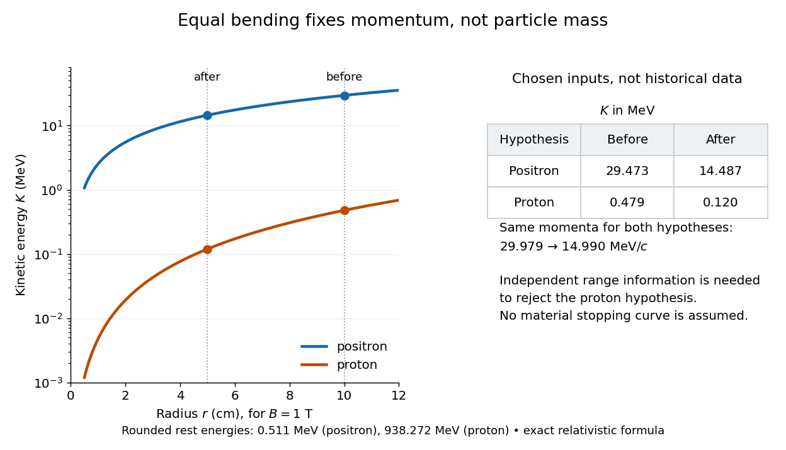

# Proton exclusion by magnetic rigidity and range

↑ **Parent:** [Anderson positron track experiment](anderson-positron-track-experiment.md)

For a concrete independent example, stipulate perpendicular motion, $|q|=e$ with $e$ the [elementary charge](elementary-charge.md), uniform [magnetic field](magnetic-field-split.md) $B=1.00\,\mathrm T$, incoming [gyroradius](gyroradius.md) $r_{\rm in}=0.100\,\mathrm m$ and outgoing [gyroradius](gyroradius.md) $r_{\rm out}=0.0500\,\mathrm m$. These are invented teaching inputs. Converting [SI](international-system-of-units.md) [momentum](momentum-split.md) to [electronvolt](electronvolt.md) units gives

$$
p[\mathrm{MeV}/c]=299.792458\,B[\mathrm T]r[\mathrm m]
\quad (|q|=e),
$$

so $p_{\rm in}=29.9792458\,\mathrm{MeV}/c$ and $p_{\rm out}=14.9896229\,\mathrm{MeV}/c$. Both a [Positron](positron.md) and a [proton](proton.md) with these [momenta](momentum-split.md) trace the same ideal arcs. Their [kinetic energies](kinetic-energy.md) differ because the [relativistic energy-momentum relation](energy-momentum-relation.md) gives

$$
K=\sqrt{(pc)^2+(mc^2)^2}-mc^2
=\frac{(pc)^2}{\sqrt{(pc)^2+(mc^2)^2}+mc^2}.
$$

The second expression avoids subtracting nearly equal quantities when $pc\ll mc^2$. For this calculation stipulate rounded [rest energies](rest-energy.md) $m_ec^2=0.511\,\mathrm{MeV}$ and $m_pc^2=938.272\,\mathrm{MeV}$. The [Positron](positron.md) interpretation gives $K_{\rm in}\simeq29.473\,\mathrm{MeV}$ and $K_{\rm out}\simeq14.487\,\mathrm{MeV}$; the [proton](proton.md) interpretation gives only $0.479\,\mathrm{MeV}$ and $0.120\,\mathrm{MeV}$. The corresponding proposed losses of [kinetic energy](kinetic-energy.md) are about $14.985\,\mathrm{MeV}$ and $0.359\,\mathrm{MeV}$.

**[Figure 3](#image-equal-magnetic-rigidity-permits-very-different-kinetic-energies-for-a-positron-and-a-proton). Equal magnetic rigidity permits very different kinetic energies for a Positron and a proton**. Original calculation for the stipulated $1\,\mathrm T$ [magnetic field](magnetic-field-split.md), rounded [rest energies](rest-energy.md), and radii used in the text. Lines use the exact [relativistic energy-momentum relation](energy-momentum-relation.md); the [kinetic energy](kinetic-energy.md) axis is logarithmic. This is an energy comparison, not a measured spectrum or a historical [particle range](particle-range.md) curve.

The small [proton](proton.md) [kinetic energy](kinetic-energy.md) follows from $K\simeq p^2/(2m_p)$, whereas here the [Positron](positron.md) has $pc\gg m_ec^2$ and $K\simeq pc-m_ec^2$. Consequently magnetic bending alone cannot reject the [proton](proton.md). One needs an independent material constraint: could a [proton](proton.md) at the proposed [kinetic energy](kinetic-energy.md) penetrate the plate and then travel at least the observed visible distance in the specified gas? A [particle range](particle-range.md) shorter than that visible distance contradicts the hypothesis. The visible track need not include the stopping point: it already supplies a lower bound on [particle range](particle-range.md). No numerical [particle range](particle-range.md) is assigned to this teaching example; that would require stopping data for the actual material and gas conditions. The experimental insight is to combine a geometric [momentum](momentum-split.md) measurement with an independent test of penetration.

## ↑ Ancestors (10)

1. [Anderson positron track experiment](anderson-positron-track-experiment.md)
2. [Magnetic rigidity](magnetic-rigidity.md)
3. [Lorentz force](lorentz-force.md)
4. [Electromagnetic field tensor](electromagnetic-field-tensor.md)
5. [Electromagnetic four-potential](electromagnetic-four-potential.md)
6. [Relativistic electromagnetism](relativistic-electromagnetism-split.md)
7. [Electromagnetism](electromagnetism-split.md)
8. [Branches of physics](branches-of-physics.md)
9. [Physics](physics-split.md)
10. [Codex Wiki](split.md)
