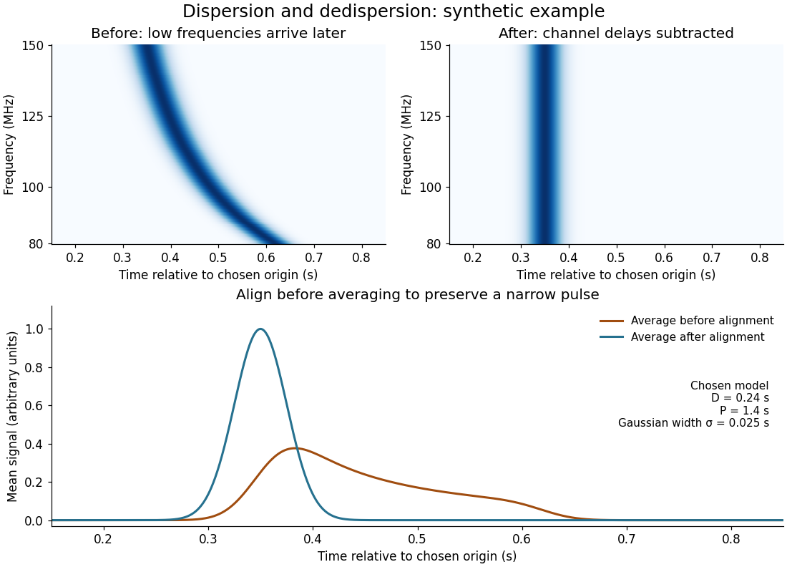

# Pulsar dedispersion

↑ **Parent:** [Pulsar dispersion delay](pulsar-dispersion-delay.md)

[Pulsar dedispersion](pulsar-dedispersion.md) aligns [radio wave](radio-wave.md) arrival times in separate [frequency](frequency.md) channels before combining them. For an original illustrative model choose

$$
\Delta t(f)=D\left[\left(\frac{f}{100\,\mathrm{MHz}}\right)^{-2}-\left(\frac{150\,\mathrm{MHz}}{100\,\mathrm{MHz}}\right)^{-2}\right],\qquad D=0.24\,\mathrm{s}.
$$

Both bracketed ratios are dimensionless, so $D$ supplies all the time units. The reference is $150\,\mathrm{MHz}$: delays are $0$ there, $0.13333\,\mathrm{s}$ at $100\,\mathrm{MHz}$, and $0.26833\,\mathrm{s}$ at $80\,\mathrm{MHz}$. These are chosen model values, not measurements of the first [pulsar](pulsar.md). Subtracting the delay aligns the peaks; summing channels first spreads a short pulse over a longer interval and reduces its peak. Finite channel width and incorrect delay parameters leave residual smearing.

**[Figure 9](#pulsar-dispersion-dedispersion). Correcting a chosen inverse-square frequency delay**. Original noiseless synthetic pulses with a chosen 1.4 second period, 0.025 second Gaussian standard deviation and D=0.24 seconds. The curved arrival track straightens after channel shifts; the profiles compare equal-weight channel averages. This is a propagation model, not original observations or a recreation of a historical chart.

## ↑ Ancestors (9)

1. [Pulsar dispersion delay](pulsar-dispersion-delay.md)
2. [Pulsar](pulsar.md)
3. [Neutron star](neutron-star.md)
4. [Stellar evolution](stellar-evolution.md)
5. [Stellar astrophysics](stellar-astrophysics-split.md)
6. [Astrophysics](astrophysics-split.md)
7. [Branches of physics](branches-of-physics.md)
8. [Physics](physics-split.md)
9. [Codex Wiki](split.md)

## ← Incoming links (4)

- [Hulse-Taylor timing experiment](hulse-taylor-timing-experiment.md)
- [Pulsar dedispersion](pulsar-dedispersion.md)
- [Pulsar period folding and alias checks](pulsar-period-folding-and-alias-checks.md)
- [Pulsar timing](pulsar-timing.md)
