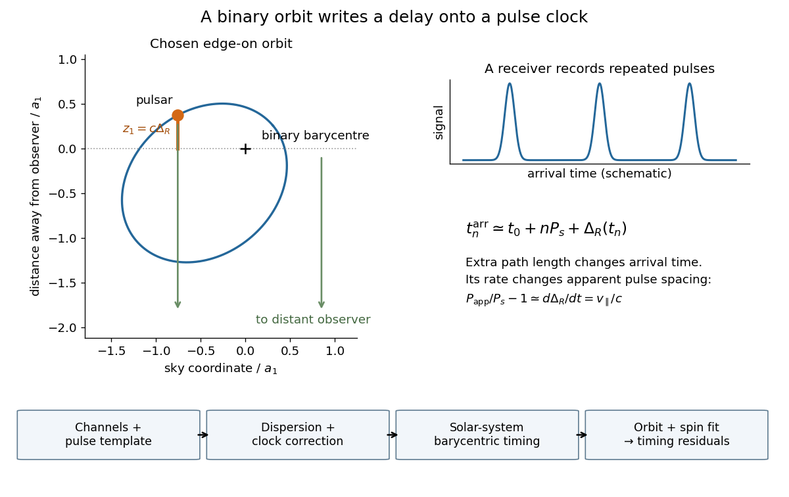

# Pulsar timing

↑ **Parent:** [Pulsar](pulsar.md)

The mature experiment uses channel-template comparison, [pulsar dedispersion](pulsar-dedispersion.md), GPS clock-offset transfer, [Solar system](solar-system.md) [barycenter](barycenter.md) corrections and connected pulse counts.[1993 lecture, III, pp. 77–81, Figures 3–5, equations 1–2](binary-pulsars-and-relativistic-gravity-by-joseph-hooton-taylor-jr.md)

For a geometric illustration, let a perfectly uniform source emit pulse $n$ at $t_n=t_0+nP_s$, with spin [period](period-of-a-function.md) $P_s$, and let $z_1$ increase away from the observer. At leading order in orbital [velocity](velocity.md) divided by the [speed of light](speed-of-light.md), an extra path length $z_1$ adds $\Delta_R=z_1/c$. Consecutive arrivals then obey

$$
P_{\rm app}\simeq P_s\left(1+\frac{d\Delta_R}{dt}\right)=P_s\left(1+\frac{v_\parallel}{c}\right).
$$

A receding source has $v_\parallel>0$ and a longer apparent [period](period-of-a-function.md). This derivation isolates the geometric [Doppler effect](doppler-effect.md); a precision relativistic clock model also needs [gravitational redshift](gravitational-redshift.md) and [time dilation](time-dilation.md).

**[Figure 6](#binary-pulsar-arrival-orbit-geometry). How orbital geometry becomes a pulse arrival-time signal**. Original edge-on geometric illustration and functional timing workflow. Positive z points away from the observer, so a longer path gives positive delay. The chosen eccentricity is 0.6 and argument of periapsis is 40 degrees. The pulse trace is schematic; the boxes summarize functions rather than historical equipment or a mandatory processing order.

**Table of contents**

- [Pulsar timing residual](pulsar-timing-residual.md)
- [Binary-pulsar Einstein delay](binary-pulsar-einstein-delay.md)

## ↑ Ancestors (8)

1. [Pulsar](pulsar.md)
2. [Neutron star](neutron-star.md)
3. [Stellar evolution](stellar-evolution.md)
4. [Stellar astrophysics](stellar-astrophysics-split.md)
5. [Astrophysics](astrophysics-split.md)
6. [Branches of physics](branches-of-physics.md)
7. [Physics](physics-split.md)
8. [Codex Wiki](split.md)

## ← Incoming links (1)

- [Binary pulsar](binary-pulsar.md)
