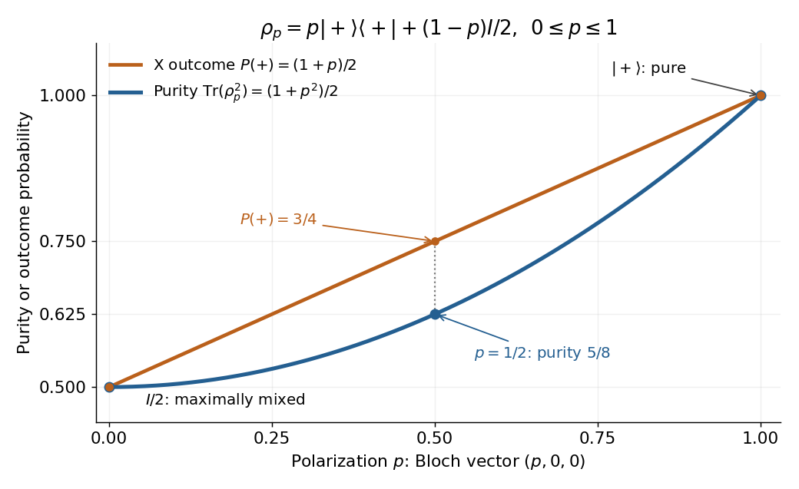

# Purity of a density operator

↑ **Parent:** [Density matrix](density-matrix-split.md)

The purity of a [density operator](density-matrix-split.md) is $\gamma=\operatorname{Tr}(\rho^2)$. It equals one exactly for a [pure state](pure-state.md); in finite [dimension](dimension-vector-space.md) $d$ it lies between $1/d$ and $1$. The minimum occurs exactly at the [maximally mixed state](maximally-mixed-state.md) $I/d$.

A worked [qubit](qubit.md) family interpolates between the [mixed state](mixed-state.md) $I/2$ and the [pure state](pure-state.md) $\rho_+=|+\rangle\langle+|$, where $|+\rangle=(|0\rangle+|1\rangle)/\sqrt2$:

$$
\rho_p=p\rho_++(1-p)\frac I2
=\frac12\begin{pmatrix}1&p\\p&1\end{pmatrix},\qquad 0\leq p\leq1.
$$

The [eigenvectors](eigenvector.md) are $|\pm\rangle=(|0\rangle\pm|1\rangle)/\sqrt2$, with [eigenvalues](eigenvalue.md) $\lambda_\pm=(1\pm p)/2$. Squaring and summing these [eigenvalues](eigenvalue.md) gives

$$
\gamma(p)=\frac{(1+p)^2+(1-p)^2}{4}=\frac{1+p^2}{2},\qquad
P_X(+)=\operatorname{Tr}(\rho_p|+\rangle\langle+|)=\frac{1+p}{2}.
$$

Here $P_X(+)$ is the [Born rule](born-rule.md) [probability](probability.md) of the positive outcome in an $X$ [projective measurement](projective-measurement.md). The [Bloch vector](bloch-vector.md) is $(p,0,0)$, since $\rho_p=(I+p\sigma_x)/2$ with $\sigma_x$ one of the [Pauli matrices](pauli-matrices.md). At $p=0$ the purity is $1/2$; at $p=1/2$ it is $5/8$, with $P_X(+)=3/4$; at $p=1$ it is one. Within this family, $p=1$ is a [pure state](pure-state.md) and every $p<1$ is a [mixed state](mixed-state.md). Extending the formula to $p>1$ produces a negative [eigenvalue](eigenvalue.md) $(1-p)/2$, so it ceases to be a [density operator](density-matrix-split.md) despite remaining [Hermitian](hermitian-operator.md) with [trace](matrix-trace.md) one.

**[Figure 3](#image-purity-and-x-measurement-probability-as-a-qubit-moves-from-the-bloch-ball-centre-to-a-pure-state). Purity and X-measurement probability as a qubit moves from the Bloch-ball centre to a pure state**.

The [Bloch vector](bloch-vector.md) length measures polarization: for any [qubit](qubit.md) [density operator](density-matrix-split.md), $\gamma=(1+|\mathbf r|^2)/2$. This connects the interior of the [Bloch ball](bloch-ball.md) with [mixed states](mixed-state.md) and its boundary, the [Bloch sphere](bloch-sphere.md), with [pure states](pure-state.md). [Preskill, Physics 229 notes, chapter 2, section 2.3.2, equation (2.62)](https://www.preskill.caltech.edu/ph229/notes/chap2.pdf)

For a short proof of the general bound, use the [spectral theorem](spectral-theorem.md): the nonnegative [eigenvalues](eigenvalue.md) $\lambda_j$ sum to one, so $\gamma=\sum_j\lambda_j^2$. Then

$$
\gamma-\frac1d=\sum_{j=1}^d\left(\lambda_j-\frac1d\right)^2\geq0,\qquad
1-\gamma=2\sum_{j<k}\lambda_j\lambda_k\geq0.
$$

The lower bound is attained only when all [eigenvalues](eigenvalue.md) equal $1/d$; the upper bound is attained only when exactly one [eigenvalue](eigenvalue.md) is nonzero, and hence equals one. Purity is therefore a simple quantitative test of mixedness, invariant under a [unitary operator](unitary-operator.md). It does not specify the entire [density operator](density-matrix-split.md): even distinct [pure states](pure-state.md) all have purity one. [Preskill, Physics 229 notes, chapter 2, section 2.3.1, equation (2.60) and the following purity criterion](https://www.preskill.caltech.edu/ph229/notes/chap2.pdf)

## ↑ Ancestors (5)

1. [Density matrix](density-matrix-split.md)
2. [Quantum theory](quantum-theory-split.md)
3. [Branches of physics](branches-of-physics.md)
4. [Physics](physics-split.md)
5. [Codex Wiki](split.md)

## ← Incoming links (25)

- [Density matrix](density-matrix-split.md)
- [Hamiltonian rotations of Bloch vectors](hamiltonian-rotations-of-bloch-vectors.md)
- [Lindblad dissipator](lindblad-dissipator.md)
- [Markovian reservoir engineering](markovian-reservoir-engineering.md)
- [Mixed state](mixed-state.md)
- [Solution](past-exam-of-the-advanced-quantum-physics-course-of-the-university-of-cambridge/2022/section-a/2/solution.md)
- [Solution](past-exam-of-the-mathematics-course-of-the-university-of-cambridge/2006/iii/paper-60/1/d/solution.md)
- [Solution](past-exam-of-the-mathematics-course-of-the-university-of-cambridge/2007/iii/paper-60/1/b/solution.md)
- [Solution](past-exam-of-the-mathematics-course-of-the-university-of-cambridge/2007/iii/paper-60/1/e/solution.md)
- [Solution](past-exam-of-the-mathematics-course-of-the-university-of-cambridge/2009/iii/paper-52/1/a/solution.md)
- [Solution](past-exam-of-the-mathematics-course-of-the-university-of-cambridge/2009/iii/paper-52/2/d/solution.md)
- [Solution](past-exam-of-the-mathematics-course-of-the-university-of-cambridge/2009/iii/paper-52/2/e/solution.md)
- [Solution](past-exam-of-the-mathematics-course-of-the-university-of-cambridge/2009/iii/paper-52/2/f/solution.md)
- [Solution](past-exam-of-the-mathematics-course-of-the-university-of-cambridge/2010/iii/paper-50/1/a/solution.md)
- [Solution](past-exam-of-the-mathematics-course-of-the-university-of-cambridge/2016/iii/paper-323/3/iii/b/solution.md)
- [Solution](past-exam-of-the-mathematics-course-of-the-university-of-cambridge/2024/ii/paper-4/33b/b/iv/solution.md)
- [Solution](past-exam-of-the-theoretical-physics-ii-course-of-the-university-of-cambridge/2018/3/a/solution.md)
- [Solution](past-exam-of-the-theoretical-physics-ii-course-of-the-university-of-cambridge/2018/3/b/solution.md)
- [Solution](past-exam-of-the-theoretical-physics-ii-course-of-the-university-of-cambridge/2019/4/a/solution.md)
- [Solution](past-exam-of-the-theoretical-physics-ii-course-of-the-university-of-cambridge/2019/4/e/i/solution.md)
- [Quantum state](quantum-state.md)
- [Qubit](qubit.md)
- [Qubit state](qubit-state.md)
- [Spin expectation value](spin-expectation-value.md)
- [Unitary time evolution](unitary-time-evolution.md)
