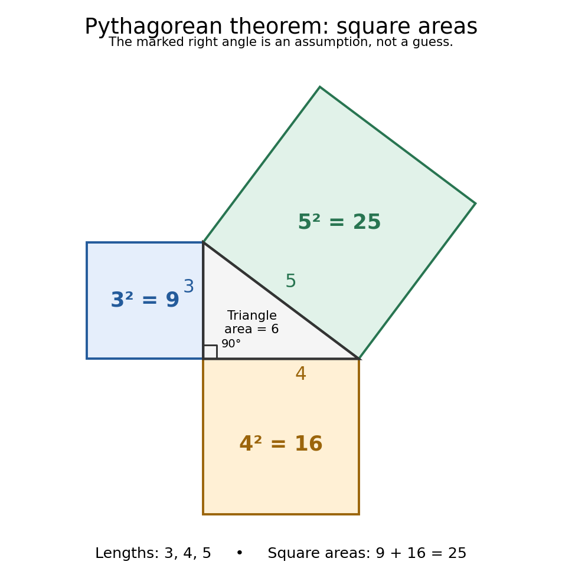
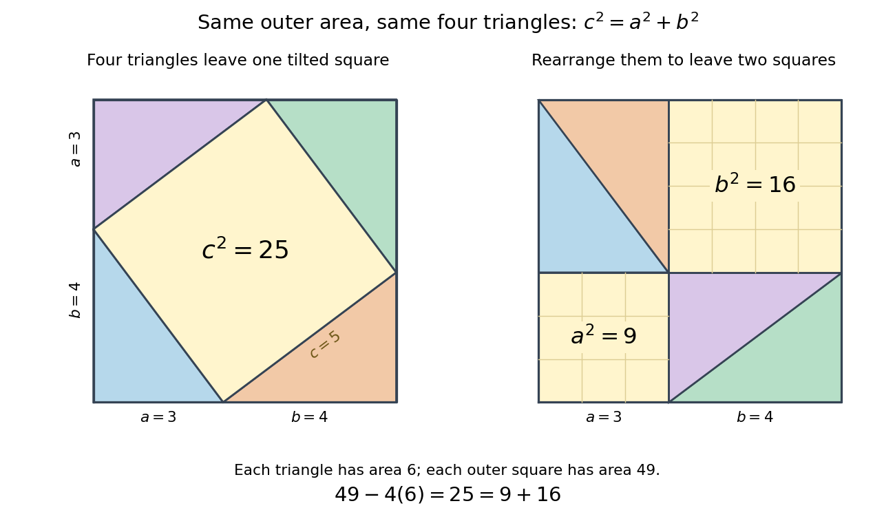

# Pythagorean theorem

↑ **Parent:** [Euclidean geometry](euclidean-geometry.md)  
ⓦ [Wiki](https://en.wikipedia.org/wiki/Pythagorean_theorem)

For a [right triangle](right-triangle.md) in [Euclidean geometry](euclidean-geometry.md) with perpendicular side [lengths](length.md) $a,b>0$ and [hypotenuse](hypotenuse.md) $c$, the [Pythagorean theorem](pythagorean-theorem.md) states

$$
a^2+b^2=c^2.
$$

Geometrically, the [area](surface-area.md) of the [square](square.md) on the [hypotenuse](hypotenuse.md) equals the sum of the [areas](surface-area.md) of the [squares](square.md) on the other two sides. Euclid's [Elements](euclid-s-elements.md), Book I, Proposition 47 states this [area](surface-area.md) equality; Proposition 48 states its converse: a [triangle](triangle.md) satisfying the equality has a [right angle](right-angle.md) opposite side $c$.[Euclid, Elements I.47](https://mathcs.clarku.edu/~djoyce/elements/bookI/propI47.html)[Euclid, Elements I.48](https://mathcs.clarku.edu/~djoyce/elements/bookI/propI48.html)

For $a=3$ and $b=4$, we compute $c=\sqrt{9+16}=5$. The [triangle](triangle.md) has [area](surface-area.md) $ab/2=6$, and its side [lengths](length.md) form a [Pythagorean triple](pythagorean-triple.md). Conversely, a [triangle](triangle.md) measured to have sides $3,4,5$ must have a [right angle](right-angle.md) between the sides $3$ and $4$. This makes the equality both a calculation tool and a test for perpendicularity.

The three [squares](square.md) in the next figure have [areas](surface-area.md) $3^2=9$, $4^2=16$ and $5^2=25$ in squared [length](length.md) units. These are different from the central [right triangle](right-triangle.md)'s [area](surface-area.md) $3\cdot4/2=6$. The [Pythagorean theorem](pythagorean-theorem.md) adds the [areas](surface-area.md) of the attached [squares](square.md), not their side [lengths](length.md) and not the [area](surface-area.md) of the [triangle](triangle.md). The [square](square.md) on the [hypotenuse](hypotenuse.md) is tilted, but a [rotation](rotation-mathematics.md) preserves its [area](surface-area.md). This makes the formula visible without suggesting that the [hypotenuse](hypotenuse.md) has to align with an axis.

**[Figure 15](#image-squares-on-a-3-4-5-right-triangle-have-areas-9-plus-16-25-the-triangle-itself-has-area-6). Squares on a 3-4-5 right triangle have areas $9+16=25$; the triangle itself has area $6$**.

Historically, [Euclid's Elements](euclid-s-elements.md) records an organized proof of the [Pythagorean theorem](pythagorean-theorem.md) as an equality of [areas](surface-area.md), rather than the modern equation between numbers representing [lengths](length.md). Its placement in Book I makes it available before the treatment of [similar triangles](similar-triangle.md) in Book VI. This is evidence of how the result was established within that text; the name [Pythagorean theorem](pythagorean-theorem.md) alone does not establish who first discovered or proved it. The precise historical anchor here is the surviving proposition, rather than an unsupported story of a single inventor.[Euclid, Elements I.47, statement and proof](https://mathcs.clarku.edu/~djoyce/elements/bookI/propI47.html)

The dissection below makes the general identity tangible. Both outer [squares](square.md) have side $a+b$ and contain the same four [congruent](congruence-geometry.md) [right triangles](right-triangle.md). In the first arrangement, their [hypotenuses](hypotenuse.md) bound a [square](square.md) of side $c$: adjacent acute [angles](angle.md) together make a [right angle](right-angle.md). In the second, the uncovered regions are [squares](square.md) of sides $a$ and $b$. Subtracting the same total [triangle](triangle.md) [area](surface-area.md) from equal outer [areas](surface-area.md) gives

$$
c^2=(a+b)^2-4\frac{ab}{2}=a^2+b^2.
$$

For the pictured dimensions, the shared uncovered [area](surface-area.md) is $49-24=25=9+16$.

**[Figure 16](#image-rearranging-four-congruent-3-4-5-right-triangles-proves-that-the-uncovered-square-areas-satisfy-25-9-plus-16). Rearranging four congruent 3-4-5 right triangles proves that the uncovered square areas satisfy $25=9+16$**.

The same mechanism survives in [inner product spaces](inner-product-space.md): for [orthogonal](orthogonal-vectors.md) [vectors](vector.md) $u,v$, expanding the [inner product](inner-product.md) gives $\|u+v\|^2=\|u\|^2+\|v\|^2$. This is why [orthogonal projection](orthogonal-projection.md) separates a squared distance into independent contributions. The familiar [right triangle](right-triangle.md) is the simplest picture of a much more reusable principle.

**Table of contents**

- [Pythagorean triple](pythagorean-triple.md)
  - [Primitive Pythagorean parametrization](primitive-pythagorean-parametrization.md)

## ↑ Ancestors (5)

1. [Euclidean geometry](euclidean-geometry.md)
2. [Geometry and topology](geometry-and-topology-split.md)
3. [Area of mathematics](area-of-mathematics.md)
4. [Mathematics](mathematics-split.md)
5. [Codex Wiki](split.md)

## ← Incoming links (27)

- [Center and radius of a sphere-plane intersection](center-and-radius-of-a-sphere-plane-intersection.md)
- [Chord of a circle](chord-of-a-circle.md)
- [Euclidean geometry](euclidean-geometry.md)
- [Galerkin orthogonality](galerkin-orthogonality.md)
- [Geometry and topology](geometry-and-topology-split.md)
- [Hermitian inner product](hermitian-inner-product.md)
- [Hypotenuse](hypotenuse.md)
- [Law of total variance](law-of-total-variance.md)
- [Modulus](modulus.md)
- [Orthogonal projection](orthogonal-projection.md)
- [Solution](past-exam-of-the-mathematics-course-of-the-university-of-cambridge/2002/iii/paper-61/7/a/solution.md)
- [Solution](past-exam-of-the-mathematics-course-of-the-university-of-cambridge/2007/ia/paper-1/5b/i/solution.md)
- [Solution](past-exam-of-the-mathematics-course-of-the-university-of-cambridge/2007/ia/paper-1/5b/ii/a/solution.md)
- [Solution](past-exam-of-the-mathematics-course-of-the-university-of-cambridge/2007/ia/paper-1/5b/ii/b/solution.md)
- [Solution](past-exam-of-the-mathematics-course-of-the-university-of-cambridge/2012/ia/paper-1/5c/solution.md)
- [Solution](past-exam-of-the-mathematics-course-of-the-university-of-cambridge/2014/ib/paper-4/17d/ii/solution.md)
- [Solution](past-exam-of-the-mathematics-course-of-the-university-of-cambridge/2016/ia/paper-1/5a/c/solution.md)
- [Solution](past-exam-of-the-mathematics-course-of-the-university-of-cambridge/2016/iii/paper-112/3/ii/solution.md)
- [Solution](past-exam-of-the-mathematics-course-of-the-university-of-cambridge/2019/iii/paper-147/3/ii/solution.md)
- [Solution](past-exam-of-the-mathematics-course-of-the-university-of-cambridge/2023/iii/paper-310/1/d/solution.md)
- [Pigeonhole principle](pigeonhole-principle.md)
- [Pythagorean theorem](pythagorean-theorem.md)
- [Pythagorean trigonometric identity](pythagorean-trigonometric-identity.md)
- [Quadratic path bound in a right triangle](quadratic-path-bound-in-a-right-triangle.md)
- [Spherical law of cosines](spherical-law-of-cosines.md)
- [Time dilation](time-dilation.md)
- [Triangle](triangle.md)
