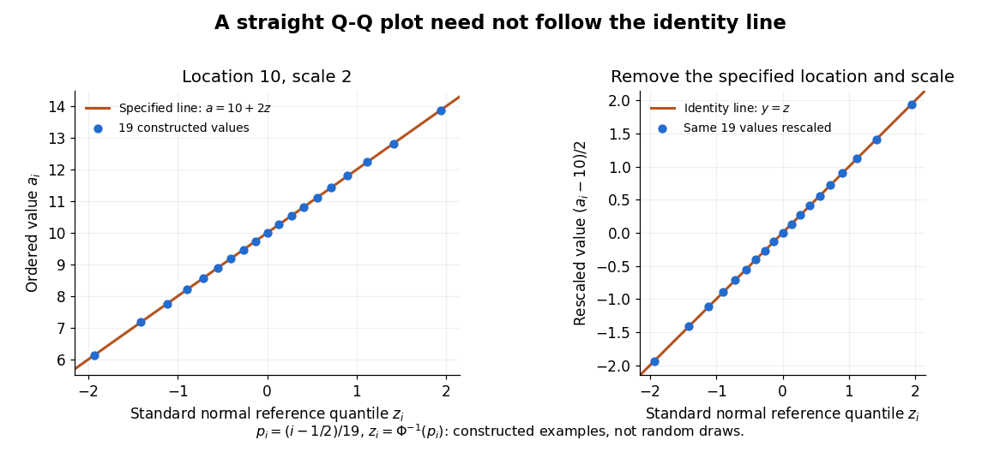

# Q-Q plot

↑ **Parent:** [Probability and statistics](probability-and-statistics-split.md)  
ⓦ [Wiki](https://en.wikipedia.org/wiki/Q–Q_plot)

A [Q-Q plot](q-q-plot.md) is a [scatter plot](scatter-plot.md) pairing [quantiles](quantile-function.md) at the same [probability](probability.md) levels. For a [statistical sample](statistical-sample.md) of size $n$, sort the observations into [order statistics](order-statistic.md) $x_{(1)}\leq\cdots\leq x_{(n)}$. Choose [plotting positions](plotting-position.md) $p_i$ and a reference [quantile function](quantile-function.md) $Q_0$, then plot

$$
(Q_0(p_i),x_{(i)}),\qquad p_i=\frac{i-1/2}{n},\qquad i=1,\ldots,n.
$$

Here the horizontal coordinate is a reference value, and the vertical coordinate is an observed value; neither axis is the [probability](probability.md) $p_i$. The displayed [plotting positions](plotting-position.md) are our chosen convention, placing every level strictly between zero and one. They are not a claim that the $i$th [order statistic](order-statistic.md) equals that population [quantile](quantile-function.md). For two [statistical samples](statistical-sample.md), use [sample quantiles](sample-quantile.md) at matching levels, with a stated interpolation convention when their sizes differ. [NIST/SEMATECH, Quantile-Quantile Plot, definition](https://www.itl.nist.gov/div898/handbook/eda/section3/qqplot.htm)

As a computed example, take $n=19$ and the [standard normal quantiles](standard-normal-quantile.md) $z_i=\Phi^{-1}(p_i)$, where $\Phi$ is the [standard normal cumulative distribution function](standard-normal-distribution-function.md). Construct the ordered values $a_i=10+2z_i$. At ranks $1,10,19$, the [plotting positions](plotting-position.md) are $1/38,1/2,37/38$, the reference [quantiles](quantile-function.md) are approximately $-1.937932,0,1.937932$, and the constructed values are approximately $6.124137,10,13.875863$. Every point lies on $a=10+2z$ by construction. These 19 values are deliberately chosen, not random draws or real measurements.

**[Figure 3](#image-an-exact-constructed-q-q-line-encodes-location-and-scale). An exact constructed Q-Q line encodes location and scale**. Left: all 19 pairs $(z_i,a_i)$ lie on $a=10+2z$, with [plotting positions](plotting-position.md) $p_i=(i-1/2)/19$. Right: subtracting the specified location 10 and dividing by the specified scale 2 puts the same points on the identity line. These parameters are construction constants, not [sample mean](sample-mean.md) and sample [standard deviation](standard-deviation.md) estimates. The 19 values are deterministic examples, not random draws.

The usefulness of a [Q-Q plot](q-q-plot.md) is that it turns a comparison of [probability distributions](probability-distribution.md) into geometry: if a reference [random variable](random-variable-split.md) $Z$ is transformed into $X=\mu+\sigma Z$ with $\sigma>0$, its [quantile function](quantile-function.md) satisfies $Q_X(p)=\mu+\sigma Q_Z(p)$. This follows because a positive scaling preserves ordering. Thus the [location-scale family](location-scale-family.md) produces a straight population [Q-Q plot](q-q-plot.md), and an approximate sample line suggests a compatible shape over the observed range. Its intercept describes location and its slope describes scale. The identity line requires the same location, scale and units on both axes; even then its displayed angle is 45 degrees only with equal axis scales. Curvature is often more informative than a [histogram](histogram.md) because it shows which [quantiles](quantile-function.md) depart from the reference. [NIST/SEMATECH, Quantile-Quantile Plot, location and scale comparisons](https://www.itl.nist.gov/div898/handbook/eda/section3/qqplot.htm)

**Table of contents**

- [Normal Q-Q plot](normal-q-q-plot.md)
- [Plotting position](plotting-position.md)

## ↑ Ancestors (4)

1. [Probability and statistics](probability-and-statistics-split.md)
2. [Area of mathematics](area-of-mathematics.md)
3. [Mathematics](mathematics-split.md)
4. [Codex Wiki](split.md)

## ← Incoming links (11)

- [Normal Q-Q plot](normal-q-q-plot.md)
- [Solution](past-exam-of-the-mathematics-course-of-the-university-of-cambridge/2002/iii/paper-36/1/ii/solution.md)
- [Solution](past-exam-of-the-mathematics-course-of-the-university-of-cambridge/2008/ii/paper-3/5j/solution.md)
- [Solution](past-exam-of-the-mathematics-course-of-the-university-of-cambridge/2009/iii/paper-38/1/solution.md)
- [Solution](past-exam-of-the-mathematics-course-of-the-university-of-cambridge/2011/ii/paper-1/13j/solution.md)
- [Solution](past-exam-of-the-mathematics-course-of-the-university-of-cambridge/2015/iii/paper-33/1/solution.md)
- [Solution](past-exam-of-the-mathematics-course-of-the-university-of-cambridge/2015/iii/paper-33/6/b/solution.md)
- [Solution](past-exam-of-the-mathematics-course-of-the-university-of-cambridge/2018/iii/paper-218/6/a/solution.md)
- [Plotting position](plotting-position.md)
- [Q-Q plot](q-q-plot.md)
- [Standardized regression residual](standardized-regression-residual.md)
