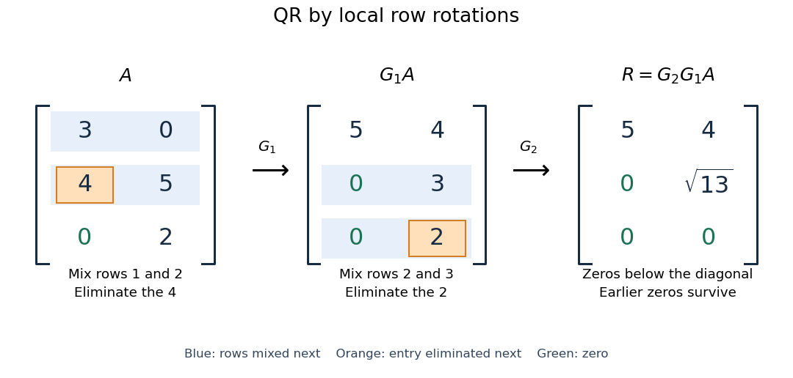

# QR decomposition by Givens rotations

↑ **Parent:** [Givens rotation](givens-rotation.md)

Successive [Givens rotations](givens-rotation.md) eliminate entries below the diagonal of a [matrix](matrix.md). For an $m\times n$ [matrix](matrix.md) with $m\geq n$, process columns $k=1,\ldots,n$; within column $k$, rotate rows $k,j$ for each $j>k$ whose entry needs elimination. Apply each [Givens row-pair update](givens-row-pair-update.md) to columns $k,\ldots,n$. Both rows are zero in earlier columns, so these operations preserve earlier eliminations. No assumption of [full column rank](full-column-rank.md) is needed to perform the eliminations.

For a concrete example, take

$$
A=\begin{pmatrix}3&0\\4&5\\0&2\end{pmatrix}.
$$

First use $G_1=G_{12}(3/5,4/5)$, then $G_2=G_{23}(3/\sqrt{13},2/\sqrt{13})$:

$$
G_1A=\begin{pmatrix}5&4\\0&3\\0&2\end{pmatrix},\qquad
R=G_2G_1A=\begin{pmatrix}5&4\\0&\sqrt{13}\\0&0\end{pmatrix}.
$$

The entry in position $(3,1)$ was already zero, so its elimination was skipped. The second [Givens rotation](givens-rotation.md) combines the remaining pair $(3,2)^T$ in column two. This yields the full [QR decomposition](qr-decomposition.md)

$$
Q=G_1^TG_2^T=
\begin{pmatrix}
3/5&-12/(5\sqrt{13})&8/(5\sqrt{13})\\
4/5&9/(5\sqrt{13})&-6/(5\sqrt{13})\\
0&2/\sqrt{13}&3/\sqrt{13}
\end{pmatrix},\qquad A=QR.
$$

The first two columns of $Q$ and first two rows of $R$ give the reduced [QR decomposition](qr-decomposition.md). Direct multiplication verifies both $QR=A$ and $Q^TQ=I$. For these displayed factors evaluated in binary64 [floating-point arithmetic](floating-point-arithmetic.md), the [Frobenius norms](frobenius-norm.md) $\|A-QR\|_F$ and $\|Q^TQ-I\|_F$ are both below $10^{-14}$; these measure reconstruction and loss of [orthogonality](orthogonal-vectors.md) separately.

**[Figure 38](#image-two-local-givens-row-pair-updates-turn-a-3-times2-matrix-into-the-rectangular-r-of-a-qr-decomposition). Two local Givens row-pair updates turn a $3\times2$ matrix into the rectangular $R$ of a QR decomposition**.

More generally, if the chronological rotations are $G_1,\ldots,G_p$, then

$$
\Omega=G_p\cdots G_1,\qquad R=\Omega A,\qquad
Q=\Omega^T=G_1^T\cdots G_p^T.
$$

Each factor is an [orthogonal matrix](orthogonal-matrix.md), so $Q$ is too. For a rectangular [matrix](matrix.md), $R$ has zeros below its diagonal; its leading $n\times n$ block is an [upper triangular matrix](upper-triangular-matrix.md). With [full column rank](full-column-rank.md), retaining the first $n$ columns of $Q$ gives [orthonormal](orthonormal-set.md) columns. To impose a positive diagonal when necessary, flip matching columns of $Q$ and rows of $R$, preserving their product.

For a [linear least-squares problem](linear-least-squares-problem.md), apply the same chronological [Givens rotations](givens-rotation.md) to the right-hand side $b$, obtaining $z=\Omega b$, without explicitly constructing $Q$. Since the [Euclidean norm](euclidean-norm.md) is preserved, solve the leading [upper triangular matrix](upper-triangular-matrix.md) system $R_1x=z_{1:n}$ by [back substitution](back-substitution.md) when $A$ has [full column rank](full-column-rank.md); the remaining entries of $z$ give the minimum residual [norm](norm.md). In the example, $b=(0,0,1)^T$ gives $z=(0,2/\sqrt{13},3/\sqrt{13})^T$, $x=(-8/65,2/13)^T$, and minimum residual [Euclidean norm](euclidean-norm.md) $3/\sqrt{13}$.

The locality is useful for a [sparse matrix](sparse-matrix.md) or an existing [QR decomposition](qr-decomposition.md) needing an extra row: only two rows change at each step, and the new row can be eliminated against the stored [upper triangular matrix](upper-triangular-matrix.md). For an $n\times n$ factor, this extra-row procedure takes $n$ rotations and $O(n^2)$ arithmetic operations. Locality does not guarantee preservation of sparsity: mixing rows can create nonzeros wherever either row had one. For a fully populated $m\times n$ input, the straightforward elimination uses $\sum_{k=1}^n(m-k)$ rotations, each touching $n-k+1$ columns, giving $O(mn^2)$ work. Storage layout, zero patterns and implementation affect speed; this count alone establishes no universal advantage over other [QR decomposition](qr-decomposition.md) [algorithms](algorithm.md).

The [Euclidean norm](euclidean-norm.md) preservation explains the appeal for [numerical stability](stability-of-a-numerical-method.md): exact rotations do not amplify a perturbation's length. Rounded [coefficients](coefficient.md) and [Givens row-pair updates](givens-row-pair-update.md) still introduce [roundoff error](round-off-error.md). Small reconstruction and [orthogonality](orthogonal-vectors.md) residuals check the computed factors, while the [condition number](condition-number.md) of the original problem still controls how accurately a [linear least-squares problem](linear-least-squares-problem.md) determines its solution.

## ↑ Ancestors (6)

1. [Givens rotation](givens-rotation.md)
2. [Numerical analysis](numerical-analysis-split.md)
3. [Analysis](analysis-split.md)
4. [Area of mathematics](area-of-mathematics.md)
5. [Mathematics](mathematics-split.md)
6. [Codex Wiki](split.md)

## ← Incoming links (4)

- [Givens rotation](givens-rotation.md)
- [Givens row-pair update](givens-row-pair-update.md)
- [Solution](past-exam-of-the-mathematics-course-of-the-university-of-cambridge/2016/ib/paper-2/19d/b/solution.md)
- [Solution](past-exam-of-the-mathematics-course-of-the-university-of-cambridge/2024/ib/paper-1/17a/solution.md)
