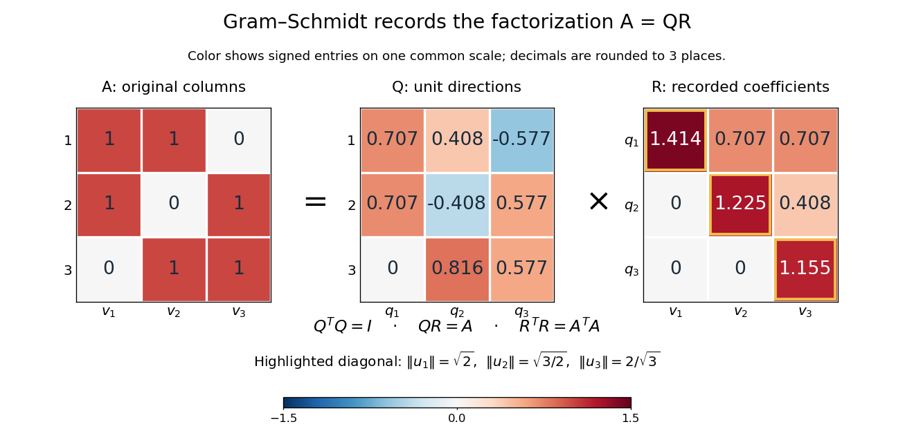

# QR decomposition

↑ **Parent:** [Gram-Schmidt process](gram-schmidt-process.md)  
ⓦ [Wiki](https://en.wikipedia.org/wiki/QR_decomposition)

A reduced [QR decomposition](qr-decomposition.md) of an $m\times k$ [matrix](matrix.md) over the [real numbers](real-number.md) with [full column rank](full-column-rank.md), $m\geq k$, writes $A=QR$, where $Q$ is $m\times k$ with [orthonormal](orthonormal-set.md) columns and $R$ is a $k\times k$ [upper triangular matrix](upper-triangular-matrix.md) with positive diagonal. Applying the [Gram-Schmidt process](gram-schmidt-process.md) to the columns $v_j$ of $A$ constructs $Q=(q_1\ \cdots\ q_k)$ and records the [coefficients](coefficient.md)

$$
r_{ij}=\begin{cases}
\langle v_j,q_i\rangle,&i<j,\\
\|u_j\|,&i=j,\\
0,&i>j.
\end{cases}
\qquad v_j=\sum_{i\leq j}r_{ij}q_i.
$$

This last column identity is exactly the [matrix multiplication](matrix-multiplication.md) $A=QR$. The [upper triangular matrix](upper-triangular-matrix.md) records that the $j$th input uses only the first $j$ new directions, while its positive diagonal records the [norms](norm.md) of the nonzero [orthogonal projection residuals](orthogonal-projection-residual.md). Since $Q^TQ=I$, one also has $R=Q^TA$; $Q^T$ denotes the [transpose](transpose.md) and $I$ the [identity matrix](identity-matrix.md). Over the [complex numbers](complex-number.md), use the [conjugate transpose](conjugate-transpose.md) $Q^*$ in these identities.

For the three-dimensional [Gram-Schmidt process](gram-schmidt-process.md) example, the exact [matrices](matrix.md) are

$$
A=\begin{pmatrix}1&1&0\\1&0&1\\0&1&1\end{pmatrix},\qquad
Q=\begin{pmatrix}
1/\sqrt2&1/\sqrt6&-1/\sqrt3\\
1/\sqrt2&-1/\sqrt6&1/\sqrt3\\
0&2/\sqrt6&1/\sqrt3
\end{pmatrix},
$$

$$
R=\begin{pmatrix}
\sqrt2&1/\sqrt2&1/\sqrt2\\
0&\sqrt{3/2}&1/\sqrt6\\
0&0&2/\sqrt3
\end{pmatrix}.
$$

For example, the last column reconstructs as

$$
\frac{q_1}{\sqrt2}+\frac{q_2}{\sqrt6}+\frac{2q_3}{\sqrt3}
=\frac12(1,1,0)^T+\frac16(1,-1,2)^T+\frac23(-1,1,1)^T
=(0,1,1)^T.
$$

The diagonal entries are approximately $1.414214,1.224745,1.154701$. Each is a [norm](norm.md) of the new direction before it was scaled to length one.

**[Figure 6](#image-the-computed-qr-factorization-input-matrix-a-orthonormal-columns-of-q-and-the-upper-triangular-matrix-r-of-orthogonal-projection-coefficients). The computed QR factorization: input matrix $A$, orthonormal columns of $Q$, and the upper triangular matrix $R$ of orthogonal projection coefficients**.

For a [linear least-squares problem](linear-least-squares-problem.md), the [orthogonal projection](orthogonal-projection.md) of $b$ onto the [column space](column-space.md) of $A$ is $QQ^Tb$. Hence the minimizing [coefficients](coefficient.md) solve the [linear system](system-of-linear-equations.md) $Rx=Q^Tb$ by [back substitution](back-substitution.md). Let $A_2=(v_1\ v_2)$ consist of the first two columns of the example; its reduced factors are $Q_2=(q_1\ q_2)$ and the leading $2\times2$ block $R_2$ of $R$. For $b=(0,0,1)^T$, the [linear system](system-of-linear-equations.md) $R_2x=Q_2^Tb$ is

$$
\begin{pmatrix}\sqrt2&1/\sqrt2\\0&\sqrt{3/2}\end{pmatrix}
\begin{pmatrix}x_1\\x_2\end{pmatrix}
=\begin{pmatrix}0\\2/\sqrt6\end{pmatrix},
\qquad x_2=\frac23,\quad x_1=-\frac13.
$$

Thus $A_2x=(1/3,-1/3,2/3)^T$, agreeing with the [orthogonal projection](orthogonal-projection.md) computed above, and the minimum [Euclidean norm](euclidean-norm.md) of $A_2x-b$ is $1/\sqrt3$. The [QR decomposition](qr-decomposition.md) separates building an [orthonormal basis](orthonormal-basis.md) from recovering [coefficients](coefficient.md) in the original [basis](basis.md).[Strang, MIT 18.065, Lecture 9: Four Ways to Solve Least Squares Problems](https://ocw.mit.edu/courses/18-065-matrix-methods-in-data-analysis-signal-processing-and-machine-learning-spring-2018/resources/lecture-9-four-ways-to-solve-least-squares-problems/)

**Table of contents**

- [Positive-diagonal QR decomposition preserves a complex structure](positive-diagonal-qr-decomposition-preserves-a-complex-structure.md)
- [Thin QR factorization from Cholesky decomposition](thin-qr-factorization-from-cholesky-decomposition.md)
- [Orthogonal coordinate reduction of a subspace](orthogonal-coordinate-reduction-of-a-subspace.md)
- [Linear least-squares problem](linear-least-squares-problem.md)

## ↑ Ancestors (7)

1. [Gram-Schmidt process](gram-schmidt-process.md)
2. [Inner product](inner-product-split.md)
3. [Linear algebra](linear-algebra-split.md)
4. [Algebra](algebra-split.md)
5. [Area of mathematics](area-of-mathematics.md)
6. [Mathematics](mathematics-split.md)
7. [Codex Wiki](split.md)

## ← Incoming links (29)

- [Accumulated QR factorization identity](accumulated-qr-factorization-identity.md)
- [Cholesky decomposition and geodetic adjustment](cholesky-decomposition-and-geodetic-adjustment.md)
- [Gram-Schmidt process](gram-schmidt-process.md)
- [Householder QR example in two dimensions](householder-qr-example-in-two-dimensions.md)
- [Matrix decomposition](matrix-decomposition.md)
- [Normal equations for linear least squares](normal-equations-for-linear-least-squares.md)
- [Orthogonal coordinate reduction of a subspace](orthogonal-coordinate-reduction-of-a-subspace.md)
- [Overdetermined least-squares example](overdetermined-least-squares-example.md)
- [Solution](past-exam-of-the-mathematics-course-of-the-university-of-cambridge/2001/ib/paper-2/14e/b/solution.md)
- [Solution](past-exam-of-the-mathematics-course-of-the-university-of-cambridge/2001/ib/paper-3/19b/solution.md)
- [Solution](past-exam-of-the-mathematics-course-of-the-university-of-cambridge/2002/ib/paper-2/5b/solution.md)
- [Solution](past-exam-of-the-mathematics-course-of-the-university-of-cambridge/2006/ib/paper-3/19d/a/solution.md)
- [Solution](past-exam-of-the-mathematics-course-of-the-university-of-cambridge/2006/iii/paper-66/1/solution.md)
- [Solution](past-exam-of-the-mathematics-course-of-the-university-of-cambridge/2007/ib/paper-1/6f/solution.md)
- [Solution](past-exam-of-the-mathematics-course-of-the-university-of-cambridge/2009/ib/paper-2/18c/solution.md)
- [Solution](past-exam-of-the-mathematics-course-of-the-university-of-cambridge/2013/ia/paper-1/2a/iv/solution.md)
- [Solution](past-exam-of-the-mathematics-course-of-the-university-of-cambridge/2013/ib/paper-1/18c/solution.md)
- [Solution](past-exam-of-the-mathematics-course-of-the-university-of-cambridge/2016/ib/paper-2/19d/b/solution.md)
- [Solution](past-exam-of-the-mathematics-course-of-the-university-of-cambridge/2016/ib/paper-2/19d/c/i/solution.md)
- [Solution](past-exam-of-the-mathematics-course-of-the-university-of-cambridge/2017/ib/paper-2/19c/solution.md)
- [Solution](past-exam-of-the-mathematics-course-of-the-university-of-cambridge/2018/ii/paper-1/40e/b/solution.md)
- [Solution](past-exam-of-the-mathematics-course-of-the-university-of-cambridge/2019/ib/paper-2/19c/solution.md)
- [Solution](past-exam-of-the-mathematics-course-of-the-university-of-cambridge/2021/ii/paper-1/41e/a/solution.md)
- [Solution](past-exam-of-the-mathematics-course-of-the-university-of-cambridge/2022/ib/paper-1/5c/solution.md)
- [Solution](past-exam-of-the-physics-of-the-earth-as-a-planet-course-of-the-university-of-cambridge/2015/paper-1/1/c/solution.md)
- [Positive-diagonal QR decomposition preserves a complex structure](positive-diagonal-qr-decomposition-preserves-a-complex-structure.md)
- [QR algorithm](qr-algorithm.md)
- [QR decomposition](qr-decomposition.md)
- [QR decomposition by Givens rotations](qr-decomposition-by-givens-rotations.md)
