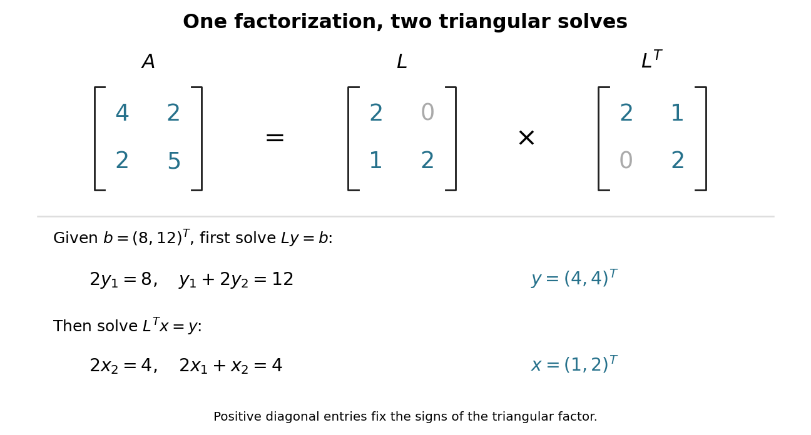
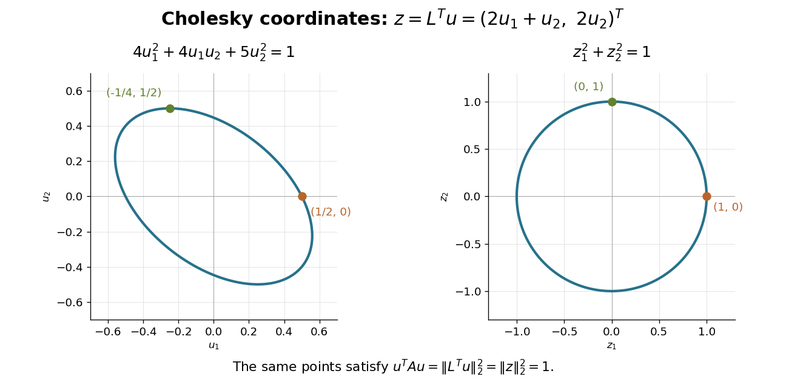

# Quadratic form

↑ **Parent:** [Linear algebra](linear-algebra.md)  
ⓦ [Wiki](https://en.wikipedia.org/wiki/Quadratic_form)

A [quadratic form](quadratic-form.md) on a [vector space](vector-space.md) over a [field](algebra.md#field) $F$ is a function $Q:V\to F$ satisfying $Q(av)=a^2Q(v)$ whose [polar bilinear form of a quadratic form](#polar-bilinear-form-of-a-quadratic-form) $B_Q(v,w)=Q(v+w)-Q(v)-Q(w)$ is a [bilinear form](bilinear-form.md). In finite [dimension](vector-space.md#dimension-vector-space), it is represented in [coordinates](vector-space.md#coordinate-linear-algebra) by a homogeneous degree-two [polynomial](polynomial.md), or by $Q(v)=v^TAv$ with a suitable [matrix](vector-space.md#matrix) $A$.

When the [characteristic](algebra.md#characteristic-of-a-field) is not two, one may choose $A$ to be a [symmetric matrix](linear-algebra.md#symmetric-matrix) and recover it from $B_Q/2$. In [characteristic](algebra.md#characteristic-of-a-field) two, the symmetric-matrix restriction would lose examples: $Q(x,y)=xy$ has an upper-triangular representing [matrix](vector-space.md#matrix) $\begin{pmatrix}0&1\\0&0\end{pmatrix}$, while $v^TAv$ for a [symmetric matrix](linear-algebra.md#symmetric-matrix) has no $xy$ cross term. Its polar form is $B_Q((x,y),(u,v))=xv+yu$, an [alternating bilinear form](bilinear-form.md#alternating-bilinear-form). The distinction matters when studying [quadratic forms](quadratic-form.md) over [finite fields](algebra.md#finite-field).[§§6–7: quadratic forms and characteristic two](mathematics-bibliography.md#bilinear-forms-by-keith-conrad)

**Table of contents**

- [Level sets of a positive semidefinite quadratic form](#level-sets-of-a-positive-semidefinite-quadratic-form)
- [Polar bilinear form of a quadratic form](#polar-bilinear-form-of-a-quadratic-form)
- [Integral quadratic lattice](#integral-quadratic-lattice)
  - [Even lattice](#even-lattice)
  - [Unimodular lattice](#unimodular-lattice)
    - [Even unimodular lattice](#even-unimodular-lattice)
      - [E8 lattice](#e8-lattice)
- [Off-diagonal all-ones quadratic form](#off-diagonal-all-ones-quadratic-form)
- [Arf invariant of a quadratic form](#arf-invariant-of-a-quadratic-form)
  - [Binary quadratic refinement](#binary-quadratic-refinement)
    - [Two-transitive binary quadratic-form actions](#two-transitive-binary-quadratic-form-actions)
- [Symmetric coefficients of a quadratic polynomial](#symmetric-coefficients-of-a-quadratic-polynomial)
- [Principal-axis reduction of a quadric](#principal-axis-reduction-of-a-quadric)
- [Matrix congruence](#matrix-congruence)
  - [Simultaneous congruence diagonalization with a positive form](#simultaneous-congruence-diagonalization-with-a-positive-form)
- [Positive-definite quadratic form](#positive-definite-quadratic-form)
- [Indefinite quadratic form](#indefinite-quadratic-form)
- [Ternary quadratic form](#ternary-quadratic-form)
  - [Isotropy of nondegenerate ternary quadratic forms over finite fields](#isotropy-of-nondegenerate-ternary-quadratic-forms-over-finite-fields)
    - [Local isotropy of the five seven thirteen form](#local-isotropy-of-the-five-seven-thirteen-form)
- [Hyperbolic plane (quadratic form)](#hyperbolic-plane-quadratic-form)
- [Parallelogram law](#parallelogram-law)
- [Rank of a quadratic form](#rank-of-a-quadratic-form)
  - [Rank-one quadratic form](#rank-one-quadratic-form)
- [Signature of a quadratic form](#signature-of-a-quadratic-form)
- [Polarization identity](#polarization-identity)
  - [Polarization argument for a vanishing quadratic form](#polarization-argument-for-a-vanishing-quadratic-form)
- [Positive semidefinite bilinear form](#positive-semidefinite-bilinear-form)
- [Definite matrix](#definite-matrix)
  - [Positive semidefinite matrix](#positive-semidefinite-matrix)
    - [Bipartite block-constant positive semidefinite matrix](#bipartite-block-constant-positive-semidefinite-matrix)
    - [Completely positive matrix](#completely-positive-matrix)
    - [Zero quadratic form of a positive semidefinite matrix](#zero-quadratic-form-of-a-positive-semidefinite-matrix)
    - [Positive semidefinite trace nonnegativity](#positive-semidefinite-trace-nonnegativity)
    - [Loewner order](#loewner-order)
    - [Square root of a matrix](#square-root-of-a-matrix)
      - [Principal square root of a positive semidefinite matrix](#principal-square-root-of-a-positive-semidefinite-matrix)
        - [Polar decomposition of an invertible real matrix](#polar-decomposition-of-an-invertible-real-matrix)
          - [Polar decomposition of an invertible complex matrix](#polar-decomposition-of-an-invertible-complex-matrix)
  - [Positive-definite matrix](#positive-definite-matrix)
    - [Cholesky decomposition](#cholesky-decomposition)
      - [Cholesky decomposition as a sum of squares](#cholesky-decomposition-as-a-sum-of-squares)
      - [Cholesky decomposition and geodetic adjustment](#cholesky-decomposition-and-geodetic-adjustment)
      - [Rank-one Cholesky update](#rank-one-cholesky-update)
    - [Sylvester's criterion](#sylvester-s-criterion)
    - [Condition number](#condition-number)
      - [Spectral condition number of a positive-definite matrix](#spectral-condition-number-of-a-positive-definite-matrix)
    - [Hermitian positive-definite matrix](#hermitian-positive-definite-matrix)
      - [Toeplitz matrix](#toeplitz-matrix)
        - [Symmetric tridiagonal Toeplitz matrix](#symmetric-tridiagonal-toeplitz-matrix)
        - [Toeplitz antisymmetric tridiagonal matrix](#toeplitz-antisymmetric-tridiagonal-matrix)
  - [Negative-definite matrix](#negative-definite-matrix)
- [Sylvester's law of inertia](#sylvester-s-law-of-inertia)
  - [Criterion for membership in a diagonal basis](#criterion-for-membership-in-a-diagonal-basis)
- [Isotropic quadratic form](#isotropic-quadratic-form)
  - [Hasse-Minkowski theorem](#hasse-minkowski-theorem)
    - [Hasse invariant of a quadratic form](#hasse-invariant-of-a-quadratic-form)
  - [Totally isotropic subspace](#totally-isotropic-subspace)
    - [Isotropic dimension bound from real inertia](#isotropic-dimension-bound-from-real-inertia)
    - [Complex quadratic forms have a large isotropic subspace](#complex-quadratic-forms-have-a-large-isotropic-subspace)
      - [Common zero of complex quadratic forms](#common-zero-of-complex-quadratic-forms)
    - [Maximum dimension of a totally isotropic subspace](#maximum-dimension-of-a-totally-isotropic-subspace)
  - [Isotropic vector](#isotropic-vector)
- [Quadratic form gradient](#quadratic-form-gradient)

## Level sets of a positive semidefinite quadratic form

↑ **Parent:** [Quadratic form](quadratic-form.md)

For a real [symmetric matrix](linear-algebra.md#symmetric-matrix) $A$ with nonnegative [eigenvalues](linear-operator-theory.md#eigenvalue), the [finite-dimensional spectral theorem](linear-operator-theory.md#finite-dimensional-spectral-theorem) changes the equation to $\sum_i\lambda_iq_i^2=E$ in an [orthonormal eigenbasis](linear-operator-theory.md#orthonormal-eigenbasis). If $E>0$ and $A$ has positive rank, the positive-eigenvalue coordinates form an [ellipsoid](euclidean-geometry.md#ellipsoid), while the zero-eigenvalue coordinates are arbitrary. The level set is therefore a cylinder over that [ellipsoid](euclidean-geometry.md#ellipsoid), with axis directions given by the [kernel of a linear map](kernel-of-a-linear-map.md) of $A$. For rank two in three dimensions, it is an [elliptic cylinder](euclidean-geometry.md#elliptic-cylinder). At $E=0$ the level set is exactly the [kernel of a linear map](kernel-of-a-linear-map.md); for $E<0$ it is empty. This distinguishes a [positive semidefinite matrix](#positive-semidefinite-matrix) from a [positive-definite matrix](#positive-definite-matrix), whose positive level sets are bounded [ellipsoids](euclidean-geometry.md#ellipsoid).

## Polar bilinear form of a quadratic form

↑ **Parent:** [Quadratic form](quadratic-form.md)

The displayed [bilinear form](bilinear-form.md) is the polar form of a [quadratic form](quadratic-form.md). In odd [characteristic of a field](algebra.md#characteristic-of-a-field), $Q(x)=B_Q(x,x)/2$ recovers the [quadratic form](quadratic-form.md); in [characteristic of a field](algebra.md#characteristic-of-a-field) two, different forms can have the same [alternating bilinear form](bilinear-form.md#alternating-bilinear-form). Over $\mathbb F_2$, two such forms differ by a [linear map](vector-space.md#linear-map) to the [field](algebra.md#field), giving the affine parametrization of [binary quadratic refinements](#binary-quadratic-refinement).

## Integral quadratic lattice

↑ **Parent:** [Quadratic form](quadratic-form.md)

An integral quadratic lattice is a finite-rank [free abelian group](group-theory.md#free-abelian-group) with a nondegenerate integral symmetric [bilinear form](bilinear-form.md). Its norm convention here is $q(x)=B(x,x)$. A basis gives an integral [Gram matrix](inner-product.md#gram-matrix); basis changes preserve its determinant up to multiplication by the square of a unit.

### Even lattice

↑ **Parent:** [Integral quadratic lattice](#integral-quadratic-lattice)

Every vector in an even lattice has even integral norm. The [E8 lattice](#e8-lattice) and the hyperbolic plane appearing in the [K3 intersection lattice](complex-geometry.md#k3-intersection-lattice) are examples.

### Unimodular lattice

↑ **Parent:** [Integral quadratic lattice](#integral-quadratic-lattice)

The integral Gram determinant has absolute value one, equivalently the lattice equals its bilinear-form dual. The [K3 intersection lattice](complex-geometry.md#k3-intersection-lattice) is an indefinite example.

#### Even unimodular lattice

↑ **Parent:** [Unimodular lattice](#unimodular-lattice)

An [integral quadratic lattice](#integral-quadratic-lattice) that is both an [even lattice](#even-lattice) and a [unimodular lattice](#unimodular-lattice). The [K3 intersection lattice](complex-geometry.md#k3-intersection-lattice) has signature $(3,19)$, while the positive-definite [E8 lattice](#e8-lattice) has rank eight.

##### E8 lattice

↑ **Parent:** [Even unimodular lattice](#even-unimodular-lattice)

The positive-definite rank-eight [even unimodular lattice](#even-unimodular-lattice) can be realized as vectors in $\mathbb Z^8$ or $(\mathbb Z+1/2)^8$ whose coordinate sum is even, with the ordinary Euclidean inner product. Negating this form gives $E_8(-1)$ in the [K3 intersection lattice](complex-geometry.md#k3-intersection-lattice).

## Off-diagonal all-ones quadratic form

↑ **Parent:** [Quadratic form](quadratic-form.md)

Its symmetric matrix is $\mathbf1\mathbf1^T-I$. The line spanned by $\mathbf1$ has eigenvalue $n-1$ and its orthogonal complement has eigenvalue $-1$. Thus for $n>1$ it is nondegenerate with inertia $(1,n-1,0)$; for $n=1$ it vanishes. This gives a useful explicit example for [Sylvester's law of inertia](#sylvester-s-law-of-inertia).

## Arf invariant of a quadratic form

↑ **Parent:** [Quadratic form](quadratic-form.md)

For a nonsingular quadratic form over $\mathbb F_2$ with symplectic basis $(e_i,f_i)$, the invariant is $\sum_iQ(e_i)Q(f_i)$. For fixed polar form in dimension $2m$, the two types have $2^{m-1}(2^m+1)$ and $2^{m-1}(2^m-1)$ forms.

### Binary quadratic refinement

↑ **Parent:** [Arf invariant of a quadratic form](#arf-invariant-of-a-quadratic-form)

A [binary quadratic refinement](#binary-quadratic-refinement) of a fixed nonsingular [alternating bilinear form](bilinear-form.md#alternating-bilinear-form) $B$ has polar form $B$. The difference of two refinements is linear, so nondegeneracy gives the displayed unique parametrization by $v$. For $\dim V=2m$, refinements of plus and minus [Arf invariant of a quadratic form](#arf-invariant-of-a-quadratic-form) have respectively $2^{m-1}(2^m+1)$ and $2^{m-1}(2^m-1)$ elements. Completing the square in the binary character sum gives $\epsilon(Q_v)=\epsilon(Q_0)(-1)^{Q_0(v)}$.

#### Two-transitive binary quadratic-form actions

↑ **Parent:** [Binary quadratic refinement](#binary-quadratic-refinement)

The [symplectic group over a finite field](finite-group-theory.md#symplectic-group-over-a-finite-field) is transitive on each of the two quadratic types. The stabilizer of a refinement is its [orthogonal group over a finite field](group-theory.md#orthogonal-group-over-a-finite-field). In the displayed parametrization, other refinements of the same type correspond to nonzero singular vectors, and refinements of opposite type to nonsingular vectors. [Witt's lemma](bilinear-form.md#witt-s-theorem) makes the orthogonal stabilizer transitive on each of these vector sets. Thus both type actions are [two-transitive](group-action.md#two-transitive-group-action) for $m\ge2$, and a minus stabilizer is transitive on the plus orbit. For $m=1$ the minus orbit is a singleton.

## Symmetric coefficients of a quadratic polynomial

↑ **Parent:** [Quadratic form](quadratic-form.md)

A quadratic [homogeneous polynomial](algebra.md#homogeneous-polynomial) determines a unique symmetric bilinear coefficient tensor. An antisymmetric addition to its coefficient array gives zero contribution, so tensorial conditions on its coefficients must refer to this symmetric representative. In particular, the correspondence between [quadratic geodesic first integrals](riemannian-geometry.md#quadratic-geodesic-first-integral) and [rank-two Killing tensors](riemannian-geometry.md#rank-two-killing-tensor) uses symmetric coefficients.

## Principal-axis reduction of a quadric

↑ **Parent:** [Quadratic form](quadratic-form.md)

Write a real quadratic polynomial as $x^THx+2q^Tx+c$, with $H$ symmetric. If $H$ is invertible, translation by $x_0=-H^{-1}q$ removes the linear term. An orthonormal eigenbasis then makes the remaining [quadratic form](quadratic-form.md) diagonal. Eigenvalue signs and the translated constant determine the real geometry, such as an ellipsoid or a [one-sheet hyperboloid](differential-geometry.md#one-sheet-hyperboloid). A singular $H$ requires separate treatment of linear terms in its null directions; a center need not exist.

## Matrix congruence

↑ **Parent:** [Quadratic form](quadratic-form.md)

Two square [matrices](vector-space.md#matrix) $A,C$ are congruent when $C=P^TAP$ for an [invertible matrix](linear-algebra.md#invertible-matrix) $P$. This is the transformation of the [matrix of a bilinear form](bilinear-form.md#matrix-of-a-bilinear-form) under [change of basis](linear-algebra.md#change-of-basis), and also transforms a [quadratic form](quadratic-form.md) under an invertible [linear map](vector-space.md#linear-map) on its [coordinates](vector-space.md#coordinate-linear-algebra). The [matrices](vector-space.md#matrix) need not be symmetric. It differs from [matrix similarity](linear-algebra.md#matrix-similarity), which uses $P^{-1}AP$ for a [linear operator](vector-space.md#linear-operator). For real [symmetric matrices](linear-algebra.md#symmetric-matrix), [completing the square](polynomial.md#completing-the-square) diagonalizes the corresponding [quadratic form](quadratic-form.md) by [matrix congruence](#matrix-congruence).

### Simultaneous congruence diagonalization with a positive form

↑ **Parent:** [Matrix congruence](#matrix-congruence)

If $A$ is real symmetric positive definite and $B$ is real symmetric, let $S=A^{-1/2}$. The matrix $SBS$ is symmetric and has an orthonormal eigenbasis, represented by $Q$. Taking $P=SQ$ gives the two displayed congruences. The diagonal entries are determined by the [generalized eigenvalue problem](linear-operator-theory.md#generalized-eigenvalue-problem) $\det(B-\lambda A)=0$, since $P^T(B-\lambda A)P$ is diagonal with entries $\lambda_j-\lambda$. Positive definiteness of the first form is essential to this construction.

## Positive-definite quadratic form

↑ **Parent:** [Quadratic form](quadratic-form.md)

A real quadratic form $q$ is positive definite when $q(v)>0$ for every nonzero vector $v$. In a basis that diagonalizes it, this is equivalent to every diagonal coefficient being positive.

## Indefinite quadratic form

↑ **Parent:** [Quadratic form](quadratic-form.md)

A real [quadratic form](quadratic-form.md) is indefinite when it takes both positive and negative values. For a real [symmetric matrix](linear-algebra.md#symmetric-matrix) representing it, this means that its [eigenvalues](linear-operator-theory.md#eigenvalue) include both signs. For example, $q(x,y)=x^2-y^2$ has $q(1,0)=1$ and $q(0,1)=-1$; a zero value at the nonzero [vector](vector-space.md#vector) $(1,1)$ does not imply [positive semidefiniteness](#positive-semidefinite-matrix).[Definition 6.21 and footnote 6, p. 40: definiteness and a nondegenerate indefinite example](mathematics-bibliography.md#bilinear-forms-by-keith-conrad)

## Ternary quadratic form

↑ **Parent:** [Quadratic form](quadratic-form.md)

A ternary quadratic form is a [quadratic form](quadratic-form.md) in three variables. A diagonal integral example is $aX^2+bY^2+cZ^2$ with integer coefficients $a,b,c$.

### Isotropy of nondegenerate ternary quadratic forms over finite fields

↑ **Parent:** [Ternary quadratic form](#ternary-quadratic-form)

Over a [finite field](algebra.md#finite-field) of odd cardinality $q$, a diagonal nondegenerate [ternary quadratic form](#ternary-quadratic-form) $A x^2+B y^2+C z^2$ has a zero with $z=1$: the sets $\{A x^2\}$ and $\{-C-B y^2\}$ both have $(q+1)/2$ elements and must intersect. This gives a nonzero nonsingular zero. Over a local integer ring with these coefficients units, the [Hensel lemma](non-archimedean-analysis.md#hensel-s-lemma) lifts it to an isotropic vector in the fraction field.

#### Local isotropy of the five seven thirteen form

↑ **Parent:** [Isotropy of nondegenerate ternary quadratic forms over finite fields](#isotropy-of-nondegenerate-ternary-quadratic-forms-over-finite-fields)

This [ternary quadratic form](#ternary-quadratic-form) has a nonzero zero over $\mathbb Q_p$ exactly when $p\ne7$. Away from $2,5,7,13$, the finite-field square-set intersection proof supplies a nonsingular residue zero, and [Hensel lemma](non-archimedean-analysis.md#hensel-s-lemma) lifts it. At 5 use $(0,1,1)$ modulo 5; at 13 use $(3,1,0)$. At 2 hold $x=2,z=1$ and apply the [strong form of Hensel lemma](non-archimedean-analysis.md#strong-form-of-hensel-lemma) to $7Y^2+33$ at $Y=1$: the function and derivative have [valuations](algebra.md#valuation) 3 and 1. At 7, the equation modulo 7 forces $x=z=0$ because 5 is not a square; reduction after dividing by 7 then forces $y=0$. Any normalized integral nonzero solution would therefore have all coordinates divisible by 7, a contradiction.

## Hyperbolic plane (quadratic form)

↑ **Parent:** [Quadratic form](quadratic-form.md)

A hyperbolic plane is a two-dimensional [vector space](vector-space.md) with a [quadratic form](quadratic-form.md) and a [basis](vector-space.md#basis) $e,f$ satisfying $q(e)=q(f)=0$ and $B(e,f)=1$, where $B$ is the [polar bilinear form of a quadratic form](#polar-bilinear-form-of-a-quadratic-form). Equivalently, $q(xe+yf)=xy$. This definition also applies in characteristic two. Over the [real numbers](arithmetic.md#real-number), the identity $xy=((x+y)/2)^2-((x-y)/2)^2$ gives one positive and one negative square, hence signature zero. The signature statement is specific to real quadratic forms.

## Parallelogram law

↑ **Parent:** [Quadratic form](quadratic-form.md)  
ⓦ [Wiki](https://en.wikipedia.org/wiki/Parallelogram_law)

The parallelogram law for a quadratic form $Q$ is

$$
Q(x+y)+Q(x-y)=2Q(x)+2Q(y).
$$

Conversely, under the usual divisibility assumptions, a function satisfying this identity and the appropriate homogeneity comes from a symmetric bilinear form by polarization.

For an [inner product space](inner-product.md#inner-product-space), taking $Q(v)=\|v\|^2$ gives the displayed squared-norm identity by expanding and cancelling the mixed [inner products](inner-product.md). It is the geometric ingredient that makes minimizing sequences converge in the [Hilbert projection theorem](hilbert-space.md#hilbert-projection-theorem).

## Rank of a quadratic form

↑ **Parent:** [Quadratic form](quadratic-form.md)

The rank of a quadratic form is the rank of its associated symmetric bilinear form.

### Rank-one quadratic form

↑ **Parent:** [Rank of a quadratic form](#rank-of-a-quadratic-form)

A rank-one quadratic form is the square of a [linear form](dual-space.md#linear-functional) up to a scalar. More generally, a bilinear expression $(u^Tx)(v^Ty)$ is rank one because its coefficient matrix is the [outer product](vector-space.md#outer-product) $uv^T$.

## Signature of a quadratic form

↑ **Parent:** [Quadratic form](quadratic-form.md)

The signature of a real quadratic form is the number of positive squares minus the number of negative squares in its diagonal normal form.

## Polarization identity

↑ **Parent:** [Quadratic form](quadratic-form.md)  
ⓦ [Wiki](https://en.wikipedia.org/wiki/Polarization_identity)

Over a field of characteristic other than two, a quadratic form recovers its symmetric bilinear form by

$$
B(u,v)=\frac12\bigl(Q(u+v)-Q(u)-Q(v)\bigr).
$$

### Polarization argument for a vanishing quadratic form

↑ **Parent:** [Polarization identity](#polarization-identity)

For a complex sesquilinear form $B$, the values $B(x,x)$ determine $B(x,y)$. In particular, expanding at $x+y$ and $x+iy$ shows that $B(x,x)=0$ for every $x$ implies $B=0$. Over the reals this conclusion can fail for nonsymmetric bilinear forms, as a nonzero skew-symmetric form has zero diagonal.

## Positive semidefinite bilinear form

↑ **Parent:** [Quadratic form](quadratic-form.md)

A symmetric bilinear form is positive semidefinite when $B(v,v)\geq0$ for every $v$, and positive definite when equality is possible only for $v=0$.

## Definite matrix

↑ **Parent:** [Quadratic form](quadratic-form.md)  
ⓦ [Wiki](https://en.wikipedia.org/wiki/Definite_matrix)

A definite matrix is a Hermitian matrix whose associated quadratic form has a fixed sign. Positive and negative semidefinite matrices allow zero as well.

### Positive semidefinite matrix

↑ **Parent:** [Definite matrix](#definite-matrix)

A real symmetric or complex Hermitian matrix $A$ is positive semidefinite when $x^\dagger Ax\geq0$ for every [vector](vector-space.md#vector) $x$, equivalently when all its [eigenvalues](linear-operator-theory.md#eigenvalue) are nonnegative.

#### Bipartite block-constant positive semidefinite matrix

↑ **Parent:** [Positive semidefinite matrix](#positive-semidefinite-matrix)

For positive block sizes, the real [matrix](vector-space.md#matrix) $\begin{pmatrix}aJ&bJ\\bJ&aJ\end{pmatrix}$ is a [positive semidefinite matrix](#positive-semidefinite-matrix) exactly when $a\geq|b|$. For test-vector block sums $s,t$, its [quadratic form](quadratic-form.md) is $(a+b)(s+t)^2/2+(a-b)(s-t)^2/2$. This proves sufficiency; testing $s=\pm t$ proves necessity. Zero sums in both blocks describe part of its [kernel](kernel-of-a-linear-map.md).

#### Completely positive matrix

↑ **Parent:** [Positive semidefinite matrix](#positive-semidefinite-matrix)

A real [symmetric matrix](linear-algebra.md#symmetric-matrix) admitting a finite sum of nonnegative [rank-one matrices](vector-space.md#rank-one-matrix) $x_jx_j^T$. It is both a [positive semidefinite matrix](#positive-semidefinite-matrix) and a [nonnegative matrix](vector-space.md#nonnegative-matrix), but these two properties alone need not imply membership in the [completely positive cone](convex-set.md#completely-positive-cone) in arbitrary [dimension](vector-space.md#dimension-vector-space). This [matrix](vector-space.md#matrix) notion is distinct from a [completely positive map](quantum-information-theory.md#completely-positive-map).

#### Zero quadratic form of a positive semidefinite matrix

↑ **Parent:** [Positive semidefinite matrix](#positive-semidefinite-matrix)

If $P$ is a real [positive semidefinite matrix](#positive-semidefinite-matrix), then $x^TPx=0$ if and only if $Px=0$. Indeed $x^TPx=\|\sqrt P\,x\|^2$ by the [principal square root of a positive semidefinite matrix](#principal-square-root-of-a-positive-semidefinite-matrix), so a zero [quadratic form](quadratic-form.md) puts $x$ in the [kernel](kernel-of-a-linear-map.md) of $\sqrt P$ and hence of $P$.

#### Positive semidefinite trace nonnegativity

↑ **Parent:** [Positive semidefinite matrix](#positive-semidefinite-matrix)

For real [positive semidefinite matrices](#positive-semidefinite-matrix) $A,B$, their product need not be symmetric, but its [matrix trace](linear-algebra.md#matrix-trace) is nonnegative:

$$
\operatorname{tr}(AB)=\operatorname{tr}(\sqrt A\,B\sqrt A)\geq0.
$$

The equality uses the cyclic property of the [matrix trace](linear-algebra.md#matrix-trace), and the last [matrix](vector-space.md#matrix) is a [positive semidefinite matrix](#positive-semidefinite-matrix). Consequently the [Loewner order](#loewner-order) inequality $A\preceq C$ implies $\operatorname{tr}(AB)\leq\operatorname{tr}(CB)$ whenever $B\succeq0$.

#### Loewner order

↑ **Parent:** [Positive semidefinite matrix](#positive-semidefinite-matrix)  
ⓦ [Wiki](https://en.wikipedia.org/wiki/Loewner_order)

The Loewner order on [Hermitian matrices](hilbert-space.md#hermitian-operator) is defined by $A\preceq B$ when $B-A$ is a [positive semidefinite matrix](#positive-semidefinite-matrix).

#### Square root of a matrix

↑ **Parent:** [Positive semidefinite matrix](#positive-semidefinite-matrix)  
ⓦ [Wiki](https://en.wikipedia.org/wiki/Square_root_of_a_matrix)

A square root of a square matrix $A$ is a matrix $B$ satisfying $B^2=A$.

##### Principal square root of a positive semidefinite matrix

↑ **Parent:** [Square root of a matrix](#square-root-of-a-matrix)

If $A=Q\operatorname{diag}(\lambda_1,\ldots,\lambda_n)Q^T$ is real symmetric and positive semidefinite, its principal square root is

$$
\sqrt A=Q\operatorname{diag}(\sqrt{\lambda_1},\ldots,\sqrt{\lambda_n})Q^T.
$$

It is symmetric and positive semidefinite, and is positive definite exactly when $A$ is.

###### Polar decomposition of an invertible real matrix

↑ **Parent:** [Principal square root of a positive semidefinite matrix](#principal-square-root-of-a-positive-semidefinite-matrix)

Every invertible real matrix has the polar decomposition

$$
M=RP,
\qquad
P=\sqrt{M^TM},
\qquad
R=MP^{-1},
$$

where $P$ is symmetric positive definite and $R$ is orthogonal.

This is the invertible real-matrix case of [polar decomposition](linear-operator-theory.md#polar-decomposition).

###### Polar decomposition of an invertible complex matrix

↑ **Parent:** [Polar decomposition of an invertible real matrix](#polar-decomposition-of-an-invertible-real-matrix)

Every invertible complex matrix has the unique polar decomposition

$$
M=PU,
\qquad
P=\sqrt{MM^*},
\qquad
U=P^{-1}M,
$$

where $P$ is a positive-definite [Hermitian matrix](hilbert-space.md#hermitian-operator) and $U$ is a [unitary matrix](linear-operator-theory.md#unitary-matrix). Writing $P=e^B$ gives $B=\frac12\log(MM^*)$, which is Hermitian.

### Positive-definite matrix

↑ **Parent:** [Definite matrix](#definite-matrix)

A real symmetric matrix $A$ is positive definite when

$$
x^TAx>0
$$

for every nonzero real [vector](vector-space.md#vector) $x$. It therefore defines the [inner product](inner-product.md) $\langle x,y\rangle_A=x^TAy$ and is invertible.

#### Cholesky decomposition

↑ **Parent:** [Positive-definite matrix](#positive-definite-matrix)  
ⓦ [Wiki](https://en.wikipedia.org/wiki/Cholesky_decomposition)

Every real [symmetric matrix](linear-algebra.md#symmetric-matrix) that is a [positive-definite matrix](#positive-definite-matrix) has a unique [Cholesky decomposition](#cholesky-decomposition) $A=LL^T$, where $L$ is a [lower triangular matrix](linear-algebra.md#lower-triangular-matrix) with positive [diagonal entries](vector-space.md#diagonal-matrix-entry).[DPOTRF, LAPACK 3.12.1: Purpose, lower-triangular factorization; UPLO and INFO argument documentation](mathematics-bibliography.md#dpotrf-lapack-3-12-1-by-lapack-project) For a complex [Hermitian positive-definite matrix](#hermitian-positive-definite-matrix), the corresponding factorization is $A=LL^*$, with $L^*$ the [conjugate transpose](linear-operator-theory.md#conjugate-transpose) and the diagonal of $L$ positive and real.[ZPOTRF, LAPACK 3.12.1: Purpose, Hermitian factorization with conjugate transpose](mathematics-bibliography.md#zpotrf-lapack-3-12-1-by-lapack-project) The factorization turns a [linear system](linear-algebra.md#system-of-linear-equations) into two [triangular systems](linear-algebra.md#triangular-system).

For example, matching entries in $A=LL^T$ gives

$$
A=\begin{pmatrix}4&2\\2&5\end{pmatrix},\qquad
L=\begin{pmatrix}\ell_{11}&0\\\ell_{21}&\ell_{22}\end{pmatrix},
\qquad
\ell_{11}^2=4,\quad\ell_{11}\ell_{21}=2,\quad
\ell_{21}^2+\ell_{22}^2=5.
$$

Choose the positive [square roots](algebra.md#square-root) in order: $\ell_{11}=2$, $\ell_{21}=1$ and $\ell_{22}=2$. Therefore

$$
\boxed{A=\begin{pmatrix}2&0\\1&2\end{pmatrix}
\begin{pmatrix}2&1\\0&2\end{pmatrix}.}
$$

The second radicand, $5-1^2=4$, is the scalar [Schur complement](linear-algebra.md#schur-complement) remaining after eliminating the first variable. A positive diagonal of $A$ alone would not guarantee that this quantity is positive; [Sylvester's criterion](#sylvester-s-criterion) explains the relevant [leading principal minors](vector-space.md#leading-principal-minor).

**[Figure 1](#image-cholesky-decomposition-replaces-one-coupled-linear-system-by-two-triangular-systems). Cholesky decomposition replaces one coupled linear system by two triangular systems**. Original exact two-by-two example. Multiplying the displayed [lower triangular matrix](linear-algebra.md#lower-triangular-matrix) by its [transpose](vector-space.md#transpose) recovers $A$; [forward substitution](numerical-linear-algebra.md#forward-substitution) and [backward substitution in a triangular system](linear-algebra.md#backward-substitution-in-a-triangular-system) give $x=(1,2)^T$ for $b=(8,12)^T$.

For that right-hand side, first use [forward substitution](numerical-linear-algebra.md#forward-substitution) to solve $Ly=b$: $2y_1=8$ and $y_1+2y_2=12$, so $y=(4,4)^T$. Then use [backward substitution in a triangular system](linear-algebra.md#backward-substitution-in-a-triangular-system) to solve $L^Tx=y$: $2x_2=4$ and $2x_1+x_2=4$, giving **$x=(1,2)^T$**. No [matrix inverse](matrix-inverse.md) is required. For several right-hand sides with the same $A$, keep the same factor $L$ and repeat only these [triangular solves](linear-algebra.md#triangular-solve).

##### Cholesky decomposition as a sum of squares

↑ **Parent:** [Cholesky decomposition](#cholesky-decomposition)

For any real [vector](vector-space.md#vector) $u$, a [Cholesky decomposition](#cholesky-decomposition) gives the [quadratic form](quadratic-form.md) identity

$$
u^TAu=u^TLL^Tu=(L^Tu)^T(L^Tu)=\|L^Tu\|_2^2.
$$

Since $L$ is an [invertible matrix](linear-algebra.md#invertible-matrix), this [squared Euclidean norm](normed-vector-space.md#squared-euclidean-norm) is positive whenever $u\ne0$. The factorization thus certifies [positive definiteness](bilinear-form.md#positive-definiteness) and gives coordinates in which the [quadratic form](quadratic-form.md) is a sum of ordinary squares. For the matrix above,

$$
4u_1^2+4u_1u_2+5u_2^2=(2u_1+u_2)^2+(2u_2)^2.
$$

The [level set](topology.md#level-set) $u^TAu=1$ is an [ellipse](euclidean-geometry.md#ellipse); the [linear map](vector-space.md#linear-map) $z=L^Tu$ sends it to the [unit circle](complex-analysis.md#complex-unit-circle). The points $u=(1/2,0)^T$ and $u=(-1/4,1/2)^T$ go to $(1,0)^T$ and $(0,1)^T$, respectively.

**[Figure 2](#image-a-cholesky-decomposition-turns-a-positive-quadratic-form-into-a-squared-euclidean-norm). A Cholesky decomposition turns a positive quadratic form into a squared Euclidean norm**. Original exact [ellipse](euclidean-geometry.md#ellipse) and its image under $z=L^Tu$. Matching point colors show two mapped points; the axes use their own coordinates. This transformation need not be a [rotation](riemannian-geometry.md#rotation-mathematics) or a uniform scaling.

The same factor works in the reverse direction for [Gaussian random vectors](probability-and-statistics.md#gaussian-random-vector). If $Z$ has [independent](random-variable.md#independent-random-variables) unit-[variance](variance.md), zero-[mean](expected-value.md) [Gaussian random variables](probability-distribution.md#gaussian-random-variable) as coordinates, $X=LZ$ has [covariance matrix](variance.md#covariance-matrix) $LL^T=A$. In this example $X_1=2Z_1$ and $X_2=Z_1+2Z_2$: their [variances](variance.md) are $4$ and $5$, while their [covariance](variance.md#covariance) is $2$. This is a concrete way to generate specified correlations from independent draws.

A triangular factor is not generally a [square root of a matrix](#square-root-of-a-matrix) in the sense $B^2=A$. Here $L^2=\begin{pmatrix}4&0\\4&4\end{pmatrix}\ne A$. The [Cholesky decomposition](#cholesky-decomposition) uses the product with the [transpose](vector-space.md#transpose), which is also what makes the [quadratic form](quadratic-form.md) a [squared Euclidean norm](normed-vector-space.md#squared-euclidean-norm).

##### Cholesky decomposition and geodetic adjustment

↑ **Parent:** [Cholesky decomposition](#cholesky-decomposition)

[André-Louis Cholesky](mathematics.md#andre-louis-cholesky) developed his calculation in the setting of geodetic adjustment: measured angles and lengths must satisfy geometric relations, while corrections should be small. The manuscript reproduced in [Claude Brezinski](mathematics.md#claude-brezinski)'s study is titled Sur la résolution numérique des systèmes d’équations linéaires and ends with the date 2 December 1910 at Vincennes. The manuscript reports a 56-equation calculation adjusting altitudes in an Algerian triangulation network. Its date establishes when this written account existed, rather than an exact invention date.[Claude Brezinski, La méthode de Cholesky, printed pp. 210–211: geodetic least-squares corrections; p. 217: manuscript title and caution about invention date; §4, p. 229: reproduced manuscript's 56-equation adjustment and closing date](mathematics-bibliography.md#la-methode-de-cholesky-by-claude-brezinski)

A related algebraic reason for the method's usefulness is that [normal equations](normal-linear-model.md#normal-equation) involve a [Gram matrix](inner-product.md#gram-matrix). If a real [matrix](vector-space.md#matrix) $M$ has [linearly independent](vector-space.md#linear-independence) columns, then

$$
v^TM^TMv=\|Mv\|_2^2>0\qquad(v\ne0),
$$

so $M^TM$ is a [positive-definite matrix](#positive-definite-matrix). That gives the structure needed by a [Cholesky decomposition](#cholesky-decomposition). The historical adjustment problem instead produces $MM^T$ from independent constraint rows; the same argument applies to its [transpose](vector-space.md#transpose). In numerical least squares, explicitly forming [normal equations](normal-linear-model.md#normal-equation) squares the [condition number](#condition-number) of a full-column-rank design [matrix](vector-space.md#matrix); a [QR decomposition](inner-product.md#qr-decomposition) can therefore be preferable for accuracy. Indeed, the extreme [singular values](linear-algebra.md#singular-value) give $\kappa_2(M^TM)=\sigma_{\max}(M)^2/\sigma_{\min}(M)^2=\kappa_2(M)^2$. The factorization remains useful when a [positive-definite matrix](#positive-definite-matrix) is already the natural input.

##### Rank-one Cholesky update

↑ **Parent:** [Cholesky decomposition](#cholesky-decomposition)

Given a [Cholesky decomposition](#cholesky-decomposition) $A=LL^T$, a rank-one Cholesky update computes a triangular factor of $A+xx^T$ in $O(n^2)$ operations without refactorizing the matrix from scratch.

<h4 id="sylvester-s-criterion">Sylvester's criterion</h4>

↑ **Parent:** [Positive-definite matrix](#positive-definite-matrix)  
ⓦ [Wiki](https://en.wikipedia.org/wiki/Sylvester's_criterion)

A [Hermitian matrix](hilbert-space.md#hermitian-operator) $A$ is a [positive-definite matrix](#positive-definite-matrix) exactly when its [leading principal minors](vector-space.md#leading-principal-minor)

$$
\Delta_k=\det A_{1:k,1:k},\qquad k=1,\ldots,n,
$$

are all positive. The [leading principal minor](vector-space.md#leading-principal-minor) uses the first $k$ rows and the first $k$ columns in the same ordering. For the two-by-two [Cholesky decomposition](#cholesky-decomposition) example, $\Delta_1=4$ and $\Delta_2=4\cdot5-2^2=16$, so the criterion proves [positive definiteness](bilinear-form.md#positive-definiteness) without calculating [eigenvalues](linear-operator-theory.md#eigenvalue).

The successive [pivot elements](numerical-linear-algebra.md#pivot-element) before taking [square roots](algebra.md#square-root) are $\Delta_k/\Delta_{k-1}$, with $\Delta_0=1$. Here they are $4$ and $16/4=4$. In general, a leading [triangular matrix](linear-algebra.md#triangular-matrix) factor has [determinant](multilinear-algebra.md#determinant) equal to the product of its diagonal entries, so

$$
\Delta_k=\prod_{j=1}^k\ell_{jj}^{\,2}.
$$

Conversely, positive [leading principal minors](vector-space.md#leading-principal-minor) make each successive [Schur complement](linear-algebra.md#schur-complement) [pivot element](numerical-linear-algebra.md#pivot-element) positive, allowing the [Cholesky decomposition](#cholesky-decomposition) to be constructed. The identity $u^TAu=\|L^Tu\|_2^2$ then proves [positive definiteness](bilinear-form.md#positive-definiteness); for complex [matrices](vector-space.md#matrix), replace the [transposes](vector-space.md#transpose) by [conjugate transposes](linear-operator-theory.md#conjugate-transpose). This gives a short inductive proof of the criterion.

For $B=\begin{pmatrix}1&2\\2&1\end{pmatrix}$, the first minor is positive but $\det B=-3$. The second Cholesky radicand would be $1-2^2=-3$, and $v=(1,-1)^T$ directly gives $v^TBv=-2<0$. Thus positive diagonal entries are insufficient. Replacing “positive” by “nonnegative” in just the leading-minor test is also insufficient for [positive semidefiniteness](#positive-semidefinite-matrix): $\operatorname{diag}(0,-1)$ has leading minors $0,0$, but its [quadratic form](quadratic-form.md) is negative on $(0,1)^T$.

#### Condition number

↑ **Parent:** [Positive-definite matrix](#positive-definite-matrix)  
ⓦ [Wiki](https://en.wikipedia.org/wiki/Condition_number)

The condition number of a problem measures how strongly relative perturbations of its input can amplify relative changes in its output. For an invertible matrix and a chosen operator norm, $\kappa(A)=\lVert A\rVert\lVert A^{-1}\rVert$.

##### Spectral condition number of a positive-definite matrix

↑ **Parent:** [Condition number](#condition-number)

For a real symmetric positive-definite matrix,

$$
\kappa_2(A)=\frac{\lambda_{\max}(A)}{\lambda_{\min}(A)}.
$$

It measures the sensitivity of the linear system and controls convergence bounds for iterative solvers.

#### Hermitian positive-definite matrix

↑ **Parent:** [Positive-definite matrix](#positive-definite-matrix)

A complex matrix $A$ is Hermitian positive definite when $A^*=A$ and $z^*Az>0$ for every nonzero complex vector $z$.

##### Toeplitz matrix

↑ **Parent:** [Hermitian positive-definite matrix](#hermitian-positive-definite-matrix)  
ⓦ [Wiki](https://en.wikipedia.org/wiki/Toeplitz_matrix)

A Toeplitz matrix is constant along each diagonal, so its entries have the form $T_{nm}=t_{n-m}$.

###### Symmetric tridiagonal Toeplitz matrix

↑ **Parent:** [Toeplitz matrix](#toeplitz-matrix)

An $m\times m$ symmetric tridiagonal Toeplitz matrix has one constant diagonal $\alpha$ and equal constant subdiagonal and superdiagonal $\beta$. Its eigenvectors are the [discrete sine transform](discrete-fourier-transform.md#discrete-sine-transform) vectors $q^{(k)}_j=\sin(jk\pi/(m+1))$, with eigenvalues $\alpha+2\beta\cos(k\pi/(m+1))$.

###### Toeplitz antisymmetric tridiagonal matrix

↑ **Parent:** [Toeplitz matrix](#toeplitz-matrix)

An $M\times M$ Toeplitz antisymmetric tridiagonal matrix with diagonal $a$, superdiagonal $b$, and subdiagonal $-b$ has eigenvalues

$$
\lambda_j=a+2ib\cos\frac{j\pi}{M+1},
\qquad 1\leq j\leq M.
$$

All such matrices share an orthonormal eigenbasis after the same diagonal unitary change from the discrete sine basis.

### Negative-definite matrix

↑ **Parent:** [Definite matrix](#definite-matrix)

A real symmetric matrix $A$ is negative definite when $x^TAx<0$ for every nonzero real [vector](vector-space.md#vector) $x$. Equivalently, $-A$ is a [positive-definite matrix](#positive-definite-matrix) and every [eigenvalue](linear-operator-theory.md#eigenvalue) of $A$ is negative.

<h2 id="sylvester-s-law-of-inertia">Sylvester's law of inertia</h2>

↑ **Parent:** [Quadratic form](quadratic-form.md)  
ⓦ [Wiki](https://en.wikipedia.org/wiki/Sylvester's_law_of_inertia)

Every real quadratic form is congruent to a diagonal form with entries $+1,-1,0$, and the numbers of entries of each kind are invariant.

### Criterion for membership in a diagonal basis

↑ **Parent:** [Sylvester's law of inertia](#sylvester-s-law-of-inertia)

A vector $v$ can be included in a diagonal [basis](vector-space.md#basis) for a real [quadratic form](quadratic-form.md) precisely when $v\ne0$ and either its quadratic value is nonzero or it lies in the [radical of a bilinear form](bilinear-form.md#radical-of-a-bilinear-form). A nonzero quadratic value gives the direct splitting $\mathbb Rv\oplus v^\perp$ and induction. A nonzero radical vector can be included in a radical basis. Conversely, an [isotropic vector](#isotropic-vector) in a diagonal basis is orthogonal to every basis vector, and must lie in the radical.

## Isotropic quadratic form

↑ **Parent:** [Quadratic form](quadratic-form.md)  
ⓦ [Wiki](https://en.wikipedia.org/wiki/Isotropic_quadratic_form)

An isotropic quadratic form has a nonzero vector on which it vanishes.

### Hasse-Minkowski theorem

↑ **Parent:** [Isotropic quadratic form](#isotropic-quadratic-form)  
ⓦ [Wiki](https://en.wikipedia.org/wiki/Hasse–Minkowski_theorem)

A nondegenerate [quadratic form](quadratic-form.md) over a [number field](algebraic-number-theory.md#number-field) is isotropic if and only if it is isotropic over every completion. Over $\mathbb Q$, these are the real field and all [P-adic numbers](non-archimedean-analysis.md#p-adic-number). It turns a rational existence problem into local tests; denominators can then be cleared for an integral homogeneous equation.

#### Hasse invariant of a quadratic form

↑ **Parent:** [Hasse-Minkowski theorem](#hasse-minkowski-theorem)

For a nondegenerate diagonal [quadratic form](quadratic-form.md) $q=\langle a_1,\ldots,a_m\rangle$, this product of [quadratic Hilbert symbols](non-archimedean-analysis.md#quadratic-hilbert-symbol) is independent of diagonalization. Over a [p-adic field](non-archimedean-analysis.md#p-adic-field), dimension, determinant square class and this invariant classify the form up to isometry. The product of the local invariants of a globally diagonalized form is one by the [Hilbert reciprocity law](non-archimedean-analysis.md#hilbert-reciprocity-law); real places additionally record signature.

### Totally isotropic subspace

↑ **Parent:** [Isotropic quadratic form](#isotropic-quadratic-form)

A subspace $E$ is totally isotropic for $B$ when $B(u,v)=0$ for all $u,v\in E$. For a real [nondegenerate bilinear form](bilinear-form.md#nondegenerate-bilinear-form) of inertia $(p,q)$, its dimension is at most $\min(p,q)$.

#### Isotropic dimension bound from real inertia

↑ **Parent:** [Totally isotropic subspace](#totally-isotropic-subspace)

For a nondegenerate real [quadratic form](quadratic-form.md) of inertia $(p,q)$, projection of a totally isotropic subspace onto either its positive or negative coordinate subspace is injective: a vector with one projection zero would have strictly one-signed quadratic value unless it vanished. Thus its dimension is at most both $p$ and $q$. This bound is attained by pairing one positive and one negative coordinate for each of $\min(p,q)$ independent null vectors.

#### Complex quadratic forms have a large isotropic subspace

↑ **Parent:** [Totally isotropic subspace](#totally-isotropic-subspace)

A [quadratic form](quadratic-form.md) of rank $r$ on $\mathbb C^n$ is congruent to $x_1^2+\cdots+x_r^2$. Pair its nonzero coordinates into vectors $e_{2j-1}+ie_{2j}$, and include the [radical of a bilinear form](bilinear-form.md#radical-of-a-bilinear-form). Their span is a [totally isotropic subspace](#totally-isotropic-subspace) and has dimension $\lfloor r/2\rfloor+n-r=n-\lceil r/2\rceil\ge\lfloor n/2\rfloor$. The form vanishes on every vector of this subspace, not merely on its basis vectors.

##### Common zero of complex quadratic forms

↑ **Parent:** [Complex quadratic forms have a large isotropic subspace](#complex-quadratic-forms-have-a-large-isotropic-subspace)

Any $d$ [quadratic forms](quadratic-form.md) on $\mathbb C^n$ have a common nonzero zero when $n\ge2^d$. Choose a [totally isotropic subspace](#totally-isotropic-subspace) for the first form, of dimension at least $\lfloor n/2\rfloor$. Restrict the remaining forms to it and repeat by induction. After $d$ stages at least one dimension remains. This elementary sufficient bound does not assert that $2^d$ is the best possible threshold.

#### Maximum dimension of a totally isotropic subspace

↑ **Parent:** [Totally isotropic subspace](#totally-isotropic-subspace)

For a real [quadratic form](quadratic-form.md) on an $n$-dimensional [vector space](vector-space.md), with rank $r$ and signature $s$ defined as positive minus negative index, the maximum dimension of a [totally isotropic subspace](#totally-isotropic-subspace) is $n-(r+|s|)/2$. Quotienting by the [radical of a bilinear form](bilinear-form.md#radical-of-a-bilinear-form) leaves a nondegenerate form of indices $p,q$. Projection of an isotropic subspace to each sign-coordinate space is injective, bounding its dimension by $\min(p,q)$. The radical and vectors pairing one positive with one negative unit coordinate attain the bound $n-r+\min(p,q)$.

### Isotropic vector

↑ **Parent:** [Isotropic quadratic form](#isotropic-quadratic-form)

A vector $v$ is isotropic for a quadratic form $q$ when $q(v)=0$.

## Quadratic form gradient

↑ **Parent:** [Quadratic form](quadratic-form.md)

For symmetric $A$, the quadratic form $x^TAx$ has gradient $2Ax$.

## ↑ Ancestors (5)

1. [Linear algebra](linear-algebra.md)
2. [Algebra](algebra.md)
3. [Area of mathematics](mathematics.md#area-of-mathematics)
4. [Mathematics](mathematics.md)
5. [Codex Wiki](README.md)

## ← Incoming links (233)

- [Anisotropic vector for a form](bilinear-form.md#anisotropic-vector-for-a-form)
- [BDF2 discrete energy identity](numerical-analysis.md#bdf2-discrete-energy-identity)
- [Bilinear form](bilinear-form.md)
- [Binary quadratic optimization](mathematical-optimization.md#binary-quadratic-optimization)
- [Bipartite block-constant positive semidefinite matrix](#bipartite-block-constant-positive-semidefinite-matrix)
- [Boundary pseudomomentum of a sloping Eady layer](hydrodynamic-stability.md#boundary-pseudomomentum-of-a-sloping-eady-layer)
- [Bounded bilinear form](bilinear-form.md#bounded-bilinear-form)
- [Butcher contractivity theorem](runge-kutta-method.md#butcher-contractivity-theorem)
- [Canonical-height lattice-point growth](normalization-of-an-algebraic-curve.md#canonical-height-lattice-point-growth)
- [Cholesky decomposition as a sum of squares](#cholesky-decomposition-as-a-sum-of-squares)
- [Clifford algebra bundle](algebra-over-a-field.md#clifford-algebra-bundle)
- [Coercive bilinear form](bilinear-form.md#coercive-bilinear-form)
- [Common zero of complex quadratic forms](#common-zero-of-complex-quadratic-forms)
- [Compact cosine trial bound for the quantum harmonic oscillator](linear-operator-theory.md#compact-cosine-trial-bound-for-the-quantum-harmonic-oscillator)
- [Compact parabolic trial bound for the quantum harmonic oscillator](linear-operator-theory.md#compact-parabolic-trial-bound-for-the-quantum-harmonic-oscillator)
- [Complex quadratic forms have a large isotropic subspace](#complex-quadratic-forms-have-a-large-isotropic-subspace)
- [Copositive matrix](linear-algebra.md#copositive-matrix)
- [Criterion for membership in a diagonal basis](#criterion-for-membership-in-a-diagonal-basis)
- [Degenerate bilinear form](bilinear-form.md#degenerate-bilinear-form)
- [Diagonal scaling for a two-dimensional linear system](numerical-linear-algebra.md#diagonal-scaling-for-a-two-dimensional-linear-system)
- [Discrete paraboloid](fourier-analysis.md#discrete-paraboloid)
- [Distance extrema on a central plane section of an ellipsoid](euclidean-geometry.md#distance-extrema-on-a-central-plane-section-of-an-ellipsoid)
- [Divisor proof of the degree parallelogram law](normalization-of-an-algebraic-curve.md#divisor-proof-of-the-degree-parallelogram-law)
- [Ellipsoid level sets of a positive-definite quadratic form](bilinear-form.md#ellipsoid-level-sets-of-a-positive-definite-quadratic-form)
- [Elliptic cone](euclidean-geometry.md#elliptic-cone)
- [Exterior-square realization of PSL4 over F2](finite-group-theory.md#exterior-square-realization-of-psl4-over-f2)
- [Fejér-kernel proof of the analytic large sieve](analytic-number-theory.md#fejer-kernel-proof-of-the-analytic-large-sieve)
- [Feynman-Kitaev Hamiltonian](quantum-circuit.md#feynman-kitaev-hamiltonian)
- [Finite-dimensional spectral theorem](linear-operator-theory.md#finite-dimensional-spectral-theorem)
- [Fixed coordinate subspace](vector-space.md#fixed-coordinate-subspace)
- [Fixed-step gradient descent on a positive-definite quadratic](gradient-descent.md#fixed-step-gradient-descent-on-a-positive-definite-quadratic)
- [Four-tile mixed-boundary transplantation between a disk and a nonorientable surface](riemannian-geometry.md#four-tile-mixed-boundary-transplantation-between-a-disk-and-a-nonorientable-surface)
- [Fourier transform of a reciprocal positive quadratic form](distribution-theory.md#fourier-transform-of-a-reciprocal-positive-quadratic-form)
- [Friedrichs extension](linear-operator-theory.md#friedrichs-extension)
- [Frobenius inner product](inner-product.md#frobenius-inner-product)
- [Gauss-Seidel convergence from diagonal dominance and positive definiteness](numerical-linear-algebra.md#gauss-seidel-convergence-from-diagonal-dominance-and-positive-definiteness)
- [Gauss-Seidel iteration for a two-variable positive-definite system](numerical-linear-algebra.md#gauss-seidel-iteration-for-a-two-variable-positive-definite-system)
- [Gaussian empirical Gram matrix](inner-product.md#gaussian-empirical-gram-matrix)
- [Gradient descent](gradient-descent.md)
- [Graph Laplacian quadratic form](graph-theory.md#graph-laplacian-quadratic-form)
- [Hasse invariant of a quadratic form](#hasse-invariant-of-a-quadratic-form)
- [Hasse-Minkowski theorem](#hasse-minkowski-theorem)
- [Hermitian quadratic form](hilbert-space.md#hermitian-quadratic-form)
- [Hessian matrix](multivariable-calculus.md#hessian-matrix)
- [Horn copositive matrix](linear-algebra.md#horn-copositive-matrix)
- [Hyperbolic pair](linear-algebra.md#hyperbolic-pair)
- [Hyperbolic plane (quadratic form)](#hyperbolic-plane-quadratic-form)
- [Indefinite quadratic form](#indefinite-quadratic-form)
- [Inertia tensor](rigid-body-dynamics.md#inertia-tensor)
- [Interchange stability of an incompressible magnetized atmosphere](ideal-magnetohydrodynamics.md#interchange-stability-of-an-incompressible-magnetized-atmosphere)
- [Interior of the copositive cone](convex-set.md#interior-of-the-copositive-cone)
- [Isometry of a space with a form](bilinear-form.md#isometry-of-a-space-with-a-form)
- [Isotropic dimension bound from real inertia](#isotropic-dimension-bound-from-real-inertia)
- [Kriging](statistical-modelling.md#kriging)
- [Lagrange multiplier for quadratic cost](mathematical-optimization.md#lagrange-multiplier-for-quadratic-cost)
- [Left-right double cover of SO0(2,2)](general-relativity.md#left-right-double-cover-of-so0-2-2)
- [Lie algebra of a quadratic-form stabilizer](lie-theory.md#lie-algebra-of-a-quadratic-form-stabilizer)
- [Linear-quadratic optimal control](mathematical-optimization.md#linear-quadratic-optimal-control)
- [Linear stability of principal-axis rotation](rigid-body-dynamics.md#linear-stability-of-principal-axis-rotation)
- [Lorentzian manifold](topological-manifold.md#lorentzian-manifold)
- [Magnetohydrodynamic energy principle](ideal-magnetohydrodynamics.md#magnetohydrodynamic-energy-principle)
- [Mass matrix](finite-element-method.md#mass-matrix)
- [Matrix congruence](#matrix-congruence)
- [Matrix model of anti-de Sitter three-space](general-relativity.md#matrix-model-of-anti-de-sitter-three-space)
- [Maximum-area cylinder inscribed in a sphere](mathematical-optimization.md#maximum-area-cylinder-inscribed-in-a-sphere)
- [Maximum dimension of a totally isotropic subspace](#maximum-dimension-of-a-totally-isotropic-subspace)
- [Miscibility criterion for a two-component condensate](quantum-ideal-gas-statistics.md#miscibility-criterion-for-a-two-component-condensate)
- [Nondivergence-form elliptic operator](elliptic-boundary-value-problem.md#nondivergence-form-elliptic-operator)
- [Odd variational trial gives an excited oscillator bound](linear-operator-theory.md#odd-variational-trial-gives-an-excited-oscillator-bound)
- [Open-chain endpoint corrections for an exponential Ising kernel](spin-model.md#open-chain-endpoint-corrections-for-an-exponential-ising-kernel)
- [Orthogonal change of coordinates](linear-algebra.md#orthogonal-change-of-coordinates)
- [Orthogonal group over a finite field](group-theory.md#orthogonal-group-over-a-finite-field)
- [Solution](past-exam-of-the-gauge-field-theory-course-of-the-university-of-cambridge/2014/paper-1.md#1/solution)
- [Solution](past-exam-of-the-mathematics-course-of-the-university-of-cambridge/2001/ia/paper-3.md#9c/solution)
- [Solution](past-exam-of-the-mathematics-course-of-the-university-of-cambridge/2001/ib/paper-1.md#18f/b/solution)
- [Solution](past-exam-of-the-mathematics-course-of-the-university-of-cambridge/2001/iii/paper-33.md#2/iii/solution)
- [Solution](past-exam-of-the-mathematics-course-of-the-university-of-cambridge/2002/iii/paper-25.md#4/solution)
- [Solution](past-exam-of-the-mathematics-course-of-the-university-of-cambridge/2003/iii/paper-21.md#4/solution)
- [Solution](past-exam-of-the-mathematics-course-of-the-university-of-cambridge/2003/iii/paper-4.md#1/solution)
- [Solution](past-exam-of-the-mathematics-course-of-the-university-of-cambridge/2003/iii/paper-4.md#2/solution)
- [Solution](past-exam-of-the-mathematics-course-of-the-university-of-cambridge/2003/iii/paper-42.md#1/iii/solution)
- [Solution](past-exam-of-the-mathematics-course-of-the-university-of-cambridge/2003/iii/paper-57.md#6/a/ii/solution)
- [Solution](past-exam-of-the-mathematics-course-of-the-university-of-cambridge/2003/iii/paper-70.md#1/b/solution)
- [Solution](past-exam-of-the-mathematics-course-of-the-university-of-cambridge/2004/ib/paper-2.md#12e/solution)
- [Solution](past-exam-of-the-mathematics-course-of-the-university-of-cambridge/2004/iii/paper-58.md#4/solution)
- [Solution](past-exam-of-the-mathematics-course-of-the-university-of-cambridge/2004/iii/paper-73.md#3/solution)
- [Solution](past-exam-of-the-mathematics-course-of-the-university-of-cambridge/2005/ib/paper-4.md#10b/ii/solution)
- [Solution](past-exam-of-the-mathematics-course-of-the-university-of-cambridge/2006/ib/paper-2.md#1e/solution)
- [Solution](past-exam-of-the-mathematics-course-of-the-university-of-cambridge/2006/ii/paper-2.md#24h/c/solution)
- [Solution](past-exam-of-the-mathematics-course-of-the-university-of-cambridge/2006/iii/paper-29.md#1/i/solution)
- [Solution](past-exam-of-the-mathematics-course-of-the-university-of-cambridge/2006/iii/paper-68.md#4/b/solution)
- [Solution](past-exam-of-the-mathematics-course-of-the-university-of-cambridge/2006/iii/paper-68.md#7/solution)
- [Solution](past-exam-of-the-mathematics-course-of-the-university-of-cambridge/2006/iii/paper-70.md#4/b/solution)
- [Solution](past-exam-of-the-mathematics-course-of-the-university-of-cambridge/2007/ib/paper-1.md#9g/solution)
- [Solution](past-exam-of-the-mathematics-course-of-the-university-of-cambridge/2007/iii/paper-27.md#3/a/solution)
- [Solution](past-exam-of-the-mathematics-course-of-the-university-of-cambridge/2007/iii/paper-49.md#1/solution)
- [Solution](past-exam-of-the-mathematics-course-of-the-university-of-cambridge/2008/ib/paper-3.md#10e/solution)
- [Solution](past-exam-of-the-mathematics-course-of-the-university-of-cambridge/2008/ii/paper-1.md#38c/a/solution)
- [Solution](past-exam-of-the-mathematics-course-of-the-university-of-cambridge/2008/iii/paper-1.md#8/a/solution)
- [Solution](past-exam-of-the-mathematics-course-of-the-university-of-cambridge/2008/iii/paper-17.md#1/b/solution)
- [Solution](past-exam-of-the-mathematics-course-of-the-university-of-cambridge/2008/iii/paper-17.md#1/c/solution)
- [Solution](past-exam-of-the-mathematics-course-of-the-university-of-cambridge/2008/iii/paper-28.md#1/i/solution)
- [Solution](past-exam-of-the-mathematics-course-of-the-university-of-cambridge/2009/iii/paper-12.md#2/iii/solution)
- [Solution](past-exam-of-the-mathematics-course-of-the-university-of-cambridge/2009/iii/paper-72.md#4/b/solution)
- [Solution](past-exam-of-the-mathematics-course-of-the-university-of-cambridge/2009/iii/paper-72.md#4/c/solution)
- [Solution](past-exam-of-the-mathematics-course-of-the-university-of-cambridge/2010/iii/paper-19.md#2/solution)
- [Solution](past-exam-of-the-mathematics-course-of-the-university-of-cambridge/2010/iii/paper-32.md#1/solution)
- [Solution](past-exam-of-the-mathematics-course-of-the-university-of-cambridge/2010/iii/paper-36.md#3/d/solution)
- [Solution](past-exam-of-the-mathematics-course-of-the-university-of-cambridge/2010/iii/paper-4.md#4/ii/solution)
- [Solution](past-exam-of-the-mathematics-course-of-the-university-of-cambridge/2010/iii/paper-4.md#5/solution)
- [Solution](past-exam-of-the-mathematics-course-of-the-university-of-cambridge/2010/iii/paper-59.md#3/solution)
- [Solution](past-exam-of-the-mathematics-course-of-the-university-of-cambridge/2010/iii/paper-6.md#5/iii/solution)
- [Solution](past-exam-of-the-mathematics-course-of-the-university-of-cambridge/2010/iii/paper-63.md#2/1/solution)
- [Solution](past-exam-of-the-mathematics-course-of-the-university-of-cambridge/2011/ia/paper-1.md#8b/b/solution)
- [Solution](past-exam-of-the-mathematics-course-of-the-university-of-cambridge/2011/ii/paper-1.md#29j/i/solution)
- [Solution](past-exam-of-the-mathematics-course-of-the-university-of-cambridge/2011/ii/paper-4.md#39a/ii/solution)
- [Solution](past-exam-of-the-mathematics-course-of-the-university-of-cambridge/2012/iii/paper-28.md#5/solution)
- [Solution](past-exam-of-the-mathematics-course-of-the-university-of-cambridge/2012/iii/paper-31.md#3/iv/solution)
- [Solution](past-exam-of-the-mathematics-course-of-the-university-of-cambridge/2012/iii/paper-68.md#3/solution)
- [Solution](past-exam-of-the-mathematics-course-of-the-university-of-cambridge/2013/ia/paper-1.md#7b/b/solution)
- [Solution](past-exam-of-the-mathematics-course-of-the-university-of-cambridge/2013/ib/paper-4.md#1e/solution)
- [Solution](past-exam-of-the-mathematics-course-of-the-university-of-cambridge/2013/iii/paper-23.md#5/b/solution)
- [Solution](past-exam-of-the-mathematics-course-of-the-university-of-cambridge/2013/iii/paper-63.md#3/1/solution)
- [Solution](past-exam-of-the-mathematics-course-of-the-university-of-cambridge/2014/iii/paper-22.md#2/i/solution)
- [Solution](past-exam-of-the-mathematics-course-of-the-university-of-cambridge/2014/iii/paper-22.md#4/i/solution)
- [Solution](past-exam-of-the-mathematics-course-of-the-university-of-cambridge/2014/iii/paper-30.md#3/solution)
- [Solution](past-exam-of-the-mathematics-course-of-the-university-of-cambridge/2014/iii/paper-63.md#1/a/solution)
- [Solution](past-exam-of-the-mathematics-course-of-the-university-of-cambridge/2014/iii/paper-63.md#1/b/solution)
- [Solution](past-exam-of-the-mathematics-course-of-the-university-of-cambridge/2014/iii/paper-63.md#1/d/solution)
- [Solution](past-exam-of-the-mathematics-course-of-the-university-of-cambridge/2015/ii/paper-1.md#28b/b/solution)
- [Solution](past-exam-of-the-mathematics-course-of-the-university-of-cambridge/2015/ii/paper-1.md#32a/solution)
- [Solution](past-exam-of-the-mathematics-course-of-the-university-of-cambridge/2015/iii/paper-26.md#1/ii/solution)
- [Solution](past-exam-of-the-mathematics-course-of-the-university-of-cambridge/2015/iii/paper-36.md#4/solution)
- [Solution](past-exam-of-the-mathematics-course-of-the-university-of-cambridge/2015/iii/paper-9.md#5/c/solution)
- [Solution](past-exam-of-the-mathematics-course-of-the-university-of-cambridge/2016/ib/paper-2.md#1f/solution)
- [Solution](past-exam-of-the-mathematics-course-of-the-university-of-cambridge/2016/iii/paper-102.md#6/solution)
- [Solution](past-exam-of-the-mathematics-course-of-the-university-of-cambridge/2016/iii/paper-206.md#2/b/solution)
- [Solution](past-exam-of-the-mathematics-course-of-the-university-of-cambridge/2017/ib/paper-4.md#8c/solution)
- [Solution](past-exam-of-the-mathematics-course-of-the-university-of-cambridge/2017/iii/paper-125.md#1/b/solution)
- [Solution](past-exam-of-the-mathematics-course-of-the-university-of-cambridge/2017/iii/paper-205.md#1/solution)
- [Solution](past-exam-of-the-mathematics-course-of-the-university-of-cambridge/2017/iii/paper-210.md#4/solution)
- [Solution](past-exam-of-the-mathematics-course-of-the-university-of-cambridge/2017/iii/paper-303.md#3/a/solution)
- [Solution](past-exam-of-the-mathematics-course-of-the-university-of-cambridge/2017/iii/paper-339.md#1/a/solution)
- [Solution](past-exam-of-the-mathematics-course-of-the-university-of-cambridge/2017/iii/paper-339.md#1/c/solution)
- [Solution](past-exam-of-the-mathematics-course-of-the-university-of-cambridge/2017/iii/paper-339.md#1/d/solution)
- [Solution](past-exam-of-the-mathematics-course-of-the-university-of-cambridge/2017/iii/paper-339.md#1/g/solution)
- [Solution](past-exam-of-the-mathematics-course-of-the-university-of-cambridge/2017/iii/paper-339.md#2/a/solution)
- [Solution](past-exam-of-the-mathematics-course-of-the-university-of-cambridge/2017/iii/paper-339.md#2/c/solution)
- [Solution](past-exam-of-the-mathematics-course-of-the-university-of-cambridge/2017/iii/paper-341.md#6/solution)
- [Solution](past-exam-of-the-mathematics-course-of-the-university-of-cambridge/2018/ib/paper-4.md#1e/solution)
- [Solution](past-exam-of-the-mathematics-course-of-the-university-of-cambridge/2018/iii/paper-341.md#6/solution)
- [Solution](past-exam-of-the-mathematics-course-of-the-university-of-cambridge/2018/iii/paper-341.md#7/solution)
- [Solution](past-exam-of-the-mathematics-course-of-the-university-of-cambridge/2019/ia/paper-1.md#8a/b/solution)
- [Solution](past-exam-of-the-mathematics-course-of-the-university-of-cambridge/2019/iii/paper-125.md#1/a/solution)
- [Solution](past-exam-of-the-mathematics-course-of-the-university-of-cambridge/2019/iii/paper-125.md#5/c/solution)
- [Solution](past-exam-of-the-mathematics-course-of-the-university-of-cambridge/2019/iii/paper-339.md#3/c/solution)
- [Solution](past-exam-of-the-mathematics-course-of-the-university-of-cambridge/2019/iii/paper-339.md#3/d/solution)
- [Solution](past-exam-of-the-mathematics-course-of-the-university-of-cambridge/2019/iii/paper-341.md#2/c/solution)
- [Solution](past-exam-of-the-mathematics-course-of-the-university-of-cambridge/2019/iii/paper-341.md#6/solution)
- [Solution](past-exam-of-the-mathematics-course-of-the-university-of-cambridge/2021/ib/paper-4.md#8e/b/solution)
- [Solution](past-exam-of-the-mathematics-course-of-the-university-of-cambridge/2021/ib/paper-4.md#8e/c/solution)
- [Solution](past-exam-of-the-mathematics-course-of-the-university-of-cambridge/2021/iii/paper-125.md#3/a/solution)
- [Solution](past-exam-of-the-mathematics-course-of-the-university-of-cambridge/2022/ib/paper-2.md#8f/solution)
- [Solution](past-exam-of-the-mathematics-course-of-the-university-of-cambridge/2023/iii/paper-216.md#1/a/solution)
- [Solution](past-exam-of-the-mathematics-course-of-the-university-of-cambridge/2024/iii/paper-225.md#1/a/iii/solution)
- [Solution](past-exam-of-the-mathematics-course-of-the-university-of-cambridge/2025/ib/paper-4.md#8f/solution)
- [Solution](past-exam-of-the-mathematics-course-of-the-university-of-cambridge/2025/iii/paper-129.md#4/b/ii/solution)
- [Solution](past-exam-of-the-mathematics-course-of-the-university-of-cambridge/2026/iii/paper-168.md#4/iii/solution)
- [Solution](past-exam-of-the-mathematics-course-of-the-year-1-of-the-natural-sciences-course-of-the-university-of-cambridge/2011/paper-1.md#13/b/i/solution)
- [Solution](past-exam-of-the-mathematics-course-of-the-year-1-of-the-natural-sciences-course-of-the-university-of-cambridge/2015/paper-1.md#12/b/solution)
- [Solution](past-exam-of-the-mathematics-course-of-the-year-1-of-the-natural-sciences-course-of-the-university-of-cambridge/2023/paper-2.md#17/a/solution)
- [Solution](past-exam-of-the-mathematics-course-of-the-year-1-of-the-natural-sciences-course-of-the-university-of-cambridge/2024/paper-2.md#9/solution)
- [Solution](past-exam-of-the-mathematics-course-of-the-year-2-of-the-natural-sciences-course-of-the-university-of-cambridge/2002/paper-1.md#4/solution)
- [Solution](past-exam-of-the-mathematics-course-of-the-year-2-of-the-natural-sciences-course-of-the-university-of-cambridge/2003/paper-1.md#4/solution)
- [Solution](past-exam-of-the-mathematics-course-of-the-year-2-of-the-natural-sciences-course-of-the-university-of-cambridge/2010/paper-1.md#6/a/solution)
- [Solution](past-exam-of-the-mathematics-course-of-the-year-2-of-the-natural-sciences-course-of-the-university-of-cambridge/2012/paper-1.md#6/i/b/solution)
- [Solution](past-exam-of-the-mathematics-course-of-the-year-2-of-the-natural-sciences-course-of-the-university-of-cambridge/2012/paper-1.md#6/ii/solution)
- [Solution](past-exam-of-the-mathematics-course-of-the-year-2-of-the-natural-sciences-course-of-the-university-of-cambridge/2016/paper-1.md#10/b/solution)
- [Solution](past-exam-of-the-mathematics-course-of-the-year-2-of-the-natural-sciences-course-of-the-university-of-cambridge/2017/paper-1.md#5/b/solution)
- [Solution](past-exam-of-the-mathematics-course-of-the-year-2-of-the-natural-sciences-course-of-the-university-of-cambridge/2018/paper-1.md#6/c/solution)
- [Solution](past-exam-of-the-mathematics-course-of-the-year-2-of-the-natural-sciences-course-of-the-university-of-cambridge/2019/paper-1.md#6/b/solution)
- [Solution](past-exam-of-the-mathematics-course-of-the-year-2-of-the-natural-sciences-course-of-the-university-of-cambridge/2021/paper-2.md#7/a/i/solution)
- [Solution](past-exam-of-the-mathematics-course-of-the-year-2-of-the-natural-sciences-course-of-the-university-of-cambridge/2022/paper-1.md#10/b/solution)
- [Solution](past-exam-of-the-mathematics-course-of-the-year-2-of-the-natural-sciences-course-of-the-university-of-cambridge/2022/paper-1.md#5/d/solution)
- [Solution](past-exam-of-the-mathematics-course-of-the-year-2-of-the-natural-sciences-course-of-the-university-of-cambridge/2023/paper-1.md#10/c/solution)
- [Solution](past-exam-of-the-mathematics-course-of-the-year-2-of-the-natural-sciences-course-of-the-university-of-cambridge/2023/paper-1.md#6/b/solution)
- [Solution](past-exam-of-the-mathematics-course-of-the-year-2-of-the-natural-sciences-course-of-the-university-of-cambridge/2024/paper-1.md#6/b/solution)
- [Solution](past-exam-of-the-mathematics-course-of-the-year-2-of-the-natural-sciences-course-of-the-university-of-cambridge/2025/paper-2.md#7/c/solution)
- [Solution](past-exam-of-the-physics-b-course-of-the-university-of-cambridge/2010/paper-2a.md#section-d/d17/d/solution)
- [Pointed cone](convex-set.md#pointed-cone)
- [Polar bilinear form of a quadratic form](#polar-bilinear-form-of-a-quadratic-form)
- [Polynomial Rayleigh-Ritz trial space for a one-dimensional box](linear-operator-theory.md#polynomial-rayleigh-ritz-trial-space-for-a-one-dimensional-box)
- [Positive-definite bilinear form](bilinear-form.md#positive-definite-bilinear-form)
- [Positive-definite operator](linear-operator-theory.md#positive-definite-operator)
- [Positive definiteness](bilinear-form.md#positive-definiteness)
- [Positive definiteness of the grounded nine-point Poisson stencil](finite-difference.md#positive-definiteness-of-the-grounded-nine-point-poisson-stencil)
- [Positive-definiteness threshold in a two-by-two family](bilinear-form.md#positive-definiteness-threshold-in-a-two-by-two-family)
- [Positive operator](hilbert-space.md#positive-operator)
- [Positive-semidefinite-plus-nonnegative cone](convex-set.md#positive-semidefinite-plus-nonnegative-cone)
- [Positivity of a quadratic polynomial across a spectral gap](linear-operator-theory.md#positivity-of-a-quadratic-polynomial-across-a-spectral-gap)
- [Posterior covariance matrix](bayesian-statistics.md#posterior-covariance-matrix)
- [Principal-axis reduction of a quadric](#principal-axis-reduction-of-a-quadric)
- [Quadratic ellipticity does not bound a nonsymmetric coefficient matrix](elliptic-boundary-value-problem.md#quadratic-ellipticity-does-not-bound-a-nonsymmetric-coefficient-matrix)
- [Quadratic form](quadratic-form.md)
- [Quadratic-form criterion for an Anosov flow](dynamical-systems.md#quadratic-form-criterion-for-an-anosov-flow)
- [Quadratic functional](calculus-of-variations.md#quadratic-functional)
- [Quadratic optimization](mathematical-optimization.md#quadratic-optimization)
- [Quadratic phase](additive-combinatorics.md#quadratic-phase)
- [Quadratic posterior deviance moments](statistical-modelling.md#quadratic-posterior-deviance-moments)
- [Quarter-turn action on diagonal quadratic forms](representation-theory.md#quarter-turn-action-on-diagonal-quadratic-forms)
- [Rayleigh quotient](linear-operator-theory.md#rayleigh-quotient)
- [Reaction-diffusion finite element matrix](finite-element-method.md#reaction-diffusion-finite-element-matrix)
- [Real spectral theorem](linear-operator-theory.md#real-spectral-theorem)
- [Roughness-matrix formula for a natural cubic smoothing spline](nonparametric-statistics.md#roughness-matrix-formula-for-a-natural-cubic-smoothing-spline)
- [Runge-Kutta conservation of quadratic invariants](runge-kutta-method.md#runge-kutta-conservation-of-quadratic-invariants)
- [Schur complement](linear-algebra.md#schur-complement)
- [Schur complement as a minimized quadratic form](linear-algebra.md#schur-complement-as-a-minimized-quadratic-form)
- [Semidiscrete finite element heat equation](finite-element-method.md#semidiscrete-finite-element-heat-equation)
- [Simple kriging](statistical-modelling.md#simple-kriging)
- [Sparse elimination of a four-leaf star](numerical-linear-algebra.md#sparse-elimination-of-a-four-leaf-star)
- [Strictly copositive matrix](linear-algebra.md#strictly-copositive-matrix)
- [Sylvester's criterion](#sylvester-s-criterion)
- [Symmetric and alternating parts of a bilinear form](bilinear-form.md#symmetric-and-alternating-parts-of-a-bilinear-form)
- [Symmetric bilinear form](bilinear-form.md#symmetric-bilinear-form)
- [Symmetric-matrix double cover of SO0(2,1)](semisimple-lie-algebra.md#symmetric-matrix-double-cover-of-so0-2-1)
- [Symmetric positive-definite matrix](linear-algebra.md#symmetric-positive-definite-matrix)
- [Symmetric preconditioning as energy geometry](numerical-linear-algebra.md#symmetric-preconditioning-as-energy-geometry)
- [Ternary quadratic form](#ternary-quadratic-form)
- [Trace operator](sobolev-space.md#trace-operator)
- [Unitary equivalence](vector-space.md#unitary-equivalence)
- [Weighted graph Laplacian](graph-theory.md#weighted-graph-laplacian)
- [Witt's theorem](bilinear-form.md#witt-s-theorem)
- [Zero quadratic form of a positive semidefinite matrix](#zero-quadratic-form-of-a-positive-semidefinite-matrix)
