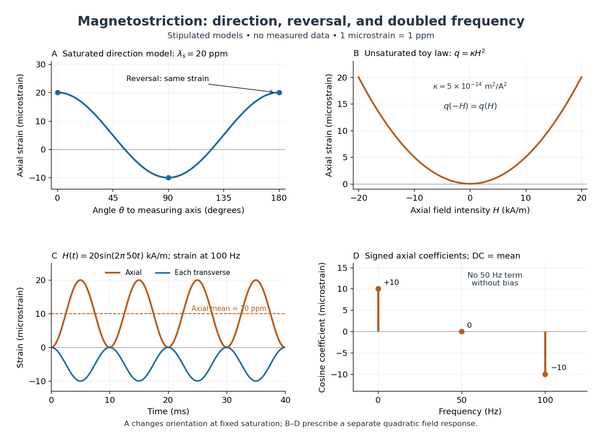

# Quadratic magnetostriction and frequency doubling

↑ **Parent:** [Magnetostriction](magnetostriction.md)

As an original stipulated low-field model, take the axial [magnetic field intensity](magnetic-field-intensity.md) $H$ in $\mathrm{A/m}$ and prescribe

$$
q(H)=\kappa H^2,\qquad
\varepsilon_{zz}=q(H),\qquad
\varepsilon_{xx}=\varepsilon_{yy}=-\frac{q(H)}2,
\qquad \kappa=5\times10^{-14}\,\mathrm{m^2/A^2}.
$$

All [strain](strain.md) components are dimensionless, and their [trace](matrix-trace.md) vanishes. This is an even, quasistatic, unsaturated toy law with a fixed measuring axis. It is distinct from the fixed-magnitude directional model in [saturated isotropic magnetostrictive strain](saturated-isotropic-magnetostrictive-strain.md). In particular, one must not replace local unit [magnetization](magnetization.md) by normalized net [magnetization](magnetization.md) in a many-domain specimen and assume this law follows.

For $H(t)=H_0\sin(2\pi ft)$, $H_0=20\,\mathrm{kA/m}$, and $f=50\,\mathrm{Hz}$, a [trigonometric identity](trigonometric-identity.md) gives

$$
q(t)=\frac{\kappa H_0^2}{2}[1-\cos(4\pi ft)]
=10^{-5}[1-\cos(2\pi(100\,\mathrm{Hz})t)].
$$

The axial [strain](strain.md) ranges from zero to $20\times10^{-6}$, with mean $10\times10^{-6}$ and a $100\,\mathrm{Hz}$ component of amplitude $10\times10^{-6}$. The [cosine](cosine.md) coefficient is negative with the chosen time origin. For $L=100\,\mathrm{mm}$ the length ranges from zero to $2\,\mathrm{\mu m}$ relative to $H=0$. There is no $50\,\mathrm{Hz}$ term in this unbiased model.

**[Figure 2](#image-stipulated-angular-reversal-and-frequency-responses-of-magnetostrictive-strain). Stipulated angular, reversal, and frequency responses of magnetostrictive strain**. Original calculations, not experimental data: the angular panel uses a saturated isotropic model with positive saturation magnetostriction; the other panels use a separately stipulated quadratic field law. Microstrain denotes a relative length change of one part per million.

A static bias $H_b$ changes the conclusion. Expanding $\kappa[H_b+H_0\sin(2\pi ft)]^2$ produces a fundamental-frequency term $2\kappa H_bH_0\sin(2\pi ft)$ as well as the doubled-frequency term. This is an incremental [linear response](linear-response-theory.md) about a state with a chosen magnetic axis; it does not contradict [isotropic linear magnetostriction vanishes](isotropic-linear-magnetostriction-vanishes.md) at an unbiased isotropic reference. Real [hysteresis](hysteresis.md), [thermal expansion](thermal-expansion.md) from [Joule heating](joule-heating.md), and mechanical [resonance](resonance.md) can add further components or change their phases. Frequency alone cannot identify the cause of motion: [Joule heating](joule-heating.md) also contains an even-in-[electric current](electric-current.md) contribution.

## ↑ Ancestors (6)

1. [Magnetostriction](magnetostriction.md)
2. [Elasticity (physics)](elasticity-physics-split.md)
3. [Continuum mechanics](continuum-mechanics-split.md)
4. [Branches of physics](branches-of-physics.md)
5. [Physics](physics-split.md)
6. [Codex Wiki](split.md)

## ← Incoming links (1)

- [Magnetostriction](magnetostriction.md)
