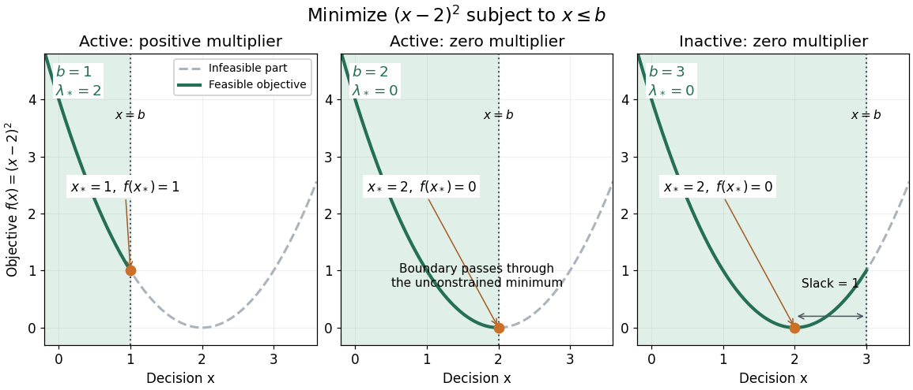

# Quadratic minimization with a moving upper bound

↑ **Parent:** [Karush-Kuhn-Tucker conditions](karush-kuhn-tucker-conditions.md)

Consider the [minimization problem](minimization-problem.md)

$$
V(b)=\min_{x\leq b}(x-2)^2,\qquad b\in\mathbb R.
$$

The [objective function](objective-function.md) is a [strictly convex function](strictly-convex-function.md) with its [unconstrained optimization](unconstrained-optimization.md) minimum at $x=2$. If $b<2$, it decreases throughout the [feasible set](feasible-region.md) until the bound $x=b$ is reached. If $b\geq2$, the [feasible set](feasible-region.md) already contains $2$. Hence

$$
x_*(b)=\min(2,b),\qquad V(b)=\bigl(\max(2-b,0)\bigr)^2.
$$

With $g(x)=x-b$, the [optimization Lagrangian](optimization-lagrangian.md) and [KKT conditions](karush-kuhn-tucker-conditions.md) are

$$
L=(x-2)^2+\lambda(x-b),\qquad
x\leq b,\quad \lambda\geq0,\quad
2(x-2)+\lambda=0,\quad \lambda(x-b)=0.
$$

Substituting $x_*(b)$ gives the unique inequality [Lagrange multiplier](lagrange-multiplier.md)

$$
\lambda_*(b)=2\max(2-b,0).
$$

For $b<2$, the [active constraint](active-constraint.md) has $\lambda_*>0$. For $b>2$, there is strict slack $b-x_*=b-2$ and $\lambda_*=0$. At $b=2$, the [active constraint](active-constraint.md) has zero [Lagrange multiplier](lagrange-multiplier.md): the boundary happens to pass through the unconstrained optimum. Feasibility and [complementary slackness](complementary-slackness.md) must both be checked; solving only $2(x-2)+\lambda=0$ would allow infeasible candidates.

**[Figure 12](#image-the-same-quadratic-objective-with-active-just-touching-and-inactive-upper-bounds). The same quadratic objective with active, just-touching and inactive upper bounds**.

An independent certificate follows by [completing the square](completing-the-square.md):

$$
L=\left(x-2+\frac{\lambda}{2}\right)^2+\lambda(2-b)-\frac{\lambda^2}{4},\qquad
d_b(\lambda)=\inf_{x\in\mathbb R}L=\lambda(2-b)-\frac{\lambda^2}{4}.
$$

The [Lagrange dual function](lagrange-dual-function.md) is a [concave function](concave-function.md) of $\lambda$. Its maximum over $\lambda\geq0$ occurs at $\lambda_*(b)$ and equals $V(b)$. Thus every case has an explicit lower bound attained by a [feasible point](feasible-point.md); the [KKT conditions](karush-kuhn-tucker-conditions.md) provide a certificate that can be checked without searching all [real numbers](real-number.md).

## ↑ Ancestors (5)

1. [Karush-Kuhn-Tucker conditions](karush-kuhn-tucker-conditions.md)
2. [Mathematical optimization](mathematical-optimization-split.md)
3. [Area of mathematics](area-of-mathematics.md)
4. [Mathematics](mathematics-split.md)
5. [Codex Wiki](split.md)

## ← Incoming links (2)

- [Karush-Kuhn-Tucker conditions](karush-kuhn-tucker-conditions.md)
- [Shadow price of an inequality constraint](shadow-price-of-an-inequality-constraint.md)
