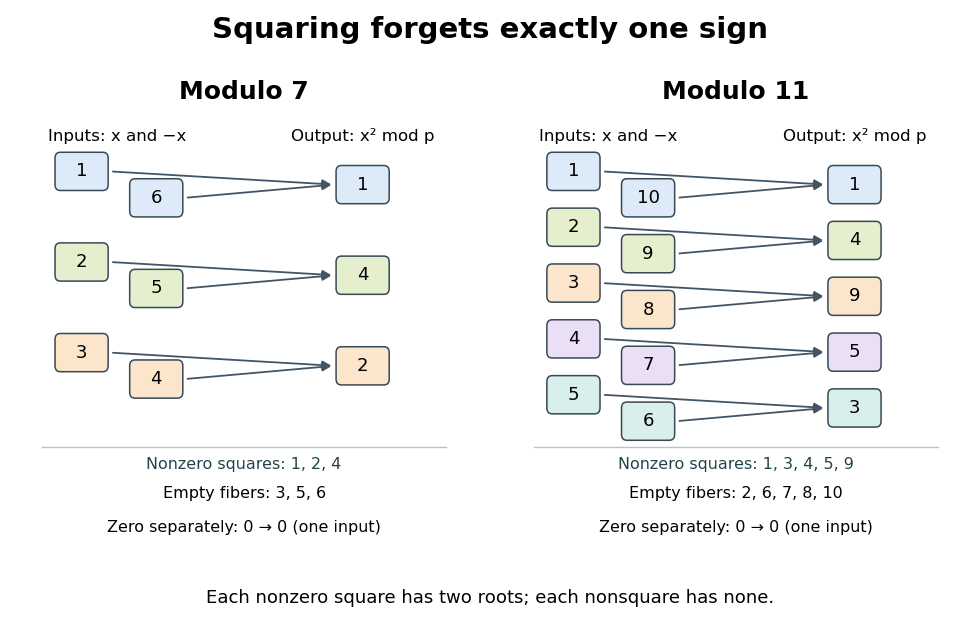
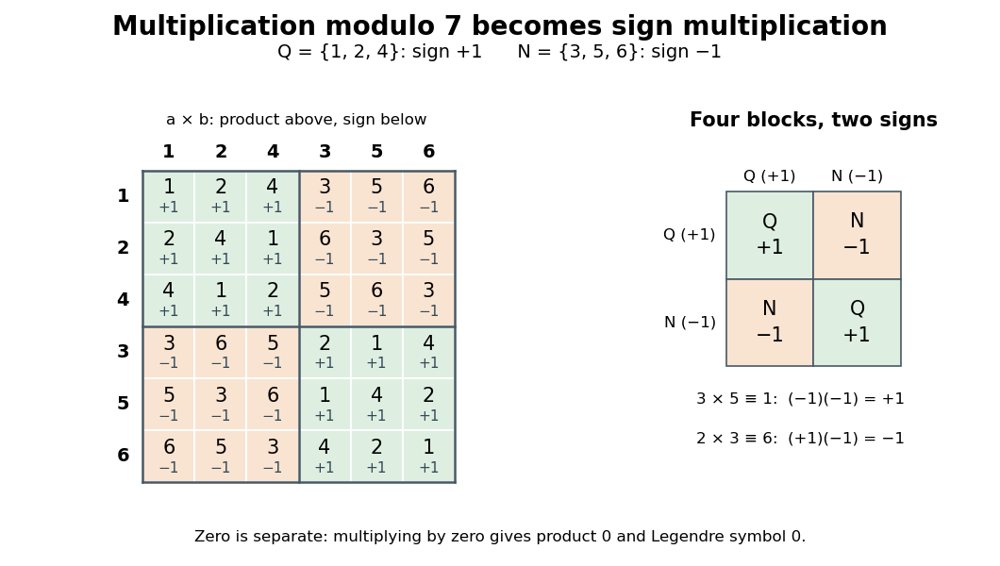

# Quadratic residue

↑ **Parent:** [Number theory](number-theory.md)  
ⓦ [Wiki](https://en.wikipedia.org/wiki/Quadratic_residue)

For an [odd prime](prime-number.md#odd-prime) $p$, a nonzero [congruence class](modular-arithmetic.md#congruence-class) $a$ is a quadratic residue when $a\equiv x^2\pmod p$ for some [integer](integer.md) $x$. Here **"quadratic residue" excludes zero**: zero is a [square of a number](arithmetic.md#square-of-a-number), but is neither a [quadratic residue](quadratic-residue.md) nor a [quadratic nonresidue](#quadratic-nonresidue) under this convention. Some treatments include zero among [quadratic residues](quadratic-residue.md); the distinction matters when counting them or discussing their [subgroup](group.md#subgroup).[Keith Conrad, Quadratic Residue Patterns Modulo a Prime, §1, p. 1: nonzero convention and equal counts](mathematics-bibliography.md#quadratic-residue-patterns-modulo-a-prime-by-keith-conrad)

Modulo seven, squaring the six nonzero [congruence classes](modular-arithmetic.md#congruence-class) gives

$$
\begin{array}{c|rrrrrr}
x&1&2&3&4&5&6\\\hline
x^2\bmod7&1&4&2&2&4&1
\end{array}
$$

Thus the [set](set.md) of [quadratic residues](quadratic-residue.md) is $Q_7=\{1,2,4\}$, and the [quadratic nonresidues](#quadratic-nonresidue) are $\{3,5,6\}$. In particular, **$x^2\equiv2\pmod7$ has exactly the two solutions $x\equiv3,4\pmod7$**: $3^2=9\equiv2$ and $4^2=16\equiv2$. Modulo eleven the [quadratic residues](quadratic-residue.md) are instead $Q_{11}=\{1,3,4,5,9\}$. Two is therefore a [quadratic residue](quadratic-residue.md) modulo seven and a [quadratic nonresidue](#quadratic-nonresidue) modulo eleven: being a [quadratic residue](quadratic-residue.md) depends on the modulus.

**[Figure 1](#image-the-square-map-modulo-seven-and-eleven-two-inputs-in-every-nonzero-square-fiber). The square map modulo seven and eleven: two inputs in every nonzero square fiber**. Each pair $\{x,p-x\}$ maps to one [quadratic residue](quadratic-residue.md). The six nonzero inputs modulo seven give three outputs; the ten modulo eleven give five. The zero [fiber](function.md#fiber-of-a-function) is the single input zero, and each [quadratic nonresidue](#quadratic-nonresidue) has an empty [fiber](function.md#fiber-of-a-function).

Why do the [square roots](algebra.md#square-root) come in pairs? If $x^2\equiv y^2\pmod p$, the [prime number](prime-number.md) $p$ divides $(x-y)(x+y)$, so it divides one factor: $y\equiv x$ or $y\equiv-x\pmod p$. For nonzero $x$ these are distinct, because $p$ is an [odd prime](prime-number.md#odd-prime). Every nonempty nonzero [fiber of a function](function.md#fiber-of-a-function) of $s(x)=x^2$ therefore contains exactly two inputs. Pairing the $p-1$ nonzero [congruence classes](modular-arithmetic.md#congruence-class) gives exactly $(p-1)/2$ [quadratic residues](quadratic-residue.md) and $(p-1)/2$ [quadratic nonresidues](#quadratic-nonresidue). Including zero gives $(p+1)/2$ different squares, with one rather than two [square roots](algebra.md#square-root) for zero.

The [quadratic residues](quadratic-residue.md) form a [subgroup](group.md#subgroup) of the [multiplicative group of a finite field](algebra.md#multiplicative-group-of-a-finite-field) $\mathbb F_p^\times$, with [index of a subgroup](group.md#index-of-a-subgroup) two. Indeed, one is a square, $(u^2)(v^2)=(uv)^2$, and $(u^2)^{-1}=(u^{-1})^2$; the inverses exist because the inputs are nonzero in the [prime field](algebra.md#prime-field). Equivalently, the squaring [group homomorphism](group-theory.md#group-homomorphism) has [kernel of a group homomorphism](group-theory.md#kernel-of-a-group-homomorphism) $\{1,-1\}$ and [image of a function](set-theory.md#image-of-a-function) $Q_p$. The apparent loss of a sign in squaring becomes a precise division of the nonzero arithmetic into two equal parts.

This structure turns a search for [square roots](algebra.md#square-root) into a yes-or-no test: [Euler's criterion](#euler-s-criterion) detects [quadratic residues](quadratic-residue.md) through [modular exponentiation](number-theory.md#modular-exponentiation), and the [Legendre symbol](#legendre-symbol) records the result as a sign. For a general [integer](integer.md) modulus, the [modular congruence](modular-arithmetic.md#modular-congruence) $x^2\equiv a\pmod n$ still makes sense, but the two-root count and the [prime field](algebra.md#prime-field) argument need not survive. For example, $x^2\equiv1\pmod{15}$ has four solutions $1,4,11,14$; the [Chinese remainder theorem](mathematics.md#chinese-remainder-theorem) separates the sign choices modulo three and five.

**Table of contents**

- [Square root of minus one modulo a prime](#square-root-of-minus-one-modulo-a-prime)
- [Quadratic nonresidue](#quadratic-nonresidue)
  - [Least quadratic nonresidue](#least-quadratic-nonresidue)
    - [Large-sieve logarithmic exceptional-prime bound for least quadratic nonresidues](#large-sieve-logarithmic-exceptional-prime-bound-for-least-quadratic-nonresidues)
    - [Bounded exceptional primes for least quadratic nonresidues](#bounded-exceptional-primes-for-least-quadratic-nonresidues)
- [Quadratic Gauss sum](#quadratic-gauss-sum)
  - [Quadratic periods modulo eleven](#quadratic-periods-modulo-eleven)
- [Legendre symbol](#legendre-symbol)
  - [Multiplicativity of the Legendre symbol](#multiplicativity-of-the-legendre-symbol)
  - [Complete Legendre-symbol sum](#complete-legendre-symbol-sum)
  - [Quadratic Legendre-symbol correlation](#quadratic-legendre-symbol-correlation)
    - [Number of consecutive nonzero quadratic residues modulo an odd prime](#number-of-consecutive-nonzero-quadratic-residues-modulo-an-odd-prime)
  - [Euler's criterion](#euler-s-criterion)
    - [Primes congruent to five modulo eight from odd squares plus four](#primes-congruent-to-five-modulo-eight-from-odd-squares-plus-four)
  - [Gauss's lemma (number theory)](#gauss-s-lemma-number-theory)
  - [Euler criterion](#euler-criterion)
    - [First supplementary law for quadratic reciprocity](#first-supplementary-law-for-quadratic-reciprocity)
    - [Second supplementary law for quadratic reciprocity](#second-supplementary-law-for-quadratic-reciprocity)
      - [Euclid proof for infinitely many primes congruent to seven modulo eight](#euclid-proof-for-infinitely-many-primes-congruent-to-seven-modulo-eight)
      - [Elementary logarithmic lower bound for primes in the quadratic-residue classes of two](#elementary-logarithmic-lower-bound-for-primes-in-the-quadratic-residue-classes-of-two)
    - [Prime-power binomial congruence for a matrix](#prime-power-binomial-congruence-for-a-matrix)
  - [Weighted complete Legendre-symbol sum](#weighted-complete-legendre-symbol-sum)
  - [Lower-half quadratic-residue sum for primes congruent to seven modulo eight](#lower-half-quadratic-residue-sum-for-primes-congruent-to-seven-modulo-eight)
  - [Discriminant criterion for a quadratic congruence modulo an odd prime](#discriminant-criterion-for-a-quadratic-congruence-modulo-an-odd-prime)

## Square root of minus one modulo a prime

↑ **Parent:** [Quadratic residue](quadratic-residue.md)

The congruence is soluble exactly for $p=2$ or $p\equiv1\pmod4$. For odd $p$, [Fermat's little theorem](number-theory.md#fermat-little-theorem) applied to a prospective root [forces](force.md) $(p-1)/2$ even. Conversely, when $p\equiv1\pmod4$, pair opposite factors in $(p-1)!$ and use the [Wilson theorem](modular-arithmetic.md#wilson-s-theorem) to obtain $(((p-1)/2)!)^2\equiv-1\pmod p$.

## Quadratic nonresidue

↑ **Parent:** [Quadratic residue](quadratic-residue.md)  
ⓦ [Wiki](https://en.wikipedia.org/wiki/Quadratic_nonresidue)

A nonzero [congruence class](modular-arithmetic.md#congruence-class) modulo an [odd prime](prime-number.md#odd-prime) is a quadratic nonresidue when it is not a square. In the convention of [quadratic residue](quadratic-residue.md), zero belongs to neither class. Thus $3,5,6$ are the [quadratic nonresidues](#quadratic-nonresidue) modulo seven, while $2,6,7,8,10$ are the [quadratic nonresidues](#quadratic-nonresidue) modulo eleven. No [integer](integer.md) $x$ satisfies $x^2\equiv3\pmod7$, as the complete square map under [quadratic residue](quadratic-residue.md) shows.

A [quadratic nonresidue](#quadratic-nonresidue) is not an arithmetic dead end: multiplying by any fixed [quadratic nonresidue](#quadratic-nonresidue) $n$ exchanges the [quadratic residues](quadratic-residue.md) and the [quadratic nonresidues](#quadratic-nonresidue). If $nq$ were a square for a square $q$, division by $q$ would make $n$ a square. Hence $nQ_p$ consists entirely of [quadratic nonresidues](#quadratic-nonresidue); it has $(p-1)/2$ elements, because multiplication by nonzero $n$ is a [bijection](function.md#bijection). It therefore equals the entire other [coset](group-theory.md#coset) of the [quadratic residue](quadratic-residue.md) [subgroup](group.md#subgroup). Modulo seven, $3\{1,2,4\}=\{3,6,5\}$.

The product of two [quadratic nonresidues](#quadratic-nonresidue) is consequently a [quadratic residue](quadratic-residue.md): write them as $nq_1,nq_2$ in that same [coset](group-theory.md#coset), and their product is $n^2q_1q_2$, a square. For example, $3\cdot5\equiv1\pmod7$, whereas $2\cdot3\equiv6\pmod7$ remains a [quadratic nonresidue](#quadratic-nonresidue). The [multiplicativity of the Legendre symbol](#multiplicativity-of-the-legendre-symbol) packages these rules as ordinary sign multiplication.

### Least quadratic nonresidue

↑ **Parent:** [Quadratic nonresidue](#quadratic-nonresidue)

For an [odd prime](prime-number.md#odd-prime) $p$, the least quadratic nonresidue $n(p)$ is the smallest [positive integer](integer.md#positive-integer) whose nonzero [residue class](modular-arithmetic.md#residue-class) is a [quadratic nonresidue](#quadratic-nonresidue) modulo $p$.

#### Large-sieve logarithmic exceptional-prime bound for least quadratic nonresidues

↑ **Parent:** [Least quadratic nonresidue](#least-quadratic-nonresidue)

On a dyadic interval $Q<p\leq2Q$, every such exceptional prime makes all $Q^{0.01}$-smooth integers quadratic residues. By [positive density of power-smooth integers](number-theory.md#positive-density-of-power-smooth-integers), there are $\gg Q^2$ of these integers up to $Q^2$. Apply the [variance form of the large sieve](analytic-number-theory.md#variance-form-of-the-large-sieve) or its forbidden-residue consequence with interval length $Q^2$ and prime cutoff $2Q$. Each exceptional prime excludes $(p-1)/2$ residue classes and contributes at least a fixed positive amount to the sieve denominator. Hence each dyadic interval contains $O(1)$ exceptional primes. Summing the intervals gives the logarithmic bound.

// Target: analytic-number-theory.bigb

#### Bounded exceptional primes for least quadratic nonresidues

↑ **Parent:** [Least quadratic nonresidue](#least-quadratic-nonresidue)

If, for every $\eta>0$, the [smooth numbers](number-theory.md#smooth-number) up to $T$ with all [prime factors](prime-number.md#prime-factor) at most $T^\eta$ have density at least $\kappa(\eta)>0$, then for fixed $\varepsilon>0$ there are only $O_\varepsilon(1)$ [primes](prime-number.md) $p\leq N$ with $n(p)>N^\varepsilon$. Apply the [variance form of the large sieve](analytic-number-theory.md#variance-form-of-the-large-sieve) to the [indicator function](measure-theory.md#indicator-function) of the $N^\varepsilon$-smooth numbers up to $N^2$. For every exceptional [prime](prime-number.md), all these numbers are nonzero [quadratic residues](quadratic-residue.md), so half its nonzero [residue classes](modular-arithmetic.md#residue-class) are empty. Their variance contribution is at least one third of the square of the total count. The large sieve bounds the sum of contributions by a constant times $N^2$ times that count. The density assumption with $\eta=\varepsilon/2$ finishes the argument.

## Quadratic Gauss sum

↑ **Parent:** [Quadratic residue](quadratic-residue.md)  
ⓦ [Wiki](https://en.wikipedia.org/wiki/Quadratic_Gauss_sum)

For $\omega=e^{2\pi i/p}$ and the [Legendre symbol](#legendre-symbol) $\chi$, the quadratic Gauss sum is

$$
G(\chi)=\sum_{a=1}^{p-1}\chi(a)\omega^a.
$$

It equals $\sqrt p$ for $p\equiv1\pmod4$ and $i\sqrt p$ for $p\equiv3\pmod4$ with the standard choice of square root.

### Quadratic periods modulo eleven

↑ **Parent:** [Quadratic Gauss sum](#quadratic-gauss-sum)

If $Q$ and $N$ are the nonzero square and nonsquare classes modulo eleven and $\omega=e^{2\pi i/11}$, then

$$
\sum_{q\in Q}\omega^q=\frac{-1+i\sqrt{11}}2,
\qquad
\sum_{n\in N}\omega^n=\frac{-1-i\sqrt{11}}2.
$$

Their sum is $-1$, and their difference is the [Quadratic Gauss sum](#quadratic-gauss-sum) $i\sqrt{11}$.

## Legendre symbol

↑ **Parent:** [Quadratic residue](quadratic-residue.md)  
ⓦ [Wiki](https://en.wikipedia.org/wiki/Legendre_symbol)

For an [integer](integer.md) $a$ and an **[odd prime](prime-number.md#odd-prime)** $p$, the Legendre symbol is the [integer](integer.md) valued [function](function.md)

$$
\left(\frac ap\right)=
\begin{cases}
0,&p\mid a,\\
1,&a\not\equiv0\pmod p\text{ is a square},\\
-1,&a\text{ is a nonsquare}.
\end{cases}
$$

Its value depends only on the [congruence class](modular-arithmetic.md#congruence-class) of $a$ modulo $p$; the displayed notation is a symbol, not division. The value zero handles $p\mid a$ separately from [quadratic residues](quadratic-residue.md) and [quadratic nonresidues](#quadratic-nonresidue).[Ben Lynn, Quadratic Residues, The Legendre Symbol: three values and dependence on an odd prime](mathematics-bibliography.md#quadratic-residues-by-ben-lynn)

For example, $(2/7)=1$, $(3/7)=-1$, $(14/7)=0$, and $(2/11)=-1$. The equality $(9/7)=(2/7)=1$ illustrates that choosing a different [integer](integer.md) representative does not change the answer. An arbitrary odd composite denominator uses the [Jacobi symbol](number-theory.md#jacobi-symbol), not the [Legendre symbol](#legendre-symbol). For instance,

$$
\left(\frac2{15}\right)_{\!\mathrm{Jacobi}}
=\left(\frac23\right)\left(\frac25\right)=(-1)(-1)=1,
$$

but two is not a square modulo fifteen: any such [square root](algebra.md#square-root) would also give a [square root](algebra.md#square-root) modulo three, where the only nonzero square is one. A [Jacobi symbol](number-theory.md#jacobi-symbol) of one therefore cannot replace the [Legendre symbol](#legendre-symbol)'s square test.

The [Legendre symbol](#legendre-symbol) also counts [square roots](algebra.md#square-root) compactly. For every [congruence class](modular-arithmetic.md#congruence-class) $a$ in the [prime field](algebra.md#prime-field) $\mathbb F_p$,

$$
\#\{x\in\mathbb F_p:x^2=a\}=1+\left(\frac ap\right).
$$

The three cases give two, one and zero solutions for a [quadratic residue](quadratic-residue.md), zero and a [quadratic nonresidue](#quadratic-nonresidue), respectively. This is useful when counting solutions of [modular congruences](modular-arithmetic.md#modular-congruence) involving [polynomials](polynomial.md): a solvability question becomes a sum of [Legendre symbols](#legendre-symbol), as in the [complete Legendre-symbol sum](#complete-legendre-symbol-sum) and [quadratic Legendre-symbol correlation](#quadratic-legendre-symbol-correlation).

### Multiplicativity of the Legendre symbol

↑ **Parent:** [Legendre symbol](#legendre-symbol)

For an [odd prime](prime-number.md#odd-prime) $p$ and any [integers](integer.md) $a,b$, the [Legendre symbol](#legendre-symbol) obeys

$$
\left(\frac{ab}{p}\right)=
\left(\frac ap\right)\left(\frac bp\right).
$$

In particular, if $p\nmid a$, then $(a^{-1}/p)=(a/p)$, where $a^{-1}$ is a [modular multiplicative inverse](number-theory.md#modular-multiplicative-inverse). Multiplication by a nonzero square also leaves the [Legendre symbol](#legendre-symbol) unchanged: $(ar^2/p)=(a/p)$ for $p\nmid r$.[Ben Lynn, Quadratic Residues, The Legendre Symbol: multiplicativity and invariance under a nonzero square factor](mathematics-bibliography.md#quadratic-residues-by-ben-lynn)

The [subgroup](group.md#subgroup) and [coset](group-theory.md#coset) arguments under [quadratic residue](quadratic-residue.md) and [quadratic nonresidue](#quadratic-nonresidue) prove the sign rule without computing a large power: square times square is square, square times nonsquare is nonsquare, and nonsquare times nonsquare is square. If either factor is zero modulo $p$, both sides of the identity vanish. On $\mathbb F_p^\times$, the [Legendre symbol](#legendre-symbol) is thus a [group homomorphism](group-theory.md#group-homomorphism) to $\{1,-1\}$ whose [kernel of a group homomorphism](group-theory.md#kernel-of-a-group-homomorphism) is the [quadratic residue](quadratic-residue.md) [subgroup](group.md#subgroup). Viewed on all [integers](integer.md), it is a [completely multiplicative function](arithmetic-function.md#completely-multiplicative-function) and a [Dirichlet character](algebraic-number-theory.md#dirichlet-character) modulo $p$.

**[Figure 2](#image-products-modulo-seven-the-legendre-symbol-reduces-a-six-by-six-table-to-sign-multiplication). Products modulo seven: the Legendre symbol reduces a six-by-six table to sign multiplication**. Rows and columns put [quadratic residues](quadratic-residue.md) $1,2,4$ before [quadratic nonresidues](#quadratic-nonresidue) $3,5,6$. Every cell displays the product modulo seven and its [Legendre symbol](#legendre-symbol). The four blocks have signs $+1,-1,-1,+1$, showing the [subgroup](group.md#subgroup) and its other [coset](group-theory.md#coset).

For an original calculation, factor the numerator $30=2\cdot3\cdot5$. Modulo seven, $(30/7)=(2/7)(3/7)(5/7)=1\cdot(-1)\cdot(-1)=1$, agreeing with $30\equiv2\pmod7$. Modulo eleven, the signs are instead $-1,1,1$, giving $(30/11)=-1$, agreeing with $30\equiv8\pmod{11}$. The same factorization can therefore certify different square behavior at different [prime numbers](prime-number.md).

Alternatively, [Euler's criterion](#euler-s-criterion) gives $(ab)^{(p-1)/2}\equiv a^{(p-1)/2}b^{(p-1)/2}$ modulo $p$. For nonzero factors both sides correspond to signs in $\{1,-1\}$. Since $p$ is odd, these signs are distinct modulo $p$, so the [modular congruence](modular-arithmetic.md#modular-congruence) proves the asserted equality of [integers](integer.md), not merely an equality of representatives.

### Complete Legendre-symbol sum

↑ **Parent:** [Legendre symbol](#legendre-symbol)

For every odd prime $p$,

$$
\sum_{x\in\mathbb F_p}\left(\frac xp\right)=0.
$$

Multiplication by a quadratic nonresidue permutes $\mathbb F_p$ and negates every term.

### Quadratic Legendre-symbol correlation

↑ **Parent:** [Legendre symbol](#legendre-symbol)

For every odd prime $p$,

$$
\sum_{x\in\mathbb F_p}\left(\frac{x(x+1)}p\right)=-1.
$$

Equivalently, count the $p-1$ solutions of $t^2=y^2-1$ by factoring $(y-t)(y+t)=1$.

#### Number of consecutive nonzero quadratic residues modulo an odd prime

↑ **Parent:** [Quadratic Legendre-symbol correlation](#quadratic-legendre-symbol-correlation)

The number of $z\in\{1,\ldots,p-2\}$ for which both $z$ and $z+1$ are quadratic residues modulo $p$ is

$$
\frac{p-4-(-1)^{(p-1)/2}}4.
$$

<h3 id="euler-s-criterion">Euler's criterion</h3>

↑ **Parent:** [Legendre symbol](#legendre-symbol)  
ⓦ [Wiki](https://en.wikipedia.org/wiki/Euler's_criterion)

For an [odd prime](prime-number.md#odd-prime) $p$ and $p\nmid a$, Euler's criterion identifies the [Legendre symbol](#legendre-symbol) by [modular exponentiation](number-theory.md#modular-exponentiation):

$$
a^{(p-1)/2}\equiv\left(\frac ap\right)\pmod p.
$$

Thus a [quadratic residue](quadratic-residue.md) gives one and a [quadratic nonresidue](#quadratic-nonresidue) gives minus one, represented by $p-1$ if a nonnegative [remainder](integer.md#remainder) is used. The formula also holds when $p\mid a$, because $(p-1)/2>0$ and both sides are zero modulo $p$.[Ben Lynn, Quadratic Residues, Euler's Criterion and The Legendre Symbol: exponent test and the zero value](mathematics-bibliography.md#quadratic-residues-by-ben-lynn)

For example, modulo seven the exponent is three: $2^3\equiv1$ confirms that two is a [quadratic residue](quadratic-residue.md), while $3^3\equiv6\equiv-1$ confirms that three is a [quadratic nonresidue](#quadratic-nonresidue). Modulo eleven the exponent is five, and $2^5=32\equiv10\equiv-1$ confirms that two is a [quadratic nonresidue](#quadratic-nonresidue). The test answers whether a [square root](algebra.md#square-root) exists; it does not itself return the roots $3,4$ of $x^2\equiv2\pmod7$.

A short proof needs only [Fermat's little theorem](number-theory.md#fermat-little-theorem) and the [root bound for a polynomial](polynomial.md#lagrange-root-bound-over-a-field). Put $m=(p-1)/2$. If $a=x^2\ne0$ in the [prime field](algebra.md#prime-field), then $a^m=x^{p-1}=1$. There are already $m$ such [quadratic residues](quadratic-residue.md). The nonzero [polynomial](polynomial.md) $T^m-1$ has [polynomial degree](polynomial.md#degree-of-a-polynomial) $m$, so it has no other [polynomial roots](polynomial.md#root-of-a-polynomial). Finally, for every nonzero $a$, [Fermat's little theorem](number-theory.md#fermat-little-theorem) gives $(a^m)^2=a^{p-1}=1$. Factoring $(a^m-1)(a^m+1)=0$ in the [field](algebra.md#field) shows $a^m\in\{1,-1\}$; every [quadratic nonresidue](#quadratic-nonresidue) must take the remaining value $-1$. This proves the criterion without first finding a [primitive root](number-theory.md#primitive-root-modulo-n).

For a larger original example, decide whether seven is a [quadratic residue](quadratic-residue.md) modulo the [prime number](prime-number.md) $101$. [Exponentiation by squaring](number-theory.md#exponentiation-by-squaring) computes the required power without listing fifty squares:

$$
\begin{aligned}
7^2&\equiv49,&7^4&\equiv78,&7^8&\equiv24,\\
7^{16}&\equiv71,&7^{32}&\equiv92,\\
7^{50}&=7^{32}7^{16}7^2\equiv92\cdot71\cdot49\equiv-1\pmod{101}.
\end{aligned}
$$

Therefore $(7/101)=-1$ and $x^2\equiv7\pmod{101}$ has no solution. Each intermediate product is reduced modulo $101$, as in [modular exponentiation](number-theory.md#modular-exponentiation). The advantage is that [exponentiation by squaring](number-theory.md#exponentiation-by-squaring) uses a number of [multiplications](arithmetic.md#multiplication) proportional to the [binary digit](integer.md#binary-digit) length of the exponent rather than testing every potential [square root](algebra.md#square-root).

The [odd prime](prime-number.md#odd-prime) hypothesis is essential. For the composite modulus nine, $2^{(9-1)/2}=2^4\equiv7\pmod9$, which is neither one nor minus one. Although four is a nonzero square modulo nine, $4^4\equiv4\pmod9$, so even the square-to-one implication fails. The [Jacobi symbol](number-theory.md#jacobi-symbol) and [Euler pseudoprime](number-theory.md#euler-pseudoprime) discuss different questions for odd composite moduli; they do not make this a universal square test.

#### Primes congruent to five modulo eight from odd squares plus four

↑ **Parent:** [Euler's criterion](#euler-s-criterion)

Every odd prime factor of an odd square plus four is one modulo four. The integer is five modulo eight, so at least one prime factor is five modulo eight. Choosing the odd square divisible by any proposed finite list excludes the list and proves infinitude.

<h3 id="gauss-s-lemma-number-theory">Gauss's lemma (number theory)</h3>

↑ **Parent:** [Legendre symbol](#legendre-symbol)  
ⓦ [Wiki](https://en.wikipedia.org/wiki/Gauss's_lemma_(number_theory))

For an odd prime $p$ and $p\nmid a$, let $m$ be the number of least positive residues among

$$
a,2a,\ldots,\frac{p-1}{2}a
$$

that exceed $p/2$. Then

$$
\left(\frac ap\right)=(-1)^m.
$$

### Euler criterion

↑ **Parent:** [Legendre symbol](#legendre-symbol)  
ⓦ [Wiki](https://en.wikipedia.org/wiki/Euler_criterion)

For an odd prime $p$,

$$
a^{(p-1)/2}\equiv\left(\frac ap\right)\pmod p.
$$

For $p\nmid a$, write $a=g^m$ using a [primitive root](number-theory.md#primitive-root-modulo-n) $g$; then the left side is $(-1)^m$, which is one exactly when $m$ is even and $a$ is a square.

#### First supplementary law for quadratic reciprocity

↑ **Parent:** [Euler criterion](#euler-criterion)

Euler's criterion at $a=-1$ gives

$$
\left(\frac{-1}{p}\right)=(-1)^{(p-1)/2}.
$$

#### Second supplementary law for quadratic reciprocity

↑ **Parent:** [Euler criterion](#euler-criterion)

For every odd prime,

$$
\left(\frac2p\right)=(-1)^{(p^2-1)/8}.
$$

##### Euclid proof for infinitely many primes congruent to seven modulo eight

↑ **Parent:** [Second supplementary law for quadratic reciprocity](#second-supplementary-law-for-quadratic-reciprocity)

If $q_1,\ldots,q_r$ listed all primes congruent to seven modulo eight, then for $n=8q_1\cdots q_r$ the odd number $(n^2-2)/2$ is seven modulo eight. Every prime factor is one or seven modulo eight, at least one is seven, and none is among the $q_i$, a contradiction.

##### Elementary logarithmic lower bound for primes in the quadratic-residue classes of two

↑ **Parent:** [Second supplementary law for quadratic reciprocity](#second-supplementary-law-for-quadratic-reciprocity)

Let $\pi_k(x)$ count primes at most $x$ congruent to $k$ modulo eight. Bounding the prime-power divisibility of

$$
\prod_{\sqrt x/2\leq n\leq\sqrt x}(n^2-2)
$$

above and its size below gives, for all sufficiently large $x$,

$$
\pi_1(x)+\pi_7(x)+1\geq\frac{\log x}{6\log3}.
$$

#### Prime-power binomial congruence for a matrix

↑ **Parent:** [Euler criterion](#euler-criterion)

For an integer matrix $A$ and prime $p$, the commuting-matrix binomial theorem and divisibility of $\binom pj$ for $0<j<p$ give

$$
(I+A)^p\equiv I+A^p\pmod p.
$$

### Weighted complete Legendre-symbol sum

↑ **Parent:** [Legendre symbol](#legendre-symbol)

For $T=\sum_{a=1}^{p-1}a(\frac ap)$, one has $T=0$ when $p\equiv1\pmod4$, and $T\equiv0\pmod p$ for every $p>3$.

### Lower-half quadratic-residue sum for primes congruent to seven modulo eight

↑ **Parent:** [Legendre symbol](#legendre-symbol)

If $p\equiv7\pmod8$, the sum of the least positive quadratic residues below $p/2$ is

$$
\frac{p^2-1}{16}.
$$

The proof uses $(\frac2p)=1$ to compare the sum of all residues with its image under doubling.

### Discriminant criterion for a quadratic congruence modulo an odd prime

↑ **Parent:** [Legendre symbol](#legendre-symbol)

For $p\nmid a$, the congruence $aX^2+bX+c=0\pmod p$ has a solution exactly when its discriminant $b^2-4ac$ is zero or a quadratic residue modulo $p$.

## ↑ Ancestors (4)

1. [Number theory](number-theory.md)
2. [Area of mathematics](mathematics.md#area-of-mathematics)
3. [Mathematics](mathematics.md)
4. [Codex Wiki](README.md)

## ← Incoming links (43)

- [Bounded exceptional primes for least quadratic nonresidues](#bounded-exceptional-primes-for-least-quadratic-nonresidues)
- [Computing Legendre symbols by quadratic reciprocity](number-theory.md#computing-legendre-symbols-by-quadratic-reciprocity)
- [Euler's criterion](#euler-s-criterion)
- [Jacobi reciprocity law](number-theory.md#jacobi-reciprocity-law)
- [Legendre symbol](#legendre-symbol)
- [Multiplicativity of the Legendre symbol](#multiplicativity-of-the-legendre-symbol)
- [Noncongruent primes congruent to three modulo eight](normalization-of-an-algebraic-curve.md#noncongruent-primes-congruent-to-three-modulo-eight)
- [Obstruction to norm-minus-one units from a prime congruent to three modulo four](algebraic-number-theory.md#obstruction-to-norm-minus-one-units-from-a-prime-congruent-to-three-modulo-four)
- [Solution](past-exam-of-the-mathematics-course-of-the-university-of-cambridge/2001/iii/paper-19.md#2/iii/solution)
- [Solution](past-exam-of-the-mathematics-course-of-the-university-of-cambridge/2002/ib/paper-3.md#9f/solution)
- [Solution](past-exam-of-the-mathematics-course-of-the-university-of-cambridge/2003/iii/paper-21.md#2/a/solution)
- [Solution](past-exam-of-the-mathematics-course-of-the-university-of-cambridge/2005/ii/paper-2.md#1h/solution)
- [Solution](past-exam-of-the-mathematics-course-of-the-university-of-cambridge/2005/iii/paper-28.md#5/solution)
- [Solution](past-exam-of-the-mathematics-course-of-the-university-of-cambridge/2006/ii/paper-2.md#20g/solution)
- [Solution](past-exam-of-the-mathematics-course-of-the-university-of-cambridge/2007/ii/paper-2.md#1f/solution)
- [Solution](past-exam-of-the-mathematics-course-of-the-university-of-cambridge/2008/ia/paper-4.md#7d/b/solution)
- [Solution](past-exam-of-the-mathematics-course-of-the-university-of-cambridge/2009/ii/paper-3.md#11g/solution)
- [Solution](past-exam-of-the-mathematics-course-of-the-university-of-cambridge/2010/ii/paper-2.md#1g/i/solution)
- [Solution](past-exam-of-the-mathematics-course-of-the-university-of-cambridge/2010/ii/paper-2.md#1g/ii/solution)
- [Solution](past-exam-of-the-mathematics-course-of-the-university-of-cambridge/2010/ii/paper-2.md#1g/solution)
- [Solution](past-exam-of-the-mathematics-course-of-the-university-of-cambridge/2011/ii/paper-1.md#12g/solution)
- [Solution](past-exam-of-the-mathematics-course-of-the-university-of-cambridge/2013/iii/paper-23.md#1/e/solution)
- [Solution](past-exam-of-the-mathematics-course-of-the-university-of-cambridge/2014/ia/paper-4.md#6e/ii/solution)
- [Solution](past-exam-of-the-mathematics-course-of-the-university-of-cambridge/2015/ii/paper-4.md#9h/i/solution)
- [Solution](past-exam-of-the-mathematics-course-of-the-university-of-cambridge/2015/iii/paper-27.md#1/c/solution)
- [Solution](past-exam-of-the-mathematics-course-of-the-university-of-cambridge/2017/ii/paper-1.md#1g/solution)
- [Solution](past-exam-of-the-mathematics-course-of-the-university-of-cambridge/2017/ii/paper-2.md#18h/b/solution)
- [Solution](past-exam-of-the-mathematics-course-of-the-university-of-cambridge/2017/iii/paper-125.md#5/b/solution)
- [Solution](past-exam-of-the-mathematics-course-of-the-university-of-cambridge/2018/ia/paper-4.md#1e/solution)
- [Solution](past-exam-of-the-mathematics-course-of-the-university-of-cambridge/2019/ia/paper-4.md#5e/c/i/solution)
- [Solution](past-exam-of-the-mathematics-course-of-the-university-of-cambridge/2019/iii/paper-114.md#3/solution)
- [Solution](past-exam-of-the-mathematics-course-of-the-university-of-cambridge/2022/ii/paper-2.md#20h/b/solution)
- [Solution](past-exam-of-the-mathematics-course-of-the-university-of-cambridge/2022/ii/paper-4.md#11i/b/ii/solution)
- [Solution](past-exam-of-the-mathematics-course-of-the-university-of-cambridge/2023/ii/paper-2.md#19h/solution)
- [Solution](past-exam-of-the-mathematics-course-of-the-university-of-cambridge/2023/ii/paper-3.md#11g/solution)
- [Solution](past-exam-of-the-mathematics-course-of-the-university-of-cambridge/2026/ii/paper-1.md#1g/solution)
- [Prime representation when h of minus eight q equals two](number-theory.md#prime-representation-when-h-of-minus-eight-q-equals-two)
- [Quadratic nonresidue](#quadratic-nonresidue)
- [Quadratic reciprocity](number-theory.md#quadratic-reciprocity)
- [Quadratic residue](quadratic-residue.md)
- [Signed divisor-two obstruction for an isogeny covering](normalization-of-an-algebraic-curve.md#signed-divisor-two-obstruction-for-an-isogeny-covering)
- [Stronger prime-divisor congruence for Fermat numbers](number-theory.md#stronger-prime-divisor-congruence-for-fermat-numbers)
- [Tonelli-Shanks algorithm](algorithm.md#tonelli-shanks-algorithm)
