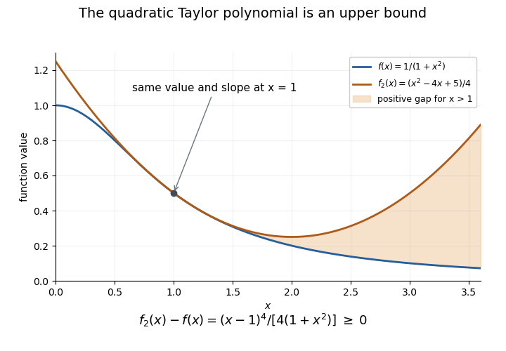

# Quadratic Taylor majorant of a reciprocal quadratic

↑ **Parent:** [Taylor polynomial](taylor-polynomial.md)

The quadratic [Taylor polynomial](taylor-polynomial.md) of $f(x)=1/(1+x^2)$ at $x=1$ is $p(x)=(x^2-4x+5)/4$. Multiplying $p-f$ by $4(1+x^2)$ gives $(x-1)^4$, proving the exact displayed identity. Thus $p\geq f$ for every real $x$, with equality only at one. In particular, a claim that $f>p$ to the right of one has the wrong sign. The [Lagrange remainder](lagrange-remainder.md) also proves this direction there, since $f'''(x)=24x(1-x^2)/(1+x^2)^4<0$ for $x>1$. The exact identity is stronger: it controls the sign globally and shows the fourth-order contact at the expansion point.

**[Figure 6](#image-the-quadratic-taylor-polynomial-globally-majorizes-the-reciprocal-quadratic). The quadratic Taylor polynomial globally majorizes the reciprocal quadratic**.

## ↑ Ancestors (7)

1. [Taylor polynomial](taylor-polynomial.md)
2. [Calculus](calculus-split.md)
3. [Real analysis](real-analysis-split.md)
4. [Analysis](analysis-split.md)
5. [Area of mathematics](area-of-mathematics.md)
6. [Mathematics](mathematics-split.md)
7. [Codex Wiki](split.md)

## ← Incoming links (1)

- [Solution](past-exam-of-the-year-1-of-the-computer-science-course-of-the-university-of-oxford/2018/discrete-mathematics-continuous-mathematics-and-probability/6/d/solution.md)
