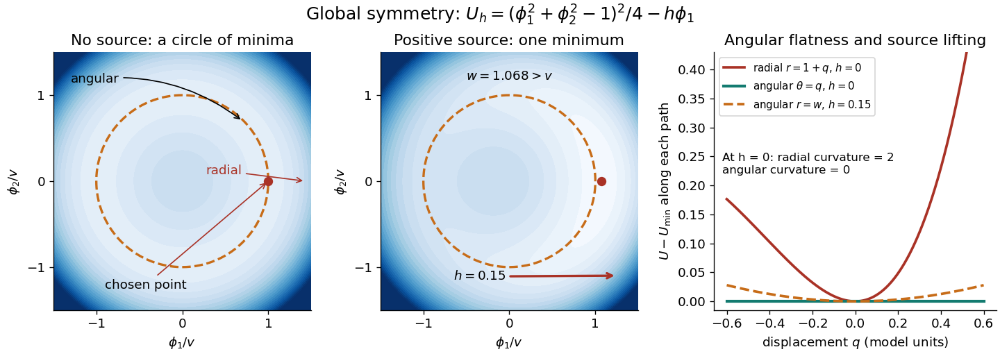
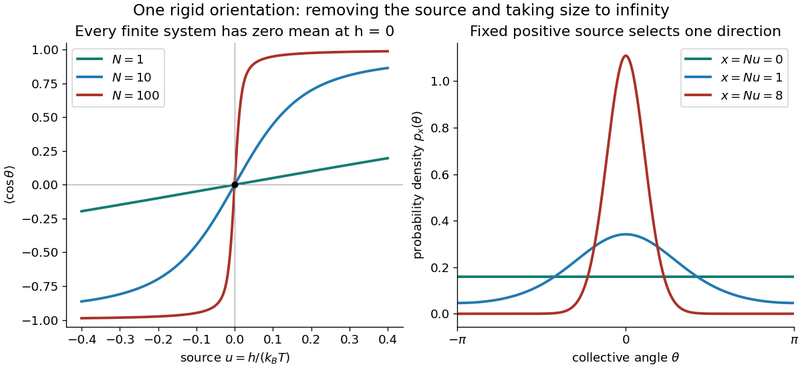
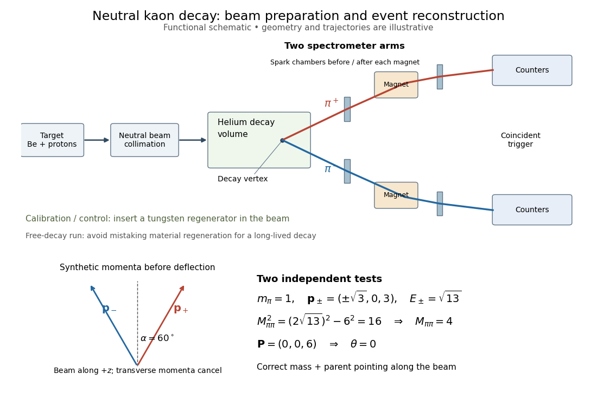

# Quantum field theory

↑ **Parent:** [Branches of physics](physics.md#branches-of-physics)  
ⓦ [Wiki](https://en.wikipedia.org/wiki/Quantum_field_theory)

Quantum field theory combines [special relativity](special-relativity.md) with [quantum theory](quantum-theory.md) by treating fields as operator-valued distributions and particles as field excitations.

**Table of contents**

- [Vacuum state](#vacuum-state)
- [Virtual particle](#virtual-particle)
  - [Virtual photon](#virtual-photon)
- [Quantum field](#quantum-field)
- [Algebraic quantum field theory](#algebraic-quantum-field-theory)
  - [Time-slice axiom](#time-slice-axiom)
  - [Primitive causality](#primitive-causality)
  - [Spectrum condition](#spectrum-condition)
- [Positive-energy spectrum condition](#positive-energy-spectrum-condition)
- [Scalar field theory](scalar-field-theory.md)
  - [Stability of a two-scalar quartic potential](scalar-field-theory.md#stability-of-a-two-scalar-quartic-potential)
  - [Nonrelativistic particle field](scalar-field-theory.md#nonrelativistic-particle-field)
  - [Real scalar field](scalar-field-theory.md#real-scalar-field)
    - [Massless scalar field](scalar-field-theory.md#massless-scalar-field)
      - [Minimally coupled massless scalar field](scalar-field-theory.md#minimally-coupled-massless-scalar-field)
    - [Real scalar triplet](scalar-field-theory.md#real-scalar-triplet)
      - [SO(3) Noether current of a real scalar triplet](scalar-field-theory.md#so-3-noether-current-of-a-real-scalar-triplet)
    - [Sine-Gordon theory](scalar-field-theory.md#sine-gordon-theory)
      - [Sine-Gordon breather spectrum at reflectionless couplings](scalar-field-theory.md#sine-gordon-breather-spectrum-at-reflectionless-couplings)
        - [Unwrapped reflectionless sine-Gordon transmission phase](scalar-field-theory.md#unwrapped-reflectionless-sine-gordon-transmission-phase)
        - [Sine-Gordon breather fusion amplitude](scalar-field-theory.md#sine-gordon-breather-fusion-amplitude)
          - [Crossed-channel lightest-breather exchange](scalar-field-theory.md#crossed-channel-lightest-breather-exchange)
      - [Sine-Gordon Bäcklund transformation](scalar-field-theory.md#sine-gordon-backlund-transformation)
        - [Light-cone normalization of the sine-Gordon Bäcklund transformation](scalar-field-theory.md#light-cone-normalization-of-the-sine-gordon-backlund-transformation)
        - [Bianchi permutability for sine-Gordon Bäcklund transformations](scalar-field-theory.md#bianchi-permutability-for-sine-gordon-backlund-transformations)
        - [Bäcklund generating current for sine-Gordon conserved charges](scalar-field-theory.md#backlund-generating-current-for-sine-gordon-conserved-charges)
          - [Local conserved-charge hierarchy of sine-Gordon theory](scalar-field-theory.md#local-conserved-charge-hierarchy-of-sine-gordon-theory)
      - [Sine-Gordon vacuum tadpole counterterm](scalar-field-theory.md#sine-gordon-vacuum-tadpole-counterterm)
      - [Sine-Gordon multisoliton tau representation](scalar-field-theory.md#sine-gordon-multisoliton-tau-representation)
      - [Sine-Gordon kink](scalar-field-theory.md#sine-gordon-kink)
        - [Electromagnetic coupling of a sine-Gordon topological current](scalar-field-theory.md#electromagnetic-coupling-of-a-sine-gordon-topological-current)
        - [Sine-Gordon kink-antikink scattering solution](scalar-field-theory.md#sine-gordon-kink-antikink-scattering-solution)
          - [Sine-Gordon threshold kink-antikink solution](scalar-field-theory.md#sine-gordon-threshold-kink-antikink-solution)
        - [Sine-Gordon two-kink solution](scalar-field-theory.md#sine-gordon-two-kink-solution)
          - [Sine-Gordon two-kink time advance](scalar-field-theory.md#sine-gordon-two-kink-time-advance)
        - [Sine-Gordon kink fluctuation operator](scalar-field-theory.md#sine-gordon-kink-fluctuation-operator)
          - [Translational zero mode of a sine-Gordon kink](scalar-field-theory.md#translational-zero-mode-of-a-sine-gordon-kink)
    - [Scalar field configuration eigenstate](scalar-field-theory.md#scalar-field-configuration-eigenstate)
    - [Scalar propagator](scalar-field-theory.md#scalar-propagator)
      - [Källén–Lehmann spectral representation](scalar-field-theory.md#kallen-lehmann-spectral-representation)
        - [Källén–Lehmann spectral density](scalar-field-theory.md#kallen-lehmann-spectral-density)
          - [Canonical scalar spectral sum rule](scalar-field-theory.md#canonical-scalar-spectral-sum-rule)
      - [Smooth-cutoff scalar propagator](scalar-field-theory.md#smooth-cutoff-scalar-propagator)
      - [Shell-restricted scalar propagator](scalar-field-theory.md#shell-restricted-scalar-propagator)
    - [Nonminimally coupled scalar field](scalar-field-theory.md#nonminimally-coupled-scalar-field)
    - [Internal rotation symmetry of two real scalar fields](scalar-field-theory.md#internal-rotation-symmetry-of-two-real-scalar-fields)
      - [Charged oscillator basis of a scalar doublet](scalar-field-theory.md#charged-oscillator-basis-of-a-scalar-doublet)
    - [Canonical quantization of a real scalar field](scalar-field-theory.md#canonical-quantization-of-a-real-scalar-field)
      - [Covariant oscillator Hamiltonian of a real scalar field](scalar-field-theory.md#covariant-oscillator-hamiltonian-of-a-real-scalar-field)
      - [Free real scalar Hamiltonian in oscillator variables](scalar-field-theory.md#free-real-scalar-hamiltonian-in-oscillator-variables)
      - [Scalar field oscillator inversion](scalar-field-theory.md#scalar-field-oscillator-inversion)
    - [Quartic interaction](scalar-field-theory.md#quartic-interaction)
      - [External-leg factorial cancellation at a quartic scalar vertex](scalar-field-theory.md#external-leg-factorial-cancellation-at-a-quartic-scalar-vertex)
      - [Six-point amplitudes in phi-fourth theory](scalar-field-theory.md#six-point-amplitudes-in-phi-fourth-theory)
      - [One-loop massive phi-fourth counterterms](scalar-field-theory.md#one-loop-massive-phi-fourth-counterterms)
        - [Wick-rotated cutoff tadpole mass shift](scalar-field-theory.md#wick-rotated-cutoff-tadpole-mass-shift)
      - [One-loop proper vertices of massless phi-fourth theory](scalar-field-theory.md#one-loop-proper-vertices-of-massless-phi-fourth-theory)
      - [One-loop quartic scalar beta function](scalar-field-theory.md#one-loop-quartic-scalar-beta-function)
        - [Gaussian infrared limit of positive four-dimensional quartic coupling](scalar-field-theory.md#gaussian-infrared-limit-of-positive-four-dimensional-quartic-coupling)
        - [Quartic running coupling below four dimensions](scalar-field-theory.md#quartic-running-coupling-below-four-dimensions)
      - [Renormalized quartic scalar vertex](scalar-field-theory.md#renormalized-quartic-scalar-vertex)
    - [Phi cubed theory](scalar-field-theory.md#phi-cubed-theory)
      - [One-loop two-point divergence in six-dimensional cubic scalar theory](scalar-field-theory.md#one-loop-two-point-divergence-in-six-dimensional-cubic-scalar-theory)
        - [Minimal-subtraction two-point counterterms in cubic scalar theory](scalar-field-theory.md#minimal-subtraction-two-point-counterterms-in-cubic-scalar-theory)
      - [Six-dimensional cubic scalar field theory](scalar-field-theory.md#six-dimensional-cubic-scalar-field-theory)
        - [Momentum-cutoff two-point function in six-dimensional cubic scalar theory](scalar-field-theory.md#momentum-cutoff-two-point-function-in-six-dimensional-cubic-scalar-theory)
        - [Perturbative renormalizability of cubic scalar theory in six dimensions](scalar-field-theory.md#perturbative-renormalizability-of-cubic-scalar-theory-in-six-dimensions)
        - [Cubic scalar box contribution to a quartic coupling](scalar-field-theory.md#cubic-scalar-box-contribution-to-a-quartic-coupling)
        - [Scalar shell integral in six dimensions](scalar-field-theory.md#scalar-shell-integral-in-six-dimensions)
      - [Four-point tree amplitude in phi cubed theory](scalar-field-theory.md#four-point-tree-amplitude-in-phi-cubed-theory)
      - [Five-point tree amplitude in phi cubed theory](scalar-field-theory.md#five-point-tree-amplitude-in-phi-cubed-theory)
    - [Phi-six theory](scalar-field-theory.md#phi-six-theory)
  - [Complex scalar field](scalar-field-theory.md#complex-scalar-field)
    - [Global U(1) symmetry](scalar-field-theory.md#global-u-1-symmetry)
    - [Exponential complex-scalar potential](scalar-field-theory.md#exponential-complex-scalar-potential)
    - [Complex scalar quartic contact vertex](scalar-field-theory.md#complex-scalar-quartic-contact-vertex)
    - [Complex sine-Gordon theory](scalar-field-theory.md#complex-sine-gordon-theory)
      - [Charged complex sine-Gordon soliton](scalar-field-theory.md#charged-complex-sine-gordon-soliton)
        - [Singular charge endpoint of a complex sine-Gordon soliton](scalar-field-theory.md#singular-charge-endpoint-of-a-complex-sine-gordon-soliton)
          - [Integer-level charge identification in complex sine-Gordon theory](scalar-field-theory.md#integer-level-charge-identification-in-complex-sine-gordon-theory)
    - [Canonical quantization of a complex scalar field](scalar-field-theory.md#canonical-quantization-of-a-complex-scalar-field)
      - [Complex scalar mode inversion](scalar-field-theory.md#complex-scalar-mode-inversion)
      - [Complex scalar charge operator](scalar-field-theory.md#complex-scalar-charge-operator)
        - [Vacuum subtraction of a complex scalar charge](scalar-field-theory.md#vacuum-subtraction-of-a-complex-scalar-charge)
      - [Normal-ordered Hamiltonian of a free complex scalar field](scalar-field-theory.md#normal-ordered-hamiltonian-of-a-free-complex-scalar-field)
    - [Global phase symmetry of a complex scalar field](scalar-field-theory.md#global-phase-symmetry-of-a-complex-scalar-field)
      - [Noether charge of a complex scalar field](scalar-field-theory.md#noether-charge-of-a-complex-scalar-field)
- [Canonical transformation of mode operators](#canonical-transformation-of-mode-operators)
  - [Bogoliubov transformation](#bogoliubov-transformation)
    - [Collective spin rotation versus squeezed zero mode](#collective-spin-rotation-versus-squeezed-zero-mode)
    - [Nambu spinor](#nambu-spinor)
      - [Bosonic quadratic Nambu normalization](#bosonic-quadratic-nambu-normalization)
      - [Self-paired spinless fermion mode](#self-paired-spinless-fermion-mode)
      - [Bosonic Nambu normal-ordering shift](#bosonic-nambu-normal-ordering-shift)
      - [Ising-chain Nambu spinor](#ising-chain-nambu-spinor)
        - [Full-zone fermionic Nambu energy counting](#full-zone-fermionic-nambu-energy-counting)
    - [Bosonic mode mixing implementability](#bosonic-mode-mixing-implementability)
      - [Ultraviolet divergence of an instantaneous vector-potential quench](#ultraviolet-divergence-of-an-instantaneous-vector-potential-quench)
    - [Bosonic Bogoliubov diagonalization](#bosonic-bogoliubov-diagonalization)
      - [Momentum-pair counting in bosonic diagonalization](#momentum-pair-counting-in-bosonic-diagonalization)
      - [Cross-pair cancellation need not diagonalize a bosonic Hamiltonian](#cross-pair-cancellation-need-not-diagonalize-a-bosonic-hamiltonian)
      - [Bosonic Bogoliubov zero-point shift](#bosonic-bogoliubov-zero-point-shift)
    - [Canonical identities for a bosonic Bogoliubov transformation](#canonical-identities-for-a-bosonic-bogoliubov-transformation)
    - [In-vacuum and out-vacuum](#in-vacuum-and-out-vacuum)
      - [Inverse Bogoliubov vacuum condition](#inverse-bogoliubov-vacuum-condition)
      - [Out-vacuum](#out-vacuum)
      - [In-vacuum](#in-vacuum)
      - [Particle number from Bogoliubov coefficients](#particle-number-from-bogoliubov-coefficients)
        - [Out-mode number fluctuations in the in-vacuum](#out-mode-number-fluctuations-in-the-in-vacuum)
    - [Sudden frequency quench](#sudden-frequency-quench)
- [Massless limit](#massless-limit)
- [Integrable quantum field theory](#integrable-quantum-field-theory)
  - [Factorized scattering](#factorized-scattering)
    - [Bound-state fusion of factorized S-matrices](#bound-state-fusion-of-factorized-s-matrices)
      - [Three-particle bound state from equal-mass fusion](#three-particle-bound-state-from-equal-mass-fusion)
    - [O(N)-invariant S-matrix](#o-n-invariant-s-matrix)
      - [Orthogonal-invariant scattering channels](#orthogonal-invariant-scattering-channels)
    - [Yang-Baxter equation](#yang-baxter-equation)
      - [Yang-Baxter R-matrix](#yang-baxter-r-matrix)
    - [Faddeev-Zamolodchikov algebra](#faddeev-zamolodchikov-algebra)
      - [Faddeev-Zamolodchikov associativity constraint](#faddeev-zamolodchikov-associativity-constraint)
- [Local quantum field operator](#local-quantum-field-operator)
  - [Composite operator](#composite-operator)
    - [Contact term in a correlation function](#contact-term-in-a-correlation-function)
    - [Composite operator mixing](#composite-operator-mixing)
- [Soft graviton theorem](#soft-graviton-theorem)
  - [Weinberg soft theorem](#weinberg-soft-theorem)
- [Effective field theory](#effective-field-theory)
  - [Effective operator](#effective-operator)
  - [Low-energy effective action](#low-energy-effective-action)
  - [Operator basis in effective field theory](#operator-basis-in-effective-field-theory)
  - [Matching in effective field theory](#matching-in-effective-field-theory)
  - [Wilson coefficient](#wilson-coefficient)
  - [Ultraviolet completion](#ultraviolet-completion)
  - [Planck-suppressed corrections to inflaton potentials](#planck-suppressed-corrections-to-inflaton-potentials)
  - [Local operator (physics)](#local-operator-physics)
  - [Heavy-field decoupling](#heavy-field-decoupling)
  - [Ultraviolet cutoff](#ultraviolet-cutoff)
  - [Infrared divergence](#infrared-divergence)
    - [Infrared-safe observable](#infrared-safe-observable)
    - [Collinear divergence](#collinear-divergence)
  - [Quadratic Lagrangian](#quadratic-lagrangian)
    - [Higgs mode](#higgs-mode)
      - [Amplitude and phase modes of a second-order complex field](#amplitude-and-phase-modes-of-a-second-order-complex-field)
  - [Integrating out a field](#integrating-out-a-field)
    - [Heavy scalar exchange in effective field theory](#heavy-scalar-exchange-in-effective-field-theory)
  - [Derivative expansion](#derivative-expansion)
  - [Four-fermion interaction](#four-fermion-interaction)
    - [Naive factorization of a nonleptonic meson decay](#naive-factorization-of-a-nonleptonic-meson-decay)
    - [Fermi interaction](#fermi-interaction)
      - [Three-body weak-decay mass correction](#three-body-weak-decay-mass-correction)
      - [Integrating out a charged vector boson](#integrating-out-a-charged-vector-boson)
      - [Massless neutrino-electron contact cross-section](#massless-neutrino-electron-contact-cross-section)
        - [Neutrino-antineutrino interchange of chiral scattering weights](#neutrino-antineutrino-interchange-of-chiral-scattering-weights)
        - [Charged-current shift in neutrino-electron scattering](#charged-current-shift-in-neutrino-electron-scattering)
    - [Fierz identity](#fierz-identity)
    - [Fermi constant](#fermi-constant)
- [Mass gap](#mass-gap)
- [Spontaneous symmetry breaking](#spontaneous-symmetry-breaking)
  - [Symmetry-broken magnetisation versus a symmetric ensemble](#symmetry-broken-magnetisation-versus-a-symmetric-ensemble)
  - [Explicit twofold anisotropy of a complex scalar field](#explicit-twofold-anisotropy-of-a-complex-scalar-field)
  - [Continuous vacuum selection by an external source](#continuous-vacuum-selection-by-an-external-source)
  - [Finite-volume angular source selection](#finite-volume-angular-source-selection)
  - [Nambu superconductivity and chiral symmetry analogy](#nambu-superconductivity-and-chiral-symmetry-analogy)
  - [Spontaneous breaking of a Z2 scalar symmetry](#spontaneous-breaking-of-a-z2-scalar-symmetry)
  - [Global triplet scalar symmetry breaking](#global-triplet-scalar-symmetry-breaking)
  - [Vacuum manifold](#vacuum-manifold)
    - [Classical vacuum](#classical-vacuum)
    - [Scalar-field vacuum](#scalar-field-vacuum)
      - [Stability of a cubic-quartic scalar potential](#stability-of-a-cubic-quartic-scalar-potential)
      - [False vacuum](#false-vacuum)
  - [Vacuum expectation value](#vacuum-expectation-value)
  - [Scalar mass matrix](#scalar-mass-matrix)
    - [Accidental massless scalar](#accidental-massless-scalar)
  - [Goldstone theorem](#goldstone-theorem)
    - [Goldstone directions in the scalar mass matrix](#goldstone-directions-in-the-scalar-mass-matrix)
      - [Radial and angular masses of a phase-invariant scalar potential](#radial-and-angular-masses-of-a-phase-invariant-scalar-potential)
      - [Accidental massless radial modes beyond Goldstone modes](#accidental-massless-radial-modes-beyond-goldstone-modes)
    - [Radial and angular modes of an orthogonally invariant scalar potential](#radial-and-angular-modes-of-an-orthogonally-invariant-scalar-potential)
    - [Pseudo-Goldstone boson](#pseudo-goldstone-boson)
  - [Nonlinear sigma model](#nonlinear-sigma-model)
    - [O(N) nonlinear sigma model](#o-n-nonlinear-sigma-model)
      - [One-loop stiffness of a spherical nonlinear sigma model](#one-loop-stiffness-of-a-spherical-nonlinear-sigma-model)
        - [Thermal eigenvalues of the spherical nonlinear sigma model](#thermal-eigenvalues-of-the-spherical-nonlinear-sigma-model)
          - [Exponentially large correlation length in a two-dimensional spherical sigma model](#exponentially-large-correlation-length-in-a-two-dimensional-spherical-sigma-model)
      - [O3 nonlinear sigma model](#o3-nonlinear-sigma-model)
        - [Stereographic energy of the O3 sigma model](#stereographic-energy-of-the-o3-sigma-model)
        - [Mass-deformed spherical sigma model](#mass-deformed-spherical-sigma-model)
          - [Theta term in a spherical sigma model](#theta-term-in-a-spherical-sigma-model)
            - [Theta-angle shift of a sigma-model kink charge](#theta-angle-shift-of-a-sigma-model-kink-charge)
          - [Rotating charged kink in a spherical sigma model](#rotating-charged-kink-in-a-spherical-sigma-model)
            - [Semiclassical charged-kink spectrum with a theta angle](#semiclassical-charged-kink-spectrum-with-a-theta-angle)
          - [Static kink bound in a mass-deformed spherical sigma model](#static-kink-bound-in-a-mass-deformed-spherical-sigma-model)
        - [Sigma-model lump](#sigma-model-lump)
          - [Based rational-map moduli of sigma-model lumps](#based-rational-map-moduli-of-sigma-model-lumps)
          - [Unit sigma-model lump and size modulus](#unit-sigma-model-lump-and-size-modulus)
          - [Degree charge of an O3 sigma-model lump](#degree-charge-of-an-o3-sigma-model-lump)
            - [Bogomolny degree bound for the O3 sigma model](#bogomolny-degree-bound-for-the-o3-sigma-model)
- [Discrete symmetry in quantum field theory](#discrete-symmetry-in-quantum-field-theory)
  - [CP symmetry](#cp-symmetry)
    - [CP invariance of a neutral chiral vector interaction](#cp-invariance-of-a-neutral-chiral-vector-interaction)
    - [CP eigenstate](#cp-eigenstate)
  - [Z2 symmetry](#z2-symmetry)
  - [Parity symmetry in quantum field theory](#parity-symmetry-in-quantum-field-theory)
    - [Parity transformation of a Dirac bilinear](#parity-transformation-of-a-dirac-bilinear)
    - [Parity-invariant vacuum](#parity-invariant-vacuum)
    - [Parity-odd scalar interaction](#parity-odd-scalar-interaction)
  - [Charge conjugation](#charge-conjugation)
    - [Neutral-pseudoscalar vector-pion charge-conjugation selection](#neutral-pseudoscalar-vector-pion-charge-conjugation-selection)
    - [Two-pion charge-conjugation parity](#two-pion-charge-conjugation-parity)
    - [Charge conjugation symmetry](#charge-conjugation-symmetry)
    - [Charge conjugation of a non-Abelian gauge field](#charge-conjugation-of-a-non-abelian-gauge-field)
    - [Violation of charge conjugation](#violation-of-charge-conjugation)
    - [Charge-conjugation matrix](#charge-conjugation-matrix)
    - [Intrinsic charge-conjugation phase](#intrinsic-charge-conjugation-phase)
    - [Charge conjugation of fermion bilinears](#charge-conjugation-of-fermion-bilinears)
    - [Charge conjugation of a Dirac field](#charge-conjugation-of-a-dirac-field)
      - [Charge-conjugate particle and antiparticle spinors](#charge-conjugate-particle-and-antiparticle-spinors)
      - [Charge conjugation of the Dirac adjoint](#charge-conjugation-of-the-dirac-adjoint)
      - [Antilinear charge-conjugation intertwiner](#antilinear-charge-conjugation-intertwiner)
      - [Algebraic charge conjugation reverses chirality](#algebraic-charge-conjugation-reverses-chirality)
      - [Operator conjugation of a chiral field component](#operator-conjugation-of-a-chiral-field-component)
      - [Transpose symmetry of a charge-conjugation matrix](#transpose-symmetry-of-a-charge-conjugation-matrix)
        - [Antisymmetry of the four-dimensional charge-conjugation matrix](#antisymmetry-of-the-four-dimensional-charge-conjugation-matrix)
      - [Unitarity of the charge-conjugation matrix](#unitarity-of-the-charge-conjugation-matrix)
    - [Furry's theorem](#furry-s-theorem)
  - [T-symmetry](#t-symmetry)
    - [Time reversal of a complex scalar field](#time-reversal-of-a-complex-scalar-field)
      - [Intrinsic time-reversal phase](#intrinsic-time-reversal-phase)
    - [Time-reversal reciprocity of the scattering matrix](#time-reversal-reciprocity-of-the-scattering-matrix)
    - [Relative weak phase condition for time reversal](#relative-weak-phase-condition-for-time-reversal)
    - [Time reversal of an electromagnetic gauge field](#time-reversal-of-an-electromagnetic-gauge-field)
    - [Time reversal of a Dirac field](#time-reversal-of-a-dirac-field)
      - [Time reversal of a real neutral chiral vector interaction](#time-reversal-of-a-real-neutral-chiral-vector-interaction)
      - [Spin phase in the Dirac time-reversal matrix](#spin-phase-in-the-dirac-time-reversal-matrix)
  - [CP violation](#cp-violation)
    - [Christenson-Cronin-Fitch-Turlay kaon CP violation experiment](#christenson-cronin-fitch-turlay-kaon-cp-violation-experiment)
    - [Two-pion kaon event reconstruction](#two-pion-kaon-event-reconstruction)
    - [Neutral kaon regeneration](#neutral-kaon-regeneration)
    - [Neutral-kaon CP impurity and two-pion decay](#neutral-kaon-cp-impurity-and-two-pion-decay)
    - [Neutral-kaon two-pion decay time dependence](#neutral-kaon-two-pion-decay-time-dependence)
    - [Direct CP violation in two-pion kaon decay](#direct-cp-violation-in-two-pion-kaon-decay)
    - [Direct CP asymmetry](#direct-cp-asymmetry)
    - [Weak phase (CP violation)](#weak-phase-cp-violation)
    - [Fermion electric dipole moment operator](#fermion-electric-dipole-moment-operator)
      - [Time-reversal parity of a fermion electric dipole operator](#time-reversal-parity-of-a-fermion-electric-dipole-operator)
    - [CP-violating phase](#cp-violating-phase)
      - [Quantum field rephasing](#quantum-field-rephasing)
  - [CPT theorem](#cpt-theorem)
    - [CPT constraints on particle properties](#cpt-constraints-on-particle-properties)
    - [Local Lagrangian argument for CPT invariance](#local-lagrangian-argument-for-cpt-invariance)
    - [CPT transformation of Dirac bilinears](#cpt-transformation-of-dirac-bilinears)
    - [CPT symmetry](#cpt-symmetry)
- [Classical field theory](classical-field-theory.md)
  - [Global symmetry in field theory](classical-field-theory.md#global-symmetry-in-field-theory)
    - [Scattering charge selection rule from global gauge symmetry](classical-field-theory.md#scattering-charge-selection-rule-from-global-gauge-symmetry)
  - [Massive two-form field](classical-field-theory.md#massive-two-form-field)
    - [Light-cone decomposition of a massive two-form](classical-field-theory.md#light-cone-decomposition-of-a-massive-two-form)
  - [Hamiltonian density](classical-field-theory.md#hamiltonian-density)
    - [Canonical Hamiltonian density of a real scalar field](classical-field-theory.md#canonical-hamiltonian-density-of-a-real-scalar-field)
  - [Gauge theory](classical-field-theory.md#gauge-theory)
    - [Grand unified theory](classical-field-theory.md#grand-unified-theory)
      - [Pati-Salam model](classical-field-theory.md#pati-salam-model)
        - [Pati-Salam charge embedding](classical-field-theory.md#pati-salam-charge-embedding)
          - [Pati-Salam neutrino hypercharge cancellation](classical-field-theory.md#pati-salam-neutrino-hypercharge-cancellation)
    - [Chiral gauge theory](classical-field-theory.md#chiral-gauge-theory)
    - [Lattice gauge theory](classical-field-theory.md#lattice-gauge-theory)
    - [Noether gauging procedure](classical-field-theory.md#noether-gauging-procedure)
  - [Internal symmetry of a classical field theory](classical-field-theory.md#internal-symmetry-of-a-classical-field-theory)
    - [O(4) symmetry of a complex scalar doublet](classical-field-theory.md#o-4-symmetry-of-a-complex-scalar-doublet)
    - [Reciprocal rescaling symmetry of two cross-coupled scalar fields](classical-field-theory.md#reciprocal-rescaling-symmetry-of-two-cross-coupled-scalar-fields)
  - [Variational symmetry of a Lagrangian density](classical-field-theory.md#variational-symmetry-of-a-lagrangian-density)
  - [Scalar field](classical-field-theory.md#scalar-field)
    - [Minimally coupled scalar field](classical-field-theory.md#minimally-coupled-scalar-field)
      - [Scalar stress-energy divergence identity](classical-field-theory.md#scalar-stress-energy-divergence-identity)
    - [Scalar mass](classical-field-theory.md#scalar-mass)
    - [Adjoint scalar field](classical-field-theory.md#adjoint-scalar-field)
    - [Sextic scalar field theory](classical-field-theory.md#sextic-scalar-field-theory)
    - [Zero-dimensional scalar field theory](classical-field-theory.md#zero-dimensional-scalar-field-theory)
      - [Zero-dimensional quartic perturbation series](classical-field-theory.md#zero-dimensional-quartic-perturbation-series)
    - [Charged scalar field](classical-field-theory.md#charged-scalar-field)
      - [Linear-in-potential charged-scalar Lagrangian](classical-field-theory.md#linear-in-potential-charged-scalar-lagrangian)
        - [Global phase current of a linearly coupled complex scalar](classical-field-theory.md#global-phase-current-of-a-linearly-coupled-complex-scalar)
        - [Canonical Hamiltonian of a linearly coupled complex scalar](classical-field-theory.md#canonical-hamiltonian-of-a-linearly-coupled-complex-scalar)
      - [Gauge-covariant derivative of a charged scalar field](classical-field-theory.md#gauge-covariant-derivative-of-a-charged-scalar-field)
      - [Gauge-covariant wave equation for a charged scalar field](classical-field-theory.md#gauge-covariant-wave-equation-for-a-charged-scalar-field)
    - [Scalar potential](classical-field-theory.md#scalar-potential)
      - [Flat direction of a scalar potential](classical-field-theory.md#flat-direction-of-a-scalar-potential)
    - [Scalar-field shift symmetry](classical-field-theory.md#scalar-field-shift-symmetry)
  - [Lagrangian (field theory)](classical-field-theory.md#lagrangian-field-theory)
    - [Lagrangian density](classical-field-theory.md#lagrangian-density)
      - [Kinetic term](classical-field-theory.md#kinetic-term)
        - [Gauge-covariant kinetic term](classical-field-theory.md#gauge-covariant-kinetic-term)
      - [Mass term](classical-field-theory.md#mass-term)
      - [Field interaction term](classical-field-theory.md#field-interaction-term)
      - [Euler-Lagrange field equation](classical-field-theory.md#euler-lagrange-field-equation)
        - [Damped and antidamped fields from an antisymmetric velocity coupling](classical-field-theory.md#damped-and-antidamped-fields-from-an-antisymmetric-velocity-coupling)
        - [Euler-Lagrange field equation with second derivatives](classical-field-theory.md#euler-lagrange-field-equation-with-second-derivatives)
        - [On shell](classical-field-theory.md#on-shell)
  - [Noether current](classical-field-theory.md#noether-current)
    - [Axial angular-momentum current of an elastic string](classical-field-theory.md#axial-angular-momentum-current-of-an-elastic-string)
    - [Transverse momentum current of an elastic string](classical-field-theory.md#transverse-momentum-current-of-an-elastic-string)
    - [Unitary scalar multiplet current](classical-field-theory.md#unitary-scalar-multiplet-current)
    - [Shift current of an elastic rod](classical-field-theory.md#shift-current-of-an-elastic-rod)
    - [Noether current for a constant shift with second derivatives](classical-field-theory.md#noether-current-for-a-constant-shift-with-second-derivatives)
    - [Conformal current](classical-field-theory.md#conformal-current)
    - [Virial current](classical-field-theory.md#virial-current)
    - [Noether current for a spacetime symmetry](classical-field-theory.md#noether-current-for-a-spacetime-symmetry)
    - [Noether current for a first-derivative scalar field](classical-field-theory.md#noether-current-for-a-first-derivative-scalar-field)
    - [Conserved current](classical-field-theory.md#conserved-current)
      - [Conserved charge](classical-field-theory.md#conserved-charge)
      - [Conserved-current two-point function](classical-field-theory.md#conserved-current-two-point-function)
    - [Noether charge](classical-field-theory.md#noether-charge)
    - [Dilatation current](classical-field-theory.md#dilatation-current)
      - [On-shell divergence of a quartic scalar dilation current](classical-field-theory.md#on-shell-divergence-of-a-quartic-scalar-dilation-current)
      - [Scale-breaking sources in derivative field theories](classical-field-theory.md#scale-breaking-sources-in-derivative-field-theories)
      - [Dilatation charge of a one-dimensional elastic wave](classical-field-theory.md#dilatation-charge-of-a-one-dimensional-elastic-wave)
    - [Canonical stress-energy tensor](classical-field-theory.md#canonical-stress-energy-tensor)
      - [Scalar-field momentum flux](classical-field-theory.md#scalar-field-momentum-flux)
      - [Four-momentum of a free real scalar field](classical-field-theory.md#four-momentum-of-a-free-real-scalar-field)
        - [Normal-ordered free scalar four-momentum](classical-field-theory.md#normal-ordered-free-scalar-four-momentum)
          - [Translation of a scalar creation operator](classical-field-theory.md#translation-of-a-scalar-creation-operator)
      - [Canonical stress-energy tensor of the Maxwell field](classical-field-theory.md#canonical-stress-energy-tensor-of-the-maxwell-field)
        - [Gauge-invariant Maxwell stress-energy tensor](classical-field-theory.md#gauge-invariant-maxwell-stress-energy-tensor)
      - [Antisymmetric superpotential improvement](classical-field-theory.md#antisymmetric-superpotential-improvement)
      - [Belinfante-Rosenfeld stress-energy tensor](classical-field-theory.md#belinfante-rosenfeld-stress-energy-tensor)
      - [Lorentz current](classical-field-theory.md#lorentz-current)
        - [Boost charge of a one-dimensional scalar field](classical-field-theory.md#boost-charge-of-a-one-dimensional-scalar-field)
    - [Dirac current](classical-field-theory.md#dirac-current)
      - [Causal Dirac spinor current](classical-field-theory.md#causal-dirac-spinor-current)
        - [Null current of a commuting Majorana spinor](classical-field-theory.md#null-current-of-a-commuting-majorana-spinor)
      - [Gordon identity](classical-field-theory.md#gordon-identity)
      - [Dirac electromagnetic current](classical-field-theory.md#dirac-electromagnetic-current)
      - [Derivative coupling to a conserved current](classical-field-theory.md#derivative-coupling-to-a-conserved-current)
- [Relativistic quantum field](relativistic-quantum-field.md)
  - [Microcausality](relativistic-quantum-field.md#microcausality)
    - [Antiparticle modes and spacelike commutativity](relativistic-quantum-field.md#antiparticle-modes-and-spacelike-commutativity)
  - [Massive spin-two field](relativistic-quantum-field.md#massive-spin-two-field)
    - [Light-cone decomposition of a massive spin-two field](relativistic-quantum-field.md#light-cone-decomposition-of-a-massive-spin-two-field)
  - [Decay width](relativistic-quantum-field.md#decay-width)
    - [Partial decay width](relativistic-quantum-field.md#partial-decay-width)
    - [Mean lifetime (physics)](relativistic-quantum-field.md#mean-lifetime-physics)
    - [Branching fraction](relativistic-quantum-field.md#branching-fraction)
      - [Inclusive branching fraction versus reconstruction mode](relativistic-quantum-field.md#inclusive-branching-fraction-versus-reconstruction-mode)
    - [Decay amplitude](relativistic-quantum-field.md#decay-amplitude)
      - [Absorptive phase of a decay amplitude](relativistic-quantum-field.md#absorptive-phase-of-a-decay-amplitude)
    - [Massive-vector spin average](relativistic-quantum-field.md#massive-vector-spin-average)
    - [Massless semileptonic pseudoscalar decay rate](relativistic-quantum-field.md#massless-semileptonic-pseudoscalar-decay-rate)
    - [Lorentz-invariant phase space](relativistic-quantum-field.md#lorentz-invariant-phase-space)
      - [Two-body Lorentz-invariant phase space](relativistic-quantum-field.md#two-body-lorentz-invariant-phase-space)
        - [Massless two-body scattering flux normalization](relativistic-quantum-field.md#massless-two-body-scattering-flux-normalization)
  - [Polarization vector](relativistic-quantum-field.md#polarization-vector)
    - [Longitudinal polarization of a massive vector boson](relativistic-quantum-field.md#longitudinal-polarization-of-a-massive-vector-boson)
    - [Photon polarization completeness relation](relativistic-quantum-field.md#photon-polarization-completeness-relation)
    - [Polarization sum for a massive vector boson](relativistic-quantum-field.md#polarization-sum-for-a-massive-vector-boson)
    - [Timelike photon polarization](relativistic-quantum-field.md#timelike-photon-polarization)
  - [Fierz-Pauli equations](relativistic-quantum-field.md#fierz-pauli-equations)
  - [Dirac field](relativistic-quantum-field.md#dirac-field)
    - [Dirac fermion number conservation](relativistic-quantum-field.md#dirac-fermion-number-conservation)
    - [Fermion bilinear](relativistic-quantum-field.md#fermion-bilinear)
      - [Vector current](relativistic-quantum-field.md#vector-current)
    - [Mode expansion of a Dirac field](relativistic-quantum-field.md#mode-expansion-of-a-dirac-field)
      - [Particle and antiparticle occupation operators of a Dirac field](relativistic-quantum-field.md#particle-and-antiparticle-occupation-operators-of-a-dirac-field)
      - [Antiparticle](relativistic-quantum-field.md#antiparticle)
        - [Antiproton](relativistic-quantum-field.md#antiproton)
          - [Chamberlain-Segrè antiproton identification](relativistic-quantum-field.md#chamberlain-segre-antiproton-identification)
          - [Antiproton mass from momentum and velocity](relativistic-quantum-field.md#antiproton-mass-from-momentum-and-velocity)
          - [Fixed-target antiproton production threshold](relativistic-quantum-field.md#fixed-target-antiproton-production-threshold)
        - [Annihilation](relativistic-quantum-field.md#annihilation)
          - [Electron-positron annihilation](relativistic-quantum-field.md#electron-positron-annihilation)
            - [Electron-positron annihilation into electron neutrinos](relativistic-quantum-field.md#electron-positron-annihilation-into-electron-neutrinos)
            - [Symmetric two-photon annihilation angle](relativistic-quantum-field.md#symmetric-two-photon-annihilation-angle)
            - [Electron-positron annihilation into W-boson pairs](relativistic-quantum-field.md#electron-positron-annihilation-into-w-boson-pairs)
        - [Antimatter](relativistic-quantum-field.md#antimatter)
        - [Dirac sea](relativistic-quantum-field.md#dirac-sea)
      - [Fermionic annihilation operator](relativistic-quantum-field.md#fermionic-annihilation-operator)
      - [Fermionic creation operator](relativistic-quantum-field.md#fermionic-creation-operator)
    - [Dirac equation](relativistic-quantum-field.md#dirac-equation)
      - [Dirac Hamiltonian](relativistic-quantum-field.md#dirac-hamiltonian)
        - [Massive two-dimensional Dirac Hamiltonian](relativistic-quantum-field.md#massive-two-dimensional-dirac-hamiltonian)
      - [Flat-space Dirac factorization](relativistic-quantum-field.md#flat-space-dirac-factorization)
      - [Lichnerowicz spinor-square formula](relativistic-quantum-field.md#lichnerowicz-spinor-square-formula)
        - [Riemann tensor Clifford contraction](relativistic-quantum-field.md#riemann-tensor-clifford-contraction)
        - [Torsion correction to the Dirac square](relativistic-quantum-field.md#torsion-correction-to-the-dirac-square)
        - [Compact harmonic-spinor rigidity under nonnegative scalar curvature](relativistic-quantum-field.md#compact-harmonic-spinor-rigidity-under-nonnegative-scalar-curvature)
          - [Riemannian parallel-spinor Ricci-flatness](relativistic-quantum-field.md#riemannian-parallel-spinor-ricci-flatness)
      - [Lorentz covariance of the Dirac operator](relativistic-quantum-field.md#lorentz-covariance-of-the-dirac-operator)
      - [Adjoint Dirac equation](relativistic-quantum-field.md#adjoint-dirac-equation)
      - [Massless Dirac equation](relativistic-quantum-field.md#massless-dirac-equation)
      - [Mostly-plus Dirac convention](relativistic-quantum-field.md#mostly-plus-dirac-convention)
    - [Dirac adjoint](relativistic-quantum-field.md#dirac-adjoint)
      - [Dirac scalar bilinear](relativistic-quantum-field.md#dirac-scalar-bilinear)
    - [Dirac action](relativistic-quantum-field.md#dirac-action)
    - [Fermion spin sum](relativistic-quantum-field.md#fermion-spin-sum)
    - [Weyl spinor](relativistic-quantum-field.md#weyl-spinor)
      - [Weyl Hamiltonian](relativistic-quantum-field.md#weyl-hamiltonian)
        - [Constant matrix perturbation of a Weyl Hamiltonian](relativistic-quantum-field.md#constant-matrix-perturbation-of-a-weyl-hamiltonian)
      - [Weyl field](relativistic-quantum-field.md#weyl-field)
      - [Weyl sigma matrices](relativistic-quantum-field.md#weyl-sigma-matrices)
      - [Helicity content of a quantized Weyl field](relativistic-quantum-field.md#helicity-content-of-a-quantized-weyl-field)
      - [Left-handed massless plane-wave spinor](relativistic-quantum-field.md#left-handed-massless-plane-wave-spinor)
      - [Opposite Weyl boost generators](relativistic-quantum-field.md#opposite-weyl-boost-generators)
      - [Weyl spinor bilinear exchange identity](relativistic-quantum-field.md#weyl-spinor-bilinear-exchange-identity)
        - [Square of a Weyl spinor bilinear](relativistic-quantum-field.md#square-of-a-weyl-spinor-bilinear)
      - [Chirality (physics)](relativistic-quantum-field.md#chirality-physics)
        - [Massive-fermion chiral weight at fixed helicity](relativistic-quantum-field.md#massive-fermion-chiral-weight-at-fixed-helicity)
        - [Chiral projector](relativistic-quantum-field.md#chiral-projector)
          - [Chiral scalar spinor overlap](relativistic-quantum-field.md#chiral-scalar-spinor-overlap)
          - [Chiral fermion trace contraction](relativistic-quantum-field.md#chiral-fermion-trace-contraction)
        - [Vectorlike gauge spectrum](relativistic-quantum-field.md#vectorlike-gauge-spectrum)
        - [Chiral gauge spectrum](relativistic-quantum-field.md#chiral-gauge-spectrum)
      - [Weyl representation of the gamma matrices](relativistic-quantum-field.md#weyl-representation-of-the-gamma-matrices)
      - [Majorana spinor](relativistic-quantum-field.md#majorana-spinor)
        - [Four-dimensional Majorana bilinear vanishing criterion](relativistic-quantum-field.md#four-dimensional-majorana-bilinear-vanishing-criterion)
        - [Four-dimensional Majorana bilinear interchange](relativistic-quantum-field.md#four-dimensional-majorana-bilinear-interchange)
        - [Majorana-Weyl spinor](relativistic-quantum-field.md#majorana-weyl-spinor)
        - [Majorana Grassmann bilinear interchange](relativistic-quantum-field.md#majorana-grassmann-bilinear-interchange)
        - [Majorana mass term](relativistic-quantum-field.md#majorana-mass-term)
          - [Physical Majorana mass and signed eigenvalue](relativistic-quantum-field.md#physical-majorana-mass-and-signed-eigenvalue)
          - [Grassmann variation of a chiral Majorana mass term](relativistic-quantum-field.md#grassmann-variation-of-a-chiral-majorana-mass-term)
    - [Dirac spinor](relativistic-quantum-field.md#dirac-spinor)
      - [Dirac plane waves in the standard representation](relativistic-quantum-field.md#dirac-plane-waves-in-the-standard-representation)
      - [Massless limit of a transverse canonical-spin label](relativistic-quantum-field.md#massless-limit-of-a-transverse-canonical-spin-label)
      - [Hermitian square-root construction of Dirac plane waves](relativistic-quantum-field.md#hermitian-square-root-construction-of-dirac-plane-waves)
      - [Euclidean adjoint Dirac Feynman rules](relativistic-quantum-field.md#euclidean-adjoint-dirac-feynman-rules)
      - [Spinor representation of the Lorentz group](relativistic-quantum-field.md#spinor-representation-of-the-lorentz-group)
        - [Spinor Lorentz generator commutator](relativistic-quantum-field.md#spinor-lorentz-generator-commutator)
        - [Even-dimensional Clifford spinor dimension](relativistic-quantum-field.md#even-dimensional-clifford-spinor-dimension)
        - [Rarita-Schwinger field](relativistic-quantum-field.md#rarita-schwinger-field)
          - [Gamma trace of a vector-spinor](relativistic-quantum-field.md#gamma-trace-of-a-vector-spinor)
          - [Massless Rarita-Schwinger polarization count](relativistic-quantum-field.md#massless-rarita-schwinger-polarization-count)
          - [Massive Rarita-Schwinger constraints](relativistic-quantum-field.md#massive-rarita-schwinger-constraints)
        - [Inverse Lorentz action on gamma matrices](relativistic-quantum-field.md#inverse-lorentz-action-on-gamma-matrices)
        - [Dirac spinor pseudo-unitarity](relativistic-quantum-field.md#dirac-spinor-pseudo-unitarity)
        - [Lorentz-spinor generators from a Clifford algebra](relativistic-quantum-field.md#lorentz-spinor-generators-from-a-clifford-algebra)
        - [Pseudo-unitarity of the spinor Lorentz representation](relativistic-quantum-field.md#pseudo-unitarity-of-the-spinor-lorentz-representation)
        - [Infinitesimal transformation of a Dirac field](relativistic-quantum-field.md#infinitesimal-transformation-of-a-dirac-field)
        - [Spinor sign under a full spatial rotation](relativistic-quantum-field.md#spinor-sign-under-a-full-spatial-rotation)
        - [Lorentz generator from gamma-matrix commutators](relativistic-quantum-field.md#lorentz-generator-from-gamma-matrix-commutators)
      - [Dirac mass term](relativistic-quantum-field.md#dirac-mass-term)
        - [Dirac mass domain wall](relativistic-quantum-field.md#dirac-mass-domain-wall)
          - [Chiral Dirac interface state](relativistic-quantum-field.md#chiral-dirac-interface-state)
            - [Dispersionless chiral interface wavepacket](relativistic-quantum-field.md#dispersionless-chiral-interface-wavepacket)
            - [Localization length at a step Dirac mass wall](relativistic-quantum-field.md#localization-length-at-a-step-dirac-mass-wall)
    - [Spin sum](relativistic-quantum-field.md#spin-sum)
      - [Spin average](relativistic-quantum-field.md#spin-average)
      - [Gamma-matrix trace](relativistic-quantum-field.md#gamma-matrix-trace)
  - [Gauge field](relativistic-quantum-field.md#gauge-field)
    - [Chern-Simons 5-form](relativistic-quantum-field.md#chern-simons-5-form)
      - [Abelian Chern-Simons five-form field equation](relativistic-quantum-field.md#abelian-chern-simons-five-form-field-equation)
      - [Variation of the Chern-Simons 5-form](relativistic-quantum-field.md#variation-of-the-chern-simons-5-form)
    - [CP transformation of a non-Abelian gauge connection](relativistic-quantum-field.md#cp-transformation-of-a-non-abelian-gauge-connection)
    - [Abelian p-form gauge field](relativistic-quantum-field.md#abelian-p-form-gauge-field)
      - [Massive p-form field](relativistic-quantum-field.md#massive-p-form-field)
        - [Stueckelberg mechanism](relativistic-quantum-field.md#stueckelberg-mechanism)
        - [Massive p-form duality](relativistic-quantum-field.md#massive-p-form-duality)
      - [Massless p-form gauge field](relativistic-quantum-field.md#massless-p-form-gauge-field)
        - [Massless p-form duality](relativistic-quantum-field.md#massless-p-form-duality)
        - [Nondynamical four-dimensional three-form](relativistic-quantum-field.md#nondynamical-four-dimensional-three-form)
        - [Two-form scalar duality](relativistic-quantum-field.md#two-form-scalar-duality)
      - [Bianchi identity for an Abelian p-form](relativistic-quantum-field.md#bianchi-identity-for-an-abelian-p-form)
    - [Two-form gauge field](relativistic-quantum-field.md#two-form-gauge-field)
      - [Gauge-invariant string coupling to a two-form](relativistic-quantum-field.md#gauge-invariant-string-coupling-to-a-two-form)
    - [Gauss law constraint in gauge theory](relativistic-quantum-field.md#gauss-law-constraint-in-gauge-theory)
    - [Gauge boson](relativistic-quantum-field.md#gauge-boson)
      - [Gauge-boson mass matrix](relativistic-quantum-field.md#gauge-boson-mass-matrix)
        - [Adjoint scalar gauge-boson mass matrix](relativistic-quantum-field.md#adjoint-scalar-gauge-boson-mass-matrix)
        - [Gauge-boson mass rank from a real scalar vacuum](relativistic-quantum-field.md#gauge-boson-mass-rank-from-a-real-scalar-vacuum)
    - [Gauge group](relativistic-quantum-field.md#gauge-group)
      - [Gauge generator](relativistic-quantum-field.md#gauge-generator)
      - [Gauge group representation](relativistic-quantum-field.md#gauge-group-representation)
    - [Gauge coupling](relativistic-quantum-field.md#gauge-coupling)
      - [Canonical normalization of a gauge kinetic term](relativistic-quantum-field.md#canonical-normalization-of-a-gauge-kinetic-term)
    - [Wilson line](relativistic-quantum-field.md#wilson-line)
      - [Wilson loop](relativistic-quantum-field.md#wilson-loop)
      - [Wilson-line gauge transformation](relativistic-quantum-field.md#wilson-line-gauge-transformation)
    - [Gauge-field transformation law](relativistic-quantum-field.md#gauge-field-transformation-law)
    - [Gauge field strength](relativistic-quantum-field.md#gauge-field-strength)
      - [Spinor decomposition of gauge curvature](relativistic-quantum-field.md#spinor-decomposition-of-gauge-curvature)
      - [Cross-product convention for an adjoint covariant derivative](relativistic-quantum-field.md#cross-product-convention-for-an-adjoint-covariant-derivative)
      - [CP transformation of non-Abelian field strength](relativistic-quantum-field.md#cp-transformation-of-non-abelian-field-strength)
      - [Scaled right Maurer-Cartan gauge potential](relativistic-quantum-field.md#scaled-right-maurer-cartan-gauge-potential)
        - [Circular curvature zeros for a planar SU2 exponential](relativistic-quantum-field.md#circular-curvature-zeros-for-a-planar-su2-exponential)
      - [Pure gauge potential](relativistic-quantum-field.md#pure-gauge-potential)
      - [Gauge-theory Bianchi identity](relativistic-quantum-field.md#gauge-theory-bianchi-identity)
    - [Flat connection](relativistic-quantum-field.md#flat-connection)
      - [Parallel-frame compatibility criterion](relativistic-quantum-field.md#parallel-frame-compatibility-criterion)
      - [Holonomy representation of a flat connection](relativistic-quantum-field.md#holonomy-representation-of-a-flat-connection)
      - [Framed flat connections and holonomy](relativistic-quantum-field.md#framed-flat-connections-and-holonomy)
    - [Gauge covariant derivative](relativistic-quantum-field.md#gauge-covariant-derivative)
      - [Invariant integration by parts for a gauge covariant derivative](relativistic-quantum-field.md#invariant-integration-by-parts-for-a-gauge-covariant-derivative)
      - [Conjugate gauge covariant derivative](relativistic-quantum-field.md#conjugate-gauge-covariant-derivative)
      - [Gauge covariance of a scalar covariant derivative](relativistic-quantum-field.md#gauge-covariance-of-a-scalar-covariant-derivative)
      - [Adjoint covariant derivative](relativistic-quantum-field.md#adjoint-covariant-derivative)
        - [Adjoint gauge variation for a positive-sign covariant derivative](relativistic-quantum-field.md#adjoint-gauge-variation-for-a-positive-sign-covariant-derivative)
        - [Gauge-covariant integration by parts](relativistic-quantum-field.md#gauge-covariant-integration-by-parts)
    - [Gauge invariance](relativistic-quantum-field.md#gauge-invariance)
      - [Electromagnetic gauge symmetry](relativistic-quantum-field.md#electromagnetic-gauge-symmetry)
      - [Symmetry up to gauge transformation](relativistic-quantum-field.md#symmetry-up-to-gauge-transformation)
      - [Gauge-invariant operator](relativistic-quantum-field.md#gauge-invariant-operator)
      - [Gauge redundancy](relativistic-quantum-field.md#gauge-redundancy)
      - [Gauge orbit](relativistic-quantum-field.md#gauge-orbit)
    - [Abelian gauge theory](relativistic-quantum-field.md#abelian-gauge-theory)
      - [U(1) gauge symmetry](relativistic-quantum-field.md#u-1-gauge-symmetry)
        - [Scalar electrodynamics](relativistic-quantum-field.md#scalar-electrodynamics)
          - [Scalar-pair production by fermion annihilation](relativistic-quantum-field.md#scalar-pair-production-by-fermion-annihilation)
          - [Noether current of scalar electrodynamics](relativistic-quantum-field.md#noether-current-of-scalar-electrodynamics)
          - [Two-charge scalar gauge potential](relativistic-quantum-field.md#two-charge-scalar-gauge-potential)
        - [Large gauge transformation](relativistic-quantum-field.md#large-gauge-transformation)
    - [Yang-Mills theory](relativistic-quantum-field.md#yang-mills-theory)
      - [Yang-Mills Lagrangian](relativistic-quantum-field.md#yang-mills-lagrangian)
      - [Gauge boson self-interaction](relativistic-quantum-field.md#gauge-boson-self-interaction)
      - [Invariant bilinear-form construction of a Yang-Mills action](relativistic-quantum-field.md#invariant-bilinear-form-construction-of-a-yang-mills-action)
      - [Theta vacuum](relativistic-quantum-field.md#theta-vacuum)
        - [Yang-Mills theta term](relativistic-quantum-field.md#yang-mills-theta-term)
          - [Boundary variation of the Yang-Mills theta term](relativistic-quantum-field.md#boundary-variation-of-the-yang-mills-theta-term)
          - [CP parity of the Yang-Mills theta density](relativistic-quantum-field.md#cp-parity-of-the-yang-mills-theta-density)
          - [QCD theta angle](relativistic-quantum-field.md#qcd-theta-angle)
            - [Strong CP problem](relativistic-quantum-field.md#strong-cp-problem)
              - [Peccei–Quinn theory](relativistic-quantum-field.md#peccei-quinn-theory)
                - [Axion](relativistic-quantum-field.md#axion)
          - [Electroweak theta angle](relativistic-quantum-field.md#electroweak-theta-angle)
          - [Chern-Simons current](relativistic-quantum-field.md#chern-simons-current)
      - [Cubic and quartic Yang-Mills self-interactions](relativistic-quantum-field.md#cubic-and-quartic-yang-mills-self-interactions)
      - [Yang-Mills vacuum](relativistic-quantum-field.md#yang-mills-vacuum)
      - [Invariant gauge kinetic form](relativistic-quantum-field.md#invariant-gauge-kinetic-form)
      - [Non-Abelian gauge transformation](relativistic-quantum-field.md#non-abelian-gauge-transformation)
      - [Yang-Mills equations](relativistic-quantum-field.md#yang-mills-equations)
        - [Covariant wave equation for the Yang-Mills field strength](relativistic-quantum-field.md#covariant-wave-equation-for-the-yang-mills-field-strength)
      - [Yang-Mills theory coupled to an arbitrary scalar representation](relativistic-quantum-field.md#yang-mills-theory-coupled-to-an-arbitrary-scalar-representation)
        - [Adjoint Yang-Mills-Higgs trace variation](relativistic-quantum-field.md#adjoint-yang-mills-higgs-trace-variation)
        - [Gauge-invariant scalar potential](relativistic-quantum-field.md#gauge-invariant-scalar-potential)
      - [Killing-form Yang-Mills Lagrangian](relativistic-quantum-field.md#killing-form-yang-mills-lagrangian)
      - [Killing-form Lagrangian for an adjoint scalar](relativistic-quantum-field.md#killing-form-lagrangian-for-an-adjoint-scalar)
      - [SU(2) gauge theory](relativistic-quantum-field.md#su-2-gauge-theory)
        - [SU2 gauge self-interaction vertices](relativistic-quantum-field.md#su2-gauge-self-interaction-vertices)
        - [Complete breaking by an SU2 scalar doublet](relativistic-quantum-field.md#complete-breaking-by-an-su2-scalar-doublet)
          - [Scalar interactions after complete SU2 breaking](relativistic-quantum-field.md#scalar-interactions-after-complete-su2-breaking)
        - [SU(2) gauge theory with an adjoint Higgs field](relativistic-quantum-field.md#su-2-gauge-theory-with-an-adjoint-higgs-field)
          - ['t Hooft electromagnetic tensor](relativistic-quantum-field.md#t-hooft-electromagnetic-tensor)
          - [Physical charged-vector Lagrangian for an adjoint SU2 Higgs model](relativistic-quantum-field.md#physical-charged-vector-lagrangian-for-an-adjoint-su2-higgs-model)
            - [Scalar vertices of an adjoint triplet Higgs model](relativistic-quantum-field.md#scalar-vertices-of-an-adjoint-triplet-higgs-model)
      - [SU(3) gauge theory](relativistic-quantum-field.md#su-3-gauge-theory)
        - [SU(3) gauge theory with an adjoint Higgs field](relativistic-quantum-field.md#su-3-gauge-theory-with-an-adjoint-higgs-field)
        - [Fundamental-Higgs breaking of SU(3) to SU(2)](relativistic-quantum-field.md#fundamental-higgs-breaking-of-su-3-to-su-2)
      - [Yang-Mills action](relativistic-quantum-field.md#yang-mills-action)
        - [Conformal invariance of four-dimensional Yang-Mills action](relativistic-quantum-field.md#conformal-invariance-of-four-dimensional-yang-mills-action)
        - [Derivative-squared Yang-Mills action](relativistic-quantum-field.md#derivative-squared-yang-mills-action)
        - [Power of the Yang-Mills invariant](relativistic-quantum-field.md#power-of-the-yang-mills-invariant)
      - [Yang-Mills gauge transformation](relativistic-quantum-field.md#yang-mills-gauge-transformation)
        - [Gauge transformation in the derivative-plus-connection convention](relativistic-quantum-field.md#gauge-transformation-in-the-derivative-plus-connection-convention)
        - [Infinitesimal gauge transformation with an anti-Hermitian connection](relativistic-quantum-field.md#infinitesimal-gauge-transformation-with-an-anti-hermitian-connection)
      - [Gluon propagator](relativistic-quantum-field.md#gluon-propagator)
      - [Anomaly (physics)](relativistic-quantum-field.md#anomaly-physics)
        - [Global anomaly](relativistic-quantum-field.md#global-anomaly)
          - [Witten SU(2) anomaly](relativistic-quantum-field.md#witten-su-2-anomaly)
        - [Gauge anomaly](relativistic-quantum-field.md#gauge-anomaly)
          - [Anomaly cancellation](relativistic-quantum-field.md#anomaly-cancellation)
            - [Standard Model anomaly cancellation](relativistic-quantum-field.md#standard-model-anomaly-cancellation)
              - [One-generation hypercharge anomaly traces](relativistic-quantum-field.md#one-generation-hypercharge-anomaly-traces)
          - [Mixed gauge-gravitational anomaly](relativistic-quantum-field.md#mixed-gauge-gravitational-anomaly)
        - [Chiral anomaly](relativistic-quantum-field.md#chiral-anomaly)
          - [Axial current](relativistic-quantum-field.md#axial-current)
            - [Axial charge](relativistic-quantum-field.md#axial-charge)
            - [Axial derivative coupling and parity](relativistic-quantum-field.md#axial-derivative-coupling-and-parity)
            - [Axial-current divergence for scalar and pseudoscalar backgrounds](relativistic-quantum-field.md#axial-current-divergence-for-scalar-and-pseudoscalar-backgrounds)
            - [Axial-current divergence for a pseudoscalar Yukawa interaction](relativistic-quantum-field.md#axial-current-divergence-for-a-pseudoscalar-yukawa-interaction)
            - [Axial-current squared interaction](relativistic-quantum-field.md#axial-current-squared-interaction)
            - [Chiral transformation](relativistic-quantum-field.md#chiral-transformation)
        - ['t Hooft anomaly](relativistic-quantum-field.md#t-hooft-anomaly)
          - ['t Hooft anomaly matching](relativistic-quantum-field.md#t-hooft-anomaly-matching)
    - [Gauge fixing](relativistic-quantum-field.md#gauge-fixing)
      - [R-xi gauge](relativistic-quantum-field.md#r-xi-gauge)
      - [Regular gauge slice](relativistic-quantum-field.md#regular-gauge-slice)
      - [Light cone gauge](relativistic-quantum-field.md#light-cone-gauge)
      - [Gauge-fixed action](relativistic-quantum-field.md#gauge-fixed-action)
      - [Dynamical gauge-fixing parameter](relativistic-quantum-field.md#dynamical-gauge-fixing-parameter)
      - [Nonlinear Abelian gauge fixing](relativistic-quantum-field.md#nonlinear-abelian-gauge-fixing)
        - [Quadratic Abelian gauge fixing](relativistic-quantum-field.md#quadratic-abelian-gauge-fixing)
        - [Complex quadratic Abelian gauge condition](relativistic-quantum-field.md#complex-quadratic-abelian-gauge-condition)
          - [Ghost-scalar determinant cancellation in a complex quadratic gauge](relativistic-quantum-field.md#ghost-scalar-determinant-cancellation-in-a-complex-quadratic-gauge)
          - [Reality obstruction for a complex Euclidean gauge condition](relativistic-quantum-field.md#reality-obstruction-for-a-complex-euclidean-gauge-condition)
      - [Scalar-dependent gauge fixing](relativistic-quantum-field.md#scalar-dependent-gauge-fixing)
        - [Ghost vertex in scalar-dependent gauge fixing](relativistic-quantum-field.md#ghost-vertex-in-scalar-dependent-gauge-fixing)
        - [Free adjoint-scalar propagator in scalar-dependent gauge fixing](relativistic-quantum-field.md#free-adjoint-scalar-propagator-in-scalar-dependent-gauge-fixing)
      - [Zero mode in field theory](relativistic-quantum-field.md#zero-mode-in-field-theory)
        - [Zero mode of a radiation-era massless scalar](relativistic-quantum-field.md#zero-mode-of-a-radiation-era-massless-scalar)
      - [Gribov ambiguity](relativistic-quantum-field.md#gribov-ambiguity)
      - [Covariant gauge](relativistic-quantum-field.md#covariant-gauge)
        - [Gauge-fixed Maxwell kinetic operator](relativistic-quantum-field.md#gauge-fixed-maxwell-kinetic-operator)
        - [Landau gauge (quantum field theory)](relativistic-quantum-field.md#landau-gauge-quantum-field-theory)
          - [Landau gauge photon propagator](relativistic-quantum-field.md#landau-gauge-photon-propagator)
        - [Gauge-fixed Yang-Mills Lagrangian in a covariant gauge](relativistic-quantum-field.md#gauge-fixed-yang-mills-lagrangian-in-a-covariant-gauge)
        - [Inversion of the gauge-fixed Maxwell kinetic operator](relativistic-quantum-field.md#inversion-of-the-gauge-fixed-maxwell-kinetic-operator)
        - [Positive-sign covariant gauge-fixing inverse](relativistic-quantum-field.md#positive-sign-covariant-gauge-fixing-inverse)
          - [Longitudinal gauge propagator contraction](relativistic-quantum-field.md#longitudinal-gauge-propagator-contraction)
        - [Feynman gauge](relativistic-quantum-field.md#feynman-gauge)
          - [Feynman-gauge Maxwell kinetic density after a boundary-term subtraction](relativistic-quantum-field.md#feynman-gauge-maxwell-kinetic-density-after-a-boundary-term-subtraction)
            - [Boundary-induced canonical transformation in Feynman gauge](relativistic-quantum-field.md#boundary-induced-canonical-transformation-in-feynman-gauge)
          - [Gupta-Bleuler formalism](relativistic-quantum-field.md#gupta-bleuler-formalism)
            - [Gupta-Bleuler null-state quotient](relativistic-quantum-field.md#gupta-bleuler-null-state-quotient)
              - [Transverse one-photon physical quotient](relativistic-quantum-field.md#transverse-one-photon-physical-quotient)
            - [Covariant photon Fock space](relativistic-quantum-field.md#covariant-photon-fock-space)
              - [Photon oscillator completeness and canonical brackets](relativistic-quantum-field.md#photon-oscillator-completeness-and-canonical-brackets)
              - [Negative-norm photon state](relativistic-quantum-field.md#negative-norm-photon-state)
        - [Gauge-boson propagator](relativistic-quantum-field.md#gauge-boson-propagator)
          - [Feynman-gauge adjoint propagator](relativistic-quantum-field.md#feynman-gauge-adjoint-propagator)
          - [Feynman-gauge photon propagator](relativistic-quantum-field.md#feynman-gauge-photon-propagator)
          - [Transverse projector of a vector field](relativistic-quantum-field.md#transverse-projector-of-a-vector-field)
          - [Longitudinal projector of a vector field](relativistic-quantum-field.md#longitudinal-projector-of-a-vector-field)
      - [Faddeev-Popov determinant](relativistic-quantum-field.md#faddeev-popov-determinant)
        - [Faddeev-Popov gauge-orbit identity](relativistic-quantum-field.md#faddeev-popov-gauge-orbit-identity)
          - [Finite-dimensional Faddeev-Popov gauge reduction](relativistic-quantum-field.md#finite-dimensional-faddeev-popov-gauge-reduction)
        - [Faddeev-Popov operator](relativistic-quantum-field.md#faddeev-popov-operator)
        - [Faddeev-Popov ghost](relativistic-quantum-field.md#faddeev-popov-ghost)
          - [Ghost propagator](relativistic-quantum-field.md#ghost-propagator)
          - [Ghost propagator for a negative derivative kinetic term](relativistic-quantum-field.md#ghost-propagator-for-a-negative-derivative-kinetic-term)
          - [Ghost-gluon vertex](relativistic-quantum-field.md#ghost-gluon-vertex)
            - [One-loop ghost kinetic counterterm in Feynman gauge](relativistic-quantum-field.md#one-loop-ghost-kinetic-counterterm-in-feynman-gauge)
          - [Faddeev-Popov antighost field](relativistic-quantum-field.md#faddeev-popov-antighost-field)
          - [Ghost number](relativistic-quantum-field.md#ghost-number)
            - [Ghost-number Noether current](relativistic-quantum-field.md#ghost-number-noether-current)
          - [Ghost loop](relativistic-quantum-field.md#ghost-loop)
      - [Axial gauge](relativistic-quantum-field.md#axial-gauge)
        - [Axial-gauge pole prescription](relativistic-quantum-field.md#axial-gauge-pole-prescription)
        - [Axial-gauge propagator](relativistic-quantum-field.md#axial-gauge-propagator)
      - [Temporal gauge](relativistic-quantum-field.md#temporal-gauge)
      - [BRST symmetry](relativistic-quantum-field.md#brst-symmetry)
        - [Grassmann-valued SU(2) adjoint bracket](relativistic-quantum-field.md#grassmann-valued-su-2-adjoint-bracket)
        - [BRST quantization](relativistic-quantum-field.md#brst-quantization)
          - [Point-particle Faddeev–Popov ghost action](relativistic-quantum-field.md#point-particle-faddeev-popov-ghost-action)
        - [BRST nilpotence](relativistic-quantum-field.md#brst-nilpotence)
          - [Off-shell nilpotence of the Yang-Mills BRST quartet](relativistic-quantum-field.md#off-shell-nilpotence-of-the-yang-mills-brst-quartet)
        - [Left-acting BRST differential](relativistic-quantum-field.md#left-acting-brst-differential)
        - [Right-acting BRST differential](relativistic-quantum-field.md#right-acting-brst-differential)
        - [Nakanishi-Lautrup field](relativistic-quantum-field.md#nakanishi-lautrup-field)
          - [Gaussian gauge fixing with an auxiliary field](relativistic-quantum-field.md#gaussian-gauge-fixing-with-an-auxiliary-field)
        - [BRST charge](relativistic-quantum-field.md#brst-charge)
          - [A Hermitian nilpotent BRST charge requires an indefinite auxiliary space](relativistic-quantum-field.md#a-hermitian-nilpotent-brst-charge-requires-an-indefinite-auxiliary-space)
          - [Particle BRST charge and Klein–Gordon constraint](relativistic-quantum-field.md#particle-brst-charge-and-klein-gordon-constraint)
          - [BRST current in derivative-b gauge fixing](relativistic-quantum-field.md#brst-current-in-derivative-b-gauge-fixing)
          - [Yang-Mills BRST Noether current](relativistic-quantum-field.md#yang-mills-brst-noether-current)
          - [BRST Ward identity](relativistic-quantum-field.md#brst-ward-identity)
            - [Gauge-fixing parameter independence from BRST symmetry](relativistic-quantum-field.md#gauge-fixing-parameter-independence-from-brst-symmetry)
              - [Gauge-condition independence of BRST-closed correlation functions](relativistic-quantum-field.md#gauge-condition-independence-of-brst-closed-correlation-functions)
            - [Graded BRST Ward identity](relativistic-quantum-field.md#graded-brst-ward-identity)
        - [Gauge-fixing fermion](relativistic-quantum-field.md#gauge-fixing-fermion)
          - [BRST-exact covariant gauge fixing](relativistic-quantum-field.md#brst-exact-covariant-gauge-fixing)
          - [Covariant gauge-fixing density as a BRST variation](relativistic-quantum-field.md#covariant-gauge-fixing-density-as-a-brst-variation)
          - [Derivative-antighost gauge-fixing fermion](relativistic-quantum-field.md#derivative-antighost-gauge-fixing-fermion)
        - [BRST cohomology](relativistic-quantum-field.md#brst-cohomology)
          - [Positive one-particle BRST cohomology](relativistic-quantum-field.md#positive-one-particle-brst-cohomology)
          - [BRST-closed operator](relativistic-quantum-field.md#brst-closed-operator)
          - [BRST-exact operator](relativistic-quantum-field.md#brst-exact-operator)
            - [BRST-exact insertions in physical correlation functions](relativistic-quantum-field.md#brst-exact-insertions-in-physical-correlation-functions)
- [Standard Model](standard-model.md)
  - [Strong interaction](standard-model.md#strong-interaction)
    - [Hadronic final-state interaction](standard-model.md#hadronic-final-state-interaction)
    - [Quark-line flavour rearrangement](standard-model.md#quark-line-flavour-rearrangement)
    - [Meson-baryon scattering](standard-model.md#meson-baryon-scattering)
      - [Strangeness selection in pion-proton and kaon-proton resonances](standard-model.md#strangeness-selection-in-pion-proton-and-kaon-proton-resonances)
      - [Pion-nucleon octet channels](standard-model.md#pion-nucleon-octet-channels)
  - [Weak interaction](standard-model.md#weak-interaction)
    - [Weak radiative hyperon decay](standard-model.md#weak-radiative-hyperon-decay)
    - [Sargent's rule](standard-model.md#sargent-s-rule)
    - [Second-order strangeness-changing weak decay](standard-model.md#second-order-strangeness-changing-weak-decay)
    - [Parity violation](standard-model.md#parity-violation)
      - [Lee-Yang proposal for a parity test](standard-model.md#lee-yang-proposal-for-a-parity-test)
      - [Wu experiment](standard-model.md#wu-experiment)
      - [Polarized beta-decay angular distribution](standard-model.md#polarized-beta-decay-angular-distribution)
        - [Spin-reversal cross-ratio for beta decay](standard-model.md#spin-reversal-cross-ratio-for-beta-decay)
          - [Finite-acceptance dilution of beta asymmetry](standard-model.md#finite-acceptance-dilution-of-beta-asymmetry)
    - [Charged-lepton flavor violation](standard-model.md#charged-lepton-flavor-violation)
      - [Dimension-six Higgs Yukawa misalignment](standard-model.md#dimension-six-higgs-yukawa-misalignment)
    - [Charged current](standard-model.md#charged-current)
      - [V-A interaction](standard-model.md#v-a-interaction)
      - [Orthogonal completion of mixed neutral lepton kinetic terms](standard-model.md#orthogonal-completion-of-mixed-neutral-lepton-kinetic-terms)
      - [Lepton universality](standard-model.md#lepton-universality)
      - [Quark mixing](standard-model.md#quark-mixing)
      - [Transverse massless leptonic current](standard-model.md#transverse-massless-leptonic-current)
      - [Weak flavour selection in neutrino-electron scattering](standard-model.md#weak-flavour-selection-in-neutrino-electron-scattering)
      - [Helicity suppression](standard-model.md#helicity-suppression)
        - [Spin-zero two-body helicity selection](standard-model.md#spin-zero-two-body-helicity-selection)
          - [One-photon spin-zero transition prohibition](standard-model.md#one-photon-spin-zero-transition-prohibition)
      - [Weak charged-current quark scattering](standard-model.md#weak-charged-current-quark-scattering)
        - [Neutrino scattering on an antiquark](standard-model.md#neutrino-scattering-on-an-antiquark)
        - [Chiral weak-current trace contraction](standard-model.md#chiral-weak-current-trace-contraction)
        - [Angular asymmetry of a chiral charged-current interaction](standard-model.md#angular-asymmetry-of-a-chiral-charged-current-interaction)
    - [Neutral current](standard-model.md#neutral-current)
      - [Gargamelle](standard-model.md#gargamelle)
      - [Muon-neutrino electron recoil spectrum](standard-model.md#muon-neutrino-electron-recoil-spectrum)
      - [Neutral-current vector and axial couplings](standard-model.md#neutral-current-vector-and-axial-couplings)
      - [Flavor-changing neutral current](standard-model.md#flavor-changing-neutral-current)
        - [GIM mechanism](standard-model.md#gim-mechanism)
        - [Glashow-Iliopoulos-Maiani mechanism](standard-model.md#glashow-iliopoulos-maiani-mechanism)
  - [Accidental symmetry](standard-model.md#accidental-symmetry)
  - [Hierarchy problem](standard-model.md#hierarchy-problem)
    - [Technical hierarchy problem](standard-model.md#technical-hierarchy-problem)
    - [Naturalness (physics)](standard-model.md#naturalness-physics)
      - [Symmetry protection of a small mass](standard-model.md#symmetry-protection-of-a-small-mass)
        - [Chiral protection of a fermion mass](standard-model.md#chiral-protection-of-a-fermion-mass)
        - [Gauge protection of a vector mass](standard-model.md#gauge-protection-of-a-vector-mass)
  - [Quantum chromodynamics](standard-model.md#quantum-chromodynamics)
    - [Distinct-flavor quark scattering color factor](standard-model.md#distinct-flavor-quark-scattering-color-factor)
    - [Lattice QCD](standard-model.md#lattice-qcd)
    - [Massless two-flavor QCD symmetries](standard-model.md#massless-two-flavor-qcd-symmetries)
    - [Jet (particle physics)](standard-model.md#jet-particle-physics)
      - [Three-jet event](standard-model.md#three-jet-event)
    - [Real-virtual infrared cancellation in inclusive QCD](standard-model.md#real-virtual-infrared-cancellation-in-inclusive-qcd)
    - [Hadronization](standard-model.md#hadronization)
      - [Hadronization time](standard-model.md#hadronization-time)
    - [Quark-hadron duality](standard-model.md#quark-hadron-duality)
    - [Large-Nc baryon scaling](standard-model.md#large-nc-baryon-scaling)
    - [Strong coupling constant](standard-model.md#strong-coupling-constant)
    - [Color charge](standard-model.md#color-charge)
      - [Colour singlet](standard-model.md#colour-singlet)
      - [Color multiplicity in a decay width](standard-model.md#color-multiplicity-in-a-decay-width)
    - [Parton](standard-model.md#parton)
      - [Parton model](standard-model.md#parton-model)
        - [Parton convolution normalization for a hadronic tensor](standard-model.md#parton-convolution-normalization-for-a-hadronic-tensor)
        - [Bjorken scaling](standard-model.md#bjorken-scaling)
        - [Callan-Gross relation](standard-model.md#callan-gross-relation)
        - [Massless collinear parton approximation](standard-model.md#massless-collinear-parton-approximation)
          - [Parton on-shell delta identity](standard-model.md#parton-on-shell-delta-identity)
        - [Parton distribution function](standard-model.md#parton-distribution-function)
          - [Quark number sum rule](standard-model.md#quark-number-sum-rule)
            - [Valence-only proton and neutron structure-function moments](standard-model.md#valence-only-proton-and-neutron-structure-function-moments)
          - [Parton factorization scale](standard-model.md#parton-factorization-scale)
    - [Deep inelastic scattering](standard-model.md#deep-inelastic-scattering)
      - [SLAC-MIT deep inelastic electron scattering experiment](standard-model.md#slac-mit-deep-inelastic-electron-scattering-experiment)
        - [SLAC-MIT spectrometer readout and corrections](standard-model.md#slac-mit-spectrometer-readout-and-corrections)
        - [Fixed-x electron scattering kinematics](standard-model.md#fixed-x-electron-scattering-kinematics)
        - [Structure-function scaling versus elastic suppression](standard-model.md#structure-function-scaling-versus-elastic-suppression)
      - [Breit frame](standard-model.md#breit-frame)
      - [Inelasticity](standard-model.md#inelasticity)
      - [Bjorken scaling variable](standard-model.md#bjorken-scaling-variable)
      - [Bjorken x](standard-model.md#bjorken-x)
      - [Hadronic tensor](standard-model.md#hadronic-tensor)
        - [Physical momentum support of a deep-inelastic hadronic tensor](standard-model.md#physical-momentum-support-of-a-deep-inelastic-hadronic-tensor)
        - [Transverse decomposition of an unpolarized hadronic tensor](standard-model.md#transverse-decomposition-of-an-unpolarized-hadronic-tensor)
        - [Spin-averaged electromagnetic parton tensor](standard-model.md#spin-averaged-electromagnetic-parton-tensor)
        - [Deep-inelastic structure function](standard-model.md#deep-inelastic-structure-function)
          - [Longitudinal deep-inelastic structure function](standard-model.md#longitudinal-deep-inelastic-structure-function)
      - [Leptonic tensor](standard-model.md#leptonic-tensor)
        - [Integrated massless leptonic tensor](standard-model.md#integrated-massless-leptonic-tensor)
    - [Gluon](standard-model.md#gluon)
    - [Confinement](standard-model.md#confinement)
    - [QCD scale](standard-model.md#qcd-scale)
    - [Flavor symmetry](standard-model.md#flavor-symmetry)
      - [Zero flavour triality of a light-quark hadron](standard-model.md#zero-flavour-triality-of-a-light-quark-hadron)
      - [U-spin](standard-model.md#u-spin)
      - [Flavor SU(3) Cartan generators](standard-model.md#flavor-su-3-cartan-generators)
      - [Strangeness](standard-model.md#strangeness)
        - [Strangeness-changing hyperon decay](standard-model.md#strangeness-changing-hyperon-decay)
      - [Flavor hypercharge](standard-model.md#flavor-hypercharge)
        - [Half-hypercharge convention](standard-model.md#half-hypercharge-convention)
          - [Baryon weight diagrams in the half-hypercharge convention](standard-model.md#baryon-weight-diagrams-in-the-half-hypercharge-convention)
        - [Gell-Mann--Nishijima formula](standard-model.md#gell-mann-nishijima-formula)
      - [Chiral symmetry](standard-model.md#chiral-symmetry)
        - [Quark chiral condensate](standard-model.md#quark-chiral-condensate)
        - [Nonsinglet axial charge algebra of quark densities](standard-model.md#nonsinglet-axial-charge-algebra-of-quark-densities)
          - [Flavor-nonsinglet axial Ward identity with equal quark masses](standard-model.md#flavor-nonsinglet-axial-ward-identity-with-equal-quark-masses)
      - [Isospin](standard-model.md#isospin)
        - [Two-pion isospin decomposition](standard-model.md#two-pion-isospin-decomposition)
        - [Isobaric analog state](standard-model.md#isobaric-analog-state)
          - [Analogue beta-decay branching estimate](standard-model.md#analogue-beta-decay-branching-estimate)
        - [Highest-weight weak-isospin selection in kaon decay](standard-model.md#highest-weight-weak-isospin-selection-in-kaon-decay)
        - [Two-isovector singlet](standard-model.md#two-isovector-singlet)
        - [Isospin multiplet](standard-model.md#isospin-multiplet)
          - [Isospin-invariant two-body decay amplitude](standard-model.md#isospin-invariant-two-body-decay-amplitude)
          - [Half-turn phase of an SU(2) multiplet](standard-model.md#half-turn-phase-of-an-su-2-multiplet)
        - [Weak isospin](standard-model.md#weak-isospin)
        - [G parity](standard-model.md#g-parity)
          - [G-parity of an isospin multiplet](standard-model.md#g-parity-of-an-isospin-multiplet)
            - [G-parity selection rule for pion multiplicities](standard-model.md#g-parity-selection-rule-for-pion-multiplicities)
          - [Pion G-parity](standard-model.md#pion-g-parity)
        - [Isorotation](standard-model.md#isorotation)
      - [Eightfold way](standard-model.md#eightfold-way)
        - [Three-quark flavour singlet](standard-model.md#three-quark-flavour-singlet)
        - [Baryon decuplet](standard-model.md#baryon-decuplet)
        - [Meson octet](standard-model.md#meson-octet)
          - [Eta octet state](standard-model.md#eta-octet-state)
        - [Baryon octet](standard-model.md#baryon-octet)
    - [Chiral symmetry breaking](standard-model.md#chiral-symmetry-breaking)
      - [Linear sigma model](standard-model.md#linear-sigma-model)
      - [Chiral perturbation theory](standard-model.md#chiral-perturbation-theory)
        - [Leading pion mass from a two-flavour condensate](standard-model.md#leading-pion-mass-from-a-two-flavour-condensate)
        - [Uniqueness of the two-derivative two-flavour chiral action](standard-model.md#uniqueness-of-the-two-derivative-two-flavour-chiral-action)
      - [Pion decay constant](standard-model.md#pion-decay-constant)
    - [Pion](standard-model.md#pion)
      - [Neutral pion](standard-model.md#neutral-pion)
      - [Leptonic pion decay](standard-model.md#leptonic-pion-decay)
        - [State-counting and helicity factors in pion decay](standard-model.md#state-counting-and-helicity-factors-in-pion-decay)
        - [Vacuum-to-pseudoscalar current selection rule](standard-model.md#vacuum-to-pseudoscalar-current-selection-rule)
        - [Pion electron-to-muon decay ratio](standard-model.md#pion-electron-to-muon-decay-ratio)
        - [Leptonic pseudoscalar decay width](standard-model.md#leptonic-pseudoscalar-decay-width)
  - [Electroweak interaction](standard-model.md#electroweak-interaction)
    - [Electroweak gauge symmetry](standard-model.md#electroweak-gauge-symmetry)
    - [Electroweak triple gauge coupling](standard-model.md#electroweak-triple-gauge-coupling)
    - [Electroweak precision test with the W, top and Higgs masses](standard-model.md#electroweak-precision-test-with-the-w-top-and-higgs-masses)
    - [Electroweak unification history](standard-model.md#electroweak-unification-history)
    - [Electromagnetic coupling of a weak multiplet](standard-model.md#electromagnetic-coupling-of-a-weak-multiplet)
    - [Weinberg angle](standard-model.md#weinberg-angle)
    - [Electroweak gauge invariance](standard-model.md#electroweak-gauge-invariance)
    - [Sphaleron](standard-model.md#sphaleron)
    - [Hypercharge](standard-model.md#hypercharge)
      - [Charge quantization](standard-model.md#charge-quantization)
    - [Higgs field](standard-model.md#higgs-field)
      - [Polar coordinates for the electroweak Higgs doublet](standard-model.md#polar-coordinates-for-the-electroweak-higgs-doublet)
      - [Higgs conjugate doublet](standard-model.md#higgs-conjugate-doublet)
      - [Higgs field potential](standard-model.md#higgs-field-potential)
        - [Higgs radial mass for a half-normalized quartic potential](standard-model.md#higgs-radial-mass-for-a-half-normalized-quartic-potential)
        - [Shifted quartic Higgs potential normalization](standard-model.md#shifted-quartic-higgs-potential-normalization)
      - [Higgs mechanism](standard-model.md#higgs-mechanism)
        - [SO(4) vector-Higgs gauge-boson spectrum](standard-model.md#so-4-vector-higgs-gauge-boson-spectrum)
        - [Higgs mechanism history](standard-model.md#higgs-mechanism-history)
        - [Higgs degree-of-freedom count](standard-model.md#higgs-degree-of-freedom-count)
        - [Goldstone-boson equivalence theorem](standard-model.md#goldstone-boson-equivalence-theorem)
          - [Higgs cancellation in longitudinal vector scattering](standard-model.md#higgs-cancellation-in-longitudinal-vector-scattering)
        - [Cubic and quartic Higgs couplings to electroweak gauge bosons](standard-model.md#cubic-and-quartic-higgs-couplings-to-electroweak-gauge-bosons)
        - [SO(3) vector Higgs model](standard-model.md#so-3-vector-higgs-model)
          - [Axial transformation of orthogonal gauge connections](standard-model.md#axial-transformation-of-orthogonal-gauge-connections)
          - [Adjoint triplet Higgs spectrum](standard-model.md#adjoint-triplet-higgs-spectrum)
          - [SO(3) invariant quartic scalar potential](standard-model.md#so-3-invariant-quartic-scalar-potential)
          - [Vector Higgs field](standard-model.md#vector-higgs-field)
            - [Covariantly constant vector Higgs field](standard-model.md#covariantly-constant-vector-higgs-field)
        - [SU2 adjoint Higgs model](standard-model.md#su2-adjoint-higgs-model)
        - [Adjoint-Higgs breaking of SU(3) to SU(2) and U(1)](standard-model.md#adjoint-higgs-breaking-of-su-3-to-su-2-and-u-1)
        - [Gauge-boson mass matrix from an adjoint scalar](standard-model.md#gauge-boson-mass-matrix-from-an-adjoint-scalar)
        - [Electroweak symmetry breaking](standard-model.md#electroweak-symmetry-breaking)
          - [Electroweak phase transition](standard-model.md#electroweak-phase-transition)
            - [Mass window in a cubic electroweak transition model](standard-model.md#mass-window-in-a-cubic-electroweak-transition-model)
          - [Radiative electroweak symmetry breaking](standard-model.md#radiative-electroweak-symmetry-breaking)
          - [Electroweak scale](standard-model.md#electroweak-scale)
          - [Electroweak doublet gauge-boson mass matrix](standard-model.md#electroweak-doublet-gauge-boson-mass-matrix)
          - [Tree-level electroweak gauge-boson masses](standard-model.md#tree-level-electroweak-gauge-boson-masses)
        - [Unitary gauge](standard-model.md#unitary-gauge)
          - [Orthogonal unitary-gauge slice near a scalar vacuum](standard-model.md#orthogonal-unitary-gauge-slice-near-a-scalar-vacuum)
      - [Higgs boson](standard-model.md#higgs-boson)
        - [Vector-boson fusion](standard-model.md#vector-boson-fusion)
        - [Gluon-fusion Higgs production](standard-model.md#gluon-fusion-higgs-production)
        - [Muon-collider Higgs resonance](standard-model.md#muon-collider-higgs-resonance)
        - [Higgs boson coupling to W bosons](standard-model.md#higgs-boson-coupling-to-w-bosons)
        - [Electron Yukawa suppression of Higgs production](standard-model.md#electron-yukawa-suppression-of-higgs-production)
        - [Higgs boson discovery in 2012](standard-model.md#higgs-boson-discovery-in-2012)
          - [Higgs resonance resolution and background model](standard-model.md#higgs-resonance-resolution-and-background-model)
        - [Higgsstrahlung](standard-model.md#higgsstrahlung)
        - [Higgs decay to a fermion pair](standard-model.md#higgs-decay-to-a-fermion-pair)
          - [Higgs branching-fraction normalization from mass-weighted channels](standard-model.md#higgs-branching-fraction-normalization-from-mass-weighted-channels)
        - [Higgs decay to two W bosons](standard-model.md#higgs-decay-to-two-w-bosons)
          - [Higgs decay to longitudinal W bosons](standard-model.md#higgs-decay-to-longitudinal-w-bosons)
        - [Higgs boson coupling to Z bosons](standard-model.md#higgs-boson-coupling-to-z-bosons)
          - [Higgs decay to two Z bosons](standard-model.md#higgs-decay-to-two-z-bosons)
      - [Electroweak scalar triplet](standard-model.md#electroweak-scalar-triplet)
    - [Electroweak gauge boson](standard-model.md#electroweak-gauge-boson)
      - [Electromagnetic charge matrix of electroweak gauge fields](standard-model.md#electromagnetic-charge-matrix-of-electroweak-gauge-fields)
      - [W boson](standard-model.md#w-boson)
        - [Charged-current W branching-fraction counting](standard-model.md#charged-current-w-branching-fraction-counting)
        - [W boson propagator](standard-model.md#w-boson-propagator)
        - [Tree-level W branching fractions](standard-model.md#tree-level-w-branching-fractions)
        - [Massless leptonic W decay width](standard-model.md#massless-leptonic-w-decay-width)
          - [Polarized massless leptonic W decay](standard-model.md#polarized-massless-leptonic-w-decay)
        - [W boson decay to a quark pair](standard-model.md#w-boson-decay-to-a-quark-pair)
      - [Z boson](standard-model.md#z-boson)
        - [Chiral Z-boson partial width](standard-model.md#chiral-z-boson-partial-width)
        - [Massless leptonic Z decay width](standard-model.md#massless-leptonic-z-decay-width)
          - [Light-neutrino counting from the Z width](standard-model.md#light-neutrino-counting-from-the-z-width)
          - [Massless fermion Z decay spin sum](standard-model.md#massless-fermion-z-decay-spin-sum)
  - [Standard Model fermion](standard-model.md#standard-model-fermion)
    - [Fermion generation](standard-model.md#fermion-generation)
      - [Quark generation](standard-model.md#quark-generation)
    - [Lepton](standard-model.md#lepton)
      - [Antilepton](standard-model.md#antilepton)
      - [Charged lepton](standard-model.md#charged-lepton)
      - [Tau (particle)](standard-model.md#tau-particle)
        - [SPEAR Mark I tau discovery experiment](standard-model.md#spear-mark-i-tau-discovery-experiment)
          - [Collider luminosity](standard-model.md#collider-luminosity)
            - [Integrated collider luminosity](standard-model.md#integrated-collider-luminosity)
          - [Tau-pair electron-muon missing-energy signature](standard-model.md#tau-pair-electron-muon-missing-energy-signature)
            - [Three-body leptonic tau-decay kinematic bounds](standard-model.md#three-body-leptonic-tau-decay-kinematic-bounds)
              - [Tau-pair missing-mass teaching model](standard-model.md#tau-pair-missing-mass-teaching-model)
          - [Missing four-momentum in electron-positron collisions](standard-model.md#missing-four-momentum-in-electron-positron-collisions)
            - [Missing invariant mass](standard-model.md#missing-invariant-mass)
      - [Muon](standard-model.md#muon)
        - [Muon decay](standard-model.md#muon-decay)
          - [Polarized muon decay](standard-model.md#polarized-muon-decay)
        - [Antimuon](standard-model.md#antimuon)
    - [Quark](standard-model.md#quark)
      - [Valence quark](standard-model.md#valence-quark)
      - [Quark mass](standard-model.md#quark-mass)
        - [Constituent quark mass](standard-model.md#constituent-quark-mass)
      - [Quark field](standard-model.md#quark-field)
      - [Quark flavor](standard-model.md#quark-flavor)
      - [Heavy quark](standard-model.md#heavy-quark)
      - [Top quark](standard-model.md#top-quark)
        - [Top-quark decay before hadronization](standard-model.md#top-quark-decay-before-hadronization)
          - [Two-body top-quark decay width](standard-model.md#two-body-top-quark-decay-width)
      - [Spectator quark](standard-model.md#spectator-quark)
      - [Bottom quark](standard-model.md#bottom-quark)
      - [Charm quark](standard-model.md#charm-quark)
        - [Charm antiquark](standard-model.md#charm-antiquark)
      - [Strange quark](standard-model.md#strange-quark)
        - [Strange antiquark](standard-model.md#strange-antiquark)
      - [Down quark](standard-model.md#down-quark)
        - [Down antiquark](standard-model.md#down-antiquark)
      - [Up quark](standard-model.md#up-quark)
      - [Antiquark](standard-model.md#antiquark)
    - [Standard Model representation](standard-model.md#standard-model-representation)
      - [Quark doublet](standard-model.md#quark-doublet)
      - [Electroweak representation and hypercharge table](standard-model.md#electroweak-representation-and-hypercharge-table)
    - [Baryon number](standard-model.md#baryon-number)
      - [Baryon-minus-lepton number](standard-model.md#baryon-minus-lepton-number)
      - [Baryon plus lepton number](standard-model.md#baryon-plus-lepton-number)
      - [Proton decay](standard-model.md#proton-decay)
        - [Proton-decay operator](standard-model.md#proton-decay-operator)
    - [Lepton number](standard-model.md#lepton-number)
      - [Lepton-number test of a decay channel](standard-model.md#lepton-number-test-of-a-decay-channel)
      - [Neutrino](standard-model.md#neutrino)
        - [Dirac neutrino](standard-model.md#dirac-neutrino)
        - [Active neutrino](standard-model.md#active-neutrino)
        - [Charged-current neutrino-electron threshold](standard-model.md#charged-current-neutrino-electron-threshold)
        - [Sterile neutrino](standard-model.md#sterile-neutrino)
          - [Neutrino dark-matter longevity constraint](standard-model.md#neutrino-dark-matter-longevity-constraint)
          - [Standard Model gauge singlet neutrino](standard-model.md#standard-model-gauge-singlet-neutrino)
        - [Majorana neutrino](standard-model.md#majorana-neutrino)
        - [Atmospheric neutrino](standard-model.md#atmospheric-neutrino)
        - [Electron neutrino](standard-model.md#electron-neutrino)
        - [Tau neutrino](standard-model.md#tau-neutrino)
        - [Neutrino mass](standard-model.md#neutrino-mass)
        - [Neutrino flavor](standard-model.md#neutrino-flavor)
        - [Mixing of exactly massless neutrinos is removable](standard-model.md#mixing-of-exactly-massless-neutrinos-is-removable)
        - [Muon neutrino](standard-model.md#muon-neutrino)
        - [Antineutrino](standard-model.md#antineutrino)
          - [Muon antineutrino](standard-model.md#muon-antineutrino)
          - [Electron antineutrino](standard-model.md#electron-antineutrino)
        - [Neutrino oscillation](standard-model.md#neutrino-oscillation)
          - [Lepton mixing matrix](standard-model.md#lepton-mixing-matrix)
    - [Right-handed neutrino](standard-model.md#right-handed-neutrino)
      - [Gauge-invariant right-handed neutrino Majorana mass](standard-model.md#gauge-invariant-right-handed-neutrino-majorana-mass)
      - [Seesaw mechanism](standard-model.md#seesaw-mechanism)
        - [Seesaw light-mass estimate needs a Dirac scale](standard-model.md#seesaw-light-mass-estimate-needs-a-dirac-scale)
        - [One-family Dirac-Majorana mass matrix](standard-model.md#one-family-dirac-majorana-mass-matrix)
        - [Weinberg operator](standard-model.md#weinberg-operator)
          - [Majorana neutrino mass from the Weinberg operator](standard-model.md#majorana-neutrino-mass-from-the-weinberg-operator)
        - [Type-II seesaw mechanism](standard-model.md#type-ii-seesaw-mechanism)
    - [Yukawa interaction](standard-model.md#yukawa-interaction)
      - [Higgs-electron coupling](standard-model.md#higgs-electron-coupling)
      - [Yukawa scalar self-energy pole coefficients](standard-model.md#yukawa-scalar-self-energy-pole-coefficients)
      - [Tree scattering in Yukawa theory](standard-model.md#tree-scattering-in-yukawa-theory)
        - [Tree scattering with pseudoscalar exchange](standard-model.md#tree-scattering-with-pseudoscalar-exchange)
      - [Gauge-invariant electron Yukawa mass](standard-model.md#gauge-invariant-electron-yukawa-mass)
      - [Pseudoscalar Yukawa interaction](standard-model.md#pseudoscalar-yukawa-interaction)
        - [Hermiticity of a pseudoscalar Dirac bilinear](standard-model.md#hermiticity-of-a-pseudoscalar-dirac-bilinear)
      - [Fermion mass matrix](standard-model.md#fermion-mass-matrix)
      - [Yukawa matrix](standard-model.md#yukawa-matrix)
        - [Charged-lepton Yukawa matrix diagonalization](standard-model.md#charged-lepton-yukawa-matrix-diagonalization)
    - [Cabibbo-Kobayashi-Maskawa matrix](standard-model.md#cabibbo-kobayashi-maskawa-matrix)
      - [CKM unitarity triangle](standard-model.md#ckm-unitarity-triangle)
      - [Wolfenstein parametrization](standard-model.md#wolfenstein-parametrization)
      - [Quark rephasing and CP conservation](standard-model.md#quark-rephasing-and-cp-conservation)
        - [CP transformation of a charged quark current](standard-model.md#cp-transformation-of-a-charged-quark-current)
      - [CKM parameter counting](standard-model.md#ckm-parameter-counting)
      - [Cabibbo angle](standard-model.md#cabibbo-angle)
        - [Cabibbo-angle extraction from semileptonic decay rates](standard-model.md#cabibbo-angle-extraction-from-semileptonic-decay-rates)
        - [Cabibbo suppression](standard-model.md#cabibbo-suppression)
          - [Cabibbo hierarchy of neutral-D two-body decays](standard-model.md#cabibbo-hierarchy-of-neutral-d-two-body-decays)
      - [Jarlskog invariant](standard-model.md#jarlskog-invariant)
      - [BABAR time-dependent CP violation experiment](standard-model.md#babar-time-dependent-cp-violation-experiment)
        - [Time-dependent neutral-B CP asymmetry](standard-model.md#time-dependent-neutral-b-cp-asymmetry)
- [Quantized field](#quantized-field)
  - [Fock space](#fock-space)
    - [Fock basis](#fock-basis)
    - [One-particle state](#one-particle-state)
    - [Occupation number](#occupation-number)
      - [Fermionic occupation number](#fermionic-occupation-number)
      - [Bosonic occupation number](#bosonic-occupation-number)
  - [Operator-valued distribution](#operator-valued-distribution)
  - [Mode expansion of a free field](#mode-expansion-of-a-free-field)
    - [Coincident-point vacuum field variance](#coincident-point-vacuum-field-variance)
    - [Positive-frequency part of a quantum field](#positive-frequency-part-of-a-quantum-field)
    - [Wronskian normalization](#wronskian-normalization)
  - [Fock state](#fock-state)
    - [Twin-Fock state](#twin-fock-state)
    - [Relativistic normalization of a one-particle state](#relativistic-normalization-of-a-one-particle-state)
    - [Fock vacuum](#fock-vacuum)
  - [Intrinsic parity](#intrinsic-parity)
    - [Opposite intrinsic parities of a Dirac particle and antiparticle](#opposite-intrinsic-parities-of-a-dirac-particle-and-antiparticle)
    - [Parity action on canonical massive spin states](#parity-action-on-canonical-massive-spin-states)
  - [Ghost field](#ghost-field)
  - [Transverse-longitudinal decomposition](#transverse-longitudinal-decomposition)
  - [Constraint equation in field theory](#constraint-equation-in-field-theory)
  - [Gaussian functional integral](#gaussian-functional-integral)
    - [Euclidean scalar source functional and Laplacian sign](#euclidean-scalar-source-functional-and-laplacian-sign)
    - [Gaussian covariance differentiation identity](#gaussian-covariance-differentiation-identity)
    - [Gaussian evaluation of a free scalar generating functional](#gaussian-evaluation-of-a-free-scalar-generating-functional)
    - [Functional determinant](#functional-determinant)
      - [Functional Jacobian](#functional-jacobian)
  - [Grassmann Gaussian integral](#grassmann-gaussian-integral)
    - [Real Grassmann Gaussian integral](#real-grassmann-gaussian-integral)
      - [Real-complex compatibility of Grassmann Gaussian integrals](#real-complex-compatibility-of-grassmann-gaussian-integrals)
    - [Ordered Grassmann Gaussian contractions](#ordered-grassmann-gaussian-contractions)
      - [Covariance of Grassmann bilinears](#covariance-of-grassmann-bilinears)
    - [Bosonic trace vertices from a finite fermionic determinant](#bosonic-trace-vertices-from-a-finite-fermionic-determinant)
    - [Gaussian generating functional for a Dirac field](#gaussian-generating-functional-for-a-dirac-field)
    - [Grassmann field](#grassmann-field)
  - [Propagator](#propagator)
    - [Feynman propagator](#feynman-propagator)
      - [Scalar Feynman propagator pole prescription](#scalar-feynman-propagator-pole-prescription)
        - [Derivative jump of a free scalar time-ordered two-point function](#derivative-jump-of-a-free-scalar-time-ordered-two-point-function)
      - [Feynman i-epsilon prescription](#feynman-i-epsilon-prescription)
    - [Wightman function](#wightman-function)
    - [Dirac propagator](#dirac-propagator)
      - [Mostly-plus Dirac propagator with a real derivative kernel](#mostly-plus-dirac-propagator-with-a-real-derivative-kernel)
    - [Photon propagator](#photon-propagator)
      - [Transverse and longitudinal momentum projectors](#transverse-and-longitudinal-momentum-projectors)
      - [Hadronic photon spectral density](#hadronic-photon-spectral-density)
      - [Coulomb-gauge photon propagator](#coulomb-gauge-photon-propagator)
        - [Coulomb-gauge propagator between conserved currents](#coulomb-gauge-propagator-between-conserved-currents)
      - [Radiation-gauge photon propagator](#radiation-gauge-photon-propagator)
- [Perturbative quantum field theory](perturbative-quantum-field-theory.md)
  - [Hermitian matrix model](perturbative-quantum-field-theory.md#hermitian-matrix-model)
    - [Matrix diagonalization ghost determinant](perturbative-quantum-field-theory.md#matrix-diagonalization-ghost-determinant)
    - [Quartic Hermitian matrix two-point function](perturbative-quantum-field-theory.md#quartic-hermitian-matrix-two-point-function)
  - [Radiative correction](perturbative-quantum-field-theory.md#radiative-correction)
  - [Perturbation series](perturbative-quantum-field-theory.md#perturbation-series)
    - [Weak coupling](perturbative-quantum-field-theory.md#weak-coupling)
  - [Dyson series](perturbative-quantum-field-theory.md#dyson-series)
    - [Differentiation of the Dyson time-ordered exponential](perturbative-quantum-field-theory.md#differentiation-of-the-dyson-time-ordered-exponential)
  - [Wick's theorem](perturbative-quantum-field-theory.md#wick-s-theorem)
    - [Two-field Wick contraction identity](perturbative-quantum-field-theory.md#two-field-wick-contraction-identity)
    - [Two-field scalar Wick identity](perturbative-quantum-field-theory.md#two-field-scalar-wick-identity)
    - [Inductive proof of the scalar Wick theorem](perturbative-quantum-field-theory.md#inductive-proof-of-the-scalar-wick-theorem)
    - [Free scalar four-point function](perturbative-quantum-field-theory.md#free-scalar-four-point-function)
    - [Vanishing odd correlators of a free Gaussian field](perturbative-quantum-field-theory.md#vanishing-odd-correlators-of-a-free-gaussian-field)
    - [Time ordering](perturbative-quantum-field-theory.md#time-ordering)
      - [Time-ordered exponential](perturbative-quantum-field-theory.md#time-ordered-exponential)
        - [Magnus expansion](perturbative-quantum-field-theory.md#magnus-expansion)
        - [Constant pulse-axis condition for removing time ordering](perturbative-quantum-field-theory.md#constant-pulse-axis-condition-for-removing-time-ordering)
      - [Time-ordered product](perturbative-quantum-field-theory.md#time-ordered-product)
    - [Normal ordering](perturbative-quantum-field-theory.md#normal-ordering)
      - [Normally ordered density correlation](perturbative-quantum-field-theory.md#normally-ordered-density-correlation)
        - [Coincident-point bunching factors](perturbative-quantum-field-theory.md#coincident-point-bunching-factors)
        - [Three-point density correlation of an ideal quantum gas](perturbative-quantum-field-theory.md#three-point-density-correlation-of-an-ideal-quantum-gas)
        - [Bosonic number-state corrections to Gaussian density correlations](perturbative-quantum-field-theory.md#bosonic-number-state-corrections-to-gaussian-density-correlations)
      - [Normal and Weyl symbols of a harmonic oscillator](perturbative-quantum-field-theory.md#normal-and-weyl-symbols-of-a-harmonic-oscillator)
      - [Normal-ordered product](perturbative-quantum-field-theory.md#normal-ordered-product)
    - [Wick contraction](perturbative-quantum-field-theory.md#wick-contraction)
  - [Fermionic sign](perturbative-quantum-field-theory.md#fermionic-sign)
    - [Antifermion sign of a normal-ordered bilinear](perturbative-quantum-field-theory.md#antifermion-sign-of-a-normal-ordered-bilinear)
  - [Wick rotation](perturbative-quantum-field-theory.md#wick-rotation)
    - [Imaginary time](perturbative-quantum-field-theory.md#imaginary-time)
    - [Euclidean action](perturbative-quantum-field-theory.md#euclidean-action)
  - [Generating functional](perturbative-quantum-field-theory.md#generating-functional)
    - [Polynomial interactions as source differential operators](perturbative-quantum-field-theory.md#polynomial-interactions-as-source-differential-operators)
    - [Source (quantum field theory)](perturbative-quantum-field-theory.md#source-quantum-field-theory)
    - [Source differentiation inserts time-ordered field operators](perturbative-quantum-field-theory.md#source-differentiation-inserts-time-ordered-field-operators)
    - [Normalized vacuum generating functional](perturbative-quantum-field-theory.md#normalized-vacuum-generating-functional)
      - [Uniform-source vacuum functional and spacetime volume](perturbative-quantum-field-theory.md#uniform-source-vacuum-functional-and-spacetime-volume)
      - [Vacuum source functional of a quantum oscillator](perturbative-quantum-field-theory.md#vacuum-source-functional-of-a-quantum-oscillator)
    - [Connected generating functional](perturbative-quantum-field-theory.md#connected-generating-functional)
      - [Centered four-point cumulant decomposition](perturbative-quantum-field-theory.md#centered-four-point-cumulant-decomposition)
      - [Source renormalization of a scalar generating functional](perturbative-quantum-field-theory.md#source-renormalization-of-a-scalar-generating-functional)
  - [Feynman diagram](perturbative-quantum-field-theory.md#feynman-diagram)
    - [Quark-flow diagram](perturbative-quantum-field-theory.md#quark-flow-diagram)
    - [Effective hadronic vertex](perturbative-quantum-field-theory.md#effective-hadronic-vertex)
    - [Feynman rules](perturbative-quantum-field-theory.md#feynman-rules)
    - [Loop Feynman diagram](perturbative-quantum-field-theory.md#loop-feynman-diagram)
    - [Feynman integral](perturbative-quantum-field-theory.md#feynman-integral)
    - [Fermion flow](perturbative-quantum-field-theory.md#fermion-flow)
    - [Box diagram](perturbative-quantum-field-theory.md#box-diagram)
    - [Fermion loop](perturbative-quantum-field-theory.md#fermion-loop)
      - [Yukawa fermion triangle](perturbative-quantum-field-theory.md#yukawa-fermion-triangle)
        - [Cubic counterterm from a Yukawa fermion triangle](perturbative-quantum-field-theory.md#cubic-counterterm-from-a-yukawa-fermion-triangle)
      - [Yukawa fermion box](perturbative-quantum-field-theory.md#yukawa-fermion-box)
      - [Closed fermion loop sign](perturbative-quantum-field-theory.md#closed-fermion-loop-sign)
    - [Disconnected Feynman diagram](perturbative-quantum-field-theory.md#disconnected-feynman-diagram)
    - [Triangle Feynman diagram](perturbative-quantum-field-theory.md#triangle-feynman-diagram)
      - [Scalar triangle Feynman integral](perturbative-quantum-field-theory.md#scalar-triangle-feynman-integral)
    - [Supergraph](perturbative-quantum-field-theory.md#supergraph)
    - [Box Feynman diagram](perturbative-quantum-field-theory.md#box-feynman-diagram)
    - [Interaction vertex](perturbative-quantum-field-theory.md#interaction-vertex)
    - [Squared-amplitude diagram](perturbative-quantum-field-theory.md#squared-amplitude-diagram)
    - [Feynman rule](perturbative-quantum-field-theory.md#feynman-rule)
      - [Scalar-field cubic and quartic Feynman vertices](perturbative-quantum-field-theory.md#scalar-field-cubic-and-quartic-feynman-vertices)
      - [Four-leg vertex of a factorial-normalized scalar interaction](perturbative-quantum-field-theory.md#four-leg-vertex-of-a-factorial-normalized-scalar-interaction)
      - [Feynman-diagram symmetry factor](perturbative-quantum-field-theory.md#feynman-diagram-symmetry-factor)
      - [Feynman parameter](perturbative-quantum-field-theory.md#feynman-parameter)
        - [Schwinger parameterization](perturbative-quantum-field-theory.md#schwinger-parameterization)
    - [Vacuum Feynman diagram](perturbative-quantum-field-theory.md#vacuum-feynman-diagram)
      - [Cancellation of vacuum bubbles](perturbative-quantum-field-theory.md#cancellation-of-vacuum-bubbles)
      - [Vacuum energy](perturbative-quantum-field-theory.md#vacuum-energy)
        - [Vacuum energy density](perturbative-quantum-field-theory.md#vacuum-energy-density)
          - [Electromagnetic vacuum energy with a wavelength cutoff](perturbative-quantum-field-theory.md#electromagnetic-vacuum-energy-with-a-wavelength-cutoff)
        - [Vacuum energy sign of a fermionic oscillator](perturbative-quantum-field-theory.md#vacuum-energy-sign-of-a-fermionic-oscillator)
      - [Linked-cluster theorem](perturbative-quantum-field-theory.md#linked-cluster-theorem)
    - [Tadpole diagram](perturbative-quantum-field-theory.md#tadpole-diagram)
      - [Tadpole contribution to a cubic-theory two-point function](perturbative-quantum-field-theory.md#tadpole-contribution-to-a-cubic-theory-two-point-function)
      - [Tadpole subtraction](perturbative-quantum-field-theory.md#tadpole-subtraction)
    - [Bubble diagram](perturbative-quantum-field-theory.md#bubble-diagram)
      - [Scalar bubble integral](perturbative-quantum-field-theory.md#scalar-bubble-integral)
        - [Minimal-subtraction scalar four-point bubble channels](perturbative-quantum-field-theory.md#minimal-subtraction-scalar-four-point-bubble-channels)
        - [Massless scalar bubble pole](perturbative-quantum-field-theory.md#massless-scalar-bubble-pole)
    - [Sunset diagram](perturbative-quantum-field-theory.md#sunset-diagram)
    - [Tree-level Feynman diagram](perturbative-quantum-field-theory.md#tree-level-feynman-diagram)
      - [Distinguishable scalar scattering by a shared mediator](perturbative-quantum-field-theory.md#distinguishable-scalar-scattering-by-a-shared-mediator)
    - [Loop order](perturbative-quantum-field-theory.md#loop-order)
      - [Vertex-count bounds for bounded scalar valence](perturbative-quantum-field-theory.md#vertex-count-bounds-for-bounded-scalar-valence)
      - [Planck-constant loop counting with source normalization](perturbative-quantum-field-theory.md#planck-constant-loop-counting-with-source-normalization)
      - [Loop momentum](perturbative-quantum-field-theory.md#loop-momentum)
    - [Connected Feynman diagram](perturbative-quantum-field-theory.md#connected-feynman-diagram)
      - [One-particle-reducible Feynman diagram](perturbative-quantum-field-theory.md#one-particle-reducible-feynman-diagram)
        - [Cubic-scalar exchange corrections at zero momentum](perturbative-quantum-field-theory.md#cubic-scalar-exchange-corrections-at-zero-momentum)
      - [One-particle-irreducible Feynman diagram](perturbative-quantum-field-theory.md#one-particle-irreducible-feynman-diagram)
        - [One-particle-irreducible correlation function](perturbative-quantum-field-theory.md#one-particle-irreducible-correlation-function)
          - [One-particle-irreducible two-point vertex](perturbative-quantum-field-theory.md#one-particle-irreducible-two-point-vertex)
          - [Amputation of external propagators](perturbative-quantum-field-theory.md#amputation-of-external-propagators)
          - [Self-energy](perturbative-quantum-field-theory.md#self-energy)
            - [Dyson resummation](perturbative-quantum-field-theory.md#dyson-resummation)
            - [Fermion self-energy](perturbative-quantum-field-theory.md#fermion-self-energy)
              - [Electron self-energy](perturbative-quantum-field-theory.md#electron-self-energy)
              - [QED one-loop running-mass to pole-mass conversion](perturbative-quantum-field-theory.md#qed-one-loop-running-mass-to-pole-mass-conversion)
            - [Pole mass](perturbative-quantum-field-theory.md#pole-mass)
          - [Four-point one-particle-irreducible correlation function](perturbative-quantum-field-theory.md#four-point-one-particle-irreducible-correlation-function)
            - [Derivative expansion of a four-point vertex](perturbative-quantum-field-theory.md#derivative-expansion-of-a-four-point-vertex)
  - [Schwinger-Dyson equation](perturbative-quantum-field-theory.md#schwinger-dyson-equation)
  - [LSZ reduction formula](perturbative-quantum-field-theory.md#lsz-reduction-formula)
    - [Asymptotic scalar field](perturbative-quantum-field-theory.md#asymptotic-scalar-field)
  - [Equivalence theorem for field redefinitions](perturbative-quantum-field-theory.md#equivalence-theorem-for-field-redefinitions)
    - [Field redefinition](perturbative-quantum-field-theory.md#field-redefinition)
      - [Redundant operator](perturbative-quantum-field-theory.md#redundant-operator)
  - [Effective action](perturbative-quantum-field-theory.md#effective-action)
    - [Vacuum-normalized effective action of a free scalar field](perturbative-quantum-field-theory.md#vacuum-normalized-effective-action-of-a-free-scalar-field)
    - [Minkowski inverse-Hessian relation for an effective action](perturbative-quantum-field-theory.md#minkowski-inverse-hessian-relation-for-an-effective-action)
    - [Logarithmic-source inverse-kernel vertices](perturbative-quantum-field-theory.md#logarithmic-source-inverse-kernel-vertices)
    - [Quantum effective potential](perturbative-quantum-field-theory.md#quantum-effective-potential)
      - [One-loop scalar effective potential](perturbative-quantum-field-theory.md#one-loop-scalar-effective-potential)
        - [Quartic closure of scalar effective-potential counterterms](perturbative-quantum-field-theory.md#quartic-closure-of-scalar-effective-potential-counterterms)
    - [Background gauge invariance of a scalar effective action](perturbative-quantum-field-theory.md#background-gauge-invariance-of-a-scalar-effective-action)
    - [One-particle-irreducible vertex](perturbative-quantum-field-theory.md#one-particle-irreducible-vertex)
      - [Three-point amputation in the connected-action convention](perturbative-quantum-field-theory.md#three-point-amputation-in-the-connected-action-convention)
    - [Finite higher-point scalar vertex](perturbative-quantum-field-theory.md#finite-higher-point-scalar-vertex)
    - [One-loop scalar effective action](perturbative-quantum-field-theory.md#one-loop-scalar-effective-action)
      - [Gaussian fluctuation approximation](perturbative-quantum-field-theory.md#gaussian-fluctuation-approximation)
        - [Quadratic fluctuation Hamiltonian](perturbative-quantum-field-theory.md#quadratic-fluctuation-hamiltonian)
    - [Wilsonian effective action](perturbative-quantum-field-theory.md#wilsonian-effective-action)
      - [Polchinski equation](perturbative-quantum-field-theory.md#polchinski-equation)
      - [Wilsonian rescaling of a scalar coupling](perturbative-quantum-field-theory.md#wilsonian-rescaling-of-a-scalar-coupling)
      - [Connected shell-contraction expansion](perturbative-quantum-field-theory.md#connected-shell-contraction-expansion)
        - [Momentum-support exclusion for Wilsonian bridge diagrams](perturbative-quantum-field-theory.md#momentum-support-exclusion-for-wilsonian-bridge-diagrams)
      - [Momentum-shell decomposition of a scalar field](perturbative-quantum-field-theory.md#momentum-shell-decomposition-of-a-scalar-field)
  - [Renormalization](perturbative-quantum-field-theory.md#renormalization)
    - [Renormalization of spontaneously broken gauge theories](perturbative-quantum-field-theory.md#renormalization-of-spontaneously-broken-gauge-theories)
      - [Massive-vector propagators at large momentum](perturbative-quantum-field-theory.md#massive-vector-propagators-at-large-momentum)
      - [Local subtraction with a sharp momentum cutoff](perturbative-quantum-field-theory.md#local-subtraction-with-a-sharp-momentum-cutoff)
      - [From renormalizability to electroweak predictions](perturbative-quantum-field-theory.md#from-renormalizability-to-electroweak-predictions)
    - [Bare coupling](perturbative-quantum-field-theory.md#bare-coupling)
    - [Bare mass](perturbative-quantum-field-theory.md#bare-mass)
    - [Renormalization scheme](perturbative-quantum-field-theory.md#renormalization-scheme)
    - [Running mass](perturbative-quantum-field-theory.md#running-mass)
      - [Renormalization-group mass suppression criterion](perturbative-quantum-field-theory.md#renormalization-group-mass-suppression-criterion)
    - [Zero-momentum renormalized mass](perturbative-quantum-field-theory.md#zero-momentum-renormalized-mass)
    - [Renormalizable quantum field theory](perturbative-quantum-field-theory.md#renormalizable-quantum-field-theory)
    - [Counterterm](perturbative-quantum-field-theory.md#counterterm)
      - [Counterterm closure](perturbative-quantum-field-theory.md#counterterm-closure)
        - [Counterterm closure of a massive Yukawa theory](perturbative-quantum-field-theory.md#counterterm-closure-of-a-massive-yukawa-theory)
      - [Mass counterterm](perturbative-quantum-field-theory.md#mass-counterterm)
    - [Renormalization condition](perturbative-quantum-field-theory.md#renormalization-condition)
      - [Renormalized coupling](perturbative-quantum-field-theory.md#renormalized-coupling)
      - [Momentum-subtraction scheme](perturbative-quantum-field-theory.md#momentum-subtraction-scheme)
      - [On-shell renormalization scheme](perturbative-quantum-field-theory.md#on-shell-renormalization-scheme)
    - [Callan-Symanzik equation](perturbative-quantum-field-theory.md#callan-symanzik-equation)
      - [Massless renormalization-group characteristics with a source](perturbative-quantum-field-theory.md#massless-renormalization-group-characteristics-with-a-source)
      - [Characteristic solution of the massless Callan-Symanzik equation](perturbative-quantum-field-theory.md#characteristic-solution-of-the-massless-callan-symanzik-equation)
      - [Renormalization-group characteristic solution for a two-point function](perturbative-quantum-field-theory.md#renormalization-group-characteristic-solution-for-a-two-point-function)
        - [Logarithmic two-point scaling at a cubic asymptotically free beta function](perturbative-quantum-field-theory.md#logarithmic-two-point-scaling-at-a-cubic-asymptotically-free-beta-function)
      - [Characteristic solution of the multiplicative Callan-Symanzik equation](perturbative-quantum-field-theory.md#characteristic-solution-of-the-multiplicative-callan-symanzik-equation)
      - [Callan-Symanzik equation with additive renormalization](perturbative-quantum-field-theory.md#callan-symanzik-equation-with-additive-renormalization)
    - [Continuum limit of a quantum field theory](perturbative-quantum-field-theory.md#continuum-limit-of-a-quantum-field-theory)
      - [Asymptotic safety](perturbative-quantum-field-theory.md#asymptotic-safety)
      - [Quantum triviality](perturbative-quantum-field-theory.md#quantum-triviality)
    - [Renormalization scale](perturbative-quantum-field-theory.md#renormalization-scale)
      - [Principle of minimal sensitivity](perturbative-quantum-field-theory.md#principle-of-minimal-sensitivity)
        - [One-loop stationary scale for the hadronic annihilation correction](perturbative-quantum-field-theory.md#one-loop-stationary-scale-for-the-hadronic-annihilation-correction)
      - [Running coupling](perturbative-quantum-field-theory.md#running-coupling)
        - [Two-loop asymptotic running coupling](perturbative-quantum-field-theory.md#two-loop-asymptotic-running-coupling)
        - [One-loop inverse gauge coupling evolution](perturbative-quantum-field-theory.md#one-loop-inverse-gauge-coupling-evolution)
        - [One-loop running of the strong coupling](perturbative-quantum-field-theory.md#one-loop-running-of-the-strong-coupling)
          - [Infrared limitations of one-loop QCD running](perturbative-quantum-field-theory.md#infrared-limitations-of-one-loop-qcd-running)
          - [Matching the QCD scale across a quark threshold](perturbative-quantum-field-theory.md#matching-the-qcd-scale-across-a-quark-threshold)
        - [Landau pole](perturbative-quantum-field-theory.md#landau-pole)
          - [Higgs self-coupling Landau-pole bound](perturbative-quantum-field-theory.md#higgs-self-coupling-landau-pole-bound)
        - [Beta function (physics)](perturbative-quantum-field-theory.md#beta-function-physics)
          - [Spectator multiplicities in gauge beta functions](perturbative-quantum-field-theory.md#spectator-multiplicities-in-gauge-beta-functions)
          - [Gauge-coupling beta function in logarithmic squared scale](perturbative-quantum-field-theory.md#gauge-coupling-beta-function-in-logarithmic-squared-scale)
          - [Engineering term in a dimensionally continued beta function](perturbative-quantum-field-theory.md#engineering-term-in-a-dimensionally-continued-beta-function)
          - [Standard Model one-loop gauge coefficients](perturbative-quantum-field-theory.md#standard-model-one-loop-gauge-coefficients)
          - [Nonzero ultraviolet fixed point of a cubic-quintic beta function](perturbative-quantum-field-theory.md#nonzero-ultraviolet-fixed-point-of-a-cubic-quintic-beta-function)
          - [Two-loop inverse-coupling logarithmic remainder](perturbative-quantum-field-theory.md#two-loop-inverse-coupling-logarithmic-remainder)
          - [Asymptotic freedom](perturbative-quantum-field-theory.md#asymptotic-freedom)
            - [Banks-Zaks fixed point](perturbative-quantum-field-theory.md#banks-zaks-fixed-point)
            - [Logarithmic two-point scaling from a cubic beta function](perturbative-quantum-field-theory.md#logarithmic-two-point-scaling-from-a-cubic-beta-function)
            - [Strong-coupling scale](perturbative-quantum-field-theory.md#strong-coupling-scale)
              - [Dimensional transmutation](perturbative-quantum-field-theory.md#dimensional-transmutation)
            - [One-loop QCD antiscreening](perturbative-quantum-field-theory.md#one-loop-qcd-antiscreening)
            - [Calibrated one-loop QCD evolution](perturbative-quantum-field-theory.md#calibrated-one-loop-qcd-evolution)
            - [From deep inelastic scaling to asymptotic freedom](perturbative-quantum-field-theory.md#from-deep-inelastic-scaling-to-asymptotic-freedom)
            - [Discovery of asymptotic freedom and the 2004 Nobel Prize](perturbative-quantum-field-theory.md#discovery-of-asymptotic-freedom-and-the-2004-nobel-prize)
        - [Gauge coupling unification](perturbative-quantum-field-theory.md#gauge-coupling-unification)
          - [One-loop normalized hypercharge unification](perturbative-quantum-field-theory.md#one-loop-normalized-hypercharge-unification)
          - [SU(5) grand unified theory](perturbative-quantum-field-theory.md#su-5-grand-unified-theory)
            - [Doublet-triplet splitting](perturbative-quantum-field-theory.md#doublet-triplet-splitting)
            - [Monopole core and mass scales in an SU(5) transition](perturbative-quantum-field-theory.md#monopole-core-and-mass-scales-in-an-su-5-transition)
            - [One-loop SU(5) prediction with common flavor coefficients](perturbative-quantum-field-theory.md#one-loop-su-5-prediction-with-common-flavor-coefficients)
    - [Wave-function renormalization](perturbative-quantum-field-theory.md#wave-function-renormalization)
      - [Canonical field normalization](perturbative-quantum-field-theory.md#canonical-field-normalization)
    - [Charge renormalization](perturbative-quantum-field-theory.md#charge-renormalization)
      - [Pure Yang-Mills one-loop beta function](perturbative-quantum-field-theory.md#pure-yang-mills-one-loop-beta-function)
      - [Background gauge-field renormalization identity](perturbative-quantum-field-theory.md#background-gauge-field-renormalization-identity)
      - [Adjoint Dirac contribution to the Yang-Mills beta function](perturbative-quantum-field-theory.md#adjoint-dirac-contribution-to-the-yang-mills-beta-function)
        - [Integer obstruction to one-loop marginality with adjoint Dirac fermions](perturbative-quantum-field-theory.md#integer-obstruction-to-one-loop-marginality-with-adjoint-dirac-fermions)
    - [Regularization in quantum field theory](perturbative-quantum-field-theory.md#regularization-in-quantum-field-theory)
      - [Ultraviolet divergence](perturbative-quantum-field-theory.md#ultraviolet-divergence)
        - [Ultraviolet subdivergence](perturbative-quantum-field-theory.md#ultraviolet-subdivergence)
      - [Cutoff regularization](perturbative-quantum-field-theory.md#cutoff-regularization)
      - [Dimensional regularization](perturbative-quantum-field-theory.md#dimensional-regularization)
        - [Euclidean massive loop integral](perturbative-quantum-field-theory.md#euclidean-massive-loop-integral)
          - [Massive scalar bubble pole in four dimensions](perturbative-quantum-field-theory.md#massive-scalar-bubble-pole-in-four-dimensions)
        - [Minimal subtraction scheme](perturbative-quantum-field-theory.md#minimal-subtraction-scheme)
          - [Simple-pole formulas for minimal-subtraction renormalization group functions](perturbative-quantum-field-theory.md#simple-pole-formulas-for-minimal-subtraction-renormalization-group-functions)
        - [Modified minimal subtraction scheme](perturbative-quantum-field-theory.md#modified-minimal-subtraction-scheme)
  - [Quantum electrodynamics](perturbative-quantum-field-theory.md#quantum-electrodynamics)
    - [Pair production](perturbative-quantum-field-theory.md#pair-production)
      - [Electron-induced pair-production threshold](perturbative-quantum-field-theory.md#electron-induced-pair-production-threshold)
      - [Photon-photon pair production](perturbative-quantum-field-theory.md#photon-photon-pair-production)
        - [Blackbody-peak photon pair-production estimate](perturbative-quantum-field-theory.md#blackbody-peak-photon-pair-production-estimate)
    - [Cavity quantum electrodynamics](perturbative-quantum-field-theory.md#cavity-quantum-electrodynamics)
      - [Dispersive atom-cavity coupling](perturbative-quantum-field-theory.md#dispersive-atom-cavity-coupling)
    - [Electron electromagnetic vertex form factors](perturbative-quantum-field-theory.md#electron-electromagnetic-vertex-form-factors)
    - [Schwinger correction to the electron magnetic moment](perturbative-quantum-field-theory.md#schwinger-correction-to-the-electron-magnetic-moment)
      - [Regulator limit of the one-loop magnetic form factor](perturbative-quantum-field-theory.md#regulator-limit-of-the-one-loop-magnetic-form-factor)
      - [Finite precision tests of the leading electron anomaly](perturbative-quantum-field-theory.md#finite-precision-tests-of-the-leading-electron-anomaly)
    - [Complementary formulations of renormalized QED](perturbative-quantum-field-theory.md#complementary-formulations-of-renormalized-qed)
    - [Electron-positron annihilation into two photons](perturbative-quantum-field-theory.md#electron-positron-annihilation-into-two-photons)
    - [Muon-antimuon annihilation into two photons](perturbative-quantum-field-theory.md#muon-antimuon-annihilation-into-two-photons)
    - [Fine-structure constant](perturbative-quantum-field-theory.md#fine-structure-constant)
    - [Minimal electromagnetic coupling of a Dirac field](perturbative-quantum-field-theory.md#minimal-electromagnetic-coupling-of-a-dirac-field)
      - [Gauge covariance of the charged Dirac equation](perturbative-quantum-field-theory.md#gauge-covariance-of-the-charged-dirac-equation)
    - [Electron-positron annihilation into a muon pair](perturbative-quantum-field-theory.md#electron-positron-annihilation-into-a-muon-pair)
    - [QED Feynman rules](perturbative-quantum-field-theory.md#qed-feynman-rules)
      - [Vertex parity of a QED amplitude](perturbative-quantum-field-theory.md#vertex-parity-of-a-qed-amplitude)
      - [Electron-positron annihilation into a quark pair](perturbative-quantum-field-theory.md#electron-positron-annihilation-into-a-quark-pair)
    - [Bhabha scattering](perturbative-quantum-field-theory.md#bhabha-scattering)
    - [Pauli term](perturbative-quantum-field-theory.md#pauli-term)
    - [Vacuum polarization](perturbative-quantum-field-theory.md#vacuum-polarization)
      - [Photon vacuum polarization](perturbative-quantum-field-theory.md#photon-vacuum-polarization)
        - [Hadronic electromagnetic-current spectral density](perturbative-quantum-field-theory.md#hadronic-electromagnetic-current-spectral-density)
    - [Perturbative interactions in scalar electrodynamics](perturbative-quantum-field-theory.md#perturbative-interactions-in-scalar-electrodynamics)
      - [Scalar particle-antiparticle tree scattering](perturbative-quantum-field-theory.md#scalar-particle-antiparticle-tree-scattering)
      - [Scalar electrodynamics three-point vertex](perturbative-quantum-field-theory.md#scalar-electrodynamics-three-point-vertex)
      - [Seagull vertex](perturbative-quantum-field-theory.md#seagull-vertex)
    - [Ward identity](perturbative-quantum-field-theory.md#ward-identity)
      - [Three-photon fermion Ward identity](perturbative-quantum-field-theory.md#three-photon-fermion-ward-identity)
      - [Proper-vertex Ward-Takahashi identity in QED](perturbative-quantum-field-theory.md#proper-vertex-ward-takahashi-identity-in-qed)
        - [Ward identity for QED renormalization constants](perturbative-quantum-field-theory.md#ward-identity-for-qed-renormalization-constants)
      - [Two-photon fermion Ward identity](perturbative-quantum-field-theory.md#two-photon-fermion-ward-identity)
      - [Ward identity contact terms](perturbative-quantum-field-theory.md#ward-identity-contact-terms)
      - [Scalar quantum electrodynamics Ward identity](perturbative-quantum-field-theory.md#scalar-quantum-electrodynamics-ward-identity)
        - [Two-photon scalar Ward identity](perturbative-quantum-field-theory.md#two-photon-scalar-ward-identity)
      - [Soft photon theorem](perturbative-quantum-field-theory.md#soft-photon-theorem)
  - [Power counting in quantum field theory](perturbative-quantum-field-theory.md#power-counting-in-quantum-field-theory)
    - [Truncation error in effective field theory](perturbative-quantum-field-theory.md#truncation-error-in-effective-field-theory)
    - [Mass dimension](perturbative-quantum-field-theory.md#mass-dimension)
      - [Engineering dimensions of relativistic fields](perturbative-quantum-field-theory.md#engineering-dimensions-of-relativistic-fields)
    - [Superficial degree of divergence](perturbative-quantum-field-theory.md#superficial-degree-of-divergence)
      - [Monomial scalar interaction power-counting identity](perturbative-quantum-field-theory.md#monomial-scalar-interaction-power-counting-identity)
      - [A superficially convergent graph can have a divergent subgraph](perturbative-quantum-field-theory.md#a-superficially-convergent-graph-can-have-a-divergent-subgraph)
      - [Derivative-interaction scalar power counting](perturbative-quantum-field-theory.md#derivative-interaction-scalar-power-counting)
      - [Scalar graph power-counting identity](perturbative-quantum-field-theory.md#scalar-graph-power-counting-identity)
    - [Marginal coupling](perturbative-quantum-field-theory.md#marginal-coupling)
    - [Relevant coupling](perturbative-quantum-field-theory.md#relevant-coupling)
    - [Irrelevant coupling](perturbative-quantum-field-theory.md#irrelevant-coupling)
      - [Nonrenormalizable interaction](perturbative-quantum-field-theory.md#nonrenormalizable-interaction)
- [Quantum field theory in curved spacetime](#quantum-field-theory-in-curved-spacetime)
  - [Particle creation by a nonstationary spacetime](#particle-creation-by-a-nonstationary-spacetime)
  - [Unruh effect](#unruh-effect)
  - [Hadamard condition](#hadamard-condition)
  - [Klein-Gordon field](#klein-gordon-field)
    - [Symplectic form on scalar-field solutions](#symplectic-form-on-scalar-field-solutions)
    - [Covariant wave operator](#covariant-wave-operator)
    - [Complex structure on the Klein-Gordon solution space](#complex-structure-on-the-klein-gordon-solution-space)
  - [Conformally coupled scalar field](#conformally-coupled-scalar-field)
  - [Klein-Gordon inner product](#klein-gordon-inner-product)
    - [Indefinite Klein-Gordon charge density](#indefinite-klein-gordon-charge-density)
    - [Invariant-normalized scalar mode extraction](#invariant-normalized-scalar-mode-extraction)
  - [Positive-frequency solution](#positive-frequency-solution)
    - [Klein-Gordon plane-wave normalization](#klein-gordon-plane-wave-normalization)
    - [Vacuum state in a stationary spacetime](#vacuum-state-in-a-stationary-spacetime)
      - [Positive stationary Hamiltonian selects a particle splitting](#positive-stationary-hamiltonian-selects-a-particle-splitting)
      - [Bosonic Fock space](#bosonic-fock-space)
  - [Vacuum ambiguity in a nonstationary spacetime](#vacuum-ambiguity-in-a-nonstationary-spacetime)
- [Keldysh formalism](#keldysh-formalism)
  - [In-in bispectrum conjugation rule](#in-in-bispectrum-conjugation-rule)
  - [Vacuum prescription for inflationary in-in integrals](#vacuum-prescription-for-inflationary-in-in-integrals)
    - [Late-time scalar gradient vertex integral](#late-time-scalar-gradient-vertex-integral)
  - [Schwinger-Keldysh propagator](#schwinger-keldysh-propagator)
    - [Cosmological bulk-to-boundary propagator](#cosmological-bulk-to-boundary-propagator)
    - [Cosmological bulk-to-bulk propagator](#cosmological-bulk-to-bulk-propagator)
    - [Schwinger-Keldysh conjugation relation](#schwinger-keldysh-conjugation-relation)
  - [Interaction Hamiltonian](#interaction-hamiltonian)
    - [Cubic Legendre transform for scalar derivative interactions](#cubic-legendre-transform-for-scalar-derivative-interactions)
- [Bogomolny equations](#bogomolny-equations)
  - [Bogomolny bound](#bogomolny-bound)
    - [Square completion for a one-dimensional kink](#square-completion-for-a-one-dimensional-kink)
- [Classical field-theory soliton](classical-field-theory-soliton.md)
  - [Non-topological soliton](classical-field-theory-soliton.md#non-topological-soliton)
    - [Q-ball](classical-field-theory-soliton.md#q-ball)
      - [Sextic unique-vacuum Q-ball potential](classical-field-theory-soliton.md#sextic-unique-vacuum-q-ball-potential)
      - [Lorentz boost of a Q-ball](classical-field-theory-soliton.md#lorentz-boost-of-a-q-ball)
      - [Charge-constrained scalar-field scaling](classical-field-theory-soliton.md#charge-constrained-scalar-field-scaling)
  - [Breather](classical-field-theory-soliton.md#breather)
  - [Semiclassical soliton mass](classical-field-theory-soliton.md#semiclassical-soliton-mass)
    - [One-loop soliton mass correction](classical-field-theory-soliton.md#one-loop-soliton-mass-correction)
      - [Mode-number regularization of soliton masses](classical-field-theory-soliton.md#mode-number-regularization-of-soliton-masses)
        - [Cutoff surface term for a Sine-Gordon kink](classical-field-theory-soliton.md#cutoff-surface-term-for-a-sine-gordon-kink)
  - [Vacuum-subtracted soliton mass](classical-field-theory-soliton.md#vacuum-subtracted-soliton-mass)
  - [Soliton time delay](classical-field-theory-soliton.md#soliton-time-delay)
    - [Full S-matrix phase from a classical soliton delay](classical-field-theory-soliton.md#full-s-matrix-phase-from-a-classical-soliton-delay)
    - [Pairwise additivity of soliton shifts](classical-field-theory-soliton.md#pairwise-additivity-of-soliton-shifts)
  - [Finite-energy field configuration](classical-field-theory-soliton.md#finite-energy-field-configuration)
    - [Finite sigma-model energy need not give a limit at infinity](classical-field-theory-soliton.md#finite-sigma-model-energy-need-not-give-a-limit-at-infinity)
  - [Collective coordinate of a soliton](classical-field-theory-soliton.md#collective-coordinate-of-a-soliton)
    - [Quantization of a periodic soliton coordinate](classical-field-theory-soliton.md#quantization-of-a-periodic-soliton-coordinate)
    - [Collective-coordinate effective Lagrangian for a soliton](classical-field-theory-soliton.md#collective-coordinate-effective-lagrangian-for-a-soliton)
      - [Instantaneous-boost effective action for a sine-Gordon kink](classical-field-theory-soliton.md#instantaneous-boost-effective-action-for-a-sine-gordon-kink)
        - [Acceleration correction for an instantaneous boosted kink](classical-field-theory-soliton.md#acceleration-correction-for-an-instantaneous-boosted-kink)
    - [Moduli-space approximation for solitons](classical-field-theory-soliton.md#moduli-space-approximation-for-solitons)
      - [Collective-coordinate quantization](classical-field-theory-soliton.md#collective-coordinate-quantization)
  - [Topological charge](classical-field-theory-soliton.md#topological-charge)
    - [Vacuum-boundary degree as a defect charge](classical-field-theory-soliton.md#vacuum-boundary-degree-as-a-defect-charge)
    - [Degree and energetic stability of a field configuration](classical-field-theory-soliton.md#degree-and-energetic-stability-of-a-field-configuration)
    - [Topological current](classical-field-theory-soliton.md#topological-current)
      - [Pullback-volume representation of a topological current](classical-field-theory-soliton.md#pullback-volume-representation-of-a-topological-current)
    - [Topological sector](classical-field-theory-soliton.md#topological-sector)
  - [Bright soliton of the focusing nonlinear Schrödinger equation](classical-field-theory-soliton.md#bright-soliton-of-the-focusing-nonlinear-schrodinger-equation)
    - [Harmonic-trap translation of a nonlinear Schrödinger soliton](classical-field-theory-soliton.md#harmonic-trap-translation-of-a-nonlinear-schrodinger-soliton)
    - [Galilean boost of a nonlinear Schrödinger soliton](classical-field-theory-soliton.md#galilean-boost-of-a-nonlinear-schrodinger-soliton)
  - [Derrick's theorem](classical-field-theory-soliton.md#derrick-s-theorem)
    - [Two-dimensional flat-target Derrick obstruction](classical-field-theory-soliton.md#two-dimensional-flat-target-derrick-obstruction)
    - [Derrick scaling](classical-field-theory-soliton.md#derrick-scaling)
      - [No static finite-energy lump in three-dimensional pure Yang-Mills theory](classical-field-theory-soliton.md#no-static-finite-energy-lump-in-three-dimensional-pure-yang-mills-theory)
      - [Derrick scaling of Yang-Mills-Higgs energy](classical-field-theory-soliton.md#derrick-scaling-of-yang-mills-higgs-energy)
    - [Derrick virial identity](classical-field-theory-soliton.md#derrick-virial-identity)
  - [Scalar-field kink](classical-field-theory-soliton.md#scalar-field-kink)
    - [Antikink](classical-field-theory-soliton.md#antikink)
    - [Phi-four kink](classical-field-theory-soliton.md#phi-four-kink)
      - [Relativistic energy and momentum of a phi-four kink](classical-field-theory-soliton.md#relativistic-energy-and-momentum-of-a-phi-four-kink)
      - [Kink–antikink attraction from the stress tensor](classical-field-theory-soliton.md#kink-antikink-attraction-from-the-stress-tensor)
        - [At-rest force for a symmetric phi-four pair](classical-field-theory-soliton.md#at-rest-force-for-a-symmetric-phi-four-pair)
      - [Fluctuation operator of a phi-four kink](classical-field-theory-soliton.md#fluctuation-operator-of-a-phi-four-kink)
      - [Translational dynamics of a phi-four kink](classical-field-theory-soliton.md#translational-dynamics-of-a-phi-four-kink)
    - [Kink in a phi-six model](classical-field-theory-soliton.md#kink-in-a-phi-six-model)
      - [Bogomolny classification of a rescaled phi-six kink](classical-field-theory-soliton.md#bogomolny-classification-of-a-rescaled-phi-six-kink)
      - [Intermediate-vacuum obstruction to a kink](classical-field-theory-soliton.md#intermediate-vacuum-obstruction-to-a-kink)
  - [Gauge-theory soliton](classical-field-theory-soliton.md#gauge-theory-soliton)
    - ['t Hooft-Polyakov monopole](classical-field-theory-soliton.md#t-hooft-polyakov-monopole)
    - [Bogomolny-Prasad-Sommerfield monopole](classical-field-theory-soliton.md#bogomolny-prasad-sommerfield-monopole)
      - [Higgs norm identity for a Bogomolny monopole](classical-field-theory-soliton.md#higgs-norm-identity-for-a-bogomolny-monopole)
      - [Bogomolny monopole equations imply Yang-Mills-Higgs equations](classical-field-theory-soliton.md#bogomolny-monopole-equations-imply-yang-mills-higgs-equations)
      - [Hedgehog ansatz for a monopole](classical-field-theory-soliton.md#hedgehog-ansatz-for-a-monopole)
        - [Prasad-Sommerfield radial monopole solution](classical-field-theory-soliton.md#prasad-sommerfield-radial-monopole-solution)
        - [Hedgehog monopole equations in radial profile variables](classical-field-theory-soliton.md#hedgehog-monopole-equations-in-radial-profile-variables)
    - [Abelian Higgs model](classical-field-theory-soliton.md#abelian-higgs-model)
      - [Broken-phase spectrum of the Abelian Higgs model](classical-field-theory-soliton.md#broken-phase-spectrum-of-the-abelian-higgs-model)
      - [Derrick scaling of the Abelian Higgs energy](classical-field-theory-soliton.md#derrick-scaling-of-the-abelian-higgs-energy)
      - [Inverse-density Abelian Higgs model](classical-field-theory-soliton.md#inverse-density-abelian-higgs-model)
        - [Logarithmic equation for inverse-density Abelian Higgs vortices](classical-field-theory-soliton.md#logarithmic-equation-for-inverse-density-abelian-higgs-vortices)
        - [Bogomolny bound for the inverse-density Abelian Higgs model](classical-field-theory-soliton.md#bogomolny-bound-for-the-inverse-density-abelian-higgs-model)
      - [Critically coupled Abelian Higgs field equations](classical-field-theory-soliton.md#critically-coupled-abelian-higgs-field-equations)
      - [Nielsen-Olesen vortex](classical-field-theory-soliton.md#nielsen-olesen-vortex)
        - [Compact-core variational estimate for an Abelian Higgs vortex](classical-field-theory-soliton.md#compact-core-variational-estimate-for-an-abelian-higgs-vortex)
        - [Magnetic flux quantization of an Abelian Higgs vortex](classical-field-theory-soliton.md#magnetic-flux-quantization-of-an-abelian-higgs-vortex)
        - [Vortex number](classical-field-theory-soliton.md#vortex-number)
        - [Abelian Higgs vortex moduli space](classical-field-theory-soliton.md#abelian-higgs-vortex-moduli-space)
          - [Relative coordinate for two identical vortices](classical-field-theory-soliton.md#relative-coordinate-for-two-identical-vortices)
          - [Right-angle scattering of Abelian Higgs vortices](classical-field-theory-soliton.md#right-angle-scattering-of-abelian-higgs-vortices)
        - [Bogomolny vortex equation](classical-field-theory-soliton.md#bogomolny-vortex-equation)
          - [Logarithmic form of a Bogomolny vortex](classical-field-theory-soliton.md#logarithmic-form-of-a-bogomolny-vortex)
          - [Bogomolny square completion for an Abelian Higgs vortex](classical-field-theory-soliton.md#bogomolny-square-completion-for-an-abelian-higgs-vortex)
            - [Conformal-surface vortex square completion](classical-field-theory-soliton.md#conformal-surface-vortex-square-completion)
          - [Taubes equation](classical-field-theory-soliton.md#taubes-equation)
            - [Prescribed-zero construction of planar Abelian Higgs vortices](classical-field-theory-soliton.md#prescribed-zero-construction-of-planar-abelian-higgs-vortices)
            - [Vortex composition by conformal rescaling](classical-field-theory-soliton.md#vortex-composition-by-conformal-rescaling)
            - [Bradlow bound](classical-field-theory-soliton.md#bradlow-bound)
          - [Hyperbolic vortex](classical-field-theory-soliton.md#hyperbolic-vortex)
            - [Hyperbolic one-vortex at curvature minus one half](classical-field-theory-soliton.md#hyperbolic-one-vortex-at-curvature-minus-one-half)
            - [Witten hyperbolic vortex](classical-field-theory-soliton.md#witten-hyperbolic-vortex)
    - [Yang-Mills instanton](classical-field-theory-soliton.md#yang-mills-instanton)
      - [Theta-weighted instanton sectors](classical-field-theory-soliton.md#theta-weighted-instanton-sectors)
      - [ADHM construction](classical-field-theory-soliton.md#adhm-construction)
        - [ADHM factorization identity](classical-field-theory-soliton.md#adhm-factorization-identity)
      - [BPST instanton](classical-field-theory-soliton.md#bpst-instanton)
      - [Finite Yang-Mills action forbids nontrivial translation symmetry](classical-field-theory-soliton.md#finite-yang-mills-action-forbids-nontrivial-translation-symmetry)
      - [Boundary winding representation of Yang-Mills topological charge](classical-field-theory-soliton.md#boundary-winding-representation-of-yang-mills-topological-charge)
      - [Instanton moduli space](classical-field-theory-soliton.md#instanton-moduli-space)
        - [Instanton size modulus](classical-field-theory-soliton.md#instanton-size-modulus)
        - [Framed instanton moduli space](classical-field-theory-soliton.md#framed-instanton-moduli-space)
      - [Self-duality implies Yang-Mills equations](classical-field-theory-soliton.md#self-duality-implies-yang-mills-equations)
      - [Self-dual Yang-Mills equations](classical-field-theory-soliton.md#self-dual-yang-mills-equations)
        - [Self-duality of gauge curvature](classical-field-theory-soliton.md#self-duality-of-gauge-curvature)
        - [Self-dual Yang-Mills equations in temporal gauge](classical-field-theory-soliton.md#self-dual-yang-mills-equations-in-temporal-gauge)
      - [Yang-Mills instanton Bogomolny bound](classical-field-theory-soliton.md#yang-mills-instanton-bogomolny-bound)
      - [Anti-self-dual Yang-Mills equations](classical-field-theory-soliton.md#anti-self-dual-yang-mills-equations)
        - [Anti-self-duality of gauge curvature](classical-field-theory-soliton.md#anti-self-duality-of-gauge-curvature)
        - [Complex potential reduction of anti-self-dual Yang-Mills](classical-field-theory-soliton.md#complex-potential-reduction-of-anti-self-dual-yang-mills)
        - [Anti-self-dual Yang-Mills equations in temporal gauge](classical-field-theory-soliton.md#anti-self-dual-yang-mills-equations-in-temporal-gauge)
          - [Nahm equations](classical-field-theory-soliton.md#nahm-equations)
            - [Polynomial Lax representation of the Nahm equations](classical-field-theory-soliton.md#polynomial-lax-representation-of-the-nahm-equations)
      - [Instanton number](classical-field-theory-soliton.md#instanton-number)
        - [Instanton number as a winding number at infinity](classical-field-theory-soliton.md#instanton-number-as-a-winding-number-at-infinity)
      - [Dimensional reduction of a Yang-Mills instanton to a monopole](classical-field-theory-soliton.md#dimensional-reduction-of-a-yang-mills-instanton-to-a-monopole)
        - [Orientation of a monopole lift](classical-field-theory-soliton.md#orientation-of-a-monopole-lift)
  - [Skyrme model](classical-field-theory-soliton.md#skyrme-model)
    - [Derrick dimension test for the Skyrme model](classical-field-theory-soliton.md#derrick-dimension-test-for-the-skyrme-model)
      - [Commuting-current obstruction in a two-dimensional Skyrme model](classical-field-theory-soliton.md#commuting-current-obstruction-in-a-two-dimensional-skyrme-model)
    - [Skyrme term](classical-field-theory-soliton.md#skyrme-term)
    - [Vacuum-preserving symmetry of the Skyrme model](classical-field-theory-soliton.md#vacuum-preserving-symmetry-of-the-skyrme-model)
    - [Skyrmion](classical-field-theory-soliton.md#skyrmion)
      - [Skyrmion model of a nucleus](classical-field-theory-soliton.md#skyrmion-model-of-a-nucleus)
      - [Skyrmion stabilizer and collective-coordinate orbit](classical-field-theory-soliton.md#skyrmion-stabilizer-and-collective-coordinate-orbit)
      - [Cubic four-Skyrmion](classical-field-theory-soliton.md#cubic-four-skyrmion)
      - [Tetrahedral three-Skyrmion](classical-field-theory-soliton.md#tetrahedral-three-skyrmion)
      - [Toroidal two-Skyrmion](classical-field-theory-soliton.md#toroidal-two-skyrmion)
      - [Topological baryon number in the Skyrme model](classical-field-theory-soliton.md#topological-baryon-number-in-the-skyrme-model)
        - [Skyrme baryon number as a mapping degree](classical-field-theory-soliton.md#skyrme-baryon-number-as-a-mapping-degree)
        - [Skyrme baryon density](classical-field-theory-soliton.md#skyrme-baryon-density)
      - [Skyrmion hedgehog ansatz](classical-field-theory-soliton.md#skyrmion-hedgehog-ansatz)
        - [Rotational quantization of a unit Skyrmion](classical-field-theory-soliton.md#rotational-quantization-of-a-unit-skyrmion)
      - [Rational map approximation for Skyrmions](classical-field-theory-soliton.md#rational-map-approximation-for-skyrmions)
        - [Cubic rational-map ansatz for four Skyrmions](classical-field-theory-soliton.md#cubic-rational-map-ansatz-for-four-skyrmions)
        - [Angular integral in the rational map approximation](classical-field-theory-soliton.md#angular-integral-in-the-rational-map-approximation)
      - [Finkelstein-Rubinstein constraints](classical-field-theory-soliton.md#finkelstein-rubinstein-constraints)
        - [Collective-rotation constraints for a Skyrmion](classical-field-theory-soliton.md#collective-rotation-constraints-for-a-skyrmion)
- [Finite-temperature quantum field theory](#finite-temperature-quantum-field-theory)
  - [Retarded Green function](#retarded-green-function)
    - [Retarded unit-frequency oscillator response](#retarded-unit-frequency-oscillator-response)
      - [Retarded oscillator driven by a two-sided exponential](#retarded-oscillator-driven-by-a-two-sided-exponential)
    - [Lehmann representation](#lehmann-representation)
    - [Spectral function](#spectral-function)
      - [Lorentzian quasiparticle spectral peak](#lorentzian-quasiparticle-spectral-peak)
      - [Electron removal spectral function](#electron-removal-spectral-function)
      - [Fluctuation-dissipation theorem](#fluctuation-dissipation-theorem)
      - [Spectral representation of a thermal correlation function](#spectral-representation-of-a-thermal-correlation-function)
    - [Drude response](#drude-response)
  - [Imaginary-time-ordered correlation function](#imaginary-time-ordered-correlation-function)
    - [Kubo--Martin--Schwinger condition](#kubo-martin-schwinger-condition)
    - [Matsubara frequency](#matsubara-frequency)
      - [Bosonic Matsubara sum](#bosonic-matsubara-sum)
- [Large-N expansion](#large-n-expansion)
  - [Gap equation](#gap-equation)
    - [Critical coupling](#critical-coupling)
    - [Upper-critical-dimension logarithmic correction](#upper-critical-dimension-logarithmic-correction)
- [Path integral](#path-integral)
  - [Bosonic coherent-state path integral](#bosonic-coherent-state-path-integral)
    - [Time-slice ordering in a many-body coherent integral](#time-slice-ordering-in-a-many-body-coherent-integral)
    - [Bosonic versus fermionic coherent-state trace](#bosonic-versus-fermionic-coherent-state-trace)
    - [Imaginary-time units in a coherent-state action](#imaginary-time-units-in-a-coherent-state-action)
    - [Cyclic coherent-state Gaussian determinant](#cyclic-coherent-state-gaussian-determinant)
    - [Coherent-state oscillator vacuum-energy convention](#coherent-state-oscillator-vacuum-energy-convention)
  - [Time-sliced diffusion path integral](#time-sliced-diffusion-path-integral)
  - [Time-sliced configuration-space path integral](#time-sliced-configuration-space-path-integral)
  - [Gaussian path integral](#gaussian-path-integral)
    - [Dirichlet oscillator fluctuation determinant](#dirichlet-oscillator-fluctuation-determinant)
    - [Classical-path factorization of a quadratic path integral](#classical-path-factorization-of-a-quadratic-path-integral)
    - [Dirichlet oscillator determinant ratio](#dirichlet-oscillator-determinant-ratio)
  - [Hubbard–Stratonovich transformation](#hubbard-stratonovich-transformation)
    - [Spin-vector Hubbard–Stratonovich decoupling](#spin-vector-hubbard-stratonovich-decoupling)
      - [Uniform spin field and magnetization](#uniform-spin-field-and-magnetization)
  - [Coherent-state time slicing](#coherent-state-time-slicing)
    - [Grand-canonical coherent-state action](#grand-canonical-coherent-state-action)
    - [Coherent-state thermal boundary conditions](#coherent-state-thermal-boundary-conditions)
      - [Fermionic one-level thermal determinant](#fermionic-one-level-thermal-determinant)
        - [Thermal normalization of a fermion determinant](#thermal-normalization-of-a-fermion-determinant)
  - [Scalar field path integral](#scalar-field-path-integral)
    - [Path-integral perturbation by source derivatives](#path-integral-perturbation-by-source-derivatives)
    - [Vacuum projection by imaginary time](#vacuum-projection-by-imaginary-time)
  - [Configuration-space path integral](#configuration-space-path-integral)
    - [Classical path](#classical-path)
    - [Euclidean configuration-space transition kernel](#euclidean-configuration-space-transition-kernel)
  - [Phase-space path integral](#phase-space-path-integral)
    - [Gaussian momentum integration in a phase-space path integral](#gaussian-momentum-integration-in-a-phase-space-path-integral)
      - [Time-sliced equivalence of phase-space and configuration-space path integrals](#time-sliced-equivalence-of-phase-space-and-configuration-space-path-integrals)
    - [Time slicing of a phase-space path integral](#time-slicing-of-a-phase-space-path-integral)
  - [Euclidean path integral](#euclidean-path-integral)
    - [Quantum-to-classical imaginary-time mapping](#quantum-to-classical-imaginary-time-mapping)
    - [Thermal trace as a closed Euclidean path integral](#thermal-trace-as-a-closed-euclidean-path-integral)
      - [Classical phase-space limit of the thermal kernel](#classical-phase-space-limit-of-the-thermal-kernel)
    - [Instanton](#instanton)
      - [Euclidean bounce](#euclidean-bounce)
      - [Anti-instanton](#anti-instanton)
      - [Dilute instanton gas](#dilute-instanton-gas)
      - [Instanton fluctuation prefactor](#instanton-fluctuation-prefactor)
        - [Instanton translation zero mode](#instanton-translation-zero-mode)
          - [Collective-coordinate integration measure](#collective-coordinate-integration-measure)
      - [Quartic double-well instanton](#quartic-double-well-instanton)
        - [Even and odd instanton sums in a double well](#even-and-odd-instanton-sums-in-a-double-well)
        - [Quartic double-well fluctuation determinant](#quartic-double-well-fluctuation-determinant)
  - [Operator-path-integral equivalence](#operator-path-integral-equivalence)
  - [Euclidean worldline path integral](#euclidean-worldline-path-integral)
    - [Fourier-cutoff oscillator functional determinant](#fourier-cutoff-oscillator-functional-determinant)
  - [Functional measure](#functional-measure)

## Vacuum state

↑ **Parent:** [Quantum field theory](quantum-field-theory.md)

For a stable relativistic [quantum field theory](quantum-field-theory.md) in Minkowski space, a vacuum is a lowest-energy state for the chosen time evolution; a physical vacuum is normally also invariant under spacetime translations. It need not have zero fluctuations or vanish under every field operator. A free field's [Fock vacuum](#fock-vacuum) is annihilated by its [annihilation operators](quantum-harmonic-oscillator.md#annihilation-operator), while an interacting vacuum need not equal the free-theory Fock state. Multiple degenerate vacua permit [spontaneous symmetry breaking](#spontaneous-symmetry-breaking). In curved spacetime the choice of time evolution and positive-frequency modes introduces additional [vacuum ambiguity in a nonstationary spacetime](#vacuum-ambiguity-in-a-nonstationary-spacetime).

## Virtual particle

↑ **Parent:** [Quantum field theory](quantum-field-theory.md)  
ⓦ [Wiki](https://en.wikipedia.org/wiki/Virtual_particle)

### Virtual photon

↑ **Parent:** [Virtual particle](#virtual-particle)

An internal [photon](quantum-mechanics.md#photon) contribution in a perturbative interaction amplitude; it need not obey the on-shell [relativistic energy-momentum relation](special-relativity.md#energy-momentum-relation) of a detected free [photon](quantum-mechanics.md#photon).

## Quantum field

↑ **Parent:** [Quantum field theory](quantum-field-theory.md)

A [quantum field](#quantum-field) is an operator-valued [distribution](distribution-theory.md#distribution-mathematical-analysis) on spacetime: smearing $\Phi(x)$ against a smooth test function gives an operator, whereas pointwise products can require renormalization. For example, a free [complex scalar field](scalar-field-theory.md#complex-scalar-field) contains particle [annihilation operators](quantum-harmonic-oscillator.md#annihilation-operator) and [antiparticle](relativistic-quantum-field.md#antiparticle) [creation operators](quantum-harmonic-oscillator.md#creation-operator). Its [microcausality](relativistic-quantum-field.md#microcausality) condition makes field commutators vanish at spacelike separation. For [fermions](tensor-product-of-quantum-systems.md#fermion), the corresponding locality condition uses anticommutators. This combines quantum operators with the spacetime locality of a [quantum field theory](quantum-field-theory.md).

## Algebraic quantum field theory

↑ **Parent:** [Quantum field theory](quantum-field-theory.md)  
ⓦ [Wiki](https://en.wikipedia.org/wiki/Algebraic_quantum_field_theory)

[Algebraic quantum field theory](#algebraic-quantum-field-theory) assigns an observable algebra $\mathcal A(O)$ to each suitable spacetime region $O$. Inclusion of regions implies inclusion of algebras, and spacelike-separated algebras commute under [microcausality](relativistic-quantum-field.md#microcausality). A state is a positive normalized functional on the observable algebra, so its restriction to a region specifies expectation values and correlations for that algebra. [Spectrum conditions](#spectrum-condition) restrict translation representations, while [primitive causality](#primitive-causality) and [time-slice axioms](#time-slice-axiom) constrain the dynamics; these are different assumptions.

### Time-slice axiom

↑ **Parent:** [Algebraic quantum field theory](#algebraic-quantum-field-theory)

The [time-slice axiom](#time-slice-axiom) says that an algebra generated in an arbitrarily thin suitable neighbourhood of a Cauchy surface generates the algebra of its causal development. For $O$ such a neighbourhood in its development $D(O)$, this is $\mathcal A(O)=\mathcal A(D(O))$. Precise global and local versions can differ in the regions to which they apply. For a local hyperbolic field equation, later fields can be represented using the initial field and its conjugate momentum in the corresponding [domain of dependence](partial-differential-equation.md#domain-of-dependence).

### Primitive causality

↑ **Parent:** [Algebraic quantum field theory](#algebraic-quantum-field-theory)

[Primitive causality](#primitive-causality) is a dynamical completeness condition: the state restricted to a suitable initial spacetime region determines its expectations throughout that region's domain of dependence. Algebraically one requires the later domain-of-dependence observable algebra to be contained in the initial algebra, under the identifications supplied by the dynamics. A local [time-slice axiom](#time-slice-axiom) gives this property for a neighbourhood of a Cauchy slice. Knowledge of the full restricted state, including correlations, is required; knowing only mean initial fields is insufficient.

### Spectrum condition

↑ **Parent:** [Algebraic quantum field theory](#algebraic-quantum-field-theory)

In a translation-covariant quantum field theory on Minkowski spacetime, the joint spectrum of the energy-momentum generators is required to lie in the closed future light cone. With signature $(+,-,-,-)$ this means $p^0\ge0$ and $p^2\ge0$. The [spectrum condition](#spectrum-condition) implements a positive-energy stability requirement in every inertial frame. It constrains the Fourier support and analyticity of vacuum correlation functions but does not by itself assert spacelike commutation or an initial-value property.

## Positive-energy spectrum condition

↑ **Parent:** [Quantum field theory](quantum-field-theory.md)

The joint energy-momentum spectrum lies in the closed forward [light cone](special-relativity.md#light-cone). In axiomatic [quantum field theory](quantum-field-theory.md), this condition permits analytic continuation of [Wightman functions](#wightman-function) in suitable complex spacetime domains. Together with [Lorentz invariance](special-relativity.md#lorentz-invariance), [microcausality](relativistic-quantum-field.md#microcausality) and the positivity of the physical state space, it is one of the hypotheses behind the [CPT theorem](#cpt-theorem).

## Scalar field theory

↑ **Parent:** [Quantum field theory](quantum-field-theory.md)

[This section is present in another page, follow this link to view it.](scalar-field-theory.md)

## Canonical transformation of mode operators

↑ **Parent:** [Quantum field theory](quantum-field-theory.md)

A linear change of [creation operators](quantum-harmonic-oscillator.md#creation-operator) and [annihilation operators](quantum-harmonic-oscillator.md#annihilation-operator) is canonical when it preserves their defining brackets. For finitely many bosonic modes, the [canonical commutation relations](quantum-mechanics.md#canonical-commutation-relation) require $UU^\dagger-VV^\dagger=I$ and $UV^T-VU^T=0$. For fermions, the [canonical anticommutation relations](supersymmetric-quantum-mechanics.md#canonical-anticommutation-relations) instead require $UU^\dagger+VV^\dagger=I$ and $UV^T+VU^T=0$. A [Bogoliubov transformation](#bogoliubov-transformation) uses such mixing to diagonalize a quadratic [Hamiltonian](hamiltonian-mechanics.md#hamiltonian) or relate different vacuum descriptions. Infinite-mode [unitary](vector-bundle.md#unitary-connection) implementation has further conditions, as in [bosonic mode mixing implementability](#bosonic-mode-mixing-implementability).

### Bogoliubov transformation

↑ **Parent:** [Canonical transformation of mode operators](#canonical-transformation-of-mode-operators)  
ⓦ [Wiki](https://en.wikipedia.org/wiki/Bogoliubov_transformation)

A [Bogoliubov transformation](#bogoliubov-transformation) is a [canonical transformation of mode operators](#canonical-transformation-of-mode-operators) mixing [creation operators](quantum-harmonic-oscillator.md#creation-operator) and [annihilation operators](quantum-harmonic-oscillator.md#annihilation-operator). It diagonalizes quadratic [Hamiltonians](hamiltonian-mechanics.md#hamiltonian) or relates different vacuum descriptions. Bosonic and fermionic canonical bracket constraints differ. A nonzero creation-mixing coefficient makes its vacuum contain particles relative to the original mode decomposition.

#### Collective spin rotation versus squeezed zero mode

↑ **Parent:** [Bogoliubov transformation](#bogoliubov-transformation)

An ordered-reference spin-wave calculation has zero-energy collective rotation modes. Their squeezing parameters become singular; a finite-size or symmetry-breaking regulator is required rather than treating them as ordinary normalized oscillator vacua.

#### Nambu spinor

↑ **Parent:** [Bogoliubov transformation](#bogoliubov-transformation)

A [Nambu spinor](#nambu-spinor) groups an [annihilation operator](quantum-harmonic-oscillator.md#annihilation-operator) with an opposite-momentum [creation operator](quantum-harmonic-oscillator.md#creation-operator) to express pairing in a quadratic [Hamiltonian](hamiltonian-mechanics.md#hamiltonian) as a matrix problem. Its components are not independent: the spinor at $-k$ is related to conjugated components at $k$. This redundancy must be accounted for when summing energies and [normal ordering](perturbative-quantum-field-theory.md#normal-ordering) constants. Component phases are a convention and change the displayed off-diagonal matrix entries.

##### Bosonic quadratic Nambu normalization

↑ **Parent:** [Nambu spinor](#nambu-spinor)

For real even coefficients, $\Psi_k=(a_k,a_{-k}^\dagger)^{\mathsf T}$ and a full-zone sum, this expression equals $C+\sum_k[A_ka_k^\dagger a_k+B_k(a_ka_{-k}+a_k^\dagger a_{-k}^\dagger)/2]$. The constant subtraction follows from $a_{-k}a_{-k}^\dagger=1+a_{-k}^\dagger a_{-k}$. Pairing redundancy and [normal ordering](perturbative-quantum-field-theory.md#normal-ordering) determine both factors together. Switching to half a zone requires grouping both members of each pair; changing only a diagonal factor is inconsistent.

##### Self-paired spinless fermion mode

↑ **Parent:** [Nambu spinor](#nambu-spinor)

In a unit-spacing periodic spinless chain, self-paired [momenta](momentum.md) are $k=0$ and, when available, $k=\pi$. An anomalous pair of the same [creation operator](quantum-harmonic-oscillator.md#creation-operator) vanishes by the [canonical anticommutation relations](supersymmetric-quantum-mechanics.md#canonical-anticommutation-relations). Such a mode is a single normal number level, filled or empty according to its energy sign, rather than a two-distinct-mode [Bogoliubov transformation](#bogoliubov-transformation). This excludes the paired-angle construction at those special [momenta](momentum.md).

##### Bosonic Nambu normal-ordering shift

↑ **Parent:** [Nambu spinor](#nambu-spinor)

In a bosonic [Nambu spinor](#nambu-spinor) expression, the second diagonal entry commonly contains $a_{-k}a_{-k}^\dagger$. The [canonical commutation relations](quantum-mechanics.md#canonical-commutation-relation) add one constant per mode when this is normal ordered. For an antiferromagnetic chain coefficient $JS$, rewriting the quadratic [Hamiltonian](hamiltonian-mechanics.md#hamiltonian) as a full Nambu sum therefore changes the exterior constant from $-NJS^2$ to $-NJS(S+1)$. Omitting the shift corrupts the [ground-state energy](quantum-mechanics.md#ground-state-energy) even when the dispersion is unchanged.

##### Ising-chain Nambu spinor

↑ **Parent:** [Nambu spinor](#nambu-spinor)

With Fourier convention $c_n=N^{-1/2}\sum_ke^{-ikn}c_k$, the [Transverse-field Ising model](spin-model.md#transverse-field-ising-model) has $H=J\sum_k\Psi_k^\dagger[(g-\cos k)\sigma_z-\sin k\,\sigma_x]\Psi_k$. Expanding the spinor retains the constant $-JgN$ and pairs $k$ with $-k$. The physical [quasiparticle](quantum-mechanics.md#quasiparticle) energy is twice the positive matrix [eigenvalue](linear-operator-theory.md#eigenvalue) times $J$, because both [momentum](momentum.md) partners occur in the Nambu sum.

###### Full-zone fermionic Nambu energy counting

↑ **Parent:** [Ising-chain Nambu spinor](#ising-chain-nambu-spinor)

If the traceless matrix $h_k$ has [eigenvalues](linear-operator-theory.md#eigenvalue) $\pm d_k$ and the [Nambu spinor](#nambu-spinor) includes an opposite-momentum [creation operator](quantum-harmonic-oscillator.md#creation-operator), a full-zone sum contains both partners. Its physical [quasiparticle](quantum-mechanics.md#quasiparticle) energy is $2Jd_k$, not $Jd_k$. The negative term becomes a vacuum constant only after [normal ordering](perturbative-quantum-field-theory.md#normal-ordering). In the [Ising-chain Nambu spinor](#ising-chain-nambu-spinor), $d_k=\sqrt{1+g^2-2g\cos k}$. A half-zone calculation instead groups one complete two-mode block; changing the momentum range without changing the normalization is inconsistent.

#### Bosonic mode mixing implementability

↑ **Parent:** [Bogoliubov transformation](#bogoliubov-transformation)

A bounded invertible bosonic [Bogoliubov transformation](#bogoliubov-transformation) is unitarily implementable in the usual [bosonic Fock space](#bosonic-fock-space) precisely when its creation-mixing part is a [Hilbert-Schmidt operator](compact-operator.md#hilbert-schmidt-operator). Without this condition, the transformation still preserves the algebraic [canonical commutation relations](quantum-mechanics.md#canonical-commutation-relation), but its two vacua need not be vectors in a common [Fock space](#fock-space). Equal nonzero squeezing in countably many independent modes is a simple counterexample.

##### Ultraviolet divergence of an instantaneous vector-potential quench

↑ **Parent:** [Bosonic mode mixing implementability](#bosonic-mode-mixing-implementability)

For a nonzero instantaneous homogeneous vector-potential step, scalar-field mixing has $|v_{\mathbf k}|^2\sim[e\mathbf A_0\cdot\widehat{\mathbf k}]^2/(4\hbar^2k^2)$ at large [wavevector](elasticity-physics.md#wavevector). Its three-dimensional momentum integral diverges. Per-mode squeezed-state formulas remain meaningful, but at finite quantization volume the mode product needs an ultraviolet regulator or a sufficiently smooth physical pulse. Infinite-volume representations require a separate limit.

#### Bosonic Bogoliubov diagonalization

↑ **Parent:** [Bogoliubov transformation](#bogoliubov-transformation)

For real even coefficients with $A_k>|B_k|$, the quadratic [Hamiltonian](hamiltonian-mechanics.md#hamiltonian)

$$
H=\sum_k\left[A_ka_k^\dagger a_k+\frac{B_k}{2}(a_ka_{-k}+a_k^\dagger a_{-k}^\dagger)\right]
$$

is diagonalized by the [Bogoliubov transformation](#bogoliubov-transformation) $a_k=\cosh\theta_k\,\alpha_k-\sinh\theta_k\,\alpha_{-k}^\dagger$, with $\tanh2\theta_k=B_k/A_k$. The [canonical commutation relations](quantum-mechanics.md#canonical-commutation-relation) follow from $\cosh^2\theta_k-\sinh^2\theta_k=1$. The diagonal form is $\sum_k[\omega_k\alpha_k^\dagger\alpha_k+(\omega_k-A_k)/2]$, with $\omega_k=\sqrt{A_k^2-B_k^2}$. The original-mode vacuum depletion is $\sinh^2\theta_k=(A_k/\omega_k-1)/2$. At $A_k=|B_k|$, the exact zero mode requires separate infrared treatment.

##### Momentum-pair counting in bosonic diagonalization

↑ **Parent:** [Bosonic Bogoliubov diagonalization](#bosonic-bogoliubov-diagonalization)

For a translation-invariant quadratic [bosonic](tensor-product-of-quantum-systems.md#boson) [quantum field](#quantum-field), anomalous terms couple $\mathbf k$ to $-\mathbf k$. A full-momentum sum uses half the pair-creation coefficient in each term, because both labels describe the same anomalous pair. After a canonical [Bogoliubov transformation](#bogoliubov-transformation), however, the two members carry distinct quasiparticle occupations; each contributes its own oscillator energy. The vacuum correction is $\frac12\sum_{k\ne0}(E_k-A_k)$ in a full-zone sum. Switching to one representative from each pair requires changing both the occupation sum and constant consistently.

##### Cross-pair cancellation need not diagonalize a bosonic Hamiltonian

↑ **Parent:** [Bosonic Bogoliubov diagonalization](#bosonic-bogoliubov-diagonalization)

For a two-mode quadratic [Hamiltonian](hamiltonian-mechanics.md#hamiltonian), a transformation can remove $AB+A^\dagger B^\dagger$ while leaving $A^{\dagger2}$ or $B^{\dagger2}$ terms. Such terms create quanta from the proposed vacuum, so their absence must also be checked before identifying that vacuum with an [energy](energy.md) [eigenstate](energy-eigenvalue.md#eigenstate). Coordinate coupling $kxy$ contains both pair and number-conserving terms and supplies an explicit example.

##### Bosonic Bogoliubov zero-point shift

↑ **Parent:** [Bosonic Bogoliubov diagonalization](#bosonic-bogoliubov-diagonalization)

Canonical diagonalization of $A_kb_k^\dagger b_k$ plus an anomalous pair term gives the vacuum shift $(E_k-A_k)/2$ per momentum. Thus $H=C+\frac12\sum_k(E_k-A_k)+\sum_kE_k\alpha_k^\dagger\alpha_k$. The subtraction of $A_k/2$ accompanies the [quasiparticle](quantum-mechanics.md#quasiparticle) zero-point term; omitting it changes the ground-state energy.

#### Canonical identities for a bosonic Bogoliubov transformation

↑ **Parent:** [Bogoliubov transformation](#bogoliubov-transformation)

For mode mixing $\psi'_i=\sum_j(A_{ij}\psi_j+B_{ij}\overline\psi_j)$, the [Klein-Gordon inner product](#klein-gordon-inner-product) extracts $a'_i=\sum_j(\overline A_{ij}a_j-\overline B_{ij}a_j^\dagger)$. The [canonical commutation relation](quantum-mechanics.md#canonical-commutation-relation) is preserved exactly when $AA^\dagger-BB^\dagger=I$ and $AB^T=BA^T$. These follow by computing $[a'_i,a_k'{}^\dagger]$ and $[a'_i,a'_k]$; they are also the positive- and negative-frequency mode orthonormality identities. In infinitely many modes, convergence and the existence of a common [bosonic Fock space](#bosonic-fock-space) representation require additional analysis; the expected total particle number is finite only if $B$ is a [Hilbert-Schmidt operator](compact-operator.md#hilbert-schmidt-operator).

#### In-vacuum and out-vacuum

↑ **Parent:** [Bogoliubov transformation](#bogoliubov-transformation)

If a background is stationary in the remote past and future, positive-frequency modes in those two regions define an in-vacuum and an out-vacuum. The intervening time dependence generally makes the two mode bases differ by a [Bogoliubov transformation](#bogoliubov-transformation).

##### Inverse Bogoliubov vacuum condition

↑ **Parent:** [In-vacuum and out-vacuum](#in-vacuum-and-out-vacuum)

For $a_{\rm out}=\alpha a_{\rm in}+\beta b_{\rm in}^\dagger$ with real canonical coefficients, the inverse is $a_{\rm in}=\alpha a_{\rm out}-\beta b_{\rm out}^\dagger$. The [in-vacuum](#in-vacuum) annihilation condition therefore has coefficient $v=-\beta$ when written as $(u a_{\rm out}+v b_{\rm out}^\dagger)|0_{\rm in}\rangle=0$. Forward and inverse maps must not be confused.

##### Out-vacuum

↑ **Parent:** [In-vacuum and out-vacuum](#in-vacuum-and-out-vacuum)

The state annihilated by every annihilation operator of the positive-frequency mode basis chosen in the asymptotic future. It need not coincide with the [in-vacuum](#in-vacuum) on a time-dependent spacetime.

##### In-vacuum

↑ **Parent:** [In-vacuum and out-vacuum](#in-vacuum-and-out-vacuum)

The state annihilated by every annihilation operator of the positive-frequency mode basis chosen in the asymptotic past. A [Bogoliubov transformation](#bogoliubov-transformation) can make it contain particles when tested by future out-mode [number operators](quantum-harmonic-oscillator.md#number-operator).

##### Particle number from Bogoliubov coefficients

↑ **Parent:** [In-vacuum and out-vacuum](#in-vacuum-and-out-vacuum)

If

$$
u_i^{\rm out}=\sum_j(\alpha_{ij}u_j^{\rm in}+\beta_{ij}u_j^{{\rm in}*}),
$$

then the expected out-particle number in mode $i$ in the in-vacuum is

$$
\langle0_{\rm in}|N_i^{\rm out}|0_{\rm in}\rangle
=\sum_j|\beta_{ij}|^2.
$$

###### Out-mode number fluctuations in the in-vacuum

↑ **Parent:** [Particle number from Bogoliubov coefficients](#particle-number-from-bogoliubov-coefficients)

If $b_s=\sum_j(A_{sj}a_j+B_{sj}a_j^\dagger)$ and the state is the [in-vacuum](#in-vacuum), put $n_s=\sum_j|B_{sj}|^2$ and $c_s=\sum_j A_{sj}B_{sj}$. The [canonical commutation relations](quantum-mechanics.md#canonical-commutation-relation) give $N_s^2=b_s^{\dagger2}b_s^2+N_s$. Acting with $b_s^2$ on the vacuum produces $c_s|0\rangle$ and a two-particle vector whose squared norm is $2n_s^2$, because its two possible vacuum contractions have equal contributions. This proves the displayed second moment and $\operatorname{Var}(N_s)=n_s(n_s+1)+|c_s|^2$. A thermal-mode formula requires $c_s=0$; a general [squeezed vacuum state](quantum-harmonic-oscillator.md#squeezed-vacuum-state) need not satisfy that restriction.

#### Sudden frequency quench

↑ **Parent:** [Bogoliubov transformation](#bogoliubov-transformation)

For an oscillator whose positive frequency jumps from $\omega_-$ to $\omega_+$, continuity of the normalized mode and its first derivative gives the Bogoliubov coefficients

$$
\alpha=\frac{\omega_++\omega_-}{2\sqrt{\omega_+\omega_-}},
\qquad
\beta=\frac{\omega_+-\omega_-}{2\sqrt{\omega_+\omega_-}}.
$$

The initial vacuum therefore contains $|\beta|^2$ final particles in that mode.

## Massless limit

↑ **Parent:** [Quantum field theory](quantum-field-theory.md)

A limit of a theory or correlator as a mass parameter tends to zero. It can be singular because of infrared effects or changing degrees of freedom, so it must be justified before neglecting a [running mass](perturbative-quantum-field-theory.md#running-mass). The [renormalization-group mass suppression criterion](perturbative-quantum-field-theory.md#renormalization-group-mass-suppression-criterion) controls the mass-to-energy ratio but does not by itself prove existence of this limit.

## Integrable quantum field theory

↑ **Parent:** [Quantum field theory](quantum-field-theory.md)

A [quantum field theory](quantum-field-theory.md) with enough mutually compatible conserved quantities to constrain its dynamics exactly. In massive relativistic theories in one spatial dimension, suitable higher-spin conserved charges imply elastic [factorized scattering](#factorized-scattering): the set of incoming [rapidities](special-relativity.md#rapidity) is preserved and multiparticle amplitudes are assembled from two-particle [S-matrices](quantum-scattering.md#s-matrix).

### Factorized scattering

↑ **Parent:** [Integrable quantum field theory](#integrable-quantum-field-theory)

Multiparticle [quantum scattering](quantum-scattering.md) is factorized when it decomposes into two-body scatterings without particle production or a new irreducible many-body amplitude. The independence of the answer from the order of exchanges imposes the [Yang-Baxter equation](#yang-baxter-equation). Classical [pairwise additivity of soliton shifts](classical-field-theory-soliton.md#pairwise-additivity-of-soliton-shifts) is a corresponding property of integrable [soliton](integrable-systems.md#soliton) collisions.

#### Bound-state fusion of factorized S-matrices

↑ **Parent:** [Factorized scattering](#factorized-scattering)

For an equal-mass bound pair $C=(AA)$ at fusion [rapidity](special-relativity.md#rapidity) $iu$, scatter a third particle off its two constituents with shifted [rapidities](special-relativity.md#rapidity) and project onto the bound-state residue. Scalar amplitudes give the displayed product. With internal indices, bound-state coupling tensors perform the projection. The [Yang-Baxter equation](#yang-baxter-equation) makes different scattering orders consistent; factorization eliminates independent many-body scattering contributions.

##### Three-particle bound state from equal-mass fusion

↑ **Parent:** [Bound-state fusion of factorized S-matrices](#bound-state-fusion-of-factorized-s-matrices)

For the [unit-modulus hyperbolic scattering block](quantum-scattering.md#unit-modulus-hyperbolic-scattering-block) with elementary [mass](classical-mechanics.md#mass) $m$, a pair bound at [rapidity](special-relativity.md#rapidity) difference $iu$ has [mass](classical-mechanics.md#mass) $m_2=2m\cos(u/2)$. [Bootstrap fusion](#bound-state-fusion-of-factorized-s-matrices) with another elementary particle gives a further direct [pole](isolated-singularity.md#pole) at $3iu/2$. It is inside the [physical rapidity strip](quantum-scattering.md#physical-rapidity-strip) with positive imaginary [residue](analysis.md#residue) only for $0<u<2\pi/3$. In that range the new [bound state](quantum-system.md#bound-state) has rest-frame constituent [rapidities](special-relativity.md#rapidity) $iu,0,-iu$, so its energy is $m(1+2\cos u)=m\sin(3u/2)/\sin(u/2)$. Charges add at the bound-state vertex. At $u=2\pi/3$ the apparent pole cancels; beyond that point it lies outside the physical strip. The formula is conditional on this particular scattering block and its direct-pole interpretation, not a universal three-body binding law.

<h4 id="o-n-invariant-s-matrix">O(N)-invariant S-matrix</h4>

↑ **Parent:** [Factorized scattering](#factorized-scattering)

For particles in the [vector representation](representation-theory.md#vector-representation) of the [orthogonal group](linear-algebra.md#orthogonal-group), the two-body [S-matrix](quantum-scattering.md#s-matrix) is a linear combination of the identity $I$, permutation $P$ and trace contraction $K$: $S=S_2I+S_3P+S_1K$. Here $K(e_i\otimes e_j)=\delta_{ij}\sum_a e_a\otimes e_a$, $P^2=I$, $PK=KP=K$ and $K^2=NK$. The [orthogonal-invariant scattering channels](#orthogonal-invariant-scattering-channels) diagonalize these three operators simultaneously.

##### Orthogonal-invariant scattering channels

↑ **Parent:** [O(N)-invariant S-matrix](#o-n-invariant-s-matrix)

The two-vector [tensor product](multilinear-algebra.md#tensor-product) splits into a trace singlet, symmetric traceless tensors and antisymmetric tensors. For an [O(N)-invariant S-matrix](#o-n-invariant-s-matrix), the corresponding [eigenvalues](linear-operator-theory.md#eigenvalue) are $s_0=NS_1+S_2+S_3$, $s_+=S_2+S_3$ and $s_-=S_2-S_3$. For $N\ge2$, analytic [unitarity](vector-space.md#unitary-operator) requires $s_a(\theta)s_a(-\theta)=1$. With [Hermitian analyticity of a two-particle S-matrix](quantum-scattering.md#hermitian-analyticity-of-a-two-particle-s-matrix), each channel has unit modulus on the real [rapidity](special-relativity.md#rapidity) axis.

#### Yang-Baxter equation

↑ **Parent:** [Factorized scattering](#factorized-scattering)  
ⓦ [Wiki](https://en.wikipedia.org/wiki/Yang–Baxter_equation)

For a two-body operator $R(u)$ acting on a [tensor product](multilinear-algebra.md#tensor-product) of particle species spaces, the spectral equation is $R_{12}(u)R_{13}(u+v)R_{23}(v)=R_{23}(v)R_{13}(u+v)R_{12}(u)$. It guarantees agreement between the two ways to reorder three particles in [factorized scattering](#factorized-scattering). A [Yang–Baxter operator](category-theory.md#yang-baxter-operator) is a related braid-form operator; multiplying by the permutation operator converts between the braided and unbraided conventions.

##### Yang-Baxter R-matrix

↑ **Parent:** [Yang-Baxter equation](#yang-baxter-equation)

An invertible linear map on $V\otimes V$ is an R-matrix when it obeys $R_{12}R_{13}R_{23}=R_{23}R_{13}R_{12}$ on $V^{\otimes3}$. Here $R_{13}$ acts on the first and third factors. The flipped operator $PR$ obeys the braid relation. This numerical-matrix notion is distinguished from a universal quasitriangular element in a Hopf algebra tensor square.

#### Faddeev-Zamolodchikov algebra

↑ **Parent:** [Factorized scattering](#factorized-scattering)

Particle operators obey a rapidity-dependent exchange rule $A_i(\theta_1)A_j(\theta_2)=S_{ij}^{kl}(\theta_1-\theta_2)A_l(\theta_2)A_k(\theta_1)$, with repeated species indices summed. A consistent [associative algebra](associative-algebra.md) must give the same coefficients when a triple product is brought to decreasing or increasing [rapidity](special-relativity.md#rapidity) order by either sequence of adjacent exchanges. This is the [Faddeev-Zamolodchikov associativity constraint](#faddeev-zamolodchikov-associativity-constraint). Rapidity ordering here is distinct from the creation/annihilation convention of ordinary [normal ordering](perturbative-quantum-field-theory.md#normal-ordering).

##### Faddeev-Zamolodchikov associativity constraint

↑ **Parent:** [Faddeev-Zamolodchikov algebra](#faddeev-zamolodchikov-algebra)

Starting with three ordered [rapidities](special-relativity.md#rapidity), the adjacent-exchange sequences $121$ and $212$ must give identical coefficients for every final species word in the [Faddeev-Zamolodchikov algebra](#faddeev-zamolodchikov-algebra). The exchange parameters are $\theta$, $\theta+\theta'$ and $\theta'$ because rapidity differences add. These coefficient identities express the spectral [Yang-Baxter equation](#yang-baxter-equation). One scalar identity is necessary but generally does not exhaust all the constraints.

## Local quantum field operator

↑ **Parent:** [Quantum field theory](quantum-field-theory.md)

A local quantum field operator is supported at a spacetime point, with operator-valued distributions understood by smearing. Products at the same point generally require [renormalization](perturbative-quantum-field-theory.md#renormalization); these give [composite operators](#composite-operator). This is distinct from the topos-theoretic meaning of [local operator](category-theory.md#lawvere-tierney-topology).

### Composite operator

↑ **Parent:** [Local quantum field operator](#local-quantum-field-operator)

A composite operator is a renormalized local product of quantum fields and their derivatives. Operators with compatible quantum numbers can undergo [composite operator mixing](#composite-operator-mixing), and products at coincident insertion points can need [contact terms in a correlation function](#contact-term-in-a-correlation-function).

#### Contact term in a correlation function

↑ **Parent:** [Composite operator](#composite-operator)

A contact term is a distribution supported where insertion points coincide. Its [Fourier transform](fourier-transform.md) is local in momentum, typically polynomial. Renormalizing an operator product can require additive contact counterterms even if each operator has zero [anomalous dimension](critical-phenomenon.md#anomalous-dimension).

#### Composite operator mixing

↑ **Parent:** [Composite operator](#composite-operator)

Renormalization can relate bare operators to a matrix of renormalized operators, $\mathcal O_{i,B}=Z_{ij}\mathcal O_{j,R}$. The corresponding [anomalous dimension](critical-phenomenon.md#anomalous-dimension) matrix acts on each insertion slot in the [Callan-Symanzik equation](perturbative-quantum-field-theory.md#callan-symanzik-equation).

## Soft graviton theorem

↑ **Parent:** [Quantum field theory](quantum-field-theory.md)  
ⓦ [Wiki](https://en.wikipedia.org/wiki/Soft_graviton_theorem)

The soft graviton theorem factorizes an amplitude with one low-energy graviton into the hard amplitude times a universal sum over external momenta. Gauge invariance of the soft factor requires energy-momentum conservation and universal gravitational coupling.

### Weinberg soft theorem

↑ **Parent:** [Soft graviton theorem](#soft-graviton-theorem)

The Weinberg soft theorem constrains interactions of a massless particle by requiring its soft-emission amplitude to be invariant under shifts of an unphysical polarization. For helicity one it gives charge conservation, for helicity two it gives universal gravitational coupling, and for higher helicity it obstructs generic long-range interactions.

## Effective field theory

↑ **Parent:** [Quantum field theory](quantum-field-theory.md)  
ⓦ [Wiki](https://en.wikipedia.org/wiki/Effective_field_theory)

An effective field theory describes phenomena below a chosen energy scale by retaining the relevant light fields and organizing local interactions by increasing suppression at that scale.

### Effective operator

↑ **Parent:** [Effective field theory](#effective-field-theory)

An effective operator is a local interaction built from the retained fields in an [effective field theory](#effective-field-theory). Its [coefficient](vector-space.md#coefficient) records effects of heavier degrees of freedom, and allowed operators respect the relevant [symmetries](physics.md#symmetry-physics). In four dimensions an operator of [mass dimension](perturbative-quantum-field-theory.md#mass-dimension) $\Delta_i$ has the displayed coefficient for dimensionless $C_i$ and a heavy [mass](classical-mechanics.md#mass) scale $M$. For example a dimension-six [proton-decay operator](standard-model.md#proton-decay-operator) has a coefficient proportional to $M^{-2}$.

### Low-energy effective action

↑ **Parent:** [Effective field theory](#effective-field-theory)

A low-energy effective action retains the light degrees of freedom and describes the effects of heavier ones through local interactions and a [derivative expansion](#derivative-expansion). It can be obtained by matching an [effective field theory](#effective-field-theory) or by a low-energy [compactification](mathematical-physics.md#compactification-physics). A [Wilsonian effective action](perturbative-quantum-field-theory.md#wilsonian-effective-action) implements integration of high-energy modes with a scale cutoff. The [quantum effective action](perturbative-quantum-field-theory.md#effective-action) that generates [one-particle-irreducible vertices](perturbative-quantum-field-theory.md#one-particle-irreducible-vertex) is a different construction; the two need not coincide.

### Operator basis in effective field theory

↑ **Parent:** [Effective field theory](#effective-field-theory)

An [operator basis in effective field theory](#operator-basis-in-effective-field-theory) is an independent set of allowed [local field operators](#local-operator-physics) at a chosen order, modulo relevant algebraic identities, [integration by parts](calculus.md#integration-by-parts) and permitted [field redefinitions](perturbative-quantum-field-theory.md#field-redefinition). [Redundant operators](perturbative-quantum-field-theory.md#redundant-operator) can be removed without changing on-shell amplitudes, provided their coefficient shifts are accounted for. The basis depends on the light fields and symmetries.

### Matching in effective field theory

↑ **Parent:** [Effective field theory](#effective-field-theory)

[Matching in effective field theory](#matching-in-effective-field-theory) fixes [Wilson coefficients](#wilson-coefficient) by requiring a low-energy theory and its [ultraviolet completion](#ultraviolet-completion) to give the same low-energy amplitudes through a specified order. Both calculations must treat shared infrared physics consistently. Contributions from retained light particles are reproduced inside the [effective field theory](#effective-field-theory); their common nonanalytic parts are not replaced by arbitrary local heavy coefficients.

### Wilson coefficient

↑ **Parent:** [Effective field theory](#effective-field-theory)

A Wilson coefficient weights a local operator in an [effective field theory](#effective-field-theory). For an operator of [mass dimension](perturbative-quantum-field-theory.md#mass-dimension) $d$ in four spacetime dimensions, a dimensionless coefficient is conventionally accompanied by $\Lambda^{4-d}$. The coefficient encodes short-distance dynamics and can be a matrix in flavour space.

### Ultraviolet completion

↑ **Parent:** [Effective field theory](#effective-field-theory)

An ultraviolet completion specifies a theory valid at higher energies whose low-energy limit gives an [effective field theory](#effective-field-theory). For large-field [cosmic inflation](cosmic-inflation.md), it may also need to control the potential over a large field range, which is distinct from the energy scale of a process.

### Planck-suppressed corrections to inflaton potentials

↑ **Parent:** [Effective field theory](#effective-field-theory)

In an [effective field theory](#effective-field-theory), higher-power terms in an [inflaton](cosmic-inflation.md#inflaton) [scalar potential](classical-field-theory.md#scalar-potential) can be important when $\phi/M_{\rm Pl}$ is large, even if $V/M_{\rm Pl}^4$ is small. An assumed simple [monomial inflation potential](cosmic-inflation.md#monomial-inflation-potential) over such a field range needs a [symmetry](physics.md#symmetry-physics) or [ultraviolet completion](#ultraviolet-completion) controlling these operators and [radiative corrections](perturbative-quantum-field-theory.md#radiative-correction). A large field value alone does not establish Planckian [energy density](statistical-physics.md#energy-density) or invalidate every possible completion.

### Local operator (physics)

↑ **Parent:** [Effective field theory](#effective-field-theory)

A local field operator is built from fields and finitely many of their derivatives at one spacetime point. Its integral can deform an action, with the operator's scaling dimension determining the engineering dimension of the associated coupling.

### Heavy-field decoupling

↑ **Parent:** [Effective field theory](#effective-field-theory)

Heavy-field decoupling says that a field of mass $M$ affects processes with external momenta $p\ll M$ through renormalizations of existing low-energy couplings and local higher-dimensional operators suppressed by powers of $p/M$.

### Ultraviolet cutoff

↑ **Parent:** [Effective field theory](#effective-field-theory)  
ⓦ [Wiki](https://en.wikipedia.org/wiki/Ultraviolet_cutoff)

An ultraviolet cutoff removes modes above a chosen energy or momentum scale. An [effective field theory](#effective-field-theory) encodes the influence of those omitted short-distance modes in its couplings.

### Infrared divergence

↑ **Parent:** [Effective field theory](#effective-field-theory)  
ⓦ [Wiki](https://en.wikipedia.org/wiki/Infrared_divergence)

An infrared divergence is a divergence caused by contributions from arbitrarily low energies or long wavelengths.

#### Infrared-safe observable

↑ **Parent:** [Infrared divergence](#infrared-divergence)

An observable unchanged by adding a particle with vanishing energy or replacing one massless particle by exactly collinear particles with the same total momentum. This property permits cancellation of real and virtual [infrared divergences](#infrared-divergence) and [collinear divergences](#collinear-divergence) in its perturbative cross-section. Fully inclusive electron-positron hadronic rates and suitably defined jet observables are examples.

#### Collinear divergence

↑ **Parent:** [Infrared divergence](#infrared-divergence)

A singularity of a massless scattering or radiation integral when momenta of two particles become parallel. In [Quantum chromodynamics](standard-model.md#quantum-chromodynamics), unresolved quark-gluon splittings cause such divergences. A mass regulator or [dimensional regularization](perturbative-quantum-field-theory.md#dimensional-regularization) exposes them; they cancel between suitable inclusive real and virtual contributions or are absorbed into factorized distributions where appropriate.

### Quadratic Lagrangian

↑ **Parent:** [Effective field theory](#effective-field-theory)

A quadratic Lagrangian contains terms of second order in field fluctuations and determines their linearized propagators and dispersion relations.

#### Higgs mode

↑ **Parent:** [Quadratic Lagrangian](#quadratic-lagrangian)  
ⓦ [Wiki](https://en.wikipedia.org/wiki/Higgs_mode)

A Higgs mode is a fluctuation in the magnitude of a complex or multicomponent [order parameter](critical-phenomenon.md#order-parameter), as distinct from a phase or orientational fluctuation.

##### Amplitude and phase modes of a second-order complex field

↑ **Parent:** [Higgs mode](#higgs-mode)

For $-\gamma\ddot\psi=-\psi''+\beta(|\psi|^2-1)\psi$ with positive $\beta,\gamma$, expand about $\psi=1$ as $1+\rho/2+i\theta$. The real and imaginary equations become $\gamma\ddot\rho=\rho''-2\beta\rho$ and $\gamma\ddot\theta=\theta''$. Plane waves give a gapped radial amplitude branch and a gapless tangential phase branch. This second-order model has two independent real mode coordinates, unlike [density-phase conjugacy](statistical-physics.md#density-phase-conjugacy) in first-order dynamics.

### Integrating out a field

↑ **Parent:** [Effective field theory](#effective-field-theory)

Integrating out a field means performing its path integral while retaining the other fields as backgrounds. The result is generally a nonlocal [quantum effective action](perturbative-quantum-field-theory.md#effective-action); for a field much heavier than all external momenta, a derivative expansion turns it into local effective interactions.

#### Heavy scalar exchange in effective field theory

↑ **Parent:** [Integrating out a field](#integrating-out-a-field)

A heavy real scalar $S$ with quadratic mass $M$ and interaction $-aS\varphi^2/2$ can be removed at tree level using $(M^2+\Box)S=-a\varphi^2/2$. Substituting into both its source and quadratic terms gives the displayed interaction. Its [derivative expansion](#derivative-expansion) starts with $a^2\varphi^4/(8M^2)-a^2\varphi^2\Box\varphi^2/(8M^4)$. For a light quartic written as $-\lambda\varphi^4/4!$, the matched quartic is $\lambda-3a^2/M^2$. The expansion is valid for momentum invariants small compared with $M^2$.

### Derivative expansion

↑ **Parent:** [Effective field theory](#effective-field-theory)  
ⓦ [Wiki](https://en.wikipedia.org/wiki/Derivative_expansion)

A derivative expansion expresses a nonlocal effective interaction as a series of local operators with successively more derivatives. For a field of mass $M$, each additional pair of derivatives is typically suppressed by $M^{-2}$.

### Four-fermion interaction

↑ **Parent:** [Effective field theory](#effective-field-theory)  
ⓦ [Wiki](https://en.wikipedia.org/wiki/Four-fermion_interaction)

A four-fermion interaction is a local operator containing four fermion fields. In four spacetime dimensions it has mass dimension six, so its coefficient has mass dimension minus two; writing it as the square of a current multiplied by a coefficient inside the square gives that coefficient mass dimension minus one.

#### Naive factorization of a nonleptonic meson decay

↑ **Parent:** [Four-fermion interaction](#four-fermion-interaction)

Approximate a hadronic [matrix element](vector-space.md#matrix-element) of a product of two currents by a product of separate current [matrix elements](vector-space.md#matrix-element). For a decay to two [mesons](physics.md#meson), one factor can create a [pion](standard-model.md#pion) from the vacuum while the other gives a [pseudoscalar-to-pseudoscalar form factor](physics.md#pseudoscalar-to-pseudoscalar-form-factor). Nonfactorizable [Quantum chromodynamics](standard-model.md#quantum-chromodynamics) interactions are omitted; tree-level weak vertices do not alone justify this approximation.

#### Fermi interaction

↑ **Parent:** [Four-fermion interaction](#four-fermion-interaction)  
ⓦ [Wiki](https://en.wikipedia.org/wiki/Fermi_interaction)

The Fermi interaction is the low-energy four-fermion approximation to the [weak charged current](standard-model.md#charged-current). Integrating out a [W boson](standard-model.md#w-boson) gives its coefficient $G_F/\sqrt2=g^2/(8M_W^2)$ at tree level.

##### Three-body weak-decay mass correction

↑ **Parent:** [Fermi interaction](#fermi-interaction)

For a tree-level left-handed three-body decay with one massive final [fermion](tensor-product-of-quantum-systems.md#fermion) and two massless ones, the integrated width relative to the all-massless result includes $f(r)=1-8r+8r^3-r^4-12r^2\ln r$, where $r$ is the squared final-to-parent [mass](classical-mechanics.md#mass) ratio. It satisfies $f(0)=1$ and $f(1)=0$. It is not a universal factor for channels with several massive daughters.

##### Integrating out a charged vector boson

↑ **Parent:** [Fermi interaction](#fermi-interaction)

For a massive charged vector with interaction $-\kappa(W^+J+W^-J^\dagger)$, neglect derivatives at momenta small compared with its mass. Completing the square in $m_W^2W^+W^-$ leaves $-\kappa^2J^\dagger J/m_W^2$. With $\kappa=g/(2\sqrt2)$ this yields the [Fermi constant](#fermi-constant) relation $G_F/\sqrt2=g^2/(8m_W^2)$. Corrections contain extra derivatives and are suppressed by momentum squared over the heavy mass squared.

##### Massless neutrino-electron contact cross-section

↑ **Parent:** [Fermi interaction](#fermi-interaction)

For a left-handed incoming neutrino, unpolarized electrons, and electron vector/axial couplings $c_V,c_A$, the [four-fermion interaction](#four-fermion-interaction) gives $\overline{|\mathcal M|^2}=4G_F^2[(c_V+c_A)^2s^2+(c_V-c_A)^2u^2]$. Integrating massless [two-body Lorentz-invariant phase space](relativistic-quantum-field.md#two-body-lorentz-invariant-phase-space) yields $\sigma=G_F^2s(c_V^2+c_Vc_A+c_A^2)/(3\pi)$. The electron spin average is included, while no sterile neutrino helicity is averaged in.

###### Neutrino-antineutrino interchange of chiral scattering weights

↑ **Parent:** [Massless neutrino-electron contact cross-section](#massless-neutrino-electron-contact-cross-section)

Crossing a massless neutrino to an antineutrino reverses the antisymmetric part of its spin tensor. The $s^2$ and $u^2$ weights exchange, giving $\sigma_{\bar\nu}=G_F^2s[(c_V-c_A)^2+(c_V+c_A)^2/3]/(4\pi)$ for the same electron couplings. This is a low-energy contact statement rather than a replacement for a full weak-boson propagator.

###### Charged-current shift in neutrino-electron scattering

↑ **Parent:** [Massless neutrino-electron contact cross-section](#massless-neutrino-electron-contact-cross-section)

Electron-neutrino scattering has a charged-current contribution absent for muon neutrinos. [Fierz rearrangement](#fierz-identity) combined with the external [fermionic sign](perturbative-quantum-field-theory.md#fermionic-sign) adds a left-electron current: $c_V\to c_V+1$, $c_A\to c_A+1$. The right-electron coupling stays unchanged; the left-electron coupling increases by two.

#### Fierz identity

↑ **Parent:** [Four-fermion interaction](#four-fermion-interaction)  
ⓦ [Wiki](https://en.wikipedia.org/wiki/Fierz_identity)

A Fierz rearrangement rewrites a product of fermion bilinears with one spinor pairing as a sum of products with another pairing. For left-handed vector currents, it lets a charged-current four-fermion operator be compared directly with a neutral-current operator.

#### Fermi constant

↑ **Parent:** [Four-fermion interaction](#four-fermion-interaction)  
ⓦ [Wiki](https://en.wikipedia.org/wiki/Fermi_constant)

The Fermi constant is the coefficient conventionally used for the low-energy charged-current weak interaction. Tree-level exchange of a $W$ boson gives $G_F/\sqrt2=g^2/(8M_W^2)$.

## Mass gap

↑ **Parent:** [Quantum field theory](quantum-field-theory.md)  
ⓦ [Wiki](https://en.wikipedia.org/wiki/Mass_gap)

A quantum field theory has a mass gap when the vacuum energy is separated from the rest of the spectrum by a strictly positive energy. Correlation functions then typically decay exponentially at long distance.

## Spontaneous symmetry breaking

↑ **Parent:** [Quantum field theory](quantum-field-theory.md)  
ⓦ [Wiki](https://en.wikipedia.org/wiki/Spontaneous_symmetry_breaking)

[Spontaneous symmetry breaking](#spontaneous-symmetry-breaking) occurs when the [action](lagrangian-mechanics.md#action) and equations have a [symmetry](physics.md#symmetry-physics) but a chosen [ground state](quantum-mechanics.md#ground-state) is invariant only under a proper [subgroup](group.md#subgroup). Acting with the broken [symmetry](physics.md#symmetry-physics) generates a degenerate [vacuum manifold](#vacuum-manifold). An [order parameter](critical-phenomenon.md#order-parameter) distinguishes the selected states: the equations do not prefer its direction, yet a particular state does. This lets one use the [symmetry](physics.md#symmetry-physics) of the laws to predict excitations around a state that has less [symmetry](physics.md#symmetry-physics), notably the [Goldstone bosons](critical-phenomenon.md#goldstone-boson) of a broken [continuous symmetry](physics.md#continuous-symmetry).

A finite system with [symmetry](physics.md#symmetry-physics)-preserving [boundary conditions](differential-equation.md#boundary-condition) can have a symmetric [ground state](quantum-mechanics.md#ground-state); a symmetric statistical mixture of broken states also has vanishing mean [order parameter](critical-phenomenon.md#order-parameter). A nonzero mean therefore requires a stated selection procedure. The [symmetry-breaking order of limits](statistical-physics.md#symmetry-breaking-order-of-limits) takes the [thermodynamic limit](statistical-physics.md#thermodynamic-limit) in a small applied source before removing that source. The [finite-volume angular source selection](#finite-volume-angular-source-selection) example makes the distinction explicit for a [continuous symmetry](physics.md#continuous-symmetry).

### Symmetry-broken magnetisation versus a symmetric ensemble

↑ **Parent:** [Spontaneous symmetry breaking](#spontaneous-symmetry-breaking)

An even double-well [Landau free energy](critical-phenomenon.md#landau-free-energy) can have stable homogeneous [phases](wave.md#phase-waves) at $M=\pm M_0$. In a selected [phase](wave.md#phase-waves), for example the thermodynamic limit with an infinitesimal symmetry-breaking field, mean magnetisation approaches one of those values. An exactly symmetry-preserving finite-system ensemble instead averages both signs and can have mean zero. This ensemble average does not make $M=0$ a stable homogeneous minimum. Distinguish a free-energy minimum, a domain mixture and an unrestricted ensemble average when discussing spontaneous magnetisation.

### Explicit twofold anisotropy of a complex scalar field

↑ **Parent:** [Spontaneous symmetry breaking](#spontaneous-symmetry-breaking)

Adding $-(\phi^2+\phi^{*2})/2$ to the [exponential complex-scalar potential](scalar-field-theory.md#exponential-complex-scalar-potential) gives $V=-2x^2+e^{\lambda(x^2+y^2)}$, where $\phi=x+iy$. Phase rotations retain only $\phi\mapsto-\phi$; the full real-field internal symmetry also permits $\phi\mapsto\phi^*$, giving two independent sign reflections. For $0<\lambda<2$ the minima are $\phi=\pm v$, $v^2=\ln(2/\lambda)/\lambda$. Around either minimum, $\phi=v+(h+i\pi)/\sqrt2$ gives squared masses $4\ln(2/\lambda)$ and $2$. For $\lambda\geq2$ the unique minimum is zero. Explicit anisotropy removes the continuous vacuum circle, so discrete symmetry breaking supplies no mandatory [Goldstone boson](critical-phenomenon.md#goldstone-boson).

### Continuous vacuum selection by an external source

↑ **Parent:** [Spontaneous symmetry breaking](#spontaneous-symmetry-breaking)

Consider two [real scalar fields](scalar-field-theory.md#real-scalar-field) $\boldsymbol\phi=(\phi_1,\phi_2)$ with positive $\lambda,v$, standard [kinetic terms](classical-field-theory.md#kinetic-term), and the displayed [scalar potential](classical-field-theory.md#scalar-potential). At $h=0$, the [circle group](lie-theory.md#circle-group) rotates one field into the other: this is a [global symmetry in field theory](classical-field-theory.md#global-symmetry-in-field-theory), with the same rotation at every point in space. The [vacuum manifold](#vacuum-manifold) is the circle $\boldsymbol\phi^2=v^2$. Choose $(v,0)$ and differentiate the [scalar potential](classical-field-theory.md#scalar-potential) twice:

$$
M^2=\begin{pmatrix}2\lambda v^2&0\\0&0\end{pmatrix}.
$$

The [scalar mass matrix](#scalar-mass-matrix) assigns a restoring force to the radial displacement, whereas its tangent is one of the [Goldstone directions in the scalar mass matrix](#goldstone-directions-in-the-scalar-mass-matrix). Moving around the circle costs no [potential energy](energy.md#potential-energy); moving between neighbouring points in space can still cost [gradient energy](critical-phenomenon.md#gradient-energy). Flat angular [potential energy](energy.md#potential-energy) therefore means a soft collective excitation, not that every spatial pattern is free.

A positive source $h$ explicitly selects the positive $\phi_1$ direction. The minimum is $(w,0)$, where $w>v$ is the positive solution of $\lambda w(w^2-v^2)=h$. The two [eigenvalues](linear-operator-theory.md#eigenvalue) of the [scalar mass matrix](#scalar-mass-matrix) there are

$$
m_{\rm radial}^2=2\lambda w^2+\frac hw,\qquad m_{\rm angular}^2=\frac hw.
$$

For example, $\lambda=v=1$ and $h=0.15$ give $w\simeq1.06792$, $m_{\rm radial}^2\simeq2.42138$ and $m_{\rm angular}^2\simeq0.140459$. The light angular excitation becomes a [Goldstone boson](critical-phenomenon.md#goldstone-boson) as $h\downarrow0$, while the radial [mass](classical-mechanics.md#mass) stays finite. The source changes both the preferred direction and the radius; expanding about the old point $(v,0)$ at nonzero $h$ would miss that shift.

**[Figure 1](#image-an-external-source-selects-an-orientation-and-lifts-the-angular-flat-direction). An external source selects an orientation and lifts the angular flat direction**. Original dimensionless [scalar potential](classical-field-theory.md#scalar-potential) example with $\lambda=v=1$. Dashed circles mark the zero-source [vacuum manifold](#vacuum-manifold). The right panel follows a radial line or a circular angular path, with [potential energy](energy.md#potential-energy) measured from the minimum appropriate to that path. A circular path has zero angular [potential energy](energy.md#potential-energy) at $h=0$; a straight tangent displacement agrees only to quadratic order.

### Finite-volume angular source selection

↑ **Parent:** [Spontaneous symmetry breaking](#spontaneous-symmetry-breaking)

Freeze the magnitude of an [order parameter](critical-phenomenon.md#order-parameter) and retain just one common orientation $\theta$ for $N$ rigidly aligned cells. Give this collective coordinate [energy](energy.md) $E(\theta)=-Nh\cos\theta$ at positive [temperature](temperature.md) $T$. The [Boltzmann distribution](thermodynamics.md#boltzmann-distribution) is the displayed normalized [probability density function](continuous-probability-distribution.md#probability-density-function), where $k_B$ is the [Boltzmann constant](thermodynamics.md#boltzmann-constant). Here $h$ is [energy](energy.md) per cell, a different normalization from the source density in [continuous vacuum selection by an external source](#continuous-vacuum-selection-by-an-external-source). This is a deliberately restricted model of selection among already ordered orientations: it does not derive alignment or an ordering [critical temperature](quantum-ideal-gas-statistics.md#critical-temperature) from a spatial interaction.

Its mean orientation is an elementary ratio of integrals:

$$
m_N(h)=\langle\cos\theta\rangle=\frac{\int_{-\pi}^{\pi}\cos\theta\,e^{x\cos\theta}\,d\theta}{\int_{-\pi}^{\pi}e^{x\cos\theta}\,d\theta}.
$$

At $h=0$ every angle has equal [probability](probability-theory.md#probability), and the numerator vanishes exactly. For small $x$, expansion of the exponential gives $m_N(h)=x/2+O(x^3)$ because the angular mean of $\cos^2\theta$ is $1/2$. For $x=1$ and $5$ the means are approximately $0.446390$ and $0.893383$. At fixed $h>0$, increasing $N$ concentrates the [probability density function](continuous-probability-distribution.md#probability-density-function) near $\theta=0$; expanding $\cos\theta=1-\theta^2/2+O(\theta^4)$ gives angular [variance](variance.md) approximately $1/x$. Consequently

$$
\lim_{h\downarrow0}\lim_{N\to\infty}m_N(h)=1,\qquad
\lim_{N\to\infty}\lim_{h\to0}m_N(h)=0.
$$

The uniform angular average remains a symmetric mixture if one sets $h=0$ first. The other order selects a definite direction. This is the continuous-orientation version of the [symmetry-breaking order of limits](statistical-physics.md#symmetry-breaking-order-of-limits); it illustrates selection without replacing the separate problem of stability against spatial fluctuations.

**[Figure 2](#image-one-collective-angle-illustrates-noncommuting-source-and-size-limits). One collective angle illustrates noncommuting source and size limits**. Original normalized [Boltzmann distribution](thermodynamics.md#boltzmann-distribution) integrals for the rigid-orientation model. Every finite-$N$ response curve passes through zero at zero source. At fixed positive source, increasing $N$ narrows the angular [probability density function](continuous-probability-distribution.md#probability-density-function). These curves are model calculations, not measured data or an independent derivation of a thermodynamic ordered phase.

### Nambu superconductivity and chiral symmetry analogy

↑ **Parent:** [Spontaneous symmetry breaking](#spontaneous-symmetry-breaking)

[Yoichiro Nambu](physicist.md#yoichiro-nambu)'s [superconductivity](superconductivity.md) work led to the [spontaneous symmetry breaking](#spontaneous-symmetry-breaking) ideas recognized by his share of the 2008 [Nobel Prize in Physics](nobel-prize-in-physics.md).[Biographical Note, superconductivity origins and 2008 award](physics-bibliography.md#guide-to-the-yoichiro-nambu-papers-1917-2009-by-university-of-chicago-library) His 1960 treatment made the [Meissner effect](magnetic-field.md#meissner-effect) response consistent with [gauge invariance](relativistic-quantum-field.md#gauge-invariance) by including collective pair contributions alongside the [quasiparticles](quantum-mechanics.md#quasiparticle). The resulting [Ward identity](perturbative-quantum-field-theory.md#ward-identity) relates the interaction correction to the current and the [self-energy](perturbative-quantum-field-theory.md#self-energy); retaining the [quasiparticles](quantum-mechanics.md#quasiparticle) alone omits part of the response.[Abstract, paragraphs 2–4: current corrections, Ward identity, Meissner response and collective pair excitations](physics-bibliography.md#quasi-particles-and-gauge-invariance-in-the-theory-of-superconductivity-by-yoichiro-nambu)

The individual Nobel lecture explains the bridge to [physics](physics.md#particle-physics): the [superconductivity](superconductivity.md) gap suggested a dynamically generated [fermion](tensor-product-of-quantum-systems.md#fermion) [mass](classical-mechanics.md#mass), and the accompanying collective excitation suggested a light [pion](standard-model.md#pion). It also notes that the long-range [Coulomb interaction](electrostatics.md#coulomb-interaction) turns the charged phase response into a [plasmon](physics.md#plasmon). A neutral global phase mode and a charged material therefore need different low-[momentum](momentum.md) descriptions.[p. 1016, Eqs. (1)–(7): quasiparticles, collective current, plasma frequency and pion analogy](physics-bibliography.md#nobel-lecture-spontaneous-symmetry-breaking-in-particle-physics-a-case-of-cross-fertilization-by-yoichiro-nambu)

In 1961, [Yoichiro Nambu](physicist.md#yoichiro-nambu) and [Giovanni Jona-Lasinio](physicist.md#giovanni-jona-lasinio) supplied a four-[fermion](tensor-product-of-quantum-systems.md#fermion) model with a self-consistent [mass](classical-mechanics.md#mass) and a massless [pseudoscalar](quantum-mechanics.md#pseudoscalar) bound state: an idealized [pion](standard-model.md#pion). Their original constituents were nucleon fields. Their introduction explicitly distinguishes the zero-[mass](classical-mechanics.md#mass) neutral collective excitation from its charged [plasma](physics.md#plasma-physics) counterpart and allows approximate [chiral symmetry](standard-model.md#chiral-symmetry) as the explanation of a nonzero [pion](standard-model.md#pion) [mass](classical-mechanics.md#mass). This is a model of dynamical [symmetry](physics.md#symmetry-physics) breaking, rather than a microscopic derivation of [Quantum chromodynamics](standard-model.md#quantum-chromodynamics).[§I, pp. 345–346: gap analogy, collective pairs, idealized pion, Coulomb interaction and approximate chirality](physics-bibliography.md#dynamical-model-of-elementary-particles-based-on-an-analogy-with-superconductivity-i-by-yoichiro-nambu-and-giovanni-jona-lasinio)

In the modern two-light-[quark](standard-model.md#quark) account, [chiral symmetry breaking](standard-model.md#chiral-symmetry-breaking) leaves [isospin](standard-model.md#isospin) intact and produces three [Goldstone bosons](critical-phenomenon.md#goldstone-boson) in the exact non-anomalous chiral limit. Small [quark masses](standard-model.md#quark-mass) explicitly break that [chiral symmetry](standard-model.md#chiral-symmetry), so the observed [pions](standard-model.md#pion) are [pseudo-Goldstone bosons](#pseudo-goldstone-boson). The [chiral protection of a fermion mass](standard-model.md#chiral-protection-of-a-fermion-mass) identifies the distinct obstruction to inserting an explicit [fermion](tensor-product-of-quantum-systems.md#fermion) [mass](classical-mechanics.md#mass) into a chirally symmetric equation. The useful lesson is that massive individual excitations and much lighter collective excitations can coexist because they describe different motions of an interacting state.

A concrete experimental motivation for treating the electromagnetic response carefully is the [Field-cooled Meissner experiment](superconductivity.md#field-cooled-meissner-experiment). MIT's realization cools [lead](chemical-substance.md#lead) in a [solenoid](magnetic-field.md#solenoid) field using helium gas. A nearby [thermometer](temperature.md#thermometer) follows the cooling; a test coil feeds an integrator and [oscilloscope](wave-equation.md#oscilloscope). Expulsion gives a pulse, warming reverses it, and switching off the field while the sample is normal checks its sign. A change in alternating-field response alone can reflect normal [electrical conductivity](electric-charge.md#electrical-conductivity). This readout tests [magnetic flux](magnetic-field.md#magnetic-flux) expulsion, not the spectrum or existence of a neutral [Goldstone boson](critical-phenomenon.md#goldstone-boson).[Probe I, §4.2 and Fig. 6, pp. 5–6; §5.1, pp. 8–9; §5.2.2, p. 10: field cooling and sign control](physics-bibliography.md#superconductivity-the-meissner-effect-persistent-currents-and-the-josephson-effects-by-mit-department-of-physics)

For a [global symmetry in field theory](classical-field-theory.md#global-symmetry-in-field-theory), different orientations can be physically distinct states. A local [gauge symmetry](relativistic-quantum-field.md#gauge-invariance) instead includes redundant descriptions of the same physical state. A gauge-dependent field expectation alone is consequently insufficient as a physical criterion for [spontaneous symmetry breaking](#spontaneous-symmetry-breaking). The [Higgs mechanism](standard-model.md#higgs-mechanism) changes the physical mode content when the [gauge field](relativistic-quantum-field.md#gauge-field) is dynamical; the global [Goldstone theorem](#goldstone-theorem) alone does not prove that mechanism. In particular, the massless direction of a gauge-fixed [scalar potential](classical-field-theory.md#scalar-potential) need not appear as a separately observable massless [particle](physics.md#particle-physics).

### Spontaneous breaking of a Z2 scalar symmetry

↑ **Parent:** [Spontaneous symmetry breaking](#spontaneous-symmetry-breaking)

A [real scalar field](scalar-field-theory.md#real-scalar-field) with the displayed potential is invariant under the [Z2 symmetry](#z2-symmetry) $\phi\mapsto-\phi$, but a chosen broken-phase pure vacuum has nonzero [vacuum expectation value](#vacuum-expectation-value) of one sign. Expanding about $\phi=v$ gives $V=\lambda v^2h^2+\lambda vh^3+\lambda h^4/4$. The excitation is massive, and no continuous broken generator requires a [Goldstone boson](critical-phenomenon.md#goldstone-boson). In a finite-volume theory with symmetry-preserving conditions, tunneling can produce a symmetric ground state. A broken pure vacuum is selected by taking the infinite-volume limit before removing an infinitesimal source, or by specifying appropriate boundary conditions. The two signs are related by the symmetry, although the individual pure vacua are not invariant under it.

### Global triplet scalar symmetry breaking

↑ **Parent:** [Spontaneous symmetry breaking](#spontaneous-symmetry-breaking)

For a [real scalar triplet](scalar-field-theory.md#real-scalar-triplet) with $V=\frac12m^2\Phi^2+\frac\lambda4(\Phi^2)^2$, $\lambda>0$ and $m^2<0$, the vacuum sphere has radius $v^2=-m^2/\lambda$. At $\Phi_0=ve_3$, the Hessian is $\operatorname{diag}(0,0,2\lambda v^2)$. Global $O(3)\to O(2)$ breaking therefore gives two physical massless [Goldstone bosons](critical-phenomenon.md#goldstone-boson) and one radial scalar with squared [mass](classical-mechanics.md#mass) $2\lambda v^2$. The angular modes cannot be gauged away in a theory with only global rotations.

### Vacuum manifold

↑ **Parent:** [Spontaneous symmetry breaking](#spontaneous-symmetry-breaking)

The vacuum manifold is the space of field configurations that minimize the energy. If a group $G$ acts transitively and a chosen vacuum has stabilizer $H$, its connected component is the homogeneous space $G/H$.

#### Classical vacuum

↑ **Parent:** [Vacuum manifold](#vacuum-manifold)

A spatially homogeneous field value minimizing the potential energy. For a [finite-energy field configuration](classical-field-theory-soliton.md#finite-energy-field-configuration) on an infinite domain, the potential is normally shifted so the relevant vacuum energy density is zero. Disconnected components of the [vacuum manifold](#vacuum-manifold) allow a [scalar-field kink](classical-field-theory-soliton.md#scalar-field-kink) to connect distinct vacuum values.

#### Scalar-field vacuum

↑ **Parent:** [Vacuum manifold](#vacuum-manifold)

A scalar-field vacuum is a constant field at a minimum of its [potential energy](energy.md#potential-energy), with the minimum shifted to zero when discussing finite-energy [classical field-theory solitons](classical-field-theory-soliton.md). Distinct isolated vacua allow a [scalar-field kink](classical-field-theory-soliton.md#scalar-field-kink) to approach different values at the two ends of space.

##### Stability of a cubic-quartic scalar potential

↑ **Parent:** [Scalar-field vacuum](#scalar-field-vacuum)

For $V(\phi)=m^2\phi^2/2-\mu\phi^3/6+\lambda\phi^4/24$, positive $\lambda$ makes the classical potential bounded below. For $m^2\ge0$, completing the square gives

$$
V=\phi^2\left[\frac{\lambda}{24}\left(\phi-\frac{2\mu}{\lambda}\right)^2+\frac{m^2}{2}-\frac{\mu^2}{6\lambda}\right].
$$

Thus zero is a global minimum precisely when $\mu^2\le3\lambda m^2$. At a nontrivial equality there are degenerate minima at zero and $2\mu/\lambda$. If $m^2>0$ and the inequality fails, zero is a [false vacuum](#false-vacuum): its Hessian is positive but another minimum has lower energy. A negative quartic coupling, or a nonzero cubic term without a quartic term, is unbounded below. These are classical or tree-level criteria.

##### False vacuum

↑ **Parent:** [Scalar-field vacuum](#scalar-field-vacuum)  
ⓦ [Wiki](https://en.wikipedia.org/wiki/False_vacuum)

A local minimum of the [scalar potential](classical-field-theory.md#scalar-potential) that has higher energy than a global minimum. It can be stable against infinitesimal classical fluctuations but metastable to a transition to a lower-energy vacuum, including [quantum tunnelling](quantum-mechanics.md#quantum-tunnelling). The [stability of a cubic-quartic scalar potential](#stability-of-a-cubic-quartic-scalar-potential) gives an elementary example distinguishing local curvature from global stability.

### Vacuum expectation value

↑ **Parent:** [Spontaneous symmetry breaking](#spontaneous-symmetry-breaking)  
ⓦ [Wiki](https://en.wikipedia.org/wiki/Vacuum_expectation_value)

A vacuum expectation value is the expectation of a field or operator in the vacuum state. A nonzero value that is not invariant under the full symmetry group can select a point of the [vacuum manifold](#vacuum-manifold) and spontaneously break the symmetry.

### Scalar mass matrix

↑ **Parent:** [Spontaneous symmetry breaking](#spontaneous-symmetry-breaking)

The scalar mass matrix is the [Hessian matrix](multivariable-calculus.md#hessian-matrix) of the [scalar potential](classical-field-theory.md#scalar-potential) at a vacuum. Its eigenvalues are the tree-level squared masses; broken symmetry directions are zero eigenvectors before a [Higgs mechanism](standard-model.md#higgs-mechanism) or explicit symmetry breaking removes the corresponding massless modes.

#### Accidental massless scalar

↑ **Parent:** [Scalar mass matrix](#scalar-mass-matrix)

An [accidental massless scalar](#accidental-massless-scalar) has zero quadratic mass without being required by the stated broken continuous symmetry. A singlet with potential $\kappa z^4$ around $z=0$ is an example: its [Hessian matrix](multivariable-calculus.md#hessian-matrix) vanishes although no continuous symmetry of that single real field protects a mass term. Such a zero mass can require tuning once quantum corrections are included.

### Goldstone theorem

↑ **Parent:** [Spontaneous symmetry breaking](#spontaneous-symmetry-breaking)  
ⓦ [Wiki](https://en.wikipedia.org/wiki/Goldstone_theorem)

In a local [quantum field theory](quantum-field-theory.md) obeying [special relativity](special-relativity.md), with a positive physical state space, a conserved continuous internal [global symmetry in field theory](classical-field-theory.md#global-symmetry-in-field-theory) and a selected Lorentz-invariant [ground state](quantum-mechanics.md#ground-state), a broken generator requires a massless [Goldstone boson](critical-phenomenon.md#goldstone-boson). For $G\to H$, there are $\dim G-\dim H$ symmetry-required [Goldstone bosons](critical-phenomenon.md#goldstone-boson) in this setting; additional accidental massless excitations are possible. [Jeffrey Goldstone](physicist.md#jeffrey-goldstone)'s institutional biography identifies his work with [Abdus Salam](physicist.md#abdus-salam) and [Steven Weinberg](physicist.md#steven-weinberg) on the zero-[mass](classical-mechanics.md#mass) theorem.[Biographical Sketch, paragraph 2: spontaneously broken relativistic field theories and the zero-mass theorem](physics-bibliography.md#jeffrey-goldstone-by-mit-department-of-physics)

The [Goldstone directions in the scalar mass matrix](#goldstone-directions-in-the-scalar-mass-matrix) give a short classical proof at a smooth minimum. The quantum argument uses a [conserved current](classical-field-theory.md#conserved-current) $j^\mu$ and a [scalar](vector-space.md#scalar) [local operator](category-theory.md#lawvere-tierney-topology) $O$ whose expectation changes under the broken generator. The [Ward identity](perturbative-quantum-field-theory.md#ward-identity) for the current–[local operator](category-theory.md#lawvere-tierney-topology) [correlation function](critical-phenomenon.md#correlation-function) then has a nonzero contact term. After a [Fourier transform](fourier-transform.md), its divergence remains nonzero as four-[momentum](momentum.md) tends to zero. [Lorentz invariance](special-relativity.md#lorentz-invariance) forces the vector–scalar correlator to have the form $p^\mu F(p^2)$, so $F$ must have a pole at $p^2=0$. The [spectral representation](linear-operator-theory.md#spectral-decomposition) associates that pole with a physical zero-[mass](classical-mechanics.md#mass) excitation. A properly regulated spatial integral of the [conserved current](classical-field-theory.md#conserved-current) implements the broken generator; a well-defined global charge acting on the broken [ground state](quantum-mechanics.md#ground-state) cannot simply be assumed.

The hypotheses explain the boundaries of the result. A discrete [symmetry](physics.md#symmetry-physics) has no infinitesimal generator and need not give a [Goldstone boson](critical-phenomenon.md#goldstone-boson). A gauge redundancy does not supply the physical global generator assumed here. In nonrelativistic matter the [type-B Goldstone boson](critical-phenomenon.md#type-b-goldstone-boson) shows why one cannot universally count one independent mode per broken generator. Long-wavelength fluctuations can also prevent an assumed broken state from existing, as in the [Mermin-Wagner theorem](critical-phenomenon.md#mermin-wagner-theorem).

#### Goldstone directions in the scalar mass matrix

↑ **Parent:** [Goldstone theorem](#goldstone-theorem)

For a smooth invariant [scalar potential](classical-field-theory.md#scalar-potential), differentiating $\partial_I V\,(it^a\phi)^I=0$ at a [classical vacuum](#classical-vacuum) gives $M^2(it^a\phi_0)=0$. The symmetry tangent space has dimension $\dim G-\dim H_0$, where $H_0$ is the full [stabilizer subgroup](group-action.md#stabilizer-subgroup). With a positive nonsingular scalar [kinetic term](classical-field-theory.md#kinetic-term), these are massless directions of the quadratic theory. Further zero [eigenvalues](linear-operator-theory.md#eigenvalue) are possible unless the [Hessian matrix](multivariable-calculus.md#hessian-matrix) is positive on the normal complement.

##### Radial and angular masses of a phase-invariant scalar potential

↑ **Parent:** [Goldstone directions in the scalar mass matrix](#goldstone-directions-in-the-scalar-mass-matrix)

For a [complex scalar field](scalar-field-theory.md#complex-scalar-field) with canonical kinetic term $|\partial\phi|^2$ and potential $V=F(|\phi|^2)$, take a broken-symmetry minimum $\phi=v>0$, where $F'(v^2)=0$. Writing $\phi=v+(h+i\pi)/\sqrt2$ gives quadratic potential $F(v^2)+v^2F''(v^2)h^2$. Hence the canonical squared masses are $m_h^2=2v^2F''(v^2)$ and $m_\pi^2=0$. Coupling $D_\mu=\partial_\mu+ieA_\mu$ gives gauge-boson squared mass $m_A^2=2e^2v^2$; the factor of two depends on defining $v$ as the complex field's vacuum value rather than its canonically normalized real component.

##### Accidental massless radial modes beyond Goldstone modes

↑ **Parent:** [Goldstone directions in the scalar mass matrix](#goldstone-directions-in-the-scalar-mass-matrix)

The [Goldstone theorem](#goldstone-theorem) guarantees zero directions tangent to the vacuum orbit, not the absence of other zero eigenvalues. For $V(\varphi)=\kappa(\varphi^T\varphi-v^2)^4$, $\kappa>0$, the minima form the same sphere as in ordinary $O(n)$ breaking, but the entire [Hessian matrix](multivariable-calculus.md#hessian-matrix) vanishes there. Thus all n scalar quadratic masses vanish, although only n-1 are symmetry-protected [Goldstone bosons](critical-phenomenon.md#goldstone-boson). Exact Goldstone counting requires nonzero curvature transverse to the orbit.

#### Radial and angular modes of an orthogonally invariant scalar potential

↑ **Parent:** [Goldstone theorem](#goldstone-theorem)

For $V=m^2\phi^2/2+\lambda(\phi^2)^2/4$, $m^2<0$, the [vacuum manifold](#vacuum-manifold) is a sphere of radius $v=\sqrt{-m^2/\lambda}$. At a chosen vacuum the [Hessian matrix](multivariable-calculus.md#hessian-matrix) is $2\lambda v^2nn^T$, where $n$ is its unit direction. The radial scalar has mass squared $2\lambda v^2$; the $n-1$ angular modes are physical [Goldstone bosons](critical-phenomenon.md#goldstone-boson) when the symmetry is global.

For the two-component case, write $\boldsymbol\phi=(v+\rho)(\cos\theta,\sin\theta)$. The [kinetic term](classical-field-theory.md#kinetic-term) becomes $\tfrac12(\partial_\mu\rho)^2+\tfrac12(v+\rho)^2(\partial_\mu\theta)^2$. At quadratic order the canonically normalized angular field is $\pi=v\theta$, with no [mass](classical-mechanics.md#mass) term. Its [Euler-Lagrange equation](analysis.md#euler-lagrange-equation) is the [wave equation](wave-equation.md), so $\omega^2=|\mathbf k|^2$ in units where the propagation speed is one. The radial field instead obeys $\omega^2=|\mathbf k|^2+2\lambda v^2$. Thus a common rotation costs no [energy](energy.md), whereas a slowly varying rotation propagates as a collective wave. With the selecting source of [continuous vacuum selection by an external source](#continuous-vacuum-selection-by-an-external-source), use $\pi=w\theta$ and obtain $\omega^2=|\mathbf k|^2+h/w$. This elementary [dispersion relation](dispersion-relation.md) separates a [Goldstone boson](critical-phenomenon.md#goldstone-boson), a [pseudo-Goldstone boson](#pseudo-goldstone-boson) and a massive radial excitation within one example.

#### Pseudo-Goldstone boson

↑ **Parent:** [Goldstone theorem](#goldstone-theorem)  
ⓦ [Wiki](https://en.wikipedia.org/wiki/Pseudo-Goldstone_boson)

A pseudo-Goldstone boson is a light mode produced when a spontaneously broken continuous symmetry is also weakly broken explicitly. Its mass vanishes with the explicit symmetry-breaking parameters.

### Nonlinear sigma model

↑ **Parent:** [Spontaneous symmetry breaking](#spontaneous-symmetry-breaking)  
ⓦ [Wiki](https://en.wikipedia.org/wiki/Nonlinear_sigma_model)

A nonlinear sigma model has fields valued in a curved target space such as a [vacuum manifold](#vacuum-manifold) $G/H$. Its leading action is quadratic in spacetime derivatives but nonlinear in any unconstrained coordinates used for the target.

<h4 id="o-n-nonlinear-sigma-model">O(N) nonlinear sigma model</h4>

↑ **Parent:** [Nonlinear sigma model](#nonlinear-sigma-model)

The $O(N)$ nonlinear sigma model has an $N$-component field constrained to a sphere, commonly $\mathbf n^2=N$ or $1$. An auxiliary Lagrange-multiplier field turns the constraint into a self-consistent mass gap in the [Large-N expansion](#large-n-expansion).

##### One-loop stiffness of a spherical nonlinear sigma model

↑ **Parent:** [O(N) nonlinear sigma model](#o-n-nonlinear-sigma-model)

For the unit-sphere [nonlinear sigma model](#nonlinear-sigma-model) with action $\int d^Dx\,|\nabla\sigma|^2/(2g)$, parameterize a slowly rotating background by $n_0=(\cos\theta,\sin\theta,0,\ldots)$ and tangent vectors $e_1=(-\sin\theta,\cos\theta,0,\ldots)$, $e_a$ for $a\geq2$. Write $\sigma=n_0\sqrt{1-\pi^2}+\sum_{a=1}^{n-1}e_a\pi_a$. For constant slow $\nabla\theta$, the coefficient of $|\nabla\theta|^2$ in $|\nabla\sigma|^2$ is $1-\sum_{a=2}^{n-1}\pi_a^2$. The fast [Gaussian field theory](critical-phenomenon.md#gaussian-field-theory) gives $\langle\pi_a^2\rangle=gI_D$, where $I_D=\int_{\Lambda/b<|p|<\Lambda}d^Dp/[(2\pi)^Dp^2]$. The omitted linear term integrates to zero, and terms cubic in the fast variables have zero one-loop average. Thus precisely $n-2$ tangent components reduce the [phase stiffness](critical-phenomenon.md#phase-stiffness) $1/g$. Restoring the cutoff in $D=2+\epsilon$ gives $dg/d\log b=-\epsilon g+(n-2)S_D\Lambda^\epsilon g^2/(2\pi)^D+O(g^3)$. This weak-coupling expansion requires $n\geq2$; the discrete target $S^0$ has no tangent expansion.

###### Thermal eigenvalues of the spherical nonlinear sigma model

↑ **Parent:** [One-loop stiffness of a spherical nonlinear sigma model](#one-loop-stiffness-of-a-spherical-nonlinear-sigma-model)

With $A_D=S_D\Lambda^\epsilon/(2\pi)^D$, the one-loop [renormalization-group beta function](perturbative-quantum-field-theory.md#beta-function-physics) is $\beta_g=-\epsilon g+(n-2)A_Dg^2$. For $n>2$ and $\epsilon>0$, its two nonnegative [renormalization-group fixed points](critical-phenomenon.md#renormalization-group-fixed-point) are zero and $g_*=\epsilon/[(n-2)A_D]$. Differentiating the beta function gives the displayed thermal [eigenvalues](linear-operator-theory.md#eigenvalue), so the nonzero point has [correlation-length critical exponent](critical-phenomenon.md#correlation-length-critical-exponent) $\nu=1/\epsilon$ to leading order. At $\epsilon=0$ the zero eigenvalue requires nonlinear analysis: $g$ is marginally relevant for $n>2$, but the $n=2$ perturbative spin-wave theory has a line of fixed points and omits vortices.

###### Exponentially large correlation length in a two-dimensional spherical sigma model

↑ **Parent:** [Thermal eigenvalues of the spherical nonlinear sigma model](#thermal-eigenvalues-of-the-spherical-nonlinear-sigma-model)

At $D=2$ and $n>2$, the weak-coupling [renormalization-group flow](critical-phenomenon.md#renormalization-group-flow) obeys $dg/d\ell=(n-2)g^2/(2\pi)$. Integrating gives $1/g(\ell)=1/g_0-(n-2)\ell/(2\pi)$. The flow reaches order-one coupling at a length whose logarithm is $2\pi/[(n-2)g_0]+O(1)$ at this order. Restoring the microscopic scale $\Lambda^{-1}$ gives the displayed leading exponential [correlation length](critical-phenomenon.md#correlation-length). Higher loops affect its prefactor, and this conclusion does not apply to the compact $n=2$ model with its [Berezinskii–Kosterlitz–Thouless transition](critical-phenomenon.md#berezinskii-kosterlitz-thouless-transition).

##### O3 nonlinear sigma model

↑ **Parent:** [O(N) nonlinear sigma model](#o-n-nonlinear-sigma-model)

In two spatial dimensions, a unit-vector field $\mathbf n:\mathbb R^2\to S^2$ has static energy $E=\int|\nabla\mathbf n|^2d^2x/2$. The sphere is also the [complex projective line](algebraic-topology.md#complex-projective-line), so its [stereographic projection](riemann-surfaces.md#stereographic-projection) gives the equivalent complex field description. A constant value at spatial infinity compactifies a regular configuration to a map $S^2\to S^2$, whose [degree of a map between oriented manifolds](homology.md#degree-of-a-map-between-oriented-manifolds) is its [topological charge](classical-field-theory-soliton.md#topological-charge).

###### Stereographic energy of the O3 sigma model

↑ **Parent:** [O3 nonlinear sigma model](#o3-nonlinear-sigma-model)

In the oriented [stereographic projection](riemann-surfaces.md#stereographic-projection) $\phi=(2\operatorname{Re}w,2\operatorname{Im}w,1-|w|^2)/(1+|w|^2)$, the sphere's metric is $4|dw|^2/(1+|w|^2)^2$. For energy $V=\int|\nabla\phi|^2$, its [topological degree](geometry-and-topology.md#topological-degree) is $N=\pi^{-1}\int\operatorname{Im}(\overline{w_{x_1}}w_{x_2})/(1+|w|^2)^2$. The inequality $|w_{x_1}|^2+|w_{x_2}|^2\geq2|\operatorname{Im}(\overline{w_{x_1}}w_{x_2})|$ gives $V\geq8\pi|N|$. [Holomorphic maps](riemann-surfaces.md#holomorphic-map) and [antiholomorphic maps](holomorphic-function.md#antiholomorphic-function) that are [rational maps](isolated-singularity.md#rational-map-complex-analysis) saturate the respective signs. The more common energy with a prefactor $1/2$ has bound $4\pi|N|$ instead.

###### Mass-deformed spherical sigma model

↑ **Parent:** [O3 nonlinear sigma model](#o3-nonlinear-sigma-model)

A spherical sigma model in polar fields $\phi,\alpha$ has kinetic metric $r(d\phi^2+\sin^2\phi\,d\alpha^2)/2$ in the usual one-half kinetic convention. The displayed positive potential selects the two polar vacua. For $r>0$ it supports static and rotating charged [kinks](classical-field-theory-soliton.md#scalar-field-kink), and a topological theta term shifts their canonical internal charge without changing the bulk equations.

###### Theta term in a spherical sigma model

↑ **Parent:** [Mass-deformed spherical sigma model](#mass-deformed-spherical-sigma-model)

Locally this density is a total derivative, so it changes neither the bulk field equations nor the [energy](energy.md). Its contribution to the angular [canonical momentum](hamiltonian-mechanics.md#canonical-momentum) is a spatial boundary derivative. With $\epsilon^{01}=+1$, it produces the [theta-angle shift of a sigma-model kink charge](#theta-angle-shift-of-a-sigma-model-kink-charge).

###### Theta-angle shift of a sigma-model kink charge

↑ **Parent:** [Theta term in a spherical sigma model](#theta-term-in-a-spherical-sigma-model)

With $\epsilon^{01}=+1$, the Noether density for the angular shift gains $\theta\partial_x\cos\phi/(4\pi)$. Its integral gives the displayed topological shift. Mechanical charge $Q_0$ determines the classical rotating-kink [energy](energy.md), while canonical symmetry charge $Q_\theta$ is conjugate to the periodic angle and is integral after quantization. Reversing the epsilon convention reverses the theta sign.

###### Rotating charged kink in a spherical sigma model

↑ **Parent:** [Mass-deformed spherical sigma model](#mass-deformed-spherical-sigma-model)

For $\alpha=\omega t+\alpha_0$ and $|\omega|<m$, the [kink](classical-field-theory-soliton.md#scalar-field-kink) is $\phi=2\arctan e^{\kappa(x-x_0)}$ with $\kappa=\sqrt{m^2-\omega^2}$. Its rest [energy](energy.md) and mechanical internal charge are $M=rm^2/\kappa$ and $Q_0=r\omega/\kappa$. Eliminating the frequency gives the displayed [mass](classical-mechanics.md#mass) relation. The orientation rotates while the [energy](energy.md) profile remains stationary.

###### Semiclassical charged-kink spectrum with a theta angle

↑ **Parent:** [Rotating charged kink in a spherical sigma model](#rotating-charged-kink-in-a-spherical-sigma-model)

In units $\hbar=1$, periodic-angle quantization gives canonical charge $Q_\theta=\ell\in\mathbb Z$. The mechanical charge is $Q_0=\ell+\theta T/(2\pi)$ and the rotating-kink [mass](classical-mechanics.md#mass) gives the displayed leading semiclassical spectrum. The $T=1$ and $T=-1$ families are related by reversing the [kink](classical-field-theory-soliton.md#scalar-field-kink). Theta periodicity relabels the integer; fluctuation corrections are not excluded by this leading calculation.

###### Static kink bound in a mass-deformed spherical sigma model

↑ **Parent:** [Mass-deformed spherical sigma model](#mass-deformed-spherical-sigma-model)

For $T=-[\cos\phi]_{-\infty}^{+\infty}/2$, complete the static [energy](energy.md) into squares $(\phi_x\mp m\sin\phi)^2$ and $\sin^2\phi\,\alpha_x^2$. The boundary term is $\pm rmT$. A $T=1$ saturating [kink](classical-field-theory-soliton.md#scalar-field-kink) is $\phi=2\arctan e^{m(x-x_0)}$, with constant $\alpha$ and [mass](classical-mechanics.md#mass) $rm$. This is a model-specific [Bogomolny bound](#bogomolny-bound).

###### Sigma-model lump

↑ **Parent:** [O3 nonlinear sigma model](#o3-nonlinear-sigma-model)

A sigma-model lump is a finite-energy [classical field-theory soliton](classical-field-theory-soliton.md) of the two-dimensional [O3 nonlinear sigma model](#o3-nonlinear-sigma-model). With an orientation chosen so holomorphic maps have positive charge, the [Bogomolny bound](#bogomolny-bound) $E\geq4\pi|N|$ is saturated by [rational maps](isolated-singularity.md#rational-map-complex-analysis) of degree $N>0$ in a [stereographic projection](riemann-surfaces.md#stereographic-projection) coordinate, and by antiholomorphic maps for negative charge. The field remains smooth at coordinate poles, which are points at the other pole of the target sphere. Scale invariance permits lumps of arbitrary size; topology alone does not prevent concentration to a singular limiting configuration.

###### Based rational-map moduli of sigma-model lumps

↑ **Parent:** [Sigma-model lump](#sigma-model-lump)

Fix the value $w(\infty)=0$ for positive-degree [sigma-model lumps](#sigma-model-lump). Their holomorphic [rational maps](isolated-singularity.md#rational-map-complex-analysis) can be written $p/q$, where $q$ is monic of degree $k$, $p$ has degree at most $k-1$, and the polynomials have no common zero. The coefficients of $p$ and the nonleading coefficients of $q$ give $2k$ complex parameters; coprimality is an open condition. The [topological degree](geometry-and-topology.md#topological-degree) is $k$, obtained by counting generic preimages with multiplicity. Allowing a common factor lowers the degree after cancellation and can describe a degeneration rather than another smooth point of this degree-$k$ parameter space.

###### Unit sigma-model lump and size modulus

↑ **Parent:** [Sigma-model lump](#sigma-model-lump)

For the [O3 nonlinear sigma model](#o3-nonlinear-sigma-model) with energy $\int|\nabla\mathbf n|^2/2$, the [rational map](isolated-singularity.md#rational-map-complex-analysis) $w(z)=\rho/(z-z_0)$, $\rho\ne0$, is a degree-one [sigma-model lump](#sigma-model-lump). Its energy density is $4|\rho|^2/(|z-z_0|^2+|\rho|^2)^2$, whose integral is $4\pi$. The complex center $z_0$ gives its position, while $|\rho|$ gives its size and $\arg\rho$ its internal phase. Varying the size preserves energy. The limit $\rho\to0$ is singular at the center, so conserved degree under smooth deformations does not prevent concentration.

###### Degree charge of an O3 sigma-model lump

↑ **Parent:** [Sigma-model lump](#sigma-model-lump)

A unit-vector field $\mathbf n:\mathbb R^2\to S^2$ approaching a fixed value at infinity extends to $S^2\to S^2$. Its [topological charge](classical-field-theory-soliton.md#topological-charge) is the [topological degree](geometry-and-topology.md#topological-degree) $Q=(4\pi)^{-1}\int\mathbf n\cdot(\partial_1\mathbf n\times\partial_2\mathbf n)\,d^2x$. This normalized target area pullback counts the number of oriented coverings.

###### Bogomolny degree bound for the O3 sigma model

↑ **Parent:** [Degree charge of an O3 sigma-model lump](#degree-charge-of-an-o3-sigma-model-lump)

For $E=\tfrac12\int(|\partial_1\mathbf n|^2+|\partial_2\mathbf n|^2)$, completing the square gives $E=\tfrac12\int|\partial_1\mathbf n\pm\mathbf n\times\partial_2\mathbf n|^2\pm4\pi Q$, hence $E\geq4\pi|Q|$. Saturation yields the [Bogomolny equations](#bogomolny-equations) of the [sigma-model lump](#sigma-model-lump). With the oriented [stereographic projection](riemann-surfaces.md#stereographic-projection) $\mathbf n=(2\operatorname{Re}w,2\operatorname{Im}w,1-|w|^2)/(1+|w|^2)$, holomorphic rational maps have positive degree and saturate the bound; antiholomorphic maps have negative degree.

## Discrete symmetry in quantum field theory

↑ **Parent:** [Quantum field theory](quantum-field-theory.md)

### CP symmetry

↑ **Parent:** [Discrete symmetry in quantum field theory](#discrete-symmetry-in-quantum-field-theory)

The combined operation of [charge conjugation](#charge-conjugation) and [parity symmetry in quantum field theory](#parity-symmetry-in-quantum-field-theory). A [weak interaction](standard-model.md#weak-interaction) can preserve this symmetry while violating each constituent separately.

#### CP invariance of a neutral chiral vector interaction

↑ **Parent:** [CP symmetry](#cp-symmetry)

The [vector current](relativistic-quantum-field.md#vector-current) is odd and the [axial current](relativistic-quantum-field.md#axial-current) is even under [charge conjugation](#charge-conjugation). Under [parity symmetry in quantum field theory](#parity-symmetry-in-quantum-field-theory), the first is a vector and the second a pseudovector. Thus their difference obeys $j_L^\mu(x)\mapsto-P^\mu{}_{\nu}j_L^\nu(x_P)$ under [CP](#cp-symmetry), with $P=\operatorname{diag}(1,-1,-1,-1)$. If a neutral vector has $V^\mu(x)\mapsto\xi P^\mu{}_{\nu}V^\nu(x_P)$ under [CP](#cp-symmetry), the interaction transforms by the factor $-\xi$. It is invariant for $\xi=-1$. Being a real field restricts its intrinsic phases but does not alone fix this sign. The conventional C-odd neutral gauge-vector assignment makes real diagonal [Z boson](standard-model.md#z-boson) vector and axial couplings CP invariant, despite their separate C and P violations.

#### CP eigenstate

↑ **Parent:** [CP symmetry](#cp-symmetry)

In a convention where the [CP](#cp-symmetry) operation squares to one on the relevant bosonic state space, a [CP eigenstate](#cp-eigenstate) has [eigenvalue](linear-operator-theory.md#eigenvalue) $+1$ or $-1$. If the [Hamiltonian](hamiltonian-mechanics.md#hamiltonian) commutes with [CP](#cp-symmetry), its nondegenerate eigenstates can also be [CP eigenstates](#cp-eigenstate). In the neutral-[kaon](physics.md#kaon) convention $CP|K^0\rangle=-|\bar K^0\rangle$, the antisymmetric flavor combination is [CP](#cp-symmetry) even and the symmetric one [CP](#cp-symmetry) odd. Rephasing flavor states changes the written combinations, not the invariant content.

### Z2 symmetry

↑ **Parent:** [Discrete symmetry in quantum field theory](#discrete-symmetry-in-quantum-field-theory)

A Z2 symmetry is generated by an operation whose square is the identity. For a real scalar field, the sign symmetry $\phi\mapsto-\phi$ forbids every odd power of $\phi$.

### Parity symmetry in quantum field theory

↑ **Parent:** [Discrete symmetry in quantum field theory](#discrete-symmetry-in-quantum-field-theory)

Parity symmetry means invariance under [spatial reflection](quantum-mechanics.md#spatial-reflection), together with the intrinsic transformation rules of the fields.

#### Parity transformation of a Dirac bilinear

↑ **Parent:** [Parity symmetry in quantum field theory](#parity-symmetry-in-quantum-field-theory)

For [parity](quantum-mechanics.md#parity) acting as $\psi_P(x)=\gamma^0\psi(x_P)$, the [Dirac adjoint](relativistic-quantum-field.md#dirac-adjoint) transforms as $\bar\psi_P(x)=\bar\psi(x_P)\gamma^0$. A bilinear with matrix $B$ therefore transforms by $B\mapsto\gamma^0B\gamma^0$, with its fields evaluated at $x_P$. Since $(\gamma^0)^2=1$ and the [chirality matrix](algebra-over-a-field.md#chirality-matrix) anticommutes with $\gamma^0$, the scalar bilinear is even and the [pseudoscalar](quantum-mechanics.md#pseudoscalar) bilinear is odd. The same calculation shows that [parity](quantum-mechanics.md#parity) exchanges the [chiral projectors](relativistic-quantum-field.md#chiral-projector).

#### Parity-invariant vacuum

↑ **Parent:** [Parity symmetry in quantum field theory](#parity-symmetry-in-quantum-field-theory)

A parity-invariant vacuum satisfies $P|0\rangle=|0\rangle$ up to an irrelevant phase. Vacuum correlation functions then transform according to the product of the intrinsic parities of their insertions.

#### Parity-odd scalar interaction

↑ **Parent:** [Parity symmetry in quantum field theory](#parity-symmetry-in-quantum-field-theory)

A parity-odd scalar interaction is rotationally invariant but changes sign under [spatial reflection](quantum-mechanics.md#spatial-reflection). It must contain a [pseudoscalar](quantum-mechanics.md#pseudoscalar) contraction, such as a [Levi-Civita symbol](multivariable-calculus.md#levi-civita-symbol) contracted with three spatial gradients.

### Charge conjugation

↑ **Parent:** [Discrete symmetry in quantum field theory](#discrete-symmetry-in-quantum-field-theory)  
ⓦ [Wiki](https://en.wikipedia.org/wiki/Charge_conjugation)

Charge conjugation exchanges particles with antiparticles. For a matrix-valued gauge potential it acts as $A_\mu\mapsto-A_\mu^T$.

#### Neutral-pseudoscalar vector-pion charge-conjugation selection

↑ **Parent:** [Charge conjugation](#charge-conjugation)

A neutral self-conjugate pseudoscalar with $C=+1$ cannot decay through charge-conjugation-conserving interactions into a neutral $C=-1$ vector and a neutral $C=+1$ [pion](standard-model.md#pion). The two final particles are distinct and each maps to itself under [charge conjugation](#charge-conjugation), so their total C eigenvalue is the product, without an exchange factor $(-1)^L$. Their relative orbital [angular momentum](momentum.md#angular-momentum) still enters their total [parity](quantum-mechanics.md#parity). For $0^-\to0^-1^-$, $L=1$ gives a CP-violating transition if a weak amplitude is retained.

#### Two-pion charge-conjugation parity

↑ **Parent:** [Charge conjugation](#charge-conjugation)

For a neutral [pion](standard-model.md#pion) pair in a state of definite relative [orbital angular momentum](quantum-mechanics.md#orbital-angular-momentum) $L$, [charge conjugation](#charge-conjugation) interchanges $\pi^+$ and $\pi^-$. Relabelling the particle slots reverses the relative momentum and contributes $(-1)^L$. The individual charged-pion phase conventions cancel in the pair. Thus a neutral vector [rho meson](physics.md#rho-meson) decaying strongly to a pion pair has $L=1$ and $C=-1$. A charged [rho meson](physics.md#rho-meson) is taken to the state of opposite [electric charge](electric-charge.md), so it is not itself a charge-conjugation eigenstate.

#### Charge conjugation symmetry

↑ **Parent:** [Charge conjugation](#charge-conjugation)

[Charge conjugation symmetry](#charge-conjugation-symmetry) is invariance of the dynamics under [charge conjugation](#charge-conjugation). It pairs a process with its particle-antiparticle conjugate at equal rates. [C violation](#violation-of-charge-conjugation) is the failure of this invariance.

#### Charge conjugation of a non-Abelian gauge field

↑ **Parent:** [Charge conjugation](#charge-conjugation)

Write a matrix-valued [gauge field](relativistic-quantum-field.md#gauge-field) $\mathcal A_\mu=A_\mu^aT^a$ in the [fundamental representation](semisimple-lie-algebra.md#fundamental-representation). [Charge conjugation](#charge-conjugation) sends it to $-\mathcal A_\mu^T$ because reordering the fermions transposes both the spinor and internal matrices. The identity $[A^T,B^T]=-[A,B]^T$ then sends the [gauge field strength](relativistic-quantum-field.md#gauge-field-strength) to $-\mathcal F_{\mu\nu}^T$. This distinction prevents treating all color components as individually C-odd.

#### Violation of charge conjugation

↑ **Parent:** [Charge conjugation](#charge-conjugation)

A theory violates [charge conjugation](#charge-conjugation) when conjugating particles to antiparticles changes a physical interaction or its transition probabilities. This is different from [CP violation](#cp-violation): an interaction can violate [charge conjugation](#charge-conjugation) and [parity symmetry in quantum field theory](#parity-symmetry-in-quantum-field-theory) separately while preserving their combination.

#### Charge-conjugation matrix

↑ **Parent:** [Charge conjugation](#charge-conjugation)

For a [Dirac field](relativistic-quantum-field.md#dirac-field), the charge-conjugation matrix implements $\psi^c=C\bar\psi^T$. In the standard [gamma matrix](algebra-over-a-field.md#gamma-matrices) representation one can take $C=i\gamma^2\gamma^0$. An overall phase is conventional. The transpose intertwining relation is different from the entrywise [complex conjugation](complex-analysis.md#complex-conjugation) involved in an [antiunitary operator](vector-space.md#antiunitary-operator).

#### Intrinsic charge-conjugation phase

↑ **Parent:** [Charge conjugation](#charge-conjugation)

The phase in a field transformation $\hat C V^\mu\hat C^{-1}=\eta_C V^{\mu\dagger}$. For a real vector [relativistic quantum field](relativistic-quantum-field.md), [Hermitian conjugation](hilbert-space.md#hermitian-conjugation) restricts this phase to $\pm1$.

#### Charge conjugation of fermion bilinears

↑ **Parent:** [Charge conjugation](#charge-conjugation)

For [normal ordering](perturbative-quantum-field-theory.md#normal-ordering) of a [fermion bilinear](relativistic-quantum-field.md#fermion-bilinear), [charge conjugation](#charge-conjugation) sends $\bar\psi\Gamma\psi$ to $\bar\psi(C^{-1}\Gamma C)^T\psi$. In particular the [Dirac current](classical-field-theory.md#dirac-current) is odd and the [axial current](relativistic-quantum-field.md#axial-current) is even under [charge conjugation](#charge-conjugation).

#### Charge conjugation of a Dirac field

↑ **Parent:** [Charge conjugation](#charge-conjugation)

##### Charge-conjugate particle and antiparticle spinors

↑ **Parent:** [Charge conjugation of a Dirac field](#charge-conjugation-of-a-dirac-field)

Choose the negative-frequency [Dirac spinors](relativistic-quantum-field.md#dirac-spinor) as the charge conjugates of the positive-frequency spinors. Transposing $\bar u(\not p-m)=0$ and using the [charge-conjugation matrix](#charge-conjugation-matrix) identity gives $(\not p+m)C\bar u^T=0$, so the displayed choice solves the correct antiparticle equation. In the [mode expansion of a Dirac field](relativistic-quantum-field.md#mode-expansion-of-a-dirac-field), the unitary charge-conjugation operator then exchanges particle and antiparticle annihilation operators, with conjugate phases on their creation operators. A different spinor basis can insert conventional phases or a spin-index relabeling; the displayed equality specifies a compatible choice.

##### Charge conjugation of the Dirac adjoint

↑ **Parent:** [Charge conjugation of a Dirac field](#charge-conjugation-of-a-dirac-field)

For $\psi^c=C\bar\psi^T$, use a unitary [charge-conjugation matrix](#charge-conjugation-matrix) with $C^{-1}\gamma^0C=-(\gamma^0)^T$ and Hermitian $\gamma^0$ of square one. The [Dirac adjoint](relativistic-quantum-field.md#dirac-adjoint) then satisfies

$$
\overline{\psi^c}=\psi^T(\gamma^0)^*C^{-1}\gamma^0=-\psi^TC^{-1}.
$$

If the unitary [charge conjugation](#charge-conjugation) operator sends $\psi$ to $\eta_C\psi^c$, it sends $\bar\psi$ to $-\eta_C^*\psi^TC^{-1}$. Antisymmetry $C^T=-C$ also gives $(\psi^c)^c=\psi$. The unitary operator acting on fields is not an [antiunitary operator](vector-space.md#antiunitary-operator) acting on numerical coefficients.

##### Antilinear charge-conjugation intertwiner

↑ **Parent:** [Charge conjugation of a Dirac field](#charge-conjugation-of-a-dirac-field)

In the complex-conjugate convention for [charge conjugation of a Dirac field](#charge-conjugation-of-a-dirac-field), a unitary matrix $B$ obeys the displayed [gamma matrix](algebra-over-a-field.md#gamma-matrices) identity. For $M^{\rho\sigma}=\frac14[\gamma^\rho,\gamma^\sigma]$, two minus signs cancel to give $M^{\rho\sigma}B=BM^{\rho\sigma*}$. Real [Lorentz transformation](special-relativity.md#lorentz-transformation) parameters therefore give $S B=B S^*$, so $B\psi^*$ has the same [Spinor representation of the Lorentz group](relativistic-quantum-field.md#spinor-representation-of-the-lorentz-group) transformation law as $\psi$. Complex conjugating the free [Dirac equation](relativistic-quantum-field.md#dirac-equation) and multiplying by $B$ proves that the conjugate also solves it for real mass. This $B$ is the matrix multiplying $\psi^*$; the convention multiplying $\bar\psi^T$ instead uses $B(\gamma^0)^T$.

##### Algebraic charge conjugation reverses chirality

↑ **Parent:** [Charge conjugation of a Dirac field](#charge-conjugation-of-a-dirac-field)

The [Dirac adjoint](relativistic-quantum-field.md#dirac-adjoint) of a chiral field has opposite projector placement because $\gamma_5$ anticommutes with $\gamma^0$: $\bar\psi\gamma_5=-\eta\bar\psi$. Since $C\gamma_5^TC^{-1}=\gamma_5$, the algebraic charge conjugate satisfies $\gamma_5 C\bar\psi^T=C(\bar\psi\gamma_5)^T=-\eta\psi^c$. This is conjugation of a projected spinor, distinguished from [operator conjugation of a chiral field component](#operator-conjugation-of-a-chiral-field-component), where the numerical projector is kept outside the conjugation operator.

##### Operator conjugation of a chiral field component

↑ **Parent:** [Charge conjugation of a Dirac field](#charge-conjugation-of-a-dirac-field)

The unitary charge-conjugation operator acts on field operators and commutes with numerical [chiral projectors](relativistic-quantum-field.md#chiral-projector), so $\hat C(P_L\psi)\hat C^{-1}=P_L\psi^c$. This component is left-chiral. The algebraic conjugate of an already projected spinor instead satisfies $(P_L\psi)^c=P_R\psi^c$, because its adjoint carries the opposite projector. Keeping the two operations separate avoids a false chirality conclusion.

##### Transpose symmetry of a charge-conjugation matrix

↑ **Parent:** [Charge conjugation of a Dirac field](#charge-conjugation-of-a-dirac-field)

If $C\gamma^{\mu T}C^{-1}=-\gamma^\mu$, transposition shows that $C^TC^{-1}$ commutes with every [gamma matrix](algebra-over-a-field.md#gamma-matrices). Irreducibility of the complex Dirac representation and the [Schur lemma](representation-theory.md#schur-s-lemma) make it scalar. Transposing $C^T=zC$ again yields $z^2=1$, so $C^T=\pm C$.

###### Antisymmetry of the four-dimensional charge-conjugation matrix

↑ **Parent:** [Transpose symmetry of a charge-conjugation matrix](#transpose-symmetry-of-a-charge-conjugation-matrix)

In the [Weyl representation of the gamma matrices](relativistic-quantum-field.md#weyl-representation-of-the-gamma-matrices), $C=i\gamma^2\gamma^0=\operatorname{diag}(\varepsilon,-\varepsilon)$ with $\varepsilon=i\tau_2$. The antisymmetry of $\varepsilon$ gives $C^T=-C$, and direct multiplication gives $C\gamma^{\mu T}C^{-1}=-\gamma^\mu$ and $C^\dagger C=I$. Any two such intertwining matrices differ by a scalar: their ratio commutes with all [gamma matrices](algebra-over-a-field.md#gamma-matrices), whose products span the full four-by-four matrix algebra. Changing spinor basis sends $C$ to $SCS^T$, so transpose antisymmetry is basis-independent. Its sign is therefore fixed, not merely one of the two alternatives supplied by the general [transpose symmetry of a charge-conjugation matrix](#transpose-symmetry-of-a-charge-conjugation-matrix) argument.

##### Unitarity of the charge-conjugation matrix

↑ **Parent:** [Charge conjugation of a Dirac field](#charge-conjugation-of-a-dirac-field)

For $\psi^C=\eta_C C\bar\psi^T$ and $\gamma^{0T}=\gamma^0=-C\gamma^0C^{-1}$, the [Dirac adjoint](relativistic-quantum-field.md#dirac-adjoint) transforms as $\bar\psi^C=-\eta_C^*\psi^TC^\dagger$. Anticommuting the components of the [fermion bilinear](relativistic-quantum-field.md#fermion-bilinear) gives $(\bar\psi\psi)^C=\bar\psi(C^\dagger C)^T\psi$. Invariance of the scalar bilinear therefore fixes $C^\dagger C=I$.

<h4 id="furry-s-theorem">Furry's theorem</h4>

↑ **Parent:** [Charge conjugation](#charge-conjugation)  
ⓦ [Wiki](https://en.wikipedia.org/wiki/Furry's_theorem)

Furry's theorem states that a charge-conjugation-invariant vacuum has vanishing correlation functions containing an odd number of electromagnetic currents or photon fields. Consequently amplitudes with an odd number of external photons and no charged external state vanish.

### T-symmetry

↑ **Parent:** [Discrete symmetry in quantum field theory](#discrete-symmetry-in-quantum-field-theory)  
ⓦ [Wiki](https://en.wikipedia.org/wiki/T-symmetry)

Time-reversal symmetry reverses the time coordinate and is represented antiunitarily in quantum theory.

#### Time reversal of a complex scalar field

↑ **Parent:** [T-symmetry](#t-symmetry)

For a charged [spin](angular-momentum-operator.md#spin)-zero [complex scalar field](scalar-field-theory.md#complex-scalar-field), time reversal preserves charge and can include an intrinsic phase. In its free-field [mode expansion of a free field](#mode-expansion-of-a-free-field), [antiunitarity](vector-space.md#antiunitary-operator) conjugates the plane-wave coefficients. Relabel spatial momentum to its negative and compare the annihilation and creation terms: $\hat Ta(\boldsymbol p)\hat T^{-1}=\eta_Ta(-\boldsymbol p)$ and $\hat Tb^\dagger(\boldsymbol p)\hat T^{-1}=\eta_Tb^\dagger(-\boldsymbol p)$. Particle annihilation remains annihilation; unlike [charge conjugation](#charge-conjugation), this operation does not exchange particle and [antiparticle](relativistic-quantum-field.md#antiparticle) operators.

##### Intrinsic time-reversal phase

↑ **Parent:** [Time reversal of a complex scalar field](#time-reversal-of-a-complex-scalar-field)

In the scalar transformation $\hat Ta(p)\hat T^{-1}=\eta_Ta(p_P)$, preservation of canonical commutators or the involution condition gives $|\eta_T|=1$. [Antiunitarity](vector-space.md#antiunitary-operator) conjugates the phase on a second application, so the condition does not restrict it to plus or minus one. Redefine $a'=e^{i\chi}a$; then $\hat Ta'\hat T^{-1}=e^{-2i\chi}\eta_Ta'(p_P)$. Choosing $\chi=\arg(\eta_T)/2$ makes the intrinsic phase one. Oppositely rephasing the [antiparticle](relativistic-quantum-field.md#antiparticle) annihilator implements the same change as a phase convention for the whole scalar field.

#### Time-reversal reciprocity of the scattering matrix

↑ **Parent:** [T-symmetry](#t-symmetry)

If a Hermitian interaction-picture Hamiltonian satisfies $\hat TV(t)\hat T^{-1}=V(-t)$ for an [antiunitary operator](vector-space.md#antiunitary-operator), its [Dyson series](perturbative-quantum-field-theory.md#dyson-series) conjugates $(-i)^n$ to $i^n$. The substitution $t_j\mapsto-t_j$ converts ordered integration to anti-ordered integration, giving $\hat TS\hat T^{-1}=S^\dagger$. [Antiunitarity](vector-space.md#antiunitary-operator) then gives the displayed reciprocity: the time-reversed process has the reversed outgoing state as its incoming state and vice versa. It does not merely reverse the momenta while leaving their incoming/outgoing roles fixed.

#### Relative weak phase condition for time reversal

↑ **Parent:** [T-symmetry](#t-symmetry)

If a [Fermi interaction](#fermi-interaction) contains vector and axial operators with the same [time-reversal symmetry](#t-symmetry) component signs, [antiunitarity](vector-space.md#antiunitary-operator) conjugates their coupling constants without exchanging the two operators. After removing a common field phase, invariance requires $g_A/g_V$ real when $g_V\ne0$. Equivalently $\operatorname{Im}(g_Ag_V^*)=0$. Fixed intrinsic phases can additionally constrain the common phase; the relative condition is independent of that choice. Adding a Hermitian-conjugate interaction guarantees a [Hermitian operator](hilbert-space.md#hermitian-operator) Hamiltonian, but does not guarantee [time-reversal symmetry](#t-symmetry).

#### Time reversal of an electromagnetic gauge field

↑ **Parent:** [T-symmetry](#t-symmetry)

The vector [Dirac current](classical-field-theory.md#dirac-current) has an even temporal component and odd spatial components under [time-reversal symmetry](#t-symmetry). Invariance of its real minimal coupling therefore gives the displayed transformation of the [gauge field](relativistic-quantum-field.md#gauge-field), up to a [gauge transformation](electromagnetism.md#gauge-transformation). Differentiation at $x_T=(-x^0,\boldsymbol x)$ yields $F_{\mu\nu}(x)\mapsto-t_\mu t_\nu F_{\mu\nu}(x_T)$, with $t=(1,-1,-1,-1)$. Thus the [electric field](electric-field.md) is even and the [magnetic field](magnetic-field.md) is odd.

#### Time reversal of a Dirac field

↑ **Parent:** [T-symmetry](#t-symmetry)

The spinor matrix $B$ obeys $B^{-1}\gamma^{\mu*}B=t_\mu\gamma^\mu$, with $t_0=1$ and $t_i=-1$. Conjugating the explicit $i$ and three spatial matrices also gives $B^{-1}\gamma^{5*}B=\gamma^5$. With spin phases $f_s=(-1)^{1/2-s}$ and identities $f_su^{-s*}(p_T)=\gamma^5Cu^s(p)$, relabeling spin and momentum in the [mode expansion of a Dirac field](relativistic-quantum-field.md#mode-expansion-of-a-dirac-field) gives $B=-\gamma^5C$, because $f_{-s}=-f_s$. That last relation is phase-convention dependent; the [quantum time-reversal operator](quantum-system.md#quantum-time-reversal-operator) itself is not just a spinor matrix.

##### Time reversal of a real neutral chiral vector interaction

↑ **Parent:** [Time reversal of a Dirac field](#time-reversal-of-a-dirac-field)

Let $B=\gamma^5C$ with the unitary [charge-conjugation matrix](#charge-conjugation-matrix) C, and $t_0=1,t_i=-1$. Hermitian-adjoint gamma identities give $C\gamma^{\mu*}C^{-1}=-\gamma^0\gamma^\mu\gamma^0$, and multiplication by $\gamma^5$ gives the displayed identities. An [antiunitary operator](vector-space.md#antiunitary-operator) conjugates the explicit i in $\gamma^5=i\gamma^0\gamma^1\gamma^2\gamma^3$, which is essential to the second identity. Both vector and axial currents therefore have the same time-reversal component signs; their contraction with a similarly transforming neutral vector is invariant for real couplings.

##### Spin phase in the Dirac time-reversal matrix

↑ **Parent:** [Time reversal of a Dirac field](#time-reversal-of-a-dirac-field)

The matrix in [time reversal of a Dirac field](#time-reversal-of-a-dirac-field) depends on the convention for the spin-flip phases and on the sign of the spinor identity used when relabeling the [mode expansion of a Dirac field](relativistic-quantum-field.md#mode-expansion-of-a-dirac-field). If $\epsilon_s=(-1)^{1/2-s}$ and $\epsilon_su^{-s*}(p_T)=-\gamma^5Cu^s(p)$, the relabelled coefficient is $\epsilon_{-s}u^{-s*}(p_T)=\gamma^5Cu^s(p)$, giving $B=\gamma^5C$. A common phase changes $B$ but leaves its [gamma matrix](algebra-over-a-field.md#gamma-matrices) conjugation property and the induced [fermion bilinear](relativistic-quantum-field.md#fermion-bilinear) transformation unchanged. The [antiunitary operator](vector-space.md#antiunitary-operator) acts on both numerical coefficients and creation or annihilation operators.

### CP violation

↑ **Parent:** [Discrete symmetry in quantum field theory](#discrete-symmetry-in-quantum-field-theory)  
ⓦ [Wiki](https://en.wikipedia.org/wiki/CP_violation)

CP violation is the failure of a theory to be invariant under the combination of charge conjugation and parity. Under CPT invariance it is equivalent to time-reversal violation.

[CP violation](#cp-violation) matters experimentally because a [symmetry](physics.md#symmetry-physics) predicts a forbidden transition, not merely a small correction to a permitted one. The [Christenson-Cronin-Fitch-Turlay kaon CP violation experiment](#christenson-cronin-fitch-turlay-kaon-cp-violation-experiment) found evidence for precisely such a transition: a long-lived neutral [kaon](physics.md#kaon) decaying into two [pions](standard-model.md#pion). Understanding that inference requires both [two-pion kaon event reconstruction](#two-pion-kaon-event-reconstruction) and the distinction between [kaon CP eigenstates](physics.md#kaon-cp-eigenstates) and the physical states of [neutral kaon mixing](physics.md#neutral-kaon-mixing).

#### Christenson-Cronin-Fitch-Turlay kaon CP violation experiment

↑ **Parent:** [CP violation](#cp-violation)

[James H. Christenson](physicist.md#james-h-christenson), [James Watson Cronin](physicist.md#james-watson-cronin), [Val Logsdon Fitch](physicist.md#val-logsdon-fitch) and [René Turlay](physicist.md#rene-turlay) reported the result in 1964. At Brookhaven's AGS, 30 GeV [protons](physics.md#proton) struck beryllium; [collimators](optical-instrument.md#collimator) selected a neutral [particle beam](physics.md#particle-beam) at 30 degrees. A downstream helium decay volume reduced interactions.[p.138, preparation and helium volume](physics-bibliography.md#evidence-for-the-2-pi-decay-of-the-k₂⁰-meson-by-james-h-christenson-and-others)

The flight distance suppressed the short-lived [kaon](physics.md#kaon) component. Each arm of a two-arm [magnetic spectrometer](optical-instrument.md#magnetic-spectrometer) had [spark chambers](particle-detection.md#spark-chamber) before and after its magnet. [Cherenkov detectors](particle-detection.md#cherenkov-detector) and [scintillation counters](particle-detection.md#scintillation-counter) triggered photographic recording in coincidence.[Fitch, The Discovery of Charge-Conjugation Parity Asymmetry, pp.598–600, apparatus and reconstruction](https://www.nevis.columbia.edu/~haas/documents/physics_nobel_lectures/physics71-80-3.pdf)

**[Figure 3](#image-from-a-neutral-kaon-beam-to-a-two-track-invariant-mass). From a neutral kaon beam to a two-track invariant mass**. Original functional schematic, not a scale drawing. The apparatus functions follow the 1964 paper p.138 and Fitch's lecture pp.598–600. The lower example is dimensionless synthetic [four-momentum conservation](special-relativity.md#four-momentum-conservation), not a historical event.

The helium sample yielded $45\pm9$ signal events; $(2.0\pm0.4)\times10^{-3}$ was the ratio to all charged [decay channels](physics.md#decay-channel).[pp.139–140, forward peak and charged-mode ratio](physics-bibliography.md#evidence-for-the-2-pi-decay-of-the-k₂⁰-meson-by-james-h-christenson-and-others) That denominator must be retained when comparing this result with a total [branching fraction](relativistic-quantum-field.md#branching-fraction).

The evidence was kinematic. Later regenerated-beam [quantum interference](quantum-system.md#quantum-interference) established that the short- and long-lived states reached the same two-[pion](standard-model.md#pion) final state, excluding alternatives such as distinct pion-like particles.[Cronin, CP Symmetry Violation — The Search for Its Origin, pp.570–573, original inference and subsequent interference](https://www.nevis.columbia.edu/~haas/documents/physics_nobel_lectures/physics71-80-3.pdf) The 1964 observation established evidence for [CP violation](#cp-violation); it did not determine every parameter of the [CKM matrix](standard-model.md#cabibbo-kobayashi-maskawa-matrix). Inferring [time-reversal symmetry](#t-symmetry) violation from [CP violation](#cp-violation) invokes [CPT symmetry](#cpt-symmetry), rather than a direct comparison of time-reversed transitions in that experiment.

#### Two-pion kaon event reconstruction

↑ **Parent:** [CP violation](#cp-violation)

A two-track [invariant mass](special-relativity.md#invariant-mass) and a direction test answer different questions. In units $c=1$, assign each track the [pion](standard-model.md#pion) [mass](classical-mechanics.md#mass) $m_\pi$ and reconstruct its [momentum](momentum.md) before magnetic deflection. With $p_\pm=|\mathbf p_\pm|$ and opening angle $\alpha$,

$$
E_\pm=\sqrt{p_\pm^2+m_\pi^2},\qquad
M_{\pi\pi}^2=2m_\pi^2+2(E_+E_--p_+p_-\cos\alpha).
$$

This follows by expanding the squared sum of the two [four-momenta](special-relativity.md#four-momentum). The angle $\theta$ between the reconstructed parent [momentum](momentum.md) $\mathbf P=\mathbf p_++\mathbf p_-$ and the neutral [particle beam](physics.md#particle-beam) direction $\hat{\mathbf n}$ satisfies

$$
\cos\theta=\frac{\mathbf P\cdot\hat{\mathbf n}}{|\mathbf P|}.
$$

A fully reconstructed two-body [decay channel](physics.md#decay-channel) gives the parent [mass](classical-mechanics.md#mass) and $\theta\simeq0$, within experimental resolution. A three-body [decay channel](physics.md#decay-channel) with an unseen [neutrino](standard-model.md#neutrino) generally misses both constraints; an accidental correct [invariant mass](special-relativity.md#invariant-mass) alone is insufficient. Notice that the track opening angle $\alpha$ need not be small even when the parent direction angle $\theta$ vanishes.

The 1964 analysis selected $490<M_{\pi\pi}<510$ MeV and remeasured events with $\cos\theta>0.9995$, comparing adjacent [mass](classical-mechanics.md#mass) bands.[p.139, Figs.2–3 and remeasurement selection](physics-bibliography.md#evidence-for-the-2-pi-decay-of-the-k₂⁰-meson-by-james-h-christenson-and-others)

For an original dimensionless example, take $m_\pi=1$, $\hat{\mathbf n}=(0,0,1)$ and $\mathbf p_\pm=(\pm\sqrt3,0,3)$. Each energy is $\sqrt{13}$; the opening angle is $60$ degrees since $\cos\alpha=(9-3)/(9+3)=1/2$. Yet $\mathbf P=(0,0,6)$ points exactly along the beam, and $M_{\pi\pi}^2=4(13)-36=16$. Thus a parent of [mass](classical-mechanics.md#mass) $4$ passes both ideal tests. These chosen numbers illustrate [four-momentum conservation](special-relativity.md#four-momentum-conservation), not detector performance.

#### Neutral kaon regeneration

↑ **Parent:** [CP violation](#cp-violation)

[Neutral kaon regeneration](#neutral-kaon-regeneration) is the production of a short-lived component when a neutral [kaon](physics.md#kaon) beam passes through matter. In the phase convention of [kaon CP eigenstates](physics.md#kaon-cp-eigenstates), let the forward [transmission amplitudes](quantum-scattering.md#transmission-amplitude) of $K^0$ and $\bar K^0$ be $t$ and $\bar t$. Expanding $t|K^0\rangle+\bar t|\bar K^0\rangle$ in the [kaon CP eigenstates](physics.md#kaon-cp-eigenstates) gives the displayed equation. Different forward [scattering amplitudes](quantum-scattering.md#scattering-amplitude), including absorption, can therefore generate a two-[pion](standard-model.md#pion) signal even with [CP symmetry](#cp-symmetry). Ordinary matter is not a [CP](#cp-symmetry)-symmetric preparation.

Tungsten regeneration calibrated the signal; scanning its position sampled acceptance. Helium regeneration was insufficient, bag walls lay outside acceptance, vertex distributions excluded collimator regeneration, and hydrogen data cross-checked the effect.[p.138, tungsten scan; p.140, helium, walls, vertices and hydrogen controls](physics-bibliography.md#evidence-for-the-2-pi-decay-of-the-k₂⁰-meson-by-james-h-christenson-and-others) These controls are central: the question is whether the long-lived component itself reaches two [pions](standard-model.md#pion), rather than whether material has prepared a fresh short-lived component.

#### Neutral-kaon CP impurity and two-pion decay

↑ **Parent:** [CP violation](#cp-violation)

Use the [kaon CP eigenstates](physics.md#kaon-cp-eigenstates) convention $CP|K^0\rangle=-|\bar K^0\rangle$, matching [kaon CP mixing parameter](physics.md#kaon-cp-mixing-parameter). Then $|K_1\rangle=(|K^0\rangle-|\bar K^0\rangle)/\sqrt2$ is [CP](#cp-symmetry) even, while $|K_2\rangle=(|K^0\rangle+|\bar K^0\rangle)/\sqrt2$ is [CP](#cp-symmetry) odd. With [CPT symmetry](#cpt-symmetry) and a common small mixing parameter, the physical states can be written

$$
|K_S\rangle=\frac{|K_1\rangle+\epsilon|K_2\rangle}{\sqrt{1+|\epsilon|^2}},\qquad
|K_L\rangle=\frac{|K_2\rangle+\epsilon|K_1\rangle}{\sqrt{1+|\epsilon|^2}}.
$$

Here $S,L$ mean short and long [mean lifetimes](relativistic-quantum-field.md#mean-lifetime-physics); the [kaon CP mixing parameter](physics.md#kaon-cp-mixing-parameter) $\epsilon$ depends on the flavor-state phase convention. A positive flavor-exchange convention instead makes the symmetric flavor combination [CP](#cp-symmetry) even, as explained in [exchange-positive CP convention for neutral kaon mixing](physics.md#exchange-positive-cp-convention-for-neutral-kaon-mixing). Mixing these conventions would reverse the interpretation of the written sums.

Why does the two-[pion](standard-model.md#pion) final state test [CP symmetry](#cp-symmetry)? A spin-zero [kaon](physics.md#kaon) decaying into two spin-zero [pions](standard-model.md#pion) has relative [orbital angular momentum](quantum-mechanics.md#orbital-angular-momentum) $\ell=0$ by [angular momentum conservation](momentum.md#conservation-of-angular-momentum). Two negative [intrinsic parities](#intrinsic-parity) multiply to plus, and $(-1)^\ell=1$. [Charge conjugation](#charge-conjugation) exchanges $\pi^+$ and $\pi^-$; the $\ell=0$ state is even under this exchange. Hence this two-[pion](standard-model.md#pion) state has [CP](#cp-symmetry) [eigenvalue](linear-operator-theory.md#eigenvalue) $+1$. If a decay transition operator $T$ preserves [CP symmetry](#cp-symmetry), inserting [CP](#cp-symmetry) on both sides of $\langle\pi\pi|T|K_2\rangle$ changes its sign without changing its value: that [decay amplitude](relativistic-quantum-field.md#decay-amplitude) must vanish.

Assume for illustration that [CP violation](#cp-violation) occurs only through the state admixture and the decay transition preserves [CP symmetry](#cp-symmetry). Put $A_1=\langle\pi\pi|T|K_1\rangle$. Then

$$
A_L=\frac{\epsilon A_1}{\sqrt{1+|\epsilon|^2}},\qquad
A_S=\frac{A_1}{\sqrt{1+|\epsilon|^2}},\qquad
\eta_{\pi\pi}=\frac{A_L}{A_S}=\epsilon.
$$

Neglecting the tiny difference in two-body [Lorentz-invariant phase space](relativistic-quantum-field.md#lorentz-invariant-phase-space) between the physical [masses](classical-mechanics.md#mass) gives $\Gamma_L^{\pi\pi}/\Gamma_S^{\pi\pi}\simeq|\epsilon|^2$. A [branching fraction](relativistic-quantum-field.md#branching-fraction), however, divides a partial [decay width](relativistic-quantum-field.md#decay-width) by the total [decay width](relativistic-quantum-field.md#decay-width). With $\hbar=1$, $\tau_i=1/\Gamma_i$, so

$$
\frac{B_L^{\pi\pi}}{B_S^{\pi\pi}}
\simeq |\epsilon|^2\frac{\Gamma_S}{\Gamma_L}
=|\epsilon|^2\frac{\tau_L}{\tau_S}.
$$

For chosen values $|\epsilon|=0.01$ and $\tau_L/\tau_S=100$, the [branching fraction](relativistic-quantum-field.md#branching-fraction) ratio is $0.01$, whereas the partial [decay width](relativistic-quantum-field.md#decay-width) ratio is $0.0001$. This is original arithmetic, not a historical fit. The longer observation time amplifies the integrated fraction relative to the instantaneous partial [decay rate](relativistic-quantum-field.md#decay-width).

#### Neutral-kaon two-pion decay time dependence

↑ **Parent:** [CP violation](#cp-violation)

For a coherently prepared state proportional to $\rho|K_S\rangle+|K_L\rangle$, evolve each component with $\lambda_j=m_j-i\Gamma_j/2$. The [proper time](special-relativity.md#proper-time) is $t$, and $\hbar=1$. Since both components reach the same final state, their [decay amplitudes](relativistic-quantum-field.md#decay-amplitude) add before squaring. Factoring out $|A_S|^2$ and a common beam normalization gives the two-[pion](standard-model.md#pion) intensity

$$
I_{\pi\pi}(t)=|\rho|^2e^{-\Gamma_St}
+|\eta_{\pi\pi}|^2e^{-\Gamma_Lt}
+2e^{-(\Gamma_S+\Gamma_L)t/2}
\operatorname{Re}\!\left(\rho^*\eta_{\pi\pi}e^{-i\Delta m t}\right),
\qquad \Delta m=m_L-m_S.
$$

The last term is [quantum interference](quantum-system.md#quantum-interference). It vanishes upon averaging over an independently random preparation phase, but cannot be discarded from a coherent preparation. Summing the two positive contributions alone would lose the phase-sensitive information.

**[Figure 4](#image-chosen-kaon-lifetimes-and-coherent-two-pion-intensity). Chosen kaon lifetimes and coherent two-pion intensity**. Original dimensionless illustration with $\tau_S=1$, $\tau_L=8$, $\rho=0.35$, $\eta_{\pi\pi}=0.06e^{0.8i}$ and $\Delta m=1.6$. Upper curves are separate single-state survival factors; lower curves are intensities in an arbitrary common scale. This is not a historical fit or a normalized set of [decay channel](physics.md#decay-channel) probabilities.

At late [proper time](special-relativity.md#proper-time), the short-lived contribution and the [quantum interference](quantum-system.md#quantum-interference) term die away, leaving the long-lived tail $|\eta_{\pi\pi}|^2e^{-\Gamma_Lt}$. Such a tail is easier to identify after the initially abundant short-lived component has disappeared. The useful experimental balance is between eliminating that component and retaining enough long-lived decays to observe a rare [decay channel](physics.md#decay-channel).

#### Direct CP violation in two-pion kaon decay

↑ **Parent:** [CP violation](#cp-violation)

Direct [CP violation](#cp-violation) concerns the decay transition itself. At leading order, the charged and neutral two-[pion](standard-model.md#pion) [decay amplitude](relativistic-quantum-field.md#decay-amplitude) ratios separate a common $\epsilon$ from channel-dependent $\epsilon'$.[Cronin, pp.573–574, distinction between epsilon and epsilon-prime](https://www.nevis.columbia.edu/~haas/documents/physics_nobel_lectures/physics71-80-3.pdf)

For the corresponding double ratio of partial [decay widths](relativistic-quantum-field.md#decay-width),

$$
R=\frac{\Gamma_L^{00}/\Gamma_S^{00}}{\Gamma_L^{+-}/\Gamma_S^{+-}}
\simeq\left|\frac{1-2x}{1+x}\right|^2
=1-6\operatorname{Re}x+O(|x|^2),\qquad x=\frac{\epsilon'}{\epsilon}.
$$

The expansion follows from $(1-2x)/(1+x)=1-3x+O(x^2)$. A single nonzero long-lived two-[pion](standard-model.md#pion) yield does not isolate $x$: it can already occur with $\epsilon'=0$. Thus the 1964 evidence for [CP violation](#cp-violation) must be distinguished from the later experimental establishment of direct [CP violation](#cp-violation) through $\epsilon'$.

#### Direct CP asymmetry

↑ **Parent:** [CP violation](#cp-violation)

A [direct CP asymmetry](#direct-cp-asymmetry) compares [decay widths](relativistic-quantum-field.md#decay-width) for a process and its [CP symmetry](#cp-symmetry) conjugate. Let two [decay amplitudes](relativistic-quantum-field.md#decay-amplitude) contribute with real nonnegative magnitudes $a_1,a_2$, [absorptive phases](relativistic-quantum-field.md#absorptive-phase-of-a-decay-amplitude) $\delta_i$ and [weak phases](#weak-phase-cp-violation) $\phi_i$. Then $\mathcal A=a_1e^{i(\delta_1+\phi_1)}+a_2e^{i(\delta_2+\phi_2)}$ and $\overline{\mathcal A}=a_1e^{i(\delta_1-\phi_1)}+a_2e^{i(\delta_2-\phi_2)}$. Expanding the absolute squares gives

$$
|\mathcal A|^2-|\overline{\mathcal A}|^2=-4a_1a_2\sin(\delta_1-\delta_2)\sin(\phi_1-\phi_2).
$$

Thus two nonzero contributions and both kinds of relative phase are required in this example. Equal total [decay widths](relativistic-quantum-field.md#decay-width) under [CPT symmetry](#cpt-symmetry) constrain the sum over channels and do not forbid individual channel asymmetries.

#### Weak phase (CP violation)

↑ **Parent:** [CP violation](#cp-violation)

A [weak phase](#weak-phase-cp-violation) is a phase in a coupling or [decay amplitude](relativistic-quantum-field.md#decay-amplitude) that reverses sign in the [CP symmetry](#cp-symmetry) conjugate process. A physically relevant difference must survive allowed field rephasings; a complex coupling alone does not prove [CP violation](#cp-violation).

#### Fermion electric dipole moment operator

↑ **Parent:** [CP violation](#cp-violation)

The fermion electric dipole moment operator couples a fermion pseudotensor bilinear to the [electromagnetic field tensor](relativistic-electromagnetism.md#electromagnetic-field-tensor). Its nonrelativistic interaction is proportional to $\mathbf S\cdot\mathbf E$, so it is odd under parity and time reversal and signals CP violation.

##### Time-reversal parity of a fermion electric dipole operator

↑ **Parent:** [Fermion electric dipole moment operator](#fermion-electric-dipole-moment-operator)

For real $a$, the Hermitian effective interaction $ia\bar\psi\sigma^{\mu\nu}\gamma^5\psi F_{\mu\nu}$ is odd under [time-reversal symmetry](#t-symmetry). The spinor tensor and [gauge field strength](relativistic-quantum-field.md#gauge-field-strength) both acquire $-t_\mu t_\nu$, while the [chirality matrix](algebra-over-a-field.md#chirality-matrix) is even. Their signs cancel, leaving the minus sign from the explicit $i$ under [antiunitarity](vector-space.md#antiunitary-operator). By the [CPT theorem](#cpt-theorem) this is also [CP violation](#cp-violation). It is not a renormalizable tree-level [Standard Model](standard-model.md) term, but a radiatively generated low-energy dipole is allowed because of the [CP-violating phase](#cp-violating-phase) in the [CKM matrix](standard-model.md#cabibbo-kobayashi-maskawa-matrix).

#### CP-violating phase

↑ **Parent:** [CP violation](#cp-violation)

A CP-violating phase is a complex phase in couplings or mixing matrices that cannot be removed by field redefinitions and changes sign under CP conjugation.

##### Quantum field rephasing

↑ **Parent:** [CP-violating phase](#cp-violating-phase)

Multiplying individual fields by constant phases changes the apparent phases of interaction coefficients. A physical [CP-violating phase](#cp-violating-phase) survives the available changes of convention, as in the three-generation [Cabibbo-Kobayashi-Maskawa matrix](standard-model.md#cabibbo-kobayashi-maskawa-matrix).

### CPT theorem

↑ **Parent:** [Discrete symmetry in quantum field theory](#discrete-symmetry-in-quantum-field-theory)  
ⓦ [Wiki](https://en.wikipedia.org/wiki/CPT_theorem)

The CPT theorem states that every local Lorentz-invariant quantum field theory with a Hermitian Hamiltonian is invariant under the combined action of charge conjugation, parity and time reversal. An operator that is odd under CP must therefore also be odd under time reversal if CPT is preserved.

#### CPT constraints on particle properties

↑ **Parent:** [CPT theorem](#cpt-theorem)

In a [CPT](#cpt-symmetry)-invariant vacuum, a [subatomic particle](physics.md#subatomic-particle) and its [antiparticle](relativistic-quantum-field.md#antiparticle) have equal masses and total [decay widths](relativistic-quantum-field.md#decay-width), equal spin magnitudes and opposite conserved additive charges. [CPT](#cpt-symmetry) exchanges initial and final states in a scattering experiment; it relates a process to the reversed process with antiparticles and reversed spins. It does not force equality of every pair of conjugate partial [decay widths](relativistic-quantum-field.md#decay-width) when [CP violation](#cp-violation) is present.

#### Local Lagrangian argument for CPT invariance

↑ **Parent:** [CPT theorem](#cpt-theorem)

Under [CPT](#cpt-symmetry), a Hermitian local tensor monomial picks up a minus sign for each Lorentz vector index, including derivative indices. A [Lorentz scalar](special-relativity.md#lorentz-scalar) contracts all such indices, so the total sign is positive; charged terms are exchanged with their [Hermitian conjugates](hilbert-space.md#hermitian-conjugation). Therefore a local Hermitian [Lagrangian density](classical-field-theory.md#lagrangian-density) obeys $\Theta\mathcal L(x)\Theta^{-1}=\mathcal L(-x)$, leaving its [action](lagrangian-mechanics.md#action) invariant. This field-level argument illustrates the [CPT theorem](#cpt-theorem) for ordinary scalar, spinor and vector theories; the axiomatic theorem also uses positive energy and [microcausality](relativistic-quantum-field.md#microcausality).

#### CPT transformation of Dirac bilinears

↑ **Parent:** [CPT theorem](#cpt-theorem)

For a Hermitian [fermion bilinear](relativistic-quantum-field.md#fermion-bilinear), an [antiunitary operator](vector-space.md#antiunitary-operator) implementing [CPT](#cpt-symmetry) conjugates numerical coefficients and exchanges particle and antiparticle fields at $-x$. Reordering the [fermions](tensor-product-of-quantum-systems.md#fermion) then gives $\Theta:\overline\psi\Gamma\psi(x):\Theta^{-1}=:\overline\psi\gamma_5\Gamma\gamma_5\psi(-x):$ when $\Gamma^\dagger=\gamma^0\Gamma\gamma^0$. Thus scalar, pseudoscalar and tensor bilinears are even, while vector and axial-vector bilinears are odd. Each derivative contributes another minus sign. The graded reordering is essential; treating [Dirac fields](relativistic-quantum-field.md#dirac-field) as commuting quantities gives the wrong transformation.

#### CPT symmetry

↑ **Parent:** [CPT theorem](#cpt-theorem)

The combined [charge conjugation](#charge-conjugation), [parity symmetry in quantum field theory](#parity-symmetry-in-quantum-field-theory) and [time-reversal symmetry](#t-symmetry) guaranteed under the hypotheses of the [CPT theorem](#cpt-theorem).

## Classical field theory

↑ **Parent:** [Quantum field theory](quantum-field-theory.md)

[This section is present in another page, follow this link to view it.](classical-field-theory.md)

## Relativistic quantum field

↑ **Parent:** [Quantum field theory](quantum-field-theory.md)

[This section is present in another page, follow this link to view it.](relativistic-quantum-field.md)

## Standard Model

↑ **Parent:** [Quantum field theory](quantum-field-theory.md)

[This section is present in another page, follow this link to view it.](standard-model.md)

## Quantized field

↑ **Parent:** [Quantum field theory](quantum-field-theory.md)

### Fock space

↑ **Parent:** [Quantized field](#quantized-field)  
ⓦ [Wiki](https://en.wikipedia.org/wiki/Fock_space)

For a one-particle [Hilbert space](hilbert-space.md) $H$, the bosonic or fermionic [Fock space](#fock-space) is $\mathcal F_\pm(H)=\bigoplus_{n=0}^{\infty}H^{\otimes_\pm n}$, using symmetric or antisymmetric tensor powers. Its zeroth summand is the one-dimensional vacuum sector. [Creation operators](quantum-harmonic-oscillator.md#creation-operator) and [annihilation operators](quantum-harmonic-oscillator.md#annihilation-operator) change particle number. The [bosonic Fock space](#bosonic-fock-space) and [fermionic Fock space](supersymmetric-quantum-mechanics.md#fermionic-fock-space) implement the corresponding exchange statistics.

#### Fock basis

↑ **Parent:** [Fock space](#fock-space)

An orthonormal basis labelled by the occupations of specified single-particle modes. For one bosonic mode, $|n\rangle=(a^\dagger)^n|0\rangle/\sqrt{n!}$ and the [number operator](quantum-harmonic-oscillator.md#number-operator) has eigenvalue $n$. A [coherent state](quantum-theory.md#coherent-state)'s expansion in this basis gives its overlap and photon-number statistics.

#### One-particle state

↑ **Parent:** [Fock space](#fock-space)

A [one-particle state](#one-particle-state) belongs to the one-excitation sector of a [Fock space](#fock-space). In a momentum basis with $[a_{\mathbf p},a_{\mathbf q}^\dagger]=(2\pi)^3\delta^3(\mathbf p-\mathbf q)$, the wavepacket $\int d^3p\,f(\mathbf p)a_{\mathbf p}^\dagger|0\rangle/(2\pi)^3$ has norm squared $\int d^3p\,|f(\mathbf p)|^2/(2\pi)^3$. Sharp-momentum states have distributional rather than unit normalization; factors of $\sqrt{2E_{\mathbf p}}$ convert to [relativistic normalization of a one-particle state](#relativistic-normalization-of-a-one-particle-state).

#### Occupation number

↑ **Parent:** [Fock space](#fock-space)

The eigenvalue of a mode number operator counts excitations in that mode. [Bosonic occupation numbers](#bosonic-occupation-number) range over all nonnegative integers; [fermionic occupation numbers](#fermionic-occupation-number) are zero or one.

##### Fermionic occupation number

↑ **Parent:** [Occupation number](#occupation-number)

For $\{f,f^\dagger\}_+=1$ and $f^2=0$, the [occupation number](#occupation-number) operator $f^\dagger f$ has eigenvalues zero and one. This gives the single-mode exclusion principle.

##### Bosonic occupation number

↑ **Parent:** [Occupation number](#occupation-number)

For $[a,a^\dagger]=1$, the [occupation number](#occupation-number) operator $a^\dagger a$ has eigenvalues $0,1,2,\ldots$ on the bosonic oscillator [Fock space](#fock-space).

### Operator-valued distribution

↑ **Parent:** [Quantized field](#quantized-field)

An operator-valued distribution assigns a [linear operator](vector-space.md#linear-operator) on a common dense domain to each [smooth](analysis.md#smooth-function) [test function](distribution-theory.md#test-function) of [compact support](function.md#compact-support) $f$, continuously and linearly in the appropriate weak sense. A [quantized field](#quantized-field) is generally of this type: $\phi(x)$ is formal point notation, while the smeared $\phi(f)$ has operator meaning. Equal-time [canonical commutation relations](quantum-mechanics.md#canonical-commutation-relation) and [momentum](momentum.md) oscillators are interpreted after smearing, which avoids treating a [Dirac delta distribution](distribution-theory.md#dirac-delta-function) or a coincident field as a finite ordinary operator. Products at coincident points can need further regularization even when individual smeared fields are defined.

### Mode expansion of a free field

↑ **Parent:** [Quantized field](#quantized-field)

A free field is expanded in positive- and negative-frequency plane waves multiplied by annihilation and creation operators.

#### Coincident-point vacuum field variance

↑ **Parent:** [Mode expansion of a free field](#mode-expansion-of-a-free-field)

For a free field in the annihilation-operator vacuum, the coincident two-point function is its mode-power integral. Unsmeared vacuum products generally have an ultraviolet divergence. A finite band or spatial smearing defines a regulated variance without altering the meaning of a mode-by-mode [dimensionless power spectrum](cosmic-inflation.md#dimensionless-cosmological-power-spectrum).

#### Positive-frequency part of a quantum field

↑ **Parent:** [Mode expansion of a free field](#mode-expansion-of-a-free-field)

For a free field, its positive-frequency part consists of the annihilation terms multiplying $e^{-i\omega t}$ with $\omega>0$; its negative-frequency part consists of the creation terms. The sign refers to positive [energy](energy.md), even though the exponential has a minus sign. Imposing the [Lorenz gauge](relativistic-electromagnetism.md#lorenz-gauge-condition) only through $(\partial\cdot A)^{(+)}|\mathrm{phys}\rangle=0$ is the subsidiary condition in [Gupta-Bleuler quantization](relativistic-quantum-field.md#gupta-bleuler-formalism), not an operator identity for the whole divergence.

#### Wronskian normalization

↑ **Parent:** [Mode expansion of a free field](#mode-expansion-of-a-free-field)

The [canonical commutation relation](quantum-mechanics.md#canonical-commutation-relation) fixes the antisymmetric product of a mode function $f$ and its canonical-momentum mode $g$. In the convention $[a,a^\dagger]=1$, one commonly has $fg^*-f^*g=i$.

### Fock state

↑ **Parent:** [Quantized field](#quantized-field)  
ⓦ [Wiki](https://en.wikipedia.org/wiki/Fock_state)

A Fock state has specified occupation numbers. Applying creation operators to the vacuum constructs multiparticle momentum eigenstates.

#### Twin-Fock state

↑ **Parent:** [Fock state](#fock-state)

A product of [number states](quantum-harmonic-oscillator.md#number-state) with equal fixed populations in two modes. Its total particle number is $2N$. It differs from a pair of [coherent states](quantum-theory.md#coherent-state), whose number [distributions](distribution-theory.md#distribution-mathematical-analysis) fluctuate.

#### Relativistic normalization of a one-particle state

↑ **Parent:** [Fock state](#fock-state)

If creation operators obey $[a_{\mathbf p},a^\dagger_{\mathbf q}]=(2\pi)^3\delta^3(\mathbf p-\mathbf q)$, set $|\mathbf p\rangle=\sqrt{2E_{\mathbf p}}a^\dagger_{\mathbf p}|0\rangle$. Their [inner product](inner-product.md) then has the displayed value. The associated completeness measure is $d^3p/((2\pi)^3 2E_{\mathbf p})$, the invariant positive-energy [mass shell](special-relativity.md#mass-shell) measure. Specifying this normalization prevents hidden external energy factors in a [scattering amplitude](quantum-scattering.md#scattering-amplitude).

#### Fock vacuum

↑ **Parent:** [Fock state](#fock-state)

The oscillator vacuum is annihilated by all [annihilation operators](quantum-harmonic-oscillator.md#annihilation-operator). Acting with [creation operators](quantum-harmonic-oscillator.md#creation-operator) constructs [Fock states](#fock-state). In single-string quantization this is the unexcited string, not the empty spacetime state.

### Intrinsic parity

↑ **Parent:** [Quantized field](#quantized-field)  
ⓦ [Wiki](https://en.wikipedia.org/wiki/Intrinsic_parity)

Intrinsic parity is the phase by which a field transforms under spatial inversion after its spacetime argument is reflected. For a Hermitian scalar field it is $+1$ or $-1$.

#### Opposite intrinsic parities of a Dirac particle and antiparticle

↑ **Parent:** [Intrinsic parity](#intrinsic-parity)

In the [Dirac representation of the gamma matrices](algebra-over-a-field.md#dirac-representation-of-the-gamma-matrices), the [parity symmetry in quantum field theory](#parity-symmetry-in-quantum-field-theory) action $\psi_P(x)=\gamma^0\psi(x_P)$ and the [charge conjugation](#charge-conjugation) action $\psi_C=i\gamma^2\psi^*$ obey $(\psi_P)_C(x)=-\gamma^0\psi_C(x_P)$, since $\gamma^0$ is real and anticommutes with $\gamma^2$. At rest, positive-frequency [Dirac spinors](relativistic-quantum-field.md#dirac-spinor) have nonzero upper components and negative-frequency [Dirac spinors](relativistic-quantum-field.md#dirac-spinor) have nonzero lower components; they are respectively $+1$ and $-1$ eigenvectors of $\gamma^0$. With the common conventional real intrinsic-parity phase, particle and antiparticle therefore have opposite [intrinsic parity](#intrinsic-parity). The overall sign is conventional, whereas their relative sign is fixed.

#### Parity action on canonical massive spin states

↑ **Parent:** [Intrinsic parity](#intrinsic-parity)

Choose canonical spin states by applying the rotationless [Lorentz boost](special-relativity.md#lorentz-boost) $L(p)$ to rest-frame spin states. Spatial inversion $\Pi=\operatorname{diag}(1,-1,-1,-1)$ commutes with rest-frame rotations, so [Schur lemma](representation-theory.md#schur-s-lemma) makes its action on one irreducible rest spin multiplet a phase $\eta_P$. Since $\Pi L(p)\Pi=L(\Pi p)$, the formula follows. Canonical spin labels are unchanged; [helicity](special-relativity.md#helicity) reverses. With $P^2=I$, the [intrinsic parity](#intrinsic-parity) is $\eta_P=\pm1$.

// Target: lie-theory.bigb

### Ghost field

↑ **Parent:** [Quantized field](#quantized-field)

A ghost field in the general dynamical sense has a kinetic term with the wrong sign and makes the Hamiltonian unbounded below or produces negative-norm states. This use is distinct from a [Faddeev-Popov ghost field](relativistic-quantum-field.md#faddeev-popov-ghost), which is an auxiliary Grassmann field for gauge fixing.

### Transverse-longitudinal decomposition

↑ **Parent:** [Quantized field](#quantized-field)

A vector field can be decomposed into a divergence-free part and a gradient, $V_\mu=A_\mu+\partial_\mu\pi$ with $\partial_\mu A^\mu=0$, subject to boundary conditions and zero-mode qualifications.

### Constraint equation in field theory

↑ **Parent:** [Quantized field](#quantized-field)

A constraint equation follows by varying a field component that enters an action without its own time derivative. It restricts initial data or determines a nondynamical field instead of supplying an independent propagating degree of freedom.

### Gaussian functional integral

↑ **Parent:** [Quantized field](#quantized-field)

A Gaussian functional integral has an exponent quadratic in a bosonic field. Completing the square expresses its source dependence through the inverse quadratic operator, the propagator.

#### Euclidean scalar source functional and Laplacian sign

↑ **Parent:** [Gaussian functional integral](#gaussian-functional-integral)

For $S[\phi]=\tfrac12\int(\partial\phi)^2$ and a source appearing as $-\int J\phi$ in the exponent, the positive quadratic operator is $A=-\Delta$. Completing the square gives $Z[J]=\mathcal N\exp[\tfrac12JA^{-1}J]$. If one writes it with a negative quadratic source exponent, its kernel must be $G=-A^{-1}=\Delta^{-1}$. In the plane $G(z,w)=(2\pi)^{-1}\log(|z-w|/L)$, up to harmonic additions and infrared conventions. The physical covariance is its negative. Zero modes are regulated or separated; oscillatory sources in a string path integral produce [momentum conservation](momentum.md#momentum-conservation) from the constant mode.

#### Gaussian covariance differentiation identity

↑ **Parent:** [Gaussian functional integral](#gaussian-functional-integral)

For a positive differentiable covariance $C_t$ and a sufficiently regular, integrable $W$, differentiating the normalized [Gaussian integral](integral.md#gaussian-integral) and integrating by parts twice gives the displayed identity. An unnormalized integral has the additional field-independent term $\operatorname{Tr}(C_t^{-1}\dot C_t)/2$ times the integral. A finite-mode regulator makes the analogous [Gaussian functional integral](#gaussian-functional-integral) identity precise before taking a continuum limit.

#### Gaussian evaluation of a free scalar generating functional

↑ **Parent:** [Gaussian functional integral](#gaussian-functional-integral)

Completing the square in the free scalar [path integral](#path-integral) gives a quadratic exponential in the source. If $\Delta_F$ includes the factor $i$ in the momentum-space [Feynman propagator](#feynman-propagator), the normalized Minkowski functional is $\exp[-\int J\Delta_FJ/2]$. Two source derivatives with their $1/i^2$ factor recover $\Delta_F$, while higher derivatives give [Wick contractions](perturbative-quantum-field-theory.md#wick-contraction).

#### Functional determinant

↑ **Parent:** [Gaussian functional integral](#gaussian-functional-integral)  
ⓦ [Wiki](https://en.wikipedia.org/wiki/Functional_determinant)

A Gaussian path integral over a bosonic field with quadratic operator $A$ produces a factor proportional to $(\det A)^{-1/2}$. When $A$ depends on background fields, this functional determinant contributes to their quantum effective action.

##### Functional Jacobian

↑ **Parent:** [Functional determinant](#functional-determinant)

For a change of field variables $\phi\mapsto F[\phi]$, the functional Jacobian is the [functional determinant](#functional-determinant) of the linearized change. At a finite regulator it is an ordinary [Jacobian determinant](multivariable-calculus.md#jacobian-determinant) on the finitely many field coordinates; the continuum expression denotes the regulated limit. It changes the [functional integral](#functional-measure) measure and can depend on the background field. The [Faddeev-Popov determinant](relativistic-quantum-field.md#faddeev-popov-determinant) is the example obtained by replacing the integration coordinate along a [gauge orbit](relativistic-quantum-field.md#gauge-orbit) by a chosen [gauge fixing](relativistic-quantum-field.md#gauge-fixing) condition.

### Grassmann Gaussian integral

↑ **Parent:** [Quantized field](#quantized-field)

A Grassmann Gaussian integral satisfies $\int D\bar\psi D\psi\,e^{-\bar\psi A\psi}=\det A$. Adding Grassmann sources and completing the square produces an exponent containing $A^{-1}$.

#### Real Grassmann Gaussian integral

↑ **Parent:** [Grassmann Gaussian integral](#grassmann-gaussian-integral)

For an [antisymmetric matrix](linear-algebra.md#skew-symmetric-matrix) $A$, a [Berezin integral](supersymmetric-quantum-mechanics.md#berezin-integral) extracts the top coefficient of the exponential. Expansion into pairings gives the [Pfaffian](multilinear-algebra.md#pfaffian), with a constant sign depending on the order of the differentials. This is a polynomial in the entries of $A$, not the positive square root of its [determinant](multilinear-algebra.md#determinant): in dimension two it is proportional to $A_{12}$ and changes sign with that entry. The identity $\operatorname{Pf}(A)^2=\det A$ determines its square but does not discard its orientation.

##### Real-complex compatibility of Grassmann Gaussian integrals

↑ **Parent:** [Real Grassmann Gaussian integral](#real-grassmann-gaussian-integral)

For an even-dimensional [antisymmetric matrix](linear-algebra.md#skew-symmetric-matrix) $M$, put $\theta=(u+iv)/\sqrt2$ and $\bar\theta=(u-iv)/\sqrt2$, with independent [Grassmann variables](multilinear-algebra.md#grassmann-variable) $u,v$. Anticommutation cancels the mixed terms, giving $\bar\theta^TM\theta=(u^TMu+v^TMv)/2$. The constant [Grassmann change-of-variables formula](supersymmetric-quantum-mechanics.md#grassmann-change-of-variables-formula) changes only the normalization. The two real [Pfaffians](multilinear-algebra.md#pfaffian) multiply to $\operatorname{Pf}(M)^2=\det M$, agreeing with the complex [Grassmann Gaussian integral](#grassmann-gaussian-integral). In odd dimension $\det M=0$ and both top-degree integrals vanish.

#### Ordered Grassmann Gaussian contractions

↑ **Parent:** [Grassmann Gaussian integral](#grassmann-gaussian-integral)

Use the [Berezin integral](supersymmetric-quantum-mechanics.md#berezin-integral) orientation $\int\prod_i d\bar\theta_i d\theta_i\,\theta_1\bar\theta_1\cdots\theta_n\bar\theta_n=1$. For an invertible [matrix](vector-space.md#matrix) $B$, the normalized weight $e^{-\bar\theta B\theta}$ has $\langle\theta_i\bar\theta_j\rangle=(B^{-1})_{ij}$. Differentiate its [determinant](multilinear-algebra.md#determinant) with respect to $B_{ji}$ to obtain this formula; two derivatives give the displayed four-point formula. The second pairing carries a [fermionic sign](perturbative-quantum-field-theory.md#fermionic-sign). These are ordered contractions, so exchanging two odd factors changes their sign.

##### Covariance of Grassmann bilinears

↑ **Parent:** [Ordered Grassmann Gaussian contractions](#ordered-grassmann-gaussian-contractions)

For $C=B^{-1}$, [ordered Grassmann Gaussian contractions](#ordered-grassmann-gaussian-contractions) give $\langle\bar\theta M\theta\rangle=-\operatorname{tr}(MC)$ and $\langle(\bar\theta M\theta)(\bar\theta N\theta)\rangle=\operatorname{tr}(MC)\operatorname{tr}(NC)-\operatorname{tr}(MCNC)$. The disconnected contribution has two [fermion loops](perturbative-quantum-field-theory.md#fermion-loop); the connected contribution has one, giving its minus sign. This covariance is an algebraic normalized [Berezin integral](supersymmetric-quantum-mechanics.md#berezin-integral), rather than a positivity statement about a probability measure.

#### Bosonic trace vertices from a finite fermionic determinant

↑ **Parent:** [Grassmann Gaussian integral](#grassmann-gaussian-integral)

Integrating finite [Grassmann variables](multilinear-algebra.md#grassmann-variable) out of a quadratic action gives $\det[B-gC(x)]$. If $B$ is invertible, divide by $\det B$ and expand its logarithm to obtain $V_{\rm eff}=\sum_{m\geq1}g^m\operatorname{Tr}[B^{-1}C(x)]^m/m$. Since the bosonic variables commute, an $m$-leg effective [Feynman rule](perturbative-quantum-field-theory.md#feynman-rule) uses the fully symmetrized trace tensor, with weight $-g^m(m-1)!\operatorname{Sym}\operatorname{Tr}[B^{-1}C^{(k_1)}\cdots B^{-1}C^{(k_m)}]$. The minus sign comes from $e^{-V_{\rm eff}}$. This organizes closed [fermion loops](perturbative-quantum-field-theory.md#fermion-loop) into bosonic vertices. It is a formal perturbative identity; a singular $B$ prevents the normalized expansion, even though the unfactored determinant polynomial still exists.

#### Gaussian generating functional for a Dirac field

↑ **Parent:** [Grassmann Gaussian integral](#grassmann-gaussian-integral)

For a free [Dirac field](relativistic-quantum-field.md#dirac-field) with action $\int\bar\psi K\psi$ and independent odd sources coupled as $\bar\psi J+\bar J\psi$, translation invariance of the [Berezin integral](supersymmetric-quantum-mechanics.md#berezin-integral) and completion of the square give $Z[J,\bar J]=Z[0,0]\exp(-i\bar J K_F^{-1}J)$. Here $K_F^{-1}$ has [Feynman i-epsilon prescription](#feynman-i-epsilon-prescription) boundary conditions, and each bilinear includes its spacetime integrations. A left [Grassmann derivative](multilinear-algebra.md#grassmann-derivative) with respect to $\bar J$, followed by a right [Grassmann derivative](multilinear-algebra.md#grassmann-derivative) with respect to $J$, has normalized value $-iK_F^{-1}$ at zero sources. Multiplying by $-1$ removes the two insertion factors $i^2$ and yields the [Dirac propagator](#dirac-propagator) $S_F=iK_F^{-1}$. Keeping source order fixed prevents a spurious [fermionic sign](perturbative-quantum-field-theory.md#fermionic-sign).

#### Grassmann field

↑ **Parent:** [Grassmann Gaussian integral](#grassmann-gaussian-integral)

A Grassmann field takes values in a Grassmann algebra, so its components anticommute. A closed loop of Grassmann propagators acquires a minus sign in perturbation theory.

### Propagator

↑ **Parent:** [Quantized field](#quantized-field)  
ⓦ [Wiki](https://en.wikipedia.org/wiki/Propagator)

A propagator is a two-point kernel describing propagation and, in a free theory, a [Green function](green-s-function.md) for the quadratic kinetic operator. Its boundary prescription determines its type: the time-ordered [Feynman propagator](#feynman-propagator) uses an $i\epsilon$ prescription, while retarded and advanced propagators impose causal boundary conditions.

#### Feynman propagator

↑ **Parent:** [Propagator](#propagator)  
ⓦ [Wiki](https://en.wikipedia.org/wiki/Feynman_propagator)

The Feynman propagator is the time-ordered Green function selected by the $i\epsilon$ prescription.

##### Scalar Feynman propagator pole prescription

↑ **Parent:** [Feynman propagator](#feynman-propagator)

With $\Delta_F=\langle0|T\{\phi(x)\phi(y)\}|0\rangle$, for a mode of positive [energy](energy.md) $E>0$ the [Feynman i-epsilon prescription](#feynman-i-epsilon-prescription) puts poles $+E-i0$ and $-E+i0$ in opposite half-planes. The [energy](energy.md) [contour integral](complex-analysis.md#contour-integral) closes clockwise below for positive time separation and counterclockwise above for negative separation. The [residue theorem](analysis.md#residue-theorem) gives $e^{-iE|t|}/(2E)$ in either case. Thus the four-dimensional Fourier integral has numerator $i$ and denominator $p^2-m^2+i0$. The integral is understood as a [distribution](distribution-theory.md#distribution-mathematical-analysis) limit, not an ordinary absolutely convergent integral; changing the definition to $i\Delta_F$ would change the displayed normalization.

###### Derivative jump of a free scalar time-ordered two-point function

↑ **Parent:** [Scalar Feynman propagator pole prescription](#scalar-feynman-propagator-pole-prescription)

At fixed spatial [momentum](momentum.md) with mode [energy](energy.md) $E>0$, $g_E(t)=e^{-iE|t|}/(2E)$ is continuous, with derivatives $-i/2$ and $+i/2$ at zero from opposite sides. Hence its second [distributional derivative](distribution-theory.md#distributional-derivative) has a $-i\delta(t)$ term, while away from zero $g''_E+E^2g_E=0$. Therefore $(\partial_t^2+E^2)g_E=-i\delta(t)$ and, after the spatial [Fourier transform](fourier-transform.md), $(\Box+m^2)\Delta_F=-i\delta^4$. This checks the propagator numerator, contour signs and equal-time [canonical commutation relations](quantum-mechanics.md#canonical-commutation-relation) independently of residue calculation.

##### Feynman i-epsilon prescription

↑ **Parent:** [Feynman propagator](#feynman-propagator)

The Feynman $i\epsilon$ prescription displaces poles or tilts an integration contour by an infinitesimal imaginary part. It selects vacuum boundary conditions and damps oscillatory integrals at infinite time.

#### Wightman function

↑ **Parent:** [Propagator](#propagator)  
ⓦ [Wiki](https://en.wikipedia.org/wiki/Wightman_function)

A Wightman function is an unordered vacuum correlation function. For a free scalar mode $f_k(t)$, the positive-frequency two-point function is $G^>(t_1,t_2;k)=f_k(t_1)f_k^*(t_2)$.

#### Dirac propagator

↑ **Parent:** [Propagator](#propagator)

The free Dirac propagator is $S_F(p)=i(\not p+m)/(p^2-m^2+i\epsilon)$ and inverts the Dirac kinetic operator with Feynman boundary conditions.

##### Mostly-plus Dirac propagator with a real derivative kernel

↑ **Parent:** [Dirac propagator](#dirac-propagator)

For action $-\int\bar\psi(\gamma\cdot\partial+m)\psi$, choose [gamma matrices](algebra-over-a-field.md#gamma-matrices) with $\{\gamma^\mu,\gamma^\nu\}=2\eta^{\mu\nu}$ and signature $(-,+,\ldots,+)$. The Fourier kernel of $D=\gamma\cdot\partial+m$ is $i\gamma\cdot p+m$. Its algebraic inverse is $(-i\gamma\cdot p+m)/(p^2+m^2)$. The [Grassmann Gaussian integral](#grassmann-gaussian-integral) for $e^{-i\bar\psi D\psi}$ has covariance $-iD_F^{-1}$, giving the displayed [Dirac propagator](#dirac-propagator). Its denominator has positive-energy poles below and negative-energy poles above the real energy axis by the [Feynman i-epsilon prescription](#feynman-i-epsilon-prescription). Both the metric and the factor of $i$ in the derivative kernel must be specified when comparing propagator formulas.

#### Photon propagator

↑ **Parent:** [Propagator](#propagator)  
ⓦ [Wiki](https://en.wikipedia.org/wiki/Photon_propagator)

In a covariant gauge, the photon propagator is the inverse of the gauge-fixed Maxwell kinetic operator.

##### Transverse and longitudinal momentum projectors

↑ **Parent:** [Photon propagator](#photon-propagator)

At non-null [four-momentum](special-relativity.md#four-momentum), these complementary [projectors](vector-space.md#projection-linear-algebra) satisfy $P_L^2=P_L$, $P_T^2=P_T$ and $P_LP_T=0$. The [gauge-fixed Maxwell kinetic operator](relativistic-quantum-field.md#gauge-fixed-maxwell-kinetic-operator) is $-k^2(P_T+\xi^{-1}P_L)$; its inverse gives propagator $-i(P_T+\xi P_L)/k^2$. Transversality here removes one four-dimensional longitudinal direction, leaving rank three; it does not by itself project onto the two physical photon polarizations. The pole requires the [Feynman i-epsilon prescription](#feynman-i-epsilon-prescription).

##### Hadronic photon spectral density

↑ **Parent:** [Photon propagator](#photon-propagator)

Define the inclusive photon-field tensor for hadronic final states by $W_A^{\mu\nu}=2\pi\rho_h(s)(-g^{\mu\nu}+q^\mu q^\nu/s)$ for timelike $q$ with $s=q^2$ and $q^0>0$. Here each final state has relativistic normalization and the sum includes the four-momentum delta function. This [hadronic photon spectral density](#hadronic-photon-spectral-density) has mass dimension $-2$. At leading electromagnetic order, $\rho_h=e^2\rho_J/s$, with $\rho_J$ the dimensionless [hadronic electromagnetic-current spectral density](perturbative-quantum-field-theory.md#hadronic-electromagnetic-current-spectral-density). Stating the tensor convention prevents mismatched powers of $s$ or $e$ in an inclusive cross-section.

##### Coulomb-gauge photon propagator

↑ **Parent:** [Photon propagator](#photon-propagator)

For $q=(q^0,\mathbf q)$ with $\mathbf q\ne0$, the [Coulomb gauge](electromagnetism.md#coulomb-gauge) propagator has

$$
D_{00}(q)=\frac{i}{|\mathbf q|^2},\qquad D_{0i}=D_{i0}=0,\qquad D_{ij}(q)=\frac{i}{q^2+i0}\left(\delta_{ij}-\frac{q_iq_j}{|\mathbf q|^2}\right).
$$

The temporal component is instantaneous; the spatial part projects onto transverse photon polarizations. Although these components are not individually Lorentz covariant, their contraction with conserved external currents equals the covariant answer. Zero-spatial-momentum limits should be taken after combining the current contractions.

###### Coulomb-gauge propagator between conserved currents

↑ **Parent:** [Coulomb-gauge photon propagator](#coulomb-gauge-photon-propagator)

For $q\cdot J=q\cdot K=0$, the instantaneous term in the [Coulomb-gauge photon propagator](#coulomb-gauge-photon-propagator) combines with its spatial longitudinal subtraction:

$$
J^\mu D_{\mu\nu}^{\rm C}(q)K^\nu=-\frac{i}{q^2+i0}J\cdot K.
$$

The identity follows from $\mathbf q\cdot\mathbf J=q^0J^0$ and $q^2=(q^0)^2-|\mathbf q|^2$. It is equality after contraction with conserved currents, not equality of the uncontracted propagator tensors. It is especially useful in showing that tree scattering amplitudes computed in [Coulomb gauge](electromagnetism.md#coulomb-gauge) are Lorentz invariant.

##### Radiation-gauge photon propagator

↑ **Parent:** [Photon propagator](#photon-propagator)

Time-ordering the [canonical transverse photon field](quantum-mechanics.md#canonical-transverse-photon-field) gives a propagator with numerator equal to the spatial transverse projector and denominator $k^2+i0$. Its two energy poles encode forward propagation of the positive-frequency term and backward propagation of the negative-frequency term. This is the reduced free-field propagator; it is distinct from the covariant four-potential propagator.

## Perturbative quantum field theory

↑ **Parent:** [Quantum field theory](quantum-field-theory.md)

[This section is present in another page, follow this link to view it.](perturbative-quantum-field-theory.md)

## Quantum field theory in curved spacetime

↑ **Parent:** [Quantum field theory](quantum-field-theory.md)  
ⓦ [Wiki](https://en.wikipedia.org/wiki/Quantum_field_theory_in_curved_spacetime)

Quantum field theory in curved spacetime quantizes matter fields on a prescribed classical spacetime geometry.

### Particle creation by a nonstationary spacetime

↑ **Parent:** [Quantum field theory in curved spacetime](#quantum-field-theory-in-curved-spacetime)

Positive-frequency modes in stationary asymptotic past and future regions can differ by a [Bogoliubov transformation](#bogoliubov-transformation) mixing positive and negative frequency solutions. The conserved [Klein-Gordon inner product](#klein-gordon-inner-product) gives its canonical normalization. The out annihilation operator then contains in creation operators, yielding the displayed number expectation in the initial vacuum. A nonzero mixing coefficient changes the particle content relative to final observers without violating deterministic field evolution.

### Unruh effect

↑ **Parent:** [Quantum field theory in curved spacetime](#quantum-field-theory-in-curved-spacetime)  
ⓦ [Wiki](https://en.wikipedia.org/wiki/Unruh_effect)

An observer at constant proper acceleration in the Minkowski vacuum detects a thermal response at this temperature. The associated [Rindler coordinates](special-relativity.md#rindler-coordinates) separate the observer's accessible wedge from a horizon. This is an observer-dependent particle/detector response, not an assertion that inertial observers measure a thermal bath.

### Hadamard condition

↑ **Parent:** [Quantum field theory in curved spacetime](#quantum-field-theory-in-curved-spacetime)

The [Hadamard condition](#hadamard-condition) requires the two-point function of a physical free-field state to have the universal local short-distance singularity prescribed by the spacetime geometry and field equation. It permits state-dependent smooth contributions and enables local renormalization of the [stress-energy tensor](stress-energy-tensor.md). It does not select a unique [Fock vacuum](#fock-vacuum).

### Klein-Gordon field

↑ **Parent:** [Quantum field theory in curved spacetime](#quantum-field-theory-in-curved-spacetime)

A free [Klein-Gordon field](#klein-gordon-field) is a scalar obeying $(\Box-m^2-\xi R)\phi=0$ in the mostly-plus [metric signature](topological-manifold.md#metric-signature). [Global hyperbolicity](general-relativity.md#globally-hyperbolic-spacetime) provides a well-defined initial-value problem. Quantization additionally needs a state or positive-norm mode splitting; the equation alone does not select particles.

#### Symplectic form on scalar-field solutions

↑ **Parent:** [Klein-Gordon field](#klein-gordon-field)

For real [Klein-Gordon field](#klein-gordon-field) solutions with suitable support or boundary conditions, $\Omega(\phi_1,\phi_2)=\int_\Sigma(\phi_1n^a\nabla_a\phi_2-\phi_2n^a\nabla_a\phi_1)d\Sigma$ is a conserved [symplectic form](symplectic-geometry.md#symplectic-form). The field equation makes its current divergence-free. Its complexification gives $(u,v)_{KG}=i\Omega(u^*,v)$, the [Klein-Gordon inner product](#klein-gordon-inner-product). A compatible [complex structure on the Klein-Gordon solution space](#complex-structure-on-the-klein-gordon-solution-space) is additional data needed for a particle representation.

#### Covariant wave operator

↑ **Parent:** [Klein-Gordon field](#klein-gordon-field)

On a scalar, the [covariant wave operator](#covariant-wave-operator) is $\Box\phi=|g|^{-1/2}\partial_a(|g|^{1/2}g^{ab}\partial_b\phi)$. For the [metric signature](topological-manifold.md#metric-signature) $(-+++)$ it has the flat-space form $-\partial_t^2+\nabla^2$. This divergence expression is convenient for [separation of variables](partial-differential-equation.md#separation-of-variables) and for integrating the [Klein-Gordon equation](wave-equation.md#klein-gordon-equation) by parts.

#### Complex structure on the Klein-Gordon solution space

↑ **Parent:** [Klein-Gordon field](#klein-gordon-field)

On the real [Klein-Gordon field](#klein-gordon-field) solution space with conserved [symplectic form](symplectic-geometry.md#symplectic-form) $\Omega$, a compatible real-linear map $J$ obeys $J^2=-I$, preserves $\Omega$, and makes $\mu(f,g)=\Omega(f,Jg)$ positive definite. Its $+i$ eigenspace in the complexified space has positive [Klein-Gordon inner product](#klein-gordon-inner-product) with the convention $(u,v)_{KG}=i\Omega(\bar u,v)$. It defines the one-particle [Hilbert space](hilbert-space.md) and a free-field [Fock vacuum](#fock-vacuum).

### Conformally coupled scalar field

↑ **Parent:** [Quantum field theory in curved spacetime](#quantum-field-theory-in-curved-spacetime)  
ⓦ [Wiki](https://en.wikipedia.org/wiki/Conformally_coupled_scalar_field)

A conformally coupled scalar field includes the curvature coupling that makes the massless scalar action invariant under local conformal rescaling in the appropriate dimension. In four-dimensional de Sitter spacetime its mode equation is equivalent to that of a flat-space massless scalar after conformal rescaling.

### Klein-Gordon inner product

↑ **Parent:** [Quantum field theory in curved spacetime](#quantum-field-theory-in-curved-spacetime)

For complex solutions of the [Klein-Gordon equation](wave-equation.md#klein-gordon-equation),

$$
(\phi_1,\phi_2)_{KG}
=i\int_\Sigma d\Sigma^a
\left(\phi_1^*\nabla_a\phi_2-\phi_2\nabla_a\phi_1^*\right).
$$

The associated current is conserved, so the inner product is independent of the Cauchy hypersurface when boundary flux vanishes.

#### Indefinite Klein-Gordon charge density

↑ **Parent:** [Klein-Gordon inner product](#klein-gordon-inner-product)

For a complex [Klein-Gordon field](#klein-gordon-field), $j^\mu=i(\phi^*\partial^\mu\phi-\phi\partial^\mu\phi^*)$ is conserved. A mode $\phi=N e^{-iEt+i\mathbf p\cdot\mathbf x}$ has $j^0=2E|N|^2$, so unrestricted positive- and negative-frequency solutions do not have a positive probability norm under this current. In the quantized complex field, the associated conserved quantity is charge: particles and [antiparticles](relativistic-quantum-field.md#antiparticle) contribute with opposite signs while both have positive excitation energy and positive [Fock space](#fock-space) norm.

#### Invariant-normalized scalar mode extraction

↑ **Parent:** [Klein-Gordon inner product](#klein-gordon-inner-product)

For a free [real scalar field](scalar-field-theory.md#real-scalar-field) expanded with measure $d^3p/[(2\pi)^3 2E_p]$ and $f_p=e^{-ip\cdot x}$, the displayed [Klein-Gordon inner product](#klein-gordon-inner-product) extracts its [annihilation operator](quantum-harmonic-oscillator.md#annihilation-operator). Indeed $(f_p,f_q)=(2\pi)^3 2E_p\delta^3(\mathbf p-\mathbf q)$ and $(f_p,f_q^*)=0$; spatial [Fourier inversion](fourier-analysis.md#fourier-inversion-theorem) removes the measure. Taking the [Hermitian adjoint](hilbert-space.md#adjoint-operator) gives $a^\dagger(\mathbf p)=-i\int d^3x\,f_p\overleftrightarrow{\partial_t}\phi$. The equal-time [canonical commutation relation](quantum-mechanics.md#canonical-commutation-relation) then gives $[a(\mathbf p),a^\dagger(\mathbf q)]=(2\pi)^3 2E_p\delta^3(\mathbf p-\mathbf q)$.

### Positive-frequency solution

↑ **Parent:** [Quantum field theory in curved spacetime](#quantum-field-theory-in-curved-spacetime)

Relative to a timelike Killing field $K$, a positive-frequency solution obeys $i\mathcal L_Ku=\omega u$ with $\omega>0$. Such solutions define the one-particle space and annihilation operators of a stationary vacuum.

#### Klein-Gordon plane-wave normalization

↑ **Parent:** [Positive-frequency solution](#positive-frequency-solution)

For $p^0=\sqrt{\mathbf p^2+m^2}>0$ in [Minkowski spacetime](special-relativity.md#minkowski-spacetime), these modes obey $i\partial_t\psi_{\mathbf p}=p^0\psi_{\mathbf p}$ and have [Klein-Gordon inner product](#klein-gordon-inner-product) $(\psi_{\mathbf p},\psi_{\mathbf q})=\delta^3(\mathbf p-\mathbf q)$. Their conjugates have the opposite norm and are orthogonal to the positive-frequency modes. Plane waves are a generalized, delta-normalized basis; normalizable wave packets have positive norm $\int |a(\mathbf p)|^2d^3p$. Completeness follows by applying the spatial [Fourier transform](fourier-transform.md) to the [Klein-Gordon equation](wave-equation.md#klein-gordon-equation), which gives the two branches $e^{\mp ip^0t}$ for each momentum.

#### Vacuum state in a stationary spacetime

↑ **Parent:** [Positive-frequency solution](#positive-frequency-solution)

In a strictly stationary spacetime, the timelike Killing flow gives a preferred positive-frequency splitting. The corresponding vacuum is annihilated by every annihilation operator associated with a positive-frequency mode.

##### Positive stationary Hamiltonian selects a particle splitting

↑ **Parent:** [Vacuum state in a stationary spacetime](#vacuum-state-in-a-stationary-spacetime)

For a stable free [Klein-Gordon field](#klein-gordon-field) with a complete timelike Killing flow and a positive self-adjoint one-particle energy generator, its positive spectral subspace selects [positive-frequency solutions](#positive-frequency-solution) of positive [Klein-Gordon inner product](#klein-gordon-inner-product). Their annihilation operators define the ground-state [Fock vacuum](#fock-vacuum). Degenerate modes can be mixed by a unitary matrix without changing this splitting or vacuum. Merely being stationary near infinity is insufficient if the Killing field becomes spacelike in an [ergoregion of a stationary spacetime](general-relativity.md#ergoregion-of-a-stationary-spacetime); zero modes, instability or additional boundary conditions also require separate treatment. The choice of a ground state does not prevent other states, such as thermal states, from using the same particle operators.

// Target: statistical-physics.bigb

##### Bosonic Fock space

↑ **Parent:** [Vacuum state in a stationary spacetime](#vacuum-state-in-a-stationary-spacetime)

This is the symmetric-particle construction of [Fock space](#fock-space).

For one-particle Hilbert space $\mathcal H_1$, the bosonic Fock space is

$$
\mathcal F_s(\mathcal H_1)=\bigoplus_{n=0}^\infty\operatorname{Sym}^n\mathcal H_1.
$$

Creation operators add one symmetrized particle and annihilation operators remove one.

### Vacuum ambiguity in a nonstationary spacetime

↑ **Parent:** [Quantum field theory in curved spacetime](#quantum-field-theory-in-curved-spacetime)

Without a preferred timelike Killing flow there is no canonical positive-frequency splitting. Different choices are related by a [Bogoliubov transformation](#bogoliubov-transformation) and generally define different particle notions and vacuum states.

## Keldysh formalism

↑ **Parent:** [Quantum field theory](quantum-field-theory.md)  
ⓦ [Wiki](https://en.wikipedia.org/wiki/Keldysh_formalism)

The in-in formalism computes expectation values at a finite time by evolving a state forward and backward along a closed time contour. At first order in the interaction Hamiltonian,

$$
\langle Q(\tau)\rangle
=\langle Q_I(\tau)\rangle
-i\int_{-\infty}^{\tau}d\tau'
\langle[Q_I(\tau),H_I(\tau')]\rangle.
$$

An $i\epsilon$ tilt of the early-time contour projects onto the interacting vacuum.

### In-in bispectrum conjugation rule

↑ **Parent:** [Keldysh formalism](#keldysh-formalism)

With $\zeta_k(\tau)=u_k(\tau)a_k+u_k^*(\tau)a^\dagger_{-k}$, the operator order external field then vertex gives $\langle\zeta_k(0)\zeta_p'(\tau)\rangle=(2\pi)^3\delta(k+p)u_k(0)u_p'{}^*(\tau)$. For positive-frequency $u\propto e^{-ik\tau}$, these vertex contractions contain $e^{+iK\tau}$ and converge on $\tau_i=-\infty(1-i0)$. Conjugating the contraction representation also conjugates the outside in-in prefactor. Mixing the two changes signs and defeats the vacuum prescription.

### Vacuum prescription for inflationary in-in integrals

↑ **Parent:** [Keldysh formalism](#keldysh-formalism)

The Gaussian [Bunch-Davies vacuum](cosmic-inflation.md#bunch-davies-vacuum) is selected by tilting the early endpoint to $-\infty(1-i\varepsilon)$ for integrands $e^{iK\tau}$ with $K>0$. They then decay at the early boundary. The complex-conjugate integrand requires the opposite tilt. Ordered contractions and their contour must be conjugated together.

#### Late-time scalar gradient vertex integral

↑ **Parent:** [Vacuum prescription for inflationary in-in integrals](#vacuum-prescription-for-inflationary-in-in-integrals)

For $K=k_1+k_2+k_3$, $s_2=k_1k_2+k_1k_3+k_2k_3$ and $s_3=k_1k_2k_3$, the convergent [in-in formalism](#keldysh-formalism) integral is $I=\int_{-\infty(1-i0)}^{0^-}\tau^{-2}\prod_i(1-ic_sk_i\tau)e^{ic_sK\tau}d\tau$. Its real endpoint divergence drops out of the expectation value, but the finite imaginary endpoint term $-c_sK$ must be kept. The remaining terms contribute $c_ss_2/K+c_ss_3/K^2$. Reversing the exponential requires conjugating both the contour and the outside prefactor.

### Schwinger-Keldysh propagator

↑ **Parent:** [Keldysh formalism](#keldysh-formalism)

The closed time contour of the [in-in formalism](#keldysh-formalism) gives four bulk propagators: time-ordered $G_{RR}$, anti-time-ordered $G_{LL}$, and the two Wightman functions $G_{LR}$ and $G_{RL}$. Vertices on the two contour branches carry opposite factors of $i$.

#### Cosmological bulk-to-boundary propagator

↑ **Parent:** [Schwinger-Keldysh propagator](#schwinger-keldysh-propagator)

For a free mode function $f(k,\eta)$ and a correlator evaluated at $\eta_0$, the two cosmological bulk-to-boundary propagators are $K_R=f(k,\eta)f^*(k,\eta_0)$ and $K_L=f^*(k,\eta)f(k,\eta_0)$, up to the chosen contour-label convention.

#### Cosmological bulk-to-bulk propagator

↑ **Parent:** [Schwinger-Keldysh propagator](#schwinger-keldysh-propagator)

For a free mode $f(k,\eta)$, the right-right bulk propagator is time ordered,

$$
G_{RR}(\eta_1,\eta_2;k)=
\theta(\eta_1-\eta_2)f(\eta_1)f^*(\eta_2)
+\theta(\eta_2-\eta_1)f(\eta_2)f^*(\eta_1),
$$

whereas the mixed propagators are Wightman functions.

#### Schwinger-Keldysh conjugation relation

↑ **Parent:** [Schwinger-Keldysh propagator](#schwinger-keldysh-propagator)

For real couplings and real external data, reflection of every contour label complex conjugates an in-in diagram: $B_{LL}=B_{RR}^*$ and $B_{RL}=B_{LR}^*$.

### Interaction Hamiltonian

↑ **Parent:** [Keldysh formalism](#keldysh-formalism)

The interaction Hamiltonian generates interaction-picture time evolution. To leading order for many cubic field interactions it is the negative of the cubic interaction Lagrangian, although derivative interactions require the canonical Legendre transform to justify this relation.

#### Cubic Legendre transform for scalar derivative interactions

↑ **Parent:** [Interaction Hamiltonian](#interaction-hamiltonian)

For $\mathcal L=\dot\phi^2/2-\mathcal V_2+\mathcal L_3(\phi,\dot\phi)$, where $\mathcal L_3$ is cubic in perturbation amplitude, the [canonical momentum](hamiltonian-mechanics.md#canonical-momentum) has $\pi=\dot\phi+O(\phi^2)$. Put $\dot\phi=\pi+\Delta$ with $\Delta$ second order. Then $\pi\dot\phi-\dot\phi^2/2=\pi^2/2-\Delta^2/2$, so through cubic order the [Legendre transform in mechanics](classical-mechanics.md#legendre-transform-in-mechanics) gives $\mathcal H_3=-\mathcal L_3$ evaluated with the free momentum. At fourth order there are extra terms, so derivative interactions do not obey this simple rule at all orders.

## Bogomolny equations

↑ **Parent:** [Quantum field theory](quantum-field-theory.md)  
ⓦ [Wiki](https://en.wikipedia.org/wiki/Bogomolny_equations)

Bogomolny equations are first-order field equations obtained by setting every nonnegative square in a [Bogomolny bound](#bogomolny-bound) to zero. Their solutions automatically satisfy the corresponding second-order Euler-Lagrange equations.

### Bogomolny bound

↑ **Parent:** [Bogomolny equations](#bogomolny-equations)

A Bogomolny bound rewrites a field-theory energy as a sum of nonnegative squares plus a topological term. Configurations satisfying the resulting first-order [Bogomolny equations](#bogomolny-equations) saturate the bound.

#### Square completion for a one-dimensional kink

↑ **Parent:** [Bogomolny bound](#bogomolny-bound)

For the static energy $E=\int[\phi'^2+W'(\phi)^2]dx/2$, [completing the square](polynomial.md#completing-the-square) gives

$$
E=\frac12\int(\phi'\mp W')^2dx\pm[W(\phi_+)-W(\phi_-)].
$$

The [Bogomolny bound](#bogomolny-bound) is the absolute boundary difference. Equality requires the [Bogomolny equation](#bogomolny-equations) $\phi'=\pm W'(\phi)$ with the sign selected by that difference. Differentiating it gives the [Euler-Lagrange field equation](classical-field-theory.md#euler-lagrange-field-equation) $\phi''=W'W''$. A stationary solution of that second-order equation need not saturate the bound in a general field theory.

## Classical field-theory soliton

↑ **Parent:** [Quantum field theory](quantum-field-theory.md)

[This section is present in another page, follow this link to view it.](classical-field-theory-soliton.md)

## Finite-temperature quantum field theory

↑ **Parent:** [Quantum field theory](quantum-field-theory.md)  
ⓦ [Wiki](https://en.wikipedia.org/wiki/Finite-temperature_quantum_field_theory)

Finite-temperature quantum field theory represents thermal expectation values by evolution through an imaginary-time interval of length $\beta=1/T$.

### Retarded Green function

↑ **Parent:** [Finite-temperature quantum field theory](#finite-temperature-quantum-field-theory)  
ⓦ [Wiki](https://en.wikipedia.org/wiki/Retarded_Green_function)

For a bosonic operator $A$, the retarded Green function is $G_R(t)=-i\theta(t)\langle[A(t),A(0)]\rangle$. Causality makes its Fourier transform analytic in the upper half frequency plane.

#### Retarded unit-frequency oscillator response

↑ **Parent:** [Retarded Green function](#retarded-green-function)

The [retarded Green function](#retarded-green-function) for $d^2/dt^2+1$ is $G_R(t)=\Theta(t)\sin t$, with [Fourier transform](fourier-transform.md) $[1-(\omega+i0^+)^2]^{-1}$ in the $e^{-i\omega t}$ convention. Both poles lie below the real axis. Convolution with a force gives the solution with no incoming homogeneous oscillation. A source that is nonzero at negative times can have a nonzero response before a chosen zero of time without violating [causality](special-relativity.md#causality).

##### Retarded oscillator driven by a two-sided exponential

↑ **Parent:** [Retarded unit-frequency oscillator response](#retarded-unit-frequency-oscillator-response)

For $g(t)=\alpha e^{-\alpha|t|}/2$ with $\alpha>0$, convolution gives

$$
Q_R(t)=\frac{\alpha}{2(1+\alpha^2)}
\begin{cases}e^{\alpha t},&t<0,\\e^{-\alpha t}+2\alpha\sin t,&t\ge0.\end{cases}
$$

The coordinate and velocity are continuous at zero. At late times the undamped oscillation has amplitude $\alpha^2/(1+\alpha^2)$; [causality](special-relativity.md#causality) fixes the [homogeneous solution](linear-ordinary-differential-equation.md#homogeneous-solution) only after the no-incoming-oscillation condition is specified.

#### Lehmann representation

↑ **Parent:** [Retarded Green function](#retarded-green-function)  
ⓦ [Wiki](https://en.wikipedia.org/wiki/Lehmann_representation)

The Lehmann representation expands a thermal correlation function in energy eigenstates. Its poles occur at transition frequencies, and its residues are thermal occupation differences times operator matrix elements.

#### Spectral function

↑ **Parent:** [Retarded Green function](#retarded-green-function)  
ⓦ [Wiki](https://en.wikipedia.org/wiki/Spectral_function)

The spectral function records the weighted energy differences connected by an operator. With the convention $G_R=-i\theta\langle[A,A]\rangle$, it is proportional to $-\operatorname{Im}G_R$.

##### Lorentzian quasiparticle spectral peak

↑ **Parent:** [Spectral function](#spectral-function)

A normalized retarded amplitude $G^R(\mathbf k,t)=-i\Theta(t)e^{-i\Omega_{\mathbf k}t-\Gamma_{\mathbf k}t}$, with constant $\Gamma_{\mathbf k}>0$, has [Fourier transform](fourier-transform.md) $G^R(\mathbf k,\omega)=(\omega-\Omega_{\mathbf k}+i\Gamma_{\mathbf k})^{-1}$. Consequently $A=-\operatorname{Im}G^R/\pi$ is the displayed positive [Lorentzian line shape](stellar-astrophysics.md#lorentzian-line-shape), of unit frequency integral. Its maximum is at $\Omega_{\mathbf k}$ and its half width at half maximum is $\Gamma_{\mathbf k}$. The energy half-width is $\hbar\Gamma_{\mathbf k}$. Amplitude decays on time $1/\Gamma_{\mathbf k}$ whereas probability decays on time $1/(2\Gamma_{\mathbf k})$. A general interacting [electron](physics.md#electron) has [quasiparticle residue](fermi-liquid.md#quasiparticle-residue) $Z$ and incoherent spectral weight in addition to this normalized local pole model; frequency-dependent width or [self-energy](perturbative-quantum-field-theory.md#self-energy) can invalidate a global Lorentzian.

##### Electron removal spectral function

↑ **Parent:** [Spectral function](#spectral-function)

The [electron](physics.md#electron) single-particle [spectral function](#spectral-function) $A(\mathbf k,\epsilon)=-\operatorname{Im}G^R(\mathbf k,\epsilon)/\pi$, in a convention normalized to unit energy integral per orbital and spin, describes addition and removal energies. For the fermionic retarded [Green function](green-s-function.md), $G^R(\mathbf k,t)=-i\Theta(t)\langle\{c_{\mathbf k}(t),c_{\mathbf k}^\dagger(0)\}\rangle$, energy is referenced to the [chemical potential](chemical-potential.md). The occupied removal spectrum is $f(\epsilon)A(\mathbf k,\epsilon)$, with [Fermi-Dirac distribution](quantum-ideal-gas-statistics.md#fermi-dirac-distribution) $f$. In the noninteracting limit, $A$ is a delta peak at the band energy; interactions can shift, broaden, and redistribute its weight.

##### Fluctuation-dissipation theorem

↑ **Parent:** [Spectral function](#spectral-function)  
ⓦ [Wiki](https://en.wikipedia.org/wiki/Fluctuation-dissipation_theorem)

The fluctuation-dissipation theorem relates an equilibrium correlation function to the dissipative part of the corresponding linear response. If $\rho=-2\operatorname{Im}G_R$, one common convention is $S(\omega)=\rho(\omega)/(1-e^{-\omega/T})$, which becomes $S(\omega)\simeq T\rho(\omega)/\omega$ in the classical limit $|\omega|\ll T$.

##### Spectral representation of a thermal correlation function

↑ **Parent:** [Spectral function](#spectral-function)

A Matsubara correlator is obtained from the retarded spectral density by a Cauchy transform evaluated at an imaginary frequency.

#### Drude response

↑ **Parent:** [Retarded Green function](#retarded-green-function)  
ⓦ [Wiki](https://en.wikipedia.org/wiki/Drude_response)

A Drude response has a single relaxation pole, $G_R(\omega)=\sigma_0/(1-i\omega\tau_0)$. Causality places the pole in the lower half plane when $\tau_0>0$.

### Imaginary-time-ordered correlation function

↑ **Parent:** [Finite-temperature quantum field theory](#finite-temperature-quantum-field-theory)

An imaginary-time-ordered correlation function orders operators along the Euclidean thermal circle. Bosonic correlators are periodic with period $\beta$.

<h4 id="kubo-martin-schwinger-condition">Kubo--Martin--Schwinger condition</h4>

↑ **Parent:** [Imaginary-time-ordered correlation function](#imaginary-time-ordered-correlation-function)  
ⓦ [Wiki](https://en.wikipedia.org/wiki/Kubo--Martin--Schwinger_condition)

The Kubo--Martin--Schwinger condition uses cyclicity of the thermal trace to relate correlation functions separated by imaginary time $\beta$.

#### Matsubara frequency

↑ **Parent:** [Imaginary-time-ordered correlation function](#imaginary-time-ordered-correlation-function)  
ⓦ [Wiki](https://en.wikipedia.org/wiki/Matsubara_frequency)

Bosonic Matsubara frequencies are $\omega_n=2\pi nT$. They are the Fourier modes on the periodic imaginary-time circle.

##### Bosonic Matsubara sum

↑ **Parent:** [Matsubara frequency](#matsubara-frequency)

For $E>0$, contour summation over bosonic Matsubara frequencies gives

$$
T\sum_{n\in\mathbb Z}\frac1{\omega_n^2+E^2}
=\frac1{2E}\coth\frac{E}{2T}.
$$

It separates into the zero-point term $1/(2E)$ and a thermal Bose--Einstein occupation term.

## Large-N expansion

↑ **Parent:** [Quantum field theory](quantum-field-theory.md)  
ⓦ [Wiki](https://en.wikipedia.org/wiki/Large-N_expansion)

The large-N expansion organizes an $O(N)$-symmetric theory in powers of $1/N$. At leading order, an auxiliary constraint field is determined by a self-consistent saddle-point or gap equation.

### Gap equation

↑ **Parent:** [Large-N expansion](#large-n-expansion)  
ⓦ [Wiki](https://en.wikipedia.org/wiki/Gap_equation)

A gap equation determines a physical mass or excitation gap self-consistently from an interaction and a regulated fluctuation integral.

#### Critical coupling

↑ **Parent:** [Gap equation](#gap-equation)

A critical coupling is a coupling value at which a gap equation first admits a massless solution. Tuning through it can separate symmetric gapped and symmetry-broken phases.

#### Upper-critical-dimension logarithmic correction

↑ **Parent:** [Gap equation](#gap-equation)

At an upper critical dimension, a nominal power-law critical scaling acquires a multiplicative logarithmic correction because the coupling is marginal.

## Path integral

↑ **Parent:** [Quantum field theory](quantum-field-theory.md)  
ⓦ [Wiki](https://en.wikipedia.org/wiki/Path_integral)

A path integral represents a quantum amplitude or correlation function as an integral over field histories weighted by the exponential of the action.

### Bosonic coherent-state path integral

↑ **Parent:** [Path integral](#path-integral)

In a [bosonic coherent-state path integral](#bosonic-coherent-state-path-integral), coherent-state resolutions between imaginary-time evolution factors turn a normal-ordered grand [Hamiltonian](hamiltonian-mechanics.md#hamiltonian) $K=H-\mu N$ into its complex symbol. Coherent-state overlaps supply the first-order temporal term. A [thermal trace](canonical-ensemble.md#thermal-trace) makes the fields periodic in imaginary [time](classical-mechanics.md#time-in-physics). The [chemical potential](chemical-potential.md) couples to number, and interactions retain their normal-ordering convention.

#### Time-slice ordering in a many-body coherent integral

↑ **Parent:** [Bosonic coherent-state path integral](#bosonic-coherent-state-path-integral)

#### Bosonic versus fermionic coherent-state trace

↑ **Parent:** [Bosonic coherent-state path integral](#bosonic-coherent-state-path-integral)

Bosonic traces impose periodic complex fields and inverse determinants. Fermionic traces impose antiperiodic Grassmann fields and determinants. The distinction encodes quantum statistics, not a freely chosen boundary condition.

#### Imaginary-time units in a coherent-state action

↑ **Parent:** [Bosonic coherent-state path integral](#bosonic-coherent-state-path-integral)

Physical imaginary time runs over $[0,\beta\hbar]$ with an action divided by $\hbar$. Rescaling it by $\hbar$ gives a variable in $[0,\beta]$ and the operator $\partial_\tau+\varepsilon$. Matsubara eigenvalues in the latter variable have energy units.

#### Cyclic coherent-state Gaussian determinant

↑ **Parent:** [Bosonic coherent-state path integral](#bosonic-coherent-state-path-integral)

With exact one-slice weight $q=e^{-\beta\varepsilon/M}$ and periodic shift matrix $P$, $\det(I-qP)=1-q^M$. This finite-dimensional identity fixes the normal-ordered thermal determinant without an ambiguous unregulated frequency product.

#### Coherent-state oscillator vacuum-energy convention

↑ **Parent:** [Bosonic coherent-state path integral](#bosonic-coherent-state-path-integral)

An ordinary normal-ordered coherent-state Gaussian for energy $\varepsilon a^\dagger a$ gives $(1-e^{-\beta\varepsilon})^{-1}$. The physical oscillator with zero-point energy $\varepsilon/2$ requires the factor $e^{-\beta\varepsilon/2}$. A symmetric determinant prescription may encode that factor implicitly; it must not be counted twice.

### Time-sliced diffusion path integral

↑ **Parent:** [Path integral](#path-integral)

For [diffusion](thermodynamics.md#diffusion) constant $D>0$, Gaussian increments have [variance](variance.md) $2D\Delta t$. Their [convolution](fourier-analysis.md#convolution) gives a path weight proportional to $\exp[-\sum(\Delta x)^2/(4D\Delta t)]$ with measure factor $(4\pi D\Delta t)^{-M/2}$ for $M$ slices. The continuum kinetic [action](lagrangian-mechanics.md#action) is notation for this limiting measure; typical Brownian paths have no ordinary derivative.

### Time-sliced configuration-space path integral

↑ **Parent:** [Path integral](#path-integral)

For a [Hamiltonian operator](quantum-system.md#hamiltonian-quantum-mechanics) with [kinetic term](classical-field-theory.md#kinetic-term) $\hat p^2/2$, insert position-basis resolutions between [Trotter product formula](numerical-analysis.md#lie-product-formula) factors. The measure is the limit of $(2\pi i\Delta)^{-M/2}\prod_{j=1}^{M-1}dq_j$, and the exponent contains $\sum_j[(q_j-q_{j-1})^2/(2\Delta)-\Delta V(q_{j-1})]$. Its continuum notation is $\int\mathcal Dq\,e^{iS[q]}$, with fixed endpoint values. A damping prescription defines the oscillatory limit.

### Gaussian path integral

↑ **Parent:** [Path integral](#path-integral)

A quadratic [path integral](#path-integral) becomes a product of [Gaussian integrals](integral.md#gaussian-integral) after diagonalizing its fluctuation operator. One real coordinate per mode gives an inverse square root of the [functional determinant](#functional-determinant); one complex coordinate, or two real coordinates, gives its inverse. A regulator and normalization are essential: [determinant](multilinear-algebra.md#determinant) ratios are often meaningful before an absolute [determinant](multilinear-algebra.md#determinant) is defined.

#### Dirichlet oscillator fluctuation determinant

↑ **Parent:** [Gaussian path integral](#gaussian-path-integral)

The quadratic fluctuation eigenvalues are $(n\pi/\mathcal T)^2+\omega^2$. Dividing by the free-particle determinant gives $\prod_{n\ge1}[1+(\omega\mathcal T/n\pi)^2]^{-1/2}=\sqrt{\omega\mathcal T/\sinh(\omega\mathcal T)}$. The short-time free kernel fixes the absolute normalization.

#### Classical-path factorization of a quadratic path integral

↑ **Parent:** [Gaussian path integral](#gaussian-path-integral)

For a quadratic [potential energy](energy.md#potential-energy), shifting a path to its classical solution leaves an exactly quadratic fluctuation [action](lagrangian-mechanics.md#action) with homogeneous [Dirichlet boundary conditions](differential-equation.md#dirichlet-boundary-condition). The first variation vanishes by the [Euler-Lagrange equation](analysis.md#euler-lagrange-equation). The [Gaussian path integral](#gaussian-path-integral) prefactor is an inverse square root of a regulated [functional determinant](#functional-determinant) and does not depend on the endpoints. At conjugate times the ordinary formula must instead be read by distributional continuation.

#### Dirichlet oscillator determinant ratio

↑ **Parent:** [Gaussian path integral](#gaussian-path-integral)

On $[0,T]$ with vanishing endpoint fluctuations, the sine-mode [eigenvalues](linear-operator-theory.md#eigenvalue) are $(\pi n/T)^2-\omega^2$. Divide by the free [eigenvalues](linear-operator-theory.md#eigenvalue) and use the [sine infinite product](geometry-and-topology.md#sine-infinite-product). The ratio determines the [harmonic oscillator transition kernel](quantum-harmonic-oscillator.md#harmonic-oscillator-transition-kernel) once the free [configuration-space path integral](#configuration-space-path-integral) is normalized. Zeros correspond to caustics where the fluctuation operator has a zero mode.

<h3 id="hubbard-stratonovich-transformation">Hubbard–Stratonovich transformation</h3>

↑ **Parent:** [Path integral](#path-integral)  
ⓦ [Wiki](https://en.wikipedia.org/wiki/Hubbard–Stratonovich_transformation)

A Gaussian auxiliary-field identity replacing a quadratic expression in a composite field by a linear coupling to a new field. Completing the square in $M^2/(2U)-Mj$ yields an exponential $e^{Uj^2/2}$ after integrating $M$, with normalized Gaussian prefactors. It converts suitable quartic field interactions into bilinear couplings and permits fermionic fields to be integrated out.

<h4 id="spin-vector-hubbard-stratonovich-decoupling">Spin-vector Hubbard–Stratonovich decoupling</h4>

↑ **Parent:** [Hubbard–Stratonovich transformation](#hubbard-stratonovich-transformation)

For two Grassmann spin components, $\mathbf j=\bar\psi\boldsymbol\sigma\psi$ satisfies $\mathbf j^2=-6\bar\psi_\uparrow\bar\psi_\downarrow\psi_\downarrow\psi_\uparrow$. A real vector auxiliary field with cost $\mathbf M^2/(2U)$ and coupling $-\mathbf M\cdot\mathbf j$ therefore reproduces the repulsive $3U$ contact action. All three spin components are essential to that normalization.

##### Uniform spin field and magnetization

↑ **Parent:** [Spin-vector Hubbard–Stratonovich decoupling](#spin-vector-hubbard-stratonovich-decoupling)

For the auxiliary-field convention with cost $M^2/(2U)$ and coupling $-M\bar\psi\sigma_z\psi$, the homogeneous [saddle point](analysis.md#saddle-point) equation equates M to U times spin polarization per site. M has energy units. It is not itself a magnetic moment, and its coefficient changes if the contact interaction or density-of-states spin convention is changed. The exact three-component decoupling must be distinguished from selecting one constant spin direction as a [mean-field approximation](critical-phenomenon.md#mean-field-approximation).

### Coherent-state time slicing

↑ **Parent:** [Path integral](#path-integral)

Insert the [coherent-state resolution of identity](quantum-theory.md#coherent-state-resolution-of-identity) between short-time evolution operators. For a normally ordered [Hamiltonian](hamiltonian-mechanics.md#hamiltonian), the kernel uses the next bra label and current ket label: $\langle\psi_{j+1}|e^{-\epsilon H}|\psi_j\rangle=\exp(\bar\psi_{j+1}\psi_j-\epsilon H(\bar\psi_{j+1},\psi_j)+O(\epsilon^2))$. Together with the Gaussian measure this yields the first-order derivative term $\bar\psi\partial_\tau\psi$. The adjacent-label prescription retains operator ordering information that a formal continuum expression alone can hide.

#### Grand-canonical coherent-state action

↑ **Parent:** [Coherent-state time slicing](#coherent-state-time-slicing)

Insert coherent-state completeness between short factors of $e^{-\beta(H-\mu N)}$. The adjacent bra and ket labels determine the normal-ordered symbol $H_N(\bar\psi_{j+1},\psi_j)$, while overlaps generate the derivative term. Bosonic labels are complex and periodic in imaginary time; fermionic labels are independent [Grassmann variables](multilinear-algebra.md#grassmann-variable) and antiperiodic. The continuum shorthand is defined by that temporal ordering and measure, not an arbitrary substitution of commuting fields for operators.[§§3.1–3.2, coherent-state time slices and trace](physics-bibliography.md#physics-215c-quantum-field-theory-part-3-by-john-mcgreevy)

#### Coherent-state thermal boundary conditions

↑ **Parent:** [Coherent-state time slicing](#coherent-state-time-slicing)

The thermal trace closes bosonic coherent-state paths periodically and fermionic coherent-state paths antiperiodically: $\psi(\beta)=\zeta\psi(0)$ and $\bar\psi(\beta)=\zeta\bar\psi(0)$, with $\zeta=1$ for bosons and $-1$ for fermions. The minus sign follows from the [fermionic coherent-state trace](quantum-theory.md#fermionic-coherent-state-trace), not from choosing a different Hamiltonian. These boundary conditions determine the allowed [Matsubara frequencies](#matsubara-frequency).

##### Fermionic one-level thermal determinant

↑ **Parent:** [Coherent-state thermal boundary conditions](#coherent-state-thermal-boundary-conditions)

An antiperiodic free [fermion](tensor-product-of-quantum-systems.md#fermion) field with inverse propagator $\partial_\tau+\xi$ has a thermally normalized determinant $1+e^{-\beta\xi}$. The factor counts empty and occupied states of one level. Its logarithmic Matsubara sum is meaningful only with a regularization fixing the determinant normalization; an unqualified infinite product is not convergent.

###### Thermal normalization of a fermion determinant

↑ **Parent:** [Fermionic one-level thermal determinant](#fermionic-one-level-thermal-determinant)

The formal product over fermionic [Matsubara frequencies](#matsubara-frequency) is divergent before its normalization and time-slice prescription are fixed. The coherent-state thermal trace fixes the single-level factor to $1+e^{-\beta\xi}$, counting its empty and occupied states. A symmetrically regularized product can instead expose $2\cosh(\beta\xi/2)$; the additional factor $e^{-\beta\xi/2}$ restores the physical empty-state energy convention. Dropping that factor can incorrectly shift the [grand potential](statistical-physics.md#grand-potential) and particle occupation.

### Scalar field path integral

↑ **Parent:** [Path integral](#path-integral)

The [scalar field path integral](#scalar-field-path-integral) generalizes the [configuration-space path integral](#configuration-space-path-integral) by replacing finitely many coordinates with field values. Its regulated measure integrates one field variable at every spacetime lattice point. Fixed boundary fields give transition kernels; vacuum boundary conditions and sources give the [normalized vacuum generating functional](perturbative-quantum-field-theory.md#normalized-vacuum-generating-functional).

#### Path-integral perturbation by source derivatives

↑ **Parent:** [Scalar field path integral](#scalar-field-path-integral)

An interaction depending on the field can be represented by substituting $(1/i)\delta/\delta J$ into its action and acting on the free [generating functional](perturbative-quantum-field-theory.md#generating-functional). Expanding that exponential produces [Feynman diagrams](perturbative-quantum-field-theory.md#feynman-diagram), contractions and vertex weights. Normalize by the resulting value at $J=0$ to cancel vacuum diagrams.

#### Vacuum projection by imaginary time

↑ **Parent:** [Scalar field path integral](#scalar-field-path-integral)

Long imaginary-time evolution multiplies an [energy eigenstate](energy-eigenvalue.md#energy-eigenstate) by $e^{-TE_n}$. After normalization it projects onto the lowest energy component with nonzero initial overlap, or onto the lowest-energy subspace if the vacuum is degenerate. This provides vacuum boundary conditions for a [path integral](#path-integral) and is related to the [Feynman i-epsilon prescription](#feynman-i-epsilon-prescription).

### Configuration-space path integral

↑ **Parent:** [Path integral](#path-integral)

A [configuration-space path integral](#configuration-space-path-integral) integrates histories of the coordinates with weight $e^{iS}$. Fixed endpoint conditions specify a transition amplitude. For a quadratic kinetic energy it follows by Gaussian momentum integration from the [phase-space path integral](#phase-space-path-integral). Time-slicing fixes the normalization, and a regulator gives meaning to the otherwise formal [functional measure](#functional-measure).

#### Classical path

↑ **Parent:** [Configuration-space path integral](#configuration-space-path-integral)

A [classical path](#classical-path) joining prescribed endpoints is a stationary point of the [action](lagrangian-mechanics.md#action), satisfying the [Euler-Lagrange equation](analysis.md#euler-lagrange-equation) and the endpoint [boundary conditions](differential-equation.md#boundary-condition). Expanding the [path integral](#path-integral) about each such path separates its classical phase from its quadratic fluctuation determinant. There may be multiple classical paths or none within a chosen real saddle class; the [semiclassical propagator](quantum-system.md#semiclassical-propagator) must respect that saddle structure rather than assuming a unique trajectory for every potential.

#### Euclidean configuration-space transition kernel

↑ **Parent:** [Configuration-space path integral](#configuration-space-path-integral)

For $H=p^2/(2m)+V(q)$, time slicing gives a [Euclidean path integral](#euclidean-path-integral) over paths with the specified endpoints and action $S_E=\int[m\dot q^2/2+V(q)]dt$. Each step contributes normalization $(m/(2\pi\hbar\delta))^{1/2}$. This normalization fixes the units and endpoint factors of the kernel, which differ from amplitudes between normalized localized wavepackets.

### Phase-space path integral

↑ **Parent:** [Path integral](#path-integral)

A [phase-space path integral](#phase-space-path-integral) represents a quantum transition kernel by integrating both coordinates and conjugate momenta with action $\int(p\dot q-H)dt$. It follows from inserting position and momentum completeness relations between short-time evolution operators. For a quadratic momentum dependence the momentum variables can be integrated by a [Gaussian integral](integral.md#gaussian-integral).

#### Gaussian momentum integration in a phase-space path integral

↑ **Parent:** [Phase-space path integral](#phase-space-path-integral)

Integrating each momentum in a quadratic [Hamiltonian](hamiltonian-mechanics.md#hamiltonian) yields the configuration-space kinetic action and its time-slice normalization. A raw $dp$ measure gives $\sqrt{2\pi m/\Delta t}$; the normalized Fourier measure $dp/(2\pi)$ gives $\sqrt{m/(2\pi\Delta t)}$. Dropping the time dependence changes the [quantum-mechanical propagator](quantum-system.md#quantum-mechanical-propagator).

##### Time-sliced equivalence of phase-space and configuration-space path integrals

↑ **Parent:** [Gaussian momentum integration in a phase-space path integral](#gaussian-momentum-integration-in-a-phase-space-path-integral)

For $H=p^2/(2m)+V(q)$, time slices of length $\delta$ use $N$ [momentum](momentum.md) measures $dp_j/(2\pi\hbar)$ and $N-1$ intermediate coordinate measures. Each [momentum](momentum.md) [Gaussian integral](integral.md#gaussian-integral) gives $[m/(2\pi i\hbar\delta)]^{1/2}\exp[im(q_j-q_{j-1})^2/(2\hbar\delta)]$. The resulting configuration integral has normalization $[m/(2\pi i\hbar\delta)]^{N/2}$. A common endpoint convention for $V$ and the [Trotter product formula](numerical-analysis.md#lie-product-formula) identify both limits with the same operator transition kernel; a damping or imaginary-time prescription defines the oscillatory integrals.

// Target: perturbative-quantum-field-theory.bigb

#### Time slicing of a phase-space path integral

↑ **Parent:** [Phase-space path integral](#phase-space-path-integral)

The first-order term means $\sum_i p_i(q_{i+1}-q_i)$ in a finite-dimensional integral. Specify the endpoints and an ordering prescription, then take the maximum time step to zero. Typical Euclidean paths are not classically differentiable, so the discrete prescription is essential.

### Euclidean path integral

↑ **Parent:** [Path integral](#path-integral)

A [path integral](#path-integral) with weight $e^{-S_E}$ uses the [Euclidean action](perturbative-quantum-field-theory.md#euclidean-action) obtained by [Wick rotation](perturbative-quantum-field-theory.md#wick-rotation). Bosonic convergence requires appropriate positivity and boundary conditions.

#### Quantum-to-classical imaginary-time mapping

↑ **Parent:** [Euclidean path integral](#euclidean-path-integral)

A local $d$-dimensional [quantum field](#quantum-field) at finite [temperature](temperature.md) can often be represented by an anisotropic classical-looking [action](lagrangian-mechanics.md#action) in $d+1$ dimensions, with a finite extra imaginary-time extent. The zero-temperature limit makes that extent infinite. A real nonnegative statistical weight is an additional requirement: fermionic signs and imaginary terms can obstruct interpretation as an ordinary classical [probability](probability-theory.md#probability) [distribution](distribution-theory.md#distribution-mathematical-analysis).

#### Thermal trace as a closed Euclidean path integral

↑ **Parent:** [Euclidean path integral](#euclidean-path-integral)

Taking the [trace](linear-algebra.md#matrix-trace) of the position-space imaginary-time kernel identifies its endpoints and integrates over the common [position](classical-mechanics.md#position). The resulting closed paths have imaginary-time [length](physics.md#length) $\beta\hbar$. Bosonic coherent fields are periodic, while fermionic coherent fields are antiperiodic. This temporal condition follows from the [trace](linear-algebra.md#matrix-trace), independently of the spatial [boundary conditions](differential-equation.md#boundary-condition).

##### Classical phase-space limit of the thermal kernel

↑ **Parent:** [Thermal trace as a closed Euclidean path integral](#thermal-trace-as-a-closed-euclidean-path-integral)

For $H=p^2/(2m)+V(x)$ and a smooth potential on scales larger than the [thermal de Broglie wavelength](canonical-ensemble.md#thermal-de-broglie-wavelength) $\lambda_T=\sqrt{2\pi\beta\hbar^2/m}$, the diagonal thermal kernel approaches $\langle x|e^{-\beta H}|x\rangle\simeq\lambda_T^{-d}e^{-\beta V(x)}$. Integration over its diagonal gives the classical [phase space](hamiltonian-mechanics.md#phase-space) integral with one factor $(2\pi\hbar)^{-1}$ per coordinate-momentum pair. Exchange and boundary corrections must be small; a positive imaginary-time weight by itself does not make an arbitrary quantum system classical.

#### Instanton

↑ **Parent:** [Euclidean path integral](#euclidean-path-integral)  
ⓦ [Wiki](https://en.wikipedia.org/wiki/Instanton)

An [instanton](#instanton) is a localized finite-action classical solution in Euclidean spacetime, used in a semiclassical description of [quantum tunnelling](quantum-mechanics.md#quantum-tunnelling) and other nonperturbative effects. In one-dimensional quantum mechanics it can connect distinct degenerate potential minima over infinite Euclidean time. A [quartic double-well instanton](#quartic-double-well-instanton) is an elementary example; a [Yang-Mills instanton](classical-field-theory-soliton.md#yang-mills-instanton) is a gauge-field example with different geometric structure.

##### Euclidean bounce

↑ **Parent:** [Instanton](#instanton)

A [Euclidean bounce](#euclidean-bounce) is a finite-action Euclidean saddle associated with decay of a [false vacuum](#false-vacuum). It returns to the same metastable vacuum at the two ends of Euclidean time, instead of joining two degenerate stable vacua. Its characteristic negative fluctuation direction produces the imaginary part associated with a decay rate; the leading semiclassical suppression is $e^{-S_B/\hbar}$. Translation zero modes are treated as collective coordinates. It should not be confused with the stable double-well tunnelling instanton whose repeated crossings give a real level splitting.

##### Anti-instanton

↑ **Parent:** [Instanton](#instanton)

The orientation-reversed Euclidean trajectory of an [instanton](#instanton). In a symmetric double well it goes from the right vacuum to the left vacuum and has the same positive action as the forward crossing. Its topological orientation changes sign, not its Euclidean action.

##### Dilute instanton gas

↑ **Parent:** [Instanton](#instanton)

When individual [instantons](#instanton) are much narrower than their typical separation, multi-crossing paths factor at leading semiclassical order. Integrating $n$ ordered centers over time $\tau$ contributes $\tau^n/n!$. In a double well, crossings alternate direction and even/odd counts yield hyperbolic cosine/sine amplitudes. This approximation requires large action relative to $\hbar$, matched local well structure and control of corrections from interactions and local anharmonicity.

##### Instanton fluctuation prefactor

↑ **Parent:** [Instanton](#instanton)

For a one-dimensional [quantum tunnelling](quantum-mechanics.md#quantum-tunnelling) [instanton](#instanton), the prefactor combines nonzero Gaussian fluctuation [eigenvalues](linear-operator-theory.md#eigenvalue) with the translation zero-mode Jacobian. Here $L_I=-\partial_t^2+V''(q_I)/m$, $L_0=-\partial_t^2+\omega^2$, and the prime excludes the zero mode. Common endpoint regularization and reference normalization define the [determinant](multilinear-algebra.md#determinant) ratio. The resulting $K$ has frequency units, while $Ke^{-S_I/\hbar}$ is the dilute crossing rate. This [determinant](multilinear-algebra.md#determinant)/collective-coordinate structure is also discussed in [Dunne, Sulejmanpasic and Ünsal's treatment](https://arxiv.org/pdf/2001.10128); unequal neighbouring well frequencies require care and need not share the symmetric-double-well result.

###### Instanton translation zero mode

↑ **Parent:** [Instanton fluctuation prefactor](#instanton-fluctuation-prefactor)

Differentiating the Euclidean classical equation for an [instanton](#instanton) gives a zero eigenfunction proportional to its time derivative. Its norm satisfies $\mu\int\dot q_I^2d\tau=S_I$, so replacing the Gaussian zero-mode integral by the center coordinate gives $\sqrt{S_I/(2\pi\hbar)}d\tau_0$. The nonzero modes belong in the primed [functional determinant](#functional-determinant). This removes the false divergence without deleting the center's integration volume.

###### Collective-coordinate integration measure

↑ **Parent:** [Instanton translation zero mode](#instanton-translation-zero-mode)

##### Quartic double-well instanton

↑ **Parent:** [Instanton](#instanton)

For $V(q)=m\omega^2(q^2-a^2)^2/(8a^2)$, the zero Euclidean-energy condition is $m\dot q^2/2=V(q)$. Integrating gives the displayed [instanton](#instanton) from $-a$ to $a$. Its action is $\int_{-a}^a\sqrt{2mV(q)}dq=2m\omega a^2/3$. The arbitrary center $t_0$ supplies a translation zero mode, treated as a collective coordinate in the [instanton fluctuation prefactor](#instanton-fluctuation-prefactor).

###### Even and odd instanton sums in a double well

↑ **Parent:** [Quartic double-well instanton](#quartic-double-well-instanton)

Return amplitudes sum even numbers of well-to-well events, while transfer amplitudes sum odd numbers. A dilute event gas gives cosh and sinh factors and a doublet splitting $2\hbar A e^{-S_0/\hbar}$.

###### Quartic double-well fluctuation determinant

↑ **Parent:** [Quartic double-well instanton](#quartic-double-well-instanton)

The [quartic double-well instanton](#quartic-double-well-instanton) has $L_I=-\partial_\tau^2+\omega^2[1-3\operatorname{sech}^2(\omega\tau/2)/2]$. For a positive regulator $\varepsilon$ and $r=2\sqrt{1+\varepsilon/\omega^2}$, the common infinite-line determinant ratio is $(r-1)(r-2)/[(r+1)(r+2)]$. Its zero-mode factor is $\varepsilon/(12\omega^2)$ to leading order, giving the displayed primed ratio. Therefore the [instanton fluctuation prefactor](#instanton-fluctuation-prefactor) is $K=\omega\sqrt{6S_I/(\pi\hbar)}$ and the [double-well tunneling splitting](quantum-mechanics.md#double-well-tunneling-splitting) is $2\hbar K e^{-S_I/\hbar}$.

### Operator-path-integral equivalence

↑ **Parent:** [Path integral](#path-integral)

With a time-slice regulator, inserting field-coordinate resolutions of identity in evolution kernels produces a bosonic phase-space [path integral](#path-integral); integrating the [canonical momentum](hamiltonian-mechanics.md#canonical-momentum) gives the configuration-space [action](lagrangian-mechanics.md#action). For [fermions](tensor-product-of-quantum-systems.md#fermion), resolutions in [fermionic coherent states](quantum-theory.md#fermionic-coherent-state) instead produce a [Berezin integral](supersymmetric-quantum-mechanics.md#berezin-integral) and the first-order kinetic term. Vacuum endpoint projection supplies the [Feynman i-epsilon prescription](#feynman-i-epsilon-prescription). Both constructions reproduce the same free oscillator correlators and their [Wick theorem](perturbative-quantum-field-theory.md#wick-s-theorem) expansions, and thus agree order by order in a regulated [perturbation series](perturbative-quantum-field-theory.md#perturbation-series).

### Euclidean worldline path integral

↑ **Parent:** [Path integral](#path-integral)

A thermal [path integral](#path-integral) represents the [canonical partition function](canonical-ensemble.md#canonical-partition-function) by paths periodic in Euclidean time of circumference $\beta$. For $H=p^2/2+V(x)$, its formal action is $S_E[x]=\int_0^\beta(\dot x^2/2+V(x))\,d\tau$. The [periodic boundary condition](differential-equation.md#periodic-boundary-conditions) results from taking the trace of the evolution kernel. The continuum measure requires a regularization and normalization; finite-dimensional measures make both choices explicit.

#### Fourier-cutoff oscillator functional determinant

↑ **Parent:** [Euclidean worldline path integral](#euclidean-worldline-path-integral)

Use an orthonormal real [Fourier series](fourier-series.md) basis on a circle of length $\beta$, with $\nu_r=2\pi r/\beta$. Retain the constant coefficient and the sine/cosine pair for each $1\le r\le N$. The oscillator action becomes $\tfrac12\omega^2q_0^2+\tfrac12\sum_r(\omega^2+\nu_r^2)(q_r^2+s_r^2)$. A product of real [Gaussian integrals](integral.md#gaussian-integral) gives the displayed [functional determinant](#functional-determinant), with $A_N$ independent of $\omega$. Ratios for two frequencies converge regardless of $A_N$. The absolute limit requires its normalization: $A_N=\beta^{-1}\prod_r\nu_r^2$ gives the [thermal partition function of a quantum harmonic oscillator](quantum-harmonic-oscillator.md#thermal-partition-function-of-a-quantum-harmonic-oscillator) in the limit. Multiplying this choice by an oscillating positive sequence preserves all frequency ratios but destroys the absolute limit.

### Functional measure

↑ **Parent:** [Path integral](#path-integral)

The functional measure is the formal integration measure over field configurations in a [path integral](#path-integral). Its transformation under a symmetry can preserve the corresponding Ward identity or produce a [quantum anomaly](relativistic-quantum-field.md#anomaly-physics).

## ↑ Ancestors (3)

1. [Branches of physics](physics.md#branches-of-physics)
2. [Physics](physics.md)
3. [Codex Wiki](README.md)

## ← Incoming links (28)

- [Asymptotic freedom](perturbative-quantum-field-theory.md#asymptotic-freedom)
- [Cosmological constant problem](cosmology.md#cosmological-constant-problem)
- [Dirac sea](relativistic-quantum-field.md#dirac-sea)
- [From deep inelastic scaling to asymptotic freedom](perturbative-quantum-field-theory.md#from-deep-inelastic-scaling-to-asymptotic-freedom)
- [Gauge theory](classical-field-theory.md#gauge-theory)
- [Goldstone theorem](#goldstone-theorem)
- [Integrable quantum field theory](#integrable-quantum-field-theory)
- [Natural units](mathematical-physics.md#natural-units)
- [Nobel Prize in Physics in 1999](nobel-prize-in-physics.md#nobel-prize-in-physics-in-1999)
- [Solution](past-exam-of-the-gauge-field-theory-course-of-the-university-of-cambridge/2015/paper-1.md#2/solution)
- [Solution](past-exam-of-the-mathematics-course-of-the-university-of-cambridge/2001/iii/paper-65.md#1/i/solution)
- [Solution](past-exam-of-the-mathematics-course-of-the-university-of-cambridge/2001/iii/paper-69.md#1/solution)
- [Solution](past-exam-of-the-mathematics-course-of-the-university-of-cambridge/2002/iii/paper-68.md#1/a/solution)
- [Solution](past-exam-of-the-mathematics-course-of-the-university-of-cambridge/2007/iii/paper-50.md#4/solution)
- [Solution](past-exam-of-the-mathematics-course-of-the-university-of-cambridge/2007/iii/paper-54.md#3/solution)
- [Solution](past-exam-of-the-mathematics-course-of-the-university-of-cambridge/2008/iii/paper-54.md#2/solution)
- [Solution](past-exam-of-the-mathematics-course-of-the-university-of-cambridge/2013/iii/paper-41.md#4/solution)
- [Solution](past-exam-of-the-mathematics-course-of-the-university-of-cambridge/2013/iii/paper-51.md#2/solution)
- [Solution](past-exam-of-the-mathematics-course-of-the-university-of-cambridge/2017/iii/paper-301.md#4/b/solution)
- [Solution](past-exam-of-the-mathematics-course-of-the-university-of-cambridge/2017/iii/paper-305.md#1/d/solution)
- [Solution](past-exam-of-the-mathematics-course-of-the-university-of-cambridge/2017/iii/paper-311.md#4/solution)
- [Solution](past-exam-of-the-theoretical-physics-ii-course-of-the-university-of-cambridge/2016/paper-1.md#4/a/solution)
- [Positive-energy spectrum condition](#positive-energy-spectrum-condition)
- [Quantum field](#quantum-field)
- [Relativistic quantum mechanics](quantum-mechanics.md#relativistic-quantum-mechanics)
- [Renormalizable quantum field theory](perturbative-quantum-field-theory.md#renormalizable-quantum-field-theory)
- [S-matrix](quantum-scattering.md#s-matrix)
- [Vacuum state](#vacuum-state)
