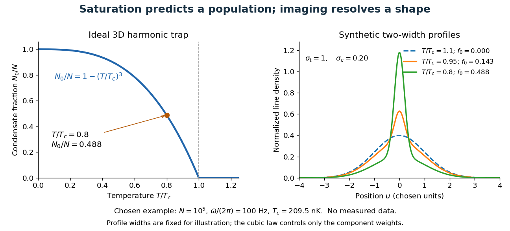

# Quantum ideal-gas statistics

↑ **Parent:** [Statistical physics](statistical-physics.md)

An ideal quantum gas has mean occupation

$$
[\exp((E-\mu)/(k_BT))\mp1]^{-1},
$$

with one sign for bosons and the other for fermions.

**Table of contents**

- [Heat capacity for a two-dimensional linear fermion dispersion](#heat-capacity-for-a-two-dimensional-linear-fermion-dispersion)
- [Maxwell–Boltzmann statistics](#maxwell-boltzmann-statistics)
  - [Nonrelativistic Maxwell--Boltzmann number density](#nonrelativistic-maxwell-boltzmann-number-density)
- [Fermi level](#fermi-level)
- [Maxwell-Boltzmann distribution](#maxwell-boltzmann-distribution)
  - [Wall-impact speed distribution](#wall-impact-speed-distribution)
  - [Maxwell-Boltzmann velocity distribution](#maxwell-boltzmann-velocity-distribution)
    - [Maxwell speed distribution](#maxwell-speed-distribution)
      - [Most probable speed in the Maxwell distribution](#most-probable-speed-in-the-maxwell-distribution)
    - [Doppler broadening](#doppler-broadening)
      - [Doppler resolution of a Zeeman pattern](#doppler-resolution-of-a-zeeman-pattern)
      - [Thermal Doppler broadening](#thermal-doppler-broadening)
        - [Thermal cutoff of Lyman-alpha line widths](#thermal-cutoff-of-lyman-alpha-line-widths)
- [Density of states](#density-of-states)
  - [Anisotropic ideal-gas density of states](#anisotropic-ideal-gas-density-of-states)
  - [Single-polarization two-dimensional photon density of states](#single-polarization-two-dimensional-photon-density-of-states)
  - [Semiclassical density of states in a central potential](#semiclassical-density-of-states-in-a-central-potential)
  - [Spinless cubic-box wave-vector counting](#spinless-cubic-box-wave-vector-counting)
  - [Phonon density of states](#phonon-density-of-states)
    - [Density of states of a monatomic harmonic chain](#density-of-states-of-a-monatomic-harmonic-chain)
    - [One-dimensional acoustic phonon heat capacity](#one-dimensional-acoustic-phonon-heat-capacity)
  - [Van Hove singularity](#van-hove-singularity)
    - [Logarithmic two-dimensional saddle joint density of states](#logarithmic-two-dimensional-saddle-joint-density-of-states)
      - [Spin and branch counting in saddle-point optical spectra](#spin-and-branch-counting-in-saddle-point-optical-spectra)
    - [One-dimensional van Hove singularity](#one-dimensional-van-hove-singularity)
  - [Density of occupied states](#density-of-occupied-states)
  - [Positive-energy quasiparticle density from a folded spectrum](#positive-energy-quasiparticle-density-from-a-folded-spectrum)
  - [Joint density of states](#joint-density-of-states)
    - [Saddle-point optical transition contour](#saddle-point-optical-transition-contour)
      - [Square-zone cutoff of a saddle contour](#square-zone-cutoff-of-a-saddle-contour)
    - [Dimensional interband threshold shapes](#dimensional-interband-threshold-shapes)
    - [Level-set representation of the joint density of states](#level-set-representation-of-the-joint-density-of-states)
    - [Two-dimensional joint density of states](#two-dimensional-joint-density-of-states)
  - [One-dimensional free-electron density of states](#one-dimensional-free-electron-density-of-states)
  - [Local density of states](#local-density-of-states)
  - [Spin-summed density of states](#spin-summed-density-of-states)
  - [Single-spin density of states](#single-spin-density-of-states)
- [Fermi-Dirac distribution](#fermi-dirac-distribution)
  - [Fermi window](#fermi-window)
    - [Thermal damping of a sinusoidal density of states](#thermal-damping-of-a-sinusoidal-density-of-states)
      - [Oscillatory thermal-change amplitude ratio](#oscillatory-thermal-change-amplitude-ratio)
  - [Boltzmann approximation](#boltzmann-approximation)
  - [Sommerfeld expansion](#sommerfeld-expansion)
    - [Fixed-chemical-potential Sommerfeld density increase](#fixed-chemical-potential-sommerfeld-density-increase)
      - [Monotonic density at fixed chemical potential in a square-root density of states](#monotonic-density-at-fixed-chemical-potential-in-a-square-root-density-of-states)
  - [Electron-positron thermal pair abundance](#electron-positron-thermal-pair-abundance)
  - [Fermion-to-boson thermal integral ratio](#fermion-to-boson-thermal-integral-ratio)
  - [Fermi gas](#fermi-gas)
    - [Low-temperature heat capacity of a three-dimensional Fermi gas](#low-temperature-heat-capacity-of-a-three-dimensional-fermi-gas)
    - [Nuclear Fermi gas model](#nuclear-fermi-gas-model)
      - [Fermi motion](#fermi-motion)
    - [Two-dimensional electron gas](#two-dimensional-electron-gas)
      - [Top-gate density tuning](#top-gate-density-tuning)
      - [Transverse magnetic focusing](#transverse-magnetic-focusing)
        - [Ballistic focusing mobility criterion](#ballistic-focusing-mobility-criterion)
      - [Quantum point contact](#quantum-point-contact)
        - [Parallel-field splitting of quantum-point-contact steps](#parallel-field-splitting-of-quantum-point-contact-steps)
        - [Nonlinear conductance of a quantum point contact](#nonlinear-conductance-of-a-quantum-point-contact)
          - [Bias spectroscopy of one-dimensional subbands](#bias-spectroscopy-of-one-dimensional-subbands)
          - [Voltage partition in a ballistic constriction](#voltage-partition-in-a-ballistic-constriction)
          - [Half-integer channel plateaus from a symmetric bias window](#half-integer-channel-plateaus-from-a-symmetric-bias-window)
        - [Saddle-point model of a quantum point contact](#saddle-point-model-of-a-quantum-point-contact)
        - [Adiabatic electron collimation](#adiabatic-electron-collimation)
        - [Collinear quantum point contacts](#collinear-quantum-point-contacts)
        - [Split gate](#split-gate)
    - [Degenerate electron gas](#degenerate-electron-gas)
    - [Finite-temperature electron equation of state](#finite-temperature-electron-equation-of-state)
    - [Adiabatic scaling of a Fermi gas with power-law density of states](#adiabatic-scaling-of-a-fermi-gas-with-power-law-density-of-states)
    - [Strict monotonicity of Fermi gas entropy per particle](#strict-monotonicity-of-fermi-gas-entropy-per-particle)
    - [Fermi energy](#fermi-energy)
      - [Fermi temperature](#fermi-temperature)
      - [Fermi energy of a model electron gas](#fermi-energy-of-a-model-electron-gas)
      - [Electron Fermi temperature](#electron-fermi-temperature)
      - [Fermi momentum](#fermi-momentum)
        - [Fermi velocity](#fermi-velocity)
        - [Fermi wavevector](#fermi-wavevector)
          - [Fermi wavelength](#fermi-wavelength)
      - [Fermi sea](#fermi-sea)
        - [Three-dimensional free-electron density of states](#three-dimensional-free-electron-density-of-states)
      - [Observation of Fermi pressure in trapped lithium](#observation-of-fermi-pressure-in-trapped-lithium)
    - [Ultrarelativistic ideal Fermi gas](#ultrarelativistic-ideal-fermi-gas)
    - [Degeneracy pressure](#degeneracy-pressure)
      - [Electron degeneracy pressure](#electron-degeneracy-pressure)
        - [Ideal Fermi gas bulk modulus](#ideal-fermi-gas-bulk-modulus)
        - [Degeneracy-pressure bulk modulus](#degeneracy-pressure-bulk-modulus)
        - [Nonrelativistic electron-degeneracy pressure in a hydrogen-helium mixture](#nonrelativistic-electron-degeneracy-pressure-in-a-hydrogen-helium-mixture)
        - [Electron relativistic density threshold](#electron-relativistic-density-threshold)
        - [Equation of state of a cold electron gas](#equation-of-state-of-a-cold-electron-gas)
    - [Pauli paramagnetism](#pauli-paramagnetism)
      - [Fixed-number low-temperature Pauli susceptibility](#fixed-number-low-temperature-pauli-susceptibility)
      - [Pauli moment of a massless electron gas](#pauli-moment-of-a-massless-electron-gas)
    - [Two-dimensional free-electron density of states](#two-dimensional-free-electron-density-of-states)
      - [Chemical potential of a two-dimensional ideal Fermi gas](#chemical-potential-of-a-two-dimensional-ideal-fermi-gas)
      - [Spin normalization in two-dimensional free-electron state counting](#spin-normalization-in-two-dimensional-free-electron-state-counting)
      - [Mean energy of a two-dimensional Fermi gas](#mean-energy-of-a-two-dimensional-fermi-gas)
      - [Low-temperature particle-number cancellation for constant density of states](#low-temperature-particle-number-cancellation-for-constant-density-of-states)
        - [Quadratic low-temperature energy correction for constant density of states](#quadratic-low-temperature-energy-correction-for-constant-density-of-states)
          - [Linear low-temperature heat capacity of a two-dimensional Fermi gas](#linear-low-temperature-heat-capacity-of-a-two-dimensional-fermi-gas)
    - [Degeneracy pressure of a two-dimensional Fermi gas](#degeneracy-pressure-of-a-two-dimensional-fermi-gas)
- [Classical limit of Bose--Einstein and Fermi--Dirac statistics](#classical-limit-of-bose-einstein-and-fermi-dirac-statistics)
- [Bose-Einstein statistics](#bose-einstein-statistics)
  - [Bose gas](#bose-gas)
  - [Bose-Einstein distribution](#bose-einstein-distribution)
    - [Low-temperature energy of gapless bosonic excitations](#low-temperature-energy-of-gapless-bosonic-excitations)
      - [Quadratic-boson heat-capacity coefficient](#quadratic-boson-heat-capacity-coefficient)
    - [Mean photon energy](#mean-photon-energy)
    - [Bose-Einstein condensation](#bose-einstein-condensation)
      - [Bose condensation temperature from a fermionic density scale](#bose-condensation-temperature-from-a-fermionic-density-scale)
      - [Bose-Einstein condensation temperature for an anisotropic effective mass](#bose-einstein-condensation-temperature-for-an-anisotropic-effective-mass)
      - [Random-loss cooling of a Bose-Einstein condensate](#random-loss-cooling-of-a-bose-einstein-condensate)
      - [Saturation particle number for Bose-Einstein condensation](#saturation-particle-number-for-bose-einstein-condensation)
      - [Field-induced triplon condensation](#field-induced-triplon-condensation)
        - [Condensate density in a shifted-parabola triplon model](#condensate-density-in-a-shifted-parabola-triplon-model)
        - [Triplon condensation field scaling](#triplon-condensation-field-scaling)
      - [Homogeneous ideal Bose gas condensation](#homogeneous-ideal-bose-gas-condensation)
        - [Ideal Bose-gas heat capacity below condensation](#ideal-bose-gas-heat-capacity-below-condensation)
        - [Finite-box ground-energy convention in Bose condensation](#finite-box-ground-energy-convention-in-bose-condensation)
        - [Particle saturation in a homogeneous Bose gas](#particle-saturation-in-a-homogeneous-bose-gas)
      - [Dilute-gas Bose-Einstein condensation](#dilute-gas-bose-einstein-condensation)
        - [Phase-space density of an atomic gas](#phase-space-density-of-an-atomic-gas)
          - [Harmonic-trap phase-space density](#harmonic-trap-phase-space-density)
        - [Bose condensation in a three-dimensional harmonic trap](#bose-condensation-in-a-three-dimensional-harmonic-trap)
          - [Harmonic-trap critical-temperature prefactor](#harmonic-trap-critical-temperature-prefactor)
          - [Saturation of harmonic-trap excited states](#saturation-of-harmonic-trap-excited-states)
          - [Harmonic-trap chemical-potential pinning](#harmonic-trap-chemical-potential-pinning)
          - [Harmonic-trap energy-zero convention](#harmonic-trap-energy-zero-convention)
          - [Condensate fraction](#condensate-fraction)
        - [Synthetic bimodal profile of a Bose gas](#synthetic-bimodal-profile-of-a-bose-gas)
        - [Observation of Bose-Einstein condensation in rubidium in 1995](#observation-of-bose-einstein-condensation-in-rubidium-in-1995)
        - [Observation of Bose-Einstein condensation in sodium in 1995](#observation-of-bose-einstein-condensation-in-sodium-in-1995)
        - [Condensation, matter-wave coherence and superfluidity](#condensation-matter-wave-coherence-and-superfluidity)
      - [Bose condensation with power-law dispersion](#bose-condensation-with-power-law-dispersion)
      - [Bose-Einstein condensate](#bose-einstein-condensate)
        - [Condensate wavefunction](#condensate-wavefunction)
        - [Fixed-number two-mode condensate](#fixed-number-two-mode-condensate)
        - [Condensate density](#condensate-density)
        - [Uniform ring condensate](#uniform-ring-condensate)
          - [Step-potential equilibrium in a ring condensate](#step-potential-equilibrium-in-a-ring-condensate)
        - [Finite-size condensate chemical potential](#finite-size-condensate-chemical-potential)
        - [Condensate depletion](#condensate-depletion)
        - [Two-component Bose-Einstein condensate](#two-component-bose-einstein-condensate)
          - [Miscibility criterion for a two-component condensate](#miscibility-criterion-for-a-two-component-condensate)
      - [Weakly interacting Bose gas](#weakly-interacting-bose-gas)
        - [Dilute-gas Bogoliubov depletion fraction](#dilute-gas-bogoliubov-depletion-fraction)
        - [Bogoliubov theory](#bogoliubov-theory)
          - [Condensate fluctuation power counting](#condensate-fluctuation-power-counting)
            - [Infrared qualification of condensate fluctuation counting](#infrared-qualification-of-condensate-fluctuation-counting)
        - [Interaction-dominated ground state with nearly ideal condensation temperature](#interaction-dominated-ground-state-with-nearly-ideal-condensation-temperature)
        - [Phonon heat capacity of a dilute Bose gas](#phonon-heat-capacity-of-a-dilute-bose-gas)
        - [Contact-interaction Bose-gas field integral](#contact-interaction-bose-gas-field-integral)
          - [Renormalization of a three-dimensional dilute-gas contact coupling](#renormalization-of-a-three-dimensional-dilute-gas-contact-coupling)
        - [Quadratic condensate fluctuation Lagrangian](#quadratic-condensate-fluctuation-lagrangian)
        - [Grand-canonical Hamiltonian of a Bose field](#grand-canonical-hamiltonian-of-a-bose-field)
        - [Density-phase action of a Bose gas](#density-phase-action-of-a-bose-gas)
          - [Quadratic density-phase action](#quadratic-density-phase-action)
            - [Static density stiffness versus an excitation gap](#static-density-stiffness-versus-an-excitation-gap)
            - [Bose-gas phase-only action](#bose-gas-phase-only-action)
              - [Infrared phase fluctuations of a homogeneous Bose gas](#infrared-phase-fluctuations-of-a-homogeneous-bose-gas)
          - [Compact phase winding term](#compact-phase-winding-term)
        - [Particle-number phase symmetry](#particle-number-phase-symmetry)
        - [Quantum depletion of a Bose condensate](#quantum-depletion-of-a-bose-condensate)
        - [Bogoliubov quasiparticle dispersion](#bogoliubov-quasiparticle-dispersion)
          - [Bogoliubov mode](#bogoliubov-mode)
        - [Number-conserving Bogoliubov quadratic Hamiltonian](#number-conserving-bogoliubov-quadratic-hamiltonian)
      - [Exciton-polariton condensate](#exciton-polariton-condensate)
        - [Exciton condensation evidence and competing optical signatures](#exciton-condensation-evidence-and-competing-optical-signatures)
          - [Exciton thermalization versus recombination](#exciton-thermalization-versus-recombination)
        - [Cylindrical pump-loss balance](#cylindrical-pump-loss-balance)
        - [Uniform pumped polariton condensate](#uniform-pumped-polariton-condensate)
          - [Uniform-current pumped polariton condensate](#uniform-current-pumped-polariton-condensate)
        - [Reservoir reduction of a polariton condensate](#reservoir-reduction-of-a-polariton-condensate)
      - [Gross–Pitaevskii equation](#gross-pitaevskii-equation)
        - [Gaussian interaction energy of a trapped condensate](#gaussian-interaction-energy-of-a-trapped-condensate)
        - [Quantum pressure of a condensate](#quantum-pressure-of-a-condensate)
        - [Material-density damping of a Gross–Pitaevskii condensate](#material-density-damping-of-a-gross-pitaevskii-condensate)
          - [Plane-wave dispersion of a material-density-damped condensate](#plane-wave-dispersion-of-a-material-density-damped-condensate)
          - [Bulk-viscous limit of a material-density-damped condensate](#bulk-viscous-limit-of-a-material-density-damped-condensate)
        - [Effective two-dimensional contact coupling](#effective-two-dimensional-contact-coupling)
        - [Cubic-quintic Gross–Pitaevskii equation](#cubic-quintic-gross-pitaevskii-equation)
        - [Condensate number current](#condensate-number-current)
          - [Gain-loss Madelung equations](#gain-loss-madelung-equations)
        - [Thomas–Fermi approximation for a condensate](#thomas-fermi-approximation-for-a-condensate)
          - [Crossover from Gaussian to Thomas–Fermi condensate](#crossover-from-gaussian-to-thomas-fermi-condensate)
          - [Spherical Thomas–Fermi condensate](#spherical-thomas-fermi-condensate)
            - [Thomas–Fermi condensate edge rounding](#thomas-fermi-condensate-edge-rounding)
          - [Local-density sound speed of a condensate](#local-density-sound-speed-of-a-condensate)
          - [Thomas–Fermi profiles for unequal condensate trap curvatures](#thomas-fermi-profiles-for-unequal-condensate-trap-curvatures)
          - [Two-dimensional Thomas–Fermi condensate](#two-dimensional-thomas-fermi-condensate)
        - [Gross–Pitaevskii solitary wave](#gross-pitaevskii-solitary-wave)
          - [Longitudinal scaling identity for a condensate solitary wave](#longitudinal-scaling-identity-for-a-condensate-solitary-wave)
          - [Energy–momentum slope of a solitary wave](#energy-momentum-slope-of-a-solitary-wave)
          - [Renormalized momentum of a condensate](#renormalized-momentum-of-a-condensate)
        - [Healing length](#healing-length)
          - [Hard-wall condensate healing profile](#hard-wall-condensate-healing-profile)
      - [Critical temperature](#critical-temperature)
    - [Phonon](#phonon)
      - [Phonon polarization](#phonon-polarization)
      - [Optical phonon](#optical-phonon)
        - [Rattling mode](#rattling-mode)
      - [Acoustic phonon](#acoustic-phonon)
      - [Electron-phonon interaction](#electron-phonon-interaction)
        - [Phonon-mediated electron attraction](#phonon-mediated-electron-attraction)
        - [Fröhlich Hamiltonian](#frohlich-hamiltonian)
          - [Fröhlich canonical transformation](#frohlich-canonical-transformation)
        - [Kohn anomaly](#kohn-anomaly)
        - [Peierls transition](#peierls-transition)
          - [Inelastic neutron scattering of TTF-TCNQ](#inelastic-neutron-scattering-of-ttf-tcnq)
          - [Peierls distortion](#peierls-distortion)
            - [Dimerized tight-binding chain](#dimerized-tight-binding-chain)
              - [Logarithmic energy gain from a Peierls distortion](#logarithmic-energy-gain-from-a-peierls-distortion)
        - [Electron-phonon scattering](#electron-phonon-scattering)
          - [Electron-phonon Umklapp threshold](#electron-phonon-umklapp-threshold)
          - [Small-angle electron-phonon transport at low temperature](#small-angle-electron-phonon-transport-at-low-temperature)
      - [Phonon scattering](#phonon-scattering)
        - [Normal phonon collisions and heat-current relaxation](#normal-phonon-collisions-and-heat-current-relaxation)
        - [Phonon mean free path](#phonon-mean-free-path)
        - [Umklapp scattering](#umklapp-scattering)
      - [Debye–Waller factor](#debye-waller-factor)
      - [Periodic displacements in a harmonic chain](#periodic-displacements-in-a-harmonic-chain)
      - [Phonon dispersion relation](#phonon-dispersion-relation)
        - [Extended-zone representation of a phonon dispersion](#extended-zone-representation-of-a-phonon-dispersion)
        - [Diatomic-chain dispersion relation with equal springs](#diatomic-chain-dispersion-relation-with-equal-springs)
          - [Diatomic-chain zone-edge polarizations](#diatomic-chain-zone-edge-polarizations)
          - [Long-wavelength inference of diatomic-chain parameters](#long-wavelength-inference-of-diatomic-chain-parameters)
        - [Monatomic-chain dispersion relation](#monatomic-chain-dispersion-relation)
          - [Folded wave-number counting for a monatomic chain](#folded-wave-number-counting-for-a-monatomic-chain)
        - [Acoustic phonon branch](#acoustic-phonon-branch)
        - [Optical phonon branch](#optical-phonon-branch)
        - [Alternating-spring chain dispersion relation](#alternating-spring-chain-dispersion-relation)
          - [Strong-bond limit of the alternating-spring chain](#strong-bond-limit-of-the-alternating-spring-chain)
        - [Density of states for a two-dimensional power-law phonon dispersion](#density-of-states-for-a-two-dimensional-power-law-phonon-dispersion)
      - [Debye model](#debye-model)
        - [Debye sound speed](#debye-sound-speed)
        - [Mode count in the Debye model](#mode-count-in-the-debye-model)
        - [High-temperature phonon number in the Debye model](#high-temperature-phonon-number-in-the-debye-model)
        - [Debye heat capacity](#debye-heat-capacity)
          - [Electronic and lattice heat-capacity crossover in a monovalent metal](#electronic-and-lattice-heat-capacity-crossover-in-a-monovalent-metal)
          - [Surface-electron and bulk-phonon heat-capacity crossover](#surface-electron-and-bulk-phonon-heat-capacity-crossover)
        - [Debye wavevector](#debye-wavevector)
        - [Debye frequency](#debye-frequency)
          - [Debye temperature](#debye-temperature)
        - [Two-dimensional power-law Debye model](#two-dimensional-power-law-debye-model)

## Heat capacity for a two-dimensional linear fermion dispersion

↑ **Parent:** [Quantum ideal-gas statistics](quantum-ideal-gas-statistics.md)

For $g$ copies of a positive-energy branch $E=\hbar v|\mathbf k|$ in [area](differential-geometry.md#surface-area) $A$, the [density of states](#density-of-states) is $D(E)=gAE/(2\pi\hbar^2v^2)$. At zero [chemical potential](chemical-potential.md), the thermal [energy](energy.md) is $3g\zeta(3)A(k_BT)^3/(4\pi\hbar^2v^2)$, giving the displayed fixed-zero-chemical-potential [heat capacity](heat.md#heat-capacity). If a symmetric filled negative-energy band also supplies holes, its excitation [energy](energy.md) contributes an equal amount. Counting cones, [spin](angular-momentum-operator.md#spin) species and holes explicitly is necessary before assigning an absolute numerical coefficient.

<h2 id="maxwell-boltzmann-statistics">Maxwell–Boltzmann statistics</h2>

↑ **Parent:** [Quantum ideal-gas statistics](quantum-ideal-gas-statistics.md)  
ⓦ [Wiki](https://en.wikipedia.org/wiki/Maxwell–Boltzmann_statistics)

Maxwell–Boltzmann statistics describes a dilute classical gas whose single-particle occupation factors have the displayed exponential form. It is the low-occupation [classical limit of Bose--Einstein and Fermi--Dirac statistics](#classical-limit-of-bose-einstein-and-fermi-dirac-statistics). Integrating this factor over momentum gives the [nonrelativistic Maxwell--Boltzmann number density](#nonrelativistic-maxwell-boltzmann-number-density) when the particle energy is $mc^2+p^2/(2m)$.

<h3 id="nonrelativistic-maxwell-boltzmann-number-density">Nonrelativistic Maxwell--Boltzmann number density</h3>

↑ **Parent:** [Maxwell–Boltzmann statistics](#maxwell-boltzmann-statistics)

Integrating [Maxwell–Boltzmann statistics](#maxwell-boltzmann-statistics) over momentum for [nonrelativistic particles](special-relativity.md#nonrelativistic-particle) of mass $m$, spin-state count $g_s$, and energy $mc^2+p^2/(2m)$ gives

$$
n=g_s\left(\frac{2\pi mk_BT}{h^2}\right)^{3/2}
e^{(\mu-mc^2)/(k_BT)}.
$$

## Fermi level

↑ **Parent:** [Quantum ideal-gas statistics](quantum-ideal-gas-statistics.md)  
ⓦ [Wiki](https://en.wikipedia.org/wiki/Fermi_level)

The Fermi level is the [chemical potential](chemical-potential.md) controlling electron occupations. For an ideal [Fermi gas](#fermi-gas) at zero temperature it equals the [Fermi energy](#fermi-energy); at nonzero temperature the chemical potential need not equal that zero-temperature energy.

## Maxwell-Boltzmann distribution

↑ **Parent:** [Quantum ideal-gas statistics](quantum-ideal-gas-statistics.md)  
ⓦ [Wiki](https://en.wikipedia.org/wiki/Maxwell–Boltzmann_distribution)

The Maxwell-Boltzmann distribution describes the random [velocities](classical-mechanics.md#velocity) and [speeds](classical-mechanics.md#speed) of particles in a classical [ideal gas](ideal-gas.md) at [thermal equilibrium](thermal-equilibrium.md). Individual particles keep changing [velocity](classical-mechanics.md#velocity) through [collisions](classical-mechanics.md#collision), while the equilibrium [probability distribution](probability-distribution.md) stays fixed. For one species of particle [mass](classical-mechanics.md#mass) $m$ at positive [temperature](temperature.md) $T$, the characteristic scale is

$$
s=\sqrt{\frac{k_BT}{m}},
$$

where $k_B$ is the [Boltzmann constant](thermodynamics.md#boltzmann-constant). A signed [velocity](classical-mechanics.md#velocity) component follows a [normal distribution](probability-distribution.md#normal-distribution); the nonnegative magnitude follows the [Maxwell speed distribution](#maxwell-speed-distribution). Their peaks differ because a [speed](classical-mechanics.md#speed) measurement groups together all directions of motion.

Use the gas rest frame, three spatial dimensions, and [nonrelativistic particles](special-relativity.md#nonrelativistic-particle), with $k_BT\ll mc^2$ where $c$ is the [speed of light](special-relativity.md#speed-of-light). Assume a dilute gas whose interactions between encounters can be neglected in the [ideal gas](ideal-gas.md) approximation and whose translational motion is classical. A sufficient condition for negligible quantum exchange effects is $n\lambda^3\ll1$, where $n$ is the [number density](statistical-physics.md#number-density) and $\lambda$ the [thermal de Broglie wavelength](canonical-ensemble.md#thermal-de-broglie-wavelength). Diluteness alone does not guarantee [thermal equilibrium](thermal-equilibrium.md); the gas must have equilibrated. These are the assumptions behind the classical [Maxwell-Boltzmann velocity distribution](#maxwell-boltzmann-velocity-distribution). [Fitzpatrick, The Maxwell distribution](https://farside.ph.utexas.edu/teaching/sm1/lectures/node72.html) [Fitzpatrick, Quantum statistics in the classical limit](https://farside.ph.utexas.edu/teaching/sm1/lectures/node82.html)

The connection to [Maxwell–Boltzmann statistics](#maxwell-boltzmann-statistics) is the [Boltzmann factor](canonical-ensemble.md#boltzmann-factor) for translational [kinetic energy](energy.md#kinetic-energy), $E_{\rm kin}=m|\mathbf v|^2/2$. Normalizing $e^{-E_{\rm kin}/(k_BT)}$ over [velocity](classical-mechanics.md#velocity) gives a probability density; an occupation factor $e^{(\mu-E)/(k_BT)}$ instead specifies a mean occupation, with [chemical potential](chemical-potential.md) $\mu$. Their normalizations serve different purposes. [Fitzpatrick, Maxwell-Boltzmann statistics](https://farside.ph.utexas.edu/teaching/sm1/lectures/node81.html)

This connects microscopic motion to measurements: a [gas thermometer](temperature.md#gas-thermometer) uses the [ideal gas law](ideal-gas.md#ideal-gas-law), [collisions](classical-mechanics.md#collision) and the [mean free path](ideal-gas.md#mean-free-path) govern transport, and measurements of [spectral lines](stellar-astrophysics.md#spectral-line) use [thermal Doppler broadening](#thermal-doppler-broadening) to infer [temperature](temperature.md). Each probes a different aspect of the same thermal motion.

In 1860, [James Clerk Maxwell](physicist.md#james-clerk-maxwell) presented the component and [speed](classical-mechanics.md#speed) laws in Part I, Proposition IV of _Illustrations of the Dynamical Theory of Gases_, pp. 22–23. His argument combined [independence](random-variable.md#independent-random-variables) of the three [velocity](classical-mechanics.md#velocity) components with [isotropy](continuum-mechanics.md#isotropy), and he explicitly compared the component law with the [normal distribution](probability-distribution.md#normal-distribution) of observational errors. Independence is an assumption of that argument; perpendicular coordinate axes alone do not establish it. [Maxwell (1860), original article scan with annotations](https://sites.pitt.edu/~jdnorton/teaching/2559_Therm_Stat_Mech/handouts/Maxwell_1860_annot.pdf#page=5)

### Wall-impact speed distribution

↑ **Parent:** [Maxwell-Boltzmann distribution](#maxwell-boltzmann-distribution)

The [speed distribution](kinetic-theory.md#speed-distribution) of atoms striking a wall is weighted by the normal component of [velocity](classical-mechanics.md#velocity), relative to the distribution of atoms present in the bulk. For an isotropic classical monatomic gas, the impact speed density is proportional to $v^3e^{-mv^2/(2k_BT)}$, and the mean impact [kinetic energy](energy.md#kinetic-energy) is $2k_BT$, rather than $3k_BT/2$.

### Maxwell-Boltzmann velocity distribution

↑ **Parent:** [Maxwell-Boltzmann distribution](#maxwell-boltzmann-distribution)

In the gas rest frame, the [Maxwell-Boltzmann velocity distribution](#maxwell-boltzmann-velocity-distribution) is the [probability density function](continuous-probability-distribution.md#probability-density-function) per unit volume in [velocity](classical-mechanics.md#velocity) space:

$$
f(\mathbf v)=
\left(\frac{m}{2\pi k_BT}\right)^{3/2}
\exp\left(-\frac{m|\mathbf v|^2}{2k_BT}\right)
=\frac{e^{-|\mathbf v|^2/(2s^2)}}{(2\pi s^2)^{3/2}},
\qquad \int_{\mathbb R^3}f(\mathbf v)\,d^3\mathbf v=1.
$$

Thus $f(\mathbf v)\,d^3\mathbf v$ gives the [probability](probability-theory.md#probability) of a small three-dimensional [velocity](classical-mechanics.md#velocity) region. For a gas with bulk [mean velocity](kinetic-theory.md#mean-velocity-of-a-kinetic-distribution) $\mathbf V$, replace $\mathbf v$ by $\mathbf v-\mathbf V$; the [Maxwell speed distribution](#maxwell-speed-distribution) then describes the magnitude relative to that bulk motion.

For any one Cartesian [velocity](classical-mechanics.md#velocity) component $v_x$, integrating out the other two gives

$$
q(v_x)=\frac{1}{\sqrt{2\pi}s}e^{-v_x^2/(2s^2)},
\qquad \langle v_x\rangle=0,
\qquad \langle v_x^2\rangle=s^2=\frac{k_BT}{m}.
$$

The factorization $f(\mathbf v)=q(v_x)q(v_y)q(v_z)$ establishes [independence](random-variable.md#independent-random-variables): all three components are centered [normal random variables](probability-distribution.md#gaussian-random-variable), with [variance](variance.md) $s^2$. Both the component density $q$ and the vector density $f$ have their largest values at zero. This concerns densities for small equal-sized regions; any single exact [velocity](classical-mechanics.md#velocity) still has [probability](probability-theory.md#probability) zero. [Fitzpatrick, component distribution and factorization](https://farside.ph.utexas.edu/teaching/sm1/lectures/node72.html)

The [standard deviation](variance.md#standard-deviation) $s$ measures thermal motion even though the [mean velocity](kinetic-theory.md#mean-velocity-of-a-kinetic-distribution) is zero. Positive and negative components cancel in the [mean](expected-value.md), but their squares add. This is why [thermal Doppler broadening](#thermal-doppler-broadening) measures a nonzero line width in a gas with no bulk motion.

#### Maxwell speed distribution

↑ **Parent:** [Maxwell-Boltzmann velocity distribution](#maxwell-boltzmann-velocity-distribution)

The Maxwell speed distribution is the [probability density function](continuous-probability-distribution.md#probability-density-function) for the magnitude $v=|\mathbf v|$. Unlike a signed [velocity](classical-mechanics.md#velocity) component, [speed](classical-mechanics.md#speed) cannot be negative:

$$
g(v)=4\pi v^2
\left(\frac{m}{2\pi k_BT}\right)^{3/2}
e^{-mv^2/(2k_BT)}
=\sqrt{\frac2\pi}\frac{v^2}{s^3}e^{-v^2/(2s^2)},
\qquad v\geq0.
$$

For $0\leq a<b$, the [probability](probability-theory.md#probability) of a [speed](classical-mechanics.md#speed) in $[a,b]$ is $\int_a^b g(v)\,dv$, and $\int_0^\infty g(v)\,dv=1$. The density has units of inverse [speed](classical-mechanics.md#speed), so its height alone is not a [probability](probability-theory.md#probability). [OpenStax, University Physics Volume 2, §2.4](https://openstax.org/books/university-physics-volume-2/pages/2-4-distribution-of-molecular-speeds)

All [velocities](classical-mechanics.md#velocity) with magnitudes from $v$ to $v+dv$ occupy a thin [spherical shell](euclidean-geometry.md#spherical-shell) of volume $4\pi v^2\,dv$ in [velocity](classical-mechanics.md#velocity) space. The [isotropy](continuum-mechanics.md#isotropy) of the [Maxwell-Boltzmann velocity distribution](#maxwell-boltzmann-velocity-distribution) makes its density constant over each shell, giving $g(v)=4\pi v^2 f(v\mathbf e_x)$ for any fixed unit direction $\mathbf e_x$. A larger radius offers more directions and more volume. The increasing shell factor initially wins over the decreasing [Boltzmann factor](canonical-ensemble.md#boltzmann-factor), so $g(0)=0$ and the [most probable speed](#most-probable-speed-in-the-maxwell-distribution) is positive. This is the geometric reason that the peaks of the vector and [speed](classical-mechanics.md#speed) densities disagree.

With the [dimensionless quantity](physics.md#dimensionless-quantity) $u=v/s$, every such gas has the same rescaled [speed](classical-mechanics.md#speed) density:

$$
g(v)\,dv=h(u)\,du,
\qquad h(u)=\sqrt{\frac2\pi}u^2e^{-u^2/2},\quad u\geq0.
$$

For comparison, $w=v_x/s$ has the standard [normal distribution](probability-distribution.md#normal-distribution) density $\phi(w)=e^{-w^2/2}/\sqrt{2\pi}$ on the whole real line. The [Maxwell speed distribution](#maxwell-speed-distribution) is neither the positive half of this curve nor the distribution of $|v_x|$: it combines three components.

**[Figure 1](#image-one-signed-velocity-component-peaks-at-zero-while-speed-peaks-above-zero-because-of-spherical-shells). One signed velocity component peaks at zero, while speed peaks above zero because of spherical shells**.

The first two [moments](expected-value.md#moment) of the [Maxwell speed distribution](#maxwell-speed-distribution) give the [mean](expected-value.md) and [root mean square](analysis.md#root-mean-square):

$$
\langle v\rangle=\sqrt{\frac8\pi}\,s,\qquad
\langle v^2\rangle=3s^2,\qquad
v_{\rm rms}=\sqrt{\langle v^2\rangle}=\sqrt3\,s.
$$

Consequently the [mean](expected-value.md) translational [kinetic energy](energy.md#kinetic-energy) is $m\langle v^2\rangle/2=3k_BT/2$, as required by the [equipartition theorem](canonical-ensemble.md#equipartition-theorem). [OpenStax, University Physics Volume 2, §2.2](https://openstax.org/books/university-physics-volume-2/pages/2-2-pressure-temperature-and-rms-speed) The [mean](expected-value.md) [speed](classical-mechanics.md#speed) weights fast particles more than the density peak does, and the [root mean square](analysis.md#root-mean-square) weights them more strongly still.

Changing [temperature](temperature.md) or particle [mass](classical-mechanics.md#mass) only changes $s\propto\sqrt{T/m}$. At fixed [mass](classical-mechanics.md#mass), four times the [temperature](temperature.md) doubles every characteristic [speed](classical-mechanics.md#speed); at fixed [temperature](temperature.md), four times the [mass](classical-mechanics.md#mass) halves them. A stretched density becomes lower so that its area stays one. For two species at the same [temperature](temperature.md), equal [mean](expected-value.md) translational [kinetic energy](energy.md#kinetic-energy) therefore means different typical [speeds](classical-mechanics.md#speed).

**[Figure 2](#image-fourfold-temperature-doubles-the-speed-scale-while-fourfold-particle-mass-halves-it). Fourfold temperature doubles the speed scale, while fourfold particle mass halves it**.

##### Most probable speed in the Maxwell distribution

↑ **Parent:** [Maxwell speed distribution](#maxwell-speed-distribution)

The most probable speed is the [mode](probability-and-statistics.md#mode-statistics), or density maximum, of the [Maxwell speed distribution](#maxwell-speed-distribution):

$$
v_{\rm mp}=\sqrt{\frac{2k_BT}{m}}=\sqrt2\,s.
$$

For small equal-width [speed](classical-mechanics.md#speed) bins, the bin near $v_{\rm mp}$ contains the largest expected fraction of particles. This does not mean that any exact [speed](classical-mechanics.md#speed) has positive [probability](probability-theory.md#probability), or that every particle has this [speed](classical-mechanics.md#speed). The three common summaries obey

$$
\frac{v_{\rm mp}}s=\sqrt2\approx1.414,
\qquad \frac{\langle v\rangle}s=\sqrt{\frac8\pi}\approx1.596,
\qquad \frac{v_{\rm rms}}s=\sqrt3\approx1.732,
$$

so $v_{\rm mp}<\langle v\rangle<v_{\rm rms}$. The first describes a density peak, the second the [mean](expected-value.md) [speed](classical-mechanics.md#speed), and the third the [root mean square](analysis.md#root-mean-square) associated with [kinetic energy](energy.md#kinetic-energy). [OpenStax, characteristic molecular speeds](https://openstax.org/books/university-physics-volume-2/pages/2-4-distribution-of-molecular-speeds)

For a concrete scale $s=300\,\mathrm{m\,s^{-1}}$, these are approximately $424$, $479$, and $520\,\mathrm{m\,s^{-1}}$. The most probable [velocity](classical-mechanics.md#velocity) vector and each most probable component remain zero in the gas rest frame. A zero vector labels one small region of [velocity](classical-mechanics.md#velocity) space, whereas a positive [speed](classical-mechanics.md#speed) labels an entire [spherical shell](euclidean-geometry.md#spherical-shell).

A short check uses the [derivative](calculus.md#derivative) of the [logarithm](calculus.md#logarithm) of the [Maxwell speed distribution](#maxwell-speed-distribution) for $v>0$:

$$
\frac{d}{dv}\log g(v)=\frac2v-\frac{v}{s^2}.
$$

It is positive below $\sqrt2\,s$ and negative above it, locating the unique peak. The factor $v^2$ from the [spherical shell](euclidean-geometry.md#spherical-shell) supplies the term $2/v$; omitting it would incorrectly move the [speed](classical-mechanics.md#speed) peak to zero.

#### Doppler broadening

↑ **Parent:** [Maxwell-Boltzmann velocity distribution](#maxwell-boltzmann-velocity-distribution)  
ⓦ [Wiki](https://en.wikipedia.org/wiki/Doppler_broadening)

Doppler broadening is the spread of an observed spectral line caused by the distribution of emitter velocities along the line of sight.

##### Doppler resolution of a Zeeman pattern

↑ **Parent:** [Doppler broadening](#doppler-broadening)

A Maxwellian emitter has [Gaussian](probability-distribution.md#normal-distribution) Doppler [frequency](wave.md#frequency) FWHM $\Delta\nu_D/\nu=\sqrt{8k_BT\ln2/(mc^2)}$. Equating this width to the minimum adjacent weak-field sodium component separation $2\mu_BB/(3h)$ gives the title resolution scale. A [Gaussian](probability-distribution.md#normal-distribution) blend has no unique resolution threshold: disappearance of individual components and disappearance of the whole broadened multiplet are different criteria. Instrumental resolution, pressure broadening, selected [polarization](wave.md#polarization-waves) and line strengths must be specified for a sharper prediction.

##### Thermal Doppler broadening

↑ **Parent:** [Doppler broadening](#doppler-broadening)

If nonrelativistic emitters of mass $m$ have rest-frame angular frequency $\omega_0$, then the one-dimensional [Maxwell-Boltzmann velocity distribution](#maxwell-boltzmann-velocity-distribution) produces a Gaussian line with standard deviation

$$
\sigma_\omega=\frac{\omega_0}{c}\sqrt{\frac{k_BT}{m}}.
$$

Measuring the line width therefore determines the gas temperature when nonthermal broadening is negligible or separately modeled.

###### Thermal cutoff of Lyman-alpha line widths

↑ **Parent:** [Thermal Doppler broadening](#thermal-doppler-broadening)

A purely thermal hydrogen [absorption line](stellar-astrophysics.md#absorption-line) has velocity-space optical depth proportional to $\exp[-(v-v_0)^2/b^2]$ with the displayed width. Additional independent Gaussian broadening contributes positive terms to $b^2$. Fitting the lower envelope of width against neutral-hydrogen [column density](statistical-physics.md#column-density), with numerical calibration for density and pressure smoothing, estimates the [temperature-density relation of photoionized intergalactic gas](astrophysics.md#temperature-density-relation-of-photoionized-intergalactic-gas). A single broad line only bounds the temperature from above when its nonthermal width is unknown.

## Density of states

↑ **Parent:** [Quantum ideal-gas statistics](quantum-ideal-gas-statistics.md)  
ⓦ [Wiki](https://en.wikipedia.org/wiki/Density_of_states)

The density of states $g(E)$ is defined so that $g(E)\,dE$ counts one-particle states with energies in an interval of width $dE$. A sum over closely spaced states then becomes an integral weighted by $g(E)$.

### Anisotropic ideal-gas density of states

↑ **Parent:** [Density of states](#density-of-states)

For the continuum dispersion $\varepsilon_{\mathbf k}=\hbar^2(k_x^2+k_y^2+k_z^2/\gamma)/(2m)$ with $\gamma>0$, substituting $q_z=k_z/\sqrt\gamma$ makes the energy isotropic and gives Jacobian $\sqrt\gamma$. Every momentum-state counting integral therefore acquires that factor. Per internal state and unit volume, $N=\sqrt\gamma(2m/\hbar^2)^{3/2}\sqrt\varepsilon/(4\pi^2)$. The result assumes an unrestricted three-dimensional continuum; increasing this mass anisotropy is not the same operation as imposing a two-dimensional Brillouin zone and a finite interlayer band width.

### Single-polarization two-dimensional photon density of states

↑ **Parent:** [Density of states](#density-of-states)

For an area $A$ with periodic in-plane [boundary conditions](differential-equation.md#boundary-condition), one polarization contributes $A\,2\pi k\,dk/(2\pi)^2$ [normal modes](wave-equation.md#normal-mode) of the [electromagnetic field](electromagnetism.md#electromagnetic-field). For linear [dispersion relation](dispersion-relation.md) $\omega=ck$ and effective physical volume $Ad$, this gives the [density of states](#density-of-states) in the title. No extra factor two for polarization is allowed. Opposite in-plane directions are already counted in the full circle of [wavevectors](elasticity-physics.md#wavevector).

### Semiclassical density of states in a central potential

↑ **Parent:** [Density of states](#density-of-states)

For a spinless nonrelativistic particle in a central potential, $g(\epsilon)=(2m)^{3/2}(4\pi^2\hbar^3)^{-1}\int_{U<\epsilon}\sqrt{\epsilon-U}\,d^3r$. Spherical symmetry reduces this to a radial integral over every allowed shell. It is a leading phase-space approximation.

### Spinless cubic-box wave-vector counting

↑ **Parent:** [Density of states](#density-of-states)

Periodic boundaries on a cube give one spinless state per $(2\pi/L)^3$ in wave-vector space. Counting the full spherical shell gives $d\mathcal N/V=k^2dk/(2\pi^2)$. Hard-wall counting in the positive octant gives the same leading [volume](geometry-and-topology.md#volume) term.

### Phonon density of states

↑ **Parent:** [Density of states](#density-of-states)

The number of lattice-vibration modes per unit [angular frequency](lagrangian-mechanics.md#angular-frequency). For a three-dimensional isotropic monatomic [crystal](thermodynamics.md#crystal) with three linear acoustic branches of a common speed $v_s$, wavevector-shell counting gives $g(\omega)=3V\omega^2/(2\pi^2v_s^3)$ below a suitable cutoff. Different branch speeds replace $3v_s^{-3}$ by $v_L^{-3}+2v_T^{-3}$.

#### Density of states of a monatomic harmonic chain

↑ **Parent:** [Phonon density of states](#phonon-density-of-states)

For the nearest-neighbour [monatomic-chain dispersion relation](#monatomic-chain-dispersion-relation), $\omega_m=2\sqrt{\alpha/M}$ and $d\omega/dq=(a/2)\sqrt{\omega_m^2-\omega^2}$ on the positive half-zone. The folded wave-number count gives the displayed [density of states](#density-of-states), including both propagation directions. Its upper-edge [Van Hove singularity](#van-hove-singularity) is integrable: $\int_0^{\omega_m}g(\omega)d\omega=N$. A finite chain has discrete modes; the continuous density describes its large-size limit.

#### One-dimensional acoustic phonon heat capacity

↑ **Parent:** [Phonon density of states](#phonon-density-of-states)

A single acoustic branch $\omega=v|k|$ has thermal energy per length $U_T/\ell=\int dk\,\hbar v|k|/[2\pi(e^{\beta\hbar v|k|}-1)]=\pi(k_BT)^2/(6\hbar v)$. Differentiating gives the displayed linear [heat capacity](heat.md#heat-capacity). The regime requires [temperatures](temperature.md) below the microscopic [phonon](#phonon) cutoff but above the finite-size level spacing, with the translational [zero mode](linear-operator-theory.md#zero-mode) treated separately.

### Van Hove singularity

↑ **Parent:** [Density of states](#density-of-states)  
ⓦ [Wiki](https://en.wikipedia.org/wiki/Van_Hove_singularity)

A nonanalyticity of the [density of states](#density-of-states) associated with a stationary point of a band [dispersion relation](dispersion-relation.md). Its form depends on dimension and on whether the stationary point is an extremum or a saddle.

#### Logarithmic two-dimensional saddle joint density of states

↑ **Parent:** [Van Hove singularity](#van-hove-singularity)

A single two-dimensional quadratic saddle with $A=\hbar^2/(2m^*)$ contributes this leading [joint density of states](#joint-density-of-states) when both contour branches are included and $g_s$ counts independent spin channels. The contour integral is proportional to $\int_{-\Lambda}^{\Lambda}dy/\sqrt{y^2+\delta/A}=2\operatorname{arsinh}(\Lambda\sqrt{A/\delta})$ above the saddle. Its asymptote gives the logarithm with $E_\Lambda$ of order $A\Lambda^2$. The cutoff-dependent constant is not universal. This is a density per area per energy; changing to a density per frequency requires a Jacobian. [Chapter4, especiallyTable4.1: two-dimensional saddle critical point](physics-bibliography.md#optical-properties-of-solids-by-mildred-s-dresselhaus)

##### Spin and branch counting in saddle-point optical spectra

↑ **Parent:** [Logarithmic two-dimensional saddle joint density of states](#logarithmic-two-dimensional-saddle-joint-density-of-states)

A spin factor and disconnected contour branches count different independent contributions. For the transition energy $E_s+\hbar^2(k_x^2-k_y^2)/(2m^*)$, one branch contributes $g_s m^*I/(4\pi^2\hbar^2)$, with $I=\int dk_y/\sqrt{k_y^2+\delta/A}$. The full two-branch saddle doubles this. A formula for one branch with spin degeneracy two can therefore equal a full-contour formula with spin degeneracy one, but those are distinct counting conventions. An extra valley or inequivalent saddle requires its own multiplicity.

#### One-dimensional van Hove singularity

↑ **Parent:** [Van Hove singularity](#van-hove-singularity)

For a one-dimensional subband $E=E_0+\alpha k^2$ with $\alpha>0$, the [density of states](#density-of-states) varies as $(E-E_0)^{-1/2}$ just above its edge. Optical peaks also depend on the [joint density of states](#joint-density-of-states), selection rules and [excitons](quantum-mechanics.md#exciton).

### Density of occupied states

↑ **Parent:** [Density of states](#density-of-states)

The density of available one-particle states multiplied by their mean occupation. For equilibrium electrons, $Z(E)=D(E)f(E)$ with the [Fermi-Dirac distribution](#fermi-dirac-distribution) $f$. The integral of $Z$ counts electrons; the integral of $D$ counts available states.

### Positive-energy quasiparticle density from a folded spectrum

↑ **Parent:** [Density of states](#density-of-states)

A many-to-one change of energy variable requires summing every inverse branch. For $E(\xi)=\sqrt{\xi^2+\Delta^2}$ and constant normal [density of states](#density-of-states) $g_F$ on both sides of zero, there are two roots for $E>\Delta$, giving $D_+(E)=2g_FE/\sqrt{E^2-\Delta^2}$. A single branch instead gives $g_FE/\sqrt{E^2-\Delta^2}$. The distinction persists when $\Delta\to0$: folding $\xi$ into $|\xi|$ doubles a two-sided constant density on the positive axis. Spin degeneracy is a separate normalization choice; it must be applied consistently to both normal and transformed densities. The [BCS electronic density of states](fermi-liquid.md#bcs-electronic-density-of-states) has the single-factor expression because it is spectrally weighted rather than an unweighted branch count.

### Joint density of states

↑ **Parent:** [Density of states](#density-of-states)

For filled valence and empty conduction [energy bands](bloch-s-theorem.md#energy-band), the joint [density of states](#density-of-states) counts pairs of states at a prescribed interband energy difference. In a direct optical transition the photon momentum is usually negligible compared with a [Brillouin zone](bloch-s-theorem.md#brillouin-zone) dimension, so initial and final states have nearly the same [crystal momentum](bloch-s-theorem.md#crystal-momentum). The absorption spectrum weights this count by transition [matrix elements](vector-space.md#matrix-element); its onset and structure can constrain the [band gap](bloch-s-theorem.md#band-gap) and [electronic band structure](bloch-s-theorem.md#electronic-band-structure). Indirect transitions additionally involve [phonons](#phonon) to supply crystal momentum.

#### Saddle-point optical transition contour

↑ **Parent:** [Joint density of states](#joint-density-of-states)

For a local transition-energy model $E_c-E_v=E_s+A(k_x^2-k_y^2)$ with $A>0$, positive detuning has two hyperbola branches opening along x. Negative detuning opens along y; the zero-detuning limiting contour is a pair of intersecting lines. The coarea integrand on one positive-detuning branch reduces to $dk_y/[2A\sqrt{k_y^2+\delta/A}]$. The gradient vanishes at the saddle, so this is a limiting description as nonzero detuning approaches zero.

##### Square-zone cutoff of a saddle contour

↑ **Parent:** [Saddle-point optical transition contour](#saddle-point-optical-transition-contour)

For positive detuning inside a strict square region $|k_x|,|k_y|\leq\Lambda$, substituting $k_x^2=k_y^2+\delta/A$ bounds $k_y$ by the displayed value, provided $0<\delta/A<\Lambda^2$. Integrating to $\Lambda$ instead extends the contour slightly outside that square. Either prescription has the same leading logarithmic singularity near zero detuning; it does not give the same exact finite-detuning result.

#### Dimensional interband threshold shapes

↑ **Parent:** [Joint density of states](#joint-density-of-states)

Parabolic electron-hole continua with $d$ unconfined directions have cumulative state count proportional to $(E-E_{\rm th})^{d/2}$. Differentiating gives the threshold joint density proportional to $(E-E_{\rm th})^{d/2-1}$: a square root for bulk, a step for a well, and an inverse square root for a wire. A fully confined dot instead has discrete lines. Optical matrix elements, occupations, [excitons](quantum-mechanics.md#exciton) and broadening determine the actual absorption beyond this counting argument.

#### Level-set representation of the joint density of states

↑ **Parent:** [Joint density of states](#joint-density-of-states)

For a smooth two-dimensional transition [energy](energy.md) $D(\mathbf k)$ and a regular level $D=E$, the coarea identity gives $\int d^2k\,\delta(D(\mathbf k)-E)=\int_{D=E}dl/|\nabla D|$. Critical points require a limiting or distributional treatment; the apparent small contour at a parabolic edge is compensated by its small [energy](energy.md) gradient.

#### Two-dimensional joint density of states

↑ **Parent:** [Joint density of states](#joint-density-of-states)

For two isotropic parabolic subbands, the [joint density of states](#joint-density-of-states) per area and per independent channel is $\mu/(2\pi\hbar^2)\,\Theta(\hbar\omega-E_{\rm edge})$. The constant is a two-dimensional phase-space effect. Degeneracy and optical [matrix elements](vector-space.md#matrix-element) determine the actual step weights.

### One-dimensional free-electron density of states

↑ **Parent:** [Density of states](#density-of-states)

For a length $L$ and parabolic free-electron [dispersion relation](dispersion-relation.md) $E=\hbar^2k^2/(2m)$, the displayed total [density of states](#density-of-states) includes both signs of $k$ and both [spin](angular-momentum-operator.md#spin) states. Per spin it is half as large. Its $E^{-1/2}$ dependence follows by transforming the constant signed-$k$ density $L/(2\pi)$ to [energy](energy.md) and including both momenta. The continuum singularity at the band bottom is integrable; a finite specimen still has discrete levels.

### Local density of states

↑ **Parent:** [Density of states](#density-of-states)

The [local density of states](#local-density-of-states) resolves the [density of states](#density-of-states) by [position](classical-mechanics.md#position) as well as [energy](energy.md). With a consistent counting of [spin](angular-momentum-operator.md#spin) states, its [integral](integral.md) over the specimen's [volume](geometry-and-topology.md#volume) gives the total [density of states](#density-of-states), $g(E)=\int\rho(\mathbf r,E)\,d^3\mathbf r$. It describes the spatial distribution of available states, rather than their occupation.

### Spin-summed density of states

↑ **Parent:** [Density of states](#density-of-states)

For a spin-degenerate band, the total [density of states](#density-of-states) includes both spin species and is twice the [single-spin density of states](#single-spin-density-of-states). Per lattice site, $\nu(\epsilon)=2N^{-1}\sum_k\delta(\epsilon-\epsilon_k)$. Using a separate explicit spin sum then requires a compensating factor one half when converting momentum sums. The normalization matters in the [Stoner criterion](statistical-physics.md#stoner-criterion).

### Single-spin density of states

↑ **Parent:** [Density of states](#density-of-states)

The [single-spin density of states](#single-spin-density-of-states) counts momentum states for one spin species. For degenerate up and down species, the spin-summed [density of states](#density-of-states) is twice this value. Specify separately whether the density is per unit volume or extensive. In the [BCS gap equation](fermi-liquid.md#bcs-gap-equation), the momentum sum labels opposite-spin pairs once and therefore uses the single-spin density per volume when the interaction has normalization $V/\mathcal V$.

## Fermi-Dirac distribution

↑ **Parent:** [Quantum ideal-gas statistics](quantum-ideal-gas-statistics.md)

The [Fermi-Dirac distribution](#fermi-dirac-distribution) follows from [Fermi-Dirac statistics](tensor-product-of-quantum-systems.md#fermi-dirac-statistics) and is $n(E)=[e^{\beta(E-\mu)}+1]^{-1}$.

The mean occupation of a fermionic one-particle state of energy $E$ is

$$
f(E)=\frac{1}{e^{\beta(E-\mu)}+1},
\qquad \beta=(k_BT)^{-1}.
$$

At zero temperature this becomes the step function $\mathbf 1_{E<E_F}$.

### Fermi window

↑ **Parent:** [Fermi-Dirac distribution](#fermi-dirac-distribution)

The [Fermi window](#fermi-window) measures sensitivity of occupation to [energy](energy.md) near the [chemical potential](chemical-potential.md). It is positive, even about $\mu$, has width of order $k_BT$, and integrates to one over the full [energy](energy.md) line. Its centred [variance](variance.md) is $\pi^2(k_BT)^2/3$. A band restricted to nonnegative [energy](energy.md) contains weight $n_F(0,\mu)$ instead of exactly one; extending to the full line is exponentially accurate when $\mu\gg k_BT$. At zero [temperature](temperature.md) the window tends to a [Dirac delta function](distribution-theory.md#dirac-delta-function) at the [chemical potential](chemical-potential.md).

#### Thermal damping of a sinusoidal density of states

↑ **Parent:** [Fermi window](#fermi-window)

A [density of states](#density-of-states) $g(\epsilon)=g_0[1+\alpha\cos(2\pi\epsilon/\Delta)]$ has zero-temperature oscillatory [grand potential](statistical-physics.md#grand-potential) $g_0\alpha\Delta^2\cos(2\pi\mu/\Delta)/(4\pi^2)$. Its Fermi-window [convolution](fourier-analysis.md#convolution) multiplies that [oscillation](wave.md#oscillation) by $R_T$ when the lower band edge is far below the [chemical potential](chemical-potential.md). The [Fourier transform](fourier-transform.md) of the even window removes its [sine](geometry-and-topology.md#sine) component and gives the title factor. At high $X$, $R_T\sim2Xe^{-X}$; at small $X$, $R_T=1-X^2/6+O(X^4)$. The corresponding thermal change relative to zero [temperature](temperature.md) has [amplitude](wave.md#wave-amplitude) proportional to $1-R_T$, rather than $R_T$.

##### Oscillatory thermal-change amplitude ratio

↑ **Parent:** [Thermal damping of a sinusoidal density of states](#thermal-damping-of-a-sinusoidal-density-of-states)

For the sinusoidal density-of-states model, divide the oscillatory [amplitude](wave.md#wave-amplitude) of $\Phi(T,\mu)-\Phi(0,\mu)$ by its smooth magnitude $g_0\pi^2(k_BT)^2/6$. This gives the title ratio. Its limit as $T\to0$ is $|\alpha|$, although both changes vanish at exactly zero [temperature](temperature.md). The expansion is $|\alpha|[1-7X^2/60+O(X^4)]$, and its large-$X$ envelope is $6|\alpha|/X^2$. A fixed [chemical potential](chemical-potential.md) adds the actual [cosine](geometry-and-topology.md#cosine) [phase](wave.md#phase-waves), which can make the oscillatory contribution zero even when the envelope is nonzero. Exponential suppression of the full oscillatory potential therefore must not be confused with this algebraic thermal-change ratio.

### Boltzmann approximation

↑ **Parent:** [Fermi-Dirac distribution](#fermi-dirac-distribution)

When $E-\mu\gg kT$, the unit term in the denominator of the [Fermi-Dirac distribution](#fermi-dirac-distribution) is negligible. The resulting exponentially small occupation is the [Boltzmann approximation](#boltzmann-approximation). It justifies the usual nondegenerate [semiconductor](semiconductor.md) carrier formulas; it fails near strongly occupied band states.

### Sommerfeld expansion

↑ **Parent:** [Fermi-Dirac distribution](#fermi-dirac-distribution)  
ⓦ [Wiki](https://en.wikipedia.org/wiki/Sommerfeld_expansion)

The [Sommerfeld expansion](#sommerfeld-expansion) approximates integrals weighted by the [Fermi-Dirac distribution](#fermi-dirac-distribution) when $k_BT\ll\mu$ and $f$ is smooth near $\mu$. Applying it to the number integral at fixed particle number gives $\mu-E_F=-(\pi^2/6)(k_BT)^2g'(E_F)/g(E_F)+\cdots$. The sign depends on the slope of the [density of states](#density-of-states). For an unbounded parabolic band, $g(E)\propto E^{d/2-1}$, yielding opposite quadratic shifts in one and three dimensions. In two dimensions the leading algebraic shift vanishes, but the finite band-bottom cutoff still gives an exponentially small negative shift.

#### Fixed-chemical-potential Sommerfeld density increase

↑ **Parent:** [Sommerfeld expansion](#sommerfeld-expansion)

For a three-dimensional parabolic band and fixed positive $\mu-E_c$, the [Sommerfeld expansion](#sommerfeld-expansion) gives $n(T)=n(0)[1+\pi^2(k_BT/(\mu-E_c))^2/8+O(T^4)]$. This increase differs from the usual fixed-density calculation, in which the [chemical potential](chemical-potential.md) decreases with [temperature](temperature.md). The exact density is proportional to $T^{3/2}F_{1/2}[(\mu-E_c)/(k_BT)]$.

##### Monotonic density at fixed chemical potential in a square-root density of states

↑ **Parent:** [Fixed-chemical-potential Sommerfeld density increase](#fixed-chemical-potential-sommerfeld-density-increase)

The [temperature](temperature.md) derivative of the Fermi occupation has opposite signs below and above $\mu$. Pairing energies $\mu\pm x$ leaves a positive contribution because the [density of states](#density-of-states) increases with energy. The unpaired higher-energy tail is also positive. Hence the density increases at fixed $\mu$ for an unbounded three-dimensional parabolic band.

### Electron-positron thermal pair abundance

↑ **Parent:** [Fermi-Dirac distribution](#fermi-dirac-distribution)

Thermal electron-positron pairs in [chemical equilibrium](chemical-potential.md#chemical-equilibrium) with [photons](quantum-mechanics.md#photon) have opposite [chemical potentials](chemical-potential.md) when the one-particle [energy](energy.md) includes rest [energy](energy.md). For negligible degeneracy and $k_BT\ll m_ec^2$, the zero-chemical-potential density per charge species is $n_0=2[m_ek_BT/(2\pi\hbar^2)]^{3/2}e^{-m_ec^2/(k_BT)}$. In that nondegenerate limit, [charge neutrality](electric-charge.md#charge-neutrality) and the classical equilibrium product $n_-n_+=n_0^2$ give $n_+=(\sqrt{n_b^2+4n_0^2}-n_b)/2$, with net [electron](physics.md#electron) density $n_b$. Pairs are important when $n_0\gtrsim n_b$. At arbitrary [temperature](temperature.md) the zero-chemical-potential marker uses the integral $n_0=(\pi^2\hbar^3)^{-1}\int_0^\infty p^2[\exp(\sqrt{m_e^2c^4+p^2c^2}/k_BT)+1]^{-1}dp$. Its ultrarelativistic limit is $3\zeta(3)(k_BT/\hbar c)^3/(2\pi^2)$. A nonzero net [chemical potential](chemical-potential.md) shifts the exact abundance boundary; the zero-potential curve is an approximate crossover marker.

### Fermion-to-boson thermal integral ratio

↑ **Parent:** [Fermi-Dirac distribution](#fermi-dirac-distribution)

For $s>0$,

$$
\int_0^\infty\frac{x^s\,dx}{e^x+1}
=\left(1-2^{-s}\right)
\int_0^\infty\frac{x^s\,dx}{e^x-1}.
$$

This follows from $(e^x+1)^{-1}=(e^x-1)^{-1}-2(e^{2x}-1)^{-1}$. In three spatial dimensions it gives the fermion-to-boson ratios $3/4$ for ultrarelativistic particle number and $7/8$ for energy density.

### Fermi gas

↑ **Parent:** [Fermi-Dirac distribution](#fermi-dirac-distribution)  
ⓦ [Wiki](https://en.wikipedia.org/wiki/Fermi_gas)

A Fermi gas consists of noninteracting fermions whose one-particle states are occupied according to the Fermi-Dirac distribution.

#### Low-temperature heat capacity of a three-dimensional Fermi gas

↑ **Parent:** [Fermi gas](#fermi-gas)

For a three-dimensional [ideal gas](ideal-gas.md) with quadratic dispersion and fixed particle number, the total [density of states](#density-of-states) at the [Fermi energy](#fermi-energy) is $g(E_F)=3N/(2E_F)$. The [Sommerfeld coefficient](heat.md#electronic-heat-capacity-coefficient) then gives $C_V=(\pi^2/2)Nk_B(T/T_F)$ to leading order, where $T_F=E_F/k_B$. The fixed-number [energy](energy.md) correction is $\Delta U=(\pi^2/4)N(k_BT)^2/E_F$. Only states near the [Fermi surface](fermi-liquid.md#fermi-surface) change occupation, explaining the small active fraction.

#### Nuclear Fermi gas model

↑ **Parent:** [Fermi gas](#fermi-gas)

A model with separate filled [proton](physics.md#proton) and [neutron](neutron.md) [momentum](momentum.md) seas in a [nuclear mean field](atomic-nucleus.md#nuclear-mean-field). Each spin-half species has two [spin](angular-momentum-operator.md#spin) states, so counting momentum-space cells gives $p_{F,i}=\hbar(3\pi^2n_i)^{1/3}$. It describes typical [nucleon](physics.md#nucleon) motion and a kinetic contribution to [nuclear symmetry energy](physics.md#symmetry-energy), but binding requires additional interactions.

##### Fermi motion

↑ **Parent:** [Nuclear Fermi gas model](#nuclear-fermi-gas-model)

The motion of particles occupying the [momentum](momentum.md) sea of a [Fermi gas](#fermi-gas), especially [nucleons](physics.md#nucleon) in an [atomic nucleus](atomic-nucleus.md). It persists at zero [temperature](temperature.md) and broadens scattering kinematics relative to a stationary-nucleon approximation.

#### Two-dimensional electron gas

↑ **Parent:** [Fermi gas](#fermi-gas)  
ⓦ [Wiki](https://en.wikipedia.org/wiki/Two-dimensional_electron_gas)

An [electron gas](physics.md#electron-gas) confined in one spatial direction, with motion available in the other two. Its [electron](physics.md#electron) number per unit [area](differential-geometry.md#surface-area) is $n_s=N/A$. The ideal [Fermi gas](#fermi-gas) approximation neglects interactions between [electrons](physics.md#electron); an actual [two-dimensional electron gas](#two-dimensional-electron-gas) can have important interactions. Confinement alone does not require a [magnetic field](magnetic-field.md) or [Landau levels](quantum-theory.md#landau-level).

##### Top-gate density tuning

↑ **Parent:** [Two-dimensional electron gas](#two-dimensional-electron-gas)

A gate separated by [dielectric](permittivity.md#dielectric) thickness $d$ has geometric [capacitance](electromagnetism.md#capacitance) per area $C/A=\epsilon/d$ in the parallel-plate approximation. An electron-density change is $\Delta n_s=(\epsilon/ed)\Delta V_g$ with the stated polarity/reference convention. Fringing, trapped charge, depletion and finite [quantum capacitance](electromagnetism.md#quantum-capacitance) can modify the relation. An absolute gate voltage additionally requires the zero-density offset or another calibration.

##### Transverse magnetic focusing

↑ **Parent:** [Two-dimensional electron gas](#two-dimensional-electron-gas)

A [magnetic field](magnetic-field.md) curves ballistic carrier trajectories between an injector and a collector. For openings separated along a specular edge by $L$, peaks occur near $L=2jr_c$ with $r_c=\hbar k_F/(e|B|)$, giving $|B_j|=2j\hbar k_F/(eL)$. Field polarity and carrier sign select the connection direction. [Electron phase coherence](density-matrix.md#electron-phase-coherence) can produce fine structure but is not required for the basic semiclassical focusing geometry.

###### Ballistic focusing mobility criterion

↑ **Parent:** [Transverse magnetic focusing](#transverse-magnetic-focusing)

In a parabolic band, transport mobility and [mean free path](ideal-gas.md#mean-free-path) obey $\ell=\mu\hbar k_F/e$. The rough condition $\ell\gtrsim L$ gives $\mu\gtrsim eL/(\hbar k_F)$, whereas surviving a first semicircle uses path length $\pi L/2$. Clear peaks usually need a larger margin and a specular boundary, so this is an observability scale rather than a universal sharp threshold.

##### Quantum point contact

↑ **Parent:** [Two-dimensional electron gas](#two-dimensional-electron-gas)

A short electrostatically defined constriction connecting two [electron](physics.md#electron) reservoirs. Transverse confinement produces transport modes, and sufficiently narrow contacts can collimate carriers for electron-focusing experiments. Its quantum conductance depends on mode transmission; an opening described only as narrower than a micrometre is not automatically in a single-mode limit.

###### Parallel-field splitting of quantum-point-contact steps

↑ **Parent:** [Quantum point contact](#quantum-point-contact)

A parallel field lifts spin degeneracy and separates threshold energies. The step size may change from $2e^2/h$ to $e^2/h$ when the two spin branches are resolved. Finite layer thickness can additionally alter orbital confinement.

###### Nonlinear conductance of a quantum point contact

↑ **Parent:** [Quantum point contact](#quantum-point-contact)

At zero [temperature](temperature.md), a rigid spin-degenerate transmission spectrum with symmetric source/drain bias has $\mu_{S,D}=E_F\pm eV/2$ and the displayed differential conductance. Half-integer plateaus in units $2e^2/h$ occur when the two bias-window edges sample different channel counts. The bias convention and electrostatic response matter.

###### Bias spectroscopy of one-dimensional subbands

↑ **Parent:** [Nonlinear conductance of a quantum point contact](#nonlinear-conductance-of-a-quantum-point-contact)

In a rigid spectrum, source and drain threshold lines in a bias-versus-gate map satisfy $E_n(V_g)=\mu_S$ or $\mu_D$. Where adjacent thresholds align with opposite edges of the bias window, their spacing equals the window width $e|V|$. For symmetric bias and [spin degeneracy](statistical-physics.md#spin-degeneracy), neighboring channel counts at those edges give a differential [electrical conductance](electric-charge.md#electrical-conductance) halfway between integer $2e^2/h$ plateaus. The dc ratio $I/V$ is a different observable; barrier motion and heating can modify the interpretation.

###### Voltage partition in a ballistic constriction

↑ **Parent:** [Nonlinear conductance of a quantum point contact](#nonlinear-conductance-of-a-quantum-point-contact)

A channel supporting [ballistic electron transport](electric-charge.md#ballistic-electron-transport) carries incident populations set by different source and drain [chemical potentials](chemical-potential.md), rather than an everywhere-equilibrated local distribution with an Ohmic [voltage](random-walk.md#voltage) gradient. Its electrostatic barrier responds self-consistently to contacts, gates and [electrostatic screening](electrostatics.md#electrostatic-screening). A symmetric rigid-barrier model places reservoir energies at $E_F\pm eV/2$ relative to the barrier. Asymmetric partition or bias-dependent transmission changes the weights in the differential [electrical conductance](electric-charge.md#electrical-conductance), and must be included when extracting an [energy](energy.md) scale.

###### Half-integer channel plateaus from a symmetric bias window

↑ **Parent:** [Nonlinear conductance of a quantum point contact](#nonlinear-conductance-of-a-quantum-point-contact)

For rigid spin-degenerate channel transmissions and $\mu_{S,D}=E_F\pm eV/2$, differentiating $I=(2e/h)\sum_n\int_{\mu_D}^{\mu_S}T_n(E)dE$ gives $G_d=(e^2/h)\sum_n[T_n(\mu_S)+T_n(\mu_D)]$. If the two edges sample neighboring integer channel counts, $G_d$ is a half-integer multiple of $2e^2/h$. Explicit bias dependence of the potential adds terms; the apparent fraction does not imply fractional carriers.

###### Saddle-point model of a quantum point contact

↑ **Parent:** [Quantum point contact](#quantum-point-contact)

A locally separable potential with an unstable longitudinal maximum and stable transverse confinement. Mode $n$ sees barrier top $E_n=U_0+\hbar\omega_y(n+1/2)$ and transmission $T_n(E)=[1+\exp(-2\pi(E-E_n)/(\hbar\omega_x))]^{-1}$. It is a single-particle smooth-barrier model; interactions and bias-induced reshaping require additions.

###### Adiabatic electron collimation

↑ **Parent:** [Quantum point contact](#quantum-point-contact)

Slow widening of a constriction approximately conserves the transverse mode action, reducing transverse momentum as the width $W$ increases. A lowering band bottom also increases longitudinal kinetic energy. Together they can narrow the angular distribution of an emitted electron beam. An abrupt narrow aperture alone can instead diffract strongly.

###### Collinear quantum point contacts

↑ **Parent:** [Quantum point contact](#quantum-point-contact)

An injector and collector aligned across an open [two-dimensional electron gas](#two-dimensional-electron-gas). A direction-sensitive signal between them probes [ballistic electron transport](electric-charge.md#ballistic-electron-transport). Contact resistance and diffuse current backgrounds must be separated from the direct beam contribution.

###### Split gate

↑ **Parent:** [Quantum point contact](#quantum-point-contact)

Two surface electrodes whose depletion regions define a narrow conducting opening in an underlying [two-dimensional electron gas](#two-dimensional-electron-gas). Gate voltage changes the transverse confinement and channel transmission without physically etching the conducting channel to its electrical width.

#### Degenerate electron gas

↑ **Parent:** [Fermi gas](#fermi-gas)

An electron [Fermi gas](#fermi-gas) whose occupation is governed mainly by the [Pauli exclusion principle](tensor-product-of-quantum-systems.md#pauli-exclusion-principle), with thermal energy small compared with its kinetic [Fermi energy](#fermi-energy). At zero temperature its momentum states are filled up to $p_F$. In the ultrarelativistic limit $E/V=3ncp_F/4\propto n^{4/3}$, with $n=4\pi g_sp_F^3/(3h^3)$. This supplies the pressure supporting a [white dwarf](stellar-astrophysics.md#white-dwarf) until the relativistic mass limit is approached.

#### Finite-temperature electron equation of state

↑ **Parent:** [Fermi gas](#fermi-gas)

Neglecting interactions and thermal pairs, the [Fermi-Dirac distribution](#fermi-dirac-distribution) $f(p)=[\exp((\varepsilon(p)-\mu_{\rm kin})/(k_BT))+1]^{-1}$ with kinetic energy $\varepsilon(p)=\sqrt{m_e^2c^4+p^2c^2}-m_ec^2$ determines the [electron](physics.md#electron) contribution to a stellar [equation of state](pressure.md#equation-of-state). The kinetic [chemical potential](chemical-potential.md) is fixed by the electron [number density](statistical-physics.md#number-density), not an independently chosen pressure fraction:

$$
n_e=\frac1{\pi^2\hbar^3}\int_0^\infty p^2f(p)\,dp,\qquad
P_e=\frac1{3\pi^2\hbar^3}\int_0^\infty\frac{p^4c^2}{\sqrt{m_e^2c^4+p^2c^2}}f(p)\,dp.
$$

The electron kinetic [internal energy](internal-energy.md) per volume is $(\pi^2\hbar^3)^{-1}\int_0^\infty p^2\varepsilon(p)f(p)\,dp$. In the nondegenerate limit $P_e=n_ek_BT$; at zero [temperature](temperature.md) the integrals become the [equation of state of a cold electron gas](#equation-of-state-of-a-cold-electron-gas). These are limits of one component and must not be added together as independent electron pressures. When [electron-positron thermal pair abundance](#electron-positron-thermal-pair-abundance) matters, both charge species must be included, with charge neutrality fixing their net density.

#### Adiabatic scaling of a Fermi gas with power-law density of states

↑ **Parent:** [Fermi gas](#fermi-gas)

For [density of states](#density-of-states) $AV\epsilon^a$, $a>-1$, the [grand canonical ensemble](statistical-physics.md#grand-canonical-ensemble) has $\log\mathcal Z=VT^{a+1}f(\mu/T)$. [Strict monotonicity of Fermi gas entropy per particle](#strict-monotonicity-of-fermi-gas-entropy-per-particle) makes $\mu/T$ constant at fixed entropy and particle number. Therefore $VT^{a+1}$ and $PV^{(a+2)/(a+1)}$ are constant along a reversible [adiabatic process](first-law-of-thermodynamics.md#adiabatic-process).

#### Strict monotonicity of Fermi gas entropy per particle

↑ **Parent:** [Fermi gas](#fermi-gas)

For [density of states](#density-of-states) proportional to $\epsilon^a$, $a>-1$, and positive temperature, set $q=\mu/(kT)$, $n(x)=(1+e^{x-q})^{-1}$, $b=a+1$ and $M_j=\int_0^\infty x^{a+j}n(1-n)\,dx$. Differentiation and [integration by parts](calculus.md#integration-by-parts) give

$$
\frac d{dq}\frac S{kN}=b\left(1-\frac{M_0M_2}{M_1^2}\right)<0.
$$

The inequality is strict [Cauchy-Schwarz inequality](probability-and-statistics.md#cauchy-schwarz-inequality), since $x$ is not constant under this positive weight. Thus fixed entropy per particle forces fixed $\mu/T$. This is the injectivity step behind the adiabatic scaling of an ideal [Fermi gas](#fermi-gas).

#### Fermi energy

↑ **Parent:** [Fermi gas](#fermi-gas)  
ⓦ [Wiki](https://en.wikipedia.org/wiki/Fermi_energy)

The Fermi energy is the highest occupied one-particle [energy](energy.md) in the [ground state](quantum-mechanics.md#ground-state) of a noninteracting [Fermi gas](#fermi-gas) at zero [temperature](temperature.md), measured here relative to the lowest one-particle [energy](energy.md). The [Pauli exclusion principle](tensor-product-of-quantum-systems.md#pauli-exclusion-principle) allows only one [fermion](tensor-product-of-quantum-systems.md#fermion) in each complete one-particle [quantum state](quantum-system.md#quantum-state), including its [spin](angular-momentum-operator.md#spin), so adding more particles fills progressively higher [energy eigenstates](energy-eigenvalue.md#energy-eigenstate). A cold gas can therefore have substantial [kinetic energy](energy.md#kinetic-energy) even when its [temperature](temperature.md) is zero. In the [thermodynamic limit](statistical-physics.md#thermodynamic-limit), with the same [energy](energy.md) reference, $E_F=\mu(T=0)$ where $\mu$ is the [chemical potential](chemical-potential.md).[Statistical Physics by David Tong; §3.6.2, equation (3.130), zero-temperature filling](physics-bibliography.md#statistical-physics-by-david-tong/3-quantum-gases)

For a uniform, three-dimensional gas of noninteracting [electrons](physics.md#electron), with [spin one-half](angular-momentum-operator.md#spin-one-half), equal populations of the two [spin](angular-momentum-operator.md#spin) states, no applied [magnetic field](magnetic-field.md), and [nonrelativistic particles](special-relativity.md#nonrelativistic-particle) of [mass](classical-mechanics.md#mass) $m=m_e$,

$$
n=\frac NV,\qquad
p_F=\hbar(3\pi^2n)^{1/3},\qquad
E_F=\frac{p_F^2}{2m}=\frac{\hbar^2}{2m}(3\pi^2n)^{2/3},\qquad
T_F=\frac{E_F}{k_B}.
$$

Here $n$ is the total [number density](statistical-physics.md#number-density), $V$ the [volume](geometry-and-topology.md#volume), $p_F$ the [Fermi momentum](#fermi-momentum), $\hbar=h/(2\pi)$ the reduced [Planck constant](quantum-mechanics.md#planck-constant), and $k_B$ the [Boltzmann constant](thermodynamics.md#boltzmann-constant). The [electron Fermi temperature](#electron-fermi-temperature) $T_F$ expresses the same [energy](energy.md) scale in [kelvin](temperature.md#kelvin); it is not the actual gas [temperature](temperature.md). Strong degeneracy of a [degenerate electron gas](#degenerate-electron-gas) means $T\ll T_F$. The [momentum](momentum.md) formula counts states and survives changing the [energy–momentum relation](special-relativity.md#energy-momentum-relation), whereas $E_F=p_F^2/(2m)$ requires $p_F\ll mc$.[Richard Fitzpatrick, Degenerate Electron Gases, equations (506)–(509), two spin states and density dependence](physics-bibliography.md#degenerate-electron-gases-by-richard-fitzpatrick)

The reference matters: the displayed $E_F$ excludes rest [energy](energy.md) and sets the zero at $p=0$. Including rest [energy](energy.md) shifts both the one-particle [energy](energy.md) and the zero-temperature [chemical potential](chemical-potential.md) by $mc^2$, leaving occupations unchanged. More generally, adding a constant $C$ to every one-particle [energy](energy.md) also adds $C$ to $\mu$; the [Fermi-Dirac distribution](#fermi-dirac-distribution) depends only on their difference. In a finite [quantum system](quantum-system.md) the [chemical potential](chemical-potential.md) at zero [temperature](temperature.md) can lie between the last occupied and first empty [energy eigenstates](energy-eigenvalue.md#energy-eigenstate); its equality with the filling edge is a continuum statement.

At positive [temperature](temperature.md), $E_F$ remains the zero-temperature scale associated with the specified [number density](statistical-physics.md#number-density). The [Fermi level](#fermi-level) $\mu(T)$ must instead satisfy the particle-number condition

$$
N=\int_0^\infty\frac{g(E)}{\exp[(E-\mu(T))/(k_BT)]+1}\,dE,
$$

where $g(E)$ is the extensive [density of states](#density-of-states), including both [spin](angular-momentum-operator.md#spin) states. Smearing the [Fermi-Dirac distribution](#fermi-dirac-distribution) while arbitrarily holding $\mu=E_F$ generally changes $N$. This distinction matters when interpreting [electron heat capacity](heat.md#electron-heat-capacity) and any experiment that infers [temperature](temperature.md) from an occupation profile.[Statistical Physics by David Tong; §§3.6.1–3.6.4, equation (3.127) fixes particle number, and finite-temperature chemical potential is determined separately](physics-bibliography.md#statistical-physics-by-david-tong/3-quantum-gases)

##### Fermi temperature

↑ **Parent:** [Fermi energy](#fermi-energy)

The Fermi temperature expresses a [Fermi energy](#fermi-energy) as a [temperature](temperature.md) scale, $T_F=E_F/k_B$, where $k_B$ is the [Boltzmann constant](thermodynamics.md#boltzmann-constant). In the convention $E_F>0$ measured from the relevant band minimum, $T\ll T_F$ is the regime of a strongly degenerate [Fermi gas](#fermi-gas). For an interacting [Fermi liquid](fermi-liquid.md), an effective Fermi scale can be introduced through its quasiparticle dispersion; its convention should be specified.

##### Fermi energy of a model electron gas

↑ **Parent:** [Fermi energy](#fermi-energy)

Choose $n=10^{28}\,\mathrm{m^{-3}}$ for a uniform noninteracting [electron](physics.md#electron) model with two equally populated [spin](angular-momentum-operator.md#spin) states. This is an original worked example, not a measured [number density](statistical-physics.md#number-density) assigned to an actual material. Using $m_e\simeq9.10938\times10^{-31}\,\mathrm{kg}$, $\hbar\simeq1.05457\times10^{-34}\,\mathrm{J\,s}$, and $k_B=1.380649\times10^{-23}\,\mathrm{J\,K^{-1}}$ gives

$$
\begin{aligned}
k_F&=(3\pi^2n)^{1/3}\simeq6.6651\times10^9\,\mathrm{m^{-1}},\\
p_F&=\hbar k_F\simeq7.0288\times10^{-25}\,\mathrm{kg\,m\,s^{-1}},\\
E_F&=\frac{p_F^2}{2m_e}\simeq2.7117\times10^{-19}\,\mathrm J\simeq1.6925\,\mathrm{eV},\\
T_F&=\frac{E_F}{k_B}\simeq1.9641\times10^4\,\mathrm K.
\end{aligned}
$$

The conversion uses $1\,\mathrm{eV}=1.602176634\times10^{-19}\,\mathrm J$: an [electronvolt](electronegativity.md#electronvolt) is an [energy](energy.md) unit, while a [joule](physics.md#joule) is its [SI](physics.md#international-system-of-units) counterpart. The dimensions provide a quick check: $n^{1/3}$ is inverse [length](physics.md#length), $\hbar n^{1/3}$ has units of [momentum](momentum.md), $p_F^2/m$ has units of [energy](energy.md), and $E_F/k_B$ has units of [temperature](temperature.md). The ratio $p_F/(m_ec)\simeq0.002574$ verifies the [nonrelativistic limit](special-relativity.md#nonrelativistic-limit) for this model, where $c$ is the [speed of light](special-relativity.md#speed-of-light).

Increasing this chosen [number density](statistical-physics.md#number-density) eightfold doubles the [Fermi momentum](#fermi-momentum) and quadruples the [Fermi energy](#fermi-energy), giving approximately $6.7701\,\mathrm{eV}$. The exponent $2/3$ has a geometric origin: the number of occupied states grows as the cube of a [momentum](momentum.md) radius, but [kinetic energy](energy.md#kinetic-energy) of [nonrelativistic particles](special-relativity.md#nonrelativistic-particle) grows as its square. This makes [Fermi energy](#fermi-energy) a useful bridge between a count of particles and a mechanical [energy](energy.md) scale.

##### Electron Fermi temperature

↑ **Parent:** [Fermi energy](#fermi-energy)

The kinetic [electron Fermi temperature](#electron-fermi-temperature) is $T_F=[\sqrt{m_e^2c^4+p_F^2c^2}-m_ec^2]/k_B$, where the [Fermi momentum](#fermi-momentum) $p_F=\hbar(3\pi^2n_e)^{1/3}$ counts the net [electrons](physics.md#electron). Strong degeneracy requires $T\ll T_F$. With [mean molecular weight per electron](ideal-gas.md#mean-molecular-weight-per-electron) $\mu_e$ and $n_e=\rho/(\mu_em_u)$, $T_F=(m_ec^2/k_B)[\sqrt{1+(\rho/\rho_*)^{2/3}}-1]$. Its nonrelativistic and ultrarelativistic limits scale as $\rho^{2/3}$ and $\rho^{1/3}$, respectively.

##### Fermi momentum

↑ **Parent:** [Fermi energy](#fermi-energy)

Fermi momentum is the magnitude of the [momentum](momentum.md) at the boundary of filled one-particle states in an isotropic zero-temperature [Fermi gas](#fermi-gas). For the uniform three-dimensional two-component [electron](physics.md#electron) model, a short state count gives

$$
N\simeq 2\,\frac{V}{(2\pi\hbar)^3}\,\frac{4\pi p_F^3}{3},\qquad
n=\frac{p_F^3}{3\pi^2\hbar^3},\qquad
p_F=\hbar(3\pi^2n)^{1/3}.
$$

To see the factors, impose [periodic boundary conditions](differential-equation.md#periodic-boundary-conditions) on a cubic box of side $L$, so $V=L^3$ and each [momentum](momentum.md) component is $p_i=2\pi\hbar j_i/L$ for an [integer](integer.md) $j_i$. Each allowed [momentum](momentum.md) point occupies a cell of [volume](geometry-and-topology.md#volume) $(2\pi\hbar/L)^3$ in [momentum space](momentum.md#momentum-space). Divide the [sphere](euclidean-geometry.md#sphere) [volume](geometry-and-topology.md#volume) $4\pi p_F^3/3$ by this cell [volume](geometry-and-topology.md#volume) and multiply by two for the two [spin](angular-momentum-operator.md#spin) states. Replacing the discrete count with a [volume](geometry-and-topology.md#volume) is the large-box approximation; surface and shell effects are neglected.[Statistical Physics by David Tong; §3.1, periodic wavevectors and momentum-space integration measure; §3.6.1, spin degeneracy](physics-bibliography.md#statistical-physics-by-david-tong/3-quantum-gases)

**[Figure 3](#image-the-occupied-momentum-sphere-counts-two-spin-states-per-momentum-point-a-slice-shows-the-state-lattice). The occupied momentum sphere counts two spin states per momentum point; a slice shows the state lattice**.

The factor two is not automatic for every [Fermi gas](#fermi-gas). If only one internal state is populated, its [number density](statistical-physics.md#number-density) $n_\sigma$ instead satisfies $p_{F,\sigma}=\hbar(6\pi^2n_\sigma)^{1/3}$. For two equally populated states, $n_\sigma=n/2$ recovers the displayed result. A [Fermi surface](fermi-liquid.md#fermi-surface) in a crystal can have a more complicated shape, so a single spherical [Fermi momentum](#fermi-momentum) is a property of this isotropic model.

###### Fermi velocity

↑ **Parent:** [Fermi momentum](#fermi-momentum)

The [group velocity](dispersion-relation.md#group-velocity) of an excitation evaluated on the [Fermi surface](fermi-liquid.md#fermi-surface). For an isotropic [dispersion relation](dispersion-relation.md) $\epsilon(p)$, $v_F=(d\epsilon/dp)_{p_F}$, where $p_F$ is the [Fermi momentum](#fermi-momentum).

###### Fermi wavevector

↑ **Parent:** [Fermi momentum](#fermi-momentum)

The Fermi wavevector is the radius of the occupied [sphere](euclidean-geometry.md#sphere) in [wavevector](elasticity-physics.md#wavevector) coordinates for an isotropic [Fermi gas](#fermi-gas). In the uniform two-component [electron](physics.md#electron) model, $k_F=(3\pi^2n)^{1/3}$ and $E_F=\hbar^2k_F^2/(2m_e)$ for [nonrelativistic particles](special-relativity.md#nonrelativistic-particle). Its units are inverse [length](physics.md#length), whereas the [Fermi momentum](#fermi-momentum) has units of [momentum](momentum.md).

###### Fermi wavelength

↑ **Parent:** [Fermi wavevector](#fermi-wavevector)

The wavelength associated with a specified [Fermi wavevector](#fermi-wavevector). A local-density response normally requires variation on a scale large compared with $k_F^{-1}$; numerical factors such as $2\pi$ must be kept explicit when comparing a variation scale with the full wavelength.

##### Fermi sea

↑ **Parent:** [Fermi energy](#fermi-energy)  
ⓦ [Wiki](https://en.wikipedia.org/wiki/Fermi_sea)

The Fermi sea is the zero-temperature many-[fermion](tensor-product-of-quantum-systems.md#fermion) [quantum state](quantum-system.md#quantum-state) with every one-particle state below the [Fermi energy](#fermi-energy) occupied and every state above it empty. For a uniform isotropic [Fermi gas](#fermi-gas), the occupied region in [momentum space](momentum.md#momentum-space) is a solid [sphere](euclidean-geometry.md#sphere); its boundary is the [Fermi surface](fermi-liquid.md#fermi-surface). These are [momenta](momentum.md), not positions: filling the [sphere](euclidean-geometry.md#sphere) does not put the particles in a ball in ordinary space. Opposite [momentum](momentum.md) contributions cancel, so the gas at rest has zero total [momentum](momentum.md) even though its total [kinetic energy](energy.md#kinetic-energy) is positive.

The filled states are forced upward in [energy](energy.md) by the [Pauli exclusion principle](tensor-product-of-quantum-systems.md#pauli-exclusion-principle). This is different from the [zero-point energy](quantum-harmonic-oscillator.md#zero-point-energy) of one particle confined by a boundary. At fixed [number density](statistical-physics.md#number-density), the [Fermi energy](#fermi-energy) remains positive as the box grows to the [thermodynamic limit](statistical-physics.md#thermodynamic-limit), while the lowest box confinement [energy](energy.md) tends to zero. Low-[energy](energy.md) excitations move particles from occupied states near the [Fermi surface](fermi-liquid.md#fermi-surface) into nearby empty states; deep states have no nearby available destination. This explains why only a small fraction of [electrons](physics.md#electron) contribute to the low-[temperature](temperature.md) [electron heat capacity](heat.md#electron-heat-capacity).[Statistical Physics by David Tong; §§3.6.2–3.6.3, filled sea and thermally active surface shell](physics-bibliography.md#statistical-physics-by-david-tong/3-quantum-gases)

###### Three-dimensional free-electron density of states

↑ **Parent:** [Fermi sea](#fermi-sea)

For the uniform noninteracting [electron](physics.md#electron) model with two [spin](angular-momentum-operator.md#spin) states and [kinetic energy](energy.md#kinetic-energy) of [nonrelativistic particles](special-relativity.md#nonrelativistic-particle) $E=p^2/(2m_e)$, count all available one-particle states up to an [energy](energy.md) $E\geq0$:

$$
\mathcal N(E)=\frac{V}{3\pi^2}\left(\frac{2m_eE}{\hbar^2}\right)^{3/2},\qquad
g(E)=\frac{d\mathcal N}{dE}=\frac{V}{2\pi^2}\left(\frac{2m_e}{\hbar^2}\right)^{3/2}\sqrt E.
$$

This extensive [density of states](#density-of-states) has units of inverse [energy](energy.md); $g(E)/V$ is the [density of states](#density-of-states) per unit [volume](geometry-and-topology.md#volume). Availability and occupation are different: $g(E)$ is positive above $E_F$, but at zero [temperature](temperature.md) those states are empty. The occupied [energy](energy.md) distribution is $g(E)f(E)$, with the [Fermi-Dirac distribution](#fermi-dirac-distribution) reduced to $f(E)=1$ below $E_F$ and $f(E)=0$ above it. The convention at the exact boundary does not affect a continuum [integral](integral.md).

**[Figure 4](#image-at-zero-temperature-occupation-cuts-off-at-the-fermi-energy-although-the-density-of-available-states-keeps-growing). At zero temperature occupation cuts off at the Fermi energy although the density of available states keeps growing**.

With the [dimensionless quantity](physics.md#dimensionless-quantity) $x=E/E_F$, the occupied count per $dx$, divided by the total particle number, is $3\sqrt x/2$ for $0<x<1$. Its area is one. Weighting this by $E$ gives the [internal energy](internal-energy.md) and its [mean](expected-value.md) per particle:

$$
N=\int_0^{E_F}g(E)\,dE,\qquad
U=\int_0^{E_F}Eg(E)\,dE=\frac35NE_F,\qquad
\frac UN=\frac35E_F.
$$

Thus the highest occupied [energy](energy.md) and the [mean](expected-value.md) [energy](energy.md) differ. For the [Fermi energy of a model electron gas](#fermi-energy-of-a-model-electron-gas), $U/N\simeq1.0155\,\mathrm{eV}$. At fixed $N$, $E_F\propto V^{-2/3}$, so the [derivative](calculus.md#derivative) $P=-(\partial U/\partial V)_N$ gives the [electron degeneracy pressure](#electron-degeneracy-pressure) $P=2nE_F/5$. The same state-counting geometry therefore predicts a nonzero [pressure](pressure.md) at zero [temperature](temperature.md).

##### Observation of Fermi pressure in trapped lithium

↑ **Parent:** [Fermi energy](#fermi-energy)

In 2001, [Andrew G. Truscott](physicist.md#andrew-g-truscott), [Randall G. Hulet](physicist.md#randall-g-hulet), and collaborators observed [degeneracy pressure](#degeneracy-pressure) in trapped [lithium](chemical-substance.md#lithium). A [Zeeman slower](atomic-physics.md#zeeman-slower) fed a dual [magneto-optical trap](atomic-physics.md#magneto-optical-trap); [optical pumping](atomic-physics.md#optical-pumping) prepared atoms for a cloverleaf apparatus for [magnetic trapping of neutral atoms](tensor-product-of-quantum-systems.md#magnetic-trapping-of-neutral-atoms). Microwave evaporation removed energetic lithium-7 [bosons](tensor-product-of-quantum-systems.md#boson); elastic [collisions](classical-mechanics.md#collision) cooled lithium-6 [fermions](tensor-product-of-quantum-systems.md#fermion) by [sympathetic cooling](atomic-physics.md#sympathetic-cooling).[Truscott et al., Observation of Fermi Pressure in a Gas of Trapped Atoms (2001), p. 2570, preparation and cooling](physics-bibliography.md#observation-of-fermi-pressure-in-a-gas-of-trapped-atoms-by-andrew-g-truscott-and-others)

Sequential [absorption imaging](atomic-physics.md#absorption-imaging) recorded both trapped clouds on a camera. Fits to axial profiles used the [boson](tensor-product-of-quantum-systems.md#boson) cloud as a [thermometer](temperature.md#thermometer). At common [temperature](temperature.md), the nearly equal magnetic trapping potentials provided a comparison: the clouds had similar sizes near $T/T_F=1$, but the [fermion](tensor-product-of-quantum-systems.md#fermion) cloud remained broader as cooling reached $T/T_F=0.25$. Figure 3 compared its radius with ideal [Fermi gas](#fermi-gas) and classical predictions.[pp. 2570–2572, Figs. 1–3, imaging, thermometry, and radius comparison](physics-bibliography.md#observation-of-fermi-pressure-in-a-gas-of-trapped-atoms-by-andrew-g-truscott-and-others)

Varying the wait before imaging tested [thermal equilibrium](thermal-equilibrium.md). Finite imaging resolution restricted the analysis to the axial direction; fits neglected interaction-induced density shifts. Cooling eventually suffered from the dwindling [boson](tensor-product-of-quantum-systems.md#boson) [heat capacity](heat.md#heat-capacity). The result supports quantum occupation effects, without directly resolving individual occupied states or reaching zero [temperature](temperature.md).[p. 2571, axial resolution and negligible-interaction approximation; p. 2572, equilibration test and cooling limit](physics-bibliography.md#observation-of-fermi-pressure-in-a-gas-of-trapped-atoms-by-andrew-g-truscott-and-others)

These were neutral alkali atoms in a spatially varying trap. The [Fermi energy of a model electron gas](#fermi-energy-of-a-model-electron-gas) instead uses uniform [electrons](physics.md#electron), two equally populated [spin](angular-momentum-operator.md#spin) states, and the [electron](physics.md#electron) [mass](classical-mechanics.md#mass). The measured trapped-atom radii are not measurements of that electron model's $p_F$ or $E_F$; comparing their numerical [Fermi energies](#fermi-energy) requires the appropriate particle [mass](classical-mechanics.md#mass), internal-state populations, and confining potential.

#### Ultrarelativistic ideal Fermi gas

↑ **Parent:** [Fermi gas](#fermi-gas)

For spin-one-half particles in three dimensions with dispersion $\varepsilon=pc$, the [density of states](#density-of-states) is

$$
g(\varepsilon)=\frac{V\varepsilon^2}{\pi^2\hbar^3c^3}.
$$

At zero temperature,

$$
E_F=\hbar c\left(3\pi^2\frac NV\right)^{1/3},
\qquad
E=\frac34NE_F,
\qquad
p=\frac E{3V}.
$$

#### Degeneracy pressure

↑ **Parent:** [Fermi gas](#fermi-gas)  
ⓦ [Wiki](https://en.wikipedia.org/wiki/Degeneracy_pressure)

Degeneracy pressure is the pressure of a fermionic system that remains at zero temperature because the [Pauli exclusion principle](tensor-product-of-quantum-systems.md#pauli-exclusion-principle) forces particles to occupy states with nonzero momentum.

##### Electron degeneracy pressure

↑ **Parent:** [Degeneracy pressure](#degeneracy-pressure)  
ⓦ [Wiki](https://en.wikipedia.org/wiki/Electron_degeneracy_pressure)

Electron degeneracy pressure supports dense objects when electrons fill momentum states up to a Fermi surface. In the nonrelativistic limit, a fixed-mass self-gravitating object has the characteristic degenerate scaling $R\propto M^{-1/3}$.

###### Ideal Fermi gas bulk modulus

↑ **Parent:** [Electron degeneracy pressure](#electron-degeneracy-pressure)

For a nonrelativistic three-dimensional ideal electron gas at zero temperature, the pressure is $p=2nE_F/5$ and the electronic [bulk modulus](elasticity-physics.md#bulk-modulus) is $B=2nE_F/3$. This is the electronic model contribution, not automatically the total bulk modulus of a real crystal.

###### Degeneracy-pressure bulk modulus

↑ **Parent:** [Electron degeneracy pressure](#electron-degeneracy-pressure)

For a nonrelativistic zero-temperature [free electron model](physics.md#free-electron-model) with fixed particle number, [electron degeneracy pressure](#electron-degeneracy-pressure) obeys $P\propto(N/V)^{5/3}$. Consequently its [bulk modulus](elasticity-physics.md#bulk-modulus) is $K=-V(\partial P/\partial V)_N=5P/3=2nE_F/3$. At [temperatures](temperature.md) small compared with the [electron Fermi temperature](#electron-fermi-temperature), the leading [isothermal compressibility](thermodynamics.md#isothermal-compressibility) is $1/K$. This electronic contribution alone omits ionic binding and interaction corrections in a real [metal](chemical-substance.md#metal).

###### Nonrelativistic electron-degeneracy pressure in a hydrogen-helium mixture

↑ **Parent:** [Electron degeneracy pressure](#electron-degeneracy-pressure)

For completely degenerate, nonrelativistic electrons in fully ionized hydrogen and helium with hydrogen mass fraction $X$, $n_e=(1+X)\rho/(2m_p)$. Filling the spin-degenerate momentum states to $p_F$ gives $n_e=8\pi p_F^3/(3h^3)$ and $P_e=(1/3)\int_0^{p_F}(p^2/m_e)(8\pi p^2/h^3)dp=8\pi p_F^5/(15m_eh^3)$. Eliminating $p_F$ gives $P_e=K\rho^{5/3}$, where

$$
K=\left(\frac3{2\pi}\right)^{2/3}\frac{h^2(1+X)^{5/3}}{40m_em_p^{5/3}}.
$$

It is a [polytropic index](stellar-structure.md#polytropic-index) $3/2$ relation. Complete degeneracy suppresses thermal dependence, while the nonrelativistic assumption requires $p_F\ll m_ec$.

###### Electron relativistic density threshold

↑ **Parent:** [Electron degeneracy pressure](#electron-degeneracy-pressure)

The condition $p_F=m_ec$ gives $\rho_*=[\mu_em_u/(3\pi^2)](m_ec/\hbar)^3\simeq9.74\times10^5\mu_e\,\mathrm{g\,cm^{-3}}$. Degenerate [electrons](physics.md#electron) are nonrelativistic for $\rho\ll\rho_*$ and ultrarelativistic for $\rho\gg\rho_*$. This density threshold differs from thermal relativity in a [nondegenerate gas](ideal-gas.md#nondegenerate-gas).

###### Equation of state of a cold electron gas

↑ **Parent:** [Electron degeneracy pressure](#electron-degeneracy-pressure)

For noninteracting electrons at zero temperature, define $x=p_F/(m_ec)$ with [Fermi momentum](#fermi-momentum) $p_F=\hbar(3\pi^2n_e)^{1/3}$. The isotropic momentum flux gives [electron degeneracy pressure](#electron-degeneracy-pressure)

$$
P=\frac1{3\pi^2\hbar^3}\int_0^{p_F}\frac{p^4c^2}{\sqrt{m_e^2c^4+p^2c^2}}\,dp
=\frac{m_e^4c^5}{24\pi^2\hbar^3}
\left[x(2x^2-3)\sqrt{1+x^2}+3\operatorname{arsinh}x\right].
$$

Its nonrelativistic and ultrarelativistic limits are

$$
P\sim\frac{\hbar^2(3\pi^2)^{2/3}}{5m_e}n_e^{5/3},\qquad
P\sim\frac{\hbar c(3\pi^2)^{1/3}}4n_e^{4/3},
$$

respectively. In a fully ionized stellar gas, $n_e=\rho/(\mu_em_u)$, using [mean molecular weight per electron](ideal-gas.md#mean-molecular-weight-per-electron) $\mu_e$. This neglects finite-temperature effects, interactions, and changes in composition.

#### Pauli paramagnetism

↑ **Parent:** [Fermi gas](#fermi-gas)  
ⓦ [Wiki](https://en.wikipedia.org/wiki/Pauli_paramagnetism)

Pauli paramagnetism is the weak positive magnetic response produced when a magnetic field shifts the two spin Fermi surfaces of a degenerate electron gas. At zero temperature, if $g(E_F)$ includes both spin states, its total magnetic moment and susceptibility are

$$
M=\mu_B^2B\,g(E_F),
\qquad
\chi=\mu_B^2g(E_F).
$$

##### Fixed-number low-temperature Pauli susceptibility

↑ **Parent:** [Pauli paramagnetism](#pauli-paramagnetism)

For a smooth single-spin [density of states](#density-of-states) $g$ near a positive [Fermi energy](#fermi-energy) and fixed total [particle number](physics.md#particle-number), the [Sommerfeld expansion](#sommerfeld-expansion) gives $\mu=\epsilon_F-(\pi^2/6)(g_F'/g_F)(k_BT)^2+O(T^4)$. The [spin](angular-momentum-operator.md#spin) contribution to the total-moment [magnetic susceptibility](statistical-physics.md#magnetic-susceptibility), defined by differentiating with respect to $B$, is $2\mu_B^2\int g(E)[-n'(E)]dE$. Expanding about $\mu$ and including the shift of [chemical potential](chemical-potential.md) gives the displayed formula. The $g_F''$ term is thermal broadening; the $-g_F'^2/g_F$ term enforces fixed [particle number](physics.md#particle-number). A band edge or singular [density of states](#density-of-states) within $k_BT$ of $\epsilon_F$ requires a separate analysis. Orbital magnetic response is excluded.

##### Pauli moment of a massless electron gas

↑ **Parent:** [Pauli paramagnetism](#pauli-paramagnetism)

For noninteracting spin-half particles with dispersion $E=cp$, the two spin populations at common chemical potential $\varepsilon$ are $V(\varepsilon\pm\mu B)^3/(6\pi^2\hbar^3c^3)$. Fixed total number changes $\varepsilon$ only at quadratic order in $B$. Their population difference is therefore $3N\mu B/(cp_F)$ to first order, giving the displayed magnetic moment. Only the specified spin-energy splitting is included, not orbital magnetic effects.

#### Two-dimensional free-electron density of states

↑ **Parent:** [Fermi gas](#fermi-gas)

For nonrelativistic electrons in area $A$, with spin degeneracy $g_s=2$ and energy $E=\hbar^2k^2/(2m)$, the density of one-particle states is independent of energy:

$$
g(E)=\frac{Am}{\pi\hbar^2}.
$$

##### Chemical potential of a two-dimensional ideal Fermi gas

↑ **Parent:** [Two-dimensional free-electron density of states](#two-dimensional-free-electron-density-of-states)

For a constant total [density of states](#density-of-states) $D$ above a zero-energy band bottom, integrating the Fermi-Dirac occupation gives $N=Dk_BT\ln(1+e^{\mu/(k_BT)})$. With $\epsilon_F=N/D$, inversion gives the displayed [chemical potential](chemical-potential.md). It approaches $\epsilon_F$ from below with an exponentially small correction at low [temperature](temperature.md), rather than the usual three-dimensional quadratic correction. This formula assumes an ideal parabolic band extending to arbitrarily high [energy](energy.md).

##### Spin normalization in two-dimensional free-electron state counting

↑ **Parent:** [Two-dimensional free-electron density of states](#two-dimensional-free-electron-density-of-states)

Each allowed [wavevector](elasticity-physics.md#wavevector) occupies area $(2\pi)^2/A$ under [periodic boundary conditions](differential-equation.md#periodic-boundary-conditions), for each independent spin state. For [parabolic dispersion](bloch-s-theorem.md#parabolic-band-dispersion), the number below [energy](energy.md) $\epsilon$ is $g_sAm\epsilon/(2\pi\hbar^2)$. Thus the often-quoted coefficient $Am/(2\pi\hbar^2)$ is per spin. Unpolarized [electrons](physics.md#electron) have $g_s=2$; the same convention must be used in particle counting and the [Fermi energy](#fermi-energy). A linear Dirac dispersion has a different [energy](energy.md) dependence.

##### Mean energy of a two-dimensional Fermi gas

↑ **Parent:** [Two-dimensional free-electron density of states](#two-dimensional-free-electron-density-of-states)

A quadratic-dispersion [Fermi gas](#fermi-gas) in two dimensions has constant [density of states](#density-of-states) $g$. At zero [temperature](temperature.md), $N=gE_F$ and $U=gE_F^2/2$. Hence the mean [energy](energy.md) is half the [Fermi energy](#fermi-energy), independent of a common spin-degeneracy factor.

##### Low-temperature particle-number cancellation for constant density of states

↑ **Parent:** [Two-dimensional free-electron density of states](#two-dimensional-free-electron-density-of-states)

When the density of states is constant and the chemical potential is fixed at $E_F$, the thermal gain above $E_F$ cancels the thermal depletion below it after the energy range is extended to the whole real line. The finite lower edge leaves only an exponentially small correction of order $e^{-\beta E_F}$.

###### Quadratic low-temperature energy correction for constant density of states

↑ **Parent:** [Low-temperature particle-number cancellation for constant density of states](#low-temperature-particle-number-cancellation-for-constant-density-of-states)

For constant density of states, weighting the difference between the Fermi-Dirac distribution and the zero-temperature step by $E-E_F$ produces a convergent integral that scales as $\beta^{-2}$. Hence the leading low-temperature energy correction is proportional to $T^2$.

###### Linear low-temperature heat capacity of a two-dimensional Fermi gas

↑ **Parent:** [Quadratic low-temperature energy correction for constant density of states](#quadratic-low-temperature-energy-correction-for-constant-density-of-states)

For a two-dimensional [Fermi gas](#fermi-gas) of $N$ spin-one-half particles with [Fermi energy](#fermi-energy) $E_F$, the constant [density of states](#density-of-states) makes the low-temperature [internal energy](internal-energy.md) correction and [heat capacity at constant area](heat.md#heat-capacity-at-constant-area)

$$
U(T)-U(0)=\frac{\pi^2N}{6E_F}(k_BT)^2+o(T^2),
\qquad
C_A=\frac{\pi^2Nk_B^2}{3E_F}T+o(T).
$$

Thus its low-temperature heat capacity obeys a [power law](analysis.md#power-law) with exponent one.

#### Degeneracy pressure of a two-dimensional Fermi gas

↑ **Parent:** [Fermi gas](#fermi-gas)

At zero temperature, a two-dimensional free Fermi gas satisfies

$$
N=gE_F,
\qquad
E_{\rm tot}=\frac12NE_F,
\qquad
p=-\left(\frac{\partial E_{\rm tot}}{\partial A}\right)_N
=\frac{NE_F}{2A}.
$$

<h2 id="classical-limit-of-bose-einstein-and-fermi-dirac-statistics">Classical limit of Bose--Einstein and Fermi--Dirac statistics</h2>

↑ **Parent:** [Quantum ideal-gas statistics](quantum-ideal-gas-statistics.md)

When $E-\mu\gg k_BT$, the additive $\mp1$ is negligible and both quantum distributions reduce to the Maxwell--Boltzmann factor $e^{-(E-\mu)/(k_BT)}$.

## Bose-Einstein statistics

↑ **Parent:** [Quantum ideal-gas statistics](quantum-ideal-gas-statistics.md)  
ⓦ [Wiki](https://en.wikipedia.org/wiki/Bose–Einstein_statistics)

[Bose-Einstein statistics](#bose-einstein-statistics) describes identical noninteracting [bosons](tensor-product-of-quantum-systems.md#boson) in equilibrium. Any occupation number is allowed in a one-particle state; the resulting [Bose-Einstein distribution](#bose-einstein-distribution) is $n(E)=[e^{\beta(E-\mu)}-1]^{-1}$.

### Bose gas

↑ **Parent:** [Bose-Einstein statistics](#bose-einstein-statistics)

A gas whose indistinguishable constituents are [bosons](tensor-product-of-quantum-systems.md#boson). The ideal model follows [Bose-Einstein statistics](#bose-einstein-statistics), while interactions modify its excitations and thermodynamics. Macroscopic ground-state occupation can occur under suitable dimension and density conditions, but it does not alone determine a superfluid response.

### Bose-Einstein distribution

↑ **Parent:** [Bose-Einstein statistics](#bose-einstein-statistics)

The mean occupation of a bosonic one-particle state of energy $E$ is

$$
n(E)=\frac1{e^{\beta(E-\mu)}-1},
\qquad \beta=(k_BT)^{-1}.
$$

#### Low-temperature energy of gapless bosonic excitations

↑ **Parent:** [Bose-Einstein distribution](#bose-einstein-distribution)

In $d$ dimensions, isotropic modes with dispersion $\epsilon=A k^s$ have [density of states](#density-of-states) proportional to $\epsilon^{d/s-1}$. Their equilibrium number is not conserved, so the excitation [chemical potential](chemical-potential.md) is zero. Integrating $\epsilon D(\epsilon)/(e^{\epsilon/(k_BT)}-1)$ and rescaling by $k_BT$ gives the displayed energy power and [heat capacity](heat.md#heat-capacity) proportional to $T^{d/s}$. In three dimensions, linear acoustic [phonons](#phonon) give $T^4$ energy and $T^3$ heat capacity; quadratic gapless ferromagnetic [magnons](critical-phenomenon.md#magnon) give $T^{5/2}$ energy and $T^{3/2}$ heat capacity. A gap changes the asymptotically low-temperature law to activated behaviour. The mode approximation applies below the relevant band cutoff and when interactions between excitations are negligible.

##### Quadratic-boson heat-capacity coefficient

↑ **Parent:** [Low-temperature energy of gapless bosonic excitations](#low-temperature-energy-of-gapless-bosonic-excitations)

One isotropic three-dimensional bosonic branch with dispersion $\epsilon=\alpha p^2$ and zero [chemical potential](chemical-potential.md) has [density of states](#density-of-states) per [volume](geometry-and-topology.md#volume) $\sqrt\epsilon/(4\pi^2\hbar^3\alpha^{3/2})$. Integrating its Bose-Einstein [energy](energy.md) and differentiating [temperature](temperature.md) gives the title coefficient. Identical independent branches multiply it by their number. Thus a measured $T^{3/2}$ coefficient fixes branch multiplicity divided by $\alpha^{3/2}$, not a dispersion coefficient independent of that counting convention. A gap or low-dimensional spectrum changes the asymptotic law.

#### Mean photon energy

↑ **Parent:** [Bose-Einstein distribution](#bose-einstein-distribution)

The number and energy integrals of a zero-chemical-potential [photon](quantum-mechanics.md#photon) gas give $n=2\zeta(3)T^3/\pi^2$ and $\rho=\pi^2T^4/15$ in [natural units](mathematical-physics.md#natural-units). Their ratio is the mean energy per [photon](quantum-mechanics.md#photon). It is useful for converting a relic number-density ratio into an energy-density ratio.

#### Bose-Einstein condensation

↑ **Parent:** [Bose-Einstein distribution](#bose-einstein-distribution)  
ⓦ [Wiki](https://en.wikipedia.org/wiki/Bose-Einstein_condensation)

Bose-Einstein condensation is the macroscopic occupation of the lowest one-particle state by bosons below a critical temperature.

##### Bose condensation temperature from a fermionic density scale

↑ **Parent:** [Bose-Einstein condensation](#bose-einstein-condensation)

Compare uniform three-dimensional [ideal gases](ideal-gas.md) at the same [number density](statistical-physics.md#number-density) n, with [fermion](tensor-product-of-quantum-systems.md#fermion) [mass](classical-mechanics.md#mass) $m_F$, [spin degeneracy](statistical-physics.md#spin-degeneracy) $g_F$, [boson](tensor-product-of-quantum-systems.md#boson) [mass](classical-mechanics.md#mass) $m_B$ and a single [boson](tensor-product-of-quantum-systems.md#boson) [spin](angular-momentum-operator.md#spin) component. The [Fermi temperature](#fermi-temperature) has $k_BT_F=\hbar^2(6\pi^2n/g_F)^{2/3}/(2m_F)$, while Bose saturation gives $k_BT_B=2\pi\hbar^2[n/\zeta(3/2)]^{2/3}/m_B$. Eliminating [density](fluid-mechanics.md#density) yields

$$
\frac{T_B}{T_F}=\frac{4\pi}{(6\pi^2/g_F)^{2/3}\zeta(3/2)^{2/3}}\frac{m_F}{m_B}.
$$

The degeneracy is essential; using a spinless Fermi sea changes the numerical estimate. This is an ideal-gas comparison and does not remove interaction effects in a dense liquid.

##### Bose-Einstein condensation temperature for an anisotropic effective mass

↑ **Parent:** [Bose-Einstein condensation](#bose-einstein-condensation)

For a one-component ideal Bose gas with masses $(m,m,\gamma m)$, insert the [anisotropic ideal-gas density of states](#anisotropic-ideal-gas-density-of-states) in the excited-state number integral at chemical potential zero. The substitution $x=\varepsilon/(k_BT)$ gives $n=\sqrt\gamma(mk_BT/(2\pi\hbar^2))^{3/2}\zeta(3/2)$, which yields the displayed transition temperature. Thus at fixed density and the two lighter masses, $T_c\propto\gamma^{-1/3}$. This continuum ideal-gas result does not supply a finite-temperature transition for decoupled two-dimensional layers.

##### Random-loss cooling of a Bose-Einstein condensate

↑ **Parent:** [Bose-Einstein condensation](#bose-einstein-condensation)

For a partially condensed equilibrium ideal [Bose gas](#bose-gas) in a fixed three-dimensional box, the [energy](energy.md) scales as $T^{5/2}$. Unbiased random particle removal keeps mean [energy](energy.md) per particle fixed, so re-equilibration gives $T\propto N^{2/5}$ until condensation disappears. Removal of an excited particle can be followed by partial replenishment from the zero-energy condensate. This differs from selective [evaporative cooling of atoms](atomic-physics.md#evaporative-cooling-atomic-physics), which preferentially removes high-energy atoms and reduces mean [energy](energy.md) per particle.

##### Saturation particle number for Bose-Einstein condensation

↑ **Parent:** [Bose-Einstein condensation](#bose-einstein-condensation)

With the ground-state [energy](energy.md) set to zero, the [chemical potential](chemical-potential.md) of an ideal [Bose gas](#bose-gas) cannot exceed zero. The limiting population of excited states as it approaches zero is the saturation [particle number](physics.md#particle-number), provided the integral converges. Additional particles occupy the ground state macroscopically. For a three-dimensional uniform box, $N_c=\zeta(3/2)V/\lambda^3$ with [thermal wavelength](canonical-ensemble.md#thermal-de-broglie-wavelength) $\lambda=h/\sqrt{2\pi mk_BT}$.

##### Field-induced triplon condensation

↑ **Parent:** [Bose-Einstein condensation](#bose-einstein-condensation)

A [magnetic field](magnetic-field.md) can close the lowest gap of a dilute bosonic triplet branch. In a shifted-parabola model with actual [chemical potential](chemical-potential.md) zero, $\epsilon_k=\hbar^2k^2/(2m)+\nu n-\eta(H-H_g)$ and repulsion $\nu>0$ prevent indefinite [density](fluid-mechanics.md#density) growth. The normal minimum reaches zero when $\eta(H_c-H_g)=\nu n$. At that point the finite thermal excited population saturates and macroscopic ground-state occupation can develop.

###### Condensate density in a shifted-parabola triplon model

↑ **Parent:** [Field-induced triplon condensation](#field-induced-triplon-condensation)

If the phenomenological single-density shift is continued into the condensed [phase](wave.md#phase-waves) and the thermal population remains saturated at $n_T(T)$, the zero minimum requires $\nu[n_0+n_T]=\eta(H-H_g)$. At fixed [temperature](temperature.md), $n_0=(\eta/\nu)[H-H_c(T)]$ above onset and zero below it. This prefactor belongs to that closure; a microscopic interaction model can distinguish normal and condensed self-energies. Continuing the normal [parabola](euclidean-geometry.md#parabola) into negative energies without changing the state is not a consistent Bose distribution.

###### Triplon condensation field scaling

↑ **Parent:** [Field-induced triplon condensation](#field-induced-triplon-condensation)

For a three-dimensional quadratic branch, the critical thermal [density](fluid-mechanics.md#density) is $n_T=\zeta(3/2)[mk_BT/(2\pi\hbar^2)]^{3/2}$. Inserting this into the mean-field gap-closing condition gives $H_c(T)-H_g=(\nu/\eta)n_T\propto T^{3/2}$. This is a dilute low-temperature model; finite bandwidth, anisotropy and changes in interactions can alter its applicability outside that regime.

##### Homogeneous ideal Bose gas condensation

↑ **Parent:** [Bose-Einstein condensation](#bose-einstein-condensation)

For a uniform three-dimensional ideal gas of spinless [bosons](tensor-product-of-quantum-systems.md#boson) with energy $p^2/(2m)$ and ground energy set to zero, the excited number density is $n_{\rm ex}=\lambda_T^{-3}\operatorname{Li}_{3/2}(z)$, with [quantum gas fugacity](statistical-physics.md#fugacity-statistical-mechanics) $z=e^{\mu/(k_BT)}\leq1$. Its finite maximum $\zeta(3/2)/\lambda_T^3$ gives the displayed [critical temperature](#critical-temperature). Below it, particle conservation gives [condensate fraction](#condensate-fraction) $N_0/N=1-(T/T_c)^{3/2}$. The excited-state [internal energy](internal-energy.md) is $U=(3/2)Vk_BT\lambda_T^{-3}\operatorname{Li}_{5/2}(z)$, with $z\to1$ below the transition. The exponent differs from that of a harmonic trap. Condensation is not by itself a demonstration of [superfluidity](statistical-physics.md#superfluidity); the ideal quadratic dispersion has vanishing Landau critical speed.

###### Ideal Bose-gas heat capacity below condensation

↑ **Parent:** [Homogeneous ideal Bose gas condensation](#homogeneous-ideal-bose-gas-condensation)

For quadratic three-dimensional dispersion below condensation, the excited-state thermal [energy](energy.md) is proportional to $T^{5/2}$. Differentiating at fixed particle number and volume gives the displayed [heat capacity](heat.md#heat-capacity), with limiting value approximately $1.926Nk_B$ at $T_c^-$. The macroscopic ground occupation carries no excitation [energy](energy.md) in the shifted reference. The exponent differs from the linear-phonon result of an interacting gas.

###### Finite-box ground-energy convention in Bose condensation

↑ **Parent:** [Homogeneous ideal Bose gas condensation](#homogeneous-ideal-bose-gas-condensation)

A hard-wall cube has positive one-particle ground [energy](energy.md) $E_0=3\pi^2\hbar^2/(2mL^2)$. Condensation corresponds to the absolute [chemical potential](chemical-potential.md) approaching $E_0$, not zero. Shifting the [energy](energy.md) reference makes the limiting [chemical potential](chemical-potential.md) zero, while the exact shifted excited-state [density of states](#density-of-states) also shifts. Keeping its bulk square-root form is a large-system approximation valid when $k_BT\gg E_0$. A periodic cube instead has zero ground [energy](energy.md).

###### Particle saturation in a homogeneous Bose gas

↑ **Parent:** [Homogeneous ideal Bose gas condensation](#homogeneous-ideal-bose-gas-condensation)

At fixed [temperature](temperature.md), the continuum excited population of a three-dimensional ideal [Bose gas](#bose-gas) reaches a finite maximum as the [chemical potential](chemical-potential.md) approaches the ground [energy](energy.md). Adding particles beyond that maximum creates macroscopic ground occupation. Thus $N'=\min(N,N_c)$ and $N_0=\max(0,N-N_c)$ to leading thermodynamic-limit order. Finite systems retain nonmacroscopic ground occupation below the nominal threshold.

##### Dilute-gas Bose-Einstein condensation

↑ **Parent:** [Bose-Einstein condensation](#bose-einstein-condensation)

In a dilute gas, [Bose-Einstein condensation](#bose-einstein-condensation) makes a single [one-particle state](quantum-field-theory.md#one-particle-state) hold a substantial fraction of the [bosons](tensor-product-of-quantum-systems.md#boson). This is a population effect: cooling reduces the number that the excited [energy eigenstates](energy-eigenvalue.md#energy-eigenstate) can accommodate at [thermal equilibrium](thermal-equilibrium.md). The surplus accumulates in a [Bose-Einstein condensate](#bose-einstein-condensate). For an [ideal gas](ideal-gas.md) the occupied mode is the trap [ground state](quantum-mechanics.md#ground-state); interactions can deform that mode, as described by the [Gross–Pitaevskii equation](#gross-pitaevskii-equation). Dilute does not mean classical: a small [number density](statistical-physics.md#number-density) can still give overlapping [thermal de Broglie wavelengths](canonical-ensemble.md#thermal-de-broglie-wavelength) at sufficiently low [temperature](temperature.md).

The appeal is that changing the trap changes a calculable [Quantum Hamiltonian](quantum-system.md#hamiltonian-quantum-mechanics), while [absorption imaging](atomic-physics.md#absorption-imaging) makes its population distribution visible. The [Bose condensation in a three-dimensional harmonic trap](#bose-condensation-in-a-three-dimensional-harmonic-trap) below turns [density of states](#density-of-states) into a prediction for a [critical temperature](#critical-temperature) and [condensate fraction](#condensate-fraction). These are separate questions from measuring [matter-wave coherence](wave-function.md#matter-wave-coherence) or [superfluidity](statistical-physics.md#superfluidity).

[Eric A. Cornell](physicist.md#eric-a-cornell) and [Carl E. Wieman](physicist.md#carl-wieman)'s joint lecture emphasizes the competition between useful [elastic collisions](classical-mechanics.md#elastic-collision), which restore [thermal equilibrium](thermal-equilibrium.md) during [evaporative cooling](atomic-physics.md#evaporative-cooling-atomic-physics), and collisions that remove or heat the trapped sample. A long trap lifetime alone is insufficient: reequilibration must keep up with evaporation.[pp. 878–879 and 890, collisional requirements](physics-bibliography.md#nobel-lecture-bose-einstein-condensation-in-a-dilute-gas-the-first-70-years-and-some-recent-experiments-by-eric-a-cornell-and-carl-wieman)

**[Figure 5](#image-functional-stages-of-the-1995-dilute-gas-condensation-experiments). Functional stages of the 1995 dilute-gas condensation experiments**. Original schematic of preparation, trapping, [evaporative cooling](atomic-physics.md#evaporative-cooling-atomic-physics), release and [absorption imaging](atomic-physics.md#absorption-imaging). The two trapping routes differ; the boxes represent functions rather than physical component locations.

###### Phase-space density of an atomic gas

↑ **Parent:** [Dilute-gas Bose-Einstein condensation](#dilute-gas-bose-einstein-condensation)

The dimensionless occupancy scale $n\lambda_T^3$, with [number density](statistical-physics.md#number-density) $n$ and [thermal de Broglie wavelength](canonical-ensemble.md#thermal-de-broglie-wavelength) $\lambda_T=h/\sqrt{2\pi mk_BT}$. Increasing it approaches the regime where quantum statistics matters. This use of degeneracy must not be confused with degeneracy of an individual [energy](energy.md) eigenspace.

###### Harmonic-trap phase-space density

↑ **Parent:** [Phase-space density of an atomic gas](#phase-space-density-of-an-atomic-gas)

For a classical ideal gas in a three-dimensional harmonic trap, the peak phase-space density is $\mathcal D=N(\hbar\bar\omega/k_BT)^3$. At fixed trap frequencies, atom loss accompanied by $T\propto N^\alpha$ increases $\mathcal D$ only for $\alpha>1/3$.

###### Bose condensation in a three-dimensional harmonic trap

↑ **Parent:** [Dilute-gas Bose-Einstein condensation](#dilute-gas-bose-einstein-condensation)

Consider $N$ noninteracting [bosons](tensor-product-of-quantum-systems.md#boson) in one internal [quantum state](quantum-system.md#quantum-state), at [thermal equilibrium](thermal-equilibrium.md) in the three-dimensional [harmonic oscillator](classical-mechanics.md#simple-harmonic-motion) potential

$$
V(\mathbf r)=\frac m2(\omega_x^2x^2+\omega_y^2y^2+\omega_z^2z^2),\qquad
\bar\omega=(\omega_x\omega_y\omega_z)^{1/3}.
$$

Here $m$ is the [mass](classical-mechanics.md#mass), the positive $\omega_i$ are [angular frequencies](lagrangian-mechanics.md#angular-frequency), and $\bar\omega$ is their [geometric mean](arithmetic.md#geometric-mean). Measure the one-particle [energy](energy.md) $\epsilon$ and [chemical potential](chemical-potential.md) $\mu$ from the [ground-state energy](quantum-mechanics.md#ground-state-energy). The [quantum harmonic oscillator](quantum-harmonic-oscillator.md) levels then have $\epsilon=\hbar(\omega_x n_x+\omega_y n_y+\omega_z n_z)$ with nonnegative integer $n_i$ and reduced [Planck constant](quantum-mechanics.md#planck-constant) $\hbar=h/(2\pi)$.

When $\epsilon\gg\hbar\omega_i$, counting [lattice points](quantum-scattering.md#lattice-point) can be approximated by the volume of a [tetrahedron](euclidean-geometry.md#tetrahedron) in the positive octant of $(n_x,n_y,n_z)$:

$$
\mathcal N(\epsilon)\simeq\frac{\epsilon^3}{6\hbar^3\omega_x\omega_y\omega_z},\qquad
g(\epsilon)=\frac{d\mathcal N}{d\epsilon}\simeq\frac{\epsilon^2}{2(\hbar\bar\omega)^3}.
$$

This is a [density of states](#density-of-states), with units of inverse [energy](energy.md). The factor $1/6$ is the unit tetrahedron volume; differentiating produces the factor $1/2$. Treat the single [ground state](quantum-mechanics.md#ground-state) separately: its macroscopic population would be lost by replacing every level with a smooth [density of states](#density-of-states).

For $k_BT\gg\hbar\omega_i$, integrate the [Bose-Einstein distribution](#bose-einstein-distribution) over excited [energy eigenstates](energy-eigenvalue.md#energy-eigenstate). As $\mu$ approaches zero from below, their maximum population is

$$
N_{\rm ex}^{\rm sat}(T)=\int_0^\infty\frac{g(\epsilon)\,d\epsilon}{e^{\epsilon/(k_BT)}-1}
=\zeta(3)\left(\frac{k_BT}{\hbar\bar\omega}\right)^3.
$$

Here $k_B$ is the [Boltzmann constant](thermodynamics.md#boltzmann-constant) and $\zeta$ the [Riemann zeta function](analytic-number-theory.md#riemann-zeta-function). A short proof uses $1/(e^x-1)=\sum_{\ell\ge1}e^{-\ell x}$ and $\int_0^\infty x^2e^{-\ell x}dx=2/\ell^3$. The nonnegative terms permit exchanging [summation](arithmetic.md#summation) and [integration](integral.md) by [Tonelli's theorem](measure-theory.md#tonelli-theorem), giving $\int_0^\infty x^2/(e^x-1)dx=2\zeta(3)$. Near zero the integrand is proportional to $x$, so its integral converges. That finite excited-state capacity is the mechanism of [Bose-Einstein condensation](#bose-einstein-condensation).

Set $N_{\rm ex}^{\rm sat}(T_c)=N$. Particle conservation gives, to this continuum accuracy,

$$
k_BT_c=\hbar\bar\omega\left(\frac{N}{\zeta(3)}\right)^{1/3},\qquad
\frac{N_0}{N}=1-\left(\frac{T}{T_c}\right)^3\quad(0\le T\le T_c).
$$

Above $T_c$, the macroscopic [condensate fraction](#condensate-fraction) is zero and the [chemical potential](chemical-potential.md) adjusts below zero. This cubic power belongs to a three-dimensional harmonic trap; it is not the homogeneous three-dimensional [ideal gas](ideal-gas.md) exponent. For $N=10^5$, $\bar\omega/(2\pi)=100\,\mathrm{Hz}$ and $\zeta(3)\simeq1.202056903$, the model gives $T_c\simeq209.5\,\mathrm{nK}$. At $T=0.8T_c\simeq167.6\,\mathrm{nK}$, $N_0/N=0.488$, or approximately $48\,800$ condensed [bosons](tensor-product-of-quantum-systems.md#boson). These are chosen parameters and calculated values.

Finite $N$ gives a smooth crossover rather than a sharp [phase transition](critical-phenomenon.md#phase-transition). The exact [ideal gas](ideal-gas.md) sum over excited [quantum harmonic oscillator](quantum-harmonic-oscillator.md) levels differs from the continuum integral, especially when $k_BT$ is not large relative to every $\hbar\omega_i$. A sharp trapped-gas limit takes $N\to\infty$, $\bar\omega\to0$ with $N\bar\omega^3$ fixed and fixed frequency ratios. Interactions also alter the [critical temperature](#critical-temperature), [condensate fraction](#condensate-fraction) and release profile; a dilute gas can have appreciable interaction [energy](energy.md) compared with the trap level spacing. The cubic law is a useful baseline, not a fit guaranteed for either 1995 experiment.

###### Harmonic-trap critical-temperature prefactor

↑ **Parent:** [Bose condensation in a three-dimensional harmonic trap](#bose-condensation-in-a-three-dimensional-harmonic-trap)

The ideal isotropic-trap transition scale is $T_0=\zeta(3)^{-1/3}(\hbar\omega/k_B)N^{1/3}$. The numerical prefactor $\zeta(3)^{-1/3}\simeq0.9405$ follows from the Bose integral $\int_0^\infty x^2/(e^x-1)\,dx=2\zeta(3)$.

###### Saturation of harmonic-trap excited states

↑ **Parent:** [Bose condensation in a three-dimensional harmonic trap](#bose-condensation-in-a-three-dimensional-harmonic-trap)

At ground-relative [chemical potential](chemical-potential.md) zero, the leading semiclassical excited population is $N_{\rm ex}=\zeta(3)(k_BT/\hbar\omega)^3$. Additional particles occupy the [ground state](quantum-mechanics.md#ground-state) once this capacity is reached. The continuum description requires many excited trap levels to be thermally accessible.

###### Harmonic-trap chemical-potential pinning

↑ **Parent:** [Bose condensation in a three-dimensional harmonic trap](#bose-condensation-in-a-three-dimensional-harmonic-trap)

With the ground [energy](energy.md) set to zero, the ideal-gas [chemical potential](chemical-potential.md) approaches zero from below at condensation and remains there to leading thermodynamic order. Above onset it is determined by the trap [density of states](#density-of-states). The shape differs from that for a uniform gas.

###### Harmonic-trap energy-zero convention

↑ **Parent:** [Bose condensation in a three-dimensional harmonic trap](#bose-condensation-in-a-three-dimensional-harmonic-trap)

The exact three-dimensional oscillator ground [energy](energy.md) is $3\hbar\omega/2$ above the potential minimum. Subtracting it sets the condensate [energy](energy.md) to zero. The commonly used $g(\epsilon)=\epsilon^2/[2(\hbar\omega)^3]$ is the leading continuum term; it does not include the finite-level corrections from shifting the [energy](energy.md) origin.

###### Condensate fraction

↑ **Parent:** [Bose condensation in a three-dimensional harmonic trap](#bose-condensation-in-a-three-dimensional-harmonic-trap)

The [condensate fraction](#condensate-fraction) is the population $N_0$ of a macroscopically occupied [one-particle state](quantum-field-theory.md#one-particle-state) divided by the total particle number $N$. For an interacting system, use a macroscopic [eigenvalue](linear-operator-theory.md#eigenvalue) of the one-particle [density matrix](density-matrix.md), rather than assume that the relevant mode is an undeformed single-particle trap [ground state](quantum-mechanics.md#ground-state). The [condensate fraction](#condensate-fraction) is not generally the fraction measured as [superfluid](statistical-physics.md#superfluid) by a flow or rotation response.

###### Synthetic bimodal profile of a Bose gas

↑ **Parent:** [Dilute-gas Bose-Einstein condensation](#dilute-gas-bose-einstein-condensation)

A broad component plus a narrow central component can have one local maximum while still displaying two distinct width scales. This is what “bimodal” means in this imaging context; it does not require two separated peaks. To isolate the population effect, construct an original normalized line profile

$$
G_\sigma(u)=\frac{e^{-u^2/(2\sigma^2)}}{\sqrt{2\pi}\sigma},\qquad
P(u)=(1-f_0)G_1(u)+f_0G_{0.20}(u).
$$

Both terms are [normal distributions](probability-distribution.md#normal-distribution); their integrals are one, so the component areas are $1-f_0$ and $f_0$. With $f_0=0.488$, the narrow component has central height $f_0/(\sqrt{2\pi}\,0.20)\simeq0.9734$, while the broad component contributes $(1-f_0)/\sqrt{2\pi}\simeq0.2043$. A tall central feature therefore need not contain most of the particles. Holding these widths fixed deliberately isolates changing weights; it does not model how [temperature](temperature.md), interactions or camera resolution determine actual widths.

**[Figure 6](#image-ideal-harmonic-trap-condensate-fraction-and-synthetic-profiles). Ideal harmonic-trap condensate fraction and synthetic profiles**. Original calculated [condensate fraction](#condensate-fraction) at left; normalized two-width [normal distribution](probability-distribution.md#normal-distribution) mixtures at right, with weights from the cubic law. Chosen widths and parameters, no measured data. A profile is a line marginal, not an unintegrated camera pixel cut.

For [absorption imaging](atomic-physics.md#absorption-imaging) in the weak-probe regime with negligible saturation, the [optical depth](astrophysics.md#optical-depth) is $\mathrm{OD}(x,z)=-\ln[I(x,z)/I_0(x,z)]=\sigma_{\rm abs}n_{\rm col}(x,z)$, where $I_0$ is the reference [light intensity](wave.md#light-intensity) without atoms, $I$ the transmitted [light intensity](wave.md#light-intensity), $\sigma_{\rm abs}$ an effective absorption [cross section](physics.md#cross-section-physics), and $n_{\rm col}$ the [column density](statistical-physics.md#column-density). Integrating $n_{\rm col}$ over both image coordinates gives the particle number; a central pixel height alone does not. Finite resolution can obscure a narrow component, and saturation invalidates this simple logarithmic calibration.

###### Observation of Bose-Einstein condensation in rubidium in 1995

↑ **Parent:** [Dilute-gas Bose-Einstein condensation](#dilute-gas-bose-einstein-condensation)

The [rubidium](chemical-substance.md#rubidium) experiment used [laser cooling](atomic-physics.md#laser-cooling), a [magneto-optical trap](atomic-physics.md#magneto-optical-trap) and [magnetic trapping of neutral atoms](tensor-product-of-quantum-systems.md#magnetic-trapping-of-neutral-atoms) with a rotating bias field. [Radio frequency](wave.md#radio-frequency) transitions removed energetic atoms; [elastic collisions](classical-mechanics.md#elastic-collision) restored [thermal equilibrium](thermal-equilibrium.md). Before [absorption imaging](atomic-physics.md#absorption-imaging), the trap was decompressed, then nearly released with a gradient supporting against [gravity](physics.md#gravity). Varying the final evaporation cut revealed a narrow anisotropic core within an isotropic thermal cloud. The broad component supplied a simultaneous comparison through the same optics. Resolution and size calibration limited inference; interactions broadened the core relative to an [ideal gas](ideal-gas.md).[pp. 198–201, Figs. 1–4](physics-bibliography.md#observation-of-bose-einstein-condensation-in-a-dilute-atomic-vapor-by-m-h-anderson-and-others)

###### Observation of Bose-Einstein condensation in sodium in 1995

↑ **Parent:** [Dilute-gas Bose-Einstein condensation](#dilute-gas-bose-einstein-condensation)

The 1995 [sodium](chemical-substance.md#sodium) experiment combined [laser cooling](atomic-physics.md#laser-cooling) with a magnetic quadrupole trap and a repulsive optical plug protecting its field zero. [Radio frequency](wave.md#radio-frequency) evaporation preceded release and [absorption imaging](atomic-physics.md#absorption-imaging) after [time of flight](particle-detection.md#time-of-flight). Lowering the evaporation cut produced broad thermal wings and a narrow core. Moving the plug changed the core's expansion orientation while the thermal distribution remained spherical: a control connecting the feature to confinement. Overlap of the two trapped pockets and residual switch-off acceleration limited quantitative shape comparisons; repulsive interactions affected expansion.[pp. 3969–3972, Figs. 1–4](physics-bibliography.md#bose-einstein-condensation-in-a-gas-of-sodium-atoms-by-k-b-davis-and-others)

###### Condensation, matter-wave coherence and superfluidity

↑ **Parent:** [Dilute-gas Bose-Einstein condensation](#dilute-gas-bose-einstein-condensation)

[Bose-Einstein condensation](#bose-einstein-condensation) concerns occupation of a [one-particle state](quantum-field-theory.md#one-particle-state). [Matter-wave coherence](wave-function.md#matter-wave-coherence) concerns field correlations between positions or times. [Superfluidity](statistical-physics.md#superfluidity) concerns a flow response, including suppression of dissipation under appropriate conditions. A density peak diagnoses neither a relative [quantum phase](quantum-system.md#quantum-phase) between two separately prepared clouds nor a critical flow speed. These observables require different experiments.

For example, in a single-mode fixed-number [Fock state](quantum-field-theory.md#fock-state), $\langle\hat a\rangle=0$ but $\langle\hat a^\dagger\hat a\rangle=N$. Writing $\hat\psi(\mathbf r)=\phi(\mathbf r)\hat a$ for that occupied mode gives

$$
\langle\hat\psi^\dagger(\mathbf r)\hat\psi(\mathbf r')\rangle
=N\phi^*(\mathbf r)\phi(\mathbf r').
$$

Thus vanishing mean field does not imply vanishing first-order [matter-wave coherence](wave-function.md#matter-wave-coherence). For two independent fixed-number modes, $\langle\hat a^\dagger\hat b\rangle=0$: there is no ensemble mean interference term establishing a fixed relative [quantum phase](quantum-system.md#quantum-phase). Interpreting fringes in an individual detection record requires considering correlations and the measurement; assigning a pre-existing definite relative [quantum phase](quantum-system.md#quantum-phase) is unnecessary.

[Wolfgang Ketterle](physicist.md#wolfgang-ketterle)'s lecture describes a separate coherence test: two condensates expanded into one another and produced fringes. Selectively removing one condensate made the fringes disappear on alternating preparation cycles, testing against diffraction from the confinement. This compared two-cloud and one-cloud signals; it did not measure dissipationless flow.[pp. 1143–1145, Fig. 15, condensate-elimination control](physics-bibliography.md#nobel-lecture-when-atoms-behave-as-waves-bose-einstein-condensation-and-the-atom-laser-by-wolfgang-ketterle)

##### Bose condensation with power-law dispersion

↑ **Parent:** [Bose-Einstein condensation](#bose-einstein-condensation)

For a homogeneous ideal gas in $d$ dimensions with $A,\alpha>0$, the [density of states](#density-of-states) scales as $\epsilon^{d/\alpha-1}$. At limiting chemical potential zero, the [Bose-Einstein distribution](#bose-einstein-distribution) is proportional to $1/\epsilon$ near zero energy. The excited-particle integral is finite exactly when $d/\alpha>1$. Thus positive-temperature condensation at fixed nonzero density is possible precisely for $0<\alpha<d$. A nonconserved particle number, as for ordinary equilibrium photons, removes the fixed-number saturation mechanism even when the integral is finite.

##### Bose-Einstein condensate

↑ **Parent:** [Bose-Einstein condensation](#bose-einstein-condensation)

A Bose-Einstein condensate is a state with macroscopic occupation of a one-particle mode. A phase-selected mean-field description can use $\langle\psi\rangle\ne0$, while a fixed-number finite-volume state need not have a nonzero field expectation. [Bose-Einstein condensation](#bose-einstein-condensation) and [superfluidity](statistical-physics.md#superfluidity) are related but distinct notions; long-wavelength phase fluctuations can invalidate a uniform condensate saddle in low dimensions.

###### Condensate wavefunction

↑ **Parent:** [Bose-Einstein condensate](#bose-einstein-condensate)

A [complex amplitude](wave.md#complex-amplitude) describing a coherent condensate in [mean-field theory](statistical-physics.md#mean-field-theory). In the convention $\int|\psi|^2d^3r=N$, its squared modulus is the [condensate density](#condensate-density). Dividing by $\sqrt N$ gives a normalized orbital; formulas for interaction strengths and nonlinear terms must use the same normalization convention.

###### Fixed-number two-mode condensate

↑ **Parent:** [Bose-Einstein condensate](#bose-einstein-condensate)

All $N$ [bosons](tensor-product-of-quantum-systems.md#boson) occupy the same normalized one-particle superposition with $|C|^2+|S|^2=1$. Its occupation distribution in the original two modes is binomial, not two independent [Poisson distributions](discrete-probability-distribution.md#poisson-distribution). In particular, $\langle N_1\rangle=N|S|^2$ and $\langle N_0N_1\rangle=N(N-1)|C|^2|S|^2$. These [factorial moments](continuous-time-markov-chain.md#factorial-moment) give finite-particle corrections to interaction [energies](energy.md). The state is also the two-mode realization of a spin [coherent state](quantum-theory.md#coherent-state) with spin $N/2$.

###### Condensate density

↑ **Parent:** [Bose-Einstein condensate](#bose-einstein-condensate)

For a homogeneous gas, the condensate density is the macroscopic occupation $N_0$ of its condensate mode divided by volume. More generally its spatial density is $N_0|\varphi_0(x)|^2$ for a normalized condensate orbital. The mode and occupation are defined by a macroscopic eigenvalue of the one-body density matrix, so a finite fixed-number state need not have a nonzero field expectation. Condensate density is distinct from the superfluid density defined by response to a phase twist; interactions can deplete the former even when the latter equals the total density at zero temperature in a uniform Galilean-invariant gas.

###### Uniform ring condensate

↑ **Parent:** [Bose-Einstein condensate](#bose-einstein-condensate)

A one-dimensional condensate on a ring of circumference $2\pi R$ has a uniform winding state $\psi=\sqrt{N/(2\pi R)}e^{in\theta}$ when the order parameter is normalized to atom number. Its [angular momentum](momentum.md#angular-momentum) per atom is $n\hbar$, while the flow contribution to its total [chemical potential](chemical-potential.md) is $\hbar^2n^2/(2mR^2)$.

###### Step-potential equilibrium in a ring condensate

↑ **Parent:** [Uniform ring condensate](#uniform-ring-condensate)

For equal ring halves with potentials $V_0$ and zero, the zero-current Thomas–Fermi bulk solution has $\mu=\mu_0+V_0/2$ and populations $N_{L,R}=N(1\mp V_0/2\mu_0)/2$ while both halves are occupied. For $V_0>2\mu_0$ the raised half is depleted and $\mu=2\mu_0$ in this approximation.

###### Finite-size condensate chemical potential

↑ **Parent:** [Bose-Einstein condensate](#bose-einstein-condensate)

For a noninteracting [ground state](quantum-mechanics.md#ground-state) of [energy](energy.md) zero, $N_0=(e^{-\beta\mu}-1)^{-1}$ gives $\mu=-k_BT\ln(1+1/N_0)$. Thus a finite condensate has a slightly negative [chemical potential](chemical-potential.md); exact zero pinning is a macroscopic limiting statement.

###### Condensate depletion

↑ **Parent:** [Bose-Einstein condensate](#bose-einstein-condensate)

Occupation outside the macroscopically occupied condensate mode, caused by interactions or thermal excitations. A weak homogeneous three-dimensional Bose gas has zero-temperature depletion fraction $8\sqrt{na_s^3}/(3\sqrt\pi)$ in the leading dilute-gas approximation. Depletion measures single-particle mode occupation, not directly the [superfluid fraction](statistical-physics.md#superfluid-fraction).

###### Two-component Bose-Einstein condensate

↑ **Parent:** [Bose-Einstein condensate](#bose-einstein-condensate)

Two separately conserved bosonic species have two condensate fields and independent [chemical potentials](chemical-potential.md). A contact interaction energy density $U_{11}n_1^2/2+U_{22}n_2^2/2+U_{12}n_1n_2$ gives $\mu_1=U_{11}n_1+U_{12}n_2$ and $\mu_2=U_{12}n_1+U_{22}n_2$ in a uniform mixture. Coherent interconversion would change the conservation constraints and cannot be included while retaining independent particle-number constraints unchanged.

###### Miscibility criterion for a two-component condensate

↑ **Parent:** [Two-component Bose-Einstein condensate](#two-component-bose-einstein-condensate)

In a homogeneous overlapping [two-component Bose-Einstein condensate](#two-component-bose-einstein-condensate), the long-wavelength energy change at fixed species numbers is one half the integral of the density perturbation [quadratic form](quadratic-form.md) with matrix $\left(\begin{smallmatrix}U_{11}&U_{12}\\U_{12}&U_{22}\end{smallmatrix}\right)$. Strict [positive definiteness](bilinear-form.md#positive-definiteness) gives the displayed criterion. Strong positive cross-repulsion favors separation; sufficiently strong cross-attraction instead produces an unstable joint density mode. Equality is marginal at this order, not strict stability.

##### Weakly interacting Bose gas

↑ **Parent:** [Bose-Einstein condensation](#bose-einstein-condensation)

A dilute condensed Bose system whose interaction is sufficiently weak for a small-depletion expansion. Its low-energy excitations are described by a [Bogoliubov transformation](quantum-field-theory.md#bogoliubov-transformation) rather than free particles. The homogeneous quadratic theory is controlled only while noncondensate occupation remains small compared with the condensate and its excitation energies are stable.

###### Dilute-gas Bogoliubov depletion fraction

↑ **Parent:** [Weakly interacting Bose gas](#weakly-interacting-bose-gas)

For a three-dimensional repulsive gas at zero temperature, leading quantum depletion is $(n-n_0)/n=8\sqrt{na_s^3}/(3\sqrt\pi)$. Small gas parameter controls the expansion; this expression does not apply unchanged in lower dimensions.

###### Bogoliubov theory

↑ **Parent:** [Weakly interacting Bose gas](#weakly-interacting-bose-gas)

Expand an interacting Bose field about a macroscopically occupied condensate and retain terms quadratic in its fluctuations. A [Bogoliubov transformation](quantum-field-theory.md#bogoliubov-transformation) diagonalizes the stable quadratic Hamiltonian. For contact repulsion this gives the [Bogoliubov quasiparticle dispersion](#bogoliubov-quasiparticle-dispersion) $E_k=\sqrt{\epsilon_k(\epsilon_k+2g_Bn_0)}$, a linear sound mode at small [momentum](momentum.md) and particle-like behavior at large [momentum](momentum.md). Mixing creation and [annihilation operators](quantum-harmonic-oscillator.md#annihilation-operator) also produces [quantum depletion of a Bose condensate](#quantum-depletion-of-a-bose-condensate). The approximation requires controlled fluctuations; it does not give an exact strongly interacting liquid or the full fluctuation-dominated critical region.

###### Condensate fluctuation power counting

↑ **Parent:** [Bogoliubov theory](#bogoliubov-theory)

Expand a weakly depleted [Bose gas](#bose-gas) around its macroscopically occupied mode. Replacing a condensate operator by an amplitude of order $\sqrt N$ gives quadratic, cubic and quartic fluctuation interaction scales proportional to $NN_{\rm ex}$, $\sqrt N N_{\rm ex}^{3/2}$ and $N_{\rm ex}^2$, with the same interaction-volume factor. Thus the depletion fraction supplies formal amplitude counting. This is not a uniform bound on infrared modes or a substitute for checking the interaction regime. At fixed [particle number](physics.md#particle-number), expansion of the condensate interaction must precede the final quadratic truncation; the resulting cancellation is the [number-conserving Bogoliubov quadratic Hamiltonian](#number-conserving-bogoliubov-quadratic-hamiltonian).

###### Infrared qualification of condensate fluctuation counting

↑ **Parent:** [Condensate fluctuation power counting](#condensate-fluctuation-power-counting)

###### Interaction-dominated ground state with nearly ideal condensation temperature

↑ **Parent:** [Weakly interacting Bose gas](#weakly-interacting-bose-gas)

In a box of size $L$, confinement [energy](energy.md) scales as $\hbar^2/(mL^2)$, transition [temperature](temperature.md) as that scale times $N^{2/3}$, and mean interaction [energy](energy.md) as $\hbar^2Na/(mL^3)$. The displayed window therefore makes interaction [energy](energy.md) large compared with confinement but small compared with $k_BT_c$. It simultaneously implies dilute-gas parameter $na^3\ll1$. Ground-state interaction dominance does not require a large relative shift of the condensation [temperature](temperature.md).

###### Phonon heat capacity of a dilute Bose gas

↑ **Parent:** [Weakly interacting Bose gas](#weakly-interacting-bose-gas)

One linear Bogoliubov branch $E_k=\hbar c_sk$ in three dimensions gives thermal [energy](energy.md) $\pi^2V(k_BT)^4/(30\hbar^3c_s^3)$ and the displayed cubic [heat capacity](heat.md#heat-capacity). There is one branch, rather than the three polarizations in a simple crystal's Debye model. The regime requires $\hbar c_s/L\ll k_BT\ll\mu$ for a box: the lower inequality permits a continuum integral, and the upper one selects [phonons](#phonon). Fixed finite boxes ultimately have discrete-level behaviour.

###### Contact-interaction Bose-gas field integral

↑ **Parent:** [Weakly interacting Bose gas](#weakly-interacting-bose-gas)

For a uniform dilute repulsive gas, the periodic complex-field integral has uniform saddle $n_0=\mu/g$ for $\mu>0$. The paired Gaussian fluctuation kernel has [determinant](multilinear-algebra.md#determinant) $(\hbar\omega_n)^2+\varepsilon_k(\varepsilon_k+2gn_0)$, giving the [Bogoliubov spectrum](#bogoliubov-quasiparticle-dispersion). In three dimensions the physical low-energy coupling is $g=4\pi\hbar^2a_s/m$ and the weak-depletion parameter is $na_s^3\ll1$. Contact coupling beyond mean field needs ultraviolet matching to the [scattering length](quantum-scattering.md#scattering-length-from-a-partial-wave-s-matrix).

###### Renormalization of a three-dimensional dilute-gas contact coupling

↑ **Parent:** [Contact-interaction Bose-gas field integral](#contact-interaction-bose-gas-field-integral)

The regulated bare coupling $g_0$ is matched to the physical two-body [scattering length](quantum-scattering.md#scattering-length-from-a-partial-wave-s-matrix). In the uniform one-loop [grand potential](statistical-physics.md#grand-potential) this matching supplies the subtraction that makes $\tfrac12\int d^3k/(2\pi)^3[E_k-\varepsilon_k-\mu+\mu^2/(2\varepsilon_k)]$ ultraviolet finite. Merely using the physical coupling in an unregulated zero-point integral would retain a divergent answer. The contact description and its cutoff cannot be extended to arbitrary momenta independently of that matching.

###### Quadratic condensate fluctuation Lagrangian

↑ **Parent:** [Weakly interacting Bose gas](#weakly-interacting-bose-gas)

Expand a repulsive [Bose-Einstein condensate](#bose-einstein-condensate) around the real uniform saddle $\psi_0=\sqrt{\mu/g}$ as $\psi=\psi_0+\chi$. After removing a constant and a temporal [boundary term](calculus.md#boundary-term), the quadratic [Lagrangian density](classical-field-theory.md#lagrangian-density) is the displayed expression. Its equation $i\hbar\dot\chi=-\hbar^2\nabla^2\chi/(2M)+\mu(\chi+\chi^*)$ mixes a fluctuation and its [complex conjugate](complex-analysis.md#complex-conjugate). Writing $\chi=\chi_1+i\chi_2$ gives canonically paired amplitude and phase fluctuations and one positive [Bogoliubov quasiparticle dispersion](#bogoliubov-quasiparticle-dispersion) branch, $\hbar\omega=\sqrt{\epsilon_k(\epsilon_k+2\mu)}$ with $\epsilon_k=\hbar^2k^2/(2M)$. The phase direction is a [Goldstone mode](critical-phenomenon.md#goldstone-boson); its zero uniform restoring force does not produce a second independent positive-frequency amplitude branch in this first-order-in-time theory.

###### Grand-canonical Hamiltonian of a Bose field

↑ **Parent:** [Weakly interacting Bose gas](#weakly-interacting-bose-gas)

For a repulsive contact-interacting [Bose-Einstein condensate](#bose-einstein-condensate), the classical [Hamiltonian density](classical-field-theory.md#hamiltonian-density) generating evolution in a frame rotating at the [chemical potential](chemical-potential.md) is $\mathcal K=\hbar^2|\nabla\psi|^2/(2M)-\mu|\psi|^2+g|\psi|^4/2$. Its integral is the [grand canonical ensemble](statistical-physics.md#grand-canonical-ensemble) generator $H-\mu N$, not the physical energy $H$ alone. For $g,\mu>0$ the uniform [mean-field theory](statistical-physics.md#mean-field-theory) minima satisfy $|\psi_0|^2=\mu/g$, with a freely chosen constant phase. In the physical frame, the corresponding field has time factor $e^{-i\mu t/\hbar}$.

###### Density-phase action of a Bose gas

↑ **Parent:** [Weakly interacting Bose gas](#weakly-interacting-bose-gas)

In units $\hbar=1$, polar fields rewrite the coherent-state action as

$$
S=\int\left[i\rho\partial_\tau\phi+\frac{|\nabla\rho|^2}{8m\rho}+\frac\rho{2m}|\nabla\phi|^2-\mu\rho+\frac g2\rho^2\right],
$$

after removing the periodic total density [derivative](calculus.md#derivative). The potential has positive-density minimum $\rho_0=\mu/g$ for $\mu>0$. Density curvature gives a finite static amplitude cost, while phase changes cost only [derivatives](calculus.md#derivative). [Number-phase conjugacy](statistical-physics.md#number-phase-conjugacy) couples their dynamics; the two fields do not automatically represent two independent excitation branches.

###### Quadratic density-phase action

↑ **Parent:** [Density-phase action of a Bose gas](#density-phase-action-of-a-bose-gas)

Expand the [density-phase action of a Bose gas](#density-phase-action-of-a-bose-gas) around $\rho_0=\mu/g>0$ and a constant phase. Density and phase are coupled by $i\delta\rho\partial_\tau\phi$, and retaining density [gradients](multivariable-calculus.md#gradient) gives the full quadratic [Bogoliubov spectrum](#bogoliubov-quasiparticle-dispersion). Dropping those [gradients](multivariable-calculus.md#gradient) is a long-wavelength approximation. A small-fluctuation Gaussian extension around $\rho_0$ does not exactly remove the original nonnegative-density constraint.

###### Static density stiffness versus an excitation gap

↑ **Parent:** [Quadratic density-phase action](#quadratic-density-phase-action)

A positive density curvature $g$ makes uniform static density fluctuations costly. It does not imply an additional independent gapped excitation: the first-order term makes density and phase conjugate. For a simple nonrelativistic [weakly interacting Bose gas](#weakly-interacting-bose-gas), their coupled quadratic dynamics yields one positive [Bogoliubov spectrum](#bogoliubov-quasiparticle-dispersion), which is gapless at zero [momentum](momentum.md). The word massive for the density field describes its static curvature in this setting.

###### Bose-gas phase-only action

↑ **Parent:** [Quadratic density-phase action](#quadratic-density-phase-action)

In the smooth zero-winding long-wave sector, integrate the density [Gaussian integral](integral.md#gaussian-integral) by completing $g(\delta\rho+i\partial_\tau\phi/g)^2/2$. Its field-independent normalization leaves the displayed action. The real-frequency pole is $\omega^2=g\rho_0 k^2/m$, so the [phonon](#phonon) speed is $\sqrt{g\rho_0/m}$. Keeping density [gradients](multivariable-calculus.md#gradient) yields $\omega^2=g\rho_0k^2/m+k^4/(4m^2)$, matching the [Bogoliubov spectrum](#bogoliubov-quasiparticle-dispersion).

###### Infrared phase fluctuations of a homogeneous Bose gas

↑ **Parent:** [Bose-gas phase-only action](#bose-gas-phase-only-action)

The [Bose-gas phase-only action](#bose-gas-phase-only-action) gives a thermal infrared integral $\int d^dq/q^2$ and a zero-temperature equal-time integral $\int d^dq/|q|$. Thus an infinite uniform short-range interacting gas has no true finite-temperature condensate in $d\le2$, and the one-dimensional [ground state](quantum-mechanics.md#ground-state) also lacks true condensate [long-range order](statistical-physics.md#long-range-order). This does not exclude local density coherence, a finite-size condensate description or two-dimensional algebraic order and [superfluidity](statistical-physics.md#superfluidity).[abstract; nonzero-temperature theorem](physics-bibliography.md#existence-of-long-range-order-in-one-and-two-dimensions-by-pierre-hohenberg)

###### Compact phase winding term

↑ **Parent:** [Density-phase action of a Bose gas](#density-phase-action-of-a-bose-gas)

A periodic complex field permits $\phi(\beta,\mathbf r)-\phi(0,\mathbf r)=2\pi w(\mathbf r)$. Its uniform-density first-order term is therefore a winding-dependent imaginary action, not generally a removable global constant. It vanishes in the smooth zero-winding sector used for Gaussian [phonons](#phonon). Density defects and vortices require more than that smooth-sector approximation.

###### Particle-number phase symmetry

↑ **Parent:** [Weakly interacting Bose gas](#weakly-interacting-bose-gas)

Conservation of particle number corresponds to global [circle group](lie-theory.md#circle-group) phase rotations of a nonrelativistic Bose field. A positive-density uniform mean-field saddle chooses a phase, with degenerate saddle manifold a circle. The associated [Goldstone boson](critical-phenomenon.md#goldstone-boson) is the long-wavelength phase mode. This is a thermodynamic symmetry-selection statement; an exact finite-volume number [eigenstate](energy-eigenvalue.md#eigenstate) does not itself choose a phase.

###### Quantum depletion of a Bose condensate

↑ **Parent:** [Weakly interacting Bose gas](#weakly-interacting-bose-gas)

The [quasiparticle](quantum-mechanics.md#quasiparticle) vacuum contains physical particles at nonzero momentum because the [Bogoliubov transformation](quantum-field-theory.md#bogoliubov-transformation) mixes creation and [annihilation operators](quantum-harmonic-oscillator.md#annihilation-operator). Their occupation is $v_k^2=(A_k/E_k-1)/2$, and the depletion density is its momentum sum divided by the volume. At nonzero temperature an additional $(A_k/E_k)n_B(E_k)$ contribution is required; quantum depletion alone is a zero-temperature expression.

###### Bogoliubov quasiparticle dispersion

↑ **Parent:** [Weakly interacting Bose gas](#weakly-interacting-bose-gas)

The stable quadratic spectrum is $E_k=\sqrt{\epsilon_k(\epsilon_k+2nV_k)}$. If $V_k\to V_0>0$, its low-momentum form is $\hbar|k|\sqrt{nV_0/m}$, a linear sound branch. For contact repulsion the [healing length](#healing-length) separates the [phonon](#phonon) and particle regimes. General momentum-dependent interactions can change the higher-energy shape.

###### Bogoliubov mode

↑ **Parent:** [Bogoliubov quasiparticle dispersion](#bogoliubov-quasiparticle-dispersion)

A normal mode of linearized condensate dynamics with particle and hole components. Quantizing a suitably normalized mode gives a [Bogoliubov quasiparticle](quantum-mechanics.md#bogoliubov-quasiparticle). The density and phase components of one mode share a frequency; that fact alone does not establish a twofold excitation degeneracy.

###### Number-conserving Bogoliubov quadratic Hamiltonian

↑ **Parent:** [Weakly interacting Bose gas](#weakly-interacting-bose-gas)

At fixed total particle number, $N_0=N-\sum_{k\ne0}b_k^\dagger b_k$. Expanding the condensate interaction energy subtracts $nV_0$ from the normal excited-particle coefficient, cancelling its direct Hartree term. The resulting quadratic coefficients are $A_k=\epsilon_k+nV_k$ and $B_k=nV_k$, with an opposite-momentum anomalous pair term. Replacing $N_0$ by $N$ before making this correction loses the cancellation.

##### Exciton-polariton condensate

↑ **Parent:** [Bose-Einstein condensation](#bose-einstein-condensation)

An exciton-polariton condensate has coherent macroscopic occupation of an [exciton](quantum-mechanics.md#exciton)–photon hybrid mode. Finite photon lifetime makes it an open system: pumping a noncondensed reservoir can replenish condensate losses. A condensate equation coupled to a reservoir-rate equation describes gain saturation, interaction shifts and reservoir feedback; it need not possess a conserved [Hamiltonian](hamiltonian-mechanics.md#hamiltonian).

###### Exciton condensation evidence and competing optical signatures

↑ **Parent:** [Exciton-polariton condensate](#exciton-polariton-condensate)

A condensation claim needs macroscopic low-energy occupation and spontaneous coherence together with a model of cooling, lifetime and pumping. Spectral narrowing, a nonlinear intensity threshold or long-range transport alone can have competing explanations.

###### Exciton thermalization versus recombination

↑ **Parent:** [Exciton condensation evidence and competing optical signatures](#exciton-condensation-evidence-and-competing-optical-signatures)

###### Cylindrical pump-loss balance

↑ **Parent:** [Exciton-polariton condensate](#exciton-polariton-condensate)

For a stationary pumped condensate in a closed cross-section, integrate the [gain-loss Madelung equations](#gain-loss-madelung-equations). Vanishing lateral [condensate number current](#condensate-number-current) and constant integrated axial current imply the displayed balance. It fixes a density-weighted mean, not the pointwise density. If the integrated axial current $J(z)$ varies, the exact relation instead is $\int_S n^2dS=(\gamma/\Gamma)N(z)-[\hbar/(2\Gamma)]J'(z)$. Thus lateral no-flux conditions alone are insufficient for a slice-by-slice balance in an axially inhomogeneous state.

###### Uniform pumped polariton condensate

↑ **Parent:** [Exciton-polariton condensate](#exciton-polariton-condensate)

For the cubic [complex Ginzburg–Landau equation](partial-differential-equation.md#complex-ginzburg-landau-equation) with $\alpha,\beta>0$, $\Psi=\sqrt{\alpha/\beta}\,e^{-i\mu t}$ is spatially uniform, with $\mu=g\alpha/\beta-s$. In the [reservoir reduction of a polariton condensate](#reservoir-reduction-of-a-polariton-condensate), its pump threshold is $P_{\rm th}=\gamma_C\gamma_R/R_R$ and its [number density](statistical-physics.md#number-density) is $(\gamma_R/R_R)(1-P_{\rm th}/P)$. The full two-field homogeneous model instead gives $(P-P_{\rm th})/\gamma_C$. These agree near threshold only to the expansion's accuracy. Existence of the homogeneous solution does not imply stability for arbitrary interaction coefficients.

###### Uniform-current pumped polariton condensate

↑ **Parent:** [Uniform pumped polariton condensate](#uniform-pumped-polariton-condensate)

For positive gain and nonlinear-loss coefficients, a constant-density [exciton-polariton condensate](#exciton-polariton-condensate) with physical velocity $v\widehat x$ has $\psi=\sqrt{\gamma/\Gamma}\exp[i(mvx-\mu t)/\hbar]$. Its [chemical potential](chemical-potential.md) obeys the displayed relation. For prescribed real $\mu$, a real velocity requires $\mu\ge g\gamma/\Gamma$. If chemical potential is determined by the solution, any real velocity is allowed. Linear density-phase perturbations in the comoving frame satisfy $\lambda(\lambda+2\gamma/\hbar)+\epsilon_k(\epsilon_k+2g n_*)/\hbar^2=0$, where $\epsilon_k=\hbar^2k^2/(2m)$. Repulsive coupling has no growing modes in this simple model; attractive coupling has a long-wavelength instability even though the plane wave exists.

###### Reservoir reduction of a polariton condensate

↑ **Parent:** [Exciton-polariton condensate](#exciton-polariton-condensate)

For reservoir kinetics $\mathcal R_t=-(\gamma_R+R_Rn)\mathcal R+P$, [adiabatic elimination](singular-perturbation.md#adiabatic-elimination) gives $\mathcal R=P/(\gamma_R+R_Rn)$. Expanding for $R_Rn/\gamma_R\ll1$ and inserting into the condensate equation gives a [complex Ginzburg–Landau equation](partial-differential-equation.md#complex-ginzburg-landau-equation) with

$$
\alpha=\frac12\left(\frac{R_RP}{\gamma_R}-\gamma_C\right),\quad
\beta=\frac{R_R^2P}{2\gamma_R^2},\quad
g=U_0-\frac{g_RR_RP}{\gamma_R^2},\quad s=-\frac{g_RP}{\gamma_R}.
$$

Fast reservoir response and weak depletion are separate assumptions. Without the [number density](statistical-physics.md#number-density) expansion the gain is saturable, not cubic. The coefficients depend on position when the pump does.

<h5 id="gross-pitaevskii-equation">Gross–Pitaevskii equation</h5>

↑ **Parent:** [Bose-Einstein condensation](#bose-einstein-condensation)  
ⓦ [Wiki](https://en.wikipedia.org/wiki/Gross–Pitaevskii_equation)

The [Gross–Pitaevskii equation](#gross-pitaevskii-equation) describes a dilute interacting condensate through a complex [order parameter](critical-phenomenon.md#order-parameter) $\psi$, normalized so that $|\psi|^2$ is [number density](statistical-physics.md#number-density). Repulsive contact interactions have $g>0$. In a frame rotating at the condensate frequency, the operator includes $-\mu$, with [chemical potential](chemical-potential.md) $\mu$. It is generated by a [Hamiltonian](hamiltonian-mechanics.md#hamiltonian) [functional](calculus-of-variations.md#functional); its homogeneous positive-density state has $n_0=\mu/g$ when $g,\mu>0$.

###### Gaussian interaction energy of a trapped condensate

↑ **Parent:** [Gross–Pitaevskii equation](#gross-pitaevskii-equation)

For a normalized condensate orbital $\phi=\pi^{-3/4}a_0^{-3/2}e^{-r^2/(2a_0^2)}$ and $\psi=\sqrt N\phi$, the [contact interaction](quantum-mechanics.md#contact-interaction-quantum-mechanics) functional is $E_I=(U_0/2)\int|\psi|^4d^3r$. The [Gaussian integral](integral.md#gaussian-integral) gives $\int|\phi|^4d^3r=[(2\pi)^{3/2}a_0^3]^{-1}$. With $U_0=4\pi\hbar^2a/m$, this becomes $E_I/(N\hbar\omega)=Na/(\sqrt{2\pi}a_0)$. An exact number-state pair count replaces $N^2$ by $N(N-1)$.

###### Quantum pressure of a condensate

↑ **Parent:** [Gross–Pitaevskii equation](#gross-pitaevskii-equation)

The density-gradient contribution to the real stationary condensate equation after writing $\psi=\sqrt{\rho}e^{i\phi}$. Neglecting it gives the bulk Thomas–Fermi density relation, but fails near a depleted interface or a vortex core.

<h6 id="material-density-damping-of-a-gross-pitaevskii-condensate">Material-density damping of a Gross–Pitaevskii condensate</h6>

↑ **Parent:** [Gross–Pitaevskii equation](#gross-pitaevskii-equation)

Let $D_n=\partial_t+\mathbf v_n\cdot\nabla$ be the [material derivative](continuum-mechanics.md#material-derivative) of the [normal fluid](statistical-physics.md#normal-component-of-a-superfluid), and $\zeta>0$. The displayed phenomenological density damping preserves the condensate [continuity equation](mathematical-physics.md#continuity-equation) because its coefficient is real. Under a [Galilean boost](special-relativity.md#galilean-transformation), both velocities shift by the boost velocity and the field acquires the Schrödinger phase; $D_n|\psi|^2$ is invariant. Thus the normal-fluid derivative, rather than a derivative along the condensate flow, is essential to the model.

###### Plane-wave dispersion of a material-density-damped condensate

↑ **Parent:** [Material-density damping of a Gross–Pitaevskii condensate](#material-density-damping-of-a-gross-pitaevskii-condensate)

With the [normal fluid](statistical-physics.md#normal-component-of-a-superfluid) at rest, linearize about the unit-amplitude [plane wave](wave-function.md#plane-wave) $e^{i(\mathbf k\cdot\mathbf x-k^2t/2)}$. For amplitude and phase perturbations proportional to $e^{i\mathbf l\cdot\mathbf x+\sigma t}$, the [continuity equation](mathematical-physics.md#continuity-equation) gives $(\sigma+i\mathbf k\cdot\mathbf l)R=l^2\Theta/2$, and the phase equation gives $(\sigma+i\mathbf k\cdot\mathbf l)\Theta=-(2+l^2/2+2\zeta\sigma)R$. Their determinant is the displayed dispersion relation. The damping contains the laboratory exponent $\sigma$, not the Doppler-shifted exponent, because the reference flow is the normal component.

###### Bulk-viscous limit of a material-density-damped condensate

↑ **Parent:** [Material-density damping of a Gross–Pitaevskii condensate](#material-density-damping-of-a-gross-pitaevskii-condensate)

Write $\psi=\sqrt\rho e^{i\theta}$ away from zeros, and $\mathbf v_s=\nabla\theta$. Its [Madelung equations](mathematical-physics.md#madelung-equations) give $\rho_t+\nabla\cdot(\rho\mathbf v_s)=0$ and $\theta_t+|\mathbf v_s|^2/2=1-\rho+\nabla^2\sqrt\rho/(2\sqrt\rho)-\zeta D_n\rho$. For an incompressible [normal fluid](statistical-physics.md#normal-component-of-a-superfluid), $D_n\rho=-\nabla\cdot[\rho(\mathbf v_s-\mathbf v_n)]$. Taking a gradient proves the displayed equation when each space-time derivative of the slowly varying amplitudes is $O(\epsilon)$: the [quantum potential](foundations-of-quantum-mechanics.md#quantum-potential) force is $O(\epsilon^3)$, while the bulk term is $O(\epsilon^2)$.

###### Effective two-dimensional contact coupling

↑ **Parent:** [Gross–Pitaevskii equation](#gross-pitaevskii-equation)

Factorizing a normalized condensate field as $\Psi_{3D}(x,y,z)=\psi(x,y)\chi(z)$ with $\int|\chi|^2dz=1$ reduces its contact interaction energy to $(g_{2D}/2)\int|\psi|^4dxdy$, with the displayed coupling. Thus $g_{2D}$ has units of energy times area, whereas $g_{3D}=4\pi\hbar^2a/m$ has units of energy times volume for a physical [scattering length](quantum-scattering.md#scattering-length-from-a-partial-wave-s-matrix) $a$. For a normalized axial Gaussian $\chi(z)=\pi^{-1/4}a_z^{-1/2}e^{-z^2/(2a_z^2)}$, direct Gaussian integration gives $g_{2D}=g_{3D}/(\sqrt{2\pi}a_z)$. A model with density normalized per unit axial length can instead retain $g_{3D}$ with a line-density normalization.

<h6 id="cubic-quintic-gross-pitaevskii-equation">Cubic-quintic Gross–Pitaevskii equation</h6>

↑ **Parent:** [Gross–Pitaevskii equation](#gross-pitaevskii-equation)

A local two-body and three-body mean-field energy density $V_0n^2/2+W_0n^3/3$ generates cubic and quintic terms in the [Gross–Pitaevskii equation](#gross-pitaevskii-equation). Variation with respect to $\psi^*$ gives $(V_0n+W_0n^2)\psi$, with $n=|\psi|^2$. A uniform stationary state's [chemical potential](chemical-potential.md) is $\mu=V_0n_0+W_0n_0^2$. Its positive-compressibility condition is $V_0+2W_0n_0>0$. If $\mu>0$, scaling amplitude by $\sqrt{n_0}$ and distance by $\hbar/\sqrt{2m\mu}$ gives coefficients $\alpha=V_0n_0/\mu$, $\beta=W_0n_0^2/\mu$ and $\alpha+\beta=1$. Negative chemical potential requires a different sign in the dimensionless linear term.

###### Condensate number current

↑ **Parent:** [Gross–Pitaevskii equation](#gross-pitaevskii-equation)

For $i\psi_t=-D\nabla^2\psi+[V(n)+i\Gamma(n)]\psi$, with real $D,V,\Gamma$ and $\psi=\sqrt n e^{iS}$, the [continuity equation](mathematical-physics.md#continuity-equation) is

$$
\partial_t n+\nabla\cdot\mathbf j=2\Gamma n,\qquad
\mathbf j=2D\operatorname{Im}(\psi^*\nabla\psi)=2Dn\nabla S.
$$

Multiply the equation by $\psi^*$ and subtract its [complex conjugate](complex-analysis.md#complex-conjugate) multiplied by $\psi$ to obtain this identity; real interaction and potential terms cancel. Thus the current [velocity](classical-mechanics.md#velocity) is $\mathbf j/n=2D\nabla S$. With dimensional kinetic operator $-\hbar^2\nabla^2/(2m)$ and left side $i\hbar\psi_t$, this gives the physical [superfluid velocity](statistical-physics.md#superfluid-velocity) $(\hbar/m)\nabla S$. In normalized equations with $D=1/2$ or $D=1$, the current velocity is respectively $\nabla S$ or $2\nabla S$. The distinction fixes the radial-flow slope of a driven [quantum vortex](critical-phenomenon.md#quantum-vortex).

###### Gain-loss Madelung equations

↑ **Parent:** [Condensate number current](#condensate-number-current)

For the pumped [Gross–Pitaevskii equation](#gross-pitaevskii-equation) with gain term $i(\gamma-\Gamma n)\psi$, put $\psi=\sqrt n\exp(im\phi/\hbar)$. The physical [superfluid velocity](statistical-physics.md#superfluid-velocity) is $\nabla\phi$. The imaginary part gives the displayed number balance, while the real part gives $m\phi_t+m|\nabla\phi|^2/2+g n-\hbar^2\nabla^2\sqrt n/(2m\sqrt n)=0$. These [Madelung equations](mathematical-physics.md#madelung-equations) hold away from density zeros. The source term permits stationary density with nonzero current divergence; local gain need not balance local loss pointwise.

<h6 id="thomas-fermi-approximation-for-a-condensate">Thomas–Fermi approximation for a condensate</h6>

↑ **Parent:** [Gross–Pitaevskii equation](#gross-pitaevskii-equation)

Neglecting density-gradient [kinetic energy](energy.md#kinetic-energy) in the stationary [Gross–Pitaevskii equation](#gross-pitaevskii-equation) gives $n=(\mu-V)_+/g$ for repulsive interactions. For a radial harmonic trap $V=m\omega_r^2r^2/2$, this is $n=n_0(1-r^2/R_r^2)_+$ with $R_r=\sqrt{2gn_0/(m\omega_r^2)}$. Hard boundaries can truncate this natural support. The approximation fails in vortex cores and boundary healing regions and requires a cloud much larger than its [healing length](#healing-length).

<h6 id="crossover-from-gaussian-to-thomas-fermi-condensate">Crossover from Gaussian to Thomas–Fermi condensate</h6>

↑ **Parent:** [Thomas–Fermi approximation for a condensate](#thomas-fermi-approximation-for-a-condensate)

Repulsive trapped condensates change smoothly from a nearly ideal [quantum harmonic oscillator](quantum-harmonic-oscillator.md) [ground state](quantum-mechanics.md#ground-state) for $\chi\ll1$ to a broad [Thomas–Fermi approximation for a condensate](#thomas-fermi-approximation-for-a-condensate) for $\chi\gg1$. Comparing the [Gaussian interaction energy of a trapped condensate](#gaussian-interaction-energy-of-a-trapped-condensate) with the total ideal [energy](energy.md) gives $E_I/E_0=2\chi/(3\sqrt{2\pi})$. Thus $N\sim a_0/a$ is a crossover scale, not a sharply defined critical particle number. Total interaction [energy](energy.md) must be compared with total ideal [energy](energy.md); comparing it with one oscillator quantum confuses total and per-particle scales.

<h6 id="spherical-thomas-fermi-condensate">Spherical Thomas–Fermi condensate</h6>

↑ **Parent:** [Thomas–Fermi approximation for a condensate](#thomas-fermi-approximation-for-a-condensate)

For repulsive [contact interactions](quantum-mechanics.md#contact-interaction-quantum-mechanics) in a three-dimensional isotropic harmonic trap, neglecting the kinetic term in the [Gross–Pitaevskii equation](#gross-pitaevskii-equation) gives $n(r)=(\mu-m\omega^2r^2/2)/U_0$ inside $R=\sqrt{2\mu/(m\omega^2)}$ and zero outside. Normalization yields $N=8\pi\mu R^3/(15U_0)$, hence $\mu=(\hbar\omega/2)(15Na/a_0)^{2/5}$ and $R=a_0(15Na/a_0)^{1/5}$, with [oscillator length](quantum-harmonic-oscillator.md#oscillator-length) $a_0=\sqrt{\hbar/(m\omega)}$. The [density](fluid-mechanics.md#density) is parabolic but the [wavefunction](wave-function.md) is its [square root](algebra.md#square-root). Neglected [kinetic energy](energy.md#kinetic-energy) rounds the edge and supplies a tail.

<h6 id="thomas-fermi-condensate-edge-rounding">Thomas–Fermi condensate edge rounding</h6>

↑ **Parent:** [Spherical Thomas–Fermi condensate](#spherical-thomas-fermi-condensate)

###### Local-density sound speed of a condensate

↑ **Parent:** [Thomas–Fermi approximation for a condensate](#thomas-fermi-approximation-for-a-condensate)

In occupied bulk regions where density-gradient [energy](energy.md) is negligible, the stationary relation $g\rho=\mu-V$ gives [speed of sound](compressible-flow.md#speed-of-sound) $c=\sqrt{g\rho/m}$. Empty regions do not have an imaginary physical [speed of sound](compressible-flow.md#speed-of-sound); the bulk condensate formula is simply inapplicable there.

<h6 id="thomas-fermi-profiles-for-unequal-condensate-trap-curvatures">Thomas–Fermi profiles for unequal condensate trap curvatures</h6>

↑ **Parent:** [Thomas–Fermi approximation for a condensate](#thomas-fermi-approximation-for-a-condensate)

For a miscible [two-component Bose-Einstein condensate](#two-component-bose-einstein-condensate) with $V_i=A_ir^2$, $D=U_{11}U_{22}-U_{12}^2>0$, invert the local interaction matrix. The displayed result and $n_2=[U_{11}(\mu_2-A_2r^2)-U_{12}(\mu_1-A_1r^2)]/D$ hold in the overlap region. Factoring by $R_i^2=\mu_i/A_i$ puts the ratio $\lambda=A_2/A_1$ in the first profile and $\lambda^{-1}$ in the second. Outside overlap, a negative formal density must be replaced by the appropriate single-component solution, not retained as a physical density.

<h6 id="two-dimensional-thomas-fermi-condensate">Two-dimensional Thomas–Fermi condensate</h6>

↑ **Parent:** [Thomas–Fermi approximation for a condensate](#thomas-fermi-approximation-for-a-condensate)

In a two-dimensional isotropic harmonic trap with repulsive effective coupling $g>0$, neglecting density-gradient [kinetic energy](energy.md#kinetic-energy) gives the displayed parabolic [number density](statistical-physics.md#number-density). Normalization to $N$ particles yields $\mu=\sqrt{Ngm\omega^2/\pi}$, radius $R^2=2\mu/(m\omega^2)$ and central density $n_c=\mu/g$. The bulk approximation requires $\mu\gg\hbar\omega$, equivalently $m gN/(\pi\hbar^2)\gg1$. It fails near the outer edge and inside [quantum vortex](critical-phenomenon.md#quantum-vortex) cores. The coupling must have two-dimensional units; an unreduced three-dimensional contact coupling cannot be inserted without a normalization convention.

<h6 id="gross-pitaevskii-solitary-wave">Gross–Pitaevskii solitary wave</h6>

↑ **Parent:** [Gross–Pitaevskii equation](#gross-pitaevskii-equation)

For the normalized conservative equation $-2i\psi_t=\nabla^2\psi+(1-|\psi|^2)\psi$, a localized disturbance translating at speed $v$ obeys $\nabla^2\psi+(1-|\psi|^2)\psi-2iv\psi_x=0$ in translating coordinates. Its complex-field boundary is $\psi\to1$. This permits zero-net-winding vortex pairs, but excludes a lone [quantum vortex](critical-phenomenon.md#quantum-vortex). The usual subsonic far field has $\psi-1=O(r^{-1})$ in two dimensions.

###### Longitudinal scaling identity for a condensate solitary wave

↑ **Parent:** [Gross–Pitaevskii solitary wave](#gross-pitaevskii-solitary-wave)

For a finite-energy [Gross–Pitaevskii solitary wave](#gross-pitaevskii-solitary-wave), write $E=E_z+E_\perp+E_{\rm pot}$ with $E_z=\frac12\int|\psi_z|^2$. The longitudinal dilation $\psi_\lambda(x_\perp,z)=\psi(x_\perp,\lambda z)$ leaves its [renormalized momentum of a condensate](#renormalized-momentum-of-a-condensate) invariant and changes energy to $\lambda E_z+\lambda^{-1}(E_\perp+E_{\rm pot})$. Stationarity of $E-Up$ at $\lambda=1$ implies $E_z=E_\perp+E_{\rm pot}$ and hence the displayed identity. This is a directional [Pohozaev identity](nonlinear-analysis.md#pohozaev-identity), valid when the integrals and variation boundary terms converge.

<h6 id="energy-momentum-slope-of-a-solitary-wave">Energy–momentum slope of a solitary wave</h6>

↑ **Parent:** [Gross–Pitaevskii solitary wave](#gross-pitaevskii-solitary-wave)

With $E=\frac12\int[|\nabla\psi|^2+\frac12(1-|\psi|^2)^2]$ and the [renormalized momentum of a condensate](#renormalized-momentum-of-a-condensate), a [Gross–Pitaevskii solitary wave](#gross-pitaevskii-solitary-wave) is a critical point of $E-vp_x$. Along a differentiable solution family, fixed bulk normalization and vanishing variation boundary terms give $dE/d\lambda=v\,dp_x/d\lambda$. Therefore $dE/dp_x=v$ wherever $dp_x/d\lambda\ne0$. At a cusp or turning point the parametrized identity is the appropriate statement; one must not assume a globally single-valued dispersion branch.

###### Renormalized momentum of a condensate

↑ **Parent:** [Gross–Pitaevskii solitary wave](#gross-pitaevskii-solitary-wave)

For a condensate with uniform bulk complex field one, its convergent localized [momentum](momentum.md) is

$$
\mathbf p=\frac1{2i}\int[(\psi^*-1)\nabla\psi-(\psi-1)\nabla\psi^*]d^d x.
$$

The subtraction removes the uniform-background phase-gradient contribution. If $\psi-1=O(r^{-1})$ and $\nabla\psi=O(r^{-2})$, its integrand is $O(r^{-3})$, integrable in two dimensions. Under decaying variations its [functional derivative](calculus-of-variations.md#functional-derivative) is $\delta p_j/\delta\psi^*=-i\partial_j\psi$; the subtraction is a boundary correction and does not change the bulk equation.

###### Healing length

↑ **Parent:** [Gross–Pitaevskii equation](#gross-pitaevskii-equation)

The [healing length](#healing-length) of a repulsive homogeneous condensate is the length at which density-gradient [kinetic energy](energy.md#kinetic-energy) and interaction [energy](energy.md) balance. The displayed convention sets the dimensionless [Laplacian](multivariable-calculus.md#laplacian) coefficient to one in the stationary [Gross–Pitaevskii equation](#gross-pitaevskii-equation). A hard-wall [number density](statistical-physics.md#number-density) profile has width $\sqrt2\ell_h$; definitions without the factor $\sqrt2$ occur, so the equation and convention must be specified.

###### Hard-wall condensate healing profile

↑ **Parent:** [Healing length](#healing-length)

A repulsive condensate next to an impenetrable planar wall has [Dirichlet boundary condition](differential-equation.md#dirichlet-boundary-condition) $\psi(0)=0$. Writing $\psi=\sqrt{n_0}f$ reduces its stationary [Gross–Pitaevskii equation](#gross-pitaevskii-equation) to $\ell_h^2f''+(1-f^2)f=0$. The bulk conditions $f\to1,f'\to0$ give $\ell_h^2(f')^2=(1-f^2)^2/2$ and hence the displayed [number density](statistical-physics.md#number-density). Omitting $n_0$ describes normalized [number density](statistical-physics.md#number-density), not dimensional [number density](statistical-physics.md#number-density).

##### Critical temperature

↑ **Parent:** [Bose-Einstein condensation](#bose-einstein-condensation)

The critical temperature is the temperature at which the excited states of a Bose system are just saturated as the chemical potential approaches the lowest one-particle energy. Cooling below it puts the excess particles into the condensate.

#### Phonon

↑ **Parent:** [Bose-Einstein distribution](#bose-einstein-distribution)  
ⓦ [Wiki](https://en.wikipedia.org/wiki/Phonon)

A phonon is a bosonic quantum of a crystal's normal modes. Because phonon number is not conserved in thermal equilibrium, its [chemical potential](chemical-potential.md) is zero.

##### Phonon polarization

↑ **Parent:** [Phonon](#phonon)

The displacement eigenvector of a lattice [normal mode](wave-equation.md#normal-mode), including relative amplitudes and phases for the atoms in a primitive cell. Longitudinal and transverse describe its orientation relative to the [phonon](#phonon) wavevector in simple isotropic cases.

##### Optical phonon

↑ **Parent:** [Phonon](#phonon)

An optical phonon is a quantum of vibration on an [optical phonon branch](#optical-phonon-branch), involving relative motion of atoms within a primitive cell. Its zone-center frequency can remain nonzero. Some such modes couple strongly to light when the relative displacement changes electric polarization; the name does not imply that every optical phonon is optically active. Their finite energies produce thresholds for electron emission and thermally suppressed absorption at low temperature.

###### Rattling mode

↑ **Parent:** [Optical phonon](#optical-phonon)

A rattling mode is a relatively soft, often localized vibration of a guest atom within a more rigid surrounding cage. An approximately harmonic narrow-frequency contribution can be modeled as an [Einstein solid](heat.md#einstein-solid) term with frequency $\Omega$ and degeneracy $g$, giving the heat capacity in the title. It freezes out exponentially at low temperature and approaches $gR$ per mole at high temperature, so it can bend a plot of $C/T$ versus $T^2$ away from its pure electronic-plus-acoustic straight line.

Calorimetry of [Ba4Na2Ge25](chemical-substance.md#ba4na2ge25) shows an additional low-energy contribution fitted by an Einstein energy $\hbar\Omega/k_B\simeq32\ \mathrm K$, assigned to a barium guest site.[Page 247003-3, Figure 3](physics-bibliography.md#superconductivity-in-the-filled-cage-compounds-ba6ge25-and-ba4na2ge25-by-friedrich-malte-grosche-and-others) This is a measured-material example; the narrow-mode description remains an approximation to a crystal's full vibrational spectrum.

##### Acoustic phonon

↑ **Parent:** [Phonon](#phonon)

An acoustic phonon is a quantum of vibration on an [acoustic phonon branch](#acoustic-phonon-branch). At long wavelengths the atoms in each primitive cell move together and translational invariance makes the frequency approach zero. A three-dimensional crystal has three acoustic branches, corresponding to longitudinal and transverse polarizations. A linear small-wavevector dispersion has slope equal to the appropriate [sound speed](compressible-flow.md#speed-of-sound).

##### Electron-phonon interaction

↑ **Parent:** [Phonon](#phonon)

The [electron-phonon interaction](#electron-phonon-interaction) couples electronic states to the atomic displacements represented by [phonons](#phonon). A lattice vibration changes the potential seen by an [electron](physics.md#electron); its quantized displacement permits phonon absorption and emission. This interaction affects [electrical resistance](electric-charge.md#electrical-resistance), electronic [thermal conductivity](heat.md#thermal-conductivity), lattice dynamics and pairing in conventional superconductors.

###### Phonon-mediated electron attraction

↑ **Parent:** [Electron-phonon interaction](#electron-phonon-interaction)

For [electron](physics.md#electron) [energy](energy.md) transfer $\Delta$ and [phonon](#phonon) [energy](energy.md) $\Omega_q=\hbar\omega_q$, the symmetrized pair amplitude is $V_{\rm eff}=2|M_q|^2\Omega_q/(\Delta^2-\Omega_q^2)$. It is attractive for $|\Delta|<\Omega_q$. This interaction is retarded, and screened Coulomb repulsion must also be considered.

<h6 id="frohlich-hamiltonian">Fröhlich Hamiltonian</h6>

↑ **Parent:** [Electron-phonon interaction](#electron-phonon-interaction)

A second-quantized electron-phonon Hamiltonian with free [electrons](physics.md#electron), harmonic [phonons](#phonon) and terms linear in [phonon](#phonon) displacement, $M_qc_{k+q,\sigma}^{\dagger}c_{k,\sigma}(b_q+b_{-q}^{\dagger})$. The name is used for both general linear electron-phonon models and the more specific long-range coupling to polar optical modes; the intended dispersion and [matrix element](vector-space.md#matrix-element) must be stated.

<h6 id="frohlich-canonical-transformation">Fröhlich canonical transformation</h6>

↑ **Parent:** [Fröhlich Hamiltonian](#frohlich-hamiltonian)

An [anti-Hermitian](linear-operator-theory.md#skew-hermitian-matrix) generator $S$ is chosen so $[S,H_0]=-H_{e\text{-}ph}$. Expanding $e^SH e^{-S}$ leaves $H_0+[S,H_{e\text{-}ph}]/2$ to second order. Eliminating virtual [phonons](#phonon) produces an effective electron-electron interaction, plus [energy](energy.md) shifts. Resonant denominators and higher orders limit this perturbative elimination.

###### Kohn anomaly

↑ **Parent:** [Electron-phonon interaction](#electron-phonon-interaction)  
ⓦ [Wiki](https://en.wikipedia.org/wiki/Kohn_anomaly)

A feature in phonon dispersion caused by a nonanalytic wavevector dependence of electronic screening. In a quasi-one-dimensional conductor, enhanced response near $2k_F$ can soften a lattice mode and signal an approaching [Peierls transition](#peierls-transition).

###### Peierls transition

↑ **Parent:** [Electron-phonon interaction](#electron-phonon-interaction)  
ⓦ [Wiki](https://en.wikipedia.org/wiki/Peierls_transition)

A [Peierls transition](#peierls-transition), named for [Rudolf Peierls](physicist.md#rudolf-peierls), is a [metal-insulator transition](critical-phenomenon.md#metal-insulator-transition) caused by a [Peierls distortion](#peierls-distortion) of an initially metallic chain.[Entry P04468: electronic transition caused by a structural distortion and opening a gap at the Fermi energy](chemistry-bibliography.md#iupac-compendium-of-chemical-terminology-fifth-edition-gold-book-by-international-union-of-pure-and-applied-chemistry/peierls-transition) A modulation at $2k_F$ mixes states near opposite [Fermi points](fermi-liquid.md#fermi-point) and can open a [band gap](bloch-s-theorem.md#band-gap) at the [Fermi energy](#fermi-energy). At half filling with one [atomic orbital](chemistry.md#atomic-orbital) per [chemical atom](physics.md#atom-physics), this modulation doubles the original lattice period and alternates strong and weak bonds. In a weak-coupling zero-temperature description, the [Peierls energy gain](#logarithmic-energy-gain-from-a-peierls-distortion) is proportional to $-(\delta^2/t)\ln(t/|\delta|)$ whereas the elastic cost is proportional to $\delta^2$, where $t>0$ is the undistorted hopping strength and $\delta$ its small alternating change. The logarithm permits a distortion at arbitrarily weak coupling in the ideal model. Finite [temperature](temperature.md), finite size, interchain coupling and [thermal fluctuations](statistical-physics.md#thermal-fluctuation) matter for a real transition; strictly one-dimensional reasoning alone does not establish finite-temperature long-range order.

###### Inelastic neutron scattering of TTF-TCNQ

↑ **Parent:** [Peierls transition](#peierls-transition)

The experiment follows phonon peaks as both momentum and energy transfer are varied. In [inelastic neutron scattering](neutron.md#inelastic-neutron-scattering), $\mathbf q=\mathbf k_i-\mathbf k_f$ locates the lattice modulation and $\hbar\omega=E_i-E_f$ measures the mode energy, so a softened mode can be distinguished from static diffraction alone. Measurements on deuterated [TTF-TCNQ](chemical-substance.md#ttf-tcnq) between $60$ and $300\,\mathrm K$ found a growing [Kohn anomaly](#kohn-anomaly) near $2k_F$ below about $150\,\mathrm K$ as the $54\,\mathrm K$ transition was approached.[Abstract: measurement method, temperature interval and wavevector-dependent anomaly](physics-bibliography.md#phonon-dispersion-and-kohn-anomaly-in-tetrathiafulvalene-tetracyanoquinodimethane-ttf-tcnq-by-gen-shirane-and-others)

###### Peierls distortion

↑ **Parent:** [Peierls transition](#peierls-transition)

A [Peierls distortion](#peierls-distortion) modulates the atomic positions and [chemical bonds](chemical-bond.md) of a one-dimensional chain with a partly filled [energy band](bloch-s-theorem.md#energy-band). In the half-filled example, alternating short and long bonds double the [primitive unit cell](quantum-scattering.md#primitive-unit-cell). The distortion is the structural change; the associated [Peierls transition](#peierls-transition) is the change in electronic conduction.[Entry PT07442: bond alternation caused by distortion of a partially occupied one-dimensional structure](chemistry-bibliography.md#iupac-compendium-of-chemical-terminology-fifth-edition-gold-book-by-international-union-of-pure-and-applied-chemistry/peierls-distortion)

###### Dimerized tight-binding chain

↑ **Parent:** [Peierls distortion](#peierls-distortion)

For spin-degenerate [electrons](physics.md#electron) at atomic spacing $a$, alternate the hopping amplitudes $-(t+\delta)$ and $-(t-\delta)$, with $t>0$ and $|\delta|<t$. The doubled [primitive unit cell](quantum-scattering.md#primitive-unit-cell) gives an off-diagonal [Bloch Hamiltonian](bloch-s-theorem.md#bloch-hamiltonian) entry $-(t+\delta)-(t-\delta)e^{-2ika}$. Its two [eigenvalues](linear-operator-theory.md#eigenvalue) are the displayed [energy bands](bloch-s-theorem.md#energy-band), for $|k|\leq\pi/(2a)$. The [band gap](bloch-s-theorem.md#band-gap) at the edge of the [Brillouin zone](bloch-s-theorem.md#brillouin-zone) is $4|\delta|$. At half filling there are two [electrons](physics.md#electron) per doubled [primitive unit cell](quantum-scattering.md#primitive-unit-cell), so the lower band is full and the upper empty. This explicit model realizes the period-doubling form of a [Peierls distortion](#peierls-distortion).

###### Logarithmic energy gain from a Peierls distortion

↑ **Parent:** [Dimerized tight-binding chain](#dimerized-tight-binding-chain)

Fill the lower [energy band](bloch-s-theorem.md#energy-band) of the [dimerized tight-binding chain](#dimerized-tight-binding-chain) with both [spin](angular-momentum-operator.md#spin) states. Take zero on-site [energy](energy.md) and measure [ground-state energy](quantum-mechanics.md#ground-state-energy) per doubled [primitive unit cell](quantum-scattering.md#primitive-unit-cell). [State counting in a Bloch band](bloch-s-theorem.md#state-counting-in-a-bloch-band) and $q=ka$ give

$$
\mathcal E(\delta)=-\frac8\pi\int_0^{\pi/2}\sqrt{t^2\cos^2q+\delta^2\sin^2q}\,dq,\qquad \mathcal E(0)=-\frac{8t}\pi.
$$

Equivalently, for $|\delta|\leq t$, $\mathcal E(\delta)=-(8t/\pi)E(\sqrt{1-\delta^2/t^2})$, where $E(k)$ is the [complete elliptic integral of the second kind](complex-analysis.md#complete-elliptic-integral-of-the-second-kind) in the modulus convention.

For fixed $t>0$ and $|\delta|/t\to0$, the change is

$$
\boxed{\mathcal E(\delta)-\mathcal E(0)=-\frac{4\delta^2}{\pi t}\log\frac{t}{|\delta|}+O(\delta^2/t).}
$$

The [logarithm](calculus.md#logarithm) comes from states near the edge of the [Brillouin zone](bloch-s-theorem.md#brillouin-zone). Put $u=\pi/2-q$. To leading order the square root there is $\sqrt{t^2u^2+\delta^2}$. For a fixed small cutoff $\eta>0$, direct integration gives

$$
\int_0^\eta\left[\sqrt{t^2u^2+\delta^2}-tu\right]du=\frac{\delta^2}{2t}\log\frac{t}{|\delta|}+O(\delta^2/t).
$$

The rest of the band, and the higher-order corrections near its edge, contribute only $O(\delta^2/t)$; multiplying by $-8/\pi$ gives the displayed [asymptotic expansion](asymptotic-expansion.md). Here the remainder uses [Big O notation](real-analysis.md#big-o-notation). The negative logarithmic term exceeds any fixed quadratic elastic cost $K\delta^2$, $K>0$, for sufficiently small nonzero $\delta$. This explains the zero-[temperature](temperature.md) instability to a [Peierls distortion](#peierls-distortion) in the ideal chain model.

###### Electron-phonon scattering

↑ **Parent:** [Electron-phonon interaction](#electron-phonon-interaction)

In [electron-phonon scattering](#electron-phonon-scattering), an [electron](physics.md#electron) changes its energy by $\pm\hbar\omega_{\mathbf q}$ while its [crystal momentum](bloch-s-theorem.md#crystal-momentum) changes by a phonon wavevector modulo a [reciprocal lattice](quantum-scattering.md#reciprocal-lattice) vector. Charge-transport relaxation weights a scattering angle $\theta$ by $1-\cos\theta$. Small-angle events can therefore relax heat efficiently while relaxing electrical current weakly. At temperatures above the phonon excitation scale, scattering becomes approximately elastic in the electron thermal shell; residual elastic disorder often dominates at very low temperature.

###### Electron-phonon Umklapp threshold

↑ **Parent:** [Electron-phonon scattering](#electron-phonon-scattering)

For a spherical [Fermi surface](fermi-liquid.md#fermi-surface) of radius $k_F$ lying inside a zone with shortest [reciprocal lattice](quantum-scattering.md#reciprocal-lattice) vector magnitude $G>2k_F$, a translated neighbouring Fermi sphere is separated from it by $q_U=G-2k_F$. An electron-phonon [Umklapp scattering](#umklapp-scattering) process satisfying $\mathbf k+\mathbf q=\mathbf k'+\mathbf G$ therefore needs a phonon wavevector of at least $q_U$. For an approximately linear acoustic dispersion its activation scale is

$$
T_U\sim\frac{\hbar v_s(G-2k_F)}{k_B}.
$$

At $T\ll T_U$ these phonons are sparsely occupied; once they become thermally available, momentum-relaxing scattering can grow rapidly. Normal small-angle scattering and residual disorder need not vanish below this scale, so it is a crossover estimate rather than a sharp universal conductivity threshold.

###### Small-angle electron-phonon transport at low temperature

↑ **Parent:** [Electron-phonon scattering](#electron-phonon-scattering)

For acoustic modes $\omega_q\simeq c_s q$, thermally active wavevectors have $q_T\sim k_BT/(\hbar c_s)$. When $q_T\ll k_F$, a nearly elastic event on a spherical [Fermi surface](fermi-liquid.md#fermi-surface) has $1-\cos\theta=q^2/(2k_F^2)$, suppressing momentum relaxation. In the clean three-dimensional acoustic model, the thermal relaxation rate scales as $T^3$ while the electrical transport rate gains two extra powers and scales as $T^5$. With electronic [heat capacity](heat.md#heat-capacity) proportional to $T$, this gives $K_e\propto T^{-2}$ and electrical resistivity proportional to $T^5$ in the phonon-limited regime. Residual elastic scattering cuts off these behaviours as temperature falls further.[Low-temperature electron-phonon scattering: thermal lifetime versus transport lifetime](https://home.itp.ac.ru/~grigorev/LectureSlides/MetalsLecture2.pdf)

##### Phonon scattering

↑ **Parent:** [Phonon](#phonon)

[Phonon scattering](#phonon-scattering) changes the occupation or propagation of lattice-vibration [normal modes](wave-equation.md#normal-mode) through interactions with boundaries, defects or other [phonons](#phonon). Anharmonic terms permit phonon-phonon scattering. Different processes need not relax heat flow equally: normal processes conserve total [crystal momentum](bloch-s-theorem.md#crystal-momentum) within the first [Brillouin zone](bloch-s-theorem.md#brillouin-zone), whereas [Umklapp scattering](#umklapp-scattering) changes its representative by a nonzero [reciprocal lattice](quantum-scattering.md#reciprocal-lattice) vector.

###### Normal phonon collisions and heat-current relaxation

↑ **Parent:** [Phonon scattering](#phonon-scattering)

Normal phonon collisions conserve the crystal momentum of the distribution, whereas [Umklapp scattering](#umklapp-scattering) transfers momentum by a reciprocal vector. A normal collision can redistribute heat-carrying modes without relaxing a drifting distribution in the same manner as a momentum-relaxing event. Boundaries, impurities and Umklapp processes can then set the resistance. Counting all collision rates as interchangeable inverse transport times can miss collective phonon flow and nontrivial current weighting.

###### Phonon mean free path

↑ **Parent:** [Phonon scattering](#phonon-scattering)

The [phonon mean free path](#phonon-mean-free-path) is the typical distance traveled by a [phonon](#phonon) between the relevant scattering events. For heat transport, the relevant relaxation time must describe relaxation of heat current, not merely count all collisions. An isotropic kinetic estimate is $\kappa\simeq c_Vv_s\ell/3$, where $c_V$ is [heat capacity](heat.md#heat-capacity) per unit [volume](geometry-and-topology.md#volume). Boundary-limited $\ell$ and the low-temperature [Debye model](#debye-model) give $\kappa\propto T^3$.

###### Umklapp scattering

↑ **Parent:** [Phonon scattering](#phonon-scattering)  
ⓦ [Wiki](https://en.wikipedia.org/wiki/Umklapp_scattering)

An [Umklapp process](#umklapp-scattering) conserves reduced [crystal momentum](bloch-s-theorem.md#crystal-momentum) modulo a nonzero [reciprocal lattice](quantum-scattering.md#reciprocal-lattice) vector. It can occur in electron-phonon scattering as well as phonon-phonon scattering; the lattice takes up the reciprocal-lattice momentum.

In a three-phonon [Umklapp scattering](#umklapp-scattering) process, the first-zone [wavevectors](elasticity-physics.md#wavevector) obey the displayed equation for a nonzero [reciprocal lattice](quantum-scattering.md#reciprocal-lattice) vector $\mathbf G$, together with [conservation of energy](mathematical-physics.md#conservation-of-energy). The [crystal momentum](bloch-s-theorem.md#crystal-momentum) transferred to the lattice allows these processes to relax a phonon heat current. They are suppressed at sufficiently low [temperature](temperature.md) and often determine the approximate $1/T$ high-temperature [thermal conductivity](heat.md#thermal-conductivity) of a crystalline [electrical insulator](permittivity.md#electrical-insulator).

<h5 id="debye-waller-factor">Debye–Waller factor</h5>

↑ **Parent:** [Phonon](#phonon)  
ⓦ [Wiki](https://en.wikipedia.org/wiki/Debye–Waller_factor)

The Debye–Waller factor suppresses coherent scattering because atoms fluctuate about their equilibrium positions. For Gaussian displacement $u$, the amplitude factor is $\langle e^{iqu}\rangle=\exp[-q^2\langle u^2\rangle/2]$ and the intensity factor is its squared modulus. It multiplies the lattice interference factor, so exact extrema of the full finite-lattice intensity need not coincide with the constructive-interference centers when this envelope varies appreciably.

##### Periodic displacements in a harmonic chain

↑ **Parent:** [Phonon](#phonon)

For a chain with lattice spacing $b$ and $N$ atoms, write $x_s=sb+u_s$. The periodic normal-mode condition is $u_N=u_0$, equivalently $x_N=x_0+Nb$ for unwrapped positions. The literal position condition $x_N=x_0$ is incompatible with the equilibrium $x_s=sb$ in that coordinate system. Fourier modes $k_r=2\pi r/(Nb)$ give $\omega_r=2\lambda|\sin(k_rb/2)|$ for spring coefficient $m\lambda^2$. The zero mode describes free center-of-mass translation and must be fixed or handled separately when defining an oscillator vacuum.

##### Phonon dispersion relation

↑ **Parent:** [Phonon](#phonon)

A phonon dispersion relation gives its angular frequency $\omega$ as a function of its [wavevector](elasticity-physics.md#wavevector) $k$. For an isotropic power law, $\omega=C|k|^\alpha$.

###### Extended-zone representation of a phonon dispersion

↑ **Parent:** [Phonon dispersion relation](#phonon-dispersion-relation)

The [crystal momentum](bloch-s-theorem.md#crystal-momentum) of a [phonon](#phonon) is defined modulo a [reciprocal lattice vector](quantum-scattering.md#reciprocal-lattice-vector). Extending its [dispersion relation](dispersion-relation.md) periodically beyond the [first Brillouin zone](bloch-s-theorem.md#first-brillouin-zone) labels equivalent excitations by different extended [wavevectors](elasticity-physics.md#wavevector). A scattering transfer $Q=G+q$ can be outside that zone while its reduced [phonon](#phonon) [wavevector](elasticity-physics.md#wavevector) $q$ is inside. The measured [neutron](neutron.md) recoil depends on the actual transfer $Q$, not on the reduced representative alone.

###### Diatomic-chain dispersion relation with equal springs

↑ **Parent:** [Phonon dispersion relation](#phonon-dispersion-relation)

For alternating [masses](classical-mechanics.md#mass) $m,M$ at spacing $d$, equal nearest-neighbour [spring constants](elasticity-physics.md#spring-constant) $K$, and cell length $2d$, a two-component [normal mode](wave-equation.md#normal-mode) gives

$$
\omega_\pm^2=K\left(\frac1m+\frac1M\right)\pm K\sqrt{\left(\frac1m+\frac1M\right)^2-\frac4{mM}\sin^2(kd)},\qquad |k|\leq\frac\pi{2d}.
$$

The minus sign is the [acoustic phonon branch](#acoustic-phonon-branch) and the plus sign is the [optical phonon branch](#optical-phonon-branch). For $M>m$ the edge frequencies are $\sqrt{2K/M}$ and $\sqrt{2K/m}$, leaving a gap. At $k=0$ they are zero and $\sqrt{2K(1/m+1/M)}$.

###### Diatomic-chain zone-edge polarizations

↑ **Parent:** [Diatomic-chain dispersion relation with equal springs](#diatomic-chain-dispersion-relation-with-equal-springs)

In an alternating-mass chain with nearest-neighbour spacing $a$ and cell length $2a$, the inter-sublattice Bloch coupling is proportional to $\cos qa$. At the first-zone edge $q=\pi/(2a)$ it vanishes. For $M>m$, the acoustic edge mode moves only the heavy sublattice and the optical edge mode only the light one. Their [frequency](wave.md#frequency) difference is $\sqrt{2\alpha/m}-\sqrt{2\alpha/M}$. At long [wavelength](wave-equation.md#wavelength) the acoustic displacements are in phase, whereas the optical mode has zero centre-of-mass displacement.

###### Long-wavelength inference of diatomic-chain parameters

↑ **Parent:** [Diatomic-chain dispersion relation with equal springs](#diatomic-chain-dispersion-relation-with-equal-springs)

For alternating [masses](classical-mechanics.md#mass) $m_A,m_B$, nearest-neighbour spacing $a$ and equal [spring constants](elasticity-physics.md#spring-constant) $\alpha$, the zone-centre optical [angular frequency](lagrangian-mechanics.md#angular-frequency) and acoustic [group velocity](dispersion-relation.md#group-velocity) obey

$$
\omega_{\rm op}^2(0)=2\alpha\left(\frac1{m_A}+\frac1{m_B}\right),\qquad
v_s^2=\frac{2\alpha a^2}{m_A+m_B}.
$$

Therefore $\alpha=m_Am_B\omega_{\rm op}^2(0)/[2(m_A+m_B)]$ and $a=v_s\sqrt{(m_A+m_B)/(2\alpha)}$. These infer effective model parameters from a measured intercept and initial slope of a [phonon dispersion relation](#phonon-dispersion-relation). Fitting a real polar crystal to a nearest-neighbour scalar model does not guarantee that every measured point or its structural spacing is reproduced exactly.

###### Monatomic-chain dispersion relation

↑ **Parent:** [Phonon dispersion relation](#phonon-dispersion-relation)

For equal [masses](classical-mechanics.md#mass) $m$ at spacing $d$ joined by nearest-neighbour [springs](elasticity-physics.md#spring) of [spring constant](elasticity-physics.md#spring-constant) $K$, [Newton's second law](force.md#newton-s-second-law) gives $m\ddot u_j=K(u_{j+1}+u_{j-1}-2u_j)$. A [normal mode](wave-equation.md#normal-mode) $u_j=u_0e^{i(kjd-\omega t)}$ gives

$$
\omega(k)=2\sqrt{K/m}\,|\sin(kd/2)|,\qquad |k|\leq\pi/d.
$$

This single [acoustic phonon branch](#acoustic-phonon-branch) is linear at small [wavevector](elasticity-physics.md#wavevector) and has zero [group velocity](dispersion-relation.md#group-velocity) at the first [Brillouin zone](bloch-s-theorem.md#brillouin-zone) edge.

###### Folded wave-number counting for a monatomic chain

↑ **Parent:** [Monatomic-chain dispersion relation](#monatomic-chain-dispersion-relation)

A periodic chain of $N$ sites and length $Na$ has allowed signed [wave numbers](wave-equation.md#wavenumber) separated by $2\pi/(Na)$. The continuum state density on the signed axis is $Na/(2\pi)$. Combining opposite propagation directions onto $0<|q|<\pi/a$ doubles it to $Na/\pi$. This counts the same $N$ modes, not two independent [acoustic phonon branches](#acoustic-phonon-branch).

###### Acoustic phonon branch

↑ **Parent:** [Phonon dispersion relation](#phonon-dispersion-relation)

An acoustic phonon branch has $\omega(k)\to0$ as $k\to0$. Its long-wavelength [group velocity](dispersion-relation.md#group-velocity) is the [speed of sound](compressible-flow.md#speed-of-sound).

###### Optical phonon branch

↑ **Parent:** [Phonon dispersion relation](#phonon-dispersion-relation)

An optical phonon branch has a nonzero frequency as $k\to0$, corresponding to relative motion of degrees of freedom within one primitive cell.

###### Alternating-spring chain dispersion relation

↑ **Parent:** [Phonon dispersion relation](#phonon-dispersion-relation)

For equal masses $m$ separated by $a$ and alternating spring constants $\lambda$ and $\alpha\lambda$, the primitive-cell length is $2a$ and the two branches are

$$
\omega_\pm^2(k)=\frac{\lambda}{m}
\left[1+\alpha\pm\sqrt{(1-\alpha)^2+4\alpha\cos^2(ka)}\right].
$$

The minus and plus signs give the [acoustic phonon branch](#acoustic-phonon-branch) and [optical phonon branch](#optical-phonon-branch), respectively.

###### Strong-bond limit of the alternating-spring chain

↑ **Parent:** [Alternating-spring chain dispersion relation](#alternating-spring-chain-dispersion-relation)

Take equal masses $m$, atomic spacing $a$, and alternating springs $K\gg\kappa>0$. The [primitive unit cell](quantum-scattering.md#primitive-unit-cell) contains a strong-bonded pair, so its length is $2a$ and the [Brillouin zone](bloch-s-theorem.md#brillouin-zone) ends at $\pm\pi/(2a)$. Expanding the exact [alternating-spring chain dispersion relation](#alternating-spring-chain-dispersion-relation) gives

$$
\omega_-^2(q)\simeq\frac{2\kappa}{m}\sin^2(qa),\qquad
\omega_+^2(q)\simeq\frac{2K}{m}+\frac{2\kappa}{m}\cos^2(qa).
$$

The low-frequency [acoustic phonon branch](#acoustic-phonon-branch) moves almost rigid dimers of mass $2m$ coupled by weak springs; its [speed of sound](compressible-flow.md#speed-of-sound) tends to $a\sqrt{2\kappa/m}$. The high-frequency [optical phonon branch](#optical-phonon-branch) describes internal dimer stretch. At the zone edge the exact frequencies are $\sqrt{2\kappa/m}$ and $\sqrt{2K/m}$.

###### Density of states for a two-dimensional power-law phonon dispersion

↑ **Parent:** [Phonon dispersion relation](#phonon-dispersion-relation)

For two polarizations in area $A$ and $\omega=C|k|^\alpha$, counting [wavevector](elasticity-physics.md#wavevector) states in a disk gives

$$
g(\omega)=\frac{A}{\pi\alpha C^{2/\alpha}}
\omega^{2/\alpha-1}.
$$

##### Debye model

↑ **Parent:** [Phonon](#phonon)  
ⓦ [Wiki](https://en.wikipedia.org/wiki/Debye_model)

The Debye model replaces the crystal's vibrational spectrum by a continuum of phonon modes up to a cutoff chosen to preserve the total number of vibrational degrees of freedom.

###### Debye sound speed

↑ **Parent:** [Debye model](#debye-model)

The effective isotropic acoustic speed used to replace separate branches in the [Debye model](#debye-model). With atomic number density $n$, counting three branches gives $k_D=(6\pi^2n)^{1/3}$ and $\omega_D=v_Dk_D=k_B\theta_D/\hbar$. Matching the low-frequency [density of states](#density-of-states) for one longitudinal and two transverse branches gives the displayed inverse-cube average. A [Debye temperature](#debye-temperature) alone does not determine both individual [sound speeds](compressible-flow.md#speed-of-sound).

###### Mode count in the Debye model

↑ **Parent:** [Debye model](#debye-model)

Suppose a three-dimensional [Debye model](#debye-model) is normalized to $3N_m$ vibrational modes in volume $V$. Its low-temperature heat-capacity coefficient is the one displayed, and its spherical wavevector cutoff obeys $k_D^3=6\pi^2N_m/V$. The Debye temperature is $\Theta_D=\hbar v_Dk_D/k_B$. At fixed measured $\beta$ and volume, changing the counting convention by $N_m\mapsto cN_m$ raises both $\Theta_D$ and $k_D$ by $c^{1/3}$; the inferred average [sound speed](compressible-flow.md#speed-of-sound) is unchanged.

For a mole of formula units containing $r$ atoms each, a conventional full atomic-mode count uses $N_m=rN_A$ and tends to lattice heat capacity $3rR$ at high temperature. A reduced convention using $N_m=N_A$ instead has three effective modes per formula unit. These are different continuum normalizations, not a claim that the real crystal has only three modes per formula unit. A real multi-atom primitive cell has three acoustic branches and additional optical branches; a Debye sphere preserving the full atomic count is an effective representation of that spectrum, rather than its literal first Brillouin zone.

###### High-temperature phonon number in the Debye model

↑ **Parent:** [Debye model](#debye-model)

For three-dimensional [Debye model](#debye-model) mode density $D(\omega)=9N\omega^2/\omega_D^3$, the [Bose-Einstein distribution](#bose-einstein-distribution) becomes $n_\omega\simeq k_BT/(\hbar\omega)$ when $T\gg\Theta_D$. Integrating the occupations gives $N_{\mathrm{ph}}\simeq(9/2)NT/\Theta_D$. The number of [phonon](#phonon) quanta is not the number $3N$ of vibrational modes and need not be bounded by it. If a stipulated [electron-phonon scattering](#electron-phonon-scattering) model makes resistivity proportional to this [phonon](#phonon) number with a temperature-independent coefficient, the high-temperature [electrical resistivity](electric-charge.md#electrical-resistivity) is proportional to $T$.

###### Debye heat capacity

↑ **Parent:** [Debye model](#debye-model)

The three-dimensional [Debye model](#debye-model) normalizes its [phonon](#phonon) [density of states](#density-of-states) to $3N$ modes: $g(\omega)=9N\omega^2/\omega_D^3$ below the [Debye frequency](#debye-frequency) $\omega_D$. The thermal [energy](energy.md) is $U=\int_0^{\omega_D}g(\omega)\hbar\omega/[e^{\hbar\omega/(k_BT)}-1]d\omega$. Differentiate at fixed [volume](geometry-and-topology.md#volume) and substitute $x=\hbar\omega/(k_BT)$ to obtain the displayed [heat capacity at constant volume](heat.md#heat-capacity-at-constant-volume).

At $T\ll\Theta_D$, integration by parts gives $\int_0^\infty x^4e^x/(e^x-1)^2dx=4\int_0^\infty x^3/(e^x-1)dx=4\pi^4/15$. Therefore $C_V\sim(12\pi^4/5)Nk_B(T/\Theta_D)^3$. At $T\gg\Theta_D$, each mode approaches the [equipartition theorem](canonical-ensemble.md#equipartition-theorem) value $k_B$ of [heat capacity](heat.md#heat-capacity), so $C_V\to3Nk_B$, the [Dulong-Petit law](heat.md#dulong-petit-law). Fixed harmonic [zero-point energy](quantum-harmonic-oscillator.md#zero-point-energy) does not contribute to either limit.

###### Electronic and lattice heat-capacity crossover in a monovalent metal

↑ **Parent:** [Debye heat capacity](#debye-heat-capacity)

For a monovalent three-dimensional [free electron gas](physics.md#free-electron-model), the spin-summed molar [density of states](#density-of-states) is $g(E_F)=3N_A/(2E_F)$. Combining the shell estimate $C_{el}=3k_B^2g(E_F)T$ with $C_{la}=(12\pi^4/5)R(T/\theta_D)^3$ gives the displayed nonzero crossover. The controlled [Sommerfeld expansion](#sommerfeld-expansion) replaces $3$ by $\pi^2/3$ and multiplies $T_*^2$ by $\pi^2/9$. A [Fermi energy](#fermi-energy) alone does not determine the DOS in an unspecified band structure.

###### Surface-electron and bulk-phonon heat-capacity crossover

↑ **Parent:** [Debye heat capacity](#debye-heat-capacity)

A neutral two-dimensional linear electronic spectrum has [heat capacity](heat.md#heat-capacity) proportional to $AT^2$, while three-dimensional acoustic [phonons](#phonon) have [Debye heat capacity](#debye-heat-capacity) proportional to $NT^3/\Theta_D^3$. Thus their ratio scales as $Ak_B^2\Theta_D^3/(\hbar^2v^2NT)$. At fixed [crystal](thermodynamics.md#crystal) composition and shape, $A/N\propto1/L$ for linear size $L$, favoring the electronic surface contribution in smaller or colder specimens. The continuum laws require thermally populated wavelengths small compared with sample size; their formal low-temperature crossover need not lie inside that regime.

###### Debye wavevector

↑ **Parent:** [Debye model](#debye-model)

The spherical cutoff in the three-dimensional [Debye model](#debye-model) preserves three vibrational modes per atom. For atom density $n_a$, $q_D=(6\pi^2n_a)^{1/3}$ and $\omega_D=c_s q_D$ in a single-speed approximation. A monovalent free-electron metal has $k_F=(3\pi^2n_a)^{1/3}$, giving $q_D=2^{1/3}k_F$. This cutoff is a mode-counting approximation, not an exact spherical boundary of the crystal's [Brillouin zone](bloch-s-theorem.md#brillouin-zone).

###### Debye frequency

↑ **Parent:** [Debye model](#debye-model)

The Debye frequency is the upper frequency cutoff fixed by equating the continuum mode count to the crystal's number of vibrational degrees of freedom.

###### Debye temperature

↑ **Parent:** [Debye frequency](#debye-frequency)

The Debye temperature is $T_D=\hbar\omega_D/k_B$.

###### Two-dimensional power-law Debye model

↑ **Parent:** [Debye model](#debye-model)

For two polarizations, $n$ atoms in area $A$, and $\omega=C|k|^\alpha$, mode counting gives

$$
\omega_D=C\left(\frac{4\pi n}{A}\right)^{\alpha/2}.
$$

At low temperature its energy scales as $T^{1+2/\alpha}$ and its constant-volume heat capacity as $T^{2/\alpha}$.

## ↑ Ancestors (4)

1. [Statistical physics](statistical-physics.md)
2. [Branches of physics](physics.md#branches-of-physics)
3. [Physics](physics.md)
4. [Codex Wiki](README.md)

## ← Incoming links (1)

- [Scope of Boltzmann's entropy formula](entropy.md#scope-of-boltzmann-s-entropy-formula)
