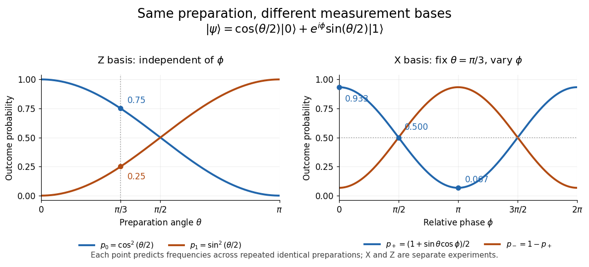

# Measurement in quantum mechanics

↑ **Parent:** [Quantum theory](quantum-theory-split.md)  
ⓦ [Wiki](https://en.wikipedia.org/wiki/Measurement_in_quantum_mechanics)

A [measurement in quantum mechanics](quantum-measurement-split.md) turns a [quantum state preparation](quantum-state-preparation.md) into a classical outcome, such as a detector label. Two questions must be distinguished: how likely is each outcome, and what [quantum state](quantum-state.md) remains conditional on that outcome? A [positive operator-valued measure](positive-operator-valued-measure.md) answers the first; a [quantum instrument](quantum-instrument.md) answers both. This distinction is useful whenever a measured system participates in a later experiment, including [quantum state tomography](quantum-state-tomography.md) and [measurement-based quantum feedback](measurement-based-quantum-feedback.md).

For a [density operator](density-matrix-split.md) $\rho$, the [Born rule](born-rule.md) gives $p_m=\operatorname{Tr}(E_m\rho)$, where the $E_m$ are [positive operators](positive-operator.md) satisfying $\sum_m E_m=I$. Here $I$ is the [identity operator](identity-operator.md), and $\operatorname{Tr}$ denotes the [trace](matrix-trace.md). Positivity makes every $p_m$ nonnegative; completeness makes their sum one. For a [pure state](pure-state.md), $\rho=|\psi\rangle\langle\psi|$ and $p_m=\langle\psi|E_m|\psi\rangle$. A [projective measurement](projective-measurement.md) is the special case in which the $E_m$ are [orthogonal projections](orthogonal-projection.md) onto mutually orthogonal subspaces.

For a [qubit](qubit.md), choose the [computational basis](computational-basis.md) and write a normalized [pure state](pure-state.md), up to [global phase](global-phase.md), as

$$
|\psi(\theta,\phi)\rangle=\cos(\theta/2)|0\rangle+e^{i\phi}\sin(\theta/2)|1\rangle,
\qquad 0\leq\theta\leq\pi,\quad 0\leq\phi<2\pi.
$$

The angle $\phi$ is a relative [quantum phase](quantum-phase.md); at the poles it does not distinguish states. Measuring the [Pauli matrix](pauli-matrices.md) $Z$ reports $+1$ for label zero and $-1$ for label one, with

$$
p_0=\cos^2(\theta/2),\qquad p_1=\sin^2(\theta/2).
$$

These [probabilities](probability.md) describe repeated identical preparations. They do not assign a hidden, pre-existing value to every possible measurement basis.

**[Figure 1](#image-qubit-measurement-probabilities-z-measures-populations-while-x-detects-relative-phase). Qubit measurement probabilities: Z measures populations, while X detects relative phase**.

The [Born rule](born-rule.md) grew out of Max Born's 1926 work on [quantum scattering](quantum-scattering-split.md): squared [probability amplitudes](probability-amplitude.md) determine the relative frequencies of scattering outcomes. Born explained this statistical interpretation again in his 1954 Nobel lecture. This probability law does not by itself select a [post-measurement state](post-measurement-state.md). [Born, 1926 collision paper](https://doi.org/10.1007/BF01397477); [Born, Nobel lecture, 1954, pp. 261–262](https://www.nobelprize.org/uploads/2018/06/born-lecture.pdf).

**Table of contents**

- [Quantum premeasurement](quantum-premeasurement.md)
- [Weak measurement](weak-measurement.md)
  - [Weak value](weak-value.md)
- [Position measurement](position-measurement.md)
- [Elitzur-Vaidman bomb tester](elitzur-vaidman-bomb-tester.md)
  - [Repeated weak-rotation bomb-test efficiency](repeated-weak-rotation-bomb-test-efficiency.md)
- [Measurement backaction](measurement-backaction.md)
- [Perfect discrimination of pure states requires orthogonality](perfect-discrimination-of-pure-states-requires-orthogonality.md)
- [Quantum nondemolition measurement](quantum-nondemolition-measurement.md)
  - [Haroche cavity photon nondemolition experiment](haroche-cavity-photon-nondemolition-experiment.md)
    - [Sequential Bayesian photon counting](sequential-bayesian-photon-counting.md)
    - [Photon-number measurement backaction](photon-number-measurement-backaction.md)
  - [Entanglement-assisted statistical singlet verification](entanglement-assisted-statistical-singlet-verification.md)
  - [Bell-pair cost of exact nondemolition singlet verification](bell-pair-cost-of-exact-nondemolition-singlet-verification.md)
  - [Entanglement-assisted nondemolition parity measurement](entanglement-assisted-nondemolition-parity-measurement.md)
- [Antidistinguishable quantum states](antidistinguishable-quantum-states.md)
- [Postselection](postselection.md)
  - [Aharonov-Bergmann-Lebowitz rule](aharonov-bergmann-lebowitz-rule.md)
    - [Context dependence of pre- and post-selected measurements](context-dependence-of-pre-and-post-selected-measurements.md)
      - [N-box pre- and post-selection paradox](n-box-pre-and-post-selection-paradox.md)
- [Measurement interaction](measurement-interaction.md)
  - [von Neumann measurement interaction](von-neumann-measurement-interaction.md)
- [Generalized measurement postulate](generalized-measurement-postulate.md)
  - [Nonselective quantum measurement](nonselective-quantum-measurement.md)
  - [Selective quantum measurement](selective-quantum-measurement.md)
  - [Positive operator-valued measure](positive-operator-valued-measure.md)
    - [POVM on the occupied support](povm-on-the-occupied-support.md)
    - [POVM–ensemble duality for the maximally mixed state](povm-ensemble-duality-for-the-maximally-mixed-state.md)
    - [Pure positive operator-valued measure](pure-positive-operator-valued-measure.md)
    - [Trine qubit POVM](trine-qubit-povm.md)
    - [Informationally complete POVM](informationally-complete-povm.md)
      - [Tetrahedral qubit POVM](tetrahedral-qubit-povm.md)
    - [Binary rank-one qubit POVM](binary-rank-one-qubit-povm.md)
- [Projective measurement](projective-measurement.md)
  - [von Neumann process 1](von-neumann-process-1.md)
  - [Completeness forces orthogonality of measurement projections](completeness-forces-orthogonality-of-measurement-projections.md)
  - [Equatorial qubit measurement](equatorial-qubit-measurement.md)
    - [Equatorial measurement relabeling at Clifford angles](equatorial-measurement-relabeling-at-clifford-angles.md)
  - [Lüders rule](luders-rule.md)
    - [Post-measurement state](post-measurement-state.md)
    - [Nonselective projective measurement](nonselective-projective-measurement.md)
      - [Pinching map](pinching-map.md)
      - [Rank-one dephasing](rank-one-dephasing.md)
        - [Relative-entropy identity for rank-one dephasing](relative-entropy-identity-for-rank-one-dephasing.md)
        - [Support inclusion under rank-one dephasing](support-inclusion-under-rank-one-dephasing.md)
- [Quantum state tomography](quantum-state-tomography.md)
  - [Interferometric polarization tomography](interferometric-polarization-tomography.md)
  - [Single-qubit process tomography](single-qubit-process-tomography.md)
- [No information without disturbance](no-information-without-disturbance.md)
  - [Quantum instrument](quantum-instrument.md)
    - [Unitary dilation of a measurement instrument](unitary-dilation-of-a-measurement-instrument.md)
    - [POVM does not determine the post-measurement state](povm-does-not-determine-the-post-measurement-state.md)
    - [Local quantum operation](local-quantum-operation.md)

## ↑ Ancestors (4)

1. [Quantum theory](quantum-theory-split.md)
2. [Branches of physics](branches-of-physics.md)
3. [Physics](physics-split.md)
4. [Codex Wiki](split.md)

## ← Incoming links (77)

- [Antidistinguishable quantum states](antidistinguishable-quantum-states.md)
- [Bell theorem](bell-theorem.md)
- [Bhattacharyya coefficient](bhattacharyya-coefficient.md)
- [Context dependence of pre- and post-selected measurements](context-dependence-of-pre-and-post-selected-measurements.md)
- [Entanglement monotone](entanglement-monotone.md)
- [Haroche cavity photon nondemolition experiment](haroche-cavity-photon-nondemolition-experiment.md)
- [Helstrom measurement for the zero and plus states](helstrom-measurement-for-the-zero-and-plus-states.md)
- [Logical depth of a measurement pattern](logical-depth-of-a-measurement-pattern.md)
- [Measurement backaction](measurement-backaction.md)
- [Measurement-based quantum computation](measurement-based-quantum-computation.md)
- [Measurement characterization of quantum fidelity](measurement-characterization-of-quantum-fidelity.md)
- [Measurement interaction](measurement-interaction.md)
- [N-box pre- and post-selection paradox](n-box-pre-and-post-selection-paradox.md)
- [Nonselective quantum measurement](nonselective-quantum-measurement.md)
- [Ontological model of a quantum system](ontological-model-of-a-quantum-system.md)
- [Optimal stochastic conversion of a two-qubit pure state](optimal-stochastic-conversion-of-a-two-qubit-pure-state.md)
- [Solution](past-exam-of-the-mathematics-course-of-the-university-of-cambridge/2001/iii/paper-61/2/solution.md)
- [Solution](past-exam-of-the-mathematics-course-of-the-university-of-cambridge/2001/iii/paper-61/4/ii/solution.md)
- [Solution](past-exam-of-the-mathematics-course-of-the-university-of-cambridge/2003/iii/paper-47/2/solution.md)
- [Solution](past-exam-of-the-mathematics-course-of-the-university-of-cambridge/2003/iii/paper-47/4/solution.md)
- [Solution](past-exam-of-the-mathematics-course-of-the-university-of-cambridge/2004/iii/paper-54/2/solution.md)
- [Solution](past-exam-of-the-mathematics-course-of-the-university-of-cambridge/2005/iii/paper-37/3/a/solution.md)
- [Solution](past-exam-of-the-mathematics-course-of-the-university-of-cambridge/2006/iii/paper-59/3/solution.md)
- [Solution](past-exam-of-the-mathematics-course-of-the-university-of-cambridge/2007/ib/paper-3/16b/solution.md)
- [Solution](past-exam-of-the-mathematics-course-of-the-university-of-cambridge/2008/iii/paper-58/1/ii/solution.md)
- [Solution](past-exam-of-the-mathematics-course-of-the-university-of-cambridge/2008/iii/paper-58/4/solution.md)
- [Solution](past-exam-of-the-mathematics-course-of-the-university-of-cambridge/2009/iii/paper-51/1/b/solution.md)
- [Solution](past-exam-of-the-mathematics-course-of-the-university-of-cambridge/2009/iii/paper-51/1/d/solution.md)
- [Solution](past-exam-of-the-mathematics-course-of-the-university-of-cambridge/2009/iii/paper-52/1/a/solution.md)
- [Solution](past-exam-of-the-mathematics-course-of-the-university-of-cambridge/2009/iii/paper-53/1/c/solution.md)
- [Solution](past-exam-of-the-mathematics-course-of-the-university-of-cambridge/2009/iii/paper-53/3/solution.md)
- [Solution](past-exam-of-the-mathematics-course-of-the-university-of-cambridge/2009/iii/paper-53/4/a/2/solution.md)
- [Solution](past-exam-of-the-mathematics-course-of-the-university-of-cambridge/2009/iii/paper-53/4/b/protocol-2/solution.md)
- [Solution](past-exam-of-the-mathematics-course-of-the-university-of-cambridge/2010/iii/paper-51/2/b/solution.md)
- [Solution](past-exam-of-the-mathematics-course-of-the-university-of-cambridge/2010/iii/paper-51/2/d/solution.md)
- [Solution](past-exam-of-the-mathematics-course-of-the-university-of-cambridge/2010/iii/paper-51/3/c/solution.md)
- [Solution](past-exam-of-the-mathematics-course-of-the-university-of-cambridge/2012/iii/paper-67/2/a/solution.md)
- [Solution](past-exam-of-the-mathematics-course-of-the-university-of-cambridge/2012/iii/paper-67/3/b/solution.md)
- [Solution](past-exam-of-the-mathematics-course-of-the-university-of-cambridge/2013/iii/paper-57/3/b/solution.md)
- [Solution](past-exam-of-the-mathematics-course-of-the-university-of-cambridge/2014/iii/paper-62/1/solution.md)
- [Solution](past-exam-of-the-mathematics-course-of-the-university-of-cambridge/2014/iii/paper-62/2/solution.md)
- [Solution](past-exam-of-the-mathematics-course-of-the-university-of-cambridge/2014/iii/paper-62/3/solution.md)
- [Solution](past-exam-of-the-mathematics-course-of-the-university-of-cambridge/2015/iii/paper-66/3/ii/solution.md)
- [Solution](past-exam-of-the-mathematics-course-of-the-university-of-cambridge/2017/iii/paper-324/1/b/ii/solution.md)
- [Solution](past-exam-of-the-mathematics-course-of-the-university-of-cambridge/2017/iii/paper-324/4/a/i/solution.md)
- [Solution](past-exam-of-the-mathematics-course-of-the-university-of-cambridge/2017/iii/paper-324/4/a/iii/solution.md)
- [Solution](past-exam-of-the-mathematics-course-of-the-university-of-cambridge/2017/iii/paper-324/4/a/iv/solution.md)
- [Solution](past-exam-of-the-mathematics-course-of-the-university-of-cambridge/2017/iii/paper-324/4/b/solution.md)
- [Solution](past-exam-of-the-mathematics-course-of-the-university-of-cambridge/2019/iii/paper-323/3/i/solution.md)
- [Solution](past-exam-of-the-mathematics-course-of-the-university-of-cambridge/2019/iii/paper-323/4/iii/solution.md)
- [Solution](past-exam-of-the-mathematics-course-of-the-university-of-cambridge/2021/ii/paper-1/10d/a/solution.md)
- [Solution](past-exam-of-the-mathematics-course-of-the-university-of-cambridge/2025/iii/paper-323/1/i/solution.md)
- [Solution](past-exam-of-the-mathematics-course-of-the-university-of-cambridge/2025/iii/paper-325/2/b/solution.md)
- [Solution](past-exam-of-the-mathematics-course-of-the-university-of-cambridge/2026/iii/paper-325/4/b/solution.md)
- [Polarization CHSH count model](polarization-chsh-count-model.md)
- [Postselection](postselection.md)
- [Pusey-Barrett-Rudolph theorem](pusey-barrett-rudolph-theorem.md)
- [Quantum computing](quantum-computing.md)
- [Quantum information](quantum-information.md)
- [Quantum information theory](quantum-information-theory-split.md)
- [Quantum key distribution](quantum-key-distribution.md)
- [Quantum logic gate](quantum-logic-gate.md)
- [Measurement in quantum mechanics](quantum-measurement-split.md)
- [Quantum state](quantum-state.md)
- [Quantum state discrimination](quantum-state-discrimination.md)
- [Reciprocal-state construction of unambiguous discrimination](reciprocal-state-construction-of-unambiguous-discrimination.md)
- [Relativistic causality constraint on an ideal nonlocal measurement](relativistic-causality-constraint-on-an-ideal-nonlocal-measurement.md)
- [Remote state preparation](remote-state-preparation.md)
- [Selective quantum measurement](selective-quantum-measurement.md)
- [Sequential Bayesian photon counting](sequential-bayesian-photon-counting.md)
- [Squared quantum fidelity](squared-quantum-fidelity.md)
- [Stern-Gerlach expectation estimation](stern-gerlach-expectation-estimation.md)
- [Trace distance](trace-distance.md)
- [Trace-distance-preserving binary measurement](trace-distance-preserving-binary-measurement.md)
- [Tsirelson's bound](tsirelson-s-bound.md)
- [Two-outcome LOCC dilution of a Bell pair](two-outcome-locc-dilution-of-a-bell-pair.md)
- [Unitary time evolution](unitary-time-evolution.md)
