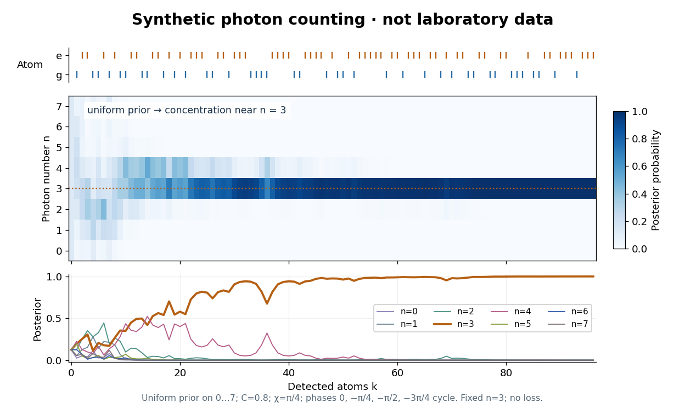

# Measurement in quantum mechanics

↑ **Parent:** [Quantum theory](quantum-theory.md)  
ⓦ [Wiki](https://en.wikipedia.org/wiki/Measurement_in_quantum_mechanics)

A [measurement in quantum mechanics](quantum-measurement.md) turns a [quantum state preparation](quantum-circuit.md#quantum-state-preparation) into a classical outcome, such as a detector label. Two questions must be distinguished: how likely is each outcome, and what [quantum state](quantum-system.md#quantum-state) remains conditional on that outcome? A [positive operator-valued measure](#positive-operator-valued-measure) answers the first; a [quantum instrument](#quantum-instrument) answers both. This distinction is useful whenever a measured system participates in a later experiment, including [quantum state tomography](#quantum-state-tomography) and [measurement-based quantum feedback](control-theory.md#measurement-based-quantum-feedback).

For a [density operator](density-matrix.md) $\rho$, the [Born rule](wave-function.md#born-rule) gives $p_m=\operatorname{Tr}(E_m\rho)$, where the $E_m$ are [positive operators](hilbert-space.md#positive-operator) satisfying $\sum_m E_m=I$. Here $I$ is the [identity operator](vector-space.md#identity-operator), and $\operatorname{Tr}$ denotes the [trace](linear-algebra.md#matrix-trace). Positivity makes every $p_m$ nonnegative; completeness makes their sum one. For a [pure state](quantum-theory.md#pure-state), $\rho=|\psi\rangle\langle\psi|$ and $p_m=\langle\psi|E_m|\psi\rangle$. A [projective measurement](#projective-measurement) is the special case in which the $E_m$ are [orthogonal projections](hilbert-space.md#orthogonal-projection) onto mutually orthogonal subspaces.

For a [qubit](quantum-system.md#qubit), choose the [computational basis](quantum-theory.md#computational-basis) and write a normalized [pure state](quantum-theory.md#pure-state), up to [global phase](quantum-system.md#global-phase), as

$$
|\psi(\theta,\phi)\rangle=\cos(\theta/2)|0\rangle+e^{i\phi}\sin(\theta/2)|1\rangle,
\qquad 0\leq\theta\leq\pi,\quad 0\leq\phi<2\pi.
$$

The angle $\phi$ is a relative [quantum phase](quantum-system.md#quantum-phase); at the poles it does not distinguish states. Measuring the [Pauli matrix](algebra.md#pauli-matrices) $Z$ reports $+1$ for label zero and $-1$ for label one, with

$$
p_0=\cos^2(\theta/2),\qquad p_1=\sin^2(\theta/2).
$$

These [probabilities](probability-theory.md#probability) describe repeated identical preparations. They do not assign a hidden, pre-existing value to every possible measurement basis.

**[Figure 1](#image-qubit-measurement-probabilities-z-measures-populations-while-x-detects-relative-phase). Qubit measurement probabilities: Z measures populations, while X detects relative phase**.

The [Born rule](wave-function.md#born-rule) grew out of Max Born's 1926 work on [quantum scattering](quantum-scattering.md): squared [probability amplitudes](wave-function.md#probability-amplitude) determine the relative frequencies of scattering outcomes. Born explained this statistical interpretation again in his 1954 Nobel lecture. This probability law does not by itself select a [post-measurement state](#post-measurement-state). [Born, 1926 collision paper](https://doi.org/10.1007/BF01397477); [Born, Nobel lecture, 1954, pp. 261–262](https://www.nobelprize.org/uploads/2018/06/born-lecture.pdf).

**Table of contents**

- [Quantum premeasurement](#quantum-premeasurement)
- [Weak measurement](#weak-measurement)
  - [Weak value](#weak-value)
- [Position measurement](#position-measurement)
- [Elitzur-Vaidman bomb tester](#elitzur-vaidman-bomb-tester)
  - [Repeated weak-rotation bomb-test efficiency](#repeated-weak-rotation-bomb-test-efficiency)
- [Measurement backaction](#measurement-backaction)
- [Perfect discrimination of pure states requires orthogonality](#perfect-discrimination-of-pure-states-requires-orthogonality)
- [Quantum nondemolition measurement](#quantum-nondemolition-measurement)
  - [Haroche cavity photon nondemolition experiment](#haroche-cavity-photon-nondemolition-experiment)
    - [Sequential Bayesian photon counting](#sequential-bayesian-photon-counting)
    - [Photon-number measurement backaction](#photon-number-measurement-backaction)
  - [Entanglement-assisted statistical singlet verification](#entanglement-assisted-statistical-singlet-verification)
  - [Bell-pair cost of exact nondemolition singlet verification](#bell-pair-cost-of-exact-nondemolition-singlet-verification)
  - [Entanglement-assisted nondemolition parity measurement](#entanglement-assisted-nondemolition-parity-measurement)
- [Antidistinguishable quantum states](#antidistinguishable-quantum-states)
- [Postselection](#postselection)
  - [Aharonov-Bergmann-Lebowitz rule](#aharonov-bergmann-lebowitz-rule)
    - [Context dependence of pre- and post-selected measurements](#context-dependence-of-pre-and-post-selected-measurements)
      - [N-box pre- and post-selection paradox](#n-box-pre-and-post-selection-paradox)
- [Measurement interaction](#measurement-interaction)
  - [von Neumann measurement interaction](#von-neumann-measurement-interaction)
- [Generalized measurement postulate](#generalized-measurement-postulate)
  - [Nonselective quantum measurement](#nonselective-quantum-measurement)
  - [Selective quantum measurement](#selective-quantum-measurement)
  - [Positive operator-valued measure](#positive-operator-valued-measure)
    - [POVM on the occupied support](#povm-on-the-occupied-support)
    - [POVM–ensemble duality for the maximally mixed state](#povm-ensemble-duality-for-the-maximally-mixed-state)
    - [Pure positive operator-valued measure](#pure-positive-operator-valued-measure)
    - [Trine qubit POVM](#trine-qubit-povm)
    - [Informationally complete POVM](#informationally-complete-povm)
      - [Tetrahedral qubit POVM](#tetrahedral-qubit-povm)
    - [Binary rank-one qubit POVM](#binary-rank-one-qubit-povm)
- [Projective measurement](#projective-measurement)
  - [von Neumann process 1](#von-neumann-process-1)
  - [Completeness forces orthogonality of measurement projections](#completeness-forces-orthogonality-of-measurement-projections)
  - [Equatorial qubit measurement](#equatorial-qubit-measurement)
    - [Equatorial measurement relabeling at Clifford angles](#equatorial-measurement-relabeling-at-clifford-angles)
  - [Lüders rule](#luders-rule)
    - [Post-measurement state](#post-measurement-state)
    - [Nonselective projective measurement](#nonselective-projective-measurement)
      - [Pinching map](#pinching-map)
      - [Rank-one dephasing](#rank-one-dephasing)
        - [Relative-entropy identity for rank-one dephasing](#relative-entropy-identity-for-rank-one-dephasing)
        - [Support inclusion under rank-one dephasing](#support-inclusion-under-rank-one-dephasing)
- [Quantum state tomography](#quantum-state-tomography)
  - [Interferometric polarization tomography](#interferometric-polarization-tomography)
  - [Single-qubit process tomography](#single-qubit-process-tomography)
- [No information without disturbance](#no-information-without-disturbance)
  - [Quantum instrument](#quantum-instrument)
    - [Unitary dilation of a measurement instrument](#unitary-dilation-of-a-measurement-instrument)
    - [POVM does not determine the post-measurement state](#povm-does-not-determine-the-post-measurement-state)
    - [Local quantum operation](#local-quantum-operation)

## Quantum premeasurement

↑ **Parent:** [Measurement in quantum mechanics](quantum-measurement.md)

The coherent interaction that correlates a system observable with detector records before selecting an outcome. An ideal coupling maps $|s_j\rangle|d_0\rangle$ to $|s_j\rangle|d_j\rangle$. Linearity then maps a superposition to $\sum_j c_j|s_jd_j\rangle$. The full state can remain pure and entangled, whereas a nonselective [projective measurement](#projective-measurement) removes coherence between different record sectors. Conditioning on one observed record is a third, selective operation.

## Weak measurement

↑ **Parent:** [Measurement in quantum mechanics](quantum-measurement.md)  
ⓦ [Wiki](https://en.wikipedia.org/wiki/Weak_measurement)

A measurement with small information and disturbance per trial, often implemented by coupling an [observable](quantum-system.md#observable) weakly to a meter so that its eigenvalue-dependent pointer distributions overlap. Repeated observations can still accumulate substantial [measurement backaction](#measurement-backaction). A [weak value](#weak-value) additionally requires specified preparation and [postselection](#postselection); a weak measurement without postselection need not involve one.

### Weak value

↑ **Parent:** [Weak measurement](#weak-measurement)  
ⓦ [Wiki](https://en.wikipedia.org/wiki/Weak_value)

For preselected $|i\rangle$ and nonorthogonal postselected $|f\rangle$, the displayed transition-amplitude ratio controls the first-order conditional pointer response to a [von Neumann measurement interaction](#von-neumann-measurement-interaction). It can be complex or outside an observable's eigenvalue range. Expanding $\langle f|\exp(-igA\otimes p/\hbar)|i\rangle$ to first order gives $\langle f|i\rangle[1-igA_wp/\hbar]$, proving that interpretation within the expansion's validity regime.[1988 primary proposal: weak values in a preselected and postselected spin ensemble](physics-bibliography.md#weak-values-by-yakir-aharonov-david-z-albert-and-lev-vaidman)

## Position measurement

↑ **Parent:** [Measurement in quantum mechanics](quantum-measurement.md)

An ideal position measurement of a normalized [wavefunction](wave-function.md) $\psi$ assigns a [probability](probability-theory.md#probability) to each spatial region $A$ through the [Born rule](wave-function.md#born-rule): $P(A)=\int_A|\psi(x)|^2\,dx$. This specifies outcome statistics; it does not by itself specify the [post-measurement state](#post-measurement-state). A physical detector has finite spatial resolution, which must be included in its measurement model.

## Elitzur-Vaidman bomb tester

↑ **Parent:** [Measurement in quantum mechanics](quantum-measurement.md)  
ⓦ [Wiki](https://en.wikipedia.org/wiki/Elitzur–Vaidman_bomb_tester)

A [photon](quantum-mechanics.md#photon) in a [quantum superposition](quantum-system.md#quantum-superposition) of a safe path and an absorbing path can sometimes certify a live absorber without being absorbed. Recombination is chosen so that one output is impossible if the absorber is absent. A detection at that output is then an unambiguous successful test. The measurement back-action of a surviving live-absorber trial changes the interference pattern.

### Repeated weak-rotation bomb-test efficiency

↑ **Parent:** [Elitzur-Vaidman bomb tester](#elitzur-vaidman-bomb-tester)

For an [Elitzur-Vaidman bomb tester](#elitzur-vaidman-bomb-tester) using a rotation and its inverse, let $p$ be the probability of entering the absorbing path and $q=1-p$. Conditional on a live absorber, one trial has explosion probability $p$, successful safe identification probability $pq$, and inconclusive probability $q^2$. The inconclusive [projective measurement](#projective-measurement) resets the input, so summing a [geometric series](sequence-and-series.md#geometric-series) gives the displayed success probability after at most $N$ trials. Its limit is $q/(1+q)$, approaching one half as $p$ tends to zero through positive values. Exactly zero coupling produces no information.

## Measurement backaction

↑ **Parent:** [Measurement in quantum mechanics](quantum-measurement.md)

Measurement backaction is the effect of a [measurement in quantum mechanics](quantum-measurement.md) on later predictions for the measured system. A [quantum instrument](#quantum-instrument) with one [Kraus operator](quantum-information-theory.md#kraus-operator) $K_m$ per recorded outcome has

$$
p_m=\operatorname{Tr}(K_m\rho K_m^\dagger),\qquad
\rho_m=\frac{K_m\rho K_m^\dagger}{p_m},\qquad
\sum_m K_m^\dagger K_m=I.
$$

The conditional [density operator](density-matrix.md) $\rho_m$ exists only when $p_m>0$. Its nonlinear normalization expresses conditioning; the unnormalized map $\rho\mapsto K_m\rho K_m^\dagger$ is linear. More generally, an unresolved outcome can contain several [Kraus operators](quantum-information-theory.md#kraus-operator): replace the numerator by $\sum_a K_{ma}\rho K_{ma}^\dagger$ and take its [trace](linear-algebra.md#matrix-trace) for $p_m$. [Watrous, The Theory of Quantum Information, §2.3.2](https://cs.uwaterloo.ca/~watrous/TQI/TQI.pdf).

Keeping the outcome gives a [selective quantum measurement](#selective-quantum-measurement). Discarding it gives a [nonselective quantum measurement](#nonselective-quantum-measurement) with [quantum channel](quantum-information-theory.md#quantum-channel) $\rho\mapsto\sum_m p_m\rho_m$. The latter describes the whole measured population without its labels, whereas each $\rho_m$ describes a selected subpopulation. Neither description requires the measured quantity to have possessed its eventual value before the interaction.

For a concrete test, prepare the [Pauli X eigenstate](quantum-mechanics.md#pauli-x-eigenstate) $|+\rangle=(|0\rangle+|1\rangle)/\sqrt2$. Its $X=+1$ [probability](probability-theory.md#probability) is one. An ideal $Z$ [projective measurement](#projective-measurement) gives zero or one with equal [probability](probability-theory.md#probability), leaving $|0\rangle$ or $|1\rangle$ under the [Lüders rule](#luders-rule). Discarding the result leaves the [maximally mixed state](density-matrix.md#maximally-mixed-state) $I/2$. A subsequent $X$ measurement now gives either sign with [probability](probability-theory.md#probability) one half, even if the $Z$ result was kept. This observable change in statistics is backaction. Measuring $X$ on the original $|+\rangle$ instead leaves it unchanged: disturbance depends on both the preparation and the instrument. [Measurement-based quantum feedback](control-theory.md#measurement-based-quantum-feedback) uses the recorded outcome to choose a subsequent control operation, so both parts of the instrument matter.

## Perfect discrimination of pure states requires orthogonality

↑ **Parent:** [Measurement in quantum mechanics](quantum-measurement.md)

If a [positive operator-valued measure](#positive-operator-valued-measure) distinguishes normalized [pure states](quantum-theory.md#pure-state) $|u\rangle,|v\rangle$ with certainty, the effect $E$ for the first answer satisfies $\langle u|E|u\rangle=1$ and $\langle v|E|v\rangle=0$. Positivity of $E$ and $I-E$ implies $E|v\rangle=0$ and $E|u\rangle=|u\rangle$, because a positive operator with zero expectation annihilates the vector. Consequently $\langle u|v\rangle=\langle u|E|v\rangle=0$. Conversely, orthogonal states can be measured with their rank-one [linear projections](vector-space.md#projection-linear-algebra). A common [unitary operator](vector-space.md#unitary-operator) preserves this [inner product](inner-product.md) and cannot remove the obstruction.

## Quantum nondemolition measurement

↑ **Parent:** [Measurement in quantum mechanics](quantum-measurement.md)  
ⓦ [Wiki](https://en.wikipedia.org/wiki/Quantum_nondemolition_measurement)

An ideal measurement preserving the measured eigenspaces. In the projective setting, the selective instrument $\rho\mapsto P_j\rho P_j$ preserves every vector within outcome $j$, including coherence inside a degenerate eigenspace. Repeated measurements agree in the absence of intervening dynamics changing the measured quantity. Measuring a finer observable can destroy degeneracy coherence and need not realize the same [Lüders rule](#luders-rule) instrument.

A physical [measurement interaction](#measurement-interaction) must correlate the system with a meter; in [Haroche cavity photon nondemolition experiment](#haroche-cavity-photon-nondemolition-experiment) that meter is a [chemical atom](physics.md#atom-physics). For a measured [observable](quantum-system.md#observable) $A$, a useful sufficient ideal condition is $[A,H_{\mathrm{int}}]=0$ together with $[A,H_0]=0$, where $H_{\mathrm{int}}$ is the interaction [Hamiltonian operator](quantum-system.md#hamiltonian-quantum-mechanics) and $H_0$ the free [Hamiltonian operator](quantum-system.md#hamiltonian-quantum-mechanics). These conditions protect its [eigenvalues](linear-operator-theory.md#eigenvalue) during probing and between probes. They do not protect every other [observable](quantum-system.md#observable), nor prevent conditional [quantum state](quantum-system.md#quantum-state) changes. In particular, preserving [photon number](quantum-harmonic-oscillator.md#photon-number) can disturb the field's [quantum phase](quantum-system.md#quantum-phase).

### Haroche cavity photon nondemolition experiment

↑ **Parent:** [Quantum nondemolition measurement](#quantum-nondemolition-measurement)

In the 2007 [cavity quantum electrodynamics](perturbative-quantum-field-theory.md#cavity-quantum-electrodynamics) experiment of [Christine Guerlin](physicist.md#christine-guerlin) and collaborators, including [Sébastien Gleyzes](physicist.md#sebastien-gleyzes), [Michel Brune](physicist.md#michel-brune), [Jean-Michel Raimond](physicist.md#jean-michel-raimond) and [Serge Haroche](physicist.md#serge-haroche), an injected [coherent state](quantum-theory.md#coherent-state) occupied a 51.1 GHz [microwave](electromagnetic-radiation.md#microwave) cavity with [niobium](chemical-substance.md#niobium)-coated mirrors exhibiting [superconductivity](superconductivity.md). Velocity-selected [rubidium](chemical-substance.md#rubidium) [chemical atoms](physics.md#atom-physics) were prepared as circular [Rydberg atoms](atomic-physics.md#rydberg-atom) in levels with [principal quantum numbers](mathematical-physics.md#principal-quantum-number) 50 and 51. Repeated atomic readouts progressively narrowed the inferred [photon number](quantum-harmonic-oscillator.md#photon-number) to a [Fock state](quantum-field-theory.md#fock-state); later records revealed jumps. The cavity damping time was $T_c=0.130\,\mathrm{s}$. Empty-cavity [Ramsey interferometry](quantum-system.md#ramsey-interferometry) scans fixed the analysis-phase origin; weak injected fields refined the response calibration. Finite fringe contrast required calibrated [likelihoods](maximum-likelihood-estimation.md#likelihood-function); photon losses could interrupt convergence.[Progressive field-state collapse and quantum non-demolition photon counting, PDF pp. 2–6, Eqs. (1)–(2), Figs. 2–4 and Methods](physics-bibliography.md#progressive-field-state-collapse-and-quantum-non-demolition-photon-counting-by-christine-guerlin-and-others)

The functional sequence is preparation, first [Ramsey interferometry](quantum-system.md#ramsey-interferometry) zone $R_1$, dispersive cavity $C$, second zone $R_2$, and state-selective detection. The first $\pi/2$ [microwave](electromagnetic-radiation.md#microwave) pulse prepares an atomic [quantum superposition](quantum-system.md#quantum-superposition); [dispersive atom-cavity coupling](perturbative-quantum-field-theory.md#dispersive-atom-cavity-coupling) adds a [photon number](quantum-harmonic-oscillator.md#photon-number)-dependent relative [quantum phase](quantum-system.md#quantum-phase) while suppressing energy exchange. The second pulse converts that [quantum phase](quantum-system.md#quantum-phase) into atomic populations; [state-selective field ionization](atomic-physics.md#state-selective-field-ionization) reads $e$ or $g$. Successive [chemical atoms](physics.md#atom-physics) carry the meter records away while the same field remains available.[Controlling Photons in a Box and Exploring the Quantum to Classical Boundary, discussion of Fig. 10 (apparatus) and Fig. 11 (repeated atomic detection)](physics-bibliography.md#controlling-photons-in-a-box-and-exploring-the-quantum-to-classical-boundary-by-serge-haroche)

**[Figure 2](#image-atoms-carry-photon-number-information-from-the-cavity-to-a-detector). Atoms carry photon-number information from the cavity to a detector**. Original functional schematic, not a scaled apparatus drawing. The atom is the meter; the final detector reads the atom.

This arrangement makes [quantum nondemolition measurement](#quantum-nondemolition-measurement) useful for following a field repeatedly and preparing a [Fock state](quantum-field-theory.md#fock-state) by conditioning. The [photon number](quantum-harmonic-oscillator.md#photon-number) is inferred from a sequence of physical records; it is not a directly visible label attached to a photon. Each atomic probe makes a weak, partial [measurement in quantum mechanics](quantum-measurement.md) of [photon number](quantum-harmonic-oscillator.md#photon-number), and the accumulated records can approach a resolved count. A single binary meter need not identify one among many possible [Fock states](quantum-field-theory.md#fock-state), as [perfect discrimination of pure states requires orthogonality](#perfect-discrimination-of-pure-states-requires-orthogonality).

#### Sequential Bayesian photon counting

↑ **Parent:** [Haroche cavity photon nondemolition experiment](#haroche-cavity-photon-nondemolition-experiment)

Consider an original balanced-readout model, rather than a fit to the experiment. Let $n\in\{0,\ldots,N_{\max}\}$, with a normalized [prior probability](bayesian-statistics.md#prior-probability) $p_0(n)\geq0$ and $\sum_n p_0(n)=1$. A detected [chemical atom](physics.md#atom-physics) has outcome $s\in\{e,g\}$. Define the [conditional probabilities](probability-theory.md#conditional-probability)

$$
L_e(n;\phi)=P(e\mid n,\phi)=\frac{1+C\cos(\phi+n\chi)}2,\qquad
L_g(n;\phi)=1-L_e(n;\phi),\qquad 0\leq C\leq1.
$$

Here $\chi$ is the accumulated [quantum phase](quantum-system.md#quantum-phase) per photon, $\phi$ the controlled analysis [quantum phase](quantum-system.md#quantum-phase), and $C$ the fringe contrast. The two [probabilities](probability-theory.md#probability) sum to one for every $n$. Actual calibration may also require an offset and asymmetric detection errors; $C$ alone does not specify a [quantum instrument](#quantum-instrument).

Assume no [photon number](quantum-harmonic-oscillator.md#photon-number) change during the record and fresh independently prepared atomic meters. For observed outcomes $s_1,\ldots,s_k$ at recorded settings $\phi_1,\ldots,\phi_k$, the [Born rule](wave-function.md#born-rule) and [Bayes' theorem](probability-theory.md#bayes-theorem) give

$$
Z_k=\sum_{m=0}^{N_{\max}}p_{k-1}(m)L_{s_k}(m;\phi_k),\qquad
p_k(n)=\frac{p_{k-1}(n)L_{s_k}(n;\phi_k)}{Z_k}
=\frac{p_0(n)\prod_{j=1}^k L_{s_j}(n;\phi_j)}{\sum_{m=0}^{N_{\max}}p_0(m)\prod_{j=1}^k L_{s_j}(m;\phi_j)}.
$$

The [posterior probability](bayesian-statistics.md#posterior-probability) is defined only for $Z_k>0$. Summing its numerator over $n$ proves normalization. This is also the update of diagonal elements of a field [density operator](density-matrix.md) under a [measurement in quantum mechanics](quantum-measurement.md); it does not assume that an initial [quantum superposition](quantum-system.md#quantum-superposition) was an unknown pre-existing integer. The observed settings are part of the record, especially when selected adaptively.

For an exact finite example take $p_0=(1,1,1,1)/4$, $C=4/5$, and $\chi=\pi/2$. An $e$ outcome at $\phi=0$ has [likelihood](maximum-likelihood-estimation.md#likelihood-function) $(9,5,1,5)/10$, giving $p_1=(9,5,1,5)/20$. Another $e$ at $\phi=-\pi/2$ gives $p_2=(9,9,1,1)/20$. A subsequent $g$ at $\phi=0$ gives

$$
p_3=\frac1{68}(9,45,9,5),\qquad P(s_1=e,s_2=e,s_3=g)=\frac{17}{200}.
$$

Thus three atomic records raise the [posterior probability](bayesian-statistics.md#posterior-probability) of $n=1$ from $1/4$ to $45/68$, while leaving finite uncertainty. No one of these outcomes identifies $n$ with certainty.

**[Figure 3](#image-synthetic-atomic-records-progressively-concentrate-a-photon-number-posterior). Synthetic atomic records progressively concentrate a photon-number posterior**. Original simulation, not laboratory data: $n=0,\ldots,7$, uniform prior, $C=0.8$, $\chi=\pi/4$, four cyclic analysis phases, and a fixed simulated $n=3$. Cavity loss is omitted. Individual updates can broaden the distribution even though this record eventually concentrates.

The periodic [likelihood function](maximum-likelihood-estimation.md#likelihood-function) imposes an identifiability limit. If $\chi=2\pi/q$ for an integer $q>0$, then $L_s(n+q;\phi)=L_s(n;\phi)$ for every setting: the [posterior odds](bayesian-statistics.md#posterior-odds) between $n$ and $n+q$ never change. Varying $\phi$ can resolve a cosine reflection ambiguity within a period, but cannot remove this exact period. Changing $\chi$ can supply additional information. A finite cutoff is therefore a physical assumption to justify, not evidence that excluded high [photon numbers](quantum-harmonic-oscillator.md#photon-number) were absent. At $C=0$ no outcome changes the [prior probability](bayesian-statistics.md#prior-probability); at $0<C<1$ neither binary outcome has an exactly zero [likelihood](maximum-likelihood-estimation.md#likelihood-function).

The no-loss assumption also has a time limit. In an original zero-temperature loss model, let $\kappa=1/T_c$. A [Fock state](quantum-field-theory.md#fock-state) $|n\rangle$ loses its first photon at rate $n\kappa$, so its survival [probability](probability-theory.md#probability) is $\exp(-n\kappa t)$ and its mean lifetime is $T_c/n$ for $n>0$. Several records must be acquired within that lifetime to identify a plateau. When losses matter, first predict $p_k^-(n)=\sum_m T_{nm}(\Delta t)p_{k-1}(m)$ using a normalized transition [matrix](vector-space.md#matrix), then apply the atomic [Bayesian inference](bayesian-statistics.md) update to $p_k^-$. Thermal excitation requires upward transitions too. A delayed or broadened inference after a jump need not indicate that an atom caused the jump.

#### Photon-number measurement backaction

↑ **Parent:** [Haroche cavity photon nondemolition experiment](#haroche-cavity-photon-nondemolition-experiment)

An explicit original ideal meter model explains how [photon number](quantum-harmonic-oscillator.md#photon-number) survives while field [quantum coherence](density-matrix.md#quantum-coherence-in-a-specified-basis) changes. Let $\hat N$ be the [number operator](quantum-harmonic-oscillator.md#number-operator) and prepare an atomic [qubit](quantum-system.md#qubit) in $|+\rangle=(|e\rangle+|g\rangle)/\sqrt2$. The dispersive [unitary operator](vector-space.md#unitary-operator)

$$
U=\exp(-i\chi\hat N\otimes\sigma_z/2)
$$

commutes with $\hat N\otimes I$. For a field [quantum superposition](quantum-system.md#quantum-superposition) $\sum_n c_n|n\rangle$, it produces $\sum_n c_n|n\rangle|a_n\rangle$, where $|a_n\rangle=(e^{-in\chi/2}|e\rangle+e^{in\chi/2}|g\rangle)/\sqrt2$. The atomic meter states encode $n$ through relative [quantum phase](quantum-system.md#quantum-phase) and can become [entangled](bell-state.md#entangled-state) with the field. The second [Ramsey interferometry](quantum-system.md#ramsey-interferometry) pulse and detector turn those correlations into the outcome [probabilities](probability-theory.md#probability) above when $C=1$.

Tracing out the atom multiplies a field [density matrix](density-matrix.md) entry $\rho_{nm}$ by $\langle a_m|a_n\rangle=\cos((n-m)\chi/2)$. Hence the [nonselective quantum measurement](#nonselective-quantum-measurement) preserves every [photon number](quantum-harmonic-oscillator.md#photon-number) population $\rho_{nn}$ while changing off-diagonal [quantum coherence](density-matrix.md#quantum-coherence-in-a-specified-basis). For $\chi=\pi/2$, coherence between $|0\rangle$ and $|1\rangle$ is multiplied by $1/\sqrt2$ per fresh meter, even with no photons absorbed. Field [quantum phase](quantum-system.md#quantum-phase) information can therefore be disturbed by an energy-preserving probe. No universal self-adjoint phase operator or naive canonical number–phase commutator is needed for this conclusion.

One possible finite-contrast [quantum instrument](#quantum-instrument) makes the distinction sharper. Define diagonal [Kraus operators](quantum-information-theory.md#kraus-operator) $K_e=\cos((\phi+\chi\hat N)/2)$ and $K_g=\sin((\phi+\chi\hat N)/2)$. After their ideal readout, flip the reported label with [probability](probability-theory.md#probability) $r=(1-C)/2$. The unnormalized selective maps are

$$
\mathcal J_e(\rho)=(1-r)K_e\rho K_e^\dagger+rK_g\rho K_g^\dagger,\qquad
\mathcal J_g(\rho)=rK_e\rho K_e^\dagger+(1-r)K_g\rho K_g^\dagger.
$$

Their [traces](linear-algebra.md#matrix-trace) reproduce $L_e,L_g$ on a [Fock state](quantum-field-theory.md#fock-state), and their sum reproduces the displayed dephasing [quantum channel](quantum-information-theory.md#quantum-channel), independently of $r$. At $C=0$ the recorded labels carry no information although the physical meter interaction can still cause [measurement backaction](#measurement-backaction). This is an illustrative instrument, not a reconstruction of all laboratory imperfections; equal [likelihoods](maximum-likelihood-estimation.md#likelihood-function) alone do not determine the disturbance.

### Entanglement-assisted statistical singlet verification

↑ **Parent:** [Quantum nondemolition measurement](#quantum-nondemolition-measurement)

Choose a shared random axis uniformly from $x,y,z$, perform its [entanglement-assisted nondemolition parity measurement](#entanglement-assisted-nondemolition-parity-measurement) with one [Bell pair](bell-state.md#bell-pair), and accept the anticorrelated parity. The [spin singlet state](bell-state.md#spin-singlet-state) always passes unchanged. The averaged acceptance operator is $\Omega=\sum_j(I-\sigma_j\otimes\sigma_j)/6=P_s+(I-P_s)/3$, so an orthogonal triplet state passes with probability one third. This is a statistical verifier with a nonzero acceptance gap, rather than an exact single-shot singlet-versus-triplet decision. The [Bell-pair cost of exact nondemolition singlet verification](#bell-pair-cost-of-exact-nondemolition-singlet-verification) concerns the stronger zero-error task.

### Bell-pair cost of exact nondemolition singlet verification

↑ **Parent:** [Quantum nondemolition measurement](#quantum-nondemolition-measurement)

Exact singlet verification accepts the [spin singlet state](bell-state.md#spin-singlet-state) with certainty, rejects every orthogonal state, and preserves the singlet on acceptance. Each nonzero accepting [Kraus operator](quantum-information-theory.md#kraus-operator) is then a scalar multiple of the singlet projector, whose [operator Schmidt rank](von-neumann-entropy.md#operator-schmidt-rank) is four. The [local Kraus rank bound from an entangled resource](von-neumann-entropy.md#local-kraus-rank-bound-from-an-entangled-resource) excludes a single shared [Bell pair](bell-state.md#bell-pair), which has [Schmidt rank](von-neumann-entropy.md#schmidt-rank) two. Two shared [Bell pairs](bell-state.md#bell-pair) suffice by a [Bell-state nondemolition measurement](bell-state.md#bell-state-nondemolition-measurement) followed by reporting whether its label is the singlet. This protocol may disturb triplet coherence. The rank bound concerns the resource [Schmidt rank](von-neumann-entropy.md#schmidt-rank), and is not an entropy lower bound of two bits for arbitrary resource states.

### Entanglement-assisted nondemolition parity measurement

↑ **Parent:** [Quantum nondemolition measurement](#quantum-nondemolition-measurement)

Share a [Bell state](bell-state.md) meter pair, apply local system-to-meter [CNOT gates](quantum-theory.md#controlled-not-gate), and measure each meter in the computational basis. The parity of the local meter records measures system $Z_AZ_B$ while preserving all coherence within either parity sector. The complete tuple of local records has [Kraus operator](quantum-information-theory.md#kraus-operator) $P_{u\oplus v}/\sqrt2$. Each local record is uniform, and the nonlocal result requires [local operations and classical communication](bell-state.md#local-operations-and-classical-communication) to compare records. A local [Hadamard gate](quantum-theory.md#hadamard-gate) conjugation supplies the corresponding $X_AX_B$ measurement.

## Antidistinguishable quantum states

↑ **Parent:** [Measurement in quantum mechanics](quantum-measurement.md)

A finite family of [quantum states](quantum-system.md#quantum-state) is antidistinguishable if a [measurement in quantum mechanics](quantum-measurement.md) has labelled outcomes such that each outcome has zero probability for its corresponding state, while the outcomes form a complete [measurement in quantum mechanics](quantum-measurement.md). It can exclude a state without identifying which state was prepared. The [PBR exclusion measurement for zero and plus](foundations-of-quantum-mechanics.md#pbr-exclusion-measurement-for-zero-and-plus) supplies a four-state [projective measurement](#projective-measurement) example.

## Postselection

↑ **Parent:** [Measurement in quantum mechanics](quantum-measurement.md)

Postselection conditions a [measurement in quantum mechanics](quantum-measurement.md) on a specified outcome. If its branch acts by a [linear operator](vector-space.md#linear-operator) $K$ on a normalized input $|b\rangle$, its [probability](probability-theory.md#probability) is $\|K|b\rangle\|^2$, and its normalized output is $K|b\rangle/\|K|b\rangle\|$. This conditional state is defined only when the probability is nonzero. Physically unsuccessful trials are discarded; postselection is not a deterministic implementation of the nonlinear normalization map.

### Aharonov-Bergmann-Lebowitz rule

↑ **Parent:** [Postselection](#postselection)

For an ideal [projective measurement](#projective-measurement) with the [Lüders rule](#luders-rule), condition on both an initial [quantum state preparation](quantum-circuit.md#quantum-state-preparation) and a final successful [postselection](#postselection). Its outcome probabilities are proportional to $|\langle b|P_j|a\rangle|^2$, where $a$ is the forward-evolved initial state and $b$ the backward-evolved final state. The normalization must be nonzero. The expression is symmetric in these two boundary states, although its derivation uses the ordinary [Born rule](wave-function.md#born-rule) and conditional state update.

<h4 id="context-dependence-of-pre-and-post-selected-measurements">Context dependence of pre- and post-selected measurements</h4>

↑ **Parent:** [Aharonov-Bergmann-Lebowitz rule](#aharonov-bergmann-lebowitz-rule)

In the [ABL rule](#aharonov-bergmann-lebowitz-rule), probabilities depend on the full intermediate [measurement in quantum mechanics](quantum-measurement.md) instrument. A binary [Lüders rule](#luders-rule) [measurement in quantum mechanics](quantum-measurement.md) preserves coherence within its unresolved complement, whereas a fully resolved [projective measurement](#projective-measurement) removes it. Summing fine-grained probabilities after [measurement in quantum mechanics](quantum-measurement.md) does not generally reproduce the coarse-grained experiment. Different [postselection](#postselection) success rates are part of the distinction.

<h5 id="n-box-pre-and-post-selection-paradox">N-box pre- and post-selection paradox</h5>

↑ **Parent:** [Context dependence of pre- and post-selected measurements](#context-dependence-of-pre-and-post-selected-measurements)

For a uniform prestate in $N+1$ dimensions and poststate proportional to $\sum_{i=1}^N|i\rangle-(N-1)|N+1\rangle$, each binary question $P_i$ versus $I-P_i$ has conditional probability one for $i\leq N$. A fully resolved [measurement in quantum mechanics](quantum-measurement.md) instead assigns $1/D$ to each of the first $N$ outcomes and $(N-1)^2/D$ to the last. The [context dependence of pre- and post-selected measurements](#context-dependence-of-pre-and-post-selected-measurements) explains why these alternative certainties do not imply simultaneous properties.

## Measurement interaction

↑ **Parent:** [Measurement in quantum mechanics](quantum-measurement.md)

A measurement interaction correlates a measured system's alternatives with distinguishable states of an apparatus. Reading the apparatus then implements the associated [measurement in quantum mechanics](quantum-measurement.md).

### von Neumann measurement interaction

↑ **Parent:** [Measurement interaction](#measurement-interaction)

A coupling between system [observable](quantum-system.md#observable) $A$ and meter [momentum](momentum.md) $p$ that translates a pointer coordinate by $ga$ for an $A$ eigenvalue $a$. For a [weak measurement](#weak-measurement), these translations are small compared with the initial pointer width. Larger separated pointer distributions instead support a sharp readout of the coupled observable.

## Generalized measurement postulate

↑ **Parent:** [Measurement in quantum mechanics](quantum-measurement.md)

A generalized quantum measurement is specified by operators $M_i$ satisfying $\sum_iM_i^\dagger M_i=I$. On input $\rho$, outcome $i$ has probability $\operatorname{Tr}(M_i^\dagger M_i\rho)$ and conditional state $M_i\rho M_i^\dagger/\operatorname{Tr}(M_i^\dagger M_i\rho)$.

### Nonselective quantum measurement

↑ **Parent:** [Generalized measurement postulate](#generalized-measurement-postulate)

A nonselective [measurement in quantum mechanics](quantum-measurement.md) averages over outcomes that are not read or not communicated. Its [quantum channel](quantum-information-theory.md#quantum-channel) is $\rho\mapsto\sum_iA_i\rho A_i^\dagger$, with $\sum_iA_i^\dagger A_i=I$. The completeness condition makes the channel trace preserving. The average equals $\sum_i p_i\rho_i$, where $\rho_i$ are the conditional states from a [selective quantum measurement](#selective-quantum-measurement). A [nonselective projective measurement](#nonselective-projective-measurement) is the special case in which the operators are orthogonal projectors.

### Selective quantum measurement

↑ **Parent:** [Generalized measurement postulate](#generalized-measurement-postulate)

A selective [measurement in quantum mechanics](quantum-measurement.md) conditions on a known outcome. For [Kraus operator](quantum-information-theory.md#kraus-operator) $A_i$, the [Born rule](wave-function.md#born-rule) gives $p_i=\operatorname{Tr}(A_i^\dagger A_i\rho)$ and the conditional [density operator](density-matrix.md) is $A_i\rho A_i^\dagger/p_i$ when $p_i>0$. Conditioning changes the state and can change the conditional [reduced density matrix](bell-state.md#reduced-density-matrix) of a correlated remote system. That conditional state is available as such only to an observer with the outcome information.

### Positive operator-valued measure

↑ **Parent:** [Generalized measurement postulate](#generalized-measurement-postulate)  
ⓦ [Wiki](https://en.wikipedia.org/wiki/Positive_operator-valued_measure)

A [positive operator-valued measure](#positive-operator-valued-measure) is a family of [positive operators](hilbert-space.md#positive-operator) $E_i$ satisfying $\sum_i E_i=I$. Each $E_i$ is called an effect and determines a [probability](probability-theory.md#probability) $p_i=\operatorname{Tr}(E_i\rho)$ for input [density operator](density-matrix.md) $\rho$. The effects need not be [orthogonal projections](hilbert-space.md#orthogonal-projection) or commute. This permits measurements with more outcomes than the dimension of the [Hilbert space](hilbert-space.md), such as the [trine qubit POVM](#trine-qubit-povm). Coupling to a [quantum ancilla](quantum-information-theory.md#quantum-ancilla) and measuring the larger system supplies a physical route to generalized measurements. [Preskill, Quantum Information, §§3.1.2–3.1.4](https://www.preskill.caltech.edu/ph229/notes/chap3.pdf).

For an elementary unsharp $Z$ example on a [qubit](quantum-system.md#qubit), take

$$
E_\pm=\frac12(I\pm\eta Z),\qquad 0\leq\eta\leq1.
$$

On the [eigenstate](energy-eigenvalue.md#eigenstate) $|0\rangle$, $p_\pm=(1\pm\eta)/2$; at $\eta=1/2$ they are $3/4$ and $1/4$. At $\eta=0$ the outcome is a fair coin independent of the input, and at $\eta=1$ these effects specify a sharp $Z$ [projective measurement](#projective-measurement). Choosing $K_\pm=\sqrt{E_\pm}$ specifies one [quantum instrument](#quantum-instrument), but $U_\pm\sqrt{E_\pm}$ for outcome-dependent [unitary operators](vector-space.md#unitary-operator) has the same effects and different state updates. Thus [POVM does not determine the post-measurement state](#povm-does-not-determine-the-post-measurement-state).

#### POVM on the occupied support

↑ **Parent:** [Positive operator-valued measure](#positive-operator-valued-measure)

If every allowed input [density operator](density-matrix.md) has [support of a positive operator](hilbert-space.md#support-of-a-positive-operator) inside a subspace with [orthogonal projector](hilbert-space.md#orthogonal-projection) $P$, completeness need only equal $P$ on that subspace. To define a measurement on the full [Hilbert space](hilbert-space.md), one can append $M_\perp=I-P$ when the original operators act only on the subspace. The added outcome has zero probability on supported inputs. The effects $M_r^\dagger M_r$ form a [POVM](#positive-operator-valued-measure); the operators themselves additionally specify state updates.

<h4 id="povm-ensemble-duality-for-the-maximally-mixed-state">POVM–ensemble duality for the maximally mixed state</h4>

↑ **Parent:** [Positive operator-valued measure](#positive-operator-valued-measure)

A [POVM](#positive-operator-valued-measure) $\{E_i\}$ in dimension $d$ corresponds to a [quantum state ensemble](density-matrix.md#quantum-state-ensemble) with $p_i=\operatorname{Tr}(E_i)/d$ and $\rho_i=E_i/\operatorname{Tr}(E_i)$, omitting zero effects. Its average is the [maximally mixed state](density-matrix.md#maximally-mixed-state) $I/d$. Conversely any ensemble with that average defines a POVM by $E_i=dp_i\rho_i$. These transformations are inverse. A [pure POVM](#pure-positive-operator-valued-measure) corresponds exactly to a pure-state ensemble decomposition of $I/d$.

#### Pure positive operator-valued measure

↑ **Parent:** [Positive operator-valued measure](#positive-operator-valued-measure)

A [POVM](#positive-operator-valued-measure) whose nonzero effects have rank one, $E_i=w_i|\psi_i\rangle\langle\psi_i|$, with normalized [pure states](quantum-theory.md#pure-state) and $w_i>0$. Completeness is $\sum_iw_i|\psi_i\rangle\langle\psi_i|=I$. This use of pure concerns effect rank, and does not mean an extremal point in the convex set of all POVMs.

#### Trine qubit POVM

↑ **Parent:** [Positive operator-valued measure](#positive-operator-valued-measure)

Choose three pure [qubit](quantum-system.md#qubit) states whose unit [Bloch vectors](density-matrix.md#bloch-vector) are coplanar, sum to zero and have pairwise angle $120$ degrees. The three effects $E_j=\frac23|\phi_j\rangle\langle\phi_j|$ sum to the identity, giving a [POVM](#positive-operator-valued-measure). If an input is the state orthogonal to $\phi_1$ or to $\phi_2$, outcome one excludes the first input and outcome two excludes the second. Each conclusive outcome has probability one half on its corresponding input; the third outcome is inconclusive with probability one half on either input. This gives [unambiguous quantum state discrimination](quantum-theory.md#unambiguous-quantum-state-discrimination), rather than identification on every trial.

#### Informationally complete POVM

↑ **Parent:** [Positive operator-valued measure](#positive-operator-valued-measure)

A [POVM](#positive-operator-valued-measure) is informationally complete if its outcome probabilities determine every input [density operator](density-matrix.md) uniquely. Its effects must span the real space of Hermitian operators. For a qubit, normalization leaves at most $m-1$ independent probabilities from $m$ outcomes; an arbitrary [Bloch vector](density-matrix.md#bloch-vector) has three real parameters, so one fixed informationally complete measurement requires at least four outcomes. Using several differently oriented binary measurements is a different experimental setting and can also perform [quantum state tomography](#quantum-state-tomography).

##### Tetrahedral qubit POVM

↑ **Parent:** [Informationally complete POVM](#informationally-complete-povm)

Choose the four unit [Bloch vectors](density-matrix.md#bloch-vector) at the vertices of a [regular tetrahedron](euclidean-geometry.md#regular-tetrahedron), so $\sum_i\mathbf n_i=0$ and $\sum_i\mathbf n_i\mathbf n_i^T=4I/3$. The displayed four positive rank-one effects sum to $I$. On input $(I+\mathbf r\cdot\boldsymbol\sigma)/2$, their probabilities are $p_i=(1+\mathbf r\cdot\mathbf n_i)/4$, giving the reconstruction $\mathbf r=3\sum_i p_i\mathbf n_i$. This realizes the smallest fixed qubit [informationally complete POVM](#informationally-complete-povm).

#### Binary rank-one qubit POVM

↑ **Parent:** [Positive operator-valued measure](#positive-operator-valued-measure)

Two positive rank-one effects summing to $I$ in dimension two must be complementary [orthogonal projections](hilbert-space.md#orthogonal-projection). Write the first as $\alpha|\psi\rangle\langle\psi|$ with normalized $\psi$. The second has eigenvalues $1-\alpha$ and $1$, so its rank-one condition forces $\alpha=1$. The two unit [Bloch vectors](density-matrix.md#bloch-vector) are antipodal, and this [POVM](#positive-operator-valued-measure) is a [projective measurement](#projective-measurement).

## Projective measurement

↑ **Parent:** [Measurement in quantum mechanics](quantum-measurement.md)

A [projective measurement](#projective-measurement) has self-adjoint [orthogonal projections](hilbert-space.md#orthogonal-projection) $P_i$ satisfying $P_iP_j=\delta_{ij}P_i$ and $\sum_iP_i=I$. Measuring an [observable](quantum-system.md#observable) with discrete [spectral decomposition](linear-operator-theory.md#spectral-decomposition) $A=\sum_i a_iP_i$ reports [eigenvalue](linear-operator-theory.md#eigenvalue) $a_i$ with [Born rule](wave-function.md#born-rule) [probability](probability-theory.md#probability) $p_i=\operatorname{Tr}(P_i\rho)$. A projector can have [rank](quadratic-form.md#rank-one-quadratic-form) greater than one: the outcome then identifies an [eigenspace](linear-operator-theory.md#eigenspace), rather than a particular [eigenvector](linear-operator-theory.md#eigenvector) inside it. Projectors specify the outcome statistics; the usual ideal conditional update is the additional [Lüders rule](#luders-rule).

In the [qubit](quantum-system.md#qubit) example from [measurement in quantum mechanics](quantum-measurement.md), $Z=|0\rangle\langle0|-|1\rangle\langle1|$. At $\theta=\pi/3$, the zero and one [probabilities](probability-theory.md#probability) are $3/4$ and $1/4$, regardless of the relative [quantum phase](quantum-system.md#quantum-phase) $\phi$. Under the [Lüders rule](#luders-rule), obtaining zero prepares $|0\rangle$; obtaining one prepares $|1\rangle$, up to [global phase](quantum-system.md#global-phase). Repeating the same measurement returns the same label with certainty, provided no intervening evolution or operation changes the measured sector. Repeatability concerns the conditional output, and does not mean the first outcome was predetermined.

Change to $X$ and its [Pauli X eigenstates](quantum-mechanics.md#pauli-x-eigenstate) $|\pm\rangle=(|0\rangle\pm|1\rangle)/\sqrt2$. Adding the two [probability amplitudes](wave-function.md#probability-amplitude) before squaring gives

$$
p_\pm=|\langle\pm|\psi\rangle|^2
=\frac12\left|\cos(\theta/2)\pm e^{i\phi}\sin(\theta/2)\right|^2
=\frac{1\pm\sin\theta\cos\phi}{2}.
$$

At $\theta=\pi/3$ and $\phi=0$, $p_+=(2+\sqrt3)/4\simeq0.9330$ and $p_-\simeq0.0670$. At $\phi=\pi/2$, both are $1/2$; at $\phi=\pi$, the first pair is exchanged. The $Z$ statistics remain $3/4,1/4$ throughout. This is the same addition-and-cancellation principle as [wave interference](physical-optics.md#interference-wave-propagation): relative [quantum phase](quantum-system.md#quantum-phase) changes how amplitudes reinforce or cancel in another basis.

The beauty of this basis dependence is that information invisible to one measurement becomes accessible to another. A $Z$ measurement of an ensemble estimates its [quantum state populations](density-matrix.md#quantum-state-population), while $X$ probes one component of its [quantum coherence](density-matrix.md#quantum-coherence-in-a-specified-basis). These are experiments on separate identically prepared copies. Sequentially measuring $Z$ and then $X$ on one copy instead probes the disturbed [post-measurement state](#post-measurement-state). [Quantum state tomography](#quantum-state-tomography) combines suitable ensemble statistics to reconstruct the original state.

### von Neumann process 1

↑ **Parent:** [Projective measurement](#projective-measurement)

The projection step in the traditional measurement account. For outcome projectors $P_j$, the nonselective state is $\sum_jP_j\rho P_j$; conditional on outcome $j$ it is $P_j\rho P_j/\operatorname{Tr}(P_j\rho)$. Distinguishing these from the coherent state produced by [quantum premeasurement](#quantum-premeasurement) avoids identifying a pure correlated projector with its dephased mixture.

### Completeness forces orthogonality of measurement projections

↑ **Parent:** [Projective measurement](#projective-measurement)

Let self-adjoint [orthogonal projections](hilbert-space.md#orthogonal-projection) $P_i$ sum to the identity. For $v$ in the range of $P_j$,

$$
\|v\|^2=\sum_i\langle v,P_iv\rangle=\sum_i\|P_iv\|^2.
$$

The $j$th term already equals $\|v\|^2$, so $P_iv=0$ for every $i\neq j$. Hence $P_iP_j=P_jP_i=0$ and the [projective measurement](#projective-measurement) operators commute.

// Target: quantum-theory.bigb

### Equatorial qubit measurement

↑ **Parent:** [Projective measurement](#projective-measurement)

The orthonormal [quantum states](quantum-system.md#quantum-state) $|\alpha_s\rangle=(|0\rangle+(-1)^se^{-i\alpha}|1\rangle)/\sqrt2$, $s=0,1$, define an equatorial [projective measurement](#projective-measurement). The measured [observable](quantum-system.md#observable) is $\cos\alpha\,X-\sin\alpha\,Y$, with [eigenvalue](linear-operator-theory.md#eigenvalue) $(-1)^s$. Thus $\alpha=0$ measures $X$, and $\alpha=\pi/2$ measures $-Y$ with these outcome labels. The sign convention matters when comparing different definitions of equatorial bases.

#### Equatorial measurement relabeling at Clifford angles

↑ **Parent:** [Equatorial qubit measurement](#equatorial-qubit-measurement)

For $|v_s(\eta)\rangle=(|0\rangle+(-1)^s e^{i\eta}|1\rangle)/\sqrt2$, adding $\pi$ exchanges the two outcomes of the same [projective measurement](#projective-measurement). At an angle $\phi=j\pi/2$, the choices $\phi$ and $-\phi$ therefore specify the same unordered pair of projectors: their labels differ by $j\bmod2$. An adaptive choice between these signs can be replaced by a fixed measurement and a classical label exchange. Together with [Pauli-frame propagation along a measurement wire](bell-state.md#pauli-frame-propagation-along-a-measurement-wire), this permits simultaneous measurements when all adaptive sign changes occur at these [Clifford gate](quantum-circuit.md#clifford-gate) angles.

<h3 id="luders-rule">Lüders rule</h3>

↑ **Parent:** [Projective measurement](#projective-measurement)  
ⓦ [Wiki](https://en.wikipedia.org/wiki/Lüders_rule)

The [Lüders rule](#luders-rule) specifies the ideal [quantum instrument](#quantum-instrument) for a [projective measurement](#projective-measurement). Conditional on an outcome with nonzero [probability](probability-theory.md#probability), it gives

$$
\rho_i=\frac{P_i\rho P_i}{\operatorname{Tr}(P_i\rho)},\qquad
|\psi_i\rangle=\frac{P_i|\psi\rangle}{\sqrt{\langle\psi|P_i|\psi\rangle}}
$$

for a [density operator](density-matrix.md) and a [pure state](quantum-theory.md#pure-state), respectively. The second formula applies only to a [pure state](quantum-theory.md#pure-state) input. If the result is discarded, the output is the [nonselective projective measurement](#nonselective-projective-measurement) $\sum_iP_i\rho P_i$.

The crucial feature for a degenerate [eigenvalue](linear-operator-theory.md#eigenvalue) is preservation of [quantum coherence](density-matrix.md#quantum-coherence-in-a-specified-basis) within its [eigenspace](linear-operator-theory.md#eigenspace). For a [qutrit](quantum-system.md#qutrit) with [orthonormal basis](inner-product.md#orthonormal-basis) $|0\rangle,|1\rangle,|2\rangle$, consider

$$
A=0P_0+1P_1,\qquad P_0=|0\rangle\langle0|+|1\rangle\langle1|,\quad P_1=|2\rangle\langle2|.
$$

On $|\chi\rangle=(|0\rangle+|1\rangle)/\sqrt2$, outcome zero has [probability](probability-theory.md#probability) one and the [Lüders rule](#luders-rule) leaves $|\chi\rangle$ unchanged. Measuring all three rank-one projectors and then forgetting whether the label was zero or one instead gives

$$
\widetilde\rho=\tfrac12|0\rangle\langle0|+\tfrac12|1\rangle\langle1|.
$$

Both procedures always report the coarse value zero, but a subsequent test with projector $|\chi\rangle\langle\chi|$ succeeds with [probability](probability-theory.md#probability) one for the first and one half for the second. Resolving extra information destroyed coherence. This explains why a [quantum nondemolition measurement](#quantum-nondemolition-measurement) of a degenerate quantity must specify what information the apparatus actually records.

Gerhart Lüders proposed this state-change rule in 1951, explicitly discussing degenerate quantities and distinguishing selected subensembles from the aggregate measured ensemble. Kirkpatrick's translation was first posted in 2004; equations (7) and (8) give the unnormalized selective update and the nonselective update. [Lüders, 1951, translated by Kirkpatrick, 2004](https://arxiv.org/abs/quant-ph/0403007).

Repeatability follows briefly from $P_jP_i=\delta_{ij}P_i$: after outcome $i$, $\operatorname{Tr}(P_j\rho_i)=\delta_{ij}$. This assumes a second application of the same ideal instrument without intervening dynamics. An instrument with the same effects can rotate or reset the output and need not satisfy this conclusion; see [POVM does not determine the post-measurement state](#povm-does-not-determine-the-post-measurement-state).

#### Post-measurement state

↑ **Parent:** [Lüders rule](#luders-rule)

The post-measurement state is the conditional quantum state after a specified measurement outcome. For a [projective measurement](#projective-measurement), it is given by the [Lüders rule](#luders-rule).

#### Nonselective projective measurement

↑ **Parent:** [Lüders rule](#luders-rule)

If the outcome of a projective measurement $\{P_i\}$ is discarded, its nonselective state update is the pinching channel

$$
\rho\longmapsto\sum_iP_i\rho P_i.
$$

It removes coherence between distinct measurement subspaces.

##### Pinching map

↑ **Parent:** [Nonselective projective measurement](#nonselective-projective-measurement)

For mutually orthogonal projectors summing to the identity, a pinching map discards coherences between their ranges while preserving each diagonal block. It is a [quantum channel](quantum-information-theory.md#quantum-channel) with [Kraus operators](quantum-information-theory.md#kraus-operator) $P_i$, and a [unital quantum channel](quantum-information-theory.md#unital-quantum-channel). A state is fixed by pinching exactly when it commutes with every projector.

##### Rank-one dephasing

↑ **Parent:** [Nonselective projective measurement](#nonselective-projective-measurement)

In an [orthonormal basis](inner-product.md#orthonormal-basis), rank-one dephasing is the [quantum channel](quantum-information-theory.md#quantum-channel) $\Delta(\rho)=\sum_i|\psi_i\rangle\langle\psi_i|\rho|\psi_i\rangle\langle\psi_i|$. It removes off-diagonal entries while preserving the basis probabilities. Its output [Von Neumann entropy](von-neumann-entropy.md) is their [Shannon entropy](information-entropy.md), and the [relative-entropy identity for rank-one dephasing](#relative-entropy-identity-for-rank-one-dephasing) quantifies the entropy increase.

###### Relative-entropy identity for rank-one dephasing

↑ **Parent:** [Rank-one dephasing](#rank-one-dephasing)

Because $\log\Delta(\rho)$ is diagonal, $\operatorname{Tr}(\rho\log\Delta(\rho))=\operatorname{Tr}(\Delta(\rho)\log\Delta(\rho))$. Hence $D_{\mathrm{rel}}(\rho\|\Delta(\rho))=S(\Delta(\rho))-S(\rho)$. [Support inclusion under rank-one dephasing](#support-inclusion-under-rank-one-dephasing) handles zero probabilities, and [Klein's inequality](vector-space.md#klein-s-inequality) makes the difference nonnegative. Equality holds exactly when the state was already diagonal.

###### Support inclusion under rank-one dephasing

↑ **Parent:** [Rank-one dephasing](#rank-one-dephasing)

If $p_i=\langle\psi_i|\rho|\psi_i\rangle=0$, positivity gives $\sqrt\rho|\psi_i\rangle=0$, so the corresponding basis vector is in $\ker\rho$. Therefore $\ker\Delta(\rho)\subseteq\ker\rho$, and $\operatorname{supp}\rho\subseteq\operatorname{supp}\Delta(\rho)$. This makes the [quantum relative entropy](von-neumann-entropy.md#quantum-relative-entropy) of $\rho$ relative to its [rank-one dephasing](#rank-one-dephasing) finite.

## Quantum state tomography

↑ **Parent:** [Measurement in quantum mechanics](quantum-measurement.md)  
ⓦ [Wiki](https://en.wikipedia.org/wiki/Quantum_state_tomography)

[Quantum state tomography](#quantum-state-tomography) estimates a [density operator](density-matrix.md) from measurement frequencies on many independently and identically prepared systems. One fixed [projective measurement](#projective-measurement) reveals only its basis populations, so further measurement settings are generally needed. For a [qubit](quantum-system.md#qubit), write

$$
\rho=\tfrac12(I+r_xX+r_yY+r_zZ),\qquad
r_j=\operatorname{Tr}(\rho\sigma_j)=p_{j,+}-p_{j,-}.
$$

The three [Pauli matrices](algebra.md#pauli-matrices) thus turn measured [expectation values](quantum-system.md#expectation-value) into the [Bloch vector](density-matrix.md#bloch-vector). This reconstruction uses the [Bloch ball](density-matrix.md#bloch-ball) representation of arbitrary [qubit](quantum-system.md#qubit) [density operators](density-matrix.md). [Preskill, Quantum Information, §2.3.2](https://www.preskill.caltech.edu/ph219/chap2_15.pdf).

Divide the prepared ensemble into groups measured in the $X$, $Y$ and $Z$ bases. For example, positive-outcome frequencies $0.8,0.5,0.9$ give the estimate $\mathbf r=(0.6,0,0.8)$ and

$$
\rho=\begin{pmatrix}0.9&0.3\\0.3&0.1\end{pmatrix}.
$$

Here $|\mathbf r|=1$, so the reconstructed state is the [pure state](quantum-theory.md#pure-state) $(3|0\rangle+|1\rangle)/\sqrt{10}$. Its $Z$ frequencies alone also fit the diagonal [mixed state](density-matrix.md#mixed-state) with populations $0.9,0.1$; the $X$ data distinguish them. For the angular [pure state](quantum-theory.md#pure-state) in [measurement in quantum mechanics](quantum-measurement.md), $r_x=\sin\theta\cos\phi$, $r_y=\sin\theta\sin\phi$ and $r_z=\cos\theta$, so $Y$ resolves the sign of the phase that $X$ alone cannot.

Finite samples introduce statistical uncertainty: with $N$ independent binary trials in one basis, the frequency has [variance](variance.md) $p(1-p)/N$. At $p=1/2$ and $N=100$, its [standard deviation](variance.md#standard-deviation) is $0.05$. Fluctuations can place a naive [Bloch vector](density-matrix.md#bloch-vector) estimate outside the [Bloch ball](density-matrix.md#bloch-ball); a physical reconstruction must enforce positivity of the [density operator](density-matrix.md). Repeated measurements on one unprepared specimen sample its changing conditional state, rather than independent copies of its original state. Multiple bases are needed in this projective protocol; a single fixed [informationally complete POVM](#informationally-complete-povm), such as the [tetrahedral qubit POVM](#tetrahedral-qubit-povm), is an alternative. It still requires an ensemble of trials.

### Interferometric polarization tomography

↑ **Parent:** [Quantum state tomography](#quantum-state-tomography)

A [polarizing beam splitter](optical-instrument.md#polarizing-beam-splitter) converts a [photon polarization](quantum-mechanics.md#photon-polarization) [qubit](quantum-system.md#qubit) to two paths. Rotating one arm's [photon polarization](quantum-mechanics.md#photon-polarization) to match the other and recombining at a balanced [beam splitter](optical-instrument.md#beam-splitter) gives $P_1(\theta)=1/2+\operatorname{Re}(\alpha^*\beta e^{i\theta})$. Measurements at phases zero and $\pi/2$ recover the transverse [Bloch vector](density-matrix.md#bloch-vector) components; direct counts in the two separated arms recover the population difference. All three components, rather than a fringe alone, determine an arbitrary [photon polarization](quantum-mechanics.md#photon-polarization) [density matrix](density-matrix.md).

// Target: quantum-theory.bigb

### Single-qubit process tomography

↑ **Parent:** [Quantum state tomography](#quantum-state-tomography)

To identify the physical channel $\rho\mapsto V\rho V^\dagger$ of a single-[qubit](quantum-system.md#qubit) [unitary gate](quantum-circuit.md#quantum-logic-gate), prepare each of the three positive [Pauli matrix](algebra.md#pauli-matrices) [eigenstates](energy-eigenvalue.md#eigenstate) and estimate each output Pauli [expectation](expected-value.md). Their nine means are

$$
R_{ij}=\frac12\operatorname{Tr}(\sigma_iV\sigma_jV^\dagger),\qquad i,j\in\{x,y,z\}.
$$

They determine the [Bloch vector](density-matrix.md#bloch-vector) [rotation](riemannian-geometry.md#rotation-mathematics) $\boldsymbol r\mapsto R\boldsymbol r$, hence the channel on all states. If two gates have the same channel, their relative unitary commutes with all three [Pauli matrices](algebra.md#pauli-matrices): commuting with $Z$ forces it diagonal and commuting with $X$ forces equal diagonal entries. Thus they differ by a scalar [global phase](quantum-system.md#global-phase), proving uniqueness up to that phase. This procedure needs no controlled gate or [eigenstate](energy-eigenvalue.md#eigenstate) of the unknown gate. Estimating its bounded measurement means to error $\epsilon$ with fixed confidence uses order $\epsilon^{-2}$ repetitions. It determines the relative [eigenphases](vector-space.md#eigenphase) but cannot determine an overall [eigenvalue](linear-operator-theory.md#eigenvalue) phase from uncontrolled gate access alone.

## No information without disturbance

↑ **Parent:** [Measurement in quantum mechanics](quantum-measurement.md)

If a [quantum instrument](#quantum-instrument) leaves every input state unchanged even after conditioning on its classical output, then its output distribution is independent of the input state. Thus an ordinary quantum process cannot learn arbitrary state information while preserving every state.

### Quantum instrument

↑ **Parent:** [No information without disturbance](#no-information-without-disturbance)  
ⓦ [Wiki](https://en.wikipedia.org/wiki/Quantum_instrument)

A quantum instrument associates each classical outcome with a completely positive trace-nonincreasing map; summing the outcome maps gives a [quantum channel](quantum-information-theory.md#quantum-channel). It specifies both outcome probabilities and conditional output states.

#### Unitary dilation of a measurement instrument

↑ **Parent:** [Quantum instrument](#quantum-instrument)

For [Kraus operators](quantum-information-theory.md#kraus-operator) satisfying $\sum_iA_i^\dagger A_i=I$, the map $V|\phi\rangle=\sum_iA_i|\phi\rangle\otimes|i\rangle$ is an [isometry](riemannian-geometry.md#isometry). Implement it by a [unitary operator](vector-space.md#unitary-operator) on the system and a [quantum ancilla](quantum-information-theory.md#quantum-ancilla), initially in an extra unused state $|0\rangle$. Projecting the output [quantum ancilla](quantum-information-theory.md#quantum-ancilla) onto $|i\rangle$ gives joint unnormalized state $A_i\rho A_i^\dagger\otimes|i\rangle\langle i|$. The outcome [probability](probability-theory.md#probability) is $\operatorname{Tr}(A_i\rho A_i^\dagger)$, and the conditional system state is $A_i\rho A_i^\dagger$ divided by this [probability](probability-theory.md#probability). The unused level can be merged into the first [orthogonal projection](hilbert-space.md#orthogonal-projection) without changing any outcome on the prepared state, giving a complete [projective measurement](#projective-measurement) with exactly the original outcome labels.

// Target: quantum-theory.bigb

#### POVM does not determine the post-measurement state

↑ **Parent:** [Quantum instrument](#quantum-instrument)

A [POVM](#positive-operator-valued-measure) fixes outcome probabilities, but a [quantum instrument](#quantum-instrument) additionally fixes the conditional output state. For computational-basis effects $E_y=|y\rangle\langle y|$, the operators $M_y=|y\rangle\langle y|$ leave the measured eigenstate as output, whereas $N_y=|0\rangle\langle y|$ reset every outcome to $|0\rangle$. Both have $M_y^\dagger M_y=N_y^\dagger N_y=E_y$. Thus a specification of effects alone cannot select a unique joint state that retains the measured quantum system.

#### Local quantum operation

↑ **Parent:** [Quantum instrument](#quantum-instrument)

A [local quantum operation](#local-quantum-operation) on one tensor-factor subsystem acts as $\Phi_A\otimes\operatorname{id}_B$, with $\Phi_A$ completely positive. An individual outcome branch can decrease trace, while the sum over outcomes of a normalized instrument preserves trace. The unselected operation consequently leaves the remote reduced state unchanged. In a local field algebra, Kraus operators inside one region and commuting with a distant observable give an analogous no-signalling statement. Locality of the operation must be established; an arbitrary globally defined projection is not automatically a physically local measurement.

## ↑ Ancestors (4)

1. [Quantum theory](quantum-theory.md)
2. [Branches of physics](physics.md#branches-of-physics)
3. [Physics](physics.md)
4. [Codex Wiki](README.md)

## ← Incoming links (77)

- [Antidistinguishable quantum states](#antidistinguishable-quantum-states)
- [Bell theorem](foundations-of-quantum-mechanics.md#bell-theorem)
- [Bhattacharyya coefficient](information-theory.md#bhattacharyya-coefficient)
- [Context dependence of pre- and post-selected measurements](#context-dependence-of-pre-and-post-selected-measurements)
- [Entanglement monotone](bell-state.md#entanglement-monotone)
- [Haroche cavity photon nondemolition experiment](#haroche-cavity-photon-nondemolition-experiment)
- [Helstrom measurement for the zero and plus states](quantum-theory.md#helstrom-measurement-for-the-zero-and-plus-states)
- [Logical depth of a measurement pattern](quantum-circuit.md#logical-depth-of-a-measurement-pattern)
- [Measurement backaction](#measurement-backaction)
- [Measurement-based quantum computation](quantum-circuit.md#measurement-based-quantum-computation)
- [Measurement characterization of quantum fidelity](quantum-information-theory.md#measurement-characterization-of-quantum-fidelity)
- [Measurement interaction](#measurement-interaction)
- [N-box pre- and post-selection paradox](#n-box-pre-and-post-selection-paradox)
- [Nonselective quantum measurement](#nonselective-quantum-measurement)
- [Ontological model of a quantum system](foundations-of-quantum-mechanics.md#ontological-model-of-a-quantum-system)
- [Optimal stochastic conversion of a two-qubit pure state](bell-state.md#optimal-stochastic-conversion-of-a-two-qubit-pure-state)
- [Solution](past-exam-of-the-mathematics-course-of-the-university-of-cambridge/2001/iii/paper-61.md#2/solution)
- [Solution](past-exam-of-the-mathematics-course-of-the-university-of-cambridge/2001/iii/paper-61.md#4/ii/solution)
- [Solution](past-exam-of-the-mathematics-course-of-the-university-of-cambridge/2003/iii/paper-47.md#2/solution)
- [Solution](past-exam-of-the-mathematics-course-of-the-university-of-cambridge/2003/iii/paper-47.md#4/solution)
- [Solution](past-exam-of-the-mathematics-course-of-the-university-of-cambridge/2004/iii/paper-54.md#2/solution)
- [Solution](past-exam-of-the-mathematics-course-of-the-university-of-cambridge/2005/iii/paper-37.md#3/a/solution)
- [Solution](past-exam-of-the-mathematics-course-of-the-university-of-cambridge/2006/iii/paper-59.md#3/solution)
- [Solution](past-exam-of-the-mathematics-course-of-the-university-of-cambridge/2007/ib/paper-3.md#16b/solution)
- [Solution](past-exam-of-the-mathematics-course-of-the-university-of-cambridge/2008/iii/paper-58.md#1/ii/solution)
- [Solution](past-exam-of-the-mathematics-course-of-the-university-of-cambridge/2008/iii/paper-58.md#4/solution)
- [Solution](past-exam-of-the-mathematics-course-of-the-university-of-cambridge/2009/iii/paper-51.md#1/b/solution)
- [Solution](past-exam-of-the-mathematics-course-of-the-university-of-cambridge/2009/iii/paper-51.md#1/d/solution)
- [Solution](past-exam-of-the-mathematics-course-of-the-university-of-cambridge/2009/iii/paper-52.md#1/a/solution)
- [Solution](past-exam-of-the-mathematics-course-of-the-university-of-cambridge/2009/iii/paper-53.md#1/c/solution)
- [Solution](past-exam-of-the-mathematics-course-of-the-university-of-cambridge/2009/iii/paper-53.md#3/solution)
- [Solution](past-exam-of-the-mathematics-course-of-the-university-of-cambridge/2009/iii/paper-53.md#4/a/2/solution)
- [Solution](past-exam-of-the-mathematics-course-of-the-university-of-cambridge/2009/iii/paper-53.md#4/b/protocol-2/solution)
- [Solution](past-exam-of-the-mathematics-course-of-the-university-of-cambridge/2010/iii/paper-51.md#2/b/solution)
- [Solution](past-exam-of-the-mathematics-course-of-the-university-of-cambridge/2010/iii/paper-51.md#2/d/solution)
- [Solution](past-exam-of-the-mathematics-course-of-the-university-of-cambridge/2010/iii/paper-51.md#3/c/solution)
- [Solution](past-exam-of-the-mathematics-course-of-the-university-of-cambridge/2012/iii/paper-67.md#2/a/solution)
- [Solution](past-exam-of-the-mathematics-course-of-the-university-of-cambridge/2012/iii/paper-67.md#3/b/solution)
- [Solution](past-exam-of-the-mathematics-course-of-the-university-of-cambridge/2013/iii/paper-57.md#3/b/solution)
- [Solution](past-exam-of-the-mathematics-course-of-the-university-of-cambridge/2014/iii/paper-62.md#1/solution)
- [Solution](past-exam-of-the-mathematics-course-of-the-university-of-cambridge/2014/iii/paper-62.md#2/solution)
- [Solution](past-exam-of-the-mathematics-course-of-the-university-of-cambridge/2014/iii/paper-62.md#3/solution)
- [Solution](past-exam-of-the-mathematics-course-of-the-university-of-cambridge/2015/iii/paper-66.md#3/ii/solution)
- [Solution](past-exam-of-the-mathematics-course-of-the-university-of-cambridge/2017/iii/paper-324.md#1/b/ii/solution)
- [Solution](past-exam-of-the-mathematics-course-of-the-university-of-cambridge/2017/iii/paper-324.md#4/a/i/solution)
- [Solution](past-exam-of-the-mathematics-course-of-the-university-of-cambridge/2017/iii/paper-324.md#4/a/iii/solution)
- [Solution](past-exam-of-the-mathematics-course-of-the-university-of-cambridge/2017/iii/paper-324.md#4/a/iv/solution)
- [Solution](past-exam-of-the-mathematics-course-of-the-university-of-cambridge/2017/iii/paper-324.md#4/b/solution)
- [Solution](past-exam-of-the-mathematics-course-of-the-university-of-cambridge/2019/iii/paper-323.md#3/i/solution)
- [Solution](past-exam-of-the-mathematics-course-of-the-university-of-cambridge/2019/iii/paper-323.md#4/iii/solution)
- [Solution](past-exam-of-the-mathematics-course-of-the-university-of-cambridge/2021/ii/paper-1.md#10d/a/solution)
- [Solution](past-exam-of-the-mathematics-course-of-the-university-of-cambridge/2025/iii/paper-323.md#1/i/solution)
- [Solution](past-exam-of-the-mathematics-course-of-the-university-of-cambridge/2025/iii/paper-325.md#2/b/solution)
- [Solution](past-exam-of-the-mathematics-course-of-the-university-of-cambridge/2026/iii/paper-325.md#4/b/solution)
- [Polarization CHSH count model](foundations-of-quantum-mechanics.md#polarization-chsh-count-model)
- [Postselection](#postselection)
- [Pusey-Barrett-Rudolph theorem](foundations-of-quantum-mechanics.md#pusey-barrett-rudolph-theorem)
- [Quantum computing](computer-science.md#quantum-computing)
- [Quantum information](quantum-information-theory.md#quantum-information)
- [Quantum information theory](quantum-information-theory.md)
- [Quantum key distribution](computer-science.md#quantum-key-distribution)
- [Quantum logic gate](quantum-circuit.md#quantum-logic-gate)
- [Measurement in quantum mechanics](quantum-measurement.md)
- [Quantum state](quantum-system.md#quantum-state)
- [Quantum state discrimination](quantum-information-theory.md#quantum-state-discrimination)
- [Reciprocal-state construction of unambiguous discrimination](quantum-theory.md#reciprocal-state-construction-of-unambiguous-discrimination)
- [Relativistic causality constraint on an ideal nonlocal measurement](quantum-theory.md#relativistic-causality-constraint-on-an-ideal-nonlocal-measurement)
- [Remote state preparation](quantum-information-theory.md#remote-state-preparation)
- [Selective quantum measurement](#selective-quantum-measurement)
- [Sequential Bayesian photon counting](#sequential-bayesian-photon-counting)
- [Squared quantum fidelity](quantum-information-theory.md#squared-quantum-fidelity)
- [Stern-Gerlach expectation estimation](quantum-system.md#stern-gerlach-expectation-estimation)
- [Trace distance](density-matrix.md#trace-distance)
- [Trace-distance-preserving binary measurement](density-matrix.md#trace-distance-preserving-binary-measurement)
- [Tsirelson's bound](foundations-of-quantum-mechanics.md#tsirelson-s-bound)
- [Two-outcome LOCC dilution of a Bell pair](bell-state.md#two-outcome-locc-dilution-of-a-bell-pair)
- [Unitary time evolution](quantum-system.md#unitary-time-evolution)
