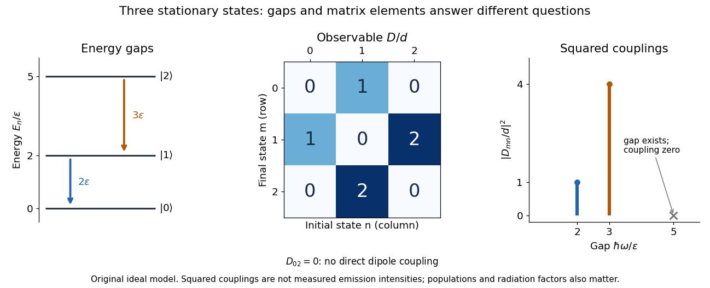
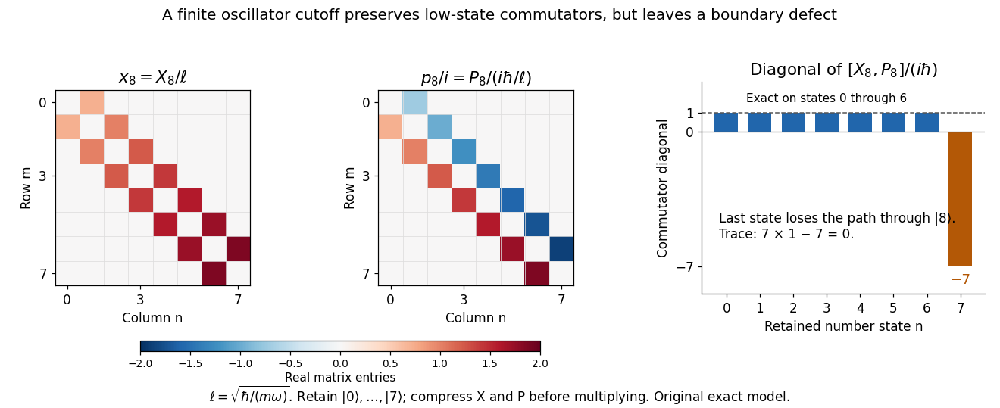
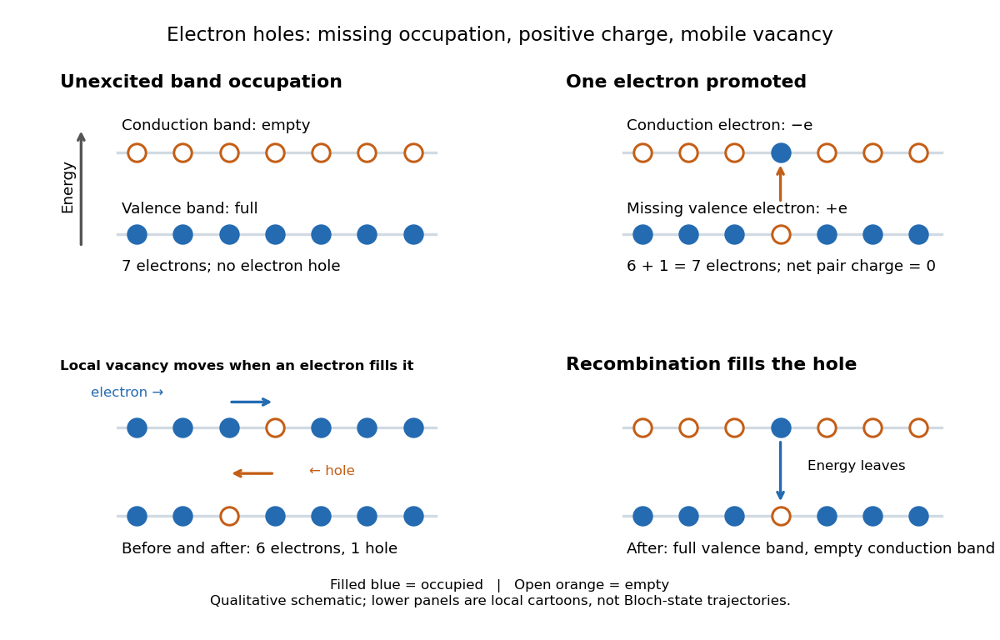
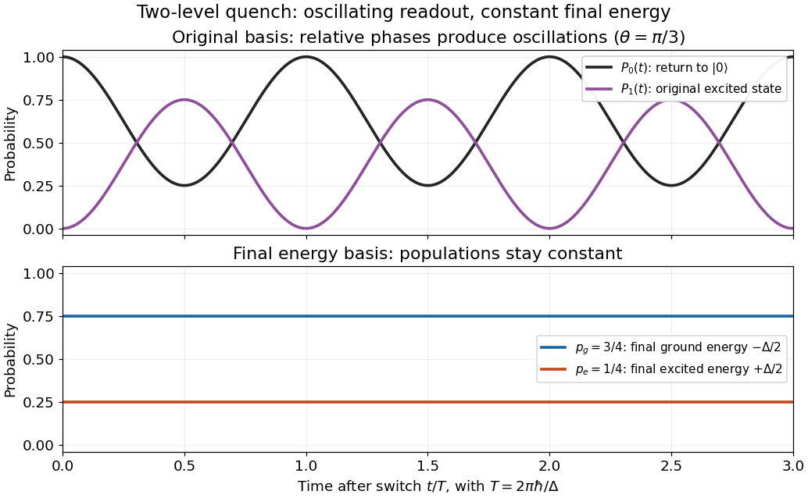
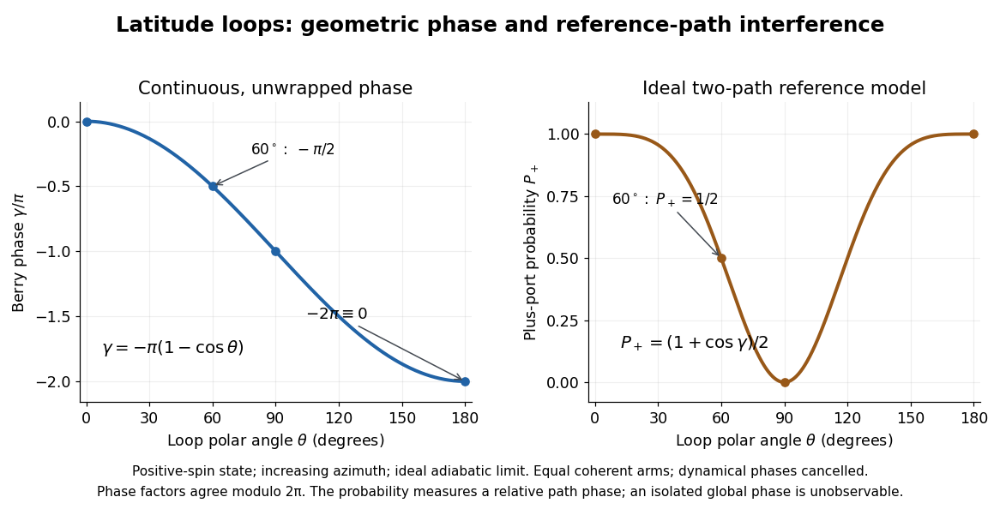
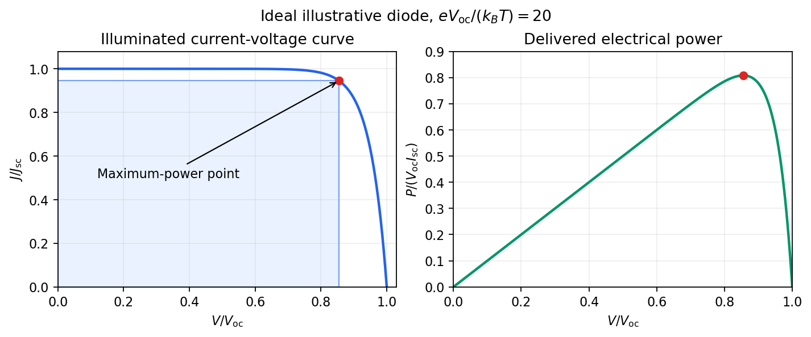
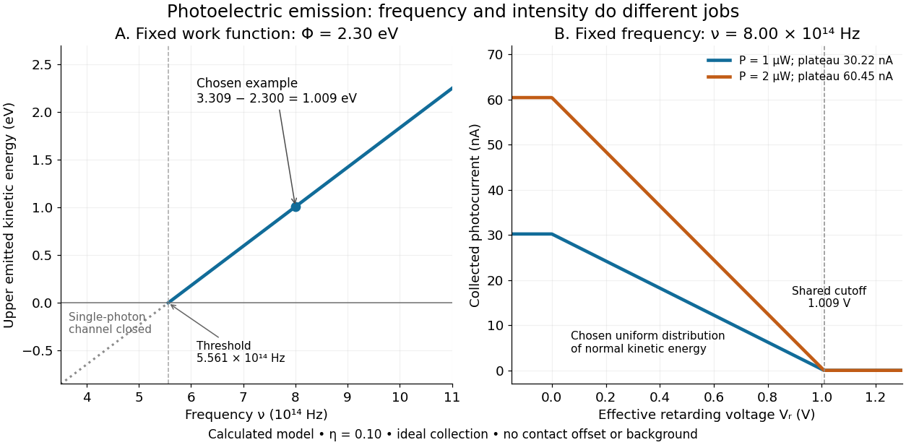
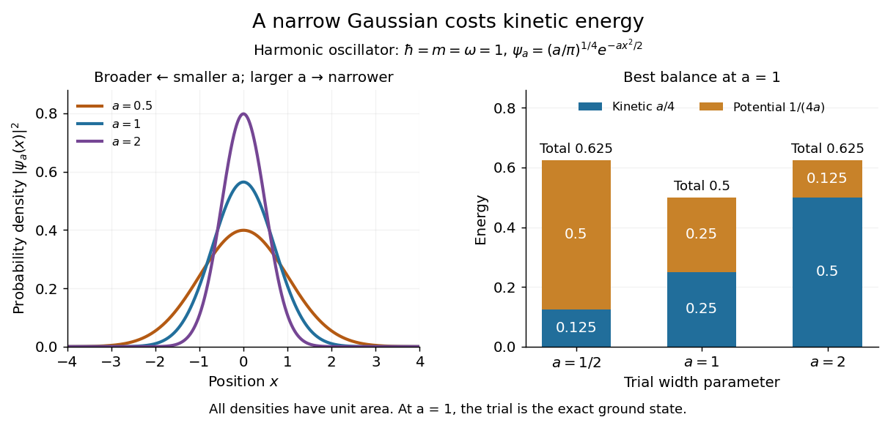
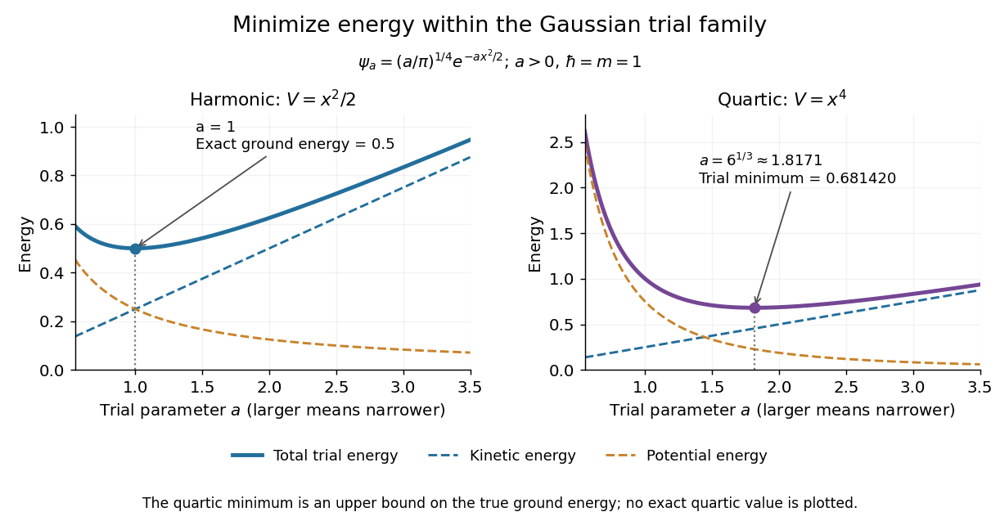
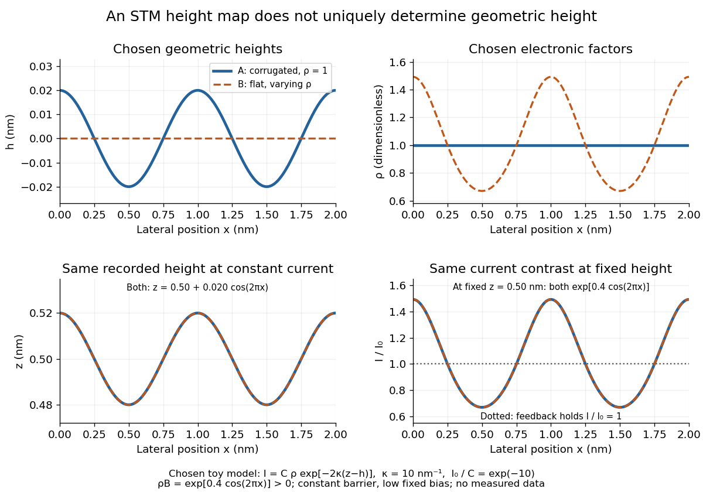

# Quantum mechanics

↑ **Parent:** [Branches of physics](physics.md#branches-of-physics)  
ⓦ [Wiki](https://en.wikipedia.org/wiki/Quantum_mechanics)

Quantum mechanics describes a [quantum system](quantum-system.md) using a [quantum state](quantum-system.md#quantum-state), with [observables](quantum-system.md#observable) represented by [self-adjoint operators](linear-operator-theory.md#self-adjoint-operator). For a single particle in one dimension, a [pure state](quantum-theory.md#pure-state) can be described by a [wavefunction](wave-function.md) $\psi(x,t)$: its squared [modulus](complex-analysis.md#modulus) gives the [probability density](wave-function.md#probability-density) for position. The [Schrödinger equation](mathematical-physics.md#schrodinger-equation) predicts how this [probability amplitude](wave-function.md#probability-amplitude) evolves between interventions; [measurement in quantum mechanics](quantum-measurement.md) connects it to experimental outcomes through the [Born rule](wave-function.md#born-rule). A [wavefunction](wave-function.md) therefore predicts a distribution of possible positions rather than a single trajectory as in [classical mechanics](classical-mechanics.md).

The [infinite square well](#infinite-square-well) makes three central ideas visible with elementary [sine](geometry-and-topology.md#sine) functions. Confinement selects discrete [energy eigenvalues](energy-eigenvalue.md); [wavefunction normalization](wave-function.md#wavefunction-normalization) converts a shape into quantitative [probabilities](probability-theory.md#probability); and a [quantum superposition](quantum-system.md#quantum-superposition) can have a changing [probability density](wave-function.md#probability-density) even when each constituent [energy eigenstate](energy-eigenvalue.md#energy-eigenstate) has a stationary one. This combination explains why [quantum mechanics](quantum-mechanics.md) uses both [linear algebra](linear-algebra.md) and [differential equations](differential-equation.md): [eigenfunctions](linear-operator-theory.md#eigenfunction) describe the building blocks, while [quantum phases](quantum-system.md#quantum-phase) determine how they interfere. The same tools help explain the discrete energies of [chemical atoms](physics.md#atom-physics) and [molecules](molecule.md), although their [Quantum Hamiltonians](quantum-system.md#hamiltonian-quantum-mechanics) require different potentials and often many particles.

In his first 1926 paper, Erwin Schrödinger formulated quantization as an [eigenvalue](linear-operator-theory.md#eigenvalue) problem for a [hydrogen atom](mathematical-physics.md#hydrogen-atom) in [nonrelativistic quantum mechanics](#nonrelativistic-quantum-mechanics). On its opening page he compared the emergence of integers with the number of [nodes of a standing wave](wave-equation.md#node-physics) on a vibrating string. The [infinite square well](#infinite-square-well) below realizes that appealing idea especially transparently: the allowed integers follow from the [boundary conditions](differential-equation.md#boundary-condition). This historical analogy concerns the origin of discrete energies; the [Born rule](wave-function.md#born-rule) supplies the statistical interpretation of the modern [wavefunction](wave-function.md). [Schrödinger, Quantisierung als Eigenwertproblem, 1926, pp. 361–363](physics-bibliography.md#quantisierung-als-eigenwertproblem-erste-mitteilung-by-erwin-schrodinger).

**Table of contents**

- [Magnetic-gradient quartic confinement](#magnetic-gradient-quartic-confinement)
  - [Double-well oscillator scale in a linear magnetic field](#double-well-oscillator-scale-in-a-linear-magnetic-field)
    - [Signed group velocity of a magnetic-gradient doublet](#signed-group-velocity-of-a-magnetic-gradient-doublet)
  - [Translation separation in a magnetic field gradient](#translation-separation-in-a-magnetic-field-gradient)
- [Mott transition](#mott-transition)
- [Quantum particle](#quantum-particle)
- [Relativistic quantum mechanics](#relativistic-quantum-mechanics)
- [Bipartite quantum system](#bipartite-quantum-system)
- [Quantum virial theorem](#quantum-virial-theorem)
- [Quantum transport](#quantum-transport)
  - [Universal conductance fluctuations](#universal-conductance-fluctuations)
  - [Phase coherence length](#phase-coherence-length)
  - [Quasi-one-dimensional quantum transport](#quasi-one-dimensional-quantum-transport)
    - [Transverse electronic mode](#transverse-electronic-mode)
  - [Landauer formula](#landauer-formula)
    - [Flux-normalized transmission matrix](#flux-normalized-transmission-matrix)
      - [Spin channel counting in a transmission trace](#spin-channel-counting-in-a-transmission-trace)
    - [Spin-resolved conductance quantum](#spin-resolved-conductance-quantum)
      - [Thermally rounded channel threshold](#thermally-rounded-channel-threshold)
    - [Flux carried by a directed electronic mode](#flux-carried-by-a-directed-electronic-mode)
    - [Landauer-Büttiker formula](#landauer-buttiker-formula)
      - [Mode-count balance in a ballistic junction](#mode-count-balance-in-a-ballistic-junction)
      - [Equilibrating voltage probe](#equilibrating-voltage-probe)
    - [Ballistic conductance quantization](#ballistic-conductance-quantization)
- [Oscillator strength](#oscillator-strength)
- [Wigner-Seitz radius](#wigner-seitz-radius)
  - [Dimensionless Wigner-Seitz radius](#dimensionless-wigner-seitz-radius)
- [Local density approximation](#local-density-approximation)
  - [Generalized gradient approximation](#generalized-gradient-approximation)
    - [Becke 1988 exchange functional](#becke-1988-exchange-functional)
- [Hohenberg-Kohn theorem](#hohenberg-kohn-theorem)
- [Hartree-Fock wavefunction](#hartree-fock-wavefunction)
  - [Brillouin's theorem](#brillouin-s-theorem)
- [Non-crossing rule](#non-crossing-rule)
- [Symmetry operator](#symmetry-operator)
- [Quantum confinement](#quantum-confinement)
  - [Quantum wire](#quantum-wire)
  - [Carrier confinement versus photonic confinement](#carrier-confinement-versus-photonic-confinement)
- [Second quantization](#second-quantization)
  - [Contact interaction (quantum mechanics)](#contact-interaction-quantum-mechanics)
    - [Contact-interaction vacuum-energy renormalization](#contact-interaction-vacuum-energy-renormalization)
    - [Two-mode Bose gas on a ring](#two-mode-bose-gas-on-a-ring)
    - [Contact interaction between two box modes](#contact-interaction-between-two-box-modes)
    - [Contact interaction between two ring modes](#contact-interaction-between-two-ring-modes)
- [Postulates of quantum mechanics](#postulates-of-quantum-mechanics)
- [Landau-Zener transition](#landau-zener-transition)
- [BKS theory](#bks-theory)
- [Wave-particle duality](#wave-particle-duality)
- [Wave mechanics](#wave-mechanics)
- [Hyperfine structure](#hyperfine-structure)
  - [Clock transition](#clock-transition)
    - [Quadratic Zeeman shift of a clock transition](#quadratic-zeeman-shift-of-a-clock-transition)
    - [Rubidium-87 clock transition](#rubidium-87-clock-transition)
  - [Hyperfine coupling for a spin-one nucleus](#hyperfine-coupling-for-a-spin-one-nucleus)
  - [Hyperfine interaction](#hyperfine-interaction)
    - [Breit-Rabi formula](#breit-rabi-formula)
      - [Stretched hyperfine Zeeman state](#stretched-hyperfine-zeeman-state)
- [Born-Oppenheimer approximation](#born-oppenheimer-approximation)
  - [Diabatic state](#diabatic-state)
  - [Adiabatic state](#adiabatic-state)
- [Circular infinite quantum well](#circular-infinite-quantum-well)
- [Hegerfeldt theorem](#hegerfeldt-theorem)
- [Rotating-wave approximation](#rotating-wave-approximation)
  - [Laboratory spin motion under a resonant linear drive](#laboratory-spin-motion-under-a-resonant-linear-drive)
- [Quantum rotor](#quantum-rotor)
  - [Quantum asymmetric top](#quantum-asymmetric-top)
    - [Spin-one spectrum of a quantum asymmetric top](#spin-one-spectrum-of-a-quantum-asymmetric-top)
  - [Flux-threaded quantum rotor](#flux-threaded-quantum-rotor)
    - [Momentum-winding duality of a quantum rotor](#momentum-winding-duality-of-a-quantum-rotor)
  - [Quantum kicked rotor](#quantum-kicked-rotor)
    - [Quantum resonance of the kicked rotor](#quantum-resonance-of-the-kicked-rotor)
  - [Three-mode revival of a planar quantum rotor](#three-mode-revival-of-a-planar-quantum-rotor)
  - [Real-time winding representation of a quantum rotor kernel](#real-time-winding-representation-of-a-quantum-rotor-kernel)
  - [Coupled quantum rotor chain](#coupled-quantum-rotor-chain)
    - [Rotor-chain phase-number hydrodynamics](#rotor-chain-phase-number-hydrodynamics)
      - [Compactness qualification of a harmonic rotor chain](#compactness-qualification-of-a-harmonic-rotor-chain)
    - [Harmonic phase mode of a quantum rotor chain](#harmonic-phase-mode-of-a-quantum-rotor-chain)
      - [Global phase zero mode of a finite rotor chain](#global-phase-zero-mode-of-a-finite-rotor-chain)
    - [Imaginary-time normalization for a coupled rotor chain](#imaginary-time-normalization-for-a-coupled-rotor-chain)
  - [Rotor winding-sector path integral](#rotor-winding-sector-path-integral)
    - [Fixed-endpoint rotor fluctuation normalization](#fixed-endpoint-rotor-fluctuation-normalization)
    - [Momentum-winding duality of the quantum rotor](#momentum-winding-duality-of-the-quantum-rotor)
      - [Thermal winding dominance of a free rotor](#thermal-winding-dominance-of-a-free-rotor)
    - [Rotor return-kernel fluctuation prefactor](#rotor-return-kernel-fluctuation-prefactor)
- [Semiclassical quantization](#semiclassical-quantization)
  - [Bohr-Sommerfeld quantization](#bohr-sommerfeld-quantization)
- [Operator formalism](#operator-formalism)
  - [Matrix mechanics](#matrix-mechanics)
    - [Observable matrices in an energy basis](#observable-matrices-in-an-energy-basis)
      - [Transition frequencies and matrix multiplication](#transition-frequencies-and-matrix-multiplication)
      - [Three-level observable and missing spectral line](#three-level-observable-and-missing-spectral-line)
    - [Noncommuting observables in two dimensions](#noncommuting-observables-in-two-dimensions)
    - [From Heisenberg arrays to Born-Jordan commutation](#from-heisenberg-arrays-to-born-jordan-commutation)
    - [Matrix and wave mechanics equivalence](#matrix-and-wave-mechanics-equivalence)
    - [Finite oscillator commutator boundary defect](#finite-oscillator-commutator-boundary-defect)
- [Quasiparticle](#quasiparticle)
  - [Bogoliubov quasiparticle](#bogoliubov-quasiparticle)
  - [Polariton](#polariton)
  - [Exciton](#exciton)
    - [Exciton diffusion length](#exciton-diffusion-length)
    - [Electron-hole Coulomb interaction](#electron-hole-coulomb-interaction)
    - [Exciton reduced mass](#exciton-reduced-mass)
    - [Biexciton](#biexciton)
    - [Exciton binding energy](#exciton-binding-energy)
      - [Thermal ionization of excitons](#thermal-ionization-of-excitons)
    - [Wannier-Mott exciton](#wannier-mott-exciton)
      - [Finite-width quantum-well exciton](#finite-width-quantum-well-exciton)
      - [Two-dimensional exciton](#two-dimensional-exciton)
        - [Exciton dimensionality from peak spacings](#exciton-dimensionality-from-peak-spacings)
      - [Exciton Bohr radius](#exciton-bohr-radius)
      - [Exciton Rydberg series](#exciton-rydberg-series)
      - [Relative permittivity](#relative-permittivity)
        - [Dielectric function](#dielectric-function)
          - [Static Lindhard dielectric function](#static-lindhard-dielectric-function)
            - [Kohn singularity of static Lindhard screening](#kohn-singularity-of-static-lindhard-screening)
        - [Dielectric screening](#dielectric-screening)
          - [Radial induced-charge screening kernel](#radial-induced-charge-screening-kernel)
          - [Friedel oscillations](#friedel-oscillations)
            - [Friedel oscillation wavelength from carrier density](#friedel-oscillation-wavelength-from-carrier-density)
            - [Friedel density tail from a derivative singularity](#friedel-density-tail-from-a-derivative-singularity)
          - [Thomas-Fermi screening](#thomas-fermi-screening)
            - [Thomas-Fermi screening length](#thomas-fermi-screening-length)
    - [Frenkel exciton](#frenkel-exciton)
    - [Exciton optical transition](#exciton-optical-transition)
      - [Exciton absorption experiment in copper(I) oxide](#exciton-absorption-experiment-in-copper-i-oxide)
        - [Copper(I) oxide](#copper-i-oxide)
  - [Electron hole](#electron-hole)
    - [Light hole](#light-hole)
    - [Heavy hole](#heavy-hole)
    - [Electron-hole pair](#electron-hole-pair)
    - [Electron-hole recombination](#electron-hole-recombination)
      - [Minority carrier lifetime](#minority-carrier-lifetime)
      - [Radiative electron-hole recombination](#radiative-electron-hole-recombination)
      - [Auger recombination](#auger-recombination)
    - [Valence band](#valence-band)
      - [Split-off valence band](#split-off-valence-band)
      - [Heavy-hole and light-hole bands](#heavy-hole-and-light-hole-bands)
    - [Conduction band](#conduction-band)
      - [Conduction electron](#conduction-electron)
- [Sudden approximation](#sudden-approximation)
  - [One-sided sudden expansion of an infinite square well](#one-sided-sudden-expansion-of-an-infinite-square-well)
  - [Sudden hydrogenic charge change](#sudden-hydrogenic-charge-change)
  - [Quantum state continuity at a finite Hamiltonian step](#quantum-state-continuity-at-a-finite-hamiltonian-step)
    - [Impulsive quantum kick](#impulsive-quantum-kick)
      - [Off-diagonal two-state impulse](#off-diagonal-two-state-impulse)
        - [Time-integrated pulse operator has action units](#time-integrated-pulse-operator-has-action-units)
  - [Quantum quench](#quantum-quench)
    - [Two-level sudden quench](#two-level-sudden-quench)
      - [Work in a two-level sudden quench](#work-in-a-two-level-sudden-quench)
      - [Post-quench oscillations in a two-level system](#post-quench-oscillations-in-a-two-level-system)
    - [Cold-atom collapse and revival after a lattice quench](#cold-atom-collapse-and-revival-after-a-lattice-quench)
  - [Ground-state overlap after sudden expansion of a square well](#ground-state-overlap-after-sudden-expansion-of-a-square-well)
- [Canonical quantization](#canonical-quantization)
  - [Weyl ordering](#weyl-ordering)
  - [Canonical quantization of the electromagnetic field](#canonical-quantization-of-the-electromagnetic-field)
    - [Gauge reduction of the Maxwell Hamiltonian](#gauge-reduction-of-the-maxwell-hamiltonian)
    - [Canonical transverse photon field](#canonical-transverse-photon-field)
      - [Transverse equal-time commutator](#transverse-equal-time-commutator)
    - [Primary momentum constraint of the electromagnetic potential](#primary-momentum-constraint-of-the-electromagnetic-potential)
- [Nonrelativistic quantum mechanics](#nonrelativistic-quantum-mechanics)
- [Berry phase](#berry-phase)
  - [Cyclic phase of a spin in a rotating field](#cyclic-phase-of-a-spin-in-a-rotating-field)
  - [Berry connection](#berry-connection)
    - [Berry curvature](#berry-curvature)
  - [Berry phase of a Bloch-sphere latitude](#berry-phase-of-a-bloch-sphere-latitude)
  - [Berry-phase interference with a reference path](#berry-phase-interference-with-a-reference-path)
- [Classical limit](#classical-limit)
- [Parity](#parity)
  - [Natural parity](#natural-parity)
  - [Parity conservation](#parity-conservation)
  - [Parity operator](#parity-operator)
    - [Photon-number parity](#photon-number-parity)
  - [Orbital parity](#orbital-parity)
  - [Multiparticle parity](#multiparticle-parity)
    - [Parity selection rule for a two-body decay](#parity-selection-rule-for-a-two-body-decay)
  - [Spatial reflection](#spatial-reflection)
    - [Pseudoscalar](#pseudoscalar)
- [Energy level](#energy-level)
  - [Thermal broadening](#thermal-broadening)
  - [Nuclear energy level](#nuclear-energy-level)
  - [Excitation energy](#excitation-energy)
- [Photon](#photon)
  - [Single-photon source](#single-photon-source)
  - [Photon energy](#photon-energy)
    - [Photon emission rate from monochromatic power](#photon-emission-rate-from-monochromatic-power)
  - [Gamma ray](#gamma-ray)
    - [Electric quadrupole transition](#electric-quadrupole-transition)
  - [Photon polarization](#photon-polarization)
  - [Photon polarization vector](#photon-polarization-vector)
  - [Two physical polarizations of a photon](#two-physical-polarizations-of-a-photon)
  - [Photon absorption](#photon-absorption)
    - [Absorption cross section](#absorption-cross-section)
    - [Photovoltaic effect](#photovoltaic-effect)
      - [Solar cell](#solar-cell)
        - [Organic solar cell](#organic-solar-cell)
          - [Bulk heterojunction](#bulk-heterojunction)
        - [Multi-junction solar cell](#multi-junction-solar-cell)
        - [Short-circuit current](#short-circuit-current)
        - [Maximum power point](#maximum-power-point)
        - [Maximum power point tracking](#maximum-power-point-tracking)
        - [Back surface field](#back-surface-field)
        - [Perovskite solar cell](#perovskite-solar-cell)
        - [Measuring a solar cell's current-voltage characteristic](#measuring-a-solar-cell-s-current-voltage-characteristic)
        - [Shockley-Queisser limit](#shockley-queisser-limit)
        - [Solar-cell fill factor](#solar-cell-fill-factor)
    - [Photoelectric effect](#photoelectric-effect)
      - [Grain photoelectric heating](#grain-photoelectric-heating)
      - [Einstein photoelectric equation](#einstein-photoelectric-equation)
        - [Photoelectric threshold frequency](#photoelectric-threshold-frequency)
      - [Stopping potential](#stopping-potential)
      - [Photoelectric saturation current](#photoelectric-saturation-current)
      - [Millikan photoelectric experiment](#millikan-photoelectric-experiment)
        - [Contact potential difference](#contact-potential-difference)
          - [Photoelectric contact-potential correction](#photoelectric-contact-potential-correction)
      - [Multiphoton photoemission](#multiphoton-photoemission)
  - [Photon emission](#photon-emission)
- [Free particle](#free-particle)
- [Ground state](#ground-state)
  - [Ground-state subspace](#ground-state-subspace)
  - [Ground-state degeneracy](#ground-state-degeneracy)
  - [Ground-state energy](#ground-state-energy)
    - [Quantum variational principle](#quantum-variational-principle)
      - [Excited-state variational constraint](#excited-state-variational-constraint)
      - [Trial wavefunction](#trial-wavefunction)
      - [Exponential variational bound for the Yukawa potential](#exponential-variational-bound-for-the-yukawa-potential)
      - [Power-law quantum virial theorem](#power-law-quantum-virial-theorem)
- [Energy eigenvalue](energy-eigenvalue.md)
  - [Energy eigenstate](energy-eigenvalue.md#energy-eigenstate)
    - [Energy eigenfunction](energy-eigenvalue.md#energy-eigenfunction)
    - [Energy eigenvector](energy-eigenvalue.md#energy-eigenvector)
  - [Energy eigenspace](energy-eigenvalue.md#energy-eigenspace)
  - [Excited state](energy-eigenvalue.md#excited-state)
    - [Intersystem crossing](energy-eigenvalue.md#intersystem-crossing)
    - [Franck-Hertz experiment](energy-eigenvalue.md#franck-hertz-experiment)
      - [Franck-Hertz energy-loss model](energy-eigenvalue.md#franck-hertz-energy-loss-model)
        - [Franck-Hertz retarding collector transfer](energy-eigenvalue.md#franck-hertz-retarding-collector-transfer)
        - [Franck-Hertz repeated-loss collection model](energy-eigenvalue.md#franck-hertz-repeated-loss-collection-model)
        - [Franck-Hertz spacing fit and contact offset](energy-eigenvalue.md#franck-hertz-spacing-fit-and-contact-offset)
    - [First excited state](energy-eigenvalue.md#first-excited-state)
  - [Eigenstate](energy-eigenvalue.md#eigenstate)
    - [Momentum eigenstate](energy-eigenvalue.md#momentum-eigenstate)
- [Quantum system](quantum-system.md)
  - [Dressed state](quantum-system.md#dressed-state)
    - [Atom-field dressed state](quantum-system.md#atom-field-dressed-state)
      - [Mollow triplet](quantum-system.md#mollow-triplet)
  - [Quantum state](quantum-system.md#quantum-state)
    - [Gaussian quantum state](quantum-system.md#gaussian-quantum-state)
      - [Number-conserving Gaussian quantum state](quantum-system.md#number-conserving-gaussian-quantum-state)
      - [Squeezed thermal state](quantum-system.md#squeezed-thermal-state)
    - [Quantum state ray](quantum-system.md#quantum-state-ray)
    - [Coherent preparation and incoherent mixing](quantum-system.md#coherent-preparation-and-incoherent-mixing)
    - [Polarization preparation and dephasing experiment](quantum-system.md#polarization-preparation-and-dephasing-experiment)
    - [Dicke state](quantum-system.md#dicke-state)
      - [W state](quantum-system.md#w-state)
      - [One-qubit reduction of Dicke-state superpositions](quantum-system.md#one-qubit-reduction-of-dicke-state-superpositions)
    - [Flavor eigenstate](quantum-system.md#flavor-eigenstate)
    - [Quantum superposition](quantum-system.md#quantum-superposition)
      - [Quantum interference](quantum-system.md#quantum-interference)
        - [Period of two-state quantum interference](quantum-system.md#period-of-two-state-quantum-interference)
        - [Hong-Ou-Mandel effect](quantum-system.md#hong-ou-mandel-effect)
    - [Qudit](quantum-system.md#qudit)
      - [Qudit shift and phase operators](quantum-system.md#qudit-shift-and-phase-operators)
    - [Qubit](quantum-system.md#qubit)
      - [Qubit state](quantum-system.md#qubit-state)
    - [Qutrit](quantum-system.md#qutrit)
    - [Quantum number](quantum-system.md#quantum-number)
      - [Angular momentum quantum number](quantum-system.md#angular-momentum-quantum-number)
        - [Orbital angular momentum quantum number](quantum-system.md#orbital-angular-momentum-quantum-number)
    - [Quantum phase](quantum-system.md#quantum-phase)
      - [Relative quantum phase](quantum-system.md#relative-quantum-phase)
      - [Geometric phase](quantum-system.md#geometric-phase)
      - [Dynamical phase](quantum-system.md#dynamical-phase)
      - [Global phase](quantum-system.md#global-phase)
        - [Global phase of an uncontrolled quantum gate is unobservable](quantum-system.md#global-phase-of-an-uncontrolled-quantum-gate-is-unobservable)
    - [Observable](quantum-system.md#observable)
      - [Complete set of commuting observables](quantum-system.md#complete-set-of-commuting-observables)
      - [Quantum uncertainty](quantum-system.md#quantum-uncertainty)
        - [Position uncertainty](quantum-system.md#position-uncertainty)
      - [Expectation value](quantum-system.md#expectation-value)
        - [Spin expectation value](quantum-system.md#spin-expectation-value)
        - [Estimating a quantum expectation value](quantum-system.md#estimating-a-quantum-expectation-value)
          - [Stern-Gerlach expectation estimation](quantum-system.md#stern-gerlach-expectation-estimation)
      - [Hamiltonian (quantum mechanics)](quantum-system.md#hamiltonian-quantum-mechanics)
        - [Basis permutation of a quantum Hamiltonian matrix](quantum-system.md#basis-permutation-of-a-quantum-hamiltonian-matrix)
        - [Quadratic form of a positive quantum Hamiltonian](quantum-system.md#quadratic-form-of-a-positive-quantum-hamiltonian)
        - [Morse potential](quantum-system.md#morse-potential)
          - [Morse oscillator](quantum-system.md#morse-oscillator)
            - [Birge-Sponer plot](quantum-system.md#birge-sponer-plot)
        - [Factorized quantum Hamiltonian](quantum-system.md#factorized-quantum-hamiltonian)
          - [Factorized-Hamiltonian raising trial state](quantum-system.md#factorized-hamiltonian-raising-trial-state)
          - [Normalizable zero mode of a polynomial factorized Hamiltonian](quantum-system.md#normalizable-zero-mode-of-a-polynomial-factorized-hamiltonian)
        - [Quantum symmetry of a Hamiltonian](quantum-system.md#quantum-symmetry-of-a-hamiltonian)
          - [Conserved generator of a continuous quantum symmetry](quantum-system.md#conserved-generator-of-a-continuous-quantum-symmetry)
        - [Unitary time evolution](quantum-system.md#unitary-time-evolution)
          - [Perfect quantum state transfer](quantum-system.md#perfect-quantum-state-transfer)
          - [Schrödinger picture](quantum-system.md#schrodinger-picture)
          - [Time-evolution operator](quantum-system.md#time-evolution-operator)
            - [Quantum propagator](quantum-system.md#quantum-propagator)
              - [Spectral resolution of a quantum propagator](quantum-system.md#spectral-resolution-of-a-quantum-propagator)
            - [Floquet operator](quantum-system.md#floquet-operator)
              - [Delta-kicked spin Floquet operator](quantum-system.md#delta-kicked-spin-floquet-operator)
              - [Pulse-and-precession spin one-half map](quantum-system.md#pulse-and-precession-spin-one-half-map)
              - [Quasienergy](quantum-system.md#quasienergy)
            - [Energy populations and evolving relative phases](quantum-system.md#energy-populations-and-evolving-relative-phases)
              - [Qubit precession under a constant Hamiltonian](quantum-system.md#qubit-precession-under-a-constant-hamiltonian)
                - [Ramsey interferometry](quantum-system.md#ramsey-interferometry)
                  - [Initial-state dependence of Ramsey contrast](quantum-system.md#initial-state-dependence-of-ramsey-contrast)
                  - [Ramsey ensemble coherence](quantum-system.md#ramsey-ensemble-coherence)
                  - [Quantronium Ramsey interference experiment](quantum-system.md#quantronium-ramsey-interference-experiment)
                  - [Ramsey separated oscillatory fields experiment](quantum-system.md#ramsey-separated-oscillatory-fields-experiment)
                    - [Ramsey spectroscopy](quantum-system.md#ramsey-spectroscopy)
                      - [Ramsey frequency precision](quantum-system.md#ramsey-frequency-precision)
                    - [Finite-pulse Ramsey transition probability](quantum-system.md#finite-pulse-ramsey-transition-probability)
                      - [Ramsey fringe envelope](quantum-system.md#ramsey-fringe-envelope)
                      - [Finite-pulse Ramsey phase response](quantum-system.md#finite-pulse-ramsey-phase-response)
                      - [Velocity-averaged Ramsey line](quantum-system.md#velocity-averaged-ramsey-line)
          - [Quantum-mechanical propagator](quantum-system.md#quantum-mechanical-propagator)
            - [Quantum-mechanical propagator in a constant force](quantum-system.md#quantum-mechanical-propagator-in-a-constant-force)
              - [Momentum-space propagator in a uniform force](quantum-system.md#momentum-space-propagator-in-a-uniform-force)
            - [Normalized short-time Schrödinger kernel](quantum-system.md#normalized-short-time-schrodinger-kernel)
              - [Schrödinger equation from a short-time path integral](quantum-system.md#schrodinger-equation-from-a-short-time-path-integral)
            - [Free-particle propagator](quantum-system.md#free-particle-propagator)
              - [Fresnel convolution of free-particle time slices](quantum-system.md#fresnel-convolution-of-free-particle-time-slices)
              - [Euclidean free-particle bridge amplitude](quantum-system.md#euclidean-free-particle-bridge-amplitude)
            - [Semiclassical propagator](quantum-system.md#semiclassical-propagator)
              - [Dirichlet fluctuation determinant of a semiclassical propagator](quantum-system.md#dirichlet-fluctuation-determinant-of-a-semiclassical-propagator)
              - [Van Vleck determinant](quantum-system.md#van-vleck-determinant)
          - [Heisenberg picture](quantum-system.md#heisenberg-picture)
            - [Heisenberg equation of motion](quantum-system.md#heisenberg-equation-of-motion)
          - [Interaction picture](quantum-system.md#interaction-picture)
          - [Time-reversal symmetry in quantum mechanics](quantum-system.md#time-reversal-symmetry-in-quantum-mechanics)
            - [Quantum time-reversal operator](quantum-system.md#quantum-time-reversal-operator)
            - [Unitary time reversal reverses the energy spectrum](quantum-system.md#unitary-time-reversal-reverses-the-energy-spectrum)
            - [Antiunitary time reversal preserves the energy spectrum](quantum-system.md#antiunitary-time-reversal-preserves-the-energy-spectrum)
          - [Rabi cycle](quantum-system.md#rabi-cycle)
            - [Rotating-frame Rabi Hamiltonian](quantum-system.md#rotating-frame-rabi-hamiltonian)
            - [Circularly rotating magnetic drive](quantum-system.md#circularly-rotating-magnetic-drive)
            - [Rabi frequency](quantum-system.md#rabi-frequency)
            - [Resonance envelope of a Rabi transition](quantum-system.md#resonance-envelope-of-a-rabi-transition)
            - [Driven two-level Rabi model](quantum-system.md#driven-two-level-rabi-model)
              - [Rabi vector](quantum-system.md#rabi-vector)
              - [Equatorial reachability of a detuned spin pulse](quantum-system.md#equatorial-reachability-of-a-detuned-spin-pulse)
              - [Laboratory phase of a resonant spin pulse](quantum-system.md#laboratory-phase-of-a-resonant-spin-pulse)
              - [Rabi angular frequency](quantum-system.md#rabi-angular-frequency)
              - [Rabi detuning](quantum-system.md#rabi-detuning)
              - [Rabi pi pulse](quantum-system.md#rabi-pi-pulse)
            - [Rabi molecular beam magnetic resonance experiment](quantum-system.md#rabi-molecular-beam-magnetic-resonance-experiment)
              - [Rabi transit-time and field averaging](quantum-system.md#rabi-transit-time-and-field-averaging)
    - [Bound state](quantum-system.md#bound-state)
      - [Half-line finite well](quantum-system.md#half-line-finite-well)
        - [Half-line finite-well bound-state count](quantum-system.md#half-line-finite-well-bound-state-count)
      - [Quantum bouncer](quantum-system.md#quantum-bouncer)
        - [Gravitational neutron bound-state transmission](quantum-system.md#gravitational-neutron-bound-state-transmission)
      - [Coulomb bound state](quantum-system.md#coulomb-bound-state)
        - [Two-dimensional Coulomb bound state](quantum-system.md#two-dimensional-coulomb-bound-state)
        - [Polynomial construction of hydrogen S states](quantum-system.md#polynomial-construction-of-hydrogen-s-states)
    - [Stationary state](quantum-system.md#stationary-state)
- [Particle in a ring](#particle-in-a-ring)
- [Planck constant](#planck-constant)
  - [Reduced Planck constant](#reduced-planck-constant)
- [Wave function](wave-function.md)
  - [Single-valued wavefunction](wave-function.md#single-valued-wavefunction)
  - [Momentum representation in quantum mechanics](wave-function.md#momentum-representation-in-quantum-mechanics)
  - [Top-hat wavefunction](wave-function.md#top-hat-wavefunction)
    - [Momentum variance of a discontinuous top hat](wave-function.md#momentum-variance-of-a-discontinuous-top-hat)
  - [Position representation in quantum mechanics](wave-function.md#position-representation-in-quantum-mechanics)
  - [Node of a wavefunction](wave-function.md#node-of-a-wavefunction)
    - [Kinetic-energy estimate from wavefunction nodes](wave-function.md#kinetic-energy-estimate-from-wavefunction-nodes)
  - [Wavefunction normalization](wave-function.md#wavefunction-normalization)
  - [Matter wave](wave-function.md#matter-wave)
    - [Matter-wave coherence](wave-function.md#matter-wave-coherence)
    - [de Broglie phase harmony](wave-function.md#de-broglie-phase-harmony)
    - [Relativistic matter-wave velocities](wave-function.md#relativistic-matter-wave-velocities)
    - [Thomson electron transmission diffraction experiment](wave-function.md#thomson-electron-transmission-diffraction-experiment)
    - [Matter-wave interference](wave-function.md#matter-wave-interference)
    - [de Broglie wavelength](wave-function.md#de-broglie-wavelength)
      - [Free-particle momentum convention](wave-function.md#free-particle-momentum-convention)
      - [Electron accelerating-voltage wavelength](wave-function.md#electron-accelerating-voltage-wavelength)
    - [Neutron interferometer](wave-function.md#neutron-interferometer)
      - [Colella–Overhauser–Werner experiment](wave-function.md#colella-overhauser-werner-experiment)
  - [Plane wave](wave-function.md#plane-wave)
  - [Probability amplitude](wave-function.md#probability-amplitude)
    - [Born rule](wave-function.md#born-rule)
      - [Born statistical scattering interpretation](wave-function.md#born-statistical-scattering-interpretation)
        - [Angular scattering probability from complex amplitudes](wave-function.md#angular-scattering-probability-from-complex-amplitudes)
        - [Two-channel scattering with flux normalization](wave-function.md#two-channel-scattering-with-flux-normalization)
      - [Two-level quantum return probability](wave-function.md#two-level-quantum-return-probability)
      - [Two-level observable transition probability](wave-function.md#two-level-observable-transition-probability)
      - [Wigner's theorem](wave-function.md#wigner-s-theorem)
        - [Projective unitary representation](wave-function.md#projective-unitary-representation)
      - [Energy measurement](wave-function.md#energy-measurement)
  - [Normalizable wavefunction](wave-function.md#normalizable-wavefunction)
  - [Probability density](wave-function.md#probability-density)
    - [Radial probability density](wave-function.md#radial-probability-density)
  - [Probability current](wave-function.md#probability-current)
    - [Probability current of a two-dimensional Dirac particle](wave-function.md#probability-current-of-a-two-dimensional-dirac-particle)
    - [Probability continuity equation](wave-function.md#probability-continuity-equation)
      - [Conservation of quantum probability](wave-function.md#conservation-of-quantum-probability)
  - [Gaussian wave packet](wave-function.md#gaussian-wave-packet)
    - [Gaussian covariance in a harmonic potential](wave-function.md#gaussian-covariance-in-a-harmonic-potential)
    - [Free Gaussian wave packet evolution](wave-function.md#free-gaussian-wave-packet-evolution)
    - [Gaussian evolution in an inverted harmonic oscillator](wave-function.md#gaussian-evolution-in-an-inverted-harmonic-oscillator)
- [Potential barrier](#potential-barrier)
  - [Square potential barrier](#square-potential-barrier)
  - [Quantum tunnelling](#quantum-tunnelling)
    - [Tunnel broadening](#tunnel-broadening)
    - [Sequential tunnelling](#sequential-tunnelling)
    - [Barrier-top scattering](#barrier-top-scattering)
    - [Resonant tunnelling diode](#resonant-tunnelling-diode)
    - [Coulomb blockade](#coulomb-blockade)
      - [Cotunnelling](#cotunnelling)
      - [Charging energy](#charging-energy)
      - [Constant interaction model](#constant-interaction-model)
        - [Quantum-dot electrochemical potential](#quantum-dot-electrochemical-potential)
      - [Coulomb diamond](#coulomb-diamond)
        - [Coulomb diamond capacitance extraction](#coulomb-diamond-capacitance-extraction)
    - [Field electron emission](#field-electron-emission)
    - [Interband tunnelling](#interband-tunnelling)
    - [Finite rectangular barrier matching](#finite-rectangular-barrier-matching)
      - [Tunnelling decay constant](#tunnelling-decay-constant)
      - [Rectangular barrier transmission probability](#rectangular-barrier-transmission-probability)
        - [Thick-barrier transmission prefactor](#thick-barrier-transmission-prefactor)
        - [Opaque barrier approximation](#opaque-barrier-approximation)
    - [Evanescent probability current](#evanescent-probability-current)
    - [Current-distance test of vacuum tunnelling](#current-distance-test-of-vacuum-tunnelling)
      - [Piezoelectricity](#piezoelectricity)
        - [Piezoelectric stress sensor](#piezoelectric-stress-sensor)
          - [Voltage sensitivity of a piezoelectric sensor](#voltage-sensitivity-of-a-piezoelectric-sensor)
        - [Direct piezoelectric effect](#direct-piezoelectric-effect)
          - [Open-circuit piezoelectric response](#open-circuit-piezoelectric-response)
          - [Piezoelectric coefficient](#piezoelectric-coefficient)
        - [Piezoelectric hysteresis](#piezoelectric-hysteresis)
        - [Piezoelectric scanner creep](#piezoelectric-scanner-creep)
        - [Converse piezoelectric effect](#converse-piezoelectric-effect)
        - [Piezoelectric crystal](#piezoelectric-crystal)
    - [Tunnel junction](#tunnel-junction)
      - [Work function](#work-function)
      - [Scanning tunneling microscopy](#scanning-tunneling-microscopy)
        - [Atomic manipulation](#atomic-manipulation)
          - [IBM (atoms)](#ibm-atoms)
          - [Vertical atomic manipulation](#vertical-atomic-manipulation)
          - [Lateral atomic manipulation](#lateral-atomic-manipulation)
        - [Scanning tunneling spectroscopy](#scanning-tunneling-spectroscopy)
          - [Standing-wave scanning tunneling spectroscopy](#standing-wave-scanning-tunneling-spectroscopy)
            - [Cu(111) surface-state standing-wave experiment](#cu-111-surface-state-standing-wave-experiment)
          - [Inelastic electron tunnelling spectroscopy](#inelastic-electron-tunnelling-spectroscopy)
        - [Scanning tunneling microscope](#scanning-tunneling-microscope)
        - [Constant-current scanning tunneling microscopy](#constant-current-scanning-tunneling-microscopy)
        - [Electronic contrast in scanning tunneling microscopy](#electronic-contrast-in-scanning-tunneling-microscopy)
        - [Early surface-reconstruction measurements with scanning tunneling microscopy](#early-surface-reconstruction-measurements-with-scanning-tunneling-microscopy)
    - [Double-well tunneling splitting](#double-well-tunneling-splitting)
      - [Lowest parity states of a symmetric double well](#lowest-parity-states-of-a-symmetric-double-well)
    - [Finite square barrier transmission at half barrier height](#finite-square-barrier-transmission-at-half-barrier-height)
- [Hermitian operator on a nonorthogonal two-state basis](#hermitian-operator-on-a-nonorthogonal-two-state-basis)
  - [Commuting time-dependent two-state Hamiltonian](#commuting-time-dependent-two-state-hamiltonian)
- [Second moments of a complex Gaussian wave packet](#second-moments-of-a-complex-gaussian-wave-packet)
- [Finite square well](#finite-square-well)
  - [Exterior probability of a symmetric finite-well state](#exterior-probability-of-a-symmetric-finite-well-state)
  - [First odd bound-state threshold of a square well](#first-odd-bound-state-threshold-of-a-square-well)
  - [Finite-well bound-state node sequence](#finite-well-bound-state-node-sequence)
  - [Ground state of a finite square well](#ground-state-of-a-finite-square-well)
    - [Shallow finite-square-well energy](#shallow-finite-square-well-energy)
  - [Attractive potential ordering does not order quantum reflection](#attractive-potential-ordering-does-not-order-quantum-reflection)
  - [Resonant transmission through a square well](#resonant-transmission-through-a-square-well)
  - [Spherical square well](#spherical-square-well)
    - [S-wave bound-state threshold in a spherical square well](#s-wave-bound-state-threshold-in-a-spherical-square-well)
      - [Near-resonance square-well approximation](#near-resonance-square-well-approximation)
    - [Spherical square-well scattering length](#spherical-square-well-scattering-length)
    - [Bound-state thresholds of a spherical square well](#bound-state-thresholds-of-a-spherical-square-well)
    - [Spherically symmetric bound state of a finite well](#spherically-symmetric-bound-state-of-a-finite-well)
  - [Bound-state thresholds for a square well with one hard wall](#bound-state-thresholds-for-a-square-well-with-one-hard-wall)
  - [Hard-core spherical square-well potential](#hard-core-spherical-square-well-potential)
    - [Scattering length of a hard-core spherical square-well potential](#scattering-length-of-a-hard-core-spherical-square-well-potential)
- [Delta potential](#delta-potential)
  - [Quantum propagator of an attractive delta potential](#quantum-propagator-of-an-attractive-delta-potential)
  - [Central delta barrier in a symmetric infinite well](#central-delta-barrier-in-a-symmetric-infinite-well)
    - [High-energy shift from a central delta barrier](#high-energy-shift-from-a-central-delta-barrier)
  - [Odd bound state and resonance of two delta barriers](#odd-bound-state-and-resonance-of-two-delta-barriers)
  - [Bound state in a delta potential](#bound-state-in-a-delta-potential)
  - [Multiple delta potential](#multiple-delta-potential)
    - [Symmetric double-delta potential](#symmetric-double-delta-potential)
      - [Odd-parity S-matrix of a symmetric double-delta potential](#odd-parity-s-matrix-of-a-symmetric-double-delta-potential)
        - [Odd bound state of a symmetric double-delta potential](#odd-bound-state-of-a-symmetric-double-delta-potential)
        - [Odd resonance of a strongly repulsive symmetric double-delta potential](#odd-resonance-of-a-strongly-repulsive-symmetric-double-delta-potential)
  - [Scattering by a delta potential](#scattering-by-a-delta-potential)
- [Quantum scattering](quantum-scattering.md)
  - [Quarter-wave matching layer for a quantum potential step](quantum-scattering.md#quarter-wave-matching-layer-for-a-quantum-potential-step)
  - [Discrete-state continuum scattering amplitude](quantum-scattering.md#discrete-state-continuum-scattering-amplitude)
  - [Scattering cross-section](quantum-scattering.md#scattering-cross-section)
    - [Scattering plane](quantum-scattering.md#scattering-plane)
  - [Step potential](quantum-scattering.md#step-potential)
    - [Evanescent amplitude versus transmitted current](quantum-scattering.md#evanescent-amplitude-versus-transmitted-current)
    - [Quantum reflection at a downward step](quantum-scattering.md#quantum-reflection-at-a-downward-step)
    - [Potential-step threshold wavefunction](quantum-scattering.md#potential-step-threshold-wavefunction)
  - [Coulomb distortion in electron scattering](quantum-scattering.md#coulomb-distortion-in-electron-scattering)
  - [Scattering channel](quantum-scattering.md#scattering-channel)
  - [Scattering angle](quantum-scattering.md#scattering-angle)
  - [X-ray scattering techniques](quantum-scattering.md#x-ray-scattering-techniques)
    - [Inelastic X-ray scattering](quantum-scattering.md#inelastic-x-ray-scattering)
  - [Inelastic scattering](quantum-scattering.md#inelastic-scattering)
  - [Quantum reflection probability](quantum-scattering.md#quantum-reflection-probability)
    - [Quantum reflection amplitude](quantum-scattering.md#quantum-reflection-amplitude)
    - [Quantum step-reflection phase](quantum-scattering.md#quantum-step-reflection-phase)
  - [Transmission amplitude](quantum-scattering.md#transmission-amplitude)
  - [S-matrix](quantum-scattering.md#s-matrix)
    - [Redundant pole of a scattering matrix](quantum-scattering.md#redundant-pole-of-a-scattering-matrix)
    - [Jost function](quantum-scattering.md#jost-function)
    - [Unit-modulus hyperbolic scattering block](quantum-scattering.md#unit-modulus-hyperbolic-scattering-block)
    - [Physical rapidity strip](quantum-scattering.md#physical-rapidity-strip)
      - [Crossed-channel pole in diagonal factorized scattering](quantum-scattering.md#crossed-channel-pole-in-diagonal-factorized-scattering)
      - [Relativistic bound-state mass from a rapidity pole](quantum-scattering.md#relativistic-bound-state-mass-from-a-rapidity-pole)
    - [Hermitian analyticity of a two-particle S-matrix](quantum-scattering.md#hermitian-analyticity-of-a-two-particle-s-matrix)
  - [Scattering wavefunction](quantum-scattering.md#scattering-wavefunction)
  - [Scattering state](quantum-scattering.md#scattering-state)
  - [Partial wave](quantum-scattering.md#partial-wave)
    - [D wave](quantum-scattering.md#d-wave)
  - [Partial-wave scattering](quantum-scattering.md#partial-wave-scattering)
    - [Two-dimensional partial-wave scattering formula](quantum-scattering.md#two-dimensional-partial-wave-scattering-formula)
  - [Differential scattering cross-section](quantum-scattering.md#differential-scattering-cross-section)
    - [Central-potential classical differential cross-section](quantum-scattering.md#central-potential-classical-differential-cross-section)
    - [Quantum differential cross-section from a scattering amplitude](quantum-scattering.md#quantum-differential-cross-section-from-a-scattering-amplitude)
  - [Reflected wave](quantum-scattering.md#reflected-wave)
  - [Transmission probability](quantum-scattering.md#transmission-probability)
  - [One-dimensional S-matrix](quantum-scattering.md#one-dimensional-s-matrix)
    - [Parity basis of a one-dimensional S-matrix](quantum-scattering.md#parity-basis-of-a-one-dimensional-s-matrix)
    - [One-dimensional transfer matrix from scattering amplitudes](quantum-scattering.md#one-dimensional-transfer-matrix-from-scattering-amplitudes)
  - [Partial-wave S-matrix](quantum-scattering.md#partial-wave-s-matrix)
    - [Scattering phase shift](quantum-scattering.md#scattering-phase-shift)
      - [Finite-range partial-wave threshold law](quantum-scattering.md#finite-range-partial-wave-threshold-law)
      - [Periodic-box phase-shift quantization](quantum-scattering.md#periodic-box-phase-shift-quantization)
    - [S wave (quantum scattering)](quantum-scattering.md#s-wave-quantum-scattering)
      - [Phase shift of a delta-shell potential](quantum-scattering.md#phase-shift-of-a-delta-shell-potential)
    - [Partial-wave expansion of a scattering amplitude](quantum-scattering.md#partial-wave-expansion-of-a-scattering-amplitude)
      - [Partial-wave total scattering cross-section](quantum-scattering.md#partial-wave-total-scattering-cross-section)
    - [Partial-wave unitarity](quantum-scattering.md#partial-wave-unitarity)
    - [Unitarity and reflection identities for a partial-wave S-matrix](quantum-scattering.md#unitarity-and-reflection-identities-for-a-partial-wave-s-matrix)
    - [Scattering length from a partial-wave S-matrix](quantum-scattering.md#scattering-length-from-a-partial-wave-s-matrix)
      - [Bethe-Peierls boundary condition](quantum-scattering.md#bethe-peierls-boundary-condition)
        - [Two-centre scattering-length model](quantum-scattering.md#two-centre-scattering-length-model)
          - [Angular interference integral for two point scatterers](quantum-scattering.md#angular-interference-integral-for-two-point-scatterers)
      - [S-wave scattering length](quantum-scattering.md#s-wave-scattering-length)
      - [Scattering length of a delta-shell potential](quantum-scattering.md#scattering-length-of-a-delta-shell-potential)
      - [Repulsive spherical barrier scattering length](quantum-scattering.md#repulsive-spherical-barrier-scattering-length)
      - [Zero-energy scattering resonance](quantum-scattering.md#zero-energy-scattering-resonance)
    - [Bound-state poles of a partial-wave S-matrix](quantum-scattering.md#bound-state-poles-of-a-partial-wave-s-matrix)
      - [Hyperbolic-tangent S-wave exterior solution](quantum-scattering.md#hyperbolic-tangent-s-wave-exterior-solution)
    - [Scattering resonance](quantum-scattering.md#scattering-resonance)
      - [Breit-Wigner resonance cross section](quantum-scattering.md#breit-wigner-resonance-cross-section)
        - [Same-resonance entrance-channel cross-section ratio](quantum-scattering.md#same-resonance-entrance-channel-cross-section-ratio)
        - [Resonance spin statistical factor](quantum-scattering.md#resonance-spin-statistical-factor)
        - [Unpolarized resonance spin factor](quantum-scattering.md#unpolarized-resonance-spin-factor)
        - [Peak resonance cross section and branching fractions](quantum-scattering.md#peak-resonance-cross-section-and-branching-fractions)
      - [Resonance pole](quantum-scattering.md#resonance-pole)
  - [Logarithmic-derivative matching](quantum-scattering.md#logarithmic-derivative-matching)
  - [Hard-sphere limit](quantum-scattering.md#hard-sphere-limit)
    - [Hard-sphere S-wave scattering](quantum-scattering.md#hard-sphere-s-wave-scattering)
  - [Lippmann-Schwinger equation](quantum-scattering.md#lippmann-schwinger-equation)
  - [Scattering amplitude](quantum-scattering.md#scattering-amplitude)
    - [Optical theorem](quantum-scattering.md#optical-theorem)
      - [Optical theorem at second Born order](quantum-scattering.md#optical-theorem-at-second-born-order)
      - [Resonant s-wave unitarity check](quantum-scattering.md#resonant-s-wave-unitarity-check)
    - [Scattering-amplitude factorization](quantum-scattering.md#scattering-amplitude-factorization)
    - [Crossing symmetry](quantum-scattering.md#crossing-symmetry)
    - [Relativistic scattering cross-section](quantum-scattering.md#relativistic-scattering-cross-section)
      - [Inclusive electron-positron annihilation into hadrons](quantum-scattering.md#inclusive-electron-positron-annihilation-into-hadrons)
        - [Hadronic R ratio](quantum-scattering.md#hadronic-r-ratio)
      - [Elastic scattering from a quartic scalar contact interaction](quantum-scattering.md#elastic-scattering-from-a-quartic-scalar-contact-interaction)
      - [Invariant flux factor](quantum-scattering.md#invariant-flux-factor)
      - [Lorentz-invariant phase-space measure](quantum-scattering.md#lorentz-invariant-phase-space-measure)
        - [Relativistic two-body phase space](quantum-scattering.md#relativistic-two-body-phase-space)
        - [Positive-energy on-shell delta function identity](quantum-scattering.md#positive-energy-on-shell-delta-function-identity)
        - [Two-body decay phase space](quantum-scattering.md#two-body-decay-phase-space)
        - [Identical-particle factor in a final-state phase-space integral](quantum-scattering.md#identical-particle-factor-in-a-final-state-phase-space-integral)
    - [Momentum transfer](quantum-scattering.md#momentum-transfer)
      - [Spatial resolution from momentum transfer](quantum-scattering.md#spatial-resolution-from-momentum-transfer)
    - [Elastic scattering](quantum-scattering.md#elastic-scattering)
      - [Neutrino-electron elastic scattering](quantum-scattering.md#neutrino-electron-elastic-scattering)
      - [Coherent elastic scattering](quantum-scattering.md#coherent-elastic-scattering)
    - [Diffraction](quantum-scattering.md#diffraction)
      - [Thermal diffuse scattering](quantum-scattering.md#thermal-diffuse-scattering)
      - [Ewald sphere curvature](quantum-scattering.md#ewald-sphere-curvature)
      - [Obliquity factor](quantum-scattering.md#obliquity-factor)
      - [Electron diffraction](quantum-scattering.md#electron-diffraction)
        - [Dynamical diffraction](quantum-scattering.md#dynamical-diffraction)
        - [Selected-area electron diffraction](quantum-scattering.md#selected-area-electron-diffraction)
        - [Davisson–Germer experiment](quantum-scattering.md#davisson-germer-experiment)
        - [Finite-row electron diffraction model](quantum-scattering.md#finite-row-electron-diffraction-model)
    - [Crystal scattering](quantum-scattering.md#crystal-scattering)
      - [Bragg diffraction](quantum-scattering.md#bragg-diffraction)
      - [Bravais lattice](quantum-scattering.md#bravais-lattice)
        - [Body-centered tetragonal lattice](quantum-scattering.md#body-centered-tetragonal-lattice)
        - [Two-dimensional Bravais lattice](quantum-scattering.md#two-dimensional-bravais-lattice)
          - [Square Bravais lattice](quantum-scattering.md#square-bravais-lattice)
          - [Centered rectangular lattice](quantum-scattering.md#centered-rectangular-lattice)
        - [Lattice vector](quantum-scattering.md#lattice-vector)
        - [Hard-sphere atomic volume in cubic lattices](quantum-scattering.md#hard-sphere-atomic-volume-in-cubic-lattices)
        - [Unit cell](quantum-scattering.md#unit-cell)
          - [Primitive unit cell](quantum-scattering.md#primitive-unit-cell)
        - [Face-centered tetragonal lattice](quantum-scattering.md#face-centered-tetragonal-lattice)
        - [Face-centered cubic lattice](quantum-scattering.md#face-centered-cubic-lattice)
          - [Face-centred cubic selection rule](quantum-scattering.md#face-centred-cubic-selection-rule)
        - [Lattice point](quantum-scattering.md#lattice-point)
          - [Lattice parallelepiped](quantum-scattering.md#lattice-parallelepiped)
          - [Lattice cube](quantum-scattering.md#lattice-cube)
          - [Pick's theorem](quantum-scattering.md#pick-s-theorem)
        - [Reciprocal lattice](quantum-scattering.md#reciprocal-lattice)
          - [Reciprocal lattice rod](quantum-scattering.md#reciprocal-lattice-rod)
          - [Lattice-periodic plane wave](quantum-scattering.md#lattice-periodic-plane-wave)
          - [Reciprocal lattice vector](quantum-scattering.md#reciprocal-lattice-vector)
          - [Bragg plane](quantum-scattering.md#bragg-plane)
          - [Reciprocal lattice change in a structural phase transition](quantum-scattering.md#reciprocal-lattice-change-in-a-structural-phase-transition)
          - [Wigner-Seitz cell](quantum-scattering.md#wigner-seitz-cell)
            - [Reciprocal lattice and Wigner-Seitz cell of the unit triangular lattice](quantum-scattering.md#reciprocal-lattice-and-wigner-seitz-cell-of-the-unit-triangular-lattice)
        - [Cubic crystal system](quantum-scattering.md#cubic-crystal-system)
          - [Body-centered cubic lattice](quantum-scattering.md#body-centered-cubic-lattice)
            - [Neighbour shells of a body-centred cubic lattice](quantum-scattering.md#neighbour-shells-of-a-body-centred-cubic-lattice)
            - [Reciprocal lattice of the 2023 Cambridge body-centered cubic basis](quantum-scattering.md#reciprocal-lattice-of-the-2023-cambridge-body-centered-cubic-basis)
        - [Primitive cubic lattice](quantum-scattering.md#primitive-cubic-lattice)
        - [Primitive lattice translation vector](quantum-scattering.md#primitive-lattice-translation-vector)
        - [Lattice translation](quantum-scattering.md#lattice-translation)
      - [Structure factor](quantum-scattering.md#structure-factor)
      - [Crystal lattice structure factor](quantum-scattering.md#crystal-lattice-structure-factor)
        - [Reciprocal-lattice peaks of a finite crystal](quantum-scattering.md#reciprocal-lattice-peaks-of-a-finite-crystal)
        - [Crystal basis structure factor](quantum-scattering.md#crystal-basis-structure-factor)
          - [Atomic scattering factor](quantum-scattering.md#atomic-scattering-factor)
          - [Superlattice reflection](quantum-scattering.md#superlattice-reflection)
      - [Elastic Bragg scattering condition](quantum-scattering.md#elastic-bragg-scattering-condition)
        - [Bragg's law](quantum-scattering.md#bragg-s-law)
          - [Bragg angle](quantum-scattering.md#bragg-angle)
          - [Bragg path difference](quantum-scattering.md#bragg-path-difference)
          - [Primitive cubic Bragg peak positions](quantum-scattering.md#primitive-cubic-bragg-peak-positions)
          - [Bragg crystal reflection experiment of 1913](quantum-scattering.md#bragg-crystal-reflection-experiment-of-1913)
        - [Bragg scattering](quantum-scattering.md#bragg-scattering)
      - [Systematic absence](quantum-scattering.md#systematic-absence)
        - [Diamond-basis diffraction extinction](quantum-scattering.md#diamond-basis-diffraction-extinction)
      - [X-ray diffraction](quantum-scattering.md#x-ray-diffraction)
        - [Debye-Scherrer camera](quantum-scattering.md#debye-scherrer-camera)
        - [Single-crystal diffraction](quantum-scattering.md#single-crystal-diffraction)
        - [Transmission diffraction geometry](quantum-scattering.md#transmission-diffraction-geometry)
        - [Asymmetric reflection geometry](quantum-scattering.md#asymmetric-reflection-geometry)
        - [Symmetric reflection geometry](quantum-scattering.md#symmetric-reflection-geometry)
        - [X-ray diffractometer](quantum-scattering.md#x-ray-diffractometer)
        - [Powder X-ray diffraction](quantum-scattering.md#powder-x-ray-diffraction)
          - [Indexing a diamond-cubic powder pattern](quantum-scattering.md#indexing-a-diamond-cubic-powder-pattern)
        - [Laue equations](quantum-scattering.md#laue-equations)
        - [Laue method](quantum-scattering.md#laue-method)
          - [Calculated transmission Laue pattern](quantum-scattering.md#calculated-transmission-laue-pattern)
        - [Laue X-ray diffraction experiment of 1912](quantum-scattering.md#laue-x-ray-diffraction-experiment-of-1912)
    - [Bound-state pole of the scattering amplitude](quantum-scattering.md#bound-state-pole-of-the-scattering-amplitude)
  - [Particle resonance](quantum-scattering.md#particle-resonance)
- [Supersymmetric quantum mechanics](supersymmetric-quantum-mechanics.md)
  - [Supersymmetric factorization and zero-mode normalizability](supersymmetric-quantum-mechanics.md#supersymmetric-factorization-and-zero-mode-normalizability)
  - [Witten index](supersymmetric-quantum-mechanics.md#witten-index)
  - [Gradient superpotential Hamiltonian in supersymmetric quantum mechanics](supersymmetric-quantum-mechanics.md#gradient-superpotential-hamiltonian-in-supersymmetric-quantum-mechanics)
    - [Zero mode in the fermion-vacuum sector](supersymmetric-quantum-mechanics.md#zero-mode-in-the-fermion-vacuum-sector)
  - [Fermion-number sectors in supersymmetric quantum mechanics](supersymmetric-quantum-mechanics.md#fermion-number-sectors-in-supersymmetric-quantum-mechanics)
    - [Radial superpartner in three-dimensional supersymmetric quantum mechanics](supersymmetric-quantum-mechanics.md#radial-superpartner-in-three-dimensional-supersymmetric-quantum-mechanics)
  - [Fermionic Fock space](supersymmetric-quantum-mechanics.md#fermionic-fock-space)
    - [Polarized fermionic Fock space](supersymmetric-quantum-mechanics.md#polarized-fermionic-fock-space)
      - [Fermion-boson correspondence on the circle](supersymmetric-quantum-mechanics.md#fermion-boson-correspondence-on-the-circle)
      - [Heisenberg current algebra of a fermion on the circle](supersymmetric-quantum-mechanics.md#heisenberg-current-algebra-of-a-fermion-on-the-circle)
        - [Fermionic current on the circle](supersymmetric-quantum-mechanics.md#fermionic-current-on-the-circle)
      - [Segal quantization criterion for fermions](supersymmetric-quantum-mechanics.md#segal-quantization-criterion-for-fermions)
    - [Fermionic operator](supersymmetric-quantum-mechanics.md#fermionic-operator)
    - [Clifford vacuum](supersymmetric-quantum-mechanics.md#clifford-vacuum)
    - [Canonical anticommutation relations](supersymmetric-quantum-mechanics.md#canonical-anticommutation-relations)
      - [Fermionic bilinear charge algebra](supersymmetric-quantum-mechanics.md#fermionic-bilinear-charge-algebra)
        - [Triplet charged-current closure on electromagnetic charge](supersymmetric-quantum-mechanics.md#triplet-charged-current-closure-on-electromagnetic-charge)
      - [Equal-time canonical anticommutator of a Dirac field](supersymmetric-quantum-mechanics.md#equal-time-canonical-anticommutator-of-a-dirac-field)
    - [Fermion number operator](supersymmetric-quantum-mechanics.md#fermion-number-operator)
      - [Supertrace](supersymmetric-quantum-mechanics.md#supertrace)
        - [Equivariant supertrace](supersymmetric-quantum-mechanics.md#equivariant-supertrace)
  - [Fermionic path integral](supersymmetric-quantum-mechanics.md#fermionic-path-integral)
    - [Berezin integral](supersymmetric-quantum-mechanics.md#berezin-integral)
      - [Grassmann change-of-variables formula](supersymmetric-quantum-mechanics.md#grassmann-change-of-variables-formula)
    - [Short-time limit of a supersymmetric path integral](supersymmetric-quantum-mechanics.md#short-time-limit-of-a-supersymmetric-path-integral)
  - [Twisted de Rham differential](supersymmetric-quantum-mechanics.md#twisted-de-rham-differential)
  - [Partner Hamiltonians](supersymmetric-quantum-mechanics.md#partner-hamiltonians)
  - [Pöschl-Teller potential](supersymmetric-quantum-mechanics.md#poschl-teller-potential)
    - [Supersymmetric factorization of the one-soliton potential](supersymmetric-quantum-mechanics.md#supersymmetric-factorization-of-the-one-soliton-potential)
- [Reflectionless potential](#reflectionless-potential)
- [Position operator](#position-operator)
  - [Position eigenstate](#position-eigenstate)
- [Momentum operator](#momentum-operator)
  - [Spatial translation operator](#spatial-translation-operator)
  - [Position representation of the momentum operator](#position-representation-of-the-momentum-operator)
  - [Canonical commutation relation](#canonical-commutation-relation)
    - [Quantum operator ordering](#quantum-operator-ordering)
    - [Equality of two quadratic position-momentum orderings](#equality-of-two-quadratic-position-momentum-orderings)
    - [Weyl relations](#weyl-relations)
      - [Stone-von Neumann theorem](#stone-von-neumann-theorem)
      - [Gaussian projection in a Weyl representation](#gaussian-projection-in-a-weyl-representation)
- [Ehrenfest theorem](#ehrenfest-theorem)
  - [Proof of Ehrenfest theorem from the Schrodinger equation](#proof-of-ehrenfest-theorem-from-the-schrodinger-equation)
  - [Classical equations from Ehrenfest theorem](#classical-equations-from-ehrenfest-theorem)
  - [Correspondence principle](#correspondence-principle)
- [Angular momentum operator](angular-momentum-operator.md)
  - [Common eigenstate of two angular-momentum components](angular-momentum-operator.md#common-eigenstate-of-two-angular-momentum-components)
  - [Spin-independent axis-angle composition](angular-momentum-operator.md#spin-independent-axis-angle-composition)
  - [Half-ring sine-squared angular state](angular-momentum-operator.md#half-ring-sine-squared-angular-state)
  - [Angular momentum expectation](angular-momentum-operator.md#angular-momentum-expectation)
  - [Spherical tensor operator](angular-momentum-operator.md#spherical-tensor-operator)
  - [Atomic orientation](angular-momentum-operator.md#atomic-orientation)
  - [Axially symmetric quadratic orbital eigenfunction](angular-momentum-operator.md#axially-symmetric-quadratic-orbital-eigenfunction)
  - [Angular momentum lowering operator](angular-momentum-operator.md#angular-momentum-lowering-operator)
    - [Normalized highest-weight lowering formula](angular-momentum-operator.md#normalized-highest-weight-lowering-formula)
  - [Angular momentum eigenstate](angular-momentum-operator.md#angular-momentum-eigenstate)
  - [Angular momentum commutation relations](angular-momentum-operator.md#angular-momentum-commutation-relations)
  - [Addition of angular momentum](angular-momentum-operator.md#addition-of-angular-momentum)
    - [Magnetic-substate subtraction](angular-momentum-operator.md#magnetic-substate-subtraction)
    - [Exchange parity of two coupled identical spins](angular-momentum-operator.md#exchange-parity-of-two-coupled-identical-spins)
    - [Maximum total angular momentum of equivalent fermions](angular-momentum-operator.md#maximum-total-angular-momentum-of-equivalent-fermions)
    - [Coupled angular-momentum state count](angular-momentum-operator.md#coupled-angular-momentum-state-count)
    - [Three spin-one-half angular-momentum decomposition](angular-momentum-operator.md#three-spin-one-half-angular-momentum-decomposition)
    - [LS coupling](angular-momentum-operator.md#ls-coupling)
      - [Nonequivalent p-s and p-p term counting](angular-momentum-operator.md#nonequivalent-p-s-and-p-p-term-counting)
      - [Allowed LS terms of a p-squared configuration](angular-momentum-operator.md#allowed-ls-terms-of-a-p-squared-configuration)
    - [Total angular momentum operator](angular-momentum-operator.md#total-angular-momentum-operator)
    - [Total-spin sector](angular-momentum-operator.md#total-spin-sector)
      - [Three spin-one angular-momentum decomposition](angular-momentum-operator.md#three-spin-one-angular-momentum-decomposition)
        - [Symmetric three-spin-one subspace](angular-momentum-operator.md#symmetric-three-spin-one-subspace)
      - [Spin-one Cartesian basis](angular-momentum-operator.md#spin-one-cartesian-basis)
        - [Spin-one reversal under quadratic anisotropy](angular-momentum-operator.md#spin-one-reversal-under-quadratic-anisotropy)
      - [Spin-dot-product eigenvalue](angular-momentum-operator.md#spin-dot-product-eigenvalue)
        - [Spin-three-halves pair spectrum](angular-momentum-operator.md#spin-three-halves-pair-spectrum)
    - [Clebsch-Gordan decomposition](angular-momentum-operator.md#clebsch-gordan-decomposition)
      - [Lowest-weight coupling of two angular momenta](angular-momentum-operator.md#lowest-weight-coupling-of-two-angular-momenta)
    - [Highest-weight states in angular momentum addition](angular-momentum-operator.md#highest-weight-states-in-angular-momentum-addition)
    - [Singlet state](angular-momentum-operator.md#singlet-state)
      - [Spin-one singlet state](angular-momentum-operator.md#spin-one-singlet-state)
      - [Spin-one-half singlet state](angular-momentum-operator.md#spin-one-half-singlet-state)
    - [Spin-one-half triplet state](angular-momentum-operator.md#spin-one-half-triplet-state)
  - [Spin](angular-momentum-operator.md#spin)
    - [Total spin](angular-momentum-operator.md#total-spin)
    - [Spin rotation](angular-momentum-operator.md#spin-rotation)
    - [Spin operator](angular-momentum-operator.md#spin-operator)
      - [Uniform-field spin precession](angular-momentum-operator.md#uniform-field-spin-precession)
        - [Spin measurement in the yz plane](angular-momentum-operator.md#spin-measurement-in-the-yz-plane)
      - [Spin-one-half quadratic anisotropy is constant](angular-momentum-operator.md#spin-one-half-quadratic-anisotropy-is-constant)
    - [Spin contamination](angular-momentum-operator.md#spin-contamination)
    - [Spin multiplicity](angular-momentum-operator.md#spin-multiplicity)
    - [Two-spin XY Hamiltonian](angular-momentum-operator.md#two-spin-xy-hamiltonian)
    - [Spin eigenstate](angular-momentum-operator.md#spin-eigenstate)
    - [Spin-spin interaction](angular-momentum-operator.md#spin-spin-interaction)
    - [Spin polarization](angular-momentum-operator.md#spin-polarization)
      - [Beam spin polarization](angular-momentum-operator.md#beam-spin-polarization)
      - [Spin texture](angular-momentum-operator.md#spin-texture)
    - [Spin-rotation coupling](angular-momentum-operator.md#spin-rotation-coupling)
    - [Spin relaxation](angular-momentum-operator.md#spin-relaxation)
      - [Hanle spin-precession measurement](angular-momentum-operator.md#hanle-spin-precession-measurement)
      - [Spin-memory loss](angular-momentum-operator.md#spin-memory-loss)
      - [Spin diffusion length](angular-momentum-operator.md#spin-diffusion-length)
      - [Spin-lattice relaxation](angular-momentum-operator.md#spin-lattice-relaxation)
        - [Bloembergen-Purcell-Pound relaxation model](angular-momentum-operator.md#bloembergen-purcell-pound-relaxation-model)
      - [Spin-flip scattering](angular-momentum-operator.md#spin-flip-scattering)
    - [Jordan–Wigner transformation](angular-momentum-operator.md#jordan-wigner-transformation)
      - [Bondwise cancellation of a Jordan-Wigner string](angular-momentum-operator.md#bondwise-cancellation-of-a-jordan-wigner-string)
      - [Parity-dependent boundary condition of the Jordan-Wigner chain](angular-momentum-operator.md#parity-dependent-boundary-condition-of-the-jordan-wigner-chain)
      - [Two-site Jordan-Wigner normalization and signs](angular-momentum-operator.md#two-site-jordan-wigner-normalization-and-signs)
    - [Spin one-half](angular-momentum-operator.md#spin-one-half)
      - [Electron spin](angular-momentum-operator.md#electron-spin)
      - [Spin measurement](angular-momentum-operator.md#spin-measurement)
      - [Spin one-half along an axis](angular-momentum-operator.md#spin-one-half-along-an-axis)
    - [Stern-Gerlach experiment](angular-momentum-operator.md#stern-gerlach-experiment)
      - [Neutron Stern-Gerlach splitting](angular-momentum-operator.md#neutron-stern-gerlach-splitting)
      - [Stern-Gerlach apparatus in 1922](angular-momentum-operator.md#stern-gerlach-apparatus-in-1922)
      - [Stern-Gerlach force and flight model](angular-momentum-operator.md#stern-gerlach-force-and-flight-model)
      - [Stern-Gerlach discrete and classical profiles](angular-momentum-operator.md#stern-gerlach-discrete-and-classical-profiles)
      - [Stern-Gerlach historical and modern interpretations](angular-momentum-operator.md#stern-gerlach-historical-and-modern-interpretations)
    - [Holstein–Primakoff transformation](angular-momentum-operator.md#holstein-primakoff-transformation)
      - [Holstein-Primakoff matrix-element proof](angular-momentum-operator.md#holstein-primakoff-matrix-element-proof)
      - [Holstein–Primakoff occupation constraint](angular-momentum-operator.md#holstein-primakoff-occupation-constraint)
    - [Spin commutation relations](angular-momentum-operator.md#spin-commutation-relations)
    - [Irreducible spin representation](angular-momentum-operator.md#irreducible-spin-representation)
      - [Wigner D-matrix](angular-momentum-operator.md#wigner-d-matrix)
      - [Unitary highest-weight termination](angular-momentum-operator.md#unitary-highest-weight-termination)
      - [Spin-one half-turn matrix](angular-momentum-operator.md#spin-one-half-turn-matrix)
    - [Spin ladder operator](angular-momentum-operator.md#spin-ladder-operator)
      - [Spin raising operator](angular-momentum-operator.md#spin-raising-operator)
      - [Spin lowering operator](angular-momentum-operator.md#spin-lowering-operator)
    - [Spin-three-halves matrices](angular-momentum-operator.md#spin-three-halves-matrices)
    - [Spin coherent state](angular-momentum-operator.md#spin-coherent-state)
      - [Spin-one maximum-projection eigenvector](angular-momentum-operator.md#spin-one-maximum-projection-eigenvector)
      - [Spin coherent-state path integral](angular-momentum-operator.md#spin-coherent-state-path-integral)
      - [Equatorial spin-three-halves coherent state](angular-momentum-operator.md#equatorial-spin-three-halves-coherent-state)
    - [Larmor precession](angular-momentum-operator.md#larmor-precession)
      - [Larmor frequency](angular-momentum-operator.md#larmor-frequency)
      - [Larmor precession of a spin coherent state](angular-momentum-operator.md#larmor-precession-of-a-spin-coherent-state)
        - [Time evolution under a spin-Z Hamiltonian](angular-momentum-operator.md#time-evolution-under-a-spin-z-hamiltonian)
    - [Heisenberg model](angular-momentum-operator.md#heisenberg-model)
      - [Two-spin exchange spectrum with unequal signed magnetic moments](angular-momentum-operator.md#two-spin-exchange-spectrum-with-unequal-signed-magnetic-moments)
        - [Spin-projection-protected crossings in an exchange spectrum](angular-momentum-operator.md#spin-projection-protected-crossings-in-an-exchange-spectrum)
        - [Parallel-spin degeneracy for equal-and-opposite moments](angular-momentum-operator.md#parallel-spin-degeneracy-for-equal-and-opposite-moments)
        - [Strong-field limit of a two-spin exchange spectrum](angular-momentum-operator.md#strong-field-limit-of-a-two-spin-exchange-spectrum)
      - [XXZ spin chain](angular-momentum-operator.md#xxz-spin-chain)
        - [Classical ground states of an XXZ spin chain](angular-momentum-operator.md#classical-ground-states-of-an-xxz-spin-chain)
      - [Classical Heisenberg model](angular-momentum-operator.md#classical-heisenberg-model)
        - [Classical Heisenberg mean-field partition function](angular-momentum-operator.md#classical-heisenberg-mean-field-partition-function)
          - [Classical Heisenberg Langevin self-consistency](angular-momentum-operator.md#classical-heisenberg-langevin-self-consistency)
      - [Magnetization sectors of a spin chain](angular-momentum-operator.md#magnetization-sectors-of-a-spin-chain)
      - [Excitation-number conservation in XXZ spin chains](angular-momentum-operator.md#excitation-number-conservation-in-xxz-spin-chains)
      - [Single-excitation subspace](angular-momentum-operator.md#single-excitation-subspace)
        - [XY exchange interaction](angular-momentum-operator.md#xy-exchange-interaction)
          - [Symmetric-arm reduction of an exchange Hamiltonian](angular-momentum-operator.md#symmetric-arm-reduction-of-an-exchange-hamiltonian)
        - [Endpoint control of an XX spin chain](angular-momentum-operator.md#endpoint-control-of-an-xx-spin-chain)
      - [Heisenberg antiferromagnet](angular-momentum-operator.md#heisenberg-antiferromagnet)
        - [Bipartite spin rotation](angular-momentum-operator.md#bipartite-spin-rotation)
      - [Heisenberg ferromagnet](angular-momentum-operator.md#heisenberg-ferromagnet)
        - [Ferromagnetic ground-state multiplet](angular-momentum-operator.md#ferromagnetic-ground-state-multiplet)
      - [Two-spin Heisenberg Hamiltonian in an opposing longitudinal field](angular-momentum-operator.md#two-spin-heisenberg-hamiltonian-in-an-opposing-longitudinal-field)
      - [All-to-all Heisenberg model](angular-momentum-operator.md#all-to-all-heisenberg-model)
      - [Infinite-coordination Heisenberg antiferromagnet](angular-momentum-operator.md#infinite-coordination-heisenberg-antiferromagnet)
  - [Space quantization](angular-momentum-operator.md#space-quantization)
- [Infinite square well](#infinite-square-well)
  - [Infinite-well ground-state uncertainty product](#infinite-well-ground-state-uncertainty-product)
  - [Common diagonal dipole phase in an infinite well](#common-diagonal-dipole-phase-in-an-infinite-well)
  - [Wavevector distribution of an infinite-well ground state](#wavevector-distribution-of-an-infinite-well-ground-state)
  - [Moving-wall derivative coupling](#moving-wall-derivative-coupling)
    - [First-order excitation in a linearly expanding infinite well](#first-order-excitation-in-a-linearly-expanding-infinite-well)
  - [Parabolic variational trial for a particle in a box](#parabolic-variational-trial-for-a-particle-in-a-box)
  - [Ground state at the top of a central rectangular barrier](#ground-state-at-the-top-of-a-central-rectangular-barrier)
  - [Boundary force in an infinite square well](#boundary-force-in-an-infinite-square-well)
  - [Equal superposition of the first two box states](#equal-superposition-of-the-first-two-box-states)
  - [Position matrix elements in a symmetric infinite square well](#position-matrix-elements-in-a-symmetric-infinite-square-well)
  - [Energy form of a half-well sine state](#energy-form-of-a-half-well-sine-state)
  - [Ramp-state expansion in a symmetric infinite well](#ramp-state-expansion-in-a-symmetric-infinite-well)
  - [Particle in a rectangular box](#particle-in-a-rectangular-box)
    - [Two-dimensional infinite square well](#two-dimensional-infinite-square-well)
      - [Third-level degeneracy in a rectangular quantum box](#third-level-degeneracy-in-a-rectangular-quantum-box)
- [Degenerate energy levels](#degenerate-energy-levels)
  - [Statistical weight](#statistical-weight)
- [Orbital angular momentum](#orbital-angular-momentum)
  - [Highest-weight complex-coordinate orbital wavefunction](#highest-weight-complex-coordinate-orbital-wavefunction)
  - [Angular momentum of a homogeneous harmonic polynomial](#angular-momentum-of-a-homogeneous-harmonic-polynomial)
  - [Angular momentum of a radial function times a linear polynomial](#angular-momentum-of-a-radial-function-times-a-linear-polynomial)
  - [Magnetic quantum number](#magnetic-quantum-number)
    - [Magnetic sublevel](#magnetic-sublevel)
  - [Rotation commutators for orbital angular momentum](#rotation-commutators-for-orbital-angular-momentum)
  - [Orbital angular momentum commutation relations](#orbital-angular-momentum-commutation-relations)
  - [Angular momentum ladder operator](#angular-momentum-ladder-operator)
    - [Angular momentum ladder endpoint](#angular-momentum-ladder-endpoint)
  - [Squared orbital angular momentum in position and momentum operators](#squared-orbital-angular-momentum-in-position-and-momentum-operators)
    - [Spherical Laplacian from orbital angular momentum](#spherical-laplacian-from-orbital-angular-momentum)
  - [Angular momentum ladder variable](#angular-momentum-ladder-variable)
    - [Angular momentum of a complex-coordinate Gaussian state](#angular-momentum-of-a-complex-coordinate-gaussian-state)
  - [Rotational invariance of a central-potential Hamiltonian](#rotational-invariance-of-a-central-potential-hamiltonian)
    - [Separation of a two-dimensional central-potential eigenstate](#separation-of-a-two-dimensional-central-potential-eigenstate)
- [Quantum harmonic oscillator](quantum-harmonic-oscillator.md)
  - [Oscillator ground-state density in a comparison wavelength](quantum-harmonic-oscillator.md#oscillator-ground-state-density-in-a-comparison-wavelength)
  - [Harmonic-oscillator wavefunction inflections](quantum-harmonic-oscillator.md#harmonic-oscillator-wavefunction-inflections)
  - [Oscillator uncertainty and allocation of classical energy](quantum-harmonic-oscillator.md#oscillator-uncertainty-and-allocation-of-classical-energy)
  - [Anisotropic quantum harmonic oscillator](quantum-harmonic-oscillator.md#anisotropic-quantum-harmonic-oscillator)
    - [Capacity of an isotropic oscillator shell](quantum-harmonic-oscillator.md#capacity-of-an-isotropic-oscillator-shell)
  - [Quantum occupation scale of a classical oscillator](quantum-harmonic-oscillator.md#quantum-occupation-scale-of-a-classical-oscillator)
  - [Euclidean oscillator diagonal kernel](quantum-harmonic-oscillator.md#euclidean-oscillator-diagonal-kernel)
  - [Canonical oscillator coordinate variance](quantum-harmonic-oscillator.md#canonical-oscillator-coordinate-variance)
  - [Ground-state oscillator probability beyond the turning points](quantum-harmonic-oscillator.md#ground-state-oscillator-probability-beyond-the-turning-points)
  - [Exact ground state of two coordinate-coupled oscillators](quantum-harmonic-oscillator.md#exact-ground-state-of-two-coordinate-coupled-oscillators)
  - [Electric-field displacement of a quantum harmonic oscillator](quantum-harmonic-oscillator.md#electric-field-displacement-of-a-quantum-harmonic-oscillator)
    - [Normalized two-state truncation of a displaced oscillator](quantum-harmonic-oscillator.md#normalized-two-state-truncation-of-a-displaced-oscillator)
  - [Uncertainty product of oscillator number states](quantum-harmonic-oscillator.md#uncertainty-product-of-oscillator-number-states)
  - [Harmonic oscillator eigenfunction](quantum-harmonic-oscillator.md#harmonic-oscillator-eigenfunction)
  - [Sudden oscillator frequency quench](quantum-harmonic-oscillator.md#sudden-oscillator-frequency-quench)
  - [Harmonic-oscillator forbidden-region probability](quantum-harmonic-oscillator.md#harmonic-oscillator-forbidden-region-probability)
  - [Gaussian variational bound for a radial harmonic oscillator](quantum-harmonic-oscillator.md#gaussian-variational-bound-for-a-radial-harmonic-oscillator)
  - [Half-harmonic oscillator](quantum-harmonic-oscillator.md#half-harmonic-oscillator)
    - [Exponential trial state for a half-harmonic oscillator](quantum-harmonic-oscillator.md#exponential-trial-state-for-a-half-harmonic-oscillator)
    - [Removal of a half-oscillator wall](quantum-harmonic-oscillator.md#removal-of-a-half-oscillator-wall)
  - [Cartesian and spherical bases of the first oscillator shell](quantum-harmonic-oscillator.md#cartesian-and-spherical-bases-of-the-first-oscillator-shell)
  - [Harmonic-oscillator number-state second moments](quantum-harmonic-oscillator.md#harmonic-oscillator-number-state-second-moments)
  - [Oscillator length](quantum-harmonic-oscillator.md#oscillator-length)
  - [Stability of monomial ladder-operator perturbations](quantum-harmonic-oscillator.md#stability-of-monomial-ladder-operator-perturbations)
  - [Harmonic oscillator transition kernel](quantum-harmonic-oscillator.md#harmonic-oscillator-transition-kernel)
  - [Minimum-energy normalized oscillator mode](quantum-harmonic-oscillator.md#minimum-energy-normalized-oscillator-mode)
  - [One-dimensional harmonic oscillator form domain](quantum-harmonic-oscillator.md#one-dimensional-harmonic-oscillator-form-domain)
    - [Graph estimate for the harmonic oscillator](quantum-harmonic-oscillator.md#graph-estimate-for-the-harmonic-oscillator)
      - [Resolvent of the shifted harmonic oscillator](quantum-harmonic-oscillator.md#resolvent-of-the-shifted-harmonic-oscillator)
  - [Thermal partition function of a quantum harmonic oscillator](quantum-harmonic-oscillator.md#thermal-partition-function-of-a-quantum-harmonic-oscillator)
    - [Quantum-oscillator energy and heat capacity](quantum-harmonic-oscillator.md#quantum-oscillator-energy-and-heat-capacity)
  - [Displaced quantum harmonic oscillator](quantum-harmonic-oscillator.md#displaced-quantum-harmonic-oscillator)
    - [Shaken harmonic trap](quantum-harmonic-oscillator.md#shaken-harmonic-trap)
      - [Weak resonant driving](quantum-harmonic-oscillator.md#weak-resonant-driving)
      - [First-order selection rule for a linearly driven oscillator](quantum-harmonic-oscillator.md#first-order-selection-rule-for-a-linearly-driven-oscillator)
    - [Exponential switch-on of a driven quantum oscillator](quantum-harmonic-oscillator.md#exponential-switch-on-of-a-driven-quantum-oscillator)
    - [Ground-state overlap after sudden oscillator displacement](quantum-harmonic-oscillator.md#ground-state-overlap-after-sudden-oscillator-displacement)
  - [Zero-point energy](quantum-harmonic-oscillator.md#zero-point-energy)
    - [Zero-point motion](quantum-harmonic-oscillator.md#zero-point-motion)
  - [Squeezed coherent state](quantum-harmonic-oscillator.md#squeezed-coherent-state)
  - [Creation and annihilation operators](quantum-harmonic-oscillator.md#creation-and-annihilation-operators)
    - [Annihilation operator](quantum-harmonic-oscillator.md#annihilation-operator)
    - [Creation operator](quantum-harmonic-oscillator.md#creation-operator)
    - [Bosonic creation operator](quantum-harmonic-oscillator.md#bosonic-creation-operator)
    - [Bosonic annihilation operator](quantum-harmonic-oscillator.md#bosonic-annihilation-operator)
    - [Single-mode squeeze operator](quantum-harmonic-oscillator.md#single-mode-squeeze-operator)
      - [Squeezed vacuum state](quantum-harmonic-oscillator.md#squeezed-vacuum-state)
        - [Breathing Gaussian state in a harmonic oscillator](quantum-harmonic-oscillator.md#breathing-gaussian-state-in-a-harmonic-oscillator)
        - [Squeezed one-photon state](quantum-harmonic-oscillator.md#squeezed-one-photon-state)
        - [Optical squeezed vacuum](quantum-harmonic-oscillator.md#optical-squeezed-vacuum)
          - [Photon statistics of a squeezed vacuum](quantum-harmonic-oscillator.md#photon-statistics-of-a-squeezed-vacuum)
            - [Squeezed-vacuum photon-number moments](quantum-harmonic-oscillator.md#squeezed-vacuum-photon-number-moments)
        - [Multimode squeezed vacuum](quantum-harmonic-oscillator.md#multimode-squeezed-vacuum)
          - [Two-mode squeezed vacuum](quantum-harmonic-oscillator.md#two-mode-squeezed-vacuum)
            - [Thermal reduction of a two-mode squeezed vacuum](quantum-harmonic-oscillator.md#thermal-reduction-of-a-two-mode-squeezed-vacuum)
          - [Particle-antiparticle two-mode squeezed vacuum](quantum-harmonic-oscillator.md#particle-antiparticle-two-mode-squeezed-vacuum)
            - [Geometric pair-number distribution](quantum-harmonic-oscillator.md#geometric-pair-number-distribution)
    - [Number operator](quantum-harmonic-oscillator.md#number-operator)
      - [Number-difference shift identity](quantum-harmonic-oscillator.md#number-difference-shift-identity)
      - [Photon number](quantum-harmonic-oscillator.md#photon-number)
      - [Number state](quantum-harmonic-oscillator.md#number-state)
      - [Integer spectrum of the number operator](quantum-harmonic-oscillator.md#integer-spectrum-of-the-number-operator)
  - [Two commensurate quantum harmonic oscillators](quantum-harmonic-oscillator.md#two-commensurate-quantum-harmonic-oscillators)
- [Three-dimensional isotropic harmonic oscillator](#three-dimensional-isotropic-harmonic-oscillator)
  - [Cartesian number state of the three-dimensional isotropic harmonic oscillator](#cartesian-number-state-of-the-three-dimensional-isotropic-harmonic-oscillator)
  - [Orbital angular momentum in oscillator ladder operators](#orbital-angular-momentum-in-oscillator-ladder-operators)
- [Two-dimensional isotropic harmonic oscillator](#two-dimensional-isotropic-harmonic-oscillator)
  - [Circular ladder operators of a two-dimensional oscillator](#circular-ladder-operators-of-a-two-dimensional-oscillator)
  - [Shifted two-dimensional oscillator in a uniform electric field](#shifted-two-dimensional-oscillator-in-a-uniform-electric-field)
  - [Oscillator bilinear commutator](#oscillator-bilinear-commutator)
  - [Schwinger boson representation](#schwinger-boson-representation)
    - [Two-mode oscillator Casimir identity](#two-mode-oscillator-casimir-identity)
    - [Bosonic superexchange](#bosonic-superexchange)
- [Fermi oscillator](#fermi-oscillator)
  - [Projection Hamiltonian](#projection-hamiltonian)
  - [Fermionic raising and lowering operator](#fermionic-raising-and-lowering-operator)
- [Tensor product of quantum systems](tensor-product-of-quantum-systems.md)
  - [Spin-boson model](tensor-product-of-quantum-systems.md#spin-boson-model)
    - [Golden-rule relaxation of a spin coupled to an oscillator bath](tensor-product-of-quantum-systems.md#golden-rule-relaxation-of-a-spin-coupled-to-an-oscillator-bath)
  - [Jaynes-Cummings model](tensor-product-of-quantum-systems.md#jaynes-cummings-model)
  - [Multiparticle quantum state](tensor-product-of-quantum-systems.md#multiparticle-quantum-state)
    - [Particle exchange operator](tensor-product-of-quantum-systems.md#particle-exchange-operator)
      - [Indistinguishable particles](tensor-product-of-quantum-systems.md#indistinguishable-particles)
        - [Two spin-one-half fermions on a ring](tensor-product-of-quantum-systems.md#two-spin-one-half-fermions-on-a-ring)
        - [Exchange operator](tensor-product-of-quantum-systems.md#exchange-operator)
        - [Symmetrization postulate](tensor-product-of-quantum-systems.md#symmetrization-postulate)
        - [Boson](tensor-product-of-quantum-systems.md#boson)
          - [Bosonic exchange symmetry](tensor-product-of-quantum-systems.md#bosonic-exchange-symmetry)
            - [Bosonic coincidence enhancement in two orthogonal orbitals](tensor-product-of-quantum-systems.md#bosonic-coincidence-enhancement-in-two-orthogonal-orbitals)
            - [Bosonic statistics from commuting creation operators](tensor-product-of-quantum-systems.md#bosonic-statistics-from-commuting-creation-operators)
        - [Fermion](tensor-product-of-quantum-systems.md#fermion)
          - [Pauli principle](tensor-product-of-quantum-systems.md#pauli-principle)
          - [Fermi-Dirac statistics](tensor-product-of-quantum-systems.md#fermi-dirac-statistics)
            - [Normalized complete Fermi-Dirac integral](tensor-product-of-quantum-systems.md#normalized-complete-fermi-dirac-integral)
              - [Carrier densities with chemical potential pinned to a band edge](tensor-product-of-quantum-systems.md#carrier-densities-with-chemical-potential-pinned-to-a-band-edge)
              - [Boltzmann limit of the normalized Fermi-Dirac integral](tensor-product-of-quantum-systems.md#boltzmann-limit-of-the-normalized-fermi-dirac-integral)
              - [Fermi-Dirac half-order integral at zero argument](tensor-product-of-quantum-systems.md#fermi-dirac-half-order-integral-at-zero-argument)
          - [Exchange symmetry of two identical spin-one-half fermions](tensor-product-of-quantum-systems.md#exchange-symmetry-of-two-identical-spin-one-half-fermions)
            - [Two-electron states in the first two shells of an isotropic oscillator](tensor-product-of-quantum-systems.md#two-electron-states-in-the-first-two-shells-of-an-isotropic-oscillator)
              - [Spin-orbit splitting of the first excited two-electron oscillator level](tensor-product-of-quantum-systems.md#spin-orbit-splitting-of-the-first-excited-two-electron-oscillator-level)
            - [Exchange-coupled spin-one-half particles in an infinite square well](tensor-product-of-quantum-systems.md#exchange-coupled-spin-one-half-particles-in-an-infinite-square-well)
            - [Contact shifts of two spin-one-half fermions in a harmonic trap](tensor-product-of-quantum-systems.md#contact-shifts-of-two-spin-one-half-fermions-in-a-harmonic-trap)
          - [Pauli exclusion principle](tensor-product-of-quantum-systems.md#pauli-exclusion-principle)
            - [Spin degeneracy in filling a one-dimensional well](tensor-product-of-quantum-systems.md#spin-degeneracy-in-filling-a-one-dimensional-well)
            - [Balanced two-mode fermion antibunching](tensor-product-of-quantum-systems.md#balanced-two-mode-fermion-antibunching)
            - [Pauli blocking](tensor-product-of-quantum-systems.md#pauli-blocking)
            - [Spectroscopic origin of the Pauli exclusion principle](tensor-product-of-quantum-systems.md#spectroscopic-origin-of-the-pauli-exclusion-principle)
            - [Counting spin orbitals in an electron shell](tensor-product-of-quantum-systems.md#counting-spin-orbitals-in-an-electron-shell)
            - [Spatial orbital](tensor-product-of-quantum-systems.md#spatial-orbital)
              - [Spin orbital](tensor-product-of-quantum-systems.md#spin-orbital)
            - [Two-particle antisymmetrization](tensor-product-of-quantum-systems.md#two-particle-antisymmetrization)
              - [Slater determinant](tensor-product-of-quantum-systems.md#slater-determinant)
                - [Slater-Condon rules](tensor-product-of-quantum-systems.md#slater-condon-rules)
            - [Exclusion versus particle position](tensor-product-of-quantum-systems.md#exclusion-versus-particle-position)
            - [Zero-temperature filling of finite fermion levels](tensor-product-of-quantum-systems.md#zero-temperature-filling-of-finite-fermion-levels)
              - [Fermionic state counting](tensor-product-of-quantum-systems.md#fermionic-state-counting)
              - [Exclusion and the energy of two electrons in three spatial levels](tensor-product-of-quantum-systems.md#exclusion-and-the-energy-of-two-electrons-in-three-spatial-levels)
            - [Fermionic atom antibunching](tensor-product-of-quantum-systems.md#fermionic-atom-antibunching)
              - [Pair detection correlation](tensor-product-of-quantum-systems.md#pair-detection-correlation)
              - [Magnetic trapping of neutral atoms](tensor-product-of-quantum-systems.md#magnetic-trapping-of-neutral-atoms)
              - [Time-of-flight atom detection](tensor-product-of-quantum-systems.md#time-of-flight-atom-detection)
                - [Microchannel plate detector](tensor-product-of-quantum-systems.md#microchannel-plate-detector)
        - [Spin-statistics theorem](tensor-product-of-quantum-systems.md#spin-statistics-theorem)
          - [Vector decay into identical spin-zero mesons](tensor-product-of-quantum-systems.md#vector-decay-into-identical-spin-zero-mesons)
          - [Nuclear spin statistics](tensor-product-of-quantum-systems.md#nuclear-spin-statistics)
          - [Composite statistics of neutral atoms](tensor-product-of-quantum-systems.md#composite-statistics-of-neutral-atoms)
        - [Two identical spin-one bosons](tensor-product-of-quantum-systems.md#two-identical-spin-one-bosons)
          - [Degeneracy of two identical spin-one bosons with equally spaced orbital levels](tensor-product-of-quantum-systems.md#degeneracy-of-two-identical-spin-one-bosons-with-equally-spaced-orbital-levels)
  - [Decoupled Fermi oscillators](tensor-product-of-quantum-systems.md#decoupled-fermi-oscillators)
  - [Kronecker product representation of local operators](tensor-product-of-quantum-systems.md#kronecker-product-representation-of-local-operators)
  - [Decoupled commuting Hamiltonian terms](tensor-product-of-quantum-systems.md#decoupled-commuting-hamiltonian-terms)
- [Time-dependent perturbation theory](#time-dependent-perturbation-theory)
  - [Exponentially decaying electric-field pulse](#exponentially-decaying-electric-field-pulse)
    - [Sudden-onset spectral tail of an exponential pulse](#sudden-onset-spectral-tail-of-an-exponential-pulse)
  - [Square-pulse resonance profile](#square-pulse-resonance-profile)
  - [Fermi's golden rule](#fermi-s-golden-rule)
    - [Golden-rule derivation of the Born cross-section](#golden-rule-derivation-of-the-born-cross-section)
  - [Electric-dipole interaction](#electric-dipole-interaction)
    - [Electric dipole operator](#electric-dipole-operator)
    - [Off-resonant photon scattering](#off-resonant-photon-scattering)
    - [Electric dipole transition](#electric-dipole-transition)
      - [Two-photon transition](#two-photon-transition)
        - [Two-photon absorption](#two-photon-absorption)
          - [Virtual intermediate state in two-photon absorption](#virtual-intermediate-state-in-two-photon-absorption)
          - [Doppler-free two-photon absorption](#doppler-free-two-photon-absorption)
          - [Degenerate two-photon selection rule](#degenerate-two-photon-selection-rule)
      - [Electric dipole transition moment](#electric-dipole-transition-moment)
    - [Electric-dipole approximation](#electric-dipole-approximation)
    - [Electric-dipole selection rule](#electric-dipole-selection-rule)
      - [First-order parity selection in an infinite well](#first-order-parity-selection-in-an-infinite-well)
        - [Higher-order parity-allowed transitions in an infinite well](#higher-order-parity-allowed-transitions-in-an-infinite-well)
      - [Laporte rule](#laporte-rule)
  - [Continuum transition probability at long times](#continuum-transition-probability-at-long-times)
- [Time-independent perturbation theory](#time-independent-perturbation-theory)
  - [Gaussian perturbation of a quantum harmonic oscillator](#gaussian-perturbation-of-a-quantum-harmonic-oscillator)
  - [Nondegenerate perturbation theory](#nondegenerate-perturbation-theory)
    - [Perturbative mixing parameter](#perturbative-mixing-parameter)
  - [Hellmann–Feynman theorem](#hellmann-feynman-theorem)
  - [First-order energy correction](#first-order-energy-correction)
  - [Nondegenerate energy eigenvalue](#nondegenerate-energy-eigenvalue)
  - [First-order nondegenerate perturbation theory](#first-order-nondegenerate-perturbation-theory)
    - [First-order ground state of the quartic oscillator](#first-order-ground-state-of-the-quartic-oscillator)
  - [Second-order nondegenerate perturbation theory](#second-order-nondegenerate-perturbation-theory)
    - [Ground-state second-order energy shift is nonpositive](#ground-state-second-order-energy-shift-is-nonpositive)
  - [Imaginary-coupled two-level Hamiltonian](#imaginary-coupled-two-level-hamiltonian)
  - [Bright and dark state reduction of a star-coupled Hamiltonian](#bright-and-dark-state-reduction-of-a-star-coupled-hamiltonian)
- [Degenerate perturbation theory](#degenerate-perturbation-theory)
  - [Schrieffer-Wolff transformation](#schrieffer-wolff-transformation)
    - [Resonance obstruction to perturbative elimination](#resonance-obstruction-to-perturbative-elimination)
    - [Occupation-dependent virtual hopping](#occupation-dependent-virtual-hopping)
      - [Occupancy-preserving second-order bosonic hopping](#occupancy-preserving-second-order-bosonic-hopping)
  - [Equal-coupling three-state perturbation](#equal-coupling-three-state-perturbation)
  - [Degenerate orbital exchange splitting from a product perturbation](#degenerate-orbital-exchange-splitting-from-a-product-perturbation)
  - [Perturbation diagonal within a degenerate eigenspace](#perturbation-diagonal-within-a-degenerate-eigenspace)
  - [Exact diagonalization within a degenerate subspace](#exact-diagonalization-within-a-degenerate-subspace)
    - [Resonant two-to-one oscillator coupling](#resonant-two-to-one-oscillator-coupling)
- [Pauli X eigenstate](#pauli-x-eigenstate)
- [Rectangular potential barrier](#rectangular-potential-barrier)
  - [Rectangular-barrier tunnelling probability](#rectangular-barrier-tunnelling-probability)
- [Perturbation theory (quantum mechanics)](#perturbation-theory-quantum-mechanics)
- [Hartree equations](#hartree-equations)
  - [Hartree method](#hartree-method)
    - [Pair-energy double counting in Hartree orbital sums](#pair-energy-double-counting-in-hartree-orbital-sums)
  - [Hartree product state](#hartree-product-state)
  - [Hartree potential](#hartree-potential)
    - [Hartree electrostatic energy](#hartree-electrostatic-energy)

## Magnetic-gradient quartic confinement

↑ **Parent:** [Quantum mechanics](quantum-mechanics.md)

A spinless charged particle in $B_z=\alpha x$ admits [vector potential](multivariable-calculus.md#vector-potential) $A_y=\alpha x^2/2$. Separating a plane wave along y produces a one-dimensional quartic [potential energy](energy.md#potential-energy). For nonzero $q\alpha$, $k/(q\alpha)>0$ gives two minima at $\pm\sqrt{2\hbar k/(q\alpha)}$; the opposite sign gives one minimum at zero. The field gradient creates confinement even though there is no scalar potential. The quartic potential is even, so its nondegenerate eigenstates have definite spatial [parity](#parity).

### Double-well oscillator scale in a linear magnetic field

↑ **Parent:** [Magnetic-gradient quartic confinement](#magnetic-gradient-quartic-confinement)

For $q\alpha k>0$, let $x_0=\sqrt{2\hbar k/(q\alpha)}$. Expansion of the [magnetic-gradient quartic confinement](#magnetic-gradient-quartic-confinement) at either minimum gives $V(x_0+\delta x)=(q\alpha)^2x_0^2(\delta x)^2/(2m)+\cdots$. The local oscillator frequency is therefore $|q\alpha|x_0/m$. Both lowest parity states have leading energy $\hbar\omega_d/2$ if $x_0$ greatly exceeds the oscillator width. Local anharmonicity changes their common energy, while [quantum tunnelling](#quantum-tunnelling) gives their much smaller splitting.

#### Signed group velocity of a magnetic-gradient doublet

↑ **Parent:** [Double-well oscillator scale in a linear magnetic field](#double-well-oscillator-scale-in-a-linear-magnetic-field)

Differentiating $E_k\simeq\sqrt{\hbar^3q\alpha k/2}/m$ gives the displayed [group velocity](dispersion-relation.md#group-velocity) when $q\alpha k>0$. Its sign is the sign of $q\alpha$, equivalently of k on that branch. Writing only a positive square root of $q\alpha/k$ would lose this sign. Exactly, the [Hellmann–Feynman theorem](#hellmann-feynman-theorem) gives $v_y=\langle\hbar k-q\alpha x^2/2\rangle/m$. Evaluating this small drift from a localized wavefunction requires enough anharmonic accuracy: a leading centred Gaussian alone need not reproduce it.

### Translation separation in a magnetic field gradient

↑ **Parent:** [Magnetic-gradient quartic confinement](#magnetic-gradient-quartic-confinement)

In a gauge with potentials independent of y, the canonical [momentum](momentum.md) $p_y$ commutes with the [Hamiltonian](hamiltonian-mechanics.md#hamiltonian). A simultaneous eigenbasis can be chosen as $e^{iky}\Phi_k(x)$, with $p_y=\hbar k$. Periodic length $L_y$ gives $k=2\pi n/L_y$. The kinetic y-momentum is instead $\hbar k-qA_y(x)$ and is not spatially constant. Confusing these two momenta loses the magnetic contribution to the velocity.

## Mott transition

↑ **Parent:** [Quantum mechanics](quantum-mechanics.md)

## Quantum particle

↑ **Parent:** [Quantum mechanics](quantum-mechanics.md)

## Relativistic quantum mechanics

↑ **Parent:** [Quantum mechanics](quantum-mechanics.md)

A description of [quantum states](quantum-system.md#quantum-state) and dynamics compatible with [special relativity](special-relativity.md). Relativistic one-particle equations have a useful domain, while interactions that create or destroy particles generally require [quantum field theory](quantum-field-theory.md).

## Bipartite quantum system

↑ **Parent:** [Quantum mechanics](quantum-mechanics.md)

A [quantum system](quantum-system.md) with two specified subsystems has a [tensor product](multilinear-algebra.md#tensor-product) [Hilbert space](hilbert-space.md). A joint [density operator](density-matrix.md) determines subsystem $A$'s measurement statistics through its [partial trace](quantum-theory.md#partial-trace) $\rho_A=\operatorname{Tr}_B\rho_{AB}$. A joint [pure state](quantum-theory.md#pure-state) need not give a pure reduced state: the [Bell state](bell-state.md) $(|00\rangle+|11\rangle)/\sqrt2$ gives $\rho_A=I/2$.

## Quantum virial theorem

↑ **Parent:** [Quantum mechanics](quantum-mechanics.md)

For a stationary bound state with suitable operator domains, $2\langle K\rangle=\langle\mathbf x\cdot\nabla V\rangle$. In a quadratic harmonic potential this gives $\langle K\rangle=\langle V\rangle=E/2$.

## Quantum transport

↑ **Parent:** [Quantum mechanics](quantum-mechanics.md)

Transport of particles or charge when quantum mode structure, transmission and occupation of reservoir states determine the measured current.

### Universal conductance fluctuations

↑ **Parent:** [Quantum transport](#quantum-transport)

A coherent disordered mesoscopic conductor has reproducible, sample-dependent conductance variations when magnetic field, carrier energy or disorder configuration changes. Their typical scale is of order $e^2/h$ in a fully coherent diffusive sample, with numerical factors determined by symmetry, dimensionality and geometry. Thermal averaging and finite [phase coherence length](#phase-coherence-length) reduce the measured amplitude.

### Phase coherence length

↑ **Parent:** [Quantum transport](#quantum-transport)

The characteristic distance over which phase-breaking processes suppress electron-path interference. For diffusion, $L_\phi\sim\sqrt{D\tau_\phi}$; ballistic phase propagation instead gives a scale $v\tau_\phi$. This differs from the elastic [mean free path](ideal-gas.md#mean-free-path), since elastic scattering can change momentum while retaining coherence.

### Quasi-one-dimensional quantum transport

↑ **Parent:** [Quantum transport](#quantum-transport)

A narrow conductor has discrete transverse modes and nearly continuous longitudinal motion. Its conductance depends on the transmissions of occupied [quantum wire](#quantum-wire) subbands, spin counting and contacts. The [Landauer formula](#landauer-formula) connects these transmissions to two-terminal conductance. Disorder, interference, dephasing and interactions distinguish ballistic, diffusive, localized and interacting regimes.

#### Transverse electronic mode

↑ **Parent:** [Quasi-one-dimensional quantum transport](#quasi-one-dimensional-quantum-transport)

A transverse [confinement](standard-model.md#confinement) [eigenstate](energy-eigenvalue.md#eigenstate) that defines a threshold for propagation along a narrow conductor. Above that threshold, its longitudinal dispersion supplies an incident channel from each reservoir. [spin](angular-momentum-operator.md#spin) can label separate channels; an unresolved spin-degenerate mode contributes twice the single-spin [spin-resolved conductance quantum](#spin-resolved-conductance-quantum). This physical use of mode is unrelated to the most probable value of a [probability](probability-theory.md#probability) distribution.

### Landauer formula

↑ **Parent:** [Quantum transport](#quantum-transport)

A transport expression relating current to occupied incident modes and their transmission probabilities. For spin-degenerate independent [electrons](physics.md#electron), $I=(2e/h)\sum_i\int T_i(E)[f_L(E)-f_R(E)]\,dE$, with the direction convention chosen consistently. In [linear response](statistical-physics.md#linear-response-theory) a perfectly transmitted mode contributes $2e^2/h$.

#### Flux-normalized transmission matrix

↑ **Parent:** [Landauer formula](#landauer-formula)

An element $t_{nm}$ is the amplitude for an incident unit-flux channel $m$ to emerge in outgoing unit-flux channel $n$. Then $|t_{nm}|^2$ is a transmission probability and $\operatorname{tr}(t^\dagger t)$ sums transmitted channels. Unnormalized wave amplitudes require velocity ratios.

##### Spin channel counting in a transmission trace

↑ **Parent:** [Flux-normalized transmission matrix](#flux-normalized-transmission-matrix)

#### Spin-resolved conductance quantum

↑ **Parent:** [Landauer formula](#landauer-formula)

A perfectly transmitted spin-resolved channel contributes $e^2/h$ to two-terminal linear conductance. Two degenerate spin channels give $2e^2/h$. Flux normalization cancels group velocity against the longitudinal state density.

##### Thermally rounded channel threshold

↑ **Parent:** [Spin-resolved conductance quantum](#spin-resolved-conductance-quantum)

For perfect transmission above threshold $E_n$, integrating $-df/dE$ gives $G_n=(e^2/h)f(E_n)$. Thermal occupation rounds a zero-temperature conductance step over an energy range of order $k_BT$.

#### Flux carried by a directed electronic mode

↑ **Parent:** [Landauer formula](#landauer-formula)

For one directed spin-resolved channel, the density of longitudinal states per unit length and wave number is $1/(2\pi)$. Since $v=\hbar^{-1}dE/dk$, velocity times density per energy is $1/h$. A reservoir occupation imbalance therefore contributes particle flux $\int\delta f(E)dE/h$; in zero-temperature [linear response](statistical-physics.md#linear-response-theory) it is $\delta\mu/h$. Multiplying by charge and transmission gives the Landauer current per [mode](probability-and-statistics.md#mode-statistics).

<h4 id="landauer-buttiker-formula">Landauer-Büttiker formula</h4>

↑ **Parent:** [Landauer formula](#landauer-formula)

A multi-reservoir [quantum transport](#quantum-transport) relation. Here $I_i$ is conventional current injected from reservoir $i$, $N_i$ counts outgoing spin-resolved modes and $T_{ij}$ counts transmission from reservoir $j$ into $i$. Ideal voltage probes draw zero net current and equilibrate incident carriers. On a chiral integer Hall edge with $N$ modes, $I_i=(Ne^2/h)(V_i-V_{i-1})$ for the stated circulation order.

##### Mode-count balance in a ballistic junction

↑ **Parent:** [Landauer-Büttiker formula](#landauer-buttiker-formula)

Let $T_{ij}$ count transmitted [modes](probability-and-statistics.md#mode-statistics) from injector $j$ to collector $i$, excluding reflection $R_{ii}$. Scattering conservation gives $\sum_{i\ne j}T_{ij}=N_j-R_{jj}$; [unitarity](vector-space.md#unitary-operator) also gives the corresponding row balance. The conductance matrix has zero row sum, making equal lead potentials carry no current, and zero column sum, conserving total current.

##### Equilibrating voltage probe

↑ **Parent:** [Landauer-Büttiker formula](#landauer-buttiker-formula)

An ideal [voltage](random-walk.md#voltage) probe is a reservoir that equilibrates incident carriers but draws zero net average current. Its [chemical potential](chemical-potential.md) is fixed by that zero-current condition, and can differ from a nearby geometrical point's inferred diffusive potential in a ballistic device. Reading the probe therefore requires the transmission network, not just a local Ohm law.

#### Ballistic conductance quantization

↑ **Parent:** [Landauer formula](#landauer-formula)

Stepwise conductance as transverse propagating modes open in a clean constriction. Each fully transmitted spin-degenerate subband contributes $2e^2/h$; finite [temperature](temperature.md), imperfect transmission and unresolved modes round the steps.

## Oscillator strength

↑ **Parent:** [Quantum mechanics](quantum-mechanics.md)

A dimensionless measure of the intensity of a specified optical transition. It combines the transition matrix element and transition energy; [selection rules](atomic-physics.md#selection-rule), [Polarization](wave.md#polarization-waves) and the distribution of electronic states determine which transitions carry appreciable absorption. Peak position alone does not give the absorbed fraction.

## Wigner-Seitz radius

↑ **Parent:** [Quantum mechanics](quantum-mechanics.md)

The radius $r_s$ of a sphere containing one electron at a specified density: $4\pi r_s^3\rho/3=1$.

### Dimensionless Wigner-Seitz radius

↑ **Parent:** [Wigner-Seitz radius](#wigner-seitz-radius)

Write $(3/(4\pi n))^{1/3}=r_sa_B^*$, where $a_B^*=4\pi\varepsilon\hbar^2/(m^*e^2)$. Here $r_s$ is dimensionless, unlike a [Wigner-Seitz radius](#wigner-seitz-radius) measured as a length. Electron-gas [energy](energy.md) formulas quoted in effective atomic units commonly use this convention.

## Local density approximation

↑ **Parent:** [Quantum mechanics](quantum-mechanics.md)

A density-functional approximation using the energy per particle of a uniform electron gas at the local density. Its exchange-energy-per-electron tail decays exponentially with an exponentially decaying density.

### Generalized gradient approximation

↑ **Parent:** [Local density approximation](#local-density-approximation)

A density-functional approximation using local density and its gradient. Gradient dependence incorporates some information about spatial inhomogeneity.

#### Becke 1988 exchange functional

↑ **Parent:** [Generalized gradient approximation](#generalized-gradient-approximation)

A gradient-corrected exchange functional fitted to atomic exchange energies and designed to recover a conventional exchange-energy-per-electron tail $-1/(2r)$ for finite systems. This differs from the exchange potential tail.

## Hohenberg-Kohn theorem

↑ **Parent:** [Quantum mechanics](quantum-mechanics.md)

Ground-state density-potential uniqueness and a density variational principle for electrons with fixed interaction. The elementary uniqueness proof assumes nondegenerate [ground states](#ground-state) and fixes the potential only up to a constant.

## Hartree-Fock wavefunction

↑ **Parent:** [Quantum mechanics](quantum-mechanics.md)

An antisymmetric single [Slater determinant](tensor-product-of-quantum-systems.md#slater-determinant) whose occupied orbitals make its energy stationary under occupied-virtual orbital rotations. A stationary solution need not be a stable or global minimum.

<h3 id="brillouin-s-theorem">Brillouin's theorem</h3>

↑ **Parent:** [Hartree-Fock wavefunction](#hartree-fock-wavefunction)

At Hartree-Fock stationarity, $\langle\Phi_0|H|\Phi_i^a\rangle=0$ for each occupied-virtual single excitation.

## Non-crossing rule

↑ **Parent:** [Quantum mechanics](quantum-mechanics.md)

For a generic one-parameter Hermitian [Hamiltonian](hamiltonian-mechanics.md#hamiltonian), two coupled states of the same conserved [symmetry](physics.md#symmetry-physics) avoid an exact crossing. Opposite [symmetry](physics.md#symmetry-physics) or a vanishing coupling can permit crossings. The rule does not supply numerical energies or prove that every possible reaction path shares the stipulated [symmetry](physics.md#symmetry-physics).

## Symmetry operator

↑ **Parent:** [Quantum mechanics](quantum-mechanics.md)

An operator implementing a symmetry of quantum states and observables. The ordinary spatial symmetries considered in molecular spectroscopy are unitary and commute with the [Hamiltonian](hamiltonian-mechanics.md#hamiltonian). More generally, an antiunitary symmetry such as [time reversal](quantum-field-theory.md#t-symmetry) needs its corresponding treatment.

## Quantum confinement

↑ **Parent:** [Quantum mechanics](quantum-mechanics.md)

[Quantum confinement](#quantum-confinement) restricts a particle's wavefunction over a length comparable with its characteristic quantum length scales, altering the allowed [energy levels](#energy-level) relative to a bulk material. For a parabolic band confined over width $L$, a characteristic spacing is of order $\hbar^2/(m^*L^2)$, with boundary-dependent numerical factors. A [quantum dot](semiconductor.md#quantum-dot) confines all three directions; confinement in only one direction can leave continuous motion in the other two. Finite barrier height and interactions modify the simplest infinite-wall estimates.

### Quantum wire

↑ **Parent:** [Quantum confinement](#quantum-confinement)

Electronic confinement in two transverse directions leaves propagating motion along the wire. Each open transverse subband supplies longitudinal transport channels, with spin counted explicitly. A wire may be ballistic or disordered; one-dimensional subband structure alone does not ensure perfect transmission.

### Carrier confinement versus photonic confinement

↑ **Parent:** [Quantum confinement](#quantum-confinement)

Carrier confinement quantizes electronic and hole states and changes transition energies, [joint density of states](quantum-ideal-gas-statistics.md#joint-density-of-states) and envelope overlaps. A [waveguide](wave.md#waveguide) or cavity confines electromagnetic [modes](probability-and-statistics.md#mode-statistics) and changes optical overlap, resonances or emission rates. Both can occur in a semiconductor light source, but a small electronic island is not automatically a designed [optical cavity](optical-instrument.md#optical-cavity).

## Second quantization

↑ **Parent:** [Quantum mechanics](quantum-mechanics.md)  
ⓦ [Wiki](https://en.wikipedia.org/wiki/Second_quantization)

Second quantization describes identical-particle [quantum states](quantum-system.md#quantum-state) in [Fock space](quantum-field-theory.md#fock-space) using [creation operators](quantum-harmonic-oscillator.md#creation-operator) and [annihilation operators](quantum-harmonic-oscillator.md#annihilation-operator). Relative to an [orthonormal basis](inner-product.md#orthonormal-basis) of [one-particle states](quantum-field-theory.md#one-particle-state), a one-body operator becomes $\sum_{\alpha\beta}h_{\alpha\beta}a_\alpha^\dagger a_\beta$. The [canonical commutation relation](#canonical-commutation-relation) implements [bosonic](tensor-product-of-quantum-systems.md#boson) statistics, while the [canonical anticommutation relations](supersymmetric-quantum-mechanics.md#canonical-anticommutation-relations) implement [fermionic](tensor-product-of-quantum-systems.md#fermion) statistics. Expanding the [quantized field](quantum-field-theory.md#quantized-field) in a complete basis gives a delta-function equal-time bracket; restricting the expansion to finitely many modes replaces that delta function by the corresponding [projection operator](vector-space.md#projection-linear-algebra) kernel.

### Contact interaction (quantum mechanics)

↑ **Parent:** [Second quantization](#second-quantization)

In a one-dimensional identical-particle model, a contact interaction has two-body potential $U(x,x')=g\delta(x-x')$, using the [Dirac delta distribution](distribution-theory.md#dirac-delta-function). For [bosons](tensor-product-of-quantum-systems.md#boson), its [second quantization](#second-quantization) is the displayed normally ordered [Hamiltonian operator](quantum-system.md#hamiltonian-quantum-mechanics). Projection onto [orthonormal](inner-product.md#orthonormal-set) modes gives $H_{\rm int}=(g/2)\sum_{ijkl}I_{ijkl}a_i^\dagger a_j^\dagger a_ka_l$, where $I_{ijkl}=\int\varphi_i^*\varphi_j^*\varphi_k\varphi_l\,dx$. The overlap integrals determine which mode-changing processes survive. A finite-mode model describes that projection; discarded modes can still matter to the full physical system.

#### Contact-interaction vacuum-energy renormalization

↑ **Parent:** [Contact interaction (quantum mechanics)](#contact-interaction-quantum-mechanics)

A low-energy contact coupling is defined through a physical scattering length. Ultraviolet pieces of zero-point energy cannot be interpreted independently of the matching or counterterms fixing that coupling.

#### Two-mode Bose gas on a ring

↑ **Parent:** [Contact interaction (quantum mechanics)](#contact-interaction-quantum-mechanics)

Project a [bosonic](tensor-product-of-quantum-systems.md#boson) field on a ring onto angular-momentum modes zero and one. The kinetic level spacing is $\mathcal E=\hbar^2/(2mR^2)$. The contact-interaction [integral](integral.md) enforces [angular momentum conservation](momentum.md#conservation-of-angular-momentum), leaving two same-mode terms and four mixed terms. The displayed projected [Quantum Hamiltonian](quantum-system.md#hamiltonian-quantum-mechanics) follows by normal ordering. Couplings to discarded modes belong to the full model and can limit the two-mode approximation.

#### Contact interaction between two box modes

↑ **Parent:** [Contact interaction (quantum mechanics)](#contact-interaction-quantum-mechanics)

For distinct box modes $\varphi_1=\sqrt{2/L}\sin(p\pi x/L)$ and $\varphi_2=\sqrt{2/L}\sin(q\pi x/L)$, the displayed [contact interaction](#contact-interaction-quantum-mechanics) overlaps produce self terms $3g\sum_jn_j(n_j-1)/(4L)$, a density term $2gn_1n_2/L$, and pair conversion $g(a_1^{\dagger2}a_2^2+a_2^{\dagger2}a_1^2)/(2L)$. Pair conversion preserves total [particle number](physics.md#particle-number) but prevents diagonalization by individual [occupation numbers](quantum-field-theory.md#occupation-number). The additional overlaps are $I_{1112}=-\delta_{q,3p}/(2L)$ and $I_{1222}=-\delta_{p,3q}/(2L)$, following from $\sin^3u=(3\sin u-\sin3u)/4$. Third-harmonic mode pairs therefore also permit single-particle transfer assisted by the other particles. For the first two box modes these additional terms vanish.

#### Contact interaction between two ring modes

↑ **Parent:** [Contact interaction (quantum mechanics)](#contact-interaction-quantum-mechanics)

Two distinct normalized [plane waves](wave-function.md#plane-wave) on a periodic one-dimensional ring of length $L$ give the displayed projected [contact interaction](#contact-interaction-quantum-mechanics). [Momentum conservation](momentum.md#momentum-conservation) excludes pair conversion between these two modes. Four mixed operator orderings give the coefficient of $n_1n_2$. At fixed [particle number](physics.md#particle-number) $N$, the [energy](energy.md) is $g[N(N-1)+2n_1(N-n_1)]/(2L)$. For repulsive coupling, its minima are the two endpoint [Fock states](quantum-field-theory.md#fock-state) with all particles in one mode; a one-particle energy difference selects the lower mode. This ground-state statement concerns the two-mode projection.

## Postulates of quantum mechanics

↑ **Parent:** [Quantum mechanics](quantum-mechanics.md)

For an isolated quantum system, pure states are normalized rays in a complex [Hilbert space](hilbert-space.md), observables are [self-adjoint operators](linear-operator-theory.md#self-adjoint-operator), and their probabilities obey the [Born rule](wave-function.md#born-rule). A spectral projector $P_a$ has outcome probability $\langle\psi|P_a|\psi\rangle$; an ideal repeatable [projective measurement](quantum-measurement.md#projective-measurement) has conditional state $P_a\psi/\sqrt{\langle\psi|P_a|\psi\rangle}$. The [Schrödinger equation](mathematical-physics.md#schrodinger-equation) specifies continuous unitary evolution between such ideal measurements, given a [Hamiltonian operator](quantum-system.md#hamiltonian-quantum-mechanics). General measurements need not have the projective state-update rule.

Composite systems use the [tensor product](multilinear-algebra.md#tensor-product) of their state spaces. Identical particles additionally obey the bosonic or fermionic exchange symmetry appropriate to their species. The [photoelectric effect](#photoelectric-effect), [Davisson–Germer experiment](quantum-scattering.md#davisson-germer-experiment) and [double-slit experiment](physical-optics.md#double-slit-experiment) motivate energy quanta, matter-wave phases and probability interference, respectively; these experiments constrain the framework but do not separately prove every abstract postulate or specify every system's Hamiltonian.

## Landau-Zener transition

↑ **Parent:** [Quantum mechanics](quantum-mechanics.md)

A transition during a sweep through an avoided crossing of [energy levels](#energy-level).

## BKS theory

↑ **Parent:** [Quantum mechanics](quantum-mechanics.md)

## Wave-particle duality

↑ **Parent:** [Quantum mechanics](quantum-mechanics.md)

## Wave mechanics

↑ **Parent:** [Quantum mechanics](quantum-mechanics.md)

## Hyperfine structure

↑ **Parent:** [Quantum mechanics](quantum-mechanics.md)  
ⓦ [Wiki](https://en.wikipedia.org/wiki/Hyperfine_structure)

Small splittings of [energy eigenvalues](energy-eigenvalue.md) due to interactions involving nuclear [spin](angular-momentum-operator.md#spin).

### Clock transition

↑ **Parent:** [Hyperfine structure](#hyperfine-structure)

A transition whose [frequency](wave.md#frequency) is stationary to first order in a specified perturbation at an operating point. For magnetic sensitivity, the derivative shown vanishes, but second and higher derivatives can remain nonzero. A [clock transition](#clock-transition) need not have zero individual [energy](energy.md) slopes: equal slopes suffice. Optical light shifts and other perturbations require their own sensitivity analysis.

#### Quadratic Zeeman shift of a clock transition

↑ **Parent:** [Clock transition](#clock-transition)

For the two $m=0$ branches of the [Breit-Rabi formula](#breit-rabi-formula), their splitting is $\sqrt{\Delta_{\rm hf}^2+[(g_J-g_I)\mu_BB]^2}$. Expanding at small field gives the quadratic [frequency](wave.md#frequency) shift displayed above. Vanishing linear [frequency](wave.md#frequency) sensitivity at zero field therefore does not eliminate field-gradient [dephasing](quantum-information-theory.md#dephasing-channel) at a finite bias field.

#### Rubidium-87 clock transition

↑ **Parent:** [Clock transition](#clock-transition)

The ground-hyperfine magnetic-dipole transition between $F=1,m_F=0$ and $F=2,m_F=0$ has vanishing first-order Zeeman shift near zero field. It obeys $\Delta F=1,\Delta m_F=0$. Its residual quadratic shift follows from the [Breit-Rabi formula](#breit-rabi-formula), rather than from assigning both states permanently zero [magnetic dipole moment](electromagnetism.md#magnetic-dipole-moment).

### Hyperfine coupling for a spin-one nucleus

↑ **Parent:** [Hyperfine structure](#hyperfine-structure)

For [electron spin](angular-momentum-operator.md#electron-spin) $s=1/2$, first add orbital and spin angular momenta to obtain $j=L\pm1/2$. For [nuclear spin](atomic-nucleus.md#nuclear-spin) $I=1$, add again to obtain $F=|j-1|,|j-1|+1,\ldots,j+1$. The projection has $2F+1$ possible values. A hydrogenic bound state still requires $L\leq n-1$.

### Hyperfine interaction

↑ **Parent:** [Hyperfine structure](#hyperfine-structure)

An interaction between a nucleus's magnetic or electric multipole moments and its electronic surroundings. Magnetic contact and dipolar terms can couple [nuclear spin](atomic-nucleus.md#nuclear-spin) to [electron spin](angular-momentum-operator.md#electron-spin) or orbital magnetic moments. The resulting small energy shifts contribute to [hyperfine structure](#hyperfine-structure); the contact term can also mediate [conduction-electron-mediated exchange](electromagnetism.md#conduction-electron-mediated-exchange) between nuclear moments in a metal.

#### Breit-Rabi formula

↑ **Parent:** [Hyperfine interaction](#hyperfine-interaction)

For electronic $J=1/2$, nuclear [spin](angular-momentum-operator.md#spin) $I$ and conserved [angular momentum](momentum.md#angular-momentum) component $m$, define $\Delta_{\rm hf}=A(I+1/2)$ and the dimensionless field $x$ shown in the title. The hyperfine-plus-magnetic energies are

$$
E_\pm(m)=-\frac{\Delta_{\rm hf}}{2(2I+1)}+g_I\mu_BmB
\pm\frac{\Delta_{\rm hf}}2\sqrt{1+\frac{4mx}{2I+1}+x^2}.
$$

The factors $g_I,g_J$ use the same [Hamiltonian](hamiltonian-mechanics.md#hamiltonian) convention and Bohr-magneton units. The two stretched states require the branch consistent with their unique spin configuration. The formula follows by diagonalizing each two-dimensional fixed-$m$ block; it connects weak-field coupled-spin levels to decoupled high-field states. The name refers to [Gregory Breit](physicist.md#gregory-breit) and [Isidor Isaac Rabi](physicist.md#isidor-isaac-rabi).[equations (26)–(28) and reference 37](physics-bibliography.md#rubidium-87-d-line-data-by-daniel-a-steck)

##### Stretched hyperfine Zeeman state

↑ **Parent:** [Breit-Rabi formula](#breit-rabi-formula)

For electronic $J=1/2$, an extremal total projection has only one product state rather than a two-dimensional [spin](angular-momentum-operator.md#spin) block. With dimensionless angular-momentum operators and nuclear Zeeman coefficient $g_I$ in Bohr-magneton units, its [energy](energy.md) is $AI/2\pm\mu_BB(g_J/2+g_I I)$. Extending both signs of a two-state [Breit-Rabi formula](#breit-rabi-formula) square root to each stretched projection would invent an extra state.

## Born-Oppenheimer approximation

↑ **Parent:** [Quantum mechanics](quantum-mechanics.md)  
ⓦ [Wiki](https://en.wikipedia.org/wiki/Born–Oppenheimer_approximation)

The [Born-Oppenheimer approximation](#born-oppenheimer-approximation) separates electronic and nuclear motion. At leading order, fixed nuclear [positions](classical-mechanics.md#position) and [electric charges](electric-charge.md) specify an electronic [potential energy](energy.md#potential-energy) curve, on which the [atomic nuclei](atomic-nucleus.md) move with their own [masses](classical-mechanics.md#mass).

### Diabatic state

↑ **Parent:** [Born-Oppenheimer approximation](#born-oppenheimer-approximation)

A basis state chosen to retain a useful electronic character, such as a localized charge arrangement, as the nuclei move. A [diabatic state](#diabatic-state) need not diagonalize the electronic [Hamiltonian](hamiltonian-mechanics.md#hamiltonian); off-diagonal coupling between such states produces the [adiabatic states](#adiabatic-state).

### Adiabatic state

↑ **Parent:** [Born-Oppenheimer approximation](#born-oppenheimer-approximation)

An electronic [energy eigenstate](energy-eigenvalue.md#energy-eigenstate) at a fixed nuclear geometry. Its [wavefunction](wave-function.md) and energy change with nuclear positions. Two same-symmetry states can exchange their dominant electronic character through an [avoided crossing](bloch-s-theorem.md#avoided-crossing).

## Circular infinite quantum well

↑ **Parent:** [Quantum mechanics](quantum-mechanics.md)

A particle confined by a [Dirichlet boundary condition](differential-equation.md#dirichlet-boundary-condition) to a disc of radius $a$ has angular functions $e^{im\phi}$, $m\in\mathbb Z$, and regular radial [Bessel functions of the first kind](bessel-function.md#bessel-function-of-the-first-kind) $J_{|m|}(kr)$. Their boundary zeros give the displayed energies. The ground state belongs to $m=0$: nonzero angular modes add a nonnegative centrifugal term to the kinetic-energy form. At the origin exclude the singular radial solution, rather than accepting every square-integrable logarithmic function as a physical eigenstate.

## Hegerfeldt theorem

↑ **Parent:** [Quantum mechanics](quantum-mechanics.md)

Let $H$ be a self-adjoint Hamiltonian bounded below, $A$ a bounded positive operator and $p_A(t)=\langle e^{-iHt}\psi,Ae^{-iHt}\psi\rangle$. The [Hegerfeldt theorem](#hegerfeldt-theorem) states that either $p_A(t)$ vanishes identically or it is nonzero for almost every real time. In particular, vanishing throughout an open interval forces identically vanishing. The proof uses analytic continuation of $A^{1/2}e^{-iHt}\psi$ into the lower half-plane. Applied to an assumed sharp localization effect, this obstructs strict finite-speed localization for positive-energy one-particle dynamics. It does not identify a controllable superluminal signal: the localization observables and admissible local preparation procedures need separate analysis.

## Rotating-wave approximation

↑ **Parent:** [Quantum mechanics](quantum-mechanics.md)  
ⓦ [Wiki](https://en.wikipedia.org/wiki/Rotating-wave_approximation)

After expressing a driven [Quantum Hamiltonian](quantum-system.md#hamiltonian-quantum-mechanics) in a suitable interaction or rotating frame, discard terms oscillating rapidly compared with the retained dynamics. Near a selected transition, this leaves resonant terms that accumulate coherently while counter-rotating terms average out to leading order. The drive strength and detuning must be small relative to the discarded oscillation frequencies over the intended regime; strong driving can require the neglected frequency shifts and corrections. The approximation supports [resonant quantum control](control-theory.md#resonant-quantum-control), but it is not exact merely because the carrier is tuned to resonance.

### Laboratory spin motion under a resonant linear drive

↑ **Parent:** [Rotating-wave approximation](#rotating-wave-approximation)

For $H=-\gamma B_zS_z-\gamma B_xS_x\cos(\omega t)$, choose $\omega_z=\gamma B_z>0$ and nominal resonance $\omega=\omega_z$. Starting from up spin, the [rotating-wave approximation](#rotating-wave-approximation) gives the normalized [Bloch vector](density-matrix.md#bloch-vector) in the title, with signed $\Omega=\gamma B_x/2$. It follows by transforming the spinor $(\cos(\Omega t/2),i\sin(\Omega t/2))^T$ from the [interaction picture](quantum-system.md#interaction-picture) back to the [Schrödinger picture](quantum-system.md#schrodinger-picture). Thus weak transverse driving combines slow meridional [Rabi oscillations](quantum-system.md#rabi-cycle) with fast [Larmor precession](angular-momentum-operator.md#larmor-precession).

This result requires $|B_x|\ll|B_z|$ and cannot be extrapolated as a controlled strong-drive formula. The exact equation is $\dot{\mathbf s}=\gamma\mathbf s\times(B_x\cos\omega t,0,B_z)$. For $|\gamma B_z|t\ll1$, neglecting the bias gives the controlled leading solution

$$
\mathbf s\simeq(0,\sin\Theta,\cos\Theta),\qquad
\Theta=\frac{\gamma B_x}{\omega}\sin\omega t.
$$

The fixed-axis driving generators commute at all times, making this solution exact when the bias is zero at any prescribed drive frequency. At nominal resonance in a strong-drive experiment, the initial rotation scale is $\Theta\simeq\gamma B_xt$, twice the incorrectly extrapolated rotating-wave rate. Bias effects must be retained on longer times.

## Quantum rotor

↑ **Parent:** [Quantum mechanics](quantum-mechanics.md)

A quantum coordinate on a circle with kinetic Hamiltonian $\ell^2/(2I)$. Periodic wavefunctions have angular momentum $\hbar n$ and energy $\hbar^2n^2/(2I)$ for integer $n$. Its thermal trace has both a momentum-eigenstate sum and a topological winding-path representation. Twisted boundary conditions or flux would modify this spectrum and are separate models.

### Quantum asymmetric top

↑ **Parent:** [Quantum rotor](#quantum-rotor)

The [quantum asymmetric top](#quantum-asymmetric-top) has different rotational-energy coefficients on its principal axes. Its [Hamiltonian](hamiltonian-mechanics.md#hamiltonian) commutes with $L^2$ but generally not with an individual component, so diagonalization proceeds within fixed total-angular-momentum multiplets. For a mechanical rigid rotor the positive coefficients are reciprocals of twice its principal [moments of inertia](rigid-body-dynamics.md#moment-of-inertia). The component sign convention for body-fixed generators does not affect this squared-component [energy](energy.md) expression.

#### Spin-one spectrum of a quantum asymmetric top

↑ **Parent:** [Quantum asymmetric top](#quantum-asymmetric-top)

Within the $l=1$ multiplet, $|1,0\rangle$ has [energy](energy.md) $\hbar^2(a_x+a_y)$. The symmetric and antisymmetric combinations of $|1,1\rangle$ and $|1,-1\rangle$ have the other two pairwise coefficient sums. Principal-axis permutation relates these energies; equality requires corresponding coefficient degeneracies rather than angular-momentum conservation alone.

### Flux-threaded quantum rotor

↑ **Parent:** [Quantum rotor](#quantum-rotor)

For the Gaussian-unit flux term $e\Phi_B\dot\phi/(2\pi c)$, [canonical momentum](hamiltonian-mechanics.md#canonical-momentum) is shifted by $e\Phi_B/(2\pi c)$. Periodic wavefunctions then give the displayed spectrum for integer $n$. The flux period is $hc/|e|$ in these units; the corresponding SI expressions omit $c$. A gauge change transfers the flux to a [twisted boundary condition](differential-equation.md#twisted-boundary-condition) rather than removing it from the physical problem. Half-integer $f$ gives a pair of degenerate nearest-momentum levels.

#### Momentum-winding duality of a quantum rotor

↑ **Parent:** [Flux-threaded quantum rotor](#flux-threaded-quantum-rotor)

The thermal [trace](linear-algebra.md#matrix-trace) can be expanded in angular-momentum eigenstates or in lifted paths whose endpoints differ by $2\pi m$. A winding saddle is linear in imaginary time, and its flux weight is the [Aharonov-Bohm phase](topological-quantum-matter.md#aharonov-bohm-effect) $e^{2\pi ifm}$. The common fixed-endpoint fluctuation factor is $\sqrt{I/(2\pi\hbar^2\beta)}$; integrating the initial angle supplies $2\pi$. The [Poisson summation formula](fourier-analysis.md#poisson-summation-formula) converts the resulting winding Gaussian sum into the [momentum](momentum.md) sum with exactly cancelling prefactors. The Gaussian evaluation is exact for this free rotor.

### Quantum kicked rotor

↑ **Parent:** [Quantum rotor](#quantum-rotor)

A [particle](physics.md#particle-physics) with a periodic angular coordinate undergoing free rotational motion interrupted by impulsive angular potentials. A single-period unitary combines free propagation and a position-dependent kick. Its momentum-space [interference](physical-optics.md#interference-wave-propagation) can give resonant ballistic growth or other transport regimes.

#### Quantum resonance of the kicked rotor

↑ **Parent:** [Quantum kicked rotor](#quantum-kicked-rotor)

When the free angular-momentum [phases](wave.md#phase-waves) all recur at the driving period, successive identical kicks add coherently. For the full revival $\hbar T/(2I)=2\pi$ and an initial zero-angular-momentum state, the [kinetic energy](energy.md#kinetic-energy) after $N$ kicks is $\hbar^2\eta^2N^2/(4I)$. This ballistic law is specific to the stated [resonance](dynamical-systems.md#resonance) and [boundary conditions](differential-equation.md#boundary-condition).

### Three-mode revival of a planar quantum rotor

↑ **Parent:** [Quantum rotor](#quantum-rotor)

For a [quantum rotor](#quantum-rotor) with angle period $2\pi$, let $u_m=e^{im\phi}/\sqrt{2\pi}$ and prepare $\psi(\phi,0)=\sqrt{4/(3\pi)}\cos^2\phi$. Its only nonzero angular-momentum amplitudes are $c_0=\sqrt{2/3}$ and $c_{\pm2}=1/\sqrt6$. Their energies are $0$ and $2\hbar^2/I$, respectively, so

$$
\psi(\phi,t)=\frac1{\sqrt{3\pi}}[1+e^{-2i\hbar t/I}\cos2\phi],\qquad |\psi|^2=\frac{1+\cos^22\phi+2\cos2\phi\cos(2\hbar t/I)}{3\pi}.
$$

The state revives after $T=\pi I/\hbar$ and its density at $T/2$ is the initial density rotated by $\pi/2$. At $T/4$ there are four equal angular maxima. This is interference between a stationary component and a degenerate pair of counter-rotating components; it is not a uniformly rotating rigid profile. Angular-momentum and energy probabilities stay constant.

### Real-time winding representation of a quantum rotor kernel

↑ **Parent:** [Quantum rotor](#quantum-rotor)

The [quantum rotor](#quantum-rotor) with angle period $2\pi$ has both the spectral kernel $(2\pi)^{-1}\sum_n e^{in\Delta-i\hbar n^2T/(2I)}$ and the displayed winding representation. The [Poisson summation formula](fourier-analysis.md#poisson-summation-formula) converts one into the other by a [Gaussian integral](integral.md#gaussian-integral). Each winding sector has a constant-velocity classical path and action $I(\Delta+2\pi m)^2/(2T)$. Quadratic fluctuations give the same prefactor in every sector, so this is exact. Real time is understood by $T\to T-i0$, which fixes the square-root branch and convergence prescription.

### Coupled quantum rotor chain

↑ **Parent:** [Quantum rotor](#quantum-rotor)

A chain with local rotor inertia and a phase-locking interaction $-J\cos(\phi_{n+1}-\phi_n)$. Its smooth-phase limit is an elastic phase field with inertia $I$ and stiffness $J$. Compact winding and phase-slip processes remain part of the full model even when absent from the Gaussian smooth-sector approximation.

#### Rotor-chain phase-number hydrodynamics

↑ **Parent:** [Coupled quantum rotor chain](#coupled-quantum-rotor-chain)

With $\delta n=\ell/\hbar$, number and compact phase are conjugate variables. Their long-wavelength [Hamiltonian](hamiltonian-mechanics.md#hamiltonian) has compressibility coefficient $I/\hbar^2$ and [phase stiffness](critical-phenomenon.md#phase-stiffness) J. The canonical equations $\dot\phi=\hbar\delta n/I$ and $\dot{\delta n}=J\partial_x^2\phi/\hbar$ combine into $\phi_{tt}=(J/I)\phi_{xx}$. The resulting phase-density wave has physical sound speed $\sqrt{J/I}$ at unit spacing. A [superfluid](statistical-physics.md#superfluid) has the same low-energy structure even though the rotor coordinate is not the displacement of a mass on a spring.

##### Compactness qualification of a harmonic rotor chain

↑ **Parent:** [Rotor-chain phase-number hydrodynamics](#rotor-chain-phase-number-hydrodynamics)

#### Harmonic phase mode of a quantum rotor chain

↑ **Parent:** [Coupled quantum rotor chain](#coupled-quantum-rotor-chain)

Expanding the cosine gives a wave equation $I\phi_{tt}=J\phi_{xx}$ and a gapless phase mode with physical frequency $\sqrt{J/I}|q|$. The exact harmonic lattice frequency is $2\sqrt{J/I}|\sin(q/2)|$. It resembles [superfluid](statistical-physics.md#superfluid) sound. In one dimension, Gaussian phase fluctuations and possible compact [phase slips](dynamical-systems.md#phase-slip) require care before inferring true long-range order from this branch.

##### Global phase zero mode of a finite rotor chain

↑ **Parent:** [Harmonic phase mode of a quantum rotor chain](#harmonic-phase-mode-of-a-quantum-rotor-chain)

The uniform phase of a smooth N-site [coupled quantum rotor chain](#coupled-quantum-rotor-chain) remains a compact coordinate rather than a zero-frequency harmonic oscillator. At fixed total angular momentum L, minimizing the quadratic kinetic energy by a uniform local momentum gives the collective inertia NI and the displayed continuum zero-mode energy. Its allowed compact quantum numbers and any coupling to nonzero-mode boundary sectors must be imposed consistently. Removing this coordinate from oscillator products avoids a spurious divergent zero-mode partition factor.

#### Imaginary-time normalization for a coupled rotor chain

↑ **Parent:** [Coupled quantum rotor chain](#coupled-quantum-rotor-chain)

When imaginary time is divided by $\hbar$ and ranges from zero to $\beta$, integrating rotor momenta gives $I\dot\phi^2/(2\hbar^2)$ but leaves the potential stiffness term $J(\partial_x\phi)^2/2$. Factoring $1/\hbar^2$ out of both terms requires spatial coefficient $\hbar^2J$ inside the bracket. Setting $\hbar=1$ hides this distinction, but restoring units must preserve it.

### Rotor winding-sector path integral

↑ **Parent:** [Quantum rotor](#quantum-rotor)

The thermal rotor [path integral](quantum-field-theory.md#path-integral) traces paths closed modulo $2\pi$. Lift them to the line and sum endpoints differing by $2\pi m$. In inverse-energy time $0<\tau<\beta$, the kinetic exponent is $I\int\dot\phi^2d\tau/(2\hbar^2)$. Integer $m$ counts trajectory windings, not angular-momentum eigenstates.

#### Fixed-endpoint rotor fluctuation normalization

↑ **Parent:** [Rotor winding-sector path integral](#rotor-winding-sector-path-integral)

In a temporal winding sector of a [quantum rotor](#quantum-rotor), decompose the lifted angle into a straight winding path and a fluctuation vanishing at both endpoints. The cross term in the kinetic [action](lagrangian-mechanics.md#action) vanishes, so all sectors have the same [Gaussian path integral](quantum-field-theory.md#gaussian-path-integral). With inverse-energy imaginary time its value is the displayed diagonal free-particle kernel on the line. Integrating the initial angle separately supplies $2\pi$. Thus this fixed-endpoint factor is an amplitude density, not an additional rotor partition function or an uncounted angular zero mode.

#### Momentum-winding duality of the quantum rotor

↑ **Parent:** [Rotor winding-sector path integral](#rotor-winding-sector-path-integral)

[Poisson resummation](fourier-analysis.md#poisson-summation-formula) relates the momentum sum $\sum_ne^{-\beta\hbar^2n^2/(2I)}$ to the winding sum $\sqrt{2\pi I/(\beta\hbar^2)}\sum_me^{-2\pi^2Im^2/(\beta\hbar^2)}$. Gaussian Fourier transformation proves equality, including the prefactor. The momentum form converges rapidly at low temperature and the winding form at high temperature.

##### Thermal winding dominance of a free rotor

↑ **Parent:** [Momentum-winding duality of the quantum rotor](#momentum-winding-duality-of-the-quantum-rotor)

For the [quantum rotor](#quantum-rotor), low temperature makes the angular-momentum sum converge fastest: n=0 gives $Z\to1$. High temperature makes the temporal winding sum converge fastest: m=0 gives $Z\sim\sqrt{2\pi I/(\beta\hbar^2)}$. At low temperature many winding sectors contribute and cancel the vanishing fixed-endpoint prefactor. A zero-winding approximation valid at high temperature cannot be extended to low temperature merely because winding paths look geometrically longer.

#### Rotor return-kernel fluctuation prefactor

↑ **Parent:** [Rotor winding-sector path integral](#rotor-winding-sector-path-integral)

Writing $\phi=\phi_0+2\pi m\tau/\beta+\eta$ with endpoint-fixed $\eta$ separates winding action and Gaussian fluctuations. The latter give the free return kernel on the lifted line, $Z_0=\sqrt{I/(2\pi\hbar^2\beta)}$. The starting-angle integral supplies $2\pi$. Zero winding is not the same as the zero-momentum ground-state sector.

## Semiclassical quantization

↑ **Parent:** [Quantum mechanics](quantum-mechanics.md)

[Semiclassical quantization](#semiclassical-quantization) uses classical trajectories and actions to approximate quantum states in a regime where relevant actions are large compared with $\hbar$. Phase consistency on a periodic orbit leads to [Bohr-Sommerfeld quantization](#bohr-sommerfeld-quantization). Soliton [collective coordinates](classical-field-theory-soliton.md#collective-coordinate-of-a-soliton) can be quantized this way, while fluctuations supply additional corrections to the leading classical [mass](classical-mechanics.md#mass).

### Bohr-Sommerfeld quantization

↑ **Parent:** [Semiclassical quantization](#semiclassical-quantization)

Single-valued semiclassical phase on a closed classical orbit quantizes its action, with [Maslov index](symplectic-geometry.md#maslov-index) $\mu$ accounting for turning-point phase corrections. A cyclic angle has no oscillator turning points: its wavefunctions are $e^{i\ell q}$, with signed $\ell\in\mathbb Z$ for a $2\pi$ period and [canonical momentum](hamiltonian-mechanics.md#canonical-momentum) $\hbar\ell$. There is no half-integer shift for that free angular coordinate.

## Operator formalism

↑ **Parent:** [Quantum mechanics](quantum-mechanics.md)

The [operator formalism](#operator-formalism) describes a quantum system using states in a [Hilbert space](hilbert-space.md) and observables represented by [self-adjoint operators](linear-operator-theory.md#self-adjoint-operator) with suitable domains on that [Hilbert space](hilbert-space.md). Evolution and correlation functions are computed from [Hamiltonian operators](quantum-system.md#hamiltonian-quantum-mechanics) and their [time-ordered products](perturbative-quantum-field-theory.md#time-ordered-product). For free [quantized fields](quantum-field-theory.md#quantized-field), the oscillator construction gives a [Fock space](quantum-field-theory.md#fock-space). The [operator-path-integral equivalence](quantum-field-theory.md#operator-path-integral-equivalence) relates these matrix elements to integrals over field histories.

### Matrix mechanics

↑ **Parent:** [Operator formalism](#operator-formalism)  
ⓦ [Wiki](https://en.wikipedia.org/wiki/Matrix_mechanics)

[Matrix mechanics](#matrix-mechanics) represents an [observable](quantum-system.md#observable) by an array of [matrix elements](vector-space.md#matrix-element) between chosen [quantum states](quantum-system.md#quantum-state). In an [orthonormal basis](inner-product.md#orthonormal-basis) of [energy eigenstates](energy-eigenvalue.md#energy-eigenstate), each a [stationary state](quantum-system.md#stationary-state), the diagonal entries of the [Hamiltonian operator](quantum-system.md#hamiltonian-quantum-mechanics) are the [energy levels](#energy-level); off-diagonal entries of other [observables](quantum-system.md#observable) describe couplings between those states. The same array can therefore answer two different questions: which values can a measurement return, and which pairs of [energy eigenstates](energy-eigenvalue.md#energy-eigenstate) can a specified interaction connect? The [eigenvalues](linear-operator-theory.md#eigenvalue) answer the first question; the relevant [matrix elements](vector-space.md#matrix-element), together with the [energy](energy.md) differences, answer the second.

This makes [linear algebra](linear-algebra.md) a practical language for [atomic physics](atomic-physics.md). One can calculate [energy levels](#energy-level), [electric-dipole selection rules](#electric-dipole-selection-rule) and [probability amplitudes](wave-function.md#probability-amplitude) for transitions without assigning an [electron](physics.md#electron) an unobserved classical [orbit](dynamical-systems.md#orbit-dynamical-system). The three-state example below separates a missing optical coupling from a missing [energy level](#energy-level); the [finite oscillator commutator boundary defect](#finite-oscillator-commutator-boundary-defect) explains why a finite array requires care when approximating a [quantum harmonic oscillator](quantum-harmonic-oscillator.md).

#### Observable matrices in an energy basis

↑ **Parent:** [Matrix mechanics](#matrix-mechanics)

Choose normalized [energy eigenstates](energy-eigenvalue.md#energy-eigenstate) $|n\rangle$ of a time-independent [Hamiltonian operator](quantum-system.md#hamiltonian-quantum-mechanics), with $H|n\rangle=E_n|n\rangle$, and assume first that they form a complete [orthonormal basis](inner-product.md#orthonormal-basis). For a [pure state](quantum-theory.md#pure-state) and an [observable](quantum-system.md#observable) $A$,

$$
|\psi\rangle=\sum_n c_n|n\rangle,\qquad A_{mn}=\langle m|A|n\rangle,\qquad (A\psi)_m=\sum_n A_{mn}c_n,\qquad \langle A\rangle=\sum_{m,n}c_m^*A_{mn}c_n.
$$

The column index $n$ labels the input [basis vector](vector-space.md#basis-vector), and row $m$ labels the output component. [Self-adjointness](linear-operator-theory.md#self-adjoint-operator) gives $A_{nm}=A_{mn}^*$, so a finite example is a [Hermitian matrix](hilbert-space.md#hermitian-operator). A [matrix element](vector-space.md#matrix-element) can be negative or complex; by itself it is not generally a [probability](probability-theory.md#probability). The [Born rule](wave-function.md#born-rule) assigns measurement [probabilities](probability-theory.md#probability) using the [eigenstates](energy-eigenvalue.md#eigenstate) of $A$, which need not be [energy eigenstates](energy-eigenvalue.md#energy-eigenstate). For an unbounded [observable](quantum-system.md#observable), these expressions require a suitable [operator domain](vector-space.md#operator-domain); a system with [continuous spectrum](linear-operator-theory.md#continuous-spectrum) also needs the corresponding spectral integrals.

##### Transition frequencies and matrix multiplication

↑ **Parent:** [Observable matrices in an energy basis](#observable-matrices-in-an-energy-basis)

In the [Heisenberg picture](quantum-system.md#heisenberg-picture), an [observable](quantum-system.md#observable) without explicit time dependence has

$$
A_H(t)=e^{iHt/\hbar}Ae^{-iHt/\hbar},\qquad (A_H)_{mn}(t)=A_{mn}e^{i\omega_{mn}t},\qquad \omega_{mn}=\frac{E_m-E_n}{\hbar}.
$$

Here $\hbar$ is the reduced [Planck constant](#planck-constant). An emitted [photon](#photon) on a transition $n\to m$ with $E_n>E_m$ has positive [angular frequency](lagrangian-mechanics.md#angular-frequency) $(E_n-E_m)/\hbar=|\omega_{mn}|$. The sign of the array's [quantum phase](quantum-system.md#quantum-phase) follows its index convention; it is not a negative measured [photon](#photon) [frequency](wave.md#frequency). The frequencies involve differences of [energy levels](#energy-level), rather than the absolute values $E_n/\hbar$. Adding a constant to $H$ leaves these frequencies unchanged.

Insert the complete [orthonormal basis](inner-product.md#orthonormal-basis) between two [linear operators](vector-space.md#linear-operator):

$$
(AB)_{mn}=\sum_k A_{mk}B_{kn},\qquad \omega_{mk}+\omega_{kn}=\omega_{mn}.
$$

The sum runs over intermediate states. The second identity follows by cancellation of $E_k$; it makes every term in the product acquire the same time factor $e^{i\omega_{mn}t}$. This is a useful reason for [matrix multiplication](vector-space.md#matrix-multiplication): it composes the two indexed arrays consistently with the addition of transition frequencies. It does not multiply matching entries independently. Swapping $A$ and $B$ generally changes the intermediate-state sum and hence the result.

##### Three-level observable and missing spectral line

↑ **Parent:** [Observable matrices in an energy basis](#observable-matrices-in-an-energy-basis)

Consider an original ideal [quantum system](quantum-system.md) with positive scales $\epsilon,d$ and

$$
H=\epsilon\begin{pmatrix}0&0&0\\0&2&0\\0&0&5\end{pmatrix},\qquad D=d\begin{pmatrix}0&1&0\\1&0&2\\0&2&0\end{pmatrix}.
$$

Interpret $D$ as one component of an [electric dipole moment](electrostatics.md#electric-dipole-moment), so its coupling to the corresponding [electric field](electric-field.md) is the [electric-dipole interaction](#electric-dipole-interaction) $-\mathcal E(t)D$. The gaps are $2\epsilon,3\epsilon,5\epsilon$, but $D_{02}=0$: this interaction has no direct first-order $2\leftrightarrow0$ coupling. The nonzero squared [matrix elements](vector-space.md#matrix-element) are $|D_{01}|^2=d^2$ and $|D_{12}|^2=4d^2$. These are coupling weights; actual [spectral line](stellar-astrophysics.md#spectral-line) intensities also depend on populations and radiation factors. In particular, there is no promise that an experiment populates the upper state of every allowed transition.

**[Figure 1](#image-matrix-mechanics-three-energy-levels-an-observable-array-and-two-nonzero-coupling-weights). Matrix mechanics: three energy levels, an observable array and two nonzero coupling weights**. Original ideal three-state model. The gap $5\epsilon$ exists even though its [electric dipole](electrostatics.md#electric-dipole) [matrix element](vector-space.md#matrix-element) vanishes. The plotted weights are squared couplings, not measured emission intensities.

A measurement of $D$ itself has possible outcomes $0,\sqrt5d,-\sqrt5d$, since

$$
\det(\lambda I-D/d)=\lambda(\lambda^2-5).
$$

These are [eigenvalues](linear-operator-theory.md#eigenvalue) of $D$, not the [energy eigenvalues](energy-eigenvalue.md) $0,2\epsilon,5\epsilon$. Moreover, $(D^2)_{02}=D_{01}D_{12}=2d^2$ although $D_{02}=0$: two factors connect through $|1\rangle$. This algebraic statement does not turn $D_{02}$ into a nonzero direct coupling. Higher-order [probability amplitudes](wave-function.md#probability-amplitude) for transitions require the appropriate dynamical calculation.

#### Noncommuting observables in two dimensions

↑ **Parent:** [Matrix mechanics](#matrix-mechanics)

For two dimensionless [observables](quantum-system.md#observable) on a [two-level system](canonical-ensemble.md#two-level-system), take

$$
A=\begin{pmatrix}1&0\\0&0\end{pmatrix},\qquad B=\begin{pmatrix}0&1\\1&0\end{pmatrix}.
$$

Both are [Hermitian matrices](hilbert-space.md#hermitian-operator): $A$ has [eigenvalues](linear-operator-theory.md#eigenvalue) $1,0$ and $B$ has [eigenvalues](linear-operator-theory.md#eigenvalue) $1,-1$. Yet

$$
AB=\begin{pmatrix}0&1\\0&0\end{pmatrix},\qquad BA=\begin{pmatrix}0&0\\1&0\end{pmatrix},\qquad [A,B]=\begin{pmatrix}0&1\\-1&0\end{pmatrix}\ne0.
$$

For instance, $AB|0\rangle=0$ whereas $BA|0\rangle=|1\rangle$. In $AB$, $B$ acts first. Neither product is [self-adjoint](linear-operator-theory.md#self-adjoint-operator), so the product of two [observables](quantum-system.md#observable) is not automatically another [observable](quantum-system.md#observable). The [commutator](lie-algebra.md#commutator) records this dependence on order. These operator products by themselves do not specify the outcomes of consecutive measurements; that additionally requires [measurement in quantum mechanics](quantum-measurement.md).

#### From Heisenberg arrays to Born-Jordan commutation

↑ **Parent:** [Matrix mechanics](#matrix-mechanics)

In 1925, [Werner Heisenberg](physicist.md#werner-heisenberg) proposed replacing classical orbital quantities with arrays of transition amplitudes and frequencies. His paper's opening demanded relations between quantities observable in principle; section 1 built products by summing over an intermediate state and noted their dependence on order. The formulas above express that construction in modern [linear operator](vector-space.md#linear-operator) notation.[Heisenberg, 1925; introduction and section 1, equations (5), (8), (15), (20), (24)–(25); Doria translation](physics-bibliography.md#on-the-quantum-reinterpretation-of-kinematical-and-mechanical-relationships-by-werner-heisenberg)

Pumping and a heated bath prepared [Mercury](planetary-science.md#mercury-planet) vapor around a hot [platinum](chemical-substance.md#platinum) wire, mesh and collector in the original [Franck-Hertz experiment](energy-eigenvalue.md#franck-hertz-experiment). A [galvanometer](electric-charge.md#galvanometer) read collector [electric current](electric-charge.md#electric-current) while accelerating [voltage](random-walk.md#voltage) varied at fixed retarding [voltage](random-walk.md#voltage). Retarding scans distinguished outgoing [electron](physics.md#electron) energies.[1914, pp. 459–461, Figs. 1–2](physics-bibliography.md#uber-zusammenstosse-zwischen-elektronen-und-den-molekulen-des-quecksilberdampfes-und-die-ionisierungsspannung-desselben-by-james-franck-and-gustav-ludwig-hertz) The losses constrain excitation of [chemical atoms](physics.md#atom-physics); they do not determine every optical coupling. The [Franck-Hertz experiment](energy-eigenvalue.md#franck-hertz-experiment) explains the original mistaken [ionization](atomic-physics.md#ionization) interpretation.

Such excitation and [spectral line](stellar-astrophysics.md#spectral-line) evidence motivated a mechanics of discrete [energy levels](#energy-level) and transitions. Replacing one representation by another was a theoretical construction; the [Franck-Hertz experiment](energy-eigenvalue.md#franck-hertz-experiment) does not measure a [matrix product](vector-space.md#matrix-product) or establish a unique representation of an [observable](quantum-system.md#observable).

Later in 1925, [Max Born](physicist.md#max-born) and [Pascual Jordan](physicist.md#pascual-jordan) developed the array calculus systematically. Their section 3 states $pq-qp=hI/(2\pi i)$, equivalently the modern [canonical commutation relation](#canonical-commutation-relation)

$$
[X,P]=i\hbar I.
$$

This relates [position](classical-mechanics.md#position) and [momentum](momentum.md) through an intrinsically noncommuting product.[Born and Jordan, Zur Quantenmechanik, 1925; section 3, equation (38), translation p. 14](physics-bibliography.md#zur-quantenmechanik-by-max-born-and-pascual-jordan)

For the [quantum harmonic oscillator](quantum-harmonic-oscillator.md), the [canonical commutation relation](#canonical-commutation-relation) and [creation and annihilation operators](quantum-harmonic-oscillator.md#creation-and-annihilation-operators) give $H=\hbar\omega(a^\dagger a+I/2)$, recovering both the spacing and [zero-point energy](quantum-harmonic-oscillator.md#zero-point-energy) algebraically. One must retain infinitely many [number states](quantum-harmonic-oscillator.md#number-state) for the exact relation: the finite cutoff below reveals the obstruction explicitly.

#### Matrix and wave mechanics equivalence

↑ **Parent:** [Matrix mechanics](#matrix-mechanics)

In 1926, [Erwin Schrödinger](physicist.md#erwin-schrodinger) constructed arrays from differential operators and complete orthogonal function systems, showing how their products reproduce the array calculus. His paper connected [wave mechanics](#wave-mechanics) with [matrix mechanics](#matrix-mechanics); the translation's sections 2–3 develop the product and commutation rules.[Collected Papers on Wave Mechanics, On the Relation between the Quantum Mechanics of Heisenberg, Born, and Jordan, and that of Schrödinger, pp. 48–51, equations (6)–(10)](physics-bibliography.md#on-the-relation-between-the-quantum-mechanics-of-heisenberg-born-and-jordan-and-that-of-schrodinger-by-erwin-schrodinger)

The modern proof is a change of [orthonormal basis](inner-product.md#orthonormal-basis). If $\phi_n(x)$ form a complete [orthonormal basis](inner-product.md#orthonormal-basis) of the physical [Hilbert space](hilbert-space.md), map a [wavefunction](wave-function.md) to its coefficients:

$$
c_n=\int\phi_n(x)^*\psi(x)\,dx,\qquad A_{mn}=\int\phi_m(x)^*(A\phi_n)(x)\,dx.
$$

Completeness makes this map [unitary](vector-bundle.md#unitary-connection): it preserves the [inner product](inner-product.md) and reconstructs $\psi$ from its coefficients. Inserting the complete [orthonormal basis](inner-product.md#orthonormal-basis) proves the [matrix multiplication](vector-space.md#matrix-multiplication) rule. The [Schrödinger equation](mathematical-physics.md#schrodinger-equation) becomes

$$
i\hbar\dot c_m=\sum_nH_{mn}c_n.
$$

For a time-independent [Hamiltonian operator](quantum-system.md#hamiltonian-quantum-mechanics), the [Heisenberg picture](quantum-system.md#heisenberg-picture) transfers the same evolution to the [observables](quantum-system.md#observable), preserving measurement predictions. [Unitary equivalence](vector-space.md#unitary-equivalence) requires matching [operator domains](vector-space.md#operator-domain) as well as formal entries. A finite selection of [eigenfunctions](linear-operator-theory.md#eigenfunction) gives a compression, not an exact replacement of the full [Hilbert space](hilbert-space.md); a [continuous spectrum](linear-operator-theory.md#continuous-spectrum) needs its spectral integrals. This equivalence concerns representations of specified operators, and does not remove the ordering question when quantizing an arbitrary classical expression, as [Weyl ordering](#weyl-ordering) illustrates.

#### Finite oscillator commutator boundary defect

↑ **Parent:** [Matrix mechanics](#matrix-mechanics)

Retain the first $N\ge2$ [number states](quantum-harmonic-oscillator.md#number-state) of a [quantum harmonic oscillator](quantum-harmonic-oscillator.md). Let $\Pi_N$ be the [orthogonal projection](hilbert-space.md#orthogonal-projection) onto their span and compress $X_N=\Pi_NX\Pi_N$, $P_N=\Pi_NP\Pi_N$, restricted to this span. The compressed [annihilation operator](quantum-harmonic-oscillator.md#annihilation-operator) $a_N$ satisfies

$$
a_N|n\rangle=\sqrt n|n-1\rangle,\qquad a_N^\dagger|N-1\rangle=0,\qquad [a_N,a_N^\dagger]=I_N-N|N-1\rangle\langle N-1|.
$$

For $n<N-1$, the two products give $n+1$ and $n$; on the top state they give $0$ and $N-1$. Thus, with $\ell=\sqrt{\hbar/(m\omega)}$,

$$
X_N=\frac{\ell}{\sqrt2}(a_N+a_N^\dagger),\qquad P_N=\frac{i\hbar}{\sqrt2\ell}(a_N^\dagger-a_N),\qquad [X_N,P_N]=i\hbar(I_N-N|N-1\rangle\langle N-1|).
$$

On every [quantum superposition](quantum-system.md#quantum-superposition) of $|0\rangle,\ldots,|N-2\rangle$, this [commutator](lie-algebra.md#commutator) acts exactly as $i\hbar I_N$. For a normalized retained state with coefficients $c_n$,

$$
\frac{\langle[X_N,P_N]\rangle}{i\hbar}=1-N|c_{N-1}|^2.
$$

Small probability at the cutoff must therefore be judged relative to $1/N$ for this expectation. For $N=8$, the diagonal of $[X_N,P_N]/(i\hbar)$ is $(1,1,1,1,1,1,1,-7)$, with zero [trace](linear-algebra.md#matrix-trace).

**[Figure 2](#image-compressed-quantum-harmonic-oscillator-matrices-and-their-exact-commutator-boundary-defect). Compressed quantum harmonic oscillator matrices and their exact commutator boundary defect**. Original calculation with eight retained [number states](quantum-harmonic-oscillator.md#number-state). Seven diagonal entries reproduce the [canonical commutation relation](#canonical-commutation-relation); the last compensates their [trace](linear-algebra.md#matrix-trace). The missing raising path through $|8\rangle$ creates the defect.

This is unavoidable for finite [matrices](vector-space.md#matrix): [trace of a matrix commutator](lie-algebra.md#trace-of-a-matrix-commutator) gives $\operatorname{tr}(XP-PX)=0$, whereas $\operatorname{tr}(i\hbar I_N)=i\hbar N\ne0$. Compression does not preserve products: $\Pi_NXP\Pi_N$ can use intermediate states outside the retained span, while $X_NP_N$ cannot. Accordingly, compressing the full oscillator [Hamiltonian operator](quantum-system.md#hamiltonian-quantum-mechanics) gives $\Pi_NH\Pi_N=\hbar\omega(a_N^\dagger a_N+I_N/2)$, but building it from the compressed squares gives

$$
\frac{P_N^2}{2m}+\frac{m\omega^2X_N^2}{2}=\Pi_NH\Pi_N-\frac{N\hbar\omega}{2}|N-1\rangle\langle N-1|.
$$

The two prescriptions agree on lower [number states](quantum-harmonic-oscillator.md#number-state) and disagree at the boundary. In the infinite oscillator, the [canonical commutation relation](#canonical-commutation-relation) holds on the common invariant [dense subspace](topological-vector-space.md#dense-subspace) of finite [number state](quantum-harmonic-oscillator.md#number-state) combinations. Its unbounded [position](classical-mechanics.md#position) and [momentum operators](#momentum-operator) do not admit the finite [trace](linear-algebra.md#matrix-trace) argument; writing the formal identity does not assert that both products act on every vector of the [Hilbert space](hilbert-space.md).

## Quasiparticle

↑ **Parent:** [Quantum mechanics](quantum-mechanics.md)  
ⓦ [Wiki](https://en.wikipedia.org/wiki/Quasiparticle)

A quasiparticle is a collective excitation that can be described approximately by particle-like quantum numbers and dynamics, even though it is not an isolated elementary particle. [Excitons](#exciton) and [polaritons](#polariton) are examples.

### Bogoliubov quasiparticle

↑ **Parent:** [Quasiparticle](#quasiparticle)

A Bogoliubov [quasiparticle](#quasiparticle) is an excitation created by the diagonal mode operator obtained through a [Bogoliubov transformation](quantum-field-theory.md#bogoliubov-transformation). Its vacuum can contain particles in the original modes because creation and [annihilation operators](quantum-harmonic-oscillator.md#annihilation-operator) mix. Examples include [antiferromagnetic spin waves](statistical-physics.md#antiferromagnetic-spin-wave), Bose-gas [phonons](quantum-ideal-gas-statistics.md#phonon) and paired-fermion excitations.

### Polariton

↑ **Parent:** [Quasiparticle](#quasiparticle)  
ⓦ [Wiki](https://en.wikipedia.org/wiki/Polariton)

A [polariton](#polariton) is a hybrid light–matter excitation formed by strong coupling between a [photon](#photon) and a material excitation. For an exciton-polariton, the material component is an [exciton](#exciton).

### Exciton

↑ **Parent:** [Quasiparticle](#quasiparticle)  
ⓦ [Wiki](https://en.wikipedia.org/wiki/Exciton)

An [exciton](#exciton) is a [bound state](quantum-system.md#bound-state) of an [electron](physics.md#electron) and an [electron hole](#electron-hole). Their opposite [electric charges](electric-charge.md) attract through the [Coulomb potential](electrostatics.md#coulomb-potential-energy), producing a neutral [quasiparticle](#quasiparticle) with internal relative motion and motion of its [center of mass](classical-mechanics.md#center-of-mass). In a [semiconductor](semiconductor.md), promoting an [electron](physics.md#electron) from the [valence band](#valence-band) into the [conduction band](#conduction-band) leaves an [electron hole](#electron-hole); the pair can occupy either an [exciton](#exciton) [bound state](quantum-system.md#bound-state) or an unbound [scattering state](quantum-scattering.md#scattering-state). Merely creating the two [charge carriers](electric-charge.md#charge-carrier) does not establish binding. A neutral [exciton](#exciton) can transport excitation [energy](energy.md) without transporting net [electric charge](electric-charge.md). Coupling this material excitation strongly to a [photon](#photon) can form a [polariton](#polariton).

The striking optical consequence is that an [exciton optical transition](#exciton-optical-transition) can absorb a [photon](#photon) with less [energy](energy.md) than the threshold for creating unbound [electrons](physics.md#electron) and [electron holes](#electron-hole). The difference is the [exciton binding energy](#exciton-binding-energy), not an extra one-electron [energy band](bloch-s-theorem.md#energy-band) inside the [band gap](bloch-s-theorem.md#band-gap). The [Wannier-Mott exciton](#wannier-mott-exciton) supplies a useful large-radius model; the [Frenkel exciton](#frenkel-exciton) describes the opposite, tightly localized limit.[§3, printed pp. 4–6: bound pairs, effective masses and localized contrast](physics-bibliography.md#excitons-in-semiconductor-quantum-dots-by-matjaz-humar)

#### Exciton diffusion length

↑ **Parent:** [Exciton](#exciton)

A characteristic transport length before [exciton](#exciton) decay, commonly $L_D=\sqrt{D_X\tau_X}$ in a diffusion-decay convention. A root-mean-square displacement over a fixed time has dimension-dependent factors and is not automatically this same convention.

#### Electron-hole Coulomb interaction

↑ **Parent:** [Exciton](#exciton)

The attractive electrostatic interaction between an [electron](physics.md#electron) and an [electron hole](#electron-hole). In a screened effective-mass approximation its potential has the displayed form. It can bind an [exciton](#exciton) and reduce its optical excitation energy below the corresponding unbound-pair threshold.

#### Exciton reduced mass

↑ **Parent:** [Exciton](#exciton)

The reduced band mass for relative electron–hole motion, $\mu^*=m_e^*m_h^*/(m_e^*+m_h^*)$. It differs from the total mass that controls centre-of-mass motion.

#### Biexciton

↑ **Parent:** [Exciton](#exciton)

A [biexciton](#biexciton) is a two-[electron](physics.md#electron), two-[electron hole](#electron-hole) excitation. If $E_X$ and $E_{XX}$ are total excitation [energies](energy.md) relative to the empty emitter, the cascade $XX\to X\to0$ emits photons of [energies](energy.md) $E_{XX}-E_X$ and $E_X$. Define its binding energy by $B_{XX}=2E_X-E_{XX}$. The first cascade photon then has [energy](energy.md) $E_X-B_{XX}$. Positive binding shifts that line below the single-[exciton](#exciton) line; confinement can also produce negative binding, shifting it above. The cascade does not emit a single photon of twice the [exciton](#exciton) energy.

#### Exciton binding energy

↑ **Parent:** [Exciton](#exciton)

The [exciton binding energy](#exciton-binding-energy) is the positive [energy](energy.md) needed to separate a bound [electron](physics.md#electron) and [electron hole](#electron-hole) into the relevant unbound [scattering states](quantum-scattering.md#scattering-state). Compare the [exciton](#exciton) [energy](energy.md) $E_X$ with the continuum threshold $E_{\rm cont}$ at the same total [crystal momentum](bloch-s-theorem.md#crystal-momentum) and for the same [energy bands](bloch-s-theorem.md#energy-band). The negative internal [energy eigenvalue](energy-eigenvalue.md) $-E_B$ and the positive separation cost $E_B$ are different sign conventions for related quantities. An [exciton](#exciton) may move freely through a perfect crystal while remaining internally bound: “free exciton” does not mean an unbound pair.

##### Thermal ionization of excitons

↑ **Parent:** [Exciton binding energy](#exciton-binding-energy)

Thermal [energy](energy.md) comparable with an [exciton binding energy](#exciton-binding-energy) promotes dissociation and often washes out narrow bound-exciton resonances. Comparing $k_BT$ with binding [energy](energy.md) is a scale estimate, not an exact disappearance criterion: densities, screening, oscillator strength and linewidths also matter.

#### Wannier-Mott exciton

↑ **Parent:** [Exciton](#exciton)

A [Wannier-Mott exciton](#wannier-mott-exciton) has an internal [wave function](wave-function.md) extending over many [unit cells](quantum-scattering.md#unit-cell). Its simplest model assumes a three-dimensional bulk crystal, approximately parabolic [valence band](#valence-band) and [conduction band](#conduction-band), positive isotropic scalar [effective masses](bloch-s-theorem.md#band-effective-mass) $m_e^*,m_h^*$, a constant scalar [relative permittivity](#relative-permittivity) $\epsilon_r$, and a dilute pair population. Replace microscopic crystal forces by those [effective masses](bloch-s-theorem.md#band-effective-mass) and [dielectric screening](#dielectric-screening), and neglect exchange corrections and coupling to [phonons](quantum-ideal-gas-statistics.md#phonon). These assumptions must hold on the spatial and [energy](energy.md) scales of the particular [exciton](#exciton).

With relative coordinate $\mathbf r=\mathbf r_e-\mathbf r_h$, the internal [Hamiltonian operator](quantum-system.md#hamiltonian-quantum-mechanics) is the three-dimensional [hydrogen atom](mathematical-physics.md#hydrogen-atom) problem with a [reduced mass](classical-mechanics.md#reduced-mass) and a screened [Coulomb potential](electrostatics.md#coulomb-potential-energy):

$$
H_{\rm rel}=-\frac{\hbar^2}{2\mu}\nabla_{\mathbf r}^2-\frac{e^2}{4\pi\epsilon_0\epsilon_r r},\qquad
\mu=\frac{m_e^*m_h^*}{m_e^*+m_h^*},\qquad M=m_e^*+m_h^*.
$$

Here $e$ is the [elementary charge](electric-charge.md#elementary-charge), $\epsilon_0$ the [vacuum permittivity](permittivity.md#vacuum-permittivity), and $\hbar$ the reduced [Planck constant](#planck-constant). The internal [energy eigenvalues](energy-eigenvalue.md), radius scale, and [exciton binding energies](#exciton-binding-energy) are

$$
a_B^*=\frac{4\pi\epsilon_0\epsilon_r\hbar^2}{\mu e^2},\qquad
R^*=\frac{\mu e^4}{2(4\pi\epsilon_0\epsilon_r)^2\hbar^2},\qquad
E_{{\rm rel},n}=-\frac{R^*}{n^2},\qquad E_{B,n}=\frac{R^*}{n^2}.
$$

The [principal quantum number](mathematical-physics.md#principal-quantum-number) is $n=1,2,\ldots$. This reduction and these scales are derived in [Excitons in Semiconductor Quantum Dots by Matjaž Humar](physics-bibliography.md#excitons-in-semiconductor-quantum-dots-by-matjaz-humar) (§3, printed pp. 5–6, equations (13)–(26)).

To check the scales by [dimensional analysis](mathematical-physics.md#dimensional-analysis), write $C=e^2/(4\pi\epsilon_0\epsilon_r)$, which has units of [energy](energy.md) times [length](physics.md#length). Then $a_B^*=\hbar^2/(\mu C)$ is a [length](physics.md#length) and $R^*=\mu C^2/(2\hbar^2)$ is an [energy](energy.md). Rescaling $r=a_B^*\rho$ makes $H_{\rm rel}/R^*=-\nabla_\rho^2-2/\rho$, the dimensionless [hydrogen atom](mathematical-physics.md#hydrogen-atom) operator. The [Bohr radius](mathematical-physics.md#bohr-radius) $a_B^*$ is a [wave function](wave-function.md) scale, not the radius of a classical orbit; for this model's lowest internal [bound state](quantum-system.md#bound-state), the mean separation is $3a_B^*/2$.

For the diagrams' hypothetical inputs $m_e^*=0.10m_0$, $m_h^*=0.40m_0$, $\epsilon_r=10$ and $E_g=1.500\,\mathrm{eV}$, where $m_0$ is the free [electron](physics.md#electron) mass, independent substitution gives $\mu=0.080m_0$, $a_B^*\simeq6.615\,\mathrm{nm}$ and $R^*\simeq10.885\,\mathrm{meV}$. Here [electronvolts](electronegativity.md#electronvolt) express [energy](energy.md). The [exciton binding energies](#exciton-binding-energy) for $n=1,2,3$ are approximately $10.885$, $2.721$ and $1.209\,\mathrm{meV}$. These are model calculations, not measured material parameters. The large-radius approximation additionally requires $a_B^*$ to be much larger than the crystal's [unit cell](quantum-scattering.md#unit-cell) length scale. In a thin layer, with anisotropic [effective masses](bloch-s-theorem.md#band-effective-mass), or with spatially varying [dielectric screening](#dielectric-screening), this three-dimensional formula is not generally valid.

##### Finite-width quantum-well exciton

↑ **Parent:** [Wannier-Mott exciton](#wannier-mott-exciton)

In the envelope approximation, a [quantum well](semiconductor.md#quantum-well) confines [electron](physics.md#electron) and [hole](#electron-hole) motion perpendicular to the plane. Averaging their screened attraction over the confinement envelopes gives the displayed effective in-plane potential. Its narrow-well limit approaches the ideal [two-dimensional exciton](#two-dimensional-exciton); finite width softens the short-distance attraction. Dielectric mismatch, nonparabolic bands and strong [electron](physics.md#electron)–[hole](#electron-hole) confinement mixing require more than this single-subband model.

##### Two-dimensional exciton

↑ **Parent:** [Wannier-Mott exciton](#wannier-mott-exciton)

In the ideal screened-Coulomb model confined to a plane, the relative-motion energies are $-R^*/(\nu-1/2)^2$ for $\nu=1,2,\ldots$, where $R^*=(\mu/m_e)13.6\,\mathrm{eV}/\varepsilon_r^2$. The ground-state binding is $4R^*$ rather than the three-dimensional value $R^*$. Finite-width wells need not be exactly planar.

###### Exciton dimensionality from peak spacings

↑ **Parent:** [Two-dimensional exciton](#two-dimensional-exciton)

The first two optically active hydrogenic levels have separation $32R^*/9$ in the planar model, versus $3R^*/4$ in the bulk model. The separation cancels an uncertain common continuum threshold, making it useful when rounded band parameters do not reproduce every absolute peak [energy](energy.md).

##### Exciton Bohr radius

↑ **Parent:** [Wannier-Mott exciton](#wannier-mott-exciton)

The characteristic relative-motion length of a hydrogenic [Wannier-Mott exciton](#wannier-mott-exciton), with dielectric screening and [exciton reduced mass](#exciton-reduced-mass) $\mu^*$. Comparing a [quantum dot](semiconductor.md#quantum-dot)'s dimensions with this scale helps distinguish strong carrier confinement from confinement of a comparatively intact bound pair.

##### Exciton Rydberg series

↑ **Parent:** [Wannier-Mott exciton](#wannier-mott-exciton)

The hydrogenic sequence of bound relative electron–hole energies $E_n=E_g-R^*/n^2$ below the free-pair threshold, where $R^*=(\mu^*/m_e)R_{\mathrm H}/\varepsilon_r^2$. The effective-mass, screened-Coulomb approximation and optical selection rules limit the model.

##### Relative permittivity

↑ **Parent:** [Wannier-Mott exciton](#wannier-mott-exciton)  
ⓦ [Wiki](https://en.wikipedia.org/wiki/Relative_permittivity)

The dimensionless ratio of a medium's [permittivity](permittivity.md) to [vacuum permittivity](permittivity.md#vacuum-permittivity). The constant scalar value used in a [Wannier-Mott exciton](#wannier-mott-exciton) is an approximation to the relevant material response.

###### Dielectric function

↑ **Parent:** [Relative permittivity](#relative-permittivity)

The generally complex, frequency- and wavevector-dependent [relative permittivity](#relative-permittivity) describing linear [polarization](wave.md#polarization-waves) response. Its imaginary part represents dissipative response with the sign fixed by the time convention; optical prefactors connect it to an absorption coefficient.

###### Static Lindhard dielectric function

↑ **Parent:** [Dielectric function](#dielectric-function)

The static independent-electron density response of a uniform three-dimensional, two-spin [Fermi gas](quantum-ideal-gas-statistics.md#fermi-gas), combined with self-consistent [Poisson equation](partial-differential-equation.md#poisson-s-equation) screening, gives the displayed [dielectric function](#dielectric-function). For bare electron mass and vacuum background, $\kappa^2=m_ee^2k_F/(\epsilon_0\pi^2\hbar^2)$ and

$$
F(x)=\frac12+\frac{1-x^2}{4x}\ln\left|\frac{1+x}{1-x}\right|.
$$

Here $F(0)=1$, $F(1)=1/2$ by continuous extension, and $F(x)\sim1/(3x^2)$ at large $x$. A host dielectric background and [band effective mass](bloch-s-theorem.md#band-effective-mass) require replacing the vacuum parameters appropriately. This nonlocal response contains [Friedel oscillations](#friedel-oscillations), which its long-wavelength [Thomas-Fermi screening](#thomas-fermi-screening) limit misses.

###### Kohn singularity of static Lindhard screening

↑ **Parent:** [Static Lindhard dielectric function](#static-lindhard-dielectric-function)

The three-dimensional static screening function is finite at $q=2k_F$, but its [derivative](calculus.md#derivative) diverges logarithmically. Expanding the explicit [static Lindhard dielectric function](#static-lindhard-dielectric-function) gives the title's nonanalytic term. The singularity comes from particle–hole excitations connecting opposite parts of the [Fermi surface](fermi-liquid.md#fermi-surface). It produces a [Friedel density tail from a derivative singularity](#friedel-density-tail-from-a-derivative-singularity); analogous electronic response can cause a [Kohn anomaly](quantum-ideal-gas-statistics.md#kohn-anomaly) in a coupled lattice vibration.

###### Dielectric screening

↑ **Parent:** [Relative permittivity](#relative-permittivity)

Modification of the interaction between [electric charges](electric-charge.md) by a medium's electrical response. In the simplest [Wannier-Mott exciton](#wannier-mott-exciton) model, the [Coulomb potential](electrostatics.md#coulomb-potential-energy) is reduced by a constant [relative permittivity](#relative-permittivity); actual screening can depend on spatial and temporal scales.

###### Radial induced-charge screening kernel

↑ **Parent:** [Dielectric screening](#dielectric-screening)

For a point source $Ze$ and the [Fourier transform](fourier-transform.md) convention $\rho(\mathbf q)=\int e^{-i\mathbf q\cdot\mathbf r}\rho(\mathbf r)d^3r$, self-consistent screening gives $\rho_{\rm ind}(q)=Ze[\epsilon(q)^{-1}-1]$. Angular inversion yields $\rho_{\rm ind}(r)=-(Ze/r)\int_0^\infty g(q)\sin(qr)dq$. The factor $1/(2\pi^2)$ includes the inverse-transform normalization and spherical angular integral. Perfect long-wavelength screening implies total induced charge $-Ze$.

###### Friedel oscillations

↑ **Parent:** [Dielectric screening](#dielectric-screening)  
ⓦ [Wiki](https://en.wikipedia.org/wiki/Friedel_oscillations)

The sharp [Fermi surface](fermi-liquid.md#fermi-surface) gives a nonlocal oscillatory electronic response around an impurity. In a three-dimensional isotropic metal its far-field oscillations have characteristic wavevector $2k_F$ and algebraically decaying amplitude. They are absent from the purely exponential [Thomas-Fermi screening](#thomas-fermi-screening) potential. The local screening formula is a useful long-wavelength model, not an exact asymptotic expression at every distance.

###### Friedel oscillation wavelength from carrier density

↑ **Parent:** [Friedel oscillations](#friedel-oscillations)

A single isotropic three-dimensional valley with two equal [spin](angular-momentum-operator.md#spin) populations has $n=k_F^3/(3\pi^2)$. A density oscillation at [wavevector](elasticity-physics.md#wavevector) $2k_F$ therefore has the wavelength in the title. This depends on [carrier density](electric-charge.md#carrier-density), independently of effective mass and dielectric screening strength. Extra valley degeneracy, spin polarization or reduced dimensionality changes the state-counting relation.

###### Friedel density tail from a derivative singularity

↑ **Parent:** [Friedel oscillations](#friedel-oscillations)

For the [radial induced-charge screening kernel](#radial-induced-charge-screening-kernel), integrate the sine transform twice by parts, with $g(0)=g(\infty)=0$ and vanishing remaining endpoint terms. This gives $\rho_{\rm ind}=Ze\int g''(q)\sin(qr)dq/r^3$. A [Cauchy principal value](complex-analysis.md#cauchy-principal-value) singularity at $Q>0$ contributes $C\pi\cos(Qr)$ to that integral: set $s=q-Q$ and use $\int_{-\infty}^{\infty}\sin(sr)ds/s=\pi$ for $r>0$. Smoothly localizing around $Q$ justifies the large-$r$ extension of the limits. In a three-dimensional isotropic [Fermi gas](quantum-ideal-gas-statistics.md#fermi-gas), $Q=2k_F$.

###### Thomas-Fermi screening

↑ **Parent:** [Dielectric screening](#dielectric-screening)  
ⓦ [Wiki](https://en.wikipedia.org/wiki/Thomas–Fermi_screening)

In the long-wavelength static response of a degenerate conductor, a small electric potential $\phi$ changes the electron density by $\delta n=e g(E_F)\phi$, where $g(E_F)$ is the spin-summed [density of states](quantum-ideal-gas-statistics.md#density-of-states) per volume per energy. The induced charge is therefore $-e^2g(E_F)\phi$. With background [permittivity](permittivity.md) $\varepsilon_b$, [Poisson equation](partial-differential-equation.md#poisson-s-equation) becomes

$$
(\nabla^2-k_{\rm TF}^2)\phi=-\rho_{\rm ext}/\varepsilon_b,\qquad
k_{\rm TF}^2=e^2g(E_F)/\varepsilon_b.
$$

A point charge $Q$ then has $\phi(r)=Qe^{-k_{\rm TF}r}/(4\pi\varepsilon_b r)$. Larger electronic density of states gives stronger screening. This local response approximation does not capture the microscopic oscillatory tail of [Friedel oscillations](#friedel-oscillations).[Sections 7.7.3–7.7.5: Thomas-Fermi screening and its nonlocal corrections](https://www.damtp.cam.ac.uk/user/tong/em/el6.pdf)

###### Thomas-Fermi screening length

↑ **Parent:** [Thomas-Fermi screening](#thomas-fermi-screening)

The [Thomas-Fermi screening length](#thomas-fermi-screening-length) is the exponential decay scale of a statically screened potential in the local degenerate-electron approximation. For a three-dimensional parabolic [free electron model](physics.md#free-electron-model), $g(E_F)=3n/(2E_F)$, so $\lambda_{\rm TF}^2=2\varepsilon_b E_F/(3ne^2)$. At fixed mass and background permittivity it scales as $n^{-1/6}$, rather than the classical Debye density power at fixed temperature.

#### Frenkel exciton

↑ **Parent:** [Exciton](#exciton)

A [Frenkel exciton](#frenkel-exciton) is an [exciton](#exciton) whose internal excitation is concentrated on the scale of one molecule or [unit cell](quantum-scattering.md#unit-cell). The local excitation can transfer between sites; localized internal structure does not require an immobile [center of mass](classical-mechanics.md#center-of-mass). The large-radius [Wannier-Mott exciton](#wannier-mott-exciton) approximation cannot simply be extrapolated to this limit.[§3, printed p. 6: small-radius Frenkel contrast](physics-bibliography.md#excitons-in-semiconductor-quantum-dots-by-matjaz-humar)

#### Exciton optical transition

↑ **Parent:** [Exciton](#exciton)

For the ideal [Wannier-Mott exciton](#wannier-mott-exciton) in [energy bands](bloch-s-theorem.md#energy-band) whose edges occur at the same [crystal momentum](bloch-s-theorem.md#crystal-momentum), the pair excitation [energy](energy.md), measured from the unexcited crystal, is

$$
E_{X,n}(\mathbf K)=E_g-\frac{R^*}{n^2}+\frac{\hbar^2K^2}{2M}.
$$

Here $\hbar\mathbf K$ is the pair's total [crystal momentum](bloch-s-theorem.md#crystal-momentum); the last term is [center of mass](classical-mechanics.md#center-of-mass) [kinetic energy](energy.md#kinetic-energy). For a permitted [photon absorption](#photon-absorption) transition with negligible recoil [energy](energy.md), $\hbar\omega\simeq E_g-E_{B,n}$. An [electric-dipole selection rule](#electric-dipole-selection-rule) and a nonzero transition [matrix element](vector-space.md#matrix-element) are still needed: a [bound state](quantum-system.md#bound-state) need not produce an observable [spectral line](stellar-astrophysics.md#spectral-line). If the relevant [energy band](bloch-s-theorem.md#energy-band) edges have different values of [crystal momentum](bloch-s-theorem.md#crystal-momentum), a [phonon](quantum-ideal-gas-statistics.md#phonon) can also be needed to conserve [crystal momentum](bloch-s-theorem.md#crystal-momentum); subtracting a binding scale from a [band gap](bloch-s-theorem.md#band-gap) alone does not specify the optical threshold.

**[Figure 3](#image-exciton-binding-energy-and-hypothetical-exciton-optical-transition-positions). Exciton binding energy and hypothetical exciton optical transition positions**. [Source](exciton-binding-optical-transition.py). Original three-dimensional [Wannier-Mott exciton](#wannier-mott-exciton) model with the inputs given above. Left: internal [energy eigenvalues](energy-eigenvalue.md) relative to the unbound continuum. Right: corresponding optical [energy](energy.md) positions for hypothetical permitted transitions, with recoil neglected. Equal stick heights encode positions only, not predicted strengths or widths. The continuum threshold is $1.500\,\mathrm{eV}$; these sticks are not an empirical [optical spectrum](optics.md#optical-spectrum) and are not the [copper(I) oxide](#copper-i-oxide) experiment below.

For example, the lowest internal [bound state](quantum-system.md#bound-state) in this hypothetical model costs $1.489115\,\mathrm{eV}$ to create optically, yet needs only $0.010885\,\mathrm{eV}$ more to dissociate. The large creation [energy](energy.md) and the small [exciton binding energy](#exciton-binding-energy) answer different physical questions. An [electron-hole recombination](#electron-hole-recombination) event can instead release excitation [energy](energy.md) by [photon emission](#photon-emission) or to other degrees of freedom; an emitted [photon](#photon) need not reproduce the original absorption [energy](energy.md) if relaxation intervened.

<h5 id="exciton-absorption-experiment-in-copper-i-oxide">Exciton absorption experiment in copper(I) oxide</h5>

↑ **Parent:** [Exciton optical transition](#exciton-optical-transition)

In [Giant Rydberg Excitons in Cuprous Oxide by Tomasz Kazimierczuk and others](physics-bibliography.md#giant-rydberg-excitons-in-cuprous-oxide-by-tomasz-kazimierczuk-and-others), a polished $34\,\mathrm{\mu m}$ [copper(I) oxide](#copper-i-oxide) crystal was mounted without strain at $1.2\,\mathrm K$. A tunable single-frequency dye [laser](laser.md) scanned [photon](#photon) [energy](energy.md); balanced detection compared transmitted light with a reference beam. Transmission dips resolved [spectral lines](stellar-astrophysics.md#spectral-line) assigned to bound [excitons](#exciton) through [principal quantum number](mathematical-physics.md#principal-quantum-number) $n=25$. Their convergence towards an unbound threshold supports a hydrogen-like internal series, with small systematic deviations.[pp. 3–5, figures 1–2; supplement, Experimental setup, pp. 3–5 and figure S2](physics-bibliography.md#giant-rydberg-excitons-in-cuprous-oxide-by-tomasz-kazimierczuk-and-others)

Controls mattered: restricting broadband illumination improved resolution of high-$n$ [excitons](#exciton); lowering [laser](laser.md) power or expanding its spot reduced interaction-induced suppression. Balanced detection suppressed source fluctuations. The measurement probes optical resonances, not individual [electron](physics.md#electron)-[electron hole](#electron-hole) trajectories or directly imaged radii. [Electric-dipole selection rules](#electric-dipole-selection-rule) favor P-envelope states in this material, unlike the hypothetical permitted lowest-state transition above. Finite resolution and crystal inhomogeneity affect [spectral lines](stellar-astrophysics.md#spectral-line); the inferred binding series requires a continuum threshold and a model.[pp. 3–5; supplement pp. 2–4 and 6–7, figure S3: selection rules, illumination tests, line corrections and deviations](physics-bibliography.md#giant-rydberg-excitons-in-cuprous-oxide-by-tomasz-kazimierczuk-and-others)

<h6 id="copper-i-oxide">Copper(I) oxide</h6>

↑ **Parent:** [Exciton absorption experiment in copper(I) oxide](#exciton-absorption-experiment-in-copper-i-oxide)  
ⓦ [Wiki](https://en.wikipedia.org/wiki/Copper(I)_oxide)

A [semiconductor](semiconductor.md) used in the [exciton absorption experiment in copper(I) oxide](#exciton-absorption-experiment-in-copper-i-oxide).

### Electron hole

↑ **Parent:** [Quasiparticle](#quasiparticle)  
ⓦ [Wiki](https://en.wikipedia.org/wiki/Electron_hole)

An [electron hole](#electron-hole) is an unoccupied [electron](physics.md#electron) [quantum state](quantum-system.md#quantum-state) in an otherwise nearly full [energy band](bloch-s-theorem.md#energy-band), often the [valence band](#valence-band). “Filled” refers to occupation of the allowed [quantum states](quantum-system.md#quantum-state), not to filling all space with a continuous fluid of [electrons](physics.md#electron). Each state, including its [spin](angular-momentum-operator.md#spin) label, can hold at most one [electron](physics.md#electron) by the [Pauli exclusion principle](tensor-product-of-quantum-systems.md#pauli-exclusion-principle). The almost full [energy band](bloch-s-theorem.md#energy-band) and its few missing occupants are therefore simpler to describe as a background plus a few [electron holes](#electron-hole). The [electron hole](#electron-hole) is a [quasiparticle](#quasiparticle), not a [Positron](physics.md#positron) inserted into the crystal.

Removing an [electron](physics.md#electron) of [electric charge](electric-charge.md) $-e$ changes the background's [electric charge](electric-charge.md) by $+e$. Thus an [electron hole](#electron-hole) carries positive [electric charge](electric-charge.md) relative to that background. Promoting an [electron](physics.md#electron) into the [conduction band](#conduction-band) creates an [electron hole](#electron-hole) without changing the whole crystal's [electric charge](electric-charge.md): $(-e)+(+e)=0$. An unbound pair still consists of two separate [charge carriers](electric-charge.md#charge-carrier); only a [bound state](quantum-system.md#bound-state) of their relative motion is an [exciton](#exciton).

**[Figure 4](#image-energy-band-occupation-and-the-motion-and-filling-of-an-electron-hole). Energy band occupation and the motion and filling of an electron hole**. [Source](electron-hole-band-occupation.py). Original occupation schematic. Blue filled circles are occupied spin-resolved states; open circles are empty states. A promotion conserves the displayed [electron](physics.md#electron) count while changing occupation of the [valence band](#valence-band) and [conduction band](#conduction-band). The lower, localized cartoon shows an [electron](physics.md#electron) filling a neighboring vacancy so that the vacancy moves oppositely, and a [conduction band](#conduction-band) [electron](physics.md#electron) filling a [valence band](#valence-band) [electron hole](#electron-hole). The [energy](energy.md) axis is qualitative: the row diagrams are neither a [dispersion relation](dispersion-relation.md) nor single-electron levels for an [exciton](#exciton).

The local cartoon explains why a vacancy can move: when a neighboring [electron](physics.md#electron) fills it, another vacancy appears where that [electron](physics.md#electron) was. The vacancy has moved opposite to that particular transfer of an [electron](physics.md#electron). In an extended [Bloch state](bloch-s-theorem.md#bloch-state), use [crystal momentum](bloch-s-theorem.md#crystal-momentum) instead of imagining a permanently empty atomic site. For a completely filled [energy band](bloch-s-theorem.md#energy-band) the summed [electric current](electric-charge.md#electric-current) vanishes. Omitting one [electron](physics.md#electron) with [group velocity](dispersion-relation.md#group-velocity) $\mathbf v_v$ removes its contribution $-e\mathbf v_v$, leaving a contribution $+e\mathbf v_v$. This fixes both the positive [electric charge](electric-charge.md) and the velocity convention of the [electron hole](#electron-hole).

More precisely, near a parabolic [valence band](#valence-band) maximum, set its [energy](energy.md) $E_v(0)$ as reference and define the [electron hole](#electron-hole) [wave vector](elasticity-physics.md#wavevector) by $\mathbf k_h=-\mathbf k_v$. Then

$$
E_h(\mathbf k_h)=E_v(0)-E_v(-\mathbf k_h),\qquad
\mathbf v_h=\frac{1}{\hbar}\nabla_{\mathbf k_h}E_h=\mathbf v_v(-\mathbf k_h),\qquad
E_h(\mathbf k_h)\simeq\frac{\hbar^2k_h^2}{2m_h^*}.
$$

The occupied [electron](physics.md#electron) branch has negative curvature there, while the [electron hole](#electron-hole) branch has positive [effective mass](bloch-s-theorem.md#band-effective-mass) $m_h^*$. The velocity equality compares the [electron hole](#electron-hole) with the missing [Bloch state](bloch-s-theorem.md#bloch-state)'s [group velocity](dispersion-relation.md#group-velocity); it does not contradict the opposite vacancy motion in a local transfer cartoon. The sign conventions are listed in [Phys 460 Lecture 17](physics-bibliography.md#phys-460-fall-2006/phys-460-lecture-17).

#### Light hole

↑ **Parent:** [Electron hole](#electron-hole)

A hole in the $j=3/2$, $m_j=\pm1/2$ valence branch near a specified axis. Its curvature and [effective mass](bloch-s-theorem.md#band-effective-mass) differ from those of the heavy-hole branch; confinement and strain can split branches that are degenerate at the bulk zone centre.

#### Heavy hole

↑ **Parent:** [Electron hole](#electron-hole)

A hole in the upper valence manifold associated near a chosen propagation axis with the $j=3/2$, $m_j=\pm3/2$ branch. Its band curvature is relatively small, hence its [effective mass](bloch-s-theorem.md#band-effective-mass) relatively large. The label is direction dependent in a general anisotropic band structure.

#### Electron-hole pair

↑ **Parent:** [Electron hole](#electron-hole)

An [electron-hole pair](#electron-hole-pair) consists of an excited [electron](physics.md#electron) and the unoccupied valence state described as an [electron hole](#electron-hole). Promoting a valence [electron](physics.md#electron) across a [semiconductor](semiconductor.md) [band gap](bloch-s-theorem.md#band-gap) creates such a pair without changing the total [electric charge](electric-charge.md). The carriers can separate under an [electric field](electric-field.md), or undergo [electron-hole recombination](#electron-hole-recombination). A bound electron-hole pair is an [exciton](#exciton); an arbitrary unbound pair need not be an exciton.

#### Electron-hole recombination

↑ **Parent:** [Electron hole](#electron-hole)

An [electron](physics.md#electron) filling an [electron hole](#electron-hole) removes both excitations relative to the filled-band background. Their [electric charges](electric-charge.md) cancel, consistent with [charge conservation](electric-charge.md#charge-conservation); the remaining [electrons](physics.md#electron) are still present. The released [energy](energy.md) can leave through [photon emission](#photon-emission) or other channels, including [phonons](quantum-ideal-gas-statistics.md#phonon). Formation of an [exciton](#exciton) instead retains the excited [electron](physics.md#electron) and [electron hole](#electron-hole) as a bound pair; recombination removes the pair. A [valence band](#valence-band) [electron](physics.md#electron) filling a nearby vacancy merely moves the [electron hole](#electron-hole) and does not remove the total vacancy count.

##### Minority carrier lifetime

↑ **Parent:** [Electron-hole recombination](#electron-hole-recombination)

In a weak-injection regime where the majority population is nearly fixed, a small excess minority [charge carrier](electric-charge.md#charge-carrier) population often relaxes exponentially with time constant $\tau$. This lifetime describes carrier removal by recombination. It differs from the [momentum relaxation time](electric-charge.md#momentum-relaxation-time) governing [charge carrier mobility](electric-charge.md#charge-carrier-mobility): many momentum-scattering events can occur before a carrier recombines. Traps and spatial transport can make a single exponential inadequate.

##### Radiative electron-hole recombination

↑ **Parent:** [Electron-hole recombination](#electron-hole-recombination)

In a [semiconductor](semiconductor.md), a conduction [electron](physics.md#electron) fills a vacant valence state and emits a [photon](#photon). In a simple nondegenerate model the recombination rate is $Bnp$, while the equilibrium reverse generation rate is $Bn_i^2$; their difference gives the displayed net pair-loss rate. This subtraction enforces [detailed balance](markov-chain.md#detailed-balance) at thermal equilibrium. Photon momentum is small on the scale of a [Brillouin zone](bloch-s-theorem.md#brillouin-zone), so a [direct band gap](bloch-s-theorem.md#direct-band-gap) permits a direct transition while an [indirect band gap](bloch-s-theorem.md#indirect-band-gap) generally requires a [phonon](quantum-ideal-gas-statistics.md#phonon) or another source of momentum.

##### Auger recombination

↑ **Parent:** [Electron-hole recombination](#electron-hole-recombination)

In Auger recombination an electron-hole pair annihilates while transferring its energy to another electron or hole rather than to an emitted photon. The hot recipient subsequently loses energy, commonly to phonons. In a simple nondegenerate carrier-density model the rate is $R_A=C_n n^2p+C_pnp^2$, with electron and hole number densities $n,p$ and material-dependent coefficients. This makes the process especially important at high carrier injection. It is the reverse type of energy transfer to [impact ionization](optical-instrument.md#impact-ionization), although detailed thresholds and matrix elements depend on the bands.

#### Valence band

↑ **Parent:** [Electron hole](#electron-hole)

In the simple [semiconductor](semiconductor.md) description, the highest occupied [energy band](bloch-s-theorem.md#energy-band) of the unexcited crystal at zero [temperature](temperature.md). A missing occupant is an [electron hole](#electron-hole).

##### Split-off valence band

↑ **Parent:** [Valence band](#valence-band)

[Spin-orbit coupling](atomic-physics.md#spin-orbit-interaction) separates the $j=1/2$ valence states from the upper $j=3/2$ manifold at the zone centre in common cubic [semiconductors](semiconductor.md). If its maximum lies $\Delta_{\rm so}>0$ below the upper [valence band](#valence-band) edge, its thermal [electron hole](#electron-hole) population is suppressed by $e^{-\Delta_{\rm so}/(k_BT)}$ apart from [effective density of states](semiconductor.md#effective-density-of-states) factors. Neglect requires $k_BT\ll\Delta_{\rm so}$; it is not valid at every [temperature](temperature.md) or in every material.

##### Heavy-hole and light-hole bands

↑ **Parent:** [Valence band](#valence-band)

Near the zone centre of many cubic [semiconductors](semiconductor.md), the upper [valence bands](#valence-band) have different curvatures and hence different [band effective masses](bloch-s-theorem.md#band-effective-mass). In the isotropic approximation, the $j=3/2$ states with angular-momentum projection magnitude $3/2$ along the propagation direction form the heavy-hole branch; projection magnitude $1/2$ gives the light-hole branch. A flatter downward electron dispersion corresponds to a larger positive [electron hole](#electron-hole) effective mass. Crystal anisotropy, strain and confinement can mix these branches, so the labels do not imply direction-independent exact masses.

#### Conduction band

↑ **Parent:** [Electron hole](#electron-hole)

The initially empty [energy band](bloch-s-theorem.md#energy-band) above the [band gap](bloch-s-theorem.md#band-gap) in the simple [semiconductor](semiconductor.md) description. Excited [electrons](physics.md#electron) in it can carry [electric current](electric-charge.md#electric-current); they can also bind to [valence band](#valence-band) [electron holes](#electron-hole) as [excitons](#exciton).

##### Conduction electron

↑ **Parent:** [Conduction band](#conduction-band)

An [electron](physics.md#electron) occupying an extended state in a [conduction band](#conduction-band). Its response to an applied [electric field](electric-field.md) depends on its band [group velocity](dispersion-relation.md#group-velocity), occupation and scattering. Merely counting such electrons does not by itself determine [electrical conductivity](electric-charge.md#electrical-conductivity).

## Sudden approximation

↑ **Parent:** [Quantum mechanics](quantum-mechanics.md)

The [sudden approximation](#sudden-approximation) treats a rapid, finite change of a [Hamiltonian operator](quantum-system.md#hamiltonian-quantum-mechanics) as leaving the [quantum state](quantum-system.md#quantum-state) approximately unchanged during the switch. The [energy](energy.md) measurement can nevertheless change immediately: the same [quantum state](quantum-system.md#quantum-state) has different [probability amplitudes](wave-function.md#probability-amplitude) in the new [eigenbasis](linear-operator-theory.md#eigenbasis). Compute their [inner products](inner-product.md) with the new [energy eigenstates](energy-eigenvalue.md#energy-eigenstate), then apply the [Born rule](wave-function.md#born-rule). The [two-level sudden quench](#two-level-sudden-quench) below makes this distinction quantitative without assuming the change is small.

An ideal finite step has exact [quantum state continuity at a finite Hamiltonian step](#quantum-state-continuity-at-a-finite-hamiltonian-step); a finite-duration implementation has a small evolution error under the bounded-model conditions below. An [impulsive quantum kick](#impulsive-quantum-kick) is different: its [Hamiltonian operator](quantum-system.md#hamiltonian-quantum-mechanics) grows as its duration shrinks, retaining a finite integrated [action](lagrangian-mechanics.md#action) and a finite change of [quantum state](quantum-system.md#quantum-state). A [sudden approximation](#sudden-approximation) therefore concerns short evolution during switching, not [conservation of energy](mathematical-physics.md#conservation-of-energy) during externally driven change. The subsequent [unitary time evolution](quantum-system.md#unitary-time-evolution) can be substantial.[Talkner, Lutz and Hänggi, p. 2, paragraph before equation (7): sudden switch gives the identity time-evolution operator](physics-bibliography.md#fluctuation-theorems-work-is-not-an-observable-by-peter-talkner-and-others)

### One-sided sudden expansion of an infinite square well

↑ **Parent:** [Sudden approximation](#sudden-approximation)

A normalized [ground state](#ground-state) initially supported on $(0,a)$ is $\sqrt{2/a}\sin(\pi x/a)$. Expanding the [infinite square well](#infinite-square-well) to $(0,2a)$ leaves this [wavefunction](wave-function.md) unchanged during an ideal sudden switch. Its overlap with the new [ground state](#ground-state) $a^{-1/2}\sin(\pi x/(2a))$ is $4\sqrt2/(3\pi)$, so the [Born rule](wave-function.md#born-rule) gives $32/(9\pi^2)$. This differs from [ground-state overlap after sudden expansion of a square well](#ground-state-overlap-after-sudden-expansion-of-a-square-well) with a fixed midpoint, because translation of the new well changes the overlap. Under a fixed final [Hamiltonian operator](quantum-system.md#hamiltonian-quantum-mechanics), all final [energy eigenstate](energy-eigenvalue.md#energy-eigenstate) [probabilities](probability-theory.md#probability) remain constant during subsequent [unitary time evolution](quantum-system.md#unitary-time-evolution).

### Sudden hydrogenic charge change

↑ **Parent:** [Sudden approximation](#sudden-approximation)

In the [sudden approximation](#sudden-approximation), changing the nuclear charge of a one-electron [hydrogen atom](mathematical-physics.md#hydrogen-atom) from $Z_i e$ to $Z_f e$ leaves its electronic state unchanged during the change. Its subsequent probability to occupy a final state is the squared overlap with that state. Using normalized $1s$ [wavefunctions](wave-function.md) $\psi_Z=(\beta_Z^3/\pi)^{1/2}e^{-\beta_Zr}$, $\beta_Z=Z/a_0$, gives

$$
\langle1s,Z_f|1s,Z_i\rangle=\frac{8(\beta_i\beta_f)^{3/2}}{(\beta_i+\beta_f)^3},\qquad \boxed{P_{1s}=\frac{64(Z_iZ_f)^3}{(Z_i+Z_f)^6}.}
$$

This follows by integrating $4(\beta_i\beta_f)^{3/2}r^2e^{-(\beta_i+\beta_f)r}$ over positive $r$. A spherically symmetric initial state has zero overlap with every final state of nonzero [orbital angular momentum](#orbital-angular-momentum), by the [orthogonality](inner-product.md#orthogonal-vectors) of the [spherical harmonics](analysis.md#spherical-harmonic). Nuclear recoil and interactions with emitted particles can invalidate the perfectly spherical sudden-change model.

### Quantum state continuity at a finite Hamiltonian step

↑ **Parent:** [Sudden approximation](#sudden-approximation)

For a fixed [Hilbert space](hilbert-space.md), a bounded [self-adjoint](linear-operator-theory.md#self-adjoint-operator) [Hamiltonian operator](quantum-system.md#hamiltonian-quantum-mechanics) with a finite step $H_i\to H_f$ at $t=0$ does not deliver an instantaneous rotation of the [quantum state](quantum-system.md#quantum-state). Integrating the [Schrödinger equation](mathematical-physics.md#schrodinger-equation) across a short interval gives

$$
|\psi(\epsilon)\rangle-|\psi(-\epsilon)\rangle=-\frac{i}{\hbar}\int_{-\epsilon}^{\epsilon}H(t)|\psi(t)\rangle\,dt.
$$

For a normalized [quantum state](quantum-system.md#quantum-state) and $\|H(t)\|\le M$ in [operator norm](continuous-dual-space.md#operator-norm), the difference has [norm](normed-vector-space.md#norm) at most $2\epsilon M/\hbar$, which tends to zero. The time [derivative](calculus.md#derivative) can jump even though the [quantum state](quantum-system.md#quantum-state) is continuous. Here $\hbar$ is the reduced [Planck constant](#planck-constant). An instantaneous replacement of the [eigenbasis](linear-operator-theory.md#eigenbasis) changes coordinates, not the vector being represented.

For a real switch occupying $0\le t\le\tau$, remove any real scalar contribution $a(t)I$ that produces only a [global phase](quantum-system.md#global-phase), and write $|\widetilde\psi(t)\rangle=e^{i\int_0^t a(s)ds/\hbar}|\psi(t)\rangle$. The same integral argument gives the sufficient bounded-model estimate

$$
\bigl\|\widetilde\psi(\tau)-\psi(0)\bigr\|\le\varepsilon,\qquad
\varepsilon=\frac1\hbar\int_0^\tau\|H(t)-a(t)I\|\,dt.
$$

Thus $\varepsilon\ll1$ controls the [sudden approximation](#sudden-approximation) up to a [global phase](quantum-system.md#global-phase). For any normalized final [energy eigenstate](energy-eigenvalue.md#energy-eigenstate), its [probability amplitude](wave-function.md#probability-amplitude) differs from the instantaneous-switch value by at most $\varepsilon$, and its [Born rule](wave-function.md#born-rule) [probability](probability-theory.md#probability) differs by at most $2\varepsilon$. These are sufficient error bounds, not necessary criteria. For the fixed-gap [two-level sudden quench](#two-level-sudden-quench), any switching path $H(t)=-\Delta\mathbf n(t)\cdot\boldsymbol\sigma/2$ with a unit vector $\mathbf n(t)$ has [operator norm](continuous-dual-space.md#operator-norm) $\Delta/2$, giving $\varepsilon\le\Delta\tau/(2\hbar)$.

This estimate is deliberately for bounded [Hamiltonian operators](quantum-system.md#hamiltonian-quantum-mechanics). An unbounded [energy](energy.md) spectrum does not supply a finite global $M$; relevant [quantum states](quantum-system.md#quantum-state), [operator domains](vector-space.md#operator-domain) and excited [energy eigenvalues](energy-eigenvalue.md) require separate control. The [adiabatic theorem](quantum-theory.md#adiabatic-theorem) also requires hypotheses about the path and its [spectral gaps](linear-operator-theory.md#spectral-gap); there is no universal switch-duration criterion covering all spectra. The [cold-atom collapse and revival after a lattice quench](#cold-atom-collapse-and-revival-after-a-lattice-quench) illustrates how a single switch can be sudden for one degree of freedom and slow for another.

#### Impulsive quantum kick

↑ **Parent:** [Quantum state continuity at a finite Hamiltonian step](#quantum-state-continuity-at-a-finite-hamiltonian-step)

An [impulsive quantum kick](#impulsive-quantum-kick) is the limit of a pulse with finite integrated [Hamiltonian operator](quantum-system.md#hamiltonian-quantum-mechanics), rather than a bounded finite step. For a bounded [self-adjoint operator](linear-operator-theory.md#self-adjoint-operator) $K$ with units of [action](lagrangian-mechanics.md#action), a rectangular pulse $H_\tau=K/\tau$ lasting $\tau$ has exact [unitary time evolution](quantum-system.md#unitary-time-evolution) $e^{-iK/\hbar}$ for every $\tau$. In the limiting notation $H(t)=K\delta(t)$, $\delta$ is the [Dirac delta function](distribution-theory.md#dirac-delta-function) and

$$
|\psi(0^+)\rangle=e^{-iK/\hbar}|\psi(0^-)\rangle.
$$

The integral estimate for [quantum state continuity at a finite Hamiltonian step](#quantum-state-continuity-at-a-finite-hamiltonian-step) no longer tends to zero: the pulse height diverges. A bounded background [Hamiltonian operator](quantum-system.md#hamiltonian-quantum-mechanics) contributes vanishing evolution during this limit. A more general pulse with noncommuting generators can require [time ordering](perturbative-quantum-field-theory.md#time-ordering); integrated area alone then need not specify the result.

For example, $K=\hbar\phi\sigma_y/2$, with a $y$ [Pauli matrix](algebra.md#pauli-matrices), sends a [qubit](quantum-system.md#qubit) in $|0\rangle$ to $\cos(\phi/2)|0\rangle+\sin(\phi/2)|1\rangle$. At $\phi=\pi$, the [Born rule](wave-function.md#born-rule) predicts $|1\rangle$ with [probability](probability-theory.md#probability) one, however short the regularized pulse is. Its finite rotation is precisely what a bounded finite step cannot accomplish at the switching instant.

##### Off-diagonal two-state impulse

↑ **Parent:** [Impulsive quantum kick](#impulsive-quantum-kick)

A Hermitian impulse $U\delta(t)$ with zero diagonal has kick operator $e^{-iU/\hbar}$. If $u=U_{21}$, its transition [probability](probability-theory.md#probability) is $\sin^2(|u|/\hbar)$, reducing to $|u|^2/\hbar^2$ for a weak impulse. The integrated operator has action units, and a pulse integrated across its full support has no extra half-delta factor.

###### Time-integrated pulse operator has action units

↑ **Parent:** [Off-diagonal two-state impulse](#off-diagonal-two-state-impulse)

### Quantum quench

↑ **Parent:** [Sudden approximation](#sudden-approximation)

A [quantum quench](#quantum-quench) changes a [quantum system](quantum-system.md)'s control parameters rapidly and studies the subsequent [unitary time evolution](quantum-system.md#unitary-time-evolution). In the ideal sudden limit, write an initial [energy eigenstate](energy-eigenvalue.md#energy-eigenstate) $|m_i\rangle$ using a complete final [orthonormal eigenbasis](linear-operator-theory.md#orthonormal-eigenbasis):

$$
|m_i\rangle=\sum_n c_n|n_f\rangle,\qquad c_n=\langle n_f|m_i\rangle,\qquad
|\psi(t)\rangle=\sum_n c_ne^{-iE_n^ft/\hbar}|n_f\rangle.
$$

The [Born rule](wave-function.md#born-rule) [probabilities](probability-theory.md#probability) for a nondegenerate final [energy measurement](wave-function.md#energy-measurement) are $|c_n|^2$, with $\sum_n|c_n|^2=1$. For a degenerate [energy eigenvalue](energy-eigenvalue.md), sum the [probabilities](probability-theory.md#probability) over its orthonormal [energy eigenstates](energy-eigenvalue.md#energy-eigenstate). Subsequent relative [quantum phases](quantum-system.md#quantum-phase) can alter other measurement [probabilities](probability-theory.md#probability) even though these final [energy](energy.md) populations stay fixed. A [quench](critical-phenomenon.md#quench-statistical-physics) need not begin in an [energy eigenstate](energy-eigenvalue.md#energy-eigenstate); the same expansion applies to any initial [pure state](quantum-theory.md#pure-state).

#### Two-level sudden quench

↑ **Parent:** [Quantum quench](#quantum-quench)

Take an isolated [two-level system](canonical-ensemble.md#two-level-system), or a [spin one-half](angular-momentum-operator.md#spin-one-half) [qubit](quantum-system.md#qubit), with [Pauli matrices](algebra.md#pauli-matrices) $\sigma_x,\sigma_z$. Let $\sigma_z|0\rangle=|0\rangle$ and $\sigma_z|1\rangle=-|1\rangle$. The initial and final [Hamiltonian operators](quantum-system.md#hamiltonian-quantum-mechanics) are

$$
H_i=-\frac{\Delta_i}{2}\sigma_z,\qquad
H_f=-\frac{\Delta_f}{2}(\cos\theta\,\sigma_z+\sin\theta\,\sigma_x),\qquad \Delta_i,\Delta_f>0.
$$

The [energy](energy.md) gaps are $\Delta_i,\Delta_f$. Prepare the initial [ground state](#ground-state) $|0\rangle$, with [energy eigenvalue](energy-eigenvalue.md) $-\Delta_i/2$. A final [orthonormal eigenbasis](linear-operator-theory.md#orthonormal-eigenbasis) is

$$
|g_f\rangle=c|0\rangle+s|1\rangle,\qquad
|e_f\rangle=-s|0\rangle+c|1\rangle,\qquad
c=\cos(\theta/2),\quad s=\sin(\theta/2).
$$

Direct [matrix multiplication](vector-space.md#matrix-multiplication) gives $H_f|g_f\rangle=-\Delta_f|g_f\rangle/2$ and $H_f|e_f\rangle=+\Delta_f|e_f\rangle/2$. The unchanged initial [quantum state](quantum-system.md#quantum-state) is $|0\rangle=c|g_f\rangle-s|e_f\rangle$. Its new [probability amplitudes](wave-function.md#probability-amplitude) are the [inner products](inner-product.md) $c,-s$; the [Born rule](wave-function.md#born-rule) gives $p_g=c^2,p_e=s^2$. The angle between the real amplitude vectors is $\theta/2$, whereas the Hamiltonian axis on the [Bloch sphere](density-matrix.md#bloch-sphere) rotates through $\theta$.

**[Figure 5](#image-fixed-quantum-state-rotated-eigenbasis-and-sudden-quench-born-rule-probabilities). Fixed quantum state, rotated eigenbasis, and sudden-quench Born rule probabilities**. [Source](sudden-quench-eigenbasis-overlaps.py). Original [two-level sudden quench](#two-level-sudden-quench) calculation. The left panel shows real amplitude coordinates, not spatial directions or the [Bloch sphere](density-matrix.md#bloch-sphere). Dashed perpendicular projections give signed [probability amplitudes](wave-function.md#probability-amplitude); the right panel squares them. At $\theta=\pi/3$, the final [ground state](#ground-state) and excited-state [probabilities](probability-theory.md#probability) are $3/4$ and $1/4$.

At $\theta=\pi/3$, $c=\sqrt3/2$ and $s=1/2$, so the final [energy measurement](wave-function.md#energy-measurement) gives $-\Delta_f/2$ with [probability](probability-theory.md#probability) $3/4$ and $+\Delta_f/2$ with [probability](probability-theory.md#probability) $1/4$. At $\theta=0$ the initial [ground state](#ground-state) remains the final [ground state](#ground-state); at $\theta=\pi$ it is the final excited [energy eigenstate](energy-eigenvalue.md#energy-eigenstate). These statements are about the new [energy](energy.md) labels, not an instantaneous physical rotation of the [quantum state](quantum-system.md#quantum-state).

##### Work in a two-level sudden quench

↑ **Parent:** [Two-level sudden quench](#two-level-sudden-quench)

The drive can supply or extract [work](energy.md#work) while the [quantum state](quantum-system.md#quantum-state) stays approximately fixed. For a differentiable bounded [Hamiltonian operator](quantum-system.md#hamiltonian-quantum-mechanics), the [Schrödinger equation](mathematical-physics.md#schrodinger-equation) gives

$$
\frac{d}{dt}\langle H(t)\rangle=\left\langle\frac{\partial H(t)}{\partial t}\right\rangle.
$$

The state-evolution terms cancel, leaving the external drive's [power](energy.md#power). For a finite ideal step the change in mean [energy](energy.md) is $\langle\psi|H_f-H_i|\psi\rangle$. Thus [conservation of energy](mathematical-physics.md#conservation-of-energy) for a closed system with a time-independent [Hamiltonian operator](quantum-system.md#hamiltonian-quantum-mechanics) does not assert conservation of the driven subsystem's [energy](energy.md) during switching.

Specify [work](energy.md#work) operationally by two [energy measurements](wave-function.md#energy-measurement): one before the switch and one after. For the prepared initial [ground state](#ground-state), the first outcome is definite; the second samples the new [Born rule](wave-function.md#born-rule) [probabilities](probability-theory.md#probability). This protocol gives a distribution of measured [energy](energy.md) differences, rather than generally the measurement distribution of the single operator $H_f-H_i$.[Talkner, Lutz and Hänggi, p. 2, equations (8)–(10): initial energy outcome, conditional transition probability and two-measurement work distribution](physics-bibliography.md#fluctuation-theorems-work-is-not-an-observable-by-peter-talkner-and-others)

$$
W_g=\frac{\Delta_i-\Delta_f}{2}\quad\hbox{with probability }c^2,\qquad
W_e=\frac{\Delta_i+\Delta_f}{2}\quad\hbox{with probability }s^2,
$$

and hence

$$
\langle H_f\rangle=-\frac{\Delta_f}{2}\cos\theta,\qquad
\langle W\rangle=\frac{\Delta_i-\Delta_f\cos\theta}{2},\qquad
\operatorname{Var}(W)=\frac{\Delta_f^2}{4}\sin^2\theta.
$$

For $\Delta_i=\Delta_f=\Delta$ and $\theta=\pi/3$, the [work](energy.md#work) is $0$ or $\Delta$, with [probabilities](probability-theory.md#probability) $3/4$ and $1/4$; its [expectation](expected-value.md) is $\Delta/4$ and its [variance](variance.md) is $3\Delta^2/16$. The initial mean [energy](energy.md) $-\Delta/2$ becomes $-\Delta/4$. Using different initial and final scalar offsets would also shift the measured [work](energy.md#work); the displayed [Hamiltonian operators](quantum-system.md#hamiltonian-quantum-mechanics) fix that convention explicitly.

##### Post-quench oscillations in a two-level system

↑ **Parent:** [Two-level sudden quench](#two-level-sudden-quench)

After the [quantum quench](#quantum-quench), hold $H_f$ fixed and evolve without an intervening [energy measurement](wave-function.md#energy-measurement). The [unitary time evolution](quantum-system.md#unitary-time-evolution) is

$$
|\psi(t)\rangle=c\,e^{+i\Delta_ft/(2\hbar)}|g_f\rangle-s\,e^{-i\Delta_ft/(2\hbar)}|e_f\rangle.
$$

Projection onto the original $|0\rangle$ gives [probability amplitude](wave-function.md#probability-amplitude) $c^2e^{+i\Delta_ft/(2\hbar)}+s^2e^{-i\Delta_ft/(2\hbar)}$. Squaring its [modulus](complex-analysis.md#modulus) yields the [two-level quantum return probability](wave-function.md#two-level-quantum-return-probability)

$$
P_0(t)=1-\sin^2\theta\sin^2\left(\frac{\Delta_ft}{2\hbar}\right),\qquad
P_1(t)=\sin^2\theta\sin^2\left(\frac{\Delta_ft}{2\hbar}\right).
$$

Their sum is one. For $\theta=\pi/3$, the first minimum of $P_0$ is $1/4$ at $t=\pi\hbar/\Delta_f$, and the return is complete at $T=2\pi\hbar/\Delta_f$. At $\theta=0$ or $\pi$ there is no oscillation, because the initial [quantum state](quantum-system.md#quantum-state) is already a final [energy eigenstate](energy-eigenvalue.md#energy-eigenstate).

**[Figure 6](#image-post-quench-oscillations-and-constant-final-energy-populations-in-a-two-level-system). Post-quench oscillations and constant final energy populations in a two-level system**. [Source](two-level-post-quench-oscillations.py). Original ideal calculation at $\theta=\pi/3$ with final gap $\Delta$. Original-basis [Born rule](wave-function.md#born-rule) [probabilities](probability-theory.md#probability) oscillate through interference of the evolving relative [quantum phase](quantum-system.md#quantum-phase). Final [energy measurement](wave-function.md#energy-measurement) [probabilities](probability-theory.md#probability) remain $3/4$ and $1/4$, so $\langle H_f\rangle=-\Delta/4$ is constant after the driven switch. Curves describe independent preparations measured at different times.

Changing measurement basis reveals the evolving relative [quantum phase](quantum-system.md#quantum-phase). Measuring the final [energy](energy.md) first instead destroys this [quantum coherence](density-matrix.md#quantum-coherence-in-a-specified-basis) between final [energy eigenstates](energy-eigenvalue.md#energy-eigenstate) in the unconditioned ensemble: its later original-basis return [probability](probability-theory.md#probability) is $c^4+s^4=1-\tfrac12\sin^2\theta$, equal to $5/8$ for this example. That constant differs from the oscillation of the unmeasured [pure state](quantum-theory.md#pure-state). The [work](energy.md#work) protocol and the oscillation protocol therefore use separate preparations.

#### Cold-atom collapse and revival after a lattice quench

↑ **Parent:** [Quantum quench](#quantum-quench)

A concrete [quantum quench](#quantum-quench) experiment loaded a [Bose-Einstein condensate](quantum-ideal-gas-statistics.md#bose-einstein-condensate) of $^{87}\mathrm{Rb}$ [chemical atoms](physics.md#atom-physics) from a [magnetic field](magnetic-field.md) trap into an [optical lattice](optics.md#optical-lattice): three orthogonal $838\,\mathrm{nm}$ [laser](laser.md) [standing waves](mathematical-physics.md#standing-wave), with approximately $125\,\mathrm{\mu m}$ [beam waists](physical-optics.md#beam-waist). An $80\,\mathrm{ms}$ loading ramp preceded a $50\,\mathrm{\mu s}$ increase in lattice depth. This suppressed [quantum tunnelling](#quantum-tunnelling) while retaining each well's vibrational [ground state](#ground-state). The switch preserved atom-number populations rather than freezing every motional degree of freedom.[Greiner and others, manuscript pp. 3–4: preparation and switching; p. 7, Methods: wavelength, beam waists and lattice geometry](physics-bibliography.md#collapse-and-revival-of-the-matter-wave-field-of-a-bose-einstein-condensate-by-markus-greiner-and-others)

After variable hold times, releasing the traps and taking [photon absorption](#photon-absorption) images after $16\,\mathrm{ms}$ of flight revealed disappearance and return of [interference](physical-optics.md#interference-wave-propagation) peaks. Background-subtracted peak counts supplied a coherent fraction. Varying final depth tested the predicted revival period $h/U$; varying initial depth tested the collapse's sensitivity to atom-number statistics. Peak broadening outside counting windows and spatial variation of $U$ limited later signals.[Manuscript p. 4 and figure 2 caption on p. 11: flight and image extraction; figure 3 caption on p. 12: readout limitations; figures 4–5 captions on pp. 13–14: final-depth and initial-depth comparisons](physics-bibliography.md#collapse-and-revival-of-the-matter-wave-field-of-a-bose-einstein-condensate-by-markus-greiner-and-others)

Here $U$ is the on-site interaction [energy](energy.md). The approximate isolated-well [Hamiltonian operator](quantum-system.md#hamiltonian-quantum-mechanics) $H=U\hat n(\hat n-1)/2$, with [number operator](quantum-harmonic-oscillator.md#number-operator) $\hat n$, gives different [quantum phases](quantum-system.md#quantum-phase) to its [number states](quantum-harmonic-oscillator.md#number-state), which later rephase. This is a many-level realization of the distinction between fixed populations and changing [quantum phases](quantum-system.md#quantum-phase).[Manuscript pp. 2–3, equations (1)–(2): isolated-well Hamiltonian and number-state phase evolution](physics-bibliography.md#collapse-and-revival-of-the-matter-wave-field-of-a-bose-einstein-condensate-by-markus-greiner-and-others)

### Ground-state overlap after sudden expansion of a square well

↑ **Parent:** [Sudden approximation](#sudden-approximation)

For an [infinite square well](#infinite-square-well) initially on $[-a,a]$, a normalized [ground state](#ground-state) is $a^{-1/2}\cos(\pi x/(2a))$. If the endpoints change instantaneously to $\pm\eta a$, with $\eta>1$, the [sudden approximation](#sudden-approximation) leaves the [wave function](wave-function.md) unchanged, extended by zero outside the old well. Its overlap with the new normalized [ground state](#ground-state) $(\eta a)^{-1/2}\cos(\pi x/(2\eta a))$ is $4\eta^{3/2}\cos(\pi/(2\eta))/[\pi(\eta^2-1)]$. The [Born rule](wave-function.md#born-rule) squares this [probability amplitude](wave-function.md#probability-amplitude); for $\eta=2$ the result is $64/(9\pi^2)$, and the limit as $\eta\downarrow1$ is $1$.

## Canonical quantization

↑ **Parent:** [Quantum mechanics](quantum-mechanics.md)  
ⓦ [Wiki](https://en.wikipedia.org/wiki/Canonical_quantization)

Canonical quantization promotes [canonical variables](hamiltonian-mechanics.md#canonical-variables) to operators and their [Poisson brackets](hamiltonian-mechanics.md#poisson-bracket) to [canonical commutation relations](#canonical-commutation-relation). Composite observables require an ordering prescription, and [quantum anomalies](relativistic-quantum-field.md#anomaly-physics) can modify their algebra.

### Weyl ordering

↑ **Parent:** [Canonical quantization](#canonical-quantization)

Weyl ordering symmetrizes position and momentum factors in a classical polynomial before promoting them to an operator. Its phase-space symbol corresponds to midpoint [time slicing of a phase-space path integral](quantum-field-theory.md#time-slicing-of-a-phase-space-path-integral). In particular, the Weyl symbol of $a^\dagger a$ is $\bar\psi\psi-1/2$, whereas its [normal ordering](perturbative-quantum-field-theory.md#normal-ordering) symbol is $\bar\psi\psi$.

### Canonical quantization of the electromagnetic field

↑ **Parent:** [Canonical quantization](#canonical-quantization)

The [electromagnetic four-potential](relativistic-electromagnetism.md#electromagnetic-four-potential) has a vanishing temporal momentum and a [Gauss law constraint in gauge theory](relativistic-quantum-field.md#gauss-law-constraint-in-gauge-theory). Gauge reduction leaves two transverse [canonical pairs](hamiltonian-mechanics.md#canonical-pair). Their [canonical commutation relations](#canonical-commutation-relation) give the [photon](#photon) creation and [annihilation operators](quantum-harmonic-oscillator.md#annihilation-operator). Covariant [Gupta-Bleuler quantization](relativistic-quantum-field.md#gupta-bleuler-formalism) instead retains auxiliary polarization modes and selects the same physical state space by a subsidiary condition and null-state quotient.

#### Gauge reduction of the Maxwell Hamiltonian

↑ **Parent:** [Canonical quantization of the electromagnetic field](#canonical-quantization-of-the-electromagnetic-field)

For a spatial potential $\mathbf A$ with $\mathbf E=-\dot{\mathbf A}-\boldsymbol\nabla A_0$, the [Maxwell Lagrangian](relativistic-electromagnetism.md#maxwell-lagrangian) gives $\boldsymbol\Pi=-\mathbf E$ and $\Pi^0=0$. Its [Hamiltonian](hamiltonian-mechanics.md#hamiltonian) is $\int[(\boldsymbol\Pi^2+\mathbf B^2)/2+A_0\boldsymbol\nabla\cdot\boldsymbol\Pi],d^3x$. Preserving the temporal momentum [first-class constraint](classical-mechanics.md#first-class-constraint) gives the [Gauss law constraint in gauge theory](relativistic-quantum-field.md#gauss-law-constraint-in-gauge-theory). In free space, [Coulomb gauge](electromagnetism.md#coulomb-gauge) and decay at spatial infinity set $A_0=0$ and leave only transverse modes. The reduced [Dirac bracket](hamiltonian-mechanics.md#dirac-bracket) uses the projector $\delta_{ij}-k_i k_j/|\mathbf k|^2$, so quantization gives the [transverse equal-time commutator](#transverse-equal-time-commutator) and the positive Hamiltonian displayed above.

#### Canonical transverse photon field

↑ **Parent:** [Canonical quantization of the electromagnetic field](#canonical-quantization-of-the-electromagnetic-field)

The free transverse [photon](#photon) field is a Hermitian sum of two transverse-polarization plane-wave modes with creation and [annihilation operators](quantum-harmonic-oscillator.md#annihilation-operator). Their standard bosonic [commutator](lie-algebra.md#commutator) gives the [transverse equal-time commutator](#transverse-equal-time-commutator). The normal-ordered [Hamiltonian](hamiltonian-mechanics.md#hamiltonian) is a sum of positive oscillator energies.

##### Transverse equal-time commutator

↑ **Parent:** [Canonical transverse photon field](#canonical-transverse-photon-field)

The reduced [canonical commutation relation](#canonical-commutation-relation) for a transverse field uses a transverse delta function instead of an unconstrained componentwise delta. Its Fourier transform is the spatial transverse projector. It can be derived from the two-polarization oscillator expansion or from the [Dirac bracket](hamiltonian-mechanics.md#dirac-bracket) after [gauge fixing](relativistic-quantum-field.md#gauge-fixing).

#### Primary momentum constraint of the electromagnetic potential

↑ **Parent:** [Canonical quantization of the electromagnetic field](#canonical-quantization-of-the-electromagnetic-field)

The Maxwell [Lagrangian density](classical-field-theory.md#lagrangian-density) contains no time derivative of $A_0$, so its [canonical momentum](hamiltonian-mechanics.md#canonical-momentum) vanishes. The condition is a [first-class constraint](classical-mechanics.md#first-class-constraint). Its time preservation yields the [Gauss law constraint in gauge theory](relativistic-quantum-field.md#gauss-law-constraint-in-gauge-theory); $A_0$ acts as the corresponding multiplier in the [Hamiltonian](hamiltonian-mechanics.md#hamiltonian).

## Nonrelativistic quantum mechanics

↑ **Parent:** [Quantum mechanics](quantum-mechanics.md)

Nonrelativistic quantum mechanics describes systems at speeds small compared with the speed of light, usually with time as an external parameter and evolution governed by the [Schrödinger equation](mathematical-physics.md#schrodinger-equation).

## Berry phase

↑ **Parent:** [Quantum mechanics](quantum-mechanics.md)  
ⓦ [Wiki](https://en.wikipedia.org/wiki/Berry_phase)

A [Berry phase](#berry-phase) is the [geometric phase](quantum-system.md#geometric-phase) acquired when a nondegenerate [energy eigenstate](energy-eigenvalue.md#energy-eigenstate) follows a closed cycle of parameters of a [Hamiltonian operator](quantum-system.md#hamiltonian-quantum-mechanics) in the ideal limit of the [adiabatic theorem](quantum-theory.md#adiabatic-theorem). The [energy eigenstate](energy-eigenvalue.md#energy-eigenstate) must stay separated from other [energy eigenstates](energy-eigenvalue.md#energy-eigenstate) by a nonzero [spectral gap](linear-operator-theory.md#spectral-gap), and the parameters must change sufficiently slowly. Returning the [Hamiltonian operator](quantum-system.md#hamiltonian-quantum-mechanics) to its starting value returns the state to the same ray, but its [quantum phase](quantum-system.md#quantum-phase) can remember the journey. The total [quantum phase](quantum-system.md#quantum-phase) contains both the [dynamical phase](quantum-system.md#dynamical-phase) and the [Berry phase](#berry-phase).

The beauty of the [Berry phase](#berry-phase) is that, within the [adiabatic theorem](quantum-theory.md#adiabatic-theorem)'s limit, it depends on the oriented path of the parameters rather than how long the journey takes. For a [spin one-half](angular-momentum-operator.md#spin-one-half) [qubit](quantum-system.md#qubit), the [Berry phase of a Bloch-sphere latitude](#berry-phase-of-a-bloch-sphere-latitude) turns that memory into half a [solid angle](euclidean-geometry.md#solid-angle). [Berry-phase interference with a reference path](#berry-phase-interference-with-a-reference-path) converts this geometry into a detection [probability](probability-theory.md#probability).

Michael Berry's 1984 paper formulated the [geometric phase](quantum-system.md#geometric-phase) for cycles governed by the [adiabatic theorem](quantum-theory.md#adiabatic-theorem) and derived the [solid angle](euclidean-geometry.md#solid-angle) result for [spin](angular-momentum-operator.md#spin). Its bibliographic details are Proceedings of the Royal Society of London A, volume 392, pages 45–57, DOI 10.1098/rspa.1984.0023. [Berry's authored publication list, entry 120: Quantal phase factors accompanying adiabatic changes (1984)](https://michaelberryphysics.wordpress.com/publications/); [Berry's original paper, available through MIT](https://stuff.mit.edu/afs/athena/course/8/8.06/spring06/handouts/Berry_1984.pdf). The wider concept of [geometric phase](quantum-system.md#geometric-phase) does not require every cycle to obey the [adiabatic theorem](quantum-theory.md#adiabatic-theorem): Aharonov and Anandan formulated a [geometric phase](quantum-system.md#geometric-phase) for general cyclic quantum evolution in 1987. [Aharonov and Anandan, Phase change during a cyclic quantum evolution, Physical Review Letters 58, 1593–1596 (1987)](https://doi.org/10.1103/PhysRevLett.58.1593).

### Cyclic phase of a spin in a rotating field

↑ **Parent:** [Berry phase](#berry-phase)

An [eigenstate](energy-eigenvalue.md#eigenstate) of the [rotating-frame Rabi Hamiltonian](quantum-system.md#rotating-frame-rabi-hamiltonian) returns to the same laboratory ray after a full drive period. Its [quantum phase](quantum-system.md#quantum-phase) includes both the rotating-frame [energy](energy.md) and the sign of a full [spin](angular-momentum-operator.md#spin) rotation. For [spin](angular-momentum-operator.md#spin) $s$ and magnetic label $\mu$, the factor is $(-1)^{2s}e^{-i\mu\Omega T}$. Expanding the rotating-frame splitting to first order in the drive [frequency](wave.md#frequency) and subtracting the adiabatic [dynamical phase](quantum-system.md#dynamical-phase) leaves $-\mu$ times the oriented [solid angle](euclidean-geometry.md#solid-angle) of the field loop. Dropping the full-rotation sign gives a spurious half-integer-spin offset.

### Berry connection

↑ **Parent:** [Berry phase](#berry-phase)

For a normalized, smoothly chosen instantaneous [energy eigenstate](energy-eigenvalue.md#energy-eigenstate) $|\psi(\mathbf R)\rangle$, the [Berry connection](#berry-connection) has components $A_j=i\langle\psi|\partial_{R_j}\psi\rangle$. Its [line integral](multivariable-calculus.md#line-integral) around a closed parameter path $C$ gives the [Berry phase](#berry-phase) in a periodic choice of state vector:

$$
\gamma=\oint_C\sum_j A_j\,dR_j\pmod{2\pi}.
$$

Normalization makes the [inner product](inner-product.md) $\langle\psi|\partial_{R_j}\psi\rangle$ purely imaginary, so the [Berry connection](#berry-connection) is real. Changing the representative to $e^{i\chi(\mathbf R)}|\psi\rangle$ changes the [Berry connection](#berry-connection) to $A_j-\partial_{R_j}\chi$. A single-valued phase factor along the closed path changes the [line integral](multivariable-calculus.md#line-integral) by an integer multiple of $2\pi$, leaving $e^{i\gamma}$ unchanged. If the chosen vector is not periodic, include the endpoint phase:

$$
\gamma=\arg\langle\psi(0)|\psi(T)\rangle+i\int_0^T\langle\psi(t)|\dot\psi(t)\rangle\,dt\pmod{2\pi}.
$$

Here $\psi$ denotes the instantaneous [energy eigenstate](energy-eigenvalue.md#energy-eigenstate) representative, with its [dynamical phase](quantum-system.md#dynamical-phase) removed. This is freedom to choose a representative of a state ray. [David Tong, The Quantum Hall Effect, sections 1.5.1–1.5.2: Berry connection and a spin example; the spin convention below is stated explicitly](https://davidtong.org/pdfs/teaching/quantum-hall-effect/qhe1.pdf).

#### Berry curvature

↑ **Parent:** [Berry connection](#berry-connection)

### Berry phase of a Bloch-sphere latitude

↑ **Parent:** [Berry phase](#berry-phase)

Choose the [computational basis](quantum-theory.md#computational-basis) $|0\rangle=|\uparrow_z\rangle$, $|1\rangle=|\downarrow_z\rangle$ for a [spin one-half](angular-momentum-operator.md#spin-one-half) [qubit](quantum-system.md#qubit). On the [Bloch sphere](density-matrix.md#bloch-sphere), let $\mathbf n=(\sin\theta\cos\phi,\sin\theta\sin\phi,\cos\theta)$ and use the normalized [quantum state](quantum-system.md#quantum-state)

$$
|\psi(\theta,\phi)\rangle=\cos\frac{\theta}{2}|0\rangle+e^{i\phi}\sin\frac{\theta}{2}|1\rangle.
$$

This is the $+1$ [eigenstate](energy-eigenvalue.md#eigenstate) of $\mathbf n\cdot\boldsymbol\sigma$, where $\boldsymbol\sigma$ are the [Pauli matrices](algebra.md#pauli-matrices). To make it an instantaneous [ground state](#ground-state), take the model [Hamiltonian operator](quantum-system.md#hamiltonian-quantum-mechanics) $H=-\Delta\,\mathbf n\cdot\boldsymbol\sigma/2$ with constant $\Delta>0$. Its [energy eigenvalues](energy-eigenvalue.md) are $-\Delta/2$ and $+\Delta/2$, so its [spectral gap](linear-operator-theory.md#spectral-gap) is $\Delta$ everywhere. The [spin](angular-momentum-operator.md#spin) points along $\mathbf n$; this explicit convention fixes the sign of the [Berry phase](#berry-phase).

Keep the polar angle $\theta$ fixed and increase the azimuth $\phi$ from $0$ to $2\pi$, slowly enough for the [adiabatic theorem](quantum-theory.md#adiabatic-theorem). The state vector written above is periodic in $\phi$. Directly differentiating gives

$$
\partial_\phi|\psi\rangle=i e^{i\phi}\sin\frac{\theta}{2}|1\rangle,\qquad
\langle\psi|\partial_\phi\psi\rangle=i\sin^2\frac{\theta}{2}.
$$

Thus the azimuthal [Berry connection](#berry-connection) is $A_\phi=-\sin^2(\theta/2)$ and its [line integral](multivariable-calculus.md#line-integral) is

$$
\gamma=i\int_0^{2\pi}\langle\psi|\partial_\phi\psi\rangle\,d\phi
=-2\pi\sin^2\frac{\theta}{2}=-\pi(1-\cos\theta)=-\frac{\Omega}{2}\pmod{2\pi}.
$$

The north polar cap has oriented [solid angle](euclidean-geometry.md#solid-angle) $\Omega=\int_0^{2\pi}\int_0^\theta\sin\vartheta\,d\vartheta\,d\phi=2\pi(1-\cos\theta)$, positive for increasing $\phi$. Reversing the loop reverses the [Berry phase](#berry-phase). The opposite [spin](angular-momentum-operator.md#spin) [eigenstate](energy-eigenvalue.md#eigenstate) has the opposite [Berry phase](#berry-phase) modulo $2\pi$.

**[Figure 7](#image-a-60-degree-latitude-on-the-bloch-sphere-encloses-a-north-polar-cap-of-solid-angle-pi). A 60-degree latitude on the Bloch sphere encloses a north polar cap of solid angle pi**.

At $\theta=60^\circ$, the [solid angle](euclidean-geometry.md#solid-angle) is $\pi$ and the [Berry phase](#berry-phase) is $-\pi/2$. At $\theta=90^\circ$, the [solid angle](euclidean-geometry.md#solid-angle) is $2\pi$ and the [Berry phase](#berry-phase) is $-\pi$. At $\theta=0$, the loop collapses and $\gamma=0$. At $\theta=\pi$, the same expression gives $-2\pi\equiv0$: the [Bloch vector](density-matrix.md#bloch-vector) stays at the south pole, while this representative is $e^{i\phi}|1\rangle$. Its winding is only a choice of [global phase](quantum-system.md#global-phase), so the physically relevant phase factor is again one. The displayed formula is a continuous, unwrapped representative, not a unique real-valued [observable](quantum-system.md#observable).

### Berry-phase interference with a reference path

↑ **Parent:** [Berry phase](#berry-phase)

An isolated [qubit](quantum-system.md#qubit) that acquires only a [global phase](quantum-system.md#global-phase) has unchanged measurement [probabilities](probability-theory.md#probability). To reveal the [Berry phase](#berry-phase), use two coherent paths of a [Mach-Zehnder interferometer](optical-instrument.md#mach-zehnder-interferometer), represented by a path [qubit](quantum-system.md#qubit). In one arm the internal [spin one-half](angular-momentum-operator.md#spin-one-half) [qubit](quantum-system.md#qubit) follows the loop; in the reference arm it stays in its starting [energy eigenstate](energy-eigenvalue.md#energy-eigenstate). Assume equal arm amplitudes, identical final internal states, cancelled relative [dynamical phases](quantum-system.md#dynamical-phase), and calibrated fixed apparatus phases. In the model above, hold the reference [Hamiltonian operator](quantum-system.md#hamiltonian-quantum-mechanics) at its initial value for the same duration. Both arms then have [energy eigenvalue](energy-eigenvalue.md) $-\Delta/2$ and acquire the same [dynamical phase](quantum-system.md#dynamical-phase) $\Delta T/(2\hbar)$, so their relative [dynamical phase](quantum-system.md#dynamical-phase) vanishes in the ideal limit of the [adiabatic theorem](quantum-theory.md#adiabatic-theorem).

The joint [quantum state](quantum-system.md#quantum-state) before recombination then factors as

$$
\frac{|\mathrm{ref}\rangle+e^{i\gamma}|\mathrm{loop}\rangle}{\sqrt2}\otimes|\psi(\theta,0)\rangle.
$$

The [Berry phase](#berry-phase) is now a relative [quantum phase](quantum-system.md#quantum-phase) between the two paths. The calibrated plus output projects onto $|+\rangle=(|\mathrm{ref}\rangle+|\mathrm{loop}\rangle)/\sqrt2$. The [Born rule](wave-function.md#born-rule) gives

$$
P_+=\left|\frac{1+e^{i\gamma}}{2}\right|^2=\frac{1+\cos\gamma}{2},\qquad P_-=1-P_+.
$$

For the [Berry phase of a Bloch-sphere latitude](#berry-phase-of-a-bloch-sphere-latitude), the plus-port [probabilities](probability-theory.md#probability) at $\theta=0,60^\circ,90^\circ,180^\circ$ are respectively $1,1/2,0,1$. This ideal [Mach-Zehnder interferometer](optical-instrument.md#mach-zehnder-interferometer) measurement cannot distinguish $\gamma$ from $-\gamma$ or $\gamma+2\pi$ by itself; scanning a known reference phase can resolve the sign. An uncancelled relative [dynamical phase](quantum-system.md#dynamical-phase) would shift the fringe as well.

**[Figure 8](#image-unwrapped-berry-phase-and-ideal-reference-path-interference-probability-for-latitude-loops). Unwrapped Berry phase and ideal reference-path interference probability for latitude loops**.

## Classical limit

↑ **Parent:** [Quantum mechanics](quantum-mechanics.md)  
ⓦ [Wiki](https://en.wikipedia.org/wiki/Classical_limit)

The classical limit is a regime in which quantum corrections or occupation-number discreteness become negligible and classical equations describe the relevant observables.

## Parity

↑ **Parent:** [Quantum mechanics](quantum-mechanics.md)  
ⓦ [Wiki](https://en.wikipedia.org/wiki/Parity_(physics))

Parity is the eigenvalue $+1$ or $-1$ of a state under [spatial reflection](#spatial-reflection).

### Natural parity

↑ **Parent:** [Parity](#parity)

For a state of integer total [angular momentum](momentum.md#angular-momentum) $J$, natural [parity](#parity) means $\pi=(-1)^J$: $0^+,1^-,2^+,3^-,\ldots$. The other sign is called unnatural parity. The terminology is useful when a spin-zero positive-parity parent emits a spin-zero positive-parity particle: [angular momentum conservation](momentum.md#conservation-of-angular-momentum) fixes relative [orbital angular momentum](#orbital-angular-momentum) $L=J$, and [parity conservation](#parity-conservation) then forces natural parity for the daughter.

### Parity conservation

↑ **Parent:** [Parity](#parity)

An interaction commuting with the [parity operator](#parity-operator) preserves total parity. A two-body final state has the product of its particles' intrinsic parities times the orbital factor $(-1)^\ell$, giving the [parity selection rule for a two-body decay](#parity-selection-rule-for-a-two-body-decay).

### Parity operator

↑ **Parent:** [Parity](#parity)

The parity operator acts on a spatial [wavefunction](wave-function.md) by $(P\psi)(x)=\psi(-x)$ and satisfies $P^2=I$. For a [Hamiltonian operator](quantum-system.md#hamiltonian-quantum-mechanics) with an even potential and parity-invariant domain, $HP=PH$. A [nondegenerate energy eigenvalue](#nondegenerate-energy-eigenvalue) has a one-dimensional [eigenspace](linear-operator-theory.md#eigenspace), so its eigenfunction is an eigenvector of $P$ with eigenvalue $+1$ or $-1$.

#### Photon-number parity

↑ **Parent:** [Parity operator](#parity-operator)

Even and odd occupation sectors have [eigenvalues](linear-operator-theory.md#eigenvalue) $+1$ and $-1$. Pair creation preserves parity, whereas one [photon addition](quantum-optics.md#photon-addition) or [photon subtraction](quantum-optics.md#photon-subtraction) reverses it. An [optical squeezed vacuum](quantum-harmonic-oscillator.md#optical-squeezed-vacuum) is even and a [squeezed one-photon state](quantum-harmonic-oscillator.md#squeezed-one-photon-state) is odd.

### Orbital parity

↑ **Parent:** [Parity](#parity)

An [orbital angular momentum](#orbital-angular-momentum) eigenstate with quantum number $\ell$ changes by the factor $(-1)^\ell$ under [spatial reflection](#spatial-reflection). Equivalently,

$$
Y_\ell^m(-\widehat{\mathbf r})=(-1)^\ell Y_\ell^m(\widehat{\mathbf r}).
$$

### Multiparticle parity

↑ **Parent:** [Parity](#parity)

The parity of a two-particle centre-of-mass state with intrinsic parities $\eta_1,\eta_2$ and relative [orbital angular momentum](#orbital-angular-momentum) $\ell$ is

$$
\eta_1\eta_2(-1)^\ell.
$$

#### Parity selection rule for a two-body decay

↑ **Parent:** [Multiparticle parity](#multiparticle-parity)

If parity is conserved when a particle of intrinsic parity $\eta_i$ decays into two particles of intrinsic parities $\eta_1,\eta_2$, then their relative partial wave obeys

$$
\eta_i=\eta_1\eta_2(-1)^\ell.
$$

### Spatial reflection

↑ **Parent:** [Parity](#parity)

Spatial reflection reverses every spatial coordinate.

#### Pseudoscalar

↑ **Parent:** [Spatial reflection](#spatial-reflection)  
ⓦ [Wiki](https://en.wikipedia.org/wiki/Pseudoscalar)

A pseudoscalar is invariant under proper rotations but changes sign under a [spatial reflection](#spatial-reflection). In three dimensions the [scalar triple product](multilinear-algebra.md#scalar-triple-product) is a pseudoscalar.

## Energy level

↑ **Parent:** [Quantum mechanics](quantum-mechanics.md)  
ⓦ [Wiki](https://en.wikipedia.org/wiki/Energy_level)

### Thermal broadening

↑ **Parent:** [Energy level](#energy-level)

[temperature](temperature.md) can smear measured spectral or transport features through the spread of occupied energies and through temperature-dependent scattering. Fermi-edge occupation broadening and phonon-induced [lifetime broadening](stellar-astrophysics.md#lifetime-broadening) are different mechanisms and should not be equated.

### Nuclear energy level

↑ **Parent:** [Energy level](#energy-level)  
🏷️ **Tags:** [Nuclear structure](atomic-nucleus.md#nuclear-structure)

A [nuclear energy level](#nuclear-energy-level) is an [energy eigenvalue](energy-eigenvalue.md) of an [atomic nucleus](atomic-nucleus.md). Differences between levels give nuclear [excitation energies](#excitation-energy) and the approximate [gamma ray](#gamma-ray) energies of transitions.

### Excitation energy

↑ **Parent:** [Energy level](#energy-level)

[Excitation energy](#excitation-energy) is an [energy level](#energy-level)'s energy above a specified [ground state](#ground-state). Emitted [photon](#photon) [energies](energy.md) measure differences between levels, with a small [recoil](momentum.md#recoil) correction when the emitter has finite [mass](classical-mechanics.md#mass).

## Photon

↑ **Parent:** [Quantum mechanics](quantum-mechanics.md)  
ⓦ [Wiki](https://en.wikipedia.org/wiki/Photon)

A photon is a quantum of the electromagnetic field with energy $E=h\nu=\hbar\omega$.

### Single-photon source

↑ **Parent:** [Photon](#photon)

A [single-photon source](#single-photon-source) prepares light with strongly suppressed simultaneous two-[photon](#photon) emission. One useful implementation repeatedly excites one discrete emitter and collects a selected radiative transition. [Photon antibunching](quantum-optics.md#photon-antibunching), measured through the zero-delay second-order correlation $g^{(2)}(0)$, tests the multiphoton suppression; a weak coherent beam retains Poissonian number fluctuations. Collection efficiency and multiphoton probability are distinct properties.

### Photon energy

↑ **Parent:** [Photon](#photon)  
ⓦ [Wiki](https://en.wikipedia.org/wiki/Photon_energy)

The [energy](energy.md) carried by one [photon](#photon) is proportional to its [frequency](wave.md#frequency) $\nu$, with proportionality constant the [Planck constant](#planck-constant) $h$. The equivalent forms use [angular frequency](lagrangian-mechanics.md#angular-frequency) $\omega=2\pi\nu$ and vacuum [wavelength](wave-equation.md#wavelength) $\lambda=c/\nu$. Different observers can measure different [photon energies](#photon-energy) because they measure different [frequencies](wave.md#frequency); the [photon](#photon) remains massless. In signature $(+---)$, an observer with [four-velocity](special-relativity.md#four-velocity) $u^\mu$ measures $E=p_\mu u^\mu$, where $p^\mu$ is the photon's [four-momentum](special-relativity.md#four-momentum) and $u^\mu u_\mu=c^2$.

#### Photon emission rate from monochromatic power

↑ **Parent:** [Photon energy](#photon-energy)

A monochromatic beam of [frequency](wave.md#frequency) $f$ and mean radiated [power](energy.md#power) $P$ carries mean [photon](#photon) rate $\dot N=P/(hf)$. It follows by dividing [energy](energy.md) per unit time by [energy](energy.md) per [photon](#photon). A broadband source instead requires integrating spectral [power](energy.md#power) divided by the frequency-dependent [photon energy](#photon-energy); electrical input [power](energy.md#power) must first be converted to radiated [power](energy.md#power).

### Gamma ray

↑ **Parent:** [Photon](#photon)  
ⓦ [Wiki](https://en.wikipedia.org/wiki/Gamma_ray)

#### Electric quadrupole transition

↑ **Parent:** [Gamma ray](#gamma-ray)

An [electric quadrupole transition](#electric-quadrupole-transition) is a radiative transition of an [atomic nucleus](atomic-nucleus.md) with electric multipole order two. The emitted [photon](#photon) carries two units of [angular momentum](momentum.md#angular-momentum) and positive [parity](#parity), so the [atomic nucleus](atomic-nucleus.md) has unchanged [parity](#parity).[Multipolarity, E2 entry](physics-bibliography.md#nudat-3-glossary-by-national-nuclear-data-center)

[Addition of angular momentum](angular-momentum-operator.md#addition-of-angular-momentum) imposes $|I_i-I_f|\le2\le I_i+I_f$. Thus $2^+\to0^+$ and $2^+\to2^+$ can be E2, whereas $0^+\to0^+$ cannot emit one E2 [photon](#photon). On the even-$I$, $K=0$ [nuclear rotational band](atomic-nucleus.md#nuclear-rotational-band), the adjacent downward transitions have $\Delta I=2$; that band pattern is more restrictive than the general E2 [selection rule](atomic-physics.md#selection-rule).

### Photon polarization

↑ **Parent:** [Photon](#photon)  
ⓦ [Wiki](https://en.wikipedia.org/wiki/Photon_polarization)

For a [photon](#photon) in a fixed spatial mode, the two transverse [photon polarizations](#photon-polarization) span a [qubit](quantum-system.md#qubit) space. A pure [photon polarization](#photon-polarization) state is $\alpha|H\rangle+\beta|V\rangle$ with $|\alpha|^2+|\beta|^2=1$, and a general state is a two-dimensional [density matrix](density-matrix.md). Its [Bloch vector](density-matrix.md#bloch-vector) gives the normalized Stokes parameters. Polarization-dependent path separation can correlate this internal degree of freedom with a path [qubit](quantum-system.md#qubit).

// Target: quantum-error-correction.bigb

### Photon polarization vector

↑ **Parent:** [Photon](#photon)

For a real [on shell](classical-field-theory.md#on-shell) [photon](#photon) of null momentum $k$, a physical polarization satisfies $k\cdot\epsilon=0$ and is defined modulo $\epsilon\mapsto\epsilon+\alpha k$. The two-dimensional quotient carries the two physical [photon](#photon) helicities. In a transverse gauge choose $\epsilon^0=0$ and $\epsilon^*\cdot\epsilon=-1$. A [Ward identity](perturbative-quantum-field-theory.md#ward-identity) ensures that replacing an external polarization by its momentum gives zero in the summed physical amplitude.

### Two physical polarizations of a photon

↑ **Parent:** [Photon](#photon)

Two [first-class constraints](classical-mechanics.md#first-class-constraint) in Maxwell theory remove four phase-space variables from the eight variables of a four-component potential and its momenta. The remaining four phase-space variables form two [canonical pairs](hamiltonian-mechanics.md#canonical-pair). In [radiation gauge](electromagnetism.md#radiation-gauge) these are transverse polarization modes; circular combinations have [helicity](special-relativity.md#helicity) $+1$ and $-1$. Auxiliary covariant-gauge components do not add physical [photon](#photon) states.

### Photon absorption

↑ **Parent:** [Photon](#photon)

[Photon](#photon) absorption removes a [photon](#photon) and transfers its [energy](energy.md) and [momentum](momentum.md) to matter. It contributes a negative photon-number collision source. It differs from [Compton scattering](mathematical-physics.md#compton-scattering), which redistributes a [photon](#photon)'s [energy](energy.md) and direction while preserving the count. The integrated source can vanish if [photon emission](#photon-emission) and absorption balance.

#### Absorption cross section

↑ **Parent:** [Photon absorption](#photon-absorption)

The effective area per target for absorbing incident radiation at a specified [wavelength](wave-equation.md#wavelength). For independent absorbers with number column $N$, the absorption [optical depth](astrophysics.md#optical-depth) is $\tau=\sigma_{\rm abs}N$. Absorption does not guarantee a particular chemical product; a channel's [quantum yield](chemical-bond.md#quantum-yield) is also needed in its [photolysis rate coefficient](chemical-bond.md#photolysis-rate-coefficient).

#### Photovoltaic effect

↑ **Parent:** [Photon absorption](#photon-absorption)  
ⓦ [Wiki](https://en.wikipedia.org/wiki/Photovoltaic_effect)

The [photovoltaic effect](#photovoltaic-effect) is the production of an [electric potential difference](electric-field.md#electric-potential-difference) or an [electric current](electric-charge.md#electric-current) by [photon absorption](#photon-absorption) in a material or device. In a [semiconductor](semiconductor.md), absorbed [photons](#photon) generate [electrons](physics.md#electron) and [electron holes](#electron-hole); asymmetric transport and selective collection can maintain distinct [quasi-Fermi levels](chemical-potential.md#quasi-fermi-level) and deliver electrical [power](energy.md#power) to a load. An equilibrium [built-in potential](semiconductor.md#built-in-potential) alone supplies no continuous electrical [power](energy.md#power).

##### Solar cell

↑ **Parent:** [Photovoltaic effect](#photovoltaic-effect)  
ⓦ [Wiki](https://en.wikipedia.org/wiki/Solar_cell)

A [solar cell](#solar-cell) converts incident [light](optics.md#light) into electrical [power](energy.md#power) through the [photovoltaic effect](#photovoltaic-effect). A [semiconductor](semiconductor.md) [p-n junction](semiconductor.md#p-n-junction) separates and collects photogenerated [electrons](physics.md#electron) and [electron holes](#electron-hole). An ideal illuminated junction has output [current density](electric-charge.md#current-density)

$$
J(V)=J_{\rm sc}-J_0\left(e^{eV/(k_BT)}-1\right),\qquad
V_{\rm oc}=\frac{k_BT}{e}\log\left(1+\frac{J_{\rm sc}}{J_0}\right).
$$

Here $J_{\rm sc}$ is the short-circuit [current density](electric-charge.md#current-density), $J_0$ is the [diode saturation current](electrical-circuit.md#diode-saturation-current), and $V_{\rm oc}$ is the open-circuit [electric potential difference](electric-field.md#electric-potential-difference). The conversion efficiency is the largest delivered $VJ$ divided by the incident [power](energy.md#power) per unit area; the short-circuit and open-circuit operating points themselves deliver zero [power](energy.md#power).

###### Organic solar cell

↑ **Parent:** [Solar cell](#solar-cell)

A photovoltaic device whose active [semiconductor](semiconductor.md) includes organic molecules or polymers.

###### Bulk heterojunction

↑ **Parent:** [Organic solar cell](#organic-solar-cell)

An interpenetrating donor-acceptor morphology in a photovoltaic absorber. Small domains facilitate [exciton](#exciton) access to interfaces, while continuous pathways in each phase allow separated charges to reach selective contacts.

###### Multi-junction solar cell

↑ **Parent:** [Solar cell](#solar-cell)  
ⓦ [Wiki](https://en.wikipedia.org/wiki/Multi-junction_solar_cell)

A photovoltaic device combining absorbers with different bandgaps to convert different spectral regions. A monolithic two-terminal stack has a common series current and therefore requires photocurrent matching; independently contacted junctions relax that constraint.

###### Short-circuit current

↑ **Parent:** [Solar cell](#solar-cell)

Terminal [electric current](electric-charge.md#electric-current) with the two [electrodes](electrochemistry.md#electrode) connected at zero terminal [voltage](random-walk.md#voltage).

###### Maximum power point

↑ **Parent:** [Solar cell](#solar-cell)

The operating [voltage](random-walk.md#voltage) and [electric current](electric-charge.md#electric-current) maximizing delivered photovoltaic [power](energy.md#power).

###### Maximum power point tracking

↑ **Parent:** [Solar cell](#solar-cell)

Adjustment of the electrical operating point of a photovoltaic device to maximize delivered [power](energy.md#power).

###### Back surface field

↑ **Parent:** [Solar cell](#solar-cell)

A rear doping gradient that reduces minority-carrier access to a recombination-active contact. In a p-type silicon cell, a more heavily doped $p^+$ rear region provides a common example.

###### Perovskite solar cell

↑ **Parent:** [Solar cell](#solar-cell)

A photovoltaic device using a perovskite-structure absorber. Selective contacts extract carriers; recombination and contact selectivity determine the attainable photovoltage.

<h6 id="measuring-a-solar-cell-s-current-voltage-characteristic">Measuring a solar cell's current-voltage characteristic</h6>

↑ **Parent:** [Solar cell](#solar-cell)

Keep the illumination and cell [temperature](temperature.md) approximately constant. Connect an [ammeter](electric-charge.md#ammeter) and an adjustable [resistor](electric-charge.md#resistor) as a [series circuit](electrical-circuit.md#series-circuit) across the [solar cell](#solar-cell); connect a high-resistance [voltmeter](electric-field.md#voltmeter) across its terminals. Vary the [electrical resistance](electric-charge.md#electrical-resistance) and record pairs of [electric potential difference](electric-field.md#electric-potential-difference) $V$ and delivered [electric current](electric-charge.md#electric-current) $I$. This measures the illuminated [current-voltage characteristic](electrical-circuit.md#current-voltage-characteristic).

A load close to a [short circuit](electrical-circuit.md#short-circuit) estimates $I_{\rm sc}$ at $V\simeq0$. With the load disconnected, an [open circuit](electrical-circuit.md#open-circuit) measurement using a high-resistance [voltmeter](electric-field.md#voltmeter) estimates $V_{\rm oc}$ at $I\simeq0$. Neither endpoint delivers useful [power](energy.md#power): $P=VI$ vanishes there. The intermediate readings locate the maximum of $VI$ and determine the [solar-cell fill factor](#solar-cell-fill-factor). Holding illumination fixed matters because the photogenerated [electric current](electric-charge.md#electric-current) changes with [light intensity](wave.md#light-intensity); holding [temperature](temperature.md) fixed matters because the [diode saturation current](electrical-circuit.md#diode-saturation-current) and junction response change with it.

This experiment distinguishes producing an [electric potential difference](electric-field.md#electric-potential-difference) from delivering [energy](energy.md) to a load. To determine conversion efficiency as well, measure the incident [power](energy.md#power) on the illuminated area, rather than equating it to a lamp's electrical rating.

**[Figure 9](#image-the-maximum-power-point-of-an-illuminated-solar-cell-lies-between-short-circuit-and-open-circuit). The maximum-power point of an illuminated solar cell lies between short circuit and open circuit**. An illustrative ideal [diode](electrical-circuit.md#diode) model, with $eV_{\rm oc}/(k_BT)=20$, shows the [current-voltage characteristic](electrical-circuit.md#current-voltage-characteristic) and delivered [power](energy.md#power). These are calculated curves, not measured data.

###### Shockley-Queisser limit

↑ **Parent:** [Solar cell](#solar-cell)  
ⓦ [Wiki](https://en.wikipedia.org/wiki/Shockley–Queisser_limit)

The [Shockley-Queisser limit](#shockley-queisser-limit) is the radiative conversion-efficiency bound for an ideal single-junction [solar cell](#solar-cell), with one collected [electron](physics.md#electron)-[electron hole](#electron-hole) pair per absorbed above-gap [photon](#photon), carrier thermalization, and [radiative recombination](atomic-physics.md#radiative-recombination) required by the reverse optical process. Photons below the [band gap](bloch-s-theorem.md#band-gap) are not absorbed, while excess photon [energy](energy.md) above it is thermalized. Maximizing the electrical [power](energy.md#power) over the operating [electric potential difference](electric-field.md#electric-potential-difference) and then the [band gap](bloch-s-theorem.md#band-gap) gives a ceiling of roughly thirty percent for ordinary unconcentrated sunlight; its precise value depends on the incident spectrum, cell [temperature](temperature.md) and emission geometry. The original calculation by [William Shockley](physicist.md#william-shockley) and [Hans-Joachim Queisser](physicist.md#hans-joachim-queisser) obtained approximately $30\%$ at $1.1\,\mathrm{eV}$ for a $6000\,\mathrm K$ [blackbody](astrophysics.md#blackbody) source and a cell at $300\,\mathrm K$.[p.510, abstract: "maximum efficiency is found to be 30%"; band gap 1.1 eV, blackbody source 6000 K, cell 300 K, radiative fraction equal to one](physics-bibliography.md#detailed-balance-limit-of-efficiency-of-p-n-junction-solar-cells-by-william-shockley-and-hans-joachim-queisser)

###### Solar-cell fill factor

↑ **Parent:** [Solar cell](#solar-cell)

The [solar-cell fill factor](#solar-cell-fill-factor) compares the maximum delivered electrical [power](energy.md#power) with the rectangle formed by the open-circuit [electric potential difference](electric-field.md#electric-potential-difference) and short-circuit [electric current](electric-charge.md#electric-current). It measures the shape of the illuminated [current-voltage characteristic](electrical-circuit.md#current-voltage-characteristic). The conversion efficiency is $\eta=V_{\rm oc}I_{\rm sc}\mathrm{FF}/P_{\rm in}$.

#### Photoelectric effect

↑ **Parent:** [Photon absorption](#photon-absorption)  
ⓦ [Wiki](https://en.wikipedia.org/wiki/Photoelectric_effect)

The [photoelectric effect](#photoelectric-effect) is the release of [electrons](physics.md#electron) from matter following [photon absorption](#photon-absorption). Here the focus is emission from a metal surface into [vacuum](physics.md#vacuum): a [photon](#photon) supplies [energy](energy.md), the [work function](#work-function) pays the escape cost, and the remainder can become the emitted [electron](physics.md#electron)'s [kinetic energy](energy.md#kinetic-energy). A [photocurrent](optical-instrument.md#photocurrent) counts collected [electric charge](electric-charge.md); a [stopping potential](#stopping-potential) probes the upper [kinetic energy](energy.md#kinetic-energy) limit. These are different measurements.

In 1905, [Albert Einstein](physicist.md#albert-einstein) proposed that an individual light quantum could transfer its whole [energy](energy.md) to one [electron](physics.md#electron). His §8 allowed losses before escape, distinguished the fastest emitted [electrons](physics.md#electron) from the rest, and predicted a straight [stopping potential](#stopping-potential) versus [frequency](wave.md#frequency) relation with a material-independent slope. He separately predicted that changing [light intensity](wave.md#light-intensity) changes the number emitted without changing their [velocity](classical-mechanics.md#velocity) distribution under otherwise identical conditions. He also discussed incomplete transfer and limits to the account.[Einstein's Miraculous Year; §8, printed pp. 193–196; full 21-page English translation of the 1905 paper](physics-bibliography.md#einstein-s-miraculous-year/on-a-heuristic-point-of-view-concerning-the-production-and-transformation-of-light-by-albert-einstein)

The useful modern starting model is a clean, homogeneous metal with independent single-[photon](#photon) events, negligible initial thermal broadening, negligible lowering of the surface barrier by an applied [electric field](electric-field.md), and negligible [electric fields](electric-field.md) from the emitted [electrons](physics.md#electron) themselves. Specify the surface and its [work function](#work-function); it is not enough to name the bulk material. The [Einstein photoelectric equation](#einstein-photoelectric-equation) describes the upper edge of the emission [energy](energy.md) distribution. It neither predicts that every absorbed [photon](#photon) liberates an [electron](physics.md#electron) nor supplies the whole [photocurrent](optical-instrument.md#photocurrent) curve. Its appeal is that a complicated surface process still exposes the universal [Planck constant](#planck-constant) through a simple slope.

##### Grain photoelectric heating

↑ **Parent:** [Photoelectric effect](#photoelectric-effect)

Ultraviolet [photons](#photon) can eject electrons from dust grains in interstellar gas. The electron's excess [kinetic energy](energy.md#kinetic-energy) heats the gas through collisions. The efficiency depends on the grain population and electric charge, so absorbed ultraviolet power is not automatically equal to gas-heating power.

##### Einstein photoelectric equation

↑ **Parent:** [Photoelectric effect](#photoelectric-effect)

For the ideal single-[photon](#photon) metal model, [conservation of energy](mathematical-physics.md#conservation-of-energy) gives

$$
h\nu=\Phi+K_{\max},\qquad
K_{\max}=h\nu-\Phi,\qquad
\nu\geq\nu_0=\frac{\Phi}{h}.
$$

Here $h$ is the [Planck constant](#planck-constant), $\nu$ the incident [frequency](wave.md#frequency), $\Phi$ the [work function](#work-function), and $K_{\max}$ the largest emitted [kinetic energy](energy.md#kinetic-energy) relative to the nearby [vacuum](physics.md#vacuum) level. An [electron](physics.md#electron) at the highest occupied [energy](energy.md) can reach this edge if it escapes without an additional loss. An [electron](physics.md#electron) starting lower or losing [energy](energy.md) within the metal emerges below it. The material takes recoil [momentum](momentum.md); its recoil [energy](energy.md) is neglected in this model.

For an original chosen example, take $\Phi=2.30\,\mathrm{eV}$ and $\nu=8.00\times10^{14}\,\mathrm{Hz}$. Using $h=6.62607015\times10^{-34}\,\mathrm{J\,s}$ and the [elementary charge](electric-charge.md#elementary-charge) $e=1.602176634\times10^{-19}\,\mathrm C$ gives $h\nu=3.308534\,\mathrm{eV}$ and $K_{\max}=1.008534\,\mathrm{eV}$. The ideal [stopping potential](#stopping-potential) is therefore $1.008534\,\mathrm V$. At $4.00\times10^{14}\,\mathrm{Hz}$ the same model supplies only $1.654267\,\mathrm{eV}$ per [photon](#photon), so this single-[photon](#photon) channel is closed. A negative result from $h\nu-\Phi$ means no emission through that channel, not an emitted [electron](physics.md#electron) with negative [kinetic energy](energy.md#kinetic-energy).

###### Photoelectric threshold frequency

↑ **Parent:** [Einstein photoelectric equation](#einstein-photoelectric-equation)

The [photoelectric threshold frequency](#photoelectric-threshold-frequency) is the lower [frequency](wave.md#frequency) boundary allowed by the ideal single-[photon](#photon) [energy](energy.md) balance. With [vacuum](physics.md#vacuum) [wavelength](wave-equation.md#wavelength) $\lambda=c/\nu$ and [speed of light](special-relativity.md#speed-of-light) $c$, its corresponding longest [wavelength](wave-equation.md#wavelength) is $\lambda_0=hc/\Phi$. The chosen $2.30\,\mathrm{eV}$ [work function](#work-function) gives $\nu_0\simeq5.561375\times10^{14}\,\mathrm{Hz}$ and $\lambda_0\simeq539.062\,\mathrm{nm}$. These are model parameters, not a measured threshold for a named metal. Detectable [photocurrent](optical-instrument.md#photocurrent) need not begin abruptly at the ideal boundary: collection, finite spectral width, thermal broadening and surface inhomogeneity matter.

##### Stopping potential

↑ **Parent:** [Photoelectric effect](#photoelectric-effect)

A [stopping potential](#stopping-potential) $V_s\geq0$ is the magnitude of the retarding [electric potential difference](electric-field.md#electric-potential-difference) just sufficient to stop collection of even the fastest relevant [electrons](physics.md#electron) in an ideal collection geometry. Since the [electron](physics.md#electron)'s [electric charge](electric-charge.md) is $-e$, the positive [energy](energy.md) barrier is $eV_s$. After the [photoelectric contact-potential correction](#photoelectric-contact-potential-correction),

$$
V_s=\frac{h}{e}\nu-\frac{\Phi}{e}.
$$

The maximum here is an emission [energy](energy.md) edge, not the mean [kinetic energy](energy.md#kinetic-energy). In an ideal planar retarding geometry, transmission instead selects the component normal to the plates; identifying its endpoint with the full edge requires collection of trajectories that attain that edge in the relevant direction.

To make a complete illustrative curve, choose a uniform distribution of outward normal [kinetic energy](energy.md#kinetic-energy) $K_\perp$ on $0\leq K_\perp\leq K_{\max}$, complete collection at zero barrier, and zero background. This is a deliberately chosen distribution, not a prediction of the [Einstein photoelectric equation](#einstein-photoelectric-equation). For an effective retarding barrier $eV_r$, the collected fraction is

$$
F(V_r)=\begin{cases}
1,&V_r\leq0,\\
1-V_r/V_s,&0<V_r<V_s,\\
0,&V_r\geq V_s.
\end{cases}
$$

Integrating that uniform [probability density](wave-function.md#probability-density) above $eV_r$ proves the middle line. Thus $I(V_r)=I_{\rm sat}F(V_r)$ has a common endpoint when incident [light intensity](wave.md#light-intensity) changes, even though its vertical scale changes. Real emission distributions need not give straight segments.

**[Figure 10](#image-frequency-sets-the-emission-energy-edge-light-intensity-sets-a-collection-scale). Frequency sets the emission energy edge; light intensity sets a collection scale**. [Source](photoelectric-frequency-and-intensity.py). Original chosen single-[photon](#photon) model with [work function](#work-function) $2.30\,\mathrm{eV}$. Left: the allowed upper [kinetic energy](energy.md#kinetic-energy) edge begins at the [photoelectric threshold frequency](#photoelectric-threshold-frequency); the dotted continuation is an unavailable single-[photon](#photon) channel. Right: the chosen uniform-normal-energy collection model at $8.00\times10^{14}\,\mathrm{Hz}$, with $I_{\rm sat}=e\eta P/(h\nu)$, $\eta=0.10$, and incident powers $1$ and $2\,\mathrm{\mu W}$. The shared [stopping potential](#stopping-potential) is about $1.009\,\mathrm V$. No points or curves are measured data.

##### Photoelectric saturation current

↑ **Parent:** [Photoelectric effect](#photoelectric-effect)

The [photoelectric saturation current](#photoelectric-saturation-current) is the [photocurrent](optical-instrument.md#photocurrent) reached when increasing the collecting [electric potential difference](electric-field.md#electric-potential-difference) no longer increases the fraction of available emitted [electrons](physics.md#electron) collected. It is saturation with collecting voltage at fixed illumination. It does not mean that increasing incident [light intensity](wave.md#light-intensity) cannot increase emission.

If $P$ is incident [radiant flux](radiometry.md#radiant-flux) on the emitting area and $\eta$ is the external [quantum efficiency](optical-instrument.md#quantum-efficiency) for producing escaping [electrons](physics.md#electron), then the incident [photon](#photon) arrival rate is $P/(h\nu)$ and complete collection gives $I_{\rm sat}=e\eta P/(h\nu)$. For the example's $\nu=8.00\times10^{14}\,\mathrm{Hz}$, choose $\eta=0.10$ and $P=1.00\,\mathrm{\mu W}$. The calculated [photon](#photon) arrival rate is $1.886488\times10^{12}\,\mathrm{s}^{-1}$ and $I_{\rm sat}=30.224866\,\mathrm{nA}$. Doubling $P$ doubles this current to $60.449731\,\mathrm{nA}$ while leaving $V_s$ fixed. At fixed illuminated area this doubles the [irradiance](radiometry.md#irradiance). Changing [frequency](wave.md#frequency) at fixed $P$ changes the arrival rate as well as the [photon](#photon) [energy](energy.md); $\eta$ can also change, so there is no general rule that a higher [frequency](wave.md#frequency) gives a larger [photocurrent](optical-instrument.md#photocurrent).

A missing plateau can indicate incomplete collection or an [electric field](electric-field.md) altered by the emitted [electric charge](electric-charge.md). Heating, surface changes and additional emission channels can invalidate a constant $\eta$. Even a small amount of unwanted higher-[frequency](wave.md#frequency) radiation can move an apparent endpoint. A [stopping potential](#stopping-potential) inferred from zero net current additionally needs background subtraction and a check for emission from the collector itself.

##### Millikan photoelectric experiment

↑ **Parent:** [Photoelectric effect](#photoelectric-effect)

[Robert Andrews Millikan](physicist.md#robert-andrews-millikan)'s 1916 experiment used a magnetically turned wheel and rotary knife to expose sodium or lithium in [vacuum](physics.md#vacuum). A surrounding copper-gauze/solid-copper collector caught [electrons](physics.md#electron); an [electrometer](electric-charge.md#electrometer) recorded accumulated [electric charge](electric-charge.md) over thirty seconds at each applied voltage. He located endpoints graphically from [photocurrent](optical-instrument.md#photocurrent) curves. Mercury [spectral lines](stellar-astrophysics.md#spectral-line), selected by a monochromator and filters, controlled [frequency](wave.md#frequency); rejecting shorter-[wavelength](wave-equation.md#wavelength) contamination protected the endpoint. An oxidized collector suppressed reverse emission for selected lines. A copper test plate measured the [contact potential difference](#contact-potential-difference) by a displacement-null method; a certified [voltmeter](electric-field.md#voltmeter) set the electrical scale. He compared stable-surface sweeps with rapid alternating-[frequency](wave.md#frequency) measurements to control drift. The slope tested $h/e$; the threshold required the contact correction. His gauge did not measure mercury vapor. Confirmation of the equation coexisted with his continued skepticism about localized light quanta.[§§2–3, pp. 361–367, Figs. 1–3; §4, pp. 372–375, Figs. 5–6; §5, p. 380; Theories of photo emission, pp. 383–385; publication verified by Caltech record 45t7b-bvc23: March 1916, Physical Review 7(3), 355–388](physics-bibliography.md#a-direct-photoelectric-determination-of-planck-s-h-by-robert-andrews-millikan)

**[Figure 11](#image-what-millikan-photoelectric-experiment-controls-and-reads-out). What Millikan photoelectric experiment controls and reads out**. [Source](millikan-photoelectric-apparatus.py). Original functional reconstruction of the 1916 apparatus. Successive operations are separated and geometry rearranged; this is not a scale drawing.

For a modern repetition of the logic, first establish electrical zero with the illumination blocked, characterize leakage, and verify the [voltmeter](electric-field.md#voltmeter) scale independently of the presumed [Planck constant](#planck-constant). Scan several voltages near each endpoint rather than calling one noisy zero a cutoff. Hold the illuminated area and surface state fixed when varying [light intensity](wave.md#light-intensity); vary [frequency](wave.md#frequency) independently when testing the slope. Repeating a reference [frequency](wave.md#frequency) between other readings reveals time-dependent offsets. Agreement of a slope with $h/e$ tests an [energy](energy.md) relation; it does not alone identify every microscopic step of [photon absorption](#photon-absorption) and escape.

###### Contact potential difference

↑ **Parent:** [Millikan photoelectric experiment](#millikan-photoelectric-experiment)

A [contact potential difference](#contact-potential-difference) is an electrostatic [electric potential difference](electric-field.md#electric-potential-difference) associated with different conducting surfaces brought into electrical equilibrium. Surface condition and different [work functions](#work-function) can create a [vacuum](physics.md#vacuum) gap field even when an external [voltmeter](electric-field.md#voltmeter) reads zero. Connecting the metals establishes equilibrium of their electronic [chemical potentials](chemical-potential.md) including electrostatic [energy](energy.md); it need not equalize the electrostatic [electric potential](electric-field.md#electric-potential) in the gap.

###### Photoelectric contact-potential correction

↑ **Parent:** [Contact potential difference](#contact-potential-difference)

Define $V_c$ as positive when the contact field adds to the retarding barrier, and let $V_{\rm app}$ be the signed externally imposed retarding voltage. In this chosen sign convention the barrier is $e(V_{\rm app}+V_c)$, hence

$$
V_{\rm app,stop}=\frac{h}{e}\nu-\frac{\Phi}{e}-V_c,
\qquad V_s=V_{\rm app,stop}+V_c.
$$

This convention specifies a model of the gap; an instrument's polarity labels must be translated into it. With a fixed $V_c$, subtraction at two [frequencies](wave.md#frequency) removes both the [work function](#work-function) and the offset:

$$
\frac{V_{\rm app,stop}(\nu_2)-V_{\rm app,stop}(\nu_1)}{\nu_2-\nu_1}=\frac{h}{e}.
$$

For an original example with the same $\Phi=2.30\,\mathrm{eV}$ and an additional $V_c=+0.200\,\mathrm V$, choose $\nu_1=6.00\times10^{14}\,\mathrm{Hz}$ and $\nu_2=1.00\times10^{15}\,\mathrm{Hz}$. The predicted terminal endpoints are $-0.018599$ and $1.635668\,\mathrm V$. The negative first endpoint calls for a small externally accelerating voltage because the contact field already over-retards the fastest [electrons](physics.md#electron). Their difference is $1.654267\,\mathrm V$, giving $h/e\simeq4.135668\times10^{-15}\,\mathrm{V\,s}$. Ignoring $V_c$ in the intercept would falsely infer $2.50\,\mathrm{eV}$ for the [work function](#work-function). The terminal line's zero would then be mistaken for a material threshold. If $V_c$ drifts between the two readings, even the slope is biased. These are calculated examples, not Millikan's measurements.

##### Multiphoton photoemission

↑ **Parent:** [Photoelectric effect](#photoelectric-effect)

The single-[photon](#photon) [photoelectric threshold frequency](#photoelectric-threshold-frequency) is a regime-dependent statement. In [multiphoton photoemission](#multiphoton-photoemission), multiple [photons](#photon) can supply the escape [energy](energy.md) in one emission process. An ideal $n$-[photon](#photon) [energy](energy.md) balance would instead allow $K_{\max}=nh\nu-\Phi$ when $nh\nu\geq\Phi$, before additional losses or field effects. Thus increasing [light intensity](wave.md#light-intensity) below the single-[photon](#photon) threshold cannot open that single-[photon](#photon) channel, but can make other channels relevant. The simple balance specifies neither their rates nor the illumination needed for them to dominate. Heating can also change the surface and emission mechanism. These cases require a different model from independent single-[photon](#photon) emission at a fixed [work function](#work-function).

### Photon emission

↑ **Parent:** [Photon](#photon)

[Photon](#photon) emission creates a [photon](#photon), for example in [bremsstrahlung](electromagnetic-radiation.md#bremsstrahlung) or the decay of an excited material state. It produces a positive photon-number collision source when not balanced by inverse processes. The [photon number current](statistical-physics.md#photon-number-current) is conserved only if its integrated creation and destruction rates cancel.

## Free particle

↑ **Parent:** [Quantum mechanics](quantum-mechanics.md)  
ⓦ [Wiki](https://en.wikipedia.org/wiki/Free_particle)

A free particle has no potential energy, so its Hamiltonian is $H=\mathbf p^2/(2m)$. On unbounded Euclidean space its energy spectrum has no normalizable lowest-energy eigenstate.

## Ground state

↑ **Parent:** [Quantum mechanics](quantum-mechanics.md)  
ⓦ [Wiki](https://en.wikipedia.org/wiki/Ground_state)

A ground state is a normalized [energy eigenstate](energy-eigenvalue.md#energy-eigenstate) that attains the lowest possible [energy](energy.md) of a [quantum system](quantum-system.md). Precisely, let the [Hamiltonian operator](quantum-system.md#hamiltonian-quantum-mechanics) $H$ be a [self-adjoint operator](linear-operator-theory.md#self-adjoint-operator) bounded below on a [Hilbert space](hilbert-space.md), and write $E_*=\inf\sigma(H)$ for the [infimum](real-analysis.md#infimum) of its [spectrum](linear-operator-theory.md#spectrum-functional-analysis). A [ground state](#ground-state) is a [unit vector](vector-space.md#unit-vector) $\psi_0$ in the [operator domain](vector-space.md#operator-domain) $D(H)$ satisfying

$$
H\psi_0=E_*\psi_0,\qquad \|\psi_0\|=1.
$$

Thus a [ground state](#ground-state) exists exactly when the spectral bottom $E_*$ is an [energy eigenvalue](energy-eigenvalue.md). The lowest [energy eigenvalue](energy-eigenvalue.md) among some listed [bound states](quantum-system.md#bound-state) is insufficient if other parts of the [spectrum](linear-operator-theory.md#spectrum-functional-analysis) lie below it. The [ground-state subspace](#ground-state-subspace) collects all minimizing [energy eigenstates](energy-eigenvalue.md#energy-eigenstate); it can have [ground-state degeneracy](#ground-state-degeneracy). The [quantum variational principle](#quantum-variational-principle) characterizes $E_*$ as the [infimum](real-analysis.md#infimum) of normalized [energy](energy.md) [expectation values](quantum-system.md#expectation-value). [Gerald Teschl, Mathematical Methods in Quantum Mechanics, Theorem 2.19](https://www.mat.univie.ac.at/~gerald/ftp/book-schroe/schroe.pdf).

For the one-dimensional [quantum harmonic oscillator](quantum-harmonic-oscillator.md), the [ground state](#ground-state) has [energy](energy.md) $\hbar\omega/2$ above the minimum of the [potential energy](energy.md#potential-energy). This [zero-point energy](quantum-harmonic-oscillator.md#zero-point-energy) is compatible with being the lowest allowed [energy](energy.md): a localized [wavefunction](wave-function.md) cannot simultaneously have zero [kinetic energy](energy.md#kinetic-energy). For a [free particle](#free-particle) on the whole line, the spectral bottom is zero but is unattained by any [normalizable wavefunction](wave-function.md#normalizable-wavefunction); see [ground-state energy](#ground-state-energy). A lower bound therefore need not describe a physically preparable [energy eigenstate](energy-eigenvalue.md#energy-eigenstate).

The [ground state](#ground-state) supplies a reference for excitation costs and for the [quantum variational principle](#quantum-variational-principle). A [ground state](#ground-state) is also a [stationary state](quantum-system.md#stationary-state) under a time-independent [Hamiltonian operator](quantum-system.md#hamiltonian-quantum-mechanics): its [quantum phase](quantum-system.md#quantum-phase) changes, while its position [probability density](wave-function.md#probability-density) stays fixed. A nonzero [ground-state energy](#ground-state-energy) does not imply motion along a classical trajectory, and [ground-state degeneracy](#ground-state-degeneracy) means there need not be a unique lowest [quantum state](quantum-system.md#quantum-state).

### Ground-state subspace

↑ **Parent:** [Ground state](#ground-state)

The [ground-state subspace](#ground-state-subspace) is the eigenspace of a [Hamiltonian operator](quantum-system.md#hamiltonian-quantum-mechanics) at its lowest [eigenvalue](linear-operator-theory.md#eigenvalue) $E_0$. A [computational history state](quantum-circuit.md#computational-history-state) construction can have many valid [quantum witnesses](theoretical-computer-science.md#quantum-witness), hence a degenerate [ground space](#ground-state-subspace). Perturbation bounds must optimize on this entire subspace, rather than on a chosen basis of ground states.

### Ground-state degeneracy

↑ **Parent:** [Ground state](#ground-state)

When a [ground state](#ground-state) exists, its ground-state degeneracy is the [dimension](vector-space.md#dimension-vector-space) of the [ground-state subspace](#ground-state-subspace):

$$
g_0=\dim\ker(H-E_0I),\qquad E_0=\inf\sigma(H).
$$

Here $I$ is the [identity operator](vector-space.md#identity-operator), and the [kernel of a linear map](kernel-of-a-linear-map.md) is taken within the [operator domain](vector-space.md#operator-domain) of the [Hamiltonian operator](quantum-system.md#hamiltonian-quantum-mechanics) $H$. The count concerns [linearly independent](vector-space.md#linear-independence) [energy eigenstates](energy-eigenvalue.md#energy-eigenstate), rather than every normalized [quantum superposition](quantum-system.md#quantum-superposition) or every choice of [global phase](quantum-system.md#global-phase). Even a single [energy eigenspace](energy-eigenvalue.md#energy-eigenspace) contains infinitely many representing vectors; its [dimension](vector-space.md#dimension-vector-space) measures independent freedom. [Ground-state degeneracy](#ground-state-degeneracy) is the lowest-energy instance of [degenerate energy levels](#degenerate-energy-levels).

For an exact finite model with [energy](energy.md) unit $\varepsilon>0$, let the [Hamiltonian operator](quantum-system.md#hamiltonian-quantum-mechanics) be the [diagonal matrix](linear-algebra.md#diagonal-matrix)

$$
H_{\mathrm{toy}}=\varepsilon\operatorname{diag}(0,0,2,5).
$$

Its [ground-state energy](#ground-state-energy) is zero and $g_0=2$: the first two coordinate [unit vectors](vector-space.md#unit-vector) $e_1,e_2$ span the [ground-state subspace](#ground-state-subspace). Every normalized $a e_1+b e_2$, with $|a|^2+|b|^2=1$, is a [ground state](#ground-state), including $(e_1+e_2)/\sqrt2$. Its [energy measurement](wave-function.md#energy-measurement) is certain to return zero, even though a measurement distinguishing $e_1$ from $e_2$ need not have a definite outcome. Under the unchanged [Hamiltonian operator](quantum-system.md#hamiltonian-quantum-mechanics), this [quantum superposition](quantum-system.md#quantum-superposition) is a [stationary state](quantum-system.md#stationary-state) because both components acquire the same [global phase](quantum-system.md#global-phase).

**[Figure 12](#image-attained-ground-energies-ground-state-degeneracy-and-an-unattained-spectral-bottom). Attained ground energies, ground-state degeneracy, and an unattained spectral bottom**. Exact analytic models, not measured data. The [quantum harmonic oscillator](quantum-harmonic-oscillator.md) has an attained [ground-state energy](#ground-state-energy). The finite [diagonal matrix](linear-algebra.md#diagonal-matrix) has two independent [ground states](#ground-state) at one [energy eigenvalue](energy-eigenvalue.md). The whole-line [free particle](#free-particle) has [continuous spectrum](linear-operator-theory.md#continuous-spectrum) beginning at zero and no normalizable zero-energy [energy eigenstate](energy-eigenvalue.md#energy-eigenstate); the shaded interval denotes spectral values, not a collection of normalized [energy eigenstates](energy-eigenvalue.md#energy-eigenstate). Each panel uses its own stated [energy](energy.md) unit.

[Ground-state degeneracy](#ground-state-degeneracy) matters when an interaction selects or splits previously equal [energy eigenvalues](energy-eigenvalue.md). In the finite model, adding $\varepsilon\operatorname{diag}(\delta,-\delta,0,0)$ with $0<\delta<2$ gives the formerly lowest pair the distinct energies $\pm\varepsilon\delta$, leaving a unique [ground state](#ground-state). This direct calculation illustrates why [degenerate perturbation theory](#degenerate-perturbation-theory) first examines the perturbation inside the whole [ground-state subspace](#ground-state-subspace).

A classical continuous-symmetry model can instead have a [manifold](topological-manifold.md) of minimizing configurations, such as the sphere of orientations of a [Néel state](statistical-physics.md#neel-state) in an isotropic [Heisenberg antiferromagnet](angular-momentum-operator.md#heisenberg-antiferromagnet). That geometric description does not by itself count the [dimension](vector-space.md#dimension-vector-space) of a finite quantum [ground-state subspace](#ground-state-subspace).

### Ground-state energy

↑ **Parent:** [Ground state](#ground-state)

The ground-state energy $E_0$ is the [energy eigenvalue](energy-eigenvalue.md) attained by a [ground state](#ground-state). For a [self-adjoint operator](linear-operator-theory.md#self-adjoint-operator) $H$ bounded below, distinguish this attained value from the always-defined spectral bottom $E_*=\inf\sigma(H)$. When a [ground state](#ground-state) exists, $E_0=E_*$. Some usage calls $E_*$ the [ground-state energy](#ground-state-energy) even when it is unattained; here an unattained bottom is explicitly identified as an [infimum](real-analysis.md#infimum). The [quantum variational principle](#quantum-variational-principle) states

$$
E_*=\inf_{\substack{\psi\in D(H)\\\|\psi\|=1}}\langle\psi,H\psi\rangle.
$$

Approaching this [infimum](real-analysis.md#infimum) with trial [wavefunctions](wave-function.md) does not ensure that a minimizing [wavefunction](wave-function.md) exists. [Teschl, Mathematical Methods in Quantum Mechanics, Theorem 2.19](https://www.mat.univie.ac.at/~gerald/ftp/book-schroe/schroe.pdf).

For the whole-line [free particle](#free-particle) with mass $m>0$,

$$
H=-\frac{\hbar^2}{2m}\frac{d^2}{dx^2},\qquad \sigma(H)=[0,\infty).
$$

Its [spectrum](linear-operator-theory.md#spectrum-functional-analysis) is continuous and contains no [energy eigenvalues](energy-eigenvalue.md) represented by [normalizable wavefunctions](wave-function.md#normalizable-wavefunction). The [Fourier transform](fourier-transform.md) makes $H$ multiplication by $\hbar^2 k^2/(2m)$; a fixed [energy](energy.md) restricts $k$ to a set of zero length, on which a nonzero [square-integrable function](measure-theory.md#square-integrable-function) cannot be supported. [Teschl, Mathematical Methods in Quantum Mechanics, section 7.2, Theorem 7.8](https://www.mat.univie.ac.at/~gerald/ftp/book-schroe/schroe.pdf). An explicit family of normalized [Gaussian wave packets](wave-function.md#gaussian-wave-packet) demonstrates how the bottom is approached:

$$
\psi_s(x)=(2\pi s^2)^{-1/4}e^{-x^2/(4s^2)},\qquad \langle H\rangle_s=\frac{\hbar^2}{8ms^2}\longrightarrow0\quad(s\longrightarrow\infty).
$$

The formula follows from $\psi_s'=-x\psi_s/(2s^2)$, [integration by parts](calculus.md#integration-by-parts), and $\langle x^2\rangle_s=s^2$. Every finite width gives positive [kinetic energy](energy.md#kinetic-energy). At zero [energy](energy.md), $H\psi=0$ would require an affine function on the whole line, which is never a nonzero [normalizable wavefunction](wave-function.md#normalizable-wavefunction). Spreading a [Gaussian wave packet](wave-function.md#gaussian-wave-packet) indefinitely produces an unattained [infimum](real-analysis.md#infimum), rather than a zero-energy [ground state](#ground-state).

An additive choice of [energy](energy.md) origin changes the numerical [ground-state energy](#ground-state-energy) without changing the [ground-state subspace](#ground-state-subspace). For $H'=H+C I$, every [energy eigenvalue](energy-eigenvalue.md) becomes $E'=E+C$, while all differences $E_j-E_i$ stay fixed. Time evolution gains only the [global phase](quantum-system.md#global-phase) $e^{-iCt/\hbar}$. This makes excitation costs and spectroscopic differences more intrinsic than the isolated number $E_0$.

#### Quantum variational principle

↑ **Parent:** [Ground-state energy](#ground-state-energy)

The [quantum variational principle](#quantum-variational-principle) estimates the lowest energy by choosing a trial [wavefunction](wave-function.md) and computing its [expectation value](quantum-system.md#expectation-value), without solving the [Schrödinger equation](mathematical-physics.md#schrodinger-equation) exactly. Minimizing over a manageable family of trial [wavefunctions](wave-function.md) gives an upper bound; enlarging that family can improve the estimate.

Let $H$ be a [self-adjoint operator](linear-operator-theory.md#self-adjoint-operator) bounded below, and put $E_*=\inf\sigma(H)$. For $\|\psi\|=1$ in its [operator domain](vector-space.md#operator-domain) $D(H)$,

$$
\langle\psi,H\psi\rangle\geq E_*.
$$

Trial states may also lie in the form domain $Q(H)=D((H-bI)^{1/2})$, where $b\leq E_*$. Then use the [quadratic form of a positive quantum Hamiltonian](quantum-system.md#quadratic-form-of-a-positive-quantum-hamiltonian) shifted by $b$:

$$
q_H[\psi]=\|(H-bI)^{1/2}\psi\|^2+b\|\psi\|^2\geq E_*\|\psi\|^2.
$$

This extends the [expectation value](quantum-system.md#expectation-value) beyond $D(H)$ without requiring $H\psi$ to exist. Equality for a normalized state holds exactly in the [energy eigenspace](energy-eigenvalue.md#energy-eigenspace) at $E_*$, if that [eigenvalue](linear-operator-theory.md#eigenvalue) exists. [Gerald Teschl, Mathematical Methods in Quantum Mechanics, Theorem 2.19 and equations (3.50)–(3.51)](https://www.mat.univie.ac.at/~gerald/ftp/book-schroe/schroe.pdf).

A short proof makes the direction of the bound memorable. If $H$ has a complete [orthonormal basis](inner-product.md#orthonormal-basis) of [energy eigenstates](energy-eigenvalue.md#energy-eigenstate) $\phi_n$, write

$$
\psi=\sum_n c_n\phi_n,\qquad H\phi_n=E_n\phi_n,\qquad \sum_n|c_n|^2=1.
$$

The [expectation value](quantum-system.md#expectation-value) is a weighted average of allowed energies:

$$
q_H[\psi]-E_*=\sum_n|c_n|^2(E_n-E_*)\geq0.
$$

Equality requires every occupied [energy eigenstate](energy-eigenvalue.md#energy-eigenstate) to have energy $E_*$. [Barton Zwiebach, MIT 8.05 Wave Mechanics, section 5, Variational Principle](https://live.ocw.mit.edu/courses/8-05-quantum-physics-ii-fall-2013/61bc31b8d8bf0680c322733910a71aa0_MIT8_05F13_Chap_01.pdf). With [continuous spectrum](linear-operator-theory.md#continuous-spectrum), the [spectral theorem](hilbert-space.md#spectral-theorem) replaces the sum by an integral against the [scalar spectral measure](hilbert-space.md#scalar-spectral-measure); the same nonnegative-difference argument works.

For an unnormalized trial [wavefunction](wave-function.md), divide by its squared norm: $R_H[\psi]=q_H[\psi]/\|\psi\|^2$ is the form version of the [Rayleigh quotient](linear-operator-theory.md#rayleigh-quotient). The [quantum variational principle](#quantum-variational-principle) supplies an upper bound on $E_*$; it supplies neither a lower bound on $E_*$ nor, by itself, a guarantee that a [bound state](quantum-system.md#bound-state) exists.

To see the method at work, choose the real [Gaussian wave packet](wave-function.md#gaussian-wave-packet)

$$
\psi_a(x)=\left(\frac a\pi\right)^{1/4}e^{-ax^2/2},\qquad a>0,\qquad x\in\mathbb R.
$$

The [Gaussian integral](integral.md#gaussian-integral) gives [wavefunction normalization](wave-function.md#wavefunction-normalization) and the two useful position averages:

$$
\int_{\mathbb R}|\psi_a|^2\,dx=1,\qquad \langle x^2\rangle_a=\frac1{2a},\qquad \langle x^4\rangle_a=\frac3{4a^2}.
$$

Thus its position [probability density](wave-function.md#probability-density) is a [normal distribution](probability-distribution.md#normal-distribution) with [standard deviation](variance.md#standard-deviation) $1/\sqrt{2a}$: large $a$ means narrow confinement. In units $\hbar=m=1$, [integration by parts](calculus.md#integration-by-parts) and $\psi_a'=-ax\psi_a$ give the [kinetic energy](energy.md#kinetic-energy)

$$
\langle T\rangle_a=\frac12\int_{\mathbb R}|\psi_a'|^2\,dx=\frac{a^2}2\langle x^2\rangle_a=\frac a4.
$$

These smooth, rapidly decaying trial [wavefunctions](wave-function.md) belong to the [operator domains](vector-space.md#operator-domain) of both polynomial [Quantum Hamiltonians](quantum-system.md#hamiltonian-quantum-mechanics) below. Narrowing the [Gaussian wave packet](wave-function.md#gaussian-wave-packet) increases its [kinetic energy](energy.md#kinetic-energy); widening it increases the [potential energy](energy.md#potential-energy) in either confining potential.

For the [quantum harmonic oscillator](quantum-harmonic-oscillator.md), take $\hbar=m=\omega=1$:

$$
H_{\mathrm{ho}}=-\frac12\frac{d^2}{dx^2}+\frac{x^2}2,\qquad E_{\mathrm{ho}}(a)=\frac a4+\frac1{4a}.
$$

The trial values at $a=1/2,1,2$ are respectively $0.625,0.5,0.625$. The [derivative](calculus.md#derivative) $E_{\mathrm{ho}}'(a)=(1-a^{-2})/4$ changes sign at $a=1$, where [kinetic energy](energy.md#kinetic-energy) and [potential energy](energy.md#potential-energy) are both $1/4$. Here the trial family contains an exact [ground state](#ground-state):

$$
H_{\mathrm{ho}}\psi_1=\frac12\psi_1,\qquad E_0=\frac12.
$$

The [zero-point energy](quantum-harmonic-oscillator.md#zero-point-energy) remains positive even at the best width. For comparison, removing the potential leaves $E(a)=a/4\to0$ as $a\to0$: the free [Quantum Hamiltonian](quantum-system.md#hamiltonian-quantum-mechanics) on the line has spectral bottom zero but no normalizable zero-energy [energy eigenstate](energy-eigenvalue.md#energy-eigenstate). A sequence of ever broader trial [wavefunctions](wave-function.md) need not approach an actual [bound state](quantum-system.md#bound-state).

**[Figure 13](#image-gaussian-trial-widths-and-the-kinetic-potential-energy-tradeoff). Gaussian trial widths and the kinetic–potential energy tradeoff**. Normalized [Gaussian wave packets](wave-function.md#gaussian-wave-packet) with $a=1/2,1,2$ have different position [probability densities](wave-function.md#probability-density). The bars show the competing [kinetic energy](energy.md#kinetic-energy) $a/4$ and harmonic [potential energy](energy.md#potential-energy) $1/(4a)$; their sum is smallest at $a=1$.

For a pure [quartic oscillator](classical-mechanics.md#quartic-oscillator), keep $\hbar=m=1$ and set the quartic coefficient to one:

$$
H_4=-\frac12\frac{d^2}{dx^2}+x^4,\qquad E_4(a)=\frac a4+\frac3{4a^2}.
$$

The trial values at $a=1,2,3$ are respectively $1,0.6875,0.833333\ldots$. Setting the [derivative](calculus.md#derivative) to zero gives

$$
E_4'(a)=\frac14-\frac3{2a^3}=0,\qquad a_{\mathrm{opt}}=6^{1/3}\approx1.817121.
$$

The sign of this [derivative](calculus.md#derivative) changes from negative to positive at the optimum, giving the smallest energy within this [Gaussian wave packet](wave-function.md#gaussian-wave-packet) family:

$$
E_{0,4}\leq\min_{a>0}E_4(a)=\frac38\,6^{1/3}\approx0.681420.
$$

At this width, $\langle T\rangle\approx0.454280$ and $\langle V\rangle\approx0.227140$, so $2\langle T\rangle=4\langle V\rangle$, as expected from the [power-law quantum virial theorem](#power-law-quantum-virial-theorem) for a scale-optimized trial [wavefunction](wave-function.md). The number $0.681420$ is an upper estimate of the [ground-state energy](#ground-state-energy), not an asserted exact [energy eigenvalue](energy-eigenvalue.md). Indeed,

$$
\frac{H_4\psi_a}{\psi_a}=x^4-\frac{a^2x^2}2+\frac a2
$$

depends on $x$ for every $a>0$, so no member of this trial family is an [energy eigenstate](energy-eigenvalue.md#energy-eigenstate). Nevertheless, a single width parameter already turns a difficult [Schrödinger equation](mathematical-physics.md#schrodinger-equation) into a useful, explicit energy estimate.

**[Figure 14](#image-energy-landscapes-for-harmonic-and-quartic-gaussian-trials). Energy landscapes for harmonic and quartic Gaussian trials**. The [quantum harmonic oscillator](quantum-harmonic-oscillator.md) reaches its exact [ground-state energy](#ground-state-energy) $1/2$ at $a=1$. The pure [quartic oscillator](classical-mechanics.md#quartic-oscillator) has a [Gaussian wave packet](wave-function.md#gaussian-wave-packet) optimum at $a=6^{1/3}$ giving only the upper bound $E_{0,4}\leq0.681420$. Dashed curves separate [kinetic energy](energy.md#kinetic-energy) and [potential energy](energy.md#potential-energy).

##### Excited-state variational constraint

↑ **Parent:** [Quantum variational principle](#quantum-variational-principle)

Unrestricted minimization of a [Rayleigh quotient](linear-operator-theory.md#rayleigh-quotient) seeks the ground state. To bound the $k$th excited [energy](energy.md) from above, restrict normalized trial [wavefunctions](wave-function.md) to the [orthogonal complement](hilbert-space.md#orthogonal-complement) of the exact lower-energy eigenspaces. In an exact [orthonormal eigenbasis](linear-operator-theory.md#orthonormal-eigenbasis), all remaining expansion coefficients multiply energies at least $E_k$, so their weighted average is at least $E_k$. A known [symmetry](physics.md#symmetry-physics) sector can supply some of these exclusions automatically. [Orthogonality](inner-product.md#orthogonal-vectors) only to inaccurate approximate lower states does not automatically retain the same rigorous excited-state upper bound.

##### Trial wavefunction

↑ **Parent:** [Quantum variational principle](#quantum-variational-principle)

An admissible [wavefunction](wave-function.md) chosen from a tractable family for the [variational method](quantum-theory.md#variational-method). Its [Hamiltonian](hamiltonian-mechanics.md#hamiltonian) expectation gives an upper bound on the [ground-state energy](#ground-state-energy); parameters can be adjusted to lower that bound.

##### Exponential variational bound for the Yukawa potential

↑ **Parent:** [Quantum variational principle](#quantum-variational-principle)

For $V=-Ae^{-\mu r}/r$, the normalized exponential with scale $\alpha$ gives $E(\alpha)=\hbar^2\alpha^2/(2m)-4A\alpha^3/(\mu+2\alpha)^2$. Choosing $\alpha=\mu/2$ proves binding if $\mu<Am/\hbar^2$. Failure to obtain a negative trial expectation outside this range does not prove absence of a [bound state](quantum-system.md#bound-state). At equality a small positive admixture of the scale-$\mu$ exponential has a negative cross matrix element and proves binding too.

##### Power-law quantum virial theorem

↑ **Parent:** [Quantum variational principle](#quantum-variational-principle)

For a bound stationary state in a homogeneous potential $V(\lambda x)=\lambda^nV(x)$, scaling a normalized wavefunction gives stationarity of $\lambda^2\langle T\rangle+\lambda^{-n}\langle V\rangle$ at $\lambda=1$. Hence $2\langle T\rangle=n\langle V\rangle$.

## Energy eigenvalue

↑ **Parent:** [Quantum mechanics](quantum-mechanics.md)

[This section is present in another page, follow this link to view it.](energy-eigenvalue.md)

## Quantum system

↑ **Parent:** [Quantum mechanics](quantum-mechanics.md)

[This section is present in another page, follow this link to view it.](quantum-system.md)

## Particle in a ring

↑ **Parent:** [Quantum mechanics](quantum-mechanics.md)  
ⓦ [Wiki](https://en.wikipedia.org/wiki/Particle_in_a_ring)

A quantum particle constrained to a circle has integer angular-momentum eigenvalues and periodic position eigenfunctions. Its propagator can be written either as a sum over angular momenta or as a sum over [winding number](complex-analysis.md#winding-number) sectors.

## Planck constant

↑ **Parent:** [Quantum mechanics](quantum-mechanics.md)  
ⓦ [Wiki](https://en.wikipedia.org/wiki/Planck_constant)

The reduced Planck constant is $\hbar=h/(2\pi)$ and sets the scale of quantum commutators and phases.

## Wave function

↑ **Parent:** [Quantum mechanics](quantum-mechanics.md)

[This section is present in another page, follow this link to view it.](wave-function.md)

### Reduced Planck constant

↑ **Parent:** [Planck constant](#planck-constant)

The [reduced Planck constant](#reduced-planck-constant) is the [Planck constant](#planck-constant) divided by $2\pi$.

## Potential barrier

↑ **Parent:** [Quantum mechanics](quantum-mechanics.md)

A potential barrier is a region where the potential energy exceeds that in the surrounding regions.

A [rectangular potential barrier](#rectangular-potential-barrier) is the piecewise-constant special case used for exact transmission and reflection calculations.

### Square potential barrier

↑ **Parent:** [Potential barrier](#potential-barrier)

A piecewise constant barrier of finite width. Exact scattering follows by matching the [wavefunction](wave-function.md) and its derivative at its two interfaces; below its height the internal wave number is imaginary.

### Quantum tunnelling

↑ **Parent:** [Potential barrier](#potential-barrier)  
ⓦ [Wiki](https://en.wikipedia.org/wiki/Quantum_tunnelling)

Quantum tunnelling is transmission through a [potential barrier](#potential-barrier) even when the particle energy is below the barrier height.

The [wavefunction](wave-function.md) penetrates the classically inaccessible region; matching it to an outgoing [scattering state](quantum-scattering.md#scattering-state) on the far side gives a nonzero [transmission probability](quantum-scattering.md#transmission-probability). For a real, time-independent [potential barrier](#potential-barrier), the transmitted [energy](energy.md) equals the incident [energy](energy.md): [quantum tunnelling](#quantum-tunnelling) does not require a temporary violation of [conservation of energy](mathematical-physics.md#conservation-of-energy). A [tunnel junction](#tunnel-junction) turns this small [transmission probability](quantum-scattering.md#transmission-probability) into a measurable [electric current](electric-charge.md#electric-current), whose sensitivity to separation makes the [scanning tunnelling microscope](#scanning-tunneling-microscope) possible.

#### Tunnel broadening

↑ **Parent:** [Quantum tunnelling](#quantum-tunnelling)

Finite lifetime of an island state due to tunnelling into leads gives an energy-width scale of order $\hbar\Gamma$. The numerical factor depends on whether $\Gamma$ denotes a population decay rate, an amplitude decay rate or a sum of partial rates.

#### Sequential tunnelling

↑ **Parent:** [Quantum tunnelling](#quantum-tunnelling)

Transport by successive real charge-state changes across weak tunnel barriers. Charge [electrochemical potentials](chemical-potential.md#electrochemical-potential) must enter the source-drain bias window; outside it sequential transport is Coulomb blocked. Higher-order virtual [cotunnelling](#cotunnelling) is a distinct process.

#### Barrier-top scattering

↑ **Parent:** [Quantum tunnelling](#quantum-tunnelling)

At energy equal to a finite rectangular barrier height, the stationary interior [Schrödinger equation](mathematical-physics.md#schrodinger-equation) has a linear solution $\psi=bx+c$. Its [probability current](wave-function.md#probability-current) can be nonzero: $J=(\hbar/m)\operatorname{Im}(c^*b)$. Setting the interior classical kinetic energy to zero does not set the transmitted quantum flux to zero.

#### Resonant tunnelling diode

↑ **Parent:** [Quantum tunnelling](#quantum-tunnelling)

A biased double-barrier structure whose intermediate quasi-bound levels control transmission from reservoirs. Bias-dependent alignment can produce [negative differential resistance](electric-charge.md#negative-differential-resistance) when a resonance moves out of the available injection window.

#### Coulomb blockade

↑ **Parent:** [Quantum tunnelling](#quantum-tunnelling)  
ⓦ [Wiki](https://en.wikipedia.org/wiki/Coulomb_blockade)

Suppression of tunnelling because adding or removing a discrete island charge costs more energy than the accessible transport and thermal energy window. Weak junction coupling and small island [capacitance](electromagnetism.md#capacitance) make it observable.

##### Cotunnelling

↑ **Parent:** [Coulomb blockade](#coulomb-blockade)

A higher-order tunnelling process through intermediate virtual charge states. It can produce transport inside a region where sequential first-order tunnelling is suppressed by [Coulomb blockade](#coulomb-blockade). Its relevance grows as junction coupling increases.

##### Charging energy

↑ **Parent:** [Coulomb blockade](#coulomb-blockade)

The electrostatic scale for placing one elementary charge on a [capacitance](electromagnetism.md#capacitance) $C_\Sigma$, conventionally $E_C=e^2/(2C_\Sigma)$. The discrete second difference of the quadratic island energy is $e^2/C_\Sigma=2E_C$, which is the charging contribution to successive-electron addition energies. State the convention when comparing numerical values.

##### Constant interaction model

↑ **Parent:** [Coulomb blockade](#coulomb-blockade)

A model with charge-independent total capacitance $C_\Sigma$ and a separate single-particle orbital spectrum. An addition energy is $e^2/C_\Sigma+\Delta\epsilon$, whereas the conventional electrostatic charging scale is $E_C=e^2/(2C_\Sigma)$. The factor of two should not be confused with diamond full height.

###### Quantum-dot electrochemical potential

↑ **Parent:** [Constant interaction model](#constant-interaction-model)

With $U(N)=\sum_{i=1}^N\epsilon_i+(Ne-Q_g)^2/(2C_\Sigma)$, the addition [electrochemical potential](chemical-potential.md#electrochemical-potential) is $\mu_N=\epsilon_N+(N-1/2)e^2/C_\Sigma-eQ_g/C_\Sigma$. Gate and lead voltages enter $Q_g$. Adjacent addition potentials differ by an orbital spacing plus $e^2/C_\Sigma$.

##### Coulomb diamond

↑ **Parent:** [Coulomb blockade](#coulomb-blockade)

A blocked region in a source-drain-voltage versus gate-voltage diagram of a small charge island. Gate widths, edge slopes and tip heights encode gate coupling, junction capacitance ratios and addition energies; extracting named source/drain values requires a bias convention.

###### Coulomb diamond capacitance extraction

↑ **Parent:** [Coulomb diamond](#coulomb-diamond)

With source biased and drain grounded, a constant-interaction island has diamond edge slopes $s_-=-C_g/C_s$ and $s_+=C_g/(C_\Sigma-C_s)$. The latter includes the gate [capacitance](electromagnetism.md#capacitance). A gate period for charging without an orbital gap is $\Delta V_g=e/C_g$. Combining widths and slopes determines [capacitances](electromagnetism.md#capacitance) only under a stated bias and single-island model; shell gaps must not be mistaken for a universal gate period.

#### Field electron emission

↑ **Parent:** [Quantum tunnelling](#quantum-tunnelling)  
ⓦ [Wiki](https://en.wikipedia.org/wiki/Field_electron_emission)

[Field electron emission](#field-electron-emission) releases [electrons](physics.md#electron) from matter through electric-field-assisted [quantum tunnelling](#quantum-tunnelling) at the surface. The emission mechanism and its rate are distinct from the subsequent acceleration and [Larmor formula](electromagnetic-radiation.md#larmor-formula) radiation of an electron already travelling through an approximately uniform [electric field](electric-field.md).

#### Interband tunnelling

↑ **Parent:** [Quantum tunnelling](#quantum-tunnelling)

[Quantum tunnelling](#quantum-tunnelling) between different [energy bands](bloch-s-theorem.md#energy-band), including transfer between the [valence band](#valence-band) and [conduction band](#conduction-band) in a [tunnel diode](semiconductor.md#tunnel-diode).

#### Finite rectangular barrier matching

↑ **Parent:** [Quantum tunnelling](#quantum-tunnelling)

Take a [nonrelativistic particle](special-relativity.md#nonrelativistic-particle) of constant [mass](classical-mechanics.md#mass) $m$ with [energy](energy.md) $E>0$, and choose the same zero of [potential energy](energy.md#potential-energy) on both sides of a [rectangular potential barrier](#rectangular-potential-barrier):

$$
V(x)=\begin{cases}V_0,&0<x<a,\\0,&x<0\text{ or }x>a,\end{cases}
\qquad V_0>0,\quad a>0.
$$

The equality of the exterior [potential energies](energy.md#potential-energy) matters: it gives the same exterior [wavenumber](wave-equation.md#wavenumber) $k=\sqrt{2mE}/\hbar$ and makes $T=|t|^2$. Here $\hbar=h/(2\pi)$ is the reduced [Planck constant](#planck-constant). This model has a finite jump in [potential energy](energy.md#potential-energy), no [delta potential](#delta-potential), and no absorbing term.

For $0<E<V_0$, the [time-independent Schrödinger equation](mathematical-physics.md#time-independent-schrodinger-equation) gives the spatial [wavefunction](wave-function.md)

$$
\psi(x)=\begin{cases}
e^{ikx}+re^{-ikx},&x<0,\\
Ae^{\kappa x}+Be^{-\kappa x},&0<x<a,\\
te^{ikx},&x>a,
\end{cases}
\qquad \kappa=\frac{\sqrt{2m(V_0-E)}}{\hbar}.
$$

The full [stationary state](quantum-system.md#stationary-state) is $\Psi(x,t)=\psi(x)e^{-iEt/\hbar}$. We set the incident [probability amplitude](wave-function.md#probability-amplitude) to one and impose no incoming wave from the right; this [scattering wavefunction](quantum-scattering.md#scattering-wavefunction) is not a [normalizable wavefunction](wave-function.md#normalizable-wavefunction). The [tunnelling decay constant](#tunnelling-decay-constant) $\kappa$ describes [exponential decay](analysis.md#exponential-decay), rather than an oscillatory [wavenumber](wave-equation.md#wavenumber) in the barrier. Both [exponential functions](calculus.md#exponential-function) are needed on the finite interval: the growing term is not excluded by a condition at infinity.

The [wavefunction](wave-function.md) and its [derivative](calculus.md#derivative) are [continuous](calculus.md#continuous-function) at each face, giving four linear matching conditions:

$$
\begin{aligned}
1+r&=A+B,&ik(1-r)&=\kappa(A-B),\\
Ae^{\kappa a}+Be^{-\kappa a}&=te^{ika},&
\kappa(Ae^{\kappa a}-Be^{-\kappa a})&=ikte^{ika}.
\end{aligned}
$$

Their solution supplies the [transmission amplitude](quantum-scattering.md#transmission-amplitude)

$$
t=\frac{e^{-ika}}{\cosh(\kappa a)+i\frac{\kappa^2-k^2}{2k\kappa}\sinh(\kappa a)}.
$$

A short derivation is to use the two right-face equations to express $Ae^{\kappa a}$ and $Be^{-\kappa a}$ in terms of $t$, then substitute into the left-face equations. Taking the squared [modulus](complex-analysis.md#modulus) gives the [rectangular barrier transmission probability](#rectangular-barrier-transmission-probability).

##### Tunnelling decay constant

↑ **Parent:** [Finite rectangular barrier matching](#finite-rectangular-barrier-matching)

The [tunnelling decay constant](#tunnelling-decay-constant) is the inverse length controlling the [exponential decay](analysis.md#exponential-decay) of an [evanescent wave](elasticity-physics.md#evanescent-wave) in a constant [potential barrier](#potential-barrier) with $E<V_0$. The [wavefunction](wave-function.md) amplitude decay length is $1/\kappa$; the squared-amplitude decay length is $1/(2\kappa)$.

##### Rectangular barrier transmission probability

↑ **Parent:** [Finite rectangular barrier matching](#finite-rectangular-barrier-matching)

For equal exterior [potential energies](energy.md#potential-energy) and constant [mass](classical-mechanics.md#mass), the exact [transmission probability](quantum-scattering.md#transmission-probability) is

$$
T(E,a)=\begin{cases}
\displaystyle\left[1+\frac{V_0^2}{4E(V_0-E)}\sinh^2(\kappa a)\right]^{-1},&0<E<V_0,\\[6pt]
\displaystyle\left[1+\frac{mV_0a^2}{2\hbar^2}\right]^{-1},&E=V_0,\\[6pt]
\displaystyle\left[1+\frac{V_0^2}{4E(E-V_0)}\sin^2(qa)\right]^{-1},&E>V_0,
\end{cases}
\qquad q=\frac{\sqrt{2m(E-V_0)}}{\hbar}.
$$

Below the barrier, the [hyperbolic sine](calculus.md#hyperbolic-sine) is positive for $a>0$, so $0<T<1$. At $E=V_0$, the interior [wavefunction](wave-function.md) is linear in $x$; either neighbouring formula has the displayed finite [limit](calculus.md#limit-of-a-function), since $\sinh z/z$ and $\sin z/z$ tend to one. Above the barrier, the interior [wavefunction](wave-function.md) oscillates: the [quantum reflection probability](quantum-scattering.md#quantum-reflection-probability) generally remains nonzero, but $qa=n\pi$ for a positive integer $n$ gives perfect [transmission probability](quantum-scattering.md#transmission-probability) $T=1$ through constructive [wave interference](physical-optics.md#interference-wave-propagation). These are [scattering resonances](quantum-scattering.md#scattering-resonance), not below-barrier [quantum tunnelling](#quantum-tunnelling).

At half height, $E=V_0/2$, we have $k=\kappa$ and $T=\operatorname{sech}^2(\kappa a)$, consistent with [finite square barrier transmission at half barrier height](#finite-square-barrier-transmission-at-half-barrier-height) after replacing this width $a$ by that example's width $2a$. In the illustration, the width is four times $\ell=\hbar/\sqrt{2mV_0}$ and $E/V_0=1/2$, giving $T\simeq0.01388$. The plotted [wavefunction](wave-function.md) comes from solving the four interface equations; the [transmission probability](quantum-scattering.md#transmission-probability) curve uses the closed formula.

**[Figure 15](#image-matched-square-barrier-wavefunction-and-transmission-below-and-above-the-barrier). Matched square-barrier wavefunction and transmission below and above the barrier**. Original model calculations with equal exterior [potential energies](energy.md#potential-energy), constant [mass](classical-mechanics.md#mass) and incident [probability amplitude](wave-function.md#probability-amplitude) one. The [real part](complex-analysis.md#real-part) and [imaginary part](complex-analysis.md#imaginary-part) of the [wavefunction](wave-function.md), its [modulus](complex-analysis.md#modulus) and the exact [transmission probability](quantum-scattering.md#transmission-probability) are shown; these curves are not measurements. The conserved net [probability current](wave-function.md#probability-current) is small but nonzero throughout the barrier.

###### Thick-barrier transmission prefactor

↑ **Parent:** [Rectangular barrier transmission probability](#rectangular-barrier-transmission-probability)

For a thick rectangular barrier with equal exterior potentials, constant [mass](classical-mechanics.md#mass) and $0<E<U$, the exact matched [transmission probability](quantum-scattering.md#transmission-probability) has the displayed limit when $\kappa a\gg1$. The exponential is fixed by the evanescent [action](lagrangian-mechanics.md#action); the interface prefactor remains energy-dependent. A leading-exponential estimate can therefore differ by an order-one multiplier from the matched result.

###### Opaque barrier approximation

↑ **Parent:** [Rectangular barrier transmission probability](#rectangular-barrier-transmission-probability)

For fixed $0<E<V_0$ and $\kappa a\gg1$, the exact [rectangular barrier transmission probability](#rectangular-barrier-transmission-probability) gives

$$
T\sim\frac{16E(V_0-E)}{V_0^2}\exp\!\left[-\frac{2a\sqrt{2m(V_0-E)}}{\hbar}\right].
$$

This is the leading term of an [asymptotic expansion](asymptotic-expansion.md): the [wavefunction](wave-function.md) amplitude scale is $e^{-\kappa a}$, and the [transmission probability](quantum-scattering.md#transmission-probability) scale is $e^{-2\kappa a}$, with an interface prefactor. Increasing width by $\Delta a$ multiplies this approximation by $e^{-2\kappa\Delta a}$. At fixed incident [energy](energy.md), increasing barrier height increases the [tunnelling decay constant](#tunnelling-decay-constant) as $\sqrt{V_0-E}$; heavier [nonrelativistic particles](special-relativity.md#nonrelativistic-particle) also have stronger suppression. For the numerical example in [rectangular barrier transmission probability](#rectangular-barrier-transmission-probability), the approximation gives $0.01397$, compared with the exact $0.01388$.

The regime condition matters. Near $E=V_0$ at fixed width, $\kappa a$ tends to zero and the [opaque barrier approximation](#opaque-barrier-approximation) fails; use the exact threshold value. For $\kappa a\ll1$, expansion of the [hyperbolic sine](calculus.md#hyperbolic-sine) gives

$$
T\simeq\left[1+\frac{mV_0^2a^2}{2\hbar^2E}\right]^{-1}.
$$

This tends to one as $a\to0$ at fixed $E,V_0$, but the condition $\kappa a\ll1$ alone does not imply nearly perfect transmission if the remaining factor is large. At $E>V_0$, use the oscillatory formula and its [scattering resonances](quantum-scattering.md#scattering-resonance), rather than an [exponential decay](analysis.md#exponential-decay) law.

#### Evanescent probability current

↑ **Parent:** [Quantum tunnelling](#quantum-tunnelling)

A nonzero [probability density](wave-function.md#probability-density) inside a barrier does not by itself imply transport. In one dimension, the [probability current](wave-function.md#probability-current) of a [wavefunction](wave-function.md) is $J=(\hbar/m)\operatorname{Im}(\psi^*\psi')$. A single [evanescent wave](elasticity-physics.md#evanescent-wave) $Ce^{-\kappa x}$ has $\psi^*\psi'=-\kappa|C|^2e^{-2\kappa x}$, a real quantity, hence $J=0$. This is what happens on the inaccessible side of a [potential barrier](#potential-barrier) extending to infinity with $E<V_0$.[p. 5, equations (3.4)-(3.6): probability continuity equation and probability current](physics-bibliography.md#quantum-physics-i-8-04-spring-2016/lecture-6)

For the finite-barrier [wavefunction](wave-function.md) $Ae^{\kappa x}+Be^{-\kappa x}$, the cross terms instead give

$$
J=\frac{2\hbar\kappa}{m}\operatorname{Im}(B^*A).
$$

The relative [quantum phase](quantum-system.md#quantum-phase) of the two [probability amplitudes](wave-function.md#probability-amplitude) permits a nonzero, spatially constant [probability current](wave-function.md#probability-current), even though neither [exponential function](calculus.md#exponential-function) separately carries it. The [probability continuity equation](wave-function.md#probability-continuity-equation) gives $\partial_xJ=0$ for this [stationary state](quantum-system.md#stationary-state). Matching the [wavefunction](wave-function.md) and its [derivative](calculus.md#derivative) also makes $J$ continuous at both faces, so

$$
J_{\mathrm{inc}}=\frac{\hbar k}{m},\qquad
J_{\mathrm{ref}}=-\frac{\hbar k}{m}|r|^2,\qquad
J_{\mathrm{tr}}=\frac{\hbar k}{m}|t|^2,\qquad
R+T=1.
$$

Here $R=|r|^2$ is the [quantum reflection probability](quantum-scattering.md#quantum-reflection-probability), and $T=J_{\mathrm{tr}}/J_{\mathrm{inc}}$ is the [transmission probability](quantum-scattering.md#transmission-probability). The net exterior [probability current](wave-function.md#probability-current) equals the interior [probability current](wave-function.md#probability-current); it is not lost as the [wavefunction](wave-function.md) decreases. A physical incident [wave packet](dispersion-relation.md#wave-packet) supplies finite total probability, while the [stationary state](quantum-system.md#stationary-state) describes the [energy](energy.md) component used to compute its transmitted flux.

#### Current-distance test of vacuum tunnelling

↑ **Parent:** [Quantum tunnelling](#quantum-tunnelling)

[Tunneling through a controllable vacuum gap by Gerd Binnig and others](physics-bibliography.md#tunneling-through-a-controllable-vacuum-gap-by-gerd-binnig-and-others) made barrier width experimentally adjustable. Their apparatus used a pointed [electrical conductor](electric-charge.md#electrical-conductor) opposite a conducting plate, with fine positioning by [piezoelectricity](#piezoelectricity). Rubber-tube support and magnetic levitation above a cooled bowl exhibiting [superconductivity](superconductivity.md) suppressed vibrations; the junction itself remained near room temperature.[p. 178, Fig. 1: tungsten tip, platinum plate, piezodrive and helium-cooled superconducting lead bowl](physics-bibliography.md#tunneling-through-a-controllable-vacuum-gap-by-gerd-binnig-and-others)

The readout was [electrical resistance](electric-charge.md#electrical-resistance) versus displacement at a fixed [electric potential difference](electric-field.md#electric-potential-difference) of 60 mV of either polarity. They observed an [exponential function](calculus.md#exponential-function) dependence spanning four orders of magnitude. Cleaning and better [vacuum](physics.md#vacuum) increased the inferred barrier from approximately 0.6-0.7 eV to 3.2 eV. Reproducible curves and the cleaning response argued against deforming contamination layers; an appropriate slope also helped exclude an ordinary conducting contact. The paper reports residual contamination, electronics-limited range and a jump attributed to release of thermal stress; its curve origins generally do not determine absolute gap widths.[p. 179, equation (1), Fig. 2 and accompanying control/limitation discussion](physics-bibliography.md#tunneling-through-a-controllable-vacuum-gap-by-gerd-binnig-and-others)

The ideal [tunnel junction](#tunnel-junction) model explains the slope. At fixed small [electric potential difference](electric-field.md#electric-potential-difference), fixed tip geometry and approximately unchanged [density of states](quantum-ideal-gas-statistics.md#density-of-states), take an effective barrier [energy](energy.md) $\Phi$ above the relevant [electron](physics.md#electron) states and approximate the current magnitude by

$$
I(s)\simeq C\exp(-2\kappa s),\qquad
\kappa=\frac{\sqrt{2m_e\Phi}}{\hbar},\qquad
-\frac{d\ln I}{ds}\simeq2\kappa.
$$

The coefficient $C$ includes the applied [electric potential difference](electric-field.md#electric-potential-difference), available occupied and empty [quantum states](quantum-system.md#quantum-state), and tip geometry. A single [transmission probability](quantum-scattering.md#transmission-probability) is not an [electric current](electric-charge.md#electric-current): a junction combines contributions from many [electron](physics.md#electron) states in both directions, with the [electric potential difference](electric-field.md#electric-potential-difference) producing a net imbalance. Its tilted, material-dependent barrier is only approximated by the equal-exterior [rectangular potential barrier](#rectangular-potential-barrier); the exact single-particle formula above is not a complete junction model.

For the chosen model value $\Phi=4$ [electronvolts](electronegativity.md#electronvolt), $\kappa\simeq10.25\,\mathrm{nm}^{-1}$. Increasing separation by $0.1\,\mathrm{nm}$ multiplies $I$ by about $0.129$, a reduction by about $7.8$. The following diagram chooses $I(0.4\,\mathrm{nm})=1\,\mathrm{nA}$ solely for illustration; it contains no measured data and is not a fit to the 1982 curves.

**[Figure 16](#image-vacuum-junction-controls-and-the-exponential-tunnelling-current-distance-law). Vacuum-junction controls and the exponential tunnelling-current distance law**. Original [tunnel junction](#tunnel-junction) schematic and illustrative [electric current](electric-charge.md#electric-current) versus distance model at effective barrier [energy](energy.md) four [electronvolts](electronegativity.md#electronvolt). The [electric current](electric-charge.md#electric-current) scale is chosen, the [logarithm](calculus.md#logarithm) axis slope is calculated, and the apparatus is not drawn to scale. Distance sweeps and constant-current imaging are distinct operating procedures.

Distance calibration is essential. In [Scanning Tunneling Microscopy: From Birth to Adolescence by Gerd Binnig and others](physics-bibliography.md#scanning-tunneling-microscopy-from-birth-to-adolescence-by-gerd-binnig-and-others), the authors describe an initial inferred barrier near 1 eV. Recalibration found only half the quoted piezo displacement sensitivity and raised the inferred barrier above 4 eV. Thus an exponential trace alone was insufficient evidence for tunnelling through [vacuum](physics.md#vacuum). The model makes the sensitivity explicit: the inferred $\Phi=\hbar^2(d\ln I/ds)^2/(8m_e)$ depends quadratically on the distance scale.[p. 397, piezo-sensitivity calibration discussion](physics-bibliography.md#scanning-tunneling-microscopy-from-birth-to-adolescence-by-gerd-binnig-and-others)

For [scanning tunnelling microscopy](#scanning-tunneling-microscopy), [feedback control](control-theory.md#closed-loop-control) adjusts the vertical position to hold [electric current](electric-charge.md#electric-current) fixed during a lateral scan; the recorded height follows separation only when the surface is electronically homogeneous. Changes in the local [density of states](quantum-ideal-gas-statistics.md#density-of-states) can also change apparent height. This limitation is already explicit in the authors' account of constant-current imaging.[p. 391, Fig. 2, joint local density of states; p. 396, Fig. 5(a), electronically homogeneous surface condition](physics-bibliography.md#scanning-tunneling-microscopy-from-birth-to-adolescence-by-gerd-binnig-and-others)

##### Piezoelectricity

↑ **Parent:** [Current-distance test of vacuum tunnelling](#current-distance-test-of-vacuum-tunnelling)  
ⓦ [Wiki](https://en.wikipedia.org/wiki/Piezoelectricity)

The converse effect of [piezoelectricity](#piezoelectricity) converts an applied [electric potential difference](electric-field.md#electric-potential-difference) into a small mechanical deformation, permitting fine control of a [tunnel junction](#tunnel-junction)'s separation.

###### Piezoelectric stress sensor

↑ **Parent:** [Piezoelectricity](#piezoelectricity)

A transducer using stress-induced electrical charge. A uniformly loaded slab of thickness $t$ has ideal open-circuit voltage sensitivity $dt/(\epsilon_0\kappa)$; leakage and input [capacitance](electromagnetism.md#capacitance) change its measured response.

###### Voltage sensitivity of a piezoelectric sensor

↑ **Parent:** [Piezoelectric stress sensor](#piezoelectric-stress-sensor)

The change in output voltage per input [stress](continuum-mechanics.md#stress) under specified geometry, loading direction, frequency and electrical [boundary conditions](differential-equation.md#boundary-condition).

###### Direct piezoelectric effect

↑ **Parent:** [Piezoelectricity](#piezoelectricity)

Linear electrical-displacement response to mechanical [stress](continuum-mechanics.md#stress) in a suitable piezoelectric material. It is distinct from the converse effect, in which an applied electric field causes [strain](continuum-mechanics.md#strain). The measured [voltage](random-walk.md#voltage) also depends on electrical loading and mechanical constraints.

###### Open-circuit piezoelectric response

↑ **Parent:** [Direct piezoelectric effect](#direct-piezoelectric-effect)

For electrically isolated electrodes with unchanged free charge, the increment of normal [electric displacement field](electromagnetism.md#electric-displacement-field) is approximately zero. A constitutive relation such as $D_3=d_{31}(\sigma_1+\sigma_2)+\epsilon E_3$ then gives an induced field that balances stress-induced displacement. Finite leakage and input capacitance modify the [voltage](random-walk.md#voltage) response.

###### Piezoelectric coefficient

↑ **Parent:** [Direct piezoelectric effect](#direct-piezoelectric-effect)

A tensor coefficient relating an increment of electrical displacement to [stress](continuum-mechanics.md#stress), or the corresponding converse [strain](continuum-mechanics.md#strain) response to electric field, under stated constitutive conventions. Charge-per-force units $\mathrm{C\,N^{-1}}$ are equivalent to displacement-per-voltage units $\mathrm{m\,V^{-1}}$ for the usual $d$ coefficients.

###### Piezoelectric hysteresis

↑ **Parent:** [Piezoelectricity](#piezoelectricity)

Dependence of piezoelectric displacement on the history and direction of the applied voltage. It differs from the continuing time-dependent relaxation called [piezoelectric scanner creep](#piezoelectric-scanner-creep).

###### Piezoelectric scanner creep

↑ **Parent:** [Piezoelectricity](#piezoelectricity)

Slow displacement relaxation following a change in piezoelectric scanner drive, even after the commanded voltage is held fixed. Settling and position-sensor [closed-loop control](control-theory.md#closed-loop-control) reduce its effect on image coordinates.

###### Converse piezoelectric effect

↑ **Parent:** [Piezoelectricity](#piezoelectricity)

Mechanical strain induced by an applied [electric field](electric-field.md). It complements the direct conversion of mechanical stress into electrical polarization.

###### Piezoelectric crystal

↑ **Parent:** [Piezoelectricity](#piezoelectricity)

A material exhibiting [piezoelectricity](#piezoelectricity), used in the [Curie ionization-current measurement](physics.md#curie-ionization-current-measurement) to supply a controlled [electric charge](electric-charge.md).

#### Tunnel junction

↑ **Parent:** [Quantum tunnelling](#quantum-tunnelling)  
ⓦ [Wiki](https://en.wikipedia.org/wiki/Tunnel_junction)

A [tunnel junction](#tunnel-junction) separates two conducting electrodes by a thin barrier through which [electrons](physics.md#electron) undergo [quantum tunnelling](#quantum-tunnelling).

##### Work function

↑ **Parent:** [Tunnel junction](#tunnel-junction)  
ⓦ [Wiki](https://en.wikipedia.org/wiki/Work_function)

The [work function](#work-function) is the minimum [energy](energy.md) needed to remove an [electron](physics.md#electron) from a [solid](thermodynamics.md#solid) to the nearby [vacuum](physics.md#vacuum) level. A junction's effective barrier need not equal either electrode's isolated [work function](#work-function).

##### Scanning tunneling microscopy

↑ **Parent:** [Tunnel junction](#tunnel-junction)

[Scanning tunneling microscopy](#scanning-tunneling-microscopy) uses a [scanning tunneling microscope](#scanning-tunneling-microscope) to map a surface from the [electric current](electric-charge.md#electric-current) across a [tunnel junction](#tunnel-junction). In constant-current operation, [feedback control](control-theory.md#closed-loop-control) adjusts the tip height to maintain a chosen [electric current](electric-charge.md#electric-current). The [current-distance test of vacuum tunnelling](#current-distance-test-of-vacuum-tunnelling) explains the underlying distance sensitivity and its measurement limits.

The image records the response of a [tunnel junction](#tunnel-junction), rather than photographing [chemical atoms](physics.md#atom-physics). Its apparent height can reveal both surface structure and the [local density of states](quantum-ideal-gas-statistics.md#local-density-of-states); distinguishing them is part of interpreting the measurement.[p. 391, Fig. 2; p. 396, Fig. 5](physics-bibliography.md#scanning-tunneling-microscopy-from-birth-to-adolescence-by-gerd-binnig-and-others)

###### Atomic manipulation

↑ **Parent:** [Scanning tunneling microscopy](#scanning-tunneling-microscopy)  
ⓦ [Wiki](https://en.wikipedia.org/wiki/Atomic_manipulation)

Controlled positioning or modification of individual surface atoms or molecules, including manipulation with a scanning probe. A weakly coupled imaging pass locates the adsorbate; stronger tip interaction or suitable excitation changes its motion or binding. Subsequent imaging checks the result. Temperature, substrate, tip state and atomic species determine the useful mechanism.

###### IBM (atoms)

↑ **Parent:** [Atomic manipulation](#atomic-manipulation)  
ⓦ [Wiki](https://en.wikipedia.org/wiki/IBM_(atoms))

A deliberately assembled xenon-atom surface pattern illustrating controlled [atomic manipulation](#atomic-manipulation). [Don Eigler](physicist.md#don-eigler) and [Erhard Schweizer](physicist.md#erhard-schweizer) reported individual xenon positioning on single-crystal nickel at about $4\,\mathrm K$ in their 1990 paper.[abstract](physics-bibliography.md#positioning-single-atoms-with-a-scanning-tunnelling-microscope-by-don-eigler-and-erhard-schweizer)

###### Vertical atomic manipulation

↑ **Parent:** [Atomic manipulation](#atomic-manipulation)

Transferring an adsorbate between substrate and probe tip, allowing pickup, lateral repositioning and deposition at a selected site. Its feasibility depends on the tip and substrate binding landscapes and on the controlled excitation.

###### Lateral atomic manipulation

↑ **Parent:** [Atomic manipulation](#atomic-manipulation)

Moving a surface adsorbate between lateral positions by coupling it to a nearby scanning-probe tip and moving the tip parallel to the surface. Pulling, pushing and sliding depend on the competing tip–adsorbate and substrate interactions.

###### Scanning tunneling spectroscopy

↑ **Parent:** [Scanning tunneling microscopy](#scanning-tunneling-microscopy)  
ⓦ [Wiki](https://en.wikipedia.org/wiki/Scanning_tunneling_spectroscopy)

A conducting tip probes the energy-dependent local [density of states](quantum-ideal-gas-statistics.md#density-of-states) by recording tunnel current versus applied bias, often measuring $dI/dV$ with a small bias modulation and lock-in detection. At low temperature and for slowly varying tip density and matrix element, $dI/dV$ is proportional to sample local density of states at the corresponding bias energy. Thermal broadening, surface structure and energy-dependent tunnelling selectivity limit a direct interpretation as bulk band structure.

###### Standing-wave scanning tunneling spectroscopy

↑ **Parent:** [Scanning tunneling spectroscopy](#scanning-tunneling-spectroscopy)

Interference between incident and elastically reflected surface-state waves gives density oscillations proportional to $\cos(2kx+\phi)$. Their real-space period is $\pi/k$, half the travelling-wave [wavelength](wave-equation.md#wavelength).

<h6 id="cu-111-surface-state-standing-wave-experiment">Cu(111) surface-state standing-wave experiment</h6>

↑ **Parent:** [Standing-wave scanning tunneling spectroscopy](#standing-wave-scanning-tunneling-spectroscopy)

Low-temperature [scanning tunneling spectroscopy](#scanning-tunneling-spectroscopy) resolves energy-dependent [interference](physical-optics.md#interference-wave-propagation) in the surface electronic [density of states](quantum-ideal-gas-statistics.md#density-of-states) near scattering features. Its coexistence with a structural map distinguishes electronic corrugation from atomic positions. The 1993 Cu(111) observation provides an early example.

###### Inelastic electron tunnelling spectroscopy

↑ **Parent:** [Scanning tunneling spectroscopy](#scanning-tunneling-spectroscopy)

Vibrational excitation opens additional tunnelling channels at biases satisfying $|eV|=\hbar\omega$. A step in differential conductance gives paired opposite-sign features in its voltage derivative.

###### Scanning tunneling microscope

↑ **Parent:** [Scanning tunneling microscopy](#scanning-tunneling-microscopy)  
ⓦ [Wiki](https://en.wikipedia.org/wiki/Scanning_tunneling_microscope)

In the 1982 experiment, separate drives using [piezoelectricity](#piezoelectricity) scanned a [metal](chemical-substance.md#metal) tip laterally and adjusted its height. A control unit held [electric current](electric-charge.md#electric-current) fixed at constant tip-sample [electric potential difference](electric-field.md#electric-potential-difference); calibrated drive voltages supplied the displacement readout. Their Fig. 1 explicitly contrasts a surface step with apparent height from contamination changing the [work function](#work-function).[pp. 58–59, Fig. 1, equation (1), piezodrive calibration](physics-bibliography.md#surface-studies-by-scanning-tunneling-microscopy-by-gerd-binnig-and-others)

[Gerd Binnig](physicist.md#gerd-binnig) and [Heinrich Rohrer](physicist.md#heinrich-rohrer) describe a later [vibration isolation](classical-mechanics.md#vibration-isolation) system using two spring stages and [eddy current](electromagnetism.md#eddy-current) [damping](wave-equation.md#damping) inside a [vacuum](physics.md#vacuum) chamber, with [sputtering](engineering.md#sputtering) and [annealing](engineering.md#annealing-materials-science) for surface preparation. These measures addressed unwanted motion and surface condition separately.[p. 398, spring suspension, eddy-current damping and sample preparation](physics-bibliography.md#scanning-tunneling-microscopy-from-birth-to-adolescence-by-gerd-binnig-and-others)

**[Figure 17](#image-how-a-scanning-tunneling-microscope-turns-current-feedback-into-an-image). How a scanning tunneling microscope turns current feedback into an image**. Original functional schematic of [constant-current scanning tunneling microscopy](#constant-current-scanning-tunneling-microscopy). The loop retracts the tip when measured [electric current](electric-charge.md#electric-current) exceeds its target. Recorded $z(x,y)$ includes [electronic contrast in scanning tunneling microscopy](#electronic-contrast-in-scanning-tunneling-microscopy); the diagram is not to scale.

###### Constant-current scanning tunneling microscopy

↑ **Parent:** [Scanning tunneling microscopy](#scanning-tunneling-microscopy)

Choose a fixed tip-sample [electric potential difference](electric-field.md#electric-potential-difference) and a positive target [electric current](electric-charge.md#electric-current) magnitude $I_0$. At each lateral position $(x,y)$, [feedback control](control-theory.md#closed-loop-control) adjusts $z$ until the measured [electric current](electric-charge.md#electric-current) approaches $I_0$. Since increasing the gap reduces [quantum tunnelling](#quantum-tunnelling), excessive [electric current](electric-charge.md#electric-current) calls for retraction; insufficient [electric current](electric-charge.md#electric-current) calls for approach. The image is the calibrated vertical displacement $z(x,y)$, while the residual [electric current](electric-charge.md#electric-current) error tests how closely the loop followed its target.

This is a contour of equal [electric current](electric-charge.md#electric-current), not necessarily a contour of equal separation. The [electronic contrast in scanning tunneling microscopy](#electronic-contrast-in-scanning-tunneling-microscopy) model below shows why. It also explains the value of [vibration isolation](classical-mechanics.md#vibration-isolation): an unintended displacement changes the same sensitive gap as the feature being measured. A scan must be slow enough for the finite [bandwidth](electrical-engineering.md#bandwidth-signal-processing) of [feedback control](control-theory.md#closed-loop-control); otherwise $z(x,y)$ lags the desired contour.

###### Electronic contrast in scanning tunneling microscopy

↑ **Parent:** [Scanning tunneling microscopy](#scanning-tunneling-microscopy)

Separate geometry from electronic response in an original one-dimensional toy [tunnel junction](#tunnel-junction). Write the geometric surface height as $h(x)$, tip height as $z(x)$, and positive gap as $s(x)=z(x)-h(x)$. Assume low fixed tip-sample [electric potential difference](electric-field.md#electric-potential-difference): the sampled [energy](energy.md) window is narrow enough that the tip [density of states](quantum-ideal-gas-statistics.md#density-of-states) is featureless and the sample [local density of states](quantum-ideal-gas-statistics.md#local-density-of-states) varies little across that window. Neglect thermal broadening, changes of tip shape and lateral averaging. Let $\rho(x)>0$ be the effective sample [local density of states](quantum-ideal-gas-statistics.md#local-density-of-states) divided by a positive reference value, so it is dimensionless. Choose a spatially constant effective barrier [energy](energy.md) $\Phi>0$, a positive coefficient $C$ with units of [electric current](electric-charge.md#electric-current), and

$$
I(x,z)=C\rho(x)\exp\bigl[-2\kappa(z-h(x))\bigr],\qquad
\kappa=\frac{\sqrt{2m_e\Phi}}{\hbar}>0.
$$

Here $m_e$ is the [electron](physics.md#electron) [mass](classical-mechanics.md#mass), $\hbar$ the reduced [Planck constant](#planck-constant), and $\kappa$ the [tunnelling decay constant](#tunnelling-decay-constant). This is an illustrative low-bias model, not a universal calibration formula. At fixed $I=I_0>0$, taking a [logarithm](calculus.md#logarithm) gives

$$
\ln(I_0/C)=\ln\rho-2\kappa(z-h),\qquad
z(x)=h(x)+\frac{\ln\rho(x)}{2\kappa}+s_0,\qquad
s_0=\frac{\ln(C/I_0)}{2\kappa}.
$$

The [logarithms](calculus.md#logarithm) have dimensionless arguments. Only constant $\rho$ makes the recorded height differ from geometric height by a constant. Multiplying $\rho$ by $r>0$ raises the apparent height by $\ln r/(2\kappa)$ without moving the geometric surface.

For a concrete ambiguity, choose $\kappa=10\,\mathrm{nm}^{-1}$, $a=0.020\,\mathrm{nm}$, lateral period $L=1\,\mathrm{nm}$, $s_0=0.50\,\mathrm{nm}$, and $q(x)=\cos(2\pi x/L)$. Compare

$$
\begin{aligned}
h_A(x)&=a q(x),&\rho_A(x)&=1,\\
h_B(x)&=0,&\rho_B(x)&=\exp\bigl(2\kappa a q(x)\bigr).
\end{aligned}
$$

Both produce exactly $z(x)=s_0+a q(x)$ at $I_0=C e^{-2\kappa s_0}=C e^{-10}$. Substitution checks this without identifying $\rho$ with geometric height: case A has constant gap $s_0$, while case B has gap $s_0+a q(x)$ and a compensating electronic factor. The chosen $\rho_B$ ranges from $e^{-0.4}$ to $e^{0.4}$, approximately $0.6703$ to $1.4918$; every gap remains positive. The chosen $\kappa$ corresponds to $\Phi\simeq3.81$ [electronvolts](electronegativity.md#electronvolt), a positive effective barrier.

At fixed tip height $z_f=s_0$, both cases instead give

$$
\frac{I(x,z_f)}{I_0}=\exp\bigl[0.4q(x)\bigr].
$$

Their maximum-to-minimum [electric current](electric-charge.md#electric-current) ratio is $e^{0.8}\simeq2.226$. Thus even adding this fixed-height scan at the same [electric potential difference](electric-field.md#electric-potential-difference) cannot distinguish these deliberately chosen surfaces within the toy model. Independent structural information or additional electronic measurements are required. Changing [electric potential difference](electric-field.md#electric-potential-difference) can supply such information, but also changes the assumptions used to define $C$ and $\rho$.

**[Figure 18](#image-different-geometric-and-electronic-profiles-can-produce-the-same-stm-image). Different geometric and electronic profiles can produce the same STM image**. Original toy calculations, not measured data. The corrugated surface with constant [local density of states](quantum-ideal-gas-statistics.md#local-density-of-states) and the flat surface with varying [local density of states](quantum-ideal-gas-statistics.md#local-density-of-states) give identical recorded heights under [constant-current scanning tunneling microscopy](#constant-current-scanning-tunneling-microscopy). They also give identical fixed-height [electric current](electric-charge.md#electric-current) contrast at this chosen bias.

###### Early surface-reconstruction measurements with scanning tunneling microscopy

↑ **Parent:** [Scanning tunneling microscopy](#scanning-tunneling-microscopy)

For [gold](chemical-substance.md#gold) (110), the 1982 paper compared an untreated surface with one prepared by [argon](chemical-substance.md#argon) [sputtering](engineering.md#sputtering) and [annealing](engineering.md#annealing-materials-science). Repeated cleaning reproduced the corrugation; the gap-modulation signal checked [work function](#work-function) variation. This supported a structural interpretation while exposing the danger of confusing [work function](#work-function) contrast with geometric relief.[p. 59, Au preparation, repeated cleaning and modulated signal](physics-bibliography.md#surface-studies-by-scanning-tunneling-microscopy-by-gerd-binnig-and-others)

The authored lecture describes resolving the $1\times2$ [surface reconstruction](physical-chemistry.md#surface-reconstruction) on [gold](chemical-substance.md#gold) (110), alongside ribbons of other periodicities. It also reports [gold](chemical-substance.md#gold) transfer to the tip on contact and fluctuating resolution, attributed tentatively to migrating tip [chemical atoms](physics.md#atom-physics). The probe could change during observation: an image was evidence requiring controls, not an unambiguous map of atomic positions.[pp. 398–399, Au(110) reconstruction, tip coating and changing resolution](physics-bibliography.md#scanning-tunneling-microscopy-from-birth-to-adolescence-by-gerd-binnig-and-others)

#### Double-well tunneling splitting

↑ **Parent:** [Quantum tunnelling](#quantum-tunnelling)

A symmetric two-well system has nearly localized left/right states coupled by a positive [quantum tunnelling](#quantum-tunnelling) magnitude $\Delta=\hbar Ke^{-S_I/\hbar}$. Its effective [Hamiltonian](hamiltonian-mechanics.md#hamiltonian) is $E_{\rm well}I-\Delta\sigma_x$, so the superposition with an [even](calculus.md#even-function) spatial [wavefunction](wave-function.md) is lower, and the level splitting is $2\Delta$. The [dilute instanton gas](quantum-field-theory.md#dilute-instanton-gas) reproduces these two exponents through even/odd crossing sums.

##### Lowest parity states of a symmetric double well

↑ **Parent:** [Double-well tunneling splitting](#double-well-tunneling-splitting)

For normalized localized states related by reflection and real overlap $s=\langle\phi_L|\phi_R\rangle$, the displayed superpositions are normalized even and odd states. The even state is lower for the lowest tunnelling pair; the odd state has one central node. Small overlap explains nearly identical probability densities in the two distant wells, but the relative phase remains different. A localized one-well state is a superposition of the pair rather than an exact stationary parity eigenstate.

#### Finite square barrier transmission at half barrier height

↑ **Parent:** [Quantum tunnelling](#quantum-tunnelling)

For a square [potential barrier](#potential-barrier) of width $2a$ and height $U_0=2E$, put

$$
k=\frac{\sqrt{2mE}}{\hbar}.
$$

The oscillatory wavenumber outside and decay constant inside are both $k$. Matching the [wavefunction](wave-function.md) and its [derivative](calculus.md#derivative) at both faces gives transmission amplitude

$$
t=\frac{e^{-2ika}}{\cosh(2ka)}
$$

and transmission probability $\operatorname{sech}^2(2ka)$.

## Hermitian operator on a nonorthogonal two-state basis

↑ **Parent:** [Quantum mechanics](quantum-mechanics.md)

For normalized independent states with $H|\psi\rangle=g|\phi\rangle$ and $H|\phi\rangle=g^*|\psi\rangle$, Hermiticity is equivalent to $g\langle\psi|\phi\rangle\in\mathbb R$. Writing $r=g\langle\psi|\phi\rangle/|g|$, the orthonormal eigenstates are proportional to

$$
(g^*/|g|)|\psi\rangle\pm|\phi\rangle
$$

with eigenvalues $\pm|g|$ and squared norms $2(1\pm r)$.

### Commuting time-dependent two-state Hamiltonian

↑ **Parent:** [Hermitian operator on a nonorthogonal two-state basis](#hermitian-operator-on-a-nonorthogonal-two-state-basis)

If a time-dependent perturbation remains diagonal in a fixed eigenbasis, Hamiltonians at different times commute. Each component therefore acquires the exact phase $\exp[-i\int E_\pm(t)dt/\hbar]$, with no time ordering required.

## Second moments of a complex Gaussian wave packet

↑ **Parent:** [Quantum mechanics](quantum-mechanics.md)

For a normalized wavefunction $\psi(x)=Ae^{-Bx^2}$ with $\operatorname{Re}B>0$,

$$
\langle x^2\rangle=\frac1{4\operatorname{Re}B},
\qquad
\langle p^2\rangle=\frac{\hbar^2|B|^2}{\operatorname{Re}B}.
$$

## Finite square well

↑ **Parent:** [Quantum mechanics](quantum-mechanics.md)  
ⓦ [Wiki](https://en.wikipedia.org/wiki/Finite_square_well)

A finite square well is a bounded interval on which the potential is lower than outside, supporting matched oscillatory and exponential states.

### Exterior probability of a symmetric finite-well state

↑ **Parent:** [Finite square well](#finite-square-well)

If a normalized [wavefunction](wave-function.md) has exterior tails $Ce^{-q|x|}$ outside $|x|<a/2$, integration over both tails gives the title [probability](probability-theory.md#probability). For an even [cosine](geometry-and-topology.md#cosine) interior $A\cos(kx)$, the remaining normalization contribution is $A^2[a/2+\sin(ka)/(2k)]$. Tail [amplitudes](wave.md#wave-amplitude) defined at the edge rather than at the origin absorb the factor $e^{-qa/2}$, so their [probability](probability-theory.md#probability) formula looks different despite describing the same state.

### First odd bound-state threshold of a square well

↑ **Parent:** [Finite square well](#finite-square-well)

For a symmetric attractive well of width $a$ and depth $V_0$, the first odd [bound state](quantum-system.md#bound-state) obeys $-k\cot(ka/2)=q>0$, where $q$ is the inverse tail [length](physics.md#length). Its lowest branch has $\pi<ka<2\pi$. Since $k^2<2mV_0/\hbar^2$, existence requires $V_0>V_{\rm odd}$; it is also sufficient by continuity of the matching equation on that branch. At equality the exterior solution has zero decay rate and is not square-integrable. Thus a well at or below this threshold has only its even [ground state](#ground-state).

### Finite-well bound-state node sequence

↑ **Parent:** [Finite square well](#finite-square-well)

For a symmetric one-dimensional [finite square well](#finite-square-well), nondegenerate [bound states](quantum-system.md#bound-state) alternate even and odd [parity](#parity), starting with an even [ground state](#ground-state). The $n$th state counted from zero has $n$ interior [nodes](dynamical-systems.md#node-dynamical-systems). Outside the well, it decays with inverse [length](physics.md#length) $\sqrt{2m(U-E_n)}/\hbar$. Matching both the [wavefunction](wave-function.md) and its first [derivative](calculus.md#derivative) at a finite step distinguishes it from the infinite-well approximation.

### Ground state of a finite square well

↑ **Parent:** [Finite square well](#finite-square-well)

For $V(x)=0$ on $0<x<a$ and $V(x)=V_w>0$ outside, the lowest [bound state](quantum-system.md#bound-state) is even about $a/2$, has no nodes, and has $0<E<V_w$. Write $k=\sqrt{2mE}/\hbar$ and $\kappa=\sqrt{2m(V_w-E)}/\hbar$. The interior [wavefunction](wave-function.md) is proportional to $\cos[k(x-a/2)]$; the exterior tails decay exponentially. [Wavefunction matching at a finite potential step](mathematical-physics.md#wavefunction-matching-at-a-finite-potential-step) gives the displayed condition. Its lowest root has $0<ka<\pi$, so $E<\pi^2\hbar^2/(2ma^2)$, the [infinite square well](#infinite-square-well) [ground state](#ground-state) energy. As $V_w$ increases, the penetration length $1/\kappa$ tends to zero and that limiting energy is approached from below.

#### Shallow finite-square-well energy

↑ **Parent:** [Ground state of a finite square well](#ground-state-of-a-finite-square-well)

For a well of depth $V_0$ and full width $2a$, measured from zero exterior [potential energy](energy.md#potential-energy), even-state matching gives $q=k\tan ka$. If $a\sqrt{mV_0}/\hbar\ll1$, then $ka\ll1$ and $q\simeq2mV_0a/\hbar^2$. Using $E_0=-\hbar^2q^2/(2m)$ gives the displayed leading binding [energy](energy.md). It agrees with the attractive delta-potential result for integrated strength $2aV_0$.

### Attractive potential ordering does not order quantum reflection

↑ **Parent:** [Finite square well](#finite-square-well)

For a square well of width $L$, exterior [wavenumber](wave-equation.md#wavenumber) $k$ and interior [wavenumber](wave-equation.md#wavenumber) $q>k$, matching the [wavefunction](wave-function.md) and its [derivative](calculus.md#derivative) gives the [reflection probability](quantum-scattering.md#quantum-reflection-probability) $R=C\sin^2(qL)/(1+C\sin^2(qL))$, where $C=(q^2-k^2)^2/(4k^2q^2)$. For example $q=3k$ and $kL=\pi/2$ give $R=16/25$, whereas zero potential gives $R=0$. Moreover deeper wells at $qL\in\pi\mathbb Z$ have zero reflection by [resonant transmission through a square well](#resonant-transmission-through-a-square-well). Reflection therefore cannot be ordered solely by pointwise ordering of attractive potentials.

### Resonant transmission through a square well

↑ **Parent:** [Finite square well](#finite-square-well)

For an attractive [finite square well](#finite-square-well) of width $a$, outside wave number $k$ and inside wave number $q$, matching the [wavefunction](wave-function.md) and its first [derivative](calculus.md#derivative) at both endpoints gives the displayed [transmission probability](quantum-scattering.md#transmission-probability). It equals one when $qa$ is an integer multiple of $\pi$: the internal reflections cancel. For $q=2k$ the coefficient of $\sin^2(qa)$ is $9/16$.

### Spherical square well

↑ **Parent:** [Finite square well](#finite-square-well)

A [spherical square well](#spherical-square-well) is a central potential equal to a negative constant inside a sphere and zero outside it. For an [S-wave scattering](quantum-scattering.md#s-wave-quantum-scattering) state with exterior wave number $k$, the interior wave number obeys $\kappa^2=k^2+2mV_0/\hbar^2$. Continuity of the reduced radial wave and its derivative gives $\kappa\cot(\kappa a)=k\cot(ka+\delta_0)$, relating the depth to the [scattering phase shift](quantum-scattering.md#scattering-phase-shift).

#### S-wave bound-state threshold in a spherical square well

↑ **Parent:** [Spherical square well](#spherical-square-well)

For [binding energy](energy.md#binding-energy) $\varepsilon>0$, match the inner reduced radial wave $\sin(Kr)$ to an outer decaying exponential. The resulting equation is $K\cot(Ka)=-\chi$, with $K^2=2m(V_0-\varepsilon)/\hbar^2$ and $\chi^2=2m\varepsilon/\hbar^2$. A bound level reaches zero [energy](energy.md) when $\kappa a=(n+1/2)\pi$. These are divergences of the [spherical square-well scattering length](#spherical-square-well-scattering-length). The exact zero-energy threshold wave is not [square-integrable](measure-theory.md#square-integrable-function); a [normalizable](wave-function.md#normalizable-wavefunction) [bound state](quantum-system.md#bound-state) appears on the more attractive side.

##### Near-resonance square-well approximation

↑ **Parent:** [S-wave bound-state threshold in a spherical square well](#s-wave-bound-state-threshold-in-a-spherical-square-well)

The exact [spherical square well](#spherical-square-well) matching equation is $k'\cot(k'a)=k\cot(ka+\delta_0)$. For $E\ll V_0$ near a threshold peak, neglecting $ka$ relative to the chosen [scattering phase shift](quantum-scattering.md#scattering-phase-shift) and replacing $k'$ by $\kappa$ gives $\sigma_{\rm res}\simeq(4\pi/k^2)E/[E+V_0\cot^2(\kappa a)]$. Its maxima approach the [S-wave bound-state threshold in a spherical square well](#s-wave-bound-state-threshold-in-a-spherical-square-well). Its formal zeros at $\kappa a=n\pi$ are outside that approximation's validity: the exact zero-energy [scattering length](quantum-scattering.md#scattering-length-from-a-partial-wave-s-matrix) is then $a$, whereas genuine leading-order zeros satisfy $\tan(\kappa a)=\kappa a$.

#### Spherical square-well scattering length

↑ **Parent:** [Spherical square well](#spherical-square-well)

For an attractive [spherical square well](#spherical-square-well), let $\kappa=\sqrt{2mV_0}/\hbar$. At zero [energy](energy.md), the outer reduced radial wave is proportional to $r-a_s$ and the regular inner wave to $\sin(\kappa r)$. Matching their [logarithmic derivatives](analytic-number-theory.md#logarithmic-derivative) gives $a_s=a-\tan(\kappa a)/\kappa$. Away from a threshold and at sufficiently low [energy](energy.md), the total [S-wave scattering](quantum-scattering.md#s-wave-quantum-scattering) [scattering cross-section](quantum-scattering.md#scattering-cross-section) tends to $4\pi a_s^2$. The length can be negative, zero or divergent.

#### Bound-state thresholds of a spherical square well

↑ **Parent:** [Spherical square well](#spherical-square-well)

For a [spherical square well](#spherical-square-well) of radius $a$, depth $V_0$ and [reduced mass](classical-mechanics.md#reduced-mass) $\mu$, the regular zero-[orbital angular momentum](#orbital-angular-momentum) solution has reduced radial [wavefunction](wave-function.md) $U=A\sin kr$ inside and $U=Be^{-qr}$ outside. [Wavefunction matching at a finite potential step](mathematical-physics.md#wavefunction-matching-at-a-finite-potential-step) gives $k\cot(ka)=-q$, where $k^2=2\mu(V_0+E)/\hbar^2$ and $q^2=-2\mu E/\hbar^2$. The $n$th radial branch first reaches $E=0$ at $ka=(n+1/2)\pi$, for $n=0,1,\ldots$. A normalizable negative-energy state on that branch requires $V_0>V_{s,n}$. Thus exactly one such state exists for $V_{s,0}<V_0\le V_{s,1}$; the new zero-energy $s$-wave solution at the upper equality is not normalizable.

For the first $\ell=1$ branch, the zero-energy exterior solution has $U\propto r^{-1}$. The regular interior solution is $U\propto rj_1(kr)$, where $j_1$ is a [Spherical Bessel function](bessel-function.md#spherical-bessel-function). Matching logarithmic derivatives gives $1+zj_1'(z)/j_1(z)=-1$, or $j_0(z)=0$, with $z=a\sqrt{2\mu V_0}/\hbar$. Its first threshold is $z=\pi$, so $V_{p,0}=\pi^2\hbar^2/(2\mu a^2)$. Higher values of [orbital angular momentum](#orbital-angular-momentum) increase the positive [centrifugal potential](mathematical-physics.md#centrifugal-potential), so none can bind below this first $p$-wave threshold. Spin-dependent nuclear forces are absent from this central-well model.

#### Spherically symmetric bound state of a finite well

↑ **Parent:** [Spherical square well](#spherical-square-well)

For well depth $U$ and radius $a$, let $u=r\psi$ for a regular spherically symmetric [wavefunction](wave-function.md). At energy $-U<E<0$, the interior is $u=C\sin(kr)$ and the exterior is proportional to $e^{-\kappa r}$, with $k^2=2m(U+E)/\hbar^2$ and $\kappa^2=-2mE/\hbar^2$. Matching gives $k\cot(ka)=-\kappa$. The first negative-energy solution exists strictly above the displayed threshold. At equality the exterior zero-energy wave behaves as $1/r$ and is not square-integrable, so the threshold is not itself a bound state.

### Bound-state thresholds for a square well with one hard wall

↑ **Parent:** [Finite square well](#finite-square-well)

For a zero-potential interval of width $a$, an infinite wall at its left end, and constant exterior potential $U_0$ to its right, the $j$th [bound state](quantum-system.md#bound-state) branch exists precisely when $U_0>\mathcal U_j$, for $j=0,1,\ldots$. Matching the [wavefunction](wave-function.md) and its derivative gives $z\cot z=-\sqrt{z_0^2-z^2}$ with $z_0=a\sqrt{2mU_0}/\hbar$. At equality the new threshold solution is not [normalizable](wave-function.md#normalizable-wavefunction), so exactly one bound state corresponds to $U_0\in(\mathcal U_0,\mathcal U_1]$.

### Hard-core spherical square-well potential

↑ **Parent:** [Finite square well](#finite-square-well)

For radii $0<a<b$, a hard-core spherical square-well potential has $V(r)=\infty$ for $r\leq a$, $V(r)=-V_0$ for $a<r\leq b$, and $V(r)=0$ for $r>b$. Its radial wavefunction vanishes at the hard-core radius and is matched continuously with its radial derivative at $r=b$.

#### Scattering length of a hard-core spherical square-well potential

↑ **Parent:** [Hard-core spherical square-well potential](#hard-core-spherical-square-well-potential)

For outer radius $b=2a$ and zero-energy well wavenumber $\kappa_0=\sqrt{2mV_0}/\hbar$, matching the [S-wave scattering](quantum-scattering.md#s-wave-quantum-scattering) logarithmic derivative gives

$$
a_s=2a-\frac{\tan(\kappa_0a)}{\kappa_0}.
$$

It diverges when $\kappa_0a=(n+\tfrac12)\pi$, where the well has a [zero-energy scattering resonance](quantum-scattering.md#zero-energy-scattering-resonance).

## Delta potential

↑ **Parent:** [Quantum mechanics](quantum-mechanics.md)  
ⓦ [Wiki](https://en.wikipedia.org/wiki/Delta_potential)

A delta potential is a point interaction imposing continuity of the wavefunction and a jump in its derivative.

### Quantum propagator of an attractive delta potential

↑ **Parent:** [Delta potential](#delta-potential)

For $H=p^2/(2m)-g\delta(x)$ with $g>0$, put $\kappa=mg/\hbar^2$ and $T>0$. The [bound state in a delta potential](#bound-state-in-a-delta-potential) has squared amplitude $\kappa$ at the origin. The even normalized continuum states have squared amplitude $k^2/[\pi(k^2+\kappa^2)]$ for $k>0$, and the odd states vanish there. The [spectral resolution of a quantum propagator](quantum-system.md#spectral-resolution-of-a-quantum-propagator) gives the displayed result. At long times, the continuum stationary point at $k=0$ is suppressed by its quadratic spectral weight: expanding that weight gives a continuum term $e^{-3i\pi/4}(2m/\hbar T)^{3/2}/(4\sqrt\pi\kappa^2)+O(T^{-5/2})$. The [bound state](quantum-system.md#bound-state) term persists with constant modulus. This [stationary phase](analysis.md#stationary-phase-method) expansion requires $\hbar\kappa^2T/(2m)\gg1$.

### Central delta barrier in a symmetric infinite well

↑ **Parent:** [Delta potential](#delta-potential)

Inside walls at $\pm a$, a central [delta potential](#delta-potential) of strength $\kappa$ leaves odd [parity operator](#parity-operator) eigenstates unchanged because their wavefunctions vanish at zero. For even states, continuity and the derivative jump $\psi'(0+)-\psi'(0-)=2m\kappa\psi(0)/\hbar^2$ give the displayed quantization equation. For $\kappa>0$, one root lies between $(n+1/2)\pi/a$ and $(n+1)\pi/a$ for every $n\ge0$.

#### High-energy shift from a central delta barrier

↑ **Parent:** [Central delta barrier in a symmetric infinite well](#central-delta-barrier-in-a-symmetric-infinite-well)

Put $c=m\kappa/\hbar^2$, $k_n=(n+1/2)\pi/a$, and $\delta_n=a(\lambda_n-k_n)$. The quantization equation gives $\delta_n=\arctan(c/\lambda_n)$, so $\lambda_n\delta_n\to c$ and $\delta_n\to0$. Therefore $\lambda_n^2-k_n^2\to2c/a$, proving the displayed absolute [energy](energy.md) shift. Its ratio to the unperturbed energy tends to zero. The normalized unperturbed even state has probability density $1/a$ at the origin, so its first-order delta-barrier expectation is also $\kappa/a$.

### Odd bound state and resonance of two delta barriers

↑ **Parent:** [Delta potential](#delta-potential)

For equal delta potentials at $\pm a$, odd parity makes the interior wave proportional to $\sin(kx)$. The derivative jump gives the odd-channel denominator $k\cot(ka)+U_0-ik$. At $k=i\kappa$, its zero is the displayed equation. The function $2\kappa/(1-e^{-2\kappa a})$ increases strictly from $1/a$, proving exactly one odd bound state when $U_0a<-1$. For $U_0a=u\gg1$, the outgoing pole near $ka=\pi$ is $\pi-\pi/u+(\pi-i\pi^2)/u^2+O(u^{-3})$, with positive resonance width.

### Bound state in a delta potential

↑ **Parent:** [Delta potential](#delta-potential)  
ⓦ [Wiki](https://en.wikipedia.org/wiki/Bound_state_in_a_delta_potential)

An attractive one-dimensional delta potential has one even exponentially decaying bound state.

### Multiple delta potential

↑ **Parent:** [Delta potential](#delta-potential)

For delta interactions at points $x_j$, a Green-function solution reduces the Schrodinger equation to a finite linear system for the values $\psi(x_j)$.

#### Symmetric double-delta potential

↑ **Parent:** [Multiple delta potential](#multiple-delta-potential)

The symmetric double-delta potential

$$
V(x)=\frac{\hbar^2U_0}{2m}\bigl(\delta(x-a)+\delta(x+a)\bigr)
$$

separates into even and odd [parity](#parity) channels. At either interaction, the [wavefunction](wave-function.md) is continuous and its derivative has the jump

$$
\psi'(a^+)-\psi'(a^-)=U_0\psi(a).
$$

##### Odd-parity S-matrix of a symmetric double-delta potential

↑ **Parent:** [Symmetric double-delta potential](#symmetric-double-delta-potential)

For positive [wavenumber](wave-equation.md#wavenumber) $k$, the odd channel of the [symmetric double-delta potential](#symmetric-double-delta-potential) has

$$
S_{--}(k)=e^{-2ika}
\frac{k e^{ika}+U_0\sin(ka)}{k e^{-ika}+U_0\sin(ka)}.
$$

For real $k$ its numerator and denominator are complex conjugates, making the channel [unitary](vector-space.md#unitary-operator). Its poles are the zeros of $k e^{-ika}+U_0\sin(ka)$.

###### Odd bound state of a symmetric double-delta potential

↑ **Parent:** [Odd-parity S-matrix of a symmetric double-delta potential](#odd-parity-s-matrix-of-a-symmetric-double-delta-potential)

For $U_0<0$, an odd bound state has $k=i\kappa$ with $\kappa>0$ and obeys

$$
2\kappa=-U_0\left(1-e^{-2\kappa a}\right).
$$

A nonzero positive solution exists exactly when $-U_0a>1$; equality is the zero-energy threshold.

###### Odd resonance of a strongly repulsive symmetric double-delta potential

↑ **Parent:** [Odd-parity S-matrix of a symmetric double-delta potential](#odd-parity-s-matrix-of-a-symmetric-double-delta-potential)

For $U_0a\gg1$, the lowest odd [scattering resonance](quantum-scattering.md#scattering-resonance) pole lies near the first odd mode trapped between the barriers:

$$
k=\frac\pi a\left(1-\frac1{U_0a}+O((U_0a)^{-2})\right)
-i\frac{\pi^2}{U_0^2a^3}\left(1+O((U_0a)^{-1})\right)
$$

in its real part and to leading nonzero order in its imaginary part. Writing $E=\hbar^2k^2/(2m)=E_R-i\Gamma/2$, the survival probability decays as $e^{-\Gamma t/\hbar}$.

### Scattering by a delta potential

↑ **Parent:** [Delta potential](#delta-potential)

For $V(x)=V_0\delta(x)$, $E=\hbar^2k^2/(2m)$, and $\gamma=mV_0/(\hbar^2k)$, continuity and the derivative jump give

$$
t=\frac1{1+i\gamma},
\qquad
r=\frac{-i\gamma}{1+i\gamma}.
$$

They obey $|r|^2+|t|^2=1$ and $r^*t+t^*r=0$.

## Quantum scattering

↑ **Parent:** [Quantum mechanics](quantum-mechanics.md)

[This section is present in another page, follow this link to view it.](quantum-scattering.md)

## Supersymmetric quantum mechanics

↑ **Parent:** [Quantum mechanics](quantum-mechanics.md)

[This section is present in another page, follow this link to view it.](supersymmetric-quantum-mechanics.md)

## Reflectionless potential

↑ **Parent:** [Quantum mechanics](quantum-mechanics.md)  
ⓦ [Wiki](https://en.wikipedia.org/wiki/Reflectionless_potential)

A reflectionless potential transmits every scattering state with zero reflected probability.

In one-dimensional inverse scattering, its continuous reflection coefficient vanishes and its remaining discrete scattering data reconstruct multisoliton potentials.

## Position operator

↑ **Parent:** [Quantum mechanics](quantum-mechanics.md)  
ⓦ [Wiki](https://en.wikipedia.org/wiki/Position_operator)

In position representation, the position operator multiplies a wavefunction by its coordinate.

### Position eigenstate

↑ **Parent:** [Position operator](#position-operator)

A generalized eigenstate of the [position operator](#position-operator) is labeled by its position eigenvalue. In a continuous [position](classical-mechanics.md#position) coordinate the normalization is distributional: $\langle q|q'\rangle=\delta(q-q')$ and $\int dq\,|q\rangle\langle q|=1$. Individual position eigenstates are not normalizable Hilbert-space vectors. The [Dirac delta distribution](distribution-theory.md#dirac-delta-function) normalization makes $\langle q_f|U|q_i\rangle$ the integral kernel of a [time-evolution operator](quantum-system.md#time-evolution-operator), such as the [free-particle propagator](quantum-system.md#free-particle-propagator).

## Momentum operator

↑ **Parent:** [Quantum mechanics](quantum-mechanics.md)  
ⓦ [Wiki](https://en.wikipedia.org/wiki/Momentum_operator)

In position representation, momentum is minus i hbar times spatial differentiation.

### Spatial translation operator

↑ **Parent:** [Momentum operator](#momentum-operator)

The spatial translation operator is the unitary generated by the [momentum operator](#momentum-operator). With the convention $U(\mathbf y)=e^{-i\mathbf P\cdot\mathbf y}$, a momentum eigenstate of eigenvalue $\mathbf p$ acquires the phase $e^{-i\mathbf p\cdot\mathbf y}$, while $U(\mathbf y)\phi(\mathbf x)U(\mathbf y)^{-1}=\phi(\mathbf x+\mathbf y)$.

### Position representation of the momentum operator

↑ **Parent:** [Momentum operator](#momentum-operator)

In one dimension the momentum operator acts on a position-space wavefunction as $p=-i\hbar\partial_x$, and $p^2=-\hbar^2\partial_x^2$.

### Canonical commutation relation

↑ **Parent:** [Momentum operator](#momentum-operator)  
ⓦ [Wiki](https://en.wikipedia.org/wiki/Canonical_commutation_relation)

In position representation, $x$ acts by multiplication and $p_x=-i\hbar\partial_x$, so

$$
[x,p_x]=i\hbar I.
$$

#### Quantum operator ordering

↑ **Parent:** [Canonical commutation relation](#canonical-commutation-relation)

Products of noncommuting [linear operators](vector-space.md#linear-operator) depend on their order. For position and [momentum](momentum.md), $xp-px=i\hbar$; substituting classical commuting expressions into a product can therefore lose an additive quantum term. For example, expansion of the oscillator product $a^\dagger a$ includes a [commutator](lie-algebra.md#commutator) contribution $-1/2$, leading to the correct [zero-point energy](quantum-harmonic-oscillator.md#zero-point-energy) in $H=\hbar\omega(a^\dagger a+1/2)$.

#### Equality of two quadratic position-momentum orderings

↑ **Parent:** [Canonical commutation relation](#canonical-commutation-relation)

On a common invariant domain for the operator products, let the [position operator](#position-operator) and [momentum operator](#momentum-operator) obey $[\widehat x,\widehat p]=i\hbar I$. Then $\widehat x\widehat p=\widehat p\widehat x+i\hbar I$, so both displayed expressions equal $(\widehat p\widehat x)^2+i\hbar\widehat p\widehat x$. In position representation both act on a smooth function $f$ as $-\hbar^2(x^2f''+2xf')$. This particular equality does not imply that arbitrary classical reorderings remain equivalent in [quantum mechanics](quantum-mechanics.md).

#### Weyl relations

↑ **Parent:** [Canonical commutation relation](#canonical-commutation-relation)

These bounded-unitary relations encode a pair of [canonical commutation relations](#canonical-commutation-relation) without multiplying unbounded position and momentum operators. In a fixed convention on $L^2(\mathbb R)$, $W(x,y)f(t)=e^{ixy+2iyt}f(t+x)$ and $a\wedge b=x_1y_2-y_1x_2$. Strong continuity is part of a regular Weyl representation. Different nonzero choices of the central normalization rescale the canonical coordinates.

##### Stone-von Neumann theorem

↑ **Parent:** [Weyl relations](#weyl-relations)

Every irreducible strongly continuous representation of the [Weyl relations](#weyl-relations) with fixed nonzero central character is unitarily equivalent to the translation-modulation representation on $L^2(\mathbb R)$. The [Gaussian projection in a Weyl representation](#gaussian-projection-in-a-weyl-representation) supplies a cyclic vector whose Weyl-orbit inner products agree with those of a Gaussian in the standard representation. Matching those orbit vectors gives the unitary intertwiner, with no appeal to a classification assertion in place of the proof.

##### Gaussian projection in a Weyl representation

↑ **Parent:** [Weyl relations](#weyl-relations)

The integrated Gaussian in any nonzero regular representation of the [Weyl relations](#weyl-relations) is an orthogonal projection and obeys $PW(a)P=e^{-|a|^2/2}P$. Gaussian integration with the Weyl phase proves both identities. It cannot be zero: conjugating it by all Weyl operators would otherwise make the Fourier transform of every Gaussian-weighted matrix coefficient vanish, including its nonzero value at the identity. In an irreducible representation its range has dimension one, and the orbit of a unit vector there gives a dense cyclic space with universal Gaussian inner products.

## Ehrenfest theorem

↑ **Parent:** [Quantum mechanics](quantum-mechanics.md)  
ⓦ [Wiki](https://en.wikipedia.org/wiki/Ehrenfest_theorem)

Ehrenfest’s theorem makes expectation values obey Hamiltonian commutator equations analogous to classical motion.

For a possibly time-dependent observable $O$,

$$
\frac d{dt}\langle O\rangle
=\frac1{i\hbar}\langle[O,H]\rangle
+\left\langle\frac{\partial O}{\partial t}\right\rangle.
$$

### Proof of Ehrenfest theorem from the Schrodinger equation

↑ **Parent:** [Ehrenfest theorem](#ehrenfest-theorem)

Differentiating $\langle\psi|O|\psi\rangle$ and using $i\hbar|\dot\psi\rangle=H|\psi\rangle$ and its adjoint gives

$$
\frac d{dt}\langle O\rangle
=\frac i\hbar\langle[H,O]\rangle
+\left\langle\frac{\partial O}{\partial t}\right\rangle.
$$

### Classical equations from Ehrenfest theorem

↑ **Parent:** [Ehrenfest theorem](#ehrenfest-theorem)

For $H=p^2/(2m)+U(x)$, the [canonical commutation relation](#canonical-commutation-relation) gives

$$
m\frac d{dt}\langle x\rangle=\langle p\rangle,
\qquad
\frac d{dt}\langle p\rangle=-\langle U'(x)\rangle,
\qquad
\frac d{dt}\langle H\rangle=0.
$$

These are the expectation-value analogues of [Newton's second law](force.md#newton-s-second-law) and conservation of energy.

### Correspondence principle

↑ **Parent:** [Ehrenfest theorem](#ehrenfest-theorem)  
ⓦ [Wiki](https://en.wikipedia.org/wiki/Correspondence_principle)

The correspondence principle states that quantum predictions approach classical mechanics in the appropriate large-scale or semiclassical regime.

## Angular momentum operator

↑ **Parent:** [Quantum mechanics](quantum-mechanics.md)

[This section is present in another page, follow this link to view it.](angular-momentum-operator.md)

## Infinite square well

↑ **Parent:** [Quantum mechanics](quantum-mechanics.md)  
ⓦ [Wiki](https://en.wikipedia.org/wiki/Particle_in_a_box)

The [infinite square well](#infinite-square-well) is an ideal confinement model with [potential energy](energy.md#potential-energy) $V(x)=0$ for $0<x<L$ and infinite walls outside. The walls impose [Dirichlet boundary conditions](differential-equation.md#dirichlet-boundary-condition) $\phi(0)=\phi(L)=0$ and a vanishing exterior [wavefunction](wave-function.md). Inside, the time-independent [Schrödinger equation](mathematical-physics.md#schrodinger-equation) is

$$
-\frac{\hbar^2}{2m}\frac{d^2\phi}{dx^2}=E\phi,\qquad \phi_n(x)=\sqrt{\frac2L}\sin\frac{n\pi x}{L},\qquad E_n=\frac{n^2\pi^2\hbar^2}{2mL^2},\quad n=1,2,\ldots.
$$

The first wall removes the [cosine](geometry-and-topology.md#cosine) term; the second requires $\sin(kL)=0$, hence $k=n\pi/L$. The $n=0$ solution is identically zero and cannot satisfy [wavefunction normalization](wave-function.md#wavefunction-normalization). Each [energy eigenstate](energy-eigenvalue.md#energy-eigenstate) has $n-1$ interior [nodes of a standing wave](wave-equation.md#node-physics), at $x=jL/n$ for $j=1,\ldots,n-1$. More curvature costs more [kinetic energy](energy.md#kinetic-energy), explaining the $n^2$ growth. The positive [ground-state energy](#ground-state-energy) is a confinement effect: a constant zero-energy [wavefunction](wave-function.md) cannot satisfy both walls and remain normalized.

For an [electron](physics.md#electron) with mass $m_e=9.1093837139\times10^{-31}\,\mathrm{kg}$ in a box of length $L=1\,\mathrm{nm}$, use $h=6.62607015\times10^{-34}\,\mathrm{J\,s}$ and $1\,\mathrm{eV}=1.602176634\times10^{-19}\,\mathrm J$. These constants are from the 2022 CODATA adjustment. [Fundamental Physical Constants — Complete Listing by National Institute of Standards and Technology and others](chemistry-bibliography.md#fundamental-physical-constants-complete-listing-by-national-institute-of-standards-and-technology-and-others). Substitution gives

$$
E_1=\frac{h^2}{8m_eL^2}=6.024667\times10^{-20}\,\mathrm J\approx0.376030\,\mathrm{eV},\qquad E_2=4E_1\approx1.504121\,\mathrm{eV}.
$$

Doubling $L$ quarters every [energy eigenvalue](energy-eigenvalue.md); doubling $m$ halves them. This scaling makes the [particle in a box](#infinite-square-well) useful for estimating confinement energies before attempting a more realistic calculation. A [finite square well](#finite-square-well) permits exterior tails for [bound states](quantum-system.md#bound-state) and has only finitely many bound [energy eigenstates](energy-eigenvalue.md#energy-eigenstate). For an [electron](physics.md#electron), the scalar box calculation assumes fixed [spin](angular-momentum-operator.md#spin) and no spin-dependent interactions.

For the [ground state](#ground-state), the probability of finding the particle in the middle half of the box is fully computable:

$$
\Pr\left(\frac L4<x<\frac{3L}4\right)=\int_{L/4}^{3L/4}\frac2L\sin^2\frac{\pi x}{L}\,dx=\left[\frac xL-\frac{\sin(2\pi x/L)}{2\pi}\right]_{L/4}^{3L/4}=\frac12+\frac1\pi\approx0.818310.
$$

Thus half the available length contains about $81.8\%$ of the probability. The figure contrasts the signed [wavefunctions](wave-function.md) with their nonnegative [probability densities](wave-function.md#probability-density): a negative lobe is an amplitude with opposite [quantum phase](quantum-system.md#quantum-phase), not negative probability.

**[Figure 19](#image-ideal-infinite-square-well-normalized-modes-nodes-and-analytic-position-densities). Ideal infinite square well: normalized modes, nodes, and analytic position densities**.

An equal [quantum superposition](quantum-system.md#quantum-superposition) of the first two [energy eigenstates](energy-eigenvalue.md#energy-eigenstate) gives a simple example of moving density:

$$
\psi(x,t)=\frac{\phi_1(x)e^{-iE_1t/\hbar}+\phi_2(x)e^{-iE_2t/\hbar}}{\sqrt2},\qquad |\psi|^2=\frac{\phi_1^2+\phi_2^2}{2}+\phi_1\phi_2\cos\frac{(E_2-E_1)t}{\hbar}.
$$

Its density period is $T=h/(E_2-E_1)\approx3.66608\,\mathrm{fs}$ for the [electron](physics.md#electron) box above. At $t=0$ the cross term enhances the left side; at $T/4$ it vanishes; at $T/2$ it enhances the right side. More quantitatively,

$$
\Pr(0<x<L/2)=\frac12+\frac4{3\pi}\cos\frac{2\pi t}{T},
$$

which takes the values $0.924413$, $0.5$, and $0.075587$ at those times. [Orthogonality](inner-product.md#orthogonal-vectors) keeps the total probability one throughout. An [energy measurement](wave-function.md#energy-measurement) still returns $E_1$ or $E_2$ with equal probabilities: changing position density arises from relative [quantum phase](quantum-system.md#quantum-phase), not changing populations. A [mixed state](density-matrix.md#mixed-state) describing a statistical mixture with those populations has the constant [probability density](wave-function.md#probability-density) $(\phi_1^2+\phi_2^2)/2$; it lacks this [matter-wave interference](wave-function.md#matter-wave-interference) term.

**[Figure 20](#image-ideal-box-superposition-relative-phase-changes-analytic-density-while-total-probability-stays-one). Ideal box superposition: relative phase changes analytic density while total probability stays one**.

### Infinite-well ground-state uncertainty product

↑ **Parent:** [Infinite square well](#infinite-square-well)

For the normalized [ground state](#ground-state) $\sqrt{2/L}\sin(\pi x/L)$ on $0<x<L$, direct position [integrals](integral.md) give $\Delta x^2=L^2(1/12-1/(2\pi^2))$. The kinetic [momentum](momentum.md) second moment gives $\Delta p^2=\pi^2\hbar^2/L^2$. Their product is about $0.568\hbar$, strictly above the [Heisenberg uncertainty principle](quantum-theory.md#heisenberg-uncertainty-relation) bound. Infinite walls do not make this non-Gaussian state a minimum-uncertainty wave packet.

### Common diagonal dipole phase in an infinite well

↑ **Parent:** [Infinite square well](#infinite-square-well)

Every stationary state in $0<x<w$ has mean position $w/2$. Splitting a uniform field coupling into $-qE(t)(x-w/2)-qE(t)w/2$ separates its transition-driving odd operator from an identity term. The latter gives the common phase $q w\int E(t)dt/(2\hbar)$ and cannot change populations. Removing it by an origin shift is equivalent to a time-dependent scalar phase; relative transition amplitudes are unchanged.

### Wavevector distribution of an infinite-well ground state

↑ **Parent:** [Infinite square well](#infinite-square-well)

A centred width-$L$ [infinite square well](#infinite-square-well) has [ground state](#ground-state) [wavefunction](wave-function.md) $\sqrt{2/L}\cos(\pi x/L)$ inside and zero outside. Its [momentum representation in quantum mechanics](wave-function.md#momentum-representation-in-quantum-mechanics) follows from the [Fourier transform of a truncated cosine](fourier-transform.md#fourier-transform-of-a-truncated-cosine). The [probability density](wave-function.md#probability-density) in the title has removable singularities at $k=\pm\pi/L$, with limit $L/(4\pi)$, and an oscillatory $k^{-4}$ tail envelope. The distribution is even, with $\langle k\rangle=0$ and $\langle k^2\rangle=\pi^2/L^2$.

### Moving-wall derivative coupling

↑ **Parent:** [Infinite square well](#infinite-square-well)

For a well on $0<x<L(t)$ with real normalized sine modes, the displayed coupling holds for $n\ne p$ and the diagonal coupling vanishes. Differentiate both the normalization and the sine at fixed position, then integrate on the instantaneous interval. The moving boundary contributes no endpoint term because the modes vanish there. The resulting real [antisymmetric matrix](linear-algebra.md#skew-symmetric-matrix) preserves total [probability](probability-theory.md#probability) in the instantaneous [eigenstate](energy-eigenvalue.md#eigenstate) expansion.

#### First-order excitation in a linearly expanding infinite well

↑ **Parent:** [Moving-wall derivative coupling](#moving-wall-derivative-coupling)

For $L(t)=vt$ and $\alpha=3\pi^2\hbar/(2mv^2)$, first-order excitation out of the instantaneous ground state has the displayed oscillatory [integral](integral.md). Its lower endpoint means the limit of a ground-state preparation at positive time and positive width; no normalized state exists in a zero-width well. Substitution $u=\alpha/s$ makes convergence explicit, and $P_{1\to2}\sim16t^2/(9\alpha^2)$ as $t/\alpha\to0$. Large excitation invalidates the first-order approximation.

### Parabolic variational trial for a particle in a box

↑ **Parent:** [Infinite square well](#infinite-square-well)

For an [infinite square well](#infinite-square-well) of width $a$, the normalized trial $\widetilde\psi=\sqrt{30/a^5}\,x(a-x)$ obeys both [Dirichlet boundary conditions](differential-equation.md#dirichlet-boundary-condition) and has no interior [nodes of a wavefunction](wave-function.md#node-of-a-wavefunction). Its [kinetic energy](energy.md#kinetic-energy) is

$$
\frac{\hbar^2}{2m}\frac{30}{a^5}\int_0^a(a-2x)^2\,dx
=\frac{5\hbar^2}{ma^2}.
$$

The ratio to the exact [ground-state energy](#ground-state-energy) is $10/\pi^2=1.01321\ldots$. Its expansion in the normalized sine [eigenfunctions](linear-operator-theory.md#eigenfunction) has coefficients $4\sqrt{60}/(\pi^3n^3)$ for odd $n$ and zero for even $n$. This supplies a concrete check of the [quantum variational principle](#quantum-variational-principle) and shows that a small energy error can coexist with excited-state admixtures.

### Ground state at the top of a central rectangular barrier

↑ **Parent:** [Infinite square well](#infinite-square-well)

Consider hard walls at $x=0,3L$, zero [potential energy](energy.md#potential-energy) on $0<x<L$ and $2L<x<3L$, and a central rectangular barrier whose height equals the [ground state](#ground-state) energy $E$. The [time-independent Schrödinger equation](mathematical-physics.md#time-independent-schrodinger-equation) gives $\psi''=0$ on the central interval. Reflection symmetry and the [nodeless theorem for a one-dimensional ground state](quantum-theory.md#nodeless-theorem-for-a-one-dimensional-ground-state) require an even, positive state about $3L/2$, hence a constant central segment. [Wavefunction matching at a finite potential step](mathematical-physics.md#wavefunction-matching-at-a-finite-potential-step) makes the derivatives vanish at $L,2L$. The side segments are proportional to $\sin(\pi x/(2L))$ and $\sin(\pi(3L-x)/(2L))$. Their common plateau value is $1/\sqrt{2L}$ after [wavefunction normalization](wave-function.md#wavefunction-normalization), and $E=\pi^2\hbar^2/(8mL^2)$. Equality of barrier height and energy is essential: a higher barrier gives positive curvature of a positive wavefunction in the middle, while a lower barrier gives negative curvature.

### Boundary force in an infinite square well

↑ **Parent:** [Infinite square well](#infinite-square-well)

For a normalized sufficiently regular solution of the [Schrödinger equation](mathematical-physics.md#schrodinger-equation) on $[0,L]$ with Dirichlet walls, the instantaneous outward forces on the walls have magnitudes

$$
P_0=\frac{\hbar^2}{2m}|\psi'(0,t)|^2,\qquad P_L=\frac{\hbar^2}{2m}|\psi'(L,t)|^2.
$$

A wall displacement changes the kinetic-energy quadratic form by the boundary term $-P_j\,dL_j$, giving the local force. Equivalently, direct integration by parts in the time derivative of the mean particle momentum gives

$$
\frac{d\langle p\rangle}{dt}=\frac{\hbar^2}{2m}\left(|\psi'(0,t)|^2-|\psi'(L,t)|^2\right)=P_0-P_L.
$$

The force on the particle is the opposite of the net force $-P_0+P_L$ on the walls. For a stationary [energy eigenstate](energy-eigenvalue.md#energy-eigenstate) each magnitude equals $2E_n/L$. For the [equal superposition of the first two box states](#equal-superposition-of-the-first-two-box-states), writing $C=E_1/L$ and $\Omega=3E_1/\hbar$ gives $P_0=C(5+4\cos\Omega t)$ and $P_L=C(5-4\cos\Omega t)$. Both time averages equal $2\langle E\rangle/L$, the classical mean force on one wall at that energy, even though the quantum forces vary continuously in time.

### Equal superposition of the first two box states

↑ **Parent:** [Infinite square well](#infinite-square-well)

For an [infinite square well](#infinite-square-well) on $[0,L]$, choose $\phi_n=\sqrt{2/L}\sin(n\pi x/L)$ and $E_n=n^2E_1$, $E_1=\pi^2\hbar^2/(2mL^2)$. The state $\psi=(\phi_1e^{-iE_1t/\hbar}+\phi_2e^{-iE_2t/\hbar})/\sqrt2$ has constant [expectation value](quantum-system.md#expectation-value) $\langle E\rangle=5E_1/2$, but

$$
\langle x\rangle=\frac L2-\frac{16L}{9\pi^2}\cos\left(\frac{3E_1t}{\hbar}\right).
$$

Indeed, the diagonal position [matrix elements](vector-space.md#matrix-element) are $L/2$, whereas the off-diagonal element is

$$
\langle1|x|2\rangle=\frac2L\int_0^L x\sin\frac{\pi x}L\sin\frac{2\pi x}L\,dx=-\frac{16L}{9\pi^2}.
$$

A different initial relative phase shifts the oscillation in time. The oscillation comes from [quantum interference](quantum-system.md#quantum-interference), while the constant mean energy follows from the fixed populations of the two [energy eigenstates](energy-eigenvalue.md#energy-eigenstate).

### Position matrix elements in a symmetric infinite square well

↑ **Parent:** [Infinite square well](#infinite-square-well)

For a well $-a<x<a$, choose normalized [energy eigenstates](energy-eigenvalue.md#energy-eigenstate) $\phi_n=a^{-1/2}\sin[(n+1)\pi(x+a)/(2a)]$, $n=0,1,\ldots$. The diagonal position [matrix elements](vector-space.md#matrix-element) vanish by the [parity operator](#parity-operator). For $k\ne n$,

$$
\langle\phi_k|x|\phi_n\rangle=
\frac{8a(k+1)(n+1)[(-1)^{k+n}-1]}{\pi^2[(k+1)^2-(n+1)^2]^2}.
$$

To derive it, set $y=x+a$ and use $2\sin Ay\sin By=\cos[(A-B)y]-\cos[(A+B)y]$. For unequal positive integer indices $r,s$, the constant part of $x=y-a$ integrates to zero by [orthogonality](inner-product.md#orthogonal-vectors), while

$$
\int_0^{2a}(y-a)\cos\left(\frac{j\pi y}{2a}\right)dy
=\frac{4a^2[(-1)^j-1]}{j^2\pi^2}\quad(j\ne0).
$$

Taking the difference for $j=r-s$ and $j=r+s$ yields the formula after setting $r=k+1,s=n+1$. It vanishes for equal parity and gives $x_{01}=-32a/(9\pi^2)$ for this phase convention.

### Energy form of a half-well sine state

↑ **Parent:** [Infinite square well](#infinite-square-well)

In the [infinite square well](#infinite-square-well) on $(-a,a)$, extend $\sqrt{2/a}\sin(\pi x/a)$ from $(0,a)$ by zero. It is normalized and continuous, but its [derivative](calculus.md#derivative) jumps at zero. Its energy [expectation value](quantum-system.md#expectation-value) is the [quadratic form of a positive quantum Hamiltonian](quantum-system.md#quadratic-form-of-a-positive-quantum-hamiltonian) $\hbar^2\int|\psi'|^2/(2m)$, giving the displayed value. It is not in the operator domain of the Dirichlet [Hamiltonian operator](quantum-system.md#hamiltonian-quantum-mechanics): its distributional second [derivative](calculus.md#derivative) contains a [Dirac delta](distribution-theory.md#dirac-delta-function). Its sine-basis coefficients are $a_2=-1/\sqrt2$, all other even coefficients zero, and $a_{2p+1}=4\sqrt2(-1)^p/[\pi(4-(2p+1)^2)]$. These make $\sum_nE_n|a_n|^2$ finite but $\sum_nE_n^2|a_n|^2$ divergent, independently distinguishing the form domain from the operator domain.

### Ramp-state expansion in a symmetric infinite well

↑ **Parent:** [Infinite square well](#infinite-square-well)

In a well $-a<x<a$, the normalized state proportional to $x$ on $0<x<a$ and zero elsewhere has stationary-state coefficients

$$
c_n=-\frac{2\sqrt3(-1)^n}{n\pi}-\frac{4\sqrt3\sin(n\pi/2)}{n^2\pi^2}.
$$

They follow from the [orthonormal basis](inner-product.md#orthonormal-basis) inner products. Their squared magnitudes give energy-measurement probabilities by the [Born rule](wave-function.md#born-rule); splitting even and odd indices in the [Parseval identity](fourier-analysis.md#parseval-identity) gives convergent integer-coefficient series identities. The expansion is interpreted in the square-integrable state norm.

### Particle in a rectangular box

↑ **Parent:** [Infinite square well](#infinite-square-well)

Dirichlet separation in a rectangular box gives products of sine waves and energy proportional to $n_x^2/a^2+n_y^2/b^2+n_z^2/c^2$.

The [infinite square well](#infinite-square-well) supplies the one-dimensional factors of this rectangular-box construction.

#### Two-dimensional infinite square well

↑ **Parent:** [Particle in a rectangular box](#particle-in-a-rectangular-box)

On $0<x<a$, $0<y<b$, with infinite exterior potential, separation of variables gives the normalized eigenbasis

$$
\psi_{nm}=\frac2{\sqrt{ab}}\sin\frac{n\pi x}a\sin\frac{m\pi y}b,\qquad E_{nm}=\frac{\pi^2\hbar^2}{2M}\left(\frac{n^2}{a^2}+\frac{m^2}{b^2}\right),\quad n,m\geq1.
$$

The boundary values vanish and the functions are orthonormal. A general state is a superposition of these products. A degenerate energy eigenspace can contain nonseparable linear combinations of products at the same energy, so a single separated product is not the most general stationary wavefunction in that eigenspace.

##### Third-level degeneracy in a rectangular quantum box

↑ **Parent:** [Two-dimensional infinite square well](#two-dimensional-infinite-square-well)

For $b>a$ in a [two-dimensional infinite square well](#two-dimensional-infinite-square-well), the lowest two states are $(1,1)$ and $(1,2)$, both nondegenerate. The next energy is the smaller of $E_{21}$ and $E_{13}$: every other candidate lies above at least one of these. Requiring equality gives $3/a^2=8/b^2$, or $b/a=\sqrt{8/3}$. In units $\pi^2\hbar^2/(2Ma^2)$ the lowest distinct energies are then $11/8$, $5/2$ and $35/8$, with degeneracies one, one and two. The third-level pair is exactly $(2,1)$ and $(1,3)$.

## Degenerate energy levels

↑ **Parent:** [Quantum mechanics](quantum-mechanics.md)  
ⓦ [Wiki](https://en.wikipedia.org/wiki/Degenerate_energy_levels)

An energy level is degenerate when its eigenspace has dimension greater than one.

### Statistical weight

↑ **Parent:** [Degenerate energy levels](#degenerate-energy-levels)

The number of quantum states assigned to an energy level or grouped spectroscopic level. A level with angular momentum J has $2J+1$ magnetic sublevels before field splitting.

## Orbital angular momentum

↑ **Parent:** [Quantum mechanics](quantum-mechanics.md)

Orbital angular momentum is $L=-i\hbar,x\times\nabla$; in particular $L_3=-i\hbar(x_1\partial_{x_2}-x_2\partial_{x_1})$.

### Highest-weight complex-coordinate orbital wavefunction

↑ **Parent:** [Orbital angular momentum](#orbital-angular-momentum)

For a differentiable radial factor and integer $n\geq0$, the coordinate polynomial obeys $L_3\psi=n\hbar\psi$ and $L_+\psi=0$. The identity $L^2=L_-L_++L_3^2+\hbar L_3$ gives the displayed angular [eigenvalue](linear-operator-theory.md#eigenvalue). Lowering gives $L_-\psi=-2n\hbar z(x+iy)^{n-1}f(r)$, a nonzero [eigenfunction](linear-operator-theory.md#eigenfunction) with the same angular [eigenvalue](linear-operator-theory.md#eigenvalue) when $n>0$ and the original state is nonzero. At $n=0$ lowering gives the zero function, which is not an [eigenfunction](linear-operator-theory.md#eigenfunction). Negative powers satisfy local differential identities off the axis but are not regular angular states.

### Angular momentum of a homogeneous harmonic polynomial

↑ **Parent:** [Orbital angular momentum](#orbital-angular-momentum)

For a homogeneous [harmonic polynomial](partial-differential-equation.md#harmonic-polynomial) $H_l$ of degree $l$ in three dimensions, the [Euler theorem for homogeneous functions](real-analysis.md#euler-theorem-for-homogeneous-functions) gives $DH_l=lH_l$, where $D=\mathbf x\cdot\nabla$. The [orbital angular momentum](#orbital-angular-momentum) identity $\hat L^2=-\hbar^2(r^2\Delta-D^2-D)$ therefore gives $\hat L^2H_l=l(l+1)\hbar^2H_l$. This constructs [angular momentum eigenstates](angular-momentum-operator.md#angular-momentum-eigenstate) directly from polynomials.

### Angular momentum of a radial function times a linear polynomial

↑ **Parent:** [Orbital angular momentum](#orbital-angular-momentum)

Orbital [angular momentum operators](angular-momentum-operator.md) annihilate a radial multiplier $H(r)$. Their squared sum sends every degree-one homogeneous [polynomial](polynomial.md) to $2\hbar^2$ times that polynomial, so a nonzero normalizable state $H(r)(\mathbf a\cdot\mathbf x)$ has angular momentum quantum number $l=1$. With real $H$ and real coefficients, its third-component [expected value](expected-value.md) is zero by angular symmetry, though it need not be an eigenstate of that component.

### Magnetic quantum number

↑ **Parent:** [Orbital angular momentum](#orbital-angular-momentum)  
ⓦ [Wiki](https://en.wikipedia.org/wiki/Magnetic_quantum_number)

The magnetic quantum number $m$ labels an eigenvalue of $L_z$: $L_z|\ell,m\rangle=m\hbar|\ell,m\rangle$, with $m=-\ell,-\ell+1,\ldots,\ell$.

#### Magnetic sublevel

↑ **Parent:** [Magnetic quantum number](#magnetic-quantum-number)

One of the [angular momentum eigenstates](angular-momentum-operator.md#angular-momentum-eigenstate) in a multiplet, distinguished by the [magnetic quantum number](#magnetic-quantum-number) along a chosen axis. An applied [magnetic field](magnetic-field.md) can split their [energy levels](#energy-level) through [Zeeman splitting](atomic-physics.md#zeeman-splitting).

### Rotation commutators for orbital angular momentum

↑ **Parent:** [Orbital angular momentum](#orbital-angular-momentum)

For $L_i=\varepsilon_{ik\ell}X_kP_\ell$ and $[X_i,P_j]=i\hbar\delta_{ij}$,

$$
[L_i,X_j]=i\hbar\varepsilon_{ijk}X_k,
\qquad
[L_i,P_j]=i\hbar\varepsilon_{ijk}P_k.
$$

### Orbital angular momentum commutation relations

↑ **Parent:** [Orbital angular momentum](#orbital-angular-momentum)

The canonical position-momentum commutators imply

$$
[L_i,L_j]=i\hbar\varepsilon_{ijk}L_k,
\qquad
[L^2,L_i]=0.
$$

### Angular momentum ladder operator

↑ **Parent:** [Orbital angular momentum](#orbital-angular-momentum)

The operators $L_\pm=L_x\pm iL_y$ satisfy

$$
[L_z,L_\pm]=\pm\hbar L_\pm,
\qquad
[L^2,L_\pm]=0.
$$

They therefore change the [magnetic quantum number](#magnetic-quantum-number) $m$ by $\pm1$ while preserving the total angular-momentum quantum number $\ell$.

#### Angular momentum ladder endpoint

↑ **Parent:** [Angular momentum ladder operator](#angular-momentum-ladder-operator)

The norm of a raised or lowered [angular momentum](momentum.md#angular-momentum) state must be nonnegative. At the upper or lower endpoint, the relevant [ladder operator](semisimple-lie-algebra.md#ladder-operator) annihilates the state; the zero vector is not an [eigenvector](linear-operator-theory.md#eigenvector).

### Squared orbital angular momentum in position and momentum operators

↑ **Parent:** [Orbital angular momentum](#orbital-angular-momentum)

Operator ordering gives

$$
L^2=X^2P^2-(X\cdot P)^2+i\hbar X\cdot P.
$$

#### Spherical Laplacian from orbital angular momentum

↑ **Parent:** [Squared orbital angular momentum in position and momentum operators](#squared-orbital-angular-momentum-in-position-and-momentum-operators)

In position representation,

$$
\boxed{L^2=-\hbar^2\nabla_{S^2}^2}.
$$

The radial derivatives cancel after substituting $P=-i\hbar\nabla$ into the Cartesian identity for $L^2$.

### Angular momentum ladder variable

↑ **Parent:** [Orbital angular momentum](#orbital-angular-momentum)

The coordinate combinations $x_1\pm ix_2$ have $L_3$ eigenvalues $\pm\hbar$, so their powers carry [magnetic quantum numbers](#magnetic-quantum-number) $\pm m$.

#### Angular momentum of a complex-coordinate Gaussian state

↑ **Parent:** [Angular momentum ladder variable](#angular-momentum-ladder-variable)

If $\psi=z e^{-r^2/(2a^2)}$ in two dimensions, then $L_z\psi=\hbar\psi$ and $L_z\psi^*=-\hbar\psi^*$. Orthogonality therefore makes the angular-momentum expectation of $\alpha\psi+\beta\psi^*$ equal to $(|\alpha|^2-|\beta|^2)\hbar$ for normalized coefficients.

### Rotational invariance of a central-potential Hamiltonian

↑ **Parent:** [Orbital angular momentum](#orbital-angular-momentum)

For

$$
H=\frac{P^2}{2m}+U(|X|),
$$

both $P^2$ and $|X|^2$ are rotational scalars, so $[H,L_i]=0$. Consequently $H,L^2,L_3$ commute pairwise and can be simultaneously diagonalized.

#### Separation of a two-dimensional central-potential eigenstate

↑ **Parent:** [Rotational invariance of a central-potential Hamiltonian](#rotational-invariance-of-a-central-potential-hamiltonian)

An energy and [orbital angular momentum](#orbital-angular-momentum) [eigenstate](energy-eigenvalue.md#eigenstate) for a real two-dimensional [central potential](energy.md#central-potential) can be chosen with integer $k$ and real radial function $f$. Its radial equation is

$$
-\frac{\hbar^2}{2m}\left(f''+r^{-1}f'-k^2r^{-2}f\right)+Vf=Ef,\qquad \int_0^\infty r f^2\,dr=1.
$$

[Quantum degeneracy](#degenerate-energy-levels) permits other [stationary states](quantum-system.md#stationary-state), including $f(r)\cos(k\phi)/\sqrt\pi$, which are not single angular exponentials. [Separation of variables](partial-differential-equation.md#separation-of-variables) supplies a basis rather than describing every superposition in a degenerate eigenspace.

## Quantum harmonic oscillator

↑ **Parent:** [Quantum mechanics](quantum-mechanics.md)

[This section is present in another page, follow this link to view it.](quantum-harmonic-oscillator.md)

## Three-dimensional isotropic harmonic oscillator

↑ **Parent:** [Quantum mechanics](quantum-mechanics.md)

Its energies are $E_N=\hbar\omega(N+3/2)$, and level $N$ has degeneracy $\binom{N+2}{2}$.

### Cartesian number state of the three-dimensional isotropic harmonic oscillator

↑ **Parent:** [Three-dimensional isotropic harmonic oscillator](#three-dimensional-isotropic-harmonic-oscillator)

From the normalized [ground state](#ground-state) annihilated by every $A_i$, the normalized Cartesian number states are

$$
|n_1,n_2,n_3\rangle
=\prod_{i=1}^3\frac{(A_i^\dagger)^{n_i}}{\sqrt{n_i!}}|0\rangle.
$$

They have energy $\hbar\omega(n_1+n_2+n_3+3/2)$.

### Orbital angular momentum in oscillator ladder operators

↑ **Parent:** [Three-dimensional isotropic harmonic oscillator](#three-dimensional-isotropic-harmonic-oscillator)

For the [three-dimensional isotropic harmonic oscillator](#three-dimensional-isotropic-harmonic-oscillator), substituting $X_i=\sqrt{\hbar/(2\mu\omega)}(A_i+A_i^\dagger)$ and $P_i=i\sqrt{\mu\hbar\omega/2}(A_i^\dagger-A_i)$ into $L_i=\varepsilon_{ijk}X_jP_k$ gives $L_i=-i\hbar\varepsilon_{ijk}A_j^\dagger A_k$. On the first-excited Cartesian states $|j\rangle=A_j^\dagger|0\rangle$, this is the three-dimensional vector representation and $L^2|j\rangle=2\hbar^2|j\rangle$, so the whole first-excited level has orbital quantum number $\ell=1$.

## Two-dimensional isotropic harmonic oscillator

↑ **Parent:** [Quantum mechanics](quantum-mechanics.md)

For unit mass and angular frequency,

$$
H=a_x^\dagger a_x+a_y^\dagger a_y+1.
$$

The level with total occupation $N=n_x+n_y$ has energy $N+1$ and degeneracy $N+1$ in units where $\hbar=1$.

### Circular ladder operators of a two-dimensional oscillator

↑ **Parent:** [Two-dimensional isotropic harmonic oscillator](#two-dimensional-isotropic-harmonic-oscillator)

For Cartesian [creation and annihilation operators](quantum-harmonic-oscillator.md#creation-and-annihilation-operators) $a_x,a_y$, define

$$
a_+^\dagger=\frac{a_x^\dagger+ia_y^\dagger}{\sqrt2},\qquad
a_-^\dagger=\frac{a_x^\dagger-ia_y^\dagger}{\sqrt2},\qquad
N_\pm=a_\pm^\dagger a_\pm.
$$

Their [Hermitian adjoints](hilbert-space.md#adjoint-operator) define $a_\pm$. The [canonical commutation relations](#canonical-commutation-relation) imply $[a_\pm,a_\pm^\dagger]=1$, with mixed [commutators](lie-algebra.md#commutator) zero. Direct expansion gives

$$
H=\hbar\omega(N_++N_-+1),\qquad
L_z=-i\hbar(a_x^\dagger a_y-a_y^\dagger a_x)=\hbar(N_+-N_-).
$$

Each circular creation adds one [energy](energy.md) quantum and [angular momentum](momentum.md#angular-momentum) $+\hbar$ or $-\hbar$. At total occupation $N$, the allowed [angular momentum](momentum.md#angular-momentum) values are $N\hbar,(N-2)\hbar,\ldots,-N\hbar$, each once in this [energy eigenspace](energy-eigenvalue.md#energy-eigenspace).

### Shifted two-dimensional oscillator in a uniform electric field

↑ **Parent:** [Two-dimensional isotropic harmonic oscillator](#two-dimensional-isotropic-harmonic-oscillator)

Completing the square in $H'=\tfrac12(p_x^2+p_y^2+x^2+y^2)-e\mathcal E x$ shifts the oscillator centre to $(a,0)$ and lowers every energy by $a^2/2$. Translated eigenfunctions keep their normalization. The [angular momentum](momentum.md#angular-momentum) about the new centre is $L'=(x-a)p_y-yp_x$, which commutes with $H'$, whereas the [angular momentum](momentum.md#angular-momentum) about the old centre has $[L,H']=-i\hbar ay$. For $a\ne0$, a common normalizable eigenfunction of $L,H'$ would have $y\psi=0$ and hence vanish in $L^2(\mathbb R^2)$. This stronger argument excludes individual common eigenstates; noncommutativity alone generally excludes only a complete common eigenbasis.

### Oscillator bilinear commutator

↑ **Parent:** [Two-dimensional isotropic harmonic oscillator](#two-dimensional-isotropic-harmonic-oscillator)

For bosonic modes satisfying $[a_i,a_j^\dagger]=\delta_{ij}$, the number-preserving bilinears $T_{ij}=a_i^\dagger a_j$ obey

$$
[T_{ij},T_{kl}]=\delta_{jk}T_{il}-\delta_{il}T_{kj}.
$$

### Schwinger boson representation

↑ **Parent:** [Two-dimensional isotropic harmonic oscillator](#two-dimensional-isotropic-harmonic-oscillator)  
ⓦ [Wiki](https://en.wikipedia.org/wiki/Schwinger_boson_representation)

Contracting two-mode oscillator bilinears with the Pauli matrices,

$$
T^a=\frac12\sigma^a_{ij}a_i^\dagger a_j,
$$

gives $[T^a,T^b]=i\varepsilon_{abc}T^c$. The subspace with total occupation $N$ is the spin-$N/2$ irreducible representation and has dimension $N+1$.

#### Two-mode oscillator Casimir identity

↑ **Parent:** [Schwinger boson representation](#schwinger-boson-representation)

For the [two-dimensional isotropic harmonic oscillator](#two-dimensional-isotropic-harmonic-oscillator), $H=\hbar\omega(N+1)$ and the [Schwinger boson representation](#schwinger-boson-representation) gives $J^2=\hbar^2N(N+2)/4$. Substitution yields the displayed relation, including its quantum constant term. The fixed-total-occupation sector is a spin-$j=N/2$ representation, so [energy](energy.md) is $\hbar\omega(2j+1)$ with degeneracy $2j+1$.

#### Bosonic superexchange

↑ **Parent:** [Schwinger boson representation](#schwinger-boson-representation)

Effective exchange of internal states through virtual [boson](tensor-product-of-quantum-systems.md#boson) hopping into energetically costly occupation sectors. For two [bosons](tensor-product-of-quantum-systems.md#boson) initially one per site and charging energy $U\Delta^2/4$, the second-order operator is $-(t^2/U)(3+4\mathbf s_a\cdot\mathbf s_b)$ for dimensionless [spins](angular-momentum-operator.md#spin). The triplet is lowered and the singlet is unchanged in this example; signs for other energy functions require their actual denominators.

## Fermi oscillator

↑ **Parent:** [Quantum mechanics](quantum-mechanics.md)

A Fermi oscillator has nilpotent lowering operator $B$, anticommutator $BB^\dagger+B^\dagger B=1$, and occupation Hamiltonian $B^\dagger B$ with levels zero and one.

### Projection Hamiltonian

↑ **Parent:** [Fermi oscillator](#fermi-oscillator)

The fermionic occupation Hamiltonian satisfies $H^2=H$, so its spectrum lies in $\{0,1\}$.

### Fermionic raising and lowering operator

↑ **Parent:** [Fermi oscillator](#fermi-oscillator)

The lowering operator sends the occupied state to the vacuum and kills the vacuum; its adjoint performs the reverse and kills the occupied state.

## Tensor product of quantum systems

↑ **Parent:** [Quantum mechanics](quantum-mechanics.md)

[This section is present in another page, follow this link to view it.](tensor-product-of-quantum-systems.md)

## Time-dependent perturbation theory

↑ **Parent:** [Quantum mechanics](quantum-mechanics.md)

Expanding a state in unperturbed energy eigenstates with their free phases converts the time-dependent Schrodinger equation into coupled equations for slowly varying amplitudes. To first order, the perturbation on the right-hand side acts on the initial unperturbed state.

This is the time-dependent branch of [perturbation theory](#perturbation-theory-quantum-mechanics); its corrections describe transition amplitudes.

### Exponentially decaying electric-field pulse

↑ **Parent:** [Time-dependent perturbation theory](#time-dependent-perturbation-theory)

A uniform field $E(t)=E_0e^{-t/\tau}\Theta(t)$ couples through $V=-qEx$. Its first-order transition amplitude is $-q\langle f|x|i\rangle\widetilde E(\omega_{fi})/(i\hbar)$, so the leading probability is $q^2|x_{fi}|^2E_0^2\tau^2/[\hbar^2(1+\omega_{fi}^2\tau^2)]$. A real pulse has equal spectral intensity at opposite frequencies; populations and dipole elements determine which upward or downward transitions are possible. Small peak amplitude does not remove the need to check total transition probability.

#### Sudden-onset spectral tail of an exponential pulse

↑ **Parent:** [Exponentially decaying electric-field pulse](#exponentially-decaying-electric-field-pulse)

The step at the beginning of $E_0e^{-t/\tau}\Theta(t)$ retains high-frequency weight. For fixed nonzero transition frequency, $|\widetilde E|\to E_0/|\omega|$ as $\tau\to\infty$. A slowly decaying pulse with an abrupt onset is therefore not an adiabatically switched perturbation. The diagonal accumulated phase can separately grow with duration.

### Square-pulse resonance profile

↑ **Parent:** [Time-dependent perturbation theory](#time-dependent-perturbation-theory)

A constant-amplitude drive lasting $T$ gives the [Fourier transform](fourier-transform.md) in the title, where $\operatorname{sinc}x=\sin x/x$ and its value at zero is one. The [transition probability](markov-chain.md#transition-probability) in weak driving has a finite resonant maximum, first zeros at $\delta=\pm2\pi/T$, and decreasing side lobes. Longer duration increases the peak as $T^2$ and narrows its width as $1/T$. The [rotating-wave approximation](#rotating-wave-approximation) discards a rapidly oscillating counterrotating term; it can have a small absolute error but a large relative error at the resonant term's zeros.

<h3 id="fermi-s-golden-rule">Fermi's golden rule</h3>

↑ **Parent:** [Time-dependent perturbation theory](#time-dependent-perturbation-theory)

For a weak time-independent perturbation switched on at zero time, first-order [time-dependent perturbation theory](#time-dependent-perturbation-theory) gives a transition [probability](probability-theory.md#probability)

$$
P_{i\to f}(t)=\frac{|V_{fi}|^2}{\hbar^2}
\frac{4\sin^2[(\omega_f-\omega_i)t/2]}{(\omega_f-\omega_i)^2}.
$$

The frequency kernel has area $2\pi t$ and width of order $1/t$. Against a smoothly varying continuum of final states, it approaches $2\pi t\delta(\omega_f-\omega_i)$, giving the rate $2\pi|V_{fi}|^2\delta(\omega_f-\omega_i)/\hbar^2$. Using $E=\hbar\omega$ gives the energy form above. One integrates the [Dirac delta function](distribution-theory.md#dirac-delta-function) against the appropriate [density of states](quantum-ideal-gas-statistics.md#density-of-states); it is not an ordinary finite number for one isolated resonant level.

The time must be long enough to resolve the smooth continuum and short enough that the total transition [probability](probability-theory.md#probability) remains small. For continuum variation scale $\Delta\omega$ and total rate $\Gamma$, the usual window is $(\Delta\omega)^{-1}\ll t\ll\Gamma^{-1}$. A discrete finite spectrum also limits this approximation through its recurrences.

#### Golden-rule derivation of the Born cross-section

↑ **Parent:** [Fermi's golden rule](#fermi-s-golden-rule)

For box-normalized [plane waves](wave-function.md#plane-wave) in volume $\mathcal V$, a potential has [matrix element](vector-space.md#matrix-element) $\widetilde W(\mathbf k_f-\mathbf k_i)/\mathcal V$. The final-state density per energy and [solid angle](euclidean-geometry.md#solid-angle) is $\mathcal V m k_f/[(2\pi)^3\hbar^2]$. Dividing the golden-rule rate by incident flux $\hbar k_i/(m\mathcal V)$ gives $(m^2/4\pi^2\hbar^4)(k_f/k_i)|\widetilde W|^2$. Elastic scattering has $k_f=k_i$; the arbitrary box volume cancels.

### Electric-dipole interaction

↑ **Parent:** [Time-dependent perturbation theory](#time-dependent-perturbation-theory)

In the long-wavelength approximation, a particle of charge $q$ in a spatially uniform electric field has perturbation

$$
\Delta(t)=-q\mathbf E(t)\mathbin{\cdot}\mathbf r.
$$

Its transition amplitudes are controlled by matrix elements of the position operator.

#### Electric dipole operator

↑ **Parent:** [Electric-dipole interaction](#electric-dipole-interaction)

The [electric dipole operator](#electric-dipole-operator) is the charge-weighted position operator of a system. It is odd under [parity](#parity) and transforms as a rank-one [spherical tensor operator](angular-momentum-operator.md#spherical-tensor-operator). In the nonrelativistic electric-dipole approximation it acts on spatial coordinates without directly changing spin, explaining the parity, angular-momentum and approximate spin selection rules.

#### Off-resonant photon scattering

↑ **Parent:** [Electric-dipole interaction](#electric-dipole-interaction)

A detuned optical drive still admixes a decaying [excited state](energy-eigenvalue.md#excited-state). Its spontaneous scattering rate is of order $\Gamma|\Omega|^2/(4\Delta^2)$ for weak far-detuned driving with coupling $\hbar\Omega/2$. Increasing detuning at fixed optical power reduces both unwanted scattering and useful coherent coupling.

#### Electric dipole transition

↑ **Parent:** [Electric-dipole interaction](#electric-dipole-interaction)

An [electric dipole transition](#electric-dipole-transition) is a transition driven, in the long-wavelength approximation, by the [electric-dipole interaction](#electric-dipole-interaction) $H_{\mathrm{int}}=-\mathbf d\cdot\mathbf E(t)$. Its leading amplitude is proportional to a [matrix element](vector-space.md#matrix-element) of the [electric dipole moment](electrostatics.md#electric-dipole-moment) between the initial and final states. A vanishing element gives an [electric-dipole selection rule](#electric-dipole-selection-rule); a nonzero element alone does not ensure a large probability, since the drive frequency, duration and strength also matter. For a charged [quantum harmonic oscillator](quantum-harmonic-oscillator.md) driven along its axis, $x=\sqrt{\hbar/(2m\omega)}(a+a^\dagger)$ gives the single-quantum rule $\Delta n=\pm1$.

##### Two-photon transition

↑ **Parent:** [Electric dipole transition](#electric-dipole-transition)

A coherent transition involving two atom-field interactions. [two-photon absorption](#two-photon-absorption) uses a sum of [photon](#photon) [energies](energy.md); stimulated absorption-emission uses their difference. A second-order intermediate contribution need not represent real population in a stationary atomic state.

###### Two-photon absorption

↑ **Parent:** [Two-photon transition](#two-photon-transition)

[absorption](radiometry.md#absorption-electromagnetic-radiation) of two [photons](#photon) whose summed [energy](energy.md) matches an atomic transition. In the weak-field regime its rate scales with the product of the two intensities. Two [electric-dipole interactions](#electric-dipole-interaction) preserve the initial [parity](#parity).

###### Virtual intermediate state in two-photon absorption

↑ **Parent:** [Two-photon absorption](#two-photon-absorption)

An intermediate contribution to a second-order transition amplitude need not be an occupied, on-shell stationary atomic state. Both time orderings must be summed with their [energy](energy.md) denominators. Large detuning can suppress real intermediate occupation while preserving a coherent two-photon coupling. Near resonance, finite linewidth, saturation and sequential population transfer must be treated explicitly.

###### Doppler-free two-photon absorption

↑ **Parent:** [Two-photon absorption](#two-photon-absorption)

Absorbing one [photon](#photon) from each of two opposing equal-frequency beams cancels the first-order Doppler shift through their nearly zero summed [wavevector](elasticity-physics.md#wavevector). Absorbing both [photons](#photon) from the same beam does not share this cancellation and can create a broad background.

###### Degenerate two-photon selection rule

↑ **Parent:** [Two-photon absorption](#two-photon-absorption)

For identical equal-frequency electric-dipole [photons](#photon), exchange symmetry removes the antisymmetric rank-one transition tensor. Ranks zero and two survive. A zero-to-zero angular-momentum transition can occur, while zero-to-one is forbidden in this approximation; the rank-two triangle condition still permits some nonzero-to-nonzero transitions with a change of one.

##### Electric dipole transition moment

↑ **Parent:** [Electric dipole transition](#electric-dipole-transition)

The [matrix element](vector-space.md#matrix-element) of the [electric dipole moment](electrostatics.md#electric-dipole-moment) operator between two [quantum states](quantum-system.md#quantum-state). Electric-dipole transition strength is proportional to its squared magnitude; [molecular symmetry](euclidean-geometry.md#molecular-symmetry) can force every Cartesian component to vanish.

#### Electric-dipole approximation

↑ **Parent:** [Electric-dipole interaction](#electric-dipole-interaction)

For a localized charge distribution in an external field varying little across its extent, expand the external scalar potential about a reference point $\mathbf R$. The constant term couples to total charge; the first spatially varying term gives the [electric-dipole interaction](#electric-dipole-interaction) $-\mathbf d\cdot\mathbf E(\mathbf R,t)$, where $\mathbf d$ is the [electric dipole moment](electrostatics.md#electric-dipole-moment). Higher spatial multipoles are neglected.

For a passing charge at minimum distance $b$, the atomic extent must be small compared with $b$. For a plane electromagnetic wave, the analogous long-wavelength condition is $ka\ll1$, as in the [electric-dipole approximation for radiation](electromagnetic-wave.md#electric-dipole-approximation-for-radiation). A short interaction time and a spatially uniform field across the atom are different assumptions; neither implies the other.

#### Electric-dipole selection rule

↑ **Parent:** [Electric-dipole interaction](#electric-dipole-interaction)

Because the position operator has odd [parity](#parity), an electric-dipole matrix element vanishes between states of the same parity. For orbital-angular-momentum eigenstates, the full rule is $\Delta\ell=\pm1$ and $\Delta m=0,\pm1$, with the field polarization selecting the allowed change in $m$.

##### First-order parity selection in an infinite well

↑ **Parent:** [Electric-dipole selection rule](#electric-dipole-selection-rule)

For $0<x<w$, normalized states $\psi_n=\sqrt{2/w}\sin[(n+1)\pi x/w]$ have centre-reflection eigenvalue $(-1)^n$. Since $x-w/2$ is odd, off-diagonal electric-dipole matrix elements vanish between equal-parity states. Ground state n=0 cannot reach n=2 at first order; an initial n=1 can reach even labels including n=0. This does not impose an all-orders prohibition: two dipole interactions can restore the original parity. The general nonzero elements follow from [position matrix elements in a symmetric infinite square well](#position-matrix-elements-in-a-symmetric-infinite-square-well) after shifting the origin.

###### Higher-order parity-allowed transitions in an infinite well

↑ **Parent:** [First-order parity selection in an infinite well](#first-order-parity-selection-in-an-infinite-well)

##### Laporte rule

↑ **Parent:** [Electric-dipole selection rule](#electric-dipole-selection-rule)

For an inversion-symmetric system, electric-dipole transitions require opposite parities. Transitions between d-shell terms of the same gerade parity can acquire weak vibronic or symmetry-breaking intensity.

### Continuum transition probability at long times

↑ **Parent:** [Time-dependent perturbation theory](#time-dependent-perturbation-theory)

For a harmonic perturbation and continuum detuning $\Omega(k)$, first-order amplitudes contain

$$
\frac{\sin(\Omega(k)t/2)}{\Omega(k)/2}.
$$

The distributional limit

$$
\frac{\sin^2(\Omega t/2)}{(\Omega/2)^2}
\longrightarrow 2\pi t\,\delta(\Omega)
$$

selects energy-conserving continuum states and produces a transition probability linear in time.

## Time-independent perturbation theory

↑ **Parent:** [Quantum mechanics](quantum-mechanics.md)

Time-independent perturbation theory expands the eigenvalues and eigenstates of $H_0+V$ in powers of a small perturbation $V$.

This is the stationary branch of [perturbation theory](#perturbation-theory-quantum-mechanics).

### Gaussian perturbation of a quantum harmonic oscillator

↑ **Parent:** [Time-independent perturbation theory](#time-independent-perturbation-theory)

For perturbation $V_0e^{-\beta^2x^2}$ and oscillator inverse length $\alpha=\sqrt{m\omega/\hbar}$, direct Gaussian expectation values give $\Delta E_0=V_0\alpha/(\alpha^2+\beta^2)^{1/2}$ and $\Delta E_1=V_0\alpha^3/(\alpha^2+\beta^2)^{3/2}$. A narrow perturbation samples the odd state's [node](dynamical-systems.md#node-dynamical-systems) and suppresses its shift by two extra [powers](energy.md#power) of $\alpha/\beta$. A broad perturbation approaches a constant [energy](energy.md) offset for both states.

### Nondegenerate perturbation theory

↑ **Parent:** [Time-independent perturbation theory](#time-independent-perturbation-theory)

[Perturbation theory](asymptotic-expansion.md#perturbation-theory) for an isolated [eigenvalue](linear-operator-theory.md#eigenvalue) with a one-dimensional [eigenspace](linear-operator-theory.md#eigenspace). [First-order nondegenerate perturbation theory](#first-order-nondegenerate-perturbation-theory) gives the diagonal perturbation expectation, while [second-order nondegenerate perturbation theory](#second-order-nondegenerate-perturbation-theory) accounts for coupling to other unperturbed eigenstates through energy denominators. Symmetry can permit its use within one block even if another, uncoupled symmetry block has the same unperturbed eigenvalue.

#### Perturbative mixing parameter

↑ **Parent:** [Nondegenerate perturbation theory](#nondegenerate-perturbation-theory)

The ratio $|\langle k|V|i\rangle/(E_i-E_k)|$ measures a leading admixture between unperturbed eigenstates. Small [matrix elements](vector-space.md#matrix-element) compared with relevant gaps justify a nondegenerate expansion locally. A small overall perturbation does not suffice near a coupled degeneracy, where the nearly degenerate block needs diagonalization.

<h3 id="hellmann-feynman-theorem">Hellmann–Feynman theorem</h3>

↑ **Parent:** [Time-independent perturbation theory](#time-independent-perturbation-theory)  
ⓦ [Wiki](https://en.wikipedia.org/wiki/Hellmann–Feynman_theorem)

For a differentiable normalized [eigenstate](energy-eigenvalue.md#eigenstate) of a differentiable [self-adjoint](linear-operator-theory.md#self-adjoint-operator) [Hamiltonian](hamiltonian-mechanics.md#hamiltonian), differentiate $H\psi=E\psi$ and pair with $\psi$. The terms involving $\psi'$ cancel because $H$ is [self-adjoint](linear-operator-theory.md#self-adjoint-operator), leaving the stated formula. It turns energy [derivatives](calculus.md#derivative) into observable expectations. A smoothly chosen eigenbranch and suitable operator-domain regularity are required, particularly at degeneracies or crossings.

### First-order energy correction

↑ **Parent:** [Time-independent perturbation theory](#time-independent-perturbation-theory)

The first-order energy correction is the coefficient of the perturbation parameter in the expansion of an energy eigenvalue.

### Nondegenerate energy eigenvalue

↑ **Parent:** [Time-independent perturbation theory](#time-independent-perturbation-theory)

An [energy eigenvalue](energy-eigenvalue.md) is nondegenerate when its [eigenspace](linear-operator-theory.md#eigenspace) is one-dimensional. Its normalized [eigenstate](energy-eigenvalue.md#eigenstate) is then unique up to a complex phase.

### First-order nondegenerate perturbation theory

↑ **Parent:** [Time-independent perturbation theory](#time-independent-perturbation-theory)

For a normalized eigenstate $|n\rangle$ belonging to a [nondegenerate energy eigenvalue](#nondegenerate-energy-eigenvalue),

$$
E_n^{(1)}=\langle n|V|n\rangle,
\qquad
|n^{(1)}\rangle
=\sum_{m\ne n}|m\rangle
\frac{\langle m|V|n\rangle}{E_n^{(0)}-E_m^{(0)}}.
$$

#### First-order ground state of the quartic oscillator

↑ **Parent:** [First-order nondegenerate perturbation theory](#first-order-nondegenerate-perturbation-theory)

For a [quantum harmonic oscillator](quantum-harmonic-oscillator.md) perturbed by $\lambda X^4$, write $X=\sqrt{\hbar/(2m\omega)}(A+A^\dagger)$. Since

$$
(A+A^\dagger)^4|0\rangle=3|0\rangle+6\sqrt2|2\rangle+2\sqrt6|4\rangle,
$$

[first-order nondegenerate perturbation theory](#first-order-nondegenerate-perturbation-theory) gives

$$
\boxed{|0_\lambda\rangle
=|0\rangle-\frac{\hbar\lambda}{4m^2\omega^3}
\left(3\sqrt2|2\rangle+\sqrt{\frac32}|4\rangle\right)+O(\lambda^2).}
$$

### Second-order nondegenerate perturbation theory

↑ **Parent:** [Time-independent perturbation theory](#time-independent-perturbation-theory)

For a normalized nondegenerate eigenstate $|n\rangle$,

$$
E_n^{(2)}
=\sum_{m\ne n}
\frac{|\langle m|V|n\rangle|^2}
{E_n^{(0)}-E_m^{(0)}}.
$$

For a ground state, every denominator is negative, so the correction is nonpositive.

#### Ground-state second-order energy shift is nonpositive

↑ **Parent:** [Second-order nondegenerate perturbation theory](#second-order-nondegenerate-perturbation-theory)

For a nondegenerate lowest state, every excited-state denominator $E_0-E_k$ is negative. Since each numerator $|V_{k0}|^2$ is nonnegative, their sum is nonpositive, and strictly negative if a coupled higher state exists. The statement assumes the perturbative expansion and appropriate sum or spectral integral are defined.

### Imaginary-coupled two-level Hamiltonian

↑ **Parent:** [Time-independent perturbation theory](#time-independent-perturbation-theory)

For

$$
H=\begin{pmatrix}E_-&-i\lambda\\i\lambda&E_+\end{pmatrix},
\qquad \Delta=E_+-E_->0,
$$

the exact energies are

$$
E_{\pm}^{\rm exact}
=\frac{E_-+E_+}{2}
\pm\sqrt{\frac{\Delta^2}{4}+\lambda^2}.
$$

The perturbation series around $\lambda=0$ has radius $\Delta/2$, set by the branch points $\lambda=\pm i\Delta/2$.

### Bright and dark state reduction of a star-coupled Hamiltonian

↑ **Parent:** [Time-independent perturbation theory](#time-independent-perturbation-theory)

Suppose one state $|0\rangle$ couples to degenerate states $|1\rangle,\ldots,|m\rangle$ with amplitudes $v_1,\ldots,v_m$, while the degenerate states do not couple to each other. The normalized bright state proportional to $\sum_jv_j|j\rangle$ is the only combination coupled to $|0\rangle$. Every orthogonal combination is a dark state and remains an exact eigenstate at the degenerate energy. The remaining spectrum comes from a two-dimensional Hamiltonian whose off-diagonal entry is $(\sum_j|v_j|^2)^{1/2}$.

## Degenerate perturbation theory

↑ **Parent:** [Quantum mechanics](quantum-mechanics.md)  
ⓦ [Wiki](https://en.wikipedia.org/wiki/Degenerate_perturbation_theory)

First-order degenerate perturbation theory diagonalizes the perturbing operator within each degenerate eigenspace of the unperturbed Hamiltonian.

### Schrieffer-Wolff transformation

↑ **Parent:** [Degenerate perturbation theory](#degenerate-perturbation-theory)

A perturbative [unitary conjugation](vector-space.md#unitary-conjugation) eliminating couplings between chosen separated energy sectors. For $H=H_0+V$ and an [anti-Hermitian](linear-operator-theory.md#skew-hermitian-matrix) $S$ satisfying $[S,H_0]=-V$ at leading order, the transformed [Hamiltonian](hamiltonian-mechanics.md#hamiltonian) contains $\tfrac12[S,V]$ at second order. Exactly resonant coupled states must be retained in a common block. The method was used for the Anderson-to-Kondo relation by [John Robert Schrieffer](physicist.md#john-robert-schrieffer) and [P. A. Wolff](physicist.md#p-a-wolff).

#### Resonance obstruction to perturbative elimination

↑ **Parent:** [Schrieffer-Wolff transformation](#schrieffer-wolff-transformation)

A perturbative generator dividing by an unperturbed energy difference cannot eliminate a nonzero coupling between exactly degenerate states. Those states must remain in the retained degenerate block. Small denominators also invalidate an expansion when the actual hopping [matrix](vector-space.md#matrix) element, including occupation enhancement, is not small in comparison.

#### Occupation-dependent virtual hopping

↑ **Parent:** [Schrieffer-Wolff transformation](#schrieffer-wolff-transformation)

If site-transfer energies are $\mathcal E(\Delta)$, the left-ordered raising-hop generator has coefficient $f(\Delta)=t/[\mathcal E(\Delta)-\mathcal E(\Delta-2)]$. Nonlinear occupation energies generally make the effective second-order shifts and spin-exchange amplitudes depend on the occupation sector.

##### Occupancy-preserving second-order bosonic hopping

↑ **Parent:** [Occupation-dependent virtual hopping](#occupation-dependent-virtual-hopping)

With $X=\sum_s a_s^\dagger b_s$, $Y=X^\dagger$ and a real coefficient $f$, the fixed-occupancy second-order operator is $t[f(\Delta)XY-f(\Delta+2)YX]$. [Normal ordering](perturbative-quantum-field-theory.md#normal-ordering) gives $XY=N_a+P$ and $YX=N_b+P$, where $P=\sum_{ss^\prime}a_s^\dagger a_{s^\prime}b_{s^\prime}^\dagger b_s$ exchanges internal states without changing site totals.

### Equal-coupling three-state perturbation

↑ **Parent:** [Degenerate perturbation theory](#degenerate-perturbation-theory)

A real perturbation with zero diagonal and every off-diagonal element $t$ has one [eigenvalue](linear-operator-theory.md#eigenvalue) $2t$ on the symmetric [vector](vector-space.md#vector) and a twofold [eigenvalue](linear-operator-theory.md#eigenvalue) $-t$ on its [orthogonal complement](hilbert-space.md#orthogonal-complement). It is $t(J_3-I)$, where $J_3$ is the [all-ones matrix](vector-space.md#all-ones-matrix). Diagonal entries alone do not give first-order energies in a degenerate subspace.

### Degenerate orbital exchange splitting from a product perturbation

↑ **Parent:** [Degenerate perturbation theory](#degenerate-perturbation-theory)

Two distinguishable particles with equal one-particle spectra have degenerate ordered orbital products $|r,s\rangle$ and $|s,r\rangle$ for $r\ne s$. Suppose both individual position means vanish, as in a centred parity-symmetric well. The perturbation $\alpha x_1x_2$ then has zero diagonal [matrix elements](vector-space.md#matrix-element), but its restriction to this two-dimensional subspace is

$$
W=\alpha\begin{pmatrix}0&|x_{rs}|^2\\|x_{rs}|^2&0\end{pmatrix},\qquad x_{rs}=\langle r|x|s\rangle.
$$

[Degenerate perturbation theory](#degenerate-perturbation-theory) gives normalized symmetric and antisymmetric [eigenfunctions](linear-operator-theory.md#eigenfunction) $(|r,s\rangle\pm|s,r\rangle)/\sqrt2$ with shifts $\pm\alpha|x_{rs}|^2$. Thus vanishing diagonal expectations in a chosen degenerate basis do not imply vanishing first-order energy shifts. Distinguishability permits both exchange symmetries; it does not forbid their energy splitting.

For an [infinite square well](#infinite-square-well) of width $a$, the first two orbitals have $|x_{12}|^2=256a^2/(81\pi^4)$ by the [position matrix elements in a symmetric infinite square well](#position-matrix-elements-in-a-symmetric-infinite-square-well). If the particles are identical [spin one-half](angular-momentum-operator.md#spin-one-half) [fermions](tensor-product-of-quantum-systems.md#fermion), the spatially symmetric and antisymmetric combinations must instead be paired with the [singlet state](angular-momentum-operator.md#singlet-state) and [triplet states](angular-momentum-operator.md#spin-one-half-triplet-state), respectively. A spin-independent perturbation leaves each allowed spin multiplicity intact.

### Perturbation diagonal within a degenerate eigenspace

↑ **Parent:** [Degenerate perturbation theory](#degenerate-perturbation-theory)

If the perturbation is already diagonal in a basis of a degenerate eigenspace, those basis vectors receive its diagonal entries as first-order shifts.

### Exact diagonalization within a degenerate subspace

↑ **Parent:** [Degenerate perturbation theory](#degenerate-perturbation-theory)

When a perturbation preserves each unperturbed degenerate block and has no inter-block coupling, diagonalizing each block can give the exact spectrum.

#### Resonant two-to-one oscillator coupling

↑ **Parent:** [Exact diagonalization within a degenerate subspace](#exact-diagonalization-within-a-degenerate-subspace)

For oscillators of frequencies $1$ and $2$, the perturbation

$$
H'=A^{\dagger2}B+A^2B^\dagger
$$

preserves $N_A+2N_B$. On the energy-$9/2$ basis $|3,0\rangle,|1,1\rangle$, it is the matrix

$$
\begin{pmatrix}0&\sqrt6\\\sqrt6&0\end{pmatrix},
$$

so the symmetric and antisymmetric combinations are exact eigenstates with shifts $\pm\sqrt6\lambda$.

## Pauli X eigenstate

↑ **Parent:** [Quantum mechanics](quantum-mechanics.md)

The Pauli $X$ eigenstates are $(|0\rangle\pm|1\rangle)/\sqrt2$ with eigenvalues $\pm1$.

These are the eigenvectors of one [Pauli matrix](algebra.md#pauli-matrices), not an alternative name for the whole matrix family.

## Rectangular potential barrier

↑ **Parent:** [Quantum mechanics](quantum-mechanics.md)  
ⓦ [Wiki](https://en.wikipedia.org/wiki/Rectangular_potential_barrier)

A [rectangular potential barrier](#rectangular-potential-barrier) has a constant elevated potential over a finite interval and a lower constant potential outside it. Matching wavefunctions and derivatives at the interval endpoints gives its reflection and transmission amplitudes. It is a special [potential barrier](#potential-barrier).

### Rectangular-barrier tunnelling probability

↑ **Parent:** [Rectangular potential barrier](#rectangular-potential-barrier)

For a [rectangular potential barrier](#rectangular-potential-barrier) of height $V_0$, width $a$, and equal constant potentials outside, a particle with $0<E<V_0$ has exterior [wave number](wave-equation.md#wavenumber) $k=\sqrt{2mE}/\hbar$ and interior decay constant $\kappa=\sqrt{2m(V_0-E)}/\hbar$. Write the three [wavefunctions](wave-function.md) as $e^{ikx}+re^{-ikx}$, $Ae^{\kappa x}+Be^{-\kappa x}$, and $te^{ikx}$. Continuity of the [wavefunction](wave-function.md) and its derivative at both interfaces determines the [transmission probability](quantum-scattering.md#transmission-probability) $T=|t|^2$ in the title. Equal exterior velocities are what permit the last equality.

For $\kappa a\gg1$, $\sinh^2(\kappa a)\simeq e^{2\kappa a}/4$, so

$$
T\simeq\frac{16E(V_0-E)}{V_0^2}e^{-2\kappa a}.
$$

Keeping only $e^{-2\kappa a}$ estimates the exponentially dominant [quantum tunnelling](#quantum-tunnelling) suppression; the interface prefactor can still change a numerical answer by a factor of order one.

## Perturbation theory (quantum mechanics)

↑ **Parent:** [Quantum mechanics](quantum-mechanics.md)  
ⓦ [Wiki](https://en.wikipedia.org/wiki/Perturbation_theory_(quantum_mechanics))

[Perturbation theory](#perturbation-theory-quantum-mechanics) expands a quantum problem around a solvable Hamiltonian. [Time-independent perturbation theory](#time-independent-perturbation-theory) expands stationary energies and eigenstates; [time-dependent perturbation theory](#time-dependent-perturbation-theory) expands dynamical amplitudes and transitions.

## Hartree equations

↑ **Parent:** [Quantum mechanics](quantum-mechanics.md)  
ⓦ [Wiki](https://en.wikipedia.org/wiki/Hartree_equations)

The [Hartree equations](#hartree-equations) are self-consistent one-particle equations obtained by approximating a many-body [wave function](wave-function.md) by a [tensor product](multilinear-algebra.md#tensor-product) of orbital [wave functions](wave-function.md). Each orbital sees the potential averaged over the other particles' [probability densities](wave-function.md#probability-density); attractive Newtonian mean-field variants include the [Gravitational Hartree equation](nonlinear-analysis.md#gravitational-hartree-equation).

### Hartree method

↑ **Parent:** [Hartree equations](#hartree-equations)

A variational product of one-electron orbitals produces coupled one-electron equations, each containing the electrostatic density of the other occupied orbitals. Iterating orbitals and potentials gives a [self-consistent field](chemistry.md#self-consistent-field). The product omits fermionic exchange; an antisymmetric [Slater determinant](tensor-product-of-quantum-systems.md#slater-determinant) instead leads to Hartree-Fock theory.

#### Pair-energy double counting in Hartree orbital sums

↑ **Parent:** [Hartree method](#hartree-method)

For Hartree direct integrals $J_{ij}$ and orbital [eigenvalues](linear-operator-theory.md#eigenvalue) $\epsilon_i$, the product-state [energy](energy.md) is $E=\sum_i\epsilon_i-\sum_{i<j}J_{ij}$. Each pair enters two orbital mean fields but only once in the total interaction [energy](energy.md). Orbital energies are therefore not independent additive particle energies.

### Hartree product state

↑ **Parent:** [Hartree equations](#hartree-equations)

A many-particle trial state built from one-particle factors, without the additional correlations of a general many-body [wavefunction](wave-function.md). For identical [bosons](tensor-product-of-quantum-systems.md#boson) occupying one normalized orbital $\varphi$, the symmetric fixed-number form is $(a_\varphi^\dagger)^N|0\rangle/\sqrt{N!}$. Its field expectation is zero because annihilation changes particle number, while its one-body [density matrix](density-matrix.md) has the macroscopic eigenvalue $N$. An antisymmetrized multi-orbital fermionic trial state instead belongs to the Hartree-Fock construction.

### Hartree potential

↑ **Parent:** [Hartree equations](#hartree-equations)

The local mean [Coulomb potential](electrostatics.md#coulomb-potential-energy) generated by the occupied [electron](physics.md#electron) density. A separate positive background or external charge contribution must be included where appropriate. Hartree-Fock exchange is nonlocal and removes equal-orbital self-interaction from the total direct-plus-exchange result.

#### Hartree electrostatic energy

↑ **Parent:** [Hartree potential](#hartree-potential)

The classical electrostatic self-energy functional of an electron number density is the expression in the title. The factor one-half prevents counting each pair twice. Its functional derivative is the [Hartree potential](#hartree-potential); integrating density times that potential gives $2E_H$. The functional includes an unphysical one-electron self-interaction unless other terms cancel it. It differs from the [Hartree energy](physics.md#hartree-energy) atomic unit.

## ↑ Ancestors (3)

1. [Branches of physics](physics.md#branches-of-physics)
2. [Physics](physics.md)
3. [Codex Wiki](README.md)

## ← Incoming links (39)

- [Alain Aspect](physicist.md#alain-aspect)
- [Anderson localization](wave.md#anderson-localization)
- [Anthony James Leggett](physicist.md#anthony-james-leggett)
- [Classical mechanics](classical-mechanics.md)
- [Coulomb potential energy](electrostatics.md#coulomb-potential-energy)
- [Covalent bond](covalent-bond.md)
- [Current-biased Josephson phase dynamics](superconductivity.md#current-biased-josephson-phase-dynamics)
- [Density matrix](density-matrix.md)
- [Dipole evidence for bond polarization](electronegativity.md#dipole-evidence-for-bond-polarization)
- [Electron transfer and ionic character](ionic-bonding.md#electron-transfer-and-ionic-character)
- [Electrostatic model of ionic binding](ionic-bonding.md#electrostatic-model-of-ionic-binding)
- [Equality of two quadratic position-momentum orderings](#equality-of-two-quadratic-position-momentum-orderings)
- [Equipartition theorem](canonical-ensemble.md#equipartition-theorem)
- [Excited state](energy-eigenvalue.md#excited-state)
- [Freedman-Clauser experiment](foundations-of-quantum-mechanics.md#freedman-clauser-experiment)
- [High harmonic generation](laser.md#high-harmonic-generation)
- [Ion pair](ionic-bonding.md#ion-pair)
- [Lewis structure](covalent-bond.md#lewis-structure)
- [Matrix element](vector-space.md#matrix-element)
- [Molecular geometry](molecule.md#molecular-geometry)
- [Newton's third law](force.md#newton-s-third-law)
- [Nobel Prize in Physics in 1932](nobel-prize-in-physics.md#nobel-prize-in-physics-in-1932)
- [Nobel Prize in Physics in 1954](nobel-prize-in-physics.md#nobel-prize-in-physics-in-1954)
- [Solution](past-exam-of-the-physics-a-course-of-the-university-of-cambridge/2015/paper-1.md#section-c/c11/c/solution)
- [Solution](past-exam-of-the-physics-a-course-of-the-university-of-cambridge/2016/paper-1.md#section-c/c10/solution)
- [Solution](past-exam-of-the-physics-a-course-of-the-university-of-cambridge/2017/paper-1.md#section-c/c10/solution)
- [Solution](past-exam-of-the-physics-a-course-of-the-university-of-cambridge/2017/paper-1.md#section-c/c11/a/solution)
- [Solution](past-exam-of-the-physics-a-course-of-the-university-of-cambridge/2022/paper-1.md#section-d/d9/solution)
- [Solution](past-exam-of-the-physics-course-of-the-year-1-of-the-natural-sciences-course-of-the-university-of-cambridge/2017.md#section-a/1/solution)
- [Solution](past-exam-of-the-physics-course-of-the-year-1-of-the-natural-sciences-course-of-the-university-of-cambridge/2022.md#section-b/9/a/solution)
- [Solution](past-exam-of-the-physics-course-of-the-year-1-of-the-natural-sciences-course-of-the-university-of-cambridge/2022.md#section-b/9/b/solution)
- [Physics](physics.md)
- [Planck's law](statistical-physics.md#planck-s-law)
- [Quantum mechanics](quantum-mechanics.md)
- [Quantum theory](quantum-theory.md)
- [Resonance (chemistry)](covalent-bond.md#resonance-chemistry)
- [Schrödinger equation](mathematical-physics.md#schrodinger-equation)
- [Stark canal-ray experiment](mathematical-physics.md#stark-canal-ray-experiment)
- [Variational method](quantum-theory.md#variational-method)
