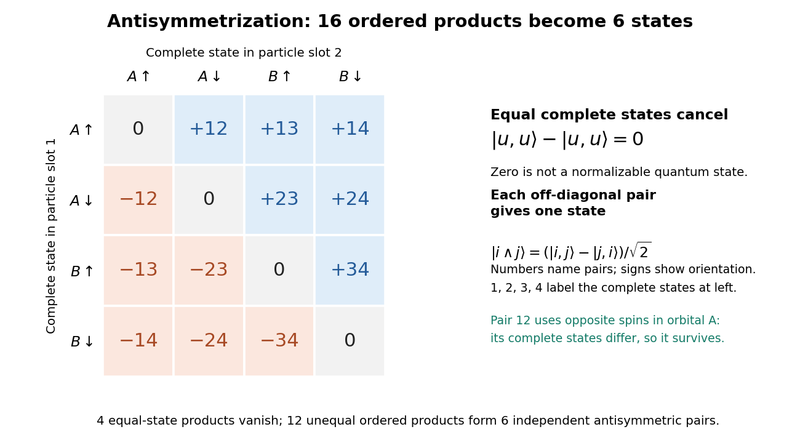

# Quantum mechanics

↑ **Parent:** [Branches of physics](physics.md#branches-of-physics)  
ⓦ [Wiki](https://en.wikipedia.org/wiki/Quantum_mechanics)

Quantum mechanics describes a [quantum system](#quantum-system) using a [quantum state](#quantum-state), with [observables](#observable) represented by [self-adjoint operators](linear-operator-theory.md#self-adjoint-operator). For a single particle in one dimension, a [pure state](quantum-theory.md#pure-state) can be described by a [wavefunction](#wave-function) $\psi(x,t)$: its squared [modulus](complex-analysis.md#modulus) gives the [probability density](#probability-density) for position. The [Schrödinger equation](physics.md#schrodinger-equation) predicts how this [probability amplitude](#probability-amplitude) evolves between interventions; [measurement in quantum mechanics](quantum-measurement.md) connects it to experimental outcomes through the [Born rule](#born-rule). A [wavefunction](#wave-function) therefore predicts a distribution of possible positions rather than a single trajectory as in [classical mechanics](classical-mechanics.md).

The [infinite square well](#infinite-square-well) makes three central ideas visible with elementary [sine](geometry-and-topology.md#sine) functions. Confinement selects discrete [energy eigenvalues](#energy-eigenvalue); [wavefunction normalization](#wavefunction-normalization) converts a shape into quantitative [probabilities](probability-theory.md#probability); and a [quantum superposition](#quantum-superposition) can have a changing [probability density](#probability-density) even when each constituent [energy eigenstate](#energy-eigenstate) has a stationary one. This combination explains why [quantum mechanics](quantum-mechanics.md) uses both [linear algebra](linear-algebra.md) and [differential equations](differential-equation.md): [eigenfunctions](linear-operator-theory.md#eigenfunction) describe the building blocks, while [quantum phases](#quantum-phase) determine how they interfere. The same tools help explain the discrete energies of [chemical atoms](physics.md#atom-physics) and [molecules](chemistry.md#molecule), although their [Quantum Hamiltonians](#hamiltonian-quantum-mechanics) require different potentials and often many particles.

In his first 1926 paper, Erwin Schrödinger formulated quantization as an [eigenvalue](linear-operator-theory.md#eigenvalue) problem for a [hydrogen atom](physics.md#hydrogen-atom) in [nonrelativistic quantum mechanics](#nonrelativistic-quantum-mechanics). On its opening page he compared the emergence of integers with the number of [nodes of a standing wave](wave-equation.md#node-physics) on a vibrating string. The [infinite square well](#infinite-square-well) below realizes that appealing idea especially transparently: the allowed integers follow from the [boundary conditions](differential-equation.md#boundary-condition). This historical analogy concerns the origin of discrete energies; the [Born rule](#born-rule) supplies the statistical interpretation of the modern [wavefunction](#wave-function). [Schrödinger, Quantisierung als Eigenwertproblem, 1926, pp. 361–363](https://onlinelibrary.wiley.com/doi/pdf/10.1002/andp.19263840404).

**Table of contents**

- [Circular infinite quantum well](#circular-infinite-quantum-well)
- [Hegerfeldt theorem](#hegerfeldt-theorem)
- [Rotating-wave approximation](#rotating-wave-approximation)
- [Quantum rotor](#quantum-rotor)
  - [Real-time winding representation of a quantum rotor kernel](#real-time-winding-representation-of-a-quantum-rotor-kernel)
  - [Coupled quantum rotor chain](#coupled-quantum-rotor-chain)
    - [Harmonic phase mode of a quantum rotor chain](#harmonic-phase-mode-of-a-quantum-rotor-chain)
    - [Imaginary-time normalization for a coupled rotor chain](#imaginary-time-normalization-for-a-coupled-rotor-chain)
  - [Rotor winding-sector path integral](#rotor-winding-sector-path-integral)
    - [Momentum-winding duality of the quantum rotor](#momentum-winding-duality-of-the-quantum-rotor)
    - [Rotor return-kernel fluctuation prefactor](#rotor-return-kernel-fluctuation-prefactor)
- [Semiclassical quantization](#semiclassical-quantization)
  - [Bohr-Sommerfeld quantization](#bohr-sommerfeld-quantization)
- [Operator formalism](#operator-formalism)
- [Quasiparticle](#quasiparticle)
  - [Bogoliubov quasiparticle](#bogoliubov-quasiparticle)
  - [Polariton](#polariton)
  - [Exciton](#exciton)
    - [Exciton binding energy](#exciton-binding-energy)
    - [Wannier-Mott exciton](#wannier-mott-exciton)
      - [Relative permittivity](#relative-permittivity)
        - [Dielectric screening](#dielectric-screening)
    - [Frenkel exciton](#frenkel-exciton)
    - [Exciton optical transition](#exciton-optical-transition)
      - [Exciton absorption experiment in copper(I) oxide](#exciton-absorption-experiment-in-copper-i-oxide)
        - [Copper(I) oxide](#copper-i-oxide)
  - [Electron hole](#electron-hole)
    - [Electron-hole recombination](#electron-hole-recombination)
    - [Valence band](#valence-band)
    - [Conduction band](#conduction-band)
- [Sudden approximation](#sudden-approximation)
  - [Quantum state continuity at a finite Hamiltonian step](#quantum-state-continuity-at-a-finite-hamiltonian-step)
    - [Impulsive quantum kick](#impulsive-quantum-kick)
  - [Quantum quench](#quantum-quench)
    - [Two-level sudden quench](#two-level-sudden-quench)
      - [Work in a two-level sudden quench](#work-in-a-two-level-sudden-quench)
      - [Post-quench oscillations in a two-level system](#post-quench-oscillations-in-a-two-level-system)
    - [Cold-atom collapse and revival after a lattice quench](#cold-atom-collapse-and-revival-after-a-lattice-quench)
  - [Ground-state overlap after sudden expansion of a square well](#ground-state-overlap-after-sudden-expansion-of-a-square-well)
- [Canonical quantization](#canonical-quantization)
  - [Weyl ordering](#weyl-ordering)
  - [Canonical quantization of the electromagnetic field](#canonical-quantization-of-the-electromagnetic-field)
    - [Gauge reduction of the Maxwell Hamiltonian](#gauge-reduction-of-the-maxwell-hamiltonian)
    - [Canonical transverse photon field](#canonical-transverse-photon-field)
      - [Transverse equal-time commutator](#transverse-equal-time-commutator)
    - [Primary momentum constraint of the electromagnetic potential](#primary-momentum-constraint-of-the-electromagnetic-potential)
- [Nonrelativistic quantum mechanics](#nonrelativistic-quantum-mechanics)
- [Berry phase](#berry-phase)
  - [Berry connection](#berry-connection)
  - [Berry phase of a Bloch-sphere latitude](#berry-phase-of-a-bloch-sphere-latitude)
  - [Berry-phase interference with a reference path](#berry-phase-interference-with-a-reference-path)
- [Classical limit](#classical-limit)
- [Parity](#parity)
  - [Parity conservation](#parity-conservation)
  - [Parity operator](#parity-operator)
  - [Orbital parity](#orbital-parity)
  - [Multiparticle parity](#multiparticle-parity)
    - [Parity selection rule for a two-body decay](#parity-selection-rule-for-a-two-body-decay)
  - [Spatial reflection](#spatial-reflection)
    - [Pseudoscalar](#pseudoscalar)
- [Photon](#photon)
  - [Photon polarization](#photon-polarization)
  - [Photon polarization vector](#photon-polarization-vector)
  - [Two physical polarizations of a photon](#two-physical-polarizations-of-a-photon)
  - [Photon absorption](#photon-absorption)
  - [Photon emission](#photon-emission)
- [Free particle](#free-particle)
- [Ground state](#ground-state)
  - [Ground-state subspace](#ground-state-subspace)
  - [Ground-state degeneracy](#ground-state-degeneracy)
  - [Ground-state energy](#ground-state-energy)
    - [Quantum variational principle](#quantum-variational-principle)
      - [Exponential variational bound for the Yukawa potential](#exponential-variational-bound-for-the-yukawa-potential)
      - [Power-law quantum virial theorem](#power-law-quantum-virial-theorem)
- [Energy eigenvalue](#energy-eigenvalue)
  - [Energy eigenstate](#energy-eigenstate)
  - [Energy eigenspace](#energy-eigenspace)
  - [Excited state](#excited-state)
    - [Franck-Hertz experiment](#franck-hertz-experiment)
    - [First excited state](#first-excited-state)
  - [Eigenstate](#eigenstate)
    - [Momentum eigenstate](#momentum-eigenstate)
- [Quantum system](#quantum-system)
  - [Quantum state](#quantum-state)
    - [Dicke state](#dicke-state)
      - [W state](#w-state)
      - [One-qubit reduction of Dicke-state superpositions](#one-qubit-reduction-of-dicke-state-superpositions)
    - [Flavor eigenstate](#flavor-eigenstate)
    - [Quantum superposition](#quantum-superposition)
    - [Qudit](#qudit)
      - [Qudit shift and phase operators](#qudit-shift-and-phase-operators)
    - [Qubit](#qubit)
      - [Qubit state](#qubit-state)
    - [Qutrit](#qutrit)
    - [Quantum number](#quantum-number)
    - [Quantum phase](#quantum-phase)
      - [Geometric phase](#geometric-phase)
      - [Dynamical phase](#dynamical-phase)
      - [Global phase](#global-phase)
        - [Global phase of an uncontrolled quantum gate is unobservable](#global-phase-of-an-uncontrolled-quantum-gate-is-unobservable)
    - [Observable](#observable)
      - [Quantum uncertainty](#quantum-uncertainty)
      - [Expectation value](#expectation-value)
        - [Spin expectation value](#spin-expectation-value)
        - [Estimating a quantum expectation value](#estimating-a-quantum-expectation-value)
          - [Stern-Gerlach expectation estimation](#stern-gerlach-expectation-estimation)
      - [Hamiltonian (quantum mechanics)](#hamiltonian-quantum-mechanics)
        - [Quadratic form of a positive quantum Hamiltonian](#quadratic-form-of-a-positive-quantum-hamiltonian)
        - [Morse potential](#morse-potential)
          - [Morse oscillator](#morse-oscillator)
        - [Factorized quantum Hamiltonian](#factorized-quantum-hamiltonian)
          - [Normalizable zero mode of a polynomial factorized Hamiltonian](#normalizable-zero-mode-of-a-polynomial-factorized-hamiltonian)
        - [Quantum symmetry of a Hamiltonian](#quantum-symmetry-of-a-hamiltonian)
          - [Conserved generator of a continuous quantum symmetry](#conserved-generator-of-a-continuous-quantum-symmetry)
        - [Unitary time evolution](#unitary-time-evolution)
          - [Perfect quantum state transfer](#perfect-quantum-state-transfer)
          - [Schrödinger picture](#schrodinger-picture)
          - [Time-evolution operator](#time-evolution-operator)
          - [Quantum-mechanical propagator](#quantum-mechanical-propagator)
            - [Quantum-mechanical propagator in a constant force](#quantum-mechanical-propagator-in-a-constant-force)
            - [Normalized short-time Schrödinger kernel](#normalized-short-time-schrodinger-kernel)
              - [Schrödinger equation from a short-time path integral](#schrodinger-equation-from-a-short-time-path-integral)
            - [Free-particle propagator](#free-particle-propagator)
            - [Semiclassical propagator](#semiclassical-propagator)
              - [Dirichlet fluctuation determinant of a semiclassical propagator](#dirichlet-fluctuation-determinant-of-a-semiclassical-propagator)
              - [Van Vleck determinant](#van-vleck-determinant)
          - [Heisenberg picture](#heisenberg-picture)
            - [Heisenberg equation of motion](#heisenberg-equation-of-motion)
          - [Interaction picture](#interaction-picture)
          - [Time-reversal symmetry in quantum mechanics](#time-reversal-symmetry-in-quantum-mechanics)
            - [Quantum time-reversal operator](#quantum-time-reversal-operator)
            - [Unitary time reversal reverses the energy spectrum](#unitary-time-reversal-reverses-the-energy-spectrum)
            - [Antiunitary time reversal preserves the energy spectrum](#antiunitary-time-reversal-preserves-the-energy-spectrum)
    - [Bound state](#bound-state)
      - [Coulomb bound state](#coulomb-bound-state)
        - [Polynomial construction of hydrogen S states](#polynomial-construction-of-hydrogen-s-states)
    - [Stationary state](#stationary-state)
- [Particle in a ring](#particle-in-a-ring)
- [Planck constant](#planck-constant)
- [Wave function](#wave-function)
  - [Wavefunction normalization](#wavefunction-normalization)
  - [Matter wave](#matter-wave)
    - [Matter-wave interference](#matter-wave-interference)
    - [de Broglie wavelength](#de-broglie-wavelength)
      - [Free-particle momentum convention](#free-particle-momentum-convention)
      - [Electron accelerating-voltage wavelength](#electron-accelerating-voltage-wavelength)
    - [Neutron interferometer](#neutron-interferometer)
      - [Colella–Overhauser–Werner experiment](#colella-overhauser-werner-experiment)
  - [Plane wave](#plane-wave)
  - [Probability amplitude](#probability-amplitude)
    - [Born rule](#born-rule)
      - [Two-level quantum return probability](#two-level-quantum-return-probability)
      - [Two-level observable transition probability](#two-level-observable-transition-probability)
      - [Wigner's theorem](#wigner-s-theorem)
        - [Projective unitary representation](#projective-unitary-representation)
      - [Energy measurement](#energy-measurement)
  - [Normalizable wavefunction](#normalizable-wavefunction)
  - [Probability density](#probability-density)
  - [Probability current](#probability-current)
    - [Probability continuity equation](#probability-continuity-equation)
      - [Conservation of quantum probability](#conservation-of-quantum-probability)
  - [Gaussian wave packet](#gaussian-wave-packet)
    - [Gaussian evolution in an inverted harmonic oscillator](#gaussian-evolution-in-an-inverted-harmonic-oscillator)
- [Potential barrier](#potential-barrier)
  - [Quantum tunnelling](#quantum-tunnelling)
    - [Finite rectangular barrier matching](#finite-rectangular-barrier-matching)
      - [Tunnelling decay constant](#tunnelling-decay-constant)
      - [Rectangular barrier transmission probability](#rectangular-barrier-transmission-probability)
        - [Opaque barrier approximation](#opaque-barrier-approximation)
    - [Evanescent probability current](#evanescent-probability-current)
    - [Current-distance test of vacuum tunnelling](#current-distance-test-of-vacuum-tunnelling)
      - [Piezoelectricity](#piezoelectricity)
    - [Tunnel junction](#tunnel-junction)
      - [Work function](#work-function)
      - [Scanning tunneling microscopy](#scanning-tunneling-microscopy)
        - [Scanning tunneling microscope](#scanning-tunneling-microscope)
    - [Double-well tunneling splitting](#double-well-tunneling-splitting)
    - [Finite square barrier transmission at half barrier height](#finite-square-barrier-transmission-at-half-barrier-height)
- [Hermitian operator on a nonorthogonal two-state basis](#hermitian-operator-on-a-nonorthogonal-two-state-basis)
  - [Commuting time-dependent two-state Hamiltonian](#commuting-time-dependent-two-state-hamiltonian)
- [Second moments of a complex Gaussian wave packet](#second-moments-of-a-complex-gaussian-wave-packet)
- [Finite square well](#finite-square-well)
  - [Attractive potential ordering does not order quantum reflection](#attractive-potential-ordering-does-not-order-quantum-reflection)
  - [Resonant transmission through a square well](#resonant-transmission-through-a-square-well)
  - [Spherical square well](#spherical-square-well)
    - [Spherically symmetric bound state of a finite well](#spherically-symmetric-bound-state-of-a-finite-well)
  - [Bound-state thresholds for a square well with one hard wall](#bound-state-thresholds-for-a-square-well-with-one-hard-wall)
  - [Hard-core spherical square-well potential](#hard-core-spherical-square-well-potential)
    - [Scattering length of a hard-core spherical square-well potential](#scattering-length-of-a-hard-core-spherical-square-well-potential)
- [Delta potential](#delta-potential)
  - [Central delta barrier in a symmetric infinite well](#central-delta-barrier-in-a-symmetric-infinite-well)
    - [High-energy shift from a central delta barrier](#high-energy-shift-from-a-central-delta-barrier)
  - [Odd bound state and resonance of two delta barriers](#odd-bound-state-and-resonance-of-two-delta-barriers)
  - [Bound state in a delta potential](#bound-state-in-a-delta-potential)
  - [Multiple delta potential](#multiple-delta-potential)
    - [Symmetric double-delta potential](#symmetric-double-delta-potential)
      - [Odd-parity S-matrix of a symmetric double-delta potential](#odd-parity-s-matrix-of-a-symmetric-double-delta-potential)
        - [Odd bound state of a symmetric double-delta potential](#odd-bound-state-of-a-symmetric-double-delta-potential)
        - [Odd resonance of a strongly repulsive symmetric double-delta potential](#odd-resonance-of-a-strongly-repulsive-symmetric-double-delta-potential)
  - [Scattering by a delta potential](#scattering-by-a-delta-potential)
- [Quantum scattering](#quantum-scattering)
  - [Quantum reflection probability](#quantum-reflection-probability)
  - [Transmission amplitude](#transmission-amplitude)
  - [S-matrix](#s-matrix)
    - [Redundant pole of a scattering matrix](#redundant-pole-of-a-scattering-matrix)
    - [Jost function](#jost-function)
    - [Unit-modulus hyperbolic scattering block](#unit-modulus-hyperbolic-scattering-block)
    - [Physical rapidity strip](#physical-rapidity-strip)
      - [Crossed-channel pole in diagonal factorized scattering](#crossed-channel-pole-in-diagonal-factorized-scattering)
      - [Relativistic bound-state mass from a rapidity pole](#relativistic-bound-state-mass-from-a-rapidity-pole)
    - [Hermitian analyticity of a two-particle S-matrix](#hermitian-analyticity-of-a-two-particle-s-matrix)
  - [Scattering wavefunction](#scattering-wavefunction)
  - [Scattering state](#scattering-state)
  - [Partial wave](#partial-wave)
  - [Partial-wave scattering](#partial-wave-scattering)
  - [Differential scattering cross-section](#differential-scattering-cross-section)
    - [Central-potential classical differential cross-section](#central-potential-classical-differential-cross-section)
    - [Quantum differential cross-section from a scattering amplitude](#quantum-differential-cross-section-from-a-scattering-amplitude)
  - [Reflected wave](#reflected-wave)
  - [Transmission probability](#transmission-probability)
  - [One-dimensional S-matrix](#one-dimensional-s-matrix)
    - [Parity basis of a one-dimensional S-matrix](#parity-basis-of-a-one-dimensional-s-matrix)
    - [One-dimensional transfer matrix from scattering amplitudes](#one-dimensional-transfer-matrix-from-scattering-amplitudes)
  - [Partial-wave S-matrix](#partial-wave-s-matrix)
    - [Scattering phase shift](#scattering-phase-shift)
      - [Periodic-box phase-shift quantization](#periodic-box-phase-shift-quantization)
    - [S wave (quantum scattering)](#s-wave-quantum-scattering)
    - [Partial-wave expansion of a scattering amplitude](#partial-wave-expansion-of-a-scattering-amplitude)
      - [Partial-wave total scattering cross-section](#partial-wave-total-scattering-cross-section)
    - [Partial-wave unitarity](#partial-wave-unitarity)
    - [Unitarity and reflection identities for a partial-wave S-matrix](#unitarity-and-reflection-identities-for-a-partial-wave-s-matrix)
    - [Scattering length from a partial-wave S-matrix](#scattering-length-from-a-partial-wave-s-matrix)
      - [Repulsive spherical barrier scattering length](#repulsive-spherical-barrier-scattering-length)
      - [Zero-energy scattering resonance](#zero-energy-scattering-resonance)
    - [Bound-state poles of a partial-wave S-matrix](#bound-state-poles-of-a-partial-wave-s-matrix)
      - [Hyperbolic-tangent S-wave exterior solution](#hyperbolic-tangent-s-wave-exterior-solution)
    - [Scattering resonance](#scattering-resonance)
      - [Resonance pole](#resonance-pole)
  - [Logarithmic-derivative matching](#logarithmic-derivative-matching)
  - [Hard-sphere limit](#hard-sphere-limit)
  - [Lippmann-Schwinger equation](#lippmann-schwinger-equation)
  - [Scattering amplitude](#scattering-amplitude)
    - [Optical theorem](#optical-theorem)
    - [Scattering-amplitude factorization](#scattering-amplitude-factorization)
    - [Crossing symmetry](#crossing-symmetry)
    - [Relativistic scattering cross-section](#relativistic-scattering-cross-section)
      - [Inclusive electron-positron annihilation into hadrons](#inclusive-electron-positron-annihilation-into-hadrons)
        - [Hadronic R ratio](#hadronic-r-ratio)
      - [Elastic scattering from a quartic scalar contact interaction](#elastic-scattering-from-a-quartic-scalar-contact-interaction)
      - [Invariant flux factor](#invariant-flux-factor)
      - [Lorentz-invariant phase-space measure](#lorentz-invariant-phase-space-measure)
        - [Relativistic two-body phase space](#relativistic-two-body-phase-space)
        - [Positive-energy on-shell delta function identity](#positive-energy-on-shell-delta-function-identity)
        - [Two-body decay phase space](#two-body-decay-phase-space)
        - [Identical-particle factor in a final-state phase-space integral](#identical-particle-factor-in-a-final-state-phase-space-integral)
    - [Momentum transfer](#momentum-transfer)
    - [Elastic scattering](#elastic-scattering)
    - [Diffraction](#diffraction)
      - [Electron diffraction](#electron-diffraction)
        - [Davisson–Germer experiment](#davisson-germer-experiment)
        - [Finite-row electron diffraction model](#finite-row-electron-diffraction-model)
    - [Crystal scattering](#crystal-scattering)
      - [Bravais lattice](#bravais-lattice)
        - [Unit cell](#unit-cell)
          - [Primitive unit cell](#primitive-unit-cell)
        - [Face-centered tetragonal lattice](#face-centered-tetragonal-lattice)
        - [Face-centered cubic lattice](#face-centered-cubic-lattice)
        - [Lattice point](#lattice-point)
        - [Reciprocal lattice](#reciprocal-lattice)
          - [Wigner-Seitz cell](#wigner-seitz-cell)
            - [Reciprocal lattice and Wigner-Seitz cell of the unit triangular lattice](#reciprocal-lattice-and-wigner-seitz-cell-of-the-unit-triangular-lattice)
        - [Cubic crystal system](#cubic-crystal-system)
          - [Body-centered cubic lattice](#body-centered-cubic-lattice)
            - [Reciprocal lattice of the 2023 Cambridge body-centered cubic basis](#reciprocal-lattice-of-the-2023-cambridge-body-centered-cubic-basis)
      - [Crystal lattice structure factor](#crystal-lattice-structure-factor)
        - [Reciprocal-lattice peaks of a finite crystal](#reciprocal-lattice-peaks-of-a-finite-crystal)
      - [Elastic Bragg scattering condition](#elastic-bragg-scattering-condition)
        - [Bragg's law](#bragg-s-law)
        - [Bragg scattering](#bragg-scattering)
    - [Bound-state pole of the scattering amplitude](#bound-state-pole-of-the-scattering-amplitude)
- [Supersymmetric quantum mechanics](#supersymmetric-quantum-mechanics)
  - [Supersymmetric factorization and zero-mode normalizability](#supersymmetric-factorization-and-zero-mode-normalizability)
  - [Witten index](#witten-index)
  - [Gradient superpotential Hamiltonian in supersymmetric quantum mechanics](#gradient-superpotential-hamiltonian-in-supersymmetric-quantum-mechanics)
    - [Zero mode in the fermion-vacuum sector](#zero-mode-in-the-fermion-vacuum-sector)
  - [Fermion-number sectors in supersymmetric quantum mechanics](#fermion-number-sectors-in-supersymmetric-quantum-mechanics)
    - [Radial superpartner in three-dimensional supersymmetric quantum mechanics](#radial-superpartner-in-three-dimensional-supersymmetric-quantum-mechanics)
  - [Fermionic Fock space](#fermionic-fock-space)
    - [Polarized fermionic Fock space](#polarized-fermionic-fock-space)
      - [Fermion-boson correspondence on the circle](#fermion-boson-correspondence-on-the-circle)
      - [Heisenberg current algebra of a fermion on the circle](#heisenberg-current-algebra-of-a-fermion-on-the-circle)
        - [Fermionic current on the circle](#fermionic-current-on-the-circle)
      - [Segal quantization criterion for fermions](#segal-quantization-criterion-for-fermions)
    - [Fermionic operator](#fermionic-operator)
    - [Clifford vacuum](#clifford-vacuum)
    - [Canonical anticommutation relations](#canonical-anticommutation-relations)
      - [Fermionic bilinear charge algebra](#fermionic-bilinear-charge-algebra)
        - [Triplet charged-current closure on electromagnetic charge](#triplet-charged-current-closure-on-electromagnetic-charge)
      - [Equal-time canonical anticommutator of a Dirac field](#equal-time-canonical-anticommutator-of-a-dirac-field)
    - [Fermion number operator](#fermion-number-operator)
      - [Supertrace](#supertrace)
        - [Equivariant supertrace](#equivariant-supertrace)
  - [Fermionic path integral](#fermionic-path-integral)
    - [Berezin integral](#berezin-integral)
      - [Grassmann change-of-variables formula](#grassmann-change-of-variables-formula)
    - [Short-time limit of a supersymmetric path integral](#short-time-limit-of-a-supersymmetric-path-integral)
  - [Twisted de Rham differential](#twisted-de-rham-differential)
  - [Partner Hamiltonians](#partner-hamiltonians)
  - [Pöschl-Teller potential](#poschl-teller-potential)
    - [Supersymmetric factorization of the one-soliton potential](#supersymmetric-factorization-of-the-one-soliton-potential)
- [Reflectionless potential](#reflectionless-potential)
- [Position operator](#position-operator)
  - [Position eigenstate](#position-eigenstate)
- [Momentum operator](#momentum-operator)
  - [Spatial translation operator](#spatial-translation-operator)
  - [Position representation of the momentum operator](#position-representation-of-the-momentum-operator)
  - [Canonical commutation relation](#canonical-commutation-relation)
    - [Weyl relations](#weyl-relations)
      - [Stone-von Neumann theorem](#stone-von-neumann-theorem)
      - [Gaussian projection in a Weyl representation](#gaussian-projection-in-a-weyl-representation)
- [Ehrenfest theorem](#ehrenfest-theorem)
  - [Proof of Ehrenfest theorem from the Schrodinger equation](#proof-of-ehrenfest-theorem-from-the-schrodinger-equation)
  - [Classical equations from Ehrenfest theorem](#classical-equations-from-ehrenfest-theorem)
  - [Correspondence principle](#correspondence-principle)
- [Angular momentum operator](#angular-momentum-operator)
  - [Axially symmetric quadratic orbital eigenfunction](#axially-symmetric-quadratic-orbital-eigenfunction)
  - [Angular momentum lowering operator](#angular-momentum-lowering-operator)
    - [Normalized highest-weight lowering formula](#normalized-highest-weight-lowering-formula)
  - [Angular momentum eigenstate](#angular-momentum-eigenstate)
  - [Angular momentum commutation relations](#angular-momentum-commutation-relations)
  - [Addition of angular momentum](#addition-of-angular-momentum)
    - [Total angular momentum operator](#total-angular-momentum-operator)
    - [Total-spin sector](#total-spin-sector)
      - [Three spin-one angular-momentum decomposition](#three-spin-one-angular-momentum-decomposition)
        - [Symmetric three-spin-one subspace](#symmetric-three-spin-one-subspace)
      - [Spin-one Cartesian basis](#spin-one-cartesian-basis)
      - [Spin-dot-product eigenvalue](#spin-dot-product-eigenvalue)
    - [Clebsch-Gordan decomposition](#clebsch-gordan-decomposition)
      - [Lowest-weight coupling of two angular momenta](#lowest-weight-coupling-of-two-angular-momenta)
    - [Highest-weight states in angular momentum addition](#highest-weight-states-in-angular-momentum-addition)
    - [Singlet state](#singlet-state)
      - [Spin-one-half singlet state](#spin-one-half-singlet-state)
    - [Spin-one-half triplet state](#spin-one-half-triplet-state)
  - [Spin](#spin)
    - [Jordan–Wigner transformation](#jordan-wigner-transformation)
    - [Spin one-half](#spin-one-half)
      - [Spin one-half along an axis](#spin-one-half-along-an-axis)
    - [Stern-Gerlach experiment](#stern-gerlach-experiment)
    - [Holstein–Primakoff transformation](#holstein-primakoff-transformation)
      - [Holstein–Primakoff occupation constraint](#holstein-primakoff-occupation-constraint)
    - [Spin commutation relations](#spin-commutation-relations)
    - [Irreducible spin representation](#irreducible-spin-representation)
      - [Wigner D-matrix](#wigner-d-matrix)
      - [Unitary highest-weight termination](#unitary-highest-weight-termination)
      - [Spin-one half-turn matrix](#spin-one-half-turn-matrix)
    - [Spin ladder operator](#spin-ladder-operator)
      - [Spin raising operator](#spin-raising-operator)
      - [Spin lowering operator](#spin-lowering-operator)
    - [Spin-three-halves matrices](#spin-three-halves-matrices)
    - [Spin coherent state](#spin-coherent-state)
      - [Spin coherent-state path integral](#spin-coherent-state-path-integral)
      - [Equatorial spin-three-halves coherent state](#equatorial-spin-three-halves-coherent-state)
    - [Larmor precession](#larmor-precession)
      - [Larmor precession of a spin coherent state](#larmor-precession-of-a-spin-coherent-state)
        - [Time evolution under a spin-Z Hamiltonian](#time-evolution-under-a-spin-z-hamiltonian)
    - [Heisenberg model](#heisenberg-model)
      - [Magnetization sectors of a spin chain](#magnetization-sectors-of-a-spin-chain)
      - [Excitation-number conservation in XXZ spin chains](#excitation-number-conservation-in-xxz-spin-chains)
      - [Single-excitation subspace](#single-excitation-subspace)
        - [XY exchange interaction](#xy-exchange-interaction)
          - [Symmetric-arm reduction of an exchange Hamiltonian](#symmetric-arm-reduction-of-an-exchange-hamiltonian)
        - [Endpoint control of an XX spin chain](#endpoint-control-of-an-xx-spin-chain)
      - [Heisenberg antiferromagnet](#heisenberg-antiferromagnet)
        - [Bipartite spin rotation](#bipartite-spin-rotation)
      - [Heisenberg ferromagnet](#heisenberg-ferromagnet)
        - [Ferromagnetic ground-state multiplet](#ferromagnetic-ground-state-multiplet)
      - [Two-spin Heisenberg Hamiltonian in an opposing longitudinal field](#two-spin-heisenberg-hamiltonian-in-an-opposing-longitudinal-field)
      - [All-to-all Heisenberg model](#all-to-all-heisenberg-model)
      - [Infinite-coordination Heisenberg antiferromagnet](#infinite-coordination-heisenberg-antiferromagnet)
- [Infinite square well](#infinite-square-well)
  - [Energy form of a half-well sine state](#energy-form-of-a-half-well-sine-state)
  - [Ramp-state expansion in a symmetric infinite well](#ramp-state-expansion-in-a-symmetric-infinite-well)
  - [Particle in a rectangular box](#particle-in-a-rectangular-box)
- [Degenerate energy levels](#degenerate-energy-levels)
- [Orbital angular momentum](#orbital-angular-momentum)
  - [Highest-weight complex-coordinate orbital wavefunction](#highest-weight-complex-coordinate-orbital-wavefunction)
  - [Angular momentum of a homogeneous harmonic polynomial](#angular-momentum-of-a-homogeneous-harmonic-polynomial)
  - [Angular momentum of a radial function times a linear polynomial](#angular-momentum-of-a-radial-function-times-a-linear-polynomial)
  - [Magnetic quantum number](#magnetic-quantum-number)
  - [Rotation commutators for orbital angular momentum](#rotation-commutators-for-orbital-angular-momentum)
  - [Orbital angular momentum commutation relations](#orbital-angular-momentum-commutation-relations)
  - [Angular momentum ladder operator](#angular-momentum-ladder-operator)
  - [Squared orbital angular momentum in position and momentum operators](#squared-orbital-angular-momentum-in-position-and-momentum-operators)
    - [Spherical Laplacian from orbital angular momentum](#spherical-laplacian-from-orbital-angular-momentum)
  - [Angular momentum ladder variable](#angular-momentum-ladder-variable)
    - [Angular momentum of a complex-coordinate Gaussian state](#angular-momentum-of-a-complex-coordinate-gaussian-state)
  - [Rotational invariance of a central-potential Hamiltonian](#rotational-invariance-of-a-central-potential-hamiltonian)
    - [Separation of a two-dimensional central-potential eigenstate](#separation-of-a-two-dimensional-central-potential-eigenstate)
- [Quantum harmonic oscillator](#quantum-harmonic-oscillator)
  - [Stability of monomial ladder-operator perturbations](#stability-of-monomial-ladder-operator-perturbations)
  - [Harmonic oscillator transition kernel](#harmonic-oscillator-transition-kernel)
  - [Minimum-energy normalized oscillator mode](#minimum-energy-normalized-oscillator-mode)
  - [One-dimensional harmonic oscillator form domain](#one-dimensional-harmonic-oscillator-form-domain)
    - [Graph estimate for the harmonic oscillator](#graph-estimate-for-the-harmonic-oscillator)
      - [Resolvent of the shifted harmonic oscillator](#resolvent-of-the-shifted-harmonic-oscillator)
  - [Thermal partition function of a quantum harmonic oscillator](#thermal-partition-function-of-a-quantum-harmonic-oscillator)
  - [Displaced quantum harmonic oscillator](#displaced-quantum-harmonic-oscillator)
    - [Ground-state overlap after sudden oscillator displacement](#ground-state-overlap-after-sudden-oscillator-displacement)
  - [Zero-point energy](#zero-point-energy)
  - [Squeezed coherent state](#squeezed-coherent-state)
  - [Creation and annihilation operators](#creation-and-annihilation-operators)
    - [Annihilation operator](#annihilation-operator)
    - [Creation operator](#creation-operator)
    - [Bosonic creation operator](#bosonic-creation-operator)
    - [Bosonic annihilation operator](#bosonic-annihilation-operator)
    - [Single-mode squeeze operator](#single-mode-squeeze-operator)
      - [Squeezed vacuum state](#squeezed-vacuum-state)
        - [Multimode squeezed vacuum](#multimode-squeezed-vacuum)
    - [Number operator](#number-operator)
      - [Number state](#number-state)
      - [Integer spectrum of the number operator](#integer-spectrum-of-the-number-operator)
  - [Two commensurate quantum harmonic oscillators](#two-commensurate-quantum-harmonic-oscillators)
- [Three-dimensional isotropic harmonic oscillator](#three-dimensional-isotropic-harmonic-oscillator)
  - [Cartesian number state of the three-dimensional isotropic harmonic oscillator](#cartesian-number-state-of-the-three-dimensional-isotropic-harmonic-oscillator)
  - [Orbital angular momentum in oscillator ladder operators](#orbital-angular-momentum-in-oscillator-ladder-operators)
- [Two-dimensional isotropic harmonic oscillator](#two-dimensional-isotropic-harmonic-oscillator)
  - [Shifted two-dimensional oscillator in a uniform electric field](#shifted-two-dimensional-oscillator-in-a-uniform-electric-field)
  - [Oscillator bilinear commutator](#oscillator-bilinear-commutator)
  - [Schwinger boson representation](#schwinger-boson-representation)
- [Fermi oscillator](#fermi-oscillator)
  - [Projection Hamiltonian](#projection-hamiltonian)
  - [Fermionic raising and lowering operator](#fermionic-raising-and-lowering-operator)
- [Tensor product of quantum systems](#tensor-product-of-quantum-systems)
  - [Jaynes-Cummings model](#jaynes-cummings-model)
  - [Multiparticle quantum state](#multiparticle-quantum-state)
    - [Particle exchange operator](#particle-exchange-operator)
      - [Indistinguishable particles](#indistinguishable-particles)
        - [Boson](#boson)
          - [Bosonic exchange symmetry](#bosonic-exchange-symmetry)
            - [Bosonic statistics from commuting creation operators](#bosonic-statistics-from-commuting-creation-operators)
        - [Fermion](#fermion)
          - [Fermi-Dirac statistics](#fermi-dirac-statistics)
          - [Exchange symmetry of two identical spin-one-half fermions](#exchange-symmetry-of-two-identical-spin-one-half-fermions)
          - [Pauli exclusion principle](#pauli-exclusion-principle)
            - [Spatial orbital](#spatial-orbital)
              - [Spin orbital](#spin-orbital)
            - [Two-particle antisymmetrization](#two-particle-antisymmetrization)
              - [Slater determinant](#slater-determinant)
            - [Exclusion versus particle position](#exclusion-versus-particle-position)
            - [Zero-temperature filling of finite fermion levels](#zero-temperature-filling-of-finite-fermion-levels)
              - [Fermionic state counting](#fermionic-state-counting)
            - [Fermionic atom antibunching](#fermionic-atom-antibunching)
              - [Pair detection correlation](#pair-detection-correlation)
              - [Magnetic trapping of neutral atoms](#magnetic-trapping-of-neutral-atoms)
              - [Time-of-flight atom detection](#time-of-flight-atom-detection)
                - [Microchannel plate detector](#microchannel-plate-detector)
        - [Spin-statistics theorem](#spin-statistics-theorem)
        - [Two identical spin-one bosons](#two-identical-spin-one-bosons)
          - [Degeneracy of two identical spin-one bosons with equally spaced orbital levels](#degeneracy-of-two-identical-spin-one-bosons-with-equally-spaced-orbital-levels)
  - [Decoupled Fermi oscillators](#decoupled-fermi-oscillators)
  - [Kronecker product representation of local operators](#kronecker-product-representation-of-local-operators)
  - [Decoupled commuting Hamiltonian terms](#decoupled-commuting-hamiltonian-terms)
- [Time-dependent perturbation theory](#time-dependent-perturbation-theory)
  - [Electric-dipole interaction](#electric-dipole-interaction)
    - [Electric-dipole selection rule](#electric-dipole-selection-rule)
  - [Continuum transition probability at long times](#continuum-transition-probability-at-long-times)
- [Time-independent perturbation theory](#time-independent-perturbation-theory)
  - [Hellmann–Feynman theorem](#hellmann-feynman-theorem)
  - [First-order energy correction](#first-order-energy-correction)
  - [Nondegenerate energy eigenvalue](#nondegenerate-energy-eigenvalue)
  - [First-order nondegenerate perturbation theory](#first-order-nondegenerate-perturbation-theory)
    - [First-order ground state of the quartic oscillator](#first-order-ground-state-of-the-quartic-oscillator)
  - [Second-order nondegenerate perturbation theory](#second-order-nondegenerate-perturbation-theory)
  - [Imaginary-coupled two-level Hamiltonian](#imaginary-coupled-two-level-hamiltonian)
  - [Bright and dark state reduction of a star-coupled Hamiltonian](#bright-and-dark-state-reduction-of-a-star-coupled-hamiltonian)
- [Degenerate perturbation theory](#degenerate-perturbation-theory)
  - [Perturbation diagonal within a degenerate eigenspace](#perturbation-diagonal-within-a-degenerate-eigenspace)
  - [Exact diagonalization within a degenerate subspace](#exact-diagonalization-within-a-degenerate-subspace)
    - [Resonant two-to-one oscillator coupling](#resonant-two-to-one-oscillator-coupling)
- [Pauli X eigenstate](#pauli-x-eigenstate)
- [Rectangular potential barrier](#rectangular-potential-barrier)
- [Perturbation theory (quantum mechanics)](#perturbation-theory-quantum-mechanics)
- [Hartree equations](#hartree-equations)

## Circular infinite quantum well

↑ **Parent:** [Quantum mechanics](quantum-mechanics.md)

A particle confined by a [Dirichlet boundary condition](differential-equation.md#dirichlet-boundary-condition) to a disc of radius $a$ has angular functions $e^{im\phi}$, $m\in\mathbb Z$, and regular radial [Bessel functions of the first kind](analysis.md#bessel-function-of-the-first-kind) $J_{|m|}(kr)$. Their boundary zeros give the displayed energies. The ground state belongs to $m=0$: nonzero angular modes add a nonnegative centrifugal term to the kinetic-energy form. At the origin exclude the singular radial solution, rather than accepting every square-integrable logarithmic function as a physical eigenstate.

## Hegerfeldt theorem

↑ **Parent:** [Quantum mechanics](quantum-mechanics.md)

Let $H$ be a self-adjoint Hamiltonian bounded below, $A$ a bounded positive operator and $p_A(t)=\langle e^{-iHt}\psi,Ae^{-iHt}\psi\rangle$. The [Hegerfeldt theorem](#hegerfeldt-theorem) states that either $p_A(t)$ vanishes identically or it is nonzero for almost every real time. In particular, vanishing throughout an open interval forces identically vanishing. The proof uses analytic continuation of $A^{1/2}e^{-iHt}\psi$ into the lower half-plane. Applied to an assumed sharp localization effect, this obstructs strict finite-speed localization for positive-energy one-particle dynamics. It does not identify a controllable superluminal signal: the localization observables and admissible local preparation procedures need separate analysis.

## Rotating-wave approximation

↑ **Parent:** [Quantum mechanics](quantum-mechanics.md)  
ⓦ [Wiki](https://en.wikipedia.org/wiki/Rotating-wave_approximation)

After expressing a driven [Quantum Hamiltonian](#hamiltonian-quantum-mechanics) in a suitable interaction or rotating frame, discard terms oscillating rapidly compared with the retained dynamics. Near a selected transition, this leaves resonant terms that accumulate coherently while counter-rotating terms average out to leading order. The drive strength and detuning must be small relative to the discarded oscillation frequencies over the intended regime; strong driving can require the neglected frequency shifts and corrections. The approximation supports [resonant quantum control](control-theory.md#resonant-quantum-control), but it is not exact merely because the carrier is tuned to resonance.

## Quantum rotor

↑ **Parent:** [Quantum mechanics](quantum-mechanics.md)

A quantum coordinate on a circle with kinetic Hamiltonian $\ell^2/(2I)$. Periodic wavefunctions have angular momentum $\hbar n$ and energy $\hbar^2n^2/(2I)$ for integer $n$. Its thermal trace has both a momentum-eigenstate sum and a topological winding-path representation. Twisted boundary conditions or flux would modify this spectrum and are separate models.

### Real-time winding representation of a quantum rotor kernel

↑ **Parent:** [Quantum rotor](#quantum-rotor)

The [quantum rotor](#quantum-rotor) with angle period $2\pi$ has both the spectral kernel $(2\pi)^{-1}\sum_n e^{in\Delta-i\hbar n^2T/(2I)}$ and the displayed winding representation. The [Poisson summation formula](fourier-analysis.md#poisson-summation-formula) converts one into the other by a [Gaussian integral](calculus.md#gaussian-integral). Each winding sector has a constant-velocity classical path and action $I(\Delta+2\pi m)^2/(2T)$. Quadratic fluctuations give the same prefactor in every sector, so this is exact. Real time is understood by $T\to T-i0$, which fixes the square-root branch and convergence prescription.

### Coupled quantum rotor chain

↑ **Parent:** [Quantum rotor](#quantum-rotor)

A chain with local rotor inertia and a phase-locking interaction $-J\cos(\phi_{n+1}-\phi_n)$. Its smooth-phase limit is an elastic phase field with inertia $I$ and stiffness $J$. Compact winding and phase-slip processes remain part of the full model even when absent from the Gaussian smooth-sector approximation.

#### Harmonic phase mode of a quantum rotor chain

↑ **Parent:** [Coupled quantum rotor chain](#coupled-quantum-rotor-chain)

Expanding the cosine gives a wave equation $I\phi_{tt}=J\phi_{xx}$ and a gapless phase mode with physical frequency $\sqrt{J/I}|q|$. The exact harmonic lattice frequency is $2\sqrt{J/I}|\sin(q/2)|$. It resembles [superfluid](statistical-physics.md#superfluid) sound. In one dimension, Gaussian phase fluctuations and possible compact [phase slips](dynamical-systems.md#phase-slip) require care before inferring true long-range order from this branch.

#### Imaginary-time normalization for a coupled rotor chain

↑ **Parent:** [Coupled quantum rotor chain](#coupled-quantum-rotor-chain)

When imaginary time is divided by $\hbar$ and ranges from zero to $\beta$, integrating rotor momenta gives $I\dot\phi^2/(2\hbar^2)$ but leaves the potential stiffness term $J(\partial_x\phi)^2/2$. Factoring $1/\hbar^2$ out of both terms requires spatial coefficient $\hbar^2J$ inside the bracket. Setting $\hbar=1$ hides this distinction, but restoring units must preserve it.

### Rotor winding-sector path integral

↑ **Parent:** [Quantum rotor](#quantum-rotor)

The thermal rotor [path integral](quantum-field-theory.md#path-integral) traces paths closed modulo $2\pi$. Lift them to the line and sum endpoints differing by $2\pi m$. In inverse-energy time $0<\tau<\beta$, the kinetic exponent is $I\int\dot\phi^2d\tau/(2\hbar^2)$. Integer $m$ counts trajectory windings, not angular-momentum eigenstates.

#### Momentum-winding duality of the quantum rotor

↑ **Parent:** [Rotor winding-sector path integral](#rotor-winding-sector-path-integral)

[Poisson resummation](fourier-analysis.md#poisson-summation-formula) relates the momentum sum $\sum_ne^{-\beta\hbar^2n^2/(2I)}$ to the winding sum $\sqrt{2\pi I/(\beta\hbar^2)}\sum_me^{-2\pi^2Im^2/(\beta\hbar^2)}$. Gaussian Fourier transformation proves equality, including the prefactor. The momentum form converges rapidly at low temperature and the winding form at high temperature.

#### Rotor return-kernel fluctuation prefactor

↑ **Parent:** [Rotor winding-sector path integral](#rotor-winding-sector-path-integral)

Writing $\phi=\phi_0+2\pi m\tau/\beta+\eta$ with endpoint-fixed $\eta$ separates winding action and Gaussian fluctuations. The latter give the free return kernel on the lifted line, $Z_0=\sqrt{I/(2\pi\hbar^2\beta)}$. The starting-angle integral supplies $2\pi$. Zero winding is not the same as the zero-momentum ground-state sector.

## Semiclassical quantization

↑ **Parent:** [Quantum mechanics](quantum-mechanics.md)

[Semiclassical quantization](#semiclassical-quantization) uses classical trajectories and actions to approximate quantum states in a regime where relevant actions are large compared with $\hbar$. Phase consistency on a periodic orbit leads to [Bohr-Sommerfeld quantization](#bohr-sommerfeld-quantization). Soliton [collective coordinates](classical-field-theory-soliton.md#collective-coordinate-of-a-soliton) can be quantized this way, while fluctuations supply additional corrections to the leading classical [mass](classical-mechanics.md#mass).

### Bohr-Sommerfeld quantization

↑ **Parent:** [Semiclassical quantization](#semiclassical-quantization)

Single-valued semiclassical phase on a closed classical orbit quantizes its action, with [Maslov index](symplectic-geometry.md#maslov-index) $\mu$ accounting for turning-point phase corrections. A cyclic angle has no oscillator turning points: its wavefunctions are $e^{i\ell q}$, with signed $\ell\in\mathbb Z$ for a $2\pi$ period and [canonical momentum](classical-mechanics.md#canonical-momentum) $\hbar\ell$. There is no half-integer shift for that free angular coordinate.

## Operator formalism

↑ **Parent:** [Quantum mechanics](quantum-mechanics.md)

The [operator formalism](#operator-formalism) describes a quantum system using states in a [Hilbert space](hilbert-space.md) and observables represented by [self-adjoint operators](linear-operator-theory.md#self-adjoint-operator) with suitable domains on that [Hilbert space](hilbert-space.md). Evolution and correlation functions are computed from [Hamiltonian operators](#hamiltonian-quantum-mechanics) and their [time-ordered products](perturbative-quantum-field-theory.md#time-ordered-product). For free [quantized fields](quantum-field-theory.md#quantized-field), the oscillator construction gives a [Fock space](quantum-field-theory.md#fock-space). The [operator-path-integral equivalence](quantum-field-theory.md#operator-path-integral-equivalence) relates these matrix elements to integrals over field histories.

## Quasiparticle

↑ **Parent:** [Quantum mechanics](quantum-mechanics.md)  
ⓦ [Wiki](https://en.wikipedia.org/wiki/Quasiparticle)

A quasiparticle is a collective excitation that can be described approximately by particle-like quantum numbers and dynamics, even though it is not an isolated elementary particle. [Excitons](#exciton) and [polaritons](#polariton) are examples.

### Bogoliubov quasiparticle

↑ **Parent:** [Quasiparticle](#quasiparticle)

A Bogoliubov [quasiparticle](#quasiparticle) is an excitation created by the diagonal mode operator obtained through a [Bogoliubov transformation](quantum-field-theory.md#bogoliubov-transformation). Its vacuum can contain particles in the original modes because creation and [annihilation operators](#annihilation-operator) mix. Examples include [antiferromagnetic spin waves](statistical-physics.md#antiferromagnetic-spin-wave), Bose-gas [phonons](statistical-physics.md#phonon) and paired-fermion excitations.

### Polariton

↑ **Parent:** [Quasiparticle](#quasiparticle)  
ⓦ [Wiki](https://en.wikipedia.org/wiki/Polariton)

A [polariton](#polariton) is a hybrid light–matter excitation formed by strong coupling between a [photon](#photon) and a material excitation. For an exciton-polariton, the material component is an [exciton](#exciton).

### Exciton

↑ **Parent:** [Quasiparticle](#quasiparticle)  
ⓦ [Wiki](https://en.wikipedia.org/wiki/Exciton)

An [exciton](#exciton) is a [bound state](#bound-state) of an [Electron](physics.md#electron) and an [electron hole](#electron-hole). Their opposite [electric charges](electromagnetism.md#electric-charge) attract through the [Coulomb potential](electromagnetism.md#coulomb-potential-energy), producing a neutral [quasiparticle](#quasiparticle) with internal relative motion and motion of its [center of mass](classical-mechanics.md#center-of-mass). In a [semiconductor](physics.md#semiconductor), promoting an [Electron](physics.md#electron) from the [valence band](#valence-band) into the [conduction band](#conduction-band) leaves an [electron hole](#electron-hole); the pair can occupy either an [exciton](#exciton) [bound state](#bound-state) or an unbound [scattering state](#scattering-state). Merely creating the two [charge carriers](electromagnetism.md#charge-carrier) does not establish binding. A neutral [exciton](#exciton) can transport excitation [energy](classical-mechanics.md#energy) without transporting net [electric charge](electromagnetism.md#electric-charge). Coupling this material excitation strongly to a [photon](#photon) can form a [polariton](#polariton).

The striking optical consequence is that an [exciton optical transition](#exciton-optical-transition) can absorb a [photon](#photon) with less [energy](classical-mechanics.md#energy) than the threshold for creating unbound [Electrons](physics.md#electron) and [electron holes](#electron-hole). The difference is the [exciton binding energy](#exciton-binding-energy), not an extra one-electron [energy band](quantum-theory.md#energy-band) inside the [band gap](quantum-theory.md#band-gap). The [Wannier-Mott exciton](#wannier-mott-exciton) supplies a useful large-radius model; the [Frenkel exciton](#frenkel-exciton) describes the opposite, tightly localized limit.[§3, printed pp. 4–6: bound pairs, effective masses and localized contrast](physics-bibliography.md#excitons-in-semiconductor-quantum-dots-by-matjaz-humar)

#### Exciton binding energy

↑ **Parent:** [Exciton](#exciton)

The [exciton binding energy](#exciton-binding-energy) is the positive [energy](classical-mechanics.md#energy) needed to separate a bound [Electron](physics.md#electron) and [electron hole](#electron-hole) into the relevant unbound [scattering states](#scattering-state). Compare the [exciton](#exciton) [energy](classical-mechanics.md#energy) $E_X$ with the continuum threshold $E_{\rm cont}$ at the same total [crystal momentum](quantum-theory.md#crystal-momentum) and for the same [energy bands](quantum-theory.md#energy-band). The negative internal [energy eigenvalue](#energy-eigenvalue) $-E_B$ and the positive separation cost $E_B$ are different sign conventions for related quantities. An [exciton](#exciton) may move freely through a perfect crystal while remaining internally bound: “free exciton” does not mean an unbound pair.

#### Wannier-Mott exciton

↑ **Parent:** [Exciton](#exciton)

A [Wannier-Mott exciton](#wannier-mott-exciton) has an internal [wave function](#wave-function) extending over many [unit cells](#unit-cell). Its simplest model assumes a three-dimensional bulk crystal, approximately parabolic [valence band](#valence-band) and [conduction band](#conduction-band), positive isotropic scalar [effective masses](quantum-theory.md#band-effective-mass) $m_e^*,m_h^*$, a constant scalar [relative permittivity](#relative-permittivity) $\epsilon_r$, and a dilute pair population. Replace microscopic crystal forces by those [effective masses](quantum-theory.md#band-effective-mass) and [dielectric screening](#dielectric-screening), and neglect exchange corrections and coupling to [phonons](statistical-physics.md#phonon). These assumptions must hold on the spatial and [energy](classical-mechanics.md#energy) scales of the particular [exciton](#exciton).

With relative coordinate $\mathbf r=\mathbf r_e-\mathbf r_h$, the internal [Hamiltonian operator](#hamiltonian-quantum-mechanics) is the three-dimensional [hydrogen atom](physics.md#hydrogen-atom) problem with a [reduced mass](classical-mechanics.md#reduced-mass) and a screened [Coulomb potential](electromagnetism.md#coulomb-potential-energy):

$$
H_{\rm rel}=-\frac{\hbar^2}{2\mu}\nabla_{\mathbf r}^2-\frac{e^2}{4\pi\epsilon_0\epsilon_r r},\qquad
\mu=\frac{m_e^*m_h^*}{m_e^*+m_h^*},\qquad M=m_e^*+m_h^*.
$$

Here $e$ is the [elementary charge](electromagnetism.md#elementary-charge), $\epsilon_0$ the [vacuum permittivity](electromagnetism.md#vacuum-permittivity), and $\hbar$ the reduced [Planck constant](#planck-constant). The internal [energy eigenvalues](#energy-eigenvalue), radius scale, and [exciton binding energies](#exciton-binding-energy) are

$$
a_B^*=\frac{4\pi\epsilon_0\epsilon_r\hbar^2}{\mu e^2},\qquad
R^*=\frac{\mu e^4}{2(4\pi\epsilon_0\epsilon_r)^2\hbar^2},\qquad
E_{{\rm rel},n}=-\frac{R^*}{n^2},\qquad E_{B,n}=\frac{R^*}{n^2}.
$$

The [principal quantum number](physics.md#principal-quantum-number) is $n=1,2,\ldots$. This reduction and these scales are derived in [Excitons in Semiconductor Quantum Dots by Matjaž Humar](physics-bibliography.md#excitons-in-semiconductor-quantum-dots-by-matjaz-humar) (§3, printed pp. 5–6, equations (13)–(26)).

To check the scales by [dimensional analysis](physics.md#dimensional-analysis), write $C=e^2/(4\pi\epsilon_0\epsilon_r)$, which has units of [energy](classical-mechanics.md#energy) times [length](physics.md#length). Then $a_B^*=\hbar^2/(\mu C)$ is a [length](physics.md#length) and $R^*=\mu C^2/(2\hbar^2)$ is an [energy](classical-mechanics.md#energy). Rescaling $r=a_B^*\rho$ makes $H_{\rm rel}/R^*=-\nabla_\rho^2-2/\rho$, the dimensionless [hydrogen atom](physics.md#hydrogen-atom) operator. The [Bohr radius](physics.md#bohr-radius) $a_B^*$ is a [wave function](#wave-function) scale, not the radius of a classical orbit; for this model's lowest internal [bound state](#bound-state), the mean separation is $3a_B^*/2$.

For the diagrams' hypothetical inputs $m_e^*=0.10m_0$, $m_h^*=0.40m_0$, $\epsilon_r=10$ and $E_g=1.500\,\mathrm{eV}$, where $m_0$ is the free [Electron](physics.md#electron) mass, independent substitution gives $\mu=0.080m_0$, $a_B^*\simeq6.615\,\mathrm{nm}$ and $R^*\simeq10.885\,\mathrm{meV}$. Here [electronvolts](chemistry.md#electronvolt) express [energy](classical-mechanics.md#energy). The [exciton binding energies](#exciton-binding-energy) for $n=1,2,3$ are approximately $10.885$, $2.721$ and $1.209\,\mathrm{meV}$. These are model calculations, not measured material parameters. The large-radius approximation additionally requires $a_B^*$ to be much larger than the crystal's [unit cell](#unit-cell) length scale. In a thin layer, with anisotropic [effective masses](quantum-theory.md#band-effective-mass), or with spatially varying [dielectric screening](#dielectric-screening), this three-dimensional formula is not generally valid.

##### Relative permittivity

↑ **Parent:** [Wannier-Mott exciton](#wannier-mott-exciton)  
ⓦ [Wiki](https://en.wikipedia.org/wiki/Relative_permittivity)

The dimensionless ratio of a medium's [permittivity](electromagnetism.md#permittivity) to [vacuum permittivity](electromagnetism.md#vacuum-permittivity). The constant scalar value used in a [Wannier-Mott exciton](#wannier-mott-exciton) is an approximation to the relevant material response.

###### Dielectric screening

↑ **Parent:** [Relative permittivity](#relative-permittivity)

Modification of the interaction between [electric charges](electromagnetism.md#electric-charge) by a medium's electrical response. In the simplest [Wannier-Mott exciton](#wannier-mott-exciton) model, the [Coulomb potential](electromagnetism.md#coulomb-potential-energy) is reduced by a constant [relative permittivity](#relative-permittivity); actual screening can depend on spatial and temporal scales.

#### Frenkel exciton

↑ **Parent:** [Exciton](#exciton)

A [Frenkel exciton](#frenkel-exciton) is an [exciton](#exciton) whose internal excitation is concentrated on the scale of one molecule or [unit cell](#unit-cell). The local excitation can transfer between sites; localized internal structure does not require an immobile [center of mass](classical-mechanics.md#center-of-mass). The large-radius [Wannier-Mott exciton](#wannier-mott-exciton) approximation cannot simply be extrapolated to this limit.[§3, printed p. 6: small-radius Frenkel contrast](physics-bibliography.md#excitons-in-semiconductor-quantum-dots-by-matjaz-humar)

#### Exciton optical transition

↑ **Parent:** [Exciton](#exciton)

For the ideal [Wannier-Mott exciton](#wannier-mott-exciton) in [energy bands](quantum-theory.md#energy-band) whose edges occur at the same [crystal momentum](quantum-theory.md#crystal-momentum), the pair excitation [energy](classical-mechanics.md#energy), measured from the unexcited crystal, is

$$
E_{X,n}(\mathbf K)=E_g-\frac{R^*}{n^2}+\frac{\hbar^2K^2}{2M}.
$$

Here $\hbar\mathbf K$ is the pair's total [crystal momentum](quantum-theory.md#crystal-momentum); the last term is [center of mass](classical-mechanics.md#center-of-mass) [kinetic energy](classical-mechanics.md#kinetic-energy). For a permitted [photon absorption](#photon-absorption) transition with negligible recoil [energy](classical-mechanics.md#energy), $\hbar\omega\simeq E_g-E_{B,n}$. An [electric-dipole selection rule](#electric-dipole-selection-rule) and a nonzero transition [matrix element](vector-space.md#matrix-element) are still needed: a [bound state](#bound-state) need not produce an observable [spectral line](stellar-astrophysics.md#spectral-line). If the relevant [energy band](quantum-theory.md#energy-band) edges have different values of [crystal momentum](quantum-theory.md#crystal-momentum), a [phonon](statistical-physics.md#phonon) can also be needed to conserve [crystal momentum](quantum-theory.md#crystal-momentum); subtracting a binding scale from a [band gap](quantum-theory.md#band-gap) alone does not specify the optical threshold.

**[Figure 1](#image-exciton-binding-energy-and-hypothetical-exciton-optical-transition-positions). Exciton binding energy and hypothetical exciton optical transition positions**. [Source](exciton-binding-optical-transition.py). Original three-dimensional [Wannier-Mott exciton](#wannier-mott-exciton) model with the inputs given above. Left: internal [energy eigenvalues](#energy-eigenvalue) relative to the unbound continuum. Right: corresponding optical [energy](classical-mechanics.md#energy) positions for hypothetical permitted transitions, with recoil neglected. Equal stick heights encode positions only, not predicted strengths or widths. The continuum threshold is $1.500\,\mathrm{eV}$; these sticks are not an empirical [optical spectrum](optics.md#optical-spectrum) and are not the [copper(I) oxide](#copper-i-oxide) experiment below.

For example, the lowest internal [bound state](#bound-state) in this hypothetical model costs $1.489115\,\mathrm{eV}$ to create optically, yet needs only $0.010885\,\mathrm{eV}$ more to dissociate. The large creation [energy](classical-mechanics.md#energy) and the small [exciton binding energy](#exciton-binding-energy) answer different physical questions. An [electron-hole recombination](#electron-hole-recombination) event can instead release excitation [energy](classical-mechanics.md#energy) by [photon emission](#photon-emission) or to other degrees of freedom; an emitted [photon](#photon) need not reproduce the original absorption [energy](classical-mechanics.md#energy) if relaxation intervened.

<h5 id="exciton-absorption-experiment-in-copper-i-oxide">Exciton absorption experiment in copper(I) oxide</h5>

↑ **Parent:** [Exciton optical transition](#exciton-optical-transition)

In [Giant Rydberg Excitons in Cuprous Oxide by Tomasz Kazimierczuk and others](physics-bibliography.md#giant-rydberg-excitons-in-cuprous-oxide-by-tomasz-kazimierczuk-and-others), a polished $34\,\mathrm{\mu m}$ [copper(I) oxide](#copper-i-oxide) crystal was mounted without strain at $1.2\,\mathrm K$. A tunable single-frequency dye [laser](optics.md#laser) scanned [photon](#photon) [energy](classical-mechanics.md#energy); balanced detection compared transmitted light with a reference beam. Transmission dips resolved [spectral lines](stellar-astrophysics.md#spectral-line) assigned to bound [excitons](#exciton) through [principal quantum number](physics.md#principal-quantum-number) $n=25$. Their convergence towards an unbound threshold supports a hydrogen-like internal series, with small systematic deviations.[pp. 3–5, figures 1–2; supplement, Experimental setup, pp. 3–5 and figure S2](physics-bibliography.md#giant-rydberg-excitons-in-cuprous-oxide-by-tomasz-kazimierczuk-and-others)

Controls mattered: restricting broadband illumination improved resolution of high-$n$ [excitons](#exciton); lowering [laser](optics.md#laser) power or expanding its spot reduced interaction-induced suppression. Balanced detection suppressed source fluctuations. The measurement probes optical resonances, not individual [Electron](physics.md#electron)-[electron hole](#electron-hole) trajectories or directly imaged radii. [Electric-dipole selection rules](#electric-dipole-selection-rule) favor P-envelope states in this material, unlike the hypothetical permitted lowest-state transition above. Finite resolution and crystal inhomogeneity affect [spectral lines](stellar-astrophysics.md#spectral-line); the inferred binding series requires a continuum threshold and a model.[pp. 3–5; supplement pp. 2–4 and 6–7, figure S3: selection rules, illumination tests, line corrections and deviations](physics-bibliography.md#giant-rydberg-excitons-in-cuprous-oxide-by-tomasz-kazimierczuk-and-others)

<h6 id="copper-i-oxide">Copper(I) oxide</h6>

↑ **Parent:** [Exciton absorption experiment in copper(I) oxide](#exciton-absorption-experiment-in-copper-i-oxide)  
ⓦ [Wiki](https://en.wikipedia.org/wiki/Copper(I)_oxide)

A [semiconductor](physics.md#semiconductor) used in the [exciton absorption experiment in copper(I) oxide](#exciton-absorption-experiment-in-copper-i-oxide).

### Electron hole

↑ **Parent:** [Quasiparticle](#quasiparticle)  
ⓦ [Wiki](https://en.wikipedia.org/wiki/Electron_hole)

An [electron hole](#electron-hole) is an unoccupied [Electron](physics.md#electron) [quantum state](#quantum-state) in an otherwise nearly full [energy band](quantum-theory.md#energy-band), often the [valence band](#valence-band). “Filled” refers to occupation of the allowed [quantum states](#quantum-state), not to filling all space with a continuous fluid of [Electrons](physics.md#electron). Each state, including its [spin](#spin) label, can hold at most one [Electron](physics.md#electron) by the [Pauli exclusion principle](#pauli-exclusion-principle). The almost full [energy band](quantum-theory.md#energy-band) and its few missing occupants are therefore simpler to describe as a background plus a few [electron holes](#electron-hole). The [electron hole](#electron-hole) is a [quasiparticle](#quasiparticle), not a [Positron](physics.md#positron) inserted into the crystal.

Removing an [Electron](physics.md#electron) of [electric charge](electromagnetism.md#electric-charge) $-e$ changes the background's [electric charge](electromagnetism.md#electric-charge) by $+e$. Thus an [electron hole](#electron-hole) carries positive [electric charge](electromagnetism.md#electric-charge) relative to that background. Promoting an [Electron](physics.md#electron) into the [conduction band](#conduction-band) creates an [electron hole](#electron-hole) without changing the whole crystal's [electric charge](electromagnetism.md#electric-charge): $(-e)+(+e)=0$. An unbound pair still consists of two separate [charge carriers](electromagnetism.md#charge-carrier); only a [bound state](#bound-state) of their relative motion is an [exciton](#exciton).

**[Figure 2](#image-energy-band-occupation-and-the-motion-and-filling-of-an-electron-hole). Energy band occupation and the motion and filling of an electron hole**. [Source](electron-hole-band-occupation.py). Original occupation schematic. Blue filled circles are occupied spin-resolved states; open circles are empty states. A promotion conserves the displayed [Electron](physics.md#electron) count while changing occupation of the [valence band](#valence-band) and [conduction band](#conduction-band). The lower, localized cartoon shows an [Electron](physics.md#electron) filling a neighboring vacancy so that the vacancy moves oppositely, and a [conduction band](#conduction-band) [Electron](physics.md#electron) filling a [valence band](#valence-band) [electron hole](#electron-hole). The [energy](classical-mechanics.md#energy) axis is qualitative: the row diagrams are neither a [dispersion relation](wave-equation.md#dispersion-relation) nor single-electron levels for an [exciton](#exciton).

The local cartoon explains why a vacancy can move: when a neighboring [Electron](physics.md#electron) fills it, another vacancy appears where that [Electron](physics.md#electron) was. The vacancy has moved opposite to that particular transfer of an [Electron](physics.md#electron). In an extended [Bloch state](quantum-theory.md#bloch-state), use [crystal momentum](quantum-theory.md#crystal-momentum) instead of imagining a permanently empty atomic site. For a completely filled [energy band](quantum-theory.md#energy-band) the summed [electric current](electromagnetism.md#electric-current) vanishes. Omitting one [Electron](physics.md#electron) with [group velocity](wave-equation.md#group-velocity) $\mathbf v_v$ removes its contribution $-e\mathbf v_v$, leaving a contribution $+e\mathbf v_v$. This fixes both the positive [electric charge](electromagnetism.md#electric-charge) and the velocity convention of the [electron hole](#electron-hole).

More precisely, near a parabolic [valence band](#valence-band) maximum, set its [energy](classical-mechanics.md#energy) $E_v(0)$ as reference and define the [electron hole](#electron-hole) [wave vector](continuum-mechanics.md#wavevector) by $\mathbf k_h=-\mathbf k_v$. Then

$$
E_h(\mathbf k_h)=E_v(0)-E_v(-\mathbf k_h),\qquad
\mathbf v_h=\frac{1}{\hbar}\nabla_{\mathbf k_h}E_h=\mathbf v_v(-\mathbf k_h),\qquad
E_h(\mathbf k_h)\simeq\frac{\hbar^2k_h^2}{2m_h^*}.
$$

The occupied [Electron](physics.md#electron) branch has negative curvature there, while the [electron hole](#electron-hole) branch has positive [effective mass](quantum-theory.md#band-effective-mass) $m_h^*$. The velocity equality compares the [electron hole](#electron-hole) with the missing [Bloch state](quantum-theory.md#bloch-state)'s [group velocity](wave-equation.md#group-velocity); it does not contradict the opposite vacancy motion in a local transfer cartoon. The sign conventions are listed in [Phys 460 Lecture 17](physics-bibliography.md#phys-460-fall-2006/phys-460-lecture-17).

#### Electron-hole recombination

↑ **Parent:** [Electron hole](#electron-hole)

An [Electron](physics.md#electron) filling an [electron hole](#electron-hole) removes both excitations relative to the filled-band background. Their [electric charges](electromagnetism.md#electric-charge) cancel, consistent with [charge conservation](electromagnetism.md#charge-conservation); the remaining [Electrons](physics.md#electron) are still present. The released [energy](classical-mechanics.md#energy) can leave through [photon emission](#photon-emission) or other channels, including [phonons](statistical-physics.md#phonon). Formation of an [exciton](#exciton) instead retains the excited [Electron](physics.md#electron) and [electron hole](#electron-hole) as a bound pair; recombination removes the pair. A [valence band](#valence-band) [Electron](physics.md#electron) filling a nearby vacancy merely moves the [electron hole](#electron-hole) and does not remove the total vacancy count.

#### Valence band

↑ **Parent:** [Electron hole](#electron-hole)

In the simple [semiconductor](physics.md#semiconductor) description, the highest occupied [energy band](quantum-theory.md#energy-band) of the unexcited crystal at zero [temperature](thermodynamics.md#temperature). A missing occupant is an [electron hole](#electron-hole).

#### Conduction band

↑ **Parent:** [Electron hole](#electron-hole)

The initially empty [energy band](quantum-theory.md#energy-band) above the [band gap](quantum-theory.md#band-gap) in the simple [semiconductor](physics.md#semiconductor) description. Excited [Electrons](physics.md#electron) in it can carry [electric current](electromagnetism.md#electric-current); they can also bind to [valence band](#valence-band) [electron holes](#electron-hole) as [excitons](#exciton).

## Sudden approximation

↑ **Parent:** [Quantum mechanics](quantum-mechanics.md)

The [sudden approximation](#sudden-approximation) treats a rapid, finite change of a [Hamiltonian operator](#hamiltonian-quantum-mechanics) as leaving the [quantum state](#quantum-state) approximately unchanged during the switch. The [energy](classical-mechanics.md#energy) measurement can nevertheless change immediately: the same [quantum state](#quantum-state) has different [probability amplitudes](#probability-amplitude) in the new [eigenbasis](linear-operator-theory.md#eigenbasis). Compute their [inner products](linear-algebra.md#inner-product) with the new [energy eigenstates](#energy-eigenstate), then apply the [Born rule](#born-rule). The [two-level sudden quench](#two-level-sudden-quench) below makes this distinction quantitative without assuming the change is small.

An ideal finite step has exact [quantum state continuity at a finite Hamiltonian step](#quantum-state-continuity-at-a-finite-hamiltonian-step); a finite-duration implementation has a small evolution error under the bounded-model conditions below. An [impulsive quantum kick](#impulsive-quantum-kick) is different: its [Hamiltonian operator](#hamiltonian-quantum-mechanics) grows as its duration shrinks, retaining a finite integrated [action](classical-mechanics.md#action) and a finite change of [quantum state](#quantum-state). A [sudden approximation](#sudden-approximation) therefore concerns short evolution during switching, not [conservation of energy](physics.md#conservation-of-energy) during externally driven change. The subsequent [unitary time evolution](#unitary-time-evolution) can be substantial.[Talkner, Lutz and Hänggi, p. 2, paragraph before equation (7): sudden switch gives the identity time-evolution operator](physics-bibliography.md#fluctuation-theorems-work-is-not-an-observable-by-peter-talkner-and-others)

### Quantum state continuity at a finite Hamiltonian step

↑ **Parent:** [Sudden approximation](#sudden-approximation)

For a fixed [Hilbert space](hilbert-space.md), a bounded [self-adjoint](linear-operator-theory.md#self-adjoint-operator) [Hamiltonian operator](#hamiltonian-quantum-mechanics) with a finite step $H_i\to H_f$ at $t=0$ does not deliver an instantaneous rotation of the [quantum state](#quantum-state). Integrating the [Schrödinger equation](physics.md#schrodinger-equation) across a short interval gives

$$
|\psi(\epsilon)\rangle-|\psi(-\epsilon)\rangle=-\frac{i}{\hbar}\int_{-\epsilon}^{\epsilon}H(t)|\psi(t)\rangle\,dt.
$$

For a normalized [quantum state](#quantum-state) and $\|H(t)\|\le M$ in [operator norm](continuous-dual-space.md#operator-norm), the difference has [norm](functional-analysis.md#norm) at most $2\epsilon M/\hbar$, which tends to zero. The time [derivative](calculus.md#derivative) can jump even though the [quantum state](#quantum-state) is continuous. Here $\hbar$ is the reduced [Planck constant](#planck-constant). An instantaneous replacement of the [eigenbasis](linear-operator-theory.md#eigenbasis) changes coordinates, not the vector being represented.

For a real switch occupying $0\le t\le\tau$, remove any real scalar contribution $a(t)I$ that produces only a [global phase](#global-phase), and write $|\widetilde\psi(t)\rangle=e^{i\int_0^t a(s)ds/\hbar}|\psi(t)\rangle$. The same integral argument gives the sufficient bounded-model estimate

$$
\bigl\|\widetilde\psi(\tau)-\psi(0)\bigr\|\le\varepsilon,\qquad
\varepsilon=\frac1\hbar\int_0^\tau\|H(t)-a(t)I\|\,dt.
$$

Thus $\varepsilon\ll1$ controls the [sudden approximation](#sudden-approximation) up to a [global phase](#global-phase). For any normalized final [energy eigenstate](#energy-eigenstate), its [probability amplitude](#probability-amplitude) differs from the instantaneous-switch value by at most $\varepsilon$, and its [Born rule](#born-rule) [probability](probability-theory.md#probability) differs by at most $2\varepsilon$. These are sufficient error bounds, not necessary criteria. For the fixed-gap [two-level sudden quench](#two-level-sudden-quench), any switching path $H(t)=-\Delta\mathbf n(t)\cdot\boldsymbol\sigma/2$ with a unit vector $\mathbf n(t)$ has [operator norm](continuous-dual-space.md#operator-norm) $\Delta/2$, giving $\varepsilon\le\Delta\tau/(2\hbar)$.

This estimate is deliberately for bounded [Hamiltonian operators](#hamiltonian-quantum-mechanics). An unbounded [energy](classical-mechanics.md#energy) spectrum does not supply a finite global $M$; relevant [quantum states](#quantum-state), [operator domains](vector-space.md#operator-domain) and excited [energy eigenvalues](#energy-eigenvalue) require separate control. The [adiabatic theorem](quantum-theory.md#adiabatic-theorem) also requires hypotheses about the path and its [spectral gaps](linear-operator-theory.md#spectral-gap); there is no universal switch-duration criterion covering all spectra. The [cold-atom collapse and revival after a lattice quench](#cold-atom-collapse-and-revival-after-a-lattice-quench) illustrates how a single switch can be sudden for one degree of freedom and slow for another.

#### Impulsive quantum kick

↑ **Parent:** [Quantum state continuity at a finite Hamiltonian step](#quantum-state-continuity-at-a-finite-hamiltonian-step)

An [impulsive quantum kick](#impulsive-quantum-kick) is the limit of a pulse with finite integrated [Hamiltonian operator](#hamiltonian-quantum-mechanics), rather than a bounded finite step. For a bounded [self-adjoint operator](linear-operator-theory.md#self-adjoint-operator) $K$ with units of [action](classical-mechanics.md#action), a rectangular pulse $H_\tau=K/\tau$ lasting $\tau$ has exact [unitary time evolution](#unitary-time-evolution) $e^{-iK/\hbar}$ for every $\tau$. In the limiting notation $H(t)=K\delta(t)$, $\delta$ is the [Dirac delta function](distribution-theory.md#dirac-delta-function) and

$$
|\psi(0^+)\rangle=e^{-iK/\hbar}|\psi(0^-)\rangle.
$$

The integral estimate for [quantum state continuity at a finite Hamiltonian step](#quantum-state-continuity-at-a-finite-hamiltonian-step) no longer tends to zero: the pulse height diverges. A bounded background [Hamiltonian operator](#hamiltonian-quantum-mechanics) contributes vanishing evolution during this limit. A more general pulse with noncommuting generators can require [time ordering](perturbative-quantum-field-theory.md#time-ordering); integrated area alone then need not specify the result.

For example, $K=\hbar\phi\sigma_y/2$, with a $y$ [Pauli matrix](algebra.md#pauli-matrices), sends a [qubit](#qubit) in $|0\rangle$ to $\cos(\phi/2)|0\rangle+\sin(\phi/2)|1\rangle$. At $\phi=\pi$, the [Born rule](#born-rule) predicts $|1\rangle$ with [probability](probability-theory.md#probability) one, however short the regularized pulse is. Its finite rotation is precisely what a bounded finite step cannot accomplish at the switching instant.

### Quantum quench

↑ **Parent:** [Sudden approximation](#sudden-approximation)

A [quantum quench](#quantum-quench) changes a [quantum system](#quantum-system)'s control parameters rapidly and studies the subsequent [unitary time evolution](#unitary-time-evolution). In the ideal sudden limit, write an initial [energy eigenstate](#energy-eigenstate) $|m_i\rangle$ using a complete final [orthonormal eigenbasis](linear-operator-theory.md#orthonormal-eigenbasis):

$$
|m_i\rangle=\sum_n c_n|n_f\rangle,\qquad c_n=\langle n_f|m_i\rangle,\qquad
|\psi(t)\rangle=\sum_n c_ne^{-iE_n^ft/\hbar}|n_f\rangle.
$$

The [Born rule](#born-rule) [probabilities](probability-theory.md#probability) for a nondegenerate final [energy measurement](#energy-measurement) are $|c_n|^2$, with $\sum_n|c_n|^2=1$. For a degenerate [energy eigenvalue](#energy-eigenvalue), sum the [probabilities](probability-theory.md#probability) over its orthonormal [energy eigenstates](#energy-eigenstate). Subsequent relative [quantum phases](#quantum-phase) can alter other measurement [probabilities](probability-theory.md#probability) even though these final [energy](classical-mechanics.md#energy) populations stay fixed. A [quench](critical-phenomenon.md#quench-statistical-physics) need not begin in an [energy eigenstate](#energy-eigenstate); the same expansion applies to any initial [pure state](quantum-theory.md#pure-state).

#### Two-level sudden quench

↑ **Parent:** [Quantum quench](#quantum-quench)

Take an isolated [two-level system](statistical-physics.md#two-level-system), or a [spin one-half](#spin-one-half) [qubit](#qubit), with [Pauli matrices](algebra.md#pauli-matrices) $\sigma_x,\sigma_z$. Let $\sigma_z|0\rangle=|0\rangle$ and $\sigma_z|1\rangle=-|1\rangle$. The initial and final [Hamiltonian operators](#hamiltonian-quantum-mechanics) are

$$
H_i=-\frac{\Delta_i}{2}\sigma_z,\qquad
H_f=-\frac{\Delta_f}{2}(\cos\theta\,\sigma_z+\sin\theta\,\sigma_x),\qquad \Delta_i,\Delta_f>0.
$$

The [energy](classical-mechanics.md#energy) gaps are $\Delta_i,\Delta_f$. Prepare the initial [ground state](#ground-state) $|0\rangle$, with [energy eigenvalue](#energy-eigenvalue) $-\Delta_i/2$. A final [orthonormal eigenbasis](linear-operator-theory.md#orthonormal-eigenbasis) is

$$
|g_f\rangle=c|0\rangle+s|1\rangle,\qquad
|e_f\rangle=-s|0\rangle+c|1\rangle,\qquad
c=\cos(\theta/2),\quad s=\sin(\theta/2).
$$

Direct [matrix multiplication](vector-space.md#matrix-multiplication) gives $H_f|g_f\rangle=-\Delta_f|g_f\rangle/2$ and $H_f|e_f\rangle=+\Delta_f|e_f\rangle/2$. The unchanged initial [quantum state](#quantum-state) is $|0\rangle=c|g_f\rangle-s|e_f\rangle$. Its new [probability amplitudes](#probability-amplitude) are the [inner products](linear-algebra.md#inner-product) $c,-s$; the [Born rule](#born-rule) gives $p_g=c^2,p_e=s^2$. The angle between the real amplitude vectors is $\theta/2$, whereas the Hamiltonian axis on the [Bloch sphere](quantum-theory.md#bloch-sphere) rotates through $\theta$.

**[Figure 3](#image-fixed-quantum-state-rotated-eigenbasis-and-sudden-quench-born-rule-probabilities). Fixed quantum state, rotated eigenbasis, and sudden-quench Born rule probabilities**. [Source](sudden-quench-eigenbasis-overlaps.py). Original [two-level sudden quench](#two-level-sudden-quench) calculation. The left panel shows real amplitude coordinates, not spatial directions or the [Bloch sphere](quantum-theory.md#bloch-sphere). Dashed perpendicular projections give signed [probability amplitudes](#probability-amplitude); the right panel squares them. At $\theta=\pi/3$, the final [ground state](#ground-state) and excited-state [probabilities](probability-theory.md#probability) are $3/4$ and $1/4$.

At $\theta=\pi/3$, $c=\sqrt3/2$ and $s=1/2$, so the final [energy measurement](#energy-measurement) gives $-\Delta_f/2$ with [probability](probability-theory.md#probability) $3/4$ and $+\Delta_f/2$ with [probability](probability-theory.md#probability) $1/4$. At $\theta=0$ the initial [ground state](#ground-state) remains the final [ground state](#ground-state); at $\theta=\pi$ it is the final excited [energy eigenstate](#energy-eigenstate). These statements are about the new [energy](classical-mechanics.md#energy) labels, not an instantaneous physical rotation of the [quantum state](#quantum-state).

##### Work in a two-level sudden quench

↑ **Parent:** [Two-level sudden quench](#two-level-sudden-quench)

The drive can supply or extract [work](classical-mechanics.md#work) while the [quantum state](#quantum-state) stays approximately fixed. For a differentiable bounded [Hamiltonian operator](#hamiltonian-quantum-mechanics), the [Schrödinger equation](physics.md#schrodinger-equation) gives

$$
\frac{d}{dt}\langle H(t)\rangle=\left\langle\frac{\partial H(t)}{\partial t}\right\rangle.
$$

The state-evolution terms cancel, leaving the external drive's [power](classical-mechanics.md#power). For a finite ideal step the change in mean [energy](classical-mechanics.md#energy) is $\langle\psi|H_f-H_i|\psi\rangle$. Thus [conservation of energy](physics.md#conservation-of-energy) for a closed system with a time-independent [Hamiltonian operator](#hamiltonian-quantum-mechanics) does not assert conservation of the driven subsystem's [energy](classical-mechanics.md#energy) during switching.

Specify [work](classical-mechanics.md#work) operationally by two [energy measurements](#energy-measurement): one before the switch and one after. For the prepared initial [ground state](#ground-state), the first outcome is definite; the second samples the new [Born rule](#born-rule) [probabilities](probability-theory.md#probability). This protocol gives a distribution of measured [energy](classical-mechanics.md#energy) differences, rather than generally the measurement distribution of the single operator $H_f-H_i$.[Talkner, Lutz and Hänggi, p. 2, equations (8)–(10): initial energy outcome, conditional transition probability and two-measurement work distribution](physics-bibliography.md#fluctuation-theorems-work-is-not-an-observable-by-peter-talkner-and-others)

$$
W_g=\frac{\Delta_i-\Delta_f}{2}\quad\hbox{with probability }c^2,\qquad
W_e=\frac{\Delta_i+\Delta_f}{2}\quad\hbox{with probability }s^2,
$$

and hence

$$
\langle H_f\rangle=-\frac{\Delta_f}{2}\cos\theta,\qquad
\langle W\rangle=\frac{\Delta_i-\Delta_f\cos\theta}{2},\qquad
\operatorname{Var}(W)=\frac{\Delta_f^2}{4}\sin^2\theta.
$$

For $\Delta_i=\Delta_f=\Delta$ and $\theta=\pi/3$, the [work](classical-mechanics.md#work) is $0$ or $\Delta$, with [probabilities](probability-theory.md#probability) $3/4$ and $1/4$; its [expectation](probability-theory.md#expected-value) is $\Delta/4$ and its [variance](variance.md) is $3\Delta^2/16$. The initial mean [energy](classical-mechanics.md#energy) $-\Delta/2$ becomes $-\Delta/4$. Using different initial and final scalar offsets would also shift the measured [work](classical-mechanics.md#work); the displayed [Hamiltonian operators](#hamiltonian-quantum-mechanics) fix that convention explicitly.

##### Post-quench oscillations in a two-level system

↑ **Parent:** [Two-level sudden quench](#two-level-sudden-quench)

After the [quantum quench](#quantum-quench), hold $H_f$ fixed and evolve without an intervening [energy measurement](#energy-measurement). The [unitary time evolution](#unitary-time-evolution) is

$$
|\psi(t)\rangle=c\,e^{+i\Delta_ft/(2\hbar)}|g_f\rangle-s\,e^{-i\Delta_ft/(2\hbar)}|e_f\rangle.
$$

Projection onto the original $|0\rangle$ gives [probability amplitude](#probability-amplitude) $c^2e^{+i\Delta_ft/(2\hbar)}+s^2e^{-i\Delta_ft/(2\hbar)}$. Squaring its [modulus](complex-analysis.md#modulus) yields the [two-level quantum return probability](#two-level-quantum-return-probability)

$$
P_0(t)=1-\sin^2\theta\sin^2\left(\frac{\Delta_ft}{2\hbar}\right),\qquad
P_1(t)=\sin^2\theta\sin^2\left(\frac{\Delta_ft}{2\hbar}\right).
$$

Their sum is one. For $\theta=\pi/3$, the first minimum of $P_0$ is $1/4$ at $t=\pi\hbar/\Delta_f$, and the return is complete at $T=2\pi\hbar/\Delta_f$. At $\theta=0$ or $\pi$ there is no oscillation, because the initial [quantum state](#quantum-state) is already a final [energy eigenstate](#energy-eigenstate).

**[Figure 4](#image-post-quench-oscillations-and-constant-final-energy-populations-in-a-two-level-system). Post-quench oscillations and constant final energy populations in a two-level system**. [Source](two-level-post-quench-oscillations.py). Original ideal calculation at $\theta=\pi/3$ with final gap $\Delta$. Original-basis [Born rule](#born-rule) [probabilities](probability-theory.md#probability) oscillate through interference of the evolving relative [quantum phase](#quantum-phase). Final [energy measurement](#energy-measurement) [probabilities](probability-theory.md#probability) remain $3/4$ and $1/4$, so $\langle H_f\rangle=-\Delta/4$ is constant after the driven switch. Curves describe independent preparations measured at different times.

Changing measurement basis reveals the evolving relative [quantum phase](#quantum-phase). Measuring the final [energy](classical-mechanics.md#energy) first instead destroys this [quantum coherence](quantum-theory.md#quantum-coherence-in-a-specified-basis) between final [energy eigenstates](#energy-eigenstate) in the unconditioned ensemble: its later original-basis return [probability](probability-theory.md#probability) is $c^4+s^4=1-\tfrac12\sin^2\theta$, equal to $5/8$ for this example. That constant differs from the oscillation of the unmeasured [pure state](quantum-theory.md#pure-state). The [work](classical-mechanics.md#work) protocol and the oscillation protocol therefore use separate preparations.

#### Cold-atom collapse and revival after a lattice quench

↑ **Parent:** [Quantum quench](#quantum-quench)

A concrete [quantum quench](#quantum-quench) experiment loaded a [Bose-Einstein condensate](statistical-physics.md#bose-einstein-condensate) of $^{87}\mathrm{Rb}$ [chemical atoms](physics.md#atom-physics) from a [magnetic field](electromagnetism.md#magnetic-field) trap into an [optical lattice](optics.md#optical-lattice): three orthogonal $838\,\mathrm{nm}$ [laser](optics.md#laser) [standing waves](physics.md#standing-wave), with approximately $125\,\mathrm{\mu m}$ [beam waists](optics.md#beam-waist). An $80\,\mathrm{ms}$ loading ramp preceded a $50\,\mathrm{\mu s}$ increase in lattice depth. This suppressed [quantum tunnelling](#quantum-tunnelling) while retaining each well's vibrational [ground state](#ground-state). The switch preserved atom-number populations rather than freezing every motional degree of freedom.[Greiner and others, manuscript pp. 3–4: preparation and switching; p. 7, Methods: wavelength, beam waists and lattice geometry](physics-bibliography.md#collapse-and-revival-of-the-matter-wave-field-of-a-bose-einstein-condensate-by-markus-greiner-and-others)

After variable hold times, releasing the traps and taking [photon absorption](#photon-absorption) images after $16\,\mathrm{ms}$ of flight revealed disappearance and return of [interference](optics.md#interference-wave-propagation) peaks. Background-subtracted peak counts supplied a coherent fraction. Varying final depth tested the predicted revival period $h/U$; varying initial depth tested the collapse's sensitivity to atom-number statistics. Peak broadening outside counting windows and spatial variation of $U$ limited later signals.[Manuscript p. 4 and figure 2 caption on p. 11: flight and image extraction; figure 3 caption on p. 12: readout limitations; figures 4–5 captions on pp. 13–14: final-depth and initial-depth comparisons](physics-bibliography.md#collapse-and-revival-of-the-matter-wave-field-of-a-bose-einstein-condensate-by-markus-greiner-and-others)

Here $U$ is the on-site interaction [energy](classical-mechanics.md#energy). The approximate isolated-well [Hamiltonian operator](#hamiltonian-quantum-mechanics) $H=U\hat n(\hat n-1)/2$, with [number operator](#number-operator) $\hat n$, gives different [quantum phases](#quantum-phase) to its [number states](#number-state), which later rephase. This is a many-level realization of the distinction between fixed populations and changing [quantum phases](#quantum-phase).[Manuscript pp. 2–3, equations (1)–(2): isolated-well Hamiltonian and number-state phase evolution](physics-bibliography.md#collapse-and-revival-of-the-matter-wave-field-of-a-bose-einstein-condensate-by-markus-greiner-and-others)

### Ground-state overlap after sudden expansion of a square well

↑ **Parent:** [Sudden approximation](#sudden-approximation)

For an [infinite square well](#infinite-square-well) initially on $[-a,a]$, a normalized [ground state](#ground-state) is $a^{-1/2}\cos(\pi x/(2a))$. If the endpoints change instantaneously to $\pm\eta a$, with $\eta>1$, the [sudden approximation](#sudden-approximation) leaves the [wave function](#wave-function) unchanged, extended by zero outside the old well. Its overlap with the new normalized [ground state](#ground-state) $(\eta a)^{-1/2}\cos(\pi x/(2\eta a))$ is $4\eta^{3/2}\cos(\pi/(2\eta))/[\pi(\eta^2-1)]$. The [Born rule](#born-rule) squares this [probability amplitude](#probability-amplitude); for $\eta=2$ the result is $64/(9\pi^2)$, and the limit as $\eta\downarrow1$ is $1$.

## Canonical quantization

↑ **Parent:** [Quantum mechanics](quantum-mechanics.md)  
ⓦ [Wiki](https://en.wikipedia.org/wiki/Canonical_quantization)

Canonical quantization promotes [canonical variables](classical-mechanics.md#canonical-variables) to operators and their [Poisson brackets](classical-mechanics.md#poisson-bracket) to [canonical commutation relations](#canonical-commutation-relation). Composite observables require an ordering prescription, and [quantum anomalies](relativistic-quantum-field.md#anomaly-physics) can modify their algebra.

### Weyl ordering

↑ **Parent:** [Canonical quantization](#canonical-quantization)

Weyl ordering symmetrizes position and momentum factors in a classical polynomial before promoting them to an operator. Its phase-space symbol corresponds to midpoint [time slicing of a phase-space path integral](quantum-field-theory.md#time-slicing-of-a-phase-space-path-integral). In particular, the Weyl symbol of $a^\dagger a$ is $\bar\psi\psi-1/2$, whereas its [normal ordering](perturbative-quantum-field-theory.md#normal-ordering) symbol is $\bar\psi\psi$.

### Canonical quantization of the electromagnetic field

↑ **Parent:** [Canonical quantization](#canonical-quantization)

The [electromagnetic four-potential](electromagnetism.md#electromagnetic-four-potential) has a vanishing temporal momentum and a [Gauss law constraint in gauge theory](relativistic-quantum-field.md#gauss-law-constraint-in-gauge-theory). Gauge reduction leaves two transverse [canonical pairs](classical-mechanics.md#canonical-pair). Their [canonical commutation relations](#canonical-commutation-relation) give the [photon](#photon) creation and [annihilation operators](#annihilation-operator). Covariant [Gupta-Bleuler quantization](relativistic-quantum-field.md#gupta-bleuler-formalism) instead retains auxiliary polarization modes and selects the same physical state space by a subsidiary condition and null-state quotient.

#### Gauge reduction of the Maxwell Hamiltonian

↑ **Parent:** [Canonical quantization of the electromagnetic field](#canonical-quantization-of-the-electromagnetic-field)

For a spatial potential $\mathbf A$ with $\mathbf E=-\dot{\mathbf A}-\boldsymbol\nabla A_0$, the [Maxwell Lagrangian](electromagnetism.md#maxwell-lagrangian) gives $\boldsymbol\Pi=-\mathbf E$ and $\Pi^0=0$. Its [Hamiltonian](classical-mechanics.md#hamiltonian) is $\int[(\boldsymbol\Pi^2+\mathbf B^2)/2+A_0\boldsymbol\nabla\cdot\boldsymbol\Pi],d^3x$. Preserving the temporal momentum [first-class constraint](classical-mechanics.md#first-class-constraint) gives the [Gauss law constraint in gauge theory](relativistic-quantum-field.md#gauss-law-constraint-in-gauge-theory). In free space, [Coulomb gauge](electromagnetism.md#coulomb-gauge) and decay at spatial infinity set $A_0=0$ and leave only transverse modes. The reduced [Dirac bracket](classical-mechanics.md#dirac-bracket) uses the projector $\delta_{ij}-k_i k_j/|\mathbf k|^2$, so quantization gives the [transverse equal-time commutator](#transverse-equal-time-commutator) and the positive Hamiltonian displayed above.

#### Canonical transverse photon field

↑ **Parent:** [Canonical quantization of the electromagnetic field](#canonical-quantization-of-the-electromagnetic-field)

The free transverse [photon](#photon) field is a Hermitian sum of two transverse-polarization plane-wave modes with creation and [annihilation operators](#annihilation-operator). Their standard bosonic [commutator](lie-algebra.md#commutator) gives the [transverse equal-time commutator](#transverse-equal-time-commutator). The normal-ordered [Hamiltonian](classical-mechanics.md#hamiltonian) is a sum of positive oscillator energies.

##### Transverse equal-time commutator

↑ **Parent:** [Canonical transverse photon field](#canonical-transverse-photon-field)

The reduced [canonical commutation relation](#canonical-commutation-relation) for a transverse field uses a transverse delta function instead of an unconstrained componentwise delta. Its Fourier transform is the spatial transverse projector. It can be derived from the two-polarization oscillator expansion or from the [Dirac bracket](classical-mechanics.md#dirac-bracket) after [gauge fixing](relativistic-quantum-field.md#gauge-fixing).

#### Primary momentum constraint of the electromagnetic potential

↑ **Parent:** [Canonical quantization of the electromagnetic field](#canonical-quantization-of-the-electromagnetic-field)

The Maxwell [Lagrangian density](quantum-field-theory.md#lagrangian-density) contains no time derivative of $A_0$, so its [canonical momentum](classical-mechanics.md#canonical-momentum) vanishes. The condition is a [first-class constraint](classical-mechanics.md#first-class-constraint). Its time preservation yields the [Gauss law constraint in gauge theory](relativistic-quantum-field.md#gauss-law-constraint-in-gauge-theory); $A_0$ acts as the corresponding multiplier in the [Hamiltonian](classical-mechanics.md#hamiltonian).

## Nonrelativistic quantum mechanics

↑ **Parent:** [Quantum mechanics](quantum-mechanics.md)

Nonrelativistic quantum mechanics describes systems at speeds small compared with the speed of light, usually with time as an external parameter and evolution governed by the [Schrödinger equation](physics.md#schrodinger-equation).

## Berry phase

↑ **Parent:** [Quantum mechanics](quantum-mechanics.md)  
ⓦ [Wiki](https://en.wikipedia.org/wiki/Berry_phase)

A [Berry phase](#berry-phase) is the [geometric phase](#geometric-phase) acquired when a nondegenerate [energy eigenstate](#energy-eigenstate) follows a closed cycle of parameters of a [Hamiltonian operator](#hamiltonian-quantum-mechanics) in the ideal limit of the [adiabatic theorem](quantum-theory.md#adiabatic-theorem). The [energy eigenstate](#energy-eigenstate) must stay separated from other [energy eigenstates](#energy-eigenstate) by a nonzero [spectral gap](linear-operator-theory.md#spectral-gap), and the parameters must change sufficiently slowly. Returning the [Hamiltonian operator](#hamiltonian-quantum-mechanics) to its starting value returns the state to the same ray, but its [quantum phase](#quantum-phase) can remember the journey. The total [quantum phase](#quantum-phase) contains both the [dynamical phase](#dynamical-phase) and the [Berry phase](#berry-phase).

The beauty of the [Berry phase](#berry-phase) is that, within the [adiabatic theorem](quantum-theory.md#adiabatic-theorem)'s limit, it depends on the oriented path of the parameters rather than how long the journey takes. For a [spin one-half](#spin-one-half) [qubit](#qubit), the [Berry phase of a Bloch-sphere latitude](#berry-phase-of-a-bloch-sphere-latitude) turns that memory into half a [solid angle](geometry-and-topology.md#solid-angle). [Berry-phase interference with a reference path](#berry-phase-interference-with-a-reference-path) converts this geometry into a detection [probability](probability-theory.md#probability).

Michael Berry's 1984 paper formulated the [geometric phase](#geometric-phase) for cycles governed by the [adiabatic theorem](quantum-theory.md#adiabatic-theorem) and derived the [solid angle](geometry-and-topology.md#solid-angle) result for [spin](#spin). Its bibliographic details are Proceedings of the Royal Society of London A, volume 392, pages 45–57, DOI 10.1098/rspa.1984.0023. [Berry's authored publication list, entry 120: Quantal phase factors accompanying adiabatic changes (1984)](https://michaelberryphysics.wordpress.com/publications/); [Berry's original paper, available through MIT](https://stuff.mit.edu/afs/athena/course/8/8.06/spring06/handouts/Berry_1984.pdf). The wider concept of [geometric phase](#geometric-phase) does not require every cycle to obey the [adiabatic theorem](quantum-theory.md#adiabatic-theorem): Aharonov and Anandan formulated a [geometric phase](#geometric-phase) for general cyclic quantum evolution in 1987. [Aharonov and Anandan, Phase change during a cyclic quantum evolution, Physical Review Letters 58, 1593–1596 (1987)](https://doi.org/10.1103/PhysRevLett.58.1593).

### Berry connection

↑ **Parent:** [Berry phase](#berry-phase)

For a normalized, smoothly chosen instantaneous [energy eigenstate](#energy-eigenstate) $|\psi(\mathbf R)\rangle$, the [Berry connection](#berry-connection) has components $A_j=i\langle\psi|\partial_{R_j}\psi\rangle$. Its [line integral](calculus.md#line-integral) around a closed parameter path $C$ gives the [Berry phase](#berry-phase) in a periodic choice of state vector:

$$
\gamma=\oint_C\sum_j A_j\,dR_j\pmod{2\pi}.
$$

Normalization makes the [inner product](linear-algebra.md#inner-product) $\langle\psi|\partial_{R_j}\psi\rangle$ purely imaginary, so the [Berry connection](#berry-connection) is real. Changing the representative to $e^{i\chi(\mathbf R)}|\psi\rangle$ changes the [Berry connection](#berry-connection) to $A_j-\partial_{R_j}\chi$. A single-valued phase factor along the closed path changes the [line integral](calculus.md#line-integral) by an integer multiple of $2\pi$, leaving $e^{i\gamma}$ unchanged. If the chosen vector is not periodic, include the endpoint phase:

$$
\gamma=\arg\langle\psi(0)|\psi(T)\rangle+i\int_0^T\langle\psi(t)|\dot\psi(t)\rangle\,dt\pmod{2\pi}.
$$

Here $\psi$ denotes the instantaneous [energy eigenstate](#energy-eigenstate) representative, with its [dynamical phase](#dynamical-phase) removed. This is freedom to choose a representative of a state ray. [David Tong, The Quantum Hall Effect, sections 1.5.1–1.5.2: Berry connection and a spin example; the spin convention below is stated explicitly](https://davidtong.org/pdfs/teaching/quantum-hall-effect/qhe1.pdf).

### Berry phase of a Bloch-sphere latitude

↑ **Parent:** [Berry phase](#berry-phase)

Choose the [computational basis](quantum-theory.md#computational-basis) $|0\rangle=|\uparrow_z\rangle$, $|1\rangle=|\downarrow_z\rangle$ for a [spin one-half](#spin-one-half) [qubit](#qubit). On the [Bloch sphere](quantum-theory.md#bloch-sphere), let $\mathbf n=(\sin\theta\cos\phi,\sin\theta\sin\phi,\cos\theta)$ and use the normalized [quantum state](#quantum-state)

$$
|\psi(\theta,\phi)\rangle=\cos\frac{\theta}{2}|0\rangle+e^{i\phi}\sin\frac{\theta}{2}|1\rangle.
$$

This is the $+1$ [eigenstate](#eigenstate) of $\mathbf n\cdot\boldsymbol\sigma$, where $\boldsymbol\sigma$ are the [Pauli matrices](algebra.md#pauli-matrices). To make it an instantaneous [ground state](#ground-state), take the model [Hamiltonian operator](#hamiltonian-quantum-mechanics) $H=-\Delta\,\mathbf n\cdot\boldsymbol\sigma/2$ with constant $\Delta>0$. Its [energy eigenvalues](#energy-eigenvalue) are $-\Delta/2$ and $+\Delta/2$, so its [spectral gap](linear-operator-theory.md#spectral-gap) is $\Delta$ everywhere. The [spin](#spin) points along $\mathbf n$; this explicit convention fixes the sign of the [Berry phase](#berry-phase).

Keep the polar angle $\theta$ fixed and increase the azimuth $\phi$ from $0$ to $2\pi$, slowly enough for the [adiabatic theorem](quantum-theory.md#adiabatic-theorem). The state vector written above is periodic in $\phi$. Directly differentiating gives

$$
\partial_\phi|\psi\rangle=i e^{i\phi}\sin\frac{\theta}{2}|1\rangle,\qquad
\langle\psi|\partial_\phi\psi\rangle=i\sin^2\frac{\theta}{2}.
$$

Thus the azimuthal [Berry connection](#berry-connection) is $A_\phi=-\sin^2(\theta/2)$ and its [line integral](calculus.md#line-integral) is

$$
\gamma=i\int_0^{2\pi}\langle\psi|\partial_\phi\psi\rangle\,d\phi
=-2\pi\sin^2\frac{\theta}{2}=-\pi(1-\cos\theta)=-\frac{\Omega}{2}\pmod{2\pi}.
$$

The north polar cap has oriented [solid angle](geometry-and-topology.md#solid-angle) $\Omega=\int_0^{2\pi}\int_0^\theta\sin\vartheta\,d\vartheta\,d\phi=2\pi(1-\cos\theta)$, positive for increasing $\phi$. Reversing the loop reverses the [Berry phase](#berry-phase). The opposite [spin](#spin) [eigenstate](#eigenstate) has the opposite [Berry phase](#berry-phase) modulo $2\pi$.

**[Figure 5](#image-a-60-degree-latitude-on-the-bloch-sphere-encloses-a-north-polar-cap-of-solid-angle-pi). A 60-degree latitude on the Bloch sphere encloses a north polar cap of solid angle pi**.

At $\theta=60^\circ$, the [solid angle](geometry-and-topology.md#solid-angle) is $\pi$ and the [Berry phase](#berry-phase) is $-\pi/2$. At $\theta=90^\circ$, the [solid angle](geometry-and-topology.md#solid-angle) is $2\pi$ and the [Berry phase](#berry-phase) is $-\pi$. At $\theta=0$, the loop collapses and $\gamma=0$. At $\theta=\pi$, the same expression gives $-2\pi\equiv0$: the [Bloch vector](quantum-theory.md#bloch-vector) stays at the south pole, while this representative is $e^{i\phi}|1\rangle$. Its winding is only a choice of [global phase](#global-phase), so the physically relevant phase factor is again one. The displayed formula is a continuous, unwrapped representative, not a unique real-valued [observable](#observable).

### Berry-phase interference with a reference path

↑ **Parent:** [Berry phase](#berry-phase)

An isolated [qubit](#qubit) that acquires only a [global phase](#global-phase) has unchanged measurement [probabilities](probability-theory.md#probability). To reveal the [Berry phase](#berry-phase), use two coherent paths of a [Mach-Zehnder interferometer](optics.md#mach-zehnder-interferometer), represented by a path [qubit](#qubit). In one arm the internal [spin one-half](#spin-one-half) [qubit](#qubit) follows the loop; in the reference arm it stays in its starting [energy eigenstate](#energy-eigenstate). Assume equal arm amplitudes, identical final internal states, cancelled relative [dynamical phases](#dynamical-phase), and calibrated fixed apparatus phases. In the model above, hold the reference [Hamiltonian operator](#hamiltonian-quantum-mechanics) at its initial value for the same duration. Both arms then have [energy eigenvalue](#energy-eigenvalue) $-\Delta/2$ and acquire the same [dynamical phase](#dynamical-phase) $\Delta T/(2\hbar)$, so their relative [dynamical phase](#dynamical-phase) vanishes in the ideal limit of the [adiabatic theorem](quantum-theory.md#adiabatic-theorem).

The joint [quantum state](#quantum-state) before recombination then factors as

$$
\frac{|\mathrm{ref}\rangle+e^{i\gamma}|\mathrm{loop}\rangle}{\sqrt2}\otimes|\psi(\theta,0)\rangle.
$$

The [Berry phase](#berry-phase) is now a relative [quantum phase](#quantum-phase) between the two paths. The calibrated plus output projects onto $|+\rangle=(|\mathrm{ref}\rangle+|\mathrm{loop}\rangle)/\sqrt2$. The [Born rule](#born-rule) gives

$$
P_+=\left|\frac{1+e^{i\gamma}}{2}\right|^2=\frac{1+\cos\gamma}{2},\qquad P_-=1-P_+.
$$

For the [Berry phase of a Bloch-sphere latitude](#berry-phase-of-a-bloch-sphere-latitude), the plus-port [probabilities](probability-theory.md#probability) at $\theta=0,60^\circ,90^\circ,180^\circ$ are respectively $1,1/2,0,1$. This ideal [Mach-Zehnder interferometer](optics.md#mach-zehnder-interferometer) measurement cannot distinguish $\gamma$ from $-\gamma$ or $\gamma+2\pi$ by itself; scanning a known reference phase can resolve the sign. An uncancelled relative [dynamical phase](#dynamical-phase) would shift the fringe as well.

**[Figure 6](#image-unwrapped-berry-phase-and-ideal-reference-path-interference-probability-for-latitude-loops). Unwrapped Berry phase and ideal reference-path interference probability for latitude loops**.

## Classical limit

↑ **Parent:** [Quantum mechanics](quantum-mechanics.md)  
ⓦ [Wiki](https://en.wikipedia.org/wiki/Classical_limit)

The classical limit is a regime in which quantum corrections or occupation-number discreteness become negligible and classical equations describe the relevant observables.

## Parity

↑ **Parent:** [Quantum mechanics](quantum-mechanics.md)  
ⓦ [Wiki](https://en.wikipedia.org/wiki/Parity_(physics))

Parity is the eigenvalue $+1$ or $-1$ of a state under [spatial reflection](#spatial-reflection).

### Parity conservation

↑ **Parent:** [Parity](#parity)

An interaction commuting with the [parity operator](#parity-operator) preserves total parity. A two-body final state has the product of its particles' intrinsic parities times the orbital factor $(-1)^\ell$, giving the [parity selection rule for a two-body decay](#parity-selection-rule-for-a-two-body-decay).

### Parity operator

↑ **Parent:** [Parity](#parity)

The parity operator acts on a spatial [wavefunction](#wave-function) by $(P\psi)(x)=\psi(-x)$ and satisfies $P^2=I$. For a [Hamiltonian operator](#hamiltonian-quantum-mechanics) with an even potential and parity-invariant domain, $HP=PH$. A [nondegenerate energy eigenvalue](#nondegenerate-energy-eigenvalue) has a one-dimensional [eigenspace](linear-operator-theory.md#eigenspace), so its eigenfunction is an eigenvector of $P$ with eigenvalue $+1$ or $-1$.

### Orbital parity

↑ **Parent:** [Parity](#parity)

An [orbital angular momentum](#orbital-angular-momentum) eigenstate with quantum number $\ell$ changes by the factor $(-1)^\ell$ under [spatial reflection](#spatial-reflection). Equivalently,

$$
Y_\ell^m(-\widehat{\mathbf r})=(-1)^\ell Y_\ell^m(\widehat{\mathbf r}).
$$

### Multiparticle parity

↑ **Parent:** [Parity](#parity)

The parity of a two-particle centre-of-mass state with intrinsic parities $\eta_1,\eta_2$ and relative [orbital angular momentum](#orbital-angular-momentum) $\ell$ is

$$
\eta_1\eta_2(-1)^\ell.
$$

#### Parity selection rule for a two-body decay

↑ **Parent:** [Multiparticle parity](#multiparticle-parity)

If parity is conserved when a particle of intrinsic parity $\eta_i$ decays into two particles of intrinsic parities $\eta_1,\eta_2$, then their relative partial wave obeys

$$
\eta_i=\eta_1\eta_2(-1)^\ell.
$$

### Spatial reflection

↑ **Parent:** [Parity](#parity)

Spatial reflection reverses every spatial coordinate.

#### Pseudoscalar

↑ **Parent:** [Spatial reflection](#spatial-reflection)  
ⓦ [Wiki](https://en.wikipedia.org/wiki/Pseudoscalar)

A pseudoscalar is invariant under proper rotations but changes sign under a [spatial reflection](#spatial-reflection). In three dimensions the [scalar triple product](linear-algebra.md#scalar-triple-product) is a pseudoscalar.

## Photon

↑ **Parent:** [Quantum mechanics](quantum-mechanics.md)  
ⓦ [Wiki](https://en.wikipedia.org/wiki/Photon)

A photon is a quantum of the electromagnetic field with energy $E=h\nu=\hbar\omega$.

### Photon polarization

↑ **Parent:** [Photon](#photon)  
ⓦ [Wiki](https://en.wikipedia.org/wiki/Photon_polarization)

For a [photon](#photon) in a fixed spatial mode, the two transverse [photon polarizations](#photon-polarization) span a [qubit](#qubit) space. A pure [photon polarization](#photon-polarization) state is $\alpha|H\rangle+\beta|V\rangle$ with $|\alpha|^2+|\beta|^2=1$, and a general state is a two-dimensional [density matrix](quantum-theory.md#density-matrix). Its [Bloch vector](quantum-theory.md#bloch-vector) gives the normalized Stokes parameters. Polarization-dependent path separation can correlate this internal degree of freedom with a path [qubit](#qubit).

// Target: quantum-error-correction.bigb

### Photon polarization vector

↑ **Parent:** [Photon](#photon)

For a real [on shell](quantum-field-theory.md#on-shell) [photon](#photon) of null momentum $k$, a physical polarization satisfies $k\cdot\epsilon=0$ and is defined modulo $\epsilon\mapsto\epsilon+\alpha k$. The two-dimensional quotient carries the two physical [photon](#photon) helicities. In a transverse gauge choose $\epsilon^0=0$ and $\epsilon^*\cdot\epsilon=-1$. A [Ward identity](perturbative-quantum-field-theory.md#ward-identity) ensures that replacing an external polarization by its momentum gives zero in the summed physical amplitude.

### Two physical polarizations of a photon

↑ **Parent:** [Photon](#photon)

Two [first-class constraints](classical-mechanics.md#first-class-constraint) in Maxwell theory remove four phase-space variables from the eight variables of a four-component potential and its momenta. The remaining four phase-space variables form two [canonical pairs](classical-mechanics.md#canonical-pair). In [radiation gauge](electromagnetism.md#radiation-gauge) these are transverse polarization modes; circular combinations have [helicity](special-relativity.md#helicity) $+1$ and $-1$. Auxiliary covariant-gauge components do not add physical [photon](#photon) states.

### Photon absorption

↑ **Parent:** [Photon](#photon)

[Photon](#photon) absorption removes a [photon](#photon) and transfers its [energy](classical-mechanics.md#energy) and [momentum](classical-mechanics.md#momentum) to matter. It contributes a negative photon-number collision source. It differs from [Compton scattering](physics.md#compton-scattering), which redistributes a [photon](#photon)'s [energy](classical-mechanics.md#energy) and direction while preserving the count. The integrated source can vanish if [photon emission](#photon-emission) and absorption balance.

### Photon emission

↑ **Parent:** [Photon](#photon)

[Photon](#photon) emission creates a [photon](#photon), for example in [bremsstrahlung](electromagnetism.md#bremsstrahlung) or the decay of an excited material state. It produces a positive photon-number collision source when not balanced by inverse processes. The [photon number current](statistical-physics.md#photon-number-current) is conserved only if its integrated creation and destruction rates cancel.

## Free particle

↑ **Parent:** [Quantum mechanics](quantum-mechanics.md)  
ⓦ [Wiki](https://en.wikipedia.org/wiki/Free_particle)

A free particle has no potential energy, so its Hamiltonian is $H=\mathbf p^2/(2m)$. On unbounded Euclidean space its energy spectrum has no normalizable lowest-energy eigenstate.

## Ground state

↑ **Parent:** [Quantum mechanics](quantum-mechanics.md)  
ⓦ [Wiki](https://en.wikipedia.org/wiki/Ground_state)

A ground state is a normalized [energy eigenstate](#energy-eigenstate) that attains the lowest possible [energy](classical-mechanics.md#energy) of a [quantum system](#quantum-system). Precisely, let the [Hamiltonian operator](#hamiltonian-quantum-mechanics) $H$ be a [self-adjoint operator](linear-operator-theory.md#self-adjoint-operator) bounded below on a [Hilbert space](hilbert-space.md), and write $E_*=\inf\sigma(H)$ for the [infimum](real-analysis.md#infimum) of its [spectrum](linear-operator-theory.md#spectrum-functional-analysis). A [ground state](#ground-state) is a [unit vector](vector-space.md#unit-vector) $\psi_0$ in the [operator domain](vector-space.md#operator-domain) $D(H)$ satisfying

$$
H\psi_0=E_*\psi_0,\qquad \|\psi_0\|=1.
$$

Thus a [ground state](#ground-state) exists exactly when the spectral bottom $E_*$ is an [energy eigenvalue](#energy-eigenvalue). The lowest [energy eigenvalue](#energy-eigenvalue) among some listed [bound states](#bound-state) is insufficient if other parts of the [spectrum](linear-operator-theory.md#spectrum-functional-analysis) lie below it. The [ground-state subspace](#ground-state-subspace) collects all minimizing [energy eigenstates](#energy-eigenstate); it can have [ground-state degeneracy](#ground-state-degeneracy). The [quantum variational principle](#quantum-variational-principle) characterizes $E_*$ as the [infimum](real-analysis.md#infimum) of normalized [energy](classical-mechanics.md#energy) [expectation values](#expectation-value). [Gerald Teschl, Mathematical Methods in Quantum Mechanics, Theorem 2.19](https://www.mat.univie.ac.at/~gerald/ftp/book-schroe/schroe.pdf).

For the one-dimensional [quantum harmonic oscillator](#quantum-harmonic-oscillator), the [ground state](#ground-state) has [energy](classical-mechanics.md#energy) $\hbar\omega/2$ above the minimum of the [potential energy](classical-mechanics.md#potential-energy). This [zero-point energy](#zero-point-energy) is compatible with being the lowest allowed [energy](classical-mechanics.md#energy): a localized [wavefunction](#wave-function) cannot simultaneously have zero [kinetic energy](classical-mechanics.md#kinetic-energy). For a [free particle](#free-particle) on the whole line, the spectral bottom is zero but is unattained by any [normalizable wavefunction](#normalizable-wavefunction); see [ground-state energy](#ground-state-energy). A lower bound therefore need not describe a physically preparable [energy eigenstate](#energy-eigenstate).

The [ground state](#ground-state) supplies a reference for excitation costs and for the [quantum variational principle](#quantum-variational-principle). A [ground state](#ground-state) is also a [stationary state](#stationary-state) under a time-independent [Hamiltonian operator](#hamiltonian-quantum-mechanics): its [quantum phase](#quantum-phase) changes, while its position [probability density](#probability-density) stays fixed. A nonzero [ground-state energy](#ground-state-energy) does not imply motion along a classical trajectory, and [ground-state degeneracy](#ground-state-degeneracy) means there need not be a unique lowest [quantum state](#quantum-state).

### Ground-state subspace

↑ **Parent:** [Ground state](#ground-state)

The [ground-state subspace](#ground-state-subspace) is the eigenspace of a [Hamiltonian operator](#hamiltonian-quantum-mechanics) at its lowest [eigenvalue](linear-operator-theory.md#eigenvalue) $E_0$. A [computational history state](quantum-circuit.md#computational-history-state) construction can have many valid [quantum witnesses](computer-science.md#quantum-witness), hence a degenerate [ground space](#ground-state-subspace). Perturbation bounds must optimize on this entire subspace, rather than on a chosen basis of ground states.

### Ground-state degeneracy

↑ **Parent:** [Ground state](#ground-state)

When a [ground state](#ground-state) exists, its ground-state degeneracy is the [dimension](vector-space.md#dimension-vector-space) of the [ground-state subspace](#ground-state-subspace):

$$
g_0=\dim\ker(H-E_0I),\qquad E_0=\inf\sigma(H).
$$

Here $I$ is the [identity operator](vector-space.md#identity-operator), and the [kernel of a linear map](linear-algebra.md#kernel-of-a-linear-map) is taken within the [operator domain](vector-space.md#operator-domain) of the [Hamiltonian operator](#hamiltonian-quantum-mechanics) $H$. The count concerns [linearly independent](vector-space.md#linear-independence) [energy eigenstates](#energy-eigenstate), rather than every normalized [quantum superposition](#quantum-superposition) or every choice of [global phase](#global-phase). Even a single [energy eigenspace](#energy-eigenspace) contains infinitely many representing vectors; its [dimension](vector-space.md#dimension-vector-space) measures independent freedom. [Ground-state degeneracy](#ground-state-degeneracy) is the lowest-energy instance of [degenerate energy levels](#degenerate-energy-levels).

For an exact finite model with [energy](classical-mechanics.md#energy) unit $\varepsilon>0$, let the [Hamiltonian operator](#hamiltonian-quantum-mechanics) be the [diagonal matrix](linear-algebra.md#diagonal-matrix)

$$
H_{\mathrm{toy}}=\varepsilon\operatorname{diag}(0,0,2,5).
$$

Its [ground-state energy](#ground-state-energy) is zero and $g_0=2$: the first two coordinate [unit vectors](vector-space.md#unit-vector) $e_1,e_2$ span the [ground-state subspace](#ground-state-subspace). Every normalized $a e_1+b e_2$, with $|a|^2+|b|^2=1$, is a [ground state](#ground-state), including $(e_1+e_2)/\sqrt2$. Its [energy measurement](#energy-measurement) is certain to return zero, even though a measurement distinguishing $e_1$ from $e_2$ need not have a definite outcome. Under the unchanged [Hamiltonian operator](#hamiltonian-quantum-mechanics), this [quantum superposition](#quantum-superposition) is a [stationary state](#stationary-state) because both components acquire the same [global phase](#global-phase).

**[Figure 7](#image-attained-ground-energies-ground-state-degeneracy-and-an-unattained-spectral-bottom). Attained ground energies, ground-state degeneracy, and an unattained spectral bottom**. Exact analytic models, not measured data. The [quantum harmonic oscillator](#quantum-harmonic-oscillator) has an attained [ground-state energy](#ground-state-energy). The finite [diagonal matrix](linear-algebra.md#diagonal-matrix) has two independent [ground states](#ground-state) at one [energy eigenvalue](#energy-eigenvalue). The whole-line [free particle](#free-particle) has [continuous spectrum](linear-operator-theory.md#continuous-spectrum) beginning at zero and no normalizable zero-energy [energy eigenstate](#energy-eigenstate); the shaded interval denotes spectral values, not a collection of normalized [energy eigenstates](#energy-eigenstate). Each panel uses its own stated [energy](classical-mechanics.md#energy) unit.

[Ground-state degeneracy](#ground-state-degeneracy) matters when an interaction selects or splits previously equal [energy eigenvalues](#energy-eigenvalue). In the finite model, adding $\varepsilon\operatorname{diag}(\delta,-\delta,0,0)$ with $0<\delta<2$ gives the formerly lowest pair the distinct energies $\pm\varepsilon\delta$, leaving a unique [ground state](#ground-state). This direct calculation illustrates why [degenerate perturbation theory](#degenerate-perturbation-theory) first examines the perturbation inside the whole [ground-state subspace](#ground-state-subspace).

A classical continuous-symmetry model can instead have a [manifold](topology.md#topological-manifold) of minimizing configurations, such as the sphere of orientations of a [Néel state](statistical-physics.md#neel-state) in an isotropic [Heisenberg antiferromagnet](#heisenberg-antiferromagnet). That geometric description does not by itself count the [dimension](vector-space.md#dimension-vector-space) of a finite quantum [ground-state subspace](#ground-state-subspace).

### Ground-state energy

↑ **Parent:** [Ground state](#ground-state)

The ground-state energy $E_0$ is the [energy eigenvalue](#energy-eigenvalue) attained by a [ground state](#ground-state). For a [self-adjoint operator](linear-operator-theory.md#self-adjoint-operator) $H$ bounded below, distinguish this attained value from the always-defined spectral bottom $E_*=\inf\sigma(H)$. When a [ground state](#ground-state) exists, $E_0=E_*$. Some usage calls $E_*$ the [ground-state energy](#ground-state-energy) even when it is unattained; here an unattained bottom is explicitly identified as an [infimum](real-analysis.md#infimum). The [quantum variational principle](#quantum-variational-principle) states

$$
E_*=\inf_{\substack{\psi\in D(H)\\\|\psi\|=1}}\langle\psi,H\psi\rangle.
$$

Approaching this [infimum](real-analysis.md#infimum) with trial [wavefunctions](#wave-function) does not ensure that a minimizing [wavefunction](#wave-function) exists. [Teschl, Mathematical Methods in Quantum Mechanics, Theorem 2.19](https://www.mat.univie.ac.at/~gerald/ftp/book-schroe/schroe.pdf).

For the whole-line [free particle](#free-particle) with mass $m>0$,

$$
H=-\frac{\hbar^2}{2m}\frac{d^2}{dx^2},\qquad \sigma(H)=[0,\infty).
$$

Its [spectrum](linear-operator-theory.md#spectrum-functional-analysis) is continuous and contains no [energy eigenvalues](#energy-eigenvalue) represented by [normalizable wavefunctions](#normalizable-wavefunction). The [Fourier transform](analysis.md#fourier-transform) makes $H$ multiplication by $\hbar^2 k^2/(2m)$; a fixed [energy](classical-mechanics.md#energy) restricts $k$ to a set of zero length, on which a nonzero [square-integrable function](measure-theory.md#square-integrable-function) cannot be supported. [Teschl, Mathematical Methods in Quantum Mechanics, section 7.2, Theorem 7.8](https://www.mat.univie.ac.at/~gerald/ftp/book-schroe/schroe.pdf). An explicit family of normalized [Gaussian wave packets](#gaussian-wave-packet) demonstrates how the bottom is approached:

$$
\psi_s(x)=(2\pi s^2)^{-1/4}e^{-x^2/(4s^2)},\qquad \langle H\rangle_s=\frac{\hbar^2}{8ms^2}\longrightarrow0\quad(s\longrightarrow\infty).
$$

The formula follows from $\psi_s'=-x\psi_s/(2s^2)$, [integration by parts](calculus.md#integration-by-parts), and $\langle x^2\rangle_s=s^2$. Every finite width gives positive [kinetic energy](classical-mechanics.md#kinetic-energy). At zero [energy](classical-mechanics.md#energy), $H\psi=0$ would require an affine function on the whole line, which is never a nonzero [normalizable wavefunction](#normalizable-wavefunction). Spreading a [Gaussian wave packet](#gaussian-wave-packet) indefinitely produces an unattained [infimum](real-analysis.md#infimum), rather than a zero-energy [ground state](#ground-state).

An additive choice of [energy](classical-mechanics.md#energy) origin changes the numerical [ground-state energy](#ground-state-energy) without changing the [ground-state subspace](#ground-state-subspace). For $H'=H+C I$, every [energy eigenvalue](#energy-eigenvalue) becomes $E'=E+C$, while all differences $E_j-E_i$ stay fixed. Time evolution gains only the [global phase](#global-phase) $e^{-iCt/\hbar}$. This makes excitation costs and spectroscopic differences more intrinsic than the isolated number $E_0$.

#### Quantum variational principle

↑ **Parent:** [Ground-state energy](#ground-state-energy)

The [quantum variational principle](#quantum-variational-principle) estimates the lowest energy by choosing a trial [wavefunction](#wave-function) and computing its [expectation value](#expectation-value), without solving the [Schrödinger equation](physics.md#schrodinger-equation) exactly. Minimizing over a manageable family of trial [wavefunctions](#wave-function) gives an upper bound; enlarging that family can improve the estimate.

Let $H$ be a [self-adjoint operator](linear-operator-theory.md#self-adjoint-operator) bounded below, and put $E_*=\inf\sigma(H)$. For $\|\psi\|=1$ in its [operator domain](vector-space.md#operator-domain) $D(H)$,

$$
\langle\psi,H\psi\rangle\geq E_*.
$$

Trial states may also lie in the form domain $Q(H)=D((H-bI)^{1/2})$, where $b\leq E_*$. Then use the [quadratic form of a positive quantum Hamiltonian](#quadratic-form-of-a-positive-quantum-hamiltonian) shifted by $b$:

$$
q_H[\psi]=\|(H-bI)^{1/2}\psi\|^2+b\|\psi\|^2\geq E_*\|\psi\|^2.
$$

This extends the [expectation value](#expectation-value) beyond $D(H)$ without requiring $H\psi$ to exist. Equality for a normalized state holds exactly in the [energy eigenspace](#energy-eigenspace) at $E_*$, if that [eigenvalue](linear-operator-theory.md#eigenvalue) exists. [Gerald Teschl, Mathematical Methods in Quantum Mechanics, Theorem 2.19 and equations (3.50)–(3.51)](https://www.mat.univie.ac.at/~gerald/ftp/book-schroe/schroe.pdf).

A short proof makes the direction of the bound memorable. If $H$ has a complete [orthonormal basis](linear-algebra.md#orthonormal-basis) of [energy eigenstates](#energy-eigenstate) $\phi_n$, write

$$
\psi=\sum_n c_n\phi_n,\qquad H\phi_n=E_n\phi_n,\qquad \sum_n|c_n|^2=1.
$$

The [expectation value](#expectation-value) is a weighted average of allowed energies:

$$
q_H[\psi]-E_*=\sum_n|c_n|^2(E_n-E_*)\geq0.
$$

Equality requires every occupied [energy eigenstate](#energy-eigenstate) to have energy $E_*$. [Barton Zwiebach, MIT 8.05 Wave Mechanics, section 5, Variational Principle](https://live.ocw.mit.edu/courses/8-05-quantum-physics-ii-fall-2013/61bc31b8d8bf0680c322733910a71aa0_MIT8_05F13_Chap_01.pdf). With [continuous spectrum](linear-operator-theory.md#continuous-spectrum), the [spectral theorem](hilbert-space.md#spectral-theorem) replaces the sum by an integral against the [scalar spectral measure](hilbert-space.md#scalar-spectral-measure); the same nonnegative-difference argument works.

For an unnormalized trial [wavefunction](#wave-function), divide by its squared norm: $R_H[\psi]=q_H[\psi]/\|\psi\|^2$ is the form version of the [Rayleigh quotient](linear-operator-theory.md#rayleigh-quotient). The [quantum variational principle](#quantum-variational-principle) supplies an upper bound on $E_*$; it supplies neither a lower bound on $E_*$ nor, by itself, a guarantee that a [bound state](#bound-state) exists.

To see the method at work, choose the real [Gaussian wave packet](#gaussian-wave-packet)

$$
\psi_a(x)=\left(\frac a\pi\right)^{1/4}e^{-ax^2/2},\qquad a>0,\qquad x\in\mathbb R.
$$

The [Gaussian integral](calculus.md#gaussian-integral) gives [wavefunction normalization](#wavefunction-normalization) and the two useful position averages:

$$
\int_{\mathbb R}|\psi_a|^2\,dx=1,\qquad \langle x^2\rangle_a=\frac1{2a},\qquad \langle x^4\rangle_a=\frac3{4a^2}.
$$

Thus its position [probability density](#probability-density) is a [normal distribution](probability-theory.md#normal-distribution) with [standard deviation](variance.md#standard-deviation) $1/\sqrt{2a}$: large $a$ means narrow confinement. In units $\hbar=m=1$, [integration by parts](calculus.md#integration-by-parts) and $\psi_a'=-ax\psi_a$ give the [kinetic energy](classical-mechanics.md#kinetic-energy)

$$
\langle T\rangle_a=\frac12\int_{\mathbb R}|\psi_a'|^2\,dx=\frac{a^2}2\langle x^2\rangle_a=\frac a4.
$$

These smooth, rapidly decaying trial [wavefunctions](#wave-function) belong to the [operator domains](vector-space.md#operator-domain) of both polynomial [Quantum Hamiltonians](#hamiltonian-quantum-mechanics) below. Narrowing the [Gaussian wave packet](#gaussian-wave-packet) increases its [kinetic energy](classical-mechanics.md#kinetic-energy); widening it increases the [potential energy](classical-mechanics.md#potential-energy) in either confining potential.

For the [quantum harmonic oscillator](#quantum-harmonic-oscillator), take $\hbar=m=\omega=1$:

$$
H_{\mathrm{ho}}=-\frac12\frac{d^2}{dx^2}+\frac{x^2}2,\qquad E_{\mathrm{ho}}(a)=\frac a4+\frac1{4a}.
$$

The trial values at $a=1/2,1,2$ are respectively $0.625,0.5,0.625$. The [derivative](calculus.md#derivative) $E_{\mathrm{ho}}'(a)=(1-a^{-2})/4$ changes sign at $a=1$, where [kinetic energy](classical-mechanics.md#kinetic-energy) and [potential energy](classical-mechanics.md#potential-energy) are both $1/4$. Here the trial family contains an exact [ground state](#ground-state):

$$
H_{\mathrm{ho}}\psi_1=\frac12\psi_1,\qquad E_0=\frac12.
$$

The [zero-point energy](#zero-point-energy) remains positive even at the best width. For comparison, removing the potential leaves $E(a)=a/4\to0$ as $a\to0$: the free [Quantum Hamiltonian](#hamiltonian-quantum-mechanics) on the line has spectral bottom zero but no normalizable zero-energy [energy eigenstate](#energy-eigenstate). A sequence of ever broader trial [wavefunctions](#wave-function) need not approach an actual [bound state](#bound-state).

**[Figure 8](#image-gaussian-trial-widths-and-the-kinetic-potential-energy-tradeoff). Gaussian trial widths and the kinetic–potential energy tradeoff**. Normalized [Gaussian wave packets](#gaussian-wave-packet) with $a=1/2,1,2$ have different position [probability densities](#probability-density). The bars show the competing [kinetic energy](classical-mechanics.md#kinetic-energy) $a/4$ and harmonic [potential energy](classical-mechanics.md#potential-energy) $1/(4a)$; their sum is smallest at $a=1$.

For a pure [quartic oscillator](classical-mechanics.md#quartic-oscillator), keep $\hbar=m=1$ and set the quartic coefficient to one:

$$
H_4=-\frac12\frac{d^2}{dx^2}+x^4,\qquad E_4(a)=\frac a4+\frac3{4a^2}.
$$

The trial values at $a=1,2,3$ are respectively $1,0.6875,0.833333\ldots$. Setting the [derivative](calculus.md#derivative) to zero gives

$$
E_4'(a)=\frac14-\frac3{2a^3}=0,\qquad a_{\mathrm{opt}}=6^{1/3}\approx1.817121.
$$

The sign of this [derivative](calculus.md#derivative) changes from negative to positive at the optimum, giving the smallest energy within this [Gaussian wave packet](#gaussian-wave-packet) family:

$$
E_{0,4}\leq\min_{a>0}E_4(a)=\frac38\,6^{1/3}\approx0.681420.
$$

At this width, $\langle T\rangle\approx0.454280$ and $\langle V\rangle\approx0.227140$, so $2\langle T\rangle=4\langle V\rangle$, as expected from the [power-law quantum virial theorem](#power-law-quantum-virial-theorem) for a scale-optimized trial [wavefunction](#wave-function). The number $0.681420$ is an upper estimate of the [ground-state energy](#ground-state-energy), not an asserted exact [energy eigenvalue](#energy-eigenvalue). Indeed,

$$
\frac{H_4\psi_a}{\psi_a}=x^4-\frac{a^2x^2}2+\frac a2
$$

depends on $x$ for every $a>0$, so no member of this trial family is an [energy eigenstate](#energy-eigenstate). Nevertheless, a single width parameter already turns a difficult [Schrödinger equation](physics.md#schrodinger-equation) into a useful, explicit energy estimate.

**[Figure 9](#image-energy-landscapes-for-harmonic-and-quartic-gaussian-trials). Energy landscapes for harmonic and quartic Gaussian trials**. The [quantum harmonic oscillator](#quantum-harmonic-oscillator) reaches its exact [ground-state energy](#ground-state-energy) $1/2$ at $a=1$. The pure [quartic oscillator](classical-mechanics.md#quartic-oscillator) has a [Gaussian wave packet](#gaussian-wave-packet) optimum at $a=6^{1/3}$ giving only the upper bound $E_{0,4}\leq0.681420$. Dashed curves separate [kinetic energy](classical-mechanics.md#kinetic-energy) and [potential energy](classical-mechanics.md#potential-energy).

##### Exponential variational bound for the Yukawa potential

↑ **Parent:** [Quantum variational principle](#quantum-variational-principle)

For $V=-Ae^{-\mu r}/r$, the normalized exponential with scale $\alpha$ gives $E(\alpha)=\hbar^2\alpha^2/(2m)-4A\alpha^3/(\mu+2\alpha)^2$. Choosing $\alpha=\mu/2$ proves binding if $\mu<Am/\hbar^2$. Failure to obtain a negative trial expectation outside this range does not prove absence of a [bound state](#bound-state). At equality a small positive admixture of the scale-$\mu$ exponential has a negative cross matrix element and proves binding too.

##### Power-law quantum virial theorem

↑ **Parent:** [Quantum variational principle](#quantum-variational-principle)

For a bound stationary state in a homogeneous potential $V(\lambda x)=\lambda^nV(x)$, scaling a normalized wavefunction gives stationarity of $\lambda^2\langle T\rangle+\lambda^{-n}\langle V\rangle$ at $\lambda=1$. Hence $2\langle T\rangle=n\langle V\rangle$.

## Energy eigenvalue

↑ **Parent:** [Quantum mechanics](quantum-mechanics.md)

An energy eigenvalue is an [eigenvalue](linear-operator-theory.md#eigenvalue) of the [Hamiltonian operator](#hamiltonian-quantum-mechanics) $H$: there is a nonzero [vector](vector-space.md#vector) $\psi$ in its [operator domain](vector-space.md#operator-domain) $D(H)$ with

$$
H\psi=E\psi.
$$

For a [self-adjoint operator](linear-operator-theory.md#self-adjoint-operator), $E$ is real. Normalizing $\psi$ produces an [energy eigenstate](#energy-eigenstate); an ideal [energy measurement](#energy-measurement) then returns $E$ with probability one. The associated [energy eigenspace](#energy-eigenspace) includes all vectors with this same [energy eigenvalue](#energy-eigenvalue), including the zero vector, which represents no [quantum state](#quantum-state). Different [energy eigenvalues](#energy-eigenvalue) have orthogonal [energy eigenspaces](#energy-eigenspace). [Teschl, Mathematical Methods in Quantum Mechanics, Lemma 2.20](https://www.mat.univie.ac.at/~gerald/ftp/book-schroe/schroe.pdf).

The [energy eigenvalues](#energy-eigenvalue) form the [point spectrum](linear-operator-theory.md#point-spectrum), which can be only part of the [spectrum](linear-operator-theory.md#spectrum-functional-analysis). The term [discrete spectrum](functional-analysis.md#discrete-spectrum) more specifically means isolated [eigenvalues](linear-operator-theory.md#eigenvalue) of finite multiplicity. The usual fixed-nucleus [hydrogen atom](physics.md#hydrogen-atom) model has discrete negative [bound state](#bound-state) [energy eigenvalues](#energy-eigenvalue) together with a continuum at nonnegative [energy](classical-mechanics.md#energy). [Teschl, Mathematical Methods in Quantum Mechanics, sections 6.4 and 10.2](https://www.mat.univie.ac.at/~gerald/ftp/book-schroe/schroe.pdf). A [quantum system](#quantum-system) need not have a ladder of discrete [energy eigenvalues](#energy-eigenvalue): a whole-line [free particle](#free-particle) has [continuous spectrum](linear-operator-theory.md#continuous-spectrum). A [plane wave](#plane-wave) used for a [free particle](#free-particle) is a generalized [eigenfunction](linear-operator-theory.md#eigenfunction) of the [Hamiltonian operator](#hamiltonian-quantum-mechanics), rather than a normalized vector in the physical [Hilbert space](hilbert-space.md). [Barton Zwiebach, MIT 8.05 Wave Mechanics, sections 2 and 4](https://live.ocw.mit.edu/courses/8-05-quantum-physics-ii-fall-2013/61bc31b8d8bf0680c322733910a71aa0_MIT8_05F13_Chap_01.pdf).

For the [infinite square well](#infinite-square-well) $0<x<L$, the [Dirichlet boundary conditions](differential-equation.md#dirichlet-boundary-condition) give

$$
\phi_n(x)=\sqrt{\frac2L}\sin\frac{n\pi x}{L},\qquad E_n=\frac{\hbar^2\pi^2 n^2}{2mL^2},\qquad n=1,2,\ldots.
$$

Substitution into $H\phi_n=E_n\phi_n$ and [wavefunction normalization](#wavefunction-normalization) verify these statements directly. Here $E_1$ is the [ground-state energy](#ground-state-energy), even though its index is one; the labeling convention does not determine which [quantum state](#quantum-state) is lowest. Equal populations of $\phi_1$ and $\phi_2$ have [energy](classical-mechanics.md#energy) [expectation value](#expectation-value) $(E_1+E_2)/2=5E_1/2$, but an [energy measurement](#energy-measurement) returns $E_1$ or $4E_1$, each with probability $1/2$. An average of allowed [energy eigenvalues](#energy-eigenvalue) need not itself be an [energy eigenvalue](#energy-eigenvalue).

### Energy eigenstate

↑ **Parent:** [Energy eigenvalue](#energy-eigenvalue)

An [energy eigenstate](#energy-eigenstate) is a [quantum state](#quantum-state) represented by an [eigenvector](linear-operator-theory.md#eigenvector) of the [Quantum Hamiltonian](#hamiltonian-quantum-mechanics). For a time-independent [Quantum Hamiltonian](#hamiltonian-quantum-mechanics), a normalized [eigenfunction](linear-operator-theory.md#eigenfunction) $\phi$ with [energy eigenvalue](#energy-eigenvalue) $E$ evolves according to the [Schrödinger equation](physics.md#schrodinger-equation) as

$$
\psi(x,t)=\phi(x)e^{-iEt/\hbar},\qquad |\psi(x,t)|^2=|\phi(x)|^2.
$$

Here $\hbar=h/(2\pi)$ is the reduced [Planck constant](#planck-constant). The changing factor is a [global phase](#global-phase), so this is a [stationary state](#stationary-state): its position [probability density](#probability-density) is constant. For example, the second [infinite square well](#infinite-square-well) mode has two density lobes separated by a [node of a standing wave](wave-equation.md#node-physics) at $x=L/2$; both lobes stay fixed while its [quantum phase](#quantum-phase) rotates. An ideal [energy measurement](#energy-measurement) returns $E$ with probability one, but a [position measurement](quantum-measurement.md#position-measurement) still has a distribution. Stationary density does not describe a particle sitting at the peak of a lobe. Distinct [energy eigenvalues](#energy-eigenvalue) accumulate different [quantum phases](#quantum-phase), making their [quantum superposition](#quantum-superposition) behave differently.

### Energy eigenspace

↑ **Parent:** [Energy eigenvalue](#energy-eigenvalue)

The energy eigenspace at $E$ is the [vector subspace](vector-space.md#vector-subspace)

$$
\mathcal E_E=\ker(H-EI)=\{\psi\in D(H):H\psi=E\psi\},
$$

where $H$ is the [Hamiltonian operator](#hamiltonian-quantum-mechanics) and $I$ is the [identity operator](vector-space.md#identity-operator). It is nonzero exactly when $E$ is an [energy eigenvalue](#energy-eigenvalue). Its [dimension](vector-space.md#dimension-vector-space) is the multiplicity of that [energy eigenvalue](#energy-eigenvalue); [degenerate energy levels](#degenerate-energy-levels) have multiplicity greater than one. The [ground-state subspace](#ground-state-subspace) is $\mathcal E_{E_0}$, and its [dimension](vector-space.md#dimension-vector-space) is the [ground-state degeneracy](#ground-state-degeneracy). A vector in an [energy eigenspace](#energy-eigenspace) need not be one of a specially chosen [orthonormal basis](linear-algebra.md#orthonormal-basis) of [energy eigenstates](#energy-eigenstate).

[Linearity](vector-space.md#linearity) makes the useful point immediate: if $H\phi_1=E\phi_1$ and $H\phi_2=E\phi_2$, then $H(a\phi_1+b\phi_2)=E(a\phi_1+b\phi_2)$. Every normalized nonzero combination stays in the same [energy eigenspace](#energy-eigenspace). For a time-independent [Hamiltonian operator](#hamiltonian-quantum-mechanics), its evolution is multiplication by the common [global phase](#global-phase) $e^{-iEt/\hbar}$, so it is a [stationary state](#stationary-state). A [quantum superposition](#quantum-superposition) within a degenerate [energy eigenspace](#energy-eigenspace) can change spatial shape when its coefficients are chosen differently, but its density does not subsequently beat under this unchanged [Hamiltonian operator](#hamiltonian-quantum-mechanics).

Across distinct [energy eigenspaces](#energy-eigenspace), relative [quantum phases](#quantum-phase) evolve. For orthonormal [eigenfunctions](linear-operator-theory.md#eigenfunction) $\phi_1,\phi_2$ of the [Hamiltonian operator](#hamiltonian-quantum-mechanics) with [energy eigenvalues](#energy-eigenvalue) $E_1\ne E_2$, an equal-weight [quantum superposition](#quantum-superposition) has

$$
\psi(x,t)=\frac{e^{-iE_1t/\hbar}\phi_1(x)+e^{-iE_2t/\hbar}\phi_2(x)}{\sqrt2},
$$

and position [probability density](#probability-density)

$$
|\psi(x,t)|^2=\frac{|\phi_1(x)|^2+|\phi_2(x)|^2}{2}+\operatorname{Re}\!\left[\phi_1(x)^*\phi_2(x)e^{-i(E_2-E_1)t/\hbar}\right].
$$

The interference term can change local probabilities even though the [Born rule](#born-rule) assigns the same time-independent probability $1/2$ to each [energy measurement](#energy-measurement) outcome. [Orthogonality](linear-algebra.md#orthogonal-vectors) makes its integral zero, preserving [wavefunction normalization](#wavefunction-normalization). This [pure state](quantum-theory.md#pure-state) is not a [stationary state](#stationary-state); some particular measurement distributions may nevertheless remain constant. An incoherent [mixed state](quantum-theory.md#mixed-state) with the same energy populations has no such interference term.

**[Figure 10](#image-an-excited-energy-eigenstate-can-be-stationary-while-a-two-energy-superposition-beats). An excited energy eigenstate can be stationary while a two-energy superposition beats**. Exact [infinite square well](#infinite-square-well) densities, not measured data, with $u=x/L$ and $\theta=(E_2-E_1)t/\hbar$. The left panel shows the unchanged density of the second [energy eigenstate](#energy-eigenstate) at three times. The right panel shows a coherent equal-weight [quantum superposition](#quantum-superposition) at $\theta=0,\pi/2,\pi$; its energy populations remain $1/2,1/2$. The dashed curve is the density of the corresponding incoherent [mixed state](quantum-theory.md#mixed-state).

For the pictured [infinite square well](#infinite-square-well), $\theta=3E_1t/\hbar$ and the interference repeats after $T=2\pi\hbar/(3E_1)$. At $t=0$, direct integration gives $\langle x\rangle=L/2-16L/(9\pi^2)$; halfway through the period it is $L/2+16L/(9\pi^2)$. This is a moving [expectation value](#expectation-value), rather than a trajectory of an individual particle. The distinction between an [energy eigenspace](#energy-eigenspace) and a combination of different [energy eigenspaces](#energy-eigenspace) is what makes the different behavior possible.

### Excited state

↑ **Parent:** [Energy eigenvalue](#energy-eigenvalue)  
ⓦ [Wiki](https://en.wikipedia.org/wiki/Excited_state)

In the stationary-state terminology used here, an excited state is a normalized [energy eigenstate](#energy-eigenstate) with [energy eigenvalue](#energy-eigenvalue) $E>E_0$, where $E_0$ is an attained [ground-state energy](#ground-state-energy). Its excitation cost above the [ground state](#ground-state) is $\Delta E=E-E_0>0$. Several [energy eigenstates](#energy-eigenstate) can share one excited [energy eigenvalue](#energy-eigenvalue) through [degenerate energy levels](#degenerate-energy-levels). An arbitrary [quantum superposition](#quantum-superposition) with [energy](classical-mechanics.md#energy) [expectation value](#expectation-value) above $E_0$ need not be a single stationary [excited state](#excited-state); its energy content is described by its [Born rule](#born-rule) probabilities or, for a continuum, its [scalar spectral measure](hilbert-space.md#scalar-spectral-measure).

An [excited state](#excited-state) can be a [stationary state](#stationary-state): the second [infinite square well](#infinite-square-well) mode is an immediate example. Spontaneous [photon emission](#photon-emission) is a transition caused by coupling matter to the [electromagnetic field](electromagnetism.md#electromagnetic-field); it is absent from an isolated matter-only [Hamiltonian operator](#hamiltonian-quantum-mechanics). The relevant [energy eigenstate](#energy-eigenstate) of that isolated model is therefore not automatically an [energy eigenstate](#energy-eigenstate) of the full interacting system. This distinction explains how an ideal stationary [excited state](#excited-state) can approximate a state with a finite experimental lifetime. See [electric-dipole interaction](#electric-dipole-interaction) for the coupling used in the simplest optical model.

For a one-photon transition between stationary internal states, neglecting recoil, [conservation of energy](physics.md#conservation-of-energy) requires

$$
h\nu=E_f-E_i\quad\text{for absorption},\qquad h\nu=E_i-E_f\quad\text{for emission}.
$$

Here $h$ is the [Planck constant](#planck-constant) and $\nu$ is the [photon](#photon) [frequency](physics.md#frequency). Energy matching alone does not guarantee a transition: in the [electric-dipole interaction](#electric-dipole-interaction) approximation its strength also involves the [matrix element](vector-space.md#matrix-element) $\langle f|\mathbf d\cdot\boldsymbol\epsilon|i\rangle$, where $\mathbf d$ is the [electric dipole moment](electromagnetism.md#electric-dipole-moment) operator and $\boldsymbol\epsilon$ specifies [photon polarization](#photon-polarization). A zero [matrix element](vector-space.md#matrix-element) gives an [electric-dipole selection rule](#electric-dipole-selection-rule). Thus an absent optical line does not prove the corresponding [energy eigenvalue](#energy-eigenvalue) is absent; a different interaction can couple different states. [Richard Fitzpatrick, Quantum Mechanics, Selection Rules](https://farside.ph.utexas.edu/teaching/qmech/lectures/node121.html). The [Franck-Hertz experiment](#franck-hertz-experiment) gives a particularly instructive comparison between collision excitation and [photon emission](#photon-emission).

The [first excited state](#first-excited-state) terminology assumes a least [energy eigenvalue](#energy-eigenvalue) above $E_0$. Such a next level is not guaranteed by [quantum mechanics](quantum-mechanics.md): a [continuous spectrum](linear-operator-theory.md#continuous-spectrum) can start immediately above the spectral bottom, or [energy eigenvalues](#energy-eigenvalue) can accumulate there. For example, a [Hamiltonian operator](#hamiltonian-quantum-mechanics) with [energy eigenvalues](#energy-eigenvalue) $0,\varepsilon,\varepsilon/2,\varepsilon/3,\ldots$, where $\varepsilon>0$, has a [ground-state energy](#ground-state-energy) zero but no least positive [energy eigenvalue](#energy-eigenvalue): every candidate $\varepsilon/n$ is exceeded downward by $\varepsilon/(n+1)$. A [free particle](#free-particle) on the whole line has neither a [ground state](#ground-state) nor a first stationary [excited state](#excited-state). Each use of a discrete excitation ladder therefore needs a specified [Hamiltonian operator](#hamiltonian-quantum-mechanics) and its [boundary conditions](differential-equation.md#boundary-condition).

#### Franck-Hertz experiment

↑ **Parent:** [Excited state](#excited-state)  
ⓦ [Wiki](https://en.wikipedia.org/wiki/Franck–Hertz_experiment)

The Franck-Hertz experiment connects a reproducible loss of [Electron](physics.md#electron) [kinetic energy](classical-mechanics.md#kinetic-energy) with excitation of a [chemical atom](physics.md#atom-physics). The original mercury-vapor experiments were performed during 1912–1914 while investigating [ionization](physics.md#ionization); they were not designed as a test of the [Bohr model](physics.md#bohr-model). Their later interpretation distinguished internal excitation from removal of an [Electron](physics.md#electron). [KIT physics laboratory, H23 Franck-Hertz-Versuch, Motivation](https://labs.physik.kit.edu/prakt-klass-physik-manuals/P2/Franck_Hertz_Versuch/).

In a modern mercury tube, a heated [cathode](chemistry.md#cathode) emits [Electrons](physics.md#electron) and a positive perforated grid accelerates them through Hg vapor. A collector slightly below the grid's [electric potential](electromagnetism.md#electric-potential) rejects slow [Electrons](physics.md#electron). The oven controls vapor density and hence the [mean free path](thermodynamics.md#mean-free-path). Keep heating and retarding settings fixed, sweep the accelerating [electric potential difference](electromagnetism.md#electric-potential-difference) $V$, and record collector [electric current](electromagnetism.md#electric-current) $I(V)$. These measured quantities indirectly probe atomic excitation. [Shah, Alam and Anwar, Electron energy loss investigated through the Franck-Hertz Experiment, sections 3–4](https://physlab.org/wp-content/uploads/2016/03/Franck_exp_v12015.pdf).

The curve shows repeated current minima, typically about $4.9\,\mathrm V$ apart. In the collision model, an [Electron](physics.md#electron) gains approximately $eV$ of [kinetic energy](classical-mechanics.md#kinetic-energy), with $e$ the positive [elementary charge](electromagnetism.md#elementary-charge). An [inelastic collision](classical-mechanics.md#inelastic-collision) transfers about $4.9\,\mathrm{eV}$ to internal excitation. Near the grid, this can prevent the [Electron](physics.md#electron) crossing the retarding region, lowering collected [electric current](electromagnetism.md#electric-current). Further acceleration restores collection; repeated excitation losses produce further minima. These represent multiple collisions, rather than equally spaced atomic [energy eigenvalues](#energy-eigenvalue). Contact potentials shift the first minimum, so compare several successive spacings instead of identifying the first dip's voltage with the excitation cost. [Shah, Alam and Anwar, sections 3.1–4 and Figure 3](https://physlab.org/wp-content/uploads/2016/03/Franck_exp_v12015.pdf).

The optical comparison supplies a second observable: mercury radiation at a [wavelength](wave-equation.md#wavelength) near $253.6\,\mathrm{nm}$ was detected through a window in the tube. Its inferred [photon](#photon) [energy](classical-mechanics.md#energy) $hc/\lambda\approx4.89\,\mathrm{eV}$ agrees with the characteristic collision loss, with $c$ the [speed of light](special-relativity.md#speed-of-light). This agreement supports the interpretation as a transition between internal atomic energies. It does not make the collector trace a complete spectrum. In particular, the lowest excited mercury level, labeled $6\,{}^3P_0$, is metastable because an [electric-dipole selection rule](#electric-dipole-selection-rule) forbids its direct transition to the [ground state](#ground-state); the nearby $6\,{}^3P_1$ level emits the quoted [ultraviolet](optics.md#ultraviolet) line. Collision excitation and optical detection therefore have different sensitivities to the available [excited states](#excited-state). [MIT Junior Lab, The Franck-Hertz Experiment, section VI and the discussion following Figure 6](https://ocw.mit.edu/courses/8-13-14-experimental-physics-i-ii-junior-lab-fall-2016-spring-2017/afdfff9f8bbe067239af19c8b178a764_MIT8_13-14F16-S17exp7.pdf).

Initial [Electron](physics.md#electron) [kinetic energy](classical-mechanics.md#kinetic-energy) spread and varying collision positions broaden real minima. Repeat traces at different retarding settings and oven temperatures to distinguish excitation from collection effects. This probes a discrete energy-transfer channel, rather than every [energy eigenspace](#energy-eigenspace), its [dimension](vector-space.md#dimension-vector-space), or an absolute [ground-state energy](#ground-state-energy). [MIT Junior Lab, sections IV and VI](https://ocw.mit.edu/courses/8-13-14-experimental-physics-i-ii-junior-lab-fall-2016-spring-2017/afdfff9f8bbe067239af19c8b178a764_MIT8_13-14F16-S17exp7.pdf).

#### First excited state

↑ **Parent:** [Excited state](#excited-state)

The first excited state has the smallest energy strictly above the ground-state energy.

### Eigenstate

↑ **Parent:** [Energy eigenvalue](#energy-eigenvalue)

An eigenstate of an observable is a [quantum state](#quantum-state) represented by an [eigenvector](linear-operator-theory.md#eigenvector) of that observable.

#### Momentum eigenstate

↑ **Parent:** [Eigenstate](#eigenstate)

A momentum eigenstate is an eigenstate of the [momentum operator](#momentum-operator). In one dimension it is a [plane wave](#plane-wave) $e^{ikx}$ with momentum eigenvalue $\hbar k$.

## Quantum system

↑ **Parent:** [Quantum mechanics](quantum-mechanics.md)  
ⓦ [Wiki](https://en.wikipedia.org/wiki/Quantum_system)

A quantum system is modeled by a complex [Hilbert space](hilbert-space.md); its [quantum states](#quantum-state) describe preparations, while [observables](#observable) describe measurable quantities.

### Quantum state

↑ **Parent:** [Quantum system](#quantum-system)  
ⓦ [Wiki](https://en.wikipedia.org/wiki/Quantum_state)

A pure quantum state is a ray in a complex Hilbert space and may be represented by a normalized state vector.

#### Dicke state

↑ **Parent:** [Quantum state](#quantum-state)

The $n$-[qubit](#qubit) Dicke state with $m$ excitations is the normalized equal superposition

$$
|D_m^n\rangle=\binom nm^{-1/2}\sum_{|x|=m}|x\rangle,\qquad 0\leq m\leq n,
$$

where $|x|$ is the [Hamming weight](coding-theory.md#hamming-weight) in the [computational basis](quantum-theory.md#computational-basis). The [binomial coefficient](combinatorics.md#binomial-coefficient) counts the mutually orthogonal summands, proving normalization. Every permutation of the qubits leaves the vector unchanged. Splitting the sum according to the first bit and using $\binom{n-1}{m}/\binom nm=(n-m)/n$ gives

$$
|D_m^n\rangle=\sqrt{\frac{n-m}{n}}|0\rangle|D_m^{n-1}\rangle+\sqrt{\frac mn}|1\rangle|D_{m-1}^{n-1}\rangle.
$$

Terms with zero coefficient are omitted at the endpoints. This recursion is useful for [partial traces](quantum-theory.md#partial-trace) and for distributing a logical [qubit](#qubit) among many symmetric physical qubits.

##### W state

↑ **Parent:** [Dicke state](#dicke-state)

The $n$-[qubit](#qubit) [W state](#w-state) is the [Dicke state](#dicke-state) with one excitation:

$$
|W_n\rangle=\frac1{\sqrt n}\sum_{j=1}^n|0\cdots010\cdots0\rangle=|D_1^n\rangle.
$$

For three [qubits](#qubit) it is $(|001\rangle+|010\rangle+|100\rangle)/\sqrt3$. Its [reduced density matrix](bell-state.md#reduced-density-matrix) on any one [qubit](#qubit) is $\operatorname{diag}((n-1)/n,1/n)$, from the [Dicke state](#dicke-state) recursion. For $n>1$ both diagonal entries are nonzero, so that [qubit](#qubit) is entangled with the rest: a pure [product state](bell-state.md#product-state) would have a pure marginal. A [symmetric-arm reduction of an exchange Hamiltonian](#symmetric-arm-reduction-of-an-exchange-hamiltonian) supplies a dynamical preparation from one initial excitation.

##### One-qubit reduction of Dicke-state superpositions

↑ **Parent:** [Dicke state](#dicke-state)

For $|\Omega\rangle=\alpha|D_m^n\rangle+\beta|D_{m+1}^n\rangle$, $|\alpha|^2+|\beta|^2=1$ and $0\leq m<n$, the [reduced density matrix](bell-state.md#reduced-density-matrix) of any one qubit is

$$
\rho=\frac1n\begin{pmatrix}(n-m)|\alpha|^2+(n-m-1)|\beta|^2&\sqrt{(n-m)(m+1)}\,\alpha\beta^*\\\sqrt{(n-m)(m+1)}\,\alpha^*\beta&m|\alpha|^2+(m+1)|\beta|^2\end{pmatrix}.
$$

Use the [Dicke state](#dicke-state) recursion. The rest-of-system vectors of different [Hamming weights](coding-theory.md#hamming-weight) are orthogonal. For the diagonal terms this leaves the probabilities of the distinguished bit being zero and one. In the cross term, only the rest vector $|D_m^{n-1}\rangle$ occurs in both states, with coefficients $\sqrt{(n-m)/n}$ multiplying $|0\rangle$ and $\sqrt{(m+1)/n}$ multiplying $|1\rangle$. Thus $\operatorname{Tr}_{\mathrm{rest}}(|D_m^n\rangle\langle D_{m+1}^n|)=\sqrt{(n-m)(m+1)}|0\rangle\langle1|/n$, proving the matrix. A single [Dicke state](#dicke-state) alone gives the diagonal matrix $\operatorname{diag}((n-m)/n,m/n)$.

#### Flavor eigenstate

↑ **Parent:** [Quantum state](#quantum-state)

A [flavor eigenstate](#flavor-eigenstate) is a state with a definite flavor label in the specified interaction or flavor-charge basis. For neutral [kaons](physics.md#kaon), $K^0=d\bar s$ and $\bar K^0=s\bar d$ have definite opposite [strangeness](standard-model.md#strangeness). [Weak interactions](standard-model.md#weak-interaction) mix them, so these flavor states are not the [mass eigenstates](numerical-analysis.md#mass-eigenstate). The precise flavor basis must be specified when discussing mixing.

#### Quantum superposition

↑ **Parent:** [Quantum state](#quantum-state)  
ⓦ [Wiki](https://en.wikipedia.org/wiki/Quantum_superposition)

A quantum superposition is a [linear combination](vector-space.md#linear-combination) of [quantum state](#quantum-state) vectors in a complex [Hilbert space](hilbert-space.md). In a specified [orthonormal basis](linear-algebra.md#orthonormal-basis), a normalized [pure state](quantum-theory.md#pure-state) has the displayed expansion, where $a_j$ are [probability amplitudes](#probability-amplitude). A nonzero [linear combination](vector-space.md#linear-combination) can always be normalized; an arbitrary sum of normalized vectors need not already have [norm](functional-analysis.md#norm) one. Having more than one nonzero component depends on the chosen [basis](vector-space.md#basis): the [Hadamard basis](quantum-theory.md#hadamard-basis) vector $|+\rangle$ is a [quantum superposition](#quantum-superposition) of the two [computational-basis states](quantum-theory.md#computational-basis-state), but is a single vector of the [Hadamard basis](quantum-theory.md#hadamard-basis). [Zwiebach, MIT 8.04, lecture 1, section 4, pp. 10–12](https://ocw.mit.edu/courses/8-04-quantum-physics-i-spring-2016/7f930e013cef9cd7dec5aa88baa83f0a_MIT8_04S16_LecNotes1.pdf).

The distinction from classical ignorance is quantitative. Consider the normalized [qubit](#qubit) [quantum state](#quantum-state)

$$
|\psi_\phi\rangle=\frac{\sqrt3}{2}|0\rangle+\frac{e^{i\phi}}2|1\rangle.
$$

Its [density operator](quantum-theory.md#density-matrix), written in the [computational basis](quantum-theory.md#computational-basis), is

$$
\rho_\phi=|\psi_\phi\rangle\langle\psi_\phi|
=\begin{pmatrix}3/4&(\sqrt3/4)e^{-i\phi}\\(\sqrt3/4)e^{i\phi}&1/4\end{pmatrix}.
$$

Preparing $|0\rangle$ with [probability](probability-theory.md#probability) $3/4$ and $|1\rangle$ with [probability](probability-theory.md#probability) $1/4$, while discarding the preparation label, instead gives the [mixed state](quantum-theory.md#mixed-state)

$$
\rho_{\mathrm{mix}}=\frac34|0\rangle\langle0|+\frac14|1\rangle\langle1|
=\begin{pmatrix}3/4&0\\0&1/4\end{pmatrix}.
$$

The diagonal entries agree, so both preparations give the same [computational-basis measurement](quantum-theory.md#quantum-measurement-in-the-computational-basis) [probabilities](probability-theory.md#probability). The off-diagonal entries of $\rho_\phi$ retain [quantum coherence](quantum-theory.md#quantum-coherence-in-a-specified-basis) and the relative [quantum phase](#quantum-phase). In the [Hadamard basis](quantum-theory.md#hadamard-basis), the [Born rule](#born-rule) gives

$$
\langle\pm|\rho_{\mathrm{mix}}|\pm\rangle=\frac12,
\qquad
\langle\pm|\rho_\phi|\pm\rangle=\frac12\pm\frac{\sqrt3}{4}\cos\phi.
$$

The [density matrix](quantum-theory.md#density-matrix) representation retains this distinction between a [pure state](quantum-theory.md#pure-state) and a [mixed state](quantum-theory.md#mixed-state). [Watrous, IBM Quantum Learning, Density matrix basics, Interpretation of density matrices and Connection to quantum state vectors](https://quantum.cloud.ibm.com/learning/en/courses/general-formulation-of-quantum-information/density-matrices/density-matrix-basics).

For example, at $\phi=0$, the [quantum superposition](#quantum-superposition) yields the plus outcome with [probability](probability-theory.md#probability) about $0.9330$, whereas the [mixed state](quantum-theory.md#mixed-state) yields it with [probability](probability-theory.md#probability) $0.5$. At $\phi=\pi/2$ these particular [probabilities](probability-theory.md#probability) agree, although the [density matrices](quantum-theory.md#density-matrix) still differ: equality for one measurement does not establish equality of [quantum states](#quantum-state). The [probability amplitude](#probability-amplitude) figure shows the comparison throughout a full cycle of relative [quantum phase](#quantum-phase).

This is why a [quantum superposition](#quantum-superposition) is useful: [quantum gates](quantum-circuit.md#quantum-logic-gate) act linearly on its [probability amplitudes](#probability-amplitude), and [unitary operators](vector-space.md#unitary-operator) preserve the full [pure state](quantum-theory.md#pure-state) information, including relative [quantum phases](#quantum-phase). A [Hadamard gate](quantum-theory.md#hadamard-gate) can turn otherwise hidden [quantum coherence](quantum-theory.md#quantum-coherence-in-a-specified-basis) into different outcome [probabilities](probability-theory.md#probability). The beautiful feature is that the same basis weights can support different predictions when amplitudes recombine. The expansion specifies a preparation and its measurement predictions; it does not assign every unmeasured outcome a simultaneous classical value. See [projective measurement](quantum-measurement.md#projective-measurement) for the separate question of the conditional state after a measurement.

#### Qudit

↑ **Parent:** [Quantum state](#quantum-state)

A [qudit](#qudit) is a quantum subsystem with $d$ distinguishable basis states and [Hilbert space](hilbert-space.md) $\mathbb C^d$. A [qubit](#qubit) is the special case $d=2$. Tensor products of [qudits](#qudit) give a natural setting for [local Hamiltonians](quantum-theory.md#local-hamiltonian) and finite-dimensional [quantum circuits](quantum-circuit.md).

##### Qudit shift and phase operators

↑ **Parent:** [Qudit](#qudit)

For an $n$-level [qudit](#qudit) and [primitive root of unity](algebra.md#primitive-root-of-unity) $\omega$, these [unitary operators](vector-space.md#unitary-operator) obey $X^n=Z^n=I$ and $ZX=\omega XZ$. The inverse of $X^sZ^{-r}$ is $Z^rX^{-s}$, with the order reversed. These operators implement the receiver corrections in [qudit teleportation](bell-state.md#qudit-teleportation).

#### Qubit

↑ **Parent:** [Quantum state](#quantum-state)  
ⓦ [Wiki](https://en.wikipedia.org/wiki/Qubit)

A [qubit](#qubit), or quantum bit, is a [quantum system](#quantum-system) whose state space is a two-dimensional complex [Hilbert space](hilbert-space.md). Choose an [orthonormal basis](linear-algebra.md#orthonormal-basis) $|0\rangle,|1\rangle$, called the [computational basis](quantum-theory.md#computational-basis). A [pure state](quantum-theory.md#pure-state) has a normalized representative $|\psi\rangle=\alpha|0\rangle+\beta|1\rangle$, where $\alpha,\beta$ are complex [probability amplitudes](#probability-amplitude) and $|\alpha|^2+|\beta|^2=1$. General [qubit states](#qubit-state), including [mixed states](quantum-theory.md#mixed-state), require a [density matrix](quantum-theory.md#density-matrix). [Watrous, IBM Quantum Learning, Quantum information, Quantum state vectors](https://quantum.cloud.ibm.com/learning/en/courses/basics-of-quantum-information/single-systems/quantum-information).

The abstract [qubit](#qubit) describes the chosen degree of freedom: for [spin one-half](#spin-one-half), $|0\rangle,|1\rangle$ can label spin up and down along a specified axis; for [photon polarization](#photon-polarization) in a fixed propagation mode, they can label horizontal and vertical polarization, $|H\rangle,|V\rangle$. These implementations share the same two-dimensional [linear algebra](linear-algebra.md), but their preparation and [measurement in quantum mechanics](quantum-measurement.md) use different apparatus. A [qubit](#qubit) therefore need not be an entire two-level particle. [Preskill, Physics 229 notes, sections 2.2.1–2.2.2, spin and photon polarization examples](https://www.preskill.caltech.edu/ph229/notes/chap2.pdf).

The usefulness of a [qubit](#qubit) lies in controlling [quantum superpositions](#quantum-superposition) and their relative [quantum phases](#quantum-phase), then converting them into outcome [probabilities](probability-theory.md#probability) with [quantum gates](quantum-circuit.md#quantum-logic-gate) and an appropriate measurement. One ideal [computational-basis measurement](quantum-theory.md#quantum-measurement-in-the-computational-basis) returns one label, zero or one. It does not reveal both [probability amplitudes](#probability-amplitude), their relative [quantum phase](#quantum-phase), or all the bits of a larger register's expansion. [Quantum state tomography](quantum-measurement.md#quantum-state-tomography) instead estimates a [qubit state](#qubit-state) using many repetitions of the preparation and suitable measurement settings. [Watrous, IBM Quantum Learning, Quantum information, Measuring quantum states](https://quantum.cloud.ibm.com/learning/en/courses/basics-of-quantum-information/single-systems/quantum-information).

An actual preparation and measurement example is Dederick and Beck's 2014 teaching-laboratory experiment. A 405-nm laser pumped two nonlinear crystals, producing signal and idler [photons](#photon) near 810 nm. In their non-entangled run the source produced $|H\rangle_s|H\rangle_i$; a quarter-wave plate in the signal arm changed its [photon polarization](#photon-polarization) to $|L\rangle=(|H\rangle+i|V\rangle)/\sqrt2$ in their convention. The plate supplies a relative [quantum phase](#quantum-phase) between polarization components. An idler detection selected the signal trials; signal detectors measured horizontal/vertical, diagonal, and [circular polarization](electromagnetism.md#circular-polarization) bases on separate runs. Before the polarization analyzer, a half-wave plate at $22.5$ degrees selected the diagonal basis, and a quarter-wave plate at $45$ degrees selected the circular basis. Coincidence counts $N_{AB},N_{AB'}$ gave the conditional positive-outcome frequency $N_{AB}/(N_{AB}+N_{AB'})$. The reconstructed [density matrix](quantum-theory.md#density-matrix) for conditioning on detector $A$ had [squared quantum fidelity](quantum-information-theory.md#squared-quantum-fidelity) $0.96$ with $|L\rangle$ and [purity of a density operator](quantum-theory.md#purity-of-a-density-operator) $0.98$: close to the intended [pure state](quantum-theory.md#pure-state), rather than an exact ideal preparation. [Dederick and Beck, Exploring entanglement with the help of quantum state measurement, American Journal of Physics 82, 962–971 (2014), sections II D and III A–B](https://people.reed.edu/~beckm/papers/Dederick_ajp.pdf).

**[Figure 11](#image-ideal-polarization-qubit-preparation-and-measurements-in-three-separate-settings). Ideal polarization-qubit preparation and measurements in three separate settings**. Original model schematic and exact Born-rule probabilities, not measured data or a reproduction of the experimental apparatus. The circular-basis sign uses the explicitly defined state $(|H\rangle+i|V\rangle)/\sqrt2$.

The model diagram explains why those settings matter. With $|0\rangle=|H\rangle$ and $|1\rangle=|V\rangle$, the intended $|L\rangle$ gives equal [probabilities](probability-theory.md#probability) in both the horizontal/vertical [computational basis](quantum-theory.md#computational-basis) and diagonal [Hadamard basis](quantum-theory.md#hadamard-basis), just as the [mixed state](quantum-theory.md#mixed-state) $I/2$ does. In the circular basis $|\pm i\rangle=(|0\rangle\pm i|1\rangle)/\sqrt2$, however, the ideal $|L\rangle=|+i\rangle$ always gives the plus outcome, whereas $I/2$ still gives equal [probabilities](probability-theory.md#probability). These are deductions from the [Born rule](#born-rule), not the paper's measured counts. Unequal detector efficiencies and finite samples must be accounted for when interpreting experimental frequencies; the ideal comparison assumes equally efficient detection.

##### Qubit state

↑ **Parent:** [Qubit](#qubit)

A [qubit state](#qubit-state) specifies measurement [probabilities](probability-theory.md#probability), rather than a pre-existing answer to every possible measurement. For a [pure state](quantum-theory.md#pure-state), normalized vectors differing by a [global phase](#global-phase) represent the same physical state:

$$
|\psi\rangle\sim e^{i\gamma}|\psi\rangle,\qquad \gamma\in\mathbb R.
$$

Equivalently, the [pure state](quantum-theory.md#pure-state) is a ray: the one-dimensional complex [linear subspace](vector-space.md#vector-subspace) spanned by any nonzero representative. Dividing a nonzero vector by its [norm](functional-analysis.md#norm) fixes its length, but leaves the [global phase](#global-phase) free. The [density operator](quantum-theory.md#density-matrix) is unchanged because $(e^{i\gamma}|\psi\rangle)(e^{i\gamma}|\psi\rangle)^\dagger=|\psi\rangle\langle\psi|$. In contrast, multiplying only one nonzero component by $e^{i\phi}$ changes a relative [quantum phase](#quantum-phase) and can change measurement [probabilities](probability-theory.md#probability). [Preskill, Physics 229 notes, sections 2.1 and 2.2.1, state rays and qubit parametrization](https://www.preskill.caltech.edu/ph229/notes/chap2.pdf).

After choosing a [global phase](#global-phase), every [pure state](quantum-theory.md#pure-state) of a [qubit](#qubit) can be written

$$
|\psi(\theta,\phi)\rangle=\cos(\theta/2)|0\rangle+e^{i\phi}\sin(\theta/2)|1\rangle,
\qquad 0\leq\theta\leq\pi,\quad 0\leq\phi<2\pi.
$$

At $\theta=0$ or $\pi$, the parameter $\phi$ does not distinguish physical states: only one component survives. Elsewhere it is the relative [quantum phase](#quantum-phase). The corresponding unit [Bloch vector](quantum-theory.md#bloch-vector) is $\mathbf r=(\sin\theta\cos\phi,\sin\theta\sin\phi,\cos\theta)$ on the existing [Bloch sphere](quantum-theory.md#bloch-sphere). Its angles describe a space of states; for a [photon polarization](#photon-polarization) [qubit](#qubit) they are not the photon's position or direction of travel. [Preskill, Physics 229 notes, section 2.3.2, equations (2.62)–(2.68)](https://www.preskill.caltech.edu/ph229/notes/chap2.pdf).

The [Born rule](#born-rule) in the [computational basis](quantum-theory.md#computational-basis) gives $P(0)=\cos^2(\theta/2)$ and $P(1)=\sin^2(\theta/2)$. These [probabilities](probability-theory.md#probability) discard $\phi$. In the [Hadamard basis](quantum-theory.md#hadamard-basis) $|\pm\rangle=(|0\rangle\pm|1\rangle)/\sqrt2$, adding or subtracting the [probability amplitudes](#probability-amplitude) instead gives

$$
P_X(\pm)=\frac12|\alpha\pm\beta|^2
=\frac12\pm\operatorname{Re}(\alpha^*\beta)
=\frac12\bigl(1\pm\sin\theta\cos\phi\bigr).
$$

This last equality follows by substituting the angular representative. In the basis $|\pm i\rangle=(|0\rangle\pm i|1\rangle)/\sqrt2$, the same calculation gives

$$
P_Y(\pm)=\frac12|\alpha\mp i\beta|^2
=\frac12\pm\operatorname{Im}(\alpha^*\beta)
=\frac12\bigl(1\pm\sin\theta\sin\phi\bigr).
$$

Thus both the real and imaginary parts of [quantum coherence](quantum-theory.md#quantum-coherence-in-a-specified-basis) can be observed, using different measurement settings. For example, $(|0\rangle+|1\rangle)/\sqrt2$ and $(|0\rangle-|1\rangle)/\sqrt2$ both give $P(0)=P(1)=1/2$, but the first gives $P_X(+)=1$ and the second $P_X(+)=0$. A [global phase](#global-phase) could never cause this difference.

**[Figure 12](#image-identical-computational-basis-probabilities-can-hide-different-relative-phases-and-coherence). Identical computational-basis probabilities can hide different relative phases and coherence**. Exact model probabilities for $(|0\rangle+e^{i\phi}|1\rangle)/\sqrt2$, compared with the incoherent mixture $I/2$. Each curve requires repeated preparations measured in the indicated basis; these are not experimental data.

For a general [qubit state](#qubit-state), write its [density matrix](quantum-theory.md#density-matrix) in the [computational basis](quantum-theory.md#computational-basis) as

$$
\rho=\begin{pmatrix}p&c\\c^*&1-p\end{pmatrix},\qquad
p\in\mathbb R,\quad c\in\mathbb C,\quad
0\leq p\leq1,\quad |c|^2\leq p(1-p).
$$

These are exactly the [Hermitian](hilbert-space.md#hermitian-operator), unit-[trace](linear-algebra.md#matrix-trace), [positive semidefinite](linear-algebra.md#positive-semidefinite-matrix) constraints. Positivity means every [eigenvalue](linear-operator-theory.md#eigenvalue) is nonnegative, not that every matrix entry is nonnegative. The general definition is given in [density matrix](quantum-theory.md#density-matrix). [Watrous, IBM Quantum Learning, Density matrix basics, Definition and Connection to quantum state vectors](https://quantum.cloud.ibm.com/learning/en/courses/general-formulation-of-quantum-information/density-matrices/density-matrix-basics).

For this two-by-two [matrix](vector-space.md#matrix), the explicit constraint follows from its [determinant](linear-algebra.md#determinant), $\det\rho=p(1-p)-|c|^2$: with [trace](linear-algebra.md#matrix-trace) one, a nonnegative [determinant](linear-algebra.md#determinant) and real [eigenvalues](linear-operator-theory.md#eigenvalue) rule out a negative [eigenvalue](linear-operator-theory.md#eigenvalue). Its [eigenvalues](linear-operator-theory.md#eigenvalue) are

$$
\lambda_\pm=\frac12\left(1\pm\sqrt{(2p-1)^2+4|c|^2}\right).
$$

The [pure states](quantum-theory.md#pure-state) have $|c|^2=p(1-p)$ and [eigenvalues](linear-operator-theory.md#eigenvalue) $1,0$; the [mixed states](quantum-theory.md#mixed-state) have strict inequality and two positive [eigenvalues](linear-operator-theory.md#eigenvalue). For a normalized representative, $p=|\alpha|^2$ and $c=\alpha\beta^*$. A statistical preparation $\rho=\sum_j w_j|\psi_j\rangle\langle\psi_j|$, with $w_j\geq0$ and $\sum_jw_j=1$, averages [probabilities](probability-theory.md#probability), rather than adding [probability amplitudes](#probability-amplitude). Such a preparation is mixed if the positive-weight vectors do not all represent the same ray. A [reduced density matrix](bell-state.md#reduced-density-matrix) of an entangled pair can also be mixed even when the pair has a [pure state](quantum-theory.md#pure-state). [Watrous, IBM Quantum Learning, Density matrix basics, Interpretation of density matrices](https://quantum.cloud.ibm.com/learning/en/courses/general-formulation-of-quantum-information/density-matrices/density-matrix-basics).

For a concrete check, the [pure state](quantum-theory.md#pure-state) $(\sqrt3|0\rangle+|1\rangle)/2$ and the [mixed state](quantum-theory.md#mixed-state) obtained by preparing $|0\rangle$ with [probability](probability-theory.md#probability) $3/4$ and $|1\rangle$ with [probability](probability-theory.md#probability) $1/4$ have

$$
\rho_{\mathrm{pure}}=\begin{pmatrix}3/4&\sqrt3/4\\\sqrt3/4&1/4\end{pmatrix},\qquad
\rho_{\mathrm{mix}}=\begin{pmatrix}3/4&0\\0&1/4\end{pmatrix}.
$$

Both have [trace](linear-algebra.md#matrix-trace) one and the same [computational-basis measurement](quantum-theory.md#quantum-measurement-in-the-computational-basis) [probabilities](probability-theory.md#probability). Their [eigenvalues](linear-operator-theory.md#eigenvalue) are respectively $(1,0)$ and $(3/4,1/4)$; the respective values of their [purity of a density operator](quantum-theory.md#purity-of-a-density-operator) $\operatorname{Tr}(\rho^2)$ are $1$ and $5/8$. Their [Hadamard basis](quantum-theory.md#hadamard-basis) plus [probabilities](probability-theory.md#probability) are respectively $1/2+\sqrt3/4\approx0.9330$ and $1/2$. By contrast, setting $p=3/4,c=1/2$ would give [determinant](linear-algebra.md#determinant) $-1/16$ and [eigenvalue](linear-operator-theory.md#eigenvalue) $(2-\sqrt5)/4<0$: normalized diagonal entries alone do not make a valid [qubit state](#qubit-state).

The same constraints become especially beautiful in the [Bloch ball](quantum-theory.md#bloch-ball) representation. With the [Pauli matrices](algebra.md#pauli-matrices) $\boldsymbol\sigma=(X,Y,Z)$ and the [identity operator](vector-space.md#identity-operator) $I$,

$$
\rho=\tfrac12(I+r_xX+r_yY+r_zZ),\qquad
\mathbf r=(2\operatorname{Re}c,-2\operatorname{Im}c,2p-1),\qquad |\mathbf r|\leq1.
$$

The [eigenvalues](linear-operator-theory.md#eigenvalue) are $(1\pm|\mathbf r|)/2$, so the [Bloch sphere](quantum-theory.md#bloch-sphere) is precisely the [pure state](quantum-theory.md#pure-state) boundary, and $I/2$ is the maximally mixed centre. For each axis $j$, the [Born rule](#born-rule) gives $P_j(\pm)=(1\pm r_j)/2$. This unifies a geometric picture, matrix positivity, and experimental frequencies in one description. For the equatorial family in the phase diagram, $p=1/2,c=e^{-i\phi}/2$ and $\mathbf r=(\cos\phi,\sin\phi,0)$; replacing it by $I/2$ erases the transverse components and every fringe. See [quantum state tomography](quantum-measurement.md#quantum-state-tomography) for how independent ensembles measured along the three axes estimate these components. [Preskill, Physics 229 notes, section 2.3.2, equations (2.62)–(2.70)](https://www.preskill.caltech.edu/ph229/notes/chap2.pdf).

#### Qutrit

↑ **Parent:** [Quantum state](#quantum-state)  
ⓦ [Wiki](https://en.wikipedia.org/wiki/Qutrit)

A qutrit is a three-dimensional [quantum system](#quantum-system), with pure states $\alpha|0\rangle+\beta|1\rangle+\gamma|2\rangle$ satisfying $|\alpha|^2+|\beta|^2+|\gamma|^2=1$. A [qubit](#qubit)-qutrit state is a bipartite state on $\mathbb C^2\otimes\mathbb C^3$.

#### Quantum number

↑ **Parent:** [Quantum state](#quantum-state)  
ⓦ [Wiki](https://en.wikipedia.org/wiki/Quantum_number)

A quantum number is a discrete label, usually an observable's eigenvalue, used to distinguish quantum states.

#### Quantum phase

↑ **Parent:** [Quantum state](#quantum-state)

Multiplying a quantum state by one global complex phase does not change any measurement probability; relative phases between components can affect interference.

The [global phase](#global-phase) is common to the whole state; relative phases control interference between state components.

##### Geometric phase

↑ **Parent:** [Quantum phase](#quantum-phase)  
ⓦ [Wiki](https://en.wikipedia.org/wiki/Geometric_phase)

A [geometric phase](#geometric-phase) is a [quantum phase](#quantum-phase) associated with the geometry of a path of state rays, after separating the [dynamical phase](#dynamical-phase). The [Berry phase](#berry-phase) is its cyclic case governed by the [adiabatic theorem](quantum-theory.md#adiabatic-theorem); more general cyclic evolution can also have a [geometric phase](#geometric-phase).

##### Dynamical phase

↑ **Parent:** [Quantum phase](#quantum-phase)

For an [energy eigenstate](#energy-eigenstate) with instantaneous [energy eigenvalue](#energy-eigenvalue) $E(t)$, the [dynamical phase](#dynamical-phase) is

$$
\delta(T)=-\frac{1}{\hbar}\int_0^T E(t)\,dt.
$$

It comes from the [Schrödinger equation](physics.md#schrodinger-equation) and depends on the time spent evolving. In an ideal cycle under the [adiabatic theorem](quantum-theory.md#adiabatic-theorem), a periodic choice of instantaneous [energy eigenstate](#energy-eigenstate) gives $|\Psi(T)\rangle=e^{i(\delta+\gamma)}|\Psi(0)\rangle$, with [Berry phase](#berry-phase) $\gamma$.

##### Global phase

↑ **Parent:** [Quantum phase](#quantum-phase)  
ⓦ [Wiki](https://en.wikipedia.org/wiki/Global_phase)

A global phase multiplies an entire [quantum state](#quantum-state) by one complex number of [modulus](complex-analysis.md#modulus) one. It does not change any measurement probability, unlike a relative phase between components.

###### Global phase of an uncontrolled quantum gate is unobservable

↑ **Parent:** [Global phase](#global-phase)

A physical [unitary gate](quantum-circuit.md#quantum-logic-gate) used without coherent control gives the same [quantum channel](quantum-information-theory.md#quantum-channel) for $V$ and $e^{i\gamma}V$:

$$
(e^{i\gamma}V)\rho(e^{i\gamma}V)^\dagger=V\rho V^\dagger.
$$

Interleaving any preparations, known operations and measurements preserves this equality. Equivalently, each fixed measurement branch with $k$ uses gains only the overall factor $e^{ik\gamma}$, which cancels in its [probability](probability-theory.md#probability). Thus unrestricted repeated uncontrolled uses do not determine the common phase of the [eigenvalues](linear-operator-theory.md#eigenvalue). A supplied [controlled unitary gate](quantum-theory.md#controlled-unitary-gate) is a different resource: $|0\rangle\langle0|\otimes I+|1\rangle\langle1|\otimes V$ changes by a relative control phase when $V$ is replaced by $e^{i\gamma}V$. Such controlled access permits [quantum phase estimation](quantum-theory.md#quantum-phase-estimation) to measure that phase relative to the identity branch.

#### Observable

↑ **Parent:** [Quantum state](#quantum-state)  
ⓦ [Wiki](https://en.wikipedia.org/wiki/Observable)

A quantum observable is represented by a self-adjoint operator; its possible measured values are spectral values of that operator.

##### Quantum uncertainty

↑ **Parent:** [Observable](#observable)

For a normalized state with finite second moment of a [quantum observable](#observable) $Q$, its uncertainty is the standard deviation of the measurement outcome: $(\Delta Q)^2=\langle Q^2\rangle-\langle Q\rangle^2$. This equals $\|(Q-\langle Q\rangle)\psi\|^2$. The [Robertson uncertainty principle](quantum-theory.md#robertson-uncertainty-principle) bounds products of uncertainties using the expectation of the [commutator](lie-algebra.md#commutator).

##### Expectation value

↑ **Parent:** [Observable](#observable)

The [expectation value](#expectation-value) of a [quantum observable](#observable) is the [expected value](probability-theory.md#expected-value) of its measurement outcome [random variable](random-variable.md) in a specified [quantum state](#quantum-state). It predicts the mean of outcomes from many identical [quantum state preparations](quantum-circuit.md#quantum-state-preparation). It need not equal any one possible outcome: for a [spin one-half](#spin-one-half) particle, equal [probabilities](probability-theory.md#probability) of $+\hbar/2$ and $-\hbar/2$ give mean zero even though zero is never an outcome of that [spin](#spin) component. Here $\hbar$ is the reduced [Planck constant](#planck-constant).

Let $A=A^\dagger$ be a [Hermitian operator](hilbert-space.md#hermitian-operator) on a finite-dimensional [Hilbert space](hilbert-space.md), and let $|\psi\rangle$ be a normalized [pure state](quantum-theory.md#pure-state), $\langle\psi|\psi\rangle=1$. The [spectral theorem](hilbert-space.md#spectral-theorem) writes

$$
A=\sum_r a_rP_r,\qquad P_rP_s=\delta_{rs}P_r,\qquad \sum_rP_r=I.
$$

The $a_r$ are distinct real [eigenvalues](linear-operator-theory.md#eigenvalue), $P_r$ are [orthogonal projections](hilbert-space.md#orthogonal-projection) onto their [eigenspaces](linear-operator-theory.md#eigenspace), and $I$ is the [identity operator](vector-space.md#identity-operator). For an ideal [projective measurement](quantum-measurement.md#projective-measurement) of $A$, the [Born rule](#born-rule) and the [expectation value](#expectation-value) give

$$
p_r=\langle\psi|P_r|\psi\rangle=\|P_r|\psi\rangle\|^2,\qquad
\sum_rp_r=1,\qquad
\langle A\rangle_\psi=\sum_ra_rp_r=\langle\psi|A|\psi\rangle.
$$

Thus the [expectation value](#expectation-value) is a [probability](probability-theory.md#probability)-weighted average of [eigenvalues](linear-operator-theory.md#eigenvalue), including all vectors in a degenerate [eigenspace](linear-operator-theory.md#eigenspace) in its $P_r$. In an [orthonormal eigenbasis](linear-operator-theory.md#orthonormal-eigenbasis), $|\psi\rangle=\sum_jc_j|j\rangle$, this is $\sum_j a_j|c_j|^2$, where repeated $a_j$ are allowed. The weighted average lies between the smallest and largest [eigenvalues](linear-operator-theory.md#eigenvalue); it can lie in a gap between them. The statistical meaning and operator expression are connected in this way in the authored treatment of average energies.[The Feynman Lectures on Physics, Volume III, Chapter 20: Operators, §20–2, equations (20.11)–(20.20): outcome frequencies, weighted mean, and operator expectation](physics-bibliography.md#the-feynman-lectures-on-physics-volume-iii-by-richard-feynman-and-others/chapter-20-operators)

If a nonzero [vector](vector-space.md#vector) $|v\rangle$ has not been normalized, use $\langle v|A|v\rangle/\langle v|v\rangle$; the denominator is essential. A [global phase](#global-phase) cancels between the bra and ket, so $|\psi\rangle$ and $e^{i\gamma}|\psi\rangle$ have the same [expectation value](#expectation-value) and outcome [probabilities](probability-theory.md#probability).

The outcome [variance](variance.md) measures the spread about this mean, whereas the [quantum uncertainty](#quantum-uncertainty) is its [standard deviation](variance.md#standard-deviation):

$$
\operatorname{Var}_\psi(A)=\sum_rp_r(a_r-\langle A\rangle_\psi)^2
=\langle A^2\rangle_\psi-\langle A\rangle_\psi^2
=(\Delta A)^2.
$$

For a [pure state](quantum-theory.md#pure-state), zero [variance](variance.md) means that $|\psi\rangle$ lies entirely in one [eigenspace](linear-operator-theory.md#eigenspace). That [eigenspace](linear-operator-theory.md#eigenspace) need not be one-dimensional. Knowing only a mean generally does not determine the entire outcome [probability distribution](probability-theory.md#probability-distribution).

For a [mixed state](quantum-theory.md#mixed-state), the same formulas use its [density matrix](quantum-theory.md#density-matrix) $\rho$, a [positive operator](hilbert-space.md#positive-operator) with [trace](linear-algebra.md#matrix-trace) one:

$$
p_r=\operatorname{Tr}(\rho P_r),\qquad
\langle A\rangle_\rho=\operatorname{Tr}(\rho A),\qquad
\operatorname{Var}_\rho(A)=\operatorname{Tr}(\rho A^2)-\operatorname{Tr}(\rho A)^2.
$$

A [pure state](quantum-theory.md#pure-state) is the special case $\rho=|\psi\rangle\langle\psi|$. For a [quantum state ensemble](quantum-theory.md#quantum-state-ensemble) $\rho=\sum_kw_k\rho_k$, the [expectation value](#expectation-value) is $\sum_kw_k\langle A\rangle_{\rho_k}$. This linearity is useful when preparations vary between trials; different [quantum state ensembles](quantum-theory.md#quantum-state-ensemble) can have the same [density matrix](quantum-theory.md#density-matrix).

These formulas require no operator-domain qualifications in finite dimension. For an unbounded [self-adjoint operator](linear-operator-theory.md#self-adjoint-operator), the [spectral theorem](hilbert-space.md#spectral-theorem) instead gives a spectral [probability measure](probability-theory.md#probability-measure); a finite mean requires an integrable absolute first moment, and finite [variance](variance.md) requires a finite second moment. Writing $\langle\psi|A|\psi\rangle$ as an operator [inner product](linear-algebra.md#inner-product) additionally requires $|\psi\rangle$ in the [operator domain](vector-space.md#operator-domain) of $A$. The [quadratic form of a positive quantum Hamiltonian](#quadratic-form-of-a-positive-quantum-hamiltonian) explains the useful wider form-domain version.

###### Spin expectation value

↑ **Parent:** [Expectation value](#expectation-value)

For [spin one-half](#spin-one-half), choose the normalized [spin](#spin) [eigenstates](#eigenstate) $|+z\rangle,|-z\rangle$ with $S_z|\pm z\rangle=\pm(\hbar/2)|\pm z\rangle$. The [spin one-half along an axis](#spin-one-half-along-an-axis) [pure state](quantum-theory.md#pure-state) in the $xz$ plane is

$$
|\psi_\theta\rangle=\cos(\theta/2)|+z\rangle+\sin(\theta/2)|-z\rangle,\qquad 0\leq\theta\leq\pi.
$$

Its [norm](functional-analysis.md#norm) is one because the two [eigenstates](#eigenstate) are [orthogonal](linear-algebra.md#orthogonal-vectors) and $\cos^2(\theta/2)+\sin^2(\theta/2)=1$. Applying the [Born rule](#born-rule) to a $z$ [projective measurement](quantum-measurement.md#projective-measurement) gives

$$
p_+=\cos^2(\theta/2)=\frac{1+\cos\theta}{2},\qquad
p_-=\sin^2(\theta/2)=\frac{1-\cos\theta}{2}.
$$

Consequently the [expectation value](#expectation-value), second moment, and [variance](variance.md) are

$$
\langle S_z\rangle=\frac{\hbar}{2}(p_+-p_-)=\frac{\hbar}{2}\cos\theta,\qquad
\langle S_z^2\rangle=\frac{\hbar^2}{4},\qquad
(\Delta S_z)^2=\frac{\hbar^2}{4}\sin^2\theta.
$$

At $\theta=\pi/3$, the outcome [probabilities](probability-theory.md#probability) are $3/4$ and $1/4$, the mean is $\hbar/4$, and the [variance](variance.md) is $3\hbar^2/16$. Every individual outcome remains $\pm\hbar/2$. At $\theta=\pi/2$, the mean is zero and the [variance](variance.md) is maximal, $\hbar^2/4$. At either pole, one outcome has [probability](probability-theory.md#probability) one and the [variance](variance.md) vanishes.

**[Figure 13](#image-spin-expectation-value-between-the-two-possible-s-z-outcomes). Spin expectation value between the two possible $S_z$ outcomes**. [Source](spin-expectation-outcome-probabilities.py). Original calculated [Born rule](#born-rule) distributions at three preparation angles. Bar heights are outcome [probabilities](probability-theory.md#probability); the dashed orange line marks the [expectation value](#expectation-value), whose horizontal position is usually not an allowed outcome. Spin values are expressed in units of the reduced [Planck constant](#planck-constant). No bars represent experimental observations.

The diagonal [mixed state](quantum-theory.md#mixed-state) $\rho_{\rm diag}=p_+|+z\rangle\langle+z|+p_-|-z\rangle\langle-z|$ has the same $S_z$ [probabilities](probability-theory.md#probability), [expectation value](#expectation-value), and [variance](variance.md) as $|\psi_\theta\rangle$. It is nevertheless a different [quantum state](#quantum-state) for $0<\theta<\pi$: the displayed [pure state](quantum-theory.md#pure-state) has $\langle S_x\rangle=\hbar\sin\theta/2$, while $\rho_{\rm diag}$ has $\langle S_x\rangle=0$. A single component's mean does not reveal all relative [quantum phases](#quantum-phase) or establish [purity of a density operator](quantum-theory.md#purity-of-a-density-operator).

###### Estimating a quantum expectation value

↑ **Parent:** [Expectation value](#expectation-value)

Prepare a fresh copy of the same [quantum state](#quantum-state) for each trial and measure the same [observable](#observable). If preparations and readouts are independent, the outcomes $X_i$ are [independent and identically distributed random variables](random-variable.md#independent-and-identically-distributed-random-variables) with the [Born rule](#born-rule) [probability distribution](probability-theory.md#probability-distribution). Their [sample mean](variance.md#sample-mean) is an [unbiased estimator](statistical-modelling.md#unbiased-estimator) of the [expectation value](#expectation-value):

$$
\widehat\mu_N=\frac1N\sum_{i=1}^NX_i,\qquad
\mathbb E[\widehat\mu_N]=\langle A\rangle,\qquad
\operatorname{Var}(\widehat\mu_N)=\frac{(\Delta A)^2}{N},\qquad
\operatorname{SE}(\widehat\mu_N)=\frac{\Delta A}{\sqrt N}.
$$

The [law of large numbers](convergence-of-random-variables.md#law-of-large-numbers) explains convergence of the [sample mean](variance.md#sample-mean), while the [standard error](statistical-inference.md#standard-error) describes its finite-sample spread. It takes four times as many independent trials to halve that [standard error](statistical-inference.md#standard-error). This reduces estimation error; it does not reduce the [quantum uncertainty](#quantum-uncertainty) of a single prepared copy.

For the [spin expectation value](#spin-expectation-value), let $n_+$ and $n_-$ be the two outcome counts, with $N=n_++n_-$. Then

$$
\widehat\mu_N=\frac{\hbar}{2}\frac{n_+-n_-}{N},\qquad
n_+\sim\operatorname{Binomial}(N,p_+),\qquad
\Pr\left(\widehat\mu_N=\hbar\left(\frac{k}{N}-\frac12\right)\right)
=\binom Nk p_+^k(1-p_+)^{N-k}.
$$

The [binomial distribution](discrete-probability-distribution.md#binomial-distribution) gives the exact sampling model. For $\theta=\pi/3$, the [standard error](statistical-inference.md#standard-error) is $\hbar\sqrt3/(4\sqrt N)$: approximately $0.1083\hbar$ for $N=16$ and $0.03827\hbar$ for $N=128$. A run can fluctuate away from the predicted mean even as its typical spread decreases.

**[Figure 14](#image-simulated-running-spin-means-and-exact-sample-mean-probabilities). Simulated running spin means and exact sample mean probabilities**. [Source](quantum-expectation-repeated-sampling.py). Original independent-trial model with $p_+=3/4$. Left: four seeded simulated sequences of fresh preparations, with one-theoretical-[standard error](statistical-inference.md#standard-error) curves about $\hbar/4$. These curves are not simultaneous bounds on trajectories. Right: exact [binomial distribution](discrete-probability-distribution.md#binomial-distribution) masses for the [sample mean](variance.md#sample-mean) at $N=16$ and $N=128$; each set sums to one. The possible sample means become more closely spaced as $N$ increases. All points are simulations or calculations, not measured observations.

Repeatedly measuring one surviving system is a different protocol. Under the ideal [Lüders rule](quantum-measurement.md#luders-rule), outcome $a_r$ leaves $P_r|\psi\rangle/\sqrt{p_r}$ when $p_r>0$. With no intervening change of [observable](#observable) or dynamics moving the state out of that [eigenspace](linear-operator-theory.md#eigenspace), the next [projective measurement](quantum-measurement.md#projective-measurement) returns $a_r$ with certainty. Such a record is correlated and does not sample the original [Born rule](#born-rule) distribution independently. The [quantum nondemolition measurement](quantum-measurement.md#quantum-nondemolition-measurement) discussion describes this repeatability; fresh [quantum state preparations](quantum-circuit.md#quantum-state-preparation) supply the ensemble needed for the estimator above.

###### Stern-Gerlach expectation estimation

↑ **Parent:** [Estimating a quantum expectation value](#estimating-a-quantum-expectation-value)

A concrete idealized implementation uses a [Stern-Gerlach experiment](#stern-gerlach-experiment) twice: a preparation filter along $\mathbf n=(\sin\theta,0,\cos\theta)$ passes only its plus [spin](#spin) channel, and a $z$ analyzer resolves both output channels for many fresh atoms. This prepares the [spin one-half along an axis](#spin-one-half-along-an-axis) state $|\psi_\theta\rangle$. The authored apparatus description uses slit collimation, a nonuniform [magnetic field](electromagnetism.md#magnetic-field) with a pointed pole, and counters at the separated outputs.[The Feynman Lectures on Physics, Volume III, Chapter 5: Spin One, §5–1, figure 5–1 and the paragraph proposing output counters; §5–4, slit diffraction and internal-state limitations](physics-bibliography.md#the-feynman-lectures-on-physics-volume-iii-by-richard-feynman-and-others/chapter-5-spin-one) The two-channel [spin one-half](#spin-one-half) preparation and analyzer are described separately; the source's recombining “improved” apparatus is explicitly idealized, so the setup here is a proposed estimation model, not a report of observed counts.[The Feynman Lectures on Physics, Volume III, Chapter 6: Spin One-Half, §6–2, figures 6–1 and 6–2: two beams, one-channel preparation, and a second analyzer; idealized apparatus qualification in §5–1 of the preceding chapter](physics-bibliography.md#the-feynman-lectures-on-physics-volume-iii-by-richard-feynman-and-others/chapter-6-spin-one-half)

Count every accepted analyzer event in its calibrated $+z$ or $-z$ channel and compute $\widehat\mu_N$ from the count difference. The [magnetic field](electromagnetism.md#magnetic-field) gradient separates trajectories through their [magnetic moments](electromagnetism.md#magnetic-dipole-moment); calibrated channel labels convert positions into [spin](#spin) [eigenvalues](linear-operator-theory.md#eigenvalue). The readout is a population imbalance, not an intermediate trajectory carrying [spin](#spin) $\hbar\cos\theta/2$. Beam position also depends on flight time and field geometry, so averaging raw positions alone does not establish a calibrated [spin expectation value](#spin-expectation-value).

As controls, feed known $|+z\rangle$ and $|-z\rangle$ preparations to check the channel assignment and leakage, hold the analyzer axis fixed, and repeat short blocks to check preparation drift. Measure background counts and relative channel efficiencies. With efficiencies $\eta_+$ and $\eta_-$ and negligible background, the detected plus fraction is

$$
p_+^{\rm det}=\frac{\eta_+p_+}{\eta_+p_++\eta_-(1-p_+)}.
$$

Unequal efficiencies bias the naive [sample mean](variance.md#sample-mean), even for arbitrarily many counts. For example, $p_+=3/4$, $\eta_+=1$, and $\eta_-=1/2$ give detected fraction $6/7$ and naive mean $5\hbar/14$, rather than $\hbar/4$. Background, overlapping beams, detector saturation, angle misalignment, unwanted internal states, and preparation correlations require a better [measurement in quantum mechanics](quantum-measurement.md) model. Increasing $N$ only reduces the independent sampling contribution; it cannot remove these systematic errors. The selected preparation beam is the population being estimated, so losses in preparing it must be distinguished from losses in reading its two outcomes.

##### Hamiltonian (quantum mechanics)

↑ **Parent:** [Observable](#observable)  
ⓦ [Wiki](https://en.wikipedia.org/wiki/Hamiltonian_(quantum_mechanics))

The [Hamiltonian operator](#hamiltonian-quantum-mechanics) represents the total [energy](classical-mechanics.md#energy) and generates [unitary time evolution](#unitary-time-evolution) through the [Schrödinger equation](physics.md#schrodinger-equation).

###### Quadratic form of a positive quantum Hamiltonian

↑ **Parent:** [Hamiltonian (quantum mechanics)](#hamiltonian-quantum-mechanics)

For a positive self-adjoint [Hamiltonian operator](#hamiltonian-quantum-mechanics), finite energy means that a normalized state lies in $D(H^{1/2})$, its form domain, and has [expectation value](#expectation-value) $q_H(\psi)$. This domain can be larger than $D(H)$. With a complete orthonormal basis of [energy eigenstates](#energy-eigenstate), $\psi=\sum_nc_ne_n$ and $He_n=E_ne_n$ give $q_H(\psi)=\sum_nE_n|c_n|^2$ by applying $H^{1/2}$ and taking its squared norm. Membership in $D(H)$ instead requires $\sum_nE_n^2|c_n|^2<\infty$. For a Dirichlet free-particle [Hamiltonian operator](#hamiltonian-quantum-mechanics) on an interval, the energy form is $\hbar^2\int|\psi'|^2/(2m)$ on functions with square-integrable weak derivative and zero endpoint values.

###### Morse potential

↑ **Parent:** [Hamiltonian (quantum mechanics)](#hamiltonian-quantum-mechanics)  
ⓦ [Wiki](https://en.wikipedia.org/wiki/Morse_potential)

The Morse potential models an anharmonic molecular bond with dissociation energy $D_e>0$, equilibrium separation $x_e$, and inverse length $a>0$. Unlike a [quantum harmonic oscillator](#quantum-harmonic-oscillator), it has finitely many bound levels and a dissociation continuum.

###### Morse oscillator

↑ **Parent:** [Morse potential](#morse-potential)

The quantum Hamiltonian with kinetic energy $p^2/(2\mu)$ and [Morse potential](#morse-potential) has bound energies of the displayed form, where $A=\hbar\omega_e$, $B=A^2/(4D_e)>0$ and $\omega_e=a\sqrt{2D_e/\mu}$. Adjacent energy differences are $A-2B(n+1)$, distinct and positive over the physical bound-level range. A finite truncation with nonzero adjacent dipole couplings therefore satisfies [connected nondegenerate transition chain generates special unitary control](control-theory.md#connected-nondegenerate-transition-chain-generates-special-unitary-control). Controllability of such a truncation does not by itself prove controllability on the full space including dissociation states.

###### Factorized quantum Hamiltonian

↑ **Parent:** [Hamiltonian (quantum mechanics)](#hamiltonian-quantum-mechanics)

For $Q=\hat p-isA(x)$ with real $A$ and positive $s$, the factorization gives potential $(s^2A^2-s\hbar A')/(2m)$ and a nonnegative energy form. Its zero mode is proportional to $\exp[-s\int A\,dx/\hbar]$. Taking $A=x$ and optimizing positivity over $s$ gives the [Heisenberg uncertainty principle](quantum-theory.md#heisenberg-uncertainty-relation) for states with finite second moments.

###### Normalizable zero mode of a polynomial factorized Hamiltonian

↑ **Parent:** [Factorized quantum Hamiltonian](#factorized-quantum-hamiltonian)

For real [polynomial](polynomial.md) $f(x)=cx^n+\cdots$, $c\ne0$, the zero mode of $H=(p+if)(p-if)/(2m)$ is normalizable on $\mathbb R$ exactly when $n$ is odd and $c>0$. Its squared modulus has leading exponential $\exp[-2cx^{n+1}/((n+1)\hbar)]$. Odd $n$ gives the same tail sign at both ends; positivity of $c$ makes both tails decay. This kernel is one-dimensional because $(p-if)\psi=0$ is a first-order [differential equation](differential-equation.md). On the [operator domain](vector-space.md#operator-domain) where integration by parts is valid, the energy form is $\|(p-if)\psi\|^2/(2m)\geq0$.

###### Quantum symmetry of a Hamiltonian

↑ **Parent:** [Hamiltonian (quantum mechanics)](#hamiltonian-quantum-mechanics)

A unitary operator $U$ is a symmetry of a time-independent Hamiltonian $H$ when

$$
U^\dagger H U=H,
$$

equivalently $[U,H]=0$. A differentiable one-parameter symmetry $U(s)=e^{-isQ/\hbar}$ has a self-adjoint generator $Q$ satisfying $[Q,H]=0$, so $Q$ is conserved.

###### Conserved generator of a continuous quantum symmetry

↑ **Parent:** [Quantum symmetry of a Hamiltonian](#quantum-symmetry-of-a-hamiltonian)

If $U(s)=e^{-isQ/\hbar}$ and $U(s)^\dagger H U(s)=H$, differentiation at $s=0$ gives

$$
[Q,H]=0.
$$

In the [Heisenberg picture](#heisenberg-picture),

$$
\frac{dQ}{dt}=\frac i\hbar[H,Q]=0.
$$

###### Unitary time evolution

↑ **Parent:** [Hamiltonian (quantum mechanics)](#hamiltonian-quantum-mechanics)

A time-independent Hamiltonian evolves a state by the unitary operator $U(t)=e^{-iHt/\hbar}$.

###### Perfect quantum state transfer

↑ **Parent:** [Unitary time evolution](#unitary-time-evolution)

A [Hamiltonian operator](#hamiltonian-quantum-mechanics) has perfect transfer between [basis](vector-space.md#basis) states $|a\rangle,|b\rangle$ at time $t_*$ if $e^{-iHt_*}|a\rangle=e^{i\chi}|b\rangle$ for a known [global phase](#global-phase) $\chi$. In an excitation-conserving [qubit](#qubit) network whose vacuum is fixed, the initial [product state](bell-state.md#product-state) with $\alpha|0\rangle+\beta|1\rangle$ at site $a$ and zeros elsewhere evolves to $\alpha|\mathrm{vac}\rangle+\beta e^{i\chi}|b\rangle$. A local [phase gate](quantum-theory.md#phase-gate) at $b$ removing $\chi$ restores the unknown [qubit](#qubit) there. This explains why transfer of the single-excitation [basis](vector-space.md#basis) state suffices for [qubit](#qubit) transfer when the vacuum phase is also accounted for.

<h6 id="schrodinger-picture">Schrödinger picture</h6>

↑ **Parent:** [Unitary time evolution](#unitary-time-evolution)

In the Schrödinger picture, states evolve with the [Hamiltonian operator](#hamiltonian-quantum-mechanics) while observables without explicit time dependence are fixed. For time-independent $H$, the corresponding [Heisenberg picture](#heisenberg-picture) operator is $O_H(t)=e^{iHt/\hbar}O_Se^{-iHt/\hbar}$.

###### Time-evolution operator

↑ **Parent:** [Unitary time evolution](#unitary-time-evolution)

The time-evolution operator maps an initial [quantum state](#quantum-state) to its state at a later time. For a time-independent [Hamiltonian operator](#hamiltonian-quantum-mechanics) $H$, it is the [unitary operator](vector-space.md#unitary-operator) $U(t)=e^{-iHt/\hbar}$.

###### Quantum-mechanical propagator

↑ **Parent:** [Unitary time evolution](#unitary-time-evolution)

A quantum-mechanical propagator is the position-space kernel $K(q_f,t_f;q_i,t_i)=\langle q_f|U(t_f,t_i)|q_i\rangle$ of the time-evolution operator. It is the amplitude to evolve between the specified endpoint configurations.

###### Quantum-mechanical propagator in a constant force

↑ **Parent:** [Quantum-mechanical propagator](#quantum-mechanical-propagator)

In units $\hbar=1$, a particle of mass $m$ with potential $V(q)=-Fq$ has classical path $q_c(t)=q_0+[(q_1-q_0)/T-FT/(2m)]t+Ft^2/(2m)$. Its action and exact [quantum-mechanical propagator](#quantum-mechanical-propagator) are

$$
S_c=\frac{m(q_1-q_0)^2}{2T}+\frac{FT(q_1+q_0)}2-\frac{F^2T^3}{24m},\qquad K_F=\sqrt{\frac{m}{2\pi iT}}e^{iS_c}.
$$

The fluctuation operator is the free one because the potential is linear. This is a special case of [classical-path factorization of a quadratic path integral](quantum-field-theory.md#classical-path-factorization-of-a-quadratic-path-integral).

<h6 id="normalized-short-time-schrodinger-kernel">Normalized short-time Schrödinger kernel</h6>

↑ **Parent:** [Quantum-mechanical propagator](#quantum-mechanical-propagator)

For unit mass and $\hbar=1$, this prepoint kernel tends to the identity and generates the [Time-dependent Schrödinger equation](physics.md#time-dependent-schrodinger-equation). The square-root branch follows the damped [Fresnel integral](analysis.md#fresnel-integral). Its normalized moments are $1$, $0$, and $i\Delta t$ at orders zero, one and two; these fix both the normalization and the kinetic sign.

<h6 id="schrodinger-equation-from-a-short-time-path-integral">Schrödinger equation from a short-time path integral</h6>

↑ **Parent:** [Normalized short-time Schrödinger kernel](#normalized-short-time-schrodinger-kernel)

Expand a smooth [wavefunction](#wave-function) and potential in the [normalized short-time Schrödinger kernel](#normalized-short-time-schrodinger-kernel). Its odd moment vanishes and its second moment is $i\Delta t$, so one step changes the wavefunction by $i\Delta t\,\psi^{\prime\prime}/2-i\Delta tV\psi+O(\Delta t^2)$. Division by the time step gives the [Time-dependent Schrödinger equation](physics.md#time-dependent-schrodinger-equation).

###### Free-particle propagator

↑ **Parent:** [Quantum-mechanical propagator](#quantum-mechanical-propagator)

For a free particle of mass $m$ on the line,

$$
K(x_f,T;x_i,0)=\sqrt{\frac{m}{2\pi i\hbar T}}
\exp\!\left(\frac{im(x_f-x_i)^2}{2\hbar T}\right).
$$

###### Semiclassical propagator

↑ **Parent:** [Quantum-mechanical propagator](#quantum-mechanical-propagator)

A semiclassical propagator sums $e^{iS_{\rm cl}/\hbar}$ over classical paths joining its endpoints, weighted by their quadratic fluctuation determinants and phase indices. It is exact for quadratic actions.

###### Dirichlet fluctuation determinant of a semiclassical propagator

↑ **Parent:** [Semiclassical propagator](#semiclassical-propagator)

Expanding a [configuration-space path integral](quantum-field-theory.md#configuration-space-path-integral) about a classical trajectory $q_c$ with fixed endpoints gives $S[q_c+f]=S[q_c]+\tfrac12\int f\mathcal O_cf\,dt+O(f^3)$, where $f$ obeys homogeneous [Dirichlet boundary conditions](differential-equation.md#dirichlet-boundary-condition). The [Gaussian functional integral](quantum-field-theory.md#gaussian-functional-integral) contributes $(\det\mathcal O_c)^{-1/2}$ with the phase prescribed by continuation of the [quantum-mechanical propagator](#quantum-mechanical-propagator). Relative to the free operator $\mathcal O_0=-m\,d^2/dt^2$, the prefactor is $D_0(T)[\det\mathcal O_c/\det\mathcal O_0]^{-1/2}$. In a general potential the operator, and thus the prefactor, depends on the endpoints through $q_c$. For a quadratic potential $V^{\prime\prime}$ is constant and all higher fluctuation terms vanish, so the approximation is exact away from singular focusing times. At a zero mode the simple determinant formula requires a limiting prescription or a different treatment of the zero mode.

###### Van Vleck determinant

↑ **Parent:** [Semiclassical propagator](#semiclassical-propagator)  
ⓦ [Wiki](https://en.wikipedia.org/wiki/Van_Vleck_determinant)

The Van Vleck determinant is the determinant of mixed endpoint derivatives of a classical action. It measures how nearby classical trajectories focus and supplies the fluctuation prefactor of the [semiclassical propagator](#semiclassical-propagator).

###### Heisenberg picture

↑ **Parent:** [Unitary time evolution](#unitary-time-evolution)  
ⓦ [Wiki](https://en.wikipedia.org/wiki/Heisenberg_picture)

In the Heisenberg picture, states are fixed and an observable evolves as

$$
A_H(t)=U(t)^\dagger A_S U(t).
$$

For a time-independent Schrödinger-picture observable,

$$
\frac{dA_H}{dt}=\frac i\hbar[H,A_H].
$$

###### Heisenberg equation of motion

↑ **Parent:** [Heisenberg picture](#heisenberg-picture)

For an operator $O_H=U^\dagger O_SU$ in the [Heisenberg picture](#heisenberg-picture), differentiating the evolution operators gives $dO_H/dt=i[H_H,O_H]+U^\dagger(\partial O_S/\partial t)U$ in units $\hbar=1$. With no explicit operator time dependence, the second term vanishes. Applying this [commutator](lie-algebra.md#commutator) identity to the [canonical momentum](classical-mechanics.md#canonical-momentum) and [real scalar field](scalar-field-theory.md#real-scalar-field) gives their operator field equations.

###### Interaction picture

↑ **Parent:** [Unitary time evolution](#unitary-time-evolution)  
ⓦ [Wiki](https://en.wikipedia.org/wiki/Interaction_picture)

For $H=H_0+H_{\rm int}$, the interaction picture moves the free evolution into operators and leaves states to evolve with $H_I(t)=e^{iH_0t}H_{\rm int}e^{-iH_0t}$. Its evolution operator is the time-ordered [Dyson series](perturbative-quantum-field-theory.md#dyson-series).

###### Time-reversal symmetry in quantum mechanics

↑ **Parent:** [Unitary time evolution](#unitary-time-evolution)

A time-reversal operator $T$ intertwines forward and backward evolution:

$$
U(t)T=TU(-t).
$$

It must be antiunitary in ordinary quantum mechanics. Its conjugate linearity sends $i$ to $-i$, allowing it to commute with a time-reversal-invariant Hamiltonian rather than reversing the sign of its energy.

###### Quantum time-reversal operator

↑ **Parent:** [Time-reversal symmetry in quantum mechanics](#time-reversal-symmetry-in-quantum-mechanics)

A quantum time-reversal operator is an [antiunitary operator](vector-space.md#antiunitary-operator) reversing spatial [momentum](classical-mechanics.md#momentum) and [angular momentum](classical-mechanics.md#angular-momentum). For a time-reversal-invariant [Hamiltonian operator](#hamiltonian-quantum-mechanics), its conjugation of $i$ makes it intertwine forward and backward [unitary time evolution](#unitary-time-evolution) without reversing the [energy](classical-mechanics.md#energy) spectrum. A scalar [momentum eigenstate](#momentum-eigenstate) may transform as $\hat T|\boldsymbol p\rangle=e^{i\chi(\boldsymbol p)}|-\boldsymbol p\rangle$. With unit-modulus phases and a complete normalized basis, expansion of arbitrary states proves [antiunitarity](vector-space.md#antiunitary-operator).

###### Unitary time reversal reverses the energy spectrum

↑ **Parent:** [Time-reversal symmetry in quantum mechanics](#time-reversal-symmetry-in-quantum-mechanics)

If a unitary $T$ satisfied $U(t)T=TU(-t)$, differentiation at zero would give

$$
HT=-TH.
$$

It would map every energy $E$ to $-E$. A Hamiltonian unbounded above would consequently be unbounded below and have no stable ground state.

###### Antiunitary time reversal preserves the energy spectrum

↑ **Parent:** [Time-reversal symmetry in quantum mechanics](#time-reversal-symmetry-in-quantum-mechanics)

For antiunitary $T$, conjugate linearity gives $T(i\psi)=-iT\psi$. Differentiating

$$
U(t)T=TU(-t)
$$

therefore yields $HT=TH$. Time reversal maps an energy eigenspace to itself and creates no negative-energy instability.

#### Bound state

↑ **Parent:** [Quantum state](#quantum-state)  
ⓦ [Wiki](https://en.wikipedia.org/wiki/Bound_state)

A bound state is a normalizable energy eigenstate spatially confined by a potential.

##### Coulomb bound state

↑ **Parent:** [Bound state](#bound-state)

A Coulomb bound state is a physical normalizable eigenfunction for an attractive potential $V(r)=-\gamma/r$, $\gamma>0$. For the usual regular boundary condition at the origin its energies are the displayed values, $N=1,2,\ldots$. The spherically symmetric states have [orbital angular momentum](#orbital-angular-momentum) zero; [series-termination quantization of the Coulomb radial equation](physics.md#series-termination-quantization-of-the-coulomb-radial-equation) constructs them as a polynomial times a decaying exponential. Square integrability on the punctured radial interval alone does not replace the physical condition at the origin.

###### Polynomial construction of hydrogen S states

↑ **Parent:** [Coulomb bound state](#coulomb-bound-state)

For a spherically symmetric bound state, write $\psi=e^{-br}\sum c_jr^j$. The radial Coulomb equation gives the displayed recurrence. Choosing $b=a/(2N)$ terminates it after degree $N-1$, producing a nonzero continuous polynomial times an exponentially decaying function. Its three-dimensional norm $4\pi\int_0^\infty r^2|\psi|^2dr$ is finite and can be normalized. The energy is $-\hbar^2a^2/(8mN^2)$. Continuity at the origin is compatible with the Coulomb cusp; no differentiability as a Cartesian radial function at the origin is asserted.

#### Stationary state

↑ **Parent:** [Quantum state](#quantum-state)  
ⓦ [Wiki](https://en.wikipedia.org/wiki/Stationary_state)

A stationary state is an energy eigenstate whose time dependence is only an overall phase.

## Particle in a ring

↑ **Parent:** [Quantum mechanics](quantum-mechanics.md)  
ⓦ [Wiki](https://en.wikipedia.org/wiki/Particle_in_a_ring)

A quantum particle constrained to a circle has integer angular-momentum eigenvalues and periodic position eigenfunctions. Its propagator can be written either as a sum over angular momenta or as a sum over [winding number](complex-analysis.md#winding-number) sectors.

## Planck constant

↑ **Parent:** [Quantum mechanics](quantum-mechanics.md)  
ⓦ [Wiki](https://en.wikipedia.org/wiki/Planck_constant)

The reduced Planck constant is $\hbar=h/(2\pi)$ and sets the scale of quantum commutators and phases.

## Wave function

↑ **Parent:** [Quantum mechanics](quantum-mechanics.md)  
ⓦ [Wiki](https://en.wikipedia.org/wiki/Wave_function)

A [wavefunction](#wave-function) is the position representation of a [pure state](quantum-theory.md#pure-state). In the one-dimensional model used here, $\psi(x,t)$ takes values in the [complex numbers](complex-analysis.md#complex-number), and the [Born rule](#born-rule) gives

$$
\rho(x,t)=|\psi(x,t)|^2,\qquad \Pr(a<x<b)=\int_a^b\rho(x,t)\,dx.
$$

The [probability density](#probability-density) $\rho$ has units of inverse length; the [wavefunction](#wave-function) has units of inverse square root of length. A value of $\rho$ at a point is not itself a probability: probabilities come from an [integral](calculus.md#integral) over a region. For the [infinite square well](#infinite-square-well) [ground state](#ground-state), $\rho(L/2)=2/L$, whereas the probability of the exact single point $L/2$ is zero. The interesting question is how much probability a finite interval contains.

Two [wavefunctions](#wave-function) differing only by a [global phase](#global-phase) represent the same [pure state](quantum-theory.md#pure-state). Relative [quantum phases](#quantum-phase) between components of a [quantum superposition](#quantum-superposition) affect [matter-wave interference](#matter-wave-interference), so retaining the full [complex number](complex-analysis.md#complex-number) amplitude is essential. This scalar description covers a particle without active [spin](#spin) degrees of freedom; a general [Electron](physics.md#electron) [wavefunction](#wave-function) can have two [spin](#spin) components, with the position [probability density](#probability-density) obtained by adding the squared [modulus](complex-analysis.md#modulus) of each component.

### Wavefunction normalization

↑ **Parent:** [Wave function](#wave-function)

Wavefunction normalization makes the total [Born rule](#born-rule) probability equal to one. In an [orthonormal basis](linear-algebra.md#orthonormal-basis) of [energy eigenstates](#energy-eigenstate), $\psi=\sum_n c_n\phi_n$ is normalized precisely when $\sum_n|c_n|^2=1$.

For a proposed [infinite square well](#infinite-square-well) mode $A\sin(n\pi x/L)$, the [integral](calculus.md#integral) of its squared [modulus](complex-analysis.md#modulus) is $|A|^2L/2$. Thus [wavefunction normalization](#wavefunction-normalization) requires $|A|=\sqrt{2/L}$; choosing $A$ real and positive fixes a convenient [global phase](#global-phase). For the equal [quantum superposition](#quantum-superposition) $(\phi_1+\phi_2)/\sqrt2$, [orthogonality](linear-algebra.md#orthogonal-vectors) makes the integrated cross term zero, leaving $1/2+1/2=1$. The cross term can nevertheless be nonzero locally: normalization constrains total probability, not the shape of its [probability density](#probability-density).

### Matter wave

↑ **Parent:** [Wave function](#wave-function)  
ⓦ [Wiki](https://en.wikipedia.org/wiki/Matter_wave)

A matter wave is the quantum wave associated with a material particle. Its phase can interfere after coherent paths recombine.

#### Matter-wave interference

↑ **Parent:** [Matter wave](#matter-wave)

Matter-wave interference occurs when coherent spatial branches of a particle's [wavefunction](#wave-function) recombine and their relative [quantum phase](#quantum-phase) changes the detection probabilities.

#### de Broglie wavelength

↑ **Parent:** [Matter wave](#matter-wave)  
ⓦ [Wiki](https://en.wikipedia.org/wiki/de_Broglie_wavelength)

The [de Broglie wavelength](#de-broglie-wavelength) is the distance over which a [matter wave](#matter-wave) accumulates one full spatial [quantum phase](#quantum-phase) cycle in its propagation direction:

$$
\lambda=\frac{h}{|\mathbf p|}=\frac{2\pi}{|\mathbf k|},\qquad \mathbf p=\hbar\mathbf k,\qquad \hbar=\frac{h}{2\pi}.
$$

Here $h$ is the [Planck constant](#planck-constant), $\mathbf p$ is the [momentum](classical-mechanics.md#momentum), and $\mathbf k$ is the angular [wavevector](continuum-mechanics.md#wavevector). The scalar $p$ in $\lambda=h/p$ means the positive [momentum](classical-mechanics.md#momentum) magnitude, not a signed component. Reversing a [momentum](classical-mechanics.md#momentum) reverses the [wavevector](continuum-mechanics.md#wavevector) without making the [wavelength](wave-equation.md#wavelength) negative. At zero [momentum](classical-mechanics.md#momentum) there is no finite spatial phase period: the limiting [wavelength](wave-equation.md#wavelength) diverges.

This relation makes microscopic [diffraction](#diffraction) accessible with particles: increasing the [momentum](classical-mechanics.md#momentum) shortens the [wavelength](wave-equation.md#wavelength) until it is comparable with the spacings in a [crystal scattering](#crystal-scattering) problem. The [electron accelerating-voltage wavelength](#electron-accelerating-voltage-wavelength) gives a practical way to tune this scale, while the [Davisson–Germer experiment](#davisson-germer-experiment) tests it by comparing [electron diffraction](#electron-diffraction) directions with independently known crystal geometry. The same relation applies to neutral particles in a [neutron interferometer](#neutron-interferometer); [electric charge](electromagnetism.md#electric-charge) is not a requirement for a [matter wave](#matter-wave).

The [wavelength](wave-equation.md#wavelength) belongs to the [wavefunction](#wave-function), not to a sinusoidal path of a particle. A [free-particle momentum convention](#free-particle-momentum-convention) makes the distinction especially clear: a [plane wave](#plane-wave) has a rotating complex [quantum phase](#quantum-phase) but a constant [probability density](#probability-density). A localized [wave packet](wave-equation.md#wave-packet) contains a range of [momenta](classical-mechanics.md#momentum) and therefore generally has a range of [wavelengths](wave-equation.md#wavelength), rather than one exact spatial period.

##### Free-particle momentum convention

↑ **Parent:** [de Broglie wavelength](#de-broglie-wavelength)

For a [free particle](#free-particle) of [mass](classical-mechanics.md#mass) $m>0$ in [nonrelativistic quantum mechanics](#nonrelativistic-quantum-mechanics), choose the [potential energy](classical-mechanics.md#potential-energy) zero and write

$$
\psi(\mathbf r,t)=A\exp\!\left[\frac{i}{\hbar}(\mathbf p\cdot\mathbf r-Et)\right],\qquad E=\frac{|\mathbf p|^2}{2m},\qquad \omega=\frac{E}{\hbar}.
$$

Applying the [momentum operator](#momentum-operator) $-i\hbar\nabla$ returns $\mathbf p\psi$; this fixes the sign convention. The [angular frequency](classical-mechanics.md#angular-frequency) is measured relative to this chosen [energy](classical-mechanics.md#energy) zero. Adding a constant [energy](classical-mechanics.md#energy) changes only a time-dependent [global phase](#global-phase), leaving the spatial [de Broglie wavelength](#de-broglie-wavelength) unchanged. No rest-energy term is included in this [nonrelativistic quantum mechanics](#nonrelativistic-quantum-mechanics) convention.

The [plane wave](#plane-wave) has $|\psi|^2=|A|^2$ and [probability current](#probability-current) $\mathbf j=(\mathbf p/m)|A|^2$. Its real part can be drawn as a [sine](geometry-and-topology.md#sine) or [cosine](geometry-and-topology.md#cosine), but that graph is a component of a [probability amplitude](#probability-amplitude), not a transverse displacement. On infinite space this is a generalized [momentum eigenstate](#momentum-eigenstate), not a state satisfying [wavefunction normalization](#wavefunction-normalization). A narrow [wave packet](wave-equation.md#wave-packet) instead moves with [group velocity](wave-equation.md#group-velocity) $\nabla_{\mathbf k}\omega=\mathbf p/m$; the [phase velocity](wave-equation.md#phase-velocity) $\omega/|\mathbf k|=|\mathbf p|/(2m)$ is not its transport speed.

The equality of [canonical momentum](classical-mechanics.md#canonical-momentum) and [kinetic momentum](quantum-theory.md#kinetic-momentum) here assumes a field-free region with the [magnetic vector potential](electromagnetism.md#magnetic-vector-potential) chosen zero. For a charged particle in a [magnetic field](electromagnetism.md#magnetic-field), the [kinetic momentum](quantum-theory.md#kinetic-momentum) is $\boldsymbol\Pi=\mathbf p-q\mathbf A$. An arbitrary canonical phase gradient must not then be substituted into $m\mathbf v$; the [free particle](#free-particle) formula needs its stated assumptions.

##### Electron accelerating-voltage wavelength

↑ **Parent:** [de Broglie wavelength](#de-broglie-wavelength)

Let an [Electron](physics.md#electron) start with negligible [kinetic energy](classical-mechanics.md#kinetic-energy) and move through an increase $U>0$ in [electric potential](electromagnetism.md#electric-potential). Its [electric charge](electromagnetism.md#electric-charge) is $q=-e$, where $e>0$ is the [elementary charge](electromagnetism.md#elementary-charge), so the decrease in [potential energy](classical-mechanics.md#potential-energy) is $eU$. In a field-free region after acceleration,

$$
K=eU,\qquad |\mathbf p|=\sqrt{2m_e eU},\qquad \lambda=\frac{h}{\sqrt{2m_e eU}}\simeq\frac{1.2264\,\mathrm{nm}}{\sqrt{U/(1\,\mathrm V)}}.
$$

This is an [Electron](physics.md#electron) formula, not a universal conversion from [voltage](markov-process.md#voltage) to [wavelength](wave-equation.md#wavelength). It assumes negligible initial [kinetic energy](classical-mechanics.md#kinetic-energy), negligible losses, and $eU\ll m_ec^2$, where $c$ is the [speed of light](special-relativity.md#speed-of-light). It describes the [de Broglie wavelength](#de-broglie-wavelength) outside the crystal; the [potential energy](classical-mechanics.md#potential-energy) inside a material can change the local [kinetic momentum](quantum-theory.md#kinetic-momentum).

For $U=54\,\mathrm V$, take $h=6.62607015\times10^{-34}\,\mathrm{J\,s}$, $e=1.602176634\times10^{-19}\,\mathrm C$, and $m_e\simeq9.1093837\times10^{-31}\,\mathrm{kg}$. The rounded [Electron](physics.md#electron) [mass](classical-mechanics.md#mass) is consistent with the 2022 recommended constants.[CODATA electron mass: numerical value and 2022 adjustment label](physics-bibliography.md#codata-value-electron-mass-by-national-institute-of-standards-and-technology)

$$
K=8.65175\times10^{-18}\,\mathrm J=54\,\mathrm{eV},\qquad
|\mathbf p|\simeq3.97019\times10^{-24}\,\mathrm{kg\,m\,s^{-1}},\qquad
\lambda\simeq1.66895\times10^{-10}\,\mathrm m=0.166895\,\mathrm{nm}.
$$

The [electronvolt](chemistry.md#electronvolt) is an [energy](classical-mechanics.md#energy) unit: $54\,\mathrm{eV}$ must be converted to [joules](physics.md#joule) before combining it with $m_e$ in SI units. [Dimensional analysis](physics.md#dimensional-analysis) checks both steps:

$$
[eU]=\mathrm{C\,V}=\mathrm J,\qquad [\sqrt{2m_e eU}]=\sqrt{\mathrm{kg\,J}}=\mathrm{kg\,m\,s^{-1}},\qquad [h/p]=\frac{\mathrm{J\,s}}{\mathrm{kg\,m\,s^{-1}}}=\mathrm m.
$$

The resulting [velocity](classical-mechanics.md#velocity) is about $4.3584\times10^6\,\mathrm{m\,s^{-1}}$, or $0.01454c$, so the nonrelativistic assumption is consistent. For a larger accelerating [voltage](markov-process.md#voltage), the [relativistic energy-momentum relation](special-relativity.md#energy-momentum-relation) gives $pc=\sqrt{K(K+2m_ec^2)}$, with $K=eU$, while $\lambda=h/p$ still holds. At $54\,\mathrm V$ the relativistic [wavelength](wave-equation.md#wavelength) is shorter by about $0.00264\%$.

**[Figure 15](#image-de-broglie-wavelength-versus-momentum-and-electron-accelerating-voltage). de Broglie wavelength versus momentum and Electron accelerating voltage**. [Source](de-broglie-wavelength-momentum-voltage.py). Original formula plots. Left: $\lambda=h/p$, with $p$ the [momentum](classical-mechanics.md#momentum) magnitude. Right: the nonrelativistic [electron accelerating-voltage wavelength](#electron-accelerating-voltage-wavelength) for $10$–$500\,\mathrm V$ and negligible starting [kinetic energy](classical-mechanics.md#kinetic-energy). Labels mark calculated examples, including $54\,\mathrm V$; no points represent experimental measurements. Quadrupling $U$ doubles $p$ and halves $\lambda$.

#### Neutron interferometer

↑ **Parent:** [Matter wave](#matter-wave)  
ⓦ [Wiki](https://en.wikipedia.org/wiki/Neutron_interferometer)

A neutron interferometer coherently splits and recombines neutron matter waves, allowing path-dependent phases to be measured through the output intensity.

<h5 id="colella-overhauser-werner-experiment">Colella–Overhauser–Werner experiment</h5>

↑ **Parent:** [Neutron interferometer](#neutron-interferometer)  
ⓦ [Wiki](https://en.wikipedia.org/wiki/Colella–Overhauser–Werner_experiment)

The Colella–Overhauser–Werner experiment observed the relative phase acquired by neutron paths at different heights in the Earth's gravitational field.

[https://doi.org/10.1103/PhysRevLett.34.1472](https://doi.org/10.1103/PhysRevLett.34.1472)

### Plane wave

↑ **Parent:** [Wave function](#wave-function)  
ⓦ [Wiki](https://en.wikipedia.org/wiki/Plane_wave)

A plane wave has constant amplitude and a phase linear in space and time. It is a [momentum eigenstate](#momentum-eigenstate) and is not spatially normalizable.

### Probability amplitude

↑ **Parent:** [Wave function](#wave-function)  
ⓦ [Wiki](https://en.wikipedia.org/wiki/Probability_amplitude)

A probability amplitude is a [complex number](complex-analysis.md#complex-number) that describes the contribution of a [pure state](quantum-theory.md#pure-state) to a specified measurement outcome. For a normalized [quantum state](#quantum-state) $|\psi\rangle$ and a rank-one outcome associated with a normalized vector $|j\rangle$, it is the [inner product](linear-algebra.md#inner-product) $a_j=\langle j|\psi\rangle$. The [Born rule](#born-rule) gives the corresponding [probability](probability-theory.md#probability) $p_j=|a_j|^2=a_j^*a_j$, using the [complex conjugate](complex-analysis.md#complex-conjugate). Thus an amplitude can be negative or complex, while a [probability](probability-theory.md#probability) is real and nonnegative. A [wavefunction](#wave-function) is the analogous position amplitude: its squared [modulus](complex-analysis.md#modulus) gives a [probability density](#probability-density), which must be integrated over a region to obtain a [probability](probability-theory.md#probability). [Zwiebach, MIT 8.04, lecture 6, section 2, pp. 3–4](https://ocw.mit.edu/courses/8-04-quantum-physics-i-spring-2016/d87c768c4e1181fde8d4366112169719_MIT8_04S16_LecNotes6.pdf).

The extra information is the [quantum phase](#quantum-phase). If $a=re^{i\theta}$, its [modulus](complex-analysis.md#modulus) $r$ fixes $|a|^2=r^2$, but its angle $\theta$ controls how it adds to another contribution. In the [complex plane](complex-analysis.md#complex-plane), picture amplitudes as arrows: add the arrows, then square the resulting length. For coherent contributions $A$ and $B$ to the same outcome,

$$
|A+B|^2=|A|^2+|B|^2+2\operatorname{Re}(A^*B).
$$

The last term is [interference](optics.md#interference-wave-propagation). Adding [probabilities](probability-theory.md#probability) first loses it. Contributions with different relative [quantum phases](#quantum-phase) can reinforce or cancel even when their individual squared [moduli](complex-analysis.md#modulus) are fixed.

For the [qubit](#qubit) [quantum superposition](#quantum-superposition) $|\psi_\phi\rangle=(\sqrt3/2)|0\rangle+(e^{i\phi}/2)|1\rangle$, project onto the plus vector of the [Hadamard basis](quantum-theory.md#hadamard-basis). By linearity, the two contributions combine as

$$
\langle+|\psi_\phi\rangle
=\underbrace{\frac{\sqrt3}{2\sqrt2}}_{A}
+\underbrace{\frac{e^{i\phi}}{2\sqrt2}}_{B}.
$$

Here $|A|^2=3/8$ and $|B|^2=1/8$, while the [interference](optics.md#interference-wave-propagation) term is $(\sqrt3/4)\cos\phi$. At $\phi=0$, the arrows align and the plus [probability](probability-theory.md#probability) is $1/2+\sqrt3/4\simeq0.9330127$. At $\phi=\pi$, they oppose and that [probability](probability-theory.md#probability) is $1/2-\sqrt3/4\simeq0.0669873$; cancellation is incomplete because the lengths differ. At $\phi=\pi/2$, the arrows are perpendicular and the cross term vanishes. The minus amplitude uses $A-B$, reversing the cross term. These are alternate [projective measurements](quantum-measurement.md#projective-measurement) on identically prepared copies, rather than a sequence of measurements on one copy.

**[Figure 16](#image-relative-quantum-phase-redistributes-hadamard-basis-probabilities-a-diagonal-mixture-stays-at-one-half). Relative quantum phase redistributes Hadamard-basis probabilities; a diagonal mixture stays at one half**.

A [global phase](#global-phase) multiplies every contribution by the same factor $e^{i\gamma}$, giving

$$
|\langle j|e^{i\gamma}\psi\rangle|^2
=|e^{i\gamma}\langle j|\psi\rangle|^2
=|\langle j|\psi\rangle|^2.
$$

It therefore changes no outcome [probability](probability-theory.md#probability). Changing a relative [quantum phase](#quantum-phase) can change the angle between contributions and hence their [interference](optics.md#interference-wave-propagation). Keeping amplitudes until the last step makes [quantum circuits](quantum-circuit.md) and [matter-wave interference](#matter-wave-interference) calculable; discarding their angles prematurely discards physically testable information. The [Born rule](#born-rule) example compares two measurement bases explicitly.

#### Born rule

↑ **Parent:** [Probability amplitude](#probability-amplitude)  
ⓦ [Wiki](https://en.wikipedia.org/wiki/Born_rule)

The Born rule connects a [quantum state](#quantum-state) to measurement [probabilities](probability-theory.md#probability). Let $\{|j\rangle\}$ be a complete [orthonormal basis](linear-algebra.md#orthonormal-basis), finite or countably infinite, for a [Hilbert space](hilbert-space.md), and let

$$
|\psi\rangle=\sum_j a_j|j\rangle,
\qquad
a_j=\langle j|\psi\rangle,
\qquad
\langle\psi|\psi\rangle=1.
$$

An ideal measurement distinguishing these basis vectors returns label $j$ with [probability](probability-theory.md#probability)

$$
p_j=|a_j|^2=|\langle j|\psi\rangle|^2.
$$

This assignment is a physical measurement rule. Its compatibility with total [probability](probability-theory.md#probability) one follows from [orthonormality](linear-algebra.md#orthonormal-set) and normalization:

$$
\sum_jp_j=\sum_j|a_j|^2
=\sum_{j,k}a_j^*a_k\langle j|k\rangle
=\langle\psi|\psi\rangle=1.
$$

The [probabilities](probability-theory.md#probability) are the squared [moduli](complex-analysis.md#modulus), not the amplitudes themselves or the squares $a_j^2$. [Watrous, IBM Quantum Learning, Quantum information, Measuring quantum states](https://quantum.cloud.ibm.com/learning/en/courses/basics-of-quantum-information/single-systems/quantum-information).

If the basis is an [eigenbasis](linear-operator-theory.md#eigenbasis) of an [observable](#observable), the reported numerical value is its [eigenvalue](linear-operator-theory.md#eigenvalue). Several vectors can share one [eigenvalue](linear-operator-theory.md#eigenvalue); the [probability](probability-theory.md#probability) of that value is then the sum over the corresponding basis labels. More generally, a [projective measurement](quantum-measurement.md#projective-measurement) with [orthogonal projections](hilbert-space.md#orthogonal-projection) $P_r$ assigns

$$
p_r=\langle\psi|P_r|\psi\rangle=\|P_r|\psi\rangle\|^2,
\qquad
p_r=\operatorname{Tr}(\rho P_r)
$$

for a [pure state](quantum-theory.md#pure-state) and a general [density matrix](quantum-theory.md#density-matrix) $\rho$, respectively. This also covers [mixed states](quantum-theory.md#mixed-state) and degenerate [eigenspaces](linear-operator-theory.md#eigenspace). The [Born rule](#born-rule) determines outcome statistics; the ideal conditional state change is specified separately by the [Lüders rule](quantum-measurement.md#luders-rule). See [projective measurement](quantum-measurement.md#projective-measurement) for that formulation and its assumptions. [Watrous, IBM Quantum Learning, Mathematical formulations of measurements, Projective measurements](https://quantum.cloud.ibm.com/learning/en/courses/general-formulation-of-quantum-information/general-measurements/formulations-of-measurements).

For a worked example, take the normalized [qubit](#qubit) [quantum state](#quantum-state)

$$
|\psi_\phi\rangle=\frac{\sqrt3}{2}|0\rangle+\frac{e^{i\phi}}2|1\rangle.
$$

The squared [moduli](complex-analysis.md#modulus) add to $3/4+1/4=1$. A [computational-basis measurement](quantum-theory.md#quantum-measurement-in-the-computational-basis), equivalently a measurement of the $Z$ [Pauli matrix](algebra.md#pauli-matrices), has

$$
p_0=\left|\frac{\sqrt3}{2}\right|^2=\frac34,
\qquad
p_1=\left|\frac{e^{i\phi}}2\right|^2=\frac14.
$$

These [probabilities](probability-theory.md#probability) do not depend on the relative [quantum phase](#quantum-phase) $\phi$. Now choose the [Hadamard basis](quantum-theory.md#hadamard-basis)

$$
|\pm\rangle=\frac{|0\rangle\pm|1\rangle}{\sqrt2},
$$

whose vectors are [eigenstates](#eigenstate) of the $X$ [Pauli matrix](algebra.md#pauli-matrices), also used by the [Pauli X gate](quantum-theory.md#pauli-x-gate). The new [probability amplitudes](#probability-amplitude) and [probabilities](probability-theory.md#probability) are

$$
b_\pm=\langle\pm|\psi_\phi\rangle
=\frac{\sqrt3\pm e^{i\phi}}{2\sqrt2},
\qquad
p_\pm=|b_\pm|^2
=\frac12\pm\frac{\sqrt3}{4}\cos\phi.
$$

Both [probabilities](probability-theory.md#probability) are nonnegative and their sum is one. The relative [quantum phase](#quantum-phase) becomes visible because the two [probability amplitudes](#probability-amplitude) add before their squared [modulus](complex-analysis.md#modulus) is taken:
- At $\phi=0$, $p_+=(2+\sqrt3)/4\simeq0.9330127$ and $p_-\simeq0.0669873$.
- At $\phi=\pi/2$, $p_+=p_-=1/2$.
- At $\phi=\pi$, $p_+\simeq0.0669873$ and $p_-\simeq0.9330127$.

**[Figure 17](#image-the-same-qubit-preparation-has-phase-independent-z-probabilities-and-phase-sensitive-x-probabilities). The same qubit preparation has phase-independent Z probabilities and phase-sensitive X probabilities**.

A [Hadamard gate](quantum-theory.md#hadamard-gate) followed by a [computational-basis measurement](quantum-theory.md#quantum-measurement-in-the-computational-basis) realizes these $X$ statistics, since $H|\pm\rangle=|0\rangle,|1\rangle$, respectively. Compare the two bases using fresh, identically prepared copies: a preceding measurement may change the state. The [quantum superposition](#quantum-superposition) section shows why replacing the preparation by the [mixed state](quantum-theory.md#mixed-state) $\operatorname{diag}(3/4,1/4)$ keeps the $Z$ statistics but gives $p_+=p_-=1/2$ for every $\phi$.

The usefulness of the [Born rule](#born-rule) is this conversion from [linear algebra](linear-algebra.md) to experimental predictions: calculate overlaps in the basis actually measured, then take squared [moduli](complex-analysis.md#modulus). Its appealing geometry is that changing basis redistributes probability while preserving total squared [norm](functional-analysis.md#norm). The same rule relates an [energy eigenstate](#energy-eigenstate) expansion to an [energy measurement](#energy-measurement) and a position [wavefunction](#wave-function) to a [probability density](#probability-density).

Born's 1926 paper on [quantum scattering](#quantum-scattering) interpreted the outgoing-wave coefficients in terms of the [probabilities](probability-theory.md#probability) of collision outcomes; a corrective footnote specified proportionality to the square of the amplitude. This is a historical scattering formulation, rather than the general [density matrix](quantum-theory.md#density-matrix) formula above. [Born, Zur Quantenmechanik der Stoßvorgänge, Zeitschrift für Physik 37, 863–867, 1926](https://doi.org/10.1007/BF01397477); [English translation of Born's paper, p. 3 and footnote 1](https://www.neo-classical-physics.info/uploads/3/0/6/5/3065888/born_-_qm_for_collisions_i.pdf).

##### Two-level quantum return probability

↑ **Parent:** [Born rule](#born-rule)

A normalized [quantum state](#quantum-state) $\chi=\sqrt q\,\psi_1+e^{i\eta}\sqrt{1-q}\,\psi_2$ in two orthonormal [energy eigenstates](#energy-eigenstate) returns to its original one-dimensional measurement subspace with probability

$$
|\langle\chi,e^{-iHt/\hbar}\chi\rangle|^2=q^2+(1-q)^2+2q(1-q)\cos((E_1-E_2)t/\hbar).
$$

This follows by applying [unitary time evolution](#unitary-time-evolution) to each [energy eigenstate](#energy-eigenstate), then the [Born rule](#born-rule). The relative phase $\eta$ cancels from the return amplitude. Degenerate energies make the probability identically one.

##### Two-level observable transition probability

↑ **Parent:** [Born rule](#born-rule)

For two orthonormal [energy eigenstates](#energy-eigenstate) $\psi_1,\psi_2$, let an [observable](#observable) have distinct nondegenerate [eigenstates](#eigenstate) $\phi_\pm=(\psi_1\pm\psi_2)/\sqrt2$. Starting in $\phi_-$, [unitary time evolution](#unitary-time-evolution) gives $(e^{-iE_1t/\hbar}\psi_1-e^{-iE_2t/\hbar}\psi_2)/\sqrt2$. Its [probability amplitude](#probability-amplitude) along $\phi_+$ is $(e^{-iE_1t/\hbar}-e^{-iE_2t/\hbar})/2$. The [Born rule](#born-rule) therefore gives the stated transition probability. The energy difference determines the oscillation frequency, while a common energy shift has no effect.

<h5 id="wigner-s-theorem">Wigner's theorem</h5>

↑ **Parent:** [Born rule](#born-rule)  
ⓦ [Wiki](https://en.wikipedia.org/wiki/Wigner's_theorem)

Every bijection of pure-state rays that preserves transition probabilities is induced by either a unitary or an antiunitary operator on the Hilbert space.

###### Projective unitary representation

↑ **Parent:** [Wigner's theorem](#wigner-s-theorem)

Because state vectors differing by a [quantum phase](#quantum-phase) represent the same ray, a unitary realization of a group action need only satisfy

$$
U(g_1)U(g_2)=e^{i\phi(g_1,g_2)}U(g_1g_2).
$$

A [projective unitary representation](#projective-unitary-representation) is a [projective representation](representation-theory.md#projective-representation) whose chosen representatives are unitary operators. The phase factors disappear on rays.

##### Energy measurement

↑ **Parent:** [Born rule](#born-rule)

An ideal energy measurement returns an eigenvalue of the Hamiltonian with probability equal to the squared norm of the state's projection onto its eigenspace. After obtaining a nondegenerate energy, the state is the corresponding energy eigenstate.

### Normalizable wavefunction

↑ **Parent:** [Wave function](#wave-function)

A wavefunction is normalizable when the integral of its squared modulus is finite, so multiplication by a constant can make its total probability one.

### Probability density

↑ **Parent:** [Wave function](#wave-function)

A probability density is a nonnegative [function](function.md) whose [integral](calculus.md#integral) over an event gives its probability.

### Probability current

↑ **Parent:** [Wave function](#wave-function)  
ⓦ [Wiki](https://en.wikipedia.org/wiki/Probability_current)

For a nonrelativistic particle of mass $m$, the probability current is

$$
J=-\frac{i\hbar}{2m}
\left(\psi^*\nabla\psi-\psi\nabla\psi^*\right).
$$

#### Probability continuity equation

↑ **Parent:** [Probability current](#probability-current)

For a [wavefunction](#wave-function) satisfying the [Schrödinger equation](physics.md#schrodinger-equation) with a real potential,

$$
\frac{\partial|\psi|^2}{\partial t}+\nabla\cdot J=0.
$$

This [continuity equation](physics.md#continuity-equation) expresses local conservation of probability.

##### Conservation of quantum probability

↑ **Parent:** [Probability continuity equation](#probability-continuity-equation)

If the [probability current](#probability-current) of a [normalizable wavefunction](#normalizable-wavefunction) vanishes at spatial infinity, integrating the [probability continuity equation](#probability-continuity-equation) over all space shows that the total probability $\int |\psi|^2$ is constant in time.

### Gaussian wave packet

↑ **Parent:** [Wave function](#wave-function)  
ⓦ [Wiki](https://en.wikipedia.org/wiki/Gaussian_wave_packet)

A Gaussian wave packet is a [wavefunction](#wave-function) whose spatial amplitude is a [Gaussian function](calculus.md#gaussian-function). Free quantum evolution preserves its Gaussian form while changing its complex width and spreading its [probability density](#probability-density).

#### Gaussian evolution in an inverted harmonic oscillator

↑ **Parent:** [Gaussian wave packet](#gaussian-wave-packet)

For the [Hamiltonian](#hamiltonian-quantum-mechanics) $H=(p^2-x^2)/2$, a [Gaussian wave packet](#gaussian-wave-packet) $Ae^{-Bx^2}$ satisfies $\dot A=-i\hbar AB$ and $\dot B=-i/(2\hbar)-2i\hbar B^2$. The displayed solution is normalizable for real $\phi$ exactly when $\sin(2\phi)>0$; its [second moments of a complex Gaussian wave packet](#second-moments-of-a-complex-gaussian-wave-packet) are

$$
\langle x^2\rangle=\frac{\hbar[\cosh(2t)+\cos(2\phi)]}{2\sin(2\phi)},\qquad
\langle p^2\rangle=\frac{\hbar[\cosh(2t)-\cos(2\phi)]}{2\sin(2\phi)}.
$$

Both grow as $\hbar e^{2t}/[4\sin(2\phi)]$, while their difference and hence the mean [energy](classical-mechanics.md#energy) remain constant.

## Potential barrier

↑ **Parent:** [Quantum mechanics](quantum-mechanics.md)

A potential barrier is a region where the potential energy exceeds that in the surrounding regions.

A [rectangular potential barrier](#rectangular-potential-barrier) is the piecewise-constant special case used for exact transmission and reflection calculations.

### Quantum tunnelling

↑ **Parent:** [Potential barrier](#potential-barrier)  
ⓦ [Wiki](https://en.wikipedia.org/wiki/Quantum_tunnelling)

Quantum tunnelling is transmission through a [potential barrier](#potential-barrier) even when the particle energy is below the barrier height.

The [wavefunction](#wave-function) penetrates the classically inaccessible region; matching it to an outgoing [scattering state](#scattering-state) on the far side gives a nonzero [transmission probability](#transmission-probability). For a real, time-independent [potential barrier](#potential-barrier), the transmitted [energy](classical-mechanics.md#energy) equals the incident [energy](classical-mechanics.md#energy): [quantum tunnelling](#quantum-tunnelling) does not require a temporary violation of [conservation of energy](physics.md#conservation-of-energy). A [tunnel junction](#tunnel-junction) turns this small [transmission probability](#transmission-probability) into a measurable [electric current](electromagnetism.md#electric-current), whose sensitivity to separation makes the [scanning tunnelling microscope](#scanning-tunneling-microscope) possible.

#### Finite rectangular barrier matching

↑ **Parent:** [Quantum tunnelling](#quantum-tunnelling)

Take a [nonrelativistic particle](special-relativity.md#nonrelativistic-particle) of constant [mass](classical-mechanics.md#mass) $m$ with [energy](classical-mechanics.md#energy) $E>0$, and choose the same zero of [potential energy](classical-mechanics.md#potential-energy) on both sides of a [rectangular potential barrier](#rectangular-potential-barrier):

$$
V(x)=\begin{cases}V_0,&0<x<a,\\0,&x<0\text{ or }x>a,\end{cases}
\qquad V_0>0,\quad a>0.
$$

The equality of the exterior [potential energies](classical-mechanics.md#potential-energy) matters: it gives the same exterior [wavenumber](wave-equation.md#wavenumber) $k=\sqrt{2mE}/\hbar$ and makes $T=|t|^2$. Here $\hbar=h/(2\pi)$ is the reduced [Planck constant](#planck-constant). This model has a finite jump in [potential energy](classical-mechanics.md#potential-energy), no [delta potential](#delta-potential), and no absorbing term.

For $0<E<V_0$, the [Time-independent Schrödinger equation](physics.md#time-independent-schrodinger-equation) gives the spatial [wavefunction](#wave-function)

$$
\psi(x)=\begin{cases}
e^{ikx}+re^{-ikx},&x<0,\\
Ae^{\kappa x}+Be^{-\kappa x},&0<x<a,\\
te^{ikx},&x>a,
\end{cases}
\qquad \kappa=\frac{\sqrt{2m(V_0-E)}}{\hbar}.
$$

The full [stationary state](#stationary-state) is $\Psi(x,t)=\psi(x)e^{-iEt/\hbar}$. We set the incident [probability amplitude](#probability-amplitude) to one and impose no incoming wave from the right; this [scattering wavefunction](#scattering-wavefunction) is not a [normalizable wavefunction](#normalizable-wavefunction). The [tunnelling decay constant](#tunnelling-decay-constant) $\kappa$ describes [exponential decay](analysis.md#exponential-decay), rather than an oscillatory [wavenumber](wave-equation.md#wavenumber) in the barrier. Both [exponential functions](calculus.md#exponential-function) are needed on the finite interval: the growing term is not excluded by a condition at infinity.

The [wavefunction](#wave-function) and its [derivative](calculus.md#derivative) are [continuous](calculus.md#continuous-function) at each face, giving four linear matching conditions:

$$
\begin{aligned}
1+r&=A+B,&ik(1-r)&=\kappa(A-B),\\
Ae^{\kappa a}+Be^{-\kappa a}&=te^{ika},&
\kappa(Ae^{\kappa a}-Be^{-\kappa a})&=ikte^{ika}.
\end{aligned}
$$

Their solution supplies the [transmission amplitude](#transmission-amplitude)

$$
t=\frac{e^{-ika}}{\cosh(\kappa a)+i\frac{\kappa^2-k^2}{2k\kappa}\sinh(\kappa a)}.
$$

A short derivation is to use the two right-face equations to express $Ae^{\kappa a}$ and $Be^{-\kappa a}$ in terms of $t$, then substitute into the left-face equations. Taking the squared [modulus](complex-analysis.md#modulus) gives the [rectangular barrier transmission probability](#rectangular-barrier-transmission-probability).

##### Tunnelling decay constant

↑ **Parent:** [Finite rectangular barrier matching](#finite-rectangular-barrier-matching)

The [tunnelling decay constant](#tunnelling-decay-constant) is the inverse length controlling the [exponential decay](analysis.md#exponential-decay) of an [evanescent wave](continuum-mechanics.md#evanescent-wave) in a constant [potential barrier](#potential-barrier) with $E<V_0$. The [wavefunction](#wave-function) amplitude decay length is $1/\kappa$; the squared-amplitude decay length is $1/(2\kappa)$.

##### Rectangular barrier transmission probability

↑ **Parent:** [Finite rectangular barrier matching](#finite-rectangular-barrier-matching)

For equal exterior [potential energies](classical-mechanics.md#potential-energy) and constant [mass](classical-mechanics.md#mass), the exact [transmission probability](#transmission-probability) is

$$
T(E,a)=\begin{cases}
\displaystyle\left[1+\frac{V_0^2}{4E(V_0-E)}\sinh^2(\kappa a)\right]^{-1},&0<E<V_0,\\[6pt]
\displaystyle\left[1+\frac{mV_0a^2}{2\hbar^2}\right]^{-1},&E=V_0,\\[6pt]
\displaystyle\left[1+\frac{V_0^2}{4E(E-V_0)}\sin^2(qa)\right]^{-1},&E>V_0,
\end{cases}
\qquad q=\frac{\sqrt{2m(E-V_0)}}{\hbar}.
$$

Below the barrier, the [hyperbolic sine](calculus.md#hyperbolic-sine) is positive for $a>0$, so $0<T<1$. At $E=V_0$, the interior [wavefunction](#wave-function) is linear in $x$; either neighbouring formula has the displayed finite [limit](calculus.md#limit-of-a-function), since $\sinh z/z$ and $\sin z/z$ tend to one. Above the barrier, the interior [wavefunction](#wave-function) oscillates: the [quantum reflection probability](#quantum-reflection-probability) generally remains nonzero, but $qa=n\pi$ for a positive integer $n$ gives perfect [transmission probability](#transmission-probability) $T=1$ through constructive [wave interference](optics.md#interference-wave-propagation). These are [scattering resonances](#scattering-resonance), not below-barrier [quantum tunnelling](#quantum-tunnelling).

At half height, $E=V_0/2$, we have $k=\kappa$ and $T=\operatorname{sech}^2(\kappa a)$, consistent with [finite square barrier transmission at half barrier height](#finite-square-barrier-transmission-at-half-barrier-height) after replacing this width $a$ by that example's width $2a$. In the illustration, the width is four times $\ell=\hbar/\sqrt{2mV_0}$ and $E/V_0=1/2$, giving $T\simeq0.01388$. The plotted [wavefunction](#wave-function) comes from solving the four interface equations; the [transmission probability](#transmission-probability) curve uses the closed formula.

**[Figure 18](#image-matched-square-barrier-wavefunction-and-transmission-below-and-above-the-barrier). Matched square-barrier wavefunction and transmission below and above the barrier**. Original model calculations with equal exterior [potential energies](classical-mechanics.md#potential-energy), constant [mass](classical-mechanics.md#mass) and incident [probability amplitude](#probability-amplitude) one. The [real part](complex-analysis.md#real-part) and [imaginary part](complex-analysis.md#imaginary-part) of the [wavefunction](#wave-function), its [modulus](complex-analysis.md#modulus) and the exact [transmission probability](#transmission-probability) are shown; these curves are not measurements. The conserved net [probability current](#probability-current) is small but nonzero throughout the barrier.

###### Opaque barrier approximation

↑ **Parent:** [Rectangular barrier transmission probability](#rectangular-barrier-transmission-probability)

For fixed $0<E<V_0$ and $\kappa a\gg1$, the exact [rectangular barrier transmission probability](#rectangular-barrier-transmission-probability) gives

$$
T\sim\frac{16E(V_0-E)}{V_0^2}\exp\!\left[-\frac{2a\sqrt{2m(V_0-E)}}{\hbar}\right].
$$

This is the leading term of an [asymptotic expansion](analysis.md#asymptotic-expansion): the [wavefunction](#wave-function) amplitude scale is $e^{-\kappa a}$, and the [transmission probability](#transmission-probability) scale is $e^{-2\kappa a}$, with an interface prefactor. Increasing width by $\Delta a$ multiplies this approximation by $e^{-2\kappa\Delta a}$. At fixed incident [energy](classical-mechanics.md#energy), increasing barrier height increases the [tunnelling decay constant](#tunnelling-decay-constant) as $\sqrt{V_0-E}$; heavier [nonrelativistic particles](special-relativity.md#nonrelativistic-particle) also have stronger suppression. For the numerical example in [rectangular barrier transmission probability](#rectangular-barrier-transmission-probability), the approximation gives $0.01397$, compared with the exact $0.01388$.

The regime condition matters. Near $E=V_0$ at fixed width, $\kappa a$ tends to zero and the [opaque barrier approximation](#opaque-barrier-approximation) fails; use the exact threshold value. For $\kappa a\ll1$, expansion of the [hyperbolic sine](calculus.md#hyperbolic-sine) gives

$$
T\simeq\left[1+\frac{mV_0^2a^2}{2\hbar^2E}\right]^{-1}.
$$

This tends to one as $a\to0$ at fixed $E,V_0$, but the condition $\kappa a\ll1$ alone does not imply nearly perfect transmission if the remaining factor is large. At $E>V_0$, use the oscillatory formula and its [scattering resonances](#scattering-resonance), rather than an [exponential decay](analysis.md#exponential-decay) law.

#### Evanescent probability current

↑ **Parent:** [Quantum tunnelling](#quantum-tunnelling)

A nonzero [probability density](#probability-density) inside a barrier does not by itself imply transport. In one dimension, the [probability current](#probability-current) of a [wavefunction](#wave-function) is $J=(\hbar/m)\operatorname{Im}(\psi^*\psi')$. A single [evanescent wave](continuum-mechanics.md#evanescent-wave) $Ce^{-\kappa x}$ has $\psi^*\psi'=-\kappa|C|^2e^{-2\kappa x}$, a real quantity, hence $J=0$. This is what happens on the inaccessible side of a [potential barrier](#potential-barrier) extending to infinity with $E<V_0$.[p. 5, equations (3.4)-(3.6): probability continuity equation and probability current](physics-bibliography.md#quantum-physics-i-8-04-spring-2016/lecture-6)

For the finite-barrier [wavefunction](#wave-function) $Ae^{\kappa x}+Be^{-\kappa x}$, the cross terms instead give

$$
J=\frac{2\hbar\kappa}{m}\operatorname{Im}(B^*A).
$$

The relative [quantum phase](#quantum-phase) of the two [probability amplitudes](#probability-amplitude) permits a nonzero, spatially constant [probability current](#probability-current), even though neither [exponential function](calculus.md#exponential-function) separately carries it. The [probability continuity equation](#probability-continuity-equation) gives $\partial_xJ=0$ for this [stationary state](#stationary-state). Matching the [wavefunction](#wave-function) and its [derivative](calculus.md#derivative) also makes $J$ continuous at both faces, so

$$
J_{\mathrm{inc}}=\frac{\hbar k}{m},\qquad
J_{\mathrm{ref}}=-\frac{\hbar k}{m}|r|^2,\qquad
J_{\mathrm{tr}}=\frac{\hbar k}{m}|t|^2,\qquad
R+T=1.
$$

Here $R=|r|^2$ is the [quantum reflection probability](#quantum-reflection-probability), and $T=J_{\mathrm{tr}}/J_{\mathrm{inc}}$ is the [transmission probability](#transmission-probability). The net exterior [probability current](#probability-current) equals the interior [probability current](#probability-current); it is not lost as the [wavefunction](#wave-function) decreases. A physical incident [wave packet](wave-equation.md#wave-packet) supplies finite total probability, while the [stationary state](#stationary-state) describes the [energy](classical-mechanics.md#energy) component used to compute its transmitted flux.

#### Current-distance test of vacuum tunnelling

↑ **Parent:** [Quantum tunnelling](#quantum-tunnelling)

[Tunneling through a controllable vacuum gap by Gerd Binnig and others](physics-bibliography.md#tunneling-through-a-controllable-vacuum-gap-by-gerd-binnig-and-others) made barrier width experimentally adjustable. Their apparatus used a pointed [electrical conductor](electromagnetism.md#electrical-conductor) opposite a conducting plate, with fine positioning by [piezoelectricity](#piezoelectricity). Rubber-tube support and magnetic levitation above a cooled bowl exhibiting [superconductivity](statistical-physics.md#superconductivity) suppressed vibrations; the junction itself remained near room temperature.[p. 178, Fig. 1: tungsten tip, platinum plate, piezodrive and helium-cooled superconducting lead bowl](physics-bibliography.md#tunneling-through-a-controllable-vacuum-gap-by-gerd-binnig-and-others)

The readout was [electrical resistance](electromagnetism.md#electrical-resistance) versus displacement at a fixed [electric potential difference](electromagnetism.md#electric-potential-difference) of 60 mV of either polarity. They observed an [exponential function](calculus.md#exponential-function) dependence spanning four orders of magnitude. Cleaning and better [vacuum](physics.md#vacuum) increased the inferred barrier from approximately 0.6-0.7 eV to 3.2 eV. Reproducible curves and the cleaning response argued against deforming contamination layers; an appropriate slope also helped exclude an ordinary conducting contact. The paper reports residual contamination, electronics-limited range and a jump attributed to release of thermal stress; its curve origins generally do not determine absolute gap widths.[p. 179, equation (1), Fig. 2 and accompanying control/limitation discussion](physics-bibliography.md#tunneling-through-a-controllable-vacuum-gap-by-gerd-binnig-and-others)

The ideal [tunnel junction](#tunnel-junction) model explains the slope. At fixed small [electric potential difference](electromagnetism.md#electric-potential-difference), fixed tip geometry and approximately unchanged [density of states](statistical-physics.md#density-of-states), take an effective barrier [energy](classical-mechanics.md#energy) $\Phi$ above the relevant [Electron](physics.md#electron) states and approximate the current magnitude by

$$
I(s)\simeq C\exp(-2\kappa s),\qquad
\kappa=\frac{\sqrt{2m_e\Phi}}{\hbar},\qquad
-\frac{d\ln I}{ds}\simeq2\kappa.
$$

The coefficient $C$ includes the applied [electric potential difference](electromagnetism.md#electric-potential-difference), available occupied and empty [quantum states](#quantum-state), and tip geometry. A single [transmission probability](#transmission-probability) is not an [electric current](electromagnetism.md#electric-current): a junction combines contributions from many [Electron](physics.md#electron) states in both directions, with the [electric potential difference](electromagnetism.md#electric-potential-difference) producing a net imbalance. Its tilted, material-dependent barrier is only approximated by the equal-exterior [rectangular potential barrier](#rectangular-potential-barrier); the exact single-particle formula above is not a complete junction model.

For the chosen model value $\Phi=4$ [electronvolts](chemistry.md#electronvolt), $\kappa\simeq10.25\,\mathrm{nm}^{-1}$. Increasing separation by $0.1\,\mathrm{nm}$ multiplies $I$ by about $0.129$, a reduction by about $7.8$. The following diagram chooses $I(0.4\,\mathrm{nm})=1\,\mathrm{nA}$ solely for illustration; it contains no measured data and is not a fit to the 1982 curves.

**[Figure 19](#image-vacuum-junction-controls-and-the-exponential-tunnelling-current-distance-law). Vacuum-junction controls and the exponential tunnelling-current distance law**. Original [tunnel junction](#tunnel-junction) schematic and illustrative [electric current](electromagnetism.md#electric-current) versus distance model at effective barrier [energy](classical-mechanics.md#energy) four [electronvolts](chemistry.md#electronvolt). The [electric current](electromagnetism.md#electric-current) scale is chosen, the [logarithm](calculus.md#logarithm) axis slope is calculated, and the apparatus is not drawn to scale. Distance sweeps and constant-current imaging are distinct operating procedures.

Distance calibration is essential. In [Scanning Tunneling Microscopy: From Birth to Adolescence by Gerd Binnig and others](physics-bibliography.md#scanning-tunneling-microscopy-from-birth-to-adolescence-by-gerd-binnig-and-others), the authors describe an initial inferred barrier near 1 eV. Recalibration found only half the quoted piezo displacement sensitivity and raised the inferred barrier above 4 eV. Thus an exponential trace alone was insufficient evidence for tunnelling through [vacuum](physics.md#vacuum). The model makes the sensitivity explicit: the inferred $\Phi=\hbar^2(d\ln I/ds)^2/(8m_e)$ depends quadratically on the distance scale.[p. 397, piezo-sensitivity calibration discussion](physics-bibliography.md#scanning-tunneling-microscopy-from-birth-to-adolescence-by-gerd-binnig-and-others)

For [scanning tunnelling microscopy](#scanning-tunneling-microscopy), [feedback control](control-theory.md#closed-loop-control) adjusts the vertical position to hold [electric current](electromagnetism.md#electric-current) fixed during a lateral scan; the recorded height follows separation only when the surface is electronically homogeneous. Changes in the local [density of states](statistical-physics.md#density-of-states) can also change apparent height. This limitation is already explicit in the authors' account of constant-current imaging.[p. 391, Fig. 2, joint local density of states; p. 396, Fig. 5(a), electronically homogeneous surface condition](physics-bibliography.md#scanning-tunneling-microscopy-from-birth-to-adolescence-by-gerd-binnig-and-others)

##### Piezoelectricity

↑ **Parent:** [Current-distance test of vacuum tunnelling](#current-distance-test-of-vacuum-tunnelling)  
ⓦ [Wiki](https://en.wikipedia.org/wiki/Piezoelectricity)

The converse effect of [piezoelectricity](#piezoelectricity) converts an applied [electric potential difference](electromagnetism.md#electric-potential-difference) into a small mechanical deformation, permitting fine control of a [tunnel junction](#tunnel-junction)'s separation.

#### Tunnel junction

↑ **Parent:** [Quantum tunnelling](#quantum-tunnelling)  
ⓦ [Wiki](https://en.wikipedia.org/wiki/Tunnel_junction)

A [tunnel junction](#tunnel-junction) separates two conducting electrodes by a thin barrier through which [Electrons](physics.md#electron) undergo [quantum tunnelling](#quantum-tunnelling).

##### Work function

↑ **Parent:** [Tunnel junction](#tunnel-junction)  
ⓦ [Wiki](https://en.wikipedia.org/wiki/Work_function)

The [work function](#work-function) is the minimum [energy](classical-mechanics.md#energy) needed to remove an [Electron](physics.md#electron) from a [solid](thermodynamics.md#solid) to the nearby [vacuum](physics.md#vacuum) level. A junction's effective barrier need not equal either electrode's isolated [work function](#work-function).

##### Scanning tunneling microscopy

↑ **Parent:** [Tunnel junction](#tunnel-junction)

[Scanning tunneling microscopy](#scanning-tunneling-microscopy) uses a [scanning tunneling microscope](#scanning-tunneling-microscope) to map a surface from the [electric current](electromagnetism.md#electric-current) across a [tunnel junction](#tunnel-junction). In constant-current operation, [feedback control](control-theory.md#closed-loop-control) adjusts the tip height to maintain a chosen [electric current](electromagnetism.md#electric-current). The [current-distance test of vacuum tunnelling](#current-distance-test-of-vacuum-tunnelling) explains the underlying distance sensitivity and its measurement limits.

###### Scanning tunneling microscope

↑ **Parent:** [Scanning tunneling microscopy](#scanning-tunneling-microscopy)  
ⓦ [Wiki](https://en.wikipedia.org/wiki/Scanning_tunneling_microscope)

#### Double-well tunneling splitting

↑ **Parent:** [Quantum tunnelling](#quantum-tunnelling)

A symmetric two-well system has nearly localized left/right states coupled by a positive [quantum tunnelling](#quantum-tunnelling) magnitude $\Delta=\hbar Ke^{-S_I/\hbar}$. Its effective [Hamiltonian](classical-mechanics.md#hamiltonian) is $E_{\rm well}I-\Delta\sigma_x$, so the superposition with an [even](calculus.md#even-function) spatial [wavefunction](#wave-function) is lower, and the level splitting is $2\Delta$. The [dilute instanton gas](quantum-field-theory.md#dilute-instanton-gas) reproduces these two exponents through even/odd crossing sums.

#### Finite square barrier transmission at half barrier height

↑ **Parent:** [Quantum tunnelling](#quantum-tunnelling)

For a square [potential barrier](#potential-barrier) of width $2a$ and height $U_0=2E$, put

$$
k=\frac{\sqrt{2mE}}{\hbar}.
$$

The oscillatory wavenumber outside and decay constant inside are both $k$. Matching the [wavefunction](#wave-function) and its [derivative](calculus.md#derivative) at both faces gives transmission amplitude

$$
t=\frac{e^{-2ika}}{\cosh(2ka)}
$$

and transmission probability $\operatorname{sech}^2(2ka)$.

## Hermitian operator on a nonorthogonal two-state basis

↑ **Parent:** [Quantum mechanics](quantum-mechanics.md)

For normalized independent states with $H|\psi\rangle=g|\phi\rangle$ and $H|\phi\rangle=g^*|\psi\rangle$, Hermiticity is equivalent to $g\langle\psi|\phi\rangle\in\mathbb R$. Writing $r=g\langle\psi|\phi\rangle/|g|$, the orthonormal eigenstates are proportional to

$$
(g^*/|g|)|\psi\rangle\pm|\phi\rangle
$$

with eigenvalues $\pm|g|$ and squared norms $2(1\pm r)$.

### Commuting time-dependent two-state Hamiltonian

↑ **Parent:** [Hermitian operator on a nonorthogonal two-state basis](#hermitian-operator-on-a-nonorthogonal-two-state-basis)

If a time-dependent perturbation remains diagonal in a fixed eigenbasis, Hamiltonians at different times commute. Each component therefore acquires the exact phase $\exp[-i\int E_\pm(t)dt/\hbar]$, with no time ordering required.

## Second moments of a complex Gaussian wave packet

↑ **Parent:** [Quantum mechanics](quantum-mechanics.md)

For a normalized wavefunction $\psi(x)=Ae^{-Bx^2}$ with $\operatorname{Re}B>0$,

$$
\langle x^2\rangle=\frac1{4\operatorname{Re}B},
\qquad
\langle p^2\rangle=\frac{\hbar^2|B|^2}{\operatorname{Re}B}.
$$

## Finite square well

↑ **Parent:** [Quantum mechanics](quantum-mechanics.md)  
ⓦ [Wiki](https://en.wikipedia.org/wiki/Finite_square_well)

A finite square well is a bounded interval on which the potential is lower than outside, supporting matched oscillatory and exponential states.

### Attractive potential ordering does not order quantum reflection

↑ **Parent:** [Finite square well](#finite-square-well)

For a square well of width $L$, exterior [wavenumber](wave-equation.md#wavenumber) $k$ and interior [wavenumber](wave-equation.md#wavenumber) $q>k$, matching the [wavefunction](#wave-function) and its [derivative](calculus.md#derivative) gives the [reflection probability](#quantum-reflection-probability) $R=C\sin^2(qL)/(1+C\sin^2(qL))$, where $C=(q^2-k^2)^2/(4k^2q^2)$. For example $q=3k$ and $kL=\pi/2$ give $R=16/25$, whereas zero potential gives $R=0$. Moreover deeper wells at $qL\in\pi\mathbb Z$ have zero reflection by [resonant transmission through a square well](#resonant-transmission-through-a-square-well). Reflection therefore cannot be ordered solely by pointwise ordering of attractive potentials.

### Resonant transmission through a square well

↑ **Parent:** [Finite square well](#finite-square-well)

For an attractive [finite square well](#finite-square-well) of width $a$, outside wave number $k$ and inside wave number $q$, matching the [wavefunction](#wave-function) and its first [derivative](calculus.md#derivative) at both endpoints gives the displayed [transmission probability](#transmission-probability). It equals one when $qa$ is an integer multiple of $\pi$: the internal reflections cancel. For $q=2k$ the coefficient of $\sin^2(qa)$ is $9/16$.

### Spherical square well

↑ **Parent:** [Finite square well](#finite-square-well)

A [spherical square well](#spherical-square-well) is a central potential equal to a negative constant inside a sphere and zero outside it. For an [S-wave scattering](#s-wave-quantum-scattering) state with exterior wave number $k$, the interior wave number obeys $\kappa^2=k^2+2mV_0/\hbar^2$. Continuity of the reduced radial wave and its derivative gives $\kappa\cot(\kappa a)=k\cot(ka+\delta_0)$, relating the depth to the [scattering phase shift](#scattering-phase-shift).

#### Spherically symmetric bound state of a finite well

↑ **Parent:** [Spherical square well](#spherical-square-well)

For well depth $U$ and radius $a$, let $u=r\psi$ for a regular spherically symmetric [wavefunction](#wave-function). At energy $-U<E<0$, the interior is $u=C\sin(kr)$ and the exterior is proportional to $e^{-\kappa r}$, with $k^2=2m(U+E)/\hbar^2$ and $\kappa^2=-2mE/\hbar^2$. Matching gives $k\cot(ka)=-\kappa$. The first negative-energy solution exists strictly above the displayed threshold. At equality the exterior zero-energy wave behaves as $1/r$ and is not square-integrable, so the threshold is not itself a bound state.

### Bound-state thresholds for a square well with one hard wall

↑ **Parent:** [Finite square well](#finite-square-well)

For a zero-potential interval of width $a$, an infinite wall at its left end, and constant exterior potential $U_0$ to its right, the $j$th [bound state](#bound-state) branch exists precisely when $U_0>\mathcal U_j$, for $j=0,1,\ldots$. Matching the [wavefunction](#wave-function) and its derivative gives $z\cot z=-\sqrt{z_0^2-z^2}$ with $z_0=a\sqrt{2mU_0}/\hbar$. At equality the new threshold solution is not [normalizable](#normalizable-wavefunction), so exactly one bound state corresponds to $U_0\in(\mathcal U_0,\mathcal U_1]$.

### Hard-core spherical square-well potential

↑ **Parent:** [Finite square well](#finite-square-well)

For radii $0<a<b$, a hard-core spherical square-well potential has $V(r)=\infty$ for $r\leq a$, $V(r)=-V_0$ for $a<r\leq b$, and $V(r)=0$ for $r>b$. Its radial wavefunction vanishes at the hard-core radius and is matched continuously with its radial derivative at $r=b$.

#### Scattering length of a hard-core spherical square-well potential

↑ **Parent:** [Hard-core spherical square-well potential](#hard-core-spherical-square-well-potential)

For outer radius $b=2a$ and zero-energy well wavenumber $\kappa_0=\sqrt{2mV_0}/\hbar$, matching the [S-wave scattering](#s-wave-quantum-scattering) logarithmic derivative gives

$$
a_s=2a-\frac{\tan(\kappa_0a)}{\kappa_0}.
$$

It diverges when $\kappa_0a=(n+\tfrac12)\pi$, where the well has a [zero-energy scattering resonance](#zero-energy-scattering-resonance).

## Delta potential

↑ **Parent:** [Quantum mechanics](quantum-mechanics.md)  
ⓦ [Wiki](https://en.wikipedia.org/wiki/Delta_potential)

A delta potential is a point interaction imposing continuity of the wavefunction and a jump in its derivative.

### Central delta barrier in a symmetric infinite well

↑ **Parent:** [Delta potential](#delta-potential)

Inside walls at $\pm a$, a central [delta potential](#delta-potential) of strength $\kappa$ leaves odd [parity operator](#parity-operator) eigenstates unchanged because their wavefunctions vanish at zero. For even states, continuity and the derivative jump $\psi'(0+)-\psi'(0-)=2m\kappa\psi(0)/\hbar^2$ give the displayed quantization equation. For $\kappa>0$, one root lies between $(n+1/2)\pi/a$ and $(n+1)\pi/a$ for every $n\ge0$.

#### High-energy shift from a central delta barrier

↑ **Parent:** [Central delta barrier in a symmetric infinite well](#central-delta-barrier-in-a-symmetric-infinite-well)

Put $c=m\kappa/\hbar^2$, $k_n=(n+1/2)\pi/a$, and $\delta_n=a(\lambda_n-k_n)$. The quantization equation gives $\delta_n=\arctan(c/\lambda_n)$, so $\lambda_n\delta_n\to c$ and $\delta_n\to0$. Therefore $\lambda_n^2-k_n^2\to2c/a$, proving the displayed absolute [energy](classical-mechanics.md#energy) shift. Its ratio to the unperturbed energy tends to zero. The normalized unperturbed even state has probability density $1/a$ at the origin, so its first-order delta-barrier expectation is also $\kappa/a$.

### Odd bound state and resonance of two delta barriers

↑ **Parent:** [Delta potential](#delta-potential)

For equal delta potentials at $\pm a$, odd parity makes the interior wave proportional to $\sin(kx)$. The derivative jump gives the odd-channel denominator $k\cot(ka)+U_0-ik$. At $k=i\kappa$, its zero is the displayed equation. The function $2\kappa/(1-e^{-2\kappa a})$ increases strictly from $1/a$, proving exactly one odd bound state when $U_0a<-1$. For $U_0a=u\gg1$, the outgoing pole near $ka=\pi$ is $\pi-\pi/u+(\pi-i\pi^2)/u^2+O(u^{-3})$, with positive resonance width.

### Bound state in a delta potential

↑ **Parent:** [Delta potential](#delta-potential)  
ⓦ [Wiki](https://en.wikipedia.org/wiki/Bound_state_in_a_delta_potential)

An attractive one-dimensional delta potential has one even exponentially decaying bound state.

### Multiple delta potential

↑ **Parent:** [Delta potential](#delta-potential)

For delta interactions at points $x_j$, a Green-function solution reduces the Schrodinger equation to a finite linear system for the values $\psi(x_j)$.

#### Symmetric double-delta potential

↑ **Parent:** [Multiple delta potential](#multiple-delta-potential)

The symmetric double-delta potential

$$
V(x)=\frac{\hbar^2U_0}{2m}\bigl(\delta(x-a)+\delta(x+a)\bigr)
$$

separates into even and odd [parity](#parity) channels. At either interaction, the [wavefunction](#wave-function) is continuous and its derivative has the jump

$$
\psi'(a^+)-\psi'(a^-)=U_0\psi(a).
$$

##### Odd-parity S-matrix of a symmetric double-delta potential

↑ **Parent:** [Symmetric double-delta potential](#symmetric-double-delta-potential)

For positive [wavenumber](wave-equation.md#wavenumber) $k$, the odd channel of the [symmetric double-delta potential](#symmetric-double-delta-potential) has

$$
S_{--}(k)=e^{-2ika}
\frac{k e^{ika}+U_0\sin(ka)}{k e^{-ika}+U_0\sin(ka)}.
$$

For real $k$ its numerator and denominator are complex conjugates, making the channel [unitary](vector-space.md#unitary-operator). Its poles are the zeros of $k e^{-ika}+U_0\sin(ka)$.

###### Odd bound state of a symmetric double-delta potential

↑ **Parent:** [Odd-parity S-matrix of a symmetric double-delta potential](#odd-parity-s-matrix-of-a-symmetric-double-delta-potential)

For $U_0<0$, an odd bound state has $k=i\kappa$ with $\kappa>0$ and obeys

$$
2\kappa=-U_0\left(1-e^{-2\kappa a}\right).
$$

A nonzero positive solution exists exactly when $-U_0a>1$; equality is the zero-energy threshold.

###### Odd resonance of a strongly repulsive symmetric double-delta potential

↑ **Parent:** [Odd-parity S-matrix of a symmetric double-delta potential](#odd-parity-s-matrix-of-a-symmetric-double-delta-potential)

For $U_0a\gg1$, the lowest odd [scattering resonance](#scattering-resonance) pole lies near the first odd mode trapped between the barriers:

$$
k=\frac\pi a\left(1-\frac1{U_0a}+O((U_0a)^{-2})\right)
-i\frac{\pi^2}{U_0^2a^3}\left(1+O((U_0a)^{-1})\right)
$$

in its real part and to leading nonzero order in its imaginary part. Writing $E=\hbar^2k^2/(2m)=E_R-i\Gamma/2$, the survival probability decays as $e^{-\Gamma t/\hbar}$.

### Scattering by a delta potential

↑ **Parent:** [Delta potential](#delta-potential)

For $V(x)=V_0\delta(x)$, $E=\hbar^2k^2/(2m)$, and $\gamma=mV_0/(\hbar^2k)$, continuity and the derivative jump give

$$
t=\frac1{1+i\gamma},
\qquad
r=\frac{-i\gamma}{1+i\gamma}.
$$

They obey $|r|^2+|t|^2=1$ and $r^*t+t^*r=0$.

## Quantum scattering

↑ **Parent:** [Quantum mechanics](quantum-mechanics.md)  
ⓦ [Wiki](https://en.wikipedia.org/wiki/Quantum_scattering)

Quantum scattering compares a wavefunction's incoming and outgoing asymptotic components.

### Quantum reflection probability

↑ **Parent:** [Quantum scattering](#quantum-scattering)

For one-dimensional scattering from a real potential, write the left exterior [wavefunction](#wave-function) as $e^{ikx}+re^{-ikx}$ with $k>0$. The reflected-to-incident probability-current ratio is $R=|r|^2$, since both components have the same speed and their currents have opposite signs. This probability differs from the complex reflection amplitude $r$. With transmission into a right exterior [wavenumber](wave-equation.md#wavenumber) $q$, the [transmission probability](#transmission-probability) is $T=(q/k)|t|^2$ and conservation of current gives $R+T=1$ when there is no absorption.

### Transmission amplitude

↑ **Parent:** [Quantum scattering](#quantum-scattering)

For one-dimensional [quantum scattering](#quantum-scattering), $t$ is the complex amplitude of the outgoing transmitted wave relative to the incoming wave. The [transmission probability](#transmission-probability) is $|t|^2$ times the ratio of transmitted and incident flux velocities; with equal asymptotic dispersion it is $|t|^2$. A [reflectionless potential](#reflectionless-potential) has $r=0$ and a unit-modulus transmission amplitude whose phase shifts continuum quantization. The [supersymmetric factorization of the one-soliton potential](#supersymmetric-factorization-of-the-one-soliton-potential) gives $t(k)=(k+im)/(k-im)$ for its single-bound-state potential.

### S-matrix

↑ **Parent:** [Quantum scattering](#quantum-scattering)  
ⓦ [Wiki](https://en.wikipedia.org/wiki/S-matrix)

The [S-matrix](#s-matrix) maps incoming asymptotic states to outgoing asymptotic states. Its connected transition matrix elements contain an overall energy-momentum [Dirac delta function](distribution-theory.md#dirac-delta-function) and an invariant [scattering amplitude](#scattering-amplitude). In [quantum field theory](quantum-field-theory.md), the [LSZ reduction formula](perturbative-quantum-field-theory.md#lsz-reduction-formula) obtains these elements from amputated field correlators.

#### Redundant pole of a scattering matrix

↑ **Parent:** [S-matrix](#s-matrix)

A pole of a [scattering matrix](#s-matrix) arising from the numerator $F(-k)$ rather than a zero of the incoming [Jost function](#jost-function) $F(k)$ can fail to correspond to a [bound state](#bound-state). For $F(k)=(k-i\kappa)/(k+i\alpha)$, the pole at $i\kappa$ is associated with the incoming zero; the pole at $i\alpha$ comes from the numerator. The regular Eckart realization has $\alpha>\kappa$. The distinction and this explicit example are discussed in [https://dipot.ulb.ac.be/dspace/bitstream/2013/373712/4/2306.12216.pdf.](https://dipot.ulb.ac.be/dspace/bitstream/2013/373712/4/2306.12216.pdf.)

#### Jost function

↑ **Parent:** [S-matrix](#s-matrix)  
ⓦ [Wiki](https://en.wikipedia.org/wiki/Jost_function)

For radial [quantum scattering](#quantum-scattering), the incoming coefficient of the regular solution defines the Jost function, with convention $S(k)=F(-k)/F(k)$. A zero at $k=i\kappa$, $\kappa>0$, removes the exponentially growing component and produces a [bound state](#bound-state), subject to regularity and normalizability. Poles of the outgoing numerator alone need not produce [bound states](#bound-state).

#### Unit-modulus hyperbolic scattering block

↑ **Parent:** [S-matrix](#s-matrix)

For real $u$, this scalar [S-matrix](#s-matrix) block satisfies $S_u(\theta)S_u(-\theta)=1$ and [Hermitian analyticity of a two-particle S-matrix](#hermitian-analyticity-of-a-two-particle-s-matrix). It therefore has modulus one for real [rapidity](special-relativity.md#rapidity) differences. For $0<u<\pi$ its [pole](isolated-singularity.md#pole) at $\theta=iu$ has [residue](analysis.md#residue) $2i\sin u$ and admits a direct-channel [bound-state pole](#bound-state-pole-of-the-scattering-amplitude) interpretation. Its crossed block is $\cosh[(\theta-iu)/2]/\cosh[(\theta+iu)/2]$. The endpoints $u=0$ and $u=\pi$ are removable degeneracies giving constant amplitudes, so a particle cannot be inferred there from the uncancelled denominator alone. This block specifies an amplitude; a complete theory must also obey the remaining [crossing symmetry](#crossing-symmetry) and [bootstrap fusion](quantum-field-theory.md#bound-state-fusion-of-factorized-s-matrices) constraints.

#### Physical rapidity strip

↑ **Parent:** [S-matrix](#s-matrix)

For relativistic two-body scattering in one spatial dimension, this strip is the standard domain containing bound-state and crossed-channel [poles](isolated-singularity.md#pole). A stable-particle interpretation requires appropriate [pole](isolated-singularity.md#pole) kinematics and residues; not every singularity automatically represents a new particle. Crossing relates [rapidity](special-relativity.md#rapidity) $\vartheta$ to $i\pi-\vartheta$.

##### Crossed-channel pole in diagonal factorized scattering

↑ **Parent:** [Physical rapidity strip](#physical-rapidity-strip)

A physical-strip [pole](isolated-singularity.md#pole) of a diagonal [S-matrix](#s-matrix) can come from exchange of an existing particle in the crossed channel. For external [masses](classical-mechanics.md#mass) $m_a,m_b$, use the momentum difference, rather than the sum, to identify the exchanged [mass](classical-mechanics.md#mass) through the displayed invariant. [Crossing symmetry](#crossing-symmetry) turns the pole at $i\alpha$ into a direct pole at $i(\pi-\alpha)$ of the particle-antiparticle channel. For $m_B=2m\cos(u/2)$, the [pole](isolated-singularity.md#pole) of $S_{BA}$ at $iu/2$ has $t=m^2$ and exchanges the existing charge-one particle; it is not a new charge-three [bound state](#bound-state).

##### Relativistic bound-state mass from a rapidity pole

↑ **Parent:** [Physical rapidity strip](#physical-rapidity-strip)

At relative [rapidity](special-relativity.md#rapidity) $iu$, the analytically continued sum of the constituent [four-momentum](special-relativity.md#four-momentum) vectors is on the bound-state [mass shell](special-relativity.md#mass-shell) with the displayed [mass](classical-mechanics.md#mass). For equal constituents, [rapidities](special-relativity.md#rapidity) $\chi\pm iu/2$ sum to $2m_a\cos(u/2)(\cosh\chi,\sinh\chi)$. A [pole](isolated-singularity.md#pole) at $u=0$ is at threshold rather than a strictly [bound state](#bound-state).

#### Hermitian analyticity of a two-particle S-matrix

↑ **Parent:** [S-matrix](#s-matrix)

In a real species basis, the two-particle [S-matrix](#s-matrix) satisfies $S(-\theta^*)=S(\theta)^\dagger$ under the usual scattering analyticity assumptions. On the real [rapidity](special-relativity.md#rapidity) axis this relates inverse-rapidity amplitudes to [complex conjugates](complex-analysis.md#complex-conjugate). Combined with the algebraic inverse relation $S(\theta)S(-\theta)=I$, it gives physical [unitarity](vector-space.md#unitary-operator).

### Scattering wavefunction

↑ **Parent:** [Quantum scattering](#quantum-scattering)

For a localized target and a plane wave incident along the $z$-axis, the large-radius scattering wavefunction has the form

$$
\psi(\mathbf r)\sim e^{ikz}+f(\theta,\phi)\frac{e^{ikr}}r,
$$

where $f$ is the [scattering amplitude](#scattering-amplitude).

### Scattering state

↑ **Parent:** [Quantum scattering](#quantum-scattering)

A [scattering state](#scattering-state) is a state used to describe [quantum scattering](#quantum-scattering). Its asymptotic incoming and outgoing components determine a [scattering amplitude](#scattering-amplitude).

### Partial wave

↑ **Parent:** [Quantum scattering](#quantum-scattering)

A partial wave is a component of a scattering state with definite [orbital angular momentum](#orbital-angular-momentum). A [central potential](classical-mechanics.md#central-potential) preserves each angular-momentum channel, so the scattering problem decomposes into independent partial waves.

### Partial-wave scattering

↑ **Parent:** [Quantum scattering](#quantum-scattering)

[Partial-wave scattering](#partial-wave-scattering) decomposes a [scattering state](#scattering-state) into [partial waves](#partial-wave) with definite [orbital angular momentum](#orbital-angular-momentum). For a [central potential](classical-mechanics.md#central-potential), each channel has its own [scattering phase shift](#scattering-phase-shift) and [Partial-wave S-matrix](#partial-wave-s-matrix).

### Differential scattering cross-section

↑ **Parent:** [Quantum scattering](#quantum-scattering)

The differential scattering cross-section is the effective incident area scattered per unit [solid angle](geometry-and-topology.md#solid-angle). It is defined by the ratio of the outgoing particle rate through $d\Omega$ to the incident flux.

#### Central-potential classical differential cross-section

↑ **Parent:** [Differential scattering cross-section](#differential-scattering-cross-section)

For an azimuthally symmetric classical scattering map from [impact parameter](classical-mechanics.md#impact-parameter) $b$ to scattering angle $\theta$,

$$
\frac{d\sigma}{d\Omega}
=\frac{b}{\sin\theta}\left|\frac{db}{d\theta}\right|.
$$

When several impact parameters produce the same angle, their nonnegative contributions are summed.

#### Quantum differential cross-section from a scattering amplitude

↑ **Parent:** [Differential scattering cross-section](#differential-scattering-cross-section)

If

$$
\psi\sim e^{ikz}+f(\theta)\frac{e^{ikr}}r,
$$

then the ratio of scattered radial [probability current](#probability-current) through $r^2d\Omega$ to the incident probability flux is

$$
\frac{d\sigma}{d\Omega}=|f(\theta)|^2.
$$

### Reflected wave

↑ **Parent:** [Quantum scattering](#quantum-scattering)

A reflected wave is an outgoing component travelling back toward the side from which the incident wave arrived.

### Transmission probability

↑ **Parent:** [Quantum scattering](#quantum-scattering)

The transmission probability is the ratio of transmitted to incident [probability current](#probability-current). When the asymptotic wavenumbers agree, it is the squared modulus of the transmission amplitude.

### One-dimensional S-matrix

↑ **Parent:** [Quantum scattering](#quantum-scattering)

For a reflection-invariant localized potential, order incoming amplitudes from the left and right and outgoing amplitudes toward the left and right. Then

$$
S=\begin{pmatrix}r&t\\t&r\end{pmatrix},
$$

where $r$ and $t$ are the reflection and transmission amplitudes. Probability-current conservation makes $S$ unitary for a real potential.

#### Parity basis of a one-dimensional S-matrix

↑ **Parent:** [One-dimensional S-matrix](#one-dimensional-s-matrix)

For a [parity-symmetric](#parity) one-dimensional potential, the even and odd parity states diagonalize the [One-dimensional S-matrix](#one-dimensional-s-matrix):

$$
S_{+-}=S_{-+}=0,
\qquad
S=\operatorname{diag}(S_{++},S_{--}).
$$

For a real potential, [unitarity](vector-space.md#unitary-operator) further gives $|S_{++}|=|S_{--}|=1$ at real positive energy.

#### One-dimensional transfer matrix from scattering amplitudes

↑ **Parent:** [One-dimensional S-matrix](#one-dimensional-s-matrix)

If the left and right travelling-wave coefficients are related by

$$
B_L=rA_L+tB_R,
\qquad
A_R=tA_L+rB_R,
$$

then

$$
\begin{pmatrix}A_R\\B_R\end{pmatrix}
=\frac1t
\begin{pmatrix}t^2-r^2&r\\-r&1\end{pmatrix}
\begin{pmatrix}A_L\\B_L\end{pmatrix}.
$$

### Partial-wave S-matrix

↑ **Parent:** [Quantum scattering](#quantum-scattering)

For a central potential, each angular-momentum channel has a scalar scattering coefficient $S_l(k)=e^{2i\delta_l(k)}$.

Each channel coefficient is a component of the [scattering matrix](#s-matrix) in a basis adapted to rotational symmetry.

#### Scattering phase shift

↑ **Parent:** [Partial-wave S-matrix](#partial-wave-s-matrix)

For elastic scattering by a real central potential, the phase shift $\delta_l(k)$ measures the phase difference between the asymptotic radial wave in angular-momentum channel $l$ and the corresponding free wave. Its channel [Partial-wave S-matrix](#partial-wave-s-matrix) is $S_l=e^{2i\delta_l}$.

The phase shift parametrizes elastic [partial-wave scattering](#partial-wave-scattering), rather than general scattering phenomena.

##### Periodic-box phase-shift quantization

↑ **Parent:** [Scattering phase shift](#scattering-phase-shift)

For a reflectionless [scattering wavefunction](#scattering-wavefunction) whose two asymptotic phases differ by $\delta(k)$, a large periodic box gives $k_nL+\delta(k_n)=2\pi n$. Compared with the free value $k_n^{(0)}=2\pi n/L$, $k_n-k_n^{(0)}=-\delta(k_n^{(0)})/L+O(L^{-2})$ away from thresholds. Discrete [bound states](#bound-state) and phase-branch changes alter mode indexing and must be counted when comparing complete spectra.

#### S wave (quantum scattering)

↑ **Parent:** [Partial-wave S-matrix](#partial-wave-s-matrix)

An S wave is the rotationally invariant angular-momentum channel $l=0$. At sufficiently low energy it normally dominates short-range scattering because higher partial waves are suppressed by their centrifugal barriers.

#### Partial-wave expansion of a scattering amplitude

↑ **Parent:** [Partial-wave S-matrix](#partial-wave-s-matrix)

For a central potential and the convention $S_l=1+2if_l=e^{2i\delta_l}$, the [scattering amplitude](#scattering-amplitude) is

$$
f(\theta)=\frac1k\sum_{l=0}^{\infty}(2l+1)f_lP_l(\cos\theta),
\qquad
f_l=e^{i\delta_l}\sin\delta_l.
$$

The identity $|S_l|=1$ is equivalent to $\operatorname{Im}f_l=|f_l|^2$.

##### Partial-wave total scattering cross-section

↑ **Parent:** [Partial-wave expansion of a scattering amplitude](#partial-wave-expansion-of-a-scattering-amplitude)

For elastic scattering by a central potential,

$$
\sigma_T=\frac{4\pi}{k^2}\sum_{l=0}^{\infty}(2l+1)\sin^2\delta_l.
$$

At low momentum, the [S wave](wave-equation.md#s-wave) normally supplies the leading term.

#### Partial-wave unitarity

↑ **Parent:** [Partial-wave S-matrix](#partial-wave-s-matrix)

Partial-wave unitarity bounds each angular-momentum component of a scattering amplitude because its elastic S-matrix eigenvalue has modulus one. Perturbative violation of this bound signals that interactions become strong or that additional degrees of freedom must enter.

#### Unitarity and reflection identities for a partial-wave S-matrix

↑ **Parent:** [Partial-wave S-matrix](#partial-wave-s-matrix)

For a real central potential and real $k$, radial-current conservation gives $S_l(k)^*S_l(k)=1$. Invariance of the radial equation under $k\mapsto-k$ gives $S_l(k)S_l(-k)=1$, so a continuous phase convention has $\delta_l(-k)=-\delta_l(k)$.

#### Scattering length from a partial-wave S-matrix

↑ **Parent:** [Partial-wave S-matrix](#partial-wave-s-matrix)

The $s$-wave scattering length is

$$
a_s=-\lim_{k\to0}\frac{\tan\delta_0(k)}k,
$$

and the low-energy total cross-section is $4\pi a_s^2$.

##### Repulsive spherical barrier scattering length

↑ **Parent:** [Scattering length from a partial-wave S-matrix](#scattering-length-from-a-partial-wave-s-matrix)

For a barrier of radius $a$ and potential $\hbar^2\gamma^2/(2m)$, matching the regular inner hyperbolic-sine wave to the outer sine wave gives $a_s=a-\tanh(\gamma a)/\gamma$. The low-energy $s$-wave [scattering amplitude](#scattering-amplitude) is $-a_s$.

##### Zero-energy scattering resonance

↑ **Parent:** [Scattering length from a partial-wave S-matrix](#scattering-length-from-a-partial-wave-s-matrix)

A zero-energy scattering resonance occurs when an S-wave bound state reaches the continuum threshold. The zero-energy radial solution then approaches a nonzero constant rather than a generic linear function, and the [scattering length](#scattering-length-from-a-partial-wave-s-matrix) diverges and changes sign.

#### Bound-state poles of a partial-wave S-matrix

↑ **Parent:** [Partial-wave S-matrix](#partial-wave-s-matrix)

A pole at $k=i\kappa$ with $\kappa>0$ represents a normalizable bound state of energy $-\hbar^2\kappa^2/(2m)$. Resonance poles instead lie away from the imaginary axis on the analytically continued unphysical sheet.

##### Hyperbolic-tangent S-wave exterior solution

↑ **Parent:** [Bound-state poles of a partial-wave S-matrix](#bound-state-poles-of-a-partial-wave-s-matrix)

For the exterior wave

$$
\psi(r)=\frac{e^{-ikr}}r
+\frac{k+i\lambda\tanh(\lambda r)}{k-i\lambda}
\frac{e^{ikr}}r,
$$

the partial-wave scattering matrix is

$$
S_0(k)=-\frac{k+i\lambda}{k-i\lambda}
=\frac{\lambda-ik}{\lambda+ik}.
$$

Thus $\tan\delta_0=-k/\lambda$, the scattering length is $1/\lambda$, and the pole at $k=i\lambda$ represents a bound state of energy $-\hbar^2\lambda^2/(2m)$ whose exterior wavefunction is proportional to $\operatorname{sech}(\lambda r)/r$.

#### Scattering resonance

↑ **Parent:** [Partial-wave S-matrix](#partial-wave-s-matrix)

A scattering resonance is a metastable state represented by a pole of the analytically continued scattering matrix. Near an isolated narrow resonance, a cross-section has a Breit-Wigner peak whose energy width is the inverse lifetime up to $\hbar$.

##### Resonance pole

↑ **Parent:** [Scattering resonance](#scattering-resonance)

A pole of the continued [scattering matrix](#s-matrix) associated with outgoing boundary conditions and an unstable trapped state. A pole below the real energy axis gives time dependence $e^{-iE_Rt/\hbar}e^{-\Gamma t/(2\hbar)}$, so the probability lifetime is $\hbar/\Gamma$. Bound-state poles instead lie on the positive imaginary wavenumber axis and produce square-integrable decaying spatial waves.

### Logarithmic-derivative matching

↑ **Parent:** [Quantum scattering](#quantum-scattering)

At an interface where a finite potential changes discontinuously, continuity of a radial wavefunction and its derivative is equivalent to matching $u'/u$ on the two sides. This removes the arbitrary normalization constants and gives an equation for the [scattering phase shift](#scattering-phase-shift).

### Hard-sphere limit

↑ **Parent:** [Quantum scattering](#quantum-scattering)

The hard-sphere limit of a repulsive spherical potential makes penetration into a sphere of radius $a$ vanish. Its low-energy [S wave](wave-equation.md#s-wave) scattering length tends to $a$, and its quantum total cross-section tends to $4\pi a^2$.

### Lippmann-Schwinger equation

↑ **Parent:** [Quantum scattering](#quantum-scattering)  
ⓦ [Wiki](https://en.wikipedia.org/wiki/Lippmann-Schwinger_equation)

The Lippmann-Schwinger equation rewrites the Schrodinger differential equation as an integral equation using a free Green function and a prescribed incoming state.

### Scattering amplitude

↑ **Parent:** [Quantum scattering](#quantum-scattering)  
ⓦ [Wiki](https://en.wikipedia.org/wiki/Scattering_amplitude)

A scattering amplitude is the coefficient of an outgoing asymptotic wave relative to the specified incoming wave.

#### Optical theorem

↑ **Parent:** [Scattering amplitude](#scattering-amplitude)

Write the [S-matrix](#s-matrix) as $S=1+iT$. [Unitarity](vector-space.md#unitary-operator) gives $-i(T-T^\dagger)=T^\dagger T$, so the diagonal forward matrix element obeys $2\operatorname{Im}T_{ii}=\sum_f\int d\Phi_f\,|T_{fi}|^2$. Thus the imaginary part of a forward [scattering amplitude](#scattering-amplitude) measures the total inclusive transition rate. For an electromagnetic source, the [hadronic electromagnetic-current spectral density](perturbative-quantum-field-theory.md#hadronic-electromagnetic-current-spectral-density) supplies the inclusive spectral sum.

#### Scattering-amplitude factorization

↑ **Parent:** [Scattering amplitude](#scattering-amplitude)

Near a one-particle pole, a [scattering amplitude](#scattering-amplitude) factors into amplitudes coupling each side to the intermediate state, summed over its physical polarizations. The pole position gives its squared [mass](classical-mechanics.md#mass), while its [residue](analysis.md#residue) encodes its spin and couplings.

#### Crossing symmetry

↑ **Parent:** [Scattering amplitude](#scattering-amplitude)  
ⓦ [Wiki](https://en.wikipedia.org/wiki/Crossing_symmetry)

Crossing symmetry relates [scattering amplitudes](#scattering-amplitude) by analytic continuation exchanging incoming and outgoing particles. A symmetric four-point scalar amplitude has equivalent descriptions under permutations of the [Mandelstam variables](special-relativity.md#mandelstam-variables).

#### Relativistic scattering cross-section

↑ **Parent:** [Scattering amplitude](#scattering-amplitude)

With relativistically normalized external states, a two-particle initial state has differential cross-section $d\sigma=|\mathcal M|^2d\Phi_n/\mathcal F$, where $d\Phi_n$ is the [Lorentz-invariant phase-space measure](#lorentz-invariant-phase-space-measure) and $\mathcal F$ is the [invariant flux factor](#invariant-flux-factor). For identical unobserved final particles, divide the full labeled phase-space integral by their permutation multiplicity.

##### Inclusive electron-positron annihilation into hadrons

↑ **Parent:** [Relativistic scattering cross-section](#relativistic-scattering-cross-section)

At leading electromagnetic order and with negligible electron mass, the photon-channel [relativistic cross-section](#relativistic-scattering-cross-section) is $\sigma_h=4\pi^2\alpha\rho_h=16\pi^3\alpha^2\rho_J/s$, in the stated [hadronic photon spectral density](quantum-field-theory.md#hadronic-photon-spectral-density) and [hadronic electromagnetic-current spectral density](perturbative-quantum-field-theory.md#hadronic-electromagnetic-current-spectral-density) conventions. Initial electron and positron spins are averaged; final hadronic states are summed inclusively. Electroweak channels beyond photon exchange are separate contributions.

###### Hadronic R ratio

↑ **Parent:** [Inclusive electron-positron annihilation into hadrons](#inclusive-electron-positron-annihilation-into-hadrons)

The [hadronic R ratio](#hadronic-r-ratio) normalizes the photon-channel hadronic [relativistic cross-section](#relativistic-scattering-cross-section) to the leading massless muon-pair value. The free active-quark result is $R=N_c\sum_fQ_f^2$. It depends on flavor charges as well as the number of active flavors; it is not simply $N_cN_f$.

##### Elastic scattering from a quartic scalar contact interaction

↑ **Parent:** [Relativistic scattering cross-section](#relativistic-scattering-cross-section)

The factorial-normalized quartic vertex gives an angle-independent tree amplitude of magnitude $|\lambda|$. For equal incoming and outgoing masses, the momentum ratio in the two-body cross-section cancels. The event density for identical outgoing particles over a full sphere is $\lambda^2/(128\pi^2s)$. On a hemisphere representing each event once, the density is $\lambda^2/(64\pi^2s)$. Both conventions give total event cross-section $\lambda^2/(32\pi s)$.

##### Invariant flux factor

↑ **Parent:** [Relativistic scattering cross-section](#relativistic-scattering-cross-section)

For two incident particles in relativistic normalization, this is $2\sqrt{\kappa(s,m_1^2,m_2^2)}$, where $\kappa$ is the [Källén function](special-relativity.md#kallen-function). For equal masses it is $2\sqrt{s(s-4m^2)}$.

##### Lorentz-invariant phase-space measure

↑ **Parent:** [Relativistic scattering cross-section](#relativistic-scattering-cross-section)

The on-shell measure $d^3p/(2E)$ is Lorentz invariant. The product measure together with the four-dimensional [Dirac delta distribution](distribution-theory.md#dirac-delta-function) enforces [four-momentum conservation](special-relativity.md#four-momentum-conservation). For equal masses in two-body scattering, $d\Phi_2=\sqrt{1-4m^2/s}\,d\Omega/(32\pi^2)$.

###### Relativistic two-body phase space

↑ **Parent:** [Lorentz-invariant phase-space measure](#lorentz-invariant-phase-space-measure)

For two outgoing particles with centre-of-mass momentum magnitude $k$ and total energy $\sqrt s$, integrating the four-momentum delta function gives $d\Phi_2/d\Omega=k/(16\pi^2\sqrt s)$. A factor $1/2!$ for identical outgoing particles is inserted when counting events over the full phase space, not into this labelled kinematic measure itself.

###### Positive-energy on-shell delta function identity

↑ **Parent:** [Lorentz-invariant phase-space measure](#lorentz-invariant-phase-space-measure)

For $E>0$ and the positive-energy branch, the root Jacobian of the [Dirac delta function](distribution-theory.md#dirac-delta-function) gives this identity. In a [massless collinear parton approximation](standard-model.md#massless-collinear-parton-approximation), it produces $\delta(x-\xi)/(P\cdot q)$.

###### Two-body decay phase space

↑ **Parent:** [Lorentz-invariant phase-space measure](#lorentz-invariant-phase-space-measure)

This total decay-width formula applies in the parent's rest frame when the squared [scattering amplitude](#scattering-amplitude) is independent of direction and the daughters are distinct. For identical daughters an additional symmetry factor is needed.

###### Identical-particle factor in a final-state phase-space integral

↑ **Parent:** [Lorentz-invariant phase-space measure](#lorentz-invariant-phase-space-measure)

When the full [Lorentz-invariant phase-space measure](#lorentz-invariant-phase-space-measure) treats $n$ identical final particles as labeled, each physical final configuration is counted $n!$ times. The unlabelled [relativistic scattering cross-section](#relativistic-scattering-cross-section) therefore includes $1/n!$. For two identical scalars, this divides the full-angle result by two; equivalently, integrate over a region containing only one representative of each exchanged pair.

#### Momentum transfer

↑ **Parent:** [Scattering amplitude](#scattering-amplitude)  
ⓦ [Wiki](https://en.wikipedia.org/wiki/Momentum_transfer)

The momentum transfer in a scattering process is the difference between the incoming and outgoing [wavevectors](continuum-mechanics.md#wavevector), commonly $Q=k-k'$ up to a sign convention and a factor of $\hbar$.

#### Elastic scattering

↑ **Parent:** [Scattering amplitude](#scattering-amplitude)  
ⓦ [Wiki](https://en.wikipedia.org/wiki/Elastic_scattering)

Elastic scattering preserves the total kinetic energy. For one particle scattered by a fixed target, the incoming and outgoing [wavevectors](continuum-mechanics.md#wavevector) therefore have equal magnitudes.

#### Diffraction

↑ **Parent:** [Scattering amplitude](#scattering-amplitude)  
ⓦ [Wiki](https://en.wikipedia.org/wiki/Diffraction)

Diffraction is interference produced when waves scatter from spatial structure. A periodic structure concentrates the scattered intensity at reciprocal-lattice conditions.

##### Electron diffraction

↑ **Parent:** [Diffraction](#diffraction)  
ⓦ [Wiki](https://en.wikipedia.org/wiki/Electron_diffraction)

[Electron diffraction](#electron-diffraction) is [interference](optics.md#interference-wave-propagation) between scattered [Electron](physics.md#electron) [probability amplitudes](#probability-amplitude). It connects the [de Broglie wavelength](#de-broglie-wavelength) of the incident beam to the arrangement of the scattering material. In [elastic scattering](#elastic-scattering) from a fixed crystal, $|\mathbf k_{\rm out}|=|\mathbf k_{\rm in}|=2\pi/\lambda$, and constructive [crystal scattering](#crystal-scattering) selects [wavevector](continuum-mechanics.md#wavevector) transfers $\mathbf Q=\mathbf k_{\rm out}-\mathbf k_{\rm in}$ in the [reciprocal lattice](#reciprocal-lattice). The physical [momentum transfer](#momentum-transfer) to the [Electron](physics.md#electron) is $\hbar\mathbf Q$ in this convention.

[Bragg's law](#bragg-s-law) expresses the same condition as $2d\sin\theta_B=n\lambda$, where $d$ is the spacing of the chosen lattice planes, $n$ the [diffraction order](optics.md#diffraction-order), and $\theta_B$ the angle to those planes. The angle between incoming and outgoing propagation directions is $\chi=2\theta_B$ for that reflection geometry. In normal-incidence backscattering, a detector's angle $\phi$ from the outward surface normal instead gives $\chi=\pi-\phi$; neither detector colatitude nor angle to the surface normal should silently replace $\theta_B$. A [finite-row electron diffraction model](#finite-row-electron-diffraction-model) uses a different spacing, the spacing between sites along a surface row, and makes that distinction explicit.

<h6 id="davisson-germer-experiment">Davisson–Germer experiment</h6>

↑ **Parent:** [Electron diffraction](#electron-diffraction)  
ⓦ [Wiki](https://en.wikipedia.org/wiki/Davisson–Germer_experiment)

The [Davisson–Germer experiment](#davisson-germer-experiment) turned [elastic scattering](#elastic-scattering) from [nickel](chemistry.md#nickel) into evidence for a [matter wave](#matter-wave). The search became a deliberate wave test in 1926, with [diffraction](#diffraction) beams found early in 1927. The earlier crystal investigation had begun in 1925; the [de Broglie wavelength](#de-broglie-wavelength) proposal was already present in the 1924 thesis.[The discovery of electron waves, printed p. 390: retrospective chronology and the change to a deliberate wave test](physics-bibliography.md#the-discovery-of-electron-waves-by-clinton-j-davisson)

A heated [tungsten](chemistry.md#tungsten) ribbon supplied [Electrons](physics.md#electron); gun apertures selected a narrow beam. Two $1\,\mathrm{mm}$ apertures were $8\,\mathrm{mm}$ apart; the gun ended $7\,\mathrm{mm}$ from a [nickel](chemistry.md#nickel) crystal cut parallel to its $\{111\}$ planes. An adjustable [electric potential difference](electromagnetism.md#electric-potential-difference) set the speed. The beam struck normally inside an evacuated, field-free enclosure with target and outer electrodes at one potential. A double-box collector, $11\,\mathrm{mm}$ from the target with a $1\,\mathrm{mm}$ entrance, selected directions. A retarding [electric potential difference](electromagnetism.md#electric-potential-difference) rejected slower [Electrons](physics.md#electron); the inner collector fed a sensitive [galvanometer](electromagnetism.md#galvanometer). Moving the collector scanned colatitude; rotating the crystal scanned azimuth.[The apparatus, printed pp. 707–710, figures 2–4: source, apertures, potentials, collector and target preparation](physics-bibliography.md#diffraction-of-electrons-by-a-crystal-of-nickel-by-c-davisson-and-l-h-germer)

The readout was collected [electric current](electromagnetism.md#electric-current), not a photograph of [Electron](physics.md#electron) paths. Voltage scans held the gun-plate current constant because incident-beam current could not be held constant; the overall current trend therefore needed caution. A strong feature developed at $54\,\mathrm V$ near $50^\circ$ colatitude. Surface heating distinguished crystal beams from adsorbed-gas beams; finite apertures and background shifted or broadened apparent peaks.[Printed p. 705, abstract; pp. 715–719, figures 9–12: voltage-scan control, 54 V feature, background subtraction and instrumental widths](physics-bibliography.md#diffraction-of-electrons-by-a-crystal-of-nickel-by-c-davisson-and-l-h-germer)

At the bright beam's colatitude, an azimuth scan revealed three companion directions, matching crystal symmetry. The test compared [wavelengths](wave-equation.md#wavelength) inferred from [diffraction](#diffraction) angles and known crystal spacings with [wavelengths](wave-equation.md#wavelength) inferred from accelerating [voltage](markov-process.md#voltage) and [momentum](classical-mechanics.md#momentum); the 1937 lecture displayed this comparison against $U^{-1/2}$. Agreement across beam directions supplied more evidence than one angular peak.[Printed pp. 391–393, figures 2–4: angular and azimuth scans and independent wavelength comparison](physics-bibliography.md#the-discovery-of-electron-waves-by-clinton-j-davisson)

The inference is about coherent [quantum phases](#quantum-phase) in scattering probabilities. It does not establish a wavy particle trajectory, and a collector-current experiment does not resolve individual detection events. Predicting the full intensity additionally requires the material's [scattering amplitude](#scattering-amplitude), its surface condition, and instrumental angular acceptance; the [de Broglie wavelength](#de-broglie-wavelength) alone predicts none of those strengths. The following [finite-row electron diffraction model](#finite-row-electron-diffraction-model) isolates phase addition without attempting to reproduce the [nickel](chemistry.md#nickel) measurements.

###### Finite-row electron diffraction model

↑ **Parent:** [Electron diffraction](#electron-diffraction)

Take $N$ equally spaced scattering sites at $x_j=jd$ on a line, a normally incident [plane wave](#plane-wave), equal site [scattering amplitudes](#scattering-amplitude), and observation far enough away that outgoing directions are effectively parallel. Retain only one scattering event per amplitude, as in the [Born approximation](quantum-theory.md#born-approximation). For angle $\phi$ from the outward normal, write the adjacent-site [quantum phase](#quantum-phase) difference as $\delta=kd\sin\phi$, with $k=2\pi/\lambda$; reversing its overall sign leaves the intensity unchanged. Summing a [geometric series](real-analysis.md#geometric-series) gives

$$
\frac{I(\phi)}{I(0)}=\frac{1}{N^2}\left|\sum_{j=0}^{N-1}e^{ij\delta}\right|^2
=\left[\frac{\sin(N\delta/2)}{N\sin(\delta/2)}\right]^2,\qquad \delta=\frac{2\pi d}{\lambda}\sin\phi.
$$

At $\delta=2\pi m$ use the continuous limit $I/I(0)=1$, rather than treating $0/0$ as a missing peak. The integer $m$ is the [diffraction order](optics.md#diffraction-order): $d\sin\phi=m\lambda$. This is a surface-row spacing, not the plane spacing in [Bragg's law](#bragg-s-law). The plotted intensity is normalized to its central value; it is not an integrated detection probability or an absolute collector [electric current](electromagnetism.md#electric-current).

**[Figure 20](#image-surface-row-geometry-and-calculated-electron-diffraction-intensity). Surface-row geometry and calculated electron diffraction intensity**. [Source](electron-diffraction-row-geometry-intensity.py). Original idealized model: $N=12$, row spacing $d=0.250\,\mathrm{nm}$, equal site [scattering amplitudes](#scattering-amplitude), normal incidence and field-free nonrelativistic [Electron](physics.md#electron) [wavelengths](wave-equation.md#wavelength) at $54$, $100$ and $400\,\mathrm V$. Straight arrows denote propagation directions, not sinusoidal particle paths. The first-order peak angles are about $41.9^\circ$, $29.4^\circ$ and $14.2^\circ$. Curves are calculated phase sums, not measured data or a fit to the [Davisson–Germer experiment](#davisson-germer-experiment).

At $100\,\mathrm V$, $\lambda\simeq0.12264\,\mathrm{nm}$ and the positive first-order angle is $\arcsin(\lambda/d)\simeq29.4^\circ$. At $400\,\mathrm V$, the [wavelength](wave-equation.md#wavelength) halves and this angle becomes about $14.2^\circ$. Increasing $N$ narrows each peak through more selective [interference](optics.md#interference-wave-propagation), while increasing [momentum](classical-mechanics.md#momentum) brings a fixed-order peak nearer the normal. Unequal site amplitudes, multiple scattering, a three-dimensional [crystal lattice structure factor](#crystal-lattice-structure-factor), and finite detector acceptance can change this simple picture; it is an explanatory model with hypothetical inputs.

#### Crystal scattering

↑ **Parent:** [Scattering amplitude](#scattering-amplitude)

In the [Born approximation](quantum-theory.md#born-approximation), scattering from identical atomic potentials translated to lattice sites factors into one atomic form factor times a finite sum of phases over the crystal sites.

##### Bravais lattice

↑ **Parent:** [Crystal scattering](#crystal-scattering)  
ⓦ [Wiki](https://en.wikipedia.org/wiki/Bravais_lattice)

A three-dimensional Bravais lattice is

$$
\Lambda=\{n_1a_1+n_2a_2+n_3a_3:n_i\in\mathbb Z\},
$$

where the primitive vectors $a_1,a_2,a_3$ are linearly independent.

###### Unit cell

↑ **Parent:** [Bravais lattice](#bravais-lattice)

A region whose translates tile a lattice's ambient space, together with the lattice points represented in it. A [primitive unit cell](#primitive-unit-cell) represents one lattice point; a conventional unit cell may represent several to display symmetry.

###### Primitive unit cell

↑ **Parent:** [Unit cell](#unit-cell)

A fundamental cell of a [Bravais lattice](#bravais-lattice), of volume equal to the absolute [determinant](linear-algebra.md#determinant) of any primitive lattice basis. Direct and [reciprocal lattice](#reciprocal-lattice) primitive cell volumes multiply to $(2\pi)^d$ in dimension $d$ with the angular-wavenumber convention.

###### Face-centered tetragonal lattice

↑ **Parent:** [Bravais lattice](#bravais-lattice)

A tetragonal conventional cell with lattice points at its vertices and face centers describes a [Bravais lattice](#bravais-lattice). It is equivalent, after a rotation and a change of conventional cell, to a body-centered tetragonal description. The [reciprocal lattice](#reciprocal-lattice) of a body-centered tetragonal lattice with conventional sides $a,a,b$ consists of $2\pi(h/a,k/a,l/b)$ with $h+k+l$ even; these points form a face-centered tetragonal conventional cell with sides $4\pi/a,4\pi/a,4\pi/b$.

###### Face-centered cubic lattice

↑ **Parent:** [Bravais lattice](#bravais-lattice)

A face-centered cubic lattice has lattice points at every corner and face center of a conventional cube. One primitive cell has one quarter of the conventional cube's volume.

###### Lattice point

↑ **Parent:** [Bravais lattice](#bravais-lattice)

A lattice point is a vector $l=n_1a_1+n_2a_2+n_3a_3$ whose coefficients in a chosen primitive [basis](vector-space.md#basis) are [integers](number-theory.md#integer).

###### Reciprocal lattice

↑ **Parent:** [Bravais lattice](#bravais-lattice)  
ⓦ [Wiki](https://en.wikipedia.org/wiki/Reciprocal_lattice)

The reciprocal lattice is

$$
\Lambda^*=\{q:q\cdot l\in2\pi\mathbb Z\text{ for every }l\in\Lambda\}.
$$

If $\Omega=a_1\cdot(a_2\times a_3)$, its primitive vectors are

$$
b_1=2\pi\frac{a_2\times a_3}{\Omega},
\quad
b_2=2\pi\frac{a_3\times a_1}{\Omega},
\quad
b_3=2\pi\frac{a_1\times a_2}{\Omega},
$$

and satisfy $a_i\cdot b_j=2\pi\delta_{ij}$.

###### Wigner-Seitz cell

↑ **Parent:** [Reciprocal lattice](#reciprocal-lattice)  
ⓦ [Wiki](https://en.wikipedia.org/wiki/Wigner–Seitz_cell)

The Wigner--Seitz cell of a lattice point consists of points at least as close to it as to every other lattice point. Its faces lie on perpendicular bisectors to neighbouring lattice points.

###### Reciprocal lattice and Wigner-Seitz cell of the unit triangular lattice

↑ **Parent:** [Wigner-Seitz cell](#wigner-seitz-cell)

For direct primitive vectors $(1,0)$ and $(-1/2,\sqrt3/2)$, reciprocal primitive vectors are

$$
\left(2\pi,\frac{2\pi}{\sqrt3}\right),
\qquad
\left(0,\frac{4\pi}{\sqrt3}\right).
$$

The reciprocal Wigner--Seitz cell is a regular hexagon of area $8\pi^2/\sqrt3$ and circumradius $4\pi/3$.

###### Cubic crystal system

↑ **Parent:** [Bravais lattice](#bravais-lattice)  
ⓦ [Wiki](https://en.wikipedia.org/wiki/Cubic_crystal_system)

The [cubic crystal system](#cubic-crystal-system) has cubic point symmetry. Its three cubic [Bravais lattices](#bravais-lattice) are primitive, body-centered, and face-centered. The [body-centered cubic lattice](#body-centered-cubic-lattice) is one member of that classification.

###### Body-centered cubic lattice

↑ **Parent:** [Cubic crystal system](#cubic-crystal-system)

A body-centered cubic lattice consists of the points of a cubic lattice together with their body centers. Its reciprocal lattice is face-centered cubic.

###### Reciprocal lattice of the 2023 Cambridge body-centered cubic basis

↑ **Parent:** [Body-centered cubic lattice](#body-centered-cubic-lattice)

For

$$
a_1=\frac a2(1,1,1),
\quad a_2=\frac a2(1,-1,1),
\quad a_3=a(0,0,1),
$$

a reciprocal basis is

$$
b_1=\frac{2\pi}{a}(1,1,0),
\quad b_2=\frac{2\pi}{a}(1,-1,0),
\quad b_3=\frac{2\pi}{a}(-1,0,1).
$$

Thus $\Lambda^*=(2\pi/a)\{(h,k,l)\in\mathbb Z^3:h+k+l\text{ even}\}$ and its shortest nonzero vectors have length $2\sqrt2\pi/a$.

##### Crystal lattice structure factor

↑ **Parent:** [Crystal scattering](#crystal-scattering)

For a finite set $S$ of crystal sites, the lattice structure factor at momentum transfer $Q$ is

$$
\Delta(Q)=\sum_{l\in S}e^{iQ\cdot l}.
$$

It multiplies the single-atom [scattering amplitude](#scattering-amplitude).

###### Reciprocal-lattice peaks of a finite crystal

↑ **Parent:** [Crystal lattice structure factor](#crystal-lattice-structure-factor)

For $S=\{\sum_il_ia_i:-L_i/2\leq l_i\leq L_i/2\}$ and $\alpha_i=Q\cdot a_i$,

$$
\Delta(Q)=\prod_{i=1}^3
\frac{\sin((L_i+1)\alpha_i/2)}{\sin(\alpha_i/2)}.
$$

For large $L_i$, each factor is sharply peaked when $\alpha_i\in2\pi\mathbb Z$, exactly the condition $Q\in\Lambda^*$.

##### Elastic Bragg scattering condition

↑ **Parent:** [Crystal scattering](#crystal-scattering)

For elastic scattering with $k-k'=q\in\Lambda^*$ and $|k|=|k'|=k$,

$$
2k\cdot q=|q|^2,
\qquad
|q|=2k\sin\frac\theta2.
$$

The smallest nonzero diffraction angle is determined by the shortest reciprocal-lattice vector.

This reciprocal-lattice condition is equivalent to [Bragg's law](#bragg-s-law), expressed in terms of the lattice-plane spacing and the wavelength.

<h6 id="bragg-s-law">Bragg's law</h6>

↑ **Parent:** [Elastic Bragg scattering condition](#elastic-bragg-scattering-condition)  
ⓦ [Wiki](https://en.wikipedia.org/wiki/Bragg's_law)

Constructive interference between waves reflected by successive equally spaced lattice planes requires their path difference $2d\sin\theta$ to be an integer multiple of the wavelength $\lambda$. Here $d$ is plane spacing, $\theta$ is the glancing angle and $m$ is the diffraction order.

###### Bragg scattering

↑ **Parent:** [Elastic Bragg scattering condition](#elastic-bragg-scattering-condition)

Bragg scattering is coherent elastic scattering from a periodic lattice, enhanced when the wavevector transfer is a [reciprocal lattice](#reciprocal-lattice) vector. Finite crystals have narrow rather than infinitely sharp reciprocal-space peaks.

#### Bound-state pole of the scattering amplitude

↑ **Parent:** [Scattering amplitude](#scattering-amplitude)

After analytic continuation in momentum, a pole at $k=i\kappa$ with $\kappa>0$ gives negative energy and spatial decay, and therefore represents a bound state.

## Supersymmetric quantum mechanics

↑ **Parent:** [Quantum mechanics](quantum-mechanics.md)  
ⓦ [Wiki](https://en.wikipedia.org/wiki/Supersymmetric_quantum_mechanics)

Supersymmetric quantum mechanics factors partner Hamiltonians through first-order operators. Its odd supercharges anticommute to the Hamiltonian; on a Riemannian manifold, the Hilbert space can be realized by square-integrable differential forms with supercharges given by a differential and its adjoint.

### Supersymmetric factorization and zero-mode normalizability

↑ **Parent:** [Supersymmetric quantum mechanics](#supersymmetric-quantum-mechanics)

The candidate zero modes are $e^{-\int^xw}$ in the minus sector and $e^{+\int^xw}$ in the plus sector; this follows from the positive squared-norm expressions for their energy. Their membership in the [Hilbert space](hilbert-space.md) determines whether [supersymmetry](supersymmetry.md) is unbroken. For $w=x$ only the first is normalizable. For $w=x^2+a$, $a>0$, neither is normalizable, while both partner potentials grow quartically and have discrete spectra. Thus their strictly positive lowest energy is paired and [supersymmetry](supersymmetry.md) is broken, with zero [Witten index](#witten-index).

### Witten index

↑ **Parent:** [Supersymmetric quantum mechanics](#supersymmetric-quantum-mechanics)

With a well-defined regulated supertrace, positive-energy states of [supersymmetric quantum mechanics](#supersymmetric-quantum-mechanics) are paired by an odd invertible charge. Their opposite [fermion parities](topological-quantum-matter.md#fermion-parity) cancel, leaving $I=n_B^0-n_F^0$, independent of $\beta$. A nonzero index proves the existence of a [supersymmetric vacuum](supersymmetry.md#supersymmetric-vacuum); zero does not prove its absence. Discrete-spectrum or suitable infrared conditions matter, because continuum thresholds and states escaping to infinity can invalidate naive trace manipulations or deformation invariance.

### Gradient superpotential Hamiltonian in supersymmetric quantum mechanics

↑ **Parent:** [Supersymmetric quantum mechanics](#supersymmetric-quantum-mechanics)

For a real smooth function $\chi$ on [Euclidean space](functional-analysis.md#euclidean-norm), put $A_a=\partial_a-\partial_a\chi$ and $q=\sum_a\psi_a^\dagger A_a$. The [adjoint operator](hilbert-space.md#adjoint-operator) for the usual $L^2$ [inner product](linear-algebra.md#inner-product) is $A_a^\dagger=-\partial_a-\partial_a\chi$. Since $[A_a,A_b]=0$, the [canonical anticommutation relations](#canonical-anticommutation-relations) give $q^2=0$. Expanding $H=\{q,q^\dagger\}$ and using $[A_a,A_b^\dagger]=-2\partial_a\partial_b\chi$ gives

$$
H=(-\Delta+|\nabla\chi|^2+\Delta\chi)I-2\sum_{a,b}(\partial_a\partial_b\chi)\psi_a^\dagger\psi_b.
$$

In the empty [fermionic Fock space](#fermionic-fock-space) sector the last term vanishes; in the filled sector $\psi_a^\dagger\psi_b=\delta_{ab}$. Consequently the two scalar [Hamiltonian operators](#hamiltonian-quantum-mechanics) are $H_0=-\Delta+|\nabla\chi|^2+\Delta\chi$ and $H_d=-\Delta+|\nabla\chi|^2-\Delta\chi$. On the compatible [self-adjoint operator](linear-operator-theory.md#self-adjoint-operator) domain the [Hamiltonian operator](#hamiltonian-quantum-mechanics) is nonnegative because $\langle v,Hv\rangle=\|qv\|^2+\|q^\dagger v\|^2$.

#### Zero mode in the fermion-vacuum sector

↑ **Parent:** [Gradient superpotential Hamiltonian in supersymmetric quantum mechanics](#gradient-superpotential-hamiltonian-in-supersymmetric-quantum-mechanics)

For the [gradient superpotential Hamiltonian in supersymmetric quantum mechanics](#gradient-superpotential-hamiltonian-in-supersymmetric-quantum-mechanics), $H_0=\sum_aA_a^\dagger A_a$. A zero-energy [normalizable wavefunction](#normalizable-wavefunction) therefore satisfies $A_af=0$ for every $a$, because its energy is $\sum_a\|A_af\|^2$. Equivalently $\partial_a(e^{-\chi}f)=0$, so on a connected configuration space $f=Ce^\chi$. It exists in the [Hilbert space](hilbert-space.md) precisely when $e^\chi$ is [square-integrable](measure-theory.md#square-integrable-function). In three dimensions with radial $\chi$, this requires $4\pi\int_0^\infty r^2e^{2\chi(r)}\,dr<\infty$. The sign depends on the convention $A=\partial-\partial\chi$; the filled sector instead has the possible zero mode $e^{-\chi}$.

### Fermion-number sectors in supersymmetric quantum mechanics

↑ **Parent:** [Supersymmetric quantum mechanics](#supersymmetric-quantum-mechanics)

For $d$ [fermionic creation operators](relativistic-quantum-field.md#fermionic-creation-operator) with the [canonical anticommutation relations](#canonical-anticommutation-relations), the [Hilbert space](hilbert-space.md) $L^2(\mathbb R^d)\otimes\Lambda^\bullet\mathbb C^d$ splits into $\mathcal H_n=L^2(\mathbb R^d)\otimes\Lambda^n\mathbb C^d$, $0\leq n\leq d$. The [fermion number operator](#fermion-number-operator) $N=\sum_a\psi_a^\dagger\psi_a$ has value $n$ on $\mathcal H_n$; its internal multiplicity is $\binom dn$. An odd [supercharge](supersymmetry.md#supersymmetry-generator) $Q=q+q^\dagger$, with $q$ raising $n$ and $q^2=0$, gives $H=\{q,q^\dagger\}$ and preserves these sectors.

On an [eigenspace](linear-operator-theory.md#eigenspace) with $E>0$, $Q/\sqrt E$ is an [odd involution pairing bosonic and fermionic states](supersymmetry.md#odd-involution-pairing-bosonic-and-fermionic-states). More precisely,

$$
v=E^{-1}(qq^\dagger+q^\dagger q)v
$$

gives an [orthogonal decomposition](hilbert-space.md#orthogonal-decomposition-by-a-closed-subspace) of each state into the images of $q$ and $q^\dagger$: their [inner product](linear-algebra.md#inner-product) vanishes because $(q^\dagger)^2=0$. If $u\in\operatorname{im}q^\dagger$, then $q^\dagger u=0$, $q^\dagger qu=Eu$ and $\|qu\|^2=E\|u\|^2$. Thus $q/\sqrt E$ pairs such a state in degree $n$ with one in degree $n+1$, and $q^\dagger/\sqrt E$ is the inverse. States with zero energy are killed by both operators and may remain unpaired. The pairing applies to positive spectral subspaces as well; discreteness is not implied.

#### Radial superpartner in three-dimensional supersymmetric quantum mechanics

↑ **Parent:** [Fermion-number sectors in supersymmetric quantum mechanics](#fermion-number-sectors-in-supersymmetric-quantum-mechanics)

Let $\chi=\chi(r)$, $r=|x|$, and let $f(r)|0\rangle$ be a normalized [eigenstate](#eigenstate) of $H_0$ with $E>0$, where $|0\rangle$ is the [Clifford vacuum](#clifford-vacuum). Acting with the [supercharge](supersymmetry.md#supersymmetry-generator) differentiates only its [wavefunction](#wave-function):

$$
Qf(r)|0\rangle=(f'-\chi'f)\psi_r^\dagger|0\rangle,
\qquad \psi_r^\dagger=\sum_a\frac{x_a}{r}\psi_a^\dagger.
$$

The normalized partner is $E^{-1/2}(f'-\chi'f)\psi_r^\dagger|0\rangle$. Indeed $[H,Q]=0$, and $\|Qf|0\rangle\|^2=E\|f|0\rangle\|^2$; acting with $Q$ again returns $\sqrt E$ times the original state. The expression at $r=0$ is interpreted by the regular extension of the original state. Although its coefficient depends only on $r$, its degree-one components contain the radial unit vector.

### Fermionic Fock space

↑ **Parent:** [Supersymmetric quantum mechanics](#supersymmetric-quantum-mechanics)

The fermionic Fock space of $n$ modes is the exterior algebra $\Lambda^\bullet\mathbb C^n$. Creation acts by exterior multiplication and annihilation by contraction.

#### Polarized fermionic Fock space

↑ **Parent:** [Fermionic Fock space](#fermionic-fock-space)

An orthogonal projection $P$ splits a one-particle [Hilbert space](hilbert-space.md) into empty and filled modes. Take completed exterior Fock spaces of empty particles and of holes in the filled modes, with the graded tensor product enforcing the [canonical anticommutation relations](#canonical-anticommutation-relations) between both factors. The vacuum is killed by particle annihilation in $PH$ and by particle creation in $(I-P)H$. Only finite particle-hole excitations are needed for a dense basis. Normal ordering subtracts the filled-vacuum expectation from bilinear observables.

##### Fermion-boson correspondence on the circle

↑ **Parent:** [Polarized fermionic Fock space](#polarized-fermionic-fock-space)

In charge $q$, let $\Omega_q$ fill all integer modes below $q$. Its rotation energy is $q(q-1)/2$. The negative [Heisenberg current algebra of a fermion on the circle](#heisenberg-current-algebra-of-a-fermion-on-the-circle) modes create mutually commuting oscillators $b_n^*=J_{-n}/\sqrt n$ with $[b_n,b_m^*]=\delta_{nm}$. Their normalized occupation monomials applied to $\Omega_q$ are orthonormal. The [Jacobi triple product](modular-function.md#jacobi-triple-product) identifies the fermionic charge-energy generating function with $\sum_q u^q t^{q(q-1)/2}\prod_{n>0}(1-t^n)^{-1}$, proving completeness in each finite-dimensional energy space. Thus the rotation Hamiltonian is $Q(Q-1)/2+\sum_{n>0}n b_n^*b_n$.

##### Heisenberg current algebra of a fermion on the circle

↑ **Parent:** [Polarized fermionic Fock space](#polarized-fermionic-fock-space)

For integer modes filled at indices below zero, set $E_{rs}=c_r^\dagger c_s-\delta_{rs}\mathbf1_{r<0}$ and $J_n=\sum_r E_{r,r+n}$ on the finite-energy domain. The [canonical anticommutation relations](#canonical-anticommutation-relations) give a central term $\delta_{st}\delta_{ur}(\mathbf1_{r<0}-\mathbf1_{s<0})$ in $[E_{rs},E_{tu}]$. Summing across the filled-empty boundary gives $[J_n,J_m]=n\delta_{n+m,0}I$, with $J_n^*=J_{-n}$. The current's level is the coefficient of this central term.

###### Fermionic current on the circle

↑ **Parent:** [Heisenberg current algebra of a fermion on the circle](#heisenberg-current-algebra-of-a-fermion-on-the-circle)

A Fourier mode of the normal-ordered fermion density is a fermionic current. On the finite-energy domain its defining sum has finitely many nonzero actions on each occupation vector. The modes satisfy $J_n^*=J_{-n}$ and $[J_n,J_m]=n\delta_{n+m,0}I$. The zero mode is charge; positive modes annihilate charge ground states and negative modes create the oscillators in the [fermion-boson correspondence on the circle](#fermion-boson-correspondence-on-the-circle).

##### Segal quantization criterion for fermions

↑ **Parent:** [Polarized fermionic Fock space](#polarized-fermionic-fock-space)

For the irreducible representation of the [canonical anticommutation relations](#canonical-anticommutation-relations) determined by $P$, a unitary one-particle map $u$ is unitarily implementable precisely when $P-uPu^*$ is [Hilbert-Schmidt](compact-operator.md#hilbert-schmidt-operator), equivalently when $[P,u]$ is Hilbert-Schmidt. The implementer is unique up to a scalar phase. The equivalent representation criterion for two polarizations is that their projections differ by a Hilbert-Schmidt operator. This yields a continuous [projective unitary representation](#projective-unitary-representation) of the [restricted unitary group](topological-group.md#restricted-unitary-group).

#### Fermionic operator

↑ **Parent:** [Fermionic Fock space](#fermionic-fock-space)

A [fermionic operator](#fermionic-operator) is odd under [fermion parity](topological-quantum-matter.md#fermion-parity): if $P=(-1)^N$ is the parity operator, then $PAP=-A$. A [fermionic creation operator](relativistic-quantum-field.md#fermionic-creation-operator) or [fermionic annihilation operator](relativistic-quantum-field.md#fermionic-annihilation-operator) is an example. Interchanging odd insertions in a [time-ordered product](perturbative-quantum-field-theory.md#time-ordered-product) contributes the corresponding [fermionic sign](perturbative-quantum-field-theory.md#fermionic-sign). Odd parity alone does not imply that every pair of such operators has zero [anticommutator](vector-space.md#anticommutator).

#### Clifford vacuum

↑ **Parent:** [Fermionic Fock space](#fermionic-fock-space)

A Clifford vacuum is a state annihilated by all the chosen fermionic annihilation operators. In a [massless supermultiplet](supersymmetry.md#massless-supermultiplet) it labels the starting [helicity](special-relativity.md#helicity), and applying [fermionic raising and lowering operators](#fermionic-raising-and-lowering-operator) constructs the remaining states.

#### Canonical anticommutation relations

↑ **Parent:** [Fermionic Fock space](#fermionic-fock-space)

Fermionic creation and annihilation operators satisfy $\{a_i,a_j^\dagger\}=\delta_{ij}$ and vanishing equal-type anticommutators. These relations make each mode either empty or singly occupied.

##### Fermionic bilinear charge algebra

↑ **Parent:** [Canonical anticommutation relations](#canonical-anticommutation-relations)

For constant internal matrices acting on [Dirac fields](relativistic-quantum-field.md#dirac-field), the equal-time [canonical anticommutation relations](#canonical-anticommutation-relations) give

$$
[\psi_i^\dagger\psi_j,\psi_k^\dagger\psi_l]=\delta_{jk}\psi_i^\dagger\psi_l-\delta_{il}\psi_k^\dagger\psi_j
$$

with the corresponding spatial delta functions for fields. The quartic terms cancel after fermion reordering. Integrating proves the displayed algebra for well-defined global [Noether charges](quantum-field-theory.md#noether-charge), with [normal ordering](perturbative-quantum-field-theory.md#normal-ordering) and a regulator that preserves the nonanomalous internal symmetry. Orthogonal [chiral projectors](relativistic-quantum-field.md#chiral-projector) make the left/right mixed commutators zero. This reduces current-charge closure to a finite matrix calculation.

###### Triplet charged-current closure on electromagnetic charge

↑ **Parent:** [Fermionic bilinear charge algebra](#fermionic-bilinear-charge-algebra)

For normalized triplets $(E^+,n,e)_L$ and $(E^+,N,e)_R$, let the raising matrix have ones in entries $(1,2)$ and $(2,3)$. Its commutator with its adjoint is $\operatorname{diag}(1,0,-1)$. Neutral mixing in $n=c_\alpha\nu+s_\alpha N$ leaves this result unchanged because $c_\alpha^2+s_\alpha^2=1$. With current normalization using $1\mp\gamma^5=2P_{L,R}$, [fermionic bilinear charge algebra](#fermionic-bilinear-charge-algebra) gives the displayed proportionality to the leptonic [electric charge](electromagnetism.md#electric-charge) $Q_\ell=e\int:(E^{+\dagger}E^+-e^\dagger e):$. Other current normalizations change the numerical prefactor, not closure. Equal-time algebra does not itself imply conservation of a fermionic weak charge in a symmetry-broken theory.

##### Equal-time canonical anticommutator of a Dirac field

↑ **Parent:** [Canonical anticommutation relations](#canonical-anticommutation-relations)

For mode normalization $1/\sqrt{2E_{\mathbf p}}$, particle and antiparticle operators satisfy $\{a_{\mathbf p}^s,a_{\mathbf q}^{r\dagger}\}=\{b_{\mathbf p}^s,b_{\mathbf q}^{r\dagger}\}=(2\pi)^3\delta^{sr}\delta^3(\mathbf p-\mathbf q)$. The [Dirac spinor](relativistic-quantum-field.md#dirac-spinor) completeness relations imply $\sum_s[u_s(\mathbf p)u_s^\dagger(\mathbf p)+v_s(-\mathbf p)v_s^\dagger(-\mathbf p)]=2E_{\mathbf p}I$. Inserting this into the [mode expansion of a Dirac field](relativistic-quantum-field.md#mode-expansion-of-a-dirac-field) gives the displayed local anticommutator. The reversed momentum in the antiparticle completeness term is essential.

#### Fermion number operator

↑ **Parent:** [Fermionic Fock space](#fermionic-fock-space)

The fermion number operator counts occupied fermionic modes. Its parity $(-1)^F$ is positive on even exterior degree and negative on odd exterior degree.

##### Supertrace

↑ **Parent:** [Fermion number operator](#fermion-number-operator)

A supertrace is the trace weighted by fermion parity. Supersymmetry makes paired positive-energy states cancel in a supertrace.

###### Equivariant supertrace

↑ **Parent:** [Supertrace](#supertrace)

An equivariant supertrace inserts a symmetry $f$ as well as fermion parity, $\operatorname{Tr}((-1)^FfA)$. In a path integral, $f$ produces boundary conditions twisted by its action.

### Fermionic path integral

↑ **Parent:** [Supersymmetric quantum mechanics](#supersymmetric-quantum-mechanics)

A fermionic path integral integrates Grassmann-valued histories. Its Gaussian integral is a determinant, in contrast with the inverse determinant produced by a bosonic Gaussian integral.

#### Berezin integral

↑ **Parent:** [Fermionic path integral](#fermionic-path-integral)  
ⓦ [Wiki](https://en.wikipedia.org/wiki/Berezin_integral)

The Berezin integral is differentiation with respect to a Grassmann variable: $\int d\theta\,1=0$ and $\int d\theta\,\theta=1$. A finite-dimensional fermionic Gaussian integral gives a determinant or Pfaffian.

##### Grassmann change-of-variables formula

↑ **Parent:** [Berezin integral](#berezin-integral)

For independent [Grassmann variables](linear-algebra.md#grassmann-variable) and an invertible ordinary matrix $S$, the linear change $\eta=S\xi$ transforms the [Berezin integral](#berezin-integral) measure by the inverse [Jacobian determinant](calculus.md#jacobian-determinant). Indeed, the highest-degree monomial transforms by $\det S$, and coefficient extraction must undo that factor. For paired variables $\eta=S\xi$ and $\bar\eta=\bar\xi S^{-1}$ the two factors cancel. The order of odd variables and differentials fixes the overall sign and must be kept consistent.

#### Short-time limit of a supersymmetric path integral

↑ **Parent:** [Fermionic path integral](#fermionic-path-integral)

The short-time limit rescales a Euclidean time circle toward zero size. Supersymmetry cancels paired nonzero-mode determinants, leaving an integral over constant or symmetry-fixed zero modes.

### Twisted de Rham differential

↑ **Parent:** [Supersymmetric quantum mechanics](#supersymmetric-quantum-mechanics)

For a real function $h$, the twisted de Rham differential is $d_h=d+dh\wedge=e^{-h}de^h$. Its adjoint and $d_h$ define a supersymmetric Hamiltonian, and its square-integrable cohomology describes zero-energy states.

### Partner Hamiltonians

↑ **Parent:** [Supersymmetric quantum mechanics](#supersymmetric-quantum-mechanics)  
ⓦ [Wiki](https://en.wikipedia.org/wiki/Partner_Hamiltonians)

Partner Hamiltonians reverse the order of two first-order factors and share corresponding positive-energy states.

<h3 id="poschl-teller-potential">Pöschl-Teller potential</h3>

↑ **Parent:** [Supersymmetric quantum mechanics](#supersymmetric-quantum-mechanics)  
ⓦ [Wiki](https://en.wikipedia.org/wiki/Pöschl–Teller_potential)

A Pöschl-Teller potential is a solvable one-dimensional potential built from $\operatorname{sech}^2 x$. The attractive member

$$
V(x)=-n(n+1)\alpha^2\operatorname{sech}^2(\alpha x)
$$

is reflectionless when $n$ is a positive integer.

#### Supersymmetric factorization of the one-soliton potential

↑ **Parent:** [Pöschl-Teller potential](#poschl-teller-potential)

Let

$$
A=\frac{d}{dx}+\chi\tanh(\chi x),
\qquad
A^\dagger=-\frac{d}{dx}+\chi\tanh(\chi x).
$$

Then

$$
A^\dagger A=-\frac{d^2}{dx^2}+\chi^2-2\chi^2\operatorname{sech}^2(\chi x),
\qquad
AA^\dagger=-\frac{d^2}{dx^2}+\chi^2.
$$

Thus the one-soliton Schrodinger operator is paired with the free Schrodinger operator. Its normalizable state annihilated by $A$ is proportional to $\operatorname{sech}(\chi x)$.

## Reflectionless potential

↑ **Parent:** [Quantum mechanics](quantum-mechanics.md)  
ⓦ [Wiki](https://en.wikipedia.org/wiki/Reflectionless_potential)

A reflectionless potential transmits every scattering state with zero reflected probability.

In one-dimensional inverse scattering, its continuous reflection coefficient vanishes and its remaining discrete scattering data reconstruct multisoliton potentials.

## Position operator

↑ **Parent:** [Quantum mechanics](quantum-mechanics.md)  
ⓦ [Wiki](https://en.wikipedia.org/wiki/Position_operator)

In position representation, the position operator multiplies a wavefunction by its coordinate.

### Position eigenstate

↑ **Parent:** [Position operator](#position-operator)

A generalized eigenstate of the [position operator](#position-operator) is labeled by its position eigenvalue. In a continuous [position](classical-mechanics.md#position) coordinate the normalization is distributional: $\langle q|q'\rangle=\delta(q-q')$ and $\int dq\,|q\rangle\langle q|=1$. Individual position eigenstates are not normalizable Hilbert-space vectors. The [Dirac delta distribution](distribution-theory.md#dirac-delta-function) normalization makes $\langle q_f|U|q_i\rangle$ the integral kernel of a [time-evolution operator](#time-evolution-operator), such as the [free-particle propagator](#free-particle-propagator).

## Momentum operator

↑ **Parent:** [Quantum mechanics](quantum-mechanics.md)  
ⓦ [Wiki](https://en.wikipedia.org/wiki/Momentum_operator)

In position representation, momentum is minus i hbar times spatial differentiation.

### Spatial translation operator

↑ **Parent:** [Momentum operator](#momentum-operator)

The spatial translation operator is the unitary generated by the [momentum operator](#momentum-operator). With the convention $U(\mathbf y)=e^{-i\mathbf P\cdot\mathbf y}$, a momentum eigenstate of eigenvalue $\mathbf p$ acquires the phase $e^{-i\mathbf p\cdot\mathbf y}$, while $U(\mathbf y)\phi(\mathbf x)U(\mathbf y)^{-1}=\phi(\mathbf x+\mathbf y)$.

### Position representation of the momentum operator

↑ **Parent:** [Momentum operator](#momentum-operator)

In one dimension the momentum operator acts on a position-space wavefunction as $p=-i\hbar\partial_x$, and $p^2=-\hbar^2\partial_x^2$.

### Canonical commutation relation

↑ **Parent:** [Momentum operator](#momentum-operator)  
ⓦ [Wiki](https://en.wikipedia.org/wiki/Canonical_commutation_relation)

In position representation, $x$ acts by multiplication and $p_x=-i\hbar\partial_x$, so

$$
[x,p_x]=i\hbar I.
$$

#### Weyl relations

↑ **Parent:** [Canonical commutation relation](#canonical-commutation-relation)

These bounded-unitary relations encode a pair of [canonical commutation relations](#canonical-commutation-relation) without multiplying unbounded position and momentum operators. In a fixed convention on $L^2(\mathbb R)$, $W(x,y)f(t)=e^{ixy+2iyt}f(t+x)$ and $a\wedge b=x_1y_2-y_1x_2$. Strong continuity is part of a regular Weyl representation. Different nonzero choices of the central normalization rescale the canonical coordinates.

##### Stone-von Neumann theorem

↑ **Parent:** [Weyl relations](#weyl-relations)

Every irreducible strongly continuous representation of the [Weyl relations](#weyl-relations) with fixed nonzero central character is unitarily equivalent to the translation-modulation representation on $L^2(\mathbb R)$. The [Gaussian projection in a Weyl representation](#gaussian-projection-in-a-weyl-representation) supplies a cyclic vector whose Weyl-orbit inner products agree with those of a Gaussian in the standard representation. Matching those orbit vectors gives the unitary intertwiner, with no appeal to a classification assertion in place of the proof.

##### Gaussian projection in a Weyl representation

↑ **Parent:** [Weyl relations](#weyl-relations)

The integrated Gaussian in any nonzero regular representation of the [Weyl relations](#weyl-relations) is an orthogonal projection and obeys $PW(a)P=e^{-|a|^2/2}P$. Gaussian integration with the Weyl phase proves both identities. It cannot be zero: conjugating it by all Weyl operators would otherwise make the Fourier transform of every Gaussian-weighted matrix coefficient vanish, including its nonzero value at the identity. In an irreducible representation its range has dimension one, and the orbit of a unit vector there gives a dense cyclic space with universal Gaussian inner products.

## Ehrenfest theorem

↑ **Parent:** [Quantum mechanics](quantum-mechanics.md)  
ⓦ [Wiki](https://en.wikipedia.org/wiki/Ehrenfest_theorem)

Ehrenfest’s theorem makes expectation values obey Hamiltonian commutator equations analogous to classical motion.

For a possibly time-dependent observable $O$,

$$
\frac d{dt}\langle O\rangle
=\frac1{i\hbar}\langle[O,H]\rangle
+\left\langle\frac{\partial O}{\partial t}\right\rangle.
$$

### Proof of Ehrenfest theorem from the Schrodinger equation

↑ **Parent:** [Ehrenfest theorem](#ehrenfest-theorem)

Differentiating $\langle\psi|O|\psi\rangle$ and using $i\hbar|\dot\psi\rangle=H|\psi\rangle$ and its adjoint gives

$$
\frac d{dt}\langle O\rangle
=\frac i\hbar\langle[H,O]\rangle
+\left\langle\frac{\partial O}{\partial t}\right\rangle.
$$

### Classical equations from Ehrenfest theorem

↑ **Parent:** [Ehrenfest theorem](#ehrenfest-theorem)

For $H=p^2/(2m)+U(x)$, the [canonical commutation relation](#canonical-commutation-relation) gives

$$
m\frac d{dt}\langle x\rangle=\langle p\rangle,
\qquad
\frac d{dt}\langle p\rangle=-\langle U'(x)\rangle,
\qquad
\frac d{dt}\langle H\rangle=0.
$$

These are the expectation-value analogues of [Newton's second law](classical-mechanics.md#newton-s-second-law) and conservation of energy.

### Correspondence principle

↑ **Parent:** [Ehrenfest theorem](#ehrenfest-theorem)  
ⓦ [Wiki](https://en.wikipedia.org/wiki/Correspondence_principle)

The correspondence principle states that quantum predictions approach classical mechanics in the appropriate large-scale or semiclassical regime.

## Angular momentum operator

↑ **Parent:** [Quantum mechanics](quantum-mechanics.md)  
ⓦ [Wiki](https://en.wikipedia.org/wiki/Angular_momentum_operator)

### Axially symmetric quadratic orbital eigenfunction

↑ **Parent:** [Angular momentum operator](#angular-momentum-operator)

Each [orbital angular momentum](#orbital-angular-momentum) operator annihilates a radial factor and $r^2$. Direct differentiation gives $L^2x_3^2=\hbar^2(6x_3^2-2r^2)$ and $L_3x_3^2=0$. Hence the displayed trace-free quadratic polynomial, times any admissible radial factor, has orbital labels $l=2,m=0$. Its angular dependence is proportional to the [spherical harmonic](analysis.md#spherical-harmonic) $Y_{20}$; subtracting $r^2/3$ removes the rotational scalar part.

### Angular momentum lowering operator

↑ **Parent:** [Angular momentum operator](#angular-momentum-operator)

The operator $J_-=J_x-iJ_y$ acts by $J_-|j,m\rangle=\hbar\sqrt{(j+m)(j-m+1)}|j,m-1\rangle$. It generates lower magnetic states and determines [Clebsch-Gordan coefficients](representation-theory.md#clebsch-gordan-coefficients).

#### Normalized highest-weight lowering formula

↑ **Parent:** [Angular momentum lowering operator](#angular-momentum-lowering-operator)

In an [irreducible spin representation](#irreducible-spin-representation), the [angular momentum lowering operator](#angular-momentum-lowering-operator) has squared [norm](functional-analysis.md#norm) factor $(I+m)(I-m+1)$. Multiplying these factors from the [highest-weight vector](semisimple-lie-algebra.md#highest-weight-vector) gives the factorial normalization displayed above. All factorial arguments are integers even when $I$ is half-integral. This produces a consistent positive-coefficient phase convention for all weight states and fixes signs in subsequent [isospin rotations](standard-model.md#isorotation).

### Angular momentum eigenstate

↑ **Parent:** [Angular momentum operator](#angular-momentum-operator)

A joint eigenstate $|j,m\rangle$ of $J^2$ and $J_z$, with eigenvalues $\hbar^2j(j+1)$ and $\hbar m$. Its allowed labels satisfy $j\in\{0,1/2,1,\ldots\}$ and $m=-j,-j+1,\ldots,j$.

### Angular momentum commutation relations

↑ **Parent:** [Angular momentum operator](#angular-momentum-operator)

Every angular momentum operator satisfies

$$
[J_i,J_j]=i\hbar\varepsilon_{ijk}J_k,
\qquad
[J^2,J_i]=0.
$$

### Addition of angular momentum

↑ **Parent:** [Angular momentum operator](#angular-momentum-operator)  
ⓦ [Wiki](https://en.wikipedia.org/wiki/Addition_of_angular_momentum)

For two subsystems, the total operator is $\mathbf J=\mathbf J_1\otimes I+I\otimes\mathbf J_2$, and $J_\pm=J_{1\pm}+J_{2\pm}$. The coupled basis diagonalizes $\mathbf J^2$ and $J_z$.

#### Total angular momentum operator

↑ **Parent:** [Addition of angular momentum](#addition-of-angular-momentum)

For a composite quantum system, the total angular momentum operator is the sum of the constituent angular momenta, with each summand acting on its own tensor factor. Its simultaneous eigenstates with $J_z$ organize the state space into [total-spin sectors](#total-spin-sector).

#### Total-spin sector

↑ **Parent:** [Addition of angular momentum](#addition-of-angular-momentum)

A total-spin-$J$ sector is an irreducible subspace on which $\mathbf J^2$ has eigenvalue $J(J+1)\hbar^2$. For two spin-one particles, [Clebsch-Gordan decomposition](#clebsch-gordan-decomposition) gives sectors $J=0,1,2$ of dimensions one, three, and five.

##### Three spin-one angular-momentum decomposition

↑ **Parent:** [Total-spin sector](#total-spin-sector)

Coupling three distinguishable spin-one systems gives

$$
1\otimes1\otimes1
=0\oplus3(1)\oplus2(2)\oplus3,
$$

where the labels denote total spin and coefficients denote multiplicities. The dimensions are respectively $1$, $3\cdot3$, $2\cdot5$, and $7$, summing to $27$.

###### Symmetric three-spin-one subspace

↑ **Parent:** [Three spin-one angular-momentum decomposition](#three-spin-one-angular-momentum-decomposition)

The completely symmetric subspace of three spin-one systems has dimension

$$
\binom{3+3-1}{3}=10
$$

and decomposes into one total-spin-$3$ multiplet and one total-spin-$1$ multiplet:

$$
\operatorname{Sym}^3(1)=3\oplus1.
$$

The highest-weight product state generates the seven-dimensional spin-$3$ multiplet; its three-dimensional invariant complement is spin $1$.

##### Spin-one Cartesian basis

↑ **Parent:** [Total-spin sector](#total-spin-sector)

The spin-one Cartesian basis $|x\rangle,|y\rangle,|z\rangle$ transforms as a three-dimensional vector under rotations. In its two-site tensor square, the scalar, antisymmetric, and symmetric traceless subspaces are respectively the total-spin $0$, $1$, and $2$ sectors.

##### Spin-dot-product eigenvalue

↑ **Parent:** [Total-spin sector](#total-spin-sector)

For two spins of magnitude $s$, $\mathbf S_1\mathbin\cdot\mathbf S_2=\tfrac12(\mathbf J^2-\mathbf S_1^2-\mathbf S_2^2)$. For two spin-one particles its eigenvalues in total-spin sectors $J=0,1,2$ are $-2,-1,1$ in units of $\hbar^2$.

#### Clebsch-Gordan decomposition

↑ **Parent:** [Addition of angular momentum](#addition-of-angular-momentum)

The tensor product of spin-$j_1$ and spin-$j_2$ irreducible representations decomposes into one copy of each spin

$$
j=|j_1-j_2|,|j_1-j_2|+1,\ldots,j_1+j_2.
$$

The change-of-basis entries between uncoupled and coupled states are Clebsch--Gordan coefficients.

##### Lowest-weight coupling of two angular momenta

↑ **Parent:** [Clebsch-Gordan decomposition](#clebsch-gordan-decomposition)

Put $s=j_1+j_2$, with both $j_i>0$. At magnetic quantum number $-s+1$, let $|a\rangle$ raise only the first factor of the lowest product state and $|b\rangle$ raise only the second. Applying total $J_+$ to the lowest product gives the normalized $J=s$ combination $\sqrt{j_1/s}|a\rangle+\sqrt{j_2/s}|b\rangle$. Its orthogonal combination is annihilated by total $J_-$ and therefore has $J=s-1$. This obtains a useful [Clebsch-Gordan coefficients](representation-theory.md#clebsch-gordan-coefficients) without a table.

#### Highest-weight states in angular momentum addition

↑ **Parent:** [Addition of angular momentum](#addition-of-angular-momentum)

With $J=j_1+j_2$, the maximal state is the product $|J,J\rangle=|j_1,j_1\rangle|j_2,j_2\rangle$. Lowering it once gives

$$
|J,J-1\rangle=
\sqrt{\frac{j_1}{J}}|j_1,j_1-1\rangle|j_2,j_2\rangle
+\sqrt{\frac{j_2}{J}}|j_1,j_1\rangle|j_2,j_2-1\rangle.
$$

The orthogonal combination is the highest-weight state $|J-1,J-1\rangle$.

#### Singlet state

↑ **Parent:** [Addition of angular momentum](#addition-of-angular-momentum)  
ⓦ [Wiki](https://en.wikipedia.org/wiki/Singlet_state)

Two equal spins $j$ have the unique total-spin-zero state

$$
|0,0\rangle=\frac1{\sqrt{2j+1}}
\sum_{m=-j}^j(-1)^{j-m}|j,m\rangle|j,-m\rangle.
$$

It is invariant under joint rotations.

A [singlet state](#singlet-state) is the one-dimensional rotation representation; this construction supplies the angular-momentum-zero case for two equal spins.

##### Spin-one-half singlet state

↑ **Parent:** [Singlet state](#singlet-state)

For two spin-one-half particles, the singlet is

$$
|0,0\rangle=\frac{|\uparrow\downarrow\rangle-|\downarrow\uparrow\rangle}{\sqrt2}.
$$

Every component of the total spin annihilates it, and $\mathbf S^2$ has eigenvalue zero.

#### Spin-one-half triplet state

↑ **Parent:** [Addition of angular momentum](#addition-of-angular-momentum)

The symmetric two-particle states

$$
|\uparrow\uparrow\rangle,
\qquad
\frac{|\uparrow\downarrow\rangle+|\downarrow\uparrow\rangle}{\sqrt2},
\qquad
|\downarrow\downarrow\rangle
$$

form the spin-one triplet. On this subspace, $\mathbf S^2$ has eigenvalue $1(1+1)\hbar^2=2\hbar^2$.

### Spin

↑ **Parent:** [Angular momentum operator](#angular-momentum-operator)  
ⓦ [Wiki](https://en.wikipedia.org/wiki/Spin_(physics))

Spin operators satisfy $[S_i,S_j]=i\hbar\varepsilon_{ijk}S_k$ and are Hermitian traceless generators of rotations in finite-dimensional irreducible representations.

<h4 id="jordan-wigner-transformation">Jordan–Wigner transformation</h4>

↑ **Parent:** [Spin](#spin)  
ⓦ [Wiki](https://en.wikipedia.org/wiki/Jordan–Wigner_transformation)

The Jordan–Wigner transformation represents a one-dimensional [spin one-half](#spin-one-half) chain by fermions with a parity string preceding each site. With $P_n=\prod_{m<n}(1-2n_m)$, one has $S_n^+=P_nc_n$ and $S_n^z=1/2-n_n$. The string converts the off-site [canonical anticommutation relations](#canonical-anticommutation-relations) into commuting spin operators. Adjacent exchange terms become quadratic fermion expressions, while a periodic end bond depends on global [fermion parity](topological-quantum-matter.md#fermion-parity).

#### Spin one-half

↑ **Parent:** [Spin](#spin)

In units $\hbar=1$, spin one-half is the two-dimensional irreducible [spin angular momentum](#spin) representation with components $S_i=\sigma_i/2$. The [Pauli matrices](algebra.md#pauli-matrices) give [eigenvalues](linear-operator-theory.md#eigenvalue) $\pm1/2$ along every unit axis. The normalized $x$-axis states are $(|\uparrow_z\rangle\pm|\downarrow_z\rangle)/\sqrt2$.

##### Spin one-half along an axis

↑ **Parent:** [Spin one-half](#spin-one-half)

For $\mathbf n=(\sin\theta,0,\cos\theta)$, the normalized eigenstates of $\mathbf n\cdot\mathbf S$ are

$$
|\uparrow_\theta\rangle
=\cos\frac\theta2|\uparrow\rangle
+\sin\frac\theta2|\downarrow\rangle,
\qquad
|\downarrow_\theta\rangle
=-\sin\frac\theta2|\uparrow\rangle
+\cos\frac\theta2|\downarrow\rangle,
$$

with eigenvalues $+\hbar/2$ and $-\hbar/2$.

#### Stern-Gerlach experiment

↑ **Parent:** [Spin](#spin)  
ⓦ [Wiki](https://en.wikipedia.org/wiki/Stern–Gerlach_experiment)

A [Stern-Gerlach experiment](#stern-gerlach-experiment) separates atomic beams according to a component of their [magnetic moment](electromagnetism.md#magnetic-dipole-moment) in a nonuniform [magnetic field](electromagnetism.md#magnetic-field). For an appropriate two-state [spin](#spin) system, calibrated outputs distinguish the two [spin](#spin) [eigenvalues](linear-operator-theory.md#eigenvalue); [Stern-Gerlach expectation estimation](#stern-gerlach-expectation-estimation) explains how repeated fresh preparations turn channel counts into an [expectation value](#expectation-value).

<h4 id="holstein-primakoff-transformation">Holstein–Primakoff transformation</h4>

↑ **Parent:** [Spin](#spin)  
ⓦ [Wiki](https://en.wikipedia.org/wiki/Holstein–Primakoff_transformation)

The Holstein–Primakoff transformation represents a spin-$S$ [operator algebra](functional-analysis.md#operator-algebra) with a bosonic [creation operator](#creation-operator) and [annihilation operator](#annihilation-operator):

$$
S^+=\sqrt{2S}\sqrt{1-\frac{a^\dagger a}{2S}}\,a,\qquad S^-=\sqrt{2S}\,a^\dagger\sqrt{1-\frac{a^\dagger a}{2S}},\qquad S^z=S-a^\dagger a.
$$

The order of the square root and oscillator operator matters. On the physical [Fock states](quantum-field-theory.md#fock-state) $|n\rangle$, $0\le n\le2S$, the raising and lowering matrix elements are $\sqrt{n(2S-n+1)}$ and $\sqrt{(n+1)(2S-n)}$. Their squared difference gives $[S^+,S^-]|n\rangle=2(S-n)|n\rangle$, proving the [spin commutation relations](#spin-commutation-relations). Expanding the square root yields the [linear spin-wave approximation](critical-phenomenon.md#linear-spin-wave-approximation) and its interaction corrections.

<h5 id="holstein-primakoff-occupation-constraint">Holstein–Primakoff occupation constraint</h5>

↑ **Parent:** [Holstein–Primakoff transformation](#holstein-primakoff-transformation)

A spin-$S$ [Hilbert space](hilbert-space.md) has dimension $2S+1$. Its [Holstein–Primakoff transformation](#holstein-primakoff-transformation) therefore uses only bosonic [occupation numbers](quantum-field-theory.md#occupation-number) $0,1,\ldots,2S$. The square root annihilates the upper endpoint. A truncated [linear spin-wave approximation](critical-phenomenon.md#linear-spin-wave-approximation) formally enlarges this space; it is self-consistent only when boson depletion is small compared with $S$.

#### Spin commutation relations

↑ **Parent:** [Spin](#spin)

The components of [spin angular momentum](#spin) satisfy $[S_i,S_j]=i\hbar\epsilon_{ijk}S_k$. In units $\hbar=1$, the [spin ladder operators](#spin-ladder-operator) obey $[S^+,S^-]=2S^z$ and $[S^z,S^\pm]=\pm S^\pm$.

#### Irreducible spin representation

↑ **Parent:** [Spin](#spin)

The spin-$s$ irreducible representation has dimension $2s+1$, with basis $|s,m\rangle$ for $m=-s,-s+1,\ldots,s$ and Casimir eigenvalue $\hbar^2s(s+1)$.

##### Wigner D-matrix

↑ **Parent:** [Irreducible spin representation](#irreducible-spin-representation)  
ⓦ [Wiki](https://en.wikipedia.org/wiki/Wigner_D-matrix)

For active rotations with $U=e^{-i\phi J_3}e^{-i\theta J_2}e^{-i\psi J_3}$, the [irreducible spin representation](#irreducible-spin-representation) [matrix](vector-space.md#matrix) is $D^{(j)}_{mm'}=e^{-im\phi}d^{(j)}_{mm'}(\theta)e^{-im'\psi}$, where $d^{(j)}_{mm'}=\langle j,m|e^{-i\theta J_2}|j,m'\rangle$. Its spin-one-half middle [matrix](vector-space.md#matrix) is $\begin{pmatrix}\cos(\theta/2)&-\sin(\theta/2)\\\sin(\theta/2)&\cos(\theta/2)\end{pmatrix}$. A $2\pi$ rotation acts by $(-1)^{2j}$; only integer-spin representations descend to the [special orthogonal group](linear-algebra.md#special-orthogonal-group) in three [dimensions](vector-space.md#dimension-vector-space).

##### Unitary highest-weight termination

↑ **Parent:** [Irreducible spin representation](#irreducible-spin-representation)

For Hermitian $J_3$ and adjoint [angular momentum ladder operators](#angular-momentum-ladder-operator) $J_+^\dagger=J_-$ on a positive-definite inner-product space, a [highest-weight vector](semisimple-lie-algebra.md#highest-weight-vector) of weight $j$ obeys $J_+|j,j\rangle=0$. The commutation relations give $J_+(J_-)^\ell|j,j\rangle=\ell(2j-\ell+1)(J_-)^{\ell-1}|j,j\rangle$. Taking [inner products](linear-algebra.md#inner-product) forces $2j$ to be a nonnegative integer: otherwise the first negative factor would give a negative squared norm. The norm first vanishes at $\ell=2j+1$, so the generated [unitary representation](representation-theory.md#unitary-representation) has [dimension](vector-space.md#dimension-vector-space) $2j+1$. Without positivity an abstract highest-weight module can remain infinite-dimensional even at an integral [highest weight](semisimple-lie-algebra.md#highest-weight-of-a-representation).

##### Spin-one half-turn matrix

↑ **Parent:** [Irreducible spin representation](#irreducible-spin-representation)

In the ordered spin-one basis $(m=1,0,-1)$, the second [angular momentum operator](#angular-momentum-operator) satisfies $J_2^3=J_2$. Therefore its [matrix exponential](linear-operator-theory.md#matrix-exponential) reduces to $I-i\sin\theta J_2+(\cos\theta-1)J_2^2$. A half-turn exchanges the two outer weights and negates the middle weight. Applied to the [pion](standard-model.md#pion) [isospin](standard-model.md#isospin) triplet, this fixes the rotation factor in [G parity](standard-model.md#g-parity).

#### Spin ladder operator

↑ **Parent:** [Spin](#spin)

The operators $S_\pm=S_x\pm iS_y$ satisfy

$$
S_\pm|s,m\rangle
=\hbar\sqrt{s(s+1)-m(m\pm1)}|s,m\pm1\rangle.
$$

##### Spin raising operator

↑ **Parent:** [Spin ladder operator](#spin-ladder-operator)

The spin raising operator $S_+=S_x+iS_y$ increases the [magnetic quantum number](#magnetic-quantum-number) by one and annihilates the maximal-weight state.

##### Spin lowering operator

↑ **Parent:** [Spin ladder operator](#spin-ladder-operator)

The spin lowering operator $S_-=S_x-iS_y$ decreases the [magnetic quantum number](#magnetic-quantum-number) by one and annihilates the minimal-weight state.

#### Spin-three-halves matrices

↑ **Parent:** [Spin](#spin)

In descending $S_z$ order, the spin-$3/2$ raising operator has superdiagonal entries $\hbar\sqrt3,2\hbar,\hbar\sqrt3$; $S_x$ and $S_y$ are its Hermitian real and imaginary combinations.

#### Spin coherent state

↑ **Parent:** [Spin](#spin)

A spin coherent state is obtained by rotating the maximal-weight state $|s,s\rangle$ so that it is an eigenstate of spin along a chosen direction with eigenvalue $s\hbar$.

##### Spin coherent-state path integral

↑ **Parent:** [Spin coherent state](#spin-coherent-state)

A spin coherent-state path integral inserts group-averaged resolutions of the identity between short time steps. Its kinetic term is the [Spin coherent-state Berry phase](statistical-physics.md#spin-coherent-state-berry-phase), equal to $S$ times the oriented solid angle swept on the sphere.

##### Equatorial spin-three-halves coherent state

↑ **Parent:** [Spin coherent state](#spin-coherent-state)

At azimuth $\varphi$, the normalized spin-$3/2$ coherent-state components are proportional to $1,\sqrt3e^{i\varphi},\sqrt3e^{2i\varphi},e^{3i\varphi}$.

#### Larmor precession

↑ **Parent:** [Spin](#spin)  
ⓦ [Wiki](https://en.wikipedia.org/wiki/Larmor_precession)

[Larmor precession](#larmor-precession) is the precession of a magnetic moment about an applied magnetic field. For a spin with gyromagnetic ratio $\gamma$ and Hamiltonian $H=-\gamma\mathbf B\cdot\mathbf S$, its expectation obeys $d\langle\mathbf S
angle/dt=\gamma\langle\mathbf S
angle	imes\mathbf B$. A spin coherent state retains its coherent form during this rotation.

##### Larmor precession of a spin coherent state

↑ **Parent:** [Larmor precession](#larmor-precession)

Under $H=-\gamma BS_z$, a coherent spin direction precesses around the $z$-axis with angular velocity $-\gamma B$.

###### Time evolution under a spin-Z Hamiltonian

↑ **Parent:** [Larmor precession of a spin coherent state](#larmor-precession-of-a-spin-coherent-state)

The propagator $e^{i\gamma BtS_z/\hbar}$ multiplies each magnetic component $|s,m\rangle$ by $e^{im\gamma Bt}$.

#### Heisenberg model

↑ **Parent:** [Spin](#spin)  
ⓦ [Wiki](https://en.wikipedia.org/wiki/Heisenberg_model)

The Heisenberg model couples neighboring or more general pairs of spins through $\boldsymbol\sigma_i\mathbin{\cdot}\boldsymbol\sigma_j$. For all-to-all equal coupling, the Hamiltonian can be written in terms of the square of the total spin.

##### Magnetization sectors of a spin chain

↑ **Parent:** [Heisenberg model](#heisenberg-model)

With $S=\sum_{n=1}^NZ_n$, a computational basis vector containing $k$ excitations has eigenvalue $N-2k$. There are $N+1$ distinct eigenspaces, of dimensions $\binom Nk$. Any Hamiltonian commuting with $S$ preserves each sector and their population weights. In particular, a state supported in one sector cannot be transferred to a different sector by such controls.

##### Excitation-number conservation in XXZ spin chains

↑ **Parent:** [Heisenberg model](#heisenberg-model)

For $H=\sum_{m<n}c_{mn}(X_mX_n+Y_mY_n)+\gamma_{mn}Z_mZ_n$, Pauli [commutators](lie-algebra.md#commutator) give cancellation between the $XX$ and $YY$ terms in $[H,Z_m+Z_n]$, while each $ZZ$ term commutes individually. Hence total spin magnetization is conserved. Local $Z_k$ controls preserve the same law, so dynamics split into fixed-excitation sectors even when a particular sector is controllable.

##### Single-excitation subspace

↑ **Parent:** [Heisenberg model](#heisenberg-model)

For a network of $N$ spin-one-half sites with $Z|0\rangle=|0\rangle$ and $Z|1\rangle=-|1\rangle$, the single-excitation subspace has exactly one spin in state $|1\rangle$ and dimension $N$. Excitation-conserving exchange interactions preserve it. Its restricted Hamiltonian is a hopping matrix whose entries connect the corresponding sites. Controllability within this subspace need not imply controllability on the full $2^N$-dimensional space.

###### XY exchange interaction

↑ **Parent:** [Single-excitation subspace](#single-excitation-subspace)

The isotropic XY exchange interaction between two [qubits](#qubit) is $E=(X\otimes X+Y\otimes Y)/2$. Its action is

$$
E|00\rangle=E|11\rangle=0,\qquad E|01\rangle=|10\rangle,\qquad E|10\rangle=|01\rangle.
$$

Indeed, $X|0\rangle=|1\rangle$, $X|1\rangle=|0\rangle$, $Y|0\rangle=i|1\rangle$, and $Y|1\rangle=-i|0\rangle$. The two terms cancel on equal bits and add on unequal bits. Thus a network [Hamiltonian operator](#hamiltonian-quantum-mechanics) $H=\sum_{a,b}K_{ab}E_{ab}$ preserves excitation number; in the [single-excitation subspace](#single-excitation-subspace), it is the weighted adjacency [matrix](vector-space.md#matrix), moving an excitation from $a$ to $b$ with hopping coefficient $K_{ab}$.

###### Symmetric-arm reduction of an exchange Hamiltonian

↑ **Parent:** [XY exchange interaction](#xy-exchange-interaction)

Consider $q$ identical length-$n$ arms joined to one hub, with [XY exchange interactions](#xy-exchange-interaction) of strength $J_0/\sqrt q$ from the hub to each first site and strength $J_k$ between sites $k,k+1$ on each arm. Let $|s_0\rangle$ be the hub excitation and $|s_k\rangle=q^{-1/2}\sum_{a=1}^q|a,k\rangle$. This [orthonormal](linear-algebra.md#orthonormal-set) symmetric [single-excitation subspace](#single-excitation-subspace) is invariant, and its restricted [Hamiltonian operator](#hamiltonian-quantum-mechanics) is

$$
H|s_0\rangle=J_0|s_1\rangle,\qquad H|s_k\rangle=J_{k-1}|s_{k-1}\rangle+J_k|s_{k+1}\rangle,
$$

with endpoint terms omitted. At the first link the $q$ hub contributions add to $J_0$; all other links act identically on the arms. Thus the [linear isometry](hilbert-space.md#linear-isometry-of-hilbert-spaces) $F|k\rangle=|s_k\rangle$ intertwines $H$ with the path [Hamiltonian operator](#hamiltonian-quantum-mechanics) $H_T=\sum_{k=0}^{n-1}J_k(|k\rangle\langle k+1|+|k+1\rangle\langle k|)$: $HF=FH_T$. Expanding the [matrix exponential](linear-operator-theory.md#matrix-exponential) gives $e^{-iHt}F=Fe^{-iH_Tt}$. [Perfect quantum state transfer](#perfect-quantum-state-transfer) from zero to $n$ on the path therefore produces an equal excitation superposition at the $q$ arm tips. Since all other [qubits](#qubit) are zero, the tip state is a pure [W state](#w-state), up to the transfer's common phase.

###### Endpoint control of an XX spin chain

↑ **Parent:** [Single-excitation subspace](#single-excitation-subspace)

In the [single-excitation subspace](#single-excitation-subspace), take a connected real nearest-neighbor hopping matrix $A$ with every coupling nonzero and endpoint control $B=\operatorname{diag}(-1,1,\ldots,1)$. Endpoint commutators isolate the first transition, then propagate along the chain to generate both off-diagonal skew-Hermitian directions and adjacent diagonal differences. These generate $\mathfrak{su}(N)$. For $N\ge3$, $\operatorname{Tr}B=N-2\ne0$ supplies the central direction, giving $\mathfrak u(N)$. For $N=2$ the algebra is $\mathfrak{su}(2)$, which still gives full state controllability but omits an arbitrary global phase. A broken coupling separates an unreachable chain component.

##### Heisenberg antiferromagnet

↑ **Parent:** [Heisenberg model](#heisenberg-model)

A Heisenberg antiferromagnet has positive exchange coupling in $H=J\sum_{\langle ij\rangle}\mathbf S_i\mathbin\cdot\mathbf S_j$, so neighboring spins energetically prefer antiparallel alignment.

###### Bipartite spin rotation

↑ **Parent:** [Heisenberg antiferromagnet](#heisenberg-antiferromagnet)

A [bipartite spin rotation](#bipartite-spin-rotation) rotates the [spin](#spin) on one sublattice by $\pi$, converting an alternating classical [Néel state](statistical-physics.md#neel-state) to an all-up reference state. Rotation about $x$ sends $S^z\mapsto-S^z$ and $S^\pm\mapsto S^\mp$ on that sublattice. For an isotropic nearest-neighbor [Heisenberg antiferromagnet](#heisenberg-antiferromagnet), a bond becomes $-S_i^zS_j^z+(S_i^+S_j^++S_i^-S_j^-)/2$. The transformation is unitary and preserves the [spin commutation relations](#spin-commutation-relations); it changes the reference frame, not the model's spectrum.

##### Heisenberg ferromagnet

↑ **Parent:** [Heisenberg model](#heisenberg-model)

A Heisenberg ferromagnet has negative exchange coupling in $H=J\sum_{\langle ij\rangle}\mathbf S_i\mathbin\cdot\mathbf S_j$, so neighboring spins energetically prefer parallel alignment.

###### Ferromagnetic ground-state multiplet

↑ **Parent:** [Heisenberg ferromagnet](#heisenberg-ferromagnet)

A connected isotropic spin-$S$ ferromagnet with positive exchanges has a fully polarized [ground state](#ground-state) and a maximal-total-spin multiplet. For $N$ sites the total spin is $NS$, with $2NS+1$ magnetic states generated by total-spin lowering. Global rotations span the same degenerate space. Slowly varying reorientations produce gapless [ferromagnetic magnons](statistical-physics.md#ferromagnetic-magnon); finite-volume degeneracy must be distinguished from a thermodynamic statement about spontaneous order.

##### Two-spin Heisenberg Hamiltonian in an opposing longitudinal field

↑ **Parent:** [Heisenberg model](#heisenberg-model)

For two spin-one-half particles,

$$
H=\alpha\mathbf S^{(1)}\mathbin\cdot\mathbf S^{(2)}
+B(S_z^{(1)}-S_z^{(2)})
$$

has two eigenvalues $\alpha\hbar^2/4$ and two further eigenvalues

$$
-\frac{\alpha\hbar^2}{4}
\pm\sqrt{B^2\hbar^2+\frac{\alpha^2\hbar^4}{4}}.
$$

For positive $\alpha$, the zero-field limit has a unique [spin-one-half singlet state](#spin-one-half-singlet-state) ground state and a triply degenerate [spin-one-half triplet state](#spin-one-half-triplet-state) excited level.

##### All-to-all Heisenberg model

↑ **Parent:** [Heisenberg model](#heisenberg-model)

For $N$ spin-one-half systems and one term per unordered pair,

$$
\sum_{i<j}\boldsymbol\sigma_i\mathbin{\cdot}\boldsymbol\sigma_j
=2\mathbf S^2-\frac{3N}{2},
\qquad
\mathbf S=\frac12\sum_i\boldsymbol\sigma_i.
$$

Its minimum lies in the smallest available total-spin sector.

##### Infinite-coordination Heisenberg antiferromagnet

↑ **Parent:** [Heisenberg model](#heisenberg-model)

For a bipartite spin-one-half Heisenberg antiferromagnet with coordination $z\to\infty$, the two-sublattice mean-field state becomes exact. Antiparallel pure Bloch vectors give bond energy $-J/4$ for the convention $J\mathbf S_i\cdot\mathbf S_j$.

## Infinite square well

↑ **Parent:** [Quantum mechanics](quantum-mechanics.md)  
ⓦ [Wiki](https://en.wikipedia.org/wiki/Particle_in_a_box)

The [infinite square well](#infinite-square-well) is an ideal confinement model with [potential energy](classical-mechanics.md#potential-energy) $V(x)=0$ for $0<x<L$ and infinite walls outside. The walls impose [Dirichlet boundary conditions](differential-equation.md#dirichlet-boundary-condition) $\phi(0)=\phi(L)=0$ and a vanishing exterior [wavefunction](#wave-function). Inside, the time-independent [Schrödinger equation](physics.md#schrodinger-equation) is

$$
-\frac{\hbar^2}{2m}\frac{d^2\phi}{dx^2}=E\phi,\qquad \phi_n(x)=\sqrt{\frac2L}\sin\frac{n\pi x}{L},\qquad E_n=\frac{n^2\pi^2\hbar^2}{2mL^2},\quad n=1,2,\ldots.
$$

The first wall removes the [cosine](geometry-and-topology.md#cosine) term; the second requires $\sin(kL)=0$, hence $k=n\pi/L$. The $n=0$ solution is identically zero and cannot satisfy [wavefunction normalization](#wavefunction-normalization). Each [energy eigenstate](#energy-eigenstate) has $n-1$ interior [nodes of a standing wave](wave-equation.md#node-physics), at $x=jL/n$ for $j=1,\ldots,n-1$. More curvature costs more [kinetic energy](classical-mechanics.md#kinetic-energy), explaining the $n^2$ growth. The positive [ground-state energy](#ground-state-energy) is a confinement effect: a constant zero-energy [wavefunction](#wave-function) cannot satisfy both walls and remain normalized.

For an [Electron](physics.md#electron) with mass $m_e=9.1093837139\times10^{-31}\,\mathrm{kg}$ in a box of length $L=1\,\mathrm{nm}$, use $h=6.62607015\times10^{-34}\,\mathrm{J\,s}$ and $1\,\mathrm{eV}=1.602176634\times10^{-19}\,\mathrm J$. These constants are from the 2022 CODATA adjustment. [Fundamental Physical Constants — Complete Listing by National Institute of Standards and Technology and others](chemistry-bibliography.md#fundamental-physical-constants-complete-listing-by-national-institute-of-standards-and-technology-and-others). Substitution gives

$$
E_1=\frac{h^2}{8m_eL^2}=6.024667\times10^{-20}\,\mathrm J\approx0.376030\,\mathrm{eV},\qquad E_2=4E_1\approx1.504121\,\mathrm{eV}.
$$

Doubling $L$ quarters every [energy eigenvalue](#energy-eigenvalue); doubling $m$ halves them. This scaling makes the [particle in a box](#infinite-square-well) useful for estimating confinement energies before attempting a more realistic calculation. A [finite square well](#finite-square-well) permits exterior tails for [bound states](#bound-state) and has only finitely many bound [energy eigenstates](#energy-eigenstate). For an [Electron](physics.md#electron), the scalar box calculation assumes fixed [spin](#spin) and no spin-dependent interactions.

For the [ground state](#ground-state), the probability of finding the particle in the middle half of the box is fully computable:

$$
\Pr\left(\frac L4<x<\frac{3L}4\right)=\int_{L/4}^{3L/4}\frac2L\sin^2\frac{\pi x}{L}\,dx=\left[\frac xL-\frac{\sin(2\pi x/L)}{2\pi}\right]_{L/4}^{3L/4}=\frac12+\frac1\pi\approx0.818310.
$$

Thus half the available length contains about $81.8\%$ of the probability. The figure contrasts the signed [wavefunctions](#wave-function) with their nonnegative [probability densities](#probability-density): a negative lobe is an amplitude with opposite [quantum phase](#quantum-phase), not negative probability.

**[Figure 21](#image-ideal-infinite-square-well-normalized-modes-nodes-and-analytic-position-densities). Ideal infinite square well: normalized modes, nodes, and analytic position densities**.

An equal [quantum superposition](#quantum-superposition) of the first two [energy eigenstates](#energy-eigenstate) gives a simple example of moving density:

$$
\psi(x,t)=\frac{\phi_1(x)e^{-iE_1t/\hbar}+\phi_2(x)e^{-iE_2t/\hbar}}{\sqrt2},\qquad |\psi|^2=\frac{\phi_1^2+\phi_2^2}{2}+\phi_1\phi_2\cos\frac{(E_2-E_1)t}{\hbar}.
$$

Its density period is $T=h/(E_2-E_1)\approx3.66608\,\mathrm{fs}$ for the [Electron](physics.md#electron) box above. At $t=0$ the cross term enhances the left side; at $T/4$ it vanishes; at $T/2$ it enhances the right side. More quantitatively,

$$
\Pr(0<x<L/2)=\frac12+\frac4{3\pi}\cos\frac{2\pi t}{T},
$$

which takes the values $0.924413$, $0.5$, and $0.075587$ at those times. [Orthogonality](linear-algebra.md#orthogonal-vectors) keeps the total probability one throughout. An [energy measurement](#energy-measurement) still returns $E_1$ or $E_2$ with equal probabilities: changing position density arises from relative [quantum phase](#quantum-phase), not changing populations. A [mixed state](quantum-theory.md#mixed-state) describing a statistical mixture with those populations has the constant [probability density](#probability-density) $(\phi_1^2+\phi_2^2)/2$; it lacks this [matter-wave interference](#matter-wave-interference) term.

**[Figure 22](#image-ideal-box-superposition-relative-phase-changes-analytic-density-while-total-probability-stays-one). Ideal box superposition: relative phase changes analytic density while total probability stays one**.

### Energy form of a half-well sine state

↑ **Parent:** [Infinite square well](#infinite-square-well)

In the [infinite square well](#infinite-square-well) on $(-a,a)$, extend $\sqrt{2/a}\sin(\pi x/a)$ from $(0,a)$ by zero. It is normalized and continuous, but its [derivative](calculus.md#derivative) jumps at zero. Its energy [expectation value](#expectation-value) is the [quadratic form of a positive quantum Hamiltonian](#quadratic-form-of-a-positive-quantum-hamiltonian) $\hbar^2\int|\psi'|^2/(2m)$, giving the displayed value. It is not in the operator domain of the Dirichlet [Hamiltonian operator](#hamiltonian-quantum-mechanics): its distributional second [derivative](calculus.md#derivative) contains a [Dirac delta](distribution-theory.md#dirac-delta-function). Its sine-basis coefficients are $a_2=-1/\sqrt2$, all other even coefficients zero, and $a_{2p+1}=4\sqrt2(-1)^p/[\pi(4-(2p+1)^2)]$. These make $\sum_nE_n|a_n|^2$ finite but $\sum_nE_n^2|a_n|^2$ divergent, independently distinguishing the form domain from the operator domain.

### Ramp-state expansion in a symmetric infinite well

↑ **Parent:** [Infinite square well](#infinite-square-well)

In a well $-a<x<a$, the normalized state proportional to $x$ on $0<x<a$ and zero elsewhere has stationary-state coefficients

$$
c_n=-\frac{2\sqrt3(-1)^n}{n\pi}-\frac{4\sqrt3\sin(n\pi/2)}{n^2\pi^2}.
$$

They follow from the [orthonormal basis](linear-algebra.md#orthonormal-basis) inner products. Their squared magnitudes give energy-measurement probabilities by the [Born rule](#born-rule); splitting even and odd indices in the [Parseval identity](fourier-analysis.md#parseval-identity) gives convergent integer-coefficient series identities. The expansion is interpreted in the square-integrable state norm.

### Particle in a rectangular box

↑ **Parent:** [Infinite square well](#infinite-square-well)

Dirichlet separation in a rectangular box gives products of sine waves and energy proportional to $n_x^2/a^2+n_y^2/b^2+n_z^2/c^2$.

The [infinite square well](#infinite-square-well) supplies the one-dimensional factors of this rectangular-box construction.

## Degenerate energy levels

↑ **Parent:** [Quantum mechanics](quantum-mechanics.md)  
ⓦ [Wiki](https://en.wikipedia.org/wiki/Degenerate_energy_levels)

An energy level is degenerate when its eigenspace has dimension greater than one.

## Orbital angular momentum

↑ **Parent:** [Quantum mechanics](quantum-mechanics.md)

Orbital angular momentum is $L=-i\hbar,x\times\nabla$; in particular $L_3=-i\hbar(x_1\partial_{x_2}-x_2\partial_{x_1})$.

### Highest-weight complex-coordinate orbital wavefunction

↑ **Parent:** [Orbital angular momentum](#orbital-angular-momentum)

For a differentiable radial factor and integer $n\geq0$, the coordinate polynomial obeys $L_3\psi=n\hbar\psi$ and $L_+\psi=0$. The identity $L^2=L_-L_++L_3^2+\hbar L_3$ gives the displayed angular [eigenvalue](linear-operator-theory.md#eigenvalue). Lowering gives $L_-\psi=-2n\hbar z(x+iy)^{n-1}f(r)$, a nonzero [eigenfunction](linear-operator-theory.md#eigenfunction) with the same angular [eigenvalue](linear-operator-theory.md#eigenvalue) when $n>0$ and the original state is nonzero. At $n=0$ lowering gives the zero function, which is not an [eigenfunction](linear-operator-theory.md#eigenfunction). Negative powers satisfy local differential identities off the axis but are not regular angular states.

### Angular momentum of a homogeneous harmonic polynomial

↑ **Parent:** [Orbital angular momentum](#orbital-angular-momentum)

For a homogeneous [harmonic polynomial](partial-differential-equation.md#harmonic-polynomial) $H_l$ of degree $l$ in three dimensions, the [Euler theorem for homogeneous functions](real-analysis.md#euler-theorem-for-homogeneous-functions) gives $DH_l=lH_l$, where $D=\mathbf x\cdot\nabla$. The [orbital angular momentum](#orbital-angular-momentum) identity $\hat L^2=-\hbar^2(r^2\Delta-D^2-D)$ therefore gives $\hat L^2H_l=l(l+1)\hbar^2H_l$. This constructs [angular momentum eigenstates](#angular-momentum-eigenstate) directly from polynomials.

### Angular momentum of a radial function times a linear polynomial

↑ **Parent:** [Orbital angular momentum](#orbital-angular-momentum)

Orbital [angular momentum operators](#angular-momentum-operator) annihilate a radial multiplier $H(r)$. Their squared sum sends every degree-one homogeneous [polynomial](polynomial.md) to $2\hbar^2$ times that polynomial, so a nonzero normalizable state $H(r)(\mathbf a\cdot\mathbf x)$ has angular momentum quantum number $l=1$. With real $H$ and real coefficients, its third-component [expected value](probability-theory.md#expected-value) is zero by angular symmetry, though it need not be an eigenstate of that component.

### Magnetic quantum number

↑ **Parent:** [Orbital angular momentum](#orbital-angular-momentum)  
ⓦ [Wiki](https://en.wikipedia.org/wiki/Magnetic_quantum_number)

The magnetic quantum number $m$ labels an eigenvalue of $L_z$: $L_z|\ell,m\rangle=m\hbar|\ell,m\rangle$, with $m=-\ell,-\ell+1,\ldots,\ell$.

### Rotation commutators for orbital angular momentum

↑ **Parent:** [Orbital angular momentum](#orbital-angular-momentum)

For $L_i=\varepsilon_{ik\ell}X_kP_\ell$ and $[X_i,P_j]=i\hbar\delta_{ij}$,

$$
[L_i,X_j]=i\hbar\varepsilon_{ijk}X_k,
\qquad
[L_i,P_j]=i\hbar\varepsilon_{ijk}P_k.
$$

### Orbital angular momentum commutation relations

↑ **Parent:** [Orbital angular momentum](#orbital-angular-momentum)

The canonical position-momentum commutators imply

$$
[L_i,L_j]=i\hbar\varepsilon_{ijk}L_k,
\qquad
[L^2,L_i]=0.
$$

### Angular momentum ladder operator

↑ **Parent:** [Orbital angular momentum](#orbital-angular-momentum)

The operators $L_\pm=L_x\pm iL_y$ satisfy

$$
[L_z,L_\pm]=\pm\hbar L_\pm,
\qquad
[L^2,L_\pm]=0.
$$

They therefore change the [magnetic quantum number](#magnetic-quantum-number) $m$ by $\pm1$ while preserving the total angular-momentum quantum number $\ell$.

### Squared orbital angular momentum in position and momentum operators

↑ **Parent:** [Orbital angular momentum](#orbital-angular-momentum)

Operator ordering gives

$$
L^2=X^2P^2-(X\cdot P)^2+i\hbar X\cdot P.
$$

#### Spherical Laplacian from orbital angular momentum

↑ **Parent:** [Squared orbital angular momentum in position and momentum operators](#squared-orbital-angular-momentum-in-position-and-momentum-operators)

In position representation,

$$
\boxed{L^2=-\hbar^2\nabla_{S^2}^2}.
$$

The radial derivatives cancel after substituting $P=-i\hbar\nabla$ into the Cartesian identity for $L^2$.

### Angular momentum ladder variable

↑ **Parent:** [Orbital angular momentum](#orbital-angular-momentum)

The coordinate combinations $x_1\pm ix_2$ have $L_3$ eigenvalues $\pm\hbar$, so their powers carry [magnetic quantum numbers](#magnetic-quantum-number) $\pm m$.

#### Angular momentum of a complex-coordinate Gaussian state

↑ **Parent:** [Angular momentum ladder variable](#angular-momentum-ladder-variable)

If $\psi=z e^{-r^2/(2a^2)}$ in two dimensions, then $L_z\psi=\hbar\psi$ and $L_z\psi^*=-\hbar\psi^*$. Orthogonality therefore makes the angular-momentum expectation of $\alpha\psi+\beta\psi^*$ equal to $(|\alpha|^2-|\beta|^2)\hbar$ for normalized coefficients.

### Rotational invariance of a central-potential Hamiltonian

↑ **Parent:** [Orbital angular momentum](#orbital-angular-momentum)

For

$$
H=\frac{P^2}{2m}+U(|X|),
$$

both $P^2$ and $|X|^2$ are rotational scalars, so $[H,L_i]=0$. Consequently $H,L^2,L_3$ commute pairwise and can be simultaneously diagonalized.

#### Separation of a two-dimensional central-potential eigenstate

↑ **Parent:** [Rotational invariance of a central-potential Hamiltonian](#rotational-invariance-of-a-central-potential-hamiltonian)

An energy and [orbital angular momentum](#orbital-angular-momentum) [eigenstate](#eigenstate) for a real two-dimensional [central potential](classical-mechanics.md#central-potential) can be chosen with integer $k$ and real radial function $f$. Its radial equation is

$$
-\frac{\hbar^2}{2m}\left(f''+r^{-1}f'-k^2r^{-2}f\right)+Vf=Ef,\qquad \int_0^\infty r f^2\,dr=1.
$$

[Quantum degeneracy](#degenerate-energy-levels) permits other [stationary states](#stationary-state), including $f(r)\cos(k\phi)/\sqrt\pi$, which are not single angular exponentials. [Separation of variables](partial-differential-equation.md#separation-of-variables) supplies a basis rather than describing every superposition in a degenerate eigenspace.

## Quantum harmonic oscillator

↑ **Parent:** [Quantum mechanics](quantum-mechanics.md)  
ⓦ [Wiki](https://en.wikipedia.org/wiki/Quantum_harmonic_oscillator)

The [quantum harmonic oscillator](#quantum-harmonic-oscillator) describes a particle of [mass](classical-mechanics.md#mass) $m>0$ in a quadratic [potential energy](classical-mechanics.md#potential-energy) with [angular frequency](classical-mechanics.md#angular-frequency) $\omega>0$. In the position representation its [Quantum Hamiltonian](#hamiltonian-quantum-mechanics) is

$$
H=-\frac{\hbar^2}{2m}\frac{d^2}{dx^2}+\frac{m\omega^2x^2}2.
$$

The model is useful far beyond a literal spring: a [Taylor series](calculus.md#taylor-series) about a stable equilibrium with positive potential curvature has this quadratic term as its leading nonconstant approximation. The pure [quartic oscillator](classical-mechanics.md#quartic-oscillator) has zero curvature at its minimum, so that particular approximation does not apply. [Allan Adams, MIT 8.04 Lecture 8, Quantum Harmonic Oscillator, pp. 3–4](https://ocw.mit.edu/courses/8-04-quantum-physics-i-spring-2013/808334d09369e3a726f6f20d82315c20_MIT8_04S13_Lec08.pdf).

In units with $\hbar=1$, [creation and annihilation operators](#creation-and-annihilation-operators) give

$$
H=\omega\left(N+\frac12\right),
\qquad N=A^\dagger A.
$$

Here $N$ is the [number operator](#number-operator). Restoring the reduced [Planck constant](#planck-constant), the [energy eigenvalues](#energy-eigenvalue) are $E_n=\hbar\omega(n+1/2)$ for $n=0,1,2,\ldots$: neighboring levels are separated by $\hbar\omega$, and the [ground-state energy](#ground-state-energy) is the [zero-point energy](#zero-point-energy) $\hbar\omega/2$.

With length scale $\ell=\sqrt{\hbar/(m\omega)}$ and dimensionless coordinate $u=x/\ell$, the [ground state](#ground-state) is the normalized [Gaussian wave packet](#gaussian-wave-packet)

$$
\phi_0(x)=\frac1{\pi^{1/4}\sqrt\ell}e^{-u^2/2},\qquad \langle x^2\rangle_0=\frac{\ell^2}2.
$$

For $\hbar=m=\omega=1$, this is precisely the $a=1$ trial [wavefunction](#wave-function) in the [quantum variational principle](#quantum-variational-principle). The balance of [kinetic energy](classical-mechanics.md#kinetic-energy) and [potential energy](classical-mechanics.md#potential-energy) therefore recovers the exact [ground-state energy](#ground-state-energy) using only [Gaussian integrals](calculus.md#gaussian-integral).

### Stability of monomial ladder-operator perturbations

↑ **Parent:** [Quantum harmonic oscillator](#quantum-harmonic-oscillator)

The perturbation $\lambda\hbar\omega(a^r+(a^\dagger)^r)$ couples the oscillator vacuum only to $|r\rangle$ at first order. Its squared coupling is $(\hbar\omega)^2r!$ and the [energy](classical-mechanics.md#energy) denominator is $-r\hbar\omega$, giving the displayed formal second-order coefficient. For $r>2$ and nonzero real $\lambda$, coherent-state expectations contain $R^2+2\lambda R^r\cos r\theta$; choosing its phase negative proves the [Hamiltonian](classical-mechanics.md#hamiltonian) is unbounded below. The formal vacuum branch must therefore not be called an exact ground state. For $r=2$ boundedness requires $|\lambda|<1/2$, while the displaced $r=1$ oscillator is stable for every real strength.

### Harmonic oscillator transition kernel

↑ **Parent:** [Quantum harmonic oscillator](#quantum-harmonic-oscillator)

For [action](classical-mechanics.md#action) $\frac m2\int(\dot q^2-\omega^2q^2)dt$, the kernel is $\sqrt{m\omega/(2\pi i\sin\omega T)}\exp\{im\omega[(q_f^2+q_i^2)\cos\omega T-2q_fq_i]/(2\sin\omega T)\}$. The [Dirichlet oscillator determinant ratio](quantum-field-theory.md#dirichlet-oscillator-determinant-ratio) supplies its prefactor, while the classical boundary [action](classical-mechanics.md#action) supplies its exponent. The [Feynman i-epsilon prescription](quantum-field-theory.md#feynman-i-epsilon-prescription) specifies its continuation through caustics.

### Minimum-energy normalized oscillator mode

↑ **Parent:** [Quantum harmonic oscillator](#quantum-harmonic-oscillator)

For a [quantum harmonic oscillator](#quantum-harmonic-oscillator) with $\omega>0$, a complex mode satisfying the [Wronskian normalization](quantum-field-theory.md#wronskian-normalization) $q\dot q^*-\dot q q^*=i$ can be written $q=re^{is}$ with $\dot s=-1/(2r^2)$. Its [vacuum energy](perturbative-quantum-field-theory.md#vacuum-energy) is $\dot r^2/2+1/(8r^2)+\omega^2r^2/2$. This is at least $\omega/2$, with equality exactly when $\dot r=0$ and $r^2=1/(2\omega)$. The same argument fixes the subhorizon positive-frequency normalization in the [Bunch-Davies vacuum](cosmic-inflation.md#bunch-davies-vacuum) of a canonical cosmological mode.

### One-dimensional harmonic oscillator form domain

↑ **Parent:** [Quantum harmonic oscillator](#quantum-harmonic-oscillator)

This [Hilbert space](hilbert-space.md) has norm $\|u\|_X^2=\|u\|_2^2+\|u'\|_2^2+\|xu\|_2^2$. Completeness follows from completeness of [H1 space](sobolev-space.md#h1-space) and closedness of the [multiplication operator](vector-space.md#multiplication-operator) $u\mapsto xu$. Smooth cutoffs followed by convolution with a [mollifier](distribution-theory.md#mollifier) show that smooth compactly supported functions are dense. The space is the natural energy domain of the dimensionless [quantum harmonic oscillator](#quantum-harmonic-oscillator), whereas the operator domain additionally requires $u''$ and $x^2u$ to lie in [L2 space](measure-theory.md#l2-space-is-a-hilbert-space).

#### Graph estimate for the harmonic oscillator

↑ **Parent:** [One-dimensional harmonic oscillator form domain](#one-dimensional-harmonic-oscillator-form-domain)

For $c>0$ and smooth compactly supported $u$, [integration by parts](calculus.md#integration-by-parts) gives

$$
\|-u''+(c+x^2)u\|_2^2
=\|u''\|_2^2+\|(c+x^2)u\|_2^2+2\int(c+x^2)|u'|^2\,dx-2\|u\|_2^2.
$$

Dropping the nonnegative weighted derivative term proves the displayed bound. For a weak resolvent solution in the [one-dimensional harmonic oscillator form domain](#one-dimensional-harmonic-oscillator-form-domain), apply the bound to $\chi_Ru$, where $\chi_R$ is a smooth cutoff. The cutoff error $-2\chi_R'u'-\chi_R''u$ is bounded in [L2 space](measure-theory.md#l2-space-is-a-hilbert-space) and tends to zero. The [Fatou lemma](measure-theory.md#fatou-s-lemma) then shows that $u''$ and $x^2u$ belong to [L2 space](measure-theory.md#l2-space-is-a-hilbert-space), identifying the strong operator domain.

##### Resolvent of the shifted harmonic oscillator

↑ **Parent:** [Graph estimate for the harmonic oscillator](#graph-estimate-for-the-harmonic-oscillator)

For $Au=u''-(1+x^2)u$ on $D(A)=\{u\in H^2(\mathbb R):x^2u\in L^2\}$, the form $a_\lambda(u,v)=\int u'\overline{v'}+(1+\lambda+x^2)u\bar v$ is coercive on the [one-dimensional harmonic oscillator form domain](#one-dimensional-harmonic-oscillator-form-domain) when $\lambda>0$. The [Lax-Milgram theorem](functional-analysis.md#lax-milgram-theorem) gives a unique weak solution of $(\lambda-A)u=g$. The [graph estimate for the harmonic oscillator](#graph-estimate-for-the-harmonic-oscillator) puts it in $D(A)$, and $a_\lambda(u,u)\geq(1+\lambda)\|u\|_2^2$ gives the displayed [resolvent](functional-analysis.md#resolvent-of-an-operator) bound. The domain is dense and the bounded resolvent proves closedness, so the [Hille-Yosida theorem](functional-analysis.md#hille-yosida-theorem) gives a [contraction semigroup](functional-analysis.md#contraction-semigroup). An [exponentially shifted semigroup](functional-analysis.md#exponentially-shifted-semigroup) with generator $A+I$ solves the heat equation with oscillator potential.

### Thermal partition function of a quantum harmonic oscillator

↑ **Parent:** [Quantum harmonic oscillator](#quantum-harmonic-oscillator)

For a [quantum harmonic oscillator](#quantum-harmonic-oscillator) with $\hbar=1$, $\omega>0$ and [inverse temperature](thermodynamics.md#inverse-temperature) $\beta>0$, the [canonical partition function](statistical-physics.md#canonical-partition-function) is $\sum_{r\ge0}e^{-\beta\omega(r+1/2)}$. The [geometric series](real-analysis.md#geometric-series) gives the displayed formula. Keeping the [zero-point energy](#zero-point-energy) is essential to its prefactor.

### Displaced quantum harmonic oscillator

↑ **Parent:** [Quantum harmonic oscillator](#quantum-harmonic-oscillator)

Adding $-Fx$ to the [quantum harmonic oscillator](#quantum-harmonic-oscillator) potential gives $\frac12m\omega^2(x-d)^2-F^2/(2m\omega^2)$, where $d=F/(m\omega^2)$. Translation preserves the oscillator spectrum, apart from the displayed constant shift. Eigenfunctions are translated by $d$ and the energy spacing is unchanged.

#### Ground-state overlap after sudden oscillator displacement

↑ **Parent:** [Displaced quantum harmonic oscillator](#displaced-quantum-harmonic-oscillator)

In the [sudden approximation](#sudden-approximation), an initial oscillator [ground state](#ground-state) overlaps the displaced ground state by $\exp[-m\omega d^2/(4\hbar)]$. Completing the square in the product of the two normalized Gaussian wavefunctions and using the [Gaussian integral](calculus.md#gaussian-integral) proves this amplitude. Squaring it gives the displayed probability. Only an irrelevant overall phase evolves before the sudden switch.

### Zero-point energy

↑ **Parent:** [Quantum harmonic oscillator](#quantum-harmonic-oscillator)  
ⓦ [Wiki](https://en.wikipedia.org/wiki/Zero-point_energy)

Zero-point energy is the nonzero ground-state energy left by quantum fluctuations. One harmonic oscillator contributes $\omega/2$ before any regularization or normal-ordering subtraction.

### Squeezed coherent state

↑ **Parent:** [Quantum harmonic oscillator](#quantum-harmonic-oscillator)  
ⓦ [Wiki](https://en.wikipedia.org/wiki/Squeezed_coherent_state)

A [squeezed coherent state](#squeezed-coherent-state) is obtained from the vacuum by a squeeze operator and a displacement operator. Its quadrature variances can differ while saturating the uncertainty product. With zero displacement it is a [squeezed vacuum state](#squeezed-vacuum-state).

### Creation and annihilation operators

↑ **Parent:** [Quantum harmonic oscillator](#quantum-harmonic-oscillator)  
ⓦ [Wiki](https://en.wikipedia.org/wiki/Creation_and_annihilation_operators)

The bosonic ladder operators satisfy

$$
[A,A^\dagger]=1,
\qquad
A|n\rangle=\sqrt n\,|n-1\rangle,
\qquad
A^\dagger|n\rangle=\sqrt{n+1}\,|n+1\rangle.
$$

#### Annihilation operator

↑ **Parent:** [Creation and annihilation operators](#creation-and-annihilation-operators)

An annihilation operator lowers the occupation [number operator](#number-operator) eigenvalue by one and annihilates the [Fock vacuum](quantum-field-theory.md#fock-vacuum).

#### Creation operator

↑ **Parent:** [Creation and annihilation operators](#creation-and-annihilation-operators)

A creation operator raises the occupation [number operator](#number-operator) eigenvalue of a [quantum harmonic oscillator](#quantum-harmonic-oscillator) by one. Repeated application builds [Fock states](quantum-field-theory.md#fock-state).

#### Bosonic creation operator

↑ **Parent:** [Creation and annihilation operators](#creation-and-annihilation-operators)

#### Bosonic annihilation operator

↑ **Parent:** [Creation and annihilation operators](#creation-and-annihilation-operators)

#### Single-mode squeeze operator

↑ **Parent:** [Creation and annihilation operators](#creation-and-annihilation-operators)

For a real squeezing parameter $\gamma$, the single-mode squeeze operator is

$$
S(\gamma)=\exp\left[-\frac\gamma2\left(A^{\dagger2}-A^2\right)\right].
$$

Its exponent is [skew-adjoint](functional-analysis.md#skew-adjoint-generator), so $S(\gamma)$ is a [unitary operator](vector-space.md#unitary-operator), and it implements the [Bogoliubov transformation](quantum-field-theory.md#bogoliubov-transformation)

$$
S^\dagger AS=A\cosh\gamma-A^\dagger\sinh\gamma.
$$

##### Squeezed vacuum state

↑ **Parent:** [Single-mode squeeze operator](#single-mode-squeeze-operator)

The squeezed vacuum is the zero-displacement [squeezed coherent state](#squeezed-coherent-state) $|\gamma\rangle=S(\gamma)|0\rangle$. Its position and momentum variances are rescaled in opposite directions,

$$
(\Delta X)^2=\frac{\hbar}{2m\omega}e^{-2\gamma},
\qquad
(\Delta P)^2=\frac{m\hbar\omega}{2}e^{2\gamma},
$$

so it remains an [minimum-uncertainty state](quantum-theory.md#equality-case-of-the-heisenberg-uncertainty-relation) with $\Delta X\Delta P=\hbar/2$.

###### Multimode squeezed vacuum

↑ **Parent:** [Squeezed vacuum state](#squeezed-vacuum-state)

For an invertible finite-mode [Bogoliubov transformation](quantum-field-theory.md#bogoliubov-transformation) $a=Aa'+Ba'{}^\dagger$, the symmetric squeezing matrix is $M=-A^{-1}B$. The [canonical commutation relations](#canonical-commutation-relation) make its singular values strictly less than one. The normalized state has $|C|=\det(I-MM^\dagger)^{1/4}$. Infinitely many modes additionally require [bosonic mode mixing implementability](quantum-field-theory.md#bosonic-mode-mixing-implementability).

#### Number operator

↑ **Parent:** [Creation and annihilation operators](#creation-and-annihilation-operators)  
ⓦ [Wiki](https://en.wikipedia.org/wiki/Number_operator)

The number operator $N=A^\dagger A$ satisfies

$$
[N,A]=-A,
\qquad
[N,A^\dagger]=A^\dagger.
$$

It is self-adjoint and positive semidefinite.

##### Number state

↑ **Parent:** [Number operator](#number-operator)

A number state is a normalized [eigenstate](#eigenstate) of the [number operator](#number-operator):

$$
N|n\rangle=n|n\rangle,
\qquad n\in\mathbb Z_{\geq0}.
$$

For a single [quantum harmonic oscillator](#quantum-harmonic-oscillator), it is also an [energy eigenstate](#energy-eigenstate) with energy $\hbar\omega(n+1/2)$.

##### Integer spectrum of the number operator

↑ **Parent:** [Number operator](#number-operator)

If $N|\nu\rangle=\nu|\nu\rangle$, then $A$ lowers the eigenvalue by one and $\|A|\nu\rangle\|^2=\nu\|\nu\rangle\|^2$. Positivity forces the lowering ladder to terminate at eigenvalue zero, so every eigenvalue is a nonnegative integer.

### Two commensurate quantum harmonic oscillators

↑ **Parent:** [Quantum harmonic oscillator](#quantum-harmonic-oscillator)

For independent frequencies $1$ and $2$,

$$
H_0=N_A+2N_B+\frac32,
$$

so the eigenspace at energy $k+3/2$ has one basis state $|n,m\rangle$ for each nonnegative solution of $n+2m=k$.

## Three-dimensional isotropic harmonic oscillator

↑ **Parent:** [Quantum mechanics](quantum-mechanics.md)

Its energies are $E_N=\hbar\omega(N+3/2)$, and level $N$ has degeneracy $\binom{N+2}{2}$.

### Cartesian number state of the three-dimensional isotropic harmonic oscillator

↑ **Parent:** [Three-dimensional isotropic harmonic oscillator](#three-dimensional-isotropic-harmonic-oscillator)

From the normalized [ground state](#ground-state) annihilated by every $A_i$, the normalized Cartesian number states are

$$
|n_1,n_2,n_3\rangle
=\prod_{i=1}^3\frac{(A_i^\dagger)^{n_i}}{\sqrt{n_i!}}|0\rangle.
$$

They have energy $\hbar\omega(n_1+n_2+n_3+3/2)$.

### Orbital angular momentum in oscillator ladder operators

↑ **Parent:** [Three-dimensional isotropic harmonic oscillator](#three-dimensional-isotropic-harmonic-oscillator)

For the [three-dimensional isotropic harmonic oscillator](#three-dimensional-isotropic-harmonic-oscillator), substituting $X_i=\sqrt{\hbar/(2\mu\omega)}(A_i+A_i^\dagger)$ and $P_i=i\sqrt{\mu\hbar\omega/2}(A_i^\dagger-A_i)$ into $L_i=\varepsilon_{ijk}X_jP_k$ gives $L_i=-i\hbar\varepsilon_{ijk}A_j^\dagger A_k$. On the first-excited Cartesian states $|j\rangle=A_j^\dagger|0\rangle$, this is the three-dimensional vector representation and $L^2|j\rangle=2\hbar^2|j\rangle$, so the whole first-excited level has orbital quantum number $\ell=1$.

## Two-dimensional isotropic harmonic oscillator

↑ **Parent:** [Quantum mechanics](quantum-mechanics.md)

For unit mass and angular frequency,

$$
H=a_x^\dagger a_x+a_y^\dagger a_y+1.
$$

The level with total occupation $N=n_x+n_y$ has energy $N+1$ and degeneracy $N+1$ in units where $\hbar=1$.

### Shifted two-dimensional oscillator in a uniform electric field

↑ **Parent:** [Two-dimensional isotropic harmonic oscillator](#two-dimensional-isotropic-harmonic-oscillator)

Completing the square in $H'=\tfrac12(p_x^2+p_y^2+x^2+y^2)-e\mathcal E x$ shifts the oscillator centre to $(a,0)$ and lowers every energy by $a^2/2$. Translated eigenfunctions keep their normalization. The [angular momentum](classical-mechanics.md#angular-momentum) about the new centre is $L'=(x-a)p_y-yp_x$, which commutes with $H'$, whereas the [angular momentum](classical-mechanics.md#angular-momentum) about the old centre has $[L,H']=-i\hbar ay$. For $a\ne0$, a common normalizable eigenfunction of $L,H'$ would have $y\psi=0$ and hence vanish in $L^2(\mathbb R^2)$. This stronger argument excludes individual common eigenstates; noncommutativity alone generally excludes only a complete common eigenbasis.

### Oscillator bilinear commutator

↑ **Parent:** [Two-dimensional isotropic harmonic oscillator](#two-dimensional-isotropic-harmonic-oscillator)

For bosonic modes satisfying $[a_i,a_j^\dagger]=\delta_{ij}$, the number-preserving bilinears $T_{ij}=a_i^\dagger a_j$ obey

$$
[T_{ij},T_{kl}]=\delta_{jk}T_{il}-\delta_{il}T_{kj}.
$$

### Schwinger boson representation

↑ **Parent:** [Two-dimensional isotropic harmonic oscillator](#two-dimensional-isotropic-harmonic-oscillator)  
ⓦ [Wiki](https://en.wikipedia.org/wiki/Schwinger_boson_representation)

Contracting two-mode oscillator bilinears with the Pauli matrices,

$$
T^a=\frac12\sigma^a_{ij}a_i^\dagger a_j,
$$

gives $[T^a,T^b]=i\varepsilon_{abc}T^c$. The subspace with total occupation $N$ is the spin-$N/2$ irreducible representation and has dimension $N+1$.

## Fermi oscillator

↑ **Parent:** [Quantum mechanics](quantum-mechanics.md)

A Fermi oscillator has nilpotent lowering operator $B$, anticommutator $BB^\dagger+B^\dagger B=1$, and occupation Hamiltonian $B^\dagger B$ with levels zero and one.

### Projection Hamiltonian

↑ **Parent:** [Fermi oscillator](#fermi-oscillator)

The fermionic occupation Hamiltonian satisfies $H^2=H$, so its spectrum lies in $\{0,1\}$.

### Fermionic raising and lowering operator

↑ **Parent:** [Fermi oscillator](#fermi-oscillator)

The lowering operator sends the occupied state to the vacuum and kills the vacuum; its adjoint performs the reverse and kills the occupied state.

## Tensor product of quantum systems

↑ **Parent:** [Quantum mechanics](quantum-mechanics.md)

Independent quantum systems combine by tensor product, with local operators acting as $A\otimes I$ or $I\otimes B$.

### Jaynes-Cummings model

↑ **Parent:** [Tensor product of quantum systems](#tensor-product-of-quantum-systems)  
ⓦ [Wiki](https://en.wikipedia.org/wiki/Jaynes-Cummings_model)

The Jaynes-Cummings model couples a two-level atom to one quantized oscillator mode through

$$
H_{\rm int}=\hbar g(\sigma_+A+\sigma_-A^\dagger).
$$

The first term excites the atom while annihilating one field quantum; the second performs the Hermitian-conjugate process.

### Multiparticle quantum state

↑ **Parent:** [Tensor product of quantum systems](#tensor-product-of-quantum-systems)

For distinguishable particles with one-particle Hilbert spaces $\mathcal H_i$, the multiparticle state space is $\bigotimes_i\mathcal H_i$. A product state is a tensor product of one-particle states, while a general state is a linear combination of product states.

#### Particle exchange operator

↑ **Parent:** [Multiparticle quantum state](#multiparticle-quantum-state)

For two particles, the exchange operator sends $|\alpha\rangle\otimes|\beta\rangle$ to $|\beta\rangle\otimes|\alpha\rangle$. It has eigenvalues $+1$ on symmetric states and $-1$ on antisymmetric states.

##### Indistinguishable particles

↑ **Parent:** [Particle exchange operator](#particle-exchange-operator)  
ⓦ [Wiki](https://en.wikipedia.org/wiki/Indistinguishable_particles)

Physical states of identical particles have definite symmetry under every [particle exchange operator](#particle-exchange-operator): symmetric for bosons and antisymmetric for fermions.

###### Boson

↑ **Parent:** [Indistinguishable particles](#indistinguishable-particles)  
ⓦ [Wiki](https://en.wikipedia.org/wiki/Boson)

Bosons are identical particles whose total multiparticle state is symmetric under exchange. In three-dimensional relativistic quantum theory they have integer spin.

###### Bosonic exchange symmetry

↑ **Parent:** [Boson](#boson)

[Bosonic exchange symmetry](#bosonic-exchange-symmetry) is the symmetric exchange statistics of identical [bosons](#boson). Commuting [creation operators](#creation-operator) build the symmetric [bosonic Fock space](quantum-field-theory.md#bosonic-fock-space); a normalized one-particle mode has occupation states $(a^\dagger)^n|0\rangle/\sqrt{n!}$ for every nonnegative integer $n$. At thermal equilibrium this symmetry leads to [Bose-Einstein statistics](statistical-physics.md#bose-einstein-statistics) and the [Bose-Einstein distribution](statistical-physics.md#bose-einstein-distribution). Exchange symmetry itself does not require thermal equilibrium.

###### Bosonic statistics from commuting creation operators

↑ **Parent:** [Bosonic exchange symmetry](#bosonic-exchange-symmetry)

Commuting [creation operators](#creation-operator) make multiparticle states invariant under exchange of their labels. With $[a,a^\dagger]=1$, the normalized number states $(a^\dagger)^r|0\rangle/\sqrt{r!}$ exist for all $r\ge0$, giving unrestricted [bosonic occupation numbers](quantum-field-theory.md#bosonic-occupation-number). The single-mode thermal sum is $Z=\sum_{r\ge0}e^{-\beta Er}=(1-e^{-\beta E})^{-1}$ and the mean occupation is $(e^{\beta E}-1)^{-1}$. Thus the exchange symmetry and the [Bose-Einstein distribution](statistical-physics.md#bose-einstein-distribution) are two expressions of the same bosonic algebra.

###### Fermion

↑ **Parent:** [Indistinguishable particles](#indistinguishable-particles)  
ⓦ [Wiki](https://en.wikipedia.org/wiki/Fermion)

Fermions are identical particles whose total multiparticle state is antisymmetric under exchange. In three-dimensional relativistic quantum theory they have half-integer spin.

###### Fermi-Dirac statistics

↑ **Parent:** [Fermion](#fermion)  
ⓦ [Wiki](https://en.wikipedia.org/wiki/Fermi-Dirac_statistics)

The antisymmetric exchange statistics of identical [fermions](#fermion). Interchanging two one-particle labels reverses the total state, and fermionic [creation operators](#creation-operator) anticommute. Occupation of a one-particle mode is therefore zero or one, giving the [Pauli exclusion principle](#pauli-exclusion-principle); thermal equilibrium leads to the [Fermi-Dirac distribution](statistical-physics.md#fermi-dirac-distribution). Color, flavor, spin and orbital factors must together have the required antisymmetry, even if one factor is symmetric.

###### Exchange symmetry of two identical spin-one-half fermions

↑ **Parent:** [Fermion](#fermion)

For two identical spin-one-half fermions with no additional antisymmetric internal factor, the antisymmetric [spin-one-half singlet state](#spin-one-half-singlet-state) combines with an even-$\ell$ symmetric orbital state, while the symmetric [spin-one-half triplet state](#spin-one-half-triplet-state) combines with an odd-$\ell$ antisymmetric orbital state.

###### Pauli exclusion principle

↑ **Parent:** [Fermion](#fermion)  
ⓦ [Wiki](https://en.wikipedia.org/wiki/Pauli_exclusion_principle)

The [Pauli exclusion principle](#pauli-exclusion-principle) says that each complete [one-particle state](quantum-field-theory.md#one-particle-state) can have [fermionic occupation number](quantum-field-theory.md#fermionic-occupation-number) zero or one. “Complete” includes [spin](#spin) and any other internal labels, as well as the spatial [wavefunction](#wave-function). Thus two [Electrons](physics.md#electron) can share a [spatial orbital](#spatial-orbital) with opposite [spin](#spin) projections: these are two different [spin orbitals](#spin-orbital). Equal energy alone does not mean equal [quantum state](#quantum-state), because [degenerate energy levels](#degenerate-energy-levels) contain several independent [one-particle states](quantum-field-theory.md#one-particle-state).

This distinction explains how an [electron shell](chemistry.md#electron-shell) can accommodate several [Electrons](physics.md#electron) while exclusion still allows only one per complete [one-particle state](quantum-field-theory.md#one-particle-state). It also makes a finite model of [fermionic state counting](#fermionic-state-counting) surprisingly simple: two [spatial orbitals](#spatial-orbital) with two [spin](#spin) choices each give four complete [one-particle states](quantum-field-theory.md#one-particle-state), and exactly six two-[Electron](physics.md#electron) basis states. The following diagram enumerates them; its boxes represent [occupation numbers](quantum-field-theory.md#occupation-number), not locations in space.

**[Figure 23](#image-six-two-electron-occupation-states-in-two-spatial-orbitals-with-two-spin-projections-each). Six two-electron occupation states in two spatial orbitals with two spin projections each**.

Pauli's [Exclusion principle and quantum mechanics by Wolfgang Pauli](physics-bibliography.md#exclusion-principle-and-quantum-mechanics-by-wolfgang-pauli) is his retrospective account, delivered on 13 December 1946 for the 1945 Nobel Prize. On printed pp. 29–30, he describes proposing an extra two-valued [Electron](physics.md#electron) property in autumn 1924 and formulating exclusion in 1925. The crucial clue linked counts of resolved [energy eigenstates](#energy-eigenstate) in alkali spectra under a [magnetic field](electromagnetism.md#magnetic-field) with the populations of closed [electron shells](chemistry.md#electron-shell). Resolving every label turned a complicated shell capacity into one [Electron](physics.md#electron) per complete [one-particle state](quantum-field-theory.md#one-particle-state). This historical route preceded the modern [spin](#spin) interpretation and the antisymmetric [wavefunction](#wave-function) formulation; it was not originally a deduction from a [Slater determinant](#slater-determinant).

###### Spatial orbital

↑ **Parent:** [Pauli exclusion principle](#pauli-exclusion-principle)

A [spatial orbital](#spatial-orbital) is a normalized spatial [wavefunction](#wave-function) used in a one-particle description. An [atomic orbital](chemistry.md#atomic-orbital) is the corresponding notion for a [chemical atom](physics.md#atom-physics); a [molecular orbital](chemistry.md#molecular-orbital) belongs to a [molecule](chemistry.md#molecule). A [spatial orbital](#spatial-orbital) is not a trajectory and does not by itself specify [spin](#spin).

###### Spin orbital

↑ **Parent:** [Spatial orbital](#spatial-orbital)

When spatial and [spin](#spin) factors separate, a [spin orbital](#spin-orbital) combines a [spatial orbital](#spatial-orbital) $\phi_a$ with a normalized [spin](#spin) state $\chi_\sigma$. For an [Electron](physics.md#electron), choose [spin one-half along an axis](#spin-one-half-along-an-axis) with $\sigma=\uparrow,\downarrow$. The two [spin orbitals](#spin-orbital) $u_{a\uparrow}$ and $u_{a\downarrow}$ are [orthogonal](linear-algebra.md#orthogonal-vectors) even though their [spatial orbital](#spatial-orbital) is identical, since their [inner product](linear-algebra.md#inner-product) contains $\langle\chi_\uparrow|\chi_\downarrow\rangle=0$. When spatial and [spin](#spin) variables do not separate, the complete [one-particle state](quantum-field-theory.md#one-particle-state) is instead a multicomponent [wavefunction](#wave-function) $u(\mathbf r,s)$; exclusion still applies to that complete [quantum state](#quantum-state).

###### Two-particle antisymmetrization

↑ **Parent:** [Pauli exclusion principle](#pauli-exclusion-principle)

The [particle exchange operator](#particle-exchange-operator) $P_{12}$ swaps the complete particle slots, including [spin](#spin). Its antisymmetric [projector](vector-space.md#projection-linear-algebra) is $A_{12}=(I-P_{12})/2$. For [orthonormal](linear-algebra.md#orthonormal-set) [one-particle states](quantum-field-theory.md#one-particle-state) $u,v$, the normalized [multiparticle quantum state](#multiparticle-quantum-state) is

$$
|u\wedge v\rangle=\frac{|u\rangle\otimes|v\rangle-|v\rangle\otimes|u\rangle}{\sqrt2}.
$$

But attempting the same construction with $v=u$ gives the zero vector:

$$
A_{12}(|u\rangle\otimes|u\rangle)=\frac{|u\rangle\otimes|u\rangle-|u\rangle\otimes|u\rangle}{2}=0.
$$

The zero vector cannot be normalized to a [quantum state](#quantum-state). This is exclusion as cancellation of [probability amplitudes](#probability-amplitude), rather than a repulsive force. More generally, for normalized $u,v$ the squared [norm](functional-analysis.md#norm) of the numerator divided by $\sqrt2$ is $1-|\langle u|v\rangle|^2$; the expression has unit [norm](functional-analysis.md#norm) only when $u,v$ are [orthogonal](linear-algebra.md#orthogonal-vectors). An overall [quantum phase](#quantum-phase) difference between $u,v$ describes the same [one-particle state](quantum-field-theory.md#one-particle-state) and also gives zero. Pauli explicitly connects exclusion with a vanishing antisymmetric [wavefunction](#wave-function).[p. 31, antisymmetric functions with repeated states](physics-bibliography.md#exclusion-principle-and-quantum-mechanics-by-wolfgang-pauli)

**[Figure 24](#image-antisymmetrization-removes-equal-state-pairs-and-pairs-the-twelve-remaining-ordered-products-into-six-fermionic-basis-states). Antisymmetrization removes equal-state pairs and pairs the twelve remaining ordered products into six fermionic basis states**.

###### Slater determinant

↑ **Parent:** [Two-particle antisymmetrization](#two-particle-antisymmetrization)  
ⓦ [Wiki](https://en.wikipedia.org/wiki/Slater_determinant)

A [Slater determinant](#slater-determinant) extends [two-particle antisymmetrization](#two-particle-antisymmetrization) to $N$ [fermions](#fermion). Here $x_i$ contains position and [spin](#spin) or other internal variables. Distinct [orthonormal](linear-algebra.md#orthonormal-set) [one-particle states](quantum-field-theory.md#one-particle-state) give the normalized [wavefunction](#wave-function) displayed in the title. Repeating a [one-particle state](quantum-field-theory.md#one-particle-state) repeats a column of the [determinant](linear-algebra.md#determinant), so the [wavefunction](#wave-function) vanishes. Exchanging particle slots exchanges rows and reverses its sign. A general [fermionic](#fermion) [quantum state](#quantum-state) can be a [quantum superposition](#quantum-superposition) of [Slater determinants](#slater-determinant); it need not be one [Slater determinant](#slater-determinant).

###### Exclusion versus particle position

↑ **Parent:** [Pauli exclusion principle](#pauli-exclusion-principle)

Exclusion constrains complete [one-particle states](quantum-field-theory.md#one-particle-state), not a collection of little spatial boxes. In particular, two opposite-[spin](#spin) [Electrons](physics.md#electron) in the same [spatial orbital](#spatial-orbital) have

$$
\Psi(\mathbf r_1,s_1;\mathbf r_2,s_2)=\phi_a(\mathbf r_1)\phi_a(\mathbf r_2)\frac{\chi_\uparrow(s_1)\chi_\downarrow(s_2)-\chi_\downarrow(s_1)\chi_\uparrow(s_2)}{\sqrt2}.
$$

The spatial factor is symmetric; the [spin-one-half singlet state](#spin-one-half-singlet-state) supplies the required antisymmetry. At $\mathbf r_1=\mathbf r_2$, this [wavefunction](#wave-function) need not vanish for opposite [spin](#spin) labels. For equal [spin](#spin) labels it does vanish. In a continuous position description, an exact coincident point has zero measure anyway; the useful comparison concerns joint [probability densities](#probability-density) or detection in finite regions. Equal positions do not imply equal complete [quantum states](#quantum-state).

The [fermionic occupation numbers](quantum-field-theory.md#fermionic-occupation-number) $n_\alpha=0,1$ refer to a chosen [orthonormal basis](linear-algebra.md#orthonormal-basis) of [one-particle states](quantum-field-theory.md#one-particle-state). A [quantum superposition](#quantum-superposition) need not have definite [occupation numbers](quantum-field-theory.md#occupation-number) in that basis, and an [expectation value](#expectation-value) $\langle n_\alpha\rangle$ can be fractional. For example, one [Electron](physics.md#electron) in $(u+v)/\sqrt2$ has mean [occupation number](quantum-field-theory.md#occupation-number) $1/2$ in each of two [orthogonal](linear-algebra.md#orthogonal-vectors) [spin orbitals](#spin-orbital), without splitting into two particles. The [canonical anticommutation relations](#canonical-anticommutation-relations) give $(a_\alpha^\dagger)^2=0$ and make $a_\alpha^\dagger a_\alpha$ a [projector](vector-space.md#projection-linear-algebra), so its [expectation value](#expectation-value) stays between zero and one in every normalized [quantum state](#quantum-state).

###### Zero-temperature filling of finite fermion levels

↑ **Parent:** [Pauli exclusion principle](#pauli-exclusion-principle)

For $M$ complete [energy eigenstates](#energy-eigenstate) of a one-particle [Quantum Hamiltonian](#hamiltonian-quantum-mechanics) for identical noninteracting [fermions](#fermion), order their energies $\epsilon_1\le\cdots\le\epsilon_M$. At fixed particle number $0\le N\le M$, the [Quantum Hamiltonian](#hamiltonian-quantum-mechanics) and the particle-number constraint are

$$
H=\sum_{\alpha=1}^M\epsilon_\alpha n_\alpha,\qquad \sum_{\alpha=1}^Mn_\alpha=N,\qquad n_\alpha\in\{0,1\}.
$$

The [ground state](#ground-state) occupies the $N$ lowest complete [one-particle states](quantum-field-theory.md#one-particle-state). A short minimization argument suffices: moving an occupant from a higher energy to an empty lower energy decreases the total energy. This filling describes the [ground state](#ground-state) at [temperature](thermodynamics.md#temperature) $T=0$; exclusion by itself also applies to excited [quantum states](#quantum-state) and at positive [temperature](thermodynamics.md#temperature). The underlying thermal description is the [Fermi-Dirac distribution](statistical-physics.md#fermi-dirac-distribution).[Sections 3.6–3.6.2, occupation restriction, spin multiplicity and zero-temperature filling](physics-bibliography.md#statistical-physics-by-david-tong/3-quantum-gases)

If the last occupied energy belongs to a group of $g$ [one-particle states](quantum-field-theory.md#one-particle-state) at the same energy and $q$ of them must be occupied, with all lower states filled, the [ground state](#ground-state) subspace has [dimension](vector-space.md#dimension-vector-space) $\binom gq$. Exclusion does not select a particular [basis](vector-space.md#basis) or a particular [quantum superposition](#quantum-superposition) in that subspace. The factor of two for an [Electron](physics.md#electron) [spatial orbital](#spatial-orbital) assumes both [spin](#spin) projections are included; a model restricted to one [spin](#spin) projection has only one state per [spatial orbital](#spatial-orbital). A [magnetic field](electromagnetism.md#magnetic-field) can split the [degenerate energy levels](#degenerate-energy-levels), and interactions can change the lowest-energy [electron configuration](chemistry.md#electron-configuration). Thus this finite noninteracting filling rule is not a complete prescription for interacting [chemical atoms](physics.md#atom-physics).

###### Fermionic state counting

↑ **Parent:** [Zero-temperature filling of finite fermion levels](#zero-temperature-filling-of-finite-fermion-levels)

Choosing $N$ different complete [one-particle states](quantum-field-theory.md#one-particle-state) from an [orthonormal basis](linear-algebra.md#orthonormal-basis) of size $M$ gives $\binom MN$ independent [Slater determinants](#slater-determinant). This is the [binomial coefficient](combinatorics.md#binomial-coefficient) because only the occupied subset matters: permutations change the sign of the [Slater determinant](#slater-determinant), not the physical [quantum state](#quantum-state). Summing over particle numbers gives $2^M$ states in the finite [fermionic Fock space](#fermionic-fock-space).

For the diagram's two [spatial orbitals](#spatial-orbital) $A,B$, take energies $0,\Delta$ with $\Delta>0$, each independent of [spin](#spin). In the complete-state order $(A\uparrow,A\downarrow,B\uparrow,B\downarrow)$, the six $N=2$ [occupation number](quantum-field-theory.md#occupation-number) strings are $1100,1010,1001,0110,0101,0011$. Their total energies are $0,\Delta,\Delta,\Delta,\Delta,2\Delta$, giving energy multiplicities $1,4,1$. For $N=3$, the [ground state](#ground-state) energy is $\Delta$ with two independent [ground states](#ground-state), according to which [spin orbital](#spin-orbital) in $B$ is occupied. Across $N=0,1,2,3,4$, the counts are $1,4,6,4,1$, summing to $16$. These are exact counts for this model, not measured atomic energies.

###### Fermionic atom antibunching

↑ **Parent:** [Pauli exclusion principle](#pauli-exclusion-principle)

The 2007 paper [Comparison of the Hanbury Brown-Twiss effect for bosons and fermions by T. Jeltes and others](physics-bibliography.md#comparison-of-the-hanbury-brown-twiss-effect-for-bosons-and-fermions-by-t-jeltes-and-others) compares polarized [helium-3](chemistry.md#helium-3) [fermions](#fermion) with [helium-4](chemistry.md#helium-4) [bosons](#boson). The [chemical atoms](physics.md#atom-physics) occupy a [metastable atomic level](physics.md#metastable-atomic-level). Switching off [magnetic trapping of neutral atoms](#magnetic-trapping-of-neutral-atoms) releases them onto a [microchannel plate detector](#microchannel-plate-detector) with a delay-line anode, 63 cm below. Position and arrival-time readouts give three-dimensional pair separations by [time-of-flight atom detection](#time-of-flight-atom-detection). About 1000 clouds per [isotope](chemistry.md#isotope) supply [histograms](probability-and-statistics.md#histogram); normalization removes the broad cloud shape.

The [pair detection correlation](#pair-detection-correlation) dips below one for [helium-3](chemistry.md#helium-3) and rises above one for [helium-4](chemistry.md#helium-4). The same apparatus, matched [temperatures](thermodynamics.md#temperature) near $0.5\,\mu\mathrm K$, nearly identical trapping potentials, negligible interactions, and [magnetic field](electromagnetism.md#magnetic-field) gradient checks of [spin](#spin) polarization support an exchange-statistics interpretation. Finite detector resolution suppresses contrast; trap switch-off and resolution uncertainties limit quantitative agreement. A diverging [laser](optics.md#laser) lens deepens the dip, but its aberrations preclude a precise lens-model test. This detects exchange correlations, rather than measuring occupation of one selected [spin orbital](#spin-orbital).[pp. 3–7, Methods, Figs. 1–3; supplementary pp. 14–16](physics-bibliography.md#comparison-of-the-hanbury-brown-twiss-effect-for-bosons-and-fermions-by-t-jeltes-and-others)

###### Pair detection correlation

↑ **Parent:** [Fermionic atom antibunching](#fermionic-atom-antibunching)

The [pair detection correlation](#pair-detection-correlation) divides joint detection probability by the product of single detection probabilities. The baseline $g^{(2)}=1$ means independent detection; $g^{(2)}<1$ means suppressed pairs. Its value depends on the prepared [quantum state](#quantum-state) and detector resolution, so exclusion alone does not require every experimental curve to reach zero.

###### Magnetic trapping of neutral atoms

↑ **Parent:** [Fermionic atom antibunching](#fermionic-atom-antibunching)

###### Time-of-flight atom detection

↑ **Parent:** [Fermionic atom antibunching](#fermionic-atom-antibunching)

###### Microchannel plate detector

↑ **Parent:** [Time-of-flight atom detection](#time-of-flight-atom-detection)  
ⓦ [Wiki](https://en.wikipedia.org/wiki/Microchannel_plate_detector)

The experiment above combines a [microchannel plate detector](#microchannel-plate-detector) with a delay-line anode to record individual atom arrivals. The apparatus is described in the paper's Fig. 1 and Methods.

###### Spin-statistics theorem

↑ **Parent:** [Indistinguishable particles](#indistinguishable-particles)  
ⓦ [Wiki](https://en.wikipedia.org/wiki/Spin-statistics_theorem)

The spin-statistics theorem associates integer-spin particles with bosonic exchange symmetry and half-integer-spin particles with fermionic exchange symmetry in relativistic quantum field theory under the standard locality and positivity assumptions.

###### Two identical spin-one bosons

↑ **Parent:** [Indistinguishable particles](#indistinguishable-particles)

For two spin-one particles, the spin tensor product has a six-dimensional symmetric subspace and a three-dimensional antisymmetric subspace. A symmetric spatial state combines with symmetric spin, while an antisymmetric spatial state combines with antisymmetric spin, so that the total bosonic state remains symmetric.

###### Degeneracy of two identical spin-one bosons with equally spaced orbital levels

↑ **Parent:** [Two identical spin-one bosons](#two-identical-spin-one-bosons)

If $E_n=E_0+n\Delta$, the two-particle level $2E_0+N\Delta$ has degeneracy

$$
g_N=\begin{cases}
\dfrac92N+6,&N\text{ even},\\[3pt]
\dfrac92(N+1),&N\text{ odd}.
\end{cases}
$$

Each unequal orbital pair contributes six symmetric-spin states and three antisymmetric-spin states; an equal orbital pair exists only for even $N$ and contributes six states.

### Decoupled Fermi oscillators

↑ **Parent:** [Tensor product of quantum systems](#tensor-product-of-quantum-systems)

Two decoupled Fermi oscillators have product occupation states and additive energies $E_1n_1+E_2n_2$.

### Kronecker product representation of local operators

↑ **Parent:** [Tensor product of quantum systems](#tensor-product-of-quantum-systems)

In a product basis, an operator local to one subsystem is represented by its matrix Kronecker the identity on every other subsystem.

### Decoupled commuting Hamiltonian terms

↑ **Parent:** [Tensor product of quantum systems](#tensor-product-of-quantum-systems)

Commuting Hamiltonian terms on separate factors are simultaneously diagonalized by tensor products of their eigenvectors and have additive eigenvalues.

## Time-dependent perturbation theory

↑ **Parent:** [Quantum mechanics](quantum-mechanics.md)

Expanding a state in unperturbed energy eigenstates with their free phases converts the time-dependent Schrodinger equation into coupled equations for slowly varying amplitudes. To first order, the perturbation on the right-hand side acts on the initial unperturbed state.

This is the time-dependent branch of [perturbation theory](#perturbation-theory-quantum-mechanics); its corrections describe transition amplitudes.

### Electric-dipole interaction

↑ **Parent:** [Time-dependent perturbation theory](#time-dependent-perturbation-theory)

In the long-wavelength approximation, a particle of charge $q$ in a spatially uniform electric field has perturbation

$$
\Delta(t)=-q\mathbf E(t)\mathbin{\cdot}\mathbf r.
$$

Its transition amplitudes are controlled by matrix elements of the position operator.

#### Electric-dipole selection rule

↑ **Parent:** [Electric-dipole interaction](#electric-dipole-interaction)

Because the position operator has odd [parity](#parity), an electric-dipole matrix element vanishes between states of the same parity. For orbital-angular-momentum eigenstates, the full rule is $\Delta\ell=\pm1$ and $\Delta m=0,\pm1$, with the field polarization selecting the allowed change in $m$.

### Continuum transition probability at long times

↑ **Parent:** [Time-dependent perturbation theory](#time-dependent-perturbation-theory)

For a harmonic perturbation and continuum detuning $\Omega(k)$, first-order amplitudes contain

$$
\frac{\sin(\Omega(k)t/2)}{\Omega(k)/2}.
$$

The distributional limit

$$
\frac{\sin^2(\Omega t/2)}{(\Omega/2)^2}
\longrightarrow 2\pi t\,\delta(\Omega)
$$

selects energy-conserving continuum states and produces a transition probability linear in time.

## Time-independent perturbation theory

↑ **Parent:** [Quantum mechanics](quantum-mechanics.md)

Time-independent perturbation theory expands the eigenvalues and eigenstates of $H_0+V$ in powers of a small perturbation $V$.

This is the stationary branch of [perturbation theory](#perturbation-theory-quantum-mechanics).

<h3 id="hellmann-feynman-theorem">Hellmann–Feynman theorem</h3>

↑ **Parent:** [Time-independent perturbation theory](#time-independent-perturbation-theory)  
ⓦ [Wiki](https://en.wikipedia.org/wiki/Hellmann–Feynman_theorem)

For a differentiable normalized [eigenstate](#eigenstate) of a differentiable [self-adjoint](linear-operator-theory.md#self-adjoint-operator) [Hamiltonian](classical-mechanics.md#hamiltonian), differentiate $H\psi=E\psi$ and pair with $\psi$. The terms involving $\psi'$ cancel because $H$ is [self-adjoint](linear-operator-theory.md#self-adjoint-operator), leaving the stated formula. It turns energy [derivatives](calculus.md#derivative) into observable expectations. A smoothly chosen eigenbranch and suitable operator-domain regularity are required, particularly at degeneracies or crossings.

### First-order energy correction

↑ **Parent:** [Time-independent perturbation theory](#time-independent-perturbation-theory)

The first-order energy correction is the coefficient of the perturbation parameter in the expansion of an energy eigenvalue.

### Nondegenerate energy eigenvalue

↑ **Parent:** [Time-independent perturbation theory](#time-independent-perturbation-theory)

An [energy eigenvalue](#energy-eigenvalue) is nondegenerate when its [eigenspace](linear-operator-theory.md#eigenspace) is one-dimensional. Its normalized [eigenstate](#eigenstate) is then unique up to a complex phase.

### First-order nondegenerate perturbation theory

↑ **Parent:** [Time-independent perturbation theory](#time-independent-perturbation-theory)

For a normalized eigenstate $|n\rangle$ belonging to a [nondegenerate energy eigenvalue](#nondegenerate-energy-eigenvalue),

$$
E_n^{(1)}=\langle n|V|n\rangle,
\qquad
|n^{(1)}\rangle
=\sum_{m\ne n}|m\rangle
\frac{\langle m|V|n\rangle}{E_n^{(0)}-E_m^{(0)}}.
$$

#### First-order ground state of the quartic oscillator

↑ **Parent:** [First-order nondegenerate perturbation theory](#first-order-nondegenerate-perturbation-theory)

For a [quantum harmonic oscillator](#quantum-harmonic-oscillator) perturbed by $\lambda X^4$, write $X=\sqrt{\hbar/(2m\omega)}(A+A^\dagger)$. Since

$$
(A+A^\dagger)^4|0\rangle=3|0\rangle+6\sqrt2|2\rangle+2\sqrt6|4\rangle,
$$

[first-order nondegenerate perturbation theory](#first-order-nondegenerate-perturbation-theory) gives

$$
\boxed{|0_\lambda\rangle
=|0\rangle-\frac{\hbar\lambda}{4m^2\omega^3}
\left(3\sqrt2|2\rangle+\sqrt{\frac32}|4\rangle\right)+O(\lambda^2).}
$$

### Second-order nondegenerate perturbation theory

↑ **Parent:** [Time-independent perturbation theory](#time-independent-perturbation-theory)

For a normalized nondegenerate eigenstate $|n\rangle$,

$$
E_n^{(2)}
=\sum_{m\ne n}
\frac{|\langle m|V|n\rangle|^2}
{E_n^{(0)}-E_m^{(0)}}.
$$

For a ground state, every denominator is negative, so the correction is nonpositive.

### Imaginary-coupled two-level Hamiltonian

↑ **Parent:** [Time-independent perturbation theory](#time-independent-perturbation-theory)

For

$$
H=\begin{pmatrix}E_-&-i\lambda\\i\lambda&E_+\end{pmatrix},
\qquad \Delta=E_+-E_->0,
$$

the exact energies are

$$
E_{\pm}^{\rm exact}
=\frac{E_-+E_+}{2}
\pm\sqrt{\frac{\Delta^2}{4}+\lambda^2}.
$$

The perturbation series around $\lambda=0$ has radius $\Delta/2$, set by the branch points $\lambda=\pm i\Delta/2$.

### Bright and dark state reduction of a star-coupled Hamiltonian

↑ **Parent:** [Time-independent perturbation theory](#time-independent-perturbation-theory)

Suppose one state $|0\rangle$ couples to degenerate states $|1\rangle,\ldots,|m\rangle$ with amplitudes $v_1,\ldots,v_m$, while the degenerate states do not couple to each other. The normalized bright state proportional to $\sum_jv_j|j\rangle$ is the only combination coupled to $|0\rangle$. Every orthogonal combination is a dark state and remains an exact eigenstate at the degenerate energy. The remaining spectrum comes from a two-dimensional Hamiltonian whose off-diagonal entry is $(\sum_j|v_j|^2)^{1/2}$.

## Degenerate perturbation theory

↑ **Parent:** [Quantum mechanics](quantum-mechanics.md)  
ⓦ [Wiki](https://en.wikipedia.org/wiki/Degenerate_perturbation_theory)

First-order degenerate perturbation theory diagonalizes the perturbing operator within each degenerate eigenspace of the unperturbed Hamiltonian.

### Perturbation diagonal within a degenerate eigenspace

↑ **Parent:** [Degenerate perturbation theory](#degenerate-perturbation-theory)

If the perturbation is already diagonal in a basis of a degenerate eigenspace, those basis vectors receive its diagonal entries as first-order shifts.

### Exact diagonalization within a degenerate subspace

↑ **Parent:** [Degenerate perturbation theory](#degenerate-perturbation-theory)

When a perturbation preserves each unperturbed degenerate block and has no inter-block coupling, diagonalizing each block can give the exact spectrum.

#### Resonant two-to-one oscillator coupling

↑ **Parent:** [Exact diagonalization within a degenerate subspace](#exact-diagonalization-within-a-degenerate-subspace)

For oscillators of frequencies $1$ and $2$, the perturbation

$$
H'=A^{\dagger2}B+A^2B^\dagger
$$

preserves $N_A+2N_B$. On the energy-$9/2$ basis $|3,0\rangle,|1,1\rangle$, it is the matrix

$$
\begin{pmatrix}0&\sqrt6\\\sqrt6&0\end{pmatrix},
$$

so the symmetric and antisymmetric combinations are exact eigenstates with shifts $\pm\sqrt6\lambda$.

## Pauli X eigenstate

↑ **Parent:** [Quantum mechanics](quantum-mechanics.md)

The Pauli $X$ eigenstates are $(|0\rangle\pm|1\rangle)/\sqrt2$ with eigenvalues $\pm1$.

These are the eigenvectors of one [Pauli matrix](algebra.md#pauli-matrices), not an alternative name for the whole matrix family.

## Rectangular potential barrier

↑ **Parent:** [Quantum mechanics](quantum-mechanics.md)  
ⓦ [Wiki](https://en.wikipedia.org/wiki/Rectangular_potential_barrier)

A [rectangular potential barrier](#rectangular-potential-barrier) has a constant elevated potential over a finite interval and a lower constant potential outside it. Matching wavefunctions and derivatives at the interval endpoints gives its reflection and transmission amplitudes. It is a special [potential barrier](#potential-barrier).

## Perturbation theory (quantum mechanics)

↑ **Parent:** [Quantum mechanics](quantum-mechanics.md)  
ⓦ [Wiki](https://en.wikipedia.org/wiki/Perturbation_theory_(quantum_mechanics))

[Perturbation theory](#perturbation-theory-quantum-mechanics) expands a quantum problem around a solvable Hamiltonian. [Time-independent perturbation theory](#time-independent-perturbation-theory) expands stationary energies and eigenstates; [time-dependent perturbation theory](#time-dependent-perturbation-theory) expands dynamical amplitudes and transitions.

## Hartree equations

↑ **Parent:** [Quantum mechanics](quantum-mechanics.md)  
ⓦ [Wiki](https://en.wikipedia.org/wiki/Hartree_equations)

The [Hartree equations](#hartree-equations) are self-consistent one-particle equations obtained by approximating a many-body [wave function](#wave-function) by a [tensor product](linear-algebra.md#tensor-product) of orbital [wave functions](#wave-function). Each orbital sees the potential averaged over the other particles' [probability densities](#probability-density); attractive Newtonian mean-field variants include the [Gravitational Hartree equation](nonlinear-analysis.md#gravitational-hartree-equation).

## ↑ Ancestors (3)

1. [Branches of physics](physics.md#branches-of-physics)
2. [Physics](physics.md)
3. [Codex Wiki](README.md)

## ← Incoming links (18)

- [Classical mechanics](classical-mechanics.md)
- [Coulomb potential energy](electromagnetism.md#coulomb-potential-energy)
- [Covalent bond](chemistry.md#covalent-bond)
- [Density matrix](quantum-theory.md#density-matrix)
- [Dipole evidence for bond polarization](chemistry.md#dipole-evidence-for-bond-polarization)
- [Electron transfer and ionic character](chemistry.md#electron-transfer-and-ionic-character)
- [Electrostatic model of ionic binding](chemistry.md#electrostatic-model-of-ionic-binding)
- [Equipartition theorem](statistical-physics.md#equipartition-theorem)
- [Excited state](#excited-state)
- [Ion pair](chemistry.md#ion-pair)
- [Lewis structure](chemistry.md#lewis-structure)
- [Molecular geometry](chemistry.md#molecular-geometry)
- [Physics](physics.md)
- [Planck's law](statistical-physics.md#planck-s-law)
- [Quantum mechanics](quantum-mechanics.md)
- [Quantum theory](quantum-theory.md)
- [Resonance (chemistry)](chemistry.md#resonance-chemistry)
- [Variational method](quantum-theory.md#variational-method)
