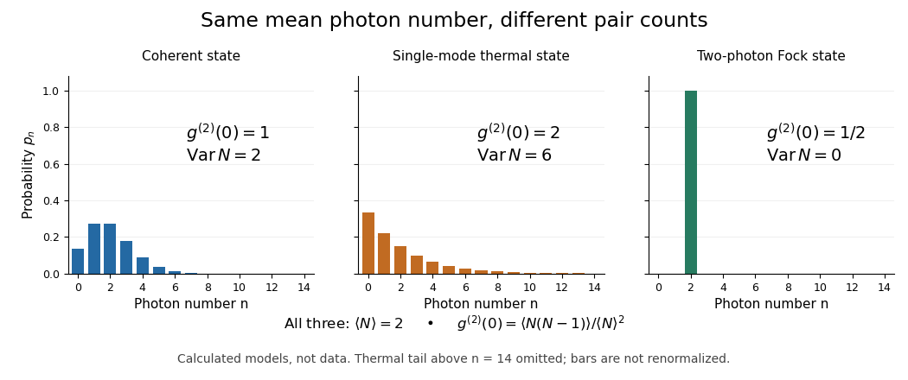
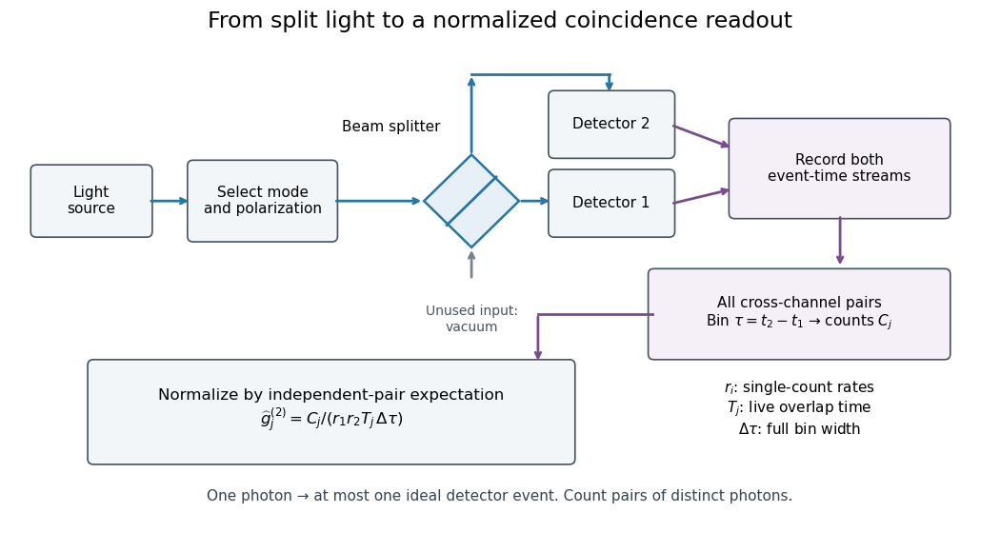
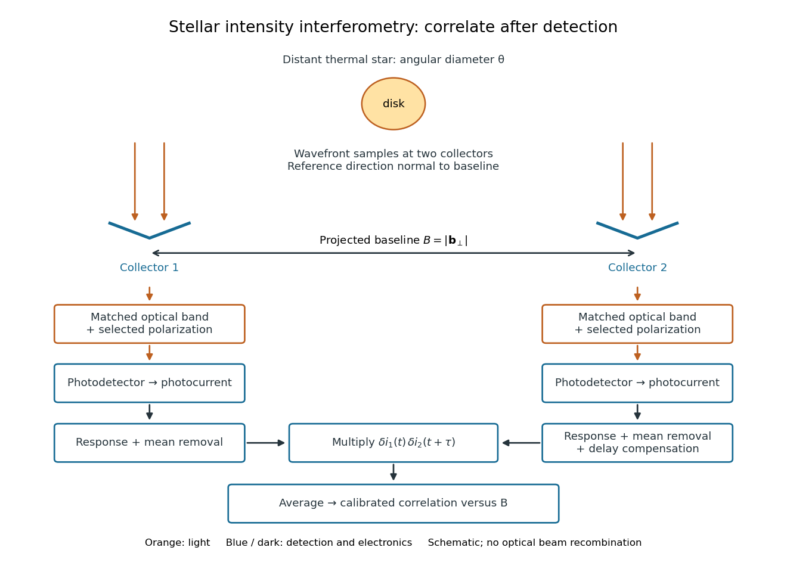

# Quantum optics

↑ **Parent:** [Quantum theory](quantum-theory.md)  
ⓦ [Wiki](https://en.wikipedia.org/wiki/Quantum_optics)

[Quantum optics](quantum-optics.md) studies [light](optics.md#light) using [quantum states](quantum-system.md#quantum-state) of the [electromagnetic field](electromagnetism.md#electromagnetic-field) and their interaction with matter. [Photon statistics](#photon-statistics) asks how detections fluctuate; the [quantum theory of optical coherence](#quantum-theory-of-optical-coherence) relates those detections to field correlations. A [coherent state](quantum-theory.md#coherent-state), [thermal light](#thermal-light), and a [Fock state](quantum-field-theory.md#fock-state) can have the same mean [photon](quantum-mechanics.md#photon) number yet different pair counts. This distinction makes [photon counting](#photon-counting) useful for testing sources intended to emit one [photon](quantum-mechanics.md#photon) at a time.

**Table of contents**

- [Field-squared quadrature](#field-squared-quadrature)
  - [Amplitude-squared squeezing](#amplitude-squared-squeezing)
- [Nonclassical state of light](#nonclassical-state-of-light)
  - [Nonclassicality witnesses](#nonclassicality-witnesses)
- [Photon subtraction](#photon-subtraction)
  - [Conditional photon-number bias](#conditional-photon-number-bias)
- [Photon addition](#photon-addition)
- [Schrödinger cat state](#schrodinger-cat-state)
  - [Loss of coherence in an optical cat state](#loss-of-coherence-in-an-optical-cat-state)
  - [Phase-dependent cat-state quadrature variance](#phase-dependent-cat-state-quadrature-variance)
  - [Odd coherent-state superposition](#odd-coherent-state-superposition)
  - [Even coherent-state superposition](#even-coherent-state-superposition)
- [Optical homodyne detection](#optical-homodyne-detection)
  - [Local oscillator](#local-oscillator)
  - [Optical homodyne tomography](#optical-homodyne-tomography)
  - [Balanced homodyne detection](#balanced-homodyne-detection)
    - [Finite-reference balanced homodyne variance](#finite-reference-balanced-homodyne-variance)
- [Optical quadrature](#optical-quadrature)
  - [Coherent-state electric-field variance](#coherent-state-electric-field-variance)
  - [Quadrature noise ellipse](#quadrature-noise-ellipse)
  - [Quadrature squeezing](#quadrature-squeezing)
    - [Optical squeezing degradation by loss](#optical-squeezing-degradation-by-loss)
  - [Quadrature squeezing of a vacuum–one-photon superposition](#quadrature-squeezing-of-a-vacuum-one-photon-superposition)
- [Quantum theory of optical coherence](#quantum-theory-of-optical-coherence)
  - [Second-order optical coherence](#second-order-optical-coherence)
- [Photon statistics](#photon-statistics)
  - [Number squeezing](#number-squeezing)
  - [Normalization of photon-added and photon-subtracted states](#normalization-of-photon-added-and-photon-subtracted-states)
  - [Coherent-state photon statistics](#coherent-state-photon-statistics)
  - [Thermal light](#thermal-light)
  - [Photon bunching](#photon-bunching)
  - [Photon antibunching](#photon-antibunching)
- [Photon counting](#photon-counting)
  - [Coincidence counting](#coincidence-counting)
  - [Finite-bin photon correlations](#finite-bin-photon-correlations)
  - [Photon correlation loss and background model](#photon-correlation-loss-and-background-model)
- [Hanbury Brown and Twiss effect](#hanbury-brown-and-twiss-effect)
  - [Stellar intensity interferometry](#stellar-intensity-interferometry)
    - [Sirius intensity interferometry experiment](#sirius-intensity-interferometry-experiment)
    - [Siegert relation](#siegert-relation)
    - [Uniform-disk stellar visibility](#uniform-disk-stellar-visibility)
      - [Stellar angular diameter from a visibility envelope](#stellar-angular-diameter-from-a-visibility-envelope)
    - [Finite-response stellar intensity correlations](#finite-response-stellar-intensity-correlations)
- [Resonance fluorescence antibunching experiment](#resonance-fluorescence-antibunching-experiment)

## Field-squared quadrature

↑ **Parent:** [Quantum optics](quantum-optics.md)

Hermitian combinations of pair creation and [annihilation operators](quantum-harmonic-oscillator.md#annihilation-operator). With $K_3=(N+1/2)/2$, their [commutators](lie-algebra.md#commutator) are $[K_1,K_2]=-4iK_3$, $[K_2,K_3]=iK_1$ and $[K_3,K_1]=iK_2$. A [coherent state](quantum-theory.md#coherent-state) has both [variances](variance.md) $\langle N\rangle+1/2$, saturating the corresponding uncertainty product.

### Amplitude-squared squeezing

↑ **Parent:** [Field-squared quadrature](#field-squared-quadrature)

A [field-squared quadrature](#field-squared-quadrature) [variance](variance.md) below the equal-variance coherent-state reference in this normalization. Its conjugate [variance](variance.md) must remain compatible with the state-dependent [commutator](lie-algebra.md#commutator) bound. This is not the same observable as ordinary field-amplitude squeezing or a reduction of mean intensity.

## Nonclassical state of light

↑ **Parent:** [Quantum optics](quantum-optics.md)

A state of light is nonclassical when it is not a [classical mixture of coherent states](quantum-theory.md#classical-mixture-of-coherent-states). The [Glauber-Sudarshan representation](quantum-theory.md#glauber-sudarshan-representation) states this criterion in phase space. Examples include nonvacuum [number states](quantum-harmonic-oscillator.md#number-state) and [quadrature squeezing](#quadrature-squeezing) states. A coherent state is on the classical boundary despite its vacuum fluctuations; [thermal light](#thermal-light) is a classical mixture despite its non-Poisson fluctuations. None of these [nonclassicality witnesses](#nonclassicality-witnesses) is a necessary condition for nonclassicality.

### Nonclassicality witnesses

↑ **Parent:** [Nonclassical state of light](#nonclassical-state-of-light)

Sufficient single-mode witnesses include a [Fano factor](variance.md#fano-factor) $\operatorname{Var}n/\langle n\rangle<1$, an [optical quadrature](#optical-quadrature) variance below $1/4$ for $[X,P]=i/2$, or [photon antibunching](#photon-antibunching) with $g^{(2)}(0)<1$. Classical mixtures obey $\operatorname{Var}n\ge\langle n\rangle$, and $g^{(2)}(0)=\mathbb E(|\alpha|^4)/\mathbb E(|\alpha|^2)^2\ge1$ by nonnegative variance. The tests are sufficient rather than necessary and exclude the vacuum case when dividing by zero mean occupation.

## Photon subtraction

↑ **Parent:** [Quantum optics](quantum-optics.md)

Ideal conditional application of an [annihilation operator](quantum-harmonic-oscillator.md#annihilation-operator), defined only for positive initial mean [photon number](quantum-harmonic-oscillator.md#photon-number). Number-dependent weighting means that the conditional mean need not fall. Vacuum input gives the zero vector and therefore no successful conditional state.

### Conditional photon-number bias

↑ **Parent:** [Photon subtraction](#photon-subtraction)

A subtraction event weights initial occupation $n$ by $n$ before removing one [photon](quantum-mechanics.md#photon). Thus its conditional output mean is $\langle N(N-1)\rangle/\mu$, giving the displayed identity for $\mu>0$. If the initial [variance](variance.md) exceeds its mean, this biased selection can offset the removed [photon](quantum-mechanics.md#photon). The unconditional ensemble includes unsuccessful events and has a different [energy](energy.md) balance.

## Photon addition

↑ **Parent:** [Quantum optics](quantum-optics.md)

Ideal conditional application of a [creation operator](quantum-harmonic-oscillator.md#creation-operator), followed by normalization. It reweights the input number distribution as well as raising each occupied number by one. A heralded physical implementation has a success [probability](probability-theory.md#probability); the algebraic [creation operator](quantum-harmonic-oscillator.md#creation-operator) alone is not a trace-preserving deterministic [quantum operation](quantum-information-theory.md#quantum-operation).

<h2 id="schrodinger-cat-state">Schrödinger cat state</h2>

↑ **Parent:** [Quantum optics](quantum-optics.md)

A coherent [superposition](vector-space.md#superposition-principle) of distinct optical coherent amplitudes, for example $N(|\alpha\rangle+e^{i\phi}|-\alpha\rangle)$. It differs from the corresponding incoherent mixture through cross terms in observables and its phase-space interference. For large $|\alpha|$, branch distinguishability is large while ordinary [quadrature squeezing](#quadrature-squeezing) can become exponentially small.

### Loss of coherence in an optical cat state

↑ **Parent:** [Schrödinger cat state](#schrodinger-cat-state)

A pure-loss channel of transmissivity $\eta$ maps the two branches to system amplitudes $\pm\sqrt\eta\alpha$ and environment amplitudes $\pm\sqrt{1-\eta}\alpha$. Tracing over the environment multiplies their cross terms by its branch overlap, the factor displayed. Large cat states can therefore lose interference rapidly even while their mean [intensities](wave.md#intensity-physics) change only moderately.

### Phase-dependent cat-state quadrature variance

↑ **Parent:** [Schrödinger cat state](#schrodinger-cat-state)

For real $\alpha$, put $s=e^{-2\alpha^2}$ in $N(|\alpha\rangle+e^{i\phi}|-\alpha\rangle)$. Its mean second quadrature is $-\alpha s\sin\phi/(1+s\cos\phi)$, which is generally nonzero. Subtracting its square from the second moment gives the displayed [variance](variance.md) and squeezing precisely when $\cos\phi>-s$, for nonzero finite amplitude. A useful counterexample to confusing moment and [variance](variance.md) is $\phi=\pi/2$.

### Odd coherent-state superposition

↑ **Parent:** [Schrödinger cat state](#schrodinger-cat-state)

The difference $N_-(|\alpha\rangle-|-\alpha\rangle)$ contains only odd [photon numbers](quantum-harmonic-oscillator.md#photon-number) and tends to a one-photon state as $\alpha\to0$. Exactly at zero amplitude the unnormalized difference vanishes; the normalized limiting state is obtained only by taking a limit.

### Even coherent-state superposition

↑ **Parent:** [Schrödinger cat state](#schrodinger-cat-state)

The normalized sum $N_+(|\alpha\rangle+|-\alpha\rangle)$ contains only even [photon numbers](quantum-harmonic-oscillator.md#photon-number), since the two coherent-state expansions cancel every odd term. It tends to vacuum at small amplitude. With real $\alpha$, its second quadrature can be squeezed below the vacuum [variance](variance.md).

## Optical homodyne detection

↑ **Parent:** [Quantum optics](quantum-optics.md)

Interference of a signal with a coherent reference at the same optical carrier frequency to measure phase-sensitive field information. The reference fixes an [optical quadrature](#optical-quadrature). The inferred noise depends on reference strength, detector efficiency and the detection arrangement.

### Local oscillator

↑ **Parent:** [Optical homodyne detection](#optical-homodyne-detection)

A coherent reference field that selects the measured [optical quadrature](#optical-quadrature) through its relative phase. Mode matching and phase [stability](numerical-analysis.md#stability-of-a-numerical-method) determine how faithfully the desired signal [optical quadrature](#optical-quadrature) is sampled.

### Optical homodyne tomography

↑ **Parent:** [Optical homodyne detection](#optical-homodyne-detection)

### Balanced homodyne detection

↑ **Parent:** [Optical homodyne detection](#optical-homodyne-detection)

Mix a signal mode $a$ and an independent coherent reference mode $b$ on a balanced [beam splitter](optical-instrument.md#beam-splitter), detect both outputs, and subtract the currents. For $c=(a+ib)/\sqrt2$ and $d=(ia+b)/\sqrt2$, the difference is $I=c^\dagger c-d^\dagger d=i(a^\dagger b-ab^\dagger)$. A reference $\beta=|\beta|e^{i\phi}$ gives mean $2|\beta|\langle X_\vartheta\rangle$ with $\vartheta=\phi+\pi/2$. Other beam-splitter conventions shift this phase calibration. The exact [finite-reference balanced homodyne variance](#finite-reference-balanced-homodyne-variance) quantifies the strong-reference approximation.

Matched subtraction cancels the shared total-power term. It therefore suppresses common reference intensity noise, while imbalance and phase fluctuations reduce this advantage. Repeated samples measure a distribution, not just its mean; scanning reference phase supports [optical homodyne tomography](#optical-homodyne-tomography).

#### Finite-reference balanced homodyne variance

↑ **Parent:** [Balanced homodyne detection](#balanced-homodyne-detection)

For the convention of [balanced homodyne detection](#balanced-homodyne-detection), assume independent signal and coherent reference states and ideal detectors. Write $b=\beta+\delta b$, with $\delta b$ in vacuum. The current difference splits into $2|\beta|X_\vartheta$ and $i(a^\dagger\delta b-a\delta b^\dagger)$. Cross terms have zero expectation, and the second term has variance $\langle a^\dagger a\rangle$. Consequently the exact variance is $4|\beta|^2\operatorname{Var}X_\vartheta+\langle a^\dagger a\rangle$. Division by $4|\beta|^2$ approaches the signal [optical quadrature](#optical-quadrature) variance when the photon-number correction is negligible.

## Optical quadrature

↑ **Parent:** [Quantum optics](quantum-optics.md)

A phase-selected Hermitian field observable. With [annihilation operator](quantum-harmonic-oscillator.md#annihilation-operator) $a$ and $[a,a^\dagger]=1$, define $X_1=(a+a^\dagger)/2$ and $X_2=(a-a^\dagger)/(2i)$. Then $[X_1,X_2]=i/2$ and the [Fock vacuum](quantum-field-theory.md#fock-vacuum) has variance $1/4$ in either quadrature. This dimensionless convention gives $X_\vartheta=X_1\cos\vartheta+X_2\sin\vartheta$. [Balanced homodyne detection](#balanced-homodyne-detection) selects $\vartheta$ through the reference [wave phase](wave.md#phase-waves).

### Coherent-state electric-field variance

↑ **Parent:** [Optical quadrature](#optical-quadrature)

For one optical mode, $E=E_0(a+a^\dagger)$ and $[a,a^\dagger]=1$. A [coherent state](quantum-theory.md#coherent-state) obeys $a|\alpha\rangle=\alpha|\alpha\rangle$, so [normal ordering](perturbative-quantum-field-theory.md#normal-ordering) gives $\langle E^2\rangle=E_0^2[(\alpha+\alpha^*)^2+1]$. Subtracting the squared mean leaves $E_0^2$, independent of the coherent displacement. The extra one is the [canonical commutation relation](quantum-mechanics.md#canonical-commutation-relation), not noise from a random coherent amplitude. A rotated [optical quadrature](#optical-quadrature) has the same coherent-state variance with the same amplitude normalization.

### Quadrature noise ellipse

↑ **Parent:** [Optical quadrature](#optical-quadrature)

For a single-mode Gaussian state with no quadrature covariance, the covariance contour has semiaxes $\sqrt{\operatorname{Var}X}$ and $\sqrt{\operatorname{Var}P}$. A [coherent state](quantum-theory.md#coherent-state) has both equal to $1/2$ in the convention $[X,P]=i/2$. A pure [squeezed vacuum state](quantum-harmonic-oscillator.md#squeezed-vacuum-state) has semiaxes $e^{-r}/2$ and $e^r/2$; the uncertainty area remains fixed while one noise width decreases. An ellipse of means alone does not specify a general non-Gaussian state.[Slides9–12, physical PDF pp.5–6: minimum-uncertainty and squeezed states](physics-bibliography.md#quantum-optical-communication-lecture-6-by-jeffrey-h-shapiro)

### Quadrature squeezing

↑ **Parent:** [Optical quadrature](#optical-quadrature)

With $X_\vartheta=(ae^{-i\vartheta}+a^\dagger e^{i\vartheta})/2$, the coherent-state and vacuum [variances](variance.md) are $1/4$. A state is squeezed in the chosen quadrature when its [variance](variance.md) about its own mean is smaller. A second moment about zero is not the [variance](variance.md) when that mean is nonzero. [balanced homodyne detection](#balanced-homodyne-detection) measures a phase-selected quadrature distribution.

#### Optical squeezing degradation by loss

↑ **Parent:** [Quadrature squeezing](#quadrature-squeezing)

Mixing a mode with independent vacuum on a [beam splitter](optical-instrument.md#beam-splitter) of [intensity](wave.md#intensity-physics) transmission $\eta$ gives the displayed [optical quadrature](#optical-quadrature) [variance](variance.md) when vacuum [variance](variance.md) is $1/4$. It approaches vacuum noise as transmission falls. Phase noise instead mixes squeezed and anti-squeezed axes, and cannot in general be represented by the same efficiency alone.

<h3 id="quadrature-squeezing-of-a-vacuum-one-photon-superposition">Quadrature squeezing of a vacuum–one-photon superposition</h3>

↑ **Parent:** [Optical quadrature](#optical-quadrature)

For real $\epsilon$ with $|\epsilon|\leq1$, let $|\psi\rangle=\sqrt{1-\epsilon^2}|0\rangle+\epsilon|1\rangle$. The [Fock state](quantum-field-theory.md#fock-state) matrix elements give $\langle a\rangle=\epsilon\sqrt{1-\epsilon^2}$, $\langle a^2\rangle=0$ and $\langle a^\dagger a\rangle=\epsilon^2$. Therefore

$$
\operatorname{Var}X_1=\frac14-\frac12\epsilon^2+\epsilon^4,\qquad \operatorname{Var}X_2=\frac14+\frac12\epsilon^2.
$$

Only the first of these [optical quadratures](#optical-quadrature) is squeezed for this real superposition, with minimum variance $3/16$ at $\epsilon^2=1/4$. The second is never below vacuum noise. This non-Gaussian superposition is distinct from an [optical squeezed vacuum](quantum-harmonic-oscillator.md#optical-squeezed-vacuum).

## Quantum theory of optical coherence

↑ **Parent:** [Quantum optics](quantum-optics.md)

Fix a detected position and [polarization of waves](wave.md#polarization-waves). Write the [electric field](electric-field.md) operator as $\widehat E(t)=\widehat E^{(+)}(t)+\widehat E^{(-)}(t)$, where the positive-frequency part contains [annihilation operators](quantum-harmonic-oscillator.md#annihilation-operator) and $\widehat E^{(-)}=(\widehat E^{(+)})^\dagger$. An ideal absorbing [photodetector](optical-instrument.md#photodetector) responds to

$$
G^{(1)}(t,t')=\operatorname{Tr}\!\left[\rho\widehat E^{(-)}(t)\widehat E^{(+)}(t')\right],
$$

with [density matrix](density-matrix.md) $\rho$. The diagonal gives the single-count rate up to the detector coupling. Multiple absorptions require higher, [normal-ordered](perturbative-quantum-field-theory.md#normal-ordering) field products. [Roy J. Glauber](physicist.md#roy-jay-glauber) used these correlations to develop the quantum account of [optical coherence](physical-optics.md#optical-coherence).[1963, §II, equations (2.1)–(2.4), pp. 2766–2767; Universidade Estadual de Campinas mirror](physics-bibliography.md#coherent-and-incoherent-states-of-the-radiation-field-by-roy-jay-glauber)

The ordering follows from a detection amplitude. If absorption takes an initial [pure state](quantum-theory.md#pure-state) $|i\rangle$ to an unobserved final state $|f\rangle$, its field factor is $\langle f|\widehat E^{(+)}|i\rangle$. Squaring its [complex modulus](complex-analysis.md#complex-modulus) and summing over a complete [orthonormal basis](inner-product.md#orthonormal-basis) of final states gives $\langle i|\widehat E^{(-)}\widehat E^{(+)}|i\rangle$. Averaging over initial preparations replaces this expression by a [trace](linear-algebra.md#matrix-trace). Thus a detector that absorbs cannot count the [Fock vacuum](quantum-field-theory.md#fock-vacuum), although the vacuum has [quantum fluctuations](quantum-theory.md#quantum-fluctuation).

For one selected [normal mode](wave-equation.md#normal-mode), $\widehat E^{(+)}(t)=\mathcal E u(t)a$. All [Fock states](quantum-field-theory.md#fock-state) with nonzero occupation, [coherent states](quantum-theory.md#coherent-state), and [thermal light](#thermal-light) in this same mode have

$$
\frac{G^{(1)}(t,t')}{\sqrt{G^{(1)}(t,t)G^{(1)}(t',t')}}
=\frac{u^*(t)u(t')}{|u(t)||u(t')|}
$$

where both denominators are nonzero. Its magnitude is one even when the [expected value](expected-value.md) of the field vanishes. Perfect [first-order optical coherence](physical-optics.md#first-order-optical-coherence) therefore does not identify a [coherent state](quantum-theory.md#coherent-state). Pair detection supplies additional information.

### Second-order optical coherence

↑ **Parent:** [Quantum theory of optical coherence](#quantum-theory-of-optical-coherence)

For a source whose counting correlations are stationary, define the dimensionless correlation

$$
g^{(2)}(\tau)=
\frac{\left\langle\widehat E^{(-)}(t)\widehat E^{(-)}(t+\tau)\widehat E^{(+)}(t+\tau)\widehat E^{(+)}(t)\right\rangle}
{\left\langle\widehat E^{(-)}(t)\widehat E^{(+)}(t)\right\rangle
\left\langle\widehat E^{(-)}(t+\tau)\widehat E^{(+)}(t+\tau)\right\rangle}.
$$

Assume finite moments and nonzero denominators. The numerator is in [normal ordering](perturbative-quantum-field-theory.md#normal-ordering): two detections remove two [photons](quantum-mechanics.md#photon). The denominator is the product of the two single-count factors, so independent counts have reference value one. This is a diagonal restriction of the four-point second-order field correlation, rather than its complete definition.[2005 individual Nobel lecture, pp. 87–89, equations (18)–(22); Liceo Galilei Verona mirror](physics-bibliography.md#one-hundred-years-of-light-quanta-by-roy-jay-glauber)

For one selected mode with [number operator](quantum-harmonic-oscillator.md#number-operator) $N=a^\dagger a$ and $\mu=\langle N\rangle>0$, evaluate both detections at the same time. The [canonical commutation relation](quantum-mechanics.md#canonical-commutation-relation) $aa^\dagger=a^\dagger a+1$ implies $N^2=(a^\dagger)^2a^2+N$, hence

$$
g^{(2)}(0)=\frac{\langle N(N-1)\rangle}{\mu^2}
=1+\frac{\operatorname{Var}N-\mu}{\mu^2}.
$$

The [factorial moment](continuous-time-markov-chain.md#factorial-moment) counts ordered pairs of distinct [photons](quantum-mechanics.md#photon). Using $\langle N^2\rangle$ would include pairing each [photon](quantum-mechanics.md#photon) with itself and would give the wrong coincidence prediction. At $\mu=0$ this normalized expression is undefined, rather than zero.

## Photon statistics

↑ **Parent:** [Quantum optics](quantum-optics.md)

[Photon statistics](#photon-statistics) is the [probability distribution](probability-distribution.md) of the [number operator](quantum-harmonic-oscillator.md#number-operator) in specified field modes, or the distribution of registered counts in a specified gate. Those distributions agree only for an appropriate ideal measurement. Mode selection, losses, and [detector dead time](particle-detection.md#detector-dead-time) matter. For a one-mode [density matrix](density-matrix.md), $p_n=\langle n|\rho|n\rangle$ and

$$
\mu=\sum_{n=0}^{\infty}np_n,\qquad
\langle N(N-1)\rangle=\sum_{n=0}^{\infty}n(n-1)p_n.
$$

These two sums already distinguish preparations with the same [expected value](expected-value.md).

### Number squeezing

↑ **Parent:** [Photon statistics](#photon-statistics)

Sub-Poissonian number [variance](variance.md) in a specified mode or detection gate. It concerns [photon counting](#photon-counting), not an [optical quadrature](#optical-quadrature). An [optical squeezed vacuum](quantum-harmonic-oscillator.md#optical-squeezed-vacuum) has [quadrature squeezing](#quadrature-squeezing) but fails this number-variance condition.

### Normalization of photon-added and photon-subtracted states

↑ **Parent:** [Photon statistics](#photon-statistics)

Raw vectors $a^\dagger|\psi\rangle$ and $a|\psi\rangle$ have squared norms $\mu+1$ and $\mu$. Matrix elements of the [number operator](quantum-harmonic-oscillator.md#number-operator) in these vectors must be divided by their squared norms before calling them means. For an [optical squeezed vacuum](quantum-harmonic-oscillator.md#optical-squeezed-vacuum) with mean $s$, the raw moments are $(3s+1)(s+1)$ and $s(3s+1)$, while both normalized means equal $3s+1$ when subtraction is possible.

### Coherent-state photon statistics

↑ **Parent:** [Photon statistics](#photon-statistics)

For a [coherent state](quantum-theory.md#coherent-state), write $a|\alpha\rangle=\alpha|\alpha\rangle$ and $|\alpha\rangle=\sum_n c_n|n\rangle$ in [number states](quantum-harmonic-oscillator.md#number-state). The [annihilation operator](quantum-harmonic-oscillator.md#annihilation-operator) gives $c_{n+1}\sqrt{n+1}=\alpha c_n$, so $c_n=c_0\alpha^n/\sqrt{n!}$. Normalization yields $|c_0|^2=e^{-|\alpha|^2}$. Thus [photon statistics](#photon-statistics) follows a [Poisson distribution](discrete-probability-distribution.md#poisson-distribution) with $\mu=|\alpha|^2$, and the [normal ordering](perturbative-quantum-field-theory.md#normal-ordering) of every moment gives $\langle(a^\dagger)^ka^k\rangle=\mu^k$. This factorization is the defining virtue of [coherent states](quantum-theory.md#coherent-state) for optical calculations.[1963, §III, equations (3.1)–(3.7): coherent-state expansion; Universidade Estadual de Campinas mirror](physics-bibliography.md#coherent-and-incoherent-states-of-the-radiation-field-by-roy-jay-glauber)

As an original comparison, choose $\mu=2$. Then $p_0=e^{-2}$, $p_1=p_2=2e^{-2}$, $\operatorname{Var}N=2$, and $\langle N(N-1)\rangle=4$. A two-[photon](quantum-mechanics.md#photon) [Fock state](quantum-field-theory.md#fock-state) also has mean two but has $\operatorname{Var}N=0$ and pair moment two. Consequently

$$
g^{(2)}_{\rm coherent}(0)=1,\qquad
g^{(2)}_{|n\rangle}(0)=1-\frac1n\quad(n\geq1).
$$

In particular, $|1\rangle$ cannot supply a pair. Nevertheless, [photon statistics](#photon-statistics) alone does not determine a [quantum state](quantum-system.md#quantum-state): averaging $|\alpha\rangle\langle\alpha|$ over a uniform [quantum phase](quantum-system.md#quantum-phase) removes its off-diagonal entries while retaining exactly the same $p_n$ and these equal-time moments.

### Thermal light

↑ **Parent:** [Photon statistics](#photon-statistics)

For a single mode in [thermal equilibrium](thermal-equilibrium.md), its [quantum harmonic oscillator](quantum-harmonic-oscillator.md) energy ladder gives a [geometric distribution](discrete-probability-distribution.md#geometric-distribution)

$$
p_n=(1-q)q^n,\qquad q=e^{-\hbar\omega/(k_{\rm B}T)},\qquad
\mu=\frac{q}{1-q},\qquad 0<q<1.
$$

Its [probability generating function](probability-distribution.md#probability-generating-function) is $F(z)=(1-q)/(1-qz)$. Differentiating twice gives $F''(1)=2q^2/(1-q)^2=2\mu^2$, hence $g^{(2)}(0)=2$. At the chosen mean $\mu=2$, $q=2/3$, $p_0=1/3$, $p_1=2/9$, $p_2=4/27$, and $\operatorname{Var}N=6$. Rare high occupations increase the pair count even though the mean matches the other preparations. The geometric weights also arise from a Gaussian mixture of [coherent states](quantum-theory.md#coherent-state).[2005 individual Nobel lecture, pp. 91–92, equations (31)–(38)](physics-bibliography.md#one-hundred-years-of-light-quanta-by-roy-jay-glauber)

**[Figure 1](#image-three-original-one-mode-photon-number-models-with-the-same-mean-two-and-different-pair-correlations). Three original one-mode photon-number models with the same mean two and different pair correlations**. The bars are calculated probabilities, not measured data. Thermal occupations above fourteen are omitted without renormalization. The displayed second-order correlations use the complete distributions.

Single-mode selection is essential to this factor of two. If $M$ independent equally populated thermal modes are collected together, let $N=\sum_{j=1}^M N_j$ with $\langle N_j\rangle=\mu/M$. Adding their [variances](variance.md) gives $\operatorname{Var}N=\mu+\mu^2/M$, hence $g^{(2)}(0)=1+1/M$. Averaging over many unresolved modes can make thermal pair counts approach the independent-count reference.

### Photon bunching

↑ **Parent:** [Photon statistics](#photon-statistics)

[Photon bunching](#photon-bunching) is enhanced near-coincident detection relative to an appropriate independent-count reference. It need not require nonclassical [light](optics.md#light). In a classical intensity model with nonnegative instantaneous [light intensity](wave.md#light-intensity) $I$, ideal detection with a conditional [Poisson distribution](discrete-probability-distribution.md#poisson-distribution) gives

$$
g^{(2)}(0)=\frac{\langle I^2\rangle}{\langle I\rangle^2}
=1+\frac{\operatorname{Var}I}{\langle I\rangle^2}\geq1.
$$

A fluctuating intensity therefore bunches counts. For a stationary classical intensity with finite second moment, the [Cauchy-Schwarz inequality](probability-and-statistics.md#cauchy-schwarz-inequality) further gives $\langle I(t)I(t+\tau)\rangle\leq\langle I^2\rangle$. A zero-delay correlation smaller than one at a later delay cannot be explained by this model.

### Photon antibunching

↑ **Parent:** [Photon statistics](#photon-statistics)  
ⓦ [Wiki](https://en.wikipedia.org/wiki/Photon_antibunching)

[Photon antibunching](#photon-antibunching) means suppression of close pairs compared with pairs at some later delay: $g^{(2)}(0)<g^{(2)}(\tau)$ for some $\tau$. If correlations decay to the independent-count reference, $g^{(2)}(0)<1$ is a sufficient signature. It violates the classical intensity bounds in [photon bunching](#photon-bunching). For the specified single-mode number measurement, [second-order optical coherence](#second-order-optical-coherence) also shows that $g^{(2)}(0)<1$ is equivalent to $\operatorname{Var}N<\mu$. This variance criterion concerns that mode or gate; it must not be applied unchanged to arbitrarily long integrated counting intervals.

## Photon counting

↑ **Parent:** [Quantum optics](quantum-optics.md)

[Photon counting](#photon-counting) registers discrete detector events and their times. A [beam splitter](optical-instrument.md#beam-splitter) sends the selected [light](optics.md#light) to two [photodetectors](optical-instrument.md#photodetector); a [coincidence circuit](particle-detection.md#coincidence-circuit) or time-recording system compares the outputs. With a vacuum input at the unused [optical port](optical-instrument.md#optical-port), splitter fractions $R,T$ and independent [quantum efficiencies](optical-instrument.md#quantum-efficiency) $\eta_1,\eta_2$, a selected input [photon](quantum-mechanics.md#photon) reaches the two recorded channels with probabilities $p_1=R\eta_1$ and $p_2=T\eta_2$. Conditional on input occupation $N$, each pair of distinct [photons](quantum-mechanics.md#photon) contributes $p_1p_2$ to the cross-channel pair moment. Therefore

$$
\langle K_1\rangle=p_1\mu,\qquad
\langle K_2\rangle=p_2\mu,\qquad
\langle K_1K_2\rangle=p_1p_2\langle N(N-1)\rangle.
$$

Their normalized ratio recovers $g^{(2)}(0)$. This assumes number-resolving counts, or sufficiently dilute gates for threshold detectors to approximate them. One [photon](quantum-mechanics.md#photon) cannot create both channel counts in this ideal model.

**[Figure 2](#image-functional-two-detector-photon-correlation-measurement-and-its-normalization). Functional two-detector photon-correlation measurement and its normalization**. Original schematic: optical selection and a beam splitter feed independent detectors; all cross-channel time differences populate a histogram. A single photon produces at most one ideal detection. The empty splitter input is vacuum.

### Coincidence counting

↑ **Parent:** [Photon counting](#photon-counting)

Count detections in two channels within a specified time window to estimate pair correlations. Delayed windows or independent singles rates estimate accidental coincidences. Finite efficiency, timing jitter, dark counts and multiple pairs must be included before interpreting a coincidence fringe as a property of the prepared state.

### Finite-bin photon correlations

↑ **Parent:** [Photon counting](#photon-counting)

For stationary continuous detection, let $C_j$ count all cross-channel pairs with $t_2-t_1$ in a bin of full width $\Delta\tau$, and let $r_1,r_2$ be observed single-count rates. Let $T_j$ be their joint live observation time at that delay, approximately the common duration $T_{\rm obs}$ when delays are short. Independent streams have expected pair count $r_1r_2T_j\Delta\tau$, giving the displayed estimator. It estimates a bin average of [second-order optical coherence](#second-order-optical-coherence), further blurred by detector timing response. For a finite uninterrupted run the exact overlap weighting is $T_{\rm obs}-|\tau|$ inside the delay integral, rather than a constant at long delays.

For an original numerical example, choose $r_1=2000\,\mathrm{s^{-1}}$, $r_2=3000\,\mathrm{s^{-1}}$, $T_j=100\,\mathrm s$, and $\Delta\tau=10\,\mathrm{ns}$. The independent reference is six pairs per bin. Chosen counts $C_j=3,6,12$ give estimates $0.5,1,2$; they are teaching inputs with large counting fluctuations, not historical measurements. For pulsed sources, compare properly normalized same-pulse and separate-pulse coincidences instead of assuming this continuous-source baseline.

[Detector dead time](particle-detection.md#detector-dead-time) suppresses nearby same-detector counts and can manufacture an apparent dip in a single-detector record. Two independent detector channels avoid that particular same-channel exclusion, but shared electronics can still reject pairs. Timing spread and wide bins wash out narrow features. A device recording only the first stop after each start measures a waiting-time distribution; interpreting it as all-pair correlations requires a sufficiently low stop probability over the relevant delay range.

### Photon correlation loss and background model

↑ **Parent:** [Photon counting](#photon-counting)

Independent loss alone leaves normalized [factorial moments](continuous-time-markov-chain.md#factorial-moment) invariant: if every input [photon](quantum-mechanics.md#photon) is retained with [probability](probability-theory.md#probability) $\eta$, [binomial thinning conditional on a total](poisson-process.md#binomial-thinning-conditional-on-a-total) gives $\langle K\rangle=\eta\mu$ and $\langle K(K-1)\rangle=\eta^2\langle N(N-1)\rangle$. Both powers cancel from $g^{(2)}(0)$. Fewer coincidences still mean poorer statistical precision.

Now let each channel contain a signal rate $s_i$ and an independent [Poisson process](poisson-process.md) background rate $b_i$, independent also of the signal. Put $\rho_i=s_i/(s_i+b_i)$. The pair density is $s_1s_2g^{(2)}_{\rm sig}+s_1b_2+b_1s_2+b_1b_2$. Dividing by $(s_1+b_1)(s_2+b_2)$ proves the displayed formula, for the same bin and timing response. For chosen equal signal fractions $\rho_1=\rho_2=4/5$, ideal signal values $0,1,2$ become $9/25,1,41/25$. Background pulls both dips and peaks toward one.

This calculation assumes additive, mutually independent background counts. Scattered coherent [light](optics.md#light) that interferes with the signal, correlated electronic noise, or recovery effects require a different model. Correcting a dip without independently estimating the backgrounds cannot establish [photon antibunching](#photon-antibunching).

## Hanbury Brown and Twiss effect

↑ **Parent:** [Quantum optics](quantum-optics.md)  
ⓦ [Wiki](https://en.wikipedia.org/wiki/Hanbury_Brown_and_Twiss_effect)

[Robert Hanbury Brown](astronomy.md#robert-hanbury-brown) and [Richard Q. Twiss](physicist.md#richard-quentin-twiss) sought [angular sizes](geometry-and-topology.md#angular-diameter) through correlations of detected [light intensities](wave.md#light-intensity). Their method multiplies detector outputs after detection, whereas a [Michelson interferometer](physical-optics.md#michelson-interferometer) combines fields before detection.[1956, Nature 177, pp. 27–29, accessible opening paragraphs](physics-bibliography.md#correlation-between-photons-in-two-coherent-beams-of-light-by-robert-hanbury-brown-and-richard-quentin-twiss)

A monochromatic discharge source illuminated a half-silvered [beam splitter](optical-instrument.md#beam-splitter) and two [photodetectors](optical-instrument.md#photodetector). The averaged current product showed an excess near coincidence. Moving one detector introduced a delay that removed it, supplying a control. Slow response weakened the peak. This [photon bunching](#photon-bunching) is compatible with fluctuating classical [light intensity](wave.md#light-intensity).[2005 individual Nobel lecture, pp. 86–88, figures 3–4](physics-bibliography.md#one-hundred-years-of-light-quanta-by-roy-jay-glauber)

### Stellar intensity interferometry

↑ **Parent:** [Hanbury Brown and Twiss effect](#hanbury-brown-and-twiss-effect)

[Stellar intensity interferometry](#stellar-intensity-interferometry) measures a [star](stellar-astrophysics.md#star)'s [angular diameter](geometry-and-topology.md#angular-diameter) by comparing fluctuations of detected [light intensity](wave.md#light-intensity) at separated collectors. Each collector has its own [photodetector](optical-instrument.md#photodetector); an [analog multiplier](electrical-engineering.md#analog-multiplier) or a digital correlator compares the electrical outputs. Changing the [interferometric baseline](astrophysics.md#interferometric-baseline) changes the sampled [spatial optical coherence](physical-optics.md#spatial-optical-coherence). An unresolved [star](stellar-astrophysics.md#star) produces correlated fluctuations; a resolved extended source supplies different mixtures of emission directions, reducing their correlation.

This makes a useful telescope out of a surprising observable: the fluctuations discarded by an ordinary average-brightness measurement. Optical beams need not travel to a common combiner. A relative [wave phase](wave.md#phase-waves) perturbation $E_2\mapsto e^{i\phi}E_2$ leaves $|E_2|^2$ unchanged, so pure phase errors do not directly change the local [light intensity](wave.md#light-intensity). Electronic delay alignment remains necessary; intensity changes from [atmospheric scintillation](optics.md#scintillation-astronomy), collection losses, and instrumental noise still require controls.

Let $\mathbf b$ join the collectors and let $\mathbf s_0$ be the unit [line of sight](astrophysics.md#line-of-sight) toward the [star](stellar-astrophysics.md#star). The relevant [interferometric baseline](astrophysics.md#interferometric-baseline) is its projection onto the [plane of the sky](astrophysics.md#plane-of-the-sky):

$$
\mathbf b_\perp=\mathbf b-(\mathbf b\cdot\mathbf s_0)\mathbf s_0,
\qquad B=|\mathbf b_\perp|.
$$

The reference arrival-time difference has magnitude $|\mathbf b\cdot\mathbf s_0|/c$, with [speed of light](special-relativity.md#speed-of-light) $c$. Correct that delay, with a sign fixed by channel order, before averaging the residual correlation at $\tau=0$. The physical collector separation equals $B$ only when it is perpendicular to $\mathbf s_0$; tracking a [star](stellar-astrophysics.md#star) can change the projection even for fixed collectors.

**[Figure 3](#image-functional-geometry-of-stellar-intensity-interferometry-separate-optical-detection-followed-by-electrical-correlation). Functional geometry of stellar intensity interferometry: separate optical detection followed by electrical correlation**. Original schematic with the reference direction normal to the baseline. Matched optical selection feeds independent detectors; mean removal, response and delay alignment precede multiplication and averaging. This is not a scale drawing of the historical apparatus.

#### Sirius intensity interferometry experiment

↑ **Parent:** [Stellar intensity interferometry](#stellar-intensity-interferometry)

In their 1956 [Sirius](stellar-astrophysics.md#sirius) report, [Robert Hanbury Brown](astronomy.md#robert-hanbury-brown) and [Richard Q. Twiss](physicist.md#richard-quentin-twiss) used two 1.56-m searchlight reflectors feeding [photomultipliers](particle-detection.md#photomultiplier). The [photocurrent](optical-instrument.md#photocurrent) fluctuations passed through 5–45-MHz amplifiers; an adjustable delay aligned arrival times. A linear mixer multiplied the outputs; an integrating motor accumulated their product. A second motor monitored its root-mean-square fluctuation to control gain changes. Separate lamps illuminated capped [photomultipliers](particle-detection.md#photomultiplier) before and after observations to test electronic coupling and drift; blank-sky runs tested correlated [sky background](astrophysics.md#sky-brightness). They fitted a uniformly bright disk and an unknown zero-baseline scale to relative correlations at different [interferometric baselines](astrophysics.md#interferometric-baseline). Broadband response and possible baseline-dependent [systematic errors](physics.md#systematic-error) limited the diameter inference.[pp. 1046–1048: reflectors, delay/correlator, lamp and sky controls, relative-baseline disk fit](physics-bibliography.md#a-test-of-a-new-type-of-stellar-interferometer-on-sirius-by-robert-hanbury-brown-and-richard-quentin-twiss)

This astronomical test extends the preceding laboratory [Hanbury Brown and Twiss effect](#hanbury-brown-and-twiss-effect) to two independently collected samples of a [star](stellar-astrophysics.md#star). The historical motor reading was an instrument-specific correlation statistic. It should not be identified numerically with the normalized $g^{(2)}$ below without the corresponding [measurement calibration](physics.md#measurement-calibration).

#### Siegert relation

↑ **Parent:** [Stellar intensity interferometry](#stellar-intensity-interferometry)

For one selected [polarization of waves](wave.md#polarization-waves), write the detected complex fields as $E_1(t),E_2(t+\tau)$ and their [light intensities](wave.md#light-intensity) as $I_j=|E_j|^2$, absorbing a common conversion constant. With stationary [ensemble averages](expected-value.md) and nonzero $\bar I_j=\langle I_j\rangle$, define

$$
g^{(1)}_{12}(B,\tau)=\frac{\langle E_1^*(t)E_2(t+\tau)\rangle}{\sqrt{\bar I_1\bar I_2}},
\qquad
g^{(2)}_{12}(B,\tau)=\frac{\langle I_1(t)I_2(t+\tau)\rangle}{\bar I_1\bar I_2}.
$$

Here [second-order optical coherence](#second-order-optical-coherence) concerns distinct detector channels, with the corresponding [normal ordering](perturbative-quantum-field-theory.md#normal-ordering) in the quantum formulation. Independent detection has $g^{(2)}=1$. Subtracting the means gives the normalized [covariance](variance.md#covariance)

$$
\frac{\langle\delta I_1(t)\delta I_2(t+\tau)\rangle}{\bar I_1\bar I_2}=g^{(2)}_{12}(B,\tau)-1.
$$

Thus multiplying raw [photocurrents](optical-instrument.md#photocurrent) contains a large mean-product contribution; multiplying their fluctuations isolates the small excess. Independent detector [shot noise](electrical-engineering.md#shot-noise) does not supply a mean cross-channel excess, although it increases [measurement uncertainty](physics.md#measurement-uncertainty).

The displayed [Siegert relation](#siegert-relation) requires a zero-mean, jointly circular complex [Gaussian random field](gaussian-process.md#gaussian-random-field), the usual chaotic [thermal light](#thermal-light) model. Circular means invariance under a common arbitrary complex phase rotation; in particular $\langle E_iE_j\rangle=0$. Apply the [Gaussian moment pairing theorem](probability-distribution.md#isserlis-s-theorem) to the real and imaginary parts:

$$
\langle E_1^*E_1E_2^*E_2\rangle
=\langle|E_1|^2\rangle\langle|E_2|^2\rangle
+|\langle E_1^*E_2\rangle|^2.
$$

The remaining pairing vanishes by circularity. Division proves the [Siegert relation](#siegert-relation). Gaussianity is an assumption about fourth moments, not a consequence of merely measuring [first-order optical coherence](physical-optics.md#first-order-optical-coherence); a [coherent state](quantum-theory.md#coherent-state) or [photon antibunching](#photon-antibunching) cannot be interpreted by this thermal formula.

For equal-intensity beams combined in a common optical mode with matched [wave polarizations](wave.md#polarization-waves), [interferometric visibility](physical-optics.md#interferometric-visibility) is $V=|g^{(1)}_{12}|$. Consequently ideal thermal [stellar intensity interferometry](#stellar-intensity-interferometry) measures $g^{(2)}-1=V^2$, while the full $g^{(2)}$ includes the independent-count reference one. Unpolarized [thermal light](#thermal-light) with two independent equally populated [wave polarizations](wave.md#polarization-waves) has half this excess: adding their [covariances](variance.md#covariance) doubles the numerator while multiplying total means quadruples the denominator. Finite detector response further suppresses the peak and must be calibrated.[Guerin and others, Spatial intensity interferometry on three bright stars, arXiv:1805.06653v2 (13 August 2018), §§2.1–2.3: normalized correlation, thermal contrast and temporal-response calibration](physics-bibliography.md#spatial-intensity-interferometry-on-three-bright-stars-by-william-guerin-and-others)

#### Uniform-disk stellar visibility

↑ **Parent:** [Stellar intensity interferometry](#stellar-intensity-interferometry)

Stipulate a distant circular source of uniform angular brightness, full [angular diameter](geometry-and-topology.md#angular-diameter) $\theta\ll1$ in [radians](geometry-and-topology.md#radian), and narrow optical [bandwidth](electrical-engineering.md#bandwidth-signal-processing) around [wavelength](wave-equation.md#wavelength) $\lambda$. Distinct source patches emit independently. Assume each collector is small enough not to resolve the disk individually. For a sky offset $\boldsymbol\alpha$ from the disk centre, the baseline-dependent [phase difference](wave.md#phase-difference) is $2\pi\mathbf b_\perp\cdot\boldsymbol\alpha/\lambda$, up to channel-sign convention. Summing independent patch contributions makes the equal-delay [first-order optical coherence](physical-optics.md#first-order-optical-coherence) the normalized [Fourier transform](fourier-transform.md) of angular brightness:

$$
\gamma(B)=\frac{1}{\pi a^2}\int_{|\boldsymbol\alpha|\leq a}
 e^{i2\pi\mathbf b_\perp\cdot\boldsymbol\alpha/\lambda}\,d^2\boldsymbol\alpha,
\qquad a=\frac\theta2.
$$

Choose the horizontal coordinate along $\mathbf b_\perp$, put $k=2\pi B/\lambda$, and integrate along vertical chords of the disk:

$$
\gamma(B)=\frac{2}{\pi a^2}\int_{-a}^{a}\sqrt{a^2-u^2}\,e^{iku}\,du
=\frac{2J_1(ka)}{ka}=\frac{2J_1(x)}x,
\qquad x=\frac{\pi B\theta}{\lambda}.
$$

The imaginary part cancels between opposite chords. Here $J_1$ is the order-one [Bessel function of the first kind](bessel-function.md#bessel-function-of-the-first-kind). One way to obtain the last equality is to integrate the exponential's [power series](sequence-and-series.md#power-series) term by term on the finite disk. Equivalently the result is specified by the convergent series

$$
J_1(x)=\sum_{m=0}^{\infty}\frac{(-1)^m(x/2)^{2m+1}}{m!(m+1)!},
\qquad \gamma(B)=1-\frac{x^2}{8}+\frac{x^4}{192}+O(x^6).
$$

At $B=0$ take the continuous limit $\gamma=1$; $V^2=|\gamma|^2$ starts as $1-x^2/4+O(x^4)$. This is why very short [interferometric baselines](astrophysics.md#interferometric-baseline) give little leverage on [angular diameter](geometry-and-topology.md#angular-diameter). Larger disks lose [spatial optical coherence](physical-optics.md#spatial-optical-coherence) at shorter baselines.

The first positive zero of $J_1$ is $x_1\approx3.831705970$, so

$$
B_0=\frac{x_1\lambda}{\pi\theta}\approx\frac{1.21967\lambda}{\theta},
\qquad \theta\approx\frac{1.21967\lambda}{B_0}.
$$

This is a full diameter convention. The [angle](geometry-and-topology.md#angle) must be converted before substitution: one [arcsecond](geometry-and-topology.md#arcsecond) is $\pi/648000$ [radians](geometry-and-topology.md#radian), and one [milliarcsecond](geometry-and-topology.md#milliarcsecond), abbreviated mas, is $10^{-3}$ [arcseconds](geometry-and-topology.md#arcsecond). For the stipulated $\theta=5\,\mathrm{mas}$ and $\lambda=500\,\mathrm{nm}$, $\theta=2.4240684\times10^{-8}\,\mathrm{rad}$ and $B_0\approx25.1575\,\mathrm m$. At $B=10\,\mathrm m$, the model gives $x\approx1.52309$ and $V^2\approx0.542783$.

**[Figure 4](#image-stipulated-uniform-disk-model-signed-field-coherence-squared-visibility-and-finite-gate-intensity-correlation-versus-interferometric-baseline). Stipulated uniform-disk model: signed field coherence, squared visibility and finite-gate intensity correlation versus interferometric baseline**. Original calculated curves for a 5-mas disk at 500 nm, with no measured points. The lower panel uses one polarization, independent signal fractions 0.8 in each channel, and the explicitly specified exponential temporal correlation and 50-ps gate below. It is not a fit to Sirius.

Beyond $B_0$, $\gamma$ changes sign but $V^2$ stays nonnegative and develops weak further lobes. A single measured squared visibility can therefore match several [angular diameters](geometry-and-topology.md#angular-diameter); sampling several [interferometric baselines](astrophysics.md#interferometric-baseline) constrains the fit. [Limb darkening](radiometry.md#limb-darkening), spectral averaging, or resolved collector apertures change the uniform-disk prediction. A uniform-disk diameter is a parameter of that brightness model; converting it to a physical [stellar radius](stellar-astrophysics.md#stellar-radius) also requires distance and an appropriate brightness profile.

##### Stellar angular diameter from a visibility envelope

↑ **Parent:** [Uniform-disk stellar visibility](#uniform-disk-stellar-visibility)

For a uniform circular stellar disc, the first zero of $J_1$ at $x=3.831706\ldots$ gives $Y_0=1.21967\lambda/\alpha$ when $\alpha$ is full [angular diameter](geometry-and-topology.md#angular-diameter). In contrast a one-dimensional top-hat angular profile of full width $\alpha$ has a sinc envelope with $Y_0=\lambda/\alpha$. Diameter estimates therefore require a brightness-profile convention. A binary additionally multiplies the envelope by its separation-dependent [interference](physical-optics.md#interference-wave-propagation) factor.

#### Finite-response stellar intensity correlations

↑ **Parent:** [Stellar intensity interferometry](#stellar-intensity-interferometry)

An exact teaching model makes the peak suppression explicit. Assume the narrowband field correlation separates as $g^{(1)}_{12}(B,u)=\gamma(B)g_t^{(1)}(u)$ after delay compensation. Average each channel's [light intensity](wave.md#light-intensity) over the same rectangular gate of duration $T$. The two time integrals have triangular relative-delay weight

$$
W_T(u)=\begin{cases}(T-|u|)/T^2,&|u|\leq T,\\0,&|u|>T,\end{cases}
\qquad \int_{-\infty}^{\infty}W_T(u)\,du=1.
$$

Integrating the [Siegert relation](#siegert-relation) against this weight gives

$$
\beta=\int_{-\infty}^{\infty}W_T(u)|g_t^{(1)}(u)|^2\,du,
\qquad 0\leq\beta\leq1.
$$

The factor $p$ is one for a selected [polarization of waves](wave.md#polarization-waves) and $1/2$ for two independent equally populated polarizations. The signal fraction $\rho_j=s_j/(s_j+b_j)$ uses mean stellar signal $s_j$ and independent additive background $b_j$ in each detector. The [photon correlation loss and background model](#photon-correlation-loss-and-background-model) then supplies $\rho_1\rho_2$. This assumes no correlated [sky background](astrophysics.md#sky-brightness) or electronic coupling.

For the original model $|g_t^{(1)}(u)|^2=e^{-|u|/\tau_0}$, elementary [integration](integral.md) gives

$$
\beta=\frac{2\tau_0}{T}-2\left(\frac{\tau_0}{T}\right)^2(1-e^{-T/\tau_0}).
$$

The area-based [optical coherence time](physical-optics.md#optical-coherence-time) of this intensity envelope is $\tau_c=\int|g_t^{(1)}(u)|^2du=2\tau_0$. For $T\gg\tau_0$, $\beta\approx\tau_c/T$; for $T\ll\tau_0$, $\beta\to1$. With the chosen $\tau_0=1\,\mathrm{ps}$, $T=50\,\mathrm{ps}$, $p=1$, and $\rho_1=\rho_2=0.8$, $\beta\approx0.0392$ and $g^{(2)}_{\rm obs}(0,0)=1.025088$. At $B=10\,\mathrm m$ the stipulated disk gives approximately $1.013617$. A nearly unit measured $g^{(2)}$ can therefore conceal a substantial $V^2$.

This rectangular-gate calculation specifies a counting model. An analog instrument's amplifier [bandwidth](electrical-engineering.md#bandwidth-signal-processing) and impulse response instead weight the fluctuations it actually passes; the Sirius amplifiers were bandpass devices. Both require measuring the response and calibrating the zero-baseline excess. When $p$, $\rho_j$, and the temporal response are unchanged, the ratio of excesses recovers $V^2$:

$$
\frac{g^{(2)}_{\rm obs}(B,0)-1}{g^{(2)}_{\rm obs}(0,0)-1}=|\gamma(B)|^2.
$$

A sufficiently unresolved calibration source can supply the denominator; dividing the full $g^{(2)}$ values would give the wrong result. Narrower optical [bandwidth](electrical-engineering.md#bandwidth-signal-processing) lengthens [optical coherence time](physical-optics.md#optical-coherence-time), whereas wider usable electronic [bandwidth](electrical-engineering.md#bandwidth-signal-processing) can resolve faster fluctuations; these are distinct bandwidths. Background changes, unequal spectral responses, drift, or averaging over changing [interferometric baselines](astrophysics.md#interferometric-baseline) can invalidate a common calibration. Resolving a disk means establishing a reproducible decline of calibrated correlation, supported by those controls.

## Resonance fluorescence antibunching experiment

↑ **Parent:** [Quantum optics](quantum-optics.md)

In 1977, [H. Jeff Kimble](physicist.md#harry-jeffrey-kimble), [Mario Dagenais](electrical-engineering.md#mario-dagenais), and [Leonard Mandel](physicist.md#leonard-mandel) excited a dilute [sodium](chemical-substance.md#sodium) atomic beam with a resonant [dye laser](laser.md#dye-laser). Apertures restricted the observed atoms; a [microscope objective](optical-instrument.md#microscope-objective) collected [fluorescence](fluorescence.md) perpendicular to both beams. A [beam splitter](optical-instrument.md#beam-splitter) sent the collected [light](optics.md#light) to two [photomultipliers](particle-detection.md#photomultiplier). Shaped pulses drove the start and stop inputs of a time-to-digital converter; its delay histogram rose away from zero delay, indicating [photon antibunching](#photon-antibunching). Turning the atomic beam off measured scattered-laser backgrounds. More than one contributing atom and scattered [light](optics.md#light) limited the comparison with an ideal isolated [two-level system](canonical-ensemble.md#two-level-system); the paper explicitly treated corrections.[1977, p. 693, figure 2, equation (6), apparatus and atomic-beam-off/on control; MIT mirror](physics-bibliography.md#photon-antibunching-in-resonance-fluorescence-by-harry-jeffrey-kimble-and-others)

A simple reason for suppressed immediate re-emission is visible in an ideal [two-level system](canonical-ensemble.md#two-level-system). After [spontaneous emission](atomic-physics.md#spontaneous-emission), the atom is in $|g\rangle$. Its emission operator $\sigma_-=|g\rangle\langle e|$ obeys $\sigma_-^2=0$, so two instantaneous emissions are impossible. Excitation must rebuild the excited-state population before another emission. This argument explains the zero-delay idealization; the actual [photon counting](#photon-counting) record additionally depends on collection, background, timing, and the number of contributing atoms.

## ↑ Ancestors (4)

1. [Quantum theory](quantum-theory.md)
2. [Branches of physics](physics.md#branches-of-physics)
3. [Physics](physics.md)
4. [Codex Wiki](README.md)

## ← Incoming links (6)

- [Alain Aspect](physicist.md#alain-aspect)
- [Anton Zeilinger](physicist.md#anton-zeilinger)
- [Dirk Bouwmeester](physicist.md#dirk-bouwmeester)
- [Harry Jeffrey Kimble](physicist.md#harry-jeffrey-kimble)
- [Quantum optics](quantum-optics.md)
- [Serge Haroche](physicist.md#serge-haroche)
