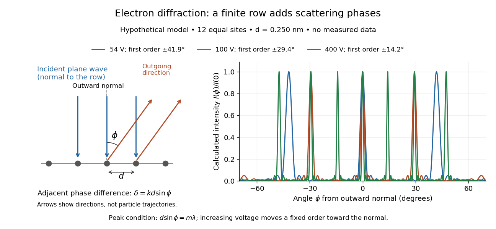
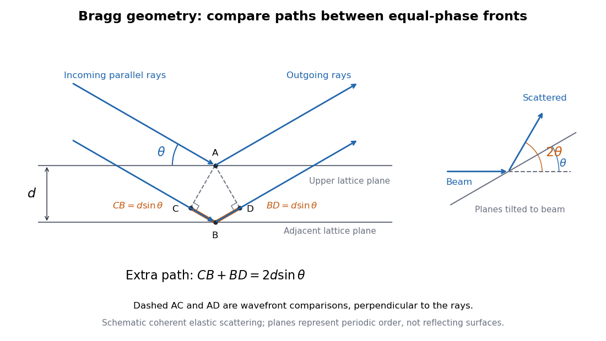
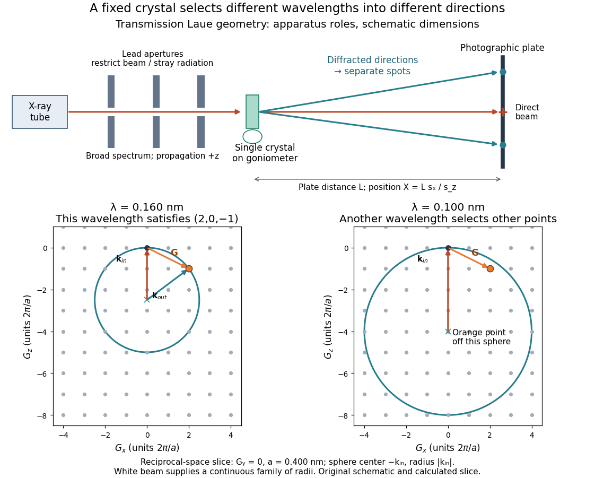

# Quantum scattering

↑ **Parent:** [Quantum mechanics](quantum-mechanics.md)  
ⓦ [Wiki](https://en.wikipedia.org/wiki/Quantum_scattering)

Quantum scattering compares a wavefunction's incoming and outgoing asymptotic components.

**Table of contents**

- [Quarter-wave matching layer for a quantum potential step](#quarter-wave-matching-layer-for-a-quantum-potential-step)
- [Discrete-state continuum scattering amplitude](#discrete-state-continuum-scattering-amplitude)
- [Scattering cross-section](#scattering-cross-section)
  - [Scattering plane](#scattering-plane)
- [Step potential](#step-potential)
  - [Evanescent amplitude versus transmitted current](#evanescent-amplitude-versus-transmitted-current)
  - [Quantum reflection at a downward step](#quantum-reflection-at-a-downward-step)
  - [Potential-step threshold wavefunction](#potential-step-threshold-wavefunction)
- [Coulomb distortion in electron scattering](#coulomb-distortion-in-electron-scattering)
- [Scattering channel](#scattering-channel)
- [Scattering angle](#scattering-angle)
- [X-ray scattering techniques](#x-ray-scattering-techniques)
  - [Inelastic X-ray scattering](#inelastic-x-ray-scattering)
- [Inelastic scattering](#inelastic-scattering)
- [Quantum reflection probability](#quantum-reflection-probability)
  - [Quantum reflection amplitude](#quantum-reflection-amplitude)
  - [Quantum step-reflection phase](#quantum-step-reflection-phase)
- [Transmission amplitude](#transmission-amplitude)
- [S-matrix](#s-matrix)
  - [Redundant pole of a scattering matrix](#redundant-pole-of-a-scattering-matrix)
  - [Jost function](#jost-function)
  - [Unit-modulus hyperbolic scattering block](#unit-modulus-hyperbolic-scattering-block)
  - [Physical rapidity strip](#physical-rapidity-strip)
    - [Crossed-channel pole in diagonal factorized scattering](#crossed-channel-pole-in-diagonal-factorized-scattering)
    - [Relativistic bound-state mass from a rapidity pole](#relativistic-bound-state-mass-from-a-rapidity-pole)
  - [Hermitian analyticity of a two-particle S-matrix](#hermitian-analyticity-of-a-two-particle-s-matrix)
- [Scattering wavefunction](#scattering-wavefunction)
- [Scattering state](#scattering-state)
- [Partial wave](#partial-wave)
  - [D wave](#d-wave)
- [Partial-wave scattering](#partial-wave-scattering)
  - [Two-dimensional partial-wave scattering formula](#two-dimensional-partial-wave-scattering-formula)
- [Differential scattering cross-section](#differential-scattering-cross-section)
  - [Central-potential classical differential cross-section](#central-potential-classical-differential-cross-section)
  - [Quantum differential cross-section from a scattering amplitude](#quantum-differential-cross-section-from-a-scattering-amplitude)
- [Reflected wave](#reflected-wave)
- [Transmission probability](#transmission-probability)
- [One-dimensional S-matrix](#one-dimensional-s-matrix)
  - [Parity basis of a one-dimensional S-matrix](#parity-basis-of-a-one-dimensional-s-matrix)
  - [One-dimensional transfer matrix from scattering amplitudes](#one-dimensional-transfer-matrix-from-scattering-amplitudes)
- [Partial-wave S-matrix](#partial-wave-s-matrix)
  - [Scattering phase shift](#scattering-phase-shift)
    - [Finite-range partial-wave threshold law](#finite-range-partial-wave-threshold-law)
    - [Periodic-box phase-shift quantization](#periodic-box-phase-shift-quantization)
  - [S wave (quantum scattering)](#s-wave-quantum-scattering)
    - [Phase shift of a delta-shell potential](#phase-shift-of-a-delta-shell-potential)
  - [Partial-wave expansion of a scattering amplitude](#partial-wave-expansion-of-a-scattering-amplitude)
    - [Partial-wave total scattering cross-section](#partial-wave-total-scattering-cross-section)
  - [Partial-wave unitarity](#partial-wave-unitarity)
  - [Unitarity and reflection identities for a partial-wave S-matrix](#unitarity-and-reflection-identities-for-a-partial-wave-s-matrix)
  - [Scattering length from a partial-wave S-matrix](#scattering-length-from-a-partial-wave-s-matrix)
    - [Bethe-Peierls boundary condition](#bethe-peierls-boundary-condition)
      - [Two-centre scattering-length model](#two-centre-scattering-length-model)
        - [Angular interference integral for two point scatterers](#angular-interference-integral-for-two-point-scatterers)
    - [S-wave scattering length](#s-wave-scattering-length)
    - [Scattering length of a delta-shell potential](#scattering-length-of-a-delta-shell-potential)
    - [Repulsive spherical barrier scattering length](#repulsive-spherical-barrier-scattering-length)
    - [Zero-energy scattering resonance](#zero-energy-scattering-resonance)
  - [Bound-state poles of a partial-wave S-matrix](#bound-state-poles-of-a-partial-wave-s-matrix)
    - [Hyperbolic-tangent S-wave exterior solution](#hyperbolic-tangent-s-wave-exterior-solution)
  - [Scattering resonance](#scattering-resonance)
    - [Breit-Wigner resonance cross section](#breit-wigner-resonance-cross-section)
      - [Same-resonance entrance-channel cross-section ratio](#same-resonance-entrance-channel-cross-section-ratio)
      - [Resonance spin statistical factor](#resonance-spin-statistical-factor)
      - [Unpolarized resonance spin factor](#unpolarized-resonance-spin-factor)
      - [Peak resonance cross section and branching fractions](#peak-resonance-cross-section-and-branching-fractions)
    - [Resonance pole](#resonance-pole)
- [Logarithmic-derivative matching](#logarithmic-derivative-matching)
- [Hard-sphere limit](#hard-sphere-limit)
  - [Hard-sphere S-wave scattering](#hard-sphere-s-wave-scattering)
- [Lippmann-Schwinger equation](#lippmann-schwinger-equation)
- [Scattering amplitude](#scattering-amplitude)
  - [Optical theorem](#optical-theorem)
    - [Optical theorem at second Born order](#optical-theorem-at-second-born-order)
    - [Resonant s-wave unitarity check](#resonant-s-wave-unitarity-check)
  - [Scattering-amplitude factorization](#scattering-amplitude-factorization)
  - [Crossing symmetry](#crossing-symmetry)
  - [Relativistic scattering cross-section](#relativistic-scattering-cross-section)
    - [Inclusive electron-positron annihilation into hadrons](#inclusive-electron-positron-annihilation-into-hadrons)
      - [Hadronic R ratio](#hadronic-r-ratio)
    - [Elastic scattering from a quartic scalar contact interaction](#elastic-scattering-from-a-quartic-scalar-contact-interaction)
    - [Invariant flux factor](#invariant-flux-factor)
    - [Lorentz-invariant phase-space measure](#lorentz-invariant-phase-space-measure)
      - [Relativistic two-body phase space](#relativistic-two-body-phase-space)
      - [Positive-energy on-shell delta function identity](#positive-energy-on-shell-delta-function-identity)
      - [Two-body decay phase space](#two-body-decay-phase-space)
      - [Identical-particle factor in a final-state phase-space integral](#identical-particle-factor-in-a-final-state-phase-space-integral)
  - [Momentum transfer](#momentum-transfer)
    - [Spatial resolution from momentum transfer](#spatial-resolution-from-momentum-transfer)
  - [Elastic scattering](#elastic-scattering)
    - [Neutrino-electron elastic scattering](#neutrino-electron-elastic-scattering)
    - [Coherent elastic scattering](#coherent-elastic-scattering)
  - [Diffraction](#diffraction)
    - [Thermal diffuse scattering](#thermal-diffuse-scattering)
    - [Ewald sphere curvature](#ewald-sphere-curvature)
    - [Obliquity factor](#obliquity-factor)
    - [Electron diffraction](#electron-diffraction)
      - [Dynamical diffraction](#dynamical-diffraction)
      - [Selected-area electron diffraction](#selected-area-electron-diffraction)
      - [Davisson–Germer experiment](#davisson-germer-experiment)
      - [Finite-row electron diffraction model](#finite-row-electron-diffraction-model)
  - [Crystal scattering](#crystal-scattering)
    - [Bragg diffraction](#bragg-diffraction)
    - [Bravais lattice](#bravais-lattice)
      - [Body-centered tetragonal lattice](#body-centered-tetragonal-lattice)
      - [Two-dimensional Bravais lattice](#two-dimensional-bravais-lattice)
        - [Square Bravais lattice](#square-bravais-lattice)
        - [Centered rectangular lattice](#centered-rectangular-lattice)
      - [Lattice vector](#lattice-vector)
      - [Hard-sphere atomic volume in cubic lattices](#hard-sphere-atomic-volume-in-cubic-lattices)
      - [Unit cell](#unit-cell)
        - [Primitive unit cell](#primitive-unit-cell)
      - [Face-centered tetragonal lattice](#face-centered-tetragonal-lattice)
      - [Face-centered cubic lattice](#face-centered-cubic-lattice)
        - [Face-centred cubic selection rule](#face-centred-cubic-selection-rule)
      - [Lattice point](#lattice-point)
        - [Lattice parallelepiped](#lattice-parallelepiped)
        - [Lattice cube](#lattice-cube)
        - [Pick's theorem](#pick-s-theorem)
      - [Reciprocal lattice](#reciprocal-lattice)
        - [Reciprocal lattice rod](#reciprocal-lattice-rod)
        - [Lattice-periodic plane wave](#lattice-periodic-plane-wave)
        - [Reciprocal lattice vector](#reciprocal-lattice-vector)
        - [Bragg plane](#bragg-plane)
        - [Reciprocal lattice change in a structural phase transition](#reciprocal-lattice-change-in-a-structural-phase-transition)
        - [Wigner-Seitz cell](#wigner-seitz-cell)
          - [Reciprocal lattice and Wigner-Seitz cell of the unit triangular lattice](#reciprocal-lattice-and-wigner-seitz-cell-of-the-unit-triangular-lattice)
      - [Cubic crystal system](#cubic-crystal-system)
        - [Body-centered cubic lattice](#body-centered-cubic-lattice)
          - [Neighbour shells of a body-centred cubic lattice](#neighbour-shells-of-a-body-centred-cubic-lattice)
          - [Reciprocal lattice of the 2023 Cambridge body-centered cubic basis](#reciprocal-lattice-of-the-2023-cambridge-body-centered-cubic-basis)
      - [Primitive cubic lattice](#primitive-cubic-lattice)
      - [Primitive lattice translation vector](#primitive-lattice-translation-vector)
      - [Lattice translation](#lattice-translation)
    - [Structure factor](#structure-factor)
    - [Crystal lattice structure factor](#crystal-lattice-structure-factor)
      - [Reciprocal-lattice peaks of a finite crystal](#reciprocal-lattice-peaks-of-a-finite-crystal)
      - [Crystal basis structure factor](#crystal-basis-structure-factor)
        - [Atomic scattering factor](#atomic-scattering-factor)
        - [Superlattice reflection](#superlattice-reflection)
    - [Elastic Bragg scattering condition](#elastic-bragg-scattering-condition)
      - [Bragg's law](#bragg-s-law)
        - [Bragg angle](#bragg-angle)
        - [Bragg path difference](#bragg-path-difference)
        - [Primitive cubic Bragg peak positions](#primitive-cubic-bragg-peak-positions)
        - [Bragg crystal reflection experiment of 1913](#bragg-crystal-reflection-experiment-of-1913)
      - [Bragg scattering](#bragg-scattering)
    - [Systematic absence](#systematic-absence)
      - [Diamond-basis diffraction extinction](#diamond-basis-diffraction-extinction)
    - [X-ray diffraction](#x-ray-diffraction)
      - [Debye-Scherrer camera](#debye-scherrer-camera)
      - [Single-crystal diffraction](#single-crystal-diffraction)
      - [Transmission diffraction geometry](#transmission-diffraction-geometry)
      - [Asymmetric reflection geometry](#asymmetric-reflection-geometry)
      - [Symmetric reflection geometry](#symmetric-reflection-geometry)
      - [X-ray diffractometer](#x-ray-diffractometer)
      - [Powder X-ray diffraction](#powder-x-ray-diffraction)
        - [Indexing a diamond-cubic powder pattern](#indexing-a-diamond-cubic-powder-pattern)
      - [Laue equations](#laue-equations)
      - [Laue method](#laue-method)
        - [Calculated transmission Laue pattern](#calculated-transmission-laue-pattern)
      - [Laue X-ray diffraction experiment of 1912](#laue-x-ray-diffraction-experiment-of-1912)
  - [Bound-state pole of the scattering amplitude](#bound-state-pole-of-the-scattering-amplitude)
- [Particle resonance](#particle-resonance)

## Quarter-wave matching layer for a quantum potential step

↑ **Parent:** [Quantum scattering](quantum-scattering.md)

For a constant-mass one-dimensional particle propagating through three regions of potentials $0,V_1,V_0$, let $k_j$ be the real positive wavevectors. A layer with $k_1a=\pi/2$ makes the two interface reflection amplitudes cancel exactly when $k_1^2=k_0k_2$. Equivalently $E-V_1=\sqrt{E(E-V_0)}$. For an increasing intermediate step this requires $E>V_0$ and $V_0/2<V_1<V_0$. The result follows from $r=(r_{01}+r_{12}e^{2ik_1a})/(1+r_{01}r_{12}e^{2ik_1a})$ and $r_{ij}=(k_i-k_j)/(k_i+k_j)$.

## Discrete-state continuum scattering amplitude

↑ **Parent:** [Quantum scattering](quantum-scattering.md)

For a real point coupling $g$ between a three-dimensional continuum and one discrete state, $A=mg^2/(2\pi\hbar^2)$. After the short-distance level shift is absorbed, the isotropic amplitude has the displayed form. The imaginary part is fixed by the outgoing [boundary condition](differential-equation.md#boundary-condition), and $\operatorname{Im}(1/f_k)=-k$ supplies elastic [unitarity](vector-space.md#unitary-operator).

## Scattering cross-section

↑ **Parent:** [Quantum scattering](quantum-scattering.md)

A scattering cross-section divides the scattered rate per target by the incident [particle flux](physics.md#particle-flux). Its differential form resolves that rate by outgoing direction. It has units of area for three-dimensional scattering and length for two-dimensional scattering. In two dimensions, the convention $\psi\sim e^{ikr\cos\theta}+e^{i\pi/4}f(\theta)e^{ikr}/\sqrt{kr}$ gives $d\sigma/d\theta=|f(\theta)|^2/k$ by comparing outgoing and incident [probability currents](wave-function.md#probability-current).

### Scattering plane

↑ **Parent:** [Scattering cross-section](#scattering-cross-section)

The plane spanned by incoming and outgoing propagation directions when those directions are not parallel or antiparallel. Polarization perpendicular or parallel to it is useful when expressing a [differential scattering cross-section](#differential-scattering-cross-section). The plane is not unique at exact forward or backward scattering.

## Step potential

↑ **Parent:** [Quantum scattering](quantum-scattering.md)  
ⓦ [Wiki](https://en.wikipedia.org/wiki/Step_potential)

For constant [mass](classical-mechanics.md#mass) $m$, a finite jump from [potential energy](energy.md#potential-energy) zero at $x<0$ to $V_0>0$ at $x>0$ requires continuity of the [wavefunction](wave-function.md) and its first [derivative](calculus.md#derivative). With incidence only from the left and $E>V_0$, put $k=\sqrt{2mE}/\hbar$ and $q=\sqrt{2m(E-V_0)}/\hbar$. Matching $A+B=C$ and $k(A-B)=qC$ gives reflected [probability amplitude](wave-function.md#probability-amplitude) $B/A=(k-q)/(k+q)$ and [transmission amplitude](#transmission-amplitude) $C/A=2k/(k+q)$. The [transmission probability](#transmission-probability) is $(q/k)|C/A|^2$, conserving [probability current](wave-function.md#probability-current).

For $0<E<V_0$, replace $q$ by $i\kappa$, where $\kappa=\sqrt{2m(V_0-E)}/\hbar$ is the [tunnelling decay constant](quantum-mechanics.md#tunnelling-decay-constant). The right-hand [wavefunction](wave-function.md) is $Ce^{-\kappa x}$, with zero [probability current](wave-function.md#probability-current). Its [probability density](wave-function.md#probability-density) decays on length $1/(2\kappa)$, while its amplitude decays on length $1/\kappa$. The semi-infinite raised region gives total reflection, unlike a finite [potential barrier](quantum-mechanics.md#potential-barrier) allowing [quantum tunnelling](quantum-mechanics.md#quantum-tunnelling) into a second allowed region.

### Evanescent amplitude versus transmitted current

↑ **Parent:** [Step potential](#step-potential)

For a real positive decay coefficient alpha, a stationary exponential tail has zero [probability current](wave-function.md#probability-current) because $\operatorname{Im}(\psi^*\partial_x\psi)=0$. Matching a subthreshold [potential step](#step-potential) can nevertheless give a nonzero coefficient T with $|T|^2>1$ relative to a unit incident plane-wave amplitude. This measures the density just beyond the step, not a flux-transmission probability. It describes penetration without a propagating outgoing channel in the semi-infinite high-potential region.

### Quantum reflection at a downward step

↑ **Parent:** [Step potential](#step-potential)

For $V_0<0$, $k=\sqrt{2mE}/\hbar$ tends to zero as $E\to0^+$ while $q=\sqrt{2m(E+|V_0|)}/\hbar$ stays finite. Matching gives [probability amplitudes](wave-function.md#probability-amplitude) $r=(k-q)/(k+q)$ and $t=2k/(k+q)$, so [quantum reflection probability](#quantum-reflection-probability) $R=r^2\to1$ and [transmission probability](#transmission-probability) $T=(q/k)|t|^2\sim4k/q\to0$. The final region is classically allowed; reflection results from the abrupt spatial change in the [wavefunction](wave-function.md)'s [wavenumber](wave-equation.md#wavenumber). These are limits of positive-energy incoming states, not a flux ratio evaluated at exactly zero incident current.

### Potential-step threshold wavefunction

↑ **Parent:** [Step potential](#step-potential)

For a positive [step potential](#step-potential) and left incidence, take $E\to V_0^+$ at fixed incident [probability amplitude](wave-function.md#probability-amplitude) $A$. The transmitted [wavenumber](wave-equation.md#wavenumber) tends to zero while the incident wavenumber tends to $k=\sqrt{2mV_0}/\hbar$. [Wavefunction matching at a finite potential step](mathematical-physics.md#wavefunction-matching-at-a-finite-potential-step) gives reflected amplitude $A$ and transmitted amplitude $2A$, producing the spatial [wavefunction](wave-function.md) in the title. The left [probability density](wave-function.md#probability-density) is $4|A|^2\cos^2kx$ and the right density $4|A|^2$. The transmitted [probability current](wave-function.md#probability-current) still tends to zero because its velocity tends to zero. Over adjacent intervals of length $2\pi/k$, the right integrated density is twice the left. These ratios use finite local integrals of a non-normalizable stationary scattering state.

## Coulomb distortion in electron scattering

↑ **Parent:** [Quantum scattering](quantum-scattering.md)

The change in incident and outgoing [electron](physics.md#electron) [wavefunctions](wave-function.md) caused by the target [Coulomb potential](electrostatics.md#coulomb-potential-energy). It can invalidate a [plane wave](wave-function.md#plane-wave) treatment in the [Born approximation](quantum-theory.md#born-approximation), especially for a large target [atomic number](chemical-substance.md#atomic-number).

## Scattering channel

↑ **Parent:** [Quantum scattering](quantum-scattering.md)

A specified asymptotic configuration of the particles and their internal [quantum states](quantum-system.md#quantum-state) in [quantum scattering](quantum-scattering.md). An incoming channel can scatter into several outgoing channels; [S-matrix](#s-matrix) elements give their [probability amplitudes](wave-function.md#probability-amplitude) with a stated [probability current](wave-function.md#probability-current) normalization. A channel can be energetically inaccessible even when other channels are open.

## Scattering angle

↑ **Parent:** [Quantum scattering](quantum-scattering.md)

The [angle](geometry-and-topology.md#angle) between specified incoming and outgoing directions in a [collision](classical-mechanics.md#collision); the reference frame and outgoing particle must be stated.

## X-ray scattering techniques

↑ **Parent:** [Quantum scattering](quantum-scattering.md)  
ⓦ [Wiki](https://en.wikipedia.org/wiki/X-ray_scattering_techniques)

[X-ray scattering techniques](#x-ray-scattering-techniques) use the change in a scattered [photon](quantum-mechanics.md#photon)'s direction and, in inelastic measurements, its [energy](energy.md) to probe matter. [Inelastic X-ray scattering](#inelastic-x-ray-scattering) transfers energy to excitations such as [phonons](quantum-ideal-gas-statistics.md#phonon); elastic methods probe spatial structure without that energy transfer.

### Inelastic X-ray scattering

↑ **Parent:** [X-ray scattering techniques](#x-ray-scattering-techniques)

[Inelastic X-ray scattering](#inelastic-x-ray-scattering) measures [energy](energy.md) and [momentum](momentum.md) transferred from [X-rays](electromagnetic-radiation.md#x-ray) to matter. With sufficiently high [energy resolution](physics.md#energy-resolution), it can map a [phonon dispersion relation](quantum-ideal-gas-statistics.md#phonon-dispersion-relation) by measuring inelastic peaks at different momentum transfers. [Crystal momentum](bloch-s-theorem.md#crystal-momentum) is determined modulo a [reciprocal lattice](#reciprocal-lattice) vector.

## Inelastic scattering

↑ **Parent:** [Quantum scattering](quantum-scattering.md)  
ⓦ [Wiki](https://en.wikipedia.org/wiki/Inelastic_scattering)

In [inelastic scattering](#inelastic-scattering), the participants exchange [energy](energy.md) with internal degrees of freedom, so their total translational [kinetic energy](energy.md#kinetic-energy) need not be conserved.

## Quantum reflection probability

↑ **Parent:** [Quantum scattering](quantum-scattering.md)

For one-dimensional scattering from a real potential, write the left exterior [wavefunction](wave-function.md) as $e^{ikx}+re^{-ikx}$ with $k>0$. The reflected-to-incident probability-current ratio is $R=|r|^2$, since both components have the same speed and their currents have opposite signs. This probability differs from the complex reflection amplitude $r$. With transmission into a right exterior [wavenumber](wave-equation.md#wavenumber) $q$, the [transmission probability](#transmission-probability) is $T=(q/k)|t|^2$ and conservation of current gives $R+T=1$ when there is no absorption.

### Quantum reflection amplitude

↑ **Parent:** [Quantum reflection probability](#quantum-reflection-probability)

A [quantum reflection amplitude](#quantum-reflection-amplitude) is the complex ratio of the outgoing reflected wave to the incident wave in a chosen scattering convention. In one reflected channel with the same exterior speed, the reflection [probability](probability-theory.md#probability) is $|r|^2$. Its phase affects [interference](physical-optics.md#interference-wave-propagation) even when its modulus is one; shifting the reference plane changes that phase.

### Quantum step-reflection phase

↑ **Parent:** [Quantum reflection probability](#quantum-reflection-probability)

A particle incident below a semi-infinite step has a unit-modulus [quantum reflection amplitude](#quantum-reflection-amplitude) but a nontrivial phase. Continuity of the oscillating and evanescent solutions yields the displayed coefficient, for the incident phase origin at the interface. Its decaying exterior wave has zero net [probability current](wave-function.md#probability-current). The phase depends on the chosen scattering convention; the unit reflection [probability](probability-theory.md#probability) does not.

## Transmission amplitude

↑ **Parent:** [Quantum scattering](quantum-scattering.md)

For one-dimensional [quantum scattering](quantum-scattering.md), $t$ is the complex amplitude of the outgoing transmitted wave relative to the incoming wave. The [transmission probability](#transmission-probability) is $|t|^2$ times the ratio of transmitted and incident flux velocities; with equal asymptotic dispersion it is $|t|^2$. A [reflectionless potential](quantum-mechanics.md#reflectionless-potential) has $r=0$ and a unit-modulus transmission amplitude whose phase shifts continuum quantization. The [supersymmetric factorization of the one-soliton potential](supersymmetric-quantum-mechanics.md#supersymmetric-factorization-of-the-one-soliton-potential) gives $t(k)=(k+im)/(k-im)$ for its single-bound-state potential.

## S-matrix

↑ **Parent:** [Quantum scattering](quantum-scattering.md)  
ⓦ [Wiki](https://en.wikipedia.org/wiki/S-matrix)

The [S-matrix](#s-matrix) maps incoming asymptotic states to outgoing asymptotic states. Its connected transition matrix elements contain an overall energy-momentum [Dirac delta function](distribution-theory.md#dirac-delta-function) and an invariant [scattering amplitude](#scattering-amplitude). In [quantum field theory](quantum-field-theory.md), the [LSZ reduction formula](perturbative-quantum-field-theory.md#lsz-reduction-formula) obtains these elements from amputated field correlators.

### Redundant pole of a scattering matrix

↑ **Parent:** [S-matrix](#s-matrix)

A pole of a [scattering matrix](#s-matrix) arising from the numerator $F(-k)$ rather than a zero of the incoming [Jost function](#jost-function) $F(k)$ can fail to correspond to a [bound state](quantum-system.md#bound-state). For $F(k)=(k-i\kappa)/(k+i\alpha)$, the pole at $i\kappa$ is associated with the incoming zero; the pole at $i\alpha$ comes from the numerator. The regular Eckart realization has $\alpha>\kappa$. The distinction and this explicit example are discussed in [https://dipot.ulb.ac.be/dspace/bitstream/2013/373712/4/2306.12216.pdf.](https://dipot.ulb.ac.be/dspace/bitstream/2013/373712/4/2306.12216.pdf.)

### Jost function

↑ **Parent:** [S-matrix](#s-matrix)  
ⓦ [Wiki](https://en.wikipedia.org/wiki/Jost_function)

For radial [quantum scattering](quantum-scattering.md), the incoming coefficient of the regular solution defines the Jost function, with convention $S(k)=F(-k)/F(k)$. A zero at $k=i\kappa$, $\kappa>0$, removes the exponentially growing component and produces a [bound state](quantum-system.md#bound-state), subject to regularity and normalizability. Poles of the outgoing numerator alone need not produce [bound states](quantum-system.md#bound-state).

### Unit-modulus hyperbolic scattering block

↑ **Parent:** [S-matrix](#s-matrix)

For real $u$, this scalar [S-matrix](#s-matrix) block satisfies $S_u(\theta)S_u(-\theta)=1$ and [Hermitian analyticity of a two-particle S-matrix](#hermitian-analyticity-of-a-two-particle-s-matrix). It therefore has modulus one for real [rapidity](special-relativity.md#rapidity) differences. For $0<u<\pi$ its [pole](isolated-singularity.md#pole) at $\theta=iu$ has [residue](analysis.md#residue) $2i\sin u$ and admits a direct-channel [bound-state pole](#bound-state-pole-of-the-scattering-amplitude) interpretation. Its crossed block is $\cosh[(\theta-iu)/2]/\cosh[(\theta+iu)/2]$. The endpoints $u=0$ and $u=\pi$ are removable degeneracies giving constant amplitudes, so a particle cannot be inferred there from the uncancelled denominator alone. This block specifies an amplitude; a complete theory must also obey the remaining [crossing symmetry](#crossing-symmetry) and [bootstrap fusion](quantum-field-theory.md#bound-state-fusion-of-factorized-s-matrices) constraints.

### Physical rapidity strip

↑ **Parent:** [S-matrix](#s-matrix)

For relativistic two-body scattering in one spatial dimension, this strip is the standard domain containing bound-state and crossed-channel [poles](isolated-singularity.md#pole). A stable-particle interpretation requires appropriate [pole](isolated-singularity.md#pole) kinematics and residues; not every singularity automatically represents a new particle. Crossing relates [rapidity](special-relativity.md#rapidity) $\vartheta$ to $i\pi-\vartheta$.

#### Crossed-channel pole in diagonal factorized scattering

↑ **Parent:** [Physical rapidity strip](#physical-rapidity-strip)

A physical-strip [pole](isolated-singularity.md#pole) of a diagonal [S-matrix](#s-matrix) can come from exchange of an existing particle in the crossed channel. For external [masses](classical-mechanics.md#mass) $m_a,m_b$, use the momentum difference, rather than the sum, to identify the exchanged [mass](classical-mechanics.md#mass) through the displayed invariant. [Crossing symmetry](#crossing-symmetry) turns the pole at $i\alpha$ into a direct pole at $i(\pi-\alpha)$ of the particle-antiparticle channel. For $m_B=2m\cos(u/2)$, the [pole](isolated-singularity.md#pole) of $S_{BA}$ at $iu/2$ has $t=m^2$ and exchanges the existing charge-one particle; it is not a new charge-three [bound state](quantum-system.md#bound-state).

#### Relativistic bound-state mass from a rapidity pole

↑ **Parent:** [Physical rapidity strip](#physical-rapidity-strip)

At relative [rapidity](special-relativity.md#rapidity) $iu$, the analytically continued sum of the constituent [four-momentum](special-relativity.md#four-momentum) vectors is on the bound-state [mass shell](special-relativity.md#mass-shell) with the displayed [mass](classical-mechanics.md#mass). For equal constituents, [rapidities](special-relativity.md#rapidity) $\chi\pm iu/2$ sum to $2m_a\cos(u/2)(\cosh\chi,\sinh\chi)$. A [pole](isolated-singularity.md#pole) at $u=0$ is at threshold rather than a strictly [bound state](quantum-system.md#bound-state).

### Hermitian analyticity of a two-particle S-matrix

↑ **Parent:** [S-matrix](#s-matrix)

In a real species basis, the two-particle [S-matrix](#s-matrix) satisfies $S(-\theta^*)=S(\theta)^\dagger$ under the usual scattering analyticity assumptions. On the real [rapidity](special-relativity.md#rapidity) axis this relates inverse-rapidity amplitudes to [complex conjugates](complex-analysis.md#complex-conjugate). Combined with the algebraic inverse relation $S(\theta)S(-\theta)=I$, it gives physical [unitarity](vector-space.md#unitary-operator).

## Scattering wavefunction

↑ **Parent:** [Quantum scattering](quantum-scattering.md)

For a localized target and a plane wave incident along the $z$-axis, the large-radius scattering wavefunction has the form

$$
\psi(\mathbf r)\sim e^{ikz}+f(\theta,\phi)\frac{e^{ikr}}r,
$$

where $f$ is the [scattering amplitude](#scattering-amplitude).

## Scattering state

↑ **Parent:** [Quantum scattering](quantum-scattering.md)

A [scattering state](#scattering-state) is a state used to describe [quantum scattering](quantum-scattering.md). Its asymptotic incoming and outgoing components determine a [scattering amplitude](#scattering-amplitude).

## Partial wave

↑ **Parent:** [Quantum scattering](quantum-scattering.md)

A partial wave is a component of a scattering state with definite [orbital angular momentum](quantum-mechanics.md#orbital-angular-momentum). A [central potential](energy.md#central-potential) preserves each angular-momentum channel, so the scattering problem decomposes into independent partial waves.

### D wave

↑ **Parent:** [Partial wave](#partial-wave)

A partial wave with [orbital angular momentum](quantum-mechanics.md#orbital-angular-momentum) $\ell=2$. Its orbital [parity](quantum-mechanics.md#parity) is positive. Coupling it to a spin-one pair can include total $J=1$, allowing a [D wave](#d-wave) component in the [deuteron](atomic-nucleus.md#deuteron).

## Partial-wave scattering

↑ **Parent:** [Quantum scattering](quantum-scattering.md)

[Partial-wave scattering](#partial-wave-scattering) decomposes a [scattering state](#scattering-state) into [partial waves](#partial-wave) with definite [orbital angular momentum](quantum-mechanics.md#orbital-angular-momentum). For a [central potential](energy.md#central-potential), each channel has its own [scattering phase shift](#scattering-phase-shift) and [Partial-wave S-matrix](#partial-wave-s-matrix).

### Two-dimensional partial-wave scattering formula

↑ **Parent:** [Partial-wave scattering](#partial-wave-scattering)

For a real central potential and the outgoing convention $e^{i\pi/4}f(\theta)e^{ikr}/\sqrt{kr}$, the [Partial-wave S-matrix](#partial-wave-s-matrix) is $S_m=e^{2i\delta_m}$. The cosine form of the [Jacobi-Anger expansion](bessel-function.md#jacobi-anger-expansion) fixes $w_0=1$ and $w_m=2$ for $m\geq1$. Comparing the outgoing part of each phase-shifted radial cosine with the incident [plane wave](wave-function.md#plane-wave) gives the displayed [scattering amplitude](#scattering-amplitude). Integrating $|f|^2/k$ gives the displayed [scattering cross-section](#scattering-cross-section), since the constant angular mode has squared norm $2\pi$ and each positive-order cosine has squared norm $\pi$. Reversing the multiplicities would already fail to reproduce the free [plane wave](wave-function.md#plane-wave) at zero [scattering phase shift](#scattering-phase-shift).

## Differential scattering cross-section

↑ **Parent:** [Quantum scattering](quantum-scattering.md)

The differential scattering cross-section is the effective incident area scattered per unit [solid angle](euclidean-geometry.md#solid-angle). It is defined by the ratio of the outgoing particle rate through $d\Omega$ to the incident flux.

### Central-potential classical differential cross-section

↑ **Parent:** [Differential scattering cross-section](#differential-scattering-cross-section)

For an azimuthally symmetric classical scattering map from [impact parameter](classical-mechanics.md#impact-parameter) $b$ to scattering angle $\theta$,

$$
\frac{d\sigma}{d\Omega}
=\frac{b}{\sin\theta}\left|\frac{db}{d\theta}\right|.
$$

When several impact parameters produce the same angle, their nonnegative contributions are summed.

### Quantum differential cross-section from a scattering amplitude

↑ **Parent:** [Differential scattering cross-section](#differential-scattering-cross-section)

If

$$
\psi\sim e^{ikz}+f(\theta)\frac{e^{ikr}}r,
$$

then the ratio of scattered radial [probability current](wave-function.md#probability-current) through $r^2d\Omega$ to the incident probability flux is

$$
\frac{d\sigma}{d\Omega}=|f(\theta)|^2.
$$

## Reflected wave

↑ **Parent:** [Quantum scattering](quantum-scattering.md)

A reflected wave is an outgoing component travelling back toward the side from which the incident wave arrived.

## Transmission probability

↑ **Parent:** [Quantum scattering](quantum-scattering.md)

The transmission probability is the ratio of transmitted to incident [probability current](wave-function.md#probability-current). When the asymptotic wavenumbers agree, it is the squared modulus of the transmission amplitude.

## One-dimensional S-matrix

↑ **Parent:** [Quantum scattering](quantum-scattering.md)

For a reflection-invariant localized potential, order incoming amplitudes from the left and right and outgoing amplitudes toward the left and right. Then

$$
S=\begin{pmatrix}r&t\\t&r\end{pmatrix},
$$

where $r$ and $t$ are the reflection and transmission amplitudes. Probability-current conservation makes $S$ unitary for a real potential.

### Parity basis of a one-dimensional S-matrix

↑ **Parent:** [One-dimensional S-matrix](#one-dimensional-s-matrix)

For a [parity-symmetric](quantum-mechanics.md#parity) one-dimensional potential, the even and odd parity states diagonalize the [One-dimensional S-matrix](#one-dimensional-s-matrix):

$$
S_{+-}=S_{-+}=0,
\qquad
S=\operatorname{diag}(S_{++},S_{--}).
$$

For a real potential, [unitarity](vector-space.md#unitary-operator) further gives $|S_{++}|=|S_{--}|=1$ at real positive energy.

### One-dimensional transfer matrix from scattering amplitudes

↑ **Parent:** [One-dimensional S-matrix](#one-dimensional-s-matrix)

If the left and right travelling-wave coefficients are related by

$$
B_L=rA_L+tB_R,
\qquad
A_R=tA_L+rB_R,
$$

then

$$
\begin{pmatrix}A_R\\B_R\end{pmatrix}
=\frac1t
\begin{pmatrix}t^2-r^2&r\\-r&1\end{pmatrix}
\begin{pmatrix}A_L\\B_L\end{pmatrix}.
$$

## Partial-wave S-matrix

↑ **Parent:** [Quantum scattering](quantum-scattering.md)

For a central potential, each angular-momentum channel has a scalar scattering coefficient $S_l(k)=e^{2i\delta_l(k)}$.

Each channel coefficient is a component of the [scattering matrix](#s-matrix) in a basis adapted to rotational symmetry.

### Scattering phase shift

↑ **Parent:** [Partial-wave S-matrix](#partial-wave-s-matrix)

For elastic scattering by a real central potential, the phase shift $\delta_l(k)$ measures the phase difference between the asymptotic radial wave in angular-momentum channel $l$ and the corresponding free wave. Its channel [Partial-wave S-matrix](#partial-wave-s-matrix) is $S_l=e^{2i\delta_l}$.

The phase shift parametrizes elastic [partial-wave scattering](#partial-wave-scattering), rather than general scattering phenomena.

#### Finite-range partial-wave threshold law

↑ **Parent:** [Scattering phase shift](#scattering-phase-shift)

For regular low-energy elastic scattering by a finite-range [central potential](energy.md#central-potential), higher [partial waves](#partial-wave) are suppressed by their [centrifugal barriers](mathematical-physics.md#centrifugal-barrier). Matching the regular interior radial solution to small-argument exterior spherical Bessel functions gives the displayed scaling of [scattering phase shift](#scattering-phase-shift), in the generic absence of a threshold singularity. Since the channel amplitude is proportional to $\sin\delta_\ell/k$, it scales as $k^{2\ell}$. The $\ell=0$ term is isotropic and normally leads. A tuned vanishing leading amplitude or a threshold resonance requires examining the next terms rather than applying the generic statement blindly.

#### Periodic-box phase-shift quantization

↑ **Parent:** [Scattering phase shift](#scattering-phase-shift)

For a reflectionless [scattering wavefunction](#scattering-wavefunction) whose two asymptotic phases differ by $\delta(k)$, a large periodic box gives $k_nL+\delta(k_n)=2\pi n$. Compared with the free value $k_n^{(0)}=2\pi n/L$, $k_n-k_n^{(0)}=-\delta(k_n^{(0)})/L+O(L^{-2})$ away from thresholds. Discrete [bound states](quantum-system.md#bound-state) and phase-branch changes alter mode indexing and must be counted when comparing complete spectra.

### S wave (quantum scattering)

↑ **Parent:** [Partial-wave S-matrix](#partial-wave-s-matrix)

An S wave is the rotationally invariant angular-momentum channel $l=0$. At sufficiently low energy it normally dominates short-range scattering because higher partial waves are suppressed by their centrifugal barriers.

#### Phase shift of a delta-shell potential

↑ **Parent:** [S wave (quantum scattering)](#s-wave-quantum-scattering)

For $V(r)=V_0\delta(r-R)$, put $g=2mV_0R/\hbar^2$. The regular reduced radial [wave function](wave-function.md) is proportional to $\sin kr$ inside the shell and to $\sin(kr+\delta_0)$ outside. It is continuous at $R$, while its radial derivative jumps by $(g/R)u(R)$. Dividing the jump condition by the common value gives $k\cot(kR+\delta_0)-k\cot(kR)=g/R$, which implies the displayed [phase shift](wave.md#phase-shift) modulo $\pi$. At nodes, the undivided matching equations give the continuous limiting interpretation. For $g\ne0$, an equivalent formula is $k\cot\delta_0=-k\cot(kR)-k(kR)/[g\sin^2(kR)]$. The exact [S-wave scattering](#s-wave-quantum-scattering) amplitude is $[k\cot\delta_0-ik]^{-1}$.

### Partial-wave expansion of a scattering amplitude

↑ **Parent:** [Partial-wave S-matrix](#partial-wave-s-matrix)

For a central potential and the convention $S_l=1+2if_l=e^{2i\delta_l}$, the [scattering amplitude](#scattering-amplitude) is

$$
f(\theta)=\frac1k\sum_{l=0}^{\infty}(2l+1)f_lP_l(\cos\theta),
\qquad
f_l=e^{i\delta_l}\sin\delta_l.
$$

The identity $|S_l|=1$ is equivalent to $\operatorname{Im}f_l=|f_l|^2$.

#### Partial-wave total scattering cross-section

↑ **Parent:** [Partial-wave expansion of a scattering amplitude](#partial-wave-expansion-of-a-scattering-amplitude)

For elastic scattering by a central potential,

$$
\sigma_T=\frac{4\pi}{k^2}\sum_{l=0}^{\infty}(2l+1)\sin^2\delta_l.
$$

At low momentum, the [S wave](wave-equation.md#s-wave) normally supplies the leading term.

### Partial-wave unitarity

↑ **Parent:** [Partial-wave S-matrix](#partial-wave-s-matrix)

Partial-wave unitarity bounds each angular-momentum component of a scattering amplitude because its elastic S-matrix eigenvalue has modulus one. Perturbative violation of this bound signals that interactions become strong or that additional degrees of freedom must enter.

### Unitarity and reflection identities for a partial-wave S-matrix

↑ **Parent:** [Partial-wave S-matrix](#partial-wave-s-matrix)

For a real central potential and real $k$, radial-current conservation gives $S_l(k)^*S_l(k)=1$. Invariance of the radial equation under $k\mapsto-k$ gives $S_l(k)S_l(-k)=1$, so a continuous phase convention has $\delta_l(-k)=-\delta_l(k)$.

### Scattering length from a partial-wave S-matrix

↑ **Parent:** [Partial-wave S-matrix](#partial-wave-s-matrix)

The $s$-wave scattering length is

$$
a_s=-\lim_{k\to0}\frac{\tan\delta_0(k)}k,
$$

and the low-energy total cross-section is $4\pi a_s^2$.

#### Bethe-Peierls boundary condition

↑ **Parent:** [Scattering length from a partial-wave S-matrix](#scattering-length-from-a-partial-wave-s-matrix)

This zero-range [boundary condition](differential-equation.md#boundary-condition) replaces a short-range interaction by its [S-wave scattering](#s-wave-quantum-scattering) length. If $\psi=A/r+B+O(r)$, it requires $B=-A/a$. An outgoing spherical wave also has a constant $ik$ term; retaining that term gives the unitary scattering-length amplitude $f_0=-a/(1+ika)$. The model neglects effective-range corrections and is applied outside the microscopic range, not literally inside a finite potential.

##### Two-centre scattering-length model

↑ **Parent:** [Bethe-Peierls boundary condition](#bethe-peierls-boundary-condition)

Two separated short-range scatterers are coupled because the outgoing wave from either centre supplies part of the regular incoming field at the other. Applying the [Bethe-Peierls boundary condition](#bethe-peierls-boundary-condition) at both centres gives the displayed two-by-two linear system, where $s_j$ is the incident plane-wave phase. [matrix](vector-space.md#matrix) inversion sums repeated scattering between the centres. Near a small [determinant](multilinear-algebra.md#determinant), effective-range corrections may matter even if the nominal microscopic range is short.

###### Angular interference integral for two point scatterers

↑ **Parent:** [Two-centre scattering-length model](#two-centre-scattering-length-model)

Taking the polar axis along the separation vector reduces the solid-angle [integral](integral.md) to $2\pi\int_{-1}^1e^{ikdu}du$. Thus the total [scattering cross-section](#scattering-cross-section) contains the [interference](physical-optics.md#interference-wave-propagation) term $2\operatorname{Re}(c_1c_2^*)\sin(kd)/(kd)$ as well as the two self terms. This is an outgoing-angle [integral](integral.md) for fixed incident direction, rather than an average over the incoming beam.

#### S-wave scattering length

↑ **Parent:** [Scattering length from a partial-wave S-matrix](#scattering-length-from-a-partial-wave-s-matrix)

The zero-energy parameter of the angular-momentum-zero partial wave. For a short-range interaction in three dimensions, its leading elastic [scattering amplitude](#scattering-amplitude) is $f_0(k)\simeq- a_s/(1+ika_s)$ when effective-range corrections are negligible. For identical dilute [bosons](tensor-product-of-quantum-systems.md#boson) this parameter fixes the leading contact coupling $g_B=4\pi\hbar^2a_s/m_B$.

#### Scattering length of a delta-shell potential

↑ **Parent:** [Scattering length from a partial-wave S-matrix](#scattering-length-from-a-partial-wave-s-matrix)

The zero-energy limit of the [phase shift of a delta-shell potential](#phase-shift-of-a-delta-shell-potential) gives the displayed [scattering length](#scattering-length-from-a-partial-wave-s-matrix). It vanishes at zero coupling and has a pole at $g=-1$. For repulsion $g>0$, $0<a_0<R$; for weak attraction $-1<g<0$, $a_0<0$; for $g<-1$, $a_0>R$. Both infinite-coupling limits tend to $R$. The pole is the threshold for an S-wave [bound state](quantum-system.md#bound-state): writing its energy as $-\hbar^2\kappa^2/(2m)$ gives $g=-2\kappa R/[1-e^{-2\kappa R}]$, with threshold $g\to-1$ as $\kappa\downarrow0$. The [delta-shell Born amplitude](quantum-theory.md#delta-shell-born-amplitude) agrees with the exact low-energy amplitude only in their common weak-coupling and low-energy regime, $|g|\ll1$ and $kR\ll1$, where both tend to $-gR$.

#### Repulsive spherical barrier scattering length

↑ **Parent:** [Scattering length from a partial-wave S-matrix](#scattering-length-from-a-partial-wave-s-matrix)

For a barrier of radius $a$ and potential $\hbar^2\gamma^2/(2m)$, matching the regular inner hyperbolic-sine wave to the outer sine wave gives $a_s=a-\tanh(\gamma a)/\gamma$. The low-energy $s$-wave [scattering amplitude](#scattering-amplitude) is $-a_s$.

#### Zero-energy scattering resonance

↑ **Parent:** [Scattering length from a partial-wave S-matrix](#scattering-length-from-a-partial-wave-s-matrix)

A zero-energy scattering resonance occurs when an S-wave bound state reaches the continuum threshold. The zero-energy radial solution then approaches a nonzero constant rather than a generic linear function, and the [scattering length](#scattering-length-from-a-partial-wave-s-matrix) diverges and changes sign.

### Bound-state poles of a partial-wave S-matrix

↑ **Parent:** [Partial-wave S-matrix](#partial-wave-s-matrix)

A pole at $k=i\kappa$ with $\kappa>0$ represents a normalizable bound state of energy $-\hbar^2\kappa^2/(2m)$. Resonance poles instead lie away from the imaginary axis on the analytically continued unphysical sheet.

#### Hyperbolic-tangent S-wave exterior solution

↑ **Parent:** [Bound-state poles of a partial-wave S-matrix](#bound-state-poles-of-a-partial-wave-s-matrix)

For the exterior wave

$$
\psi(r)=\frac{e^{-ikr}}r
+\frac{k+i\lambda\tanh(\lambda r)}{k-i\lambda}
\frac{e^{ikr}}r,
$$

the partial-wave scattering matrix is

$$
S_0(k)=-\frac{k+i\lambda}{k-i\lambda}
=\frac{\lambda-ik}{\lambda+ik}.
$$

Thus $\tan\delta_0=-k/\lambda$, the scattering length is $1/\lambda$, and the pole at $k=i\lambda$ represents a bound state of energy $-\hbar^2\lambda^2/(2m)$ whose exterior wavefunction is proportional to $\operatorname{sech}(\lambda r)/r$.

### Scattering resonance

↑ **Parent:** [Partial-wave S-matrix](#partial-wave-s-matrix)

A scattering resonance is a metastable state represented by a pole of the analytically continued scattering matrix. Near an isolated narrow resonance, a cross-section has a Breit-Wigner peak whose energy width is the inverse lifetime up to $\hbar$.

#### Breit-Wigner resonance cross section

↑ **Parent:** [Scattering resonance](#scattering-resonance)

For an isolated [particle resonance](#particle-resonance) of [spin](angular-momentum-operator.md#spin) $J_R$, the Breit-Wigner approximation relates a production-and-decay [cross section](physics.md#cross-section-physics) to its partial [decay widths](relativistic-quantum-field.md#decay-width). In [natural units](mathematical-physics.md#natural-units), $p_i$ is either incident particle's momentum magnitude in the [centre-of-momentum frame](special-relativity.md#center-of-momentum-frame), $g=(2J_R+1)/[(2J_a+1)(2J_b+1)]$ for unpolarized incident particles, and $\Gamma$ is the total width. The formula assumes the stated spin counting and neglects nonresonant backgrounds and their interference. Multiplication by $(\hbar c)^2$ converts an inverse-squared-energy cross section to area when momenta are expressed in energy units.

##### Same-resonance entrance-channel cross-section ratio

↑ **Parent:** [Breit-Wigner resonance cross section](#breit-wigner-resonance-cross-section)

Compare two entrance channels feeding the same isolated resonance and the same selected exit channel, each at its own resonance [energy](energy.md). The exit [partial decay width](relativistic-quantum-field.md#partial-decay-width) and the resonant denominator cancel. Different entrance momenta, [spin](angular-momentum-operator.md#spin) weights and entrance widths remain. The formula assumes the same resonance, the stated unpolarized [spin](angular-momentum-operator.md#spin) average and negligible nonresonant [interference](physical-optics.md#interference-wave-propagation); a ratio at one shared laboratory [energy](energy.md) would generally be different.

##### Resonance spin statistical factor

↑ **Parent:** [Breit-Wigner resonance cross section](#breit-wigner-resonance-cross-section)

For unpolarized entrance particles, average over their $(2J_a+1)(2J_b+1)$ [spin](angular-momentum-operator.md#spin) orientations and sum over the isolated resonance's $2J_R+1$ magnetic substates. The resulting weight multiplies the partial-wave [cross section](physics.md#cross-section-physics). It can exceed one because orbital [angular momentum](momentum.md#angular-momentum) participates; it is not a standalone probability of forming a state. Polarization or several unresolved resonance [spins](angular-momentum-operator.md#spin) requires more detailed channel counting.

##### Unpolarized resonance spin factor

↑ **Parent:** [Breit-Wigner resonance cross section](#breit-wigner-resonance-cross-section)

For unpolarized incident particles, the resonant cross section sums over the resonance's magnetic substates and averages over the incident spin states. This gives the displayed statistical weight under the conventional [Breit-Wigner resonance cross section](#breit-wigner-resonance-cross-section) normalization. A spin-zero resonance formed from two spin-half particles has $g=1/4$, whereas a spin-one resonance has $g=3/4$. This counting is distinct from final-state [color charge](standard-model.md#color-charge) multiplicities.

##### Peak resonance cross section and branching fractions

↑ **Parent:** [Breit-Wigner resonance cross section](#breit-wigner-resonance-cross-section)

At $E=E_R$, the [Breit-Wigner resonance cross section](#breit-wigner-resonance-cross-section) loses its explicit dependence on the total [decay width](relativistic-quantum-field.md#decay-width) after writing $\Gamma_{ab}=B_{ab}\Gamma$ and $\Gamma_X=B_X\Gamma$. For an unpolarized ultrarelativistic [electron](physics.md#electron)-[Positron](physics.md#positron) initial state and a spin-one resonance, $g=3/4$ and $p_i=E_R/2$, giving $\sigma_{\rm peak}=12\pi B_eB_X/E_R^2$ in [natural units](mathematical-physics.md#natural-units). An elastic resonant channel therefore measures the square $B_e^2$, rather than one power of the electronic [branching fraction](relativistic-quantum-field.md#branching-fraction).

#### Resonance pole

↑ **Parent:** [Scattering resonance](#scattering-resonance)

A pole of the continued [scattering matrix](#s-matrix) associated with outgoing boundary conditions and an unstable trapped state. A pole below the real energy axis gives time dependence $e^{-iE_Rt/\hbar}e^{-\Gamma t/(2\hbar)}$, so the probability lifetime is $\hbar/\Gamma$. Bound-state poles instead lie on the positive imaginary wavenumber axis and produce square-integrable decaying spatial waves.

## Logarithmic-derivative matching

↑ **Parent:** [Quantum scattering](quantum-scattering.md)

At an interface where a finite potential changes discontinuously, continuity of a radial wavefunction and its derivative is equivalent to matching $u'/u$ on the two sides. This removes the arbitrary normalization constants and gives an equation for the [scattering phase shift](#scattering-phase-shift).

## Hard-sphere limit

↑ **Parent:** [Quantum scattering](quantum-scattering.md)

The hard-sphere limit of a repulsive spherical potential makes penetration into a sphere of radius $a$ vanish. Its low-energy [S wave](wave-equation.md#s-wave) scattering length tends to $a$, and its quantum total cross-section tends to $4\pi a^2$.

### Hard-sphere S-wave scattering

↑ **Parent:** [Hard-sphere limit](#hard-sphere-limit)

For a hard sphere of [radius](topology.md#radius) $R$, the exterior radial [S wave](wave-equation.md#s-wave) is proportional to $\sin[k(r-R)]$. Matching it to $\sin(kr+\delta_0)$ gives [scattering phase shift](#scattering-phase-shift) $\delta_0=-kR$ modulo $\pi$ and [scattering length](#scattering-length-from-a-partial-wave-s-matrix) $R$. The [scattering amplitude](#scattering-amplitude) is $f_0=-e^{-ikR}\sin(kR)/k$, giving the displayed [cross section](physics.md#cross-section-physics). The zero-energy limit is $4\pi R^2$, its zeros occur at positive integer multiples $kR=n\pi$, and its high-energy envelope decreases as $k^{-2}$. This is one [partial wave](#partial-wave), not the total high-energy hard-sphere result obtained by summing all [partial waves](#partial-wave).

## Lippmann-Schwinger equation

↑ **Parent:** [Quantum scattering](quantum-scattering.md)  
ⓦ [Wiki](https://en.wikipedia.org/wiki/Lippmann-Schwinger_equation)

The Lippmann-Schwinger equation rewrites the Schrodinger differential equation as an integral equation using a free Green function and a prescribed incoming state.

## Scattering amplitude

↑ **Parent:** [Quantum scattering](quantum-scattering.md)  
ⓦ [Wiki](https://en.wikipedia.org/wiki/Scattering_amplitude)

A scattering amplitude is the coefficient of an outgoing asymptotic wave relative to the specified incoming wave.

### Optical theorem

↑ **Parent:** [Scattering amplitude](#scattering-amplitude)

Write the [S-matrix](#s-matrix) as $S=1+iT$. [Unitarity](vector-space.md#unitary-operator) gives $-i(T-T^\dagger)=T^\dagger T$, so the diagonal forward matrix element obeys $2\operatorname{Im}T_{ii}=\sum_f\int d\Phi_f\,|T_{fi}|^2$. Thus the imaginary part of a forward [scattering amplitude](#scattering-amplitude) measures the total inclusive transition rate. For an electromagnetic source, the [hadronic electromagnetic-current spectral density](perturbative-quantum-field-theory.md#hadronic-electromagnetic-current-spectral-density) supplies the inclusive spectral sum.

#### Optical theorem at second Born order

↑ **Parent:** [Optical theorem](#optical-theorem)

For a real [elastic scattering](#elastic-scattering) potential the first Born forward amplitude is real, while the leading total [scattering cross-section](#scattering-cross-section) is quadratic in the potential. The second Born amplitude supplies an imaginary part from its outgoing [Green function](green-s-function.md). Symmetrizing the two interaction positions makes its imaginary part equal to $k/(4\pi)$ times the integrated squared first Born amplitude. The identity therefore compares quantities at the same perturbative order; a real first Born amplitude alone cannot test it against a nonzero [scattering cross-section](#scattering-cross-section).

#### Resonant s-wave unitarity check

↑ **Parent:** [Optical theorem](#optical-theorem)

For an isotropic elastic amplitude normalized by an incident unit [plane wave](wave-function.md#plane-wave) and outgoing $fe^{ikr}/r$, total cross section is $4\pi|f|^2$. The [optical theorem](#optical-theorem) gives the displayed identity. At a [resonance](dynamical-systems.md#resonance) where the real part of $1/f$ vanishes, $f=i/k$ and the cross section is $4\pi/k^2$.

### Scattering-amplitude factorization

↑ **Parent:** [Scattering amplitude](#scattering-amplitude)

Near a one-particle pole, a [scattering amplitude](#scattering-amplitude) factors into amplitudes coupling each side to the intermediate state, summed over its physical polarizations. The pole position gives its squared [mass](classical-mechanics.md#mass), while its [residue](analysis.md#residue) encodes its spin and couplings.

### Crossing symmetry

↑ **Parent:** [Scattering amplitude](#scattering-amplitude)  
ⓦ [Wiki](https://en.wikipedia.org/wiki/Crossing_symmetry)

Crossing symmetry relates [scattering amplitudes](#scattering-amplitude) by analytic continuation exchanging incoming and outgoing particles. A symmetric four-point scalar amplitude has equivalent descriptions under permutations of the [Mandelstam variables](special-relativity.md#mandelstam-variables).

### Relativistic scattering cross-section

↑ **Parent:** [Scattering amplitude](#scattering-amplitude)

With relativistically normalized external states, a two-particle initial state has differential cross-section $d\sigma=|\mathcal M|^2d\Phi_n/\mathcal F$, where $d\Phi_n$ is the [Lorentz-invariant phase-space measure](#lorentz-invariant-phase-space-measure) and $\mathcal F$ is the [invariant flux factor](#invariant-flux-factor). For identical unobserved final particles, divide the full labeled phase-space integral by their permutation multiplicity.

#### Inclusive electron-positron annihilation into hadrons

↑ **Parent:** [Relativistic scattering cross-section](#relativistic-scattering-cross-section)

At leading electromagnetic order and with negligible electron mass, the photon-channel [relativistic cross-section](#relativistic-scattering-cross-section) is $\sigma_h=4\pi^2\alpha\rho_h=16\pi^3\alpha^2\rho_J/s$, in the stated [hadronic photon spectral density](quantum-field-theory.md#hadronic-photon-spectral-density) and [hadronic electromagnetic-current spectral density](perturbative-quantum-field-theory.md#hadronic-electromagnetic-current-spectral-density) conventions. Initial electron and positron spins are averaged; final hadronic states are summed inclusively. Electroweak channels beyond photon exchange are separate contributions.

##### Hadronic R ratio

↑ **Parent:** [Inclusive electron-positron annihilation into hadrons](#inclusive-electron-positron-annihilation-into-hadrons)

The [hadronic R ratio](#hadronic-r-ratio) normalizes the photon-channel hadronic [relativistic cross-section](#relativistic-scattering-cross-section) to the leading massless muon-pair value. The free active-quark result is $R=N_c\sum_fQ_f^2$. It depends on flavor charges as well as the number of active flavors; it is not simply $N_cN_f$.

#### Elastic scattering from a quartic scalar contact interaction

↑ **Parent:** [Relativistic scattering cross-section](#relativistic-scattering-cross-section)

The factorial-normalized quartic vertex gives an angle-independent tree amplitude of magnitude $|\lambda|$. For equal incoming and outgoing masses, the momentum ratio in the two-body cross-section cancels. The event density for identical outgoing particles over a full sphere is $\lambda^2/(128\pi^2s)$. On a hemisphere representing each event once, the density is $\lambda^2/(64\pi^2s)$. Both conventions give total event cross-section $\lambda^2/(32\pi s)$.

#### Invariant flux factor

↑ **Parent:** [Relativistic scattering cross-section](#relativistic-scattering-cross-section)

For two incident particles in relativistic normalization, this is $2\sqrt{\kappa(s,m_1^2,m_2^2)}$, where $\kappa$ is the [Källén function](special-relativity.md#kallen-function). For equal masses it is $2\sqrt{s(s-4m^2)}$.

#### Lorentz-invariant phase-space measure

↑ **Parent:** [Relativistic scattering cross-section](#relativistic-scattering-cross-section)

The on-shell measure $d^3p/(2E)$ is Lorentz invariant. The product measure together with the four-dimensional [Dirac delta distribution](distribution-theory.md#dirac-delta-function) enforces [four-momentum conservation](special-relativity.md#four-momentum-conservation). For equal masses in two-body scattering, $d\Phi_2=\sqrt{1-4m^2/s}\,d\Omega/(32\pi^2)$.

##### Relativistic two-body phase space

↑ **Parent:** [Lorentz-invariant phase-space measure](#lorentz-invariant-phase-space-measure)

For two outgoing particles with centre-of-mass momentum magnitude $k$ and total energy $\sqrt s$, integrating the four-momentum delta function gives $d\Phi_2/d\Omega=k/(16\pi^2\sqrt s)$. A factor $1/2!$ for identical outgoing particles is inserted when counting events over the full phase space, not into this labelled kinematic measure itself.

##### Positive-energy on-shell delta function identity

↑ **Parent:** [Lorentz-invariant phase-space measure](#lorentz-invariant-phase-space-measure)

For $E>0$ and the positive-energy branch, the root Jacobian of the [Dirac delta function](distribution-theory.md#dirac-delta-function) gives this identity. In a [massless collinear parton approximation](standard-model.md#massless-collinear-parton-approximation), it produces $\delta(x-\xi)/(P\cdot q)$.

##### Two-body decay phase space

↑ **Parent:** [Lorentz-invariant phase-space measure](#lorentz-invariant-phase-space-measure)

This total decay-width formula applies in the parent's rest frame when the squared [scattering amplitude](#scattering-amplitude) is independent of direction and the daughters are distinct. For identical daughters an additional symmetry factor is needed.

##### Identical-particle factor in a final-state phase-space integral

↑ **Parent:** [Lorentz-invariant phase-space measure](#lorentz-invariant-phase-space-measure)

When the full [Lorentz-invariant phase-space measure](#lorentz-invariant-phase-space-measure) treats $n$ identical final particles as labeled, each physical final configuration is counted $n!$ times. The unlabelled [relativistic scattering cross-section](#relativistic-scattering-cross-section) therefore includes $1/n!$. For two identical scalars, this divides the full-angle result by two; equivalently, integrate over a region containing only one representative of each exchanged pair.

### Momentum transfer

↑ **Parent:** [Scattering amplitude](#scattering-amplitude)  
ⓦ [Wiki](https://en.wikipedia.org/wiki/Momentum_transfer)

The momentum transfer in a scattering process is the difference between the incoming and outgoing [wavevectors](elasticity-physics.md#wavevector), commonly $Q=k-k'$ up to a sign convention and a factor of $\hbar$.

#### Spatial resolution from momentum transfer

↑ **Parent:** [Momentum transfer](#momentum-transfer)

In [quantum scattering](quantum-scattering.md), a spatial feature on scale $\ell$ contributes Fourier components with [wavenumber](wave-equation.md#wavenumber) of order $1/\ell$. A [momentum transfer](#momentum-transfer) of magnitude $q$ supplies [wavenumber](wave-equation.md#wavenumber) $q/\hbar$, giving the characteristic estimate $\ell\sim\hbar/q$. With the energy-like quantity $Q=qc$, this becomes $\ell\sim\hbar c/Q$. The full [de Broglie wavelength](wave-function.md#de-broglie-wavelength) uses $h/p$ and differs from the corresponding reduced wavelength by $2\pi$. Beam [energy](energy.md) only bounds accessible [momentum transfer](#momentum-transfer); it does not determine the resolution of every event.

### Elastic scattering

↑ **Parent:** [Scattering amplitude](#scattering-amplitude)  
ⓦ [Wiki](https://en.wikipedia.org/wiki/Elastic_scattering)

Elastic scattering preserves the total kinetic energy. For one particle scattered by a fixed target, the incoming and outgoing [wavevectors](elasticity-physics.md#wavevector) therefore have equal magnitudes.

#### Neutrino-electron elastic scattering

↑ **Parent:** [Elastic scattering](#elastic-scattering)

An elastic [weak interaction](standard-model.md#weak-interaction) of a [neutrino](standard-model.md#neutrino) with an [electron](physics.md#electron). For a stationary [electron](physics.md#electron) of [mass](classical-mechanics.md#mass) $m$ and an effectively massless incident [neutrino](standard-model.md#neutrino) of [energy](energy.md) $E$, the maximum recoil [kinetic energy](energy.md#kinetic-energy) in [natural units](mathematical-physics.md#natural-units) is $T_{\max}=2E^2/(m+2E)$. This kinematic limit does not specify the interaction probability.

#### Coherent elastic scattering

↑ **Parent:** [Elastic scattering](#elastic-scattering)

In [coherent elastic scattering](#coherent-elastic-scattering), amplitudes from the scattering constituents combine while their internal state is unchanged. For [X-rays](electromagnetic-radiation.md#x-ray), recoil taken by a whole [chemical atom](physics.md#atom-physics) can produce an effectively unshifted component alongside the [Compton scattering](mathematical-physics.md#compton-scattering) component.

### Diffraction

↑ **Parent:** [Scattering amplitude](#scattering-amplitude)  
ⓦ [Wiki](https://en.wikipedia.org/wiki/Diffraction)

Diffraction is interference produced when waves scatter from spatial structure. A periodic structure concentrates the scattered intensity at reciprocal-lattice conditions.

#### Thermal diffuse scattering

↑ **Parent:** [Diffraction](#diffraction)

Diffuse scattering generated by fluctuating lattice displacements. Resolved one-phonon creation and annihilation transfer both energy and crystal momentum, with Bose factors $n_B+1$ and $n_B$. An energy-integrating diffraction measurement can record their summed intensity without resolving the small energy transfer. Phonon polarization, soft-mode frequencies and atomic scattering weights determine the pattern; static disorder supplies a distinct possible diffuse contribution.

#### Ewald sphere curvature

↑ **Parent:** [Diffraction](#diffraction)

[Ewald sphere curvature](#ewald-sphere-curvature) is the curvature of the reciprocal-space surface sampled by elastic scattering. Accounting for its departure from a plane can improve very high-resolution [electron microscopy](optics.md#electron-microscopy) reconstructions.

#### Obliquity factor

↑ **Parent:** [Diffraction](#diffraction)

The [obliquity factor](#obliquity-factor) weights the directional contribution of an aperture element in a scalar [diffraction](#diffraction) integral. In a fixed observation direction in the [Fraunhofer diffraction](physical-optics.md#fraunhofer-diffraction) regime, its variation across a sufficiently small aperture can be neglected along with the variation of the geometric amplitude denominator. Its angular dependence can still matter when comparing widely separated observation directions.

#### Electron diffraction

↑ **Parent:** [Diffraction](#diffraction)  
ⓦ [Wiki](https://en.wikipedia.org/wiki/Electron_diffraction)

[Electron diffraction](#electron-diffraction) is [interference](physical-optics.md#interference-wave-propagation) between scattered [electron](physics.md#electron) [probability amplitudes](wave-function.md#probability-amplitude). It connects the [de Broglie wavelength](wave-function.md#de-broglie-wavelength) of the incident beam to the arrangement of the scattering material. In [elastic scattering](#elastic-scattering) from a fixed crystal, $|\mathbf k_{\rm out}|=|\mathbf k_{\rm in}|=2\pi/\lambda$, and constructive [crystal scattering](#crystal-scattering) selects [wavevector](elasticity-physics.md#wavevector) transfers $\mathbf Q=\mathbf k_{\rm out}-\mathbf k_{\rm in}$ in the [reciprocal lattice](#reciprocal-lattice). The physical [momentum transfer](#momentum-transfer) to the [electron](physics.md#electron) is $\hbar\mathbf Q$ in this convention.

[Bragg's law](#bragg-s-law) expresses the same condition as $2d\sin\theta_B=n\lambda$, where $d$ is the spacing of the chosen lattice planes, $n$ the [diffraction order](physical-optics.md#diffraction-order), and $\theta_B$ the angle to those planes. The angle between incoming and outgoing propagation directions is $\chi=2\theta_B$ for that reflection geometry. In normal-incidence backscattering, a detector's angle $\phi$ from the outward surface normal instead gives $\chi=\pi-\phi$; neither detector colatitude nor angle to the surface normal should silently replace $\theta_B$. A [finite-row electron diffraction model](#finite-row-electron-diffraction-model) uses a different spacing, the spacing between sites along a surface row, and makes that distinction explicit.

##### Dynamical diffraction

↑ **Parent:** [Electron diffraction](#electron-diffraction)

[diffraction](#diffraction) in which repeated scattering and coupling between transmitted and diffracted beams significantly affect their amplitudes. Electron-diffraction intensity can then vary strongly with thickness and excitation error; it is not generally just the squared single-scattering [crystal basis structure factor](#crystal-basis-structure-factor).

##### Selected-area electron diffraction

↑ **Parent:** [Electron diffraction](#electron-diffraction)

Transmission-electron diffraction from a region selected by an aperture in an image plane. Downstream lenses image the objective [back focal plane](optical-instrument.md#back-focal-plane) to the detector, producing reciprocal-space rather than real-space information.

<h5 id="davisson-germer-experiment">Davisson–Germer experiment</h5>

↑ **Parent:** [Electron diffraction](#electron-diffraction)  
ⓦ [Wiki](https://en.wikipedia.org/wiki/Davisson–Germer_experiment)

The [Davisson–Germer experiment](#davisson-germer-experiment) turned [elastic scattering](#elastic-scattering) from [nickel](chemical-substance.md#nickel) into evidence for a [matter wave](wave-function.md#matter-wave). The search became a deliberate wave test in 1926, with [diffraction](#diffraction) beams found early in 1927. The earlier crystal investigation had begun in 1925; the [de Broglie wavelength](wave-function.md#de-broglie-wavelength) proposal was already present in the 1924 thesis.[The discovery of electron waves, printed p. 390: retrospective chronology and the change to a deliberate wave test](physics-bibliography.md#the-discovery-of-electron-waves-by-clinton-j-davisson)

A heated [tungsten](chemical-substance.md#tungsten) ribbon supplied [electrons](physics.md#electron); gun apertures selected a narrow beam. Two $1\,\mathrm{mm}$ apertures were $8\,\mathrm{mm}$ apart; the gun ended $7\,\mathrm{mm}$ from a [nickel](chemical-substance.md#nickel) crystal cut parallel to its $\{111\}$ planes. An adjustable [electric potential difference](electric-field.md#electric-potential-difference) set the speed. The beam struck normally inside an evacuated, field-free enclosure with target and outer electrodes at one potential. A double-box collector, $11\,\mathrm{mm}$ from the target with a $1\,\mathrm{mm}$ entrance, selected directions. A retarding [electric potential difference](electric-field.md#electric-potential-difference) rejected slower [electrons](physics.md#electron); the inner collector fed a sensitive [galvanometer](electric-charge.md#galvanometer). Moving the collector scanned colatitude; rotating the crystal scanned azimuth.[The apparatus, printed pp. 707–710, figures 2–4: source, apertures, potentials, collector and target preparation](physics-bibliography.md#diffraction-of-electrons-by-a-crystal-of-nickel-by-c-davisson-and-l-h-germer)

The readout was collected [electric current](electric-charge.md#electric-current), not a photograph of [electron](physics.md#electron) paths. Voltage scans held the gun-plate current constant because incident-beam current could not be held constant; the overall current trend therefore needed caution. A strong feature developed at $54\,\mathrm V$ near $50^\circ$ colatitude. Surface heating distinguished crystal beams from adsorbed-gas beams; finite apertures and background shifted or broadened apparent peaks.[Printed p. 705, abstract; pp. 715–719, figures 9–12: voltage-scan control, 54 V feature, background subtraction and instrumental widths](physics-bibliography.md#diffraction-of-electrons-by-a-crystal-of-nickel-by-c-davisson-and-l-h-germer)

At the bright beam's colatitude, an azimuth scan revealed three companion directions, matching crystal symmetry. The test compared [wavelengths](wave-equation.md#wavelength) inferred from [diffraction](#diffraction) angles and known crystal spacings with [wavelengths](wave-equation.md#wavelength) inferred from accelerating [voltage](random-walk.md#voltage) and [momentum](momentum.md); the 1937 lecture displayed this comparison against $U^{-1/2}$. Agreement across beam directions supplied more evidence than one angular peak.[Printed pp. 391–393, figures 2–4: angular and azimuth scans and independent wavelength comparison](physics-bibliography.md#the-discovery-of-electron-waves-by-clinton-j-davisson)

The inference is about coherent [quantum phases](quantum-system.md#quantum-phase) in scattering probabilities. It does not establish a wavy particle trajectory, and a collector-current experiment does not resolve individual detection events. Predicting the full intensity additionally requires the material's [scattering amplitude](#scattering-amplitude), its surface condition, and instrumental angular acceptance; the [de Broglie wavelength](wave-function.md#de-broglie-wavelength) alone predicts none of those strengths. The following [finite-row electron diffraction model](#finite-row-electron-diffraction-model) isolates phase addition without attempting to reproduce the [nickel](chemical-substance.md#nickel) measurements.

##### Finite-row electron diffraction model

↑ **Parent:** [Electron diffraction](#electron-diffraction)

Take $N$ equally spaced scattering sites at $x_j=jd$ on a line, a normally incident [plane wave](wave-function.md#plane-wave), equal site [scattering amplitudes](#scattering-amplitude), and observation far enough away that outgoing directions are effectively parallel. Retain only one scattering event per amplitude, as in the [Born approximation](quantum-theory.md#born-approximation). For angle $\phi$ from the outward normal, write the adjacent-site [quantum phase](quantum-system.md#quantum-phase) difference as $\delta=kd\sin\phi$, with $k=2\pi/\lambda$; reversing its overall sign leaves the intensity unchanged. Summing a [geometric series](sequence-and-series.md#geometric-series) gives

$$
\frac{I(\phi)}{I(0)}=\frac{1}{N^2}\left|\sum_{j=0}^{N-1}e^{ij\delta}\right|^2
=\left[\frac{\sin(N\delta/2)}{N\sin(\delta/2)}\right]^2,\qquad \delta=\frac{2\pi d}{\lambda}\sin\phi.
$$

At $\delta=2\pi m$ use the continuous limit $I/I(0)=1$, rather than treating $0/0$ as a missing peak. The integer $m$ is the [diffraction order](physical-optics.md#diffraction-order): $d\sin\phi=m\lambda$. This is a surface-row spacing, not the plane spacing in [Bragg's law](#bragg-s-law). The plotted intensity is normalized to its central value; it is not an integrated detection probability or an absolute collector [electric current](electric-charge.md#electric-current).

**[Figure 1](#image-surface-row-geometry-and-calculated-electron-diffraction-intensity). Surface-row geometry and calculated electron diffraction intensity**. [Source](electron-diffraction-row-geometry-intensity.py). Original idealized model: $N=12$, row spacing $d=0.250\,\mathrm{nm}$, equal site [scattering amplitudes](#scattering-amplitude), normal incidence and field-free nonrelativistic [electron](physics.md#electron) [wavelengths](wave-equation.md#wavelength) at $54$, $100$ and $400\,\mathrm V$. Straight arrows denote propagation directions, not sinusoidal particle paths. The first-order peak angles are about $41.9^\circ$, $29.4^\circ$ and $14.2^\circ$. Curves are calculated phase sums, not measured data or a fit to the [Davisson–Germer experiment](#davisson-germer-experiment).

At $100\,\mathrm V$, $\lambda\simeq0.12264\,\mathrm{nm}$ and the positive first-order angle is $\arcsin(\lambda/d)\simeq29.4^\circ$. At $400\,\mathrm V$, the [wavelength](wave-equation.md#wavelength) halves and this angle becomes about $14.2^\circ$. Increasing $N$ narrows each peak through more selective [interference](physical-optics.md#interference-wave-propagation), while increasing [momentum](momentum.md) brings a fixed-order peak nearer the normal. Unequal site amplitudes, multiple scattering, a three-dimensional [crystal lattice structure factor](#crystal-lattice-structure-factor), and finite detector acceptance can change this simple picture; it is an explanatory model with hypothetical inputs.

### Crystal scattering

↑ **Parent:** [Scattering amplitude](#scattering-amplitude)

In the [Born approximation](quantum-theory.md#born-approximation), scattering from identical atomic potentials translated to lattice sites factors into one atomic form factor times a finite sum of phases over the crystal sites.

#### Bragg diffraction

↑ **Parent:** [Crystal scattering](#crystal-scattering)

Coherent scattering from lattice planes satisfying $2d\sin\theta=n\lambda$. The angle between incident and diffracted rays is $2\theta$, not $\theta$.

#### Bravais lattice

↑ **Parent:** [Crystal scattering](#crystal-scattering)  
ⓦ [Wiki](https://en.wikipedia.org/wiki/Bravais_lattice)

A three-dimensional Bravais lattice is

$$
\Lambda=\{n_1a_1+n_2a_2+n_3a_3:n_i\in\mathbb Z\},
$$

where the primitive vectors $a_1,a_2,a_3$ are linearly independent.

##### Body-centered tetragonal lattice

↑ **Parent:** [Bravais lattice](#bravais-lattice)

A tetragonal [Bravais lattice](#bravais-lattice) represented by conventional-cell points $(0,0,0)$ and $(1/2,1/2,1/2)$, with $a=b\ne c$ and right angles. A motif attached to each point determines the atomic structure and can give more than two atoms per conventional cell.

##### Two-dimensional Bravais lattice

↑ **Parent:** [Bravais lattice](#bravais-lattice)

The set $\{n_1\mathbf a_1+n_2\mathbf a_2:n_1,n_2\in\mathbb Z\}$ for two independent planar translation vectors. Its primitive-cell area is $|\det(\mathbf a_1,\mathbf a_2)|$.

###### Square Bravais lattice

↑ **Parent:** [Two-dimensional Bravais lattice](#two-dimensional-bravais-lattice)

A [two-dimensional Bravais lattice](#two-dimensional-bravais-lattice) with perpendicular primitive vectors of the same length $\ell$. An orthogonal matrix $R$ gives its orientation, and its primitive area is $\ell^2$. Its nearest-neighbor graph is a [square lattice](graph.md#square-lattice); the set of crystal translations and the graph with chosen adjacency are related but distinct objects.

###### Centered rectangular lattice

↑ **Parent:** [Two-dimensional Bravais lattice](#two-dimensional-bravais-lattice)

A lattice represented by a rectangular conventional cell with corner points and one center point. For conventional sides $2a,2b$, primitive vectors can be $(a,b)$ and $(-a,b)$. The special case $a=b$ is a [square lattice](graph.md#square-lattice) with a rotated primitive basis.

##### Lattice vector

↑ **Parent:** [Bravais lattice](#bravais-lattice)

A direct lattice vector is an integer [linear combination](vector-space.md#linear-combination) of primitive translation vectors $\mathbf a_i$ of a [Bravais lattice](#bravais-lattice). Translating by such a vector preserves the lattice. Its dot product with every [reciprocal lattice vector](#reciprocal-lattice-vector) is an integer multiple of $2\pi$ in the angular-wavevector convention.

##### Hard-sphere atomic volume in cubic lattices

↑ **Parent:** [Bravais lattice](#bravais-lattice)

For identical touching atoms represented by [hard spheres](statistical-physics.md#hard-sphere) of radius $r$, a [face-centered cubic lattice](#face-centered-cubic-lattice) has conventional side $a_F=2\sqrt2r$ and four atoms per conventional cell. A [body-centered cubic lattice](#body-centered-cubic-lattice) has side $a_B=4r/\sqrt3$ and two atoms per conventional cell. Their [primitive unit cell](#primitive-unit-cell) volumes are respectively

$$
\Omega_F=4\sqrt2r^3,\qquad \Omega_B=\frac{32}{3\sqrt3}r^3.
$$

Each primitive cell contains one atom in the monatomic model, so its [mass density](fluid-mechanics.md#density) is atomic [mass](classical-mechanics.md#mass) divided by $\Omega$. These are contact-geometry estimates; a fixed hard-sphere radius does not encode [thermal expansion](thermodynamics.md#thermal-expansion) or phase-dependent electronic bonding.

##### Unit cell

↑ **Parent:** [Bravais lattice](#bravais-lattice)

A region whose translates tile a lattice's ambient space, together with the lattice points represented in it. A [primitive unit cell](#primitive-unit-cell) represents one lattice point; a conventional unit cell may represent several to display symmetry.

###### Primitive unit cell

↑ **Parent:** [Unit cell](#unit-cell)

A fundamental cell of a [Bravais lattice](#bravais-lattice), of volume equal to the absolute [determinant](multilinear-algebra.md#determinant) of any primitive lattice basis. Direct and [reciprocal lattice](#reciprocal-lattice) primitive cell volumes multiply to $(2\pi)^d$ in dimension $d$ with the angular-wavenumber convention.

##### Face-centered tetragonal lattice

↑ **Parent:** [Bravais lattice](#bravais-lattice)

A tetragonal conventional cell with lattice points at its vertices and face centers describes a [Bravais lattice](#bravais-lattice). It is equivalent, after a rotation and a change of conventional cell, to a body-centered tetragonal description. The [reciprocal lattice](#reciprocal-lattice) of a body-centered tetragonal lattice with conventional sides $a,a,b$ consists of $2\pi(h/a,k/a,l/b)$ with $h+k+l$ even; these points form a face-centered tetragonal conventional cell with sides $4\pi/a,4\pi/a,4\pi/b$.

##### Face-centered cubic lattice

↑ **Parent:** [Bravais lattice](#bravais-lattice)

A face-centered cubic lattice has lattice points at every corner and face center of a conventional cube. One primitive cell has one quarter of the conventional cube's volume.

###### Face-centred cubic selection rule

↑ **Parent:** [Face-centered cubic lattice](#face-centered-cubic-lattice)

For equivalent scatterers on the four conventional fcc sites, the centering factor is $1+e^{i\pi(h+k)}+e^{i\pi(h+l)}+e^{i\pi(k+l)}$. It is four when the integer indices are all even or all odd, and zero otherwise. An additional [atomic basis of a crystal](physical-chemistry.md#atomic-basis-of-a-crystal) can impose further extinctions. This rule concerns conventional cubic indexing.

##### Lattice point

↑ **Parent:** [Bravais lattice](#bravais-lattice)

A lattice point is a vector $l=n_1a_1+n_2a_2+n_3a_3$ whose coefficients in a chosen primitive [basis](vector-space.md#basis) are [integers](integer.md).

###### Lattice parallelepiped

↑ **Parent:** [Lattice point](#lattice-point)

###### Lattice cube

↑ **Parent:** [Lattice point](#lattice-point)

<h6 id="pick-s-theorem">Pick's theorem</h6>

↑ **Parent:** [Lattice point](#lattice-point)

For a simple [polygon](euclidean-geometry.md#polygon) whose vertices are [lattice points](#lattice-point) in $\mathbb Z^2$, its [area](differential-geometry.md#surface-area) is $A=I+B/2-1$, where $I$ counts interior [lattice points](#lattice-point) and $B$ counts boundary [lattice points](#lattice-point).

##### Reciprocal lattice

↑ **Parent:** [Bravais lattice](#bravais-lattice)  
ⓦ [Wiki](https://en.wikipedia.org/wiki/Reciprocal_lattice)

The reciprocal lattice is

$$
\Lambda^*=\{q:q\cdot l\in2\pi\mathbb Z\text{ for every }l\in\Lambda\}.
$$

If $\Omega=a_1\cdot(a_2\times a_3)$, its primitive vectors are

$$
b_1=2\pi\frac{a_2\times a_3}{\Omega},
\quad
b_2=2\pi\frac{a_3\times a_1}{\Omega},
\quad
b_3=2\pi\frac{a_1\times a_2}{\Omega},
$$

and satisfy $a_i\cdot b_j=2\pi\delta_{ij}$.

###### Reciprocal lattice rod

↑ **Parent:** [Reciprocal lattice](#reciprocal-lattice)

An elongated reciprocal-space reflection caused by finite extent in the corresponding real-space direction. A foil of thickness $t$ has reflection breadth of order $1/t$ along its normal, increasing the range over which a reflection can intersect an [Ewald sphere](inverse-problem.md#ewald-sphere). The exact profile depends on the specimen shape and scattering model.

###### Lattice-periodic plane wave

↑ **Parent:** [Reciprocal lattice](#reciprocal-lattice)

A [plane wave](wave-function.md#plane-wave) whose phase is unchanged by every direct lattice translation: $e^{i\mathbf k\cdot\mathbf R}=1$ for all $\mathbf R\in\Lambda$. Its [wavevector](elasticity-physics.md#wavevector) is a [reciprocal lattice vector](#reciprocal-lattice-vector). In one dimension $ka=2\pi m$.

###### Reciprocal lattice vector

↑ **Parent:** [Reciprocal lattice](#reciprocal-lattice)

A reciprocal lattice vector $\mathbf G$ has the displayed property for every direct [lattice vector](#lattice-vector) $\mathbf R$. Thus $e^{i\mathbf G\cdot\mathbf R}=1$. Fourier components of a lattice-periodic potential carry these wavevectors and couple plane-wave electronic states whose momenta differ by $\hbar\mathbf G$. This is the origin of the Bragg-plane mixing in a [nearly-free electron model](bloch-s-theorem.md#nearly-free-electron-model).

###### Bragg plane

↑ **Parent:** [Reciprocal lattice](#reciprocal-lattice)

For free-electron dispersion proportional to $k^2$, states at $\mathbf k$ and $\mathbf k-\mathbf G$ are degenerate on this plane, obtained by equating their squared norms. A nonzero periodic-potential Fourier component can mix them and open an avoided crossing in the [nearly-free electron model](bloch-s-theorem.md#nearly-free-electron-model). First-zone boundaries are selected planes of this kind.

###### Reciprocal lattice change in a structural phase transition

↑ **Parent:** [Reciprocal lattice](#reciprocal-lattice)

The [reciprocal lattice](#reciprocal-lattice) of a [body-centered cubic lattice](#body-centered-cubic-lattice) is face-centred cubic, and that of a [face-centered cubic lattice](#face-centered-cubic-lattice) is body-centred cubic. In both cases its conventional cubic side is $4\pi/a$ if the direct conventional side is $a$. Thus a direct BCC-to-FCC [phase transition](critical-phenomenon.md#phase-transition) reverses the reciprocal lattice types. The reciprocal primitive cell volume is $(2\pi)^3/\Omega$, so [thermal expansion](thermodynamics.md#thermal-expansion) contracts reciprocal spacings, while a discontinuous change in direct [primitive unit cell](#primitive-unit-cell) volume gives an inverse change in reciprocal cell volume.

A first-order structural transition need not continuously deform one perfect reciprocal array into another. Phase coexistence, new orientation variants, domains and loss of single-crystal alignment can produce two sets of diffraction peaks or many differently oriented sets. The two endpoint lattice types alone do not specify the transformation path or orientation relationship.

###### Wigner-Seitz cell

↑ **Parent:** [Reciprocal lattice](#reciprocal-lattice)  
ⓦ [Wiki](https://en.wikipedia.org/wiki/Wigner–Seitz_cell)

The Wigner--Seitz cell of a lattice point consists of points at least as close to it as to every other lattice point. Its faces lie on perpendicular bisectors to neighbouring lattice points.

###### Reciprocal lattice and Wigner-Seitz cell of the unit triangular lattice

↑ **Parent:** [Wigner-Seitz cell](#wigner-seitz-cell)

For direct primitive vectors $(1,0)$ and $(-1/2,\sqrt3/2)$, reciprocal primitive vectors are

$$
\left(2\pi,\frac{2\pi}{\sqrt3}\right),
\qquad
\left(0,\frac{4\pi}{\sqrt3}\right).
$$

The reciprocal Wigner--Seitz cell is a regular hexagon of area $8\pi^2/\sqrt3$ and circumradius $4\pi/3$.

##### Cubic crystal system

↑ **Parent:** [Bravais lattice](#bravais-lattice)  
ⓦ [Wiki](https://en.wikipedia.org/wiki/Cubic_crystal_system)

The [cubic crystal system](#cubic-crystal-system) has cubic point symmetry. Its three cubic [Bravais lattices](#bravais-lattice) are primitive, body-centered, and face-centered. The [body-centered cubic lattice](#body-centered-cubic-lattice) is one member of that classification.

###### Body-centered cubic lattice

↑ **Parent:** [Cubic crystal system](#cubic-crystal-system)

A body-centered cubic lattice consists of the points of a cubic lattice together with their body centers. Its reciprocal lattice is face-centered cubic.

###### Neighbour shells of a body-centred cubic lattice

↑ **Parent:** [Body-centered cubic lattice](#body-centered-cubic-lattice)

In a [body-centred cubic lattice](#body-centered-cubic-lattice) of conventional edge $a$, a lattice site has eight nearest neighbours along body half-diagonals at distance $\sqrt3a/2$, then six next-nearest neighbours along the coordinate axes at distance $a$. There are two sites per conventional cell, so identical atoms of mass $m$ and [mass density](fluid-mechanics.md#density) $\rho$ obey $\rho a^3=2m$. Specifying a neighbour shell matters: the nearest and next-nearest distances differ.

###### Reciprocal lattice of the 2023 Cambridge body-centered cubic basis

↑ **Parent:** [Body-centered cubic lattice](#body-centered-cubic-lattice)

For

$$
a_1=\frac a2(1,1,1),
\quad a_2=\frac a2(1,-1,1),
\quad a_3=a(0,0,1),
$$

a reciprocal basis is

$$
b_1=\frac{2\pi}{a}(1,1,0),
\quad b_2=\frac{2\pi}{a}(1,-1,0),
\quad b_3=\frac{2\pi}{a}(-1,0,1).
$$

Thus $\Lambda^*=(2\pi/a)\{(h,k,l)\in\mathbb Z^3:h+k+l\text{ even}\}$ and its shortest nonzero vectors have length $2\sqrt2\pi/a$.

##### Primitive cubic lattice

↑ **Parent:** [Bravais lattice](#bravais-lattice)

##### Primitive lattice translation vector

↑ **Parent:** [Bravais lattice](#bravais-lattice)

A member of a set of [linearly independent vectors](vector-space.md#linear-independence) whose [integer](integer.md) combinations generate every [lattice point](#lattice-point) of a [Bravais lattice](#bravais-lattice). Such [basis vectors](vector-space.md#basis-vector) specify translations; an [atomic basis of a crystal](physical-chemistry.md#atomic-basis-of-a-crystal) specifies the chemical motif repeated under them.

##### Lattice translation

↑ **Parent:** [Bravais lattice](#bravais-lattice)

A [lattice translation](#lattice-translation) moves every [lattice point](#lattice-point) of a [Bravais lattice](#bravais-lattice) onto another [lattice point](#lattice-point). Its vector is an [integer](integer.md) combination of [primitive lattice translation vectors](#primitive-lattice-translation-vector). The [Laue equations](#laue-equations) require the [wave phase](wave.md#phase-waves) factor of every such translation to be one.

#### Structure factor

↑ **Parent:** [Crystal scattering](#crystal-scattering)

The coherent [scattering amplitude](#scattering-amplitude) associated with a specified spatial arrangement, obtained by summing the site amplitudes with their relative [wave phases](wave.md#phase-waves). Distinguish the [crystal lattice structure factor](#crystal-lattice-structure-factor), which sums over lattice sites, from the [crystal basis structure factor](#crystal-basis-structure-factor), which sums the [chemical atoms](physics.md#atom-physics) inside a [unit cell](#unit-cell). In a periodic [crystal](thermodynamics.md#crystal) the two factors multiply. A basis factor can vanish even at an allowed [reciprocal lattice](#reciprocal-lattice) vector, causing an extinct reflection.

#### Crystal lattice structure factor

↑ **Parent:** [Crystal scattering](#crystal-scattering)

For a finite set $S$ of crystal sites, the lattice structure factor at momentum transfer $Q$ is

$$
\Delta(Q)=\sum_{l\in S}e^{iQ\cdot l}.
$$

It multiplies the single-atom [scattering amplitude](#scattering-amplitude).

##### Reciprocal-lattice peaks of a finite crystal

↑ **Parent:** [Crystal lattice structure factor](#crystal-lattice-structure-factor)

For $S=\{\sum_il_ia_i:-L_i/2\leq l_i\leq L_i/2\}$ and $\alpha_i=Q\cdot a_i$,

$$
\Delta(Q)=\prod_{i=1}^3
\frac{\sin((L_i+1)\alpha_i/2)}{\sin(\alpha_i/2)}.
$$

For large $L_i$, each factor is sharply peaked when $\alpha_i\in2\pi\mathbb Z$, exactly the condition $Q\in\Lambda^*$.

##### Crystal basis structure factor

↑ **Parent:** [Crystal lattice structure factor](#crystal-lattice-structure-factor)

###### Atomic scattering factor

↑ **Parent:** [Crystal basis structure factor](#crystal-basis-structure-factor)

The scattering amplitude assigned to one atom or ion as a function of momentum transfer, normalized relative to a stated scattering convention. X-ray and electron factors are different; multiplying by basis phase factors produces the total unit-cell amplitude.

###### Superlattice reflection

↑ **Parent:** [Crystal basis structure factor](#crystal-basis-structure-factor)

A [diffraction](#diffraction) reflection enabled by a larger chemical or structural repeat than that of a reference parent structure. In ordered $L1_2$ $A_3B$, sites $(0,0,0)$ and the three face centres give $F=f_B+f_A[(-1)^{h+k}+(-1)^{h+l}+(-1)^{k+l}]$. Equal-parity indices give $f_B+3f_A$; mixed parity gives $f_B-f_A$. The latter vanish when the two scattering factors are equal.

#### Elastic Bragg scattering condition

↑ **Parent:** [Crystal scattering](#crystal-scattering)

For elastic scattering with $k-k'=q\in\Lambda^*$ and $|k|=|k'|=k$,

$$
2k\cdot q=|q|^2,
\qquad
|q|=2k\sin\frac\theta2.
$$

The smallest nonzero diffraction angle is determined by the shortest reciprocal-lattice vector.

This reciprocal-lattice condition is equivalent to [Bragg's law](#bragg-s-law), expressed in terms of the lattice-plane spacing and the wavelength.

<h5 id="bragg-s-law">Bragg's law</h5>

↑ **Parent:** [Elastic Bragg scattering condition](#elastic-bragg-scattering-condition)  
ⓦ [Wiki](https://en.wikipedia.org/wiki/Bragg's_law)

[Bragg's law](#bragg-s-law) selects directions of [constructive interference](fourier-analysis.md#constructive-interference) in [coherent elastic scattering](#coherent-elastic-scattering) from equally spaced [lattice planes](physical-chemistry.md#lattice-plane):

$$
n\lambda=2d\sin\theta,\qquad n=1,2,3,\ldots.
$$

Here $d>0$ is the perpendicular [interplanar spacing](physical-chemistry.md#interplanar-spacing), $\lambda>0$ the incident [wavelength](wave-equation.md#wavelength), $n$ the positive integer [diffraction order](physical-optics.md#diffraction-order), and $\theta$ the [Bragg angle](#bragg-angle), measured between the incoming beam and the [lattice planes](physical-chemistry.md#lattice-plane). The scattering deflection, between incoming and outgoing propagation directions, is $2\theta$. Thus a plotted detector angle $2\theta$ must be halved before insertion into [Bragg's law](#bragg-s-law). The $\theta$ in the parent [elastic Bragg scattering condition](#elastic-bragg-scattering-condition) denotes the full deflection; the present $\theta$ denotes half of it. [Online Dictionary of Crystallography, Bragg's law, Definition: spacing, wavelength, glancing angle and reflection order](physics-bibliography.md#online-dictionary-of-crystallography-by-international-union-of-crystallography/bragg-s-law)

The [lattice planes](physical-chemistry.md#lattice-plane) organize [wave interference](physical-optics.md#interference-wave-propagation) throughout a [crystal structure](physical-chemistry.md#crystal-structure); they are not literal metal mirrors or separate reflecting surfaces. The picture assumes [elastic scattering](#elastic-scattering), hence an unchanged [wavelength](wave-equation.md#wavelength), and sufficiently stable relative [wave phases](wave.md#phase-waves) across the contributing [lattice planes](physical-chemistry.md#lattice-plane). [X-ray](electromagnetic-radiation.md#x-ray) [wavelengths](wave-equation.md#wavelength) comparable with atomic [interplanar spacings](physical-chemistry.md#interplanar-spacing) make these directions experimentally accessible. The [sine](geometry-and-topology.md#sine) cannot exceed one: an order exists geometrically only if $n\lambda/(2d)\leq1$. For $\lambda>2d$, even the first [diffraction order](physical-optics.md#diffraction-order) is inaccessible. A geometrically possible direction need not have nonzero [wave intensity](wave.md#intensity-physics); the [crystal lattice structure factor](#crystal-lattice-structure-factor) and [crystal basis structure factor](#crystal-basis-structure-factor) also matter. [Online Dictionary of Crystallography by International Union of Crystallography; Definition and Derivation: coherent addition of the atoms within the unit cell](physics-bibliography.md#online-dictionary-of-crystallography-by-international-union-of-crystallography/structure-factor)

###### Bragg angle

↑ **Parent:** [Bragg's law](#bragg-s-law)

The [Bragg angle](#bragg-angle) is the glancing angle from the incident beam to the selected [lattice planes](physical-chemistry.md#lattice-plane), with $0<\theta\leq90^\circ$. If $\alpha$ is instead the angle from the beam to the plane normal, $\alpha=90^\circ-\theta$ and [Bragg's law](#bragg-s-law) becomes $n\lambda=2d\cos\alpha$. Defining the angle explicitly prevents a [sine](geometry-and-topology.md#sine)-versus-[cosine](geometry-and-topology.md#cosine) error as well as a factor-of-two error in the detector deflection.

Choose $\lambda=0.154\,\mathrm{nm}$ and $d=0.200\,\mathrm{nm}$ as an illustrative model, not historical measurements. For the first [diffraction order](physical-optics.md#diffraction-order),

$$
\sin\theta=\frac{0.154}{2(0.200)}=0.385,\qquad
\theta\simeq22.643740^\circ,\qquad
2\theta\simeq45.287481^\circ.
$$

The second [diffraction order](physical-optics.md#diffraction-order) has $\sin\theta=0.770$ and $2\theta\simeq100.707778^\circ$; the third would require $\sin\theta=1.155$ and is impossible. These are different [diffraction orders](physical-optics.md#diffraction-order) of the same [interplanar spacing](physical-chemistry.md#interplanar-spacing) at the same [wavelength](wave-equation.md#wavelength).

Conversely, a first-order reflection at a measured deflection $2\theta$ gives the [interplanar spacing](physical-chemistry.md#interplanar-spacing)

$$
d=\frac{\lambda}{2\sin\theta}.
$$

Using $2\theta\simeq45.287481^\circ$ recovers $d\simeq0.200\,\mathrm{nm}$. This is the useful reversal: a known [wavelength](wave-equation.md#wavelength) turns an angular measurement into an atomic length. An unassigned [diffraction order](physical-optics.md#diffraction-order) or an unknown [wavelength](wave-equation.md#wavelength) prevents that single measurement from determining $d$ uniquely.

###### Bragg path difference

↑ **Parent:** [Bragg's law](#bragg-s-law)

Compare two rays scattered into parallel outgoing directions from neighboring [lattice planes](physical-chemistry.md#lattice-plane). In the diagram, $A$ lies on the upper plane and $B$ on the lower plane, directly beneath $A$ with $AB=d$. Draw through $A$ the incoming and outgoing equal-[wave phase](wave.md#phase-waves) fronts, perpendicular to their respective rays. They meet the lower ray at $C$ and $D$. Each right triangle gives $CB=BD=d\sin\theta$, so the lower ray travels the extra distance

$$
\Delta\ell=CB+BD=2d\sin\theta.
$$

The resulting [phase difference](wave.md#phase-difference) is $\Delta\varphi=2\pi\Delta\ell/\lambda$. [Constructive interference](fourier-analysis.md#constructive-interference) requires $\Delta\varphi=2\pi n$, which proves [Bragg's law](#bragg-s-law) in this ray construction. Comparing equal-[wave phase](wave.md#phase-waves) fronts, rather than arbitrary ray endpoints, is what makes the distance comparison meaningful.

**[Figure 2](#image-bragg-rays-extra-path-and-the-distinction-between-the-glancing-angle-and-scattering-deflection). Bragg rays, extra path, and the distinction between the glancing angle and scattering deflection**. Original schematic of [coherent elastic scattering](#coherent-elastic-scattering). The orange segments give the extra path $CB+BD$; dashed segments compare equal-[wave phase](wave.md#phase-waves) fronts. The separate angle sketch shows why the outgoing beam is deflected by $2\theta$ when the [Bragg angle](#bragg-angle) is $\theta$. The illustrated angle is schematic.

The same geometry connects to the [reciprocal lattice](#reciprocal-lattice). With [wavenumber](wave-equation.md#wavenumber) $k=2\pi/\lambda$, the [elastic Bragg scattering condition](#elastic-bragg-scattering-condition) gives a transfer magnitude $|q|=2k\sin\theta$. A reciprocal vector normal to these [lattice planes](physical-chemistry.md#lattice-plane) has $|q|=2\pi n/d$. Equating them again yields [Bragg's law](#bragg-s-law). The ray and [reciprocal lattice](#reciprocal-lattice) descriptions therefore express the same [wave phase](wave.md#phase-waves) matching.

###### Primitive cubic Bragg peak positions

↑ **Parent:** [Bragg's law](#bragg-s-law)

Consider a chosen [primitive cubic lattice](#primitive-cubic-lattice) $a\mathbb Z^3$ with $a=0.400\,\mathrm{nm}$ and one identical point scatterer per [primitive unit cell](#primitive-unit-cell). Retain the incident [wavelength](wave-equation.md#wavelength) $\lambda=0.154\,\mathrm{nm}$. This is an ideal point model. Its [reciprocal lattice](#reciprocal-lattice) vectors are $q=(2\pi/a)(h,k,l)$ for integer triples other than $(0,0,0)$. Write $S=h^2+k^2+l^2$. The associated [interplanar spacing](physical-chemistry.md#interplanar-spacing) and first-order [Bragg angle](#bragg-angle) satisfy

$$
d_{hkl}=\frac{2\pi}{|q|}=\frac{a}{\sqrt S},\qquad
\sin^2\theta=\frac{\lambda^2}{4a^2}S=0.03705625S.
$$

The reflection labels $(hkl)$ use the [Miller index](physical-chemistry.md#miller-index) convention, keeping unreduced triples to encode [diffraction order](physical-optics.md#diffraction-order). With that convention, set $n=1$ in [Bragg's law](#bragg-s-law) for each label. The $(200)$ reflection is equivalently the second [diffraction order](physical-optics.md#diffraction-order) of $(100)$: $d_{200}=a/2$ does not imply extra scatterers halfway between the occupied $(100)$ planes. Counting both descriptions as distinct reflections would count the same direction twice.

For $(100)$, $(110)$, $(111)$ and $(200)$, respectively, $S=1,2,3,4$ and the calculated [interplanar spacings](physical-chemistry.md#interplanar-spacing) are $0.400000$, $0.282843$, $0.230940$ and $0.200000\,\mathrm{nm}$. Their calculated deflections $2\theta$ are $22.197435^\circ$, $31.594744^\circ$, $38.952948^\circ$ and $45.287481^\circ$. Equal steps in $S$ give equal steps in $\sin^2\theta$, not equal steps in $2\theta$. This regularity makes an angular pattern a test of a proposed [crystal structure](physical-chemistry.md#crystal-structure).

**[Figure 3](#image-calculated-angular-positions-for-four-reflections-of-an-ideal-primitive-cubic-point-lattice). Calculated angular positions for four reflections of an ideal primitive cubic point lattice**. Separate strips show positions only, for $a=0.400\,\mathrm{nm}$ and $\lambda=0.154\,\mathrm{nm}$. Vertical row placement and marker length encode no [wave intensity](wave.md#intensity-physics); this is not a simulated intensity spectrum or measured data. The four labels are a selected subset.

A real [crystal structure](physical-chemistry.md#crystal-structure) has a [Bravais lattice](#bravais-lattice) together with an [atomic basis of a crystal](physical-chemistry.md#atomic-basis-of-a-crystal). The [crystal lattice structure factor](#crystal-lattice-structure-factor) selects the periodic directions; the [crystal basis structure factor](#crystal-basis-structure-factor) combines the [scattering amplitudes](#scattering-amplitude) of atoms within a [unit cell](#unit-cell) and can cancel a reflection. Consequently [Bragg's law](#bragg-s-law) alone predicts neither allowed reflections nor their [wave intensities](wave.md#intensity-physics). [Online Dictionary of Crystallography by International Union of Crystallography; Definition, sum over atoms in the unit cell; Derivation, addition of companion atoms](physics-bibliography.md#online-dictionary-of-crystallography-by-international-union-of-crystallography/structure-factor) [Systematic absences](#systematic-absence) further restrict observed families; for example, [face-centered cubic lattice](#face-centered-cubic-lattice) centering permits only indices all even or all odd in conventional cubic indexing. The four strips above apply to the stated [primitive cubic lattice](#primitive-cubic-lattice), not to [sodium chloride](chemical-substance.md#sodium-chloride) or a [face-centered cubic lattice](#face-centered-cubic-lattice). [Online Dictionary of Crystallography by International Union of Crystallography; Definition and Table 1: primitive versus all-face-centered integral reflection conditions](physics-bibliography.md#online-dictionary-of-crystallography-by-international-union-of-crystallography/reflection-conditions)

###### Bragg crystal reflection experiment of 1913

↑ **Parent:** [Bragg's law](#bragg-s-law)

[William Lawrence Bragg](physicist.md#william-lawrence-bragg) introduced the plane interpretation; his father [William Henry Bragg](physicist.md#william-henry-bragg) built the [X-ray](electromagnetic-radiation.md#x-ray) spectrometer. Their joint 1913 paper, [The Reflection of X-rays by Crystals](https://doi.org/10.1098/rspa.1913.0040), reports the experiment. [The Bragg law: Lawrence's 1912 interpretation and the angle convention](physics-bibliography.md#the-bragg-law-university-of-leeds-library-special-collections) [Description: William Henry Bragg designed and made the spectrometer](physics-bibliography.md#william-bragg-s-spectrometer-royal-institution-collection)

An [X-ray tube](electromagnetic-radiation.md#x-ray-tube) supplied radiation through lead slits to a crystal mounted with its cleavage face through the rotation axis. A rotating [ionization chamber](physics.md#ionization-chamber) replaced a spectrometer telescope; [electric current](electric-charge.md#electric-current) measured the scattered signal, and a circular scale supplied angular readings. They first scanned the chamber at fixed crystal orientation, then swept crystal and chamber together to follow the reflection. [Bragg and Bragg (1913), pp. 428–430: preparation, source, slits, chamber, angular scale and scanning](physics-bibliography.md#the-reflection-of-x-rays-by-crystals-by-william-henry-bragg-and-william-lawrence-bragg)

Changing chamber gas checked detector dependence; readings on opposite sides checked face-setting errors. Repeated peaks with [sines](geometry-and-topology.md#sine) of half-deflections in integer ratios, together with matching [absorption coefficients](astrophysics.md#absorption-coefficient), distinguished repeated [diffraction orders](physical-optics.md#diffraction-order) of the same [wavelength](wave-equation.md#wavelength) from different radiation components. Comparing crystal faces constrained [interplanar spacings](physical-chemistry.md#interplanar-spacing). Their limits included slit broadening, face alignment and incomplete interception at glancing incidence; assigning absolute [wavelengths](wave-equation.md#wavelength) still required a structural choice for $d$. [pp. 428–430: gas and alignment controls; pp. 435–437 and Fig. 3: order comparison, absorption test, finite-face limitation and spacing ambiguity](physics-bibliography.md#the-reflection-of-x-rays-by-crystals-by-william-henry-bragg-and-william-lawrence-bragg)

##### Bragg scattering

↑ **Parent:** [Elastic Bragg scattering condition](#elastic-bragg-scattering-condition)

Bragg scattering is coherent elastic scattering from a periodic lattice, enhanced when the wavevector transfer is a [reciprocal lattice](#reciprocal-lattice) vector. Finite crystals have narrow rather than infinitely sharp reciprocal-space peaks.

#### Systematic absence

↑ **Parent:** [Crystal scattering](#crystal-scattering)

##### Diamond-basis diffraction extinction

↑ **Parent:** [Systematic absence](#systematic-absence)

The identical two-atom motif adds a factor $1+\exp[i\pi(h+k+l)/2]$ to the FCC lattice [structure factor](#structure-factor). Among even-index FCC diffraction reflections, only those with $h+k+l$ divisible by4 survive. The allowed FCC reflection200 therefore vanishes for equal motif [scattering amplitudes](#scattering-amplitude).

#### X-ray diffraction

↑ **Parent:** [Crystal scattering](#crystal-scattering)

[X-ray diffraction](#x-ray-diffraction) is the angular redistribution of [X-ray](electromagnetic-radiation.md#x-ray) [wave intensity](wave.md#intensity-physics) through [wave interference](physical-optics.md#interference-wave-propagation) between scattered waves. In a [crystal structure](physical-chemistry.md#crystal-structure), repeated [lattice translations](#lattice-translation) select discrete outgoing directions by the [Laue equations](#laue-equations). A [photographic plate](optical-instrument.md#photographic-plate) can therefore turn invisible atomic periodicity into a visible constellation of spots. Their geometry constrains the [Bravais lattice](#bravais-lattice) and its orientation; their [wave intensities](wave.md#intensity-physics) also depend on the [crystal basis structure factor](#crystal-basis-structure-factor). Determining atomic positions belongs to [X-ray crystallography](physical-chemistry.md#x-ray-crystallography) and requires more information than recognizing a spot pattern.

The [Laue X-ray diffraction experiment of 1912](#laue-x-ray-diffraction-experiment-of-1912) established this phenomenon experimentally. The [Laue method](#laue-method) uses a fixed [crystal structure](physical-chemistry.md#crystal-structure) with a range of incident [wavelengths](wave-equation.md#wavelength); the [Bragg crystal reflection experiment of 1913](#bragg-crystal-reflection-experiment-of-1913) instead measured angularly resolved signals with a moving detector. These are different ways of finding the same [coherent elastic scattering](#coherent-elastic-scattering) directions.

##### Debye-Scherrer camera

↑ **Parent:** [X-ray diffraction](#x-ray-diffraction)

A powder-diffraction camera with photographic film wrapped around a cylindrical specimen axis. [Diffraction](#diffraction) cones intersect the film in paired curved lines; angular position along the cylindrical film differs from the $R=L\tan2\theta$ relation for a forward flat plate. Back reflections can also be recorded.

##### Single-crystal diffraction

↑ **Parent:** [X-ray diffraction](#x-ray-diffraction)

Diffraction from an oriented [single crystal](thermodynamics.md#single-crystal). A reflection requires both an allowed nonzero [structure factor](#structure-factor) and access to its reciprocal-lattice direction and [Bragg angle](#bragg-angle).

##### Transmission diffraction geometry

↑ **Parent:** [X-ray diffraction](#x-ray-diffraction)

A geometry in which the diffracted beam traverses the specimen and exits another surface. Absorption and thickness affect whether it is observable.

##### Asymmetric reflection geometry

↑ **Parent:** [X-ray diffraction](#x-ray-diffraction)

Reflection diffraction from planes inclined to the specimen surface. Incident and exit angles relative to the surface differ; both must correspond to rays on the accessible side of an opaque specimen.

##### Symmetric reflection geometry

↑ **Parent:** [X-ray diffraction](#x-ray-diffraction)

A diffraction geometry in which the incident and diffracted rays make equal angles with the specimen surface. The selected reciprocal-lattice vector is normal to that surface.

##### X-ray diffractometer

↑ **Parent:** [X-ray diffraction](#x-ray-diffraction)

An instrument measuring [X-ray diffraction](#x-ray-diffraction) intensity against scattering angle, sample orientation or [photon](quantum-mechanics.md#photon) energy.

##### Powder X-ray diffraction

↑ **Parent:** [X-ray diffraction](#x-ray-diffraction)

[Powder X-ray diffraction](#powder-x-ray-diffraction) measures [X-ray diffraction](#x-ray-diffraction) from many crystal grains with different orientations. For each allowed set of lattice spacings, suitable grains satisfy [Bragg's law](#bragg-s-law) and produce a cone of diffracted directions, seen as a ring on an area detector or a peak in an angular scan. Several peak positions and systematic absences can identify a crystal structure even when a sample no longer retains one single-crystal orientation. Preferred orientation, strain and phase coexistence can complicate interpretation.

###### Indexing a diamond-cubic powder pattern

↑ **Parent:** [Powder X-ray diffraction](#powder-x-ray-diffraction)

For cubic diffraction, $4\sin^2\theta/\lambda^2=(h^2+k^2+l^2)/a^2$. Ratios identify the allowed integer sequence after applying both FCC centring and diamond-basis selection rules. A common sequence starts $3,8,11,16,19$ for111,220,311,400,331. The absolute parameter remains proportional to the explicitly selected radiation wavelength.

##### Laue equations

↑ **Parent:** [X-ray diffraction](#x-ray-diffraction)  
ⓦ [Wiki](https://en.wikipedia.org/wiki/Laue_equations)

For incident and outgoing unit propagation vectors $\mathbf s_{\rm in}$ and $\mathbf s_{\rm out}$, [wavelength](wave-equation.md#wavelength) $\lambda>0$, and [primitive lattice translation vectors](#primitive-lattice-translation-vector) $a_1,a_2,a_3$, the [Laue equations](#laue-equations) are

$$
a_1\cdot(\mathbf s_{\rm out}-\mathbf s_{\rm in})=h\lambda,\qquad
a_2\cdot(\mathbf s_{\rm out}-\mathbf s_{\rm in})=k\lambda,\qquad
a_3\cdot(\mathbf s_{\rm out}-\mathbf s_{\rm in})=l\lambda,
\qquad (h,k,l)\in\mathbb Z^3.
$$

All three must hold for the same [wavelength](wave-equation.md#wavelength) and outgoing direction. The integers label a [reciprocal lattice](#reciprocal-lattice) vector; they need not be coprime. For [wavevectors](elasticity-physics.md#wavevector) $\mathbf k_{\rm in,out}=(2\pi/\lambda)\mathbf s_{\rm in,out}$, equivalently

$$
\mathbf G=\mathbf k_{\rm out}-\mathbf k_{\rm in}=h b_1+k b_2+l b_3,\qquad a_i\cdot b_j=2\pi\delta_{ij}.
$$

This uses angular [wavenumbers](wave-equation.md#wavenumber); the crystallographic convention without $2\pi$ instead uses $\mathbf s/\lambda$.[Online Dictionary of Crystallography by International Union of Crystallography; Definition: three scalar conditions and reciprocal form](physics-bibliography.md#online-dictionary-of-crystallography-by-international-union-of-crystallography/laue-equations)

For a short proof, translate a scatterer through $a_i$. Its incident [wave phase](wave.md#phase-waves) changes by $\mathbf k_{\rm in}\cdot a_i$ and propagation to the same distant observation direction contributes $-\mathbf k_{\rm out}\cdot a_i$. The relative [wave phase](wave.md#phase-waves) factor is therefore $\exp(-i\mathbf G\cdot a_i)$. It equals one for all [lattice translations](#lattice-translation) exactly when $\mathbf G$ belongs to the [reciprocal lattice](#reciprocal-lattice). A finite [crystal lattice structure factor](#crystal-lattice-structure-factor) broadens the ideal maxima; the [crystal basis structure factor](#crystal-basis-structure-factor) can cancel them. Geometric phase matching is necessary for a sharp reflection, but does not guarantee a visible spot.

For [elastic scattering](#elastic-scattering), the additional constraint is

$$
|\mathbf k_{\rm in}+\mathbf G|^2=|\mathbf k_{\rm in}|^2,
\qquad 2\mathbf k_{\rm in}\cdot\mathbf G+|\mathbf G|^2=0.
$$

It is an [Ewald sphere](inverse-problem.md#ewald-sphere) centered at $-\mathbf k_{\rm in}$ in the space of transfer vectors $\mathbf G$. The parent [elastic Bragg scattering condition](#elastic-bragg-scattering-condition) uses $q=\mathbf k_{\rm in}-\mathbf k_{\rm out}=-\mathbf G$, so its displayed condition has the opposite sign. Both give [Bragg's law](#bragg-s-law) for the same [lattice planes](physical-chemistry.md#lattice-plane).

##### Laue method

↑ **Parent:** [X-ray diffraction](#x-ray-diffraction)

In the [Laue method](#laue-method), a fixed single [crystal structure](physical-chemistry.md#crystal-structure) receives a collimated beam containing many [wavelengths](wave-equation.md#wavelength). Each [reciprocal lattice](#reciprocal-lattice) vector can select its own [wavelength](wave-equation.md#wavelength); waves with different [wavelengths](wave-equation.md#wavelength) need not interfere with one another. For $\mathbf G\ne0$, the [elastic scattering](#elastic-scattering) constraint gives the particularly useful test

$$
\lambda_{\mathbf G}=-\frac{4\pi\,\mathbf s_{\rm in}\cdot\mathbf G}{|\mathbf G|^2}.
$$

A candidate reflection requires $\lambda_{\mathbf G}>0$ within the source spectrum and an outgoing ray that reaches the detector. Varying [wavelength](wave-equation.md#wavelength) changes the radius and center of the [Ewald sphere](inverse-problem.md#ewald-sphere) while leaving the [reciprocal lattice](#reciprocal-lattice) fixed. A [monochromatic wave](wave.md#monochromatic-wave) instead fixes the radius: rotating the [crystal structure](physical-chemistry.md#crystal-structure) or varying the incident [wavelength](wave-equation.md#wavelength) in a scan finds reflections sequentially. A white-beam photograph integrates many spectral selections in one exposure; it is not an angular scan at one known [wavelength](wave-equation.md#wavelength).

**[Figure 4](#image-transmission-laue-method-apparatus-roles-and-reciprocal-lattice-geometry). Transmission Laue method: apparatus roles and reciprocal lattice geometry**. [Source](laue-transmission-geometry.py). Original schematic, not a reconstruction of the 1912 apparatus. The lower panels calculate an [Ewald sphere](inverse-problem.md#ewald-sphere) slice for a chosen [primitive cubic lattice](#primitive-cubic-lattice) with $a=0.400\,\mathrm{nm}$. The vector $(2\pi/a)(2,0,-1)$ satisfies the [Laue equations](#laue-equations) at $\lambda=0.160\,\mathrm{nm}$ but not at $0.100\,\mathrm{nm}$. The upper ray slopes are schematic; the lower coordinates are calculated.

The [Laue method](#laue-method) is useful for orienting a single [crystal structure](physical-chemistry.md#crystal-structure): tilting it changes which [reciprocal lattice](#reciprocal-lattice) vectors meet the spectral and detector conditions. Absolute scale has an ambiguity if the [wavelengths](wave-equation.md#wavelength) are unknown. Scaling all direct [lattice translations](#lattice-translation) by $c>0$ and all selected [wavelengths](wave-equation.md#wavelength) by $c$ leaves every outgoing direction unchanged. Independently known spectral information or length calibration is needed to remove this ambiguity.

###### Calculated transmission Laue pattern

↑ **Parent:** [Laue method](#laue-method)

Choose a [primitive cubic lattice](#primitive-cubic-lattice) with $a=0.400\,\mathrm{nm}$, one identical point scatterer per [primitive unit cell](#primitive-unit-cell), incident direction $\mathbf s_{\rm in}=(0,0,1)$, and the continuous [wavelength](wave-equation.md#wavelength) band $0.080\leq\lambda\leq0.160\,\mathrm{nm}$. This is a hypothetical model, not the [zinc blende](chemical-substance.md#sphalerite) specimen of the [Laue X-ray diffraction experiment of 1912](#laue-x-ray-diffraction-experiment-of-1912). Write a candidate [reciprocal lattice](#reciprocal-lattice) vector as $\mathbf G=(2\pi/a)(h,k,-m)$ with $m>0$, and set $S=h^2+k^2+m^2$. The [Laue equations](#laue-equations) and [elastic scattering](#elastic-scattering) give

$$
\lambda=\frac{2am}{S},\qquad
\mathbf s_{\rm out}=\left(\frac{2mh}{S},\frac{2mk}{S},1-\frac{2m^2}{S}\right).
$$

A transmission [photographic plate](optical-instrument.md#photographic-plate) at $z=L>0$ intercepts only $s_{{\rm out},z}>0$. Its coordinates relative to the direct beam are

$$
X=L\frac{s_{{\rm out},x}}{s_{{\rm out},z}}=\frac{2Lmh}{h^2+k^2-m^2},\qquad
Y=\frac{2Lmk}{h^2+k^2-m^2}.
$$

For $(h,k,-m)=(2,1,-1)$ and $L=50\,\mathrm{mm}$, $S=6$, $\lambda=0.13333\ldots\,\mathrm{nm}$ and $\mathbf s_{\rm out}=(2/3,1/3,2/3)$, so $(X,Y)=(50,25)\,\mathrm{mm}$. Its length is one, and each component difference satisfies the corresponding [Laue equations](#laue-equations). This verifies a direction and a selected [wavelength](wave-equation.md#wavelength), without predicting an exposure or measured [wave intensity](wave.md#intensity-physics).

**[Figure 5](#image-calculated-white-beam-laue-method-spots-and-their-response-to-crystal-tilt). Calculated white-beam Laue method spots and their response to crystal tilt**. [Source](laue-polychromatic-spot-pattern.py). Original calculation for the stated [primitive cubic lattice](#primitive-cubic-lattice) and a square detector with $|X|,|Y|\leq75\,\mathrm{mm}$. Left: the cubic $[001]$ direction is along the incident beam. Right: rotate the same [crystal structure](physical-chemistry.md#crystal-structure) by $7^\circ$ about the laboratory $y$ axis, keeping source and detector fixed. Color gives the selected [wavelength](wave-equation.md#wavelength); equal marker sizes convey positions rather than [wave intensities](wave.md#intensity-physics). Harmonic reflections can overlap. Neither panel copies, simulates the chemistry of, or fits an experimental plate.

The first panel has fourfold symmetry because its chosen [Bravais lattice](#bravais-lattice), beam axis and square detector share that symmetry. For the tilted panel, apply a [rotation matrix](linear-algebra.md#rotation-matrix) $R$ to each index vector, set $v=R(h,k,l)$, and use $\lambda=-2av_z/|v|^2$ and $\mathbf s_{\rm out}=(0,0,1)+(\lambda/a)v$. All indices with $|(h,k,l)|\leq2a/\lambda_{\min}=10$ suffice: [elastic scattering](#elastic-scattering) bounds $|\mathbf G|\leq2|\mathbf k_{\rm in}|$. Thus the plotted spectral and angular selection is complete within this ideal point model and detector window. Multiples of an index vector select inversely scaled [wavelengths](wave-equation.md#wavelength) and can land on the same spot; a white-beam spot need not identify a unique [diffraction order](physical-optics.md#diffraction-order).

##### Laue X-ray diffraction experiment of 1912

↑ **Parent:** [X-ray diffraction](#x-ray-diffraction)

[Max von Laue](physicist.md#max-von-laue) proposed crystal [X-ray diffraction](#x-ray-diffraction) and wrote the theoretical section; [Walther Friedrich](physicist.md#walther-friedrich) and [Paul Knipping](physicist.md#paul-knipping) performed the experiments.[pp. 303–304, 311: section authorship](physics-bibliography.md#interferenz-erscheinungen-bei-rontgenstrahlen-by-walther-friedrich-paul-knipping-and-max-von-laue)

An [X-ray tube](electromagnetic-radiation.md#x-ray-tube), lead apertures and shielding supplied a narrow beam through a crystal on a [goniometer](optical-instrument.md#goniometer). [Photographic plates](optical-instrument.md#photographic-plate) recorded the direct beam and separate spots. [Copper(II) sulfate](chemical-substance.md#copper-ii-sulfate) trials preceded oriented [zinc blende](chemical-substance.md#sphalerite). Optical alignment was checked with [X-rays](electromagnetic-radiation.md#x-ray). Removing the crystal removed the extra spots; grinding destroyed their ordered arrangement; translation preserved it, while tilt changed it. Rotation about the beam rotated the pattern.[pp. 311–318: apparatus and controls](physics-bibliography.md#interferenz-erscheinungen-bei-rontgenstrahlen-by-walther-friedrich-paul-knipping-and-max-von-laue)

Spots and orientation dependence supported [wave interference](physical-optics.md#interference-wave-propagation) and three-dimensional crystal periodicity. They determined neither all atomic positions nor an absolute [wavelength](wave-equation.md#wavelength) scale. The authors left open whether the selected radiation originated as crystal [fluorescence](fluorescence.md) or was already in the incident beam. This differs from the modern [Laue method](#laue-method).[pp. 310–311, 320–322: inference and spectral uncertainty](physics-bibliography.md#interferenz-erscheinungen-bei-rontgenstrahlen-by-walther-friedrich-paul-knipping-and-max-von-laue)

The 1914 [Nobel Prize in Physics](nobel-prize-in-physics.md) went to [Max von Laue](physicist.md#max-von-laue); the discovery's experimental account remains jointly credited to [Walther Friedrich](physicist.md#walther-friedrich) and [Paul Knipping](physicist.md#paul-knipping).[1914 award and laureate](physics-bibliography.md#the-nobel-prize-in-physics-1914-by-nobel-prize-outreach) The subsequent inference of particular [crystal structures](physical-chemistry.md#crystal-structure) is developed under [X-ray crystallography](physical-chemistry.md#x-ray-crystallography).

### Bound-state pole of the scattering amplitude

↑ **Parent:** [Scattering amplitude](#scattering-amplitude)

After analytic continuation in momentum, a pole at $k=i\kappa$ with $\kappa>0$ gives negative energy and spatial decay, and therefore represents a bound state.

## Particle resonance

↑ **Parent:** [Quantum scattering](quantum-scattering.md)

An unstable [particle](physics.md#particle-physics) state associated with a [resonance](dynamical-systems.md#resonance) in [quantum scattering](quantum-scattering.md).

## ↑ Ancestors (4)

1. [Quantum mechanics](quantum-mechanics.md)
2. [Branches of physics](physics.md#branches-of-physics)
3. [Physics](physics.md)
4. [Codex Wiki](README.md)

## ← Incoming links (15)

- [Born rule](wave-function.md#born-rule)
- [Factorized scattering](quantum-field-theory.md#factorized-scattering)
- [Invariant-mass resolution](particle-detection.md#invariant-mass-resolution)
- [Jost function](#jost-function)
- [Narrow resonance and instrumental resolution](particle-detection.md#narrow-resonance-and-instrumental-resolution)
- [Neutron capture resonance](neutron.md#neutron-capture-resonance)
- [Particle resonance](#particle-resonance)
- [Solution](past-exam-of-the-theoretical-physics-ii-course-of-the-university-of-cambridge/2019.md#2/a/solution)
- [Measurement in quantum mechanics](quantum-measurement.md)
- [Scattering channel](#scattering-channel)
- [Scattering state](#scattering-state)
- [Schrödinger equation](mathematical-physics.md#schrodinger-equation)
- [Spatial resolution from momentum transfer](#spatial-resolution-from-momentum-transfer)
- [Thomson electron transmission diffraction experiment](wave-function.md#thomson-electron-transmission-diffraction-experiment)
- [Transmission amplitude](#transmission-amplitude)
