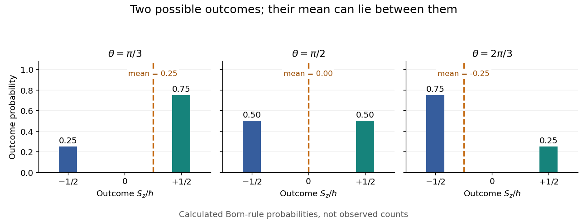
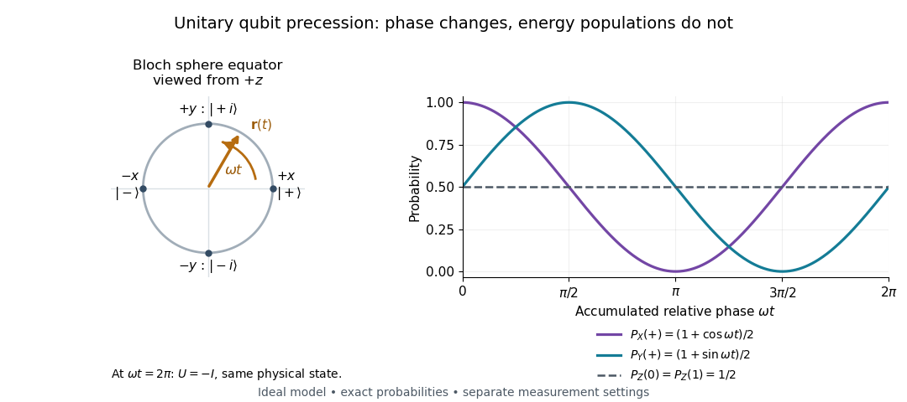
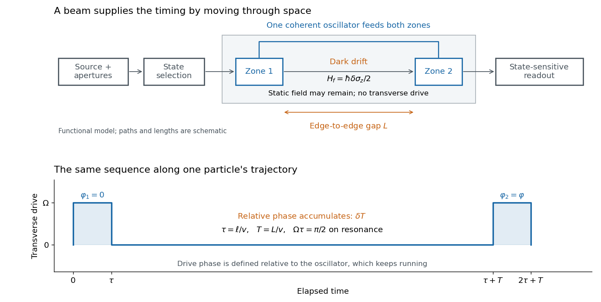
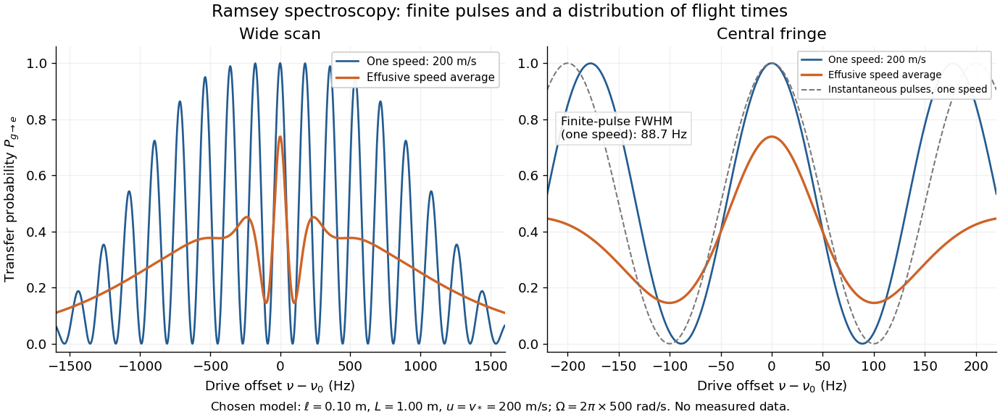
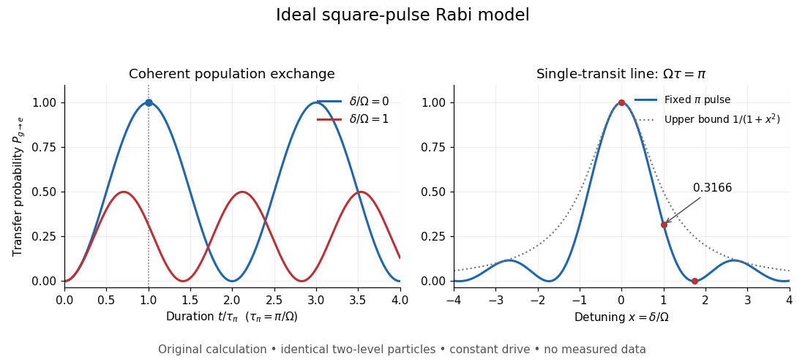

# Quantum system

↑ **Parent:** [Quantum mechanics](quantum-mechanics.md)  
ⓦ [Wiki](https://en.wikipedia.org/wiki/Quantum_system)

A quantum system is modeled by a complex [Hilbert space](hilbert-space.md); its [quantum states](#quantum-state) describe preparations, while [observables](#observable) describe measurable quantities.

**Table of contents**

- [Dressed state](#dressed-state)
  - [Atom-field dressed state](#atom-field-dressed-state)
    - [Mollow triplet](#mollow-triplet)
- [Quantum state](#quantum-state)
  - [Gaussian quantum state](#gaussian-quantum-state)
    - [Number-conserving Gaussian quantum state](#number-conserving-gaussian-quantum-state)
    - [Squeezed thermal state](#squeezed-thermal-state)
  - [Quantum state ray](#quantum-state-ray)
  - [Coherent preparation and incoherent mixing](#coherent-preparation-and-incoherent-mixing)
  - [Polarization preparation and dephasing experiment](#polarization-preparation-and-dephasing-experiment)
  - [Dicke state](#dicke-state)
    - [W state](#w-state)
    - [One-qubit reduction of Dicke-state superpositions](#one-qubit-reduction-of-dicke-state-superpositions)
  - [Flavor eigenstate](#flavor-eigenstate)
  - [Quantum superposition](#quantum-superposition)
    - [Quantum interference](#quantum-interference)
      - [Period of two-state quantum interference](#period-of-two-state-quantum-interference)
      - [Hong-Ou-Mandel effect](#hong-ou-mandel-effect)
  - [Qudit](#qudit)
    - [Qudit shift and phase operators](#qudit-shift-and-phase-operators)
  - [Qubit](#qubit)
    - [Qubit state](#qubit-state)
  - [Qutrit](#qutrit)
  - [Quantum number](#quantum-number)
    - [Angular momentum quantum number](#angular-momentum-quantum-number)
      - [Orbital angular momentum quantum number](#orbital-angular-momentum-quantum-number)
  - [Quantum phase](#quantum-phase)
    - [Relative quantum phase](#relative-quantum-phase)
    - [Geometric phase](#geometric-phase)
    - [Dynamical phase](#dynamical-phase)
    - [Global phase](#global-phase)
      - [Global phase of an uncontrolled quantum gate is unobservable](#global-phase-of-an-uncontrolled-quantum-gate-is-unobservable)
  - [Observable](#observable)
    - [Complete set of commuting observables](#complete-set-of-commuting-observables)
    - [Quantum uncertainty](#quantum-uncertainty)
      - [Position uncertainty](#position-uncertainty)
    - [Expectation value](#expectation-value)
      - [Spin expectation value](#spin-expectation-value)
      - [Estimating a quantum expectation value](#estimating-a-quantum-expectation-value)
        - [Stern-Gerlach expectation estimation](#stern-gerlach-expectation-estimation)
    - [Hamiltonian (quantum mechanics)](#hamiltonian-quantum-mechanics)
      - [Basis permutation of a quantum Hamiltonian matrix](#basis-permutation-of-a-quantum-hamiltonian-matrix)
      - [Quadratic form of a positive quantum Hamiltonian](#quadratic-form-of-a-positive-quantum-hamiltonian)
      - [Morse potential](#morse-potential)
        - [Morse oscillator](#morse-oscillator)
          - [Birge-Sponer plot](#birge-sponer-plot)
      - [Factorized quantum Hamiltonian](#factorized-quantum-hamiltonian)
        - [Factorized-Hamiltonian raising trial state](#factorized-hamiltonian-raising-trial-state)
        - [Normalizable zero mode of a polynomial factorized Hamiltonian](#normalizable-zero-mode-of-a-polynomial-factorized-hamiltonian)
      - [Quantum symmetry of a Hamiltonian](#quantum-symmetry-of-a-hamiltonian)
        - [Conserved generator of a continuous quantum symmetry](#conserved-generator-of-a-continuous-quantum-symmetry)
      - [Unitary time evolution](#unitary-time-evolution)
        - [Perfect quantum state transfer](#perfect-quantum-state-transfer)
        - [Schrödinger picture](#schrodinger-picture)
        - [Time-evolution operator](#time-evolution-operator)
          - [Quantum propagator](#quantum-propagator)
            - [Spectral resolution of a quantum propagator](#spectral-resolution-of-a-quantum-propagator)
          - [Floquet operator](#floquet-operator)
            - [Delta-kicked spin Floquet operator](#delta-kicked-spin-floquet-operator)
            - [Pulse-and-precession spin one-half map](#pulse-and-precession-spin-one-half-map)
            - [Quasienergy](#quasienergy)
          - [Energy populations and evolving relative phases](#energy-populations-and-evolving-relative-phases)
            - [Qubit precession under a constant Hamiltonian](#qubit-precession-under-a-constant-hamiltonian)
              - [Ramsey interferometry](#ramsey-interferometry)
                - [Initial-state dependence of Ramsey contrast](#initial-state-dependence-of-ramsey-contrast)
                - [Ramsey ensemble coherence](#ramsey-ensemble-coherence)
                - [Quantronium Ramsey interference experiment](#quantronium-ramsey-interference-experiment)
                - [Ramsey separated oscillatory fields experiment](#ramsey-separated-oscillatory-fields-experiment)
                  - [Ramsey spectroscopy](#ramsey-spectroscopy)
                    - [Ramsey frequency precision](#ramsey-frequency-precision)
                  - [Finite-pulse Ramsey transition probability](#finite-pulse-ramsey-transition-probability)
                    - [Ramsey fringe envelope](#ramsey-fringe-envelope)
                    - [Finite-pulse Ramsey phase response](#finite-pulse-ramsey-phase-response)
                    - [Velocity-averaged Ramsey line](#velocity-averaged-ramsey-line)
        - [Quantum-mechanical propagator](#quantum-mechanical-propagator)
          - [Quantum-mechanical propagator in a constant force](#quantum-mechanical-propagator-in-a-constant-force)
            - [Momentum-space propagator in a uniform force](#momentum-space-propagator-in-a-uniform-force)
          - [Normalized short-time Schrödinger kernel](#normalized-short-time-schrodinger-kernel)
            - [Schrödinger equation from a short-time path integral](#schrodinger-equation-from-a-short-time-path-integral)
          - [Free-particle propagator](#free-particle-propagator)
            - [Fresnel convolution of free-particle time slices](#fresnel-convolution-of-free-particle-time-slices)
            - [Euclidean free-particle bridge amplitude](#euclidean-free-particle-bridge-amplitude)
          - [Semiclassical propagator](#semiclassical-propagator)
            - [Dirichlet fluctuation determinant of a semiclassical propagator](#dirichlet-fluctuation-determinant-of-a-semiclassical-propagator)
            - [Van Vleck determinant](#van-vleck-determinant)
        - [Heisenberg picture](#heisenberg-picture)
          - [Heisenberg equation of motion](#heisenberg-equation-of-motion)
        - [Interaction picture](#interaction-picture)
        - [Time-reversal symmetry in quantum mechanics](#time-reversal-symmetry-in-quantum-mechanics)
          - [Quantum time-reversal operator](#quantum-time-reversal-operator)
          - [Unitary time reversal reverses the energy spectrum](#unitary-time-reversal-reverses-the-energy-spectrum)
          - [Antiunitary time reversal preserves the energy spectrum](#antiunitary-time-reversal-preserves-the-energy-spectrum)
        - [Rabi cycle](#rabi-cycle)
          - [Rotating-frame Rabi Hamiltonian](#rotating-frame-rabi-hamiltonian)
          - [Circularly rotating magnetic drive](#circularly-rotating-magnetic-drive)
          - [Rabi frequency](#rabi-frequency)
          - [Resonance envelope of a Rabi transition](#resonance-envelope-of-a-rabi-transition)
          - [Driven two-level Rabi model](#driven-two-level-rabi-model)
            - [Rabi vector](#rabi-vector)
            - [Equatorial reachability of a detuned spin pulse](#equatorial-reachability-of-a-detuned-spin-pulse)
            - [Laboratory phase of a resonant spin pulse](#laboratory-phase-of-a-resonant-spin-pulse)
            - [Rabi angular frequency](#rabi-angular-frequency)
            - [Rabi detuning](#rabi-detuning)
            - [Rabi pi pulse](#rabi-pi-pulse)
          - [Rabi molecular beam magnetic resonance experiment](#rabi-molecular-beam-magnetic-resonance-experiment)
            - [Rabi transit-time and field averaging](#rabi-transit-time-and-field-averaging)
  - [Bound state](#bound-state)
    - [Half-line finite well](#half-line-finite-well)
      - [Half-line finite-well bound-state count](#half-line-finite-well-bound-state-count)
    - [Quantum bouncer](#quantum-bouncer)
      - [Gravitational neutron bound-state transmission](#gravitational-neutron-bound-state-transmission)
    - [Coulomb bound state](#coulomb-bound-state)
      - [Two-dimensional Coulomb bound state](#two-dimensional-coulomb-bound-state)
      - [Polynomial construction of hydrogen S states](#polynomial-construction-of-hydrogen-s-states)
  - [Stationary state](#stationary-state)

## Dressed state

↑ **Parent:** [Quantum system](quantum-system.md)

An [eigenstate](energy-eigenvalue.md#eigenstate) of an interacting system that combines degrees of freedom which would be separate in the uncoupled model.

### Atom-field dressed state

↑ **Parent:** [Dressed state](#dressed-state)

A [dressed state](#dressed-state) of an atom and its driving field. Within the [rotating-wave approximation](quantum-mechanics.md#rotating-wave-approximation), the paired configurations $|e,n\rangle$ and $|g,n+1\rangle$ mix. A classical-drive rotating-frame [Hamiltonian](hamiltonian-mechanics.md#hamiltonian) $H=\hbar(-\Delta\sigma_z+\Omega\sigma_x)/2$ has [eigenvalues](linear-operator-theory.md#eigenvalue) $\pm\hbar\sqrt{\Delta^2+\Omega^2}/2$. At resonance its [eigenvectors](linear-operator-theory.md#eigenvector) are equal-weight combinations of the two bare configurations. Radiative transitions between neighboring manifolds explain the [Mollow triplet](#mollow-triplet).

#### Mollow triplet

↑ **Parent:** [Atom-field dressed state](#atom-field-dressed-state)

A central peak and two sidebands in the resonance fluorescence spectrum of a sufficiently strongly driven [two-level system](canonical-ensemble.md#two-level-system). The [atom-field dressed state](#atom-field-dressed-state) splitting produces sidebands near $\omega_L\pm\sqrt{\Omega^2+\Delta^2}$, where $\Omega$ is the resonant [Rabi frequency](#rabi-frequency). On resonance, changing the drive [intensity](wave.md#intensity-physics) changes the sideband spacing. Damping and detection conditions determine the resolved line shapes; the elastic coherent contribution must be distinguished from inelastic fluorescence.[1969, calculation of a driven two-level atom with radiation damping](physics-bibliography.md#power-spectrum-of-light-scattered-by-two-level-systems-by-b-r-mollow)

An experimental test drives an isolated transition with a narrow-band [laser](laser.md), collects fluorescence away from the intense drive beam, and scans a spectral analyzer while varying drive power. Resolving the sidebands requires spectral resolution and coupling frequency sufficient relative to the radiative linewidth. The predicted spectrum concerns transitions of the coupled system rather than simply the time dependence of its population.

## Quantum state

↑ **Parent:** [Quantum system](quantum-system.md)  
ⓦ [Wiki](https://en.wikipedia.org/wiki/Quantum_state)

A [quantum state](#quantum-state) describes a preparation through its predicted [measurement in quantum mechanics](quantum-measurement.md) [probabilities](probability-theory.md#probability). In the [Hilbert space](hilbert-space.md) formulation, a [pure state](quantum-theory.md#pure-state) is a [quantum state ray](#quantum-state-ray): a normalized [vector](vector-space.md#vector) representative $|\psi\rangle$ satisfies $\langle\psi|\psi\rangle=1$, and representatives differing by a [global phase](#global-phase) describe the same [quantum state](#quantum-state). [Preskill, Foundations I: States and Ensembles, §2.1, printed pp. 1–3, equation (2.1) and the definition of a ray](physics-bibliography.md#foundations-i-states-and-ensembles-by-john-preskill)

Both [pure states](quantum-theory.md#pure-state) and [mixed states](density-matrix.md#mixed-state) are represented by a [density operator](density-matrix.md) on the chosen complex [Hilbert space](hilbert-space.md):

$$
\rho=\rho^\dagger,\qquad \langle v|\rho|v\rangle\geq0\text{ for every }|v\rangle,\qquad \operatorname{Tr}\rho=1.
$$

Thus $\rho$ is [Hermitian](hilbert-space.md#hermitian-operator), [positive semidefinite](quadratic-form.md#positive-semidefinite-matrix) and of unit [trace](linear-algebra.md#matrix-trace); in infinite [dimension](vector-space.md#dimension-vector-space) it must also be a [trace-class operator](compact-operator.md#trace-class-operator). For a normalized [pure state](quantum-theory.md#pure-state), $\rho=|\psi\rangle\langle\psi|$ is a rank-one [orthogonal projection](hilbert-space.md#orthogonal-projection). A [mixed state](density-matrix.md#mixed-state) has no single such [vector](vector-space.md#vector) representative. Its [density matrix](density-matrix.md) is the [matrix](vector-space.md#matrix) of $\rho$ in a chosen [orthonormal basis](inner-product.md#orthonormal-basis). [Watrous, The Theory of Quantum Information, §1.1.2, printed pp. 17–18, equations (1.94)–(1.97), Hermitian, positive semidefinite and density operators; finite-dimensional setting](physics-bibliography.md#the-theory-of-quantum-information-by-john-watrous/mathematical-preliminaries) For a discrete [POVM](quantum-measurement.md#positive-operator-valued-measure) with effects $E_a\geq0$ and $\sum_aE_a=I$, the [Born rule](wave-function.md#born-rule) reads

$$
P(a)=\operatorname{Tr}(\rho E_a),\qquad
P(a)=\langle\psi|E_a|\psi\rangle\text{ for a pure state}.
$$

These constraints and [Born rule](wave-function.md#born-rule) probabilities describe arbitrary finite-dimensional preparations. [Watrous, The Theory of Quantum Information, §2.1.2, printed pp. 62–64, Definition 2.5 and pure states; §2.3, Definition 2.34, measurement probabilities](physics-bibliography.md#the-theory-of-quantum-information-by-john-watrous/basic-notions-of-quantum-information)

Randomly choosing normalized [pure states](quantum-theory.md#pure-state) with [probabilities](probability-theory.md#probability) $w_j$ and forgetting the label gives

$$
\rho=\sum_j w_j|\psi_j\rangle\langle\psi_j|,\qquad w_j\geq0,\quad\sum_jw_j=1.
$$

This [quantum state ensemble](density-matrix.md#quantum-state-ensemble) averages [probabilities](probability-theory.md#probability); a [quantum superposition](#quantum-superposition) adds [probability amplitudes](wave-function.md#probability-amplitude). Several ensembles can give the same [density operator](density-matrix.md). [Quantum entanglement](bell-state.md#entangled-state) can make a [reduced density matrix](bell-state.md#reduced-density-matrix) mixed while the joint [quantum state](#quantum-state) is pure. [Preskill, Foundations I: States and Ensembles, §2.3.1, printed pp. 14–18, equations (2.51)–(2.61), partial trace and ensemble interpretation](physics-bibliography.md#foundations-i-states-and-ensembles-by-john-preskill)

The preparation, the choice of [basis](vector-space.md#basis), and the measurement are separate ingredients. A [wavefunction](wave-function.md) $\psi(x)=\langle x|\psi\rangle$ is the position representation of a [pure state](quantum-theory.md#pure-state); a general [mixed state](density-matrix.md#mixed-state) requires a [density operator](density-matrix.md). For a closed [quantum system](quantum-system.md), a [unitary operator](vector-space.md#unitary-operator) evolves it as $\rho\mapsto U\rho U^\dagger$, preserving its [eigenvalues](linear-operator-theory.md#eigenvalue) and [purity of a density operator](density-matrix.md#purity-of-a-density-operator). [Preskill, Foundations I: States and Ensembles, §2.3.4, printed pp. 22–23, equation (2.79)](physics-bibliography.md#foundations-i-states-and-ensembles-by-john-preskill) The [Bloch sphere](density-matrix.md#bloch-sphere) and [Bloch ball](density-matrix.md#bloch-ball) give the [qubit](#qubit) geometry; [quantum state tomography](quantum-measurement.md#quantum-state-tomography) connects repeated preparations to an estimated [density matrix](density-matrix.md); [projective measurement](quantum-measurement.md#projective-measurement) treats the conditional state after an outcome.

### Gaussian quantum state

↑ **Parent:** [Quantum state](#quantum-state)

A bosonic state with Gaussian phase-space characteristic function, specified by its first and second [optical quadrature](quantum-optics.md#optical-quadrature) moments. Vacuum, [coherent states](quantum-theory.md#coherent-state), [optical squeezed vacuum](quantum-harmonic-oscillator.md#optical-squeezed-vacuum) and thermal states are examples. Gaussian here describes phase-space statistics, not a Gaussian [optical pulse](optics.md#optical-pulse) envelope.

#### Number-conserving Gaussian quantum state

↑ **Parent:** [Gaussian quantum state](#gaussian-quantum-state)

Here number-conserving means invariant under a global particle-number [quantum phase](#quantum-phase) rotation: the field mean and anomalous averages $\langle\psi\psi\rangle$ vanish. It does not mean a sharp total particle number. All normal correlations are obtained by Wick pairings of the [one-body density matrix](density-matrix.md#one-body-density-matrix). Independent thermal bosonic modes satisfy this rule; generic nonvacuum bosonic [number states](quantum-harmonic-oscillator.md#number-state) do not. A [Slater determinant](tensor-product-of-quantum-systems.md#slater-determinant) is the analogous fermionic pairing state.

#### Squeezed thermal state

↑ **Parent:** [Gaussian quantum state](#gaussian-quantum-state)

Applying a [single-mode squeeze operator](quantum-harmonic-oscillator.md#single-mode-squeeze-operator) to a thermal state gives the displayed principal optical-quadrature [variances](variance.md). Their uncertainty product exceeds the pure-state minimum when $n_{\rm th}>0$. Sufficient squeezing is needed to put the quiet [optical quadrature](quantum-optics.md#optical-quadrature) below the vacuum reference.

### Quantum state ray

↑ **Parent:** [Quantum state](#quantum-state)

A [quantum state ray](#quantum-state-ray) is the [equivalence class](set-theory.md#equivalence-class) of nonzero [vectors](vector-space.md#vector) in a complex [Hilbert space](hilbert-space.md) under multiplication by a nonzero [complex number](complex-analysis.md#complex-number). Its span is a one-dimensional [linear subspace](vector-space.md#vector-subspace), but the zero [vector](vector-space.md#vector) is not a state representative. A [unit vector](vector-space.md#unit-vector) fixes the [norm](normed-vector-space.md#norm) and leaves a [global phase](#global-phase) free. [Preskill, Foundations I: States and Ensembles, §2.1, printed p. 2, ray equivalence and normalized representatives](physics-bibliography.md#foundations-i-states-and-ensembles-by-john-preskill)

For a nonzero representative $|v\rangle$, the associated [pure state](quantum-theory.md#pure-state) [density operator](density-matrix.md) is

$$
\rho_{[v]}=\frac{|v\rangle\langle v|}{\langle v|v\rangle}.
$$

Replacing $|v\rangle$ by $\lambda|v\rangle$ multiplies both numerator and denominator by $|\lambda|^2$, so the quotient is unchanged. In particular, for every [POVM](quantum-measurement.md#positive-operator-valued-measure) effect $E$,

$$
\langle e^{i\gamma}\psi|E|e^{i\gamma}\psi\rangle
=e^{-i\gamma}e^{i\gamma}\langle\psi|E|\psi\rangle
=\langle\psi|E|\psi\rangle.
$$

This proves that a [global phase](#global-phase) changes no measurement [probability](probability-theory.md#probability). Changing the relative [quantum phase](#quantum-phase) of two nonzero components can change the [density operator](density-matrix.md), as the following comparison shows.

### Coherent preparation and incoherent mixing

↑ **Parent:** [Quantum state](#quantum-state)

Choose the [qubit](#qubit) [computational basis](quantum-theory.md#computational-basis) $|0\rangle,|1\rangle$, also called the $Z$ basis, and the [Hadamard basis](quantum-theory.md#hadamard-basis) $|\pm\rangle=(|0\rangle\pm|1\rangle)/\sqrt2$, also called the $X$ basis. Compare a coherent preparation of $|+\rangle$ with choosing $|0\rangle$ or $|1\rangle$ at random with equal [probabilities](probability-theory.md#probability) and discarding that label:

$$
\rho_+=\frac12\begin{pmatrix}1&1\\1&1\end{pmatrix},\qquad
\rho_{\mathrm{mix}}=\frac12|0\rangle\langle0|+\frac12|1\rangle\langle1|=\frac12\begin{pmatrix}1&0\\0&1\end{pmatrix}.
$$

These are original ideal preparation models. Their $Z$-basis [probabilities](probability-theory.md#probability) are both $(1/2,1/2)$, because their [quantum state populations](density-matrix.md#quantum-state-population) agree. Their $X$-basis [probabilities](probability-theory.md#probability) are respectively $(1,0)$ and $(1/2,1/2)$. Indeed $\langle+|\rho_+|+\rangle=1$, whereas $\langle+|I/2|+\rangle=1/2$. The missing off-diagonal [quantum coherence](density-matrix.md#quantum-coherence-in-a-specified-basis) therefore changes a prediction that the common populations cannot determine.

**[Figure 1](#image-coherent-preparation-and-random-mixing-agree-in-the-z-basis-but-differ-in-the-x-basis). Coherent preparation and random mixing agree in the Z basis but differ in the X basis**. Original ideal [qubit](#qubit) preparation and detection branches. The random-choice branches are mutually exclusive trials; forgetting the label averages [probabilities](probability-theory.md#probability) without recombining [probability amplitudes](wave-function.md#probability-amplitude). Each measurement branch uses a fresh preparation. The displayed [Born rule](wave-function.md#born-rule) probabilities assume ideal detection and are not measured counts or the apparatus of the experiment below.

For a relative [quantum phase](#quantum-phase) $\phi$, the coherent family instead has

$$
|\psi_\phi\rangle=\frac{|0\rangle+e^{i\phi}|1\rangle}{\sqrt2},\qquad
\rho_\phi=\frac12\begin{pmatrix}1&e^{-i\phi}\\e^{i\phi}&1\end{pmatrix},\qquad
P_X(\pm)=\frac{1\pm\cos\phi}{2}.
$$

The last formula follows by adding or subtracting the two [probability amplitudes](wave-function.md#probability-amplitude) before taking the squared [modulus](complex-analysis.md#modulus). At $\phi=\pi$, the state is $|-\rangle$ and the $X$ outcomes switch to $(0,1)$, while the $Z$ outcomes remain $(1/2,1/2)$. In contrast, $-|+\rangle$ changes both components by the same [global phase](#global-phase) and retains the $X$ outcomes $(1,0)$. In [photon polarization](quantum-mechanics.md#photon-polarization), the identification $|0\rangle=|H\rangle$, $|1\rangle=|V\rangle$ makes $|+\rangle$ and $|-\rangle$ the two orthogonal diagonal [linear polarizations](electromagnetic-wave.md#linear-polarization); these labels describe measurement bases, not spatial axes for photon [spin](angular-momentum-operator.md#spin).

**[Figure 2](#image-a-circle-of-global-phase-representatives-gives-one-state-while-a-relative-sign-changes-x-outcomes). A circle of global-phase representatives gives one state, while a relative sign changes X outcomes**. Original ideal model. The top circle is the [complex number](complex-analysis.md#complex-number) $e^{i\gamma}$ multiplying the entire vector; it is not a [Bloch sphere](density-matrix.md#bloch-sphere) or a path through distinct physical states. All its representatives map to the same [density operator](density-matrix.md). Below, changing the relative [quantum phase](#quantum-phase) from zero to $\pi$ gives different [density operators](density-matrix.md) and complementary $X$-basis [probabilities](probability-theory.md#probability). No experimental observations are plotted.

Even perfect statistics in one [basis](vector-space.md#basis) cannot certify a preparation. The above $Z$ data fit both [density matrices](density-matrix.md). Conversely, distinct preparation histories can yield the same [quantum state](#quantum-state):

$$
\frac12|0\rangle\langle0|+\frac12|1\rangle\langle1|
=\frac12|+\rangle\langle+|+\frac12|-\rangle\langle-|=\frac I2.
$$

The off-diagonal terms cancel in the right-hand ensemble. Every measurement on the [qubit](#qubit) alone then has identical [probabilities](probability-theory.md#probability) for those two histories. A retained classical label would allow conditioning on different members of the [quantum state ensemble](density-matrix.md#quantum-state-ensemble); it is extra information beyond the unlabelled [density operator](density-matrix.md).

### Polarization preparation and dephasing experiment

↑ **Parent:** [Quantum state](#quantum-state)

A 2018 photonic experiment makes the distinction between populations and [quantum coherence](density-matrix.md#quantum-coherence-in-a-specified-basis) controllable. A 400-nm [laser](laser.md) pumped a crystal to generate paired [photons](quantum-mechanics.md#photon), filtered near 800 nm. One photon triggered collection; the other entered the apparatus. A [half-wave plate](maxwell-equations.md#half-wave-plate) and [polarizing beam splitter](optical-instrument.md#polarizing-beam-splitter) selected horizontal [photon polarization](quantum-mechanics.md#photon-polarization); another [half-wave plate](maxwell-equations.md#half-wave-plate) prepared balanced $H,V$ [quantum superpositions](#quantum-superposition). Separated polarization paths and [diffraction gratings](physical-optics.md#diffraction-grating) let a [spatial light modulator](optics.md#spatial-light-modulator) control their frequency-dependent [quantum phases](#quantum-phase) and spectral weights. Recombined paths passed through [quartz](chemical-substance.md#quartz) plates whose adjustable thickness controlled polarization–frequency coupling. Quarter- and [half-wave plates](maxwell-equations.md#half-wave-plate) plus a [polarizing beam splitter](optical-instrument.md#polarizing-beam-splitter) selected tomography bases; jointly registered [photodetector](optical-instrument.md#photodetector) events supplied the readout. [Quantum state tomography](quantum-measurement.md#quantum-state-tomography) inferred polarization [density matrices](density-matrix.md) at each thickness. The [dephasing](quantum-information-theory.md#dephasing-channel) model preserves diagonal populations while changing off-diagonal [quantum coherence](density-matrix.md#quantum-coherence-in-a-specified-basis). Here the unobserved photon [frequency](wave.md#frequency) acts as the environment for the polarization [qubit](#qubit). Finite modulator resolution and imperfect spectral shaping limited agreement with the intended dynamics; this experiment does not establish exact $I/2$ preparation or the ideal probabilities above. [Experimental implementation of fully controlled dephasing dynamics and synthetic spectral densities, Nature Communications 9, 3453 (2018), Results: Experimental setup, Fig. 1, equations (1)–(5); Using a photon to simulate qubit coupled to Ising chain, systematic-error discussion after Fig. 3](physics-bibliography.md#experimental-implementation-of-fully-controlled-dephasing-dynamics-and-synthetic-spectral-densities-by-zhao-di-liu-and-others)

### Dicke state

↑ **Parent:** [Quantum state](#quantum-state)

The $n$-[qubit](#qubit) Dicke state with $m$ excitations is the normalized equal superposition

$$
|D_m^n\rangle=\binom nm^{-1/2}\sum_{|x|=m}|x\rangle,\qquad 0\leq m\leq n,
$$

where $|x|$ is the [Hamming weight](coding-theory.md#hamming-weight) in the [computational basis](quantum-theory.md#computational-basis). The [binomial coefficient](binomial-coefficient.md) counts the mutually orthogonal summands, proving normalization. Every permutation of the qubits leaves the vector unchanged. Splitting the sum according to the first bit and using $\binom{n-1}{m}/\binom nm=(n-m)/n$ gives

$$
|D_m^n\rangle=\sqrt{\frac{n-m}{n}}|0\rangle|D_m^{n-1}\rangle+\sqrt{\frac mn}|1\rangle|D_{m-1}^{n-1}\rangle.
$$

Terms with zero coefficient are omitted at the endpoints. This recursion is useful for [partial traces](quantum-theory.md#partial-trace) and for distributing a logical [qubit](#qubit) among many symmetric physical qubits.

#### W state

↑ **Parent:** [Dicke state](#dicke-state)

The $n$-[qubit](#qubit) [W state](#w-state) is the [Dicke state](#dicke-state) with one excitation:

$$
|W_n\rangle=\frac1{\sqrt n}\sum_{j=1}^n|0\cdots010\cdots0\rangle=|D_1^n\rangle.
$$

For three [qubits](#qubit) it is $(|001\rangle+|010\rangle+|100\rangle)/\sqrt3$. Its [reduced density matrix](bell-state.md#reduced-density-matrix) on any one [qubit](#qubit) is $\operatorname{diag}((n-1)/n,1/n)$, from the [Dicke state](#dicke-state) recursion. For $n>1$ both diagonal entries are nonzero, so that [qubit](#qubit) is entangled with the rest: a pure [product state](bell-state.md#product-state) would have a pure marginal. A [symmetric-arm reduction of an exchange Hamiltonian](angular-momentum-operator.md#symmetric-arm-reduction-of-an-exchange-hamiltonian) supplies a dynamical preparation from one initial excitation.

#### One-qubit reduction of Dicke-state superpositions

↑ **Parent:** [Dicke state](#dicke-state)

For $|\Omega\rangle=\alpha|D_m^n\rangle+\beta|D_{m+1}^n\rangle$, $|\alpha|^2+|\beta|^2=1$ and $0\leq m<n$, the [reduced density matrix](bell-state.md#reduced-density-matrix) of any one qubit is

$$
\rho=\frac1n\begin{pmatrix}(n-m)|\alpha|^2+(n-m-1)|\beta|^2&\sqrt{(n-m)(m+1)}\,\alpha\beta^*\\\sqrt{(n-m)(m+1)}\,\alpha^*\beta&m|\alpha|^2+(m+1)|\beta|^2\end{pmatrix}.
$$

Use the [Dicke state](#dicke-state) recursion. The rest-of-system vectors of different [Hamming weights](coding-theory.md#hamming-weight) are orthogonal. For the diagonal terms this leaves the probabilities of the distinguished bit being zero and one. In the cross term, only the rest vector $|D_m^{n-1}\rangle$ occurs in both states, with coefficients $\sqrt{(n-m)/n}$ multiplying $|0\rangle$ and $\sqrt{(m+1)/n}$ multiplying $|1\rangle$. Thus $\operatorname{Tr}_{\mathrm{rest}}(|D_m^n\rangle\langle D_{m+1}^n|)=\sqrt{(n-m)(m+1)}|0\rangle\langle1|/n$, proving the matrix. A single [Dicke state](#dicke-state) alone gives the diagonal matrix $\operatorname{diag}((n-m)/n,m/n)$.

### Flavor eigenstate

↑ **Parent:** [Quantum state](#quantum-state)

A [flavor eigenstate](#flavor-eigenstate) is a state with a definite flavor label in the specified interaction or flavor-charge basis. For neutral [kaons](physics.md#kaon), $K^0=d\bar s$ and $\bar K^0=s\bar d$ have definite opposite [strangeness](standard-model.md#strangeness). [Weak interactions](standard-model.md#weak-interaction) mix them, so these flavor states are not the [mass eigenstates](finite-element-method.md#mass-eigenstate). The precise flavor basis must be specified when discussing mixing.

### Quantum superposition

↑ **Parent:** [Quantum state](#quantum-state)  
ⓦ [Wiki](https://en.wikipedia.org/wiki/Quantum_superposition)

A quantum superposition is a [linear combination](vector-space.md#linear-combination) of [quantum state](#quantum-state) vectors in a complex [Hilbert space](hilbert-space.md). In a specified [orthonormal basis](inner-product.md#orthonormal-basis), a normalized [pure state](quantum-theory.md#pure-state) has the displayed expansion, where $a_j$ are [probability amplitudes](wave-function.md#probability-amplitude). A nonzero [linear combination](vector-space.md#linear-combination) can always be normalized; an arbitrary sum of normalized vectors need not already have [norm](normed-vector-space.md#norm) one. Having more than one nonzero component depends on the chosen [basis](vector-space.md#basis): the [Hadamard basis](quantum-theory.md#hadamard-basis) vector $|+\rangle$ is a [quantum superposition](#quantum-superposition) of the two [computational-basis states](quantum-theory.md#computational-basis-state), but is a single vector of the [Hadamard basis](quantum-theory.md#hadamard-basis). [Zwiebach, MIT 8.04, lecture 1, section 4, pp. 10–12](https://ocw.mit.edu/courses/8-04-quantum-physics-i-spring-2016/7f930e013cef9cd7dec5aa88baa83f0a_MIT8_04S16_LecNotes1.pdf).

The distinction from classical ignorance is quantitative. Consider the normalized [qubit](#qubit) [quantum state](#quantum-state)

$$
|\psi_\phi\rangle=\frac{\sqrt3}{2}|0\rangle+\frac{e^{i\phi}}2|1\rangle.
$$

Its [density operator](density-matrix.md), written in the [computational basis](quantum-theory.md#computational-basis), is

$$
\rho_\phi=|\psi_\phi\rangle\langle\psi_\phi|
=\begin{pmatrix}3/4&(\sqrt3/4)e^{-i\phi}\\(\sqrt3/4)e^{i\phi}&1/4\end{pmatrix}.
$$

Preparing $|0\rangle$ with [probability](probability-theory.md#probability) $3/4$ and $|1\rangle$ with [probability](probability-theory.md#probability) $1/4$, while discarding the preparation label, instead gives the [mixed state](density-matrix.md#mixed-state)

$$
\rho_{\mathrm{mix}}=\frac34|0\rangle\langle0|+\frac14|1\rangle\langle1|
=\begin{pmatrix}3/4&0\\0&1/4\end{pmatrix}.
$$

The diagonal entries agree, so both preparations give the same [computational-basis measurement](quantum-theory.md#quantum-measurement-in-the-computational-basis) [probabilities](probability-theory.md#probability). The off-diagonal entries of $\rho_\phi$ retain [quantum coherence](density-matrix.md#quantum-coherence-in-a-specified-basis) and the relative [quantum phase](#quantum-phase). In the [Hadamard basis](quantum-theory.md#hadamard-basis), the [Born rule](wave-function.md#born-rule) gives

$$
\langle\pm|\rho_{\mathrm{mix}}|\pm\rangle=\frac12,
\qquad
\langle\pm|\rho_\phi|\pm\rangle=\frac12\pm\frac{\sqrt3}{4}\cos\phi.
$$

The [density matrix](density-matrix.md) representation retains this distinction between a [pure state](quantum-theory.md#pure-state) and a [mixed state](density-matrix.md#mixed-state). [Watrous, IBM Quantum Learning, Density matrix basics, Interpretation of density matrices and Connection to quantum state vectors](https://quantum.cloud.ibm.com/learning/en/courses/general-formulation-of-quantum-information/density-matrices/density-matrix-basics).

For example, at $\phi=0$, the [quantum superposition](#quantum-superposition) yields the plus outcome with [probability](probability-theory.md#probability) about $0.9330$, whereas the [mixed state](density-matrix.md#mixed-state) yields it with [probability](probability-theory.md#probability) $0.5$. At $\phi=\pi/2$ these particular [probabilities](probability-theory.md#probability) agree, although the [density matrices](density-matrix.md) still differ: equality for one measurement does not establish equality of [quantum states](#quantum-state). The [probability amplitude](wave-function.md#probability-amplitude) figure shows the comparison throughout a full cycle of relative [quantum phase](#quantum-phase).

This is why a [quantum superposition](#quantum-superposition) is useful: [quantum gates](quantum-circuit.md#quantum-logic-gate) act linearly on its [probability amplitudes](wave-function.md#probability-amplitude), and [unitary operators](vector-space.md#unitary-operator) preserve the full [pure state](quantum-theory.md#pure-state) information, including relative [quantum phases](#quantum-phase). A [Hadamard gate](quantum-theory.md#hadamard-gate) can turn otherwise hidden [quantum coherence](density-matrix.md#quantum-coherence-in-a-specified-basis) into different outcome [probabilities](probability-theory.md#probability). The beautiful feature is that the same basis weights can support different predictions when amplitudes recombine. The expansion specifies a preparation and its measurement predictions; it does not assign every unmeasured outcome a simultaneous classical value. See [projective measurement](quantum-measurement.md#projective-measurement) for the separate question of the conditional state after a measurement.

#### Quantum interference

↑ **Parent:** [Quantum superposition](#quantum-superposition)

[Quantum interference](#quantum-interference) occurs when [probability amplitudes](wave-function.md#probability-amplitude) for indistinguishable alternatives combine before the [Born rule](wave-function.md#born-rule) assigns [probabilities](probability-theory.md#probability).

##### Period of two-state quantum interference

↑ **Parent:** [Quantum interference](#quantum-interference)

A superposition of two distinct [energy eigenstates](energy-eigenvalue.md#energy-eigenstate) gives the [expectation value](#expectation-value) of a time-independent [observable](#observable) an interference term proportional to $e^{-i(E_2-E_1)t/\hbar}$. The displayed beat period applies when that term has nonzero amplitude. A vanishing off-diagonal [matrix element](vector-space.md#matrix-element), zero state coefficient or equal [energies](energy.md) instead gives a constant [expectation value](#expectation-value).

##### Hong-Ou-Mandel effect

↑ **Parent:** [Quantum interference](#quantum-interference)

Two indistinguishable [bosons](tensor-product-of-quantum-systems.md#boson) entering separate inputs of an ideal balanced [beam splitter](optical-instrument.md#beam-splitter) have zero [probability](probability-theory.md#probability) of leaving one per output. The two alternatives for that occupancy interfere destructively. Distinguishability in temporal, spatial or internal modes weakens the cancellation.

### Qudit

↑ **Parent:** [Quantum state](#quantum-state)

A [qudit](#qudit) is a quantum subsystem with $d$ distinguishable basis states and [Hilbert space](hilbert-space.md) $\mathbb C^d$. A [qubit](#qubit) is the special case $d=2$. Tensor products of [qudits](#qudit) give a natural setting for [local Hamiltonians](quantum-theory.md#local-hamiltonian) and finite-dimensional [quantum circuits](quantum-circuit.md).

#### Qudit shift and phase operators

↑ **Parent:** [Qudit](#qudit)

For an $n$-level [qudit](#qudit) and [primitive root of unity](algebra.md#primitive-root-of-unity) $\omega$, these [unitary operators](vector-space.md#unitary-operator) obey $X^n=Z^n=I$ and $ZX=\omega XZ$. The inverse of $X^sZ^{-r}$ is $Z^rX^{-s}$, with the order reversed. These operators implement the receiver corrections in [qudit teleportation](bell-state.md#qudit-teleportation).

### Qubit

↑ **Parent:** [Quantum state](#quantum-state)  
ⓦ [Wiki](https://en.wikipedia.org/wiki/Qubit)

A [qubit](#qubit), or quantum bit, is a [quantum system](quantum-system.md) whose state space is a two-dimensional complex [Hilbert space](hilbert-space.md). Choose an [orthonormal basis](inner-product.md#orthonormal-basis) $|0\rangle,|1\rangle$, called the [computational basis](quantum-theory.md#computational-basis). A [pure state](quantum-theory.md#pure-state) has a normalized representative $|\psi\rangle=\alpha|0\rangle+\beta|1\rangle$, where $\alpha,\beta$ are complex [probability amplitudes](wave-function.md#probability-amplitude) and $|\alpha|^2+|\beta|^2=1$. General [qubit states](#qubit-state), including [mixed states](density-matrix.md#mixed-state), require a [density matrix](density-matrix.md). [Watrous, IBM Quantum Learning, Quantum information, Quantum state vectors](https://quantum.cloud.ibm.com/learning/en/courses/basics-of-quantum-information/single-systems/quantum-information).

The abstract [qubit](#qubit) describes the chosen degree of freedom: for [spin one-half](angular-momentum-operator.md#spin-one-half), $|0\rangle,|1\rangle$ can label spin up and down along a specified axis; for [photon polarization](quantum-mechanics.md#photon-polarization) in a fixed propagation mode, they can label horizontal and vertical polarization, $|H\rangle,|V\rangle$. These implementations share the same two-dimensional [linear algebra](linear-algebra.md), but their preparation and [measurement in quantum mechanics](quantum-measurement.md) use different apparatus. A [qubit](#qubit) therefore need not be an entire two-level particle. [Preskill, Physics 229 notes, sections 2.2.1–2.2.2, spin and photon polarization examples](physics-bibliography.md#foundations-i-states-and-ensembles-by-john-preskill).

The usefulness of a [qubit](#qubit) lies in controlling [quantum superpositions](#quantum-superposition) and their relative [quantum phases](#quantum-phase), then converting them into outcome [probabilities](probability-theory.md#probability) with [quantum gates](quantum-circuit.md#quantum-logic-gate) and an appropriate measurement. One ideal [computational-basis measurement](quantum-theory.md#quantum-measurement-in-the-computational-basis) returns one label, zero or one. It does not reveal both [probability amplitudes](wave-function.md#probability-amplitude), their relative [quantum phase](#quantum-phase), or all the bits of a larger register's expansion. [Quantum state tomography](quantum-measurement.md#quantum-state-tomography) instead estimates a [qubit state](#qubit-state) using many repetitions of the preparation and suitable measurement settings. [Watrous, IBM Quantum Learning, Quantum information, Measuring quantum states](https://quantum.cloud.ibm.com/learning/en/courses/basics-of-quantum-information/single-systems/quantum-information).

An actual preparation and measurement example is Dederick and Beck's 2014 teaching-laboratory experiment. A 405-nm laser pumped two nonlinear crystals, producing signal and idler [photons](quantum-mechanics.md#photon) near 810 nm. In their non-entangled run the source produced $|H\rangle_s|H\rangle_i$; a quarter-wave plate in the signal arm changed its [photon polarization](quantum-mechanics.md#photon-polarization) to $|L\rangle=(|H\rangle+i|V\rangle)/\sqrt2$ in their convention. The plate supplies a relative [quantum phase](#quantum-phase) between polarization components. An idler detection selected the signal trials; signal detectors measured horizontal/vertical, diagonal, and [circular polarization](electromagnetic-wave.md#circular-polarization) bases on separate runs. Before the polarization analyzer, a half-wave plate at $22.5$ degrees selected the diagonal basis, and a quarter-wave plate at $45$ degrees selected the circular basis. Coincidence counts $N_{AB},N_{AB'}$ gave the conditional positive-outcome frequency $N_{AB}/(N_{AB}+N_{AB'})$. The reconstructed [density matrix](density-matrix.md) for conditioning on detector $A$ had [squared quantum fidelity](quantum-information-theory.md#squared-quantum-fidelity) $0.96$ with $|L\rangle$ and [purity of a density operator](density-matrix.md#purity-of-a-density-operator) $0.98$: close to the intended [pure state](quantum-theory.md#pure-state), rather than an exact ideal preparation. [Dederick and Beck, Exploring entanglement with the help of quantum state measurement, American Journal of Physics 82, 962–971 (2014), sections II D and III A–B](https://people.reed.edu/~beckm/papers/Dederick_ajp.pdf).

**[Figure 3](#image-ideal-polarization-qubit-preparation-and-measurements-in-three-separate-settings). Ideal polarization-qubit preparation and measurements in three separate settings**. Original model schematic and exact Born-rule probabilities, not measured data or a reproduction of the experimental apparatus. The circular-basis sign uses the explicitly defined state $(|H\rangle+i|V\rangle)/\sqrt2$.

The model diagram explains why those settings matter. With $|0\rangle=|H\rangle$ and $|1\rangle=|V\rangle$, the intended $|L\rangle$ gives equal [probabilities](probability-theory.md#probability) in both the horizontal/vertical [computational basis](quantum-theory.md#computational-basis) and diagonal [Hadamard basis](quantum-theory.md#hadamard-basis), just as the [mixed state](density-matrix.md#mixed-state) $I/2$ does. In the circular basis $|\pm i\rangle=(|0\rangle\pm i|1\rangle)/\sqrt2$, however, the ideal $|L\rangle=|+i\rangle$ always gives the plus outcome, whereas $I/2$ still gives equal [probabilities](probability-theory.md#probability). These are deductions from the [Born rule](wave-function.md#born-rule), not the paper's measured counts. Unequal detector efficiencies and finite samples must be accounted for when interpreting experimental frequencies; the ideal comparison assumes equally efficient detection.

#### Qubit state

↑ **Parent:** [Qubit](#qubit)

A [qubit state](#qubit-state) specifies measurement [probabilities](probability-theory.md#probability), rather than a pre-existing answer to every possible measurement. For a [pure state](quantum-theory.md#pure-state), normalized vectors differing by a [global phase](#global-phase) represent the same physical state:

$$
|\psi\rangle\sim e^{i\gamma}|\psi\rangle,\qquad \gamma\in\mathbb R.
$$

Equivalently, the [pure state](quantum-theory.md#pure-state) is a ray: the one-dimensional complex [linear subspace](vector-space.md#vector-subspace) spanned by any nonzero representative. Dividing a nonzero vector by its [norm](normed-vector-space.md#norm) fixes its length, but leaves the [global phase](#global-phase) free. The [density operator](density-matrix.md) is unchanged because $(e^{i\gamma}|\psi\rangle)(e^{i\gamma}|\psi\rangle)^\dagger=|\psi\rangle\langle\psi|$. In contrast, multiplying only one nonzero component by $e^{i\phi}$ changes a relative [quantum phase](#quantum-phase) and can change measurement [probabilities](probability-theory.md#probability). [Preskill, Physics 229 notes, sections 2.1 and 2.2.1, state rays and qubit parametrization](physics-bibliography.md#foundations-i-states-and-ensembles-by-john-preskill).

After choosing a [global phase](#global-phase), every [pure state](quantum-theory.md#pure-state) of a [qubit](#qubit) can be written

$$
|\psi(\theta,\phi)\rangle=\cos(\theta/2)|0\rangle+e^{i\phi}\sin(\theta/2)|1\rangle,
\qquad 0\leq\theta\leq\pi,\quad 0\leq\phi<2\pi.
$$

At $\theta=0$ or $\pi$, the parameter $\phi$ does not distinguish physical states: only one component survives. Elsewhere it is the relative [quantum phase](#quantum-phase). The corresponding unit [Bloch vector](density-matrix.md#bloch-vector) is $\mathbf r=(\sin\theta\cos\phi,\sin\theta\sin\phi,\cos\theta)$ on the existing [Bloch sphere](density-matrix.md#bloch-sphere). Its angles describe a space of states; for a [photon polarization](quantum-mechanics.md#photon-polarization) [qubit](#qubit) they are not the photon's position or direction of travel. [Preskill, Physics 229 notes, section 2.3.2, equations (2.62)–(2.68)](physics-bibliography.md#foundations-i-states-and-ensembles-by-john-preskill).

The [Born rule](wave-function.md#born-rule) in the [computational basis](quantum-theory.md#computational-basis) gives $P(0)=\cos^2(\theta/2)$ and $P(1)=\sin^2(\theta/2)$. These [probabilities](probability-theory.md#probability) discard $\phi$. In the [Hadamard basis](quantum-theory.md#hadamard-basis) $|\pm\rangle=(|0\rangle\pm|1\rangle)/\sqrt2$, adding or subtracting the [probability amplitudes](wave-function.md#probability-amplitude) instead gives

$$
P_X(\pm)=\frac12|\alpha\pm\beta|^2
=\frac12\pm\operatorname{Re}(\alpha^*\beta)
=\frac12\bigl(1\pm\sin\theta\cos\phi\bigr).
$$

This last equality follows by substituting the angular representative. In the basis $|\pm i\rangle=(|0\rangle\pm i|1\rangle)/\sqrt2$, the same calculation gives

$$
P_Y(\pm)=\frac12|\alpha\mp i\beta|^2
=\frac12\pm\operatorname{Im}(\alpha^*\beta)
=\frac12\bigl(1\pm\sin\theta\sin\phi\bigr).
$$

Thus both the real and imaginary parts of [quantum coherence](density-matrix.md#quantum-coherence-in-a-specified-basis) can be observed, using different measurement settings. For example, $(|0\rangle+|1\rangle)/\sqrt2$ and $(|0\rangle-|1\rangle)/\sqrt2$ both give $P(0)=P(1)=1/2$, but the first gives $P_X(+)=1$ and the second $P_X(+)=0$. A [global phase](#global-phase) could never cause this difference.

**[Figure 4](#image-identical-computational-basis-probabilities-can-hide-different-relative-phases-and-coherence). Identical computational-basis probabilities can hide different relative phases and coherence**. Exact model probabilities for $(|0\rangle+e^{i\phi}|1\rangle)/\sqrt2$, compared with the incoherent mixture $I/2$. Each curve requires repeated preparations measured in the indicated basis; these are not experimental data.

For a general [qubit state](#qubit-state), write its [density matrix](density-matrix.md) in the [computational basis](quantum-theory.md#computational-basis) as

$$
\rho=\begin{pmatrix}p&c\\c^*&1-p\end{pmatrix},\qquad
p\in\mathbb R,\quad c\in\mathbb C,\quad
0\leq p\leq1,\quad |c|^2\leq p(1-p).
$$

These are exactly the [Hermitian](hilbert-space.md#hermitian-operator), unit-[trace](linear-algebra.md#matrix-trace), [positive semidefinite](quadratic-form.md#positive-semidefinite-matrix) constraints. Positivity means every [eigenvalue](linear-operator-theory.md#eigenvalue) is nonnegative, not that every matrix entry is nonnegative. The general definition is given in [density matrix](density-matrix.md). [Watrous, IBM Quantum Learning, Density matrix basics, Definition and Connection to quantum state vectors](https://quantum.cloud.ibm.com/learning/en/courses/general-formulation-of-quantum-information/density-matrices/density-matrix-basics).

For this two-by-two [matrix](vector-space.md#matrix), the explicit constraint follows from its [determinant](multilinear-algebra.md#determinant), $\det\rho=p(1-p)-|c|^2$: with [trace](linear-algebra.md#matrix-trace) one, a nonnegative [determinant](multilinear-algebra.md#determinant) and real [eigenvalues](linear-operator-theory.md#eigenvalue) rule out a negative [eigenvalue](linear-operator-theory.md#eigenvalue). Its [eigenvalues](linear-operator-theory.md#eigenvalue) are

$$
\lambda_\pm=\frac12\left(1\pm\sqrt{(2p-1)^2+4|c|^2}\right).
$$

The [pure states](quantum-theory.md#pure-state) have $|c|^2=p(1-p)$ and [eigenvalues](linear-operator-theory.md#eigenvalue) $1,0$; the [mixed states](density-matrix.md#mixed-state) have strict inequality and two positive [eigenvalues](linear-operator-theory.md#eigenvalue). For a normalized representative, $p=|\alpha|^2$ and $c=\alpha\beta^*$. A statistical preparation $\rho=\sum_j w_j|\psi_j\rangle\langle\psi_j|$, with $w_j\geq0$ and $\sum_jw_j=1$, averages [probabilities](probability-theory.md#probability), rather than adding [probability amplitudes](wave-function.md#probability-amplitude). Such a preparation is mixed if the positive-weight vectors do not all represent the same ray. A [reduced density matrix](bell-state.md#reduced-density-matrix) of an entangled pair can also be mixed even when the pair has a [pure state](quantum-theory.md#pure-state). [Watrous, IBM Quantum Learning, Density matrix basics, Interpretation of density matrices](https://quantum.cloud.ibm.com/learning/en/courses/general-formulation-of-quantum-information/density-matrices/density-matrix-basics).

For a concrete check, the [pure state](quantum-theory.md#pure-state) $(\sqrt3|0\rangle+|1\rangle)/2$ and the [mixed state](density-matrix.md#mixed-state) obtained by preparing $|0\rangle$ with [probability](probability-theory.md#probability) $3/4$ and $|1\rangle$ with [probability](probability-theory.md#probability) $1/4$ have

$$
\rho_{\mathrm{pure}}=\begin{pmatrix}3/4&\sqrt3/4\\\sqrt3/4&1/4\end{pmatrix},\qquad
\rho_{\mathrm{mix}}=\begin{pmatrix}3/4&0\\0&1/4\end{pmatrix}.
$$

Both have [trace](linear-algebra.md#matrix-trace) one and the same [computational-basis measurement](quantum-theory.md#quantum-measurement-in-the-computational-basis) [probabilities](probability-theory.md#probability). Their [eigenvalues](linear-operator-theory.md#eigenvalue) are respectively $(1,0)$ and $(3/4,1/4)$; the respective values of their [purity of a density operator](density-matrix.md#purity-of-a-density-operator) $\operatorname{Tr}(\rho^2)$ are $1$ and $5/8$. Their [Hadamard basis](quantum-theory.md#hadamard-basis) plus [probabilities](probability-theory.md#probability) are respectively $1/2+\sqrt3/4\approx0.9330$ and $1/2$. By contrast, setting $p=3/4,c=1/2$ would give [determinant](multilinear-algebra.md#determinant) $-1/16$ and [eigenvalue](linear-operator-theory.md#eigenvalue) $(2-\sqrt5)/4<0$: normalized diagonal entries alone do not make a valid [qubit state](#qubit-state).

The same constraints become especially beautiful in the [Bloch ball](density-matrix.md#bloch-ball) representation. With the [Pauli matrices](algebra.md#pauli-matrices) $\boldsymbol\sigma=(X,Y,Z)$ and the [identity operator](vector-space.md#identity-operator) $I$,

$$
\rho=\tfrac12(I+r_xX+r_yY+r_zZ),\qquad
\mathbf r=(2\operatorname{Re}c,-2\operatorname{Im}c,2p-1),\qquad |\mathbf r|\leq1.
$$

The [eigenvalues](linear-operator-theory.md#eigenvalue) are $(1\pm|\mathbf r|)/2$, so the [Bloch sphere](density-matrix.md#bloch-sphere) is precisely the [pure state](quantum-theory.md#pure-state) boundary, and $I/2$ is the maximally mixed centre. For each axis $j$, the [Born rule](wave-function.md#born-rule) gives $P_j(\pm)=(1\pm r_j)/2$. This unifies a geometric picture, matrix positivity, and experimental frequencies in one description. For the equatorial family in the phase diagram, $p=1/2,c=e^{-i\phi}/2$ and $\mathbf r=(\cos\phi,\sin\phi,0)$; replacing it by $I/2$ erases the transverse components and every fringe. See [quantum state tomography](quantum-measurement.md#quantum-state-tomography) for how independent ensembles measured along the three axes estimate these components. [Preskill, Physics 229 notes, section 2.3.2, equations (2.62)–(2.70)](physics-bibliography.md#foundations-i-states-and-ensembles-by-john-preskill).

### Qutrit

↑ **Parent:** [Quantum state](#quantum-state)  
ⓦ [Wiki](https://en.wikipedia.org/wiki/Qutrit)

A qutrit is a three-dimensional [quantum system](quantum-system.md), with pure states $\alpha|0\rangle+\beta|1\rangle+\gamma|2\rangle$ satisfying $|\alpha|^2+|\beta|^2+|\gamma|^2=1$. A [qubit](#qubit)-qutrit state is a bipartite state on $\mathbb C^2\otimes\mathbb C^3$.

### Quantum number

↑ **Parent:** [Quantum state](#quantum-state)  
ⓦ [Wiki](https://en.wikipedia.org/wiki/Quantum_number)

A quantum number is a discrete label, usually an observable's eigenvalue, used to distinguish quantum states.

#### Angular momentum quantum number

↑ **Parent:** [Quantum number](#quantum-number)

Labels an [angular momentum eigenstate](angular-momentum-operator.md#angular-momentum-eigenstate) through the [eigenvalue](linear-operator-theory.md#eigenvalue) $\hbar^2j(j+1)$ of the squared [angular momentum operator](angular-momentum-operator.md). The allowed projections are $m\hbar$, with $m=-j,\ldots,j$. [Orbital angular momentum](quantum-mechanics.md#orbital-angular-momentum) has integer $j$; [spin](angular-momentum-operator.md#spin) can also have half-integer $j$.

##### Orbital angular momentum quantum number

↑ **Parent:** [Angular momentum quantum number](#angular-momentum-quantum-number)

The nonnegative integer $l$ for which a [spherical harmonic](analysis.md#spherical-harmonic) has squared [orbital angular momentum](quantum-mechanics.md#orbital-angular-momentum) $\hbar^2l(l+1)$. The angular part of a regular scalar [wavefunction](wave-function.md) has $l=0,1,2,\ldots$ and [magnetic quantum number](quantum-mechanics.md#magnetic-quantum-number) $m=-l,\ldots,l$.

### Quantum phase

↑ **Parent:** [Quantum state](#quantum-state)

Multiplying a quantum state by one global complex phase does not change any measurement probability; relative phases between components can affect interference.

The [global phase](#global-phase) is common to the whole state; relative phases control interference between state components.

#### Relative quantum phase

↑ **Parent:** [Quantum phase](#quantum-phase)

The phase difference between nonzero amplitudes in a specified basis, for example between $a$ and $b$ in $a|1\rangle+b|2\rangle$. Unlike a [global phase](#global-phase), it affects [quantum interference](#quantum-interference) when the two basis components are recombined. It is encoded in the off-diagonal [density matrix](density-matrix.md) elements and depends on the phase convention for the basis states.

#### Geometric phase

↑ **Parent:** [Quantum phase](#quantum-phase)  
ⓦ [Wiki](https://en.wikipedia.org/wiki/Geometric_phase)

A [geometric phase](#geometric-phase) is a [quantum phase](#quantum-phase) associated with the geometry of a path of state rays, after separating the [dynamical phase](#dynamical-phase). The [Berry phase](quantum-mechanics.md#berry-phase) is its cyclic case governed by the [adiabatic theorem](quantum-theory.md#adiabatic-theorem); more general cyclic evolution can also have a [geometric phase](#geometric-phase).

#### Dynamical phase

↑ **Parent:** [Quantum phase](#quantum-phase)

For an [energy eigenstate](energy-eigenvalue.md#energy-eigenstate) with instantaneous [energy eigenvalue](energy-eigenvalue.md) $E(t)$, the [dynamical phase](#dynamical-phase) is

$$
\delta(T)=-\frac{1}{\hbar}\int_0^T E(t)\,dt.
$$

It comes from the [Schrödinger equation](mathematical-physics.md#schrodinger-equation) and depends on the time spent evolving. In an ideal cycle under the [adiabatic theorem](quantum-theory.md#adiabatic-theorem), a periodic choice of instantaneous [energy eigenstate](energy-eigenvalue.md#energy-eigenstate) gives $|\Psi(T)\rangle=e^{i(\delta+\gamma)}|\Psi(0)\rangle$, with [Berry phase](quantum-mechanics.md#berry-phase) $\gamma$.

#### Global phase

↑ **Parent:** [Quantum phase](#quantum-phase)  
ⓦ [Wiki](https://en.wikipedia.org/wiki/Global_phase)

A global phase multiplies an entire [quantum state](#quantum-state) by one complex number of [modulus](complex-analysis.md#modulus) one. It does not change any measurement probability, unlike a relative phase between components.

##### Global phase of an uncontrolled quantum gate is unobservable

↑ **Parent:** [Global phase](#global-phase)

A physical [unitary gate](quantum-circuit.md#quantum-logic-gate) used without coherent control gives the same [quantum channel](quantum-information-theory.md#quantum-channel) for $V$ and $e^{i\gamma}V$:

$$
(e^{i\gamma}V)\rho(e^{i\gamma}V)^\dagger=V\rho V^\dagger.
$$

Interleaving any preparations, known operations and measurements preserves this equality. Equivalently, each fixed measurement branch with $k$ uses gains only the overall factor $e^{ik\gamma}$, which cancels in its [probability](probability-theory.md#probability). Thus unrestricted repeated uncontrolled uses do not determine the common phase of the [eigenvalues](linear-operator-theory.md#eigenvalue). A supplied [controlled unitary gate](quantum-theory.md#controlled-unitary-gate) is a different resource: $|0\rangle\langle0|\otimes I+|1\rangle\langle1|\otimes V$ changes by a relative control phase when $V$ is replaced by $e^{i\gamma}V$. Such controlled access permits [quantum phase estimation](quantum-fourier-transform.md#quantum-phase-estimation) to measure that phase relative to the identity branch.

### Observable

↑ **Parent:** [Quantum state](#quantum-state)  
ⓦ [Wiki](https://en.wikipedia.org/wiki/Observable)

A quantum observable is represented by a self-adjoint operator; its possible measured values are spectral values of that operator.

#### Complete set of commuting observables

↑ **Parent:** [Observable](#observable)

A [complete set of commuting observables](#complete-set-of-commuting-observables) consists of mutually commuting [quantum observables](#observable) whose joint [eigenvalues](linear-operator-theory.md#eigenvalue) distinguish all vectors of a simultaneous [eigenbasis](linear-operator-theory.md#eigenbasis), up to phase. For a finite-dimensional [Hilbert space](hilbert-space.md), commuting [self-adjoint operators](linear-operator-theory.md#self-adjoint-operator) admit a simultaneous [orthonormal basis](inner-product.md#orthonormal-basis) of [eigenvectors](linear-operator-theory.md#eigenvector); completeness means that every joint [eigenspace](linear-operator-theory.md#eigenspace) is one-dimensional. An additional [quantum observable](#observable) that is already a function of the others supplies no independent [quantum number](#quantum-number).

For the [addition of angular momentum](angular-momentum-operator.md#addition-of-angular-momentum), the uncoupled labels $(j_1,j_2,m_1,m_2)$ correspond to $\{J_1^2,J_2^2,J_{1z},J_{2z}\}$, whereas the coupled labels $(j_1,j_2,j,m)$ correspond to $\{J_1^2,J_2^2,J^2,J_z\}$. Within a fixed pair of irreducible [angular momentum](momentum.md#angular-momentum) spaces each choice gives a natural [eigenbasis](linear-operator-theory.md#eigenbasis). The [Clebsch-Gordan coefficients](representation-theory.md#clebsch-gordan-coefficients) implement the change between them.

#### Quantum uncertainty

↑ **Parent:** [Observable](#observable)

For a normalized state with finite second moment of a [quantum observable](#observable) $Q$, its uncertainty is the standard deviation of the measurement outcome: $(\Delta Q)^2=\langle Q^2\rangle-\langle Q\rangle^2$. This equals $\|(Q-\langle Q\rangle)\psi\|^2$. The [Robertson uncertainty principle](quantum-theory.md#robertson-uncertainty-principle) bounds products of uncertainties using the expectation of the [commutator](lie-algebra.md#commutator).

##### Position uncertainty

↑ **Parent:** [Quantum uncertainty](#quantum-uncertainty)

The position uncertainty of a [quantum state](#quantum-state) is the [standard deviation](variance.md#standard-deviation) of its measured [position](classical-mechanics.md#position), provided the second moment is finite. It is computed from the [position operator](quantum-mechanics.md#position-operator) with the [Born rule](wave-function.md#born-rule). An oscillator [coherent state](quantum-theory.md#coherent-state) has $\Delta x=\sqrt{\hbar/(2m\omega)}$ independently of its mean [position](classical-mechanics.md#position); translating the state changes the mean without changing this [variance](variance.md).

#### Expectation value

↑ **Parent:** [Observable](#observable)

The [expectation value](#expectation-value) of a [quantum observable](#observable) is the [expected value](expected-value.md) of its measurement outcome [random variable](random-variable.md) in a specified [quantum state](#quantum-state). It predicts the mean of outcomes from many identical [quantum state preparations](quantum-circuit.md#quantum-state-preparation). It need not equal any one possible outcome: for a [spin one-half](angular-momentum-operator.md#spin-one-half) particle, equal [probabilities](probability-theory.md#probability) of $+\hbar/2$ and $-\hbar/2$ give mean zero even though zero is never an outcome of that [spin](angular-momentum-operator.md#spin) component. Here $\hbar$ is the reduced [Planck constant](quantum-mechanics.md#planck-constant).

Let $A=A^\dagger$ be a [Hermitian operator](hilbert-space.md#hermitian-operator) on a finite-dimensional [Hilbert space](hilbert-space.md), and let $|\psi\rangle$ be a normalized [pure state](quantum-theory.md#pure-state), $\langle\psi|\psi\rangle=1$. The [spectral theorem](hilbert-space.md#spectral-theorem) writes

$$
A=\sum_r a_rP_r,\qquad P_rP_s=\delta_{rs}P_r,\qquad \sum_rP_r=I.
$$

The $a_r$ are distinct real [eigenvalues](linear-operator-theory.md#eigenvalue), $P_r$ are [orthogonal projections](hilbert-space.md#orthogonal-projection) onto their [eigenspaces](linear-operator-theory.md#eigenspace), and $I$ is the [identity operator](vector-space.md#identity-operator). For an ideal [projective measurement](quantum-measurement.md#projective-measurement) of $A$, the [Born rule](wave-function.md#born-rule) and the [expectation value](#expectation-value) give

$$
p_r=\langle\psi|P_r|\psi\rangle=\|P_r|\psi\rangle\|^2,\qquad
\sum_rp_r=1,\qquad
\langle A\rangle_\psi=\sum_ra_rp_r=\langle\psi|A|\psi\rangle.
$$

Thus the [expectation value](#expectation-value) is a [probability](probability-theory.md#probability)-weighted average of [eigenvalues](linear-operator-theory.md#eigenvalue), including all vectors in a degenerate [eigenspace](linear-operator-theory.md#eigenspace) in its $P_r$. In an [orthonormal eigenbasis](linear-operator-theory.md#orthonormal-eigenbasis), $|\psi\rangle=\sum_jc_j|j\rangle$, this is $\sum_j a_j|c_j|^2$, where repeated $a_j$ are allowed. The weighted average lies between the smallest and largest [eigenvalues](linear-operator-theory.md#eigenvalue); it can lie in a gap between them. The statistical meaning and operator expression are connected in this way in the authored treatment of average energies.[The Feynman Lectures on Physics, Volume III, Chapter 20: Operators, §20–2, equations (20.11)–(20.20): outcome frequencies, weighted mean, and operator expectation](physics-bibliography.md#the-feynman-lectures-on-physics-volume-iii-by-richard-feynman-and-others/chapter-20-operators)

If a nonzero [vector](vector-space.md#vector) $|v\rangle$ has not been normalized, use $\langle v|A|v\rangle/\langle v|v\rangle$; the denominator is essential. A [global phase](#global-phase) cancels between the bra and ket, so $|\psi\rangle$ and $e^{i\gamma}|\psi\rangle$ have the same [expectation value](#expectation-value) and outcome [probabilities](probability-theory.md#probability).

The outcome [variance](variance.md) measures the spread about this mean, whereas the [quantum uncertainty](#quantum-uncertainty) is its [standard deviation](variance.md#standard-deviation):

$$
\operatorname{Var}_\psi(A)=\sum_rp_r(a_r-\langle A\rangle_\psi)^2
=\langle A^2\rangle_\psi-\langle A\rangle_\psi^2
=(\Delta A)^2.
$$

For a [pure state](quantum-theory.md#pure-state), zero [variance](variance.md) means that $|\psi\rangle$ lies entirely in one [eigenspace](linear-operator-theory.md#eigenspace). That [eigenspace](linear-operator-theory.md#eigenspace) need not be one-dimensional. Knowing only a mean generally does not determine the entire outcome [probability distribution](probability-distribution.md).

For a [mixed state](density-matrix.md#mixed-state), the same formulas use its [density matrix](density-matrix.md) $\rho$, a [positive operator](hilbert-space.md#positive-operator) with [trace](linear-algebra.md#matrix-trace) one:

$$
p_r=\operatorname{Tr}(\rho P_r),\qquad
\langle A\rangle_\rho=\operatorname{Tr}(\rho A),\qquad
\operatorname{Var}_\rho(A)=\operatorname{Tr}(\rho A^2)-\operatorname{Tr}(\rho A)^2.
$$

A [pure state](quantum-theory.md#pure-state) is the special case $\rho=|\psi\rangle\langle\psi|$. For a [quantum state ensemble](density-matrix.md#quantum-state-ensemble) $\rho=\sum_kw_k\rho_k$, the [expectation value](#expectation-value) is $\sum_kw_k\langle A\rangle_{\rho_k}$. This linearity is useful when preparations vary between trials; different [quantum state ensembles](density-matrix.md#quantum-state-ensemble) can have the same [density matrix](density-matrix.md).

These formulas require no operator-domain qualifications in finite dimension. For an unbounded [self-adjoint operator](linear-operator-theory.md#self-adjoint-operator), the [spectral theorem](hilbert-space.md#spectral-theorem) instead gives a spectral [probability measure](probability-space.md#probability-measure); a finite mean requires an integrable absolute first moment, and finite [variance](variance.md) requires a finite second moment. Writing $\langle\psi|A|\psi\rangle$ as an operator [inner product](inner-product.md) additionally requires $|\psi\rangle$ in the [operator domain](vector-space.md#operator-domain) of $A$. The [quadratic form of a positive quantum Hamiltonian](#quadratic-form-of-a-positive-quantum-hamiltonian) explains the useful wider form-domain version.

##### Spin expectation value

↑ **Parent:** [Expectation value](#expectation-value)

For [spin one-half](angular-momentum-operator.md#spin-one-half), choose the normalized [spin](angular-momentum-operator.md#spin) [eigenstates](energy-eigenvalue.md#eigenstate) $|+z\rangle,|-z\rangle$ with $S_z|\pm z\rangle=\pm(\hbar/2)|\pm z\rangle$. The [spin one-half along an axis](angular-momentum-operator.md#spin-one-half-along-an-axis) [pure state](quantum-theory.md#pure-state) in the $xz$ plane is

$$
|\psi_\theta\rangle=\cos(\theta/2)|+z\rangle+\sin(\theta/2)|-z\rangle,\qquad 0\leq\theta\leq\pi.
$$

Its [norm](normed-vector-space.md#norm) is one because the two [eigenstates](energy-eigenvalue.md#eigenstate) are [orthogonal](inner-product.md#orthogonal-vectors) and $\cos^2(\theta/2)+\sin^2(\theta/2)=1$. Applying the [Born rule](wave-function.md#born-rule) to a $z$ [projective measurement](quantum-measurement.md#projective-measurement) gives

$$
p_+=\cos^2(\theta/2)=\frac{1+\cos\theta}{2},\qquad
p_-=\sin^2(\theta/2)=\frac{1-\cos\theta}{2}.
$$

Consequently the [expectation value](#expectation-value), second moment, and [variance](variance.md) are

$$
\langle S_z\rangle=\frac{\hbar}{2}(p_+-p_-)=\frac{\hbar}{2}\cos\theta,\qquad
\langle S_z^2\rangle=\frac{\hbar^2}{4},\qquad
(\Delta S_z)^2=\frac{\hbar^2}{4}\sin^2\theta.
$$

At $\theta=\pi/3$, the outcome [probabilities](probability-theory.md#probability) are $3/4$ and $1/4$, the mean is $\hbar/4$, and the [variance](variance.md) is $3\hbar^2/16$. Every individual outcome remains $\pm\hbar/2$. At $\theta=\pi/2$, the mean is zero and the [variance](variance.md) is maximal, $\hbar^2/4$. At either pole, one outcome has [probability](probability-theory.md#probability) one and the [variance](variance.md) vanishes.

**[Figure 5](#image-spin-expectation-value-between-the-two-possible-s-z-outcomes). Spin expectation value between the two possible $S_z$ outcomes**. [Source](spin-expectation-outcome-probabilities.py). Original calculated [Born rule](wave-function.md#born-rule) distributions at three preparation angles. Bar heights are outcome [probabilities](probability-theory.md#probability); the dashed orange line marks the [expectation value](#expectation-value), whose horizontal position is usually not an allowed outcome. Spin values are expressed in units of the reduced [Planck constant](quantum-mechanics.md#planck-constant). No bars represent experimental observations.

The diagonal [mixed state](density-matrix.md#mixed-state) $\rho_{\rm diag}=p_+|+z\rangle\langle+z|+p_-|-z\rangle\langle-z|$ has the same $S_z$ [probabilities](probability-theory.md#probability), [expectation value](#expectation-value), and [variance](variance.md) as $|\psi_\theta\rangle$. It is nevertheless a different [quantum state](#quantum-state) for $0<\theta<\pi$: the displayed [pure state](quantum-theory.md#pure-state) has $\langle S_x\rangle=\hbar\sin\theta/2$, while $\rho_{\rm diag}$ has $\langle S_x\rangle=0$. A single component's mean does not reveal all relative [quantum phases](#quantum-phase) or establish [purity of a density operator](density-matrix.md#purity-of-a-density-operator).

##### Estimating a quantum expectation value

↑ **Parent:** [Expectation value](#expectation-value)

Prepare a fresh copy of the same [quantum state](#quantum-state) for each trial and measure the same [observable](#observable). If preparations and readouts are independent, the outcomes $X_i$ are [independent and identically distributed random variables](random-variable.md#independent-and-identically-distributed-random-variables) with the [Born rule](wave-function.md#born-rule) [probability distribution](probability-distribution.md). Their [sample mean](variance.md#sample-mean) is an [unbiased estimator](statistical-modelling.md#unbiased-estimator) of the [expectation value](#expectation-value):

$$
\widehat\mu_N=\frac1N\sum_{i=1}^NX_i,\qquad
\mathbb E[\widehat\mu_N]=\langle A\rangle,\qquad
\operatorname{Var}(\widehat\mu_N)=\frac{(\Delta A)^2}{N},\qquad
\operatorname{SE}(\widehat\mu_N)=\frac{\Delta A}{\sqrt N}.
$$

The [law of large numbers](convergence-of-random-variables.md#law-of-large-numbers) explains convergence of the [sample mean](variance.md#sample-mean), while the [standard error](statistical-inference.md#standard-error) describes its finite-sample spread. It takes four times as many independent trials to halve that [standard error](statistical-inference.md#standard-error). This reduces estimation error; it does not reduce the [quantum uncertainty](#quantum-uncertainty) of a single prepared copy.

For the [spin expectation value](#spin-expectation-value), let $n_+$ and $n_-$ be the two outcome counts, with $N=n_++n_-$. Then

$$
\widehat\mu_N=\frac{\hbar}{2}\frac{n_+-n_-}{N},\qquad
n_+\sim\operatorname{Binomial}(N,p_+),\qquad
\Pr\left(\widehat\mu_N=\hbar\left(\frac{k}{N}-\frac12\right)\right)
=\binom Nk p_+^k(1-p_+)^{N-k}.
$$

The [binomial distribution](discrete-probability-distribution.md#binomial-distribution) gives the exact sampling model. For $\theta=\pi/3$, the [standard error](statistical-inference.md#standard-error) is $\hbar\sqrt3/(4\sqrt N)$: approximately $0.1083\hbar$ for $N=16$ and $0.03827\hbar$ for $N=128$. A run can fluctuate away from the predicted mean even as its typical spread decreases.

**[Figure 6](#image-simulated-running-spin-means-and-exact-sample-mean-probabilities). Simulated running spin means and exact sample mean probabilities**. [Source](quantum-expectation-repeated-sampling.py). Original independent-trial model with $p_+=3/4$. Left: four seeded simulated sequences of fresh preparations, with one-theoretical-[standard error](statistical-inference.md#standard-error) curves about $\hbar/4$. These curves are not simultaneous bounds on trajectories. Right: exact [binomial distribution](discrete-probability-distribution.md#binomial-distribution) masses for the [sample mean](variance.md#sample-mean) at $N=16$ and $N=128$; each set sums to one. The possible sample means become more closely spaced as $N$ increases. All points are simulations or calculations, not measured observations.

Repeatedly measuring one surviving system is a different protocol. Under the ideal [Lüders rule](quantum-measurement.md#luders-rule), outcome $a_r$ leaves $P_r|\psi\rangle/\sqrt{p_r}$ when $p_r>0$. With no intervening change of [observable](#observable) or dynamics moving the state out of that [eigenspace](linear-operator-theory.md#eigenspace), the next [projective measurement](quantum-measurement.md#projective-measurement) returns $a_r$ with certainty. Such a record is correlated and does not sample the original [Born rule](wave-function.md#born-rule) distribution independently. The [quantum nondemolition measurement](quantum-measurement.md#quantum-nondemolition-measurement) discussion describes this repeatability; fresh [quantum state preparations](quantum-circuit.md#quantum-state-preparation) supply the ensemble needed for the estimator above.

###### Stern-Gerlach expectation estimation

↑ **Parent:** [Estimating a quantum expectation value](#estimating-a-quantum-expectation-value)

A concrete idealized implementation uses a [Stern-Gerlach experiment](angular-momentum-operator.md#stern-gerlach-experiment) twice: a preparation filter along $\mathbf n=(\sin\theta,0,\cos\theta)$ passes only its plus [spin](angular-momentum-operator.md#spin) channel, and a $z$ analyzer resolves both output channels for many fresh atoms. This prepares the [spin one-half along an axis](angular-momentum-operator.md#spin-one-half-along-an-axis) state $|\psi_\theta\rangle$. The authored apparatus description uses slit collimation, a nonuniform [magnetic field](magnetic-field.md) with a pointed pole, and counters at the separated outputs.[The Feynman Lectures on Physics, Volume III, Chapter 5: Spin One, §5–1, figure 5–1 and the paragraph proposing output counters; §5–4, slit diffraction and internal-state limitations](physics-bibliography.md#the-feynman-lectures-on-physics-volume-iii-by-richard-feynman-and-others/chapter-5-spin-one) The two-channel [spin one-half](angular-momentum-operator.md#spin-one-half) preparation and analyzer are described separately; the source's recombining “improved” apparatus is explicitly idealized, so the setup here is a proposed estimation model, not a report of observed counts.[The Feynman Lectures on Physics, Volume III, Chapter 6: Spin One-Half, §6–2, figures 6–1 and 6–2: two beams, one-channel preparation, and a second analyzer; idealized apparatus qualification in §5–1 of the preceding chapter](physics-bibliography.md#the-feynman-lectures-on-physics-volume-iii-by-richard-feynman-and-others/chapter-6-spin-one-half)

Count every accepted analyzer event in its calibrated $+z$ or $-z$ channel and compute $\widehat\mu_N$ from the count difference. The [magnetic field](magnetic-field.md) gradient separates trajectories through their [magnetic moments](electromagnetism.md#magnetic-dipole-moment); calibrated channel labels convert positions into [spin](angular-momentum-operator.md#spin) [eigenvalues](linear-operator-theory.md#eigenvalue). The readout is a population imbalance, not an intermediate trajectory carrying [spin](angular-momentum-operator.md#spin) $\hbar\cos\theta/2$. Beam position also depends on flight time and field geometry, so averaging raw positions alone does not establish a calibrated [spin expectation value](#spin-expectation-value).

As controls, feed known $|+z\rangle$ and $|-z\rangle$ preparations to check the channel assignment and leakage, hold the analyzer axis fixed, and repeat short blocks to check preparation drift. Measure background counts and relative channel efficiencies. With efficiencies $\eta_+$ and $\eta_-$ and negligible background, the detected plus fraction is

$$
p_+^{\rm det}=\frac{\eta_+p_+}{\eta_+p_++\eta_-(1-p_+)}.
$$

Unequal efficiencies bias the naive [sample mean](variance.md#sample-mean), even for arbitrarily many counts. For example, $p_+=3/4$, $\eta_+=1$, and $\eta_-=1/2$ give detected fraction $6/7$ and naive mean $5\hbar/14$, rather than $\hbar/4$. Background, overlapping beams, detector saturation, angle misalignment, unwanted internal states, and preparation correlations require a better [measurement in quantum mechanics](quantum-measurement.md) model. Increasing $N$ only reduces the independent sampling contribution; it cannot remove these systematic errors. The selected preparation beam is the population being estimated, so losses in preparing it must be distinguished from losses in reading its two outcomes.

#### Hamiltonian (quantum mechanics)

↑ **Parent:** [Observable](#observable)  
ⓦ [Wiki](https://en.wikipedia.org/wiki/Hamiltonian_(quantum_mechanics))

The [Hamiltonian operator](#hamiltonian-quantum-mechanics) represents the total [energy](energy.md) and generates [unitary time evolution](#unitary-time-evolution) through the [Schrödinger equation](mathematical-physics.md#schrodinger-equation).

##### Basis permutation of a quantum Hamiltonian matrix

↑ **Parent:** [Hamiltonian (quantum mechanics)](#hamiltonian-quantum-mechanics)

Reordering an orthonormal basis changes its matrix by a permutation similarity transformation. The off-diagonal block can move to different row and column indices without changing any [energy eigenvalue](energy-eigenvalue.md). Matrix entries must therefore be compared in the same declared basis order, not only by their visual positions.

##### Quadratic form of a positive quantum Hamiltonian

↑ **Parent:** [Hamiltonian (quantum mechanics)](#hamiltonian-quantum-mechanics)

For a positive self-adjoint [Hamiltonian operator](#hamiltonian-quantum-mechanics), finite energy means that a normalized state lies in $D(H^{1/2})$, its form domain, and has [expectation value](#expectation-value) $q_H(\psi)$. This domain can be larger than $D(H)$. With a complete orthonormal basis of [energy eigenstates](energy-eigenvalue.md#energy-eigenstate), $\psi=\sum_nc_ne_n$ and $He_n=E_ne_n$ give $q_H(\psi)=\sum_nE_n|c_n|^2$ by applying $H^{1/2}$ and taking its squared norm. Membership in $D(H)$ instead requires $\sum_nE_n^2|c_n|^2<\infty$. For a Dirichlet free-particle [Hamiltonian operator](#hamiltonian-quantum-mechanics) on an interval, the energy form is $\hbar^2\int|\psi'|^2/(2m)$ on functions with square-integrable weak derivative and zero endpoint values.

##### Morse potential

↑ **Parent:** [Hamiltonian (quantum mechanics)](#hamiltonian-quantum-mechanics)  
ⓦ [Wiki](https://en.wikipedia.org/wiki/Morse_potential)

The Morse potential models an anharmonic molecular bond with dissociation energy $D_e>0$, equilibrium separation $x_e$, and inverse length $a>0$. Unlike a [quantum harmonic oscillator](quantum-harmonic-oscillator.md), it has finitely many bound levels and a dissociation continuum.

###### Morse oscillator

↑ **Parent:** [Morse potential](#morse-potential)

The quantum Hamiltonian with kinetic energy $p^2/(2\mu)$ and [Morse potential](#morse-potential) has bound energies of the displayed form, where $A=\hbar\omega_e$, $B=A^2/(4D_e)>0$ and $\omega_e=a\sqrt{2D_e/\mu}$. Adjacent energy differences are $A-2B(n+1)$, distinct and positive over the physical bound-level range. A finite truncation with nonzero adjacent dipole couplings therefore satisfies [connected nondegenerate transition chain generates special unitary control](control-theory.md#connected-nondegenerate-transition-chain-generates-special-unitary-control). Controllability of such a truncation does not by itself prove controllability on the full space including dissociation states.

###### Birge-Sponer plot

↑ **Parent:** [Morse oscillator](#morse-oscillator)

A plot of successive vibrational spacings against a vibrational index. Extrapolation toward zero spacing estimates a dissociation limit under an assumed spacing law. The integration bounds and whether the energy is measured from the potential minimum or vibrational [ground state](quantum-mechanics.md#ground-state) must be specified.

##### Factorized quantum Hamiltonian

↑ **Parent:** [Hamiltonian (quantum mechanics)](#hamiltonian-quantum-mechanics)

For $Q=\hat p-isA(x)$ with real $A$ and positive $s$, the factorization gives potential $(s^2A^2-s\hbar A')/(2m)$ and a nonnegative energy form. Its zero mode is proportional to $\exp[-s\int A\,dx/\hbar]$. Taking $A=x$ and optimizing positivity over $s$ gives the [Heisenberg uncertainty principle](quantum-theory.md#heisenberg-uncertainty-relation) for states with finite second moments.

###### Factorized-Hamiltonian raising trial state

↑ **Parent:** [Factorized quantum Hamiltonian](#factorized-quantum-hamiltonian)

For $Q=p-if(x)$, $H=Q^\dagger Q/(2m)$ and $Q\psi_0=0$, the trial state $\psi_1=Q^\dagger\psi_0$ obeys the displayed identity. It follows from $[Q,Q^\dagger]=2\hbar f'$ and $[p,f']=-i\hbar f''$. The coefficients are generally position-dependent multiplication functions, not constants. For linear positive $f$, the first term vanishes and the second becomes the harmonic-oscillator level spacing.

###### Normalizable zero mode of a polynomial factorized Hamiltonian

↑ **Parent:** [Factorized quantum Hamiltonian](#factorized-quantum-hamiltonian)

For real [polynomial](polynomial.md) $f(x)=cx^n+\cdots$, $c\ne0$, the zero mode of $H=(p+if)(p-if)/(2m)$ is normalizable on $\mathbb R$ exactly when $n$ is odd and $c>0$. Its squared modulus has leading exponential $\exp[-2cx^{n+1}/((n+1)\hbar)]$. Odd $n$ gives the same tail sign at both ends; positivity of $c$ makes both tails decay. This kernel is one-dimensional because $(p-if)\psi=0$ is a first-order [differential equation](differential-equation.md). On the [operator domain](vector-space.md#operator-domain) where integration by parts is valid, the energy form is $\|(p-if)\psi\|^2/(2m)\geq0$.

##### Quantum symmetry of a Hamiltonian

↑ **Parent:** [Hamiltonian (quantum mechanics)](#hamiltonian-quantum-mechanics)

A unitary operator $U$ is a symmetry of a time-independent Hamiltonian $H$ when

$$
U^\dagger H U=H,
$$

equivalently $[U,H]=0$. A differentiable one-parameter symmetry $U(s)=e^{-isQ/\hbar}$ has a self-adjoint generator $Q$ satisfying $[Q,H]=0$, so $Q$ is conserved.

###### Conserved generator of a continuous quantum symmetry

↑ **Parent:** [Quantum symmetry of a Hamiltonian](#quantum-symmetry-of-a-hamiltonian)

If $U(s)=e^{-isQ/\hbar}$ and $U(s)^\dagger H U(s)=H$, differentiation at $s=0$ gives

$$
[Q,H]=0.
$$

In the [Heisenberg picture](#heisenberg-picture),

$$
\frac{dQ}{dt}=\frac i\hbar[H,Q]=0.
$$

##### Unitary time evolution

↑ **Parent:** [Hamiltonian (quantum mechanics)](#hamiltonian-quantum-mechanics)

A time-independent Hamiltonian evolves a state by the unitary operator $U(t)=e^{-iHt/\hbar}$.

For a closed [quantum system](quantum-system.md), [unitary time evolution](#unitary-time-evolution) changes a [quantum state](#quantum-state) through a [unitary operator](vector-space.md#unitary-operator), preserving [norms](normed-vector-space.md#norm) and [inner products](inner-product.md). For a time-independent [self-adjoint](linear-operator-theory.md#self-adjoint-operator) [Hamiltonian operator](#hamiltonian-quantum-mechanics) $H$, choose the initial time as zero:

$$
i\hbar\frac{d}{dt}|\psi(t)\rangle=H|\psi(t)\rangle,\qquad
|\psi(t)\rangle=U(t)|\psi(0)\rangle,\qquad U(t)=\exp(-iHt/\hbar).
$$

Here $\hbar=h/(2\pi)$ is the reduced [Planck constant](quantum-mechanics.md#planck-constant). The same $U(t)$ acts on every initial [quantum state](#quantum-state); it depends on the [Hamiltonian operator](#hamiltonian-quantum-mechanics) and elapsed time, rather than the chosen preparation.[Quantum Physics II (8.05), Fall 2013; Zwiebach, Quantum Dynamics, sections 2.1 and 2.3, printed pp. 10–11 and 15–16, equations (2.3), (2.6)–(2.7) and (2.45)](physics-bibliography.md#quantum-physics-ii-8-05-fall-2013/quantum-dynamics)

The [self-adjointness](linear-operator-theory.md#self-adjoint-operator) of $H$ makes the exponential a [unitary operator](vector-space.md#unitary-operator). In finite [dimension](vector-space.md#dimension-vector-space), conjugating its [matrix exponential](linear-operator-theory.md#matrix-exponential) gives

$$
U(t)^\dagger=\exp(iHt/\hbar)=U(-t),\qquad
U(t)^\dagger U(t)=UU^\dagger=I.
$$

The two exponents commute because both are multiples of $H$. Hence, for any two initial [vectors](vector-space.md#vector),

$$
\langle U\phi|U\psi\rangle=\langle\phi|U^\dagger U|\psi\rangle
=\langle\phi|\psi\rangle,\qquad \|U\psi\|=\|\psi\|.
$$

This short proof explains why normalization survives, why [orthogonality](inner-product.md#orthogonal-vectors) of initial [vectors](vector-space.md#vector) survives, and why the [transition probability](markov-chain.md#transition-probability) between two states evolved by the same $U$ is unchanged. It does not require that a fixed [measurement in quantum mechanics](quantum-measurement.md) have time-independent [probabilities](probability-theory.md#probability): its measurement [basis](vector-space.md#basis) need not move with the [quantum states](#quantum-state).

For an unbounded [self-adjoint operator](linear-operator-theory.md#self-adjoint-operator), define the exponential through the [spectral theorem](hilbert-space.md#spectral-theorem), rather than assuming that its power series acts on every [vector](vector-space.md#vector). It is a [unitary operator](vector-space.md#unitary-operator) on the entire [Hilbert space](hilbert-space.md); the strong [Schrödinger equation](mathematical-physics.md#schrodinger-equation) holds for initial [vectors](vector-space.md#vector) in the [operator domain](vector-space.md#operator-domain) $D(H)$. For a [density operator](density-matrix.md), [unitary time evolution](#unitary-time-evolution) reads $\rho(t)=U(t)\rho(0)U(t)^\dagger$. It preserves [eigenvalues](linear-operator-theory.md#eigenvalue) and [purity of a density operator](density-matrix.md#purity-of-a-density-operator), but can change its entries in a fixed [basis](vector-space.md#basis).

The useful distinction is between conserving total [probability](probability-theory.md#probability) and conserving each measurement's [probabilities](probability-theory.md#probability). A fixed [energy](energy.md) spectrum supplies different ticking rates for different [probability amplitudes](wave-function.md#probability-amplitude). Their relative [quantum phases](#quantum-phase) can move the [Bloch vector](density-matrix.md#bloch-vector) and create [quantum interference](#quantum-interference) even while every [energy eigenstate](energy-eigenvalue.md#energy-eigenstate) population stays fixed. [Qubit precession under a constant Hamiltonian](#qubit-precession-under-a-constant-hamiltonian) makes this visible; [Ramsey interferometry](#ramsey-interferometry) converts the accumulated relative [quantum phase](#quantum-phase) into a population difference that a simple readout can detect.

###### Perfect quantum state transfer

↑ **Parent:** [Unitary time evolution](#unitary-time-evolution)

A [Hamiltonian operator](#hamiltonian-quantum-mechanics) has perfect transfer between [basis](vector-space.md#basis) states $|a\rangle,|b\rangle$ at time $t_*$ if $e^{-iHt_*}|a\rangle=e^{i\chi}|b\rangle$ for a known [global phase](#global-phase) $\chi$. In an excitation-conserving [qubit](#qubit) network whose vacuum is fixed, the initial [product state](bell-state.md#product-state) with $\alpha|0\rangle+\beta|1\rangle$ at site $a$ and zeros elsewhere evolves to $\alpha|\mathrm{vac}\rangle+\beta e^{i\chi}|b\rangle$. A local [phase gate](quantum-theory.md#phase-gate) at $b$ removing $\chi$ restores the unknown [qubit](#qubit) there. This explains why transfer of the single-excitation [basis](vector-space.md#basis) state suffices for [qubit](#qubit) transfer when the vacuum phase is also accounted for.

<h6 id="schrodinger-picture">Schrödinger picture</h6>

↑ **Parent:** [Unitary time evolution](#unitary-time-evolution)

In the Schrödinger picture, states evolve with the [Hamiltonian operator](#hamiltonian-quantum-mechanics) while observables without explicit time dependence are fixed. For time-independent $H$, the corresponding [Heisenberg picture](#heisenberg-picture) operator is $O_H(t)=e^{iHt/\hbar}O_Se^{-iHt/\hbar}$.

###### Time-evolution operator

↑ **Parent:** [Unitary time evolution](#unitary-time-evolution)

The time-evolution operator maps an initial [quantum state](#quantum-state) to its state at a later time. For a time-independent [Hamiltonian operator](#hamiltonian-quantum-mechanics) $H$, it is the [unitary operator](vector-space.md#unitary-operator) $U(t)=e^{-iHt/\hbar}$.

More generally, write $|\psi(t)\rangle=U(t,t_0)|\psi(t_0)\rangle$. The [time-evolution operator](#time-evolution-operator) obeys

$$
U(t_0,t_0)=I,\qquad U(t_2,t_0)=U(t_2,t_1)U(t_1,t_0),\qquad
U(t,t_0)^{-1}=U(t,t_0)^\dagger=U(t_0,t).
$$

For a constant [self-adjoint](linear-operator-theory.md#self-adjoint-operator) [Hamiltonian operator](#hamiltonian-quantum-mechanics), $U(t,t_0)=\exp[-iH(t-t_0)/\hbar]$. With zero as the initial time, this gives the group law $U(t+s)=U(t)U(s)$. Successive evolution is reversible; a measurement followed by conditioning on an outcome is a separate operation described by [projective measurement](quantum-measurement.md#projective-measurement).

For a time-dependent [Hamiltonian operator](#hamiltonian-quantum-mechanics), the defining equation is $i\hbar\partial_tU(t,t_0)=H(t)U(t,t_0)$. In finite [dimension](vector-space.md#dimension-vector-space), a continuous [Hermitian](hilbert-space.md#hermitian-operator) $H(t)$ still gives [unitary time evolution](#unitary-time-evolution), since

$$
\frac{d}{dt}(U^\dagger U)
=\frac{i}{\hbar}U^\dagger H(t)U-\frac{i}{\hbar}U^\dagger H(t)U=0.
$$

The solution is a [time-ordered exponential](perturbative-quantum-field-theory.md#time-ordered-exponential), with later factors acting on the left. One may replace it by $\exp[-i\int_{t_0}^tH(s)\,ds/\hbar]$ when $[H(s),H(s')]=0$ at all times; independently changing pulse axes generally requires [time ordering](perturbative-quantum-field-theory.md#time-ordering).[Quantum Physics II (8.05), Fall 2013; Zwiebach, Quantum Dynamics, section 2.3, printed pp. 16–17, equations (2.46)–(2.52) and Case 3](physics-bibliography.md#quantum-physics-ii-8-05-fall-2013/quantum-dynamics)

###### Quantum propagator

↑ **Parent:** [Time-evolution operator](#time-evolution-operator)

The position-space kernel of the [time-evolution operator](#time-evolution-operator) propagates a [wave function](wave-function.md) by $\psi(x,t)=\int K_U(x,t;x',t')\psi(x',t')\,dx'$. It tends to $\delta(x-x')$ as $t\to t'$. A retarded convention multiplies it by the [Heaviside step function](integral-transform.md#heaviside-step-function): $K_R=\Theta(t-t')K_U$. This convention obeys $(i\hbar\partial_t-H)K_R=i\hbar\delta(t-t')\delta(x-x')$; dividing by $i\hbar$ gives the [Green function](green-s-function.md) with a unit delta source. The time phase for an [energy eigenstate](energy-eigenvalue.md#energy-eigenstate) is always $e^{-iE(t-t')/\hbar}$.

###### Spectral resolution of a quantum propagator

↑ **Parent:** [Quantum propagator](#quantum-propagator)

Insert a complete resolution of identity in [energy eigenstates](energy-eigenvalue.md#energy-eigenstate) on either side of the [time-evolution operator](#time-evolution-operator). Each state evolves by its scalar [energy](energy.md) phase, yielding the displayed [quantum propagator](#quantum-propagator). Its spectral sum includes an integral over any [continuous spectrum](linear-operator-theory.md#continuous-spectrum), with the measure fixed by the continuum normalization. Omitting the [scattering states](quantum-scattering.md#scattering-state) when [bound states](#bound-state) are also present destroys completeness and the delta-function short-time limit.

###### Floquet operator

↑ **Parent:** [Time-evolution operator](#time-evolution-operator)

For a periodic [Hamiltonian](hamiltonian-mechanics.md#hamiltonian) $H(t+T)=H(t)$, the [Floquet operator](#floquet-operator) is the [unitary operator](vector-space.md#unitary-operator) evolving a [quantum state](#quantum-state) through one complete period, at a fixed starting phase of the drive. The composition law gives $U(NT,0)=U_F^N$. Choosing a different starting phase conjugates $U_F$ by a [unitary operator](vector-space.md#unitary-operator), so its [eigenvalues](linear-operator-theory.md#eigenvalue) are unchanged.

###### Delta-kicked spin Floquet operator

↑ **Parent:** [Floquet operator](#floquet-operator)

For an instantaneous [rotation](riemannian-geometry.md#rotation-mathematics) about $x$ followed by free precession about $z$, the just-before-kick one-period operator is $U=e^{-i\Omega TS^z}e^{-i\Phi S^x}$. Sampling just after kicks reverses the displayed order. The [spin](angular-momentum-operator.md#spin) generators are [dimensionless](physics.md#dimensionless-quantity) and the pulse area $\Phi$ is an angle.

###### Pulse-and-precession spin one-half map

↑ **Parent:** [Floquet operator](#floquet-operator)

Multiplying the two [matrix exponentials](linear-operator-theory.md#matrix-exponential) with the [Pauli matrix multiplication law](algebra.md#pauli-matrix-multiplication-law) gives

$$
U_F=CI-i\mathbf v\cdot\boldsymbol\sigma,\qquad C=\cos a\cos b,\qquad
\mathbf v=(\cos a\sin b,-\sin a\sin b,-\sin a\cos b).
$$

One has $C^2+|\mathbf v|^2=1$. If $|\mathbf v|\ne0$, put $\theta=2\arccos C$ and $\mathbf n=\mathbf v/|\mathbf v|$. The [exponential of a Pauli vector](algebra.md#exponential-of-a-pauli-vector) gives $U_F^N=I\cos(N\theta/2)-i\mathbf n\cdot\boldsymbol\sigma\sin(N\theta/2)$. Its action on a [Bloch vector](density-matrix.md#bloch-vector) is a rotation through $N\theta$ about $\mathbf n$, and its [quasienergies](#quasienergy) are $\pm\hbar\theta/(2T)$ modulo $2\pi\hbar/T$. When $U_F=\pm I$, its axis is arbitrary and the [Bloch vector](density-matrix.md#bloch-vector) is unchanged.

###### Quasienergy

↑ **Parent:** [Floquet operator](#floquet-operator)

A [quasienergy](#quasienergy) is defined by an [eigenvalue](linear-operator-theory.md#eigenvalue) of the [Floquet operator](#floquet-operator). It is determined modulo $2\pi\hbar/T$, because adding an integer multiple of that quantity leaves the [complex exponential](calculus.md#complex-exponential-function) unchanged. A time-independent effective [Hamiltonian](hamiltonian-mechanics.md#hamiltonian) can be defined by a branch of the [matrix logarithm](vector-space.md#matrix-logarithm); its [eigenvalues](linear-operator-theory.md#eigenvalue) are the corresponding chosen [quasienergies](#quasienergy).

###### Energy populations and evolving relative phases

↑ **Parent:** [Time-evolution operator](#time-evolution-operator)

Suppose a constant [Hamiltonian operator](#hamiltonian-quantum-mechanics) has a complete discrete [orthonormal basis](inner-product.md#orthonormal-basis) of [energy eigenstates](energy-eigenvalue.md#energy-eigenstate), $H|n\rangle=E_n|n\rangle$. Expanding an initial [pure state](quantum-theory.md#pure-state) and applying the [time-evolution operator](#time-evolution-operator) term by term gives

$$
|\psi(0)\rangle=\sum_n c_n|n\rangle,\qquad
|\psi(t)\rangle=\sum_n c_ne^{-iE_nt/\hbar}|n\rangle.
$$

A [projective measurement](quantum-measurement.md#projective-measurement) resolving these [basis](vector-space.md#basis) vectors therefore assigns the same [Born rule](wave-function.md#born-rule) [probability](probability-theory.md#probability) $|c_n|^2$ to each label $n$ at every time. An [energy measurement](wave-function.md#energy-measurement) groups labels sharing the same [energy eigenvalue](energy-eigenvalue.md): $P(E)=\sum_{n:E_n=E}|c_n|^2$ is also constant. If $c_m,c_n\ne0$, their [probability amplitude](wave-function.md#probability-amplitude) ratio instead evolves as

$$
\frac{c_n(t)}{c_m(t)}=\frac{c_n}{c_m}
\exp\!\left[-\frac{i(E_n-E_m)t}{\hbar}\right].
$$

Only [energy](energy.md) differences enter this relative [quantum phase](#quantum-phase). Adding a constant $\varepsilon I$ to the [Hamiltonian operator](#hamiltonian-quantum-mechanics) multiplies the entire [pure state](quantum-theory.md#pure-state) by $e^{-i\varepsilon t/\hbar}$, a [global phase](#global-phase), and leaves the [density operator](density-matrix.md) unchanged.

For a fixed [observable](#observable) $A$, the [expectation value](#expectation-value) can nevertheless vary:

$$
\langle A\rangle_t=\sum_{m,n}c_m^*c_n
 e^{i(E_m-E_n)t/\hbar}\langle m|A|n\rangle.
$$

Terms joining distinct [energy eigenvalues](energy-eigenvalue.md) can oscillate; diagonal terms cannot. If $[A,H]=0$, these terms between different [energies](energy.md) vanish, so the [expectation value](#expectation-value) is constant. This distinguishes [conservation of energy](mathematical-physics.md#conservation-of-energy) from the stronger claim that every [observable](#observable) is stationary.

An [energy eigenstate](energy-eigenvalue.md#energy-eigenstate) has only a [global phase](#global-phase) evolution and is a [stationary state](#stationary-state). A [quantum superposition](#quantum-superposition) entirely within one degenerate [energy eigenspace](energy-eigenvalue.md#energy-eigenspace) is also an [energy eigenstate](energy-eigenvalue.md#energy-eigenstate) and is stationary. For a general [density operator](density-matrix.md) in finite [dimension](vector-space.md#dimension-vector-space), stationarity under a constant [Hamiltonian operator](#hamiltonian-quantum-mechanics) means $[H,\rho]=0$: differentiating $U\rho U^\dagger$ proves necessity, and commuting $\rho$ through the exponential proves sufficiency. Merely fixing the diagonal energy populations does not fix the off-diagonal [quantum coherence](density-matrix.md#quantum-coherence-in-a-specified-basis).

###### Qubit precession under a constant Hamiltonian

↑ **Parent:** [Energy populations and evolving relative phases](#energy-populations-and-evolving-relative-phases)

Choose the [Pauli matrices](algebra.md#pauli-matrices) with $\sigma_z=\operatorname{diag}(1,-1)$, and let $\omega>0$ be an [angular frequency](lagrangian-mechanics.md#angular-frequency). The [computational basis](quantum-theory.md#computational-basis) is an [orthonormal basis](inner-product.md#orthonormal-basis) of [energy eigenstates](energy-eigenvalue.md#energy-eigenstate) for the [qubit](#qubit) [Hamiltonian operator](#hamiltonian-quantum-mechanics)

$$
H=\frac{\hbar\omega}{2}\sigma_z,\qquad
E_0=\frac{\hbar\omega}{2},\quad E_1=-\frac{\hbar\omega}{2},\qquad
U(t)=\begin{pmatrix}e^{-i\omega t/2}&0\\0&e^{i\omega t/2}\end{pmatrix}.
$$

In this convention $|1\rangle$ is the lower [energy eigenstate](energy-eigenvalue.md#energy-eigenstate); the labels describe a [basis](vector-space.md#basis) choice, not a universal [ground state](quantum-mechanics.md#ground-state)/[excited state](energy-eigenvalue.md#excited-state) ordering. Start in the [Hadamard basis](quantum-theory.md#hadamard-basis) [pure state](quantum-theory.md#pure-state) $|+\rangle=(|0\rangle+|1\rangle)/\sqrt2$. Then

$$
|\psi(t)\rangle=\frac{e^{-i\omega t/2}|0\rangle+e^{i\omega t/2}|1\rangle}{\sqrt2}
=e^{-i\omega t/2}\frac{|0\rangle+e^{i\omega t}|1\rangle}{\sqrt2},\qquad
\rho(t)=\frac12\begin{pmatrix}1&e^{-i\omega t}\\e^{i\omega t}&1\end{pmatrix}.
$$

The first factor in the second expression is a [global phase](#global-phase). The ratio of the two [probability amplitudes](wave-function.md#probability-amplitude) has relative [quantum phase](#quantum-phase) $\omega t$, so its sign follows directly from $E_1-E_0=-\hbar\omega$.

Multiplying this [density matrix](density-matrix.md) by each [Pauli matrix](algebra.md#pauli-matrices) and taking its [trace](linear-algebra.md#matrix-trace) gives the [Bloch vector](density-matrix.md#bloch-vector):

$$
\langle\sigma_x\rangle_t=\cos(\omega t),\qquad
\langle\sigma_y\rangle_t=\sin(\omega t),\qquad
\langle\sigma_z\rangle_t=0.
$$

The [Bloch vector](density-matrix.md#bloch-vector) travels counterclockwise around the equator of the [Bloch sphere](density-matrix.md#bloch-sphere), from $+x$ toward $+y$ when viewed from $+z$. A [computational-basis measurement](quantum-theory.md#quantum-measurement-in-the-computational-basis) always has $P_Z(0)=P_Z(1)=1/2$, while the [Hadamard basis](quantum-theory.md#hadamard-basis) and $\sigma_y$ [eigenbasis](linear-operator-theory.md#eigenbasis) measurements give

$$
P_X(+)=\frac{1+\cos(\omega t)}2,\qquad
P_Y(+)=\frac{1+\sin(\omega t)}2.
$$

At $\omega t=\pi/2$, the [quantum state](#quantum-state) is $|+i\rangle=(|0\rangle+i|1\rangle)/\sqrt2$ up to a [global phase](#global-phase), giving $P_Y(+)=1$. At $\omega t=\pi$, it is $|-\rangle$ up to a [global phase](#global-phase), giving $P_X(+)=0$. Both retain equal [energy measurement](wave-function.md#energy-measurement) [probabilities](probability-theory.md#probability).

**[Figure 7](#image-relative-phase-rotates-a-qubit-while-energy-populations-stay-fixed). Relative phase rotates a qubit while energy populations stay fixed**. Original ideal-model equatorial Bloch-vector diagram and exact Born-rule probabilities for $H=\hbar\omega\sigma_z/2$ and initial $|+\rangle$. The horizontal variable is the dimensionless phase $\omega t$; no curve is measured data.

At $t=2\pi/\omega$, the [time-evolution operator](#time-evolution-operator) is $U(t)=-I$, so $|\psi(t)\rangle=-|+\rangle$. The physical [quantum state ray](#quantum-state-ray), its [density operator](density-matrix.md), and every measurement's [probabilities](probability-theory.md#probability) have returned. The representative [vector](vector-space.md#vector) returns exactly only at $t=4\pi/\omega$, when $U(t)=I$. The minus sign is a [global phase](#global-phase) for this isolated evolution; comparing an evolved branch with an unevolved branch through a [controlled unitary gate](quantum-theory.md#controlled-unitary-gate) can make it a relative [quantum phase](#quantum-phase), as explained in [global phase of an uncontrolled quantum gate is unobservable](#global-phase-of-an-uncontrolled-quantum-gate-is-unobservable).

###### Ramsey interferometry

↑ **Parent:** [Qubit precession under a constant Hamiltonian](#qubit-precession-under-a-constant-hamiltonian)  
ⓦ [Wiki](https://en.wikipedia.org/wiki/Ramsey_interferometry)

[Ramsey interferometry](#ramsey-interferometry) uses two coherent pulses with a free interval between them: the first creates a [quantum superposition](#quantum-superposition), the interval accumulates relative [quantum phase](#quantum-phase), and the second converts that [quantum phase](#quantum-phase) into measurement [probabilities](probability-theory.md#probability). Its attraction is that an ordinary population readout can reveal the [quantum coherence](density-matrix.md#quantum-coherence-in-a-specified-basis) hidden from an [energy measurement](wave-function.md#energy-measurement) during the free interval.

Here is an ideal [qubit](#qubit) model with an explicit pulse convention. Let $R_y(\theta)=\exp(-i\theta\sigma_y/2)$, prepare $|0\rangle$, apply $R_y(\pi/2)$, evolve freely with $U_\phi=\exp(-i\phi\sigma_z/2)$, and apply the inverse pulse $R_y(-\pi/2)$ before a [computational-basis measurement](quantum-theory.md#quantum-measurement-in-the-computational-basis). The first pulse gives $|+\rangle$. Direct [matrix multiplication](vector-space.md#matrix-multiplication) gives

$$
R_y(\theta)=\begin{pmatrix}\cos(\theta/2)&-\sin(\theta/2)\\\sin(\theta/2)&\cos(\theta/2)\end{pmatrix},\qquad
R_y(-\pi/2)U_\phi R_y(\pi/2)|0\rangle
=\cos(\phi/2)|0\rangle+i\sin(\phi/2)|1\rangle.
$$

Thus the [Born rule](wave-function.md#born-rule) gives $P(0)=\cos^2(\phi/2)$ and $P(1)=\sin^2(\phi/2)$. Before the second pulse, the same [computational-basis measurement](quantum-theory.md#quantum-measurement-in-the-computational-basis) would give $1/2$ for both outcomes for every $\phi$. At $\phi=2\pi/3$, the second pulse changes these [probabilities](probability-theory.md#probability) to $1/4$ and $3/4$. If the two pulses have the same sign instead, the output labels interchange: the pulse convention is part of the prediction.

**[Figure 8](#image-an-ideal-ramsey-sequence-turns-relative-phase-into-population). An ideal Ramsey sequence turns relative phase into population**. Original pulse-sequence schematic and exact probabilities for $R_y(-\pi/2)U_\phi R_y(\pi/2)|0\rangle$. Dashed lines show a separate readout with the second pulse omitted. Instantaneous perfect pulses and noiseless free evolution are idealizations, not experimental measurements.

In a pulse experiment the phase is measured relative to the oscillator supplying the coherent pulses. In a [rotating frame](mathematical-physics.md#rotating-reference-frame), write the free [Hamiltonian operator](#hamiltonian-quantum-mechanics) as $H_{\mathrm{rot}}=\hbar\delta\sigma_z/2$ with signed [angular frequency](lagrangian-mechanics.md#angular-frequency) difference $\delta$ in the chosen labeling convention. A free interval $T$ then accumulates $\phi=\delta T$; changing the second pulse's phase changes the analysis direction. This comparison makes [Ramsey interferometry](#ramsey-interferometry) useful for measuring [frequency](wave.md#frequency) differences and diagnosing loss of [quantum coherence](density-matrix.md#quantum-coherence-in-a-specified-basis).

For example, suppose the first pulse has prepared a [density matrix](density-matrix.md) with equal populations and transverse [Bloch vector](density-matrix.md#bloch-vector) length $0\leq V\leq1$:

$$
\rho_\phi=\frac12\begin{pmatrix}1&Ve^{-i\phi}\\Ve^{i\phi}&1\end{pmatrix}.
$$

The same inverse analysis pulse yields $P(0)=(1+V\cos\phi)/2$. The [pure state](quantum-theory.md#pure-state) case $V=1$ gives the full ideal fringe; the [mixed state](density-matrix.md#mixed-state) $I/2$ gives the flat result $1/2$. This is a controlled mathematical comparison, not a fit to an experiment. Experimental contrast alone does not identify [quantum decoherence](quantum-theory.md#quantum-decoherence): imperfect preparation, pulse errors and readout errors can also reduce it.

###### Initial-state dependence of Ramsey contrast

↑ **Parent:** [Ramsey interferometry](#ramsey-interferometry)

The contrast of a phase-sensitive pulse sequence depends on the state _during_ phase accumulation. Coherent preparation can create two populated paths whose [relative quantum phase](#relative-quantum-phase) is converted to a population by readout; preparation into one path gives no such signal. For the [Hadamard-phase-Hadamard qubit rotation](quantum-theory.md#hadamard-phase-hadamard-qubit-rotation), a pure $z$-polarized input yields full contrast, a pure $x$-polarized input yields none, and an unpolarized input also yields none. The last two cases have different [purity](density-matrix.md#purity-of-a-density-operator) despite identical measured populations. [Purity](density-matrix.md#purity-of-a-density-operator) alone is therefore not a phase-sensitivity criterion.

###### Ramsey ensemble coherence

↑ **Parent:** [Ramsey interferometry](#ramsey-interferometry)

For an ensemble with static detunings $\delta+\eta$, ideal same-phase quarter-turn pulses give $\overline p_2(T)=[1+\operatorname{Re}(e^{i\delta T}\chi(T))]/2$. Here $\chi$ is the [characteristic function](characteristic-function.md) of the offset distribution. A mean-zero Gaussian of RMS width $\sigma$ gives $\chi=e^{-\sigma^2T^2/2}$; a symmetric uniform interval gives a [sinc function](fourier-transform.md#sinc-function). A width alone does not uniquely specify the envelope.

###### Quantronium Ramsey interference experiment

↑ **Parent:** [Ramsey interferometry](#ramsey-interferometry)

The 2002 experiment described in [Manipulating the Quantum State of an Electrical Circuit](https://arxiv.org/abs/cond-mat/0205343) demonstrates [Ramsey interferometry](#ramsey-interferometry) in a circuit using [superconductivity](superconductivity.md). An aluminum island between two small [Josephson junctions](superconductivity.md#josephson-junction) and a larger readout [Josephson junction](superconductivity.md#josephson-junction) formed the loop; a [dilution refrigerator](thermodynamics.md#dilution-refrigerator) cooled it. Manipulation used the charge/flux bias point least sensitive to first-order fluctuations. [Microwave](electromagnetic-radiation.md#microwave) pulse amplitude and duration were calibrated using [Rabi oscillations](#rabi-cycle). Two phase-coherent $\pi/2$ pulses then enclosed a variable free interval. A current pulse switched the large [Josephson junction](superconductivity.md#josephson-junction) to finite [voltage](random-walk.md#voltage) with state-dependent [probability](probability-theory.md#probability); a preamplifier and threshold discriminator counted repeated trials.[Manipulating the Quantum State of an Electrical Circuit, PDF pp. 1–4, Fig. 1 and Fig. 3; pulse calibration immediately following Fig. 3](physics-bibliography.md#manipulating-the-quantum-state-of-an-electrical-circuit-by-denis-vion-and-others)

As a readout control, switching was tested against pulse height at [thermal equilibrium](thermal-equilibrium.md). The [Ramsey interferometry](#ramsey-interferometry) oscillation period agreed with inverse [frequency](wave.md#frequency) detuning, supporting relative [quantum phase](#quantum-phase) accumulation against the external oscillator. The decaying envelope indicated finite [quantum coherence](density-matrix.md#quantum-coherence-in-a-specified-basis), while reduced contrast was attributed provisionally to population relaxation during readout. This supports controlled coherent evolution over a finite interval, without establishing perfect isolation or identifying one exclusive noise mechanism.[Manipulating the Quantum State of an Electrical Circuit, PDF p. 2 readout test; Fig. 3B and PDF p. 4 Ramsey fringes and contrast discussion](physics-bibliography.md#manipulating-the-quantum-state-of-an-electrical-circuit-by-denis-vion-and-others)

###### Ramsey separated oscillatory fields experiment

↑ **Parent:** [Ramsey interferometry](#ramsey-interferometry)

A moving [chemical atom](physics.md#atom-physics) or [molecule](molecule.md) can experience the two pulses of [Ramsey interferometry](#ramsey-interferometry) by flying through two short oscillatory-field regions. Their common [oscillator](wave.md#oscillator) supplies the reference [quantum phase](#quantum-phase); the flight between them supplies the interrogation time. The long interval need not contain a driving field. This turns a spatial apparatus into a coherent pulse sequence and makes narrow [spectral lines](stellar-astrophysics.md#spectral-line) possible without filling the entire flight path with a uniform oscillatory field.

[Norman Foster Ramsey, Jr.](physicist.md#norman-foster-ramsey-jr)'s 1950 paper calculates the two-state transition [probability](probability-theory.md#probability) and averages it over molecular [velocities](classical-mechanics.md#velocity). It is a theoretical investigation, rather than a report of an [atomic clock](special-relativity.md#atomic-clock)'s measured accuracy.[Physical Review 78 (1950), pp. 695–699, abstract: separated interaction regions, transition probability and molecular-velocity average](physics-bibliography.md#a-molecular-beam-resonance-method-with-separated-oscillating-fields-by-norman-foster-ramsey-jr)

His 1989 lecture contrasts an electric-resonance apparatus photograph with a magnetic-resonance schematic. Coherent drive regions bracket a static-field flight region; state-dependent deflection converts transitions into detector changes, while differing flight times suppress side fringes.[1989 lecture, pp. 553–558, Figs. 1–2, 4–6](physics-bibliography.md#experiments-with-separated-oscillatory-fields-and-hydrogen-masers-by-norman-foster-ramsey-jr)

The readout infers a change of internal [quantum state](#quantum-state) through state-dependent transmission, as in the [Rabi molecular beam magnetic resonance experiment](#rabi-molecular-beam-magnetic-resonance-experiment). A useful control is to block one drive region: a narrow fringe requiring both interactions must disappear. Changing the second region's [oscillation phase](wave.md#phase-waves) should move the fringe, whereas an incoherent background need not move. These are consequences of the model below, not additional historical measurements. A detector dip alone neither proves perfect preparation nor determines all apparatus-induced [frequency](wave.md#frequency) shifts; [cesium-beam clock procedure](special-relativity.md#cesium-beam-clock-procedure) adds the controls needed for a practical [atomic clock](special-relativity.md#atomic-clock).

The publication sequence begins with [Norman Foster Ramsey, Jr.](physicist.md#norman-foster-ramsey-jr)'s 1949 article [A New Molecular Beam Resonance Method](https://doi.org/10.1103/PhysRev.76.996), Physical Review 76, p. 996, published 1 October; the fuller theoretical paper followed in 1950.[Byline and publication record](https://journals.aps.org/pr/abstract/10.1103/PhysRev.76.996)

NIST-7 supplied a practical realization: [optical pumping](atomic-physics.md#optical-pumping) moved [caesium](chemical-substance.md#caesium) populations into the $F=3$ manifold, without isolating $m_F=0$. Two separated [microwave](electromagnetic-radiation.md#microwave) interactions probed the clock transition; [fluorescence](fluorescence.md) detected transferred $F=4$ atoms. A synthesized reference, tied to a [hydrogen maser](maser.md#hydrogen-maser), sampled opposite sides of resonance for [feedback control](control-theory.md#closed-loop-control). Beam reversal tested cavity [quantum phase](#quantum-phase) bias; independent [velocity](classical-mechanics.md#velocity) determinations checked motion corrections. The observed central fringe resolved the transition, but power-dependent velocity weighting and light shifts still required evaluation.[pp. 50–52, §§2.2–2.2.4, Fig. 2](physics-bibliography.md#primary-atomic-frequency-standards-at-nist-by-d-b-sullivan-and-others)

###### Ramsey spectroscopy

↑ **Parent:** [Ramsey separated oscillatory fields experiment](#ramsey-separated-oscillatory-fields-experiment)

[Ramsey spectroscopy](#ramsey-spectroscopy) measures a transition [frequency](wave.md#frequency) by comparing the relative [quantum phase](#quantum-phase) acquired between two coherent interactions with the reference [oscillator](wave.md#oscillator). In a beam, a state selector and apertures admit particular internal [quantum states](#quantum-state) and trajectories; an analyzer and detector measure state-dependent transmission. In an optically prepared [atomic clock](special-relativity.md#atomic-clock), [optical pumping](atomic-physics.md#optical-pumping) and [fluorescence](fluorescence.md) can perform those functions. The preparation and readout determine which part of the beam contributes; they are not themselves the two coherent interactions.

For an ideal accepted particle, the first resonant half-duration [Rabi pi pulse](#rabi-pi-pulse) splits the [probability amplitude](wave-function.md#probability-amplitude) between $|g\rangle$ and $|e\rangle$. The second combines two indistinguishable alternatives: a transition in the first region followed by no transition in the second, or the reverse. Their relative [quantum phase](#quantum-phase) depends on the dark flight and the drive [oscillation phases](wave.md#phase-waves). Adding [probability amplitudes](wave-function.md#probability-amplitude) gives [quantum interference](#quantum-interference); adding only the two alternatives' [probabilities](probability-theory.md#probability) would erase the fringe. “Dark” means that the transverse drive is absent: a static [magnetic field](magnetic-field.md) and the internal [Hamiltonian operator](#hamiltonian-quantum-mechanics) can still act.

**[Figure 9](#image-two-spatial-interaction-regions-become-two-timed-pulses-for-each-accepted-particle). Two spatial interaction regions become two timed pulses for each accepted particle**. Original functional [Ramsey spectroscopy](#ramsey-spectroscopy) model, not a reconstruction of NIST-7 or a historical apparatus. Equal zone lengths $\ell$ and edge-to-edge gap $L$ give $\tau=\ell/v$ and $T=L/v$ for constant [speed](classical-mechanics.md#speed) $v$. Preparation and state-sensitive readout are abstract functions; the diagram does not claim perfectly pure preparation.

The useful separation is between pulse duration and phase-accumulation time. Short regions can share one coherent [oscillator](wave.md#oscillator) while a long drive-free interval resolves small [frequency](wave.md#frequency) differences. A scan over reference [frequency](wave.md#frequency) locates a fringe pattern; controlled changes of the second pulse's [oscillation phase](wave.md#phase-waves) distinguish that coherent signal from phase-insensitive background. A reference scan must also identify the central fringe before [atomic clock frequency lock](special-relativity.md#atomic-clock-frequency-lock), because neighboring fringes provide competing lock points.

###### Ramsey frequency precision

↑ **Parent:** [Ramsey spectroscopy](#ramsey-spectroscopy)

The [full width at half maximum](analysis.md#full-width-at-half-maximum) of a fringe, the lifetime of [quantum coherence](density-matrix.md#quantum-coherence-in-a-specified-basis), and the precision of an estimated [frequency](wave.md#frequency) are different quantities. In the ideal short-pulse limit, write the transfer [probability](probability-theory.md#probability) with contrast $0<V\leq1$ and second-pulse [oscillation phase](wave.md#phase-waves) $\varphi$ as

$$
P=\frac{1+V\cos(\delta T-\varphi)}2,\qquad \delta=2\pi(\nu_0-\nu).
$$

At quadrature, $P=1/2$ and $|\partial P/\partial\nu|=\pi VT$. For $N$ independent, equally prepared particles with ideal binary readout, the [binomial distribution](discrete-probability-distribution.md#binomial-distribution) gives $\sigma_P=\sqrt{P(1-P)/N}=1/(2\sqrt N)$. Local [propagation of uncertainty](wave-equation.md#propagation-of-uncertainty) therefore yields the displayed $\sigma_\nu$. For chosen $T=5\,\mathrm{ms}$, $V=0.8$ and $N=10^4$, it is approximately $0.398\,\mathrm{Hz}$, although the ideal fringe width is $100\,\mathrm{Hz}$. This is an original counting-noise estimate at a known quadrature, not the accuracy of a historical clock or a guarantee of finding the correct fringe.

For the illustrative [dephasing](quantum-information-theory.md#dephasing-channel) model $V(T)=e^{-T/T_2}$ with fixed $N$, minimizing $\sigma_\nu$ maximizes $Te^{-T/T_2}$ and gives $T=T_2$: its [derivative](calculus.md#derivative) is $e^{-T/T_2}(1-T/T_2)$. This conclusion changes if longer interrogation reduces the number of accepted particles or the repetition rate. [Quantum decoherence](quantum-theory.md#quantum-decoherence), a distribution of flight times, reference [oscillator](wave.md#oscillator) noise and readout errors can reduce contrast; a fitted decay time need not identify one microscopic mechanism. More counting can improve precision while a reproducible cavity [quantum phase](#quantum-phase) offset still biases the [frequency](wave.md#frequency), as in [atomic clock frequency shifts](special-relativity.md#atomic-clock-frequency-shifts).

###### Finite-pulse Ramsey transition probability

↑ **Parent:** [Ramsey separated oscillatory fields experiment](#ramsey-separated-oscillatory-fields-experiment)

Use the [Driven two-level Rabi model](#driven-two-level-rabi-model) in the ordered [basis](vector-space.md#basis) $(|e\rangle,|g\rangle)$, with [Pauli matrices](algebra.md#pauli-matrices) satisfying $\sigma_z=\operatorname{diag}(1,-1)$. Let the [Rabi detuning](#rabi-detuning) be $\delta=\omega_0-\omega=2\pi(\nu_0-\nu)$, in [angular frequency](lagrangian-mechanics.md#angular-frequency), while $\nu_0$ and $\nu$ are ordinary [frequencies](wave.md#frequency) in [hertz](wave.md#hertz). Assume two identical square pulses, equal drive [oscillation phases](wave.md#phase-waves), constant positive [Rabi angular frequency](#rabi-angular-frequency) $\Omega$, constant $\delta$ during pulses and flight, and no [quantum decoherence](quantum-theory.md#quantum-decoherence) or loss. The [rotating-wave approximation](quantum-mechanics.md#rotating-wave-approximation) and isolation of the chosen [two-level system](canonical-ensemble.md#two-level-system) are required, just as for the [Driven two-level Rabi model](#driven-two-level-rabi-model). Free flight means no transverse drive; the reference [oscillator](wave.md#oscillator) continues running.

The pulse and free-flight [Hamiltonian operators](#hamiltonian-quantum-mechanics) in the [rotating frame](mathematical-physics.md#rotating-reference-frame) are

$$
H_p=\frac{\hbar}{2}(\delta\sigma_z+\Omega\sigma_x),\qquad
H_f=\frac{\hbar\delta}{2}\sigma_z,\qquad
q=\sqrt{\Omega^2+\delta^2},\quad c_p=\cos(q\tau/2),\quad s_p=\sin(q\tau/2).
$$

The [Pauli matrix multiplication law](algebra.md#pauli-matrix-multiplication-law) gives $(\delta\sigma_z+\Omega\sigma_x)^2=q^2I$. Thus the exact [special unitary group](topological-group.md#special-unitary-group) $\mathrm{SU}(2)$ pulse [matrix](vector-space.md#matrix) for this effective [Hamiltonian operator](#hamiltonian-quantum-mechanics), and the flight [matrix](vector-space.md#matrix), are

$$
U_p=\begin{pmatrix}
c_p-i(\delta/q)s_p&-i(\Omega/q)s_p\\
-i(\Omega/q)s_p&c_p+i(\delta/q)s_p
\end{pmatrix},\qquad
U_f=\begin{pmatrix}e^{-i\delta T/2}&0\\0&e^{i\delta T/2}\end{pmatrix}.
$$

The sequence is $U_pU_fU_p$. Starting in $|g\rangle$, [matrix multiplication](vector-space.md#matrix-multiplication) and the [Born rule](wave-function.md#born-rule) give

$$
\boxed{P_{g\to e}=4\frac{\Omega^2}{q^2}s_p^2
\left[c_p\cos\frac{\delta T}{2}-\frac{\delta}{q}s_p\sin\frac{\delta T}{2}\right]^2.}
$$

This retains the tilted rotation axis and [quantum phase](#quantum-phase) accumulated during each finite pulse. At resonance it gives $P_{g\to e}(0)=\sin^2(\Omega\tau)$; with no flight it reduces to the single square-pulse response for duration $2\tau$. Both checks would fail if arbitrary ideal $\pi/2$ rotations were silently substituted at nonzero [Rabi detuning](#rabi-detuning).

For resonant pulse area $\Omega\tau=\pi/2$, $|\delta|/\Omega\ll1$ and $\tau\ll T$, the central fringe approaches

$$
P_{g\to e}\simeq\cos^2(\delta T/2)=\cos^2[\pi(\nu-\nu_0)T].
$$

Its half-height points are $|\nu-\nu_0|=1/(4T)$, so the central peak's [full width at half maximum](analysis.md#full-width-at-half-maximum) is $1/(2T)$ in [hertz](wave.md#hertz), or $\pi/T$ in [angular frequency](lagrangian-mechanics.md#angular-frequency). This width assumes an effectively flat pulse envelope across that central peak, one flight time and unit contrast; it is neither a universal finite-pulse width nor a [frequency](wave.md#frequency) uncertainty. Longer flight lets a smaller [frequency](wave.md#frequency) difference accumulate the same observable [quantum phase](#quantum-phase).

The two pulses here have the same sign and the plotted outcome is transfer to $|e\rangle$. The earlier [Ramsey interferometry](#ramsey-interferometry) example uses an inverse analysis pulse and reports return to its initial label. Specifying the measured outcome and pulse [oscillation phases](wave.md#phase-waves) reconciles the two conventions. In a beam the lengths and [speed](classical-mechanics.md#speed) determine $\tau$ and $T$; in the [Quantronium Ramsey interference experiment](#quantronium-ramsey-interference-experiment) electronics set the pulse times for a stationary circuit.

###### Ramsey fringe envelope

↑ **Parent:** [Finite-pulse Ramsey transition probability](#finite-pulse-ramsey-transition-probability)

The exact [finite-pulse Ramsey transition probability](#finite-pulse-ramsey-transition-probability) separates a slowly varying pulse response from rapid [quantum interference](#quantum-interference). Define the single-zone transfer [probability](probability-theory.md#probability) $p$ and a pulse-induced [quantum phase](#quantum-phase) $\theta$ by

$$
p=\frac{\Omega^2}{q^2}s_p^2,\qquad b=\frac{\delta}{q}s_p,\qquad
\theta=\operatorname{atan2}(b,c_p).
$$

Since $c_p^2+b^2=1-p$, factorizing the real bracket in the original formula gives

$$
P_{g\to e}=4p(1-p)\cos^2\!\left(\frac{\delta T}{2}+\theta\right).
$$

Where $c_p=b=0$, the [probability](probability-theory.md#probability) is zero and $\theta$ need not be defined. Elsewhere this identity proves the envelope bound without a weak-drive assumption. The envelope $4p(1-p)$ is not the single-zone response $p$: two equal coherent interactions have different transfer weights. A contiguous resonant [Rabi pi pulse](#rabi-pi-pulse) of duration $2\tau$ provides another useful comparison with the same total drive duration, but no dark interval. Its line is broad because it has no long flight phase.

**[Figure 10](#image-finite-pulses-set-the-envelope-while-dark-flight-sets-the-fine-fringes). Finite pulses set the envelope while dark flight sets the fine fringes**. Original exact [two-level system](canonical-ensemble.md#two-level-system) predictions for $\tau=0.500\,\mathrm{ms}$, $T=5.00\,\mathrm{ms}$ and $\Omega=2\pi\times500\,\mathrm{rad\,s^{-1}}$, matching the existing [velocity-averaged Ramsey line](#velocity-averaged-ramsey-line) reference particle. The envelope is a bound, not a measured curve or the single-zone line. The central panel changes only the second pulse's [oscillation phase](wave.md#phase-waves). No velocity average or experimental data are plotted.

###### Finite-pulse Ramsey phase response

↑ **Parent:** [Finite-pulse Ramsey transition probability](#finite-pulse-ramsey-transition-probability)

Keep the first pulse's [oscillation phase](wave.md#phase-waves) zero and give the second phase $\varphi$ in the [Driven two-level Rabi model](#driven-two-level-rabi-model). Its upper off-diagonal [Hamiltonian operator](#hamiltonian-quantum-mechanics) entry is $\hbar\Omega e^{-i\varphi}/2$. Multiplying the two pulse [unitary operators](vector-space.md#unitary-operator) and the free-flight [unitary operator](vector-space.md#unitary-operator) gives

$$
\langle e|U_p(\varphi)U_fU_p(0)|g\rangle
=-2i e^{-i\varphi/2}\frac{\Omega}{q}s_p
\left[c_p\cos\frac{\delta T-\varphi}{2}-b\sin\frac{\delta T-\varphi}{2}\right].
$$

The [Born rule](wave-function.md#born-rule) gives the displayed phase-dependent form using the $p,b,\theta$ of the [Ramsey fringe envelope](#ramsey-fringe-envelope). Thus $\varphi=0$ reproduces the existing expression, while $\varphi=\pi$ turns a resonant transfer maximum into zero transfer. A single pulse's population is insensitive to its drive phase; the second coherent interaction makes their difference observable. An uncontrolled, uniformly random $\varphi$ instead averages this [probability](probability-theory.md#probability) to $2p(1-p)$, leaving the broad pulse response but removing the dark-flight fringes.

Finite pulses also contribute to the near-resonant [frequency](wave.md#frequency) slope. For $\Omega\tau=\pi/2$, differentiating $\theta$ at $\delta=0$ gives $\theta'(0)=1/\Omega$. Consequently the phase near resonance is

$$
\frac{\delta T-\varphi}{2}+\theta
=\frac{\delta T_{\mathrm{eff}}-\varphi}{2}+O[(\delta/\Omega)^3],\qquad
T_{\mathrm{eff}}=T+\frac2\Omega=T+\frac{4\tau}{\pi}.
$$

At $\varphi=\pi/2$ the exact resonant slope is $\partial P/\partial\nu=-\pi T_{\mathrm{eff}}$. For the plotted parameters $T_{\mathrm{eff}}\simeq5.637\,\mathrm{ms}$; the near-resonant estimate $1/(2T_{\mathrm{eff}})\simeq88.71\,\mathrm{Hz}$ explains why the exact finite-pulse width below differs from $100\,\mathrm{Hz}$. The slope is exact at resonance under these assumptions, while this width estimate uses the local phase expansion. A [velocity](classical-mechanics.md#velocity) distribution requires averaging the full response, not substituting one effective flight time.

###### Velocity-averaged Ramsey line

↑ **Parent:** [Finite-pulse Ramsey transition probability](#finite-pulse-ramsey-transition-probability)

Let each drive region have length $\ell$ and the drive-free gap have length $L$, measured edge to edge. A particle of constant [speed](classical-mechanics.md#speed) $v>0$ experiences $\tau(v)=\ell/v$ and $T(v)=L/v$. For a normalized detected-beam speed [probability density function](continuous-probability-distribution.md#probability-density-function) $f(v)$, sum the transition [probabilities](probability-theory.md#probability), not the [probability amplitudes](wave-function.md#probability-amplitude) of different particles:

$$
\overline P(\delta)=\int_0^\infty f(v)P_{g\to e}(\delta;\ell/v,L/v)\,dv,\qquad
f(v)=\frac{2v^3}{u^4}e^{-(v/u)^2},\quad v>0.
$$

The displayed $f$ is an ideal [effusion](kinetic-theory.md#effusion) flux distribution, with speed scale $u$, uniform transmission and speed-independent detection efficiency. It is not a claim about any particular clock's selected beam. The substitution $x=(v/u)^2$ gives $f(v)dv=xe^{-x}dx$, proving normalization. Actual apertures, state selection and readout can change the effective weights.

For an original example choose $\ell=0.10\,\mathrm m$, $L=1.00\,\mathrm m$, $u=v_*=200\,\mathrm{m\,s^{-1}}$ and $\Omega=2\pi\times500\,\mathrm{rad\,s^{-1}}$. The reference particle has $\tau_*=0.500\,\mathrm{ms}$, $T_*=5.00\,\mathrm{ms}$ and resonant $\pi/2$ pulses. The instantaneous-pulse width would be $100\,\mathrm{Hz}$. The exact finite-pulse width for that single [speed](classical-mechanics.md#speed) is about $88.7\,\mathrm{Hz}$; the chosen distribution also reduces the on-resonance average to approximately $0.738$ because not every particle receives a $\pi/2$ pulse.

**[Figure 11](#image-finite-transit-times-shape-the-ramsey-line). Finite transit times shape the Ramsey line**. Original calculation of the [finite-pulse Ramsey transition probability](#finite-pulse-ramsey-transition-probability) and [velocity-averaged Ramsey line](#velocity-averaged-ramsey-line) for the chosen parameters above. The central panel also shows the instantaneous-pulse limit at $v_*$. All curves are model predictions; none reproduce experimental points.

Different [velocities](classical-mechanics.md#velocity) smear side fringes because $\delta L/v$ varies across the beam. Nevertheless every term is even in $\delta$, so this symmetric ideal-model average has no odd line asymmetry that could displace the central lock point. Reduced contrast or altered width alone is not evidence of a shifted line center. A speed-dependent transition shift or unequal drive [quantum phases](#quantum-phase) changes that conclusion; [atomic clock frequency shifts](special-relativity.md#atomic-clock-frequency-shifts) explains why these distinctions matter experimentally.

###### Quantum-mechanical propagator

↑ **Parent:** [Unitary time evolution](#unitary-time-evolution)

A quantum-mechanical propagator is the position-space kernel $K(q_f,t_f;q_i,t_i)=\langle q_f|U(t_f,t_i)|q_i\rangle$ of the time-evolution operator. It is the amplitude to evolve between the specified endpoint configurations.

###### Quantum-mechanical propagator in a constant force

↑ **Parent:** [Quantum-mechanical propagator](#quantum-mechanical-propagator)

In units $\hbar=1$, a particle of mass $m$ with potential $V(q)=-Fq$ has classical path $q_c(t)=q_0+[(q_1-q_0)/T-FT/(2m)]t+Ft^2/(2m)$. Its action and exact [quantum-mechanical propagator](#quantum-mechanical-propagator) are

$$
S_c=\frac{m(q_1-q_0)^2}{2T}+\frac{FT(q_1+q_0)}2-\frac{F^2T^3}{24m},\qquad K_F=\sqrt{\frac{m}{2\pi iT}}e^{iS_c}.
$$

The fluctuation operator is the free one because the potential is linear. This is a special case of [classical-path factorization of a quadratic path integral](quantum-field-theory.md#classical-path-factorization-of-a-quadratic-path-integral).

###### Momentum-space propagator in a uniform force

↑ **Parent:** [Quantum-mechanical propagator in a constant force](#quantum-mechanical-propagator-in-a-constant-force)

For potential $V(x)=\alpha x$, [momentum](momentum.md) follows a characteristic with $\dot p=-\alpha$. The retarded [quantum-mechanical propagator](#quantum-mechanical-propagator) translates its [momentum](momentum.md) argument and accumulates the kinetic [action](lagrangian-mechanics.md#action) along that characteristic. Its apparent division by $\alpha$ is removable on the delta-function support; at zero [force](force.md) it becomes the free diagonal [momentum](momentum.md) kernel. [Fourier transform](fourier-transform.md) gives the usual constant-force position kernel with a cubic-time [action](lagrangian-mechanics.md#action) term.

<h6 id="normalized-short-time-schrodinger-kernel">Normalized short-time Schrödinger kernel</h6>

↑ **Parent:** [Quantum-mechanical propagator](#quantum-mechanical-propagator)

For unit mass and $\hbar=1$, this prepoint kernel tends to the identity and generates the [Time-dependent Schrödinger equation](mathematical-physics.md#time-dependent-schrodinger-equation). The square-root branch follows the damped [Fresnel integral](fourier-transform.md#fresnel-integral). Its normalized moments are $1$, $0$, and $i\Delta t$ at orders zero, one and two; these fix both the normalization and the kinetic sign.

<h6 id="schrodinger-equation-from-a-short-time-path-integral">Schrödinger equation from a short-time path integral</h6>

↑ **Parent:** [Normalized short-time Schrödinger kernel](#normalized-short-time-schrodinger-kernel)

Expand a smooth [wavefunction](wave-function.md) and potential in the [normalized short-time Schrödinger kernel](#normalized-short-time-schrodinger-kernel). Its odd moment vanishes and its second moment is $i\Delta t$, so one step changes the wavefunction by $i\Delta t\,\psi^{\prime\prime}/2-i\Delta tV\psi+O(\Delta t^2)$. Division by the time step gives the [Time-dependent Schrödinger equation](mathematical-physics.md#time-dependent-schrodinger-equation).

###### Free-particle propagator

↑ **Parent:** [Quantum-mechanical propagator](#quantum-mechanical-propagator)

For a free particle of mass $m$ on the line,

$$
K(x_f,T;x_i,0)=\sqrt{\frac{m}{2\pi i\hbar T}}
\exp\!\left(\frac{im(x_f-x_i)^2}{2\hbar T}\right).
$$

###### Fresnel convolution of free-particle time slices

↑ **Parent:** [Free-particle propagator](#free-particle-propagator)

Completing the square in the [integral](integral.md) over an intermediate [position](classical-mechanics.md#position) shows that two [free-particle propagators](#free-particle-propagator) compose to the [propagator](quantum-field-theory.md#propagator) for the sum of their positive time intervals. For equal slices, the quadratic identity is

$$
\frac{(x-x_0)^2}{k}+(x_1-x)^2
=\frac{k+1}{k}\left(x-\frac{x_0+kx_1}{k+1}\right)^2
+\frac{(x_1-x_0)^2}{k+1}.
$$

The [Fresnel integral](fourier-transform.md#fresnel-integral) contributes a factor proportional to $\sqrt{k/(k+1)}$; multiplying successive factors gives $1/\sqrt N$. A consistent convergence regulator fixes the phases of these square roots.

###### Euclidean free-particle bridge amplitude

↑ **Parent:** [Free-particle propagator](#free-particle-propagator)

[Wick rotation](perturbative-quantum-field-theory.md#wick-rotation) of the free-line propagator gives the displayed coincident-endpoint kernel for positive Euclidean duration $T$. Equivalently it is the [path integral](quantum-field-theory.md#path-integral) over Dirichlet fluctuations about the straight classical path, with its time-sliced [Gaussian measure](gaussian-process.md#gaussian-measure) included. It is a propagator density, not a full thermal [partition function](canonical-ensemble.md#canonical-partition-function): that [trace](linear-algebra.md#matrix-trace) additionally integrates position and, on a multiply connected configuration space, sums the winding sectors. For an angular coordinate replace $M$ by [moment of inertia](rigid-body-dynamics.md#moment-of-inertia).

###### Semiclassical propagator

↑ **Parent:** [Quantum-mechanical propagator](#quantum-mechanical-propagator)

A semiclassical propagator sums $e^{iS_{\rm cl}/\hbar}$ over classical paths joining its endpoints, weighted by their quadratic fluctuation determinants and phase indices. It is exact for quadratic actions.

###### Dirichlet fluctuation determinant of a semiclassical propagator

↑ **Parent:** [Semiclassical propagator](#semiclassical-propagator)

Expanding a [configuration-space path integral](quantum-field-theory.md#configuration-space-path-integral) about a classical trajectory $q_c$ with fixed endpoints gives $S[q_c+f]=S[q_c]+\tfrac12\int f\mathcal O_cf\,dt+O(f^3)$, where $f$ obeys homogeneous [Dirichlet boundary conditions](differential-equation.md#dirichlet-boundary-condition). The [Gaussian functional integral](quantum-field-theory.md#gaussian-functional-integral) contributes $(\det\mathcal O_c)^{-1/2}$ with the phase prescribed by continuation of the [quantum-mechanical propagator](#quantum-mechanical-propagator). Relative to the free operator $\mathcal O_0=-m\,d^2/dt^2$, the prefactor is $D_0(T)[\det\mathcal O_c/\det\mathcal O_0]^{-1/2}$. In a general potential the operator, and thus the prefactor, depends on the endpoints through $q_c$. For a quadratic potential $V^{\prime\prime}$ is constant and all higher fluctuation terms vanish, so the approximation is exact away from singular focusing times. At a zero mode the simple determinant formula requires a limiting prescription or a different treatment of the zero mode.

###### Van Vleck determinant

↑ **Parent:** [Semiclassical propagator](#semiclassical-propagator)  
ⓦ [Wiki](https://en.wikipedia.org/wiki/Van_Vleck_determinant)

The Van Vleck determinant is the determinant of mixed endpoint derivatives of a classical action. It measures how nearby classical trajectories focus and supplies the fluctuation prefactor of the [semiclassical propagator](#semiclassical-propagator).

###### Heisenberg picture

↑ **Parent:** [Unitary time evolution](#unitary-time-evolution)  
ⓦ [Wiki](https://en.wikipedia.org/wiki/Heisenberg_picture)

In the Heisenberg picture, states are fixed and an observable evolves as

$$
A_H(t)=U(t)^\dagger A_S U(t).
$$

For a time-independent Schrödinger-picture observable,

$$
\frac{dA_H}{dt}=\frac i\hbar[H,A_H].
$$

###### Heisenberg equation of motion

↑ **Parent:** [Heisenberg picture](#heisenberg-picture)

For an operator $O_H=U^\dagger O_SU$ in the [Heisenberg picture](#heisenberg-picture), differentiating the evolution operators gives $dO_H/dt=i[H_H,O_H]+U^\dagger(\partial O_S/\partial t)U$ in units $\hbar=1$. With no explicit operator time dependence, the second term vanishes. Applying this [commutator](lie-algebra.md#commutator) identity to the [canonical momentum](hamiltonian-mechanics.md#canonical-momentum) and [real scalar field](scalar-field-theory.md#real-scalar-field) gives their operator field equations.

###### Interaction picture

↑ **Parent:** [Unitary time evolution](#unitary-time-evolution)  
ⓦ [Wiki](https://en.wikipedia.org/wiki/Interaction_picture)

For $H=H_0+H_{\rm int}$, the interaction picture moves the free evolution into operators and leaves states to evolve with $H_I(t)=e^{iH_0t}H_{\rm int}e^{-iH_0t}$. Its evolution operator is the time-ordered [Dyson series](perturbative-quantum-field-theory.md#dyson-series).

###### Time-reversal symmetry in quantum mechanics

↑ **Parent:** [Unitary time evolution](#unitary-time-evolution)

A time-reversal operator $T$ intertwines forward and backward evolution:

$$
U(t)T=TU(-t).
$$

It must be antiunitary in ordinary quantum mechanics. Its conjugate linearity sends $i$ to $-i$, allowing it to commute with a time-reversal-invariant Hamiltonian rather than reversing the sign of its energy.

###### Quantum time-reversal operator

↑ **Parent:** [Time-reversal symmetry in quantum mechanics](#time-reversal-symmetry-in-quantum-mechanics)

A quantum time-reversal operator is an [antiunitary operator](vector-space.md#antiunitary-operator) reversing spatial [momentum](momentum.md) and [angular momentum](momentum.md#angular-momentum). For a time-reversal-invariant [Hamiltonian operator](#hamiltonian-quantum-mechanics), its conjugation of $i$ makes it intertwine forward and backward [unitary time evolution](#unitary-time-evolution) without reversing the [energy](energy.md) spectrum. A scalar [momentum eigenstate](energy-eigenvalue.md#momentum-eigenstate) may transform as $\hat T|\boldsymbol p\rangle=e^{i\chi(\boldsymbol p)}|-\boldsymbol p\rangle$. With unit-modulus phases and a complete normalized basis, expansion of arbitrary states proves [antiunitarity](vector-space.md#antiunitary-operator).

###### Unitary time reversal reverses the energy spectrum

↑ **Parent:** [Time-reversal symmetry in quantum mechanics](#time-reversal-symmetry-in-quantum-mechanics)

If a unitary $T$ satisfied $U(t)T=TU(-t)$, differentiation at zero would give

$$
HT=-TH.
$$

It would map every energy $E$ to $-E$. A Hamiltonian unbounded above would consequently be unbounded below and have no stable ground state.

###### Antiunitary time reversal preserves the energy spectrum

↑ **Parent:** [Time-reversal symmetry in quantum mechanics](#time-reversal-symmetry-in-quantum-mechanics)

For antiunitary $T$, conjugate linearity gives $T(i\psi)=-iT\psi$. Differentiating

$$
U(t)T=TU(-t)
$$

therefore yields $HT=TH$. Time reversal maps an energy eigenspace to itself and creates no negative-energy instability.

###### Rabi cycle

↑ **Parent:** [Unitary time evolution](#unitary-time-evolution)  
ⓦ [Wiki](https://en.wikipedia.org/wiki/Rabi_cycle)

A [Rabi oscillation](#rabi-cycle) is a coherent oscillation of populations in a driven two-level [quantum system](quantum-system.md).

A resonant drive can transfer a [quantum state](#quantum-state) from one [energy eigenstate](energy-eigenvalue.md#energy-eigenstate) to another and then bring its population back. This is [unitary time evolution](#unitary-time-evolution): the drive exchanges [energy](energy.md) with the selected [two-level system](canonical-ensemble.md#two-level-system), while total [probability](probability-theory.md#probability) stays one. One complete [Rabi cycle](#rabi-cycle) has population period $2\pi/\Omega$; halfway through, a [Rabi pi pulse](#rabi-pi-pulse) transfers the whole population in the ideal model. This makes [Rabi oscillations](#rabi-cycle) useful for calibrating [resonant quantum control](control-theory.md#resonant-quantum-control), preparing [quantum superpositions](#quantum-superposition) and supplying the pulses of [Ramsey interferometry](#ramsey-interferometry).

###### Rotating-frame Rabi Hamiltonian

↑ **Parent:** [Rabi cycle](#rabi-cycle)

A circularly driven [spin](angular-momentum-operator.md#spin) becomes time-independent after a rotation $R=e^{-i\omega tS_z/\hbar}$. The transformed [Hamiltonian operator](#hamiltonian-quantum-mechanics) is $R^\dagger HR-i\hbar R^\dagger\dot R$, so the longitudinal [frequency](wave.md#frequency) is shifted by $-\omega$. This is an exact change of frame for a circular drive. The [rotating-wave approximation](quantum-mechanics.md#rotating-wave-approximation) is a separate approximation needed when a drive also contains a counterrotating component.

###### Circularly rotating magnetic drive

↑ **Parent:** [Rabi cycle](#rabi-cycle)

For positive [gyromagnetic ratio](electromagnetism.md#gyromagnetic-ratio) in static field $B\hat z$, transverse components $B_1\cos(\omega t+\varphi)$ and $-B_1\sin(\omega t+\varphi)$ rotate with the [spin](angular-momentum-operator.md#spin) precession. Their rotating-frame [Hamiltonian operator](#hamiltonian-quantum-mechanics) is time independent, with transverse [Rabi angular frequency](#rabi-angular-frequency) $\Omega=\gamma B_1$. A linearly polarized field of peak amplitude $B_{\rm peak}$ contains two oppositely rotating components and gives resonant $\Omega=|\gamma|B_{\rm peak}/2$ in the [rotating-wave approximation](quantum-mechanics.md#rotating-wave-approximation). Negative [gyromagnetic ratio](electromagnetism.md#gyromagnetic-ratio) requires opposite rotation sense.

###### Rabi frequency

↑ **Parent:** [Rabi cycle](#rabi-cycle)

The coherent coupling frequency defined by the chosen driven [two-level system](canonical-ensemble.md#two-level-system) [Hamiltonian](hamiltonian-mechanics.md#hamiltonian). With $H=\hbar(-\Delta\sigma_z+\Omega\sigma_x)/2$, resonance gives population oscillations proportional to $\sin^2(\Omega t/2)$. Detuning replaces the oscillation frequency by $\sqrt{\Omega^2+\Delta^2}$ and reduces its contrast. Stating the Hamiltonian avoids factor-of-two ambiguities in the definition of $\Omega$.

###### Resonance envelope of a Rabi transition

↑ **Parent:** [Rabi cycle](#rabi-cycle)

In the [Driven two-level Rabi model](#driven-two-level-rabi-model), the transition [probability](probability-theory.md#probability) is $P(t)=\Omega^2\sin^2(\sqrt{\Omega^2+\delta^2}\,t/2)/(\Omega^2+\delta^2)$. Maximizing over time at each detuning gives a [Lorentzian line shape](stellar-astrophysics.md#lorentzian-line-shape), with first maximizing time $\pi/\sqrt{\Omega^2+\delta^2}$ and [full width at half maximum](analysis.md#full-width-at-half-maximum) $2|\Omega|$ in angular frequency. The amplitude parameter $\Omega$ must use the specified [Rabi angular frequency](#rabi-angular-frequency) convention.

This envelope differs from a spectrum obtained with a fixed pulse duration: optimizing the time separately removes the sine-squared factor, while fixing time retains it. A finite linewidth here describes detuning-limited transfer under coherent driving, without requiring dissipative decay.

###### Driven two-level Rabi model

↑ **Parent:** [Rabi cycle](#rabi-cycle)

Choose an isolated pair of [energy levels](quantum-mechanics.md#energy-level), with [ground state](quantum-mechanics.md#ground-state) $|g\rangle=(0,1)^T$ and [excited state](energy-eigenvalue.md#excited-state) $|e\rangle=(1,0)^T$. Use the [Pauli matrices](algebra.md#pauli-matrices) in the ordered [basis](vector-space.md#basis) $(|e\rangle,|g\rangle)$, so $\sigma_z=\operatorname{diag}(1,-1)$. After subtracting the mean [energy](energy.md), prescribe the laboratory [Hamiltonian operator](#hamiltonian-quantum-mechanics)

$$
H_{\mathrm{lab}}(t)=\frac{\hbar\omega_0}{2}\sigma_z
+\hbar\Omega\cos(\omega t+\phi)\sigma_x,
\qquad \delta=\omega_0-\omega,\qquad \Omega\geq0.
$$

The unperturbed [energy](energy.md) gap is $\hbar\omega_0$, the drive has [angular frequency](lagrangian-mechanics.md#angular-frequency) $\omega$, and $\phi$ fixes its [oscillation phase](wave.md#phase-waves) at the chosen time origin. All of $\omega_0$, $\omega$, the [Rabi angular frequency](#rabi-angular-frequency) $\Omega$ and the [Rabi detuning](#rabi-detuning) $\delta$ are in radians per second; ordinary [frequency](wave.md#frequency) is angular frequency divided by $2\pi$. In particular, $\Omega$ here is the coefficient multiplying the cosine in $H_{\mathrm{lab}}/\hbar$, not twice that coefficient.

Write $|\psi_{\mathrm{lab}}\rangle=R(t)|\psi_{\mathrm{rot}}\rangle$ with $R(t)=\exp(-i\omega t\sigma_z/2)$. Transforming the [Schrödinger equation](mathematical-physics.md#schrodinger-equation) gives $H_{\mathrm{rot}}=R^\dagger H_{\mathrm{lab}}R-i\hbar R^\dagger\dot R$. The [rotating-wave approximation](quantum-mechanics.md#rotating-wave-approximation) drops terms at angular frequency $2\omega$, leaving

$$
H_{\mathrm{rot}}=\frac{\hbar}{2}K,\qquad
K=\begin{pmatrix}\delta&\Omega e^{-i\phi}\\\Omega e^{i\phi}&-\delta\end{pmatrix},\qquad
\Omega_{\mathrm{eff}}=\sqrt{\Omega^2+\delta^2}.
$$

This approximation requires $\Omega,|\delta|\ll\omega_0,\omega$, and an interaction duration over which omitted corrections remain small. It also assumes that other [energy levels](quantum-mechanics.md#energy-level) can be neglected. Resonance alone does not justify either assumption. An exactly co-rotating drive has no discarded counter-rotating component; the linearly oscillating laboratory drive above does.

The [Pauli matrix multiplication law](algebra.md#pauli-matrix-multiplication-law) gives $K^2=\Omega_{\mathrm{eff}}^2I$. Separating even and odd terms of the [matrix exponential](linear-operator-theory.md#matrix-exponential) therefore proves

$$
U_{\mathrm{rot}}(t)=I\cos\frac{\Omega_{\mathrm{eff}}t}{2}
-i\frac{K}{\Omega_{\mathrm{eff}}}\sin\frac{\Omega_{\mathrm{eff}}t}{2},
$$

with the continuous limit $U=I$ when $\Omega=\delta=0$. Starting from $|g\rangle$, the upper [probability amplitude](wave-function.md#probability-amplitude) is $-ie^{-i\phi}(\Omega/\Omega_{\mathrm{eff}})\sin(\Omega_{\mathrm{eff}}t/2)$. The [Born rule](wave-function.md#born-rule) gives

$$
P_{g\to e}(t)=\frac{\Omega^2}{\Omega^2+\delta^2}
\sin^2\!\left(\frac{\sqrt{\Omega^2+\delta^2}\,t}{2}\right).
$$

The rotating transformation only changes the [quantum phases](#quantum-phase) of these [basis](vector-space.md#basis) states, so their laboratory populations are the same. [Rabi detuning](#rabi-detuning) tilts the rotation axis of the [Bloch vector](density-matrix.md#bloch-vector): it increases the oscillation rate to $\Omega_{\mathrm{eff}}$ but caps the transferred population at $\Omega^2/(\Omega^2+\delta^2)$. A fixed drive [oscillation phase](wave.md#phase-waves) cancels from this single-pulse population when the initial state is $|g\rangle$. It still fixes the relative [quantum phase](#quantum-phase) of a resulting [quantum superposition](#quantum-superposition) and matters when another pulse supplies a phase reference.

###### Rabi vector

↑ **Parent:** [Driven two-level Rabi model](#driven-two-level-rabi-model)

For a rotating-frame two-state [Hamiltonian operator](#hamiltonian-quantum-mechanics) $H=\hbar\mathbf W\cdot\boldsymbol\sigma/2$, the [Bloch vector](density-matrix.md#bloch-vector) obeys $\dot{\mathbf R}=\mathbf W\times\mathbf R$. Thus $\mathbf W$ specifies a rotation axis and angular speed. With detuning defined as drive [frequency](wave.md#frequency) minus transition [frequency](wave.md#frequency) and the lower state at positive $R_z$, a phase-zero transverse drive can give $\mathbf W=(\Omega,0,\delta)$. Changing basis or detuning convention requires changing the corresponding signs consistently.

###### Equatorial reachability of a detuned spin pulse

↑ **Parent:** [Driven two-level Rabi model](#driven-two-level-rabi-model)

For an initial pole of the [Bloch sphere](density-matrix.md#bloch-sphere), one fixed-amplitude harmonic pulse detuned by $\Delta$ transfers at most $\Omega^2/(\Omega^2+\Delta^2)$ of the population. A pure equatorial state requires half transfer, so some pulse duration reaches the equator exactly when $|\Delta|\leq\Omega$. Adjusting drive [phase](wave.md#phase-waves) then selects its transverse azimuth. Exact inversion to the opposite pole is unavailable for nonzero detuning with that single fixed pulse. This is a restriction on the specified controls, rather than on composite-pulse or frequency-swept state preparation.

###### Laboratory phase of a resonant spin pulse

↑ **Parent:** [Driven two-level Rabi model](#driven-two-level-rabi-model)

With $H_0=-\hbar\omega_0\sigma_z/2$ and a co-rotating transverse magnetic drive of [phase](wave.md#phase-waves) $\varphi$, an initial spin-up state becomes, up to common [phase](wave.md#phase-waves), $\cos(\Omega\tau/2)|\uparrow\rangle+i e^{-i(\varphi+\omega_0\tau)}\sin(\Omega\tau/2)|\downarrow\rangle$. A quarter-turn pulse therefore prepares laboratory $+x$ when $\varphi_{\rm end}=\pi/2$ and $+y$ when $\varphi_{\rm end}=0$. Dropping the free-precession [phase](wave.md#phase-waves) instead specifies targets in rotating axes. Transverse laboratory targets subsequently precess if the static field is retained.

###### Rabi angular frequency

↑ **Parent:** [Driven two-level Rabi model](#driven-two-level-rabi-model)

The [Rabi angular frequency](#rabi-angular-frequency) is the on-resonance population oscillation rate in the specified [Driven two-level Rabi model](#driven-two-level-rabi-model). The rotating-frame off-diagonal [Hamiltonian operator](#hamiltonian-quantum-mechanics) entry has magnitude $\hbar\Omega/2$. Stating this convention avoids a factor-of-two ambiguity between drive coefficients and oscillation rates. The generalized rate off resonance is $\Omega_{\mathrm{eff}}=\sqrt{\Omega^2+\delta^2}$.

###### Rabi detuning

↑ **Parent:** [Driven two-level Rabi model](#driven-two-level-rabi-model)

The [Rabi detuning](#rabi-detuning) is the unperturbed transition [angular frequency](lagrangian-mechanics.md#angular-frequency) minus the drive [angular frequency](lagrangian-mechanics.md#angular-frequency) in this convention. Its sign controls the longitudinal rotation of the [Bloch vector](density-matrix.md#bloch-vector); the single-pulse population formula is even in $\delta$. Reversing the definition of [Rabi detuning](#rabi-detuning) requires reversing its sign in the rotating-frame [Hamiltonian operator](#hamiltonian-quantum-mechanics) as well.

###### Rabi pi pulse

↑ **Parent:** [Driven two-level Rabi model](#driven-two-level-rabi-model)

For a constant-amplitude square pulse on resonance, a [Rabi pi pulse](#rabi-pi-pulse) lasts $\tau_\pi=\pi/\Omega$ and gives $|g\rangle\mapsto-ie^{-i\phi}|e\rangle$ in the rotating frame. A half-duration pulse prepares $(|g\rangle-ie^{-i\phi}|e\rangle)/\sqrt2$. The [quantum pulse area](control-theory.md#quantum-pulse-area) $\Omega t$ determines these rotations only under the stated resonant, constant-axis assumptions; a detuned drive rotates about a different axis.

As an original numerical illustration, choose $\Omega=2\pi\times1000\ \mathrm{rad\,s^{-1}}$ and hence $\tau_\pi=0.500\ \mathrm{ms}$. These are chosen model parameters, not historical apparatus settings. Holding that duration fixed gives

$$
x=\frac{\delta}{\Omega},\qquad
P_\pi(x)=\frac{\sin^2[(\pi/2)\sqrt{1+x^2}]}{1+x^2}.
$$

Thus $P_\pi(0)=1$, $P_\pi(1)=\tfrac12\sin^2(\pi/\sqrt2)\simeq0.3166$, and $P_\pi(\sqrt3)=0$. The last zero comes from completing a full rotation about the tilted axis, rather than switching the drive off. At zero [Rabi detuning](#rabi-detuning), doubling the pulse duration restores the ground-state population; continuous driving does not keep transferring population irreversibly.

**[Figure 12](#image-ideal-rabi-oscillations-and-the-detuning-response-of-a-fixed-pi-pulse). Ideal Rabi oscillations and the detuning response of a fixed pi pulse**. Original [Driven two-level Rabi model](#driven-two-level-rabi-model), with no measured points. The left panel varies pulse duration; the right fixes $\Omega\tau_\pi=\pi$ and varies [Rabi detuning](#rabi-detuning). The dotted curve is the population-transfer upper bound, not a fitted spectral line.

###### Rabi molecular beam magnetic resonance experiment

↑ **Parent:** [Rabi cycle](#rabi-cycle)

In 1938, [Isidor Isaac Rabi](physicist.md#isidor-isaac-rabi), [Jerrold Zacharias](physicist.md#jerrold-r-zacharias), [Sidney Millman](physicist.md#sidney-millman) and [Polykarp Kusch](physicist.md#polykarp-kusch) introduced molecular-beam magnetic resonance. Their 1939 account describes a heated oven, [vacuum](physics.md#vacuum) slits, inhomogeneous A/B [magnetic fields](magnetic-field.md) with opposite [gradients](multivariable-calculus.md#gradient), and a uniform static C [magnetic field](magnetic-field.md). Conductors supplied transverse oscillatory radiofrequency (RF) fields. Transitions spoiled refocusing, reducing the tungsten-filament detector signal. Alignment compared A-only and B-only attenuation; C-field sweeps at fixed RF [frequency](wave.md#frequency) limited oscillator pickup. Matching frequency/field ratios across compounds checked nuclear assignments. [Magnetic field](magnetic-field.md) calibration limited absolute [magnetic moments](electromagnetism.md#magnetic-dipole-moment); weak intervening fields caused unwanted transitions.[Rabi, Millman, Kusch and Zacharias, Physical Review 55 (1939), pp. 526–533; Figs. 1–5; Apparatus, Procedure and Results; p. 526 references to the 1938 reports](physics-bibliography.md#the-molecular-beam-resonance-method-for-measuring-nuclear-magnetic-moments-by-isidor-isaac-rabi-and-others)

**[Figure 13](#image-functional-beam-selector-unchanged-states-refocus-rf-transitions-cause-detector-loss). Functional beam selector: unchanged states refocus; RF transitions cause detector loss**. Original functional diagram of the [Rabi molecular beam magnetic resonance experiment](#rabi-molecular-beam-magnetic-resonance-experiment); paths are schematic and not to scale.

The readout has a useful logical structure: A and the apertures admit trajectories correlated with a [magnetic moment](electromagnetism.md#magnetic-dipole-moment) projection; B tests whether that projection has survived C. The two deflectors compensate for unchanged states, whereas a changed projection experiences a different force in B. A dip followed by recovery as the static [magnetic field](magnetic-field.md) passes through resonance is therefore a population-sensitive signal. A comparison with RF absent or far from resonance is the natural baseline in this functional model; RF pickup, drift or background loss must not be mistaken for a state transition. A dip alone does not establish a pure initial [quantum state](#quantum-state) or resolve an entire time-domain [Rabi cycle](#rabi-cycle).

This beam method measures transmitted particles after state-dependent deflection. The later bulk [nuclear magnetic resonance](nuclear-magnetic-resonance.md) methods of [Felix Bloch](physicist.md#felix-bloch) and [Edward Mills Purcell](physicist.md#edward-mills-purcell) instead use a macroscopic sample and detect nuclear induction or RF absorption; [NMR spectroscopy](nuclear-magnetic-resonance.md) builds on that bulk setting. The common resonant coupling does not make their preparations or readouts interchangeable.[Physics Department, Our History, The Middle 1930s through the 1960s, paragraphs on nuclear induction in condensed matter and spectroscopy](physics-bibliography.md#our-history-by-stanford-university-physics-department)[Harvard’s Nobel Laureates in Physics, Edward M. Purcell section, nuclear magnetic resonance absorption](physics-bibliography.md#harvard’s-nobel-laureates-in-physics-by-harvard-university)

###### Rabi transit-time and field averaging

↑ **Parent:** [Rabi molecular beam magnetic resonance experiment](#rabi-molecular-beam-magnetic-resonance-experiment)

For an ideal single transit, let the oscillatory [magnetic field](magnetic-field.md) occupy a region of length $L$, take the longitudinal [speed](classical-mechanics.md#speed) $v$ constant, and neglect edge fields. Each molecule then experiences one square pulse of duration $\tau=L/v$. This is one contiguous interaction region, distinct from the two separated pulses of [Ramsey interferometry](#ramsey-interferometry). The static [magnetic field](magnetic-field.md) sets the selected transition gap; the transverse drive sets [Rabi angular frequency](#rabi-angular-frequency). A change of RF [frequency](wave.md#frequency) or static [magnetic field](magnetic-field.md) changes [Rabi detuning](#rabi-detuning).

For an original ideal detector model, suppose every successful transition removes an otherwise accepted molecule and the incident beam occupies the lower state of the selected pair. With accepted no-transition signal $S_0$, constant background $S_{\mathrm{bg}}$, and effective loss contrast $0\leq\eta\leq1$, write

$$
S(\delta)=S_{\mathrm{bg}}+S_0[1-\eta\,\overline P(\delta)].
$$

For identical trajectories $\overline P=P_{g\to e}(L/v)$, giving an intensity dip where transfer is largest. For real trajectory variation, a normalized joint [probability density](wave-function.md#probability-density) $w(v,\epsilon,\Omega')$ gives the static-offset model

$$
\overline P(\delta)=\int_0^\infty\!dv\int_{-\infty}^\infty\!d\epsilon\int_0^\infty\!d\Omega'\,
 w(v,\epsilon,\Omega')
 \frac{\Omega'^2}{\Omega'^2+(\delta+\epsilon)^2}
 \sin^2\!\left[\frac{L}{2v}\sqrt{\Omega'^2+(\delta+\epsilon)^2}\right],
\qquad \int w\,dv\,d\epsilon\,d\Omega'=1.
$$

Here $\epsilon$ is the trajectory's transition-frequency offset and $\Omega'$ its drive strength, each in angular-frequency units. The weighting is for molecules accepted by the apparatus, rather than an assumed unfiltered oven distribution. In particular, designing $\Omega L/v_0=\pi$ does not produce a [Rabi pi pulse](#rabi-pi-pulse) for every speed: at $0.8v_0$ and $1.2v_0$ the resonant transfer probabilities are respectively $\sin^2(5\pi/8)\simeq0.8536$ and $\sin^2(5\pi/12)\simeq0.9330$.

Spread in transit times, static [magnetic fields](magnetic-field.md) and drive amplitudes can reduce or smear oscillations without [quantum decoherence](quantum-theory.md#quantum-decoherence) on any individual trajectory. Even the single-transit square pulse has finite spectral width of order $1/\tau$ in [angular frequency](lagrangian-mechanics.md#angular-frequency). If the [magnetic field](magnetic-field.md) varies substantially along one path, its [Hamiltonian operator](#hamiltonian-quantum-mechanics) changes during the passage and the constant-offset average above must be replaced by a [time-ordered exponential](perturbative-quantum-field-theory.md#time-ordered-exponential). Actual molecules may also have several coupled [energy levels](quantum-mechanics.md#energy-level); the isolated pair and perfect loss discriminator are explicit idealizations of this model.

### Bound state

↑ **Parent:** [Quantum state](#quantum-state)  
ⓦ [Wiki](https://en.wikipedia.org/wiki/Bound_state)

A bound state is a normalizable energy eigenstate spatially confined by a potential.

#### Half-line finite well

↑ **Parent:** [Bound state](#bound-state)

A one-dimensional well $V=-V_0$ on $0<x<a$, with an infinite wall at zero and $V=0$ beyond $a$. For $-V_0<E<0$, the interior [wavefunction](wave-function.md) is proportional to $\sin kx$ and the exterior decays as $e^{-qx}$. Continuity gives $k\cot ka=-q$, where $k^2=2m(E+V_0)/\hbar^2$ and $q^2=-2mE/\hbar^2$. Its [half-line finite-well bound-state count](#half-line-finite-well-bound-state-count) has a nonzero minimum depth, unlike a full-line attractive one-dimensional well.

##### Half-line finite-well bound-state count

↑ **Parent:** [Half-line finite well](#half-line-finite-well)

For dimensionless depth $\nu=a\sqrt{2mV_0}/\hbar$, each negative branch of $z\cot z=-\sqrt{\nu^2-z^2}$ gives one bound state. The $n$th state exists exactly when $\nu>(n-1/2)\pi$. At equality its exterior decay constant vanishes and the state is not square integrable. In particular, exactly two bound states means $3\pi/2<\nu\le5\pi/2$. This strict lower and inclusive upper endpoint convention counts negative-energy eigenstates, excluding a zero-energy threshold solution.

#### Quantum bouncer

↑ **Parent:** [Bound state](#bound-state)

A [quantum particle](quantum-mechanics.md#quantum-particle) above a hard reflecting wall in a linearly increasing potential $V(x)=Fx$ for $x>0$. The [Schrödinger equation](mathematical-physics.md#schrodinger-equation) reduces to the [Airy equation](integrable-systems.md#airy-equation). Decay at infinity selects $\operatorname{Ai}$, while the wall requires $\operatorname{Ai}(-z_n)=0$. Thus $\psi_n\propto\operatorname{Ai}(x/\ell-z_n)$ and the energies are the displayed values. The $n$th state has $n-1$ interior nodes and a decaying tail beyond its [classical turning point](analysis.md#classical-turning-point). A gravitational realization has $F=mg$; [gravitational neutron bound-state transmission](#gravitational-neutron-bound-state-transmission) tests such confinement experimentally.

##### Gravitational neutron bound-state transmission

↑ **Parent:** [Quantum bouncer](#quantum-bouncer)

A horizontal neutron-reflecting mirror supplies the lower boundary of a [quantum bouncer](#quantum-bouncer), with the Earth's approximately linear gravitational potential above it. An absorber above the mirror removes neutrons with sufficient vertical extent. Scanning the mirror-absorber gap and counting transmitted neutrons probes the lowest allowed gravitational states. The 2002 work led by [Valery V. Nesvizhevsky](physicist.md#valery-v-nesvizhevsky) reported this confinement; a subsequent detailed report describes suppression below the lowest-state height.[2002 report, transmission versus absorber height](physics-bibliography.md#quantum-states-of-neutrons-in-the-earth-s-gravitational-field-by-valery-v-nesvizhevsky-and-others)[2003 abstract: horizontal bottom mirror, top absorber and lowest-state transmission threshold](physics-bibliography.md#measurement-of-quantum-states-of-neutrons-in-the-earth-s-gravitational-field-by-valery-v-nesvizhevsky-and-others)

This is a count-versus-gap experiment, not a direct image of a [wavefunction](wave-function.md). Surface scattering, absorption and the incident vertical-motion distribution enter a quantitative transmission model.

#### Coulomb bound state

↑ **Parent:** [Bound state](#bound-state)

A Coulomb bound state is a physical normalizable eigenfunction for an attractive potential $V(r)=-\gamma/r$, $\gamma>0$. For the usual regular boundary condition at the origin its energies are the displayed values, $N=1,2,\ldots$. The spherically symmetric states have [orbital angular momentum](quantum-mechanics.md#orbital-angular-momentum) zero; [series-termination quantization of the Coulomb radial equation](mathematical-physics.md#series-termination-quantization-of-the-coulomb-radial-equation) constructs them as a polynomial times a decaying exponential. Square integrability on the punctured radial interval alone does not replace the physical condition at the origin.

##### Two-dimensional Coulomb bound state

↑ **Parent:** [Coulomb bound state](#coulomb-bound-state)

For motion confined to a plane but retaining [potential energy](energy.md#potential-energy) $-\kappa/r$, separation in [polar coordinates](multivariable-calculus.md#polar-coordinates) gives angular [wavefunctions](wave-function.md) $e^{im\phi}$ with integer $m$. The regular radial factor behaves as $r^{|m|}$ at the origin. Removing this power and the decaying [exponential function](calculus.md#exponential-function) leaves an [Generalized Laguerre polynomial](linear-operator-theory.md#generalized-laguerre-polynomial) differential equation. [polynomial](polynomial.md) termination requires $N=n_r+|m|+1/2$, yielding the displayed [energy](energy.md). At fixed $q=n_r+|m|$, the spinless [quantum degeneracy](quantum-mechanics.md#degenerate-energy-levels) is $2q+1$. This is not the logarithmic potential of [electrostatics](electrostatics.md) formulated entirely in two spatial dimensions.

##### Polynomial construction of hydrogen S states

↑ **Parent:** [Coulomb bound state](#coulomb-bound-state)

For a spherically symmetric bound state, write $\psi=e^{-br}\sum c_jr^j$. The radial Coulomb equation gives the displayed recurrence. Choosing $b=a/(2N)$ terminates it after degree $N-1$, producing a nonzero continuous polynomial times an exponentially decaying function. Its three-dimensional norm $4\pi\int_0^\infty r^2|\psi|^2dr$ is finite and can be normalized. The energy is $-\hbar^2a^2/(8mN^2)$. Continuity at the origin is compatible with the Coulomb cusp; no differentiability as a Cartesian radial function at the origin is asserted.

### Stationary state

↑ **Parent:** [Quantum state](#quantum-state)  
ⓦ [Wiki](https://en.wikipedia.org/wiki/Stationary_state)

A stationary state is an energy eigenstate whose time dependence is only an overall phase.

## ↑ Ancestors (4)

1. [Quantum mechanics](quantum-mechanics.md)
2. [Branches of physics](physics.md#branches-of-physics)
3. [Physics](physics.md)
4. [Codex Wiki](README.md)

## ← Incoming links (15)

- [Bipartite quantum system](quantum-mechanics.md#bipartite-quantum-system)
- [Energy eigenvalue](energy-eigenvalue.md)
- [Fermi energy](quantum-ideal-gas-statistics.md#fermi-energy)
- [Ground state](quantum-mechanics.md#ground-state)
- [Nobel Prize in Physics in 2012](nobel-prize-in-physics.md#nobel-prize-in-physics-in-2012)
- [Particle number](physics.md#particle-number)
- [Quantum mechanics](quantum-mechanics.md)
- [Quantum quench](quantum-mechanics.md#quantum-quench)
- [Quantum state](#quantum-state)
- [Qubit](#qubit)
- [Qutrit](#qutrit)
- [Rabi cycle](#rabi-cycle)
- [Spin-boson model](tensor-product-of-quantum-systems.md#spin-boson-model)
- [Three-level observable and missing spectral line](quantum-mechanics.md#three-level-observable-and-missing-spectral-line)
- [Unitary time evolution](#unitary-time-evolution)
