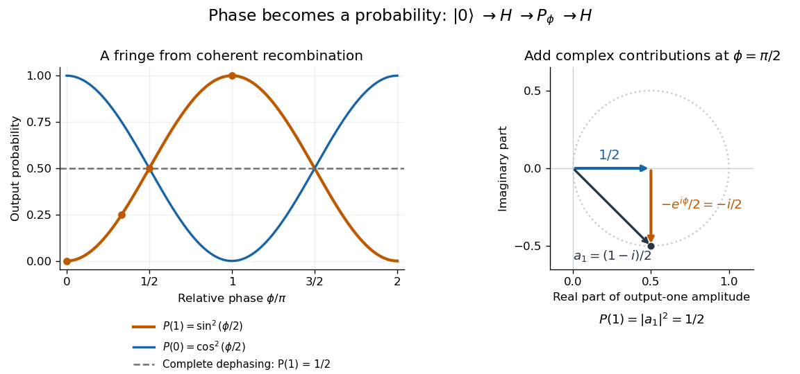
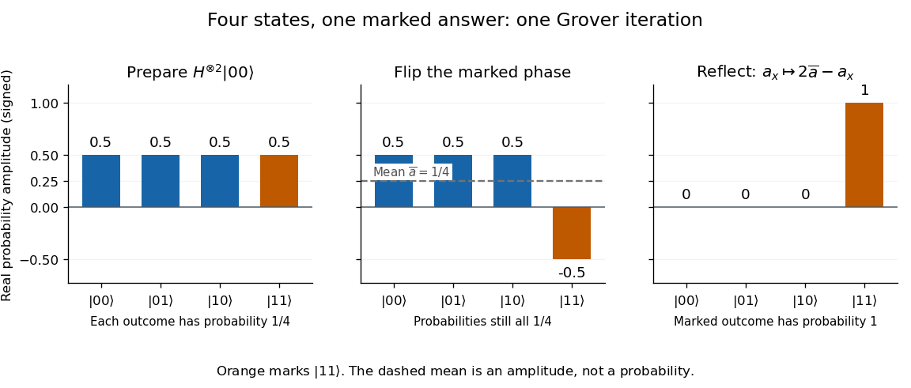
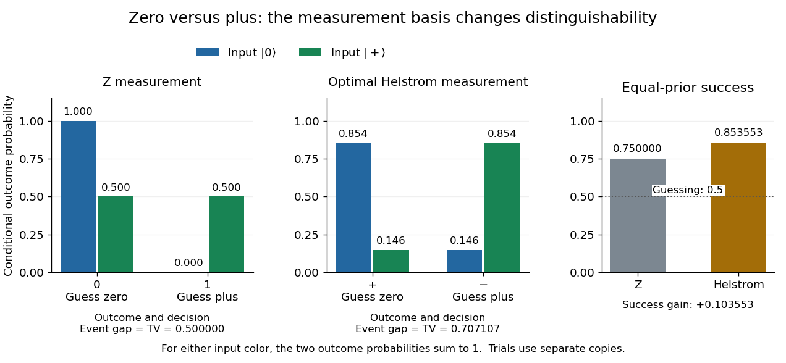
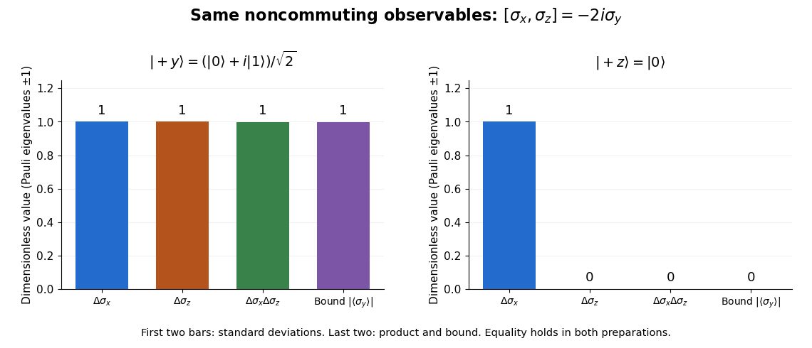
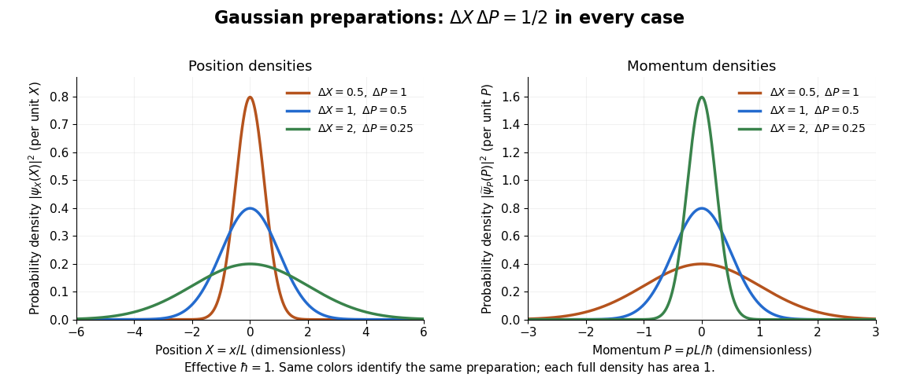
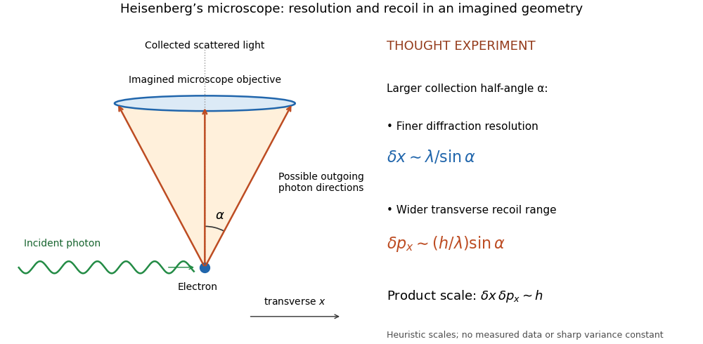
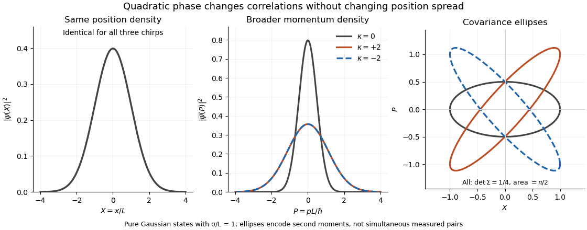
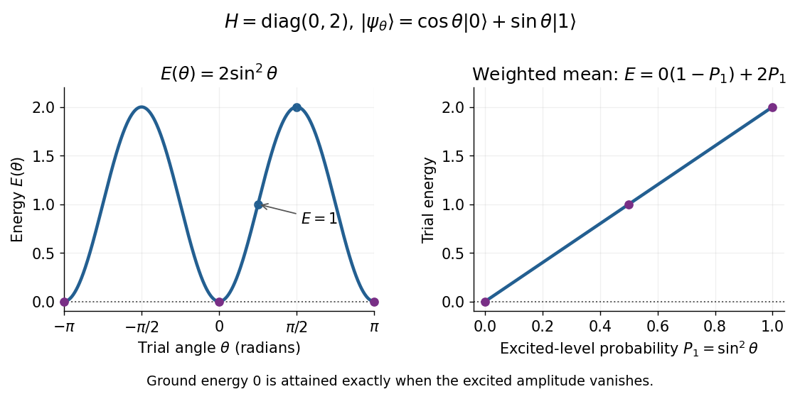

# Quantum theory

↑ **Parent:** [Branches of physics](physics.md#branches-of-physics)

Quantum theory supplies a common language for [quantum mechanics](quantum-mechanics.md), [measurement in quantum mechanics](quantum-measurement.md), and [quantum information](quantum-information-theory.md#quantum-information): prepare a [quantum state](quantum-system.md#quantum-state), transform it, and ask which experimental outcomes occur. In a finite-dimensional idealization, a [pure state](#pure-state) is a normalized [vector](vector-space.md#vector) of [complex numbers](complex-analysis.md#complex-number). Its entries are [probability amplitudes](wave-function.md#probability-amplitude); the [Born rule](wave-function.md#born-rule) turns their squared magnitudes into [probabilities](probability-theory.md#probability). Between measurements, an isolated system evolves by a [unitary operator](vector-space.md#unitary-operator), preserving its [norm](normed-vector-space.md#norm) and [inner products](inner-product.md). A [quantum circuit](quantum-circuit.md) makes this evolution explicit as a sequence of [quantum gates](quantum-circuit.md#quantum-logic-gate).

The extra information carried by [quantum phases](quantum-system.md#quantum-phase) is essential. Relative [quantum phases](quantum-system.md#quantum-phase) affect how [probability amplitudes](wave-function.md#probability-amplitude) add when different contributions reach the same output. Their [interference](physical-optics.md#interference-wave-propagation) can enhance one outcome and cancel another. A [global phase](quantum-system.md#global-phase), multiplying the entire [quantum state](quantum-system.md#quantum-state) by the same complex factor of magnitude one, changes neither these relative phases nor observable predictions. The [Hadamard gate](#hadamard-gate) below provides a small experiment in which this distinction becomes a deterministic change of output.

[Quantum coherence](density-matrix.md#quantum-coherence-in-a-specified-basis) describes this capacity to interfere relative to a specified [orthonormal basis](inner-product.md#orthonormal-basis). In a [density matrix](density-matrix.md), it appears in off-diagonal entries; a diagonal [mixed state](density-matrix.md#mixed-state) retains the populations but lacks that basis coherence. Thus matching the [probabilities](probability-theory.md#probability) of one measurement need not match the predictions of a later experiment. Baumgratz, Cramer, and Plenio made this basis-dependent viewpoint precise in their resource framework for [quantum coherence](density-matrix.md#quantum-coherence-in-a-specified-basis). [Baumgratz, Cramer, and Plenio, Quantifying Coherence, 2014, pp. 1–2](https://arxiv.org/abs/1311.0275).

This makes [quantum information](quantum-information-theory.md#quantum-information) an operational question: which distinctions can a preparation, an available [unitary operator](vector-space.md#unitary-operator), and [measurement in quantum mechanics](quantum-measurement.md) reveal? [Amplitude amplification](#amplitude-amplification) illustrates how carefully arranged [interference](physical-optics.md#interference-wave-propagation) converts a weakly represented answer into a likely observable result. Preserving the relevant [quantum coherence](density-matrix.md#quantum-coherence-in-a-specified-basis) throughout the computation is part of the physical task. [Watrous, IBM Quantum Learning, introduction to single systems](https://quantum.cloud.ibm.com/learning/en/courses/basics-of-quantum-information/single-systems/introduction).

**Table of contents**

- [Floquet Hamiltonian](#floquet-hamiltonian)
- [Hadamard transform](#hadamard-transform)
  - [Fast Hadamard transform](#fast-hadamard-transform)
  - [Hadamard gate](#hadamard-gate)
    - [Hadamard-phase-Hadamard qubit rotation](#hadamard-phase-hadamard-qubit-rotation)
    - [Photon-number reference for a Hadamard gate](#photon-number-reference-for-a-hadamard-gate)
    - [Uniform quantum superposition](#uniform-quantum-superposition)
  - [Walsh-Hadamard transform](#walsh-hadamard-transform)
  - [Hadamard basis](#hadamard-basis)
- [Minimal coupling](#minimal-coupling)
  - [Magnetic minimal coupling](#magnetic-minimal-coupling)
- [Quantum fluctuation](#quantum-fluctuation)
- [Gauge covariance of the Schrödinger equation](#gauge-covariance-of-the-schrodinger-equation)
- [Measurement in quantum mechanics](quantum-measurement.md)
  - [Quantum premeasurement](quantum-measurement.md#quantum-premeasurement)
  - [Weak measurement](quantum-measurement.md#weak-measurement)
    - [Weak value](quantum-measurement.md#weak-value)
  - [Position measurement](quantum-measurement.md#position-measurement)
  - [Elitzur-Vaidman bomb tester](quantum-measurement.md#elitzur-vaidman-bomb-tester)
    - [Repeated weak-rotation bomb-test efficiency](quantum-measurement.md#repeated-weak-rotation-bomb-test-efficiency)
  - [Measurement backaction](quantum-measurement.md#measurement-backaction)
  - [Perfect discrimination of pure states requires orthogonality](quantum-measurement.md#perfect-discrimination-of-pure-states-requires-orthogonality)
  - [Quantum nondemolition measurement](quantum-measurement.md#quantum-nondemolition-measurement)
    - [Haroche cavity photon nondemolition experiment](quantum-measurement.md#haroche-cavity-photon-nondemolition-experiment)
      - [Sequential Bayesian photon counting](quantum-measurement.md#sequential-bayesian-photon-counting)
      - [Photon-number measurement backaction](quantum-measurement.md#photon-number-measurement-backaction)
    - [Entanglement-assisted statistical singlet verification](quantum-measurement.md#entanglement-assisted-statistical-singlet-verification)
    - [Bell-pair cost of exact nondemolition singlet verification](quantum-measurement.md#bell-pair-cost-of-exact-nondemolition-singlet-verification)
    - [Entanglement-assisted nondemolition parity measurement](quantum-measurement.md#entanglement-assisted-nondemolition-parity-measurement)
  - [Antidistinguishable quantum states](quantum-measurement.md#antidistinguishable-quantum-states)
  - [Postselection](quantum-measurement.md#postselection)
    - [Aharonov-Bergmann-Lebowitz rule](quantum-measurement.md#aharonov-bergmann-lebowitz-rule)
      - [Context dependence of pre- and post-selected measurements](quantum-measurement.md#context-dependence-of-pre-and-post-selected-measurements)
        - [N-box pre- and post-selection paradox](quantum-measurement.md#n-box-pre-and-post-selection-paradox)
  - [Measurement interaction](quantum-measurement.md#measurement-interaction)
    - [von Neumann measurement interaction](quantum-measurement.md#von-neumann-measurement-interaction)
  - [Generalized measurement postulate](quantum-measurement.md#generalized-measurement-postulate)
    - [Nonselective quantum measurement](quantum-measurement.md#nonselective-quantum-measurement)
    - [Selective quantum measurement](quantum-measurement.md#selective-quantum-measurement)
    - [Positive operator-valued measure](quantum-measurement.md#positive-operator-valued-measure)
      - [POVM on the occupied support](quantum-measurement.md#povm-on-the-occupied-support)
      - [POVM–ensemble duality for the maximally mixed state](quantum-measurement.md#povm-ensemble-duality-for-the-maximally-mixed-state)
      - [Pure positive operator-valued measure](quantum-measurement.md#pure-positive-operator-valued-measure)
      - [Trine qubit POVM](quantum-measurement.md#trine-qubit-povm)
      - [Informationally complete POVM](quantum-measurement.md#informationally-complete-povm)
        - [Tetrahedral qubit POVM](quantum-measurement.md#tetrahedral-qubit-povm)
      - [Binary rank-one qubit POVM](quantum-measurement.md#binary-rank-one-qubit-povm)
  - [Projective measurement](quantum-measurement.md#projective-measurement)
    - [von Neumann process 1](quantum-measurement.md#von-neumann-process-1)
    - [Completeness forces orthogonality of measurement projections](quantum-measurement.md#completeness-forces-orthogonality-of-measurement-projections)
    - [Equatorial qubit measurement](quantum-measurement.md#equatorial-qubit-measurement)
      - [Equatorial measurement relabeling at Clifford angles](quantum-measurement.md#equatorial-measurement-relabeling-at-clifford-angles)
    - [Lüders rule](quantum-measurement.md#luders-rule)
      - [Post-measurement state](quantum-measurement.md#post-measurement-state)
      - [Nonselective projective measurement](quantum-measurement.md#nonselective-projective-measurement)
        - [Pinching map](quantum-measurement.md#pinching-map)
        - [Rank-one dephasing](quantum-measurement.md#rank-one-dephasing)
          - [Relative-entropy identity for rank-one dephasing](quantum-measurement.md#relative-entropy-identity-for-rank-one-dephasing)
          - [Support inclusion under rank-one dephasing](quantum-measurement.md#support-inclusion-under-rank-one-dephasing)
  - [Quantum state tomography](quantum-measurement.md#quantum-state-tomography)
    - [Interferometric polarization tomography](quantum-measurement.md#interferometric-polarization-tomography)
    - [Single-qubit process tomography](quantum-measurement.md#single-qubit-process-tomography)
  - [No information without disturbance](quantum-measurement.md#no-information-without-disturbance)
    - [Quantum instrument](quantum-measurement.md#quantum-instrument)
      - [Unitary dilation of a measurement instrument](quantum-measurement.md#unitary-dilation-of-a-measurement-instrument)
      - [POVM does not determine the post-measurement state](quantum-measurement.md#povm-does-not-determine-the-post-measurement-state)
      - [Local quantum operation](quantum-measurement.md#local-quantum-operation)
- [Amplitude amplification](#amplitude-amplification)
  - [Nearest-integer stopping for amplitude amplification](#nearest-integer-stopping-for-amplitude-amplification)
  - [Two-dimensional matrix for phase amplitude amplification](#two-dimensional-matrix-for-phase-amplitude-amplification)
  - [Exact amplitude amplification](#exact-amplitude-amplification)
    - [Known-state success dilution for exact amplitude amplification](#known-state-success-dilution-for-exact-amplitude-amplification)
    - [Phase-matched amplitude amplification](#phase-matched-amplitude-amplification)
  - [Geometric amplitude-amplification schedule](#geometric-amplitude-amplification-schedule)
- [Reflection operator](#reflection-operator)
  - [Projector phase rotation](#projector-phase-rotation)
  - [Selective phase rotation](#selective-phase-rotation)
- [HHL algorithm](#hhl-algorithm)
  - [HHL controlled reciprocal rotation](#hhl-controlled-reciprocal-rotation)
  - [Cost of exact phase estimation on a dyadic spectrum](#cost-of-exact-phase-estimation-on-a-dyadic-spectrum)
- [Density matrix](density-matrix.md)
  - [Improper mixture](density-matrix.md#improper-mixture)
  - [Leading high-temperature density kernel](density-matrix.md#leading-high-temperature-density-kernel)
  - [One-body density matrix](density-matrix.md#one-body-density-matrix)
  - [Thermal representation of a reduced coupled-oscillator ground state](density-matrix.md#thermal-representation-of-a-reduced-coupled-oscillator-ground-state)
  - [Quantum state population](density-matrix.md#quantum-state-population)
  - [Quantum coherence in a specified basis](density-matrix.md#quantum-coherence-in-a-specified-basis)
    - [Electron phase coherence](density-matrix.md#electron-phase-coherence)
  - [Two-qubit Werner state](density-matrix.md#two-qubit-werner-state)
    - [Single-copy Werner filtering normalization bound](density-matrix.md#single-copy-werner-filtering-normalization-bound)
      - [Single-copy Werner filtering cannot increase concurrence](density-matrix.md#single-copy-werner-filtering-cannot-increase-concurrence)
    - [Concurrence of a two-qubit Werner state](density-matrix.md#concurrence-of-a-two-qubit-werner-state)
    - [Bell twirling followed by triplet symmetrization](density-matrix.md#bell-twirling-followed-by-triplet-symmetrization)
  - [Extreme points of the density-operator state space](density-matrix.md#extreme-points-of-the-density-operator-state-space)
  - [Unitary orbit of a density operator](density-matrix.md#unitary-orbit-of-a-density-operator)
  - [Quantum state ensemble](density-matrix.md#quantum-state-ensemble)
    - [Convex roof extension](density-matrix.md#convex-roof-extension)
      - [Monotonicity of a convex roof under a quantum instrument](density-matrix.md#monotonicity-of-a-convex-roof-under-a-quantum-instrument)
  - [Pauli correlation tensor](density-matrix.md#pauli-correlation-tensor)
  - [Maximally mixed state](density-matrix.md#maximally-mixed-state)
    - [Obstruction to uniform probability lowering by a unitary](density-matrix.md#obstruction-to-uniform-probability-lowering-by-a-unitary)
  - [Mixed state](density-matrix.md#mixed-state)
  - [Von Neumann equation](density-matrix.md#von-neumann-equation)
  - [Purification of a density operator](density-matrix.md#purification-of-a-density-operator)
    - [Purity decouples a subsystem from its purification](density-matrix.md#purity-decouples-a-subsystem-from-its-purification)
    - [Flagged purification of a quantum ensemble](density-matrix.md#flagged-purification-of-a-quantum-ensemble)
    - [Unitary freedom of purification](density-matrix.md#unitary-freedom-of-purification)
    - [Hughston–Jozsa–Wootters theorem](density-matrix.md#hughston-jozsa-wootters-theorem)
      - [Isometry parametrization of a density-matrix ensemble](density-matrix.md#isometry-parametrization-of-a-density-matrix-ensemble)
    - [Uhlmann's theorem](density-matrix.md#uhlmann-s-theorem)
  - [Trace distance](density-matrix.md#trace-distance)
    - [Trace distance between qubit states](density-matrix.md#trace-distance-between-qubit-states)
    - [Trace-distance contraction under quantum channels](density-matrix.md#trace-distance-contraction-under-quantum-channels)
    - [Trace distance for qubit dephasing](density-matrix.md#trace-distance-for-qubit-dephasing)
    - [Pure-target upper bound on trace distance](density-matrix.md#pure-target-upper-bound-on-trace-distance)
    - [Spectral-parts formula for trace distance](density-matrix.md#spectral-parts-formula-for-trace-distance)
    - [Pure-target lower bound on trace distance](density-matrix.md#pure-target-lower-bound-on-trace-distance)
    - [Variational characterization of trace distance](density-matrix.md#variational-characterization-of-trace-distance)
      - [Trace-distance-preserving binary measurement](density-matrix.md#trace-distance-preserving-binary-measurement)
  - [Von Neumann entropy](von-neumann-entropy.md)
    - [Entropy continuity from Jordan decomposition](von-neumann-entropy.md#entropy-continuity-from-jordan-decomposition)
    - [Entropy of an orthogonal quantum mixture](von-neumann-entropy.md#entropy-of-an-orthogonal-quantum-mixture)
    - [Entropy of a binary diagonal qubit mixture](von-neumann-entropy.md#entropy-of-a-binary-diagonal-qubit-mixture)
    - [Entropy bound from overlap with a pure state](von-neumann-entropy.md#entropy-bound-from-overlap-with-a-pure-state)
    - [Maximum entropy of a quantum state](von-neumann-entropy.md#maximum-entropy-of-a-quantum-state)
    - [Entropy increase under nonselective projective measurement](von-neumann-entropy.md#entropy-increase-under-nonselective-projective-measurement)
      - [Relative entropy of a pinched state](von-neumann-entropy.md#relative-entropy-of-a-pinched-state)
    - [Entanglement entropy](von-neumann-entropy.md#entanglement-entropy)
      - [Two-qubit entropy from the reduced determinant](von-neumann-entropy.md#two-qubit-entropy-from-the-reduced-determinant)
      - [Average monotonicity of pure-state entanglement entropy](von-neumann-entropy.md#average-monotonicity-of-pure-state-entanglement-entropy)
      - [Schmidt decomposition](von-neumann-entropy.md#schmidt-decomposition)
        - [Schmidt basis](von-neumann-entropy.md#schmidt-basis)
        - [Operator Schmidt rank](von-neumann-entropy.md#operator-schmidt-rank)
          - [Local Kraus rank bound from an entangled resource](von-neumann-entropy.md#local-kraus-rank-bound-from-an-entangled-resource)
        - [Schmidt-basis Pauli correlation tensor](von-neumann-entropy.md#schmidt-basis-pauli-correlation-tensor)
        - [Schmidt coefficient](von-neumann-entropy.md#schmidt-coefficient)
        - [Schmidt rank](von-neumann-entropy.md#schmidt-rank)
          - [Schmidt-rank contraction under product operators](von-neumann-entropy.md#schmidt-rank-contraction-under-product-operators)
          - [Monotonicity of Schmidt rank under LOCC](von-neumann-entropy.md#monotonicity-of-schmidt-rank-under-locc)
          - [Maximally entangled overlap bound from Schmidt rank](von-neumann-entropy.md#maximally-entangled-overlap-bound-from-schmidt-rank)
      - [Schmidt number](von-neumann-entropy.md#schmidt-number)
    - [Subadditivity of Von Neumann entropy](von-neumann-entropy.md#subadditivity-of-von-neumann-entropy)
      - [Araki–Lieb inequality](von-neumann-entropy.md#araki-lieb-inequality)
      - [Strong subadditivity of quantum entropy](von-neumann-entropy.md#strong-subadditivity-of-quantum-entropy)
        - [Strong subadditivity from relative-entropy monotonicity](von-neumann-entropy.md#strong-subadditivity-from-relative-entropy-monotonicity)
        - [Weak monotonicity of quantum entropy](von-neumann-entropy.md#weak-monotonicity-of-quantum-entropy)
    - [Concavity of Von Neumann entropy](von-neumann-entropy.md#concavity-of-von-neumann-entropy)
      - [Strict concavity of Von Neumann entropy](von-neumann-entropy.md#strict-concavity-of-von-neumann-entropy)
      - [Entropy bounds for a quantum mixture](von-neumann-entropy.md#entropy-bounds-for-a-quantum-mixture)
      - [Entropy bound for a binary mixture](von-neumann-entropy.md#entropy-bound-for-a-binary-mixture)
    - [Quantum conditional entropy](von-neumann-entropy.md#quantum-conditional-entropy)
      - [Pure-state negative conditional entropy criterion](von-neumann-entropy.md#pure-state-negative-conditional-entropy-criterion)
      - [Concavity of quantum conditional entropy](von-neumann-entropy.md#concavity-of-quantum-conditional-entropy)
      - [Continuity bound for quantum conditional entropy](von-neumann-entropy.md#continuity-bound-for-quantum-conditional-entropy)
      - [Dimension bound for quantum conditional entropy](von-neumann-entropy.md#dimension-bound-for-quantum-conditional-entropy)
    - [Quantum relative entropy](von-neumann-entropy.md#quantum-relative-entropy)
      - [Relative entropy of classically flagged states](von-neumann-entropy.md#relative-entropy-of-classically-flagged-states)
      - [Nonnegativity of quantum relative entropy](von-neumann-entropy.md#nonnegativity-of-quantum-relative-entropy)
        - [Eigenbasis proof of quantum relative entropy nonnegativity](von-neumann-entropy.md#eigenbasis-proof-of-quantum-relative-entropy-nonnegativity)
      - [Quantum Pinsker inequality](von-neumann-entropy.md#quantum-pinsker-inequality)
      - [Donald's identity](von-neumann-entropy.md#donald-s-identity)
        - [Relative-entropy barycenter of a quantum ensemble](von-neumann-entropy.md#relative-entropy-barycenter-of-a-quantum-ensemble)
      - [Data-processing inequality for quantum relative entropy](von-neumann-entropy.md#data-processing-inequality-for-quantum-relative-entropy)
      - [Additivity of quantum relative entropy](von-neumann-entropy.md#additivity-of-quantum-relative-entropy)
      - [Superadditivity of quantum relative entropy](von-neumann-entropy.md#superadditivity-of-quantum-relative-entropy)
        - [Multipartite superadditivity of quantum relative entropy](von-neumann-entropy.md#multipartite-superadditivity-of-quantum-relative-entropy)
          - [Lower asymptotic semicontinuity of quantum relative entropy](von-neumann-entropy.md#lower-asymptotic-semicontinuity-of-quantum-relative-entropy)
      - [Quantum mutual information](von-neumann-entropy.md#quantum-mutual-information)
        - [Quantum conditional mutual information](von-neumann-entropy.md#quantum-conditional-mutual-information)
        - [Data processing for quantum mutual information](von-neumann-entropy.md#data-processing-for-quantum-mutual-information)
          - [Postselection can increase conditional quantum mutual information](von-neumann-entropy.md#postselection-can-increase-conditional-quantum-mutual-information)
          - [Mutual-information loss as conditional mutual information](von-neumann-entropy.md#mutual-information-loss-as-conditional-mutual-information)
        - [Quantum mutual information balance identity](von-neumann-entropy.md#quantum-mutual-information-balance-identity)
      - [Variational characterization of quantum conditional entropy](von-neumann-entropy.md#variational-characterization-of-quantum-conditional-entropy)
  - [Purity of a density operator](density-matrix.md#purity-of-a-density-operator)
  - [Reduced density operator of a weakly coupled oscillator pair](density-matrix.md#reduced-density-operator-of-a-weakly-coupled-oscillator-pair)
  - [Bloch vector](density-matrix.md#bloch-vector)
    - [Qubit polarization](density-matrix.md#qubit-polarization)
    - [Bloch ball](density-matrix.md#bloch-ball)
      - [Antipodal eigenprojectors of a qubit density matrix](density-matrix.md#antipodal-eigenprojectors-of-a-qubit-density-matrix)
    - [Generalized Bloch representation](density-matrix.md#generalized-bloch-representation)
      - [Hamiltonian rotations of Bloch vectors](density-matrix.md#hamiltonian-rotations-of-bloch-vectors)
      - [Purity bound for generalized Bloch vectors](density-matrix.md#purity-bound-for-generalized-bloch-vectors)
      - [Affine Bloch equation](density-matrix.md#affine-bloch-equation)
        - [Transverse relaxation](density-matrix.md#transverse-relaxation)
        - [Population relaxation](density-matrix.md#population-relaxation)
        - [Steady states of an affine Bloch equation](density-matrix.md#steady-states-of-an-affine-bloch-equation)
    - [Bloch sphere](density-matrix.md#bloch-sphere)
      - [Pure-qubit overlap identity](density-matrix.md#pure-qubit-overlap-identity)
      - [Uniform pure-qubit average](density-matrix.md#uniform-pure-qubit-average)
    - [Informationally complete three-observable qubit tomography](density-matrix.md#informationally-complete-three-observable-qubit-tomography)
- [Quantum no-signalling](#quantum-no-signalling)
  - [Remote preparation in conjugate bases](#remote-preparation-in-conjugate-bases)
    - [Perfect two-basis discrimination would allow superluminal signalling](#perfect-two-basis-discrimination-would-allow-superluminal-signalling)
      - [Exact pure-state overlap readout would allow superluminal signalling](#exact-pure-state-overlap-readout-would-allow-superluminal-signalling)
  - [Relativistic causality constraint on an ideal nonlocal measurement](#relativistic-causality-constraint-on-an-ideal-nonlocal-measurement)
    - [Controlled-basis measurement causality obstruction](#controlled-basis-measurement-causality-obstruction)
    - [Singlet-triplet measurement causality obstruction](#singlet-triplet-measurement-causality-obstruction)
- [Quantum cloning](#quantum-cloning)
  - [Cloning failure bound from trace-distance contraction](#cloning-failure-bound-from-trace-distance-contraction)
  - [Copy-number trace-distance obstruction](#copy-number-trace-distance-obstruction)
  - [No-cloning theorem](#no-cloning-theorem)
  - [No-cloning theorem for two pure states](#no-cloning-theorem-for-two-pure-states)
  - [Clone-assisted asymptotic state discrimination](#clone-assisted-asymptotic-state-discrimination)
  - [Perfect discrimination implies cloning for a known state family](#perfect-discrimination-implies-cloning-for-a-known-state-family)
- [Environment-assisted two-state pure-state transformation](#environment-assisted-two-state-pure-state-transformation)
- [Helstrom-Holevo bound](#helstrom-holevo-bound)
  - [Helstrom measurement for two pure states](#helstrom-measurement-for-two-pure-states)
    - [Helstrom measurement for the zero and plus states](#helstrom-measurement-for-the-zero-and-plus-states)
  - [Perfect distinguishability of pure states](#perfect-distinguishability-of-pure-states)
  - [Unambiguous quantum state discrimination](#unambiguous-quantum-state-discrimination)
    - [Reciprocal-state construction of unambiguous discrimination](#reciprocal-state-construction-of-unambiguous-discrimination)
- [Unitary gate discrimination](#unitary-gate-discrimination)
  - [Single-use perfect discrimination of two unitary gates](#single-use-perfect-discrimination-of-two-unitary-gates)
  - [Numerical range](#numerical-range)
    - [Numerical range of a normal matrix](#numerical-range-of-a-normal-matrix)
  - [Unit-circle spectrum of a unitary operator](#unit-circle-spectrum-of-a-unitary-operator)
  - [Spectral arc length of a unitary operator](#spectral-arc-length-of-a-unitary-operator)
    - [Spectral arc length of a phase gate](#spectral-arc-length-of-a-phase-gate)
    - [Origin in the convex hull of unit-circle points](#origin-in-the-convex-hull-of-unit-circle-points)
      - [Spectral-arc criterion for perfect unitary discrimination](#spectral-arc-criterion-for-perfect-unitary-discrimination)
- [Robertson uncertainty principle](#robertson-uncertainty-principle)
  - [Minimum uncertainty state](#minimum-uncertainty-state)
  - [Spin uncertainty state dependence](#spin-uncertainty-state-dependence)
  - [Heisenberg uncertainty relation](#heisenberg-uncertainty-relation)
    - [Confinement energy bound from position support](#confinement-energy-bound-from-position-support)
    - [Preparation uncertainty](#preparation-uncertainty)
    - [Heisenberg's microscope](#heisenberg-s-microscope)
    - [Chirped Gaussian wave packet](#chirped-gaussian-wave-packet)
  - [Quadratic-norm proof of the Heisenberg uncertainty relation](#quadratic-norm-proof-of-the-heisenberg-uncertainty-relation)
  - [Equality case of the Heisenberg uncertainty relation](#equality-case-of-the-heisenberg-uncertainty-relation)
  - [Robertson-Schrödinger uncertainty relation](#robertson-schrodinger-uncertainty-relation)
    - [Quantum covariance](#quantum-covariance)
- [Gaussian eigenstate for a quadratic potential](#gaussian-eigenstate-for-a-quadratic-potential)
- [Quantum optics](quantum-optics.md)
  - [Field-squared quadrature](quantum-optics.md#field-squared-quadrature)
    - [Amplitude-squared squeezing](quantum-optics.md#amplitude-squared-squeezing)
  - [Nonclassical state of light](quantum-optics.md#nonclassical-state-of-light)
    - [Nonclassicality witnesses](quantum-optics.md#nonclassicality-witnesses)
  - [Photon subtraction](quantum-optics.md#photon-subtraction)
    - [Conditional photon-number bias](quantum-optics.md#conditional-photon-number-bias)
  - [Photon addition](quantum-optics.md#photon-addition)
  - [Schrödinger cat state](quantum-optics.md#schrodinger-cat-state)
    - [Loss of coherence in an optical cat state](quantum-optics.md#loss-of-coherence-in-an-optical-cat-state)
    - [Phase-dependent cat-state quadrature variance](quantum-optics.md#phase-dependent-cat-state-quadrature-variance)
    - [Odd coherent-state superposition](quantum-optics.md#odd-coherent-state-superposition)
    - [Even coherent-state superposition](quantum-optics.md#even-coherent-state-superposition)
  - [Optical homodyne detection](quantum-optics.md#optical-homodyne-detection)
    - [Local oscillator](quantum-optics.md#local-oscillator)
    - [Optical homodyne tomography](quantum-optics.md#optical-homodyne-tomography)
    - [Balanced homodyne detection](quantum-optics.md#balanced-homodyne-detection)
      - [Finite-reference balanced homodyne variance](quantum-optics.md#finite-reference-balanced-homodyne-variance)
  - [Optical quadrature](quantum-optics.md#optical-quadrature)
    - [Coherent-state electric-field variance](quantum-optics.md#coherent-state-electric-field-variance)
    - [Quadrature noise ellipse](quantum-optics.md#quadrature-noise-ellipse)
    - [Quadrature squeezing](quantum-optics.md#quadrature-squeezing)
      - [Optical squeezing degradation by loss](quantum-optics.md#optical-squeezing-degradation-by-loss)
    - [Quadrature squeezing of a vacuum–one-photon superposition](quantum-optics.md#quadrature-squeezing-of-a-vacuum-one-photon-superposition)
  - [Quantum theory of optical coherence](quantum-optics.md#quantum-theory-of-optical-coherence)
    - [Second-order optical coherence](quantum-optics.md#second-order-optical-coherence)
  - [Photon statistics](quantum-optics.md#photon-statistics)
    - [Number squeezing](quantum-optics.md#number-squeezing)
    - [Normalization of photon-added and photon-subtracted states](quantum-optics.md#normalization-of-photon-added-and-photon-subtracted-states)
    - [Coherent-state photon statistics](quantum-optics.md#coherent-state-photon-statistics)
    - [Thermal light](quantum-optics.md#thermal-light)
    - [Photon bunching](quantum-optics.md#photon-bunching)
    - [Photon antibunching](quantum-optics.md#photon-antibunching)
  - [Photon counting](quantum-optics.md#photon-counting)
    - [Coincidence counting](quantum-optics.md#coincidence-counting)
    - [Finite-bin photon correlations](quantum-optics.md#finite-bin-photon-correlations)
    - [Photon correlation loss and background model](quantum-optics.md#photon-correlation-loss-and-background-model)
  - [Hanbury Brown and Twiss effect](quantum-optics.md#hanbury-brown-and-twiss-effect)
    - [Stellar intensity interferometry](quantum-optics.md#stellar-intensity-interferometry)
      - [Sirius intensity interferometry experiment](quantum-optics.md#sirius-intensity-interferometry-experiment)
      - [Siegert relation](quantum-optics.md#siegert-relation)
      - [Uniform-disk stellar visibility](quantum-optics.md#uniform-disk-stellar-visibility)
        - [Stellar angular diameter from a visibility envelope](quantum-optics.md#stellar-angular-diameter-from-a-visibility-envelope)
      - [Finite-response stellar intensity correlations](quantum-optics.md#finite-response-stellar-intensity-correlations)
  - [Resonance fluorescence antibunching experiment](quantum-optics.md#resonance-fluorescence-antibunching-experiment)
- [Coherent state](#coherent-state)
  - [Classical mixture of coherent states](#classical-mixture-of-coherent-states)
    - [Glauber-Sudarshan representation](#glauber-sudarshan-representation)
  - [Coherent-field condensate variational state](#coherent-field-condensate-variational-state)
  - [Poisson counting in a coherent state](#poisson-counting-in-a-coherent-state)
  - [Passive linear transformation of coherent states](#passive-linear-transformation-of-coherent-states)
  - [Coherent-state overlap](#coherent-state-overlap)
  - [Displacement operator](#displacement-operator)
  - [Coherent state after shifting an oscillator equilibrium](#coherent-state-after-shifting-an-oscillator-equilibrium)
  - [Coherent-state oscillator expectation values](#coherent-state-oscillator-expectation-values)
  - [Coherent-state resolution of identity](#coherent-state-resolution-of-identity)
  - [Unnormalized bosonic coherent state](#unnormalized-bosonic-coherent-state)
  - [Fermionic coherent state](#fermionic-coherent-state)
    - [Fermionic coherent-state trace](#fermionic-coherent-state-trace)
- [Born approximation](#born-approximation)
  - [Born amplitude for a Yukawa potential](#born-amplitude-for-a-yukawa-potential)
  - [Delta-shell Born amplitude](#delta-shell-born-amplitude)
- [Toffoli gate](#toffoli-gate)
- [Modular-addition quantum oracle](#modular-addition-quantum-oracle)
  - [Modular-oracle inversion by negation](#modular-oracle-inversion-by-negation)
- [Boolean quantum oracle](#boolean-quantum-oracle)
  - [Phase kickback](#phase-kickback)
    - [Quadratic Boolean phase cancellation](#quadratic-boolean-phase-cancellation)
    - [Bernstein-Vazirani phase kickback](#bernstein-vazirani-phase-kickback)
      - [Qutrit linear-function identification](#qutrit-linear-function-identification)
      - [Bernstein-Vazirani decoding controlled by a quantum register](#bernstein-vazirani-decoding-controlled-by-a-quantum-register)
    - [Marked-state phase oracle](#marked-state-phase-oracle)
      - [Marked-state phase oracle from a single faulty identity-oracle query](#marked-state-phase-oracle-from-a-single-faulty-identity-oracle-query)
  - [Compute-phase-uncompute construction](#compute-phase-uncompute-construction)
  - [Uncomputation](#uncomputation)
- [Quantum circuit](quantum-circuit.md)
  - [Quantum circuit gate-error telescoping bound](quantum-circuit.md#quantum-circuit-gate-error-telescoping-bound)
  - [Depth-first quantum circuit path summation](quantum-circuit.md#depth-first-quantum-circuit-path-summation)
  - [Stoquastic circuit](quantum-circuit.md#stoquastic-circuit)
    - [Stoquastic acceptance floor](quantum-circuit.md#stoquastic-acceptance-floor)
  - [Computational history state](quantum-circuit.md#computational-history-state)
    - [Feynman-Kitaev Hamiltonian](quantum-circuit.md#feynman-kitaev-hamiltonian)
      - [Gap above a degenerate history ground space](quantum-circuit.md#gap-above-a-degenerate-history-ground-space)
      - [Input penalty of a history Hamiltonian](quantum-circuit.md#input-penalty-of-a-history-hamiltonian)
    - [Nonlocal quantum clock](quantum-circuit.md#nonlocal-quantum-clock)
    - [Unary quantum clock](quantum-circuit.md#unary-quantum-clock)
      - [History-subspace propagation Hamiltonian](quantum-circuit.md#history-subspace-propagation-hamiltonian)
        - [Gershgorin gap bound for an adiabatic history path](quantum-circuit.md#gershgorin-gap-bound-for-an-adiabatic-history-path)
        - [Spectrum of a path propagation Hamiltonian](quantum-circuit.md#spectrum-of-a-path-propagation-hamiltonian)
  - [Quantum logic gate](quantum-circuit.md#quantum-logic-gate)
    - [Two-qubit gate](quantum-circuit.md#two-qubit-gate)
      - [Diagonal two-qubit phase entanglement criterion](quantum-circuit.md#diagonal-two-qubit-phase-entanglement-criterion)
      - [Cartan decomposition of a two-qubit gate](quantum-circuit.md#cartan-decomposition-of-a-two-qubit-gate)
  - [Measurement-based quantum computation](quantum-circuit.md#measurement-based-quantum-computation)
    - [Three-vertex graph-state wire](quantum-circuit.md#three-vertex-graph-state-wire)
    - [Five-vertex graph-state circuit simulation](quantum-circuit.md#five-vertex-graph-state-circuit-simulation)
    - [Four-cycle graph-state simulation of an entangle-and-measure circuit](quantum-circuit.md#four-cycle-graph-state-simulation-of-an-entangle-and-measure-circuit)
    - [Measurement pattern](quantum-circuit.md#measurement-pattern)
      - [Logical depth of a measurement pattern](quantum-circuit.md#logical-depth-of-a-measurement-pattern)
        - [Two-layer measurement pattern for CNOT and x-axis rotations](quantum-circuit.md#two-layer-measurement-pattern-for-cnot-and-x-axis-rotations)
        - [Nonadaptive Clifford measurement pattern](quantum-circuit.md#nonadaptive-clifford-measurement-pattern)
          - [Nonadaptive Hadamard–CNOT measurement pattern](quantum-circuit.md#nonadaptive-hadamard-cnot-measurement-pattern)
  - [Quantum register](quantum-circuit.md#quantum-register)
  - [Rotation gate](quantum-circuit.md#rotation-gate)
    - [Rotation about the x-axis](quantum-circuit.md#rotation-about-the-x-axis)
    - [Rotation about the y-axis](quantum-circuit.md#rotation-about-the-y-axis)
    - [Rotation about the z-axis](quantum-circuit.md#rotation-about-the-z-axis)
  - [Universal quantum gate set](quantum-circuit.md#universal-quantum-gate-set)
    - [Solovay--Kitaev theorem](quantum-circuit.md#solovay-kitaev-theorem)
  - [Quantum state preparation](quantum-circuit.md#quantum-state-preparation)
    - [Uniform coprime state for a semiprime](quantum-circuit.md#uniform-coprime-state-for-a-semiprime)
    - [Uniform superposition state](quantum-circuit.md#uniform-superposition-state)
    - [Hierarchical probability-distribution state preparation](quantum-circuit.md#hierarchical-probability-distribution-state-preparation)
  - [Quantum arithmetic](quantum-circuit.md#quantum-arithmetic)
  - [Pauli group](quantum-circuit.md#pauli-group)
    - [Pauli-string commutation parity](quantum-circuit.md#pauli-string-commutation-parity)
    - [Binary phase representation of a Pauli string](quantum-circuit.md#binary-phase-representation-of-a-pauli-string)
      - [Binary symplectic space of Pauli labels](quantum-circuit.md#binary-symplectic-space-of-pauli-labels)
        - [Isotropic subspace of a binary symplectic space](quantum-circuit.md#isotropic-subspace-of-a-binary-symplectic-space)
      - [Controlled-Z update in the binary phase representation](quantum-circuit.md#controlled-z-update-in-the-binary-phase-representation)
    - [Pauli frame](quantum-circuit.md#pauli-frame)
    - [Pauli operator](quantum-circuit.md#pauli-operator)
      - [Pauli decomposition of a qubit-environment isometry](quantum-circuit.md#pauli-decomposition-of-a-qubit-environment-isometry)
      - [Weight of a Pauli operator](quantum-circuit.md#weight-of-a-pauli-operator)
      - [Pauli expansion of a quantum error](quantum-circuit.md#pauli-expansion-of-a-quantum-error)
      - [Pauli gate](quantum-circuit.md#pauli-gate)
      - [Pauli correlator](quantum-circuit.md#pauli-correlator)
    - [Stabilizer group](quantum-circuit.md#stabilizer-group)
      - [Balanced spectrum of a nonidentity stabilizer](quantum-circuit.md#balanced-spectrum-of-a-nonidentity-stabilizer)
      - [Stabilizer generator](quantum-circuit.md#stabilizer-generator)
      - [Stabilizer state](quantum-circuit.md#stabilizer-state)
        - [Stabilizer-state preparation](quantum-circuit.md#stabilizer-state-preparation)
        - [Stabilizer tableau](quantum-circuit.md#stabilizer-tableau)
        - [Graph state](quantum-circuit.md#graph-state)
          - [Equatorial measurement of a graph-state leaf](quantum-circuit.md#equatorial-measurement-of-a-graph-state-leaf)
          - [Computational-basis measurement of a graph-state vertex](quantum-circuit.md#computational-basis-measurement-of-a-graph-state-vertex)
          - [Graph-state stabilizer generator](quantum-circuit.md#graph-state-stabilizer-generator)
          - [Local complementation of a graph state](quantum-circuit.md#local-complementation-of-a-graph-state)
      - [Stabilizer subspace](quantum-circuit.md#stabilizer-subspace)
        - [Stabilizer-projector formula](quantum-circuit.md#stabilizer-projector-formula)
    - [Clifford gate](quantum-circuit.md#clifford-gate)
      - [Clifford circuit](quantum-circuit.md#clifford-circuit)
        - [Gottesman--Knill theorem](quantum-circuit.md#gottesman-knill-theorem)
          - [Extended Gottesman--Knill theorem](quantum-circuit.md#extended-gottesman-knill-theorem)
        - [Clifford frame](quantum-circuit.md#clifford-frame)
      - [Local Clifford operation](quantum-circuit.md#local-clifford-operation)
      - [Strong classical simulation of a quantum circuit](quantum-circuit.md#strong-classical-simulation-of-a-quantum-circuit)
        - [Heisenberg propagation of a Pauli observable through a Clifford circuit](quantum-circuit.md#heisenberg-propagation-of-a-pauli-observable-through-a-clifford-circuit)
          - [Backward Pauli updates for Hadamard and phase gates](quantum-circuit.md#backward-pauli-updates-for-hadamard-and-phase-gates)
      - [Weak classical simulation of a quantum circuit](quantum-circuit.md#weak-classical-simulation-of-a-quantum-circuit)
- [Lieb-Robinson bound](#lieb-robinson-bound)
  - [Full-evolution comparison for truncated dynamics](#full-evolution-comparison-for-truncated-dynamics)
  - [Lieb-Robinson interaction-chain expansion](#lieb-robinson-interaction-chain-expansion)
  - [Interaction distance](#interaction-distance)
  - [Lieb-Robinson localization by Haar twirling](#lieb-robinson-localization-by-haar-twirling)
  - [Finite-depth local quantum circuit](#finite-depth-local-quantum-circuit)
    - [Backward light cone of a local quantum circuit](#backward-light-cone-of-a-local-quantum-circuit)
    - [GHZ-state circuit-depth lower bound](#ghz-state-circuit-depth-lower-bound)
- [Grover's algorithm](#grover-s-algorithm)
  - [Grover iteration in a nonorthogonal basis](#grover-iteration-in-a-nonorthogonal-basis)
  - [First half-success time in Grover search](#first-half-success-time-in-grover-search)
  - [Continuous-time quantum search](#continuous-time-quantum-search)
  - [Grover search with a nonzero reflection label](#grover-search-with-a-nonzero-reflection-label)
  - [Verified Grover promise test](#verified-grover-promise-test)
  - [Marked density under a permutation](#marked-density-under-a-permutation)
    - [Permutation-preimage quantum search](#permutation-preimage-quantum-search)
  - [Known-subset Grover search](#known-subset-grover-search)
    - [Clean subset superposition preparation](#clean-subset-superposition-preparation)
  - [Grover diffusion operator](#grover-diffusion-operator)
    - [Inversion about the mean](#inversion-about-the-mean)
  - [Grover rotation angle](#grover-rotation-angle)
    - [First half-probability Grover iterate](#first-half-probability-grover-iterate)
    - [First successful Grover iterate](#first-successful-grover-iterate)
    - [Exact Grover search on four entries](#exact-grover-search-on-four-entries)
- [Computational basis](#computational-basis)
  - [Quantum measurement in the computational basis](#quantum-measurement-in-the-computational-basis)
    - [Computational-basis state](#computational-basis-state)
- [Deutsch-Jozsa algorithm](#deutsch-jozsa-algorithm)
  - [Deutsch algorithm](#deutsch-algorithm)
    - [Deutsch algorithm with pure dephasing](#deutsch-algorithm-with-pure-dephasing)
  - [Opposite-pair elimination for exact quantum balance testing](#opposite-pair-elimination-for-exact-quantum-balance-testing)
  - [Deutsch-Jozsa test with an arbitrary uniform-state unitary](#deutsch-jozsa-test-with-an-arbitrary-uniform-state-unitary)
- [Quantum Fourier transform](quantum-fourier-transform.md)
  - [Dyadic quantum Fourier transform circuit](quantum-fourier-transform.md#dyadic-quantum-fourier-transform-circuit)
  - [Product decomposition of a Fourier phase state](quantum-fourier-transform.md#product-decomposition-of-a-fourier-phase-state)
  - [Fourier sample](quantum-fourier-transform.md#fourier-sample)
  - [Quantum Fourier transform over a finite abelian group](quantum-fourier-transform.md#quantum-fourier-transform-over-a-finite-abelian-group)
  - [Square of the quantum Fourier transform](quantum-fourier-transform.md#square-of-the-quantum-fourier-transform)
  - [Quantum Fourier transform of a periodic coset state](quantum-fourier-transform.md#quantum-fourier-transform-of-a-periodic-coset-state)
  - [Quantum period finding](quantum-fourier-transform.md#quantum-period-finding)
    - [Exact period recovery from a Fourier sample](quantum-fourier-transform.md#exact-period-recovery-from-a-fourier-sample)
      - [Two-sample exact period recovery](quantum-fourier-transform.md#two-sample-exact-period-recovery)
      - [Heralded exact quantum period finding when the period divides the register size](quantum-fourier-transform.md#heralded-exact-quantum-period-finding-when-the-period-divides-the-register-size)
        - [Quantum Fourier sampling of powers of three modulo ten](quantum-fourier-transform.md#quantum-fourier-sampling-of-powers-of-three-modulo-ten)
  - [Hidden subgroup problem](quantum-fourier-transform.md#hidden-subgroup-problem)
    - [Discrete-logarithm Fourier sampling](quantum-fourier-transform.md#discrete-logarithm-fourier-sampling)
      - [Linear congruence from a discrete-logarithm Fourier sample](quantum-fourier-transform.md#linear-congruence-from-a-discrete-logarithm-fourier-sample)
    - [Coset state](quantum-fourier-transform.md#coset-state)
      - [Periodic coset state](quantum-fourier-transform.md#periodic-coset-state)
    - [Group shift operator](quantum-fourier-transform.md#group-shift-operator)
    - [Abelian hidden-subgroup Fourier sampling](quantum-fourier-transform.md#abelian-hidden-subgroup-fourier-sampling)
    - [Simon's problem](quantum-fourier-transform.md#simon-s-problem)
      - [Classical collision query bound for Simon's problem](quantum-fourier-transform.md#classical-collision-query-bound-for-simon-s-problem)
      - [Simon's algorithm](quantum-fourier-transform.md#simon-s-algorithm)
        - [Expected query count for Simon sampling](quantum-fourier-transform.md#expected-query-count-for-simon-sampling)
        - [Single-sample distribution in Simon's algorithm](quantum-fourier-transform.md#single-sample-distribution-in-simon-s-algorithm)
        - [Orthogonal complement over the binary field](quantum-fourier-transform.md#orthogonal-complement-over-the-binary-field)
    - [Stabilizer as a hidden subgroup](quantum-fourier-transform.md#stabilizer-as-a-hidden-subgroup)
  - [Cyclic shift operator](quantum-fourier-transform.md#cyclic-shift-operator)
    - [Cyclic shift diagonalization by the quantum Fourier transform](quantum-fourier-transform.md#cyclic-shift-diagonalization-by-the-quantum-fourier-transform)
  - [Quantum phase estimation](quantum-fourier-transform.md#quantum-phase-estimation)
    - [Quantum phase estimation tail bound](quantum-fourier-transform.md#quantum-phase-estimation-tail-bound)
    - [Near-grid quantum phase estimation](quantum-fourier-transform.md#near-grid-quantum-phase-estimation)
    - [Parallel phase multiplication by coherent fanout](quantum-fourier-transform.md#parallel-phase-multiplication-by-coherent-fanout)
    - [Quantum phase estimation with a maximally mixed target](quantum-fourier-transform.md#quantum-phase-estimation-with-a-maximally-mixed-target)
    - [Nearest-integer success bound for quantum phase estimation](quantum-fourier-transform.md#nearest-integer-success-bound-for-quantum-phase-estimation)
    - [Dyadic phase-gate identification](quantum-fourier-transform.md#dyadic-phase-gate-identification)
    - [Tensor-product eigenphase amplification](quantum-fourier-transform.md#tensor-product-eigenphase-amplification)
    - [Positive-phase fractional power of a unitary operator](quantum-fourier-transform.md#positive-phase-fractional-power-of-a-unitary-operator)
    - [Quantum spectral filtering](quantum-fourier-transform.md#quantum-spectral-filtering)
      - [Singular obstruction to normalized quantum matrix multiplication](quantum-fourier-transform.md#singular-obstruction-to-normalized-quantum-matrix-multiplication)
      - [Success probability of positive quantum spectral filtering](quantum-fourier-transform.md#success-probability-of-positive-quantum-spectral-filtering)
    - [Exact quantum phase estimation](quantum-fourier-transform.md#exact-quantum-phase-estimation)
- [BB84](#bb84)
  - [BB84 intercept-resend error rate](#bb84-intercept-resend-error-rate)
  - [Bit error rate](#bit-error-rate)
- [Breidbart basis](#breidbart-basis)
- [Bell state](bell-state.md)
  - [Magic basis](bell-state.md#magic-basis)
    - [Real local-unitary representation in the magic basis](bell-state.md#real-local-unitary-representation-in-the-magic-basis)
  - [Local flag correction of a Bell-state phase mixture](bell-state.md#local-flag-correction-of-a-bell-state-phase-mixture)
  - [Bell pair](bell-state.md#bell-pair)
  - [Dephased Bell-state mixture](bell-state.md#dephased-bell-state-mixture)
  - [Bell-basis measurement](bell-state.md#bell-basis-measurement)
    - [Bell-state nondemolition measurement](bell-state.md#bell-state-nondemolition-measurement)
  - [Superdense coding](bell-state.md#superdense-coding)
  - [Spin singlet state](bell-state.md#spin-singlet-state)
    - [Collective-unitary covariance of the two-qubit singlet](bell-state.md#collective-unitary-covariance-of-the-two-qubit-singlet)
  - [Reduced density matrix](bell-state.md#reduced-density-matrix)
    - [No-communication theorem](bell-state.md#no-communication-theorem)
      - [Remote state invariance under a local trace-preserving operation](bell-state.md#remote-state-invariance-under-a-local-trace-preserving-operation)
    - [Product state](bell-state.md#product-state)
      - [Two-qubit product-state determinant criterion](bell-state.md#two-qubit-product-state-determinant-criterion)
    - [Entangled state](bell-state.md#entangled-state)
      - [Entanglement distillation](bell-state.md#entanglement-distillation)
      - [Entanglement dilution](bell-state.md#entanglement-dilution)
        - [Exact dilution obstruction from Schmidt rank](bell-state.md#exact-dilution-obstruction-from-schmidt-rank)
        - [Deterministic two-qubit entanglement dilution](bell-state.md#deterministic-two-qubit-entanglement-dilution)
      - [Entanglement monotone](bell-state.md#entanglement-monotone)
        - [Relative entropy of entanglement](bell-state.md#relative-entropy-of-entanglement)
        - [Schmidt-tail entanglement monotone](bell-state.md#schmidt-tail-entanglement-monotone)
      - [Concurrence](bell-state.md#concurrence)
        - [Concurrence in the magic basis](bell-state.md#concurrence-in-the-magic-basis)
        - [Mixed-state concurrence of two qubits](bell-state.md#mixed-state-concurrence-of-two-qubits)
          - [Concurrence scaling under invertible local filters](bell-state.md#concurrence-scaling-under-invertible-local-filters)
      - [Entanglement criterion for a two-term correlated state](bell-state.md#entanglement-criterion-for-a-two-term-correlated-state)
      - [Entanglement concentration](bell-state.md#entanglement-concentration)
        - [Single-copy entanglement concentration](bell-state.md#single-copy-entanglement-concentration)
        - [Binary Schmidt filter](bell-state.md#binary-schmidt-filter)
        - [Schmidt projection entanglement concentration](bell-state.md#schmidt-projection-entanglement-concentration)
          - [Tripartite Schmidt projection entanglement concentration](bell-state.md#tripartite-schmidt-projection-entanglement-concentration)
    - [Local indistinguishability of Bell-state phase](bell-state.md#local-indistinguishability-of-bell-state-phase)
  - [Local operations and classical communication](bell-state.md#local-operations-and-classical-communication)
    - [Entanglement catalysis](bell-state.md#entanglement-catalysis)
    - [Two-outcome LOCC dilution of a Bell pair](bell-state.md#two-outcome-locc-dilution-of-a-bell-pair)
    - [Deterministic reduction of maximally entangled Schmidt rank](bell-state.md#deterministic-reduction-of-maximally-entangled-schmidt-rank)
    - [Asymptotic pure-state entanglement conversion rate](bell-state.md#asymptotic-pure-state-entanglement-conversion-rate)
      - [Collective advantage over independent two-qubit filtering](bell-state.md#collective-advantage-over-independent-two-qubit-filtering)
    - [Optimal stochastic conversion of a two-qubit pure state](bell-state.md#optimal-stochastic-conversion-of-a-two-qubit-pure-state)
    - [Local unitary operation](bell-state.md#local-unitary-operation)
      - [Local-unitary invariance of entanglement entropy](bell-state.md#local-unitary-invariance-of-entanglement-entropy)
      - [Local-unitary invariance of reduced-state spectra](bell-state.md#local-unitary-invariance-of-reduced-state-spectra)
    - [Nielsen's pure-state conversion theorem](bell-state.md#nielsen-s-pure-state-conversion-theorem)
    - [LOCC discrimination of two Bell states](bell-state.md#locc-discrimination-of-two-bell-states)
    - [Quantum teleportation](bell-state.md#quantum-teleportation)
      - [Bouwmeester quantum teleportation experiment](bell-state.md#bouwmeester-quantum-teleportation-experiment)
      - [Teleportation fidelity](bell-state.md#teleportation-fidelity)
      - [Dicke-resource telecloning](bell-state.md#dicke-resource-telecloning)
      - [Exact teleportation resource criterion](bell-state.md#exact-teleportation-resource-criterion)
      - [Entanglement swapping](bell-state.md#entanglement-swapping)
      - [Qudit teleportation](bell-state.md#qudit-teleportation)
      - [Teleportation as an identity channel on a reference](bell-state.md#teleportation-as-an-identity-channel-on-a-reference)
      - [One-bit teleportation](bell-state.md#one-bit-teleportation)
        - [Pauli-frame propagation along a measurement wire](bell-state.md#pauli-frame-propagation-along-a-measurement-wire)
        - [Graph-state preparation of a computational-basis input](bell-state.md#graph-state-preparation-of-a-computational-basis-input)
        - [Heralded Pauli X correction using controlled-Z and measurements](bell-state.md#heralded-pauli-x-correction-using-controlled-z-and-measurements)
        - [J gate in measurement-based quantum computation](bell-state.md#j-gate-in-measurement-based-quantum-computation)
          - [J-gate phase-error operator norm](bell-state.md#j-gate-phase-error-operator-norm)
      - [Bell-basis teleportation identity](bell-state.md#bell-basis-teleportation-identity)
      - [No-programming theorem](bell-state.md#no-programming-theorem)
      - [Teleportation with the psi-plus Bell state](bell-state.md#teleportation-with-the-psi-plus-bell-state)
  - [Quantum dense coding](bell-state.md#quantum-dense-coding)
- [Variational method](#variational-method)
  - [Exponential variational trial for a square-root half-line well](#exponential-variational-trial-for-a-square-root-half-line-well)
  - [Parity-constrained variational bound](#parity-constrained-variational-bound)
  - [Helium variational effective charge](#helium-variational-effective-charge)
  - [Two-level variational contamination estimate](#two-level-variational-contamination-estimate)
  - [Gaussian variational bounds for a quartic oscillator](#gaussian-variational-bounds-for-a-quartic-oscillator)
    - [Gaussian trial for a quadratic-plus-quartic oscillator](#gaussian-trial-for-a-quadratic-plus-quartic-oscillator)
  - [Gaussian variational energy for the harmonic oscillator](#gaussian-variational-energy-for-the-harmonic-oscillator)
  - [Nodeless theorem for a one-dimensional ground state](#nodeless-theorem-for-a-one-dimensional-ground-state)
  - [Exact ground state of a solvable sextic potential](#exact-ground-state-of-a-solvable-sextic-potential)
  - [Gaussian variational estimate for a solvable sextic potential](#gaussian-variational-estimate-for-a-solvable-sextic-potential)
  - [Ground-state energy monotonicity under potential ordering](#ground-state-energy-monotonicity-under-potential-ordering)
  - [Quantum virial identity from scaling](#quantum-virial-identity-from-scaling)
    - [Fall to the centre for a supercritical inverse-power potential](#fall-to-the-centre-for-a-supercritical-inverse-power-potential)
      - [Domain assumptions in singular-potential virial arguments](#domain-assumptions-in-singular-potential-virial-arguments)
  - [Exact variational solution in a two-level system](#exact-variational-solution-in-a-two-level-system)
    - [Level repulsion in a two-level Hamiltonian](#level-repulsion-in-a-two-level-hamiltonian)
- [Landau level](#landau-level)
  - [Fermi-energy oscillations in a two-dimensional electron gas](#fermi-energy-oscillations-in-a-two-dimensional-electron-gas)
  - [Landau-level broadening](#landau-level-broadening)
  - [Quantum oscillation](#quantum-oscillation)
  - [de Haas-van Alphen effect](#de-haas-van-alphen-effect)
  - [Onsager quantization](#onsager-quantization)
  - [Magnetic length](#magnetic-length)
  - [Filling factor (quantum Hall effect)](#filling-factor-quantum-hall-effect)
    - [Carrier density from spin-degenerate quantum oscillations](#carrier-density-from-spin-degenerate-quantum-oscillations)
  - [Ground-state filling of two spin-degenerate Landau levels](#ground-state-filling-of-two-spin-degenerate-landau-levels)
  - [Lowest Landau level](#lowest-landau-level)
  - [Cyclotron frequency](#cyclotron-frequency)
    - [Cyclotron period](#cyclotron-period)
    - [Cyclotron resonance](#cyclotron-resonance)
  - [Landau gauge for a uniform magnetic field](#landau-gauge-for-a-uniform-magnetic-field)
  - [Degeneracy of a Landau level](#degeneracy-of-a-landau-level)
  - [Spin splitting of Landau levels](#spin-splitting-of-landau-levels)
  - [Landau levels in crossed electric and magnetic fields](#landau-levels-in-crossed-electric-and-magnetic-fields)
    - [Electric-cross-magnetic-field drift](#electric-cross-magnetic-field-drift)
    - [Electric-field splitting of a Landau level in a rectangle](#electric-field-splitting-of-a-landau-level-in-a-rectangle)
  - [Symmetric gauge](#symmetric-gauge)
    - [Kinetic momentum and magnetic pseudomomentum](#kinetic-momentum-and-magnetic-pseudomomentum)
      - [Neutral Coulomb pair in a uniform magnetic field](#neutral-coulomb-pair-in-a-uniform-magnetic-field)
        - [Circular relative motion of a neutral Coulomb pair](#circular-relative-motion-of-a-neutral-coulomb-pair)
      - [Kinetic momentum](#kinetic-momentum)
      - [Magnetic translation](#magnetic-translation)
        - [Magnetic translation algebra](#magnetic-translation-algebra)
          - [Magnetic flux quantum](#magnetic-flux-quantum)
            - [Fluxoid and flux quantization in a superconductor](#fluxoid-and-flux-quantization-in-a-superconductor)
              - [Fluxoid](#fluxoid)
              - [Superconducting flux quantum](#superconducting-flux-quantum)
- [Bloch's theorem](bloch-s-theorem.md)
  - [State counting in a Bloch band](bloch-s-theorem.md#state-counting-in-a-bloch-band)
  - [Inversion symmetry](bloch-s-theorem.md#inversion-symmetry)
  - [Bloch Hamiltonian](bloch-s-theorem.md#bloch-hamiltonian)
    - [Momentum matrix-element expansion of band energy](bloch-s-theorem.md#momentum-matrix-element-expansion-of-band-energy)
  - [Particle in a one-dimensional lattice](bloch-s-theorem.md#particle-in-a-one-dimensional-lattice)
    - [Kronig-Penney model](bloch-s-theorem.md#kronig-penney-model)
      - [Band edges of a repulsive delta-comb potential](bloch-s-theorem.md#band-edges-of-a-repulsive-delta-comb-potential)
      - [Floquet discriminant of the delta-comb Kronig-Penney model](bloch-s-theorem.md#floquet-discriminant-of-the-delta-comb-kronig-penney-model)
      - [Attractive delta-comb Kronig-Penney model](bloch-s-theorem.md#attractive-delta-comb-kronig-penney-model)
        - [Negative-energy band of an attractive delta comb](bloch-s-theorem.md#negative-energy-band-of-an-attractive-delta-comb)
      - [Scattering-amplitude equations for one-dimensional band edges](bloch-s-theorem.md#scattering-amplitude-equations-for-one-dimensional-band-edges)
  - [Electronic band structure](bloch-s-theorem.md#electronic-band-structure)
    - [k·p perturbation theory](bloch-s-theorem.md#k·p-perturbation-theory)
    - [Parabolic band dispersion](bloch-s-theorem.md#parabolic-band-dispersion)
    - [Interband transition](bloch-s-theorem.md#interband-transition)
      - [Indirect optical transition](bloch-s-theorem.md#indirect-optical-transition)
      - [Direct optical transition](bloch-s-theorem.md#direct-optical-transition)
        - [Parabolic-band optical energy sharing](bloch-s-theorem.md#parabolic-band-optical-energy-sharing)
      - [Interband absorption](bloch-s-theorem.md#interband-absorption)
    - [Superlattice](bloch-s-theorem.md#superlattice)
    - [Flat band](bloch-s-theorem.md#flat-band)
    - [Band hybridization](bloch-s-theorem.md#band-hybridization)
      - [Flat-band hybridization Fermi-velocity suppression](bloch-s-theorem.md#flat-band-hybridization-fermi-velocity-suppression)
      - [Fermi-volume conservation in two hybridized electron bands](bloch-s-theorem.md#fermi-volume-conservation-in-two-hybridized-electron-bands)
      - [Hybridization gap](bloch-s-theorem.md#hybridization-gap)
    - [Mott insulator](bloch-s-theorem.md#mott-insulator)
    - [Energy band](bloch-s-theorem.md#energy-band)
      - [Energy-band width](bloch-s-theorem.md#energy-band-width)
      - [Electronic bandwidth](bloch-s-theorem.md#electronic-bandwidth)
      - [Dirac cone](bloch-s-theorem.md#dirac-cone)
        - [Dirac valley](bloch-s-theorem.md#dirac-valley)
        - [Dirac point](bloch-s-theorem.md#dirac-point)
      - [Electronic valley](bloch-s-theorem.md#electronic-valley)
      - [Impurity level in a crystal](bloch-s-theorem.md#impurity-level-in-a-crystal)
        - [Occupation of an interacting localized electron level](bloch-s-theorem.md#occupation-of-an-interacting-localized-electron-level)
      - [Band effective mass](bloch-s-theorem.md#band-effective-mass)
        - [Hole mass from a valence-band maximum](bloch-s-theorem.md#hole-mass-from-a-valence-band-maximum)
        - [Effective mass for overlap-weighted exponential hopping](bloch-s-theorem.md#effective-mass-for-overlap-weighted-exponential-hopping)
        - [Effective-mass tensor](bloch-s-theorem.md#effective-mass-tensor)
        - [Band-edge effective mass in a weak periodic potential](bloch-s-theorem.md#band-edge-effective-mass-in-a-weak-periodic-potential)
        - [Band curvature](bloch-s-theorem.md#band-curvature)
        - [Effective mass for exponentially decaying tight-binding hopping](bloch-s-theorem.md#effective-mass-for-exponentially-decaying-tight-binding-hopping)
      - [Cyclotron effective mass](bloch-s-theorem.md#cyclotron-effective-mass)
      - [Shubnikov-de Haas effect](bloch-s-theorem.md#shubnikov-de-haas-effect)
        - [Thermal damping of quantum oscillations](bloch-s-theorem.md#thermal-damping-of-quantum-oscillations)
        - [Dingle factor](bloch-s-theorem.md#dingle-factor)
      - [Allowed energy band](bloch-s-theorem.md#allowed-energy-band)
      - [Band gap](bloch-s-theorem.md#band-gap)
        - [Positive direct gaps can coexist with band overlap](bloch-s-theorem.md#positive-direct-gaps-can-coexist-with-band-overlap)
        - [Indirect band gap](bloch-s-theorem.md#indirect-band-gap)
          - [Indirect gap of a separable square cosine potential](bloch-s-theorem.md#indirect-gap-of-a-separable-square-cosine-potential)
        - [Direct band gap](bloch-s-theorem.md#direct-band-gap)
        - [Avoided crossing](bloch-s-theorem.md#avoided-crossing)
      - [Band filling](bloch-s-theorem.md#band-filling)
        - [Carrier compensation and even band filling in a square lattice](bloch-s-theorem.md#carrier-compensation-and-even-band-filling-in-a-square-lattice)
          - [Translation-symmetry breaking changes the band-filling constraint](bloch-s-theorem.md#translation-symmetry-breaking-changes-the-band-filling-constraint)
        - [Band insulator](bloch-s-theorem.md#band-insulator)
          - [Odd filling obstructs a spin-degenerate band insulator](bloch-s-theorem.md#odd-filling-obstructs-a-spin-degenerate-band-insulator)
          - [Kondo insulator](bloch-s-theorem.md#kondo-insulator)
          - [Overlapping energy bands prevent a band insulator](bloch-s-theorem.md#overlapping-energy-bands-prevent-a-band-insulator)
            - [Indirect gap in a uniformly split zone-boundary model](bloch-s-theorem.md#indirect-gap-in-a-uniformly-split-zone-boundary-model)
  - [Bloch oscillation](bloch-s-theorem.md#bloch-oscillation)
    - [Excursion amplitude of a Bloch-oscillating wavepacket](bloch-s-theorem.md#excursion-amplitude-of-a-bloch-oscillating-wavepacket)
    - [Cold-atom Bloch oscillation experiment](bloch-s-theorem.md#cold-atom-bloch-oscillation-experiment)
  - [Translation-character proof of Bloch theorem](bloch-s-theorem.md#translation-character-proof-of-bloch-theorem)
  - [Bloch state](bloch-s-theorem.md#bloch-state)
    - [Crystal momentum](bloch-s-theorem.md#crystal-momentum)
  - [Periodic potential](bloch-s-theorem.md#periodic-potential)
  - [Nearly-free electron model](bloch-s-theorem.md#nearly-free-electron-model)
    - [Monovalent BCC direct optical threshold](bloch-s-theorem.md#monovalent-bcc-direct-optical-threshold)
    - [Zone-face two-plane-wave gap for a cosine potential](bloch-s-theorem.md#zone-face-two-plane-wave-gap-for-a-cosine-potential)
      - [Four-plane-wave splitting at a square-zone corner](bloch-s-theorem.md#four-plane-wave-splitting-at-a-square-zone-corner)
    - [Rectangular-lattice Fermi-surface reconstruction](bloch-s-theorem.md#rectangular-lattice-fermi-surface-reconstruction)
      - [Two-wave estimate of a Bragg-gap coupling from a pocket area](bloch-s-theorem.md#two-wave-estimate-of-a-bragg-gap-coupling-from-a-pocket-area)
      - [Lens bound on a reconstructed Fermi pocket](bloch-s-theorem.md#lens-bound-on-a-reconstructed-fermi-pocket)
    - [Bragg gap ladder for a linear dispersion](bloch-s-theorem.md#bragg-gap-ladder-for-a-linear-dispersion)
    - [Nearly-free electron dispersion near a one-dimensional band gap](bloch-s-theorem.md#nearly-free-electron-dispersion-near-a-one-dimensional-band-gap)
  - [Floquet matrix for a one-dimensional periodic potential](bloch-s-theorem.md#floquet-matrix-for-a-one-dimensional-periodic-potential)
    - [Floquet discriminant and energy bands](bloch-s-theorem.md#floquet-discriminant-and-energy-bands)
  - [Tight binding](bloch-s-theorem.md#tight-binding)
    - [Opposite sigma and pi hopping signs in a p-orbital chain](bloch-s-theorem.md#opposite-sigma-and-pi-hopping-signs-in-a-p-orbital-chain)
    - [s-p mixing in a one-dimensional tight-binding chain](bloch-s-theorem.md#s-p-mixing-in-a-one-dimensional-tight-binding-chain)
    - [Orbital phase and the sign of one-dimensional hopping](bloch-s-theorem.md#orbital-phase-and-the-sign-of-one-dimensional-hopping)
    - [Filling fraction of an independent cosine band](bloch-s-theorem.md#filling-fraction-of-an-independent-cosine-band)
    - [Three-site tight-binding ring](bloch-s-theorem.md#three-site-tight-binding-ring)
    - [Nonorthogonal nearest-neighbour tight-binding band](bloch-s-theorem.md#nonorthogonal-nearest-neighbour-tight-binding-band)
    - [Orthogonal tight-binding approximation](bloch-s-theorem.md#orthogonal-tight-binding-approximation)
      - [Simple-cubic nearest-neighbour tight-binding band](bloch-s-theorem.md#simple-cubic-nearest-neighbour-tight-binding-band)
    - [Hopping integral](bloch-s-theorem.md#hopping-integral)
      - [Projected hopping matrix element and sign convention](bloch-s-theorem.md#projected-hopping-matrix-element-and-sign-convention)
    - [Pseudospin](bloch-s-theorem.md#pseudospin)
    - [Dilute-hopping lattice propagator](bloch-s-theorem.md#dilute-hopping-lattice-propagator)
    - [Harmonic approximation near a potential minimum](bloch-s-theorem.md#harmonic-approximation-near-a-potential-minimum)
    - [Finite periodic tight-binding ring](bloch-s-theorem.md#finite-periodic-tight-binding-ring)
    - [Two-direction nearest-neighbour tight-binding dispersion](bloch-s-theorem.md#two-direction-nearest-neighbour-tight-binding-dispersion)
  - [Brillouin zone](bloch-s-theorem.md#brillouin-zone)
    - [Gamma point](bloch-s-theorem.md#gamma-point)
    - [Reduced Brillouin zone](bloch-s-theorem.md#reduced-brillouin-zone)
    - [Second Brillouin zone](bloch-s-theorem.md#second-brillouin-zone)
    - [First Brillouin zone](bloch-s-theorem.md#first-brillouin-zone)
    - [Zone folding in an equal-mass diatomic chain](bloch-s-theorem.md#zone-folding-in-an-equal-mass-diatomic-chain)
    - [Bragg point](bloch-s-theorem.md#bragg-point)
    - [Brillouin zone of a two-dimensional triangular lattice](bloch-s-theorem.md#brillouin-zone-of-a-two-dimensional-triangular-lattice)
- [Pauli Z gate](#pauli-z-gate)
- [Pauli Y gate](#pauli-y-gate)
- [Pauli X gate](#pauli-x-gate)
- [Phase gate](#phase-gate)
  - [Phase-gate discretization error](#phase-gate-discretization-error)
  - [Controlled phase gate](#controlled-phase-gate)
    - [Controlled-Z gate](#controlled-z-gate)
  - [Probabilistic phase-gate injection](#probabilistic-phase-gate-injection)
- [Inverse quantum circuit](#inverse-quantum-circuit)
- [Controlled unitary gate](#controlled-unitary-gate)
  - [Quantum variable rotation](#quantum-variable-rotation)
    - [Binary-angle implementation of a quantum variable rotation](#binary-angle-implementation-of-a-quantum-variable-rotation)
  - [Fredkin gate](#fredkin-gate)
  - [Controlled-NOT gate](#controlled-not-gate)
    - [CNOT control reversal in the Hadamard basis](#cnot-control-reversal-in-the-hadamard-basis)
      - [Measurement direction of a CNOT interaction](#measurement-direction-of-a-cnot-interaction)
    - [SWAP gate](#swap-gate)
      - [Square root of the SWAP gate](#square-root-of-the-swap-gate)
        - [Exchange-pulse CNOT synthesis](#exchange-pulse-cnot-synthesis)
      - [Three-CNOT decomposition of the SWAP gate](#three-cnot-decomposition-of-the-swap-gate)
    - [Greenberger–Horne–Zeilinger state](#greenberger-horne-zeilinger-state)
      - [Localizing a Bell pair from a GHZ state](#localizing-a-bell-pair-from-a-ghz-state)
      - [GHZ preparation with Hadamard and controlled-Z gates](#ghz-preparation-with-hadamard-and-controlled-z-gates)
      - [Bell measurement on one qubit and one leg of a GHZ state](#bell-measurement-on-one-qubit-and-one-leg-of-a-ghz-state)
      - [Quantum circuit preparation of a three-qubit GHZ state](#quantum-circuit-preparation-of-a-three-qubit-ghz-state)
      - [Three-party dense coding with a GHZ state](#three-party-dense-coding-with-a-ghz-state)
      - [GHZ theorem](#ghz-theorem)
        - [GHZ contradiction for N congruent to 3 modulo 4](#ghz-contradiction-for-n-congruent-to-3-modulo-4)
  - [Hadamard test](#hadamard-test)
    - [Mixed-state Hadamard-test quadratures](#mixed-state-hadamard-test-quadratures)
      - [Trace estimation by a maximally mixed Hadamard test](#trace-estimation-by-a-maximally-mixed-hadamard-test)
    - [Eigenphase Hadamard-test probability](#eigenphase-hadamard-test-probability)
    - [Imaginary-part Hadamard test](#imaginary-part-hadamard-test)
  - [Swap test](#swap-test)
- [Parallel quantum gates](#parallel-quantum-gates)
- [Measurement of a Pauli observable](#measurement-of-a-pauli-observable)
  - [Ancilla-assisted Pauli measurement](#ancilla-assisted-pauli-measurement)
  - [Pauli-based computation](#pauli-based-computation)
- [Born rule for a product-basis measurement](#born-rule-for-a-product-basis-measurement)
  - [Matching-outcome projector](#matching-outcome-projector)
  - [Product-state factorization of measurement probabilities](#product-state-factorization-of-measurement-probabilities)
- [Maximally entangled state](#maximally-entangled-state)
  - [Generalized Bell basis](#generalized-bell-basis)
    - [Bell basis](#bell-basis)
      - [Bell-basis conversion circuit](#bell-basis-conversion-circuit)
      - [Bell parity and phase observables](#bell-parity-and-phase-observables)
        - [LOCC discrimination of four Bell states using two copies](#locc-discrimination-of-four-bell-states-using-two-copies)
    - [Generalized Bell state](#generalized-bell-state)
  - [Orthogonal-basis invariance of a real Bell state](#orthogonal-basis-invariance-of-a-real-bell-state)
  - [Bell-state correlation in two real bases](#bell-state-correlation-in-two-real-bases)
- [Shor's algorithm](#shor-s-algorithm)
  - [Candidate-denominator gcd post-processing](#candidate-denominator-gcd-post-processing)
  - [Factor extraction from an even modular order](#factor-extraction-from-an-even-modular-order)
    - [Probability of a useful unit in Shor factorization](#probability-of-a-useful-unit-in-shor-factorization)
  - [Quantum order finding](#quantum-order-finding)
    - [Modular multiplication eigenstates](#modular-multiplication-eigenstates)
    - [Quantum Fourier sampling bound for order finding](#quantum-fourier-sampling-bound-for-order-finding)
    - [Quantum modular exponentiation](#quantum-modular-exponentiation)
    - [Fourier transform of a finite periodic comb](#fourier-transform-of-a-finite-periodic-comb)
      - [Finite geometric Fourier amplitude](#finite-geometric-fourier-amplitude)
    - [Continued-fraction recovery in quantum order finding](#continued-fraction-recovery-in-quantum-order-finding)
      - [Uniqueness of a rational approximation with bounded denominator](#uniqueness-of-a-rational-approximation-with-bounded-denominator)
- [Quantum information theory](quantum-information-theory.md)
  - [Quantum communication](quantum-information-theory.md#quantum-communication)
  - [Quantum simulation](quantum-information-theory.md#quantum-simulation)
  - [Quantum information](quantum-information-theory.md#quantum-information)
    - [Bell correlations versus a classical mixture](quantum-information-theory.md#bell-correlations-versus-a-classical-mixture)
  - [Quantum random access code](quantum-information-theory.md#quantum-random-access-code)
    - [Optimal three-to-one qubit random access code](quantum-information-theory.md#optimal-three-to-one-qubit-random-access-code)
  - [Classical communication](quantum-information-theory.md#classical-communication)
  - [Remote state preparation](quantum-information-theory.md#remote-state-preparation)
    - [Asymptotic remote state preparation by block indexing](quantum-information-theory.md#asymptotic-remote-state-preparation-by-block-indexing)
    - [Heralded remote preparation of an arbitrary qubit](quantum-information-theory.md#heralded-remote-preparation-of-an-arbitrary-qubit)
      - [One-bit heralding of a remote state preparation block](quantum-information-theory.md#one-bit-heralding-of-a-remote-state-preparation-block)
    - [Two-bit remote state preparation on a graph-state path](quantum-information-theory.md#two-bit-remote-state-preparation-on-a-graph-state-path)
    - [One-bit remote preparation of real qubit states](quantum-information-theory.md#one-bit-remote-preparation-of-real-qubit-states)
  - [Schumacher compression](quantum-information-theory.md#schumacher-compression)
    - [Memoryless quantum information source](quantum-information-theory.md#memoryless-quantum-information-source)
    - [Quantum typical subspace](quantum-information-theory.md#quantum-typical-subspace)
      - [Typical subspace theorem](quantum-information-theory.md#typical-subspace-theorem)
    - [Reliable quantum source compression](quantum-information-theory.md#reliable-quantum-source-compression)
      - [Typical-subspace compression with a failure flag](quantum-information-theory.md#typical-subspace-compression-with-a-failure-flag)
        - [Average pure-source fidelity after typical projection](quantum-information-theory.md#average-pure-source-fidelity-after-typical-projection)
      - [Finite-dimensional quantum compression converse](quantum-information-theory.md#finite-dimensional-quantum-compression-converse)
  - [Classical-quantum state](quantum-information-theory.md#classical-quantum-state)
    - [Entropy of a classical-quantum state](quantum-information-theory.md#entropy-of-a-classical-quantum-state)
    - [Holevo quantity](quantum-information-theory.md#holevo-quantity)
      - [Holevo quantity under a quantum channel](quantum-information-theory.md#holevo-quantity-under-a-quantum-channel)
      - [Holevo's theorem](quantum-information-theory.md#holevo-s-theorem)
        - [One-shot classical-quantum coding converse](quantum-information-theory.md#one-shot-classical-quantum-coding-converse)
  - [Measure-and-prepare channel](quantum-information-theory.md#measure-and-prepare-channel)
    - [Measurement channel](quantum-information-theory.md#measurement-channel)
      - [Conditional input ensemble after a local measurement](quantum-information-theory.md#conditional-input-ensemble-after-a-local-measurement)
  - [Fidelity of quantum states](quantum-information-theory.md#fidelity-of-quantum-states)
    - [Squared quantum fidelity](quantum-information-theory.md#squared-quantum-fidelity)
    - [Pure-state trace distance and fidelity identity](quantum-information-theory.md#pure-state-trace-distance-and-fidelity-identity)
      - [Qubit fidelity along a Bloch meridian](quantum-information-theory.md#qubit-fidelity-along-a-bloch-meridian)
    - [Unitary invariance of trace distance and fidelity](quantum-information-theory.md#unitary-invariance-of-trace-distance-and-fidelity)
    - [Fidelity of commuting mixed states](quantum-information-theory.md#fidelity-of-commuting-mixed-states)
    - [Measurement characterization of quantum fidelity](quantum-information-theory.md#measurement-characterization-of-quantum-fidelity)
    - [Fuchs-van de Graaf inequalities](quantum-information-theory.md#fuchs-van-de-graaf-inequalities)
    - [Joint concavity of quantum fidelity](quantum-information-theory.md#joint-concavity-of-quantum-fidelity)
    - [Monotonicity of quantum fidelity under partial trace](quantum-information-theory.md#monotonicity-of-quantum-fidelity-under-partial-trace)
    - [Pure-state gentle measurement bound](quantum-information-theory.md#pure-state-gentle-measurement-bound)
  - [Coherent information](quantum-information-theory.md#coherent-information)
    - [Mutual information and coherent information identity](quantum-information-theory.md#mutual-information-and-coherent-information-identity)
    - [Coherent information upper bound by input entropy](quantum-information-theory.md#coherent-information-upper-bound-by-input-entropy)
    - [Coherent information as an environment conditional entropy](quantum-information-theory.md#coherent-information-as-an-environment-conditional-entropy)
    - [Data-processing inequality for coherent information](quantum-information-theory.md#data-processing-inequality-for-coherent-information)
    - [Anti-degradable quantum channel](quantum-information-theory.md#anti-degradable-quantum-channel)
  - [Joint convexity of quantum relative entropy](quantum-information-theory.md#joint-convexity-of-quantum-relative-entropy)
  - [Quantum ancilla](quantum-information-theory.md#quantum-ancilla)
    - [Ancilla qubit](quantum-information-theory.md#ancilla-qubit)
  - [Positive linear map](quantum-information-theory.md#positive-linear-map)
    - [Positivity (linear maps)](quantum-information-theory.md#positivity-linear-maps)
    - [Decomposable positive map](quantum-information-theory.md#decomposable-positive-map)
      - [Størmer-Woronowicz decomposability theorem](quantum-information-theory.md#stormer-woronowicz-decomposability-theorem)
    - [k-reduction map](quantum-information-theory.md#k-reduction-map)
    - [Completely positive map](quantum-information-theory.md#completely-positive-map)
      - [Quantum operation](quantum-information-theory.md#quantum-operation)
      - [Stinespring representation of a completely positive map](quantum-information-theory.md#stinespring-representation-of-a-completely-positive-map)
      - [Kraus representation](quantum-information-theory.md#kraus-representation)
        - [Trace-preserving and unital Kraus conditions](quantum-information-theory.md#trace-preserving-and-unital-kraus-conditions)
        - [Kraus operator](quantum-information-theory.md#kraus-operator)
      - [Choi matrix](quantum-information-theory.md#choi-matrix)
        - [Spectral Kraus decomposition](quantum-information-theory.md#spectral-kraus-decomposition)
        - [Choi state](quantum-information-theory.md#choi-state)
        - [Choi reconstruction formula](quantum-information-theory.md#choi-reconstruction-formula)
      - [Quantum channel](quantum-information-theory.md#quantum-channel)
        - [Memoryless quantum channel](quantum-information-theory.md#memoryless-quantum-channel)
          - [Quantum erasure channel](quantum-information-theory.md#quantum-erasure-channel)
            - [Entanglement-assisted capacity of a quantum erasure channel](quantum-information-theory.md#entanglement-assisted-capacity-of-a-quantum-erasure-channel)
          - [Entanglement-assisted classical capacity](quantum-information-theory.md#entanglement-assisted-classical-capacity)
        - [Amplitude damping channel](quantum-information-theory.md#amplitude-damping-channel)
          - [Unitary dilation of amplitude damping](quantum-information-theory.md#unitary-dilation-of-amplitude-damping)
          - [Entanglement fidelity of amplitude damping](quantum-information-theory.md#entanglement-fidelity-of-amplitude-damping)
          - [Bloch-vector map of amplitude damping](quantum-information-theory.md#bloch-vector-map-of-amplitude-damping)
            - [Repeated amplitude damping limit](quantum-information-theory.md#repeated-amplitude-damping-limit)
        - [Holevo capacity](quantum-information-theory.md#holevo-capacity)
          - [Superadditivity of Holevo capacity](quantum-information-theory.md#superadditivity-of-holevo-capacity)
          - [Additivity of Holevo capacity](quantum-information-theory.md#additivity-of-holevo-capacity)
            - [Holevo-capacity additivity for entanglement-breaking channels](quantum-information-theory.md#holevo-capacity-additivity-for-entanglement-breaking-channels)
          - [Product-input classical-capacity converse](quantum-information-theory.md#product-input-classical-capacity-converse)
        - [Classical capacity of a quantum channel](quantum-information-theory.md#classical-capacity-of-a-quantum-channel)
          - [Holevo-Schumacher-Westmoreland theorem](quantum-information-theory.md#holevo-schumacher-westmoreland-theorem)
        - [Random unitary channel](quantum-information-theory.md#random-unitary-channel)
          - [Heisenberg-Weyl operator](quantum-information-theory.md#heisenberg-weyl-operator)
            - [Heisenberg-Weyl twirling channel](quantum-information-theory.md#heisenberg-weyl-twirling-channel)
          - [Pauli channel](quantum-information-theory.md#pauli-channel)
            - [Quantum bit-flip channel](quantum-information-theory.md#quantum-bit-flip-channel)
              - [Average pure-qubit fidelity of a bit-flip channel](quantum-information-theory.md#average-pure-qubit-fidelity-of-a-bit-flip-channel)
            - [Quantum depolarizing channel](quantum-information-theory.md#quantum-depolarizing-channel)
              - [Entanglement-assisted capacity of a qubit depolarizing channel](quantum-information-theory.md#entanglement-assisted-capacity-of-a-qubit-depolarizing-channel)
                - [High-noise capacity ratio for qubit depolarization](quantum-information-theory.md#high-noise-capacity-ratio-for-qubit-depolarization)
              - [Depolarizing noise weight above one](quantum-information-theory.md#depolarizing-noise-weight-above-one)
              - [Pauli-mixture parametrization of qubit depolarization](quantum-information-theory.md#pauli-mixture-parametrization-of-qubit-depolarization)
              - [Holevo capacity of a qubit depolarizing channel](quantum-information-theory.md#holevo-capacity-of-a-qubit-depolarizing-channel)
                - [Product-input block bound for a qubit depolarizing channel](quantum-information-theory.md#product-input-block-bound-for-a-qubit-depolarizing-channel)
            - [Phase-flip channel](quantum-information-theory.md#phase-flip-channel)
              - [Iterated phase-flip channel](quantum-information-theory.md#iterated-phase-flip-channel)
            - [Dephasing channel](quantum-information-theory.md#dephasing-channel)
              - [Inhomogeneous ensemble dephasing](quantum-information-theory.md#inhomogeneous-ensemble-dephasing)
              - [Complex environment overlap in qubit dephasing](quantum-information-theory.md#complex-environment-overlap-in-qubit-dephasing)
        - [Unital quantum channel](quantum-information-theory.md#unital-quantum-channel)
          - [Eigenvalue mixing matrix of a unital quantum channel](quantum-information-theory.md#eigenvalue-mixing-matrix-of-a-unital-quantum-channel)
            - [Spectral majorization under a unital quantum channel](quantum-information-theory.md#spectral-majorization-under-a-unital-quantum-channel)
          - [Werner–Holevo channel](quantum-information-theory.md#werner-holevo-channel)
        - [Strictly contractive quantum channel](quantum-information-theory.md#strictly-contractive-quantum-channel)
        - [Primitive quantum channel](quantum-information-theory.md#primitive-quantum-channel)
        - [Stinespring dilation](quantum-information-theory.md#stinespring-dilation)
        - [Entanglement fidelity](quantum-information-theory.md#entanglement-fidelity)
          - [Entanglement fidelity bound by state fidelity](quantum-information-theory.md#entanglement-fidelity-bound-by-state-fidelity)
          - [Quantum Fano inequality](quantum-information-theory.md#quantum-fano-inequality)
          - [Kraus formula for entanglement fidelity](quantum-information-theory.md#kraus-formula-for-entanglement-fidelity)
          - [Operation fidelity](quantum-information-theory.md#operation-fidelity)
            - [Quantum gate fidelity](quantum-information-theory.md#quantum-gate-fidelity)
        - [Lindblad equation](quantum-information-theory.md#lindblad-equation)
          - [Lindblad dissipator](quantum-information-theory.md#lindblad-dissipator)
          - [Lindblad operator](quantum-information-theory.md#lindblad-operator)
          - [Lindbladian](quantum-information-theory.md#lindbladian)
            - [Finite-dimensional Lindbladians have stationary states](quantum-information-theory.md#finite-dimensional-lindbladians-have-stationary-states)
            - [Lindbladian gap](quantum-information-theory.md#lindbladian-gap)
            - [Unique stationary state of a Lindbladian](quantum-information-theory.md#unique-stationary-state-of-a-lindbladian)
          - [Quantum Trajectory Theory](quantum-information-theory.md#quantum-trajectory-theory)
            - [Dark state of a Lindblad equation](quantum-information-theory.md#dark-state-of-a-lindblad-equation)
  - [Quantum de Finetti theorem](quantum-information-theory.md#quantum-de-finetti-theorem)
    - [Mean-field ansatz from the quantum de Finetti theorem](quantum-information-theory.md#mean-field-ansatz-from-the-quantum-de-finetti-theorem)
  - [Separable quantum state](quantum-information-theory.md#separable-quantum-state)
    - [Separable positive operator](quantum-information-theory.md#separable-positive-operator)
    - [Positive-map separability criterion](quantum-information-theory.md#positive-map-separability-criterion)
    - [Entanglement witness](quantum-information-theory.md#entanglement-witness)
    - [Partial transpose](quantum-information-theory.md#partial-transpose)
      - [Partial transpose of a maximally entangled projector](quantum-information-theory.md#partial-transpose-of-a-maximally-entangled-projector)
      - [Positive partial transpose](quantum-information-theory.md#positive-partial-transpose)
        - [PPT maximally entangled overlap bound](quantum-information-theory.md#ppt-maximally-entangled-overlap-bound)
      - [Trace-adjoint identity for partial transpose](quantum-information-theory.md#trace-adjoint-identity-for-partial-transpose)
    - [Positive partial transpose criterion](quantum-information-theory.md#positive-partial-transpose-criterion)
    - [Entanglement-breaking channel](quantum-information-theory.md#entanglement-breaking-channel)
      - [Separable Choi-state criterion for entanglement breaking](quantum-information-theory.md#separable-choi-state-criterion-for-entanglement-breaking)
      - [Rank-one Kraus representation of an entanglement-breaking channel](quantum-information-theory.md#rank-one-kraus-representation-of-an-entanglement-breaking-channel)
  - [Isotropic quantum state](quantum-information-theory.md#isotropic-quantum-state)
  - [Swap operator](quantum-information-theory.md#swap-operator)
  - [Pretty good measurement](quantum-information-theory.md#pretty-good-measurement)
  - [Quantum state discrimination](quantum-information-theory.md#quantum-state-discrimination)
  - [Quantum binary hypothesis testing](quantum-information-theory.md#quantum-binary-hypothesis-testing)
    - [Binary test for quantum decoding success](quantum-information-theory.md#binary-test-for-quantum-decoding-success)
    - [Quantum channel discrimination](quantum-information-theory.md#quantum-channel-discrimination)
      - [Diamond norm of the transposition map](quantum-information-theory.md#diamond-norm-of-the-transposition-map)
    - [Holevo–Helstrom theorem](quantum-information-theory.md#holevo-helstrom-theorem)
      - [Equal-prior discrimination of qubit states](quantum-information-theory.md#equal-prior-discrimination-of-qubit-states)
  - [Entanglement monogamy](quantum-information-theory.md#entanglement-monogamy)
    - [Coffman--Kundu--Wootters inequality](quantum-information-theory.md#coffman-kundu-wootters-inequality)
    - [Entanglement area law](quantum-information-theory.md#entanglement-area-law)
      - [Tensor-network area-law bound](quantum-information-theory.md#tensor-network-area-law-bound)
  - [Werner state](quantum-information-theory.md#werner-state)
  - [Ancilla bit](quantum-information-theory.md#ancilla-bit)
- [Quantum decoherence](#quantum-decoherence)
  - [Single-qubit environment dephasing model](#single-qubit-environment-dephasing-model)
  - [Pointer basis](#pointer-basis)
    - [Environment-induced pointer-basis selection](#environment-induced-pointer-basis-selection)
  - [Zurek spin-bath model](#zurek-spin-bath-model)
    - [Random-coupling spin-bath decoherence](#random-coupling-spin-bath-decoherence)
      - [Short-time Gaussian spin-bath decoherence](#short-time-gaussian-spin-bath-decoherence)
      - [Ensemble spin-bath coherence](#ensemble-spin-bath-coherence)
    - [Finite spin-bath coherence recurrence](#finite-spin-bath-coherence-recurrence)
  - [Decoherence factor](#decoherence-factor)
    - [Conditional environment overlap](#conditional-environment-overlap)
      - [Single-qubit interference with conditional environment states](#single-qubit-interference-with-conditional-environment-states)
  - [Quantum recoherence](#quantum-recoherence)
  - [Measurement problem](#measurement-problem)
    - [Wigner's friend](#wigner-s-friend)
    - [Schrödinger's cat](#schrodinger-s-cat)
    - [Preferred-basis problem](#preferred-basis-problem)
- [Foundations of quantum mechanics](foundations-of-quantum-mechanics.md)
  - [Complementarity (physics)](foundations-of-quantum-mechanics.md#complementarity-physics)
  - [Many-worlds interpretation](foundations-of-quantum-mechanics.md#many-worlds-interpretation)
  - [Consistent histories](foundations-of-quantum-mechanics.md#consistent-histories)
    - [Decoherence functional](foundations-of-quantum-mechanics.md#decoherence-functional)
  - [Einstein–Podolsky–Rosen paradox](foundations-of-quantum-mechanics.md#einstein-podolsky-rosen-paradox)
    - [Quantum steering](foundations-of-quantum-mechanics.md#quantum-steering)
    - [Einstein–Podolsky–Rosen criterion of reality](foundations-of-quantum-mechanics.md#einstein-podolsky-rosen-criterion-of-reality)
  - [Superselection rule](foundations-of-quantum-mechanics.md#superselection-rule)
  - [EPR criterion of reality](foundations-of-quantum-mechanics.md#epr-criterion-of-reality)
  - [de Broglie-Bohm theory](foundations-of-quantum-mechanics.md#de-broglie-bohm-theory)
    - [Bohmian circulation of an angular-momentum eigenstate](foundations-of-quantum-mechanics.md#bohmian-circulation-of-an-angular-momentum-eigenstate)
    - [Quantum potential](foundations-of-quantum-mechanics.md#quantum-potential)
    - [Guidance equation](foundations-of-quantum-mechanics.md#guidance-equation)
      - [Quantum equilibrium equivariance](foundations-of-quantum-mechanics.md#quantum-equilibrium-equivariance)
  - [Ontological model of a quantum system](foundations-of-quantum-mechanics.md#ontological-model-of-a-quantum-system)
    - [Pusey-Barrett-Rudolph theorem](foundations-of-quantum-mechanics.md#pusey-barrett-rudolph-theorem)
      - [Tensor-power reduction of PBR overlap](foundations-of-quantum-mechanics.md#tensor-power-reduction-of-pbr-overlap)
      - [PBR exclusion measurement for zero and plus](foundations-of-quantum-mechanics.md#pbr-exclusion-measurement-for-zero-and-plus)
    - [Preparation independence](foundations-of-quantum-mechanics.md#preparation-independence)
    - [Psi-epistemic model](foundations-of-quantum-mechanics.md#psi-epistemic-model)
    - [Psi-ontic model](foundations-of-quantum-mechanics.md#psi-ontic-model)
  - [Bell theorem](foundations-of-quantum-mechanics.md#bell-theorem)
    - [Quantum nonlocality](foundations-of-quantum-mechanics.md#quantum-nonlocality)
    - [Hardy's paradox](foundations-of-quantum-mechanics.md#hardy-s-paradox)
    - [Bell test](foundations-of-quantum-mechanics.md#bell-test)
      - [Delft electron-spin Bell test](foundations-of-quantum-mechanics.md#delft-electron-spin-bell-test)
      - [Freedman-Clauser experiment](foundations-of-quantum-mechanics.md#freedman-clauser-experiment)
      - [Aspect switching experiment](foundations-of-quantum-mechanics.md#aspect-switching-experiment)
      - [Photonic entanglement-swapping experiment](foundations-of-quantum-mechanics.md#photonic-entanglement-swapping-experiment)
      - [Photonic Bell test with efficient detection and random settings](foundations-of-quantum-mechanics.md#photonic-bell-test-with-efficient-detection-and-random-settings)
      - [Detection loophole](foundations-of-quantum-mechanics.md#detection-loophole)
        - [Fair sampling](foundations-of-quantum-mechanics.md#fair-sampling)
      - [Locality loophole](foundations-of-quantum-mechanics.md#locality-loophole)
    - [Bell inequality](foundations-of-quantum-mechanics.md#bell-inequality)
      - [Tsirelson's bound](foundations-of-quantum-mechanics.md#tsirelson-s-bound)
        - [CHSH Tsirelson bound](foundations-of-quantum-mechanics.md#chsh-tsirelson-bound)
    - [Chained modular Bell inequality](foundations-of-quantum-mechanics.md#chained-modular-bell-inequality)
      - [Coplanar qubit realization of the chained Bell inequality](foundations-of-quantum-mechanics.md#coplanar-qubit-realization-of-the-chained-bell-inequality)
    - [Local hidden-variable theory](foundations-of-quantum-mechanics.md#local-hidden-variable-theory)
      - [Setting-independent heralding preserves Bell locality](foundations-of-quantum-mechanics.md#setting-independent-heralding-preserves-bell-locality)
      - [Outcome independence](foundations-of-quantum-mechanics.md#outcome-independence)
      - [Bell local causality](foundations-of-quantum-mechanics.md#bell-local-causality)
      - [Deterministic local hidden-variable model](foundations-of-quantum-mechanics.md#deterministic-local-hidden-variable-model)
      - [Outcome determinism](foundations-of-quantum-mechanics.md#outcome-determinism)
      - [Parameter independence](foundations-of-quantum-mechanics.md#parameter-independence)
      - [Measurement independence](foundations-of-quantum-mechanics.md#measurement-independence)
    - [CHSH inequality](foundations-of-quantum-mechanics.md#chsh-inequality)
      - [Polarization CHSH count model](foundations-of-quantum-mechanics.md#polarization-chsh-count-model)
      - [CHSH optimum from the correlation tensor](foundations-of-quantum-mechanics.md#chsh-optimum-from-the-correlation-tensor)
      - [Gisin's theorem](foundations-of-quantum-mechanics.md#gisin-s-theorem)
        - [CHSH axes for an entangled pure two-qubit state](foundations-of-quantum-mechanics.md#chsh-axes-for-an-entangled-pure-two-qubit-state)
      - [No-signalling box](foundations-of-quantum-mechanics.md#no-signalling-box)
        - [Popescu–Rohrlich box](foundations-of-quantum-mechanics.md#popescu-rohrlich-box)
          - [One-bit computation using Popescu–Rohrlich boxes](foundations-of-quantum-mechanics.md#one-bit-computation-using-popescu-rohrlich-boxes)
  - [Objective-collapse theory](foundations-of-quantum-mechanics.md#objective-collapse-theory)
    - [Ghirardi-Rimini-Weber theory](foundations-of-quantum-mechanics.md#ghirardi-rimini-weber-theory)
      - [GRW localization operator](foundations-of-quantum-mechanics.md#grw-localization-operator)
        - [GRW collapse-centre event probabilities](foundations-of-quantum-mechanics.md#grw-collapse-centre-event-probabilities)
      - [GRW amplification mechanism](foundations-of-quantum-mechanics.md#grw-amplification-mechanism)
        - [GRW branch persistence versus geometric containment](foundations-of-quantum-mechanics.md#grw-branch-persistence-versus-geometric-containment)
      - [GRW spontaneous heating](foundations-of-quantum-mechanics.md#grw-spontaneous-heating)
    - [Local quantum state under objective collapse](foundations-of-quantum-mechanics.md#local-quantum-state-under-objective-collapse)
      - [Quantum state readout device](foundations-of-quantum-mechanics.md#quantum-state-readout-device)
      - [Proper mixed state](foundations-of-quantum-mechanics.md#proper-mixed-state)
      - [Improper mixed state](foundations-of-quantum-mechanics.md#improper-mixed-state)
- [Quantum gravity](#quantum-gravity)
  - [Two-dimensional quantum gravity](#two-dimensional-quantum-gravity)
  - [Graviton](#graviton)
  - [Semiclassical gravity](#semiclassical-gravity)
    - [Semiclassical Einstein equation](#semiclassical-einstein-equation)
      - [Page–Geilker experiment](#page-geilker-experiment)
  - [Gravitationally induced entanglement](#gravitationally-induced-entanglement)
    - [Bose--Marletto--Vedral experiment](#bose-marletto-vedral-experiment)
- [Pure state](#pure-state)
  - [Relative state of a bipartite vector](#relative-state-of-a-bipartite-vector)
    - [Index state](#index-state)
      - [Conjugate index vector](#conjugate-index-vector)
- [Partial trace](#partial-trace)
  - [Partial trace positivity from product vectors](#partial-trace-positivity-from-product-vectors)
  - [Haar twirling conditional expectation](#haar-twirling-conditional-expectation)
- [Adiabatic theorem](#adiabatic-theorem)
  - [Instantaneous eigenstate coupling](#instantaneous-eigenstate-coupling)
  - [Adiabatic preparation of a computational history state](#adiabatic-preparation-of-a-computational-history-state)
- [Quantum error correction](quantum-error-correction.md)
  - [Fault-tolerant quantum computation](quantum-error-correction.md#fault-tolerant-quantum-computation)
  - [Quantum error-correcting code](quantum-error-correction.md#quantum-error-correcting-code)
  - [Logical qubit](quantum-error-correction.md#logical-qubit)
  - [Concatenated quantum error-correcting code](quantum-error-correction.md#concatenated-quantum-error-correcting-code)
    - [Five-qubit concatenation threshold](quantum-error-correction.md#five-qubit-concatenation-threshold)
  - [Five-qubit error correcting code](quantum-error-correction.md#five-qubit-error-correcting-code)
    - [Five-qubit stabilizer syndrome table](quantum-error-correction.md#five-qubit-stabilizer-syndrome-table)
  - [Quantum error detection](quantum-error-correction.md#quantum-error-detection)
    - [Correction implies detection at twice the weight](quantum-error-correction.md#correction-implies-detection-at-twice-the-weight)
  - [Nondegenerate quantum error-correcting code](quantum-error-correction.md#nondegenerate-quantum-error-correcting-code)
    - [Quantum Hamming bound](quantum-error-correction.md#quantum-hamming-bound)
      - [Perfect quantum error-correcting code](quantum-error-correction.md#perfect-quantum-error-correcting-code)
  - [Distance of a quantum error-correcting code](quantum-error-correction.md#distance-of-a-quantum-error-correcting-code)
    - [Correctable Pauli error radius](quantum-error-correction.md#correctable-pauli-error-radius)
    - [Quantum Singleton bound](quantum-error-correction.md#quantum-singleton-bound)
    - [Quantum erasure correction](quantum-error-correction.md#quantum-erasure-correction)
  - [Linearity of coherent quantum error correction](quantum-error-correction.md#linearity-of-coherent-quantum-error-correction)
  - [Knill--Laflamme condition](quantum-error-correction.md#knill-laflamme-condition)
    - [Necessity of the Knill-Laflamme condition](quantum-error-correction.md#necessity-of-the-knill-laflamme-condition)
    - [Constructive recovery from the Knill-Laflamme condition](quantum-error-correction.md#constructive-recovery-from-the-knill-laflamme-condition)
  - [Stabilizer code](quantum-error-correction.md#stabilizer-code)
    - [Symplectic representation of a stabilizer code](quantum-error-correction.md#symplectic-representation-of-a-stabilizer-code)
    - [CSS code](quantum-error-correction.md#css-code)
      - [Nested-code CSS syndrome recovery](quantum-error-correction.md#nested-code-css-syndrome-recovery)
    - [Centralizer of a stabilizer group](quantum-error-correction.md#centralizer-of-a-stabilizer-group)
    - [Local correctability of a stabilizer code](quantum-error-correction.md#local-correctability-of-a-stabilizer-code)
      - [Pauli error criterion for a stabilizer code](quantum-error-correction.md#pauli-error-criterion-for-a-stabilizer-code)
    - [Dressed stabilizer under a weak local perturbation](quantum-error-correction.md#dressed-stabilizer-under-a-weak-local-perturbation)
    - [Distance of a stabilizer code](quantum-error-correction.md#distance-of-a-stabilizer-code)
    - [Error syndrome](quantum-error-correction.md#error-syndrome)
      - [Stabilizer-syndrome coset](quantum-error-correction.md#stabilizer-syndrome-coset)
    - [Phase-flip repetition code](quantum-error-correction.md#phase-flip-repetition-code)
      - [Logical Hadamard convention for a phase-flip repetition code](quantum-error-correction.md#logical-hadamard-convention-for-a-phase-flip-repetition-code)
      - [Logical failure of the three-qubit phase-flip repetition code](quantum-error-correction.md#logical-failure-of-the-three-qubit-phase-flip-repetition-code)
      - [Phase-flip protection by Hadamard conjugation](quantum-error-correction.md#phase-flip-protection-by-hadamard-conjugation)
      - [Majority-vote decoding of a repetition code](quantum-error-correction.md#majority-vote-decoding-of-a-repetition-code)
    - [Bit-flip repetition code](quantum-error-correction.md#bit-flip-repetition-code)
      - [Three-qubit bit-flip syndrome table](quantum-error-correction.md#three-qubit-bit-flip-syndrome-table)
      - [Logical failure of the three-qubit bit-flip repetition code](quantum-error-correction.md#logical-failure-of-the-three-qubit-bit-flip-repetition-code)
      - [Coherent syndrome extraction for the three-qubit repetition code](quantum-error-correction.md#coherent-syndrome-extraction-for-the-three-qubit-repetition-code)
        - [Timed bit flip during repetition-code syndrome extraction](quantum-error-correction.md#timed-bit-flip-during-repetition-code-syndrome-extraction)
          - [Exact encoded-state failure with a faulty parity check](quantum-error-correction.md#exact-encoded-state-failure-with-a-faulty-parity-check)
    - [Concatenated phase-and-bit-flip repetition code](quantum-error-correction.md#concatenated-phase-and-bit-flip-repetition-code)
      - [Shor code](quantum-error-correction.md#shor-code)
        - [Shor-code phase-flip syndrome](quantum-error-correction.md#shor-code-phase-flip-syndrome)
    - [Steane code](quantum-error-correction.md#steane-code)
      - [Nondegenerate phase-flip correction in the Steane code](quantum-error-correction.md#nondegenerate-phase-flip-correction-in-the-steane-code)
    - [Color code](quantum-error-correction.md#color-code)
      - [String operator in a topological code](quantum-error-correction.md#string-operator-in-a-topological-code)
    - [Surface code](quantum-error-correction.md#surface-code)
      - [Surface code on a chain of spheres](quantum-error-correction.md#surface-code-on-a-chain-of-spheres)
      - [Surface-code decoding as a random-bond Ising model](quantum-error-correction.md#surface-code-decoding-as-a-random-bond-ising-model)
      - [Ground-state splitting of a surface-code cylinder](quantum-error-correction.md#ground-state-splitting-of-a-surface-code-cylinder)
      - [Toric code](quantum-error-correction.md#toric-code)
        - [Surface-code anyon model](quantum-error-correction.md#surface-code-anyon-model)
- [Topological quantum matter](topological-quantum-matter.md)
  - [Topological insulator](topological-quantum-matter.md#topological-insulator)
  - [Topological quantum order](topological-quantum-matter.md#topological-quantum-order)
    - [Backward preservation of local indistinguishability](topological-quantum-matter.md#backward-preservation-of-local-indistinguishability)
  - [Local indistinguishability](topological-quantum-matter.md#local-indistinguishability)
  - [Abelian Chern--Simons theory](topological-quantum-matter.md#abelian-chern-simons-theory)
    - [Chern-Simons source stress convention](topological-quantum-matter.md#chern-simons-source-stress-convention)
    - [K-matrix](topological-quantum-matter.md#k-matrix)
      - [Anyon lattice of an Abelian Chern--Simons theory](topological-quantum-matter.md#anyon-lattice-of-an-abelian-chern-simons-theory)
      - [Chern--Simons flux attachment](topological-quantum-matter.md#chern-simons-flux-attachment)
      - [Lagrangian subgroup of Abelian anyons](topological-quantum-matter.md#lagrangian-subgroup-of-abelian-anyons)
    - [Torus ground-state degeneracy of an Abelian Chern--Simons theory](topological-quantum-matter.md#torus-ground-state-degeneracy-of-an-abelian-chern-simons-theory)
      - [Wilson-loop algebra of an Abelian Chern--Simons theory](topological-quantum-matter.md#wilson-loop-algebra-of-an-abelian-chern-simons-theory)
  - [Anyon](topological-quantum-matter.md#anyon)
    - [Topological spin](topological-quantum-matter.md#topological-spin)
    - [Charge-flux composite](topological-quantum-matter.md#charge-flux-composite)
      - [Aharonov-Bohm effect](topological-quantum-matter.md#aharonov-bohm-effect)
        - [Magnetic flux spectrum of a quantum ring](topological-quantum-matter.md#magnetic-flux-spectrum-of-a-quantum-ring)
          - [Cosine-potential gap in a quantum ring](topological-quantum-matter.md#cosine-potential-gap-in-a-quantum-ring)
        - [Shielded toroidal-flux electron interference](topological-quantum-matter.md#shielded-toroidal-flux-electron-interference)
        - [Discrete gauge cancellation in two-path interference](topological-quantum-matter.md#discrete-gauge-cancellation-in-two-path-interference)
      - [Aharonov-Casher effect](topological-quantum-matter.md#aharonov-casher-effect)
    - [Mutual semion](topological-quantum-matter.md#mutual-semion)
    - [Anyon condensation at a boundary](topological-quantum-matter.md#anyon-condensation-at-a-boundary)
      - [Electric and magnetic boundaries of the surface code](topological-quantum-matter.md#electric-and-magnetic-boundaries-of-the-surface-code)
  - [Topological superconductor](topological-quantum-matter.md#topological-superconductor)
    - [Quadratic fermion Hamiltonian](topological-quantum-matter.md#quadratic-fermion-hamiltonian)
      - [Bogoliubov--de Gennes Hamiltonian](topological-quantum-matter.md#bogoliubov-de-gennes-hamiltonian)
        - [Particle-hole symmetry of a Bogoliubov--de Gennes Hamiltonian](topological-quantum-matter.md#particle-hole-symmetry-of-a-bogoliubov-de-gennes-hamiltonian)
      - [Majorana fermion operator](topological-quantum-matter.md#majorana-fermion-operator)
        - [Pairing Majorana operators into a fermionic mode](topological-quantum-matter.md#pairing-majorana-operators-into-a-fermionic-mode)
        - [Majorana zero mode](topological-quantum-matter.md#majorana-zero-mode)
          - [Majorana zero mode at a mass domain wall](topological-quantum-matter.md#majorana-zero-mode-at-a-mass-domain-wall)
            - [Continuum p-wave Majorana interface mode](topological-quantum-matter.md#continuum-p-wave-majorana-interface-mode)
          - [Dense encoding with Majorana zero modes](topological-quantum-matter.md#dense-encoding-with-majorana-zero-modes)
          - [Local indistinguishability of separated Majorana zero modes](topological-quantum-matter.md#local-indistinguishability-of-separated-majorana-zero-modes)
          - [Majorana braiding operator](topological-quantum-matter.md#majorana-braiding-operator)
            - [Measurement-only Majorana braiding](topological-quantum-matter.md#measurement-only-majorana-braiding)
              - [Forced Majorana parity measurement](topological-quantum-matter.md#forced-majorana-parity-measurement)
      - [Fermion parity](topological-quantum-matter.md#fermion-parity)
        - [Parity-consistent filling of a free-fermion band](topological-quantum-matter.md#parity-consistent-filling-of-a-free-fermion-band)
        - [Fermion-parity measurement](topological-quantum-matter.md#fermion-parity-measurement)
    - [Chiral Majorana edge mode](topological-quantum-matter.md#chiral-majorana-edge-mode)
      - [Boundary condition of a chiral Majorana edge mode](topological-quantum-matter.md#boundary-condition-of-a-chiral-majorana-edge-mode)
    - [Kitaev chain](topological-quantum-matter.md#kitaev-chain)
  - [Topological equivalence of gapped Hamiltonians](topological-quantum-matter.md#topological-equivalence-of-gapped-hamiltonians)
    - [Quasi-adiabatic continuation](topological-quantum-matter.md#quasi-adiabatic-continuation)
    - [Winding number of a one-dimensional Bogoliubov--de Gennes Hamiltonian](topological-quantum-matter.md#winding-number-of-a-one-dimensional-bogoliubov-de-gennes-hamiltonian)
  - [Symmetry-protected topological phase](topological-quantum-matter.md#symmetry-protected-topological-phase)
    - [Haldane phase](topological-quantum-matter.md#haldane-phase)
    - [Projective virtual symmetry of a matrix product state](topological-quantum-matter.md#projective-virtual-symmetry-of-a-matrix-product-state)
      - [Protected edge state of a symmetry-protected topological phase](topological-quantum-matter.md#protected-edge-state-of-a-symmetry-protected-topological-phase)
    - [Cluster state](topological-quantum-matter.md#cluster-state)
  - [Intrinsic topological order](topological-quantum-matter.md#intrinsic-topological-order)
  - [Kramers--Wannier duality](topological-quantum-matter.md#kramers-wannier-duality)
    - [Kramers--Wannier intertwiner](topological-quantum-matter.md#kramers-wannier-intertwiner)
    - [Kramers--Wannier projected entangled pair operator](topological-quantum-matter.md#kramers-wannier-projected-entangled-pair-operator)
  - [One-form symmetry](topological-quantum-matter.md#one-form-symmetry)
  - [Chern insulator](topological-quantum-matter.md#chern-insulator)
    - [Haldane model](topological-quantum-matter.md#haldane-model)
      - [Valley masses of the Haldane model](topological-quantum-matter.md#valley-masses-of-the-haldane-model)
      - [Chern number of the Haldane model](topological-quantum-matter.md#chern-number-of-the-haldane-model)
      - [Cold-atom realization of the Haldane model](topological-quantum-matter.md#cold-atom-realization-of-the-haldane-model)
  - [Haldane conjecture](topological-quantum-matter.md#haldane-conjecture)
- [Tensor network state](#tensor-network-state)
  - [Matrix product state](#matrix-product-state)
    - [Matrix product state as an unravelling of a completely positive map](#matrix-product-state-as-an-unravelling-of-a-completely-positive-map)
    - [Matrix product state transfer map](#matrix-product-state-transfer-map)
    - [Injective matrix product state](#injective-matrix-product-state)
      - [Blocking a matrix product state](#blocking-a-matrix-product-state)
      - [Uniform matrix product state](#uniform-matrix-product-state)
      - [Fundamental theorem of matrix product states](#fundamental-theorem-of-matrix-product-states)
        - [Gauge equivalence of injective matrix product state tensors](#gauge-equivalence-of-injective-matrix-product-state-tensors)
      - [Affleck--Kennedy--Lieb--Tasaki state](#affleck-kennedy-lieb-tasaki-state)
        - [Pauli-matrix representation of the Affleck--Kennedy--Lieb--Tasaki state](#pauli-matrix-representation-of-the-affleck-kennedy-lieb-tasaki-state)
          - [Two-site support of the Pauli-matrix Affleck--Kennedy--Lieb--Tasaki tensor](#two-site-support-of-the-pauli-matrix-affleck-kennedy-lieb-tasaki-tensor)
        - [Affleck--Kennedy--Lieb--Tasaki parent Hamiltonian](#affleck-kennedy-lieb-tasaki-parent-hamiltonian)
        - [Symmetry-protected equivalence of the Affleck--Kennedy--Lieb--Tasaki state and cluster state](#symmetry-protected-equivalence-of-the-affleck-kennedy-lieb-tasaki-state-and-cluster-state)
    - [Entanglement spectrum of a matrix product state](#entanglement-spectrum-of-a-matrix-product-state)
    - [Parent Hamiltonian of a matrix product state](#parent-hamiltonian-of-a-matrix-product-state)
  - [Matrix product operator](#matrix-product-operator)
  - [Projected entangled pair state](#projected-entangled-pair-state)
  - [Projected entangled pair operator](#projected-entangled-pair-operator)
- [Hamiltonian simulation](#hamiltonian-simulation)
  - [Commuting local Hamiltonian simulation](#commuting-local-hamiltonian-simulation)
  - [Local Hamiltonian](#local-hamiltonian)
    - [Operator support](#operator-support)
    - [Stoquastic Hamiltonian](#stoquastic-hamiltonian)
    - [Spectral filtering of Hamiltonian terms](#spectral-filtering-of-hamiltonian-terms)
      - [Almost-exponential locality of filtered Hamiltonian terms](#almost-exponential-locality-of-filtered-hamiltonian-terms)
      - [Filtering preserves existing frustration freeness](#filtering-preserves-existing-frustration-freeness)
      - [Commuting with a ground projector does not imply frustration freeness](#commuting-with-a-ground-projector-does-not-imply-frustration-freeness)
      - [Telescoping local-shell decomposition](#telescoping-local-shell-decomposition)
    - [Local Hamiltonian problem](#local-hamiltonian-problem)
      - [Local-energy measurement verification](#local-energy-measurement-verification)
    - [Diagonal Hamiltonian](#diagonal-hamiltonian)
    - [Frustration-free quantum Hamiltonian](#frustration-free-quantum-hamiltonian)
      - [Detectability lemma](#detectability-lemma)
        - [Local projector cone in a frustration-free chain](#local-projector-cone-in-a-frustration-free-chain)
          - [Exponential clustering from layered projectors](#exponential-clustering-from-layered-projectors)
      - [Frustration freeness](#frustration-freeness)
    - [k-local Hamiltonian](#k-local-hamiltonian)
  - [Product-formula Hamiltonian simulation](#product-formula-hamiltonian-simulation)
    - [First-order two-local Hamiltonian simulation](#first-order-two-local-hamiltonian-simulation)
    - [Second-order product formula](#second-order-product-formula)
  - [Simulation of a computable diagonal Hamiltonian](#simulation-of-a-computable-diagonal-hamiltonian)
    - [Pauli-string phase by parity computation](#pauli-string-phase-by-parity-computation)
- [Block encoding](#block-encoding)

## Floquet Hamiltonian

↑ **Parent:** [Quantum theory](quantum-theory.md)

An effective generator of evolution over a period of a time-periodic [Quantum Hamiltonian](quantum-system.md#hamiltonian-quantum-mechanics), with the choice of quasienergy branch stated.

## Hadamard transform

↑ **Parent:** [Quantum theory](quantum-theory.md)  
ⓦ [Wiki](https://en.wikipedia.org/wiki/Hadamard_transform)

The normalized [Hadamard transform](#hadamard-transform) maps a [vector](vector-space.md#vector) indexed by [binary strings](theoretical-computer-science.md#binary-string) through entries $2^{-n/2}(-1)^{x\cdot y}$, where the [dot product](inner-product.md#dot-product) is evaluated modulo two. It is its own inverse and an [orthogonal transformation](linear-algebra.md#orthogonal-transformation), hence also a [unitary operator](vector-space.md#unitary-operator) on complex input vectors. The [Hadamard gate](#hadamard-gate) is the $n=1$ quantum case, and the [Hadamard basis](#hadamard-basis) is the image of the [computational basis](#computational-basis). The [Walsh-Hadamard transform](#walsh-hadamard-transform) gives the same [tensor product](multilinear-algebra.md#tensor-product) construction.

For two [qubits](quantum-system.md#qubit), applying one [Hadamard gate](#hadamard-gate) to each prepares the [uniform quantum superposition](#uniform-quantum-superposition)

$$
H^{\otimes2}|00\rangle=\tfrac12(|00\rangle+|01\rangle+|10\rangle+|11\rangle).
$$

Each [probability amplitude](wave-function.md#probability-amplitude) is $1/2$, so each [computational-basis measurement](#quantum-measurement-in-the-computational-basis) outcome has [probability](probability-theory.md#probability) $1/4$. Applying the [Hadamard transform](#hadamard-transform) again reconstructs $|00\rangle$: signed contributions cancel at the other three outputs. Its usefulness lies in combining simple local [quantum gates](quantum-circuit.md#quantum-logic-gate) into an operation on exponentially many amplitudes. Extracting useful information still requires an appropriate subsequent transformation and measurement.

### Fast Hadamard transform

↑ **Parent:** [Hadamard transform](#hadamard-transform)

### Hadamard gate

↑ **Parent:** [Hadamard transform](#hadamard-transform)

The [Hadamard gate](#hadamard-gate) is the [unitary operator](vector-space.md#unitary-operator)

$$
H=\frac1{\sqrt2}\begin{pmatrix}1&1\\1&-1\end{pmatrix},\qquad H^2=I,
$$

where $I$ is the [identity operator](vector-space.md#identity-operator). It maps the [computational basis](#computational-basis) to the [Hadamard basis](#hadamard-basis):

$$
|0\rangle\mapsto\frac{|0\rangle+|1\rangle}{\sqrt2},
\qquad
|1\rangle\mapsto\frac{|0\rangle-|1\rangle}{\sqrt2}.
$$

These outputs have equal [computational-basis measurement](#quantum-measurement-in-the-computational-basis) probabilities, but their relative [quantum phase](quantum-system.md#quantum-phase) differs. Applying another [Hadamard gate](#hadamard-gate) sends them to different definite outputs. Calling this gate a classical coin toss would discard precisely the information that makes this possible. [Watrous, IBM Quantum Learning, unitary operations on qubits](https://quantum.cloud.ibm.com/learning/en/courses/basics-of-quantum-information/single-systems/quantum-information).

Starting from $|0\rangle$, compare two [quantum circuits](quantum-circuit.md), reading matrix products from right to left:

$$
HH|0\rangle=|0\rangle,\qquad HZH|0\rangle=|1\rangle.
$$

Here $Z$ is the [Pauli Z gate](#pauli-z-gate). After the first [Hadamard gate](#hadamard-gate), the [probability amplitudes](wave-function.md#probability-amplitude) are $(1/\sqrt2,1/\sqrt2)$. Inserting $Z$ changes them to $(1/\sqrt2,-1/\sqrt2)$ without changing their squared magnitudes. At the final gate, the contributions to output zero cancel and those to output one add. Without $Z$, cancellation occurs at output one instead. This is controlled [interference](physical-optics.md#interference-wave-propagation), with the [quantum phase](quantum-system.md#quantum-phase) determining which answer emerges.

The same calculation works for any [phase gate](#phase-gate) $P_\phi=\operatorname{diag}(1,e^{i\phi})$:

$$
HP_\phi H|0\rangle=\frac{1+e^{i\phi}}2|0\rangle+\frac{1-e^{i\phi}}2|1\rangle,
\qquad P(1)=\sin^2(\phi/2),\quad P(0)=\cos^2(\phi/2).
$$

For example, $\phi=\pi/3$ gives $P(1)=1/4$, while $\phi=\pi/2$ gives $P(1)=1/2$. The output-one amplitude at $\phi=\pi/2$ is $(1-i)/2$: its two complex contributions add before the [Born rule](wave-function.md#born-rule) is applied. A [phase gate](#phase-gate) alone leaves the populations unchanged; recombination converts its relative [quantum phase](quantum-system.md#quantum-phase) into observable [probabilities](probability-theory.md#probability).

**[Figure 1](#image-hadamard-interference-a-relative-phase-changes-output-probabilities-through-complex-amplitude-addition-the-dotted-circle-traces-the-output-one-amplitude-as-the-phase-varies). Hadamard interference: a relative phase changes output probabilities through complex amplitude addition; the dotted circle traces the output-one amplitude as the phase varies**.

If [quantum decoherence](#quantum-decoherence) completely removes the [computational basis](#computational-basis) coherence between the gates, the intermediate [density matrix](density-matrix.md) becomes $I/2$. Both the [phase gate](#phase-gate) and final [Hadamard gate](#hadamard-gate) leave $I/2$ unchanged, so $P(1)=1/2$ for every $\phi$. The disappearing fringe explains why preserving [quantum coherence](density-matrix.md#quantum-coherence-in-a-specified-basis) matters: it enables the gate sequence to carry phase information into the final measurement.

#### Hadamard-phase-Hadamard qubit rotation

↑ **Parent:** [Hadamard gate](#hadamard-gate)

For $P_\alpha=\operatorname{diag}(1,e^{i\alpha})$, conjugation by the [Hadamard gate](#hadamard-gate) turns a relative [quantum phase](quantum-system.md#quantum-phase) into an $x$-axis [Bloch vector](density-matrix.md#bloch-vector) [rotation](riemannian-geometry.md#rotation-mathematics). In the convention $\rho=(I+\mathbf P\cdot\boldsymbol\sigma)/2$, the map is $(P_x,P_y,P_z)\mapsto(P_x,P_y\cos\alpha-P_z\sin\alpha,P_y\sin\alpha+P_z\cos\alpha)$. An $x$-polarized input is unchanged, whereas a $z$-polarized input gives a sinusoidal population difference. A maximally mixed input remains maximally mixed under every [unitary time evolution](quantum-system.md#unitary-time-evolution).

#### Photon-number reference for a Hadamard gate

↑ **Parent:** [Hadamard gate](#hadamard-gate)

A flat reference over $k$ adjacent [Fock states](quantum-field-theory.md#fock-state) has overlap $r_k$ with a one-photon shift and $s_k$ with a two-photon shift. These overlaps, obtained by counting shared number states, determine the reduced [qubit](quantum-system.md#qubit) channel of a number-conserving Hadamard interaction. For $k\ge2$, its squared fidelity with the desired pure output is $1-(1+xz)/(2k)$ for input [Bloch vector](density-matrix.md#bloch-vector) $(x,y,z)$. Its worst-case infidelity is $3/(4k)$ because $|xz|\le1/2$. At $k=1$ the two-shift overlap is zero, not $-1$, and the fidelity is $1/2+(y^2-xz)/4$. Broad coherent number support, rather than merely a large fixed [photon](quantum-mechanics.md#photon) number, suppresses distinguishability of the outgoing field states.

#### Uniform quantum superposition

↑ **Parent:** [Hadamard gate](#hadamard-gate)

The uniform superposition of all $n$-bit strings is

$$
\frac1{\sqrt{2^n}}\sum_{x\in\{0,1\}^n}|x\rangle
=H^{\otimes n}|0\rangle^{\otimes n}.
$$

### Walsh-Hadamard transform

↑ **Parent:** [Hadamard transform](#hadamard-transform)

On $n$ qubits, the Walsh-Hadamard transform satisfies

$$
H^{\otimes n}|x\rangle
=2^{-n/2}\sum_{y\in\{0,1\}^n}(-1)^{x\cdot y}|y\rangle,
$$

where the dot product is evaluated modulo two.

This is the [Hadamard transform](#hadamard-transform) acting on the computational basis of $n$ qubits.

### Hadamard basis

↑ **Parent:** [Hadamard transform](#hadamard-transform)

The qubit Hadamard basis consists of $|+\rangle=(|0\rangle+|1\rangle)/\sqrt2$ and $|-\rangle=(|0\rangle-|1\rangle)/\sqrt2$.

## Minimal coupling

↑ **Parent:** [Quantum theory](quantum-theory.md)  
ⓦ [Wiki](https://en.wikipedia.org/wiki/Minimal_coupling)

Minimal coupling introduces a gauge potential through a covariant derivative, or replaces canonical momentum by $p-qA$. The associated scalar potential supplies the electric coupling. [Magnetic minimal coupling](#magnetic-minimal-coupling) is the magnetic-only nonrelativistic case.

### Magnetic minimal coupling

↑ **Parent:** [Minimal coupling](#minimal-coupling)

For a particle of charge $q$ in a vector potential $\mathbf A$, the canonical momentum in the free Hamiltonian is replaced by $\mathbf p-q\mathbf A$, giving

$$
H=\frac1{2m}(-i\hbar\nabla-q\mathbf A)^2.
$$

## Quantum fluctuation

↑ **Parent:** [Quantum theory](quantum-theory.md)  
ⓦ [Wiki](https://en.wikipedia.org/wiki/Quantum_fluctuation)

A [quantum fluctuation](#quantum-fluctuation) is a nonzero variance of an observable in a quantum state, even when its mean vanishes. A vacuum field mode has such zero-point variance. In an inflationary background, the expanding geometry transfers short-wavelength vacuum field fluctuations into [primordial perturbations](cosmic-inflation.md#primordial-perturbation) as their wavelengths cross the [Hubble radius](cosmology.md#hubble-radius).

<h2 id="gauge-covariance-of-the-schrodinger-equation">Gauge covariance of the Schrödinger equation</h2>

↑ **Parent:** [Quantum theory](quantum-theory.md)

For a particle of charge $-e$, the changes $A\mapsto A+\nabla f$ and $\phi\mapsto\phi-\partial_t f$ leave the minimally coupled Schrödinger equation invariant when $\psi\mapsto e^{-ief/\hbar}\psi$.

<h2 id="quantum-measurement">Measurement in quantum mechanics</h2>

↑ **Parent:** [Quantum theory](quantum-theory.md)

[This section is present in another page, follow this link to view it.](quantum-measurement.md)

## Amplitude amplification

↑ **Parent:** [Quantum theory](quantum-theory.md)  
ⓦ [Wiki](https://en.wikipedia.org/wiki/Amplitude_amplification)

[Amplitude amplification](#amplitude-amplification) increases the [probability](probability-theory.md#probability) of obtaining an answer accepted by a specified [Boolean function](analysis-of-boolean-functions.md#boolean-function). It requires a coherent preparation $A$, its inverse, and a [marked-state phase oracle](#marked-state-phase-oracle) that negates accepted components. Alternating that sign change with a [reflection operator](#reflection-operator) about the prepared state directs [interference](physical-optics.md#interference-wave-propagation) toward the accepted subspace. Brassard, Høyer, Mosca, and Tapp developed the general framework, extending [Grover's algorithm](#grover-s-algorithm) beyond a [uniform quantum superposition](#uniform-quantum-superposition). [Brassard et al., Quantum Amplitude Amplification and Estimation, 2000, §2](https://arxiv.org/abs/quant-ph/0005055).

If a normalized [quantum state](quantum-system.md#quantum-state) has good amplitude $\sin\theta$, the product of the reflection in the bad axis and the reflection in the state line rotates its good-bad plane by $2\theta$. After $k$ iterations the good [probability](probability-theory.md#probability) is

$$
\sin^2((2k+1)\theta),
$$

so $O(1/\sin\theta)$ iterations raise a small good amplitude close to one. Success subsequently oscillates, making the stopping time part of the algorithm.

Compute the [exact Grover search on four entries](#exact-grover-search-on-four-entries) directly. Order the [computational basis](#computational-basis) as $00,01,10,11$ and mark $11$. The [Hadamard transform](#hadamard-transform) prepares amplitudes $(1/2,1/2,1/2,1/2)$. The [marked-state phase oracle](#marked-state-phase-oracle) changes these to $(1/2,1/2,1/2,-1/2)$, whose [arithmetic mean](arithmetic.md#arithmetic-mean) is $\overline a=1/4$. The [Grover diffusion operator](#grover-diffusion-operator) performs [inversion about the mean](#inversion-about-the-mean):

$$
a_x\longmapsto2\overline a-a_x,\qquad
\left(\tfrac12,\tfrac12,\tfrac12,-\tfrac12\right)\longmapsto(0,0,0,1).
$$

The three unmarked amplitudes become $1/2-1/2=0$, while the marked amplitude becomes $1/2-(-1/2)=1$. All three stages have squared [norm](normed-vector-space.md#norm) one. Here $\sin\theta=1/2$, so $\theta=\pi/6$ and one iteration gives $\sin^2(3\theta)=1$, agreeing with the explicit calculation.

**[Figure 2](#image-one-grover-iteration-on-four-states-a-phase-flip-followed-by-reflection-about-the-mean-concentrates-all-amplitude-on-the-marked-state). One Grover iteration on four states: a phase flip followed by reflection about the mean concentrates all amplitude on the marked state**.

Grover's original search paper was submitted on 29 May 1996; its algorithm combines selective sign changes with [inversion about the mean](#inversion-about-the-mean). The example exposes the beauty of that construction: a change initially invisible to [computational-basis measurement](#quantum-measurement-in-the-computational-basis) becomes complete cancellation of every wrong answer. [Grover, A fast quantum mechanical algorithm for database search, 1996, §§3–4](https://arxiv.org/abs/quant-ph/9605043).

The [marked-state phase oracle](#marked-state-phase-oracle) is an assumed operation, whose implementation cost must be counted. [Computational-basis measurement](#quantum-measurement-in-the-computational-basis) yields a candidate label, here $11$; using it to retrieve a record requires the relevant data access. Preparing a [quantum superposition](quantum-system.md#quantum-superposition) does not make all its entries available as classical outputs. The improvement concerns the number of oracle queries needed to obtain an accepted label.

### Nearest-integer stopping for amplitude amplification

↑ **Parent:** [Amplitude amplification](#amplitude-amplification)

For known initial success probability $p\in(0,1)$, this choice of iteration count ensures $|(2r+1)\theta-\pi/2|\leq\theta$. Hence the success probability after [amplitude amplification](#amplitude-amplification) is at least $\cos^2\theta=1-p$. Counting initial state preparation and the forward and inverse preparation in each iterate gives $2r+1$ preparation-unitary applications, asymptotic to $\pi/(2\sqrt p)$ as $p\to0$.

### Two-dimensional matrix for phase amplitude amplification

↑ **Parent:** [Amplitude amplification](#amplitude-amplification)

If the state-preparation unitary sends $|0\rangle$ to $|\psi\rangle=\sin\chi|g\rangle+\cos\chi|b\rangle$, use the orthonormal good/bad basis. The marked-space phase is diagonal there, and conjugating a phase on $|0\rangle$ gives the rank-one phase in the displayed formula. Their product is unitary. An arbitrary preparation unitary not sending zero to this state need not preserve this particular two-dimensional subspace. Matrices in unnormalized good/bad vectors must not be described as unitary in the ordinary Euclidean [inner product](inner-product.md).

### Exact amplitude amplification

↑ **Parent:** [Amplitude amplification](#amplitude-amplification)

If the initial good amplitude $p=\sin\theta$ is known, an ancillary qubit can reduce it to $\sin\theta'=p c$ with $\theta'=\pi/(4k+2)$ and $0<c\leq1$. After $k$ ordinary amplitude-amplification iterations the good amplitude is $\sin((2k+1)\theta')=1$, so the target state is prepared exactly.

#### Known-state success dilution for exact amplitude amplification

↑ **Parent:** [Exact amplitude amplification](#exact-amplitude-amplification)

For known good probability $p=\sin^2\theta$, choose $j=\lceil\pi/(4\theta)-1/2\rceil$. A known reversible preparation of one state with good probability $p_*$ permits $j$ ordinary [amplitude amplification](#amplitude-amplification) iterations to reach the good subspace exactly. With ancillary marking access, prepare a flag with one-probability $q=p_*/p$ and define joint success as good data and flag one. Reflection about the prepared product state is known, while the joint phase test requires a controlled marking oracle or a computed Boolean output. This changes the success projector and enlarges the state space; it does not evade the [obstruction to uniform probability lowering by a unitary](density-matrix.md#obstruction-to-uniform-probability-lowering-by-a-unitary). Query costs of preparation, its inverse and marking must all be counted.

#### Phase-matched amplitude amplification

↑ **Parent:** [Exact amplitude amplification](#exact-amplitude-amplification)

Phase-matched amplitude amplification replaces the two sign-flip reflections by selective phase rotations. Choosing their phases from the known initial overlap can rotate the state exactly onto the target even when an integer number of ordinary Grover rotations would overshoot it.

### Geometric amplitude-amplification schedule

↑ **Parent:** [Amplitude amplification](#amplitude-amplification)

A geometric amplitude-amplification schedule tries iteration counts $1,2,4,8,\ldots$ when the initial good amplitude is unknown. It reaches the unknown optimal scale with only a geometric-series overhead.

## Reflection operator

↑ **Parent:** [Quantum theory](quantum-theory.md)

For a unit vector $|\psi\rangle$, the reflection $I-2|\psi\rangle\langle\psi|$ negates the component parallel to $|\psi\rangle$ and fixes its orthogonal complement.

### Projector phase rotation

↑ **Parent:** [Reflection operator](#reflection-operator)

For an [orthogonal projection](hilbert-space.md#orthogonal-projection), $P^k=P$ for $k\geq1$. Summing the exponential series proves the displayed identity. At $\theta=\pi$, the operator is $I-2P$, which changes the sign on the range and fixes its orthogonal complement. In [Grover search algorithm](#grover-s-algorithm), the marked-state reflection and the uniform-state reflection compose to the search iterate up to an irrelevant [global phase](quantum-system.md#global-phase).

### Selective phase rotation

↑ **Parent:** [Reflection operator](#reflection-operator)

For a unit vector $|\psi\rangle$ and real $\phi$,

$$
R_\psi^\phi=I-(1-e^{i\phi})|\psi\rangle\langle\psi|
$$

multiplies the component parallel to $|\psi\rangle$ by $e^{i\phi}$ and fixes its orthogonal complement. The case $\phi=\pi$ is a [reflection operator](#reflection-operator).

A reflection operator is a unitary involution that changes sign on one orthogonal subspace and fixes its orthogonal complement. For a unit vector $|\psi\rangle$, $I-2|\psi\rangle\langle\psi|$ reflects in the hyperplane perpendicular to $|\psi\rangle$.

## HHL algorithm

↑ **Parent:** [Quantum theory](quantum-theory.md)  
ⓦ [Wiki](https://en.wikipedia.org/wiki/HHL_algorithm)

The HHL algorithm prepares a quantum state proportional to $A^{-1}b$ for a sparse, efficiently accessible, well-conditioned linear system $Ax=b$, provided that $|b\rangle$ can be prepared efficiently. Its runtime depends polynomially on the sparsity, condition number, inverse precision, and $\log N$.

### HHL controlled reciprocal rotation

↑ **Parent:** [HHL algorithm](#hhl-algorithm)

On a positive [eigenvalue](linear-operator-theory.md#eigenvalue) label $\lambda$ and a clean [quantum ancilla](quantum-information-theory.md#quantum-ancilla), the [HHL algorithm](#hhl-algorithm) applies a [quantum variable rotation](#quantum-variable-rotation) with angle $\theta_\lambda=\arcsin(c/\lambda)$, where $0<c\leq\lambda_{\min}$:

$$
|\lambda\rangle|0\rangle\longmapsto|\lambda\rangle\left(\sqrt{1-c^2/\lambda^2}|0\rangle+\frac c\lambda|1\rangle\right).
$$

[Uncomputation](#uncomputation) of the eigenvalue register followed by conditioning on flag one multiplies each input [eigenvector](linear-operator-theory.md#eigenvector) amplitude by $c/\lambda$. If $|b\rangle$ is normalized, the success probability is $c^2\|A^{-1}|b\rangle\|^2$. Choosing $c=\lambda_{\max}/\kappa$ from a valid [condition number](quadratic-form.md#condition-number) bound gives success probability at least $1/\kappa^2$.

### Cost of exact phase estimation on a dyadic spectrum

↑ **Parent:** [HHL algorithm](#hhl-algorithm)

If the [eigenvalues](linear-operator-theory.md#eigenvalue) of $A$ are $\ell/2^n$ with $0\leq\ell<2^n$, [exact quantum phase estimation](quantum-fourier-transform.md#exact-quantum-phase-estimation) on $U=e^{2\pi iA}$ uses $n$ controlled powers $U^{2^j}$. Their [Hamiltonian simulation](#hamiltonian-simulation) times reach $2\pi2^{n-1}$. Counting each supplied controlled power as one oracle query is valid in that oracle model, but does not prove a [polynomial time](theoretical-computer-science.md#polynomial-time) implementation from generic sparse-matrix access. In the ordinary [HHL algorithm](#hhl-algorithm), one instead chooses finite precision appropriate to the output error and the [condition number](quadratic-form.md#condition-number), or exploits additional structure giving efficient access to the needed powers.

## Density matrix

↑ **Parent:** [Quantum theory](quantum-theory.md)

[This section is present in another page, follow this link to view it.](density-matrix.md)

## Quantum no-signalling

↑ **Parent:** [Quantum theory](quantum-theory.md)

An uncommunicated local trace-preserving operation cannot change the other subsystem's reduced state.

### Remote preparation in conjugate bases

↑ **Parent:** [Quantum no-signalling](#quantum-no-signalling)

A [projective measurement](quantum-measurement.md#projective-measurement) on one half of a [Bell state](bell-state.md) prepares the complex-conjugate basis on the other half, conditional on the outcome. Measuring Alice in the columns of $U^*$ prepares Bob in the columns of $U$. Ignoring the equally likely outcomes leaves Bob's [reduced density matrix](bell-state.md#reduced-density-matrix) equal to $I/2$ in either basis.

#### Perfect two-basis discrimination would allow superluminal signalling

↑ **Parent:** [Remote preparation in conjugate bases](#remote-preparation-in-conjugate-bases)

Suppose two orthonormal [qubit](quantum-system.md#qubit) bases have disjoint physical rays. Alice chooses which conjugate basis to measure on her half of a [Bell state](bell-state.md). A device that perfectly labels Bob's individual member of either basis would reveal Alice's choice without her outcome being communicated. Spacelike operation would therefore violate relativistic causality, even though ordinary [projective measurements](quantum-measurement.md#projective-measurement) see the same [reduced density matrix](bell-state.md#reduced-density-matrix) $I/2$.

##### Exact pure-state overlap readout would allow superluminal signalling

↑ **Parent:** [Perfect two-basis discrimination would allow superluminal signalling](#perfect-two-basis-discrimination-would-allow-superluminal-signalling)

With a fixed reference $|0\rangle$, exact overlap readout on Bob's remotely prepared state distinguishes the computational basis from the diagonal basis in one use, by the displayed disjoint squared-overlap sets. This would reveal Alice's spacelike basis choice. The argument rules out even deterministic exact overlap magnitude, avoiding the additional unphysical global-phase dependence of a raw complex inner product.

### Relativistic causality constraint on an ideal nonlocal measurement

↑ **Parent:** [Quantum no-signalling](#quantum-no-signalling)

The nonselective channel of a hypothetical spacelike nonlocal [measurement in quantum mechanics](quantum-measurement.md) must not allow a distant input change to alter local output statistics. For a rank-one measurement in the rotated even and odd two-qubit bases with angle $\theta$, Alice's output satisfies

$$
\langle Z_A\rangle_{\rm out}=\cos^2(2\theta)\langle Z_A\rangle_{\rm in}+\sin2\theta\cos2\theta\langle X_AX_B\rangle_{\rm in}.
$$

Bob can change the last correlation using only his local [Pauli Z gate](#pauli-z-gate) while Alice keeps the input $|+\rangle$. The resulting signal excludes $0<\theta<\pi/4$. Degenerate observables that do not distinguish this basis are not covered by the rank-one argument. Locally recording a jointly encoded result, which is decoded later by [local operations and classical communication](bell-state.md#local-operations-and-classical-communication), is compatible with [quantum no-signalling](#quantum-no-signalling).

#### Controlled-basis measurement causality obstruction

↑ **Parent:** [Relativistic causality constraint on an ideal nonlocal measurement](#relativistic-causality-constraint-on-an-ideal-nonlocal-measurement)

A rank-one [projective measurement](quantum-measurement.md#projective-measurement) whose Bob basis is computational when Alice is zero and rotated by $\theta$ when Alice is one can signal. Bob starts in zero. Alice zero leaves Bob zero; Alice one dephases Bob in the rotated basis, giving the displayed nonzero flip probability for $0<\theta\leq\pi/4$. This violates [quantum no-signalling](#quantum-no-signalling). The conclusion applies to a measurement distinguishing the four product-basis states, rather than a degenerate observable that does not resolve them.

#### Singlet-triplet measurement causality obstruction

↑ **Parent:** [Relativistic causality constraint on an ideal nonlocal measurement](#relativistic-causality-constraint-on-an-ideal-nonlocal-measurement)

The binary [Lüders rule](quantum-measurement.md#luders-rule) measurement of singlet versus triplet preserves the entire triplet subspace, but its nonselective channel permits signalling. Starting with $|00\rangle$, Bob retains $|0\rangle$. If Alice instead applies a local [Pauli X gate](#pauli-x-gate), the input is $|10\rangle$ and the channel outputs the equal mixture of $|\Psi^+\rangle$ and $|\Psi^-\rangle$; Bob has [reduced density matrix](bell-state.md#reduced-density-matrix) $I/2$. Thus no spacelike local implementation can realize this channel. A [Bell-state nondemolition measurement](bell-state.md#bell-state-nondemolition-measurement) has a finer triplet readout and a different nonselective channel, so this obstruction does not exclude it.

## Quantum cloning

↑ **Parent:** [Quantum theory](quantum-theory.md)

A cloning operation for a family of pure states would map

$$
|\psi\rangle|0\rangle\longmapsto|\psi\rangle|\psi\rangle
$$

for every state in that family. A single physical operation cannot clone every unknown quantum state.

The [no-cloning theorem](#no-cloning-theorem) forbids a universal unknown-state cloning operation, while orthogonal families can be cloned.

### Cloning failure bound from trace-distance contraction

↑ **Parent:** [Quantum cloning](#quantum-cloning)

For two [pure states](#pure-state) of overlap $0<c<1$, a [quantum channel](quantum-information-theory.md#quantum-channel) attempts to turn $M$ copies into $N>M$ copies. Let $e_i$ be the failure probability of the all-copies projector test on input $i$. The [pure-state trace distance and fidelity identity](quantum-information-theory.md#pure-state-trace-distance-and-fidelity-identity), [trace-distance contraction under quantum channels](density-matrix.md#trace-distance-contraction-under-quantum-channels), [pure-target upper bound on trace distance](density-matrix.md#pure-target-upper-bound-on-trace-distance) and [triangle inequality](topological-analysis.md#triangle-inequality) give the displayed strictly positive gap $\Delta$. Hence $\max_i e_i\geq\Delta^2/4$, and for positive priors $\pi_0+\pi_1=1$, weighted [Cauchy-Schwarz inequality](probability-and-statistics.md#cauchy-schwarz-inequality) gives $\pi_0e_0+\pi_1e_1\geq\pi_0\pi_1\Delta^2$. No positive state-by-state bound holds: preparing one candidate perfectly makes its own conditional failure probability zero.

### Copy-number trace-distance obstruction

↑ **Parent:** [Quantum cloning](#quantum-cloning)

Let distinct nonorthogonal [pure states](#pure-state) have overlap magnitude $0<c<1$, and let one [quantum channel](quantum-information-theory.md#quantum-channel) take $n$ identical inputs to $m$ outputs. Let $\epsilon_u,\epsilon_v$ be the respective [probabilities](probability-theory.md#probability) that a test for the ideal $m$-copy [pure state](#pure-state) fails. [Trace distance](density-matrix.md#trace-distance) contraction, its triangle inequality and the [pure-target upper bound on trace distance](density-matrix.md#pure-target-upper-bound-on-trace-distance) give $\sqrt{1-c^{2m}}\leq\sqrt{\epsilon_u}+\sqrt{1-c^{2n}}+\sqrt{\epsilon_v}$. Squaring with the [Cauchy-Schwarz inequality](probability-and-statistics.md#cauchy-schwarz-inequality) gives the displayed strategy-independent positive bound. It establishes both a worst-case bound and an equal-prior average bound. Averaging rotated pairs establishes a positive Haar-average bound for unknown qubit inputs, without assuming independent clone errors.

### No-cloning theorem

↑ **Parent:** [Quantum cloning](#quantum-cloning)  
ⓦ [Wiki](https://en.wikipedia.org/wiki/No-cloning_theorem)

No deterministic quantum operation can make two perfect copies of every unknown [pure state](#pure-state). For a proposed [unitary operator](vector-space.md#unitary-operator) acting with a fixed blank and environment, preservation of inner products gives $c=c^2 e$, where $c$ is the input overlap and $|e|\leq1$ is the overlap of final environment states. Nonorthogonal distinct states have $0<|c|<1$, contradicting this equality. The [no-cloning theorem for two pure states](#no-cloning-theorem-for-two-pure-states) is its elementary two-state form.

### No-cloning theorem for two pure states

↑ **Parent:** [Quantum cloning](#quantum-cloning)

No [unitary operator](vector-space.md#unitary-operator) $U$ can satisfy

$$
U|c_j\rangle|0\rangle=|c_j\rangle|c_j\rangle,
\qquad j=0,1,
$$

for two distinct nonorthogonal pure states. Taking the inner product of these two equations would require

$$
\langle c_0|c_1\rangle
=\langle c_0|c_1\rangle^2,
$$

which is impossible when $0<|\langle c_0|c_1\rangle|<1$.

### Clone-assisted asymptotic state discrimination

↑ **Parent:** [Quantum cloning](#quantum-cloning)

If a device produces arbitrarily many copies of either of two distinct pure-state rays, their $N$-copy overlap is

$$
|\langle\phi|\psi\rangle|^N\longrightarrow0.
$$

The Helstrom measurement on the copies therefore distinguishes the alternatives with success probability tending to one.

### Perfect discrimination implies cloning for a known state family

↑ **Parent:** [Quantum cloning](#quantum-cloning)

If a device perfectly identifies which member of a known finite state family was supplied, its classical output can control state-preparation unitaries that prepare any requested number of fresh copies. The discrimination may destroy the supplied system.

## Environment-assisted two-state pure-state transformation

↑ **Parent:** [Quantum theory](quantum-theory.md)

There are a unitary $U$ and normalized environment states $|e_i\rangle$ satisfying

$$
U|\phi_i\rangle|0\rangle=|\psi_i\rangle|e_i\rangle,
\qquad i=0,1,
$$

exactly when

$$
|\langle\phi_0|\phi_1\rangle|
\leq|\langle\psi_0|\psi_1\rangle|.
$$

Necessity follows from preservation of inner products. For sufficiency, choose $\langle e_0|e_1\rangle$ to make the input and output inner products equal; equal two-vector Gram matrices define an isometry that extends to a unitary.

## Helstrom-Holevo bound

↑ **Parent:** [Quantum theory](quantum-theory.md)

Equiprobable pure states of overlap magnitude $c$ have optimal discrimination probability $\frac12(1+\sqrt{1-c^2})$.

### Helstrom measurement for two pure states

↑ **Parent:** [Helstrom-Holevo bound](#helstrom-holevo-bound)

For $\rho_j=|\alpha_j\rangle\langle\alpha_j|$, projecting onto the positive and negative eigenspaces of $\rho_0-\rho_1$ attains

$$
P_s^{\rm opt}=\frac12+\frac14\|\rho_0-\rho_1\|_1
=\frac12\left(1+\sqrt{1-|\langle\alpha_0|\alpha_1\rangle|^2}\right).
$$

#### Helstrom measurement for the zero and plus states

↑ **Parent:** [Helstrom measurement for two pure states](#helstrom-measurement-for-two-pure-states)

Suppose one [qubit](quantum-system.md#qubit) is prepared in either of the known [pure states](#pure-state) $|0\rangle$ and $|+\rangle=(|0\rangle+|1\rangle)/\sqrt2$, with equal prior [probabilities](probability-theory.md#probability). Measuring in the [computational basis](#computational-basis) seems natural, but a tilted [projective measurement](quantum-measurement.md#projective-measurement) gives better [quantum state discrimination](quantum-information-theory.md#quantum-state-discrimination). The two [density operators](density-matrix.md) and their difference are

$$
\rho_0=\begin{pmatrix}1&0\\0&0\end{pmatrix},\qquad
\rho_+=\frac12\begin{pmatrix}1&1\\1&1\end{pmatrix},\qquad
\Delta=\rho_0-\rho_+=\frac12\begin{pmatrix}1&-1\\-1&-1\end{pmatrix}
=\frac12(\sigma_z-\sigma_x).
$$

The [Pauli matrices](algebra.md#pauli-matrices) give $\Delta^2=I/2$, and the [eigenvalues](linear-operator-theory.md#eigenvalue) of $\Delta$ are $\lambda_\pm=\pm1/\sqrt2$. Their absolute sum gives [trace distance](density-matrix.md#trace-distance) $D=1/\sqrt2$, agreeing with [trace distance between qubit states](density-matrix.md#trace-distance-between-qubit-states).

The positive [spectral projector](hilbert-space.md#spectral-projector) points along the unit [Bloch vector](density-matrix.md#bloch-vector) $\mathbf n=(-1,0,1)/\sqrt2$:

$$
P_+=\frac{I+\mathbf n\cdot\boldsymbol\sigma}{2}
=\frac12\left(I+\frac{\sigma_z-\sigma_x}{\sqrt2}\right),\qquad
P_-=I-P_+.
$$

The outcome labels $+$ and $-$ here refer to the sign of the [eigenvalue](linear-operator-theory.md#eigenvalue) of $\Delta$; they do not denote a [Hadamard basis](#hadamard-basis) measurement. Guess $|0\rangle$ after $P_+$ and $|+\rangle$ after $P_-$. This sign choice is the equal-prior [Helstrom measurement for two pure states](#helstrom-measurement-for-two-pure-states), a case of the [Holevo–Helstrom theorem](quantum-information-theory.md#holevo-helstrom-theorem). [Watrous, The Theory of Quantum Information, Theorem 3.4, equation (3.17)](https://cs.uwaterloo.ca/~watrous/TQI/TQI.3.pdf)

An explicit [orthonormal basis](inner-product.md#orthonormal-basis) for this [projective measurement](quantum-measurement.md#projective-measurement) is

$$
|h_+\rangle=\cos(\pi/8)|0\rangle-\sin(\pi/8)|1\rangle,\qquad
|h_-\rangle=\sin(\pi/8)|0\rangle+\cos(\pi/8)|1\rangle,
$$

with $P_\pm=|h_\pm\rangle\langle h_\pm|$. Thus the real coefficient rotation angle is $\beta=-\pi/8$ relative to the [computational basis](#computational-basis), while the [Bloch vector](density-matrix.md#bloch-vector) of $P_+$ is tilted by $\pi/4$ from the positive $z$ axis toward negative $x$. State-vector and [Bloch sphere](density-matrix.md#bloch-sphere) angles differ by a factor of two.

Write $a=(1+1/\sqrt2)/2$ and $b=(1-1/\sqrt2)/2$, so $a+b=1$. The [Born rule](wave-function.md#born-rule) gives the conditional outcome [probabilities](probability-theory.md#probability)

$$
\begin{array}{c|cc}
\text{input}&P_+&P_-\\\hline
\rho_0&a&b\\
\rho_+&b&a
\end{array}
\qquad
a\simeq0.853553,\quad b\simeq0.146447.
$$

The event $P_+$ has [probability](probability-theory.md#probability) gap $a-b=1/\sqrt2=D$, attaining the [variational characterization of trace distance](density-matrix.md#variational-characterization-of-trace-distance). Both preparations are identified correctly with conditional [probability](probability-theory.md#probability) $a$, so

$$
P_{\mathrm{success}}^{\mathrm{opt}}=\frac{a+a}{2}
=\frac12\left(1+\frac1{\sqrt2}\right)\simeq0.853553.
$$

For comparison, a $Z$ [projective measurement](quantum-measurement.md#projective-measurement) in the [computational basis](#computational-basis) has conditional outcome [probabilities](probability-theory.md#probability) $(1,0)$ on $\rho_0$ and $(1/2,1/2)$ on $\rho_+$. Guess zero on outcome zero and plus on outcome one. The average success is

$$
P_{\mathrm{success}}^{Z}=\frac12\left(1+\frac12\right)=\frac34,
$$

and the measured [total variation distance](probability-and-statistics.md#total-variation-distance) is only $1/2$. The optimal tilted [projective measurement](quantum-measurement.md#projective-measurement) gains about $0.103553$ in absolute success [probability](probability-theory.md#probability) by balancing the two conditional error rates instead of identifying $|0\rangle$ perfectly at the expense of $|+\rangle$.

**[Figure 3](#image-conditional-outcome-probabilities-and-equal-prior-success-for-z-and-optimal-helstrom-measurements-of-zero-versus-plus). Conditional outcome probabilities and equal-prior success for Z and optimal Helstrom measurements of zero versus plus**.

These are statistics for alternative measurements on independently prepared copies. Applying $Z$ first and then the tilted [projective measurement](quantum-measurement.md#projective-measurement) is a different experiment, because the first [measurement in quantum mechanics](quantum-measurement.md) changes the [density operator](density-matrix.md).

### Perfect distinguishability of pure states

↑ **Parent:** [Helstrom-Holevo bound](#helstrom-holevo-bound)

Two pure states can be distinguished with certainty in one measurement exactly when their inner product is zero.

### Unambiguous quantum state discrimination

↑ **Parent:** [Helstrom-Holevo bound](#helstrom-holevo-bound)  
ⓦ [Wiki](https://en.wikipedia.org/wiki/Unambiguous_quantum_state_discrimination)

Unambiguous quantum state discrimination allows an inconclusive outcome but forbids a wrong conclusive identification. Two distinct pure states admit such a measurement, whereas two full-rank density operators on the same support do not.

#### Reciprocal-state construction of unambiguous discrimination

↑ **Parent:** [Unambiguous quantum state discrimination](#unambiguous-quantum-state-discrimination)

For normalized linearly independent [pure states](#pure-state), their [Gram matrix](inner-product.md#gram-matrix) $G_{ij}=\langle\psi_i|\psi_j\rangle$ is positive definite. The displayed reciprocal vectors satisfy $\langle\chi_i|\psi_j\rangle=\delta_{ij}$. The operator $R=\sum_i|\chi_i\rangle\langle\chi_i|$ has nonzero [eigenvalues](linear-operator-theory.md#eigenvalue) equal to those of $G^{-1}$: use the polar factorization of the matrix whose columns are $\psi_i$. Choosing $0<\epsilon\leq\lambda_{\min}(G)$ gives the [POVM](quantum-measurement.md#positive-operator-valued-measure) effects $E_i$ and $E_?=I-\epsilon R$. Each conclusive outcome has [probability](probability-theory.md#probability) $\epsilon$ on its own state and zero on every other input. The inconclusive effect preserves positivity, so the construction is a physical [measurement in quantum mechanics](quantum-measurement.md).

## Unitary gate discrimination

↑ **Parent:** [Quantum theory](quantum-theory.md)

To distinguish two gates in one use without an ancilla, choose an input $|\psi\rangle$ and discriminate the output states $U_1|\psi\rangle$ and $U_2|\psi\rangle$.

### Single-use perfect discrimination of two unitary gates

↑ **Parent:** [Unitary gate discrimination](#unitary-gate-discrimination)

Perfect discrimination is possible exactly when some unit vector satisfies

$$
\langle\psi|U_2^\dagger U_1|\psi\rangle=0.
$$

### Numerical range

↑ **Parent:** [Unitary gate discrimination](#unitary-gate-discrimination)  
ⓦ [Wiki](https://en.wikipedia.org/wiki/Numerical_range)

The numerical range of an operator $A$ is

$$
N(A)=\{\langle\psi|A|\psi\rangle:\|\psi\|=1\}.
$$

#### Numerical range of a normal matrix

↑ **Parent:** [Numerical range](#numerical-range)

For a finite-dimensional normal matrix, the numerical range is the convex hull of its eigenvalues.

### Unit-circle spectrum of a unitary operator

↑ **Parent:** [Unitary gate discrimination](#unitary-gate-discrimination)

If $Uv=\lambda v$ and $U$ is unitary, norm preservation gives $|\lambda|=1$.

### Spectral arc length of a unitary operator

↑ **Parent:** [Unitary gate discrimination](#unitary-gate-discrimination)

The spectral arc length $\theta(U)$ is the length of the shortest closed unit-circle arc containing every eigenvalue of $U$.

#### Spectral arc length of a phase gate

↑ **Parent:** [Spectral arc length of a unitary operator](#spectral-arc-length-of-a-unitary-operator)

For $U_\gamma=\operatorname{diag}(1,e^{i\gamma})$ with $0\leq\gamma<2\pi$,

$$
\theta(U_\gamma)=\min\{\gamma,2\pi-\gamma\}.
$$

#### Origin in the convex hull of unit-circle points

↑ **Parent:** [Spectral arc length of a unitary operator](#spectral-arc-length-of-a-unitary-operator)

The convex hull of finitely many unit-circle points contains zero exactly when the points do not lie in any open semicircle, equivalently when their shortest containing arc has length at least $\pi$.

##### Spectral-arc criterion for perfect unitary discrimination

↑ **Parent:** [Origin in the convex hull of unit-circle points](#origin-in-the-convex-hull-of-unit-circle-points)

Two unitary gates are perfectly distinguishable in one use exactly when

$$
\theta(U_2^\dagger U_1)\geq\pi.
$$

## Robertson uncertainty principle

↑ **Parent:** [Quantum theory](quantum-theory.md)

The [Robertson uncertainty principle](#robertson-uncertainty-principle) bounds the product of the [standard deviations](variance.md#standard-deviation) of two [observables](quantum-system.md#observable) in the same [quantum state](quantum-system.md#quantum-state). For a normalized [pure state](#pure-state) $|\psi\rangle$ and [self-adjoint operators](linear-operator-theory.md#self-adjoint-operator) $A,B$, write their [expectation values](quantum-system.md#expectation-value) and [variances](variance.md) as

$$
\langle A\rangle=\langle\psi|A|\psi\rangle,\qquad (\Delta A)^2=\|(A-\langle A\rangle I)\psi\|^2=\langle A^2\rangle-\langle A\rangle^2,
$$

and similarly for $B$, where $I$ is the [identity operator](vector-space.md#identity-operator). The [quantum uncertainties](quantum-system.md#quantum-uncertainty) $\Delta A,\Delta B$ then obey

$$
\Delta A\,\Delta B\geq\frac12|\langle[A,B]\rangle|,\qquad [A,B]=AB-BA.
$$

Here $[A,B]$ is the [commutator](lie-algebra.md#commutator), and every [expectation value](quantum-system.md#expectation-value) is taken in the same $|\psi\rangle$. These [standard deviations](variance.md#standard-deviation) describe the outcome spreads when $A$ and $B$ are measured on separate ensembles prepared in that same [quantum state](quantum-system.md#quantum-state). They are not instrument errors or the change caused by a preceding [measurement in quantum mechanics](quantum-measurement.md). The definition and bound are developed in [Barton Zwiebach, Uncertainty Principle and Compatible Observables, 2013, §§1–2](https://ocw.mit.edu/courses/8-05-quantum-physics-ii-fall-2013/005979fa741c3ea2e0430456b70caf93_MIT8_05F13_Chap_05.pdf).

For [unbounded self-adjoint operators](linear-operator-theory.md#unbounded-self-adjoint-operator), the [operator domains](vector-space.md#operator-domain) matter. Assume $\psi\in D(A)\cap D(B)$, so that both second moments are finite; $\langle A^2\rangle$ here means the second moment of the measured [probability distribution](probability-distribution.md), equal to $\|A\psi\|^2$, even if $A^2\psi$ is undefined. To use the displayed operator [commutator](lie-algebra.md#commutator), also assume $\psi\in D(AB)\cap D(BA)$. Without these product-domain assumptions, the always meaningful version on $D(A)\cap D(B)$ uses $|\operatorname{Im}\langle A\psi|B\psi\rangle|$ as its right-hand side. These qualifications prevent a formal [commutator](lie-algebra.md#commutator) identity from being applied to an inadmissible [quantum state](quantum-system.md#quantum-state).

The brief proof is [Cauchy-Schwarz inequality](probability-and-statistics.md#cauchy-schwarz-inequality) applied to $u=(A-\langle A\rangle I)\psi$ and $v=(B-\langle B\rangle I)\psi$:

$$
\Delta A\,\Delta B=\|u\|\|v\|\geq|\langle u|v\rangle|\geq|\operatorname{Im}\langle u|v\rangle|=\frac12|\langle[A,B]\rangle|.
$$

The final equality uses [self-adjointness](linear-operator-theory.md#self-adjoint-operator) and the product-domain assumptions. Thus a geometric statement about [inner products](inner-product.md) becomes a constraint on experimental spreads. For nonzero $\Delta A,\Delta B$, equality requires $u,v$ to be proportional with a purely imaginary proportionality factor; the [equality case of the Heisenberg uncertainty relation](#equality-case-of-the-heisenberg-uncertainty-relation) turns this condition into a [Gaussian wave packet](wave-function.md#gaussian-wave-packet).

The bound is useful because computing a single [commutator](lie-algebra.md#commutator) and its [expectation value](quantum-system.md#expectation-value) can constrain two entire outcome distributions. Its right-hand side depends on the [quantum state](quantum-system.md#quantum-state): the [spin uncertainty state dependence](#spin-uncertainty-state-dependence) example gives both a positive saturated bound and a zero bound for the same noncommuting [observables](quantum-system.md#observable). Robertson's paper, titled "The Uncertainty Principle", appeared on 1 July 1929 in Physical Review, volume 34, starting at page 163. [H. P. Robertson, The Uncertainty Principle, 1929](https://doi.org/10.1103/PhysRev.34.163).

### Minimum uncertainty state

↑ **Parent:** [Robertson uncertainty principle](#robertson-uncertainty-principle)

A state saturating the uncertainty bound for a specified pair of [quantum observables](quantum-system.md#observable). The ground state of the [quantum harmonic oscillator](quantum-harmonic-oscillator.md) satisfies $\Delta x\Delta p=\hbar/2$. Saturation is a property of the state and the chosen observables.

### Spin uncertainty state dependence

↑ **Parent:** [Robertson uncertainty principle](#robertson-uncertainty-principle)

For a [qubit](quantum-system.md#qubit), use the dimensionless [Pauli matrices](algebra.md#pauli-matrices) as [observables](quantum-system.md#observable) $A=\sigma_x$, $B=\sigma_z$. Their [Pauli matrix multiplication law](algebra.md#pauli-matrix-multiplication-law) gives

$$
[\sigma_x,\sigma_z]=-2i\sigma_y,\qquad \sigma_x^2=\sigma_y^2=\sigma_z^2=I,\qquad \Delta\sigma_x\,\Delta\sigma_z\geq|\langle\sigma_y\rangle|.
$$

These [observables](quantum-system.md#observable) have [eigenvalues](linear-operator-theory.md#eigenvalue) $\pm1$; the physical [spin](angular-momentum-operator.md#spin) components are $S_j=(\hbar/2)\sigma_j$, where $\hbar$ is the reduced [Planck constant](quantum-mechanics.md#planck-constant), so their [standard deviations](variance.md#standard-deviation) acquire a factor $\hbar/2$.

In the [computational basis](#computational-basis), prepare $|+y\rangle=(|0\rangle+i|1\rangle)/\sqrt2$, an [eigenstate](energy-eigenvalue.md#eigenstate) of $\sigma_y$ with [eigenvalue](linear-operator-theory.md#eigenvalue) $+1$. Direct multiplication gives

$$
\langle\sigma_x\rangle=\langle\sigma_z\rangle=0,\qquad \langle\sigma_y\rangle=1,\qquad \Delta\sigma_x=\Delta\sigma_z=1.
$$

Both [Pauli measurements](#measurement-of-a-pauli-observable) return $+1$ and $-1$ with equal [probabilities](probability-theory.md#probability), and the [Robertson uncertainty principle](#robertson-uncertainty-principle) is saturated: $1\cdot1=1$.

Instead prepare $|+z\rangle=|0\rangle$. Now the [expectation values](quantum-system.md#expectation-value) are $\langle\sigma_x\rangle=\langle\sigma_y\rangle=0$, $\langle\sigma_z\rangle=1$, so $\Delta\sigma_x=1$, $\Delta\sigma_z=0$. The [Pauli measurement](#measurement-of-a-pauli-observable) of $\sigma_z$ is certain, and both sides of the bound vanish. The [commutator](lie-algebra.md#commutator) is still nonzero as an operator: noncommuting [observables](quantum-system.md#observable) do not guarantee a positive lower bound independent of the [quantum state](quantum-system.md#quantum-state). This example is useful for distinguishing the algebra of the [observables](quantum-system.md#observable) from the [expectation values](quantum-system.md#expectation-value) in a particular preparation.

**[Figure 4](#image-pauli-standard-deviations-their-product-and-the-robertson-bound-in-two-preparations-the-same-noncommuting-observables-give-bounds-of-one-and-zero). Pauli standard deviations, their product, and the Robertson bound in two preparations: the same noncommuting observables give bounds of one and zero**.

### Heisenberg uncertainty relation

↑ **Parent:** [Robertson uncertainty principle](#robertson-uncertainty-principle)

The [Heisenberg uncertainty relation](#heisenberg-uncertainty-relation) constrains the [standard deviations](variance.md#standard-deviation) of [position](classical-mechanics.md#position) and [momentum](momentum.md) in one preparation:

$$
\Delta x\,\Delta p\geq\frac{\hbar}{2}.
$$

On the real line, the [position operator](quantum-mechanics.md#position-operator) $x$ acts by multiplication, and the [momentum operator](quantum-mechanics.md#momentum-operator) is $p=-i\hbar\,d/dx$, with $\hbar$ the reduced [Planck constant](quantum-mechanics.md#planck-constant). Their [canonical commutation relation](quantum-mechanics.md#canonical-commutation-relation) $[x,p]=i\hbar I$ and the [Robertson uncertainty principle](#robertson-uncertainty-principle) give the bound on normalized [quantum states](quantum-system.md#quantum-state) satisfying the moment and product-domain assumptions above; [Schwartz functions](fourier-analysis.md#schwartz-function) are a convenient sufficient class. Thus making a preparation more sharply localized in [position](classical-mechanics.md#position) forces a wider [momentum](momentum.md) distribution, even for ideal [measurement in quantum mechanics](quantum-measurement.md).

An explicit saturating example is the normalized [Gaussian wave packet](wave-function.md#gaussian-wave-packet), for $\sigma>0$,

$$
\psi_\sigma(x)=(2\pi\sigma^2)^{-1/4}\exp\!\left(-\frac{x^2}{4\sigma^2}\right),\qquad |\psi_\sigma(x)|^2=\frac{1}{\sqrt{2\pi}\sigma}\exp\!\left(-\frac{x^2}{2\sigma^2}\right).
$$

The [wavefunction](wave-function.md) is a [probability amplitude](wave-function.md#probability-amplitude); its squared magnitude is the [probability density function](continuous-probability-distribution.md#probability-density-function), by the [Born rule](wave-function.md#born-rule). That density is a [normal distribution](probability-distribution.md#normal-distribution) of mean zero and [standard deviation](variance.md#standard-deviation) $\Delta x=\sigma$, rather than a density whose width is read directly from the amplitude's exponent. With the unitary, negative-exponent convention for the [Fourier transform](fourier-transform.md), its [momentum](momentum.md) amplitude is

$$
\widetilde\psi_\sigma(p)=\frac{1}{\sqrt{2\pi\hbar}}\int_{-\infty}^{\infty}e^{-ipx/\hbar}\psi_\sigma(x)\,dx=\left(\frac{2\sigma^2}{\pi\hbar^2}\right)^{1/4}\exp\!\left(-\frac{\sigma^2p^2}{\hbar^2}\right).
$$

The [Gaussian integral](integral.md#gaussian-integral) evaluates this [Fourier transform](fourier-transform.md). Consequently $|\widetilde\psi_\sigma(p)|^2$ is another [normal distribution](probability-distribution.md#normal-distribution), with mean zero and [standard deviation](variance.md#standard-deviation)

$$
\Delta p=\frac{\hbar}{2\sigma},\qquad \Delta x\,\Delta p=\frac{\hbar}{2}.
$$

For example, in dimensionless units with $\hbar=1$, $\sigma=1/2,1,2$ give $(\Delta x,\Delta p)=(1/2,1),(1,1/2),(2,1/4)$. The [Gaussian wave packets](wave-function.md#gaussian-wave-packet) all saturate the same bound: narrowing one density broadens the other. More precisely, choose a reference length $L$ and set $X=x/L$, $P=pL/\hbar$; then $[X,P]=iI$, and the plotted widths are $\sigma/L$ and $L\Delta p/\hbar$.

**[Figure 5](#image-position-and-momentum-probability-densities-for-three-minimum-uncertainty-gaussian-preparations-dimensionless-widths-0-5-1-and-2-in-position-give-reciprocal-momentum-widths-1-0-5-and-0-25). Position and momentum probability densities for three minimum-uncertainty Gaussian preparations: dimensionless widths 0.5, 1, and 2 in position give reciprocal momentum widths 1, 0.5, and 0.25**.

The [Heisenberg uncertainty relation](#heisenberg-uncertainty-relation) connects localization to the cost in [kinetic energy](energy.md#kinetic-energy). In a [quantum harmonic oscillator](quantum-harmonic-oscillator.md) with [mass](classical-mechanics.md#mass) $m>0$ and [angular frequency](lagrangian-mechanics.md#angular-frequency) $\omega>0$, the [variance](variance.md) contribution to the [expectation value](quantum-system.md#expectation-value) of the [energy](energy.md) is bounded using the [arithmetic-geometric mean inequality](mathematical-optimization.md#arithmetic-geometric-mean-inequality):

$$
\frac{(\Delta p)^2}{2m}+\frac{m\omega^2(\Delta x)^2}{2}\geq\omega\Delta x\,\Delta p\geq\frac{\hbar\omega}{2}.
$$

The mean-dependent contributions are nonnegative. The [Gaussian eigenstate for a quadratic potential](#gaussian-eigenstate-for-a-quadratic-potential) with $\sigma^2=\hbar/(2m\omega)$ and zero means reaches this [ground state](quantum-mechanics.md#ground-state) energy. This is why the tradeoff is more than a limitation on preparation: it predicts an unavoidable positive minimum [energy](energy.md).

Heisenberg's original article appeared in March 1927 as "Über den anschaulichen Inhalt der quantentheoretischen Kinematik und Mechanik", Zeitschrift für Physik 43, pp. 172–198. Its abstract discusses simultaneous imprecision of canonically conjugate quantities and explanatory thought experiments. The precise [standard deviation](variance.md#standard-deviation) formulation here distinguishes preparation spreads from a slogan about measurement disturbance. [W. Heisenberg, original 1927 article and publisher metadata](https://doi.org/10.1007/BF01397280).

#### Confinement energy bound from position support

↑ **Parent:** [Heisenberg uncertainty relation](#heisenberg-uncertainty-relation)

Suppose each Cartesian coordinate of a particle of mass $m$ is supported in an interval of length $L$, in $d$ dimensions. [Popoviciu's inequality on variances](variance.md#popoviciu-s-inequality-on-variances) gives $\Delta x_i\leq L/2$, and the [Heisenberg uncertainty relation](#heisenberg-uncertainty-relation) gives $\Delta p_i\geq\hbar/L$. Since $\langle p_i^2\rangle=(\Delta p_i)^2+\langle p_i\rangle^2$,

$$
\boxed{\langle K\rangle\geq\frac{d\hbar^2}{2mL^2}.}
$$

This is a rigorous but non-sharp confinement estimate. For a cubical [infinite square well](quantum-mechanics.md#infinite-square-well), separation of variables gives the stronger exact ground-state value $d\pi^2\hbar^2/(2mL^2)$. One must not identify a support length with a uniquely prescribed [standard deviation](variance.md#standard-deviation) or claim that the uncertainty estimate is the exact ground-state energy.

#### Preparation uncertainty

↑ **Parent:** [Heisenberg uncertainty relation](#heisenberg-uncertainty-relation)

[Preparation uncertainty](#preparation-uncertainty) describes the outcome spread intrinsic to a specified [quantum state preparation](quantum-circuit.md#quantum-state-preparation). Operationally, prepare many copies of the same [quantum state](quantum-system.md#quantum-state), measure [position](classical-mechanics.md#position) on one group and [momentum](momentum.md) on another, and estimate the two [variances](variance.md). Ideal measurements still have the spreads predicted by the [Born rule](wave-function.md#born-rule). No earlier [position](classical-mechanics.md#position) measurement need occur in the [momentum](momentum.md) group. The [Heisenberg uncertainty relation](#heisenberg-uncertainty-relation) constrains these two distributions belonging to the same preparation.

[Measurement backaction](quantum-measurement.md#measurement-backaction) concerns how a particular [measurement in quantum mechanics](quantum-measurement.md) changes a [quantum state](quantum-system.md#quantum-state). Instrument resolution concerns how its reported outcomes relate to the intended [observable](quantum-system.md#observable). Those questions require a model of the instrument and its interaction with the system. Substituting an instrument error and an induced change for $\Delta x$ and $\Delta p$ in the [Heisenberg uncertainty relation](#heisenberg-uncertainty-relation) does not follow from its proof. The practical value of [preparation uncertainty](#preparation-uncertainty) is that it bounds achievable input spreads before any such instrument model is chosen.

<h4 id="heisenberg-s-microscope">Heisenberg's microscope</h4>

↑ **Parent:** [Heisenberg uncertainty relation](#heisenberg-uncertainty-relation)  
ⓦ [Wiki](https://en.wikipedia.org/wiki/Heisenberg's_microscope)

[Heisenberg's microscope](#heisenberg-s-microscope) is a [thought experiment](physics.md#thought-experiment), not a report of a performed measurement. In [Werner Heisenberg](physicist.md#werner-heisenberg)'s Nobel lecture, The development of quantum mechanics, delivered on 11 December 1933, the imagined [electron](physics.md#electron) is illuminated with very short-wavelength light and observed through a high-resolution [microscope](physics.md#microscope). A scattered [photon](quantum-mechanics.md#photon) entering the observer's eye would, through [Compton scattering](mathematical-physics.md#compton-scattering), eject the [electron](physics.md#electron) from its original path. The passage challenges a classical [trajectory](classical-mechanics.md#trajectory) picture; its microscope is hypothetical. The lecture date is 1933 even though the award is the [Nobel Prize in Physics in 1932](nobel-prize-in-physics.md#nobel-prize-in-physics-in-1932).[Nobel Lectures, Physics 1922–1941; Werner Heisenberg, The development of quantum mechanics, heading and printed pp. 291–292; text inspected in the Studyres transcription](physics-bibliography.md#nobel-lectures-physics-1922-1941/the-development-of-quantum-mechanics-by-werner-heisenberg)

The following idealized geometry makes the tradeoff visible. Let the collected light have [wavelength](wave-equation.md#wavelength) $\lambda$ and let the [microscope objective](optical-instrument.md#microscope-objective) accept outgoing directions within a half-angle $\alpha$ about the vertical axis. Take $x$ transverse to that axis and hold the incoming [photon](quantum-mechanics.md#photon) [momentum](momentum.md) fixed. A [diffraction](quantum-scattering.md#diffraction)-limited estimate of transverse resolution has scale $\delta x\sim\lambda/\sin\alpha$. The unobserved outgoing direction admits transverse [photon](quantum-mechanics.md#photon) [momentum](momentum.md) components between approximately $-(h/\lambda)\sin\alpha$ and $+(h/\lambda)\sin\alpha$, neglecting the angular variation of the scattered [wavelength](wave-equation.md#wavelength). By [conservation of momentum](momentum.md#momentum-conservation), uncertainty in that component leaves uncertainty in the transverse recoil of the [electron](physics.md#electron):

$$
\delta p_x\sim\frac{h}{\lambda}\sin\alpha,
\qquad
\delta x\,\delta p_x\sim h.
$$

Here $h=2\pi\hbar$ is the [Planck constant](quantum-mechanics.md#planck-constant); the two $\delta$ symbols denote heuristic resolution and recoil scales, not the [standard deviations](variance.md#standard-deviation) in the [Heisenberg uncertainty relation](#heisenberg-uncertainty-relation). Increasing the acceptance angle improves the estimated resolution while broadening the allowed recoil range. Numerical factors depend on the resolution criterion and angular distribution; this scaling argument cannot supply the sharp constant $\hbar/2$.

**[Figure 6](#image-heisenberg-microscope-thought-experiment-an-imagined-scattering-event-and-collection-cone-with-resolution-and-recoil-scales-rather-than-measured-data). Heisenberg microscope thought experiment: an imagined scattering event and collection cone, with resolution and recoil scales rather than measured data**.

The [thought experiment](physics.md#thought-experiment) makes the interaction needed to obtain an image memorable. The [preparation uncertainty](#preparation-uncertainty) theorem has broader use: it applies to the prepared [quantum state](quantum-system.md#quantum-state) even when the two [observables](quantum-system.md#observable) are measured on separate copies. No claim that [Werner Heisenberg](physicist.md#werner-heisenberg) built this [gamma ray](quantum-mechanics.md#gamma-ray) apparatus is needed to understand either argument.

#### Chirped Gaussian wave packet

↑ **Parent:** [Heisenberg uncertainty relation](#heisenberg-uncertainty-relation)

A [chirped Gaussian wave packet](#chirped-gaussian-wave-packet) adds a quadratic [quantum phase](quantum-system.md#quantum-phase) to the zero-mean [Gaussian wave packet](wave-function.md#gaussian-wave-packet) already evaluated above. Here $\sigma>0$ and $\kappa$ is a real dimensionless parameter. Its [probability density function](continuous-probability-distribution.md#probability-density-function) $|\psi_{\sigma,\kappa}(x)|^2$ is unchanged for every $\kappa$, so $\langle x\rangle=0$ and $(\Delta x)^2=\sigma^2$. Nevertheless, applying the [momentum operator](quantum-mechanics.md#momentum-operator) gives

$$
p\psi_{\sigma,\kappa}=\frac{\hbar(\kappa+i)x}{2\sigma^2}\psi_{\sigma,\kappa},
\qquad \langle p\rangle=0,
\qquad (\Delta p)^2=\|p\psi_{\sigma,\kappa}\|^2=\frac{\hbar^2(1+\kappa^2)}{4\sigma^2}.
$$

The sign of the [quantum covariance](#quantum-covariance) follows directly, without assigning a classical trajectory to the [wavefunction](wave-function.md):

$$
\langle xp\rangle=\frac{\hbar}{2}(\kappa+i),
\qquad C_{xp}=\operatorname{Re}\langle xp\rangle=\frac{\hbar\kappa}{2},
\qquad r=\frac{C_{xp}}{\Delta x\,\Delta p}=\frac{\kappa}{\sqrt{1+\kappa^2}}.
$$

Here $r$ is a normalized symmetrized [quantum covariance](#quantum-covariance), analogous to a [correlation coefficient](variance.md#pearson-correlation-coefficient). Positive $\kappa$ gives positive $C_{xp}$, and reversing $\kappa$ reverses $C_{xp}$ while leaving both [variances](variance.md) unchanged. In the negative-exponent [Fourier transform](fourier-transform.md) convention used above, the [momentum](momentum.md) density is

$$
|\widetilde\psi_{\sigma,\kappa}(p)|^2
=\sqrt{\frac{2\sigma^2}{\pi\hbar^2(1+\kappa^2)}}
\exp\!\left(-\frac{2\sigma^2p^2}{\hbar^2(1+\kappa^2)}\right).
$$

Consequently the [quantum uncertainty](quantum-system.md#quantum-uncertainty) product and the [covariance matrix](variance.md#covariance-matrix) [determinant](multilinear-algebra.md#determinant) tell different stories:

$$
\Delta x\,\Delta p=\frac{\hbar}{2}\sqrt{1+\kappa^2},
\qquad
\det\Sigma=\frac{\hbar^2(1+\kappa^2)}4-\frac{\hbar^2\kappa^2}4=\frac{\hbar^2}4.
$$

Every member of this [pure state](#pure-state) family saturates the [Robertson-Schrödinger uncertainty relation](#robertson-schrodinger-uncertainty-relation). Only $\kappa=0$ saturates the [Heisenberg uncertainty relation](#heisenberg-uncertainty-relation) for this fixed pair of [position](classical-mechanics.md#position) and [momentum](momentum.md) axes. Thus being a [Gaussian wave packet](wave-function.md#gaussian-wave-packet) alone does not imply a minimum $\Delta x\,\Delta p$.

For a concrete comparison, choose a reference [length](physics.md#length) $L$, put $X=x/L$, $P=pL/\hbar$, and set $\sigma=L$. The choices $\kappa=0,+2,-2$ all have $(\Delta X)^2=1$, but give $(\Delta P)^2=1/4,5/4,5/4$ and $C_{XP}=0,+1,-1$, respectively. The two nonzero cases have $r=\pm2/\sqrt5$ and product $\sqrt5/2$; all three [covariance matrices](variance.md#covariance-matrix) have [determinant](multilinear-algebra.md#determinant) $1/4$.

**[Figure 7](#image-quadratic-phase-preserves-the-position-density-but-broadens-the-momentum-density-opposite-chirps-tilt-covariance-ellipses-in-opposite-directions-while-preserving-their-area). Quadratic phase preserves the position density but broadens the momentum density: opposite chirps tilt covariance ellipses in opposite directions while preserving their area**.

The [phase space](hamiltonian-mechanics.md#phase-space) curves in the figure satisfy $z^T\Sigma^{-1}z=1$ in the dimensionless coordinates, where $z=(X,P)^T$. They display second moments, not observed simultaneous [position](classical-mechanics.md#position) and [momentum](momentum.md) pairs. Their common area is $\pi\sqrt{\det\Sigma}=\pi/2$, although their coordinate projections differ.

This distinction is useful for predicting focusing. Under [free particle](quantum-mechanics.md#free-particle) evolution with [mass](classical-mechanics.md#mass) $m$, $x(t)=x(0)+tp(0)/m$, so

$$
(\Delta x(t))^2=\sigma^2+\frac{2t}{m}C_{xp}+\frac{t^2}{m^2}(\Delta p)^2.
$$

A negative chirp initially narrows the [position](classical-mechanics.md#position) distribution; positive chirp initially broadens it. For $\kappa<0$, the minimum occurs at $t_*=-2m\sigma^2\kappa/[\hbar(1+\kappa^2)]>0$ and has [variance](variance.md) $\sigma^2/(1+\kappa^2)$. At that time the [quantum covariance](#quantum-covariance) vanishes, and the unchanged [momentum](momentum.md) spread gives $\Delta x(t_*)\,\Delta p=\hbar/2$. The extra initial product was a usable position-momentum correlation, not extra [measurement backaction](quantum-measurement.md#measurement-backaction).

### Quadratic-norm proof of the Heisenberg uncertainty relation

↑ **Parent:** [Robertson uncertainty principle](#robertson-uncertainty-principle)

For an admissible [quantum state](quantum-system.md#quantum-state) with zero [position](classical-mechanics.md#position) and [momentum](momentum.md) means, positivity of the squared [norm](normed-vector-space.md#norm) $\lVert(p-isx)\psi\rVert^2$ for every real $s$ gives

$$
(\Delta p)^2+s^2(\Delta x)^2-s\hbar\geq0.
$$

The [discriminant](polynomial.md#discriminant) is nonpositive, hence $\Delta x\,\Delta p\geq\hbar/2$. Subtracting the [expectation values](quantum-system.md#expectation-value) from the [position operator](quantum-mechanics.md#position-operator) and [momentum operator](quantum-mechanics.md#momentum-operator) extends this outline to nonzero means.

### Equality case of the Heisenberg uncertainty relation

↑ **Parent:** [Robertson uncertainty principle](#robertson-uncertainty-principle)

Equality in the [Heisenberg uncertainty relation](#heisenberg-uncertainty-relation) requires the centred [vectors](vector-space.md#vector) $x'\psi$ and $p'\psi$ to be imaginary [scalar multiples](vector-space.md#scalar-multiple), where $x'=x-x_0I$, $p'=p-p_0I$ and $x_0,p_0$ are the [expectation values](quantum-system.md#expectation-value). Thus, for some $s>0$,

$$
(p-p_0)\psi=is(x-x_0)\psi.
$$

In the [position](classical-mechanics.md#position) representation, using the [momentum operator](quantum-mechanics.md#momentum-operator) turns this into a first-order [differential equation](differential-equation.md), whose normalizable solutions are

$$
\psi(x)=C\exp\left(\frac{ip_0x}{\hbar}-\frac{s(x-x_0)^2}{2\hbar}\right).
$$

Hence the [quantum states](quantum-system.md#quantum-state) saturating the [Heisenberg uncertainty relation](#heisenberg-uncertainty-relation) are these [Gaussian wave packets](wave-function.md#gaussian-wave-packet), with arbitrary [position](classical-mechanics.md#position) and [momentum](momentum.md) means and [global phase](quantum-system.md#global-phase). Their width is $\sigma^2=\hbar/(2s)$. A [Gaussian wave packet](wave-function.md#gaussian-wave-packet) with an additional quadratic [quantum phase](quantum-system.md#quantum-phase) need not saturate this product bound.

<h3 id="robertson-schrodinger-uncertainty-relation">Robertson-Schrödinger uncertainty relation</h3>

↑ **Parent:** [Robertson uncertainty principle](#robertson-uncertainty-principle)

The [Robertson-Schrödinger uncertainty relation](#robertson-schrodinger-uncertainty-relation) keeps the real part discarded in the proof of the [Robertson uncertainty principle](#robertson-uncertainty-principle). Write $A'=A-\langle A\rangle I$ and $B'=B-\langle B\rangle I$. Their [quantum covariance](#quantum-covariance) is $C_{AB}=\operatorname{Re}\langle A'\psi|B'\psi\rangle$. On the same finite-moment and product [operator domains](vector-space.md#operator-domain) used above, the [Cauchy-Schwarz inequality](probability-and-statistics.md#cauchy-schwarz-inequality) gives

$$
(\Delta A)^2(\Delta B)^2\geq|\langle A'\psi|B'\psi\rangle|^2
=C_{AB}^2+\frac14|\langle[A,B]\rangle|^2.
$$

For [position](classical-mechanics.md#position) and [momentum](momentum.md), form the real, symmetrized [covariance matrix](variance.md#covariance-matrix)

$$
\Sigma=\begin{pmatrix}(\Delta x)^2&C_{xp}\\C_{xp}&(\Delta p)^2\end{pmatrix},
\qquad \det\Sigma\geq\frac{\hbar^2}{4}.
$$

A larger coordinatewise product can therefore encode a tilted [covariance ellipse](variance.md#covariance-ellipse), rather than a larger [determinant](multilinear-algebra.md#determinant). This explains why the [equality case of the Heisenberg uncertainty relation](#equality-case-of-the-heisenberg-uncertainty-relation) is more restrictive than equality in the [Robertson-Schrödinger uncertainty relation](#robertson-schrodinger-uncertainty-relation).

#### Quantum covariance

↑ **Parent:** [Robertson-Schrödinger uncertainty relation](#robertson-schrodinger-uncertainty-relation)

For [self-adjoint operators](linear-operator-theory.md#self-adjoint-operator) and an admissible [pure state](#pure-state), the [quantum covariance](#quantum-covariance) is the real, symmetrized second moment of two centered [observables](quantum-system.md#observable). The displayed expression uses their [anticommutator](vector-space.md#anticommutator); equivalently $C_{AB}=\operatorname{Re}\langle A'\psi|B'\psi\rangle$, which requires only the individual finite second moments. It reduces to ordinary [covariance](variance.md#covariance) for commuting [observables](quantum-system.md#observable). For noncommuting [observables](quantum-system.md#observable), its definition does not assert that both have simultaneous sharp values drawn from a joint classical [probability distribution](probability-distribution.md).

## Gaussian eigenstate for a quadratic potential

↑ **Parent:** [Quantum theory](quantum-theory.md)

For $U(x)=kx^2$ and $k>0$, the ansatz $\psi=Ce^{-\alpha x^2}$ solves the stationary Schrödinger equation when

$$
\alpha=\frac1\hbar\sqrt{\frac{mk}{2}},
\qquad
E=\hbar\sqrt{\frac{k}{2m}},
\qquad
C=\left(\frac{2\alpha}{\pi}\right)^{1/4}.
$$

It has $\Delta x=1/(2\sqrt\alpha)$ and $\Delta p=\hbar\sqrt\alpha$, so it saturates the Heisenberg bound.

## Quantum optics

↑ **Parent:** [Quantum theory](quantum-theory.md)

[This section is present in another page, follow this link to view it.](quantum-optics.md)

## Coherent state

↑ **Parent:** [Quantum theory](quantum-theory.md)  
ⓦ [Wiki](https://en.wikipedia.org/wiki/Coherent_state)

$|\alpha\rangle=D(\alpha)|0\rangle$ is normalized, satisfies $A|\alpha\rangle=\alpha|\alpha\rangle$, and evolves to a phase times $|\alpha e^{-i\omega t}\rangle$.

### Classical mixture of coherent states

↑ **Parent:** [Coherent state](#coherent-state)

A normalized nonnegative probability measure over [coherent states](#coherent-state) produces a classical mixture. The measure may contain [Dirac delta distributions](distribution-theory.md#dirac-delta-function), so a pure [coherent state](#coherent-state) is included. Conditioning on $\alpha$ gives [Poisson distribution](discrete-probability-distribution.md#poisson-distribution) [photon statistics](quantum-optics.md#photon-statistics); hence $\operatorname{Var}n=\langle n\rangle+\operatorname{Var}(|\alpha|^2)\ge\langle n\rangle$. Each [optical quadrature](quantum-optics.md#optical-quadrature) has variance at least its vacuum value because mixing adds nonnegative variance of conditional means. These inequalities provide simple [nonclassicality witnesses](quantum-optics.md#nonclassicality-witnesses).

#### Glauber-Sudarshan representation

↑ **Parent:** [Classical mixture of coherent states](#classical-mixture-of-coherent-states)

The diagonal [coherent state](#coherent-state) representation writes a single-mode [density matrix](density-matrix.md) in the form shown. Its weight may be a generalized distribution rather than an ordinary nonnegative probability density. A [nonclassical state of light](quantum-optics.md#nonclassical-state-of-light) has no nonnegative measure of this form. This use of $P$ differs from the [Wigner distribution](fourier-transform.md#wigner-distribution); a nonnegative Wigner function does not by itself certify classicality.

### Coherent-field condensate variational state

↑ **Parent:** [Coherent state](#coherent-state)

A normalized bosonic field coherent state with $\bar N=\int|\psi|^2$ has $\langle\widehat\Psi(\mathbf r)\rangle=\psi(\mathbf r)$. For a normal-ordered contact-interacting Hamiltonian, its [energy](energy.md) expectation is $\int[\hbar^2|\nabla\psi|^2/(2m)+V|\psi|^2+g|\psi|^4/2]d^3r$. Minimizing at fixed mean particle number gives the stationary [Gross–Pitaevskii equation](quantum-ideal-gas-statistics.md#gross-pitaevskii-equation). This mean-field state has number fluctuations and does not include the pair correlations responsible for quantum depletion.

### Poisson counting in a coherent state

↑ **Parent:** [Coherent state](#coherent-state)

The normalized [coherent state](#coherent-state) has number amplitude $e^{-|\alpha|^2/2}\alpha^n/\sqrt{n!}$, hence the displayed Poisson law with mean and [variance](variance.md) $|\alpha|^2$. A product of coherent modes has factorized number [probabilities](probability-theory.md#probability).

### Passive linear transformation of coherent states

↑ **Parent:** [Coherent state](#coherent-state)

A lossless mode transformation maps a product of [coherent states](#coherent-state) to another product of [coherent states](#coherent-state) with transformed complex amplitudes. [unitarity](vector-space.md#unitary-operator) preserves the total mean particle number. It does not generally turn a fixed-number input into [coherent states](#coherent-state).

### Coherent-state overlap

↑ **Parent:** [Coherent state](#coherent-state)

Expand both states in the [Fock basis](quantum-field-theory.md#fock-basis) and sum the exponential series to obtain the displayed overlap. In particular $\langle\alpha|-\alpha\rangle=e^{-2|\alpha|^2}$. Distinct [coherent states](#coherent-state) are nonorthogonal at finite separation; dropping this overlap can give incorrect normalization and small-amplitude limits.

### Displacement operator

↑ **Parent:** [Coherent state](#coherent-state)  
ⓦ [Wiki](https://en.wikipedia.org/wiki/Displacement_operator)

The displacement operator translates oscillator [phase space](hamiltonian-mechanics.md#phase-space). It is [unitary](vector-bundle.md#unitary-connection) and obeys $D(\alpha)^\dagger aD(\alpha)=a+\alpha$ and $D(\alpha)|0\rangle=|\alpha\rangle$, a [coherent state](#coherent-state). The [Baker--Campbell--Hausdorff formula](linear-operator-theory.md#baker-campbell-hausdorff-formula) with a scalar [commutator](lie-algebra.md#commutator) gives

$$
D(\alpha)=e^{-|\alpha|^2/2}e^{\alpha a^\dagger}e^{-\alpha^*a},\qquad
D(\alpha)D(\beta)=e^{(\alpha\beta^*-\alpha^*\beta)/2}D(\alpha+\beta).
$$

The conjugation on $\alpha^*$ ensures that the exponent is anti-Hermitian for arbitrary complex displacement. For real $\alpha=\sqrt{m\omega/(2\hbar)}x_0$, this becomes the spatial translation $e^{-ix_0p/\hbar}$.

### Coherent state after shifting an oscillator equilibrium

↑ **Parent:** [Coherent state](#coherent-state)

Suddenly shifting a [quantum harmonic oscillator](quantum-harmonic-oscillator.md) equilibrium from zero to a signed position $x_0$ leaves the old [ground state](quantum-mechanics.md#ground-state) unchanged at the instant of the [quantum quench](quantum-mechanics.md#quantum-quench). The new [annihilation operator](quantum-harmonic-oscillator.md#annihilation-operator) is $a'=a-\lambda$, with $\lambda=\sqrt{m\omega/(2\hbar)}x_0$, so $a'|0\rangle=-\lambda|0\rangle$. In the translated [energy eigenstates](energy-eigenvalue.md#energy-eigenstate) $|n'\rangle=e^{-ipx_0/\hbar}|n\rangle$, the expansion is

$$
|0\rangle=e^{-\lambda^2/2}\sum_{n=0}^\infty\frac{(-\lambda)^n}{\sqrt{n!}}|n'\rangle.
$$

The sign follows by translating the old vacuum by $-x_0$ before expanding it in the old [Fock states](quantum-field-theory.md#fock-state). A [Baker--Campbell--Hausdorff formula](linear-operator-theory.md#baker-campbell-hausdorff-formula) with central [commutator](lie-algebra.md#commutator) separates the resulting exponential into creation and annihilation parts. Evolution with the shifted [Hamiltonian](hamiltonian-mechanics.md#hamiltonian) preserves this [coherent state](#coherent-state), with $\alpha(t)=\alpha_0e^{-i\omega t}$. Its mean occupation is $|\alpha_0|^2$ and its mean energy above the new potential minimum is $\hbar\omega(|\alpha_0|^2+1/2)$. Omitting $(-\lambda)^n$ in favour of $|\lambda|^n$ changes the state when $x_0>0$.

### Coherent-state oscillator expectation values

↑ **Parent:** [Coherent state](#coherent-state)

A normalized oscillator [coherent state](#coherent-state) obeys $a|\alpha\rangle=\alpha|\alpha\rangle$, so its mean [occupation number](quantum-field-theory.md#occupation-number) is $N=|\alpha|^2$. Under the [quantum harmonic oscillator](quantum-harmonic-oscillator.md) [Hamiltonian operator](quantum-system.md#hamiltonian-quantum-mechanics) $\hbar\omega(a^\dagger a+1/2)$, its evolution is $|\alpha(t)\rangle=e^{-i\omega t/2}|\alpha e^{-i\omega t}\rangle$. Inserting $x=\sqrt{\hbar/(2m\omega)}(a+a^\dagger)$ and $p=-i\sqrt{m\hbar\omega/2}(a-a^\dagger)$ gives

$$
\langle x\rangle_t=\sqrt{\frac{2\hbar}{m\omega}}\operatorname{Re}(\alpha e^{-i\omega t}),\qquad
\langle p\rangle_t=\sqrt{2m\hbar\omega}\operatorname{Im}(\alpha e^{-i\omega t}).
$$

These mean values obey the classical [harmonic oscillator](classical-mechanics.md#simple-harmonic-motion) equations. The displacement amplitude is $\sqrt{2\hbar N/(m\omega)}$, whose classical orbit has [energy](energy.md) $\hbar\omega N$. The full quantum mean [energy](energy.md) has the additional [zero-point energy](quantum-harmonic-oscillator.md#zero-point-energy) $\hbar\omega/2$. Indeed the variances are $\hbar/(2m\omega)$ and $m\hbar\omega/2$, and their kinetic and potential contributions sum to $\hbar\omega/2$.

### Coherent-state resolution of identity

↑ **Parent:** [Coherent state](#coherent-state)

For an [unnormalized bosonic coherent state](#unnormalized-bosonic-coherent-state), the measure is $d^2\psi/\pi$ over the complex plane. Gaussian moments $\int d^2\psi\,e^{-|\psi|^2}\psi^n\bar\psi^m/\pi=n!\delta_{nm}$ recover the identity in the [Fock state](quantum-field-theory.md#fock-state) basis. For a [fermionic coherent state](#fermionic-coherent-state), use independent [Grassmann variables](multilinear-algebra.md#grassmann-variable) and an ordered [Berezin integral](supersymmetric-quantum-mechanics.md#berezin-integral) with $\int d\bar\psi\,d\psi\,\bar\psi\psi=-1$. The coefficient of $-\bar\psi\psi$ in the weighted projector is the identity. Products of these one-mode measures give the finite-mode result.

### Unnormalized bosonic coherent state

↑ **Parent:** [Coherent state](#coherent-state)

An [unnormalized bosonic coherent state](#unnormalized-bosonic-coherent-state) is $|\psi\rangle=e^{\psi a^\dagger}|0\rangle$ for a complex label $\psi$. The [canonical commutation relation](quantum-mechanics.md#canonical-commutation-relation) gives $a|\psi\rangle=\psi|\psi\rangle$ and overlap $\langle\psi|\psi'\rangle=e^{\bar\psi\psi'}$. Multiplication by $e^{-|\psi|^2/2}$ produces a normalized [coherent state](#coherent-state). The unnormalized form makes the [coherent-state resolution of identity](#coherent-state-resolution-of-identity) and thermal time slicing particularly simple.

### Fermionic coherent state

↑ **Parent:** [Coherent state](#coherent-state)

For a single [fermionic annihilation operator](relativistic-quantum-field.md#fermionic-annihilation-operator) $a$ and an independent odd [Grassmann variable](multilinear-algebra.md#grassmann-variable) $\theta$, a [fermionic coherent state](#fermionic-coherent-state) is an extended state obeying $a|\theta\rangle=\theta|\theta\rangle$. With $\{a,\theta\}=0$ one may take $|\theta\rangle=\exp(-\theta a^\dagger)|0\rangle$. Its overlap is exponential in the Grassmann labels. A resolution of identity with a [Berezin integral](supersymmetric-quantum-mechanics.md#berezin-integral) gives the time-slice construction of a [fermionic path integral](supersymmetric-quantum-mechanics.md#fermionic-path-integral). These formal eigenstates use Grassmann-valued coefficients.

#### Fermionic coherent-state trace

↑ **Parent:** [Fermionic coherent state](#fermionic-coherent-state)

The ordinary trace of an even fermionic operator requires $-\psi$ in the bra of its [fermionic coherent state](#fermionic-coherent-state) kernel. In one mode the diagonal matrix elements give $\langle-\psi|A|\psi\rangle=A_{00}-\bar\psi\psi A_{11}$, whose Gaussian [Berezin integral](supersymmetric-quantum-mechanics.md#berezin-integral) is $A_{00}+A_{11}$. An untwisted bra gives $A_{00}-A_{11}$, the [supertrace](supersymmetric-quantum-mechanics.md#supertrace). This distinction produces the antiperiodic [coherent-state thermal boundary conditions](quantum-field-theory.md#coherent-state-thermal-boundary-conditions).

## Born approximation

↑ **Parent:** [Quantum theory](quantum-theory.md)  
ⓦ [Wiki](https://en.wikipedia.org/wiki/Born_approximation)

The Born approximation replaces the unknown total field inside a scattering integral by the known incident field, thereby retaining only single scattering. In nonrelativistic quantum mechanics, first-order Lippmann-Schwinger iteration gives

$$
f(\mathbf k',\mathbf k)=-\frac{m}{2\pi\hbar^2}\widetilde V(\mathbf k'-\mathbf k).
$$

### Born amplitude for a Yukawa potential

↑ **Parent:** [Born approximation](#born-approximation)

For $V(r)=Ae^{-\kappa r}/r$, with real $A$ and $\kappa>0$, the [first Born approximation](#born-approximation) gives the [scattering amplitude](quantum-scattering.md#scattering-amplitude)

$$
f_B(q)=-\frac{m}{2\pi\hbar^2}\int_{\mathbb R^3}e^{-i\mathbf q\cdot\mathbf r}V(r)\,d^3r
=-\frac{2mA}{\hbar^2(q^2+\kappa^2)}.
$$

Indeed, orienting the polar axis along the [momentum transfer](quantum-scattering.md#momentum-transfer) gives the angular integral $4\pi\sin(qr)/(qr)$, and the remaining integral is $\int_0^\infty e^{-\kappa r}\sin(qr)\,dr=q/(q^2+\kappa^2)$. The [differential scattering cross-section](quantum-scattering.md#differential-scattering-cross-section) is $|f_B(q)|^2$.

The limit $\kappa\to0^+$ at fixed nonzero $q$ produces the [Rutherford differential cross-section](atomic-physics.md#rutherford-differential-cross-section) for a [Coulomb potential](electrostatics.md#coulomb-potential-energy). The unscreened interaction has long range, so this limiting calculation by itself does not establish the validity of a naive [Born approximation](#born-approximation) to the full [Rutherford scattering](atomic-physics.md#rutherford-scattering) state. The exact [Rutherford scattering](atomic-physics.md#rutherford-scattering) amplitude has an additional phase, while its modulus agrees with the [Rutherford differential cross-section](atomic-physics.md#rutherford-differential-cross-section).

### Delta-shell Born amplitude

↑ **Parent:** [Born approximation](#born-approximation)

For a real shell potential $V(r)=V_0\delta(r-R)$, define $g=2mV_0R/\hbar^2$ and $\operatorname{sinc}u=\sin u/u$, with value one at zero. Angular integration of its three-dimensional [Fourier transform](fourier-transform.md) gives $4\pi V_0R^2\operatorname{sinc}(qR)$, where the [momentum transfer](quantum-scattering.md#momentum-transfer) has wave-number magnitude $q=2k\sin(\theta/2)$. Substitution in the [first Born approximation](#born-approximation) proves the displayed [scattering amplitude](quantum-scattering.md#scattering-amplitude). It is real. Its squared [modulus](complex-analysis.md#modulus) is a nonzero order-$V_0^2$ [differential scattering cross-section](quantum-scattering.md#differential-scattering-cross-section), whose [optical theorem](quantum-scattering.md#optical-theorem) counterpart requires the order-$V_0^2$ imaginary part of the forward amplitude from the next Born term. Thus squaring the first-order amplitude does not supply a consistently unitary second-order amplitude.

## Toffoli gate

↑ **Parent:** [Quantum theory](quantum-theory.md)  
ⓦ [Wiki](https://en.wikipedia.org/wiki/Toffoli_gate)

The Toffoli, or controlled-controlled-NOT, gate maps $|x_1x_2y\rangle$ to $|x_1x_2,y\mathbin\oplus x_1x_2\rangle$.

## Modular-addition quantum oracle

↑ **Parent:** [Quantum theory](quantum-theory.md)

For $h:\mathbb Z_N\to\mathbb Z_M$, its modular-addition oracle is the [unitary operator](vector-space.md#unitary-operator)

$$
U_h|x,y\rangle=|x,y+h(x)\bmod M\rangle.
$$

For each fixed $x$, [addition](arithmetic.md#addition) by $h(x)$ permutes the answer register's [computational basis](#computational-basis). This preserves [inner products](inner-product.md), even when $h$ is not injective.

### Modular-oracle inversion by negation

↑ **Parent:** [Modular-addition quantum oracle](#modular-addition-quantum-oracle)

Let $S_M|y\rangle=|-y\bmod M\rangle$. The [modular-addition quantum oracle](#modular-addition-quantum-oracle) obeys

$$
U_h^{-1}=(I\otimes S_M)U_h(I\otimes S_M).
$$

The three steps replace $y$ by $-y$, then $-y+h(x)$, then $y-h(x)$. Thus a query to the inverse costs one forward query and two known [unitary operators](vector-space.md#unitary-operator). The negation operator is a [permutation matrix](vector-space.md#permutation-matrix) with $S_M^2=I$.

## Boolean quantum oracle

↑ **Parent:** [Quantum theory](quantum-theory.md)

For a Boolean function $f$, its standard oracle acts by

$$
U_f|x\rangle|y\rangle=|x\rangle|y\mathbin\oplus f(x)\rangle.
$$

### Phase kickback

↑ **Parent:** [Boolean quantum oracle](#boolean-quantum-oracle)  
ⓦ [Wiki](https://en.wikipedia.org/wiki/Phase_kickback)

Because $X| -\rangle=-| -\rangle$, a Boolean oracle with answer qubit $| -\rangle$ acts as

$$
U_f|x\rangle| -\rangle=(-1)^{f(x)}|x\rangle| -\rangle.
$$

#### Quadratic Boolean phase cancellation

↑ **Parent:** [Phase kickback](#phase-kickback)

For a two-variable [Boolean quantum oracle](#boolean-quantum-oracle), [quantum phase kickback](#phase-kickback) produces the phase $(-1)^{axy+bx+cy+d}$ on $|xy\rangle$. If the quadratic coefficient $a$ is known, apply the [Controlled-Z gate](#controlled-z-gate) to the power $a$: its phase $(-1)^{axy}$ cancels the quadratic term. A [Walsh-Hadamard transform](#walsh-hadamard-transform) then maps the remaining phase state to $(-1)^d|bc\rangle$. The constant term is only a [global phase](quantum-system.md#global-phase), and both linear coefficients are read in one [quantum measurement in the computational basis](#quantum-measurement-in-the-computational-basis).

#### Bernstein-Vazirani phase kickback

↑ **Parent:** [Phase kickback](#phase-kickback)

For $f(x)=a\mathbin\cdot x\mathbin\oplus b$, phase kickback followed by a Walsh-Hadamard transform maps the uniform phase state to

$$
(-1)^b|a\rangle.
$$

The hidden linear string $a$ is therefore recovered with certainty.

##### Qutrit linear-function identification

↑ **Parent:** [Bernstein-Vazirani phase kickback](#bernstein-vazirani-phase-kickback)

A [modular-addition quantum oracle](#modular-addition-quantum-oracle) for a linear [function](function.md) over the three-element [finite field](algebra.md#finite-field) reveals its two coefficients in one query. Prepare the answer [qutrit](quantum-system.md#qutrit) in $\operatorname{QFT}_3|2\rangle$, whose unit shift [eigenvalue](linear-operator-theory.md#eigenvalue) is $e^{2\pi i/3}$. [Quantum phase kickback](#phase-kickback) produces a product of Fourier states labelled by the coefficients; inverse [quantum Fourier transforms](quantum-fourier-transform.md) read both coefficients exactly.

##### Bernstein-Vazirani decoding controlled by a quantum register

↑ **Parent:** [Bernstein-Vazirani phase kickback](#bernstein-vazirani-phase-kickback)

For a [Boolean quantum oracle](#boolean-quantum-oracle) whose function is $g(x,y)=a_y\cdot x$, place its target in $|{-}\rangle$. Conjugating the oracle by a [Walsh-Hadamard transform](#walsh-hadamard-transform) on the $x$ register translates that register by $a_y$. This is [Bernstein-Vazirani phase kickback](#bernstein-vazirani-phase-kickback) without measuring its output, so the index $y$ may remain in an arbitrary quantum superposition. A second application undoes the translation. A phase evaluation between the two calls therefore transfers a hidden-label-dependent phase to the index register while [uncomputation](#uncomputation) returns the decoding register to zero.

#### Marked-state phase oracle

↑ **Parent:** [Phase kickback](#phase-kickback)

If $f$ marks only $x_0$, phase kickback realizes $I_{x_0}=I-2|x_0\rangle\langle x_0|$ on the search register.

##### Marked-state phase oracle from a single faulty identity-oracle query

↑ **Parent:** [Marked-state phase oracle](#marked-state-phase-oracle)

Suppose $U_f$ agrees with the reversible identity-function oracle except at $x_0$, where its answer differs by a fixed one-bit string $a$. Composing $U_f$ with the known identity oracle and preparing the affected answer qubit in $|-\rangle$ kicks back the phase $-1$ exactly on $|x_0\rangle$, using one query to $U_f$.

### Compute-phase-uncompute construction

↑ **Parent:** [Boolean quantum oracle](#boolean-quantum-oracle)

Starting the answer qubit in $|0\rangle$, the sequence

$$
U_f,\qquad Z,\qquad U_f
$$

maps $|x\rangle|0\rangle$ to $(-1)^{f(x)}|x\rangle|0\rangle$. It realizes a phase oracle with two standard-oracle queries while returning the answer register to its initial state.

### Uncomputation

↑ **Parent:** [Boolean quantum oracle](#boolean-quantum-oracle)  
ⓦ [Wiki](https://en.wikipedia.org/wiki/Uncomputation)

Uncomputation applies the inverse of a reversible computation after its result has been used. It returns workspace registers to a fixed state, removing unwanted entanglement without erasing the information irreversibly.

## Quantum circuit

↑ **Parent:** [Quantum theory](quantum-theory.md)

[This section is present in another page, follow this link to view it.](quantum-circuit.md)

## Lieb-Robinson bound

↑ **Parent:** [Quantum theory](quantum-theory.md)  
ⓦ [Wiki](https://en.wikipedia.org/wiki/Lieb-Robinson_bound)

A Lieb-Robinson bound limits the commutator of initially separated local observables by $\lVert[A(t),B]\rVert\leq C\lVert A\rVert\lVert B\rVert e^{-\mu(d-v|t|)}$. It gives local lattice dynamics an effective causal cone with Lieb-Robinson velocity $v$.

### Full-evolution comparison for truncated dynamics

↑ **Parent:** [Lieb-Robinson bound](#lieb-robinson-bound)

A Duhamel comparison can bound truncation error using [commutators](lie-algebra.md#commutator) evolved under the full Hamiltonian. This avoids assuming that a black-box [Lieb-Robinson bound](#lieb-robinson-bound) for $H$ also holds for every truncation. Polynomial shell weights and exponential distance suppression make the sum over omitted shells convergent. Comparing two truncations through the full evolution bounds their difference.

### Lieb-Robinson interaction-chain expansion

↑ **Parent:** [Lieb-Robinson bound](#lieb-robinson-bound)

Iterating the integral [commutator](lie-algebra.md#commutator) inequality gives ordered interaction chains with factors $(2|t|)^n/n!$. A per-site interaction weight at most $se^{-\mu}$ bounds each successive chain extension by $ks e^{-\mu}$. No chain shorter than the [interaction distance](#interaction-distance) connects separated supports. Reversing chains supplies the smaller support prefactor, producing the [Lieb-Robinson bound](#lieb-robinson-bound). Overlapping supports require retaining the equal-time [commutator](lie-algebra.md#commutator) term.

### Interaction distance

↑ **Parent:** [Lieb-Robinson bound](#lieb-robinson-bound)

The [interaction distance](#interaction-distance) between disjoint supports can count the minimum number of interacting hyperedges in a chain connecting them. Overlapping supports have distance zero in the usual support convention. Distances between interaction terms can instead assign shell zero only to the central term and positive shells to distinct terms. The convention must be specified when using a truncated neighborhood Hamiltonian: ordinary zero support distance includes distinct overlapping terms.

### Lieb-Robinson localization by Haar twirling

↑ **Parent:** [Lieb-Robinson bound](#lieb-robinson-bound)

Apply [Haar twirling conditional expectation](#haar-twirling-conditional-expectation) to the complement of a neighbourhood around the initial operator support. A [Lieb-Robinson bound](#lieb-robinson-bound) on commutators with arbitrary complement-supported unitaries then bounds the approximation error without summing over sites. For a bound proportional to $e^{-\mu d}(e^{2kst}-1)$, choosing $v=4ks/\mu$ gives an error at most $\mu vt\,|X|\|A_X\|e^{-\mu l/2}$ outside radius $vt+l$.

### Finite-depth local quantum circuit

↑ **Parent:** [Lieb-Robinson bound](#lieb-robinson-bound)

A depth-$D$ circuit of gates with range at most $r$ expands the support of a local observable by at most $rD$. States connected by a depth bounded independently of system size are regarded as belonging to the same short-range-entangled phase when no required symmetry is violated.

#### Backward light cone of a local quantum circuit

↑ **Parent:** [Finite-depth local quantum circuit](#finite-depth-local-quantum-circuit)

The backward light cone of an output observable is the set of input degrees of freedom that can influence it. In a depth-$D$ circuit with gate range at most $r$, it lies within distance $rD$ of the observable's output support.

#### GHZ-state circuit-depth lower bound

↑ **Parent:** [Finite-depth local quantum circuit](#finite-depth-local-quantum-circuit)

The GHZ state has nonzero connected correlations between arbitrarily distant sites. A local circuit starting from a product state can create such a correlation only when the two backward light cones overlap, giving depth at least proportional to the system's linear size.

<h2 id="grover-s-algorithm">Grover's algorithm</h2>

↑ **Parent:** [Quantum theory](quantum-theory.md)  
ⓦ [Wiki](https://en.wikipedia.org/wiki/Grover's_algorithm)

Grover search rotates a uniform state toward a marked subspace and finds one of $M$ marked entries using order $\sqrt{N/M}$ oracle calls.

### Grover iteration in a nonorthogonal basis

↑ **Parent:** [Grover's algorithm](#grover-s-algorithm)

For normalized marked and uniform states $|w\rangle,|s\rangle$ with real overlap $a\in(0,1)$, the two reflections $(2|s\rangle\langle s|-I)(I-2|w\rangle\langle w|)$ have the displayed matrix in that ordered nonorthogonal basis. The coordinate [Gram matrix](inner-product.md#gram-matrix) is $S=\left(\begin{smallmatrix}1&a\\a&1\end{smallmatrix}\right)$ and $G^\dagger SG=S$. With $a=\sin t$, its [eigenvalues](linear-operator-theory.md#eigenvalue) are $e^{\pm2it}$. Applied $r$ times to $|s\rangle$, it gives marked-state success $\sin^2((2r+1)t)$. In these coordinates the overlap with the marked state is the first coefficient plus $a$ times the second; it is not generally the first coefficient alone.

### First half-success time in Grover search

↑ **Parent:** [Grover's algorithm](#grover-s-algorithm)

For both oracle phases equal to $\pi$, the good/bad matrix is $\begin{pmatrix}\cos2\chi&\sin2\chi\\-\sin2\chi&\cos2\chi\end{pmatrix}$. Acting $r$ times on the initial vector $(\sin\chi,\cos\chi)$ yields success $\sin^2((2r+1)\chi)$. For $0<\chi\le\pi/4$, the first crossing of one half is the displayed integer, since the rounded angle stays between $\pi/4$ and $3\pi/4$. With $\sin^2\chi=m/N\ll1$ this is asymptotic to $(\pi/8)\sqrt{N/m}$. Iterating indefinitely is incorrect: the success oscillates after its first maximum.

### Continuous-time quantum search

↑ **Parent:** [Grover's algorithm](#grover-s-algorithm)

Take normalized states with real positive overlap $a\in(0,1)$. The eigenvectors proportional to $|s\rangle\pm|w\rangle$ have energies $\Delta(1\pm a)$. With $\hbar=1$, their relative phase changes by $\pi$ after the displayed time, giving $e^{-iHt_*}|s\rangle=-ie^{-i\Delta t_*}|w\rangle$. For a uniform search state and one marked basis vector in dimension $D$, $a=D^{-1/2}$, so the time is proportional to $\sqrt D$. Implementing the marked projector assumes access to a search oracle; the formula does not supply oracle information for free.

### Grover search with a nonzero reflection label

↑ **Parent:** [Grover's algorithm](#grover-s-algorithm)

Let $|s\rangle=H^{\otimes n}|0^n\rangle$, let $U_f$ be the [marked-state phase oracle](#marked-state-phase-oracle), and replace reflection about $|0^n\rangle$ by reflection about a known [computational basis](#computational-basis) vector $|y\rangle$. Define $T_y=\bigotimes_{j=0}^{n-1}Z_j^{y_j}$, so $T_y|x\rangle=(-1)^{x\cdot y}|x\rangle$ and $H^{\otimes n}|y\rangle=T_y|s\rangle$. The resulting Grover iterate obeys

$$
G_y=(2|s_y\rangle\langle s_y|-I)U_f=T_yGT_y,\qquad |s_y\rangle=T_y|s\rangle,
$$

because the two diagonal operators $T_y,U_f$ commute. Thus the good and bad uniform vectors are replaced by their signed vectors $T_y|g\rangle,T_y|b\rangle$, with exactly the same [Grover rotation angle](#grover-rotation-angle). Initializing in $H^{\otimes n}|y\rangle$ gives $G_y^r|s_y\rangle=T_yG^r|s\rangle$. Computational-basis measurement probabilities are unchanged because $T_y$ only multiplies amplitudes by signs.

### Verified Grover promise test

↑ **Parent:** [Grover's algorithm](#grover-s-algorithm)

Under the promise of either no marked entry or one marked entry in an $N$-element [Boolean quantum oracle](#boolean-quantum-oracle) search space, run the [Grover search algorithm](#grover-s-algorithm) for the displayed number of iterations, measure a candidate, and make one additional oracle query to check it. Since $|(2k+1)\theta-\pi/2|\leq\theta$, the marked-entry success probability is at least $\cos^2\theta=1-1/N$. For $N\geq4$ this is at least $3/4$. If no entry is marked the verification never accepts, so there is no false positive. The query count is $k+1=O(\sqrt N)$ because $\theta\geq1/\sqrt N$. Measuring a candidate without verification would not determine whether a marked entry exists.

### Marked density under a permutation

↑ **Parent:** [Grover's algorithm](#grover-s-algorithm)

For a [permutation](combinatorics.md#permutation) $f$ of an $N$-element set and a known marked output subset of size $K$, exactly $K$ inputs have marked outputs. The [uniform quantum superposition](#uniform-quantum-superposition) thus has good probability $K/N$, independent of which permutation the oracle represents. This allows a known-angle [amplitude amplification](#amplitude-amplification) schedule without counting unknown preimages.

#### Permutation-preimage quantum search

↑ **Parent:** [Marked density under a permutation](#marked-density-under-a-permutation)

To find an input of a [permutation](combinatorics.md#permutation) whose output lies in a known $K$-element subset, compute the output, apply its [marked-state phase oracle](#marked-state-phase-oracle), and use [uncomputation](#uncomputation). A [modular-addition quantum oracle](#modular-addition-quantum-oracle) costs two forward queries per marked reflection, because [modular-oracle inversion by negation](#modular-oracle-inversion-by-negation) supplies its inverse. [Amplitude amplification](#amplitude-amplification) then uses $O(\sqrt{N/K})$ queries for fixed success probability. Positive-square outputs have $K=\lfloor\sqrt{N-1}\rfloor$ and hence query cost $O(N^{1/4})$.

### Known-subset Grover search

↑ **Parent:** [Grover's algorithm](#grover-s-algorithm)

For a known finite set $B$, prepare the [uniform superposition state](quantum-circuit.md#uniform-superposition-state) $|s_B\rangle$ and implement its [reflection operator](#reflection-operator) $2|s_B\rangle\langle s_B|-I$. If exactly $k$ basis states in $B$ are marked, the same two-dimensional [Grover rotation angle](#grover-rotation-angle) argument uses $O(\sqrt{|B|/k})$ phase queries. Preparation and reflection are known operations with no calls to the unknown predicate. Their gate cost must be accounted for separately. The success guarantee requires $k>0$, and choosing the optimal iteration number uses a known $k$.

#### Clean subset superposition preparation

↑ **Parent:** [Known-subset Grover search](#known-subset-grover-search)

Suppose a known list of $2^m$ distinct $n$-bit strings $a_j$ is available and [computational basis](#computational-basis) transpositions on $n+m$ [qubits](quantum-system.md#qubit) have polynomial-size implementations. Start with the [uniform superposition state](quantum-circuit.md#uniform-superposition-state) of index labels $j$, leaving the data zero. First swap $|0^n,j\rangle$ with $|a_j,j\rangle$ for each nonzero $a_j$. Next, for each $j\ne0$, swap $|a_j,j\rangle$ with $|a_j,0^m\rangle$. Distinct index labels separate the first-stage pairs, and distinct data strings separate the second-stage pairs. Thus no later transposition disturbs an earlier term. At most $2^{m+1}-1$ transpositions prepare the uniform data state and return the [quantum ancilla](quantum-information-theory.md#quantum-ancilla) to zero. For $m=O(\log n)$ the [quantum circuit](quantum-circuit.md) has polynomial size. This assumes the list is available; a membership predicate alone does not supply it.

### Grover diffusion operator

↑ **Parent:** [Grover's algorithm](#grover-s-algorithm)

For $|s\rangle=H^{\otimes n}|0^n\rangle$, the diffusion operator is $2|s\rangle\langle s|-I=-H^{\otimes n}I_0H^{\otimes n}$, where $I_0=I-2|0^n\rangle\langle0^n|$.

#### Inversion about the mean

↑ **Parent:** [Grover diffusion operator](#grover-diffusion-operator)

The diffusion operator sends every computational-basis amplitude $a_x$ to $2\overline a-a_x$, where $\overline a$ is their arithmetic mean.

### Grover rotation angle

↑ **Parent:** [Grover's algorithm](#grover-s-algorithm)

If $M$ of $N$ items are marked and $\sin\theta=\sqrt{M/N}$, each Grover iteration rotates the state by $2\theta$ in the marked--unmarked plane, so after $r$ iterations the marked amplitude is $\sin((2r+1)\theta)$.

#### First half-probability Grover iterate

↑ **Parent:** [Grover rotation angle](#grover-rotation-angle)

If the marked fraction is $p$ and $\theta=\arcsin\sqrt p$, the success probability after $n$ [Grover search algorithm](#grover-s-algorithm) iterations is $\sin^2((2n+1)\theta)$. For $0<p\leq1/2$, its first value at least $1/2$ occurs at

$$
n_{\min}=\left\lceil\frac{\pi}{8\theta}-\frac12\right\rceil.
$$

Before this integer the angle is below $\pi/4$, so success is below $1/2$. At this integer, the angle lies in $[\pi/4,\pi/4+2\theta)$, contained in $[\pi/4,3\pi/4)$, where squared sine is at least $1/2$. If $p\geq1/2$, no iteration is needed. For small $p$, $n_{\min}$ is asymptotic to $\pi/(8\sqrt p)$.

#### First successful Grover iterate

↑ **Parent:** [Grover rotation angle](#grover-rotation-angle)

For one marked element among $N\geq2$ candidates, set $\theta=\arcsin(N^{-1/2})$. The first nonnegative [Grover search algorithm](#grover-s-algorithm) iteration count attaining marked probability at least $\cos^2\theta$ is the displayed integer. Before the first success interval, the angle $(2k+1)\theta$ is below $\pi/2-\theta$; entering that interval requires $k\geq\pi/(4\theta)-1$. Rounding up gives an angle less than $\pi/2+\theta$, so it cannot skip the interval. Moreover $k_{\min}<\pi/(4\theta)<\pi\sqrt N/4$. For $N=1$, the known candidate is already the answer and no iteration is needed; the two-dimensional marked--unmarked plane degenerates.

#### Exact Grover search on four entries

↑ **Parent:** [Grover rotation angle](#grover-rotation-angle)

For $N=4$ and one marked item, $\theta=\pi/6$. One Grover iteration gives marked amplitude $\sin(3\theta)=1$, so measurement returns the target with certainty.

## Computational basis

↑ **Parent:** [Quantum theory](quantum-theory.md)  
ⓦ [Wiki](https://en.wikipedia.org/wiki/Computational_basis)

For $n$ qubits, the computational basis is the orthonormal basis $\{|x\rangle:x\in\{0,1\}^n\}$ labelled by bit strings.

### Quantum measurement in the computational basis

↑ **Parent:** [Computational basis](#computational-basis)

Measuring $\sum_xa_x|x\rangle$ in the computational basis returns $x$ with probability $|a_x|^2$ and leaves the measured register in $|x\rangle$.

#### Computational-basis state

↑ **Parent:** [Quantum measurement in the computational basis](#quantum-measurement-in-the-computational-basis)

A computational-basis state of $n$ qubits is $|x\rangle$ for a bit string $x\in\{0,1\}^n$.

## Deutsch-Jozsa algorithm

↑ **Parent:** [Quantum theory](quantum-theory.md)  
ⓦ [Wiki](https://en.wikipedia.org/wiki/Deutsch–Jozsa_algorithm)

The Deutsch-Jozsa algorithm uses phase kickback and interference to distinguish constant from perfectly balanced Boolean functions with one oracle call.

### Deutsch algorithm

↑ **Parent:** [Deutsch-Jozsa algorithm](#deutsch-jozsa-algorithm)

The one-input Deutsch algorithm determines whether a [Boolean function](analysis-of-boolean-functions.md#boolean-function) is constant or balanced using one [Boolean quantum oracle](#boolean-quantum-oracle) call. Initialize the input [qubit](quantum-system.md#qubit) in $|+\rangle$ and the answer [qubit](quantum-system.md#qubit) in $|-\rangle$. [Quantum phase kickback](#phase-kickback) changes the input to $(-1)^{f(0)}(|0\rangle+(-1)^{f(0)\oplus f(1)}|1\rangle)/\sqrt2$. A [Hadamard gate](#hadamard-gate) and [computational-basis measurement](#quantum-measurement-in-the-computational-basis) therefore return the parity $f(0)\oplus f(1)$ with certainty.

#### Deutsch algorithm with pure dephasing

↑ **Parent:** [Deutsch algorithm](#deutsch-algorithm)

If the input [qubit](quantum-system.md#qubit) of the [Deutsch algorithm](#deutsch-algorithm) acquires conditional environment states with overlap $\langle e_0|e_1\rangle=ve^{i\alpha}$ between its two [Hadamard gates](#hadamard-gate), its fixed zero-for-constant, one-for-balanced rule succeeds with probability $(1+v\cos\alpha)/2$. A known phase can be compensated before the last [Hadamard gate](#hadamard-gate), raising the success probability to $(1+v)/2$. An orthogonal pair of environment states gives $v=0$ and destroys all information in the input [qubit](quantum-system.md#qubit) about the answer; unit overlap modulus preserves coherence up to a known phase.

### Opposite-pair elimination for exact quantum balance testing

↑ **Parent:** [Deutsch-Jozsa algorithm](#deutsch-jozsa-algorithm)

For an even-length Boolean string, one phase query followed by a known [unitary extension](hilbert-space.md#unitary-extension-of-a-finite-dimensional-isometry) can produce a zero-pair outcome with amplitude proportional to the zero-minus-one imbalance, or an index pair with amplitude proportional to the difference of their phase signs. A zero-pair observation certifies nonbalance. Every nonzero pair has opposite bits, so deleting it preserves the imbalance and allows recursion on two fewer indices. Ending with an empty list certifies balance. This [quantum circuit](quantum-circuit.md) is exact on all inputs and uses at most half the original length in queries, even without the constant-or-balanced promise.

### Deutsch-Jozsa test with an arbitrary uniform-state unitary

↑ **Parent:** [Deutsch-Jozsa algorithm](#deutsch-jozsa-algorithm)

If $F|0\rangle=N^{-1/2}\sum_i|i\rangle$, then applying a phase oracle followed by $F^{-1}$ gives amplitude

$$
\frac1N\sum_i(-1)^{f(i)}
$$

on $|0\rangle$. It has modulus one for a constant Boolean function and vanishes for a balanced one.

## Quantum Fourier transform

↑ **Parent:** [Quantum theory](quantum-theory.md)

[This section is present in another page, follow this link to view it.](quantum-fourier-transform.md)

## BB84

↑ **Parent:** [Quantum theory](quantum-theory.md)  
ⓦ [Wiki](https://en.wikipedia.org/wiki/BB84)

The BB84 protocol encodes random classical bits in independently chosen computational and Hadamard bases. Sender and receiver publicly compare bases and retain only positions where their bases agree; disturbance of a test sample detects eavesdropping.

### BB84 intercept-resend error rate

↑ **Parent:** [BB84](#bb84)

In ideal [BB84](#bb84) with uniform independent basis choices, intercepting a fraction $q$ of signals, measuring in a random protocol basis and resending that result introduces sifted-key [bit error rate](#bit-error-rate) $q/4$. Conditional on a retained position, the attacker chose the wrong basis with probability $1/2$; then the receiver disagrees with the original bit with probability $1/2$. The calculation describes one particular attack and does not establish general security.

### Bit error rate

↑ **Parent:** [BB84](#bb84)  
ⓦ [Wiki](https://en.wikipedia.org/wiki/Bit_error_rate)

The bit error rate is the fraction, or probability, of transmitted or retained bits that differ between sender and receiver. In quantum key distribution, an unexpectedly high bit error rate reveals channel noise or possible eavesdropping.

## Breidbart basis

↑ **Parent:** [Quantum theory](quantum-theory.md)

The Breidbart basis bisects the computational and diagonal qubit bases. For equiprobable $|0\rangle$ and $|-\rangle$, whose overlap magnitude is $1/\sqrt2$, it realizes the Helstrom measurement and succeeds with probability

$$
\frac12\left(1+\frac1{\sqrt2}\right)=\cos^2\frac\pi8.
$$

This intermediate basis occurs in attacks and discrimination calculations involving [BB84](#bb84).

## Bell state

↑ **Parent:** [Quantum theory](quantum-theory.md)

[This section is present in another page, follow this link to view it.](bell-state.md)

## Variational method

↑ **Parent:** [Quantum theory](quantum-theory.md)  
ⓦ [Wiki](https://en.wikipedia.org/wiki/Variational_method)

The [variational method](#variational-method) estimates the lowest [energy](energy.md) of a [Quantum Hamiltonian](quantum-system.md#hamiltonian-quantum-mechanics) by choosing a trial [wavefunction](wave-function.md), evaluating its [energy](energy.md), and optimizing the trial parameters. It uses the [quantum variational principle](quantum-mechanics.md#quantum-variational-principle), the [Rayleigh-Ritz variational principle](linear-operator-theory.md#rayleigh-ritz-variational-principle) expressed for [quantum states](quantum-system.md#quantum-state). Let $H$ be a [self-adjoint operator](linear-operator-theory.md#self-adjoint-operator) bounded below, and define $E_0=\inf\sigma(H)$, the bottom of its [spectrum](linear-operator-theory.md#spectrum-functional-analysis). Every normalized admissible trial [quantum state](quantum-system.md#quantum-state) satisfies

$$
E_\psi\geq E_0,\qquad \|\psi\|=1.
$$

When $E_0$ is an [energy eigenvalue](energy-eigenvalue.md), it is the [ground-state energy](quantum-mechanics.md#ground-state-energy); equality holds precisely for a [quantum state](quantum-system.md#quantum-state) in the [ground-state subspace](quantum-mechanics.md#ground-state-subspace). Otherwise the bottom of the [spectrum](linear-operator-theory.md#spectrum-functional-analysis) need not be attained by any normalizable [wavefunction](wave-function.md).

Admissible means finite form energy. Choose a real $b\leq E_0$ and use the shifted [quadratic form of a positive quantum Hamiltonian](quantum-system.md#quadratic-form-of-a-positive-quantum-hamiltonian):

$$
Q(H)=D((H-bI)^{1/2}),\qquad q_H[\psi]=\|(H-bI)^{1/2}\psi\|^2+b\|\psi\|^2,\qquad E_\psi=q_H[\psi].
$$

The form domain $Q(H)$ is independent of this choice of $b$ and can be larger than the [operator domain](vector-space.md#operator-domain) $D(H)$. For $\psi\in D(H)$, $E_\psi=\langle\psi,H\psi\rangle$ is the usual [expectation value](quantum-system.md#expectation-value); for nonzero unnormalized trials, divide $q_H[\psi]$ by $\|\psi\|^2$ to get the form version of the [Rayleigh quotient](linear-operator-theory.md#rayleigh-quotient). See the [quantum variational principle](quantum-mechanics.md#quantum-variational-principle) for the general domain justification.

Thus each trial [energy](energy.md) is an **upper bound** on $E_0$, and minimizing within a trial family improves that upper bound. It is not a lower bound on $E_0$. The [Gaussian variational energy for the harmonic oscillator](#gaussian-variational-energy-for-the-harmonic-oscillator) reaches $E_0=1/2$ because its family contains an exact [ground state](quantum-mechanics.md#ground-state). The [exact variational solution in a two-level system](#exact-variational-solution-in-a-two-level-system) makes the equality condition visible as vanishing excited-state [probability amplitude](wave-function.md#probability-amplitude).

The method is useful when solving the [Schrödinger equation](mathematical-physics.md#schrodinger-equation) exactly is difficult but integrals of a trial [wavefunction](wave-function.md) are tractable. Enlarging a trial family cannot increase its optimal [energy](energy.md), although an optimum need not be attained. The beauty is that even an imperfect trial gives a rigorous bound, provided its form energy is computed exactly: numerical integration errors require separate control. The [Gaussian variational estimate for a solvable sextic potential](#gaussian-variational-estimate-for-a-solvable-sextic-potential) provides an existing example beyond a [quantum harmonic oscillator](quantum-harmonic-oscillator.md).

A short proof explains the direction. With a complete [orthonormal eigenbasis](linear-operator-theory.md#orthonormal-eigenbasis) of [energy eigenstates](energy-eigenvalue.md#energy-eigenstate), write $\psi=\sum_n c_n\phi_n$, where $H\phi_n=E_n\phi_n$ and $\sum_n|c_n|^2=1$. Then

$$
E_\psi-E_0=\sum_n|c_n|^2(E_n-E_0)\geq0.
$$

This is a [weighted mean](arithmetic.md#weighted-arithmetic-mean) of nonnegative [energy](energy.md) differences; equality requires every occupied [energy eigenstate](energy-eigenvalue.md#energy-eigenstate) to have [energy](energy.md) $E_0$. [Barton Zwiebach, Wave Mechanics, MIT 8.05, 2013, §5, pp. 18–20](https://ocw.mit.edu/courses/8-05-quantum-physics-ii-fall-2013/61bc31b8d8bf0680c322733910a71aa0_MIT8_05F13_Chap_01.pdf). For [continuous spectrum](linear-operator-theory.md#continuous-spectrum), the [spectral theorem](hilbert-space.md#spectral-theorem) replaces the sum by an integral against the [scalar spectral measure](hilbert-space.md#scalar-spectral-measure) of $\psi$, with the same nonnegative integrand. This proves the bound without assuming an [orthonormal eigenbasis](linear-operator-theory.md#orthonormal-eigenbasis) exists.

The historical setting predates [quantum mechanics](quantum-mechanics.md): Rayleigh's _The Theory of Sound_, volume I, appeared in 1877, and Ritz's paper on solving variational problems of mathematical physics appeared in volume 135 of Crelle's journal, catalogued by its publisher as 1909, pp. 1–61. These are original works associated with the [Rayleigh-Ritz method](finite-element-method.md#rayleigh-ritz-method); the dates here identify the publications rather than assert priority. [Lord Rayleigh, The Theory of Sound, volume I, 1877](https://archive.org/details/theorysound06raylgoog); [Walter Ritz, Über eine neue Methode zur Lösung gewisser Variationsprobleme der mathematischen Physik, original article and publisher metadata](https://doi.org/10.1515/crll.1909.135.1).

### Exponential variational trial for a square-root half-line well

↑ **Parent:** [Variational method](#variational-method)

The trial $xe^{-bx}$, $b>0$, satisfies the wall condition in the [half-line square-root potential well](energy.md#half-line-square-root-potential-well). Its norm is $1/(4b^3)$, kinetic [energy](energy.md) is $\hbar^2b^2/(2m)$ and [potential energy](energy.md#potential-energy) is $(15a/16)\sqrt{\pi/2}\,b^{-1/2}$. The optimal $b$ satisfies $b^{5/2}=(ma/\hbar^2)(15/32)\sqrt{\pi/2}$. At the minimum, $\langle V\rangle=4\langle T\rangle$ and $E_{\rm var}=5\hbar^2b^2/(2m)=1.876493E_*$. The [quantum variational principle](quantum-mechanics.md#quantum-variational-principle) makes this an upper bound on the [ground-state energy](quantum-mechanics.md#ground-state-energy).

### Parity-constrained variational bound

↑ **Parent:** [Variational method](#variational-method)

An even one-dimensional confining potential preserves even and odd [parity](quantum-mechanics.md#parity). Restricting a normalized trial state to the odd sector makes its [Rayleigh quotient](linear-operator-theory.md#rayleigh-quotient) an upper bound on the lowest odd [energy](energy.md), which is the first excited [energy](energy.md) for the usual nonsingular one-dimensional bound-state problem. This avoids contamination by the even [ground state](quantum-mechanics.md#ground-state). For an adjustable-width odd Gaussian, optimize its own width rather than borrowing the ground-state optimum.

### Helium variational effective charge

↑ **Parent:** [Variational method](#variational-method)

A product of two normalized $1s$ orbitals proportional to $e^{-\zeta r}$, combined with a [singlet state](angular-momentum-operator.md#singlet-state), gives the fixed-nucleus [helium atom](chemical-substance.md#helium-atom) trial [energy](energy.md) $E(\zeta)=\zeta^2-4\zeta+5\zeta/8$ in [atomic units](physics.md#atomic-units). Minimization gives $\zeta=27/16$ and $E=-729/256$ Hartree. Nuclear charge remains two in the [Hamiltonian operator](quantum-system.md#hamiltonian-quantum-mechanics); varying $\zeta$ changes only the trial orbitals. The reduced orbital charge describes screening, while explicit dependence on [electron](physics.md#electron) separation can further lower the trial [energy](energy.md) under the [quantum variational principle](quantum-mechanics.md#quantum-variational-principle).

### Two-level variational contamination estimate

↑ **Parent:** [Variational method](#variational-method)

If a trial [quantum state](quantum-system.md#quantum-state) is dominated by two [energy eigenstates](energy-eigenvalue.md#energy-eigenstate) of distinct [energies](energy.md) $E_a<E_b$, then its [Rayleigh quotient](linear-operator-theory.md#rayleigh-quotient) is approximately their probability-weighted mean. Rearranging that mean gives the displayed relative admixture. Neglected states must make small contributions to the energy numerator as well as to [wavefunction normalization](wave-function.md#wavefunction-normalization); small probabilities alone need not suffice if their energies are large.

### Gaussian variational bounds for a quartic oscillator

↑ **Parent:** [Variational method](#variational-method)

For $H=p^2/(2m)+kx^4$ with $k>0$, the normalized even trial [wavefunction](wave-function.md) $f_\alpha=(\alpha/\pi)^{1/4}e^{-\alpha x^2/2}$ has [Rayleigh quotient](linear-operator-theory.md#rayleigh-quotient)

$$
\mathcal E_0(\alpha)=\frac{\hbar^2\alpha}{4m}+\frac{3k}{4\alpha^2}.
$$

The [Gaussian moment recurrence](integral.md#gaussian-moment-recurrence) gives the potential term, and [integration by parts](calculus.md#integration-by-parts) gives the kinetic term. Its minimum is at $\alpha^3=6mk/\hbar^2$, proving the displayed upper bound by the [Rayleigh-Ritz variational principle](linear-operator-theory.md#rayleigh-ritz-variational-principle).

An odd trial family $g_\beta=(4\beta^3/\pi)^{1/4}x e^{-\beta x^2/2}$ is orthogonal to the exact even [ground state](quantum-mechanics.md#ground-state). The [Sturm oscillation theorem](sturm-liouville-theory.md#sturm-oscillation-theorem) identifies the lowest odd state as the first excited state, so minimizing within this family bounds $E_1$:

$$
\mathcal E_1(\beta)=\frac{3\hbar^2\beta}{4m}+\frac{15k}{4\beta^2},\quad
\beta_*^3=\frac{10mk}{\hbar^2},\quad
E_1\leq\frac{9\hbar^2}{8m}\left(\frac{10mk}{\hbar^2}\right)^{1/3}.
$$

Orthogonality to an approximate ground trial alone would not justify this excited-state bound; odd parity ensures orthogonality to the exact ground state. Both bounds exhibit the characteristic quartic-oscillator [energy](energy.md) scale $(\hbar^4k/m^2)^{1/3}$.

#### Gaussian trial for a quadratic-plus-quartic oscillator

↑ **Parent:** [Gaussian variational bounds for a quartic oscillator](#gaussian-variational-bounds-for-a-quartic-oscillator)

For $H=-d^2/dx^2+x^2+\epsilon x^4$, use the normalized real [wavefunction](wave-function.md) $\psi_\alpha=(\alpha/\pi)^{1/4}e^{-\alpha x^2/2}$, $\alpha>0$. The [Gaussian integral](integral.md#gaussian-integral) gives $\langle x^2\rangle=1/(2\alpha)$ and $\langle x^4\rangle=3/(4\alpha^2)$, while the kinetic contribution is $\alpha/2$. Thus the [Rayleigh quotient](linear-operator-theory.md#rayleigh-quotient) is the displayed expression. For positive $\epsilon$, its stationary width satisfies $\alpha^3-\alpha-3\epsilon=0$. At $\epsilon=2$ the unique positive solution is $\alpha=2$, giving $E_0\leq13/8$ by the [Rayleigh-Ritz variational principle](linear-operator-theory.md#rayleigh-ritz-variational-principle). For $\epsilon<0$, taking $\alpha\downarrow0$ makes the negative quartic contribution dominate, so the energy is unbounded below even within this normalized family. The positive-coupling bound and negative-coupling instability concern different signs of the same variational expression.

### Gaussian variational energy for the harmonic oscillator

↑ **Parent:** [Variational method](#variational-method)

Use the [quantum harmonic oscillator](quantum-harmonic-oscillator.md) in units with reduced [Planck constant](quantum-mechanics.md#planck-constant) $\hbar=1$, [mass](classical-mechanics.md#mass) $m=1$, and [angular frequency](lagrangian-mechanics.md#angular-frequency) $\omega=1$. Its [Hamiltonian operator](quantum-system.md#hamiltonian-quantum-mechanics) and trial [Gaussian wave packet](wave-function.md#gaussian-wave-packet) are

$$
H=-\frac12\frac{d^2}{dx^2}+\frac{x^2}{2},\qquad \psi_\sigma(x)=(2\pi\sigma^2)^{-1/4}\exp\!\left(-\frac{x^2}{4\sigma^2}\right),\qquad \sigma>0.
$$

This is the same [Gaussian wave packet](wave-function.md#gaussian-wave-packet) used for the [Heisenberg uncertainty relation](#heisenberg-uncertainty-relation): $|\psi_\sigma|^2$ is a [normal distribution](probability-distribution.md#normal-distribution) with mean zero and [variance](variance.md) $\sigma^2$. The [Gaussian integral](integral.md#gaussian-integral) gives [wavefunction normalization](wave-function.md#wavefunction-normalization) and $\langle x^2\rangle=\sigma^2$. These smooth, rapidly decaying trials lie in the [one-dimensional harmonic oscillator form domain](quantum-harmonic-oscillator.md#one-dimensional-harmonic-oscillator-form-domain) and even in the [operator domain](vector-space.md#operator-domain).

Since $\psi_\sigma'=-x\psi_\sigma/(2\sigma^2)$, [integration by parts](calculus.md#integration-by-parts) with vanishing boundary terms gives the [kinetic energy](energy.md#kinetic-energy) and [potential energy](energy.md#potential-energy):

$$
\langle T\rangle=\frac12\int_{\mathbb R}|\psi_\sigma'|^2\,dx=\frac{1}{8\sigma^2},\qquad \langle V\rangle=\frac12\langle x^2\rangle=\frac{\sigma^2}{2},\qquad E(\sigma)=\frac{1}{8\sigma^2}+\frac{\sigma^2}{2}.
$$

Narrow trials cost [kinetic energy](energy.md#kinetic-energy), while broad trials cost [potential energy](energy.md#potential-energy). The exact difference

$$
E(\sigma)-\frac12=\frac{(2\sigma^2-1)^2}{8\sigma^2}\geq0
$$

shows that the unique optimal width is $\sigma^2=1/2$, with $E=1/2$. At $\sigma=1/2$ and $\sigma=1$, the trial [energies](energy.md) are both $5/8=0.625$; the [kinetic energy](energy.md#kinetic-energy) and [potential energy](energy.md#potential-energy) contributions exchange places.

**[Figure 8](#image-gaussian-oscillator-trial-energies-widths-0-5-and-1-both-give-0-625-while-the-optimal-width-gives-0-5). Gaussian oscillator trial energies: widths 0.5 and 1 both give 0.625, while the optimal width gives 0.5**. The [kinetic energy](energy.md#kinetic-energy) decreases and the [potential energy](energy.md#potential-energy) increases with the width of the [Gaussian wave packet](wave-function.md#gaussian-wave-packet). Their sum touches the exact [ground-state energy](quantum-mechanics.md#ground-state-energy) only at $\sigma=1/\sqrt2$.

Minimizing within this trial family alone establishes $E_0\leq1/2$. To establish exactness, use the [Heisenberg uncertainty relation](#heisenberg-uncertainty-relation) to obtain $E_\psi\geq1/2$ for every admissible [quantum state](quantum-system.md#quantum-state), as in its existing oscillator example. Together the bounds give $E_0=1/2$. Direct substitution also yields $H\psi_{1/\sqrt2}=\psi_{1/\sqrt2}/2$, agreeing with the [Gaussian eigenstate for a quadratic potential](#gaussian-eigenstate-for-a-quadratic-potential). This is a useful distinction: the [variational method](#variational-method) supplies the upper bound, while the [Heisenberg uncertainty relation](#heisenberg-uncertainty-relation) supplies the complementary lower bound.

### Nodeless theorem for a one-dimensional ground state

↑ **Parent:** [Variational method](#variational-method)

For a regular one-dimensional confining potential, the bound-state eigenfunctions can be ordered by their number of nodes. The unique nodeless normalizable eigenfunction is the ground state.

### Exact ground state of a solvable sextic potential

↑ **Parent:** [Variational method](#variational-method)

For

$$
V(x)=\frac{\hbar^2}{2m}(x^6-3x^2+2),
$$

the nodeless wavefunction $e^{-x^4/4}$ is an exact eigenstate with energy $\hbar^2/m$, and hence is the ground state.

### Gaussian variational estimate for a solvable sextic potential

↑ **Parent:** [Variational method](#variational-method)

For the trial state $e^{-\alpha x^2/2}$, the dimensionless Rayleigh quotient is

$$
\varepsilon(\alpha)=2+\frac\alpha2-\frac3{2\alpha}+\frac{15}{8\alpha^3}.
$$

Its unique minimizer is

$$
\alpha_*^2=\frac{-3+\sqrt{54}}2,
$$

and at the minimum $\varepsilon(\alpha_*)=2+2\alpha_*/3-1/\alpha_*$.

### Ground-state energy monotonicity under potential ordering

↑ **Parent:** [Variational method](#variational-method)

If $V_1\geq V_2$ pointwise for Hamiltonians with the same kinetic term, using the ground state of $H_1$ as a trial state for $H_2$ gives $E_1\geq E_2$.

### Quantum virial identity from scaling

↑ **Parent:** [Variational method](#variational-method)

For a normalized dilation $\psi_\lambda(x)=\lambda^{d/2}\psi(\lambda x)$ and a homogeneous potential of degree $-n$, the energy is $\lambda^2T+\lambda^nV$. Stationarity at an eigenstate gives $2T+nV=0$.

#### Fall to the centre for a supercritical inverse-power potential

↑ **Parent:** [Quantum virial identity from scaling](#quantum-virial-identity-from-scaling)

For an attractive potential $-\alpha/|x|^n$ with $n>2$, dilations make the negative potential energy grow faster than kinetic energy, sending the Rayleigh quotient to minus infinity.

##### Domain assumptions in singular-potential virial arguments

↑ **Parent:** [Fall to the centre for a supercritical inverse-power potential](#fall-to-the-centre-for-a-supercritical-inverse-power-potential)

For the formal one-dimensional operator $H=p^2/(2m)-a|x|^{-p}$ with $a>0$ and $p>2$, take a smooth normalized test function supported away from the origin. Its normalized [dilation](vector-space.md#uniform-dilation) $\psi_\lambda(x)=\sqrt\lambda\psi(\lambda x)$ has

$$
\mathcal E(\lambda)=\lambda^2T+\lambda^pU,\qquad T>0,\quad U<0.
$$

As $\lambda\to\infty$, this tends to minus infinity. Thus the unregularized expression has [fall to the centre for a supercritical inverse-power potential](#fall-to-the-centre-for-a-supercritical-inverse-power-potential) and cannot define a semibounded [Hamiltonian operator](quantum-system.md#hamiltonian-quantum-mechanics) on a domain containing these test functions.

If a putative [bound state](quantum-system.md#bound-state) has separately finite $T,U$ and admits norm-preserving dilation variations inside its [operator domain](vector-space.md#operator-domain) or energy domain, stationarity gives $2T+pU=0$, hence $E=(1-2/p)T>0$, incompatible with a negative-energy bound state below the zero continuum threshold. For a putative ground state, the second scaling derivative is $2(2-p)T<0$, also incompatible with a minimum. The argument's finite-energy and domain assumptions are essential: it proves absence of a stable ground state and excludes bound states to which this ordinary virial calculation applies. An unqualified assertion about all formal square-integrable solutions at the singular origin needs a specified self-adjoint realization; adding a short-distance cutoff changes the problem.

### Exact variational solution in a two-level system

↑ **Parent:** [Variational method](#variational-method)

In a [two-level system](canonical-ensemble.md#two-level-system), let the [Hamiltonian operator](quantum-system.md#hamiltonian-quantum-mechanics) have [matrix](vector-space.md#matrix) $H=\operatorname{diag}(0,2)$ in the [orthonormal basis](inner-product.md#orthonormal-basis) $|0\rangle,|1\rangle$. The normalized real trial [quantum states](quantum-system.md#quantum-state) and their [Rayleigh quotient](linear-operator-theory.md#rayleigh-quotient) are

$$
|\psi_\theta\rangle=\cos\theta\,|0\rangle+\sin\theta\,|1\rangle,\qquad E(\theta)=\langle\psi_\theta|H|\psi_\theta\rangle=2\sin^2\theta.
$$

The excited-state [probability amplitude](wave-function.md#probability-amplitude) is $\sin\theta$, so its [probability](probability-theory.md#probability) is $\sin^2\theta$. Thus $E(\theta)\geq0=E_0$, with equality if and only if the excited-state [probability amplitude](wave-function.md#probability-amplitude) vanishes: $\theta\in\pi\mathbb Z$. The remaining [quantum state](quantum-system.md#quantum-state) is $|0\rangle$ up to a [global phase](quantum-system.md#global-phase). At $\theta=\pi/4$ the trial [energy](energy.md) is $1$; at $\theta=\pi/2$ it is $2$. These are upper bounds on the [ground-state energy](quantum-mechanics.md#ground-state-energy), even though neither is a minimizing trial.

**[Figure 9](#image-two-level-variational-energy-is-twice-the-excited-level-probability-and-reaches-zero-only-when-the-excited-amplitude-vanishes). Two-level variational energy is twice the excited-level probability and reaches zero only when the excited amplitude vanishes**.

The real trial family contains the [ground state](quantum-mechanics.md#ground-state), so it attains the exact minimum despite not covering every complex [quantum state](quantum-system.md#quantum-state). More generally, a family covering all normalized [vectors](vector-space.md#vector) in a two-dimensional [Hilbert space](hilbert-space.md) gives the exact lowest [eigenvalue](linear-operator-theory.md#eigenvalue) of any [Hermitian matrix](hilbert-space.md#hermitian-operator) by minimizing its [Rayleigh quotient](linear-operator-theory.md#rayleigh-quotient). For a complex trial $c_0|0\rangle+c_1|1\rangle$ with $|c_0|^2+|c_1|^2=1$, the same calculation gives $E=2|c_1|^2$: a relative [quantum phase](quantum-system.md#quantum-phase) cannot change this diagonal [Hamiltonian](hamiltonian-mechanics.md#hamiltonian) energy. This finite example is the [weighted mean](arithmetic.md#weighted-arithmetic-mean) proof of the [variational method](#variational-method) with just two [energy eigenstates](energy-eigenvalue.md#energy-eigenstate).

#### Level repulsion in a two-level Hamiltonian

↑ **Parent:** [Exact variational solution in a two-level system](#exact-variational-solution-in-a-two-level-system)

The eigenvalues of $\left(\begin{smallmatrix}E_1&h\\h&E_2\end{smallmatrix}\right)$ are their mean plus or minus $\sqrt{(E_2-E_1)^2/4+h^2}$, so nonzero coupling increases their separation.

## Landau level

↑ **Parent:** [Quantum theory](quantum-theory.md)  
ⓦ [Wiki](https://en.wikipedia.org/wiki/Landau_level)

A charged particle in a uniform magnetic field has equally spaced orbital energy levels with guiding-centre degeneracy.

### Fermi-energy oscillations in a two-dimensional electron gas

↑ **Parent:** [Landau level](#landau-level)

At fixed sheet density $n_s$, each resolved [Landau level](#landau-level) gains degeneracy $eB/h$ per unit [area](differential-geometry.md#surface-area) as the [magnetic field](magnetic-field.md) grows. A partly filled ideal level has [chemical potential](chemical-potential.md) at its [energy](energy.md); when it empties into lower levels, the [chemical potential](chemical-potential.md) drops. This produces an inverse-field-periodic sawtooth in the clean zero-temperature model. At fixed field and increasing density the corresponding [chemical potential](chemical-potential.md) is an upward staircase with density increment $eB/h$. Fixed reservoir [chemical potential](chemical-potential.md) is a different boundary condition, in which the density responds instead. [spin](angular-momentum-operator.md#spin) counting, disorder and [temperature](temperature.md) qualify these ideal pictures.

### Landau-level broadening

↑ **Parent:** [Landau level](#landau-level)

Disorder turns ideal sharp [Landau levels](#landau-level) into bands of states. In the integer [quantum Hall effect](relativistic-electromagnetism.md#quantum-hall-effect), localized tails and extended states near level centres play different transport roles; a [mobility gap](wave.md#mobility-gap) need not be an empty [spectral gap](linear-operator-theory.md#spectral-gap).

### Quantum oscillation

↑ **Parent:** [Landau level](#landau-level)

A [quantum oscillation](#quantum-oscillation) is an oscillatory contribution to a metal's response as a magnetic field moves quantized orbital levels past the [Fermi energy](quantum-ideal-gas-statistics.md#fermi-energy). For a closed extremal [Fermi surface](fermi-liquid.md#fermi-surface) cross-section of wavevector-space area $A_{\rm ext}$, [Onsager quantization](#onsager-quantization) gives inverse-field period $\Delta(1/B)=2\pi e/(\hbar A_{\rm ext})$. Oscillations of [magnetization](electromagnetism.md#magnetization) and [electrical resistivity](electric-charge.md#electrical-resistivity) are respectively the [de Haas-van Alphen effect](#de-haas-van-alphen-effect) and [Shubnikov-de Haas effect](bloch-s-theorem.md#shubnikov-de-haas-effect). Low [temperature](temperature.md) and long [quantum lifetime](physics.md#quantum-lifetime) are needed so thermal smearing and disorder do not wash out the [Landau levels](#landau-level).

### de Haas-van Alphen effect

↑ **Parent:** [Landau level](#landau-level)

The [de Haas-van Alphen effect](#de-haas-van-alphen-effect) is an oscillation of a metal's [magnetization](electromagnetism.md#magnetization) as changing magnetic field moves [Landau levels](#landau-level) through the [Fermi energy](quantum-ideal-gas-statistics.md#fermi-energy). The associated [Onsager quantization](#onsager-quantization) gives inverse-field period $\Delta(1/B)=2\pi e/(\hbar S_F)$ for an extremal Fermi-surface cross-section $S_F$. Oscillatory resistance is instead the [Shubnikov-de Haas effect](bloch-s-theorem.md#shubnikov-de-haas-effect).

### Onsager quantization

↑ **Parent:** [Landau level](#landau-level)

For a semiclassical closed electron orbit in a plane perpendicular to a uniform [magnetic field](magnetic-field.md), its wavevector-space area obeys $S_k(E_n)=2\pi eB(n+\gamma)/\hbar$. An ordinary parabolic band without an extra geometric phase has $\gamma=1/2$. The semiclassical equations rotate and scale the real-space orbit by $\hbar/(eB)$, giving $S_r=[\hbar/(eB)]^2S_k$. For a parabolic band this is equivalent to $E_n=\hbar\omega_c(n+1/2)$.

### Magnetic length

↑ **Parent:** [Landau level](#landau-level)

For an [electron](physics.md#electron) in a uniform perpendicular [magnetic field](magnetic-field.md) of magnitude $B>0$, the [magnetic length](#magnetic-length) sets the orbital length scale of a [Landau level](#landau-level); $e$ is the positive [elementary charge](electric-charge.md#elementary-charge).

### Filling factor (quantum Hall effect)

↑ **Parent:** [Landau level](#landau-level)

For a [two-dimensional electron gas](quantum-ideal-gas-statistics.md#two-dimensional-electron-gas) in a perpendicular [magnetic field](magnetic-field.md) of magnitude $B>0$, the [filling factor](#filling-factor-quantum-hall-effect) is the [electron](physics.md#electron) number per unit [area](differential-geometry.md#surface-area) $n_s$ divided by the orbital degeneracy per unit [area](differential-geometry.md#surface-area) $eB/h$ of one [spin](angular-momentum-operator.md#spin) branch of a [Landau level](#landau-level). Here $e$ is the positive [elementary charge](electric-charge.md#elementary-charge) and $h$ the [Planck constant](quantum-mechanics.md#planck-constant). The nominal [filling factor](#filling-factor-quantum-hall-effect) varies continuously with $n_s/B$; it need not be an integer.

#### Carrier density from spin-degenerate quantum oscillations

↑ **Parent:** [Filling factor (quantum Hall effect)](#filling-factor-quantum-hall-effect)

One resolved spin branch of a two-dimensional [Landau level](#landau-level) has degeneracy $eB/h$ per area. Thus the total [carrier density](electric-charge.md#carrier-density) is $n_s=\nu eB/h$, where the [filling factor](#filling-factor-quantum-hall-effect) $\nu$ counts all occupied spin and other internal branches, including partial filling. If consecutive unsplit orbital peaks change filling by an unresolved degeneracy $g_d$,

$$
n_s=\frac{g_d e}{h\Delta(1/B)}.
$$

For only spin degeneracy, $g_d=2$. Once spin splitting is resolved, adjacent individual branches differ by one rather than two; counting split subpeaks as unsplit orbital peaks gives a factor-two error.

### Ground-state filling of two spin-degenerate Landau levels

↑ **Parent:** [Landau level](#landau-level)

For $2N$ noninteracting electrons in a planar sample of area $A$, neglecting Zeeman splitting leaves two spin states for each orbital. Each Landau level therefore holds $D=eBA/(\pi\hbar)$ electrons. When $N\le D\le2N$, fill the lowest level with $D$ electrons and the next with $2N-D$; summing their energies gives the displayed concave quadratic in $B$. The energies at the two integer-filling endpoints are equal.

### Lowest Landau level

↑ **Parent:** [Landau level](#landau-level)

The $n=0$ level of the transverse [harmonic oscillator](classical-mechanics.md#simple-harmonic-motion) in a uniform [magnetic field](magnetic-field.md), with [energy](energy.md) $\hbar|qB|/(2m)$ before longitudinal [kinetic energy](energy.md#kinetic-energy) or spin contributions.

### Cyclotron frequency

↑ **Parent:** [Landau level](#landau-level)  
ⓦ [Wiki](https://en.wikipedia.org/wiki/Cyclotron_frequency)

A particle of charge $q$ and mass $m$ in a uniform magnetic field of magnitude $B$ has cyclotron angular frequency $\omega_c=|qB|/m$.

#### Cyclotron period

↑ **Parent:** [Cyclotron frequency](#cyclotron-frequency)

In a uniform [magnetic field](magnetic-field.md), a nonrelativistic particle of [mass](classical-mechanics.md#mass) $m$ and nonzero charge $q$ completes one circular transverse orbit in time $T_c=2\pi/\omega_c$, where $\omega_c=|q|B/m$. Parallel [velocity](classical-mechanics.md#velocity) changes the [helix](topology.md#helix) pitch but not this [period](mathematics.md#period-of-a-function). In relativistic motion the constant [Lorentz factor](special-relativity.md#lorentz-factor) multiplies the [period](mathematics.md#period-of-a-function): $T_c=2\pi\gamma m/(|q|B)$. The direction of rotation depends on the charge sign; the [period](mathematics.md#period-of-a-function) is positive.

#### Cyclotron resonance

↑ **Parent:** [Cyclotron frequency](#cyclotron-frequency)

[Cyclotron resonance](#cyclotron-resonance) is resonant absorption by charged particles in a [magnetic field](magnetic-field.md) when an applied oscillating electric field drives their cyclotron motion. For a parabolic band, the resonance frequency is $\omega_c=|q|B/m^*$, so measuring it determines the [cyclotron effective mass](bloch-s-theorem.md#cyclotron-effective-mass). In the quantum description, transverse [electric dipole transitions](quantum-mechanics.md#electric-dipole-transition) connect adjacent [Landau levels](#landau-level), whose separation is $\hbar\omega_c$. For an electron and a field along $z$, only the circular polarization rotating in the electron's orbital sense drives the positive-frequency resonance. Scattering broadens the absorption peak; resolving it requires an orbital period short compared with the relaxation time.

### Landau gauge for a uniform magnetic field

↑ **Parent:** [Landau level](#landau-level)

For $\mathbf B=B\mathbf e_z$, the vector potential $\mathbf A=(0,Bx,0)$ is a Landau gauge. Translation invariance in $y$ turns the transverse Hamiltonian into a family of harmonic oscillators in $x$ whose centres are labelled by the conserved $y$-momentum.

### Degeneracy of a Landau level

↑ **Parent:** [Landau level](#landau-level)

In a planar region of area $A$, each spinless Landau level has guiding-centre degeneracy

$$
D=\frac{|qB|A}{2\pi\hbar}=\frac{|\Phi|}{h/|q|}.
$$

Magnetic periodic boundary conditions require this flux count to be an integer.

### Spin splitting of Landau levels

↑ **Parent:** [Landau level](#landau-level)

For a spin-one-half particle with the Pauli magnetic term and gyromagnetic factor two, the orbital energies $\hbar\omega_c(n+1/2)$ split into $\hbar\omega_c n$ and $\hbar\omega_c(n+1)$. The lowest level has one spin branch; every positive level has two.

### Landau levels in crossed electric and magnetic fields

↑ **Parent:** [Landau level](#landau-level)

A uniform electric field perpendicular to a uniform magnetic field shifts each cyclotron oscillator's guiding centre and makes its energy depend linearly on the conserved momentum. The formerly degenerate Landau levels therefore become tilted bands.

#### Electric-cross-magnetic-field drift

↑ **Parent:** [Landau levels in crossed electric and magnetic fields](#landau-levels-in-crossed-electric-and-magnetic-fields)

In uniform perpendicular electric and magnetic fields, a charged particle's guiding centre drifts with velocity $\mathbf v_D=\mathbf E\times\mathbf B/B^2$, independently of its charge and mass. For $\mathbf E=E\mathbf e_x$ and $\mathbf B=B\mathbf e_z$, this gives $v_y=-E/B$.

#### Electric-field splitting of a Landau level in a rectangle

↑ **Parent:** [Landau levels in crossed electric and magnetic fields](#landau-levels-in-crossed-electric-and-magnetic-fields)

In [Landau gauge](#landau-gauge-for-a-uniform-magnetic-field) with periodic boundary conditions of length $L_y$, adjacent guiding centres differ by $\Delta k_y=2\pi/L_y$. A perpendicular electric field tilts the energy by $-(E/B)\hbar k_y$, so adjacent states formerly in one degenerate [Landau level](#landau-level) are separated by $2\pi\hbar|E/B|/L_y$.

### Symmetric gauge

↑ **Parent:** [Landau level](#landau-level)  
ⓦ [Wiki](https://en.wikipedia.org/wiki/Symmetric_gauge)

For a constant magnetic field,

$$
A(x)=\frac12B\times x
$$

is the symmetric gauge.

#### Kinetic momentum and magnetic pseudomomentum

↑ **Parent:** [Symmetric gauge](#symmetric-gauge)

For charge $e$, define

$$
\pi=p-eA,\qquad K=p+eA.
$$

In the symmetric gauge,

$$
[K_i,\pi_j]=0,
\qquad
[K_i,K_j]=-ie\hbar\varepsilon_{ijk}B_k.
$$

##### Neutral Coulomb pair in a uniform magnetic field

↑ **Parent:** [Kinetic momentum and magnetic pseudomomentum](#kinetic-momentum-and-magnetic-pseudomomentum)

For charges $+e,-e$ and relative coordinate $\mathbf r=\mathbf r_2-\mathbf r_1$, total magnetic pseudomomentum is conserved in a uniform [magnetic field](magnetic-field.md). In an appropriate symmetric-gauge [Lagrangian](calculus-of-variations.md#lagrangian) differing by a [total derivative](calculus.md#total-derivative), it is the canonical centre-of-mass [momentum](momentum.md). Mechanical centre-of-mass [momentum](momentum.md) instead equals $\mathbf K+e\mathbf B\times\mathbf r$ and need not be constant. The sector $\mathbf K=0$ is not generally a stationary-centre-of-mass frame.

###### Circular relative motion of a neutral Coulomb pair

↑ **Parent:** [Neutral Coulomb pair in a uniform magnetic field](#neutral-coulomb-pair-in-a-uniform-magnetic-field)

In the zero-pseudomomentum sector, a planar relative circular orbit has two signed angular-frequency branches. Here $\mu=m_1m_2/(m_1+m_2)$, $e^*=e(m_1-m_2)/[2(m_1+m_2)]$, $R$ is separation, and the Coulomb constant is absorbed into $e^2$. The [centre of mass](classical-mechanics.md#center-of-mass) also circles: $\mathbf R_{\rm cm}=\mathbf R_0+eB\mathbf r/[(m_1+m_2)\omega]$. This distinction is essential when reconstructing individual particle orbits.

##### Kinetic momentum

↑ **Parent:** [Kinetic momentum and magnetic pseudomomentum](#kinetic-momentum-and-magnetic-pseudomomentum)

The kinetic momentum $\boldsymbol\Pi=\mathbf p-q\mathbf A$ equals $m\mathbf v$ for a nonrelativistic charged particle and is invariant under an electromagnetic [gauge transformation](electromagnetism.md#gauge-transformation).

##### Magnetic translation

↑ **Parent:** [Kinetic momentum and magnetic pseudomomentum](#kinetic-momentum-and-magnetic-pseudomomentum)  
ⓦ [Wiki](https://en.wikipedia.org/wiki/Magnetic_translation)

For a lattice vector $r$,

$$
\mathcal T_r=\exp\left(\frac i\hbar r\cdot K\right)
$$

acts in the symmetric gauge as

$$
(\mathcal T_r\psi)(x)
=\exp\left(\frac{ie}{2\hbar}r\cdot(B\times x)\right)\psi(x+r).
$$

It commutes with $(p-eA)^2/(2m)+V(x)$ when $V(x+r)=V(x)$.

###### Magnetic translation algebra

↑ **Parent:** [Magnetic translation](#magnetic-translation)

For constant $B$,

$$
\mathcal T_r\mathcal T_{r'}
=\exp\left(\frac{ie}{\hbar}(r\times r')\cdot B\right)
\mathcal T_{r'}\mathcal T_r.
$$

###### Magnetic flux quantum

↑ **Parent:** [Magnetic translation algebra](#magnetic-translation-algebra)  
ⓦ [Wiki](https://en.wikipedia.org/wiki/Magnetic_flux_quantum)

Magnetic translations along two lattice vectors commute when their cell flux obeys

$$
\frac{e\Phi}{\hbar}\in2\pi\mathbb Z,
\qquad\text{equivalently}\qquad
\Phi\in\frac he\mathbb Z.
$$

###### Fluxoid and flux quantization in a superconductor

↑ **Parent:** [Magnetic flux quantum](#magnetic-flux-quantum)

For a nonvanishing superconducting [order parameter](critical-phenomenon.md#order-parameter) $\psi=\sqrt{n_s}e^{i\theta}$, $j=(qn_s/m)(\hbar\nabla\theta-qA)$. Single-valuedness gives phase winding $2\pi N$ around a closed curve, hence the [fluxoid and flux quantization in a superconductor](#fluxoid-and-flux-quantization-in-a-superconductor) identity above. Magnetic flux alone is $Nh/q$ when the current integral vanishes. If the entire spanning surface is in a region where $D\psi=0$, the field vanishes there and the winding is zero; nonzero quantized flux requires a hole or a vortex core where that condition does not hold.

###### Fluxoid

↑ **Parent:** [Fluxoid and flux quantization in a superconductor](#fluxoid-and-flux-quantization-in-a-superconductor)

For uniform superconducting carrier density, the displayed combination of enclosed [magnetic flux](magnetic-field.md#magnetic-flux) and the circulating [supercurrent](supersymmetry.md#supercurrent) is quantized on a closed contour where the [order parameter](critical-phenomenon.md#order-parameter) does not vanish. It follows by integrating the gauge-invariant phase gradient. Magnetic flux alone is quantized only when the current contribution on that contour is negligible.

###### Superconducting flux quantum

↑ **Parent:** [Fluxoid and flux quantization in a superconductor](#fluxoid-and-flux-quantization-in-a-superconductor)

The magnitude of one [magnetic flux](magnetic-field.md#magnetic-flux) unit for an electron-pair [order parameter](critical-phenomenon.md#order-parameter), whose [electric charge](electric-charge.md) has magnitude $2e$. The enclosing contour must satisfy the flux condition in [fluxoid and flux quantization in a superconductor](#fluxoid-and-flux-quantization-in-a-superconductor); it is not a statement that every finite area inside the material contains an integer number of these units.

<h2 id="bloch-s-theorem">Bloch's theorem</h2>

↑ **Parent:** [Quantum theory](quantum-theory.md)

[This section is present in another page, follow this link to view it.](bloch-s-theorem.md)

## Pauli Z gate

↑ **Parent:** [Quantum theory](quantum-theory.md)

The Pauli $Z$ gate fixes $|0\rangle$ and maps $|1\rangle$ to $-|1\rangle$.

This gate acts by the corresponding [Pauli matrix](algebra.md#pauli-matrices), viewed as a unitary operator on one qubit.

## Pauli Y gate

↑ **Parent:** [Quantum theory](quantum-theory.md)

The Pauli $Y$ gate is $Y=iXZ$ and maps $|0\rangle$ to $i|1\rangle$ and $|1\rangle$ to $-i|0\rangle$.

This gate acts by the corresponding [Pauli matrix](algebra.md#pauli-matrices), viewed as a unitary operator on one qubit.

## Pauli X gate

↑ **Parent:** [Quantum theory](quantum-theory.md)

The Pauli $X$ gate interchanges $|0\rangle$ and $|1\rangle$.

This gate acts by the corresponding [Pauli matrix](algebra.md#pauli-matrices), viewed as a unitary operator on one qubit.

## Phase gate

↑ **Parent:** [Quantum theory](quantum-theory.md)  
ⓦ [Wiki](https://en.wikipedia.org/wiki/Phase_gate)

The single-qubit phase gate is $P(\phi)=\operatorname{diag}(1,e^{i\phi})$. On a computational-basis bit $b$, it contributes the phase $e^{i\phi b}$.

### Phase-gate discretization error

↑ **Parent:** [Phase gate](#phase-gate)

For $R(\theta)=\operatorname{diag}(1,e^{i\theta})$, the difference vanishes on $|0\rangle$ and multiplies $|1\rangle$ by $e^{i\theta}(e^{i\delta}-1)$. Its [operator norm](continuous-dual-space.md#operator-norm) is therefore $|e^{i\delta}-1|=2|\sin(\delta/2)|$. Choosing the nearest angle on the grid $2\pi m/2^n$, with circular distance, gives $|\delta|\leq\pi/2^n$ and a uniform bound of this size on the output-state norm error. This bound concerns state vectors, not an asserted equality with measurement-probability error.

### Controlled phase gate

↑ **Parent:** [Phase gate](#phase-gate)

The controlled phase gate contributes $e^{i\phi}$ exactly when both of its computational-basis input bits are one. It is diagonal and symmetric between its two qubits.

#### Controlled-Z gate

↑ **Parent:** [Controlled phase gate](#controlled-phase-gate)  
ⓦ [Wiki](https://en.wikipedia.org/wiki/Controlled-Z_gate)

The controlled-Z gate is $CP(\pi)=\operatorname{diag}(1,1,1,-1)$. Conjugating the target of a [controlled-NOT gate](#controlled-not-gate) by [Hadamard gates](#hadamard-gate) turns controlled-NOT into controlled-Z.

### Probabilistic phase-gate injection

↑ **Parent:** [Phase gate](#phase-gate)

The magic state $|A_\theta\rangle=(|0\rangle+e^{i\theta}|1\rangle)/\sqrt2$ and a short [controlled-NOT gate](#controlled-not-gate) circuit can apply either $P(\theta)$ or $P(-\theta)$ to an input, with a measured bit identifying the branch.

## Inverse quantum circuit

↑ **Parent:** [Quantum theory](quantum-theory.md)

The inverse of a quantum circuit applies the adjoints of its gates in reverse temporal order. The [Hadamard gate](#hadamard-gate), [Pauli Z gate](#pauli-z-gate), and [controlled-NOT gate](#controlled-not-gate) are each self-inverse.

## Controlled unitary gate

↑ **Parent:** [Quantum theory](quantum-theory.md)

A controlled-$U$ gate applies $U$ to its target exactly when its control qubit is one.

### Quantum variable rotation

↑ **Parent:** [Controlled unitary gate](#controlled-unitary-gate)

A quantum variable rotation uses an angle stored in a quantum register to rotate a target qubit coherently. For a binary angle, controlled fixed-angle rotations from each bit multiply to the desired total rotation.

#### Binary-angle implementation of a quantum variable rotation

↑ **Parent:** [Quantum variable rotation](#quantum-variable-rotation)

Suppose a [reversible circuit](theoretical-computer-science.md#reversible-circuit) computes the angle bits $b_l(x)$ in $\theta_x=\sum_l b_l(x)\alpha_l$, where $\alpha_l$ are known binary place values. Apply a [controlled unitary gate](#controlled-unitary-gate) $R_y(2\alpha_l)$ to the target for each set angle bit. The [rotations about the y-axis](quantum-circuit.md#rotation-about-the-y-axis) commute and their angles add, giving $R_y(2\theta_x)$. Finally perform [uncomputation](#uncomputation) of the angle and arithmetic workspace. An $L$-bit angle needs $L$ controlled rotations and twice the reversible angle-computation cost. This preserves coherent superpositions of inputs and underlies the [HHL controlled reciprocal rotation](#hhl-controlled-reciprocal-rotation).

### Fredkin gate

↑ **Parent:** [Controlled unitary gate](#controlled-unitary-gate)  
ⓦ [Wiki](https://en.wikipedia.org/wiki/Fredkin_gate)

The Fredkin gate, or controlled-SWAP gate, exchanges two target qubits exactly when its control qubit is one.

### Controlled-NOT gate

↑ **Parent:** [Controlled unitary gate](#controlled-unitary-gate)  
ⓦ [Wiki](https://en.wikipedia.org/wiki/Controlled-NOT_gate)

The controlled-NOT gate maps $|a,b\rangle$ to $|a,b\mathbin\oplus a\rangle$.

#### CNOT control reversal in the Hadamard basis

↑ **Parent:** [Controlled-NOT gate](#controlled-not-gate)

Writing a [CNOT gate](#controlled-not-gate) as $P_0\otimes I+P_1\otimes X$ gives $I\otimes Q_++Z\otimes Q_-$, where $Q_\pm=(I\pm X)/2$. In the [Hadamard basis](#hadamard-basis), $Z$ flips the sign label and $X$ is diagonal. Thus the same gate matrix reverses its control and target roles under the two local basis changes.

##### Measurement direction of a CNOT interaction

↑ **Parent:** [CNOT control reversal in the Hadamard basis](#cnot-control-reversal-in-the-hadamard-basis)

A [CNOT gate](#controlled-not-gate) can correlate either the original control's computational label with a computational pointer, or the original target's sign-basis label with a sign-basis pointer. For the second interpretation prepare the original control in $|+\rangle$ and read it in the [Hadamard basis](#hadamard-basis). Its two pointer states become $|+\rangle$ and $|-\rangle$, measuring $X$ on the original target. An apparatus role therefore depends on the ready state and readout as well as the [measurement interaction](quantum-measurement.md#measurement-interaction).

#### SWAP gate

↑ **Parent:** [Controlled-NOT gate](#controlled-not-gate)

The SWAP gate maps $|x\rangle|y\rangle$ to $|y\rangle|x\rangle$.

##### Square root of the SWAP gate

↑ **Parent:** [SWAP gate](#swap-gate)

For two spin-one-half [qubits](quantum-system.md#qubit), the [SWAP gate](#swap-gate) acts as one on the triplet sector and minus one on the singlet sector. The displayed unitary squares to SWAP. An isotropic [exchange interaction](electromagnetism.md#exchange-interaction) with integrated angle $\pi/2$ implements it up to a common phase. There are other square-root branches; a pulse decomposition must use the declared branch consistently.

###### Exchange-pulse CNOT synthesis

↑ **Parent:** [Square root of the SWAP gate](#square-root-of-the-swap-gate)

Two [square roots of the SWAP gate](#square-root-of-the-swap-gate), separated and followed by local $z$ rotations, implement a [controlled phase gate](#controlled-phase-gate). Local $y$ rotations of its target convert it into a [CNOT gate](#controlled-not-gate). The construction assumes isotropic exchange and independent one-qubit control; pulse errors and extra [Hamiltonian](hamiltonian-mechanics.md#hamiltonian) terms change the implemented operation.

##### Three-CNOT decomposition of the SWAP gate

↑ **Parent:** [SWAP gate](#swap-gate)

Applying controlled-NOT gates with directions $1\to2$, $2\to1$, and $1\to2$ maps

$$
(x,y)\mapsto(x,x\oplus y)\mapsto(y,x\oplus y)\mapsto(y,x),
$$

and therefore implements the [SWAP gate](#swap-gate).

<h4 id="greenberger-horne-zeilinger-state">Greenberger–Horne–Zeilinger state</h4>

↑ **Parent:** [Controlled-NOT gate](#controlled-not-gate)  
ⓦ [Wiki](https://en.wikipedia.org/wiki/Greenberger–Horne–Zeilinger_state)

The three-qubit GHZ state is

$$
|\operatorname{GHZ}\rangle
=\frac{|000\rangle+|111\rangle}{\sqrt2}.
$$

##### Localizing a Bell pair from a GHZ state

↑ **Parent:** [Greenberger–Horne–Zeilinger state](#greenberger-horne-zeilinger-state)

Charlie measures his qubit of a [GHZ state](#greenberger-horne-zeilinger-state) in the $X$ basis. The two equally likely outcomes leave Alice and Bob in the [Bell states](bell-state.md) $\Phi^+$ or $\Phi^-$, respectively. Charlie sends the outcome bit $c$ to Bob, who applies the [Pauli operator](quantum-circuit.md#pauli-operator) $XZ^c$, giving $\Psi^+$ in either case. This is deterministic [LOCC](bell-state.md#local-operations-and-classical-communication) entanglement localization. If Charlie's record is ignored, Alice and Bob instead have the separable mixture $(|00\rangle\langle00|+|11\rangle\langle11|)/2$. The classical outcome is necessary to turn the conditional entanglement into a known usable Bell pair.

##### GHZ preparation with Hadamard and controlled-Z gates

↑ **Parent:** [Greenberger–Horne–Zeilinger state](#greenberger-horne-zeilinger-state)

For $n\geq2$, apply a [Hadamard gate](#hadamard-gate) to one [qubit](quantum-system.md#qubit), then controlled-NOTs from it to all others. Replacing each [controlled-NOT gate](#controlled-not-gate) by a target Hadamard, a [Controlled-Z gate](#controlled-z-gate), and another target Hadamard uses $1+3(n-1)$ allowed gates. Each one-qubit reduced state is $I/2$, proving entanglement across each qubit-versus-rest bipartition.

##### Bell measurement on one qubit and one leg of a GHZ state

↑ **Parent:** [Greenberger–Horne–Zeilinger state](#greenberger-horne-zeilinger-state)

For $|\alpha\rangle=a|0\rangle+b|1\rangle$, a Bell measurement on $|\alpha\rangle$ and the first leg of a GHZ state leaves the other two legs in $a|00\rangle\pm b|11\rangle$, after applying $X$ to both legs for the two $\Psi$ outcomes.

##### Quantum circuit preparation of a three-qubit GHZ state

↑ **Parent:** [Greenberger–Horne–Zeilinger state](#greenberger-horne-zeilinger-state)

Starting from $|000\rangle$, apply a Hadamard gate to the first qubit and then controlled-NOT gates from the first qubit to each of the other two qubits.

##### Three-party dense coding with a GHZ state

↑ **Parent:** [Greenberger–Horne–Zeilinger state](#greenberger-horne-zeilinger-state)

If two senders share a GHZ state with a receiver, one sender can encode two bits with $X^xZ^z$ and the other one bit with $X^b$. Sending both qubits to the receiver produces one of eight orthogonal GHZ-basis states, so a joint measurement recovers all three bits.

##### GHZ theorem

↑ **Parent:** [Greenberger–Horne–Zeilinger state](#greenberger-horne-zeilinger-state)

The GHZ theorem uses perfect multipartite quantum correlations to contradict local predetermined values without a statistical inequality. For the three-qubit GHZ state, three certain Pauli-product relations force a fourth product to have the opposite sign from its quantum-mechanical value.

###### GHZ contradiction for N congruent to 3 modulo 4

↑ **Parent:** [GHZ theorem](#ghz-theorem)

For $|G_N^-\rangle=(|0\rangle^{\otimes N}-|1\rangle^{\otimes N})/\sqrt2$, let $O_j$ have one [Pauli X gate](#pauli-x-gate) at site $j$ and [Pauli Y gates](#pauli-y-gate) elsewhere, and let $X_N=X^{\otimes N}$. The relations $Y|0\rangle=i|1\rangle$, $Y|1\rangle=-i|0\rangle$ show that $O_j|G_N^-\rangle$ is proportional to $|G_N^-\rangle$ exactly when $N$ is odd. In that case its [eigenvalue](linear-operator-theory.md#eigenvalue) is $\lambda_N=(-1)^{(N+1)/2}$, while $X_N$ always has [eigenvalue](linear-operator-theory.md#eigenvalue) $-1$.

Under the [EPR criterion of reality](foundations-of-quantum-mechanics.md#epr-criterion-of-reality) and locality, each site's $X$ and $Y$ outcomes have predetermined values $x_j,y_j\in\{\pm1\}$. Multiplying the $N$ certain equations $x_j\prod_{k\ne j}y_k=\lambda_N$ gives $\prod_jx_j=\lambda_N$ when $N$ is odd, since every $y_k$ appears an even number of times. This contradicts the certain quantum value $-1$ precisely when $N\equiv3\pmod4$. Thus the displayed [GHZ state](#greenberger-horne-zeilinger-state) gives an infinite family of perfect-correlation contradictions with [local hidden-variable theory](foundations-of-quantum-mechanics.md#local-hidden-variable-theory), without an inequality.

### Hadamard test

↑ **Parent:** [Controlled unitary gate](#controlled-unitary-gate)  
ⓦ [Wiki](https://en.wikipedia.org/wiki/Hadamard_test)

The Hadamard test estimates the real part of $\langle\psi|U|\psi\rangle$ from one ancilla measurement.

#### Mixed-state Hadamard-test quadratures

↑ **Parent:** [Hadamard test](#hadamard-test)

For the [Hadamard test](#hadamard-test) with a [density operator](density-matrix.md) $\rho$ in the auxiliary register, the output control [qubit](quantum-system.md#qubit) has [Pauli Z gate](#pauli-z-gate) expectation $\operatorname{Re}m$ and [Pauli Y gate](#pauli-y-gate) expectation $-\operatorname{Im}m$, where $m=\operatorname{Tr}(\rho U)$. The minus sign comes from the final [Hadamard gate](#hadamard-gate), since $HYH=-Y$. Measuring in $(|0\rangle\pm i|1\rangle)/\sqrt2$ therefore estimates the imaginary part using the minus-outcome frequency minus the plus-outcome frequency.

##### Trace estimation by a maximally mixed Hadamard test

↑ **Parent:** [Mixed-state Hadamard-test quadratures](#mixed-state-hadamard-test-quadratures)

Prepare the auxiliary register in the [maximally mixed state](density-matrix.md#maximally-mixed-state) $I/N$ and estimate both [mixed-state Hadamard-test quadratures](#mixed-state-hadamard-test-quadratures). Multiplying the normalized expectation by $N$ estimates the [trace](linear-algebra.md#matrix-trace) of $U$. A uniformly randomized preparation of any orthonormal basis produces $I/N$; the eigenvectors of $U$ need not be known.

#### Eigenphase Hadamard-test probability

↑ **Parent:** [Hadamard test](#hadamard-test)

If $U|\psi\rangle=e^{2\pi i\theta}|\psi\rangle$, the ordinary Hadamard test returns ancilla zero with probability

$$
p_0=\frac{1+\cos(2\pi\theta)}2=\cos^2(\pi\theta).
$$

#### Imaginary-part Hadamard test

↑ **Parent:** [Hadamard test](#hadamard-test)

Adding a phase gate to the Hadamard test rotates the interference signal and measures the imaginary part of $\langle\psi|U|\psi\rangle$.

### Swap test

↑ **Parent:** [Controlled unitary gate](#controlled-unitary-gate)  
ⓦ [Wiki](https://en.wikipedia.org/wiki/Swap_test)

The swap test on pure states $|a\rangle,|b\rangle$ returns ancilla zero with probability

$$
p_0=\frac12\left(1+|\langle a|b\rangle|^2\right).
$$

## Parallel quantum gates

↑ **Parent:** [Quantum theory](quantum-theory.md)

Independent gates $A$ and $B$ on separate registers act jointly as $A\otimes B$.

## Measurement of a Pauli observable

↑ **Parent:** [Quantum theory](quantum-theory.md)

The expectation of a Hermitian Pauli string can be obtained by basis rotation and measurement, or by a Hadamard test with the Pauli string as its controlled unitary.

### Ancilla-assisted Pauli measurement

↑ **Parent:** [Measurement of a Pauli observable](#measurement-of-a-pauli-observable)

Prepare an ancilla in $|+\rangle$, use it to control a Hermitian Pauli operator $P$, apply a Hadamard gate, and measure the ancilla. Outcome $s$ applies the projector $[I+(-1)^sP]/2$ to the data register.

### Pauli-based computation

↑ **Parent:** [Measurement of a Pauli observable](#measurement-of-a-pauli-observable)

Pauli-based computation performs an adaptive sequence of commuting Pauli measurements on nonstabilizer resource states. Classical outcomes determine later measurements and the final output.

## Born rule for a product-basis measurement

↑ **Parent:** [Quantum theory](quantum-theory.md)

For a bipartite state $|\psi\rangle$, measurement outcome $(x_j,y_k)$ has probability $|\langle x_jy_k|\psi\rangle|^2$.

### Matching-outcome projector

↑ **Parent:** [Born rule for a product-basis measurement](#born-rule-for-a-product-basis-measurement)

For two labelled orthonormal bases, the event of equal labels is represented by $\sum_j|x_jy_j\rangle\langle x_jy_j|$.

### Product-state factorization of measurement probabilities

↑ **Parent:** [Born rule for a product-basis measurement](#born-rule-for-a-product-basis-measurement)

For a product state, probabilities of local measurement outcomes multiply.

## Maximally entangled state

↑ **Parent:** [Quantum theory](quantum-theory.md)  
ⓦ [Wiki](https://en.wikipedia.org/wiki/Maximally_entangled_state)

A bipartite pure state is maximally entangled when either reduced density matrix is maximally mixed.

### Generalized Bell basis

↑ **Parent:** [Maximally entangled state](#maximally-entangled-state)

For a [primitive root of unity](algebra.md#primitive-root-of-unity) $\omega=e^{2\pi i/n}$ and labels $r,s$ modulo $n$, the displayed $n^2$ [maximally entangled states](#maximally-entangled-state) form an orthonormal basis. Inner products equal $\delta_{ss'}n^{-1}\sum_j\omega^{j(r'-r)}=\delta_{ss'}\delta_{rr'}$, by the [geometric series](sequence-and-series.md#geometric-series). A nonprimitive root repeats phase labels and does not give a complete orthonormal basis.

#### Bell basis

↑ **Parent:** [Generalized Bell basis](#generalized-bell-basis)

The Bell basis is the two-qubit case of the [generalized Bell basis](#generalized-bell-basis). Its four vectors are the [Bell states](bell-state.md), and a [Bell-basis measurement](bell-state.md#bell-basis-measurement) projects onto them.

##### Bell-basis conversion circuit

↑ **Parent:** [Bell basis](#bell-basis)

Apply a [Hadamard gate](#hadamard-gate) to the first qubit, then a [controlled-NOT gate](#controlled-not-gate) from the first to the second. This maps a [computational-basis state](#computational-basis-state) $|ij\rangle$ to the [Bell state](bell-state.md) with phase bit $i$ and parity bit $j$. Its inverse uses the same gates in reverse order because each gate is self-inverse but they do not commute. Applying the forward sequence twice is not generally a decoding operation.

##### Bell parity and phase observables

↑ **Parent:** [Bell basis](#bell-basis)

The [Bell basis](#bell-basis) diagonalizes the commuting [Pauli operators](quantum-circuit.md#pauli-operator) $Z\otimes Z$ and $X\otimes X$. Two local anticommutations make the joint operators commute. Their signs encode parity and relative phase. The displayed projectors turn the signed eigenvalues into literal zero-or-one bit eigenvalues: even parity and plus phase have bit zero.

###### LOCC discrimination of four Bell states using two copies

↑ **Parent:** [Bell parity and phase observables](#bell-parity-and-phase-observables)

Two identical copies of an unknown [Bell state](bell-state.md) suffice for perfect identification by [LOCC](bell-state.md#local-operations-and-classical-communication). Alice and Bob each measure $Z$ on the first copy and $X$ on the second. Comparing their local signs supplies the eigenvalues of $Z\otimes Z$ and $X\otimes X$. These are respectively $(+,+)$ for $\Phi^+$, $(+,-)$ for $\Phi^-$, $(-,+)$ for $\Psi^+$, and $(-,-)$ for $\Psi^-$. Each parity is certain even though individual local outcomes are random. Different copies provide the two complementary measurements, so measuring the first copy does not erase the phase information needed on the second.

#### Generalized Bell state

↑ **Parent:** [Generalized Bell basis](#generalized-bell-basis)

A generalized Bell state is one member of a [generalized Bell basis](#generalized-bell-basis). Its [reduced density matrices](bell-state.md#reduced-density-matrix) are both $I/n$, so it is a [maximally entangled state](#maximally-entangled-state). For $n=2$ these are the four [Bell states](bell-state.md).

### Orthogonal-basis invariance of a real Bell state

↑ **Parent:** [Maximally entangled state](#maximally-entangled-state)

For real orthogonal $U$, the Bell state $2^{-1/2}\sum_j|jj\rangle$ is invariant under $U\otimes U$ because $UU^T=I$.

### Bell-state correlation in two real bases

↑ **Parent:** [Maximally entangled state](#maximally-entangled-state)

For the real Bell state, the joint amplitude in real basis vectors $x,y$ equals $\langle x|y\rangle/\sqrt2$.

<h2 id="shor-s-algorithm">Shor's algorithm</h2>

↑ **Parent:** [Quantum theory](quantum-theory.md)  
ⓦ [Wiki](https://en.wikipedia.org/wiki/Shor's_algorithm)

Shor's factoring algorithm uses quantum period finding to determine a modular order and then extracts factors classically with greatest common divisors.

### Candidate-denominator gcd post-processing

↑ **Parent:** [Shor's algorithm](#shor-s-algorithm)

After [continued-fraction recovery in quantum order finding](#continued-fraction-recovery-in-quantum-order-finding), an even candidate denominator $q$ can be used to try the displayed [greatest common divisors](divisibility.md#greatest-common-divisor). Return only a divisor strictly between one and $N$. If $q$ is the true even [multiplicative order](number-theory.md#multiplicative-order) with a nontrivial halfway power, success follows from [factor extraction from an even modular order](#factor-extraction-from-an-even-modular-order). A candidate that is not a period can occasionally still yield a factor; testing $a^q\equiv1$ before the gcds therefore changes single-run success probabilities. The output-factor check guarantees correctness in either convention.

### Factor extraction from an even modular order

↑ **Parent:** [Shor's algorithm](#shor-s-algorithm)

If $r$ is even, $a^r\equiv1\pmod N$, and $a^{r/2}\not\equiv-1\pmod N$, then $\gcd(a^{r/2}-1,N)$ is a nontrivial factor unless the order was not minimal.

#### Probability of a useful unit in Shor factorization

↑ **Parent:** [Factor extraction from an even modular order](#factor-extraction-from-an-even-modular-order)

For an odd integer $N$ having at least two distinct prime divisors, choose a uniform unit $a\bmod N$. The [Chinese remainder theorem for unit groups](mathematics.md#chinese-remainder-theorem-for-unit-groups) makes its odd-prime-power components independent cyclic groups. Failure of [factor extraction from an even modular order](#factor-extraction-from-an-even-modular-order) requires all components to have equal 2-primary order exponents. For any component each possible exponent has probability at most $1/2$, so conditioning on another component bounds failure by $1/2$. Excluding the identity unit only improves the success proportion.

### Quantum order finding

↑ **Parent:** [Shor's algorithm](#shor-s-algorithm)

Quantum order finding Fourier-transforms a superposition of arguments having the same modular-exponentiation value, producing peaks near multiples of the reciprocal period.

#### Modular multiplication eigenstates

↑ **Parent:** [Quantum order finding](#quantum-order-finding)

For $\gcd(x,n)=1$ and order $r$, multiplication by $x$ modulo $n$ is a [unitary operator](vector-space.md#unitary-operator). On the orbit of one it cyclically permutes $r$ basis states. The displayed orthonormal [eigenstates](energy-eigenvalue.md#eigenstate) have [eigenvalues](linear-operator-theory.md#eigenvalue) $e^{2\pi is/r}$, and $|1\rangle=r^{-1/2}\sum_s|u_s\rangle$. Thus [quantum phase estimation](quantum-fourier-transform.md#quantum-phase-estimation) on this efficiently prepared state samples a uniform $s$ without knowing $r$. Controlled powers are implemented by [quantum modular exponentiation](#quantum-modular-exponentiation). Sufficient phase resolution allows [continued-fraction recovery in quantum order finding](#continued-fraction-recovery-in-quantum-order-finding); the reduced denominator equals $r$ only when $s$ is coprime to $r$.

#### Quantum Fourier sampling bound for order finding

↑ **Parent:** [Quantum order finding](#quantum-order-finding)

In [quantum order finding](#quantum-order-finding), a phase $s/r$ produces amplitude $Q^{-1}\sum_{x=0}^{Q-1}e^{2\pi ix(s/r-j/Q)}$ after an inverse [quantum Fourier transform](quantum-fourier-transform.md). Its nearest grid point has probability at least $4/\pi^2$, by bounding the sine ratio of this [finite geometric Fourier amplitude](#finite-geometric-fourier-amplitude). The initial modular orbit state is an equal-weight superposition of the $r$ phase eigenstates, so the phase label is uniform.

#### Quantum modular exponentiation

↑ **Parent:** [Quantum order finding](#quantum-order-finding)

Quantum modular exponentiation is the [reversible computation](theoretical-computer-science.md#reversible-computation) that maps

$$
|x\rangle|0\rangle\longmapsto|x\rangle|a^x\bmod N\rangle.
$$

It can be implemented in [polynomial time](theoretical-computer-science.md#polynomial-time) in the bit lengths of $x$ and $N$ by [repeated squaring](number-theory.md#exponentiation-by-squaring) and controlled modular multiplication.

#### Fourier transform of a finite periodic comb

↑ **Parent:** [Quantum order finding](#quantum-order-finding)

The Fourier amplitude of equally spaced basis states is a finite geometric sum with peaks where the Fourier phase increment is nearly one.

##### Finite geometric Fourier amplitude

↑ **Parent:** [Fourier transform of a finite periodic comb](#fourier-transform-of-a-finite-periodic-comb)

For $A$ terms with phase ratio $q$, the amplitude factor is $(1-q^A)/(1-q)$, with limiting value $A$ when $q=1$.

#### Continued-fraction recovery in quantum order finding

↑ **Parent:** [Quantum order finding](#quantum-order-finding)

If a measured ratio approximates a reduced $k/r$ within $1/(2r^2)$, continued-fraction convergents recover the candidate denominator $r$.

##### Uniqueness of a rational approximation with bounded denominator

↑ **Parent:** [Continued-fraction recovery in quantum order finding](#continued-fraction-recovery-in-quantum-order-finding)

Two distinct reduced fractions with denominators below $N$ differ by more than $1/N^2$, so an interval of radius $1/(2N^2)$ contains at most one.

## Quantum information theory

↑ **Parent:** [Quantum theory](quantum-theory.md)

[This section is present in another page, follow this link to view it.](quantum-information-theory.md)

## Quantum decoherence

↑ **Parent:** [Quantum theory](quantum-theory.md)  
ⓦ [Wiki](https://en.wikipedia.org/wiki/Quantum_decoherence)

Quantum decoherence is the suppression of observable phase coherence when a system becomes entangled with unobserved environmental degrees of freedom. In a preferred basis, tracing out the environment damps off-diagonal entries of the system's [reduced density matrix](bell-state.md#reduced-density-matrix) while leaving the corresponding populations unchanged.

### Single-qubit environment dephasing model

↑ **Parent:** [Quantum decoherence](#quantum-decoherence)

A detector qubit with $H=gZ_D\otimes X_E$ and environment initially $|0\rangle_E$ generates conditional states $|E_\pm\rangle=\cos A|0\rangle\pm i\sin A|1\rangle$, where $A=gt/\hbar$. Their overlap is $\cos2A$. Tracing out the environment multiplies detector coherences by this number while preserving the populations. Orthogonal records occur at $A=\pi/4$, but coherence returns later. For equal initial detector populations the reduced purity is $(1+\cos^22A)/2$. Thus complete reduced dephasing at one time does not imply irreversible global collapse.

### Pointer basis

↑ **Parent:** [Quantum decoherence](#quantum-decoherence)

A basis of apparatus records robust under the relevant environmental interaction. Its meaning is dynamical and depends on the coupling and the time scale, rather than on an arbitrary coordinate choice for the apparatus [Hilbert space](hilbert-space.md).

#### Environment-induced pointer-basis selection

↑ **Parent:** [Pointer basis](#pointer-basis)

If record projectors commute with an apparatus-environment interaction, their populations are preserved while the corresponding environmental states can become distinguishable. Their [conditional environment overlap](#conditional-environment-overlap) then suppresses interference in the apparatus [reduced density matrix](bell-state.md#reduced-density-matrix). A nondegenerate record coupling can thereby select robust sectors; commutation alone does not select a unique basis in a degenerate or trivial interaction.[1981 abstract: recorded observables and the apparatus-environment interaction commutation condition](physics-bibliography.md#pointer-basis-of-quantum-apparatus-into-what-mixture-does-the-wave-packet-collapse-by-w-h-zurek)

### Zurek spin-bath model

↑ **Parent:** [Quantum decoherence](#quantum-decoherence)

A device qubit couples diagonally to a finite bath of spins. Conditional bath states acquire opposite phase rotations, and their [conditional environment overlap](#conditional-environment-overlap) multiplies the device coherence. An initially aligned bath leaves the overlap's modulus at one. Initially equatorial spins yield $z_N(t)=\prod_k\cos(2g_kt)$. Global [unitary time evolution](quantum-system.md#unitary-time-evolution) remains reversible, and a [finite spin-bath coherence recurrence](#finite-spin-bath-coherence-recurrence) prevents a strict zero long-time limit at finite bath size.

#### Random-coupling spin-bath decoherence

↑ **Parent:** [Zurek spin-bath model](#zurek-spin-bath-model)

Independent random couplings suppress typical coherence as the bath size increases. This conclusion concerns an ensemble or a specified large-bath limit, and must be distinguished from a pointwise long-time limit for one finite realization. [Ensemble spin-bath coherence](#ensemble-spin-bath-coherence) supplies exact mean and mean-square formulas for a uniform coupling distribution, while [short-time Gaussian spin-bath decoherence](#short-time-gaussian-spin-bath-decoherence) gives the initial decay scale.

##### Short-time Gaussian spin-bath decoherence

↑ **Parent:** [Random-coupling spin-bath decoherence](#random-coupling-spin-bath-decoherence)

For initially equatorial spins and uniform couplings on $[0,g_*]$, expand $\log\cos(2g_kt)=-2g_k^2t^2+O(g_k^4t^4)$. The [strong law of large numbers](convergence-of-random-variables.md#strong-law-of-large-numbers) then gives $\sum g_k^2\simeq Ng_*^2/3$. On the scale $t=O((g_*\sqrt N)^{-1})$, the total fourth-order remainder tends to zero, giving the Gaussian coherence envelope. This approximation concerns early times and does not remove [finite spin-bath coherence recurrence](#finite-spin-bath-coherence-recurrence).

##### Ensemble spin-bath coherence

↑ **Parent:** [Random-coupling spin-bath decoherence](#random-coupling-spin-bath-decoherence)

For independent uniform couplings on $[0,g_*]$ and equatorial initial bath spins,

$$
\mathbb E z_N(t)=\left[\frac{\sin(2g_*t)}{2g_*t}\right]^N,\qquad
\mathbb E|z_N(t)|^2=\left[\frac12+\frac{\sin(4g_*t)}{8g_*t}\right]^N.
$$

At fixed finite $N$, the mean tends to zero and the mean square tends to $2^{-N}$ as time grows. At any fixed nonzero time, the mean-square bracket is strictly below one; the [Markov inequality](probability-inequality.md#markov-s-inequality) proves coherence tends to zero in probability as $N$ grows. Individual finite realizations still exhibit [finite spin-bath coherence recurrence](#finite-spin-bath-coherence-recurrence).

#### Finite spin-bath coherence recurrence

↑ **Parent:** [Zurek spin-bath model](#zurek-spin-bath-model)

For any finite set of couplings in $z_N(t)=\prod_k\cos(2g_kt)$, the simultaneous [Dirichlet approximation theorem](diophantine-approximation.md#dirichlet-s-approximation-theorem) supplies arbitrarily late near-alignment of all phases, or an exact common period. Thus finite bath coherence does not tend to zero as time tends to infinity. This remains true for almost every realization of continuous random couplings; an ensemble mean can decay while each realization has recurrences.

### Decoherence factor

↑ **Parent:** [Quantum decoherence](#quantum-decoherence)

If a joint pure state is $\alpha|0\rangle|E_0\rangle+\beta|1\rangle|E_1\rangle$, the off-diagonal entry of the system's [reduced density matrix](bell-state.md#reduced-density-matrix) is multiplied by the environmental overlap $\langle E_1|E_0\rangle$. Independent repeated interactions multiply these overlaps.

#### Conditional environment overlap

↑ **Parent:** [Decoherence factor](#decoherence-factor)

For a pure state $a|0\rangle|E_0\rangle+b|1\rangle|E_1\rangle$ with normalized environment states, the upper-right device [reduced density matrix](bell-state.md#reduced-density-matrix) entry is $ab^*\langle E_1|E_0\rangle$. Distinguishability of the conditional environment states suppresses device coherence. States differing only by a global phase have unit-modulus overlap and do not cause [quantum decoherence](#quantum-decoherence).

##### Single-qubit interference with conditional environment states

↑ **Parent:** [Conditional environment overlap](#conditional-environment-overlap)

Prepare a [qubit](quantum-system.md#qubit) in $|+\rangle$, apply a [phase gate](#phase-gate) $P(\phi)=\operatorname{diag}(1,e^{i\phi})$, and correlate its [computational basis](#computational-basis) states with normalized environment states $|e_0\rangle,|e_1\rangle$. Write $\langle e_0|e_1\rangle=ve^{i\alpha}$. After a final [Hadamard gate](#hadamard-gate), the environment amplitude accompanying output zero is $(|e_0\rangle+e^{i\phi}|e_1\rangle)/2$. Its squared [norm](normed-vector-space.md#norm) is $P_0=[1+v\cos(\phi+\alpha)]/2$. Thus $v$ is the [interference visibility](physical-optics.md#interferometric-visibility), while $\alpha$ shifts the fringe. This [quantum decoherence](#quantum-decoherence) map commutes with the [phase gate](#phase-gate), so placing it immediately before that gate gives the same probabilities.

### Quantum recoherence

↑ **Parent:** [Quantum decoherence](#quantum-decoherence)

Quantum recoherence is a later restoration of phase coherence. It can occur when a finite environment revisits a state having substantial overlap with its initial conditional state.

### Measurement problem

↑ **Parent:** [Quantum decoherence](#quantum-decoherence)  
ⓦ [Wiki](https://en.wikipedia.org/wiki/Measurement_problem)

The quantum measurement problem asks how a unitary superposition of system and apparatus outcomes gives rise to one definite observed outcome. [Quantum decoherence](#quantum-decoherence) explains the suppression of interference between outcome branches, but by itself does not select one branch.

## Foundations of quantum mechanics

↑ **Parent:** [Quantum theory](quantum-theory.md)

[This section is present in another page, follow this link to view it.](foundations-of-quantum-mechanics.md)

<h4 id="wigner-s-friend">Wigner's friend</h4>

↑ **Parent:** [Measurement problem](#measurement-problem)  
ⓦ [Wiki](https://en.wikipedia.org/wiki/Wigner's_friend)

A thought experiment placing a friend's physical measurement record inside a larger isolated quantum laboratory. Conditioned on a record the friend has a definite outcome, while an external observer using universal unitary evolution can assign an entangled laboratory state. Its contrast with a collapsed mixture is an instance of the [quantum measurement problem](#measurement-problem); it does not require giving consciousness a special dynamical law. [Eugene Wigner](physicist.md#eugene-paul-wigner) used the observer-within-the-system construction to examine such tensions.

<h4 id="schrodinger-s-cat">Schrödinger's cat</h4>

↑ **Parent:** [Measurement problem](#measurement-problem)  
ⓦ [Wiki](https://en.wikipedia.org/wiki/Schrödinger's_cat)

A thought experiment correlating a microscopic quantum alternative with macroscopically distinct records, introduced by [Erwin Schrödinger](physicist.md#erwin-schrodinger) to sharpen the problem of applying unitary evolution to a measuring apparatus. The resulting entangled superposition and the mixture produced by selecting an outcome are different joint [density operators](density-matrix.md). [Quantum decoherence](#quantum-decoherence) can make the records' reduced density operator approximately diagonal without selecting a single global component.

#### Preferred-basis problem

↑ **Parent:** [Measurement problem](#measurement-problem)

The problem of explaining which basis represents stable measurement records. A maximally entangled [quantum premeasurement](quantum-measurement.md#quantum-premeasurement) state can have several equally weighted [Schmidt decompositions](von-neumann-entropy.md#schmidt-decomposition). Choosing a different decomposition does not alter that pure state, but declaring a projection in a different basis generally changes the resulting mixture. [Environment-induced pointer-basis selection](#environment-induced-pointer-basis-selection) supplies a dynamical account of robust records, while leaving the further question of a single realized outcome distinct.

## Quantum gravity

↑ **Parent:** [Quantum theory](quantum-theory.md)  
ⓦ [Wiki](https://en.wikipedia.org/wiki/Quantum_gravity)

Quantum gravity seeks a theory in which gravity and quantum phenomena are described consistently.

### Two-dimensional quantum gravity

↑ **Parent:** [Quantum gravity](#quantum-gravity)

Quantum gravity with a two-dimensional spacetime or worldsheet. In the string formulation, one sums over surface metrics and topologies with matter fields on each surface. This worldsheet theory is distinct from the target-space gravity described by the [graviton](#graviton) in the closed-string spectrum.

### Graviton

↑ **Parent:** [Quantum gravity](#quantum-gravity)  
ⓦ [Wiki](https://en.wikipedia.org/wiki/Graviton)

A graviton is the massless spin-two quantum of the gravitational field. It occurs in the symmetric trace-free transverse sector of the first massless [closed string](bosonic-string-theory.md#closed-string) level.

### Semiclassical gravity

↑ **Parent:** [Quantum gravity](#quantum-gravity)  
ⓦ [Wiki](https://en.wikipedia.org/wiki/Semiclassical_gravity)

Semiclassical gravity couples a classical spacetime metric to quantum matter. In its simplest expectation-value form, the classical gravitational field is sourced by the quantum expectation of the matter [stress-energy tensor](stress-energy-tensor.md).

#### Semiclassical Einstein equation

↑ **Parent:** [Semiclassical gravity](#semiclassical-gravity)

The semiclassical Einstein equation is

$$
G_{\mu\nu}=8\pi G\,\langle T_{\mu\nu}\rangle
$$

in units with $c=1$. A single classical metric responds to the expectation value over all matter branches.

<h5 id="page-geilker-experiment">Page–Geilker experiment</h5>

↑ **Parent:** [Semiclassical Einstein equation](#semiclassical-einstein-equation)

The Page–Geilker experiment used a quantum random decision to choose a macroscopic source-mass configuration and measured its field with a torsion balance. The observed field followed the configuration in the observed branch rather than the nearly cancelling expectation-value average predicted by the simplest no-collapse [semiclassical Einstein equation](#semiclassical-einstein-equation).

[https://doi.org/10.1103/PhysRevLett.47.979](https://doi.org/10.1103/PhysRevLett.47.979)

### Gravitationally induced entanglement

↑ **Parent:** [Quantum gravity](#quantum-gravity)

When two masses occupy spatial superpositions, their branch-dependent [Newtonian gravitational potential energy](newton-s-law-of-universal-gravitation.md#newtonian-gravitational-potential-energy) produces relative phases. If those phases cannot be separated into one phase for each mass, the interaction turns an initial [product state](bell-state.md#product-state) into an [entangled state](bell-state.md#entangled-state).

<h4 id="bose-marletto-vedral-experiment">Bose--Marletto--Vedral experiment</h4>

↑ **Parent:** [Gravitationally induced entanglement](#gravitationally-induced-entanglement)

The Bose--Marletto--Vedral experiment proposes placing two nearby masses in spatial superpositions and detecting the [entanglement](bell-state.md#entangled-state) generated by their branch-dependent gravitational phases. Under locality assumptions and in the absence of other interactions, an entangling mediator must possess incompatible observables rather than behave as a single classical local variable.

[https://arxiv.org/abs/1707.06050](https://arxiv.org/abs/1707.06050)

[https://arxiv.org/abs/1707.06036](https://arxiv.org/abs/1707.06036)

## Pure state

↑ **Parent:** [Quantum theory](quantum-theory.md)  
ⓦ [Wiki](https://en.wikipedia.org/wiki/Pure_state)

A pure quantum state is represented by a unit vector $|\psi\rangle$ up to global phase, or equivalently by the rank-one [density operator](density-matrix.md) $|\psi\rangle\langle\psi|$.

### Relative state of a bipartite vector

↑ **Parent:** [Pure state](#pure-state)

For a bipartite vector $|v\rangle\in\mathcal H_R\otimes\mathcal H_A$ and a chosen orthonormal basis of $R$, the generally unnormalized relative state on $A$ is obtained by the partial inner product with one basis vector. It gives the expansion $|v\rangle=\sum_j|j\rangle\otimes|\eta_j\rangle$. The squared norm of a relative state is the probability of its corresponding basis outcome when $|v\rangle$ is normalized. Relative states of eigenvectors of a [Choi matrix](quantum-information-theory.md#choi-matrix) construct the columns of its [Kraus operators](quantum-information-theory.md#kraus-operator).

#### Index state

↑ **Parent:** [Relative state of a bipartite vector](#relative-state-of-a-bipartite-vector)

An index state is a chosen orthonormal basis vector in the indexing subsystem of a [relative state](#relative-state-of-a-bipartite-vector) decomposition. It labels the corresponding partial inner product; it need not be an eigenvector of the subsystem's [reduced density matrix](bell-state.md#reduced-density-matrix).

##### Conjugate index vector

↑ **Parent:** [Index state](#index-state)

Fix paired orthonormal bases and let $|\phi\rangle_A=\sum_jc_j|j\rangle_A$. Its conjugate index vector in the other [Hilbert space](hilbert-space.md) uses the conjugated coefficients. For the unnormalized [maximally entangled state](#maximally-entangled-state) $|\widetilde\Psi\rangle=\sum_j|j\rangle_A|j\rangle_B$, the partial inner product is $(I\otimes\langle\phi_B^*|)|\widetilde\Psi\rangle=|\phi\rangle_A$. Both the conjugation and the lack of normalization of $\widetilde\Psi$ matter. Applying a [linear operator](vector-space.md#linear-operator) on the first subsystem gives the corresponding [relative state](#relative-state-of-a-bipartite-vector) of the operated vector.

## Partial trace

↑ **Parent:** [Quantum theory](quantum-theory.md)  
ⓦ [Wiki](https://en.wikipedia.org/wiki/Partial_trace)

The partial trace over $B$ is the linear operation characterized by

$$
\operatorname{Tr}[M_A\operatorname{Tr}_B(X_{AB})]
=\operatorname{Tr}[(M_A\otimes I_B)X_{AB}].
$$

Applied to a [density operator](density-matrix.md), it produces a [reduced density matrix](bell-state.md#reduced-density-matrix).

### Partial trace positivity from product vectors

↑ **Parent:** [Partial trace](#partial-trace)

The [partial trace](#partial-trace) of a [positive operator](hilbert-space.md#positive-operator) is positive by this sum of nonnegative expectations in an orthonormal basis of the traced factor. Its trace equals the original trace, using the product orthonormal basis. Basis independence follows from $\operatorname{Tr}[(\operatorname{Tr}_B\rho)A]=\operatorname{Tr}[\rho(A\otimes I)]$, which uniquely determines the reduced operator. Thus reductions of [density matrices](density-matrix.md) remain density matrices. For a positive trace-class operator the same argument uses convergent nonnegative basis sums.

### Haar twirling conditional expectation

↑ **Parent:** [Partial trace](#partial-trace)

For an operator on a tensor-product [Hilbert space](hilbert-space.md), averaging unitary conjugations on subsystem $B$ with normalized [Haar measure](measure.md#haar-measure) gives $\mathcal E_A(O)=(\operatorname{Tr}_B O/d_B)\otimes I_B$. It fixes precisely the operators acting trivially on $B$ and is contractive in [operator norm](continuous-dual-space.md#operator-norm). Writing $O-UOU^\dagger=[O,U]U^\dagger$ converts localization error into a [commutator](lie-algebra.md#commutator) bound.

## Adiabatic theorem

↑ **Parent:** [Quantum theory](quantum-theory.md)  
ⓦ [Wiki](https://en.wikipedia.org/wiki/Adiabatic_theorem)

If a Hamiltonian changes sufficiently slowly while an eigenstate remains separated from the rest of the spectrum by a nonzero gap, evolution keeps the state in the corresponding instantaneous eigenspace up to a dynamical and geometric phase. A degenerate isolated eigenspace can undergo a unitary holonomy within itself.

### Instantaneous eigenstate coupling

↑ **Parent:** [Adiabatic theorem](#adiabatic-theorem)

Expanding a [quantum state](quantum-system.md#quantum-state) in instantaneous [energy eigenstates](energy-eigenvalue.md#energy-eigenstate) separates [dynamical phases](quantum-system.md#dynamical-phase) from the coupling $A_{mn}$. [orthonormality](inner-product.md#orthonormal-set) makes $A$ anti-Hermitian. For distinct [eigenvalues](linear-operator-theory.md#eigenvalue), differentiating the [eigenvalue](linear-operator-theory.md#eigenvalue) equation gives $A_{mn}=\langle m|\dot H|n\rangle/(E_n-E_m)$. Its off-diagonal entries drive nonadiabatic transitions; diagonal entries describe phase changes of the basis and generate the [Berry phase](quantum-mechanics.md#berry-phase).

### Adiabatic preparation of a computational history state

↑ **Parent:** [Adiabatic theorem](#adiabatic-theorem)

A Hamiltonian path preserving the history subspace can be analysed using its restricted [spectral gap](linear-operator-theory.md#spectral-gap). If this gap is $\Omega(T^{-2})$ and the derivative has [operator norm](continuous-dual-space.md#operator-norm) $O(1)$, a runtime criterion proportional to $\|\dot H\|^2/(\epsilon\Delta^3)$ permits [computational history state](quantum-circuit.md#computational-history-state) preparation in time $O(T^6/\epsilon)$. Other invariant sectors do not cause leakage from a state initialized in the history subspace.

## Quantum error correction

↑ **Parent:** [Quantum theory](quantum-theory.md)

[This section is present in another page, follow this link to view it.](quantum-error-correction.md)

## Topological quantum matter

↑ **Parent:** [Quantum theory](quantum-theory.md)

[This section is present in another page, follow this link to view it.](topological-quantum-matter.md)

## Tensor network state

↑ **Parent:** [Quantum theory](quantum-theory.md)

A tensor network state contracts auxiliary indices of local tensors to encode a many-body wavefunction.

### Matrix product state

↑ **Parent:** [Tensor network state](#tensor-network-state)  
ⓦ [Wiki](https://en.wikipedia.org/wiki/Matrix_product_state)

A matrix product state represents one-dimensional amplitudes as products of finite matrices. Its bond dimension bounds the Schmidt rank across a cut.

#### Matrix product state as an unravelling of a completely positive map

↑ **Parent:** [Matrix product state](#matrix-product-state)

Matrices $A^i$ define both the completely positive map $\mathcal E(X)=\sum_iA^iX(A^i)^\dagger$ and an MPS. Repeatedly retaining the Kraus label $i$ purifies the channel output into the physical MPS chain; tracing those labels recovers repeated application of $\mathcal E$.

#### Matrix product state transfer map

↑ **Parent:** [Matrix product state](#matrix-product-state)

For an MPS tensor $A^i$, the transfer map is the [completely positive map](quantum-information-theory.md#completely-positive-map) $\mathcal E(X)=\sum_iA^iX(A^i)^\dagger$. Its fixed points control normalization and local expectation values, while its subleading eigenvalues control correlation lengths.

#### Injective matrix product state

↑ **Parent:** [Matrix product state](#matrix-product-state)

An MPS tensor is injective after blocking when products of its physical matrices span the full virtual matrix algebra.

##### Blocking a matrix product state

↑ **Parent:** [Injective matrix product state](#injective-matrix-product-state)

Blocking $L$ neighboring sites replaces their physical labels by one composite label and their tensor by the products $A^{i_1}\cdots A^{i_L}$. An MPS is injective when such products span the full virtual matrix algebra for some finite $L$.

##### Uniform matrix product state

↑ **Parent:** [Injective matrix product state](#injective-matrix-product-state)

A uniform matrix product state uses the same local tensor $A^i$ at every site. For a periodic chain its amplitudes are $\operatorname{Tr}(A^{i_1}\cdots A^{i_N})$.

##### Fundamental theorem of matrix product states

↑ **Parent:** [Injective matrix product state](#injective-matrix-product-state)

Two injective uniform MPS tensors generate the same states on every sufficiently long periodic chain exactly when they differ by a virtual similarity transform and an overall phase: $A^i=e^{i\theta}XB^iX^{-1}$.

###### Gauge equivalence of injective matrix product state tensors

↑ **Parent:** [Fundamental theorem of matrix product states](#fundamental-theorem-of-matrix-product-states)

The virtual [similarity transformation](linear-algebra.md#similarity-transformation) $A^i\mapsto XA^iX^{-1}$ leaves every periodic MPS amplitude invariant by cyclicity of the [matrix trace](linear-algebra.md#matrix-trace). The [fundamental theorem of matrix product states](#fundamental-theorem-of-matrix-product-states) says that, up to an overall phase, this is the only ambiguity for injective uniform tensors.

<h5 id="affleck-kennedy-lieb-tasaki-state">Affleck--Kennedy--Lieb--Tasaki state</h5>

↑ **Parent:** [Injective matrix product state](#injective-matrix-product-state)  
ⓦ [Wiki](https://en.wikipedia.org/wiki/Affleck--Kennedy--Lieb--Tasaki_state)

The Affleck--Kennedy--Lieb--Tasaki state is an injective spin-one MPS whose virtual degrees of freedom are spin one-half. Its $\mathbb Z_2\times\mathbb Z_2$ symmetry acts linearly on physical spins and projectively on the virtual spins.

<h6 id="pauli-matrix-representation-of-the-affleck-kennedy-lieb-tasaki-state">Pauli-matrix representation of the Affleck--Kennedy--Lieb--Tasaki state</h6>

↑ **Parent:** [Affleck--Kennedy--Lieb--Tasaki state](#affleck-kennedy-lieb-tasaki-state)

In a Cartesian basis of the physical spin-one space, the AKLT MPS matrices are proportional to $\sigma_x,\sigma_y,\sigma_z$. Products of two such matrices span the full virtual matrix algebra, and the two-site parent term projects onto total spin two.

<h6 id="two-site-support-of-the-pauli-matrix-affleck-kennedy-lieb-tasaki-tensor">Two-site support of the Pauli-matrix Affleck--Kennedy--Lieb--Tasaki tensor</h6>

↑ **Parent:** [Pauli-matrix representation of the Affleck--Kennedy--Lieb--Tasaki state](#pauli-matrix-representation-of-the-affleck-kennedy-lieb-tasaki-state)

Because $\sigma_i\sigma_j=\delta_{ij}I+i\varepsilon_{ijk}\sigma_k$, the two-site image of the Pauli-matrix AKLT tensor is the direct sum of the scalar and antisymmetric subspaces, which have total spin zero and one. Its orthogonal complement is the symmetric traceless total-spin-two subspace.

<h6 id="affleck-kennedy-lieb-tasaki-parent-hamiltonian">Affleck--Kennedy--Lieb--Tasaki parent Hamiltonian</h6>

↑ **Parent:** [Affleck--Kennedy--Lieb--Tasaki state](#affleck-kennedy-lieb-tasaki-state)

The AKLT parent Hamiltonian is $H=\sum_jP^{(2)}_{j,j+1}$, where $P^{(2)}$ projects two neighboring spin-one particles onto total spin two. It is [frustration free](#frustration-free-quantum-hamiltonian), and the periodic AKLT MPS is its unique ground state on a sufficiently long chain.

<h6 id="symmetry-protected-equivalence-of-the-affleck-kennedy-lieb-tasaki-state-and-cluster-state">Symmetry-protected equivalence of the Affleck--Kennedy--Lieb--Tasaki state and cluster state</h6>

↑ **Parent:** [Affleck--Kennedy--Lieb--Tasaki state](#affleck-kennedy-lieb-tasaki-state)

After suitable blocking, the AKLT and one-dimensional cluster states realize the same nontrivial $\mathbb Z_2\times\mathbb Z_2$ symmetry-protected topological phase. Their virtual symmetries carry the same nontrivial projective class and produce protected edge degrees of freedom.

#### Entanglement spectrum of a matrix product state

↑ **Parent:** [Matrix product state](#matrix-product-state)

The entanglement spectrum is the spectrum of $-\log\rho_A$, equivalently the negative logarithms of squared Schmidt coefficients. A nontrivial projective virtual symmetry can enforce degeneracies throughout this spectrum.

#### Parent Hamiltonian of a matrix product state

↑ **Parent:** [Matrix product state](#matrix-product-state)

An MPS parent Hamiltonian is a sum of local projectors onto the orthogonal complement of the tensor's local support. The MPS is a frustration-free ground state.

### Matrix product operator

↑ **Parent:** [Tensor network state](#tensor-network-state)  
ⓦ [Wiki](https://en.wikipedia.org/wiki/Matrix_product_operator)

A matrix product operator contracts a one-dimensional chain of tensors with physical input and output indices.

### Projected entangled pair state

↑ **Parent:** [Tensor network state](#tensor-network-state)  
ⓦ [Wiki](https://en.wikipedia.org/wiki/Projected_entangled_pair_state)

A projected entangled pair state generalizes an MPS to higher-dimensional lattices. Cutting a region intersects one virtual bond per boundary edge.

### Projected entangled pair operator

↑ **Parent:** [Tensor network state](#tensor-network-state)

A projected entangled pair operator is a higher-dimensional tensor-network operator with physical input and output legs.

## Hamiltonian simulation

↑ **Parent:** [Quantum theory](quantum-theory.md)  
ⓦ [Wiki](https://en.wikipedia.org/wiki/Hamiltonian_simulation)

Hamiltonian simulation constructs a [quantum circuit](quantum-circuit.md) approximating the time-evolution operator $e^{-itH}$ generated by a [Hamiltonian operator](quantum-system.md#hamiltonian-quantum-mechanics) $H$, with cost controlled by the evolution time, requested precision, and structure of $H$.

### Commuting local Hamiltonian simulation

↑ **Parent:** [Hamiltonian simulation](#hamiltonian-simulation)

If $H=\sum_jh_j$ and all local terms commute, then

$$
e^{-itH}=\prod_je^{-ith_j}
$$

exactly. Approximating each fixed-size factor to error at most $\varepsilon/m$ and applying the [telescoping bound for products of operators](continuous-dual-space.md#telescoping-bound-for-products-of-operators) gives total [operator norm](continuous-dual-space.md#operator-norm) error at most $\varepsilon$.

### Local Hamiltonian

↑ **Parent:** [Hamiltonian simulation](#hamiltonian-simulation)  
ⓦ [Wiki](https://en.wikipedia.org/wiki/Local_Hamiltonian)

A local Hamiltonian is a sum of terms, each acting nontrivially on only a bounded number of subsystems.

#### Operator support

↑ **Parent:** [Local Hamiltonian](#local-hamiltonian)

The [operator support](#operator-support) is the set of subsystems on which an operator may act nontrivially; it acts as the identity outside that set. [Unitary time evolution](quantum-system.md#unitary-time-evolution) can enlarge the support, while a [Lieb-Robinson bound](#lieb-robinson-bound) controls the error of replacing the evolved operator by one with smaller support. The support diameter and the number of sites in the support are different quantities.

#### Stoquastic Hamiltonian

↑ **Parent:** [Local Hamiltonian](#local-hamiltonian)

A [stoquastic Hamiltonian](#stoquastic-hamiltonian) is a real Hermitian [Hamiltonian operator](quantum-system.md#hamiltonian-quantum-mechanics) with nonpositive off-diagonal entries in a specified basis, usually the [computational basis](#computational-basis). The property depends on that basis. [Permutation matrices](vector-space.md#permutation-matrix) in a [quantum circuit](quantum-circuit.md)'s propagation terms and $|-\rangle\langle-|$ input penalties give a useful family of such operators.

#### Spectral filtering of Hamiltonian terms

↑ **Parent:** [Local Hamiltonian](#local-hamiltonian)

A real nonnegative normalized filter $w$ defines $g_Z=\int w(t)e^{itH}h_Ze^{-itH}\,dt$. In an energy [eigenbasis](linear-operator-theory.md#eigenbasis), it multiplies each matrix element by $\widehat w(E_i-E_j)$. A Fourier cutoff at the [spectral gap](linear-operator-theory.md#spectral-gap) removes couplings between a unique [ground state](quantum-mechanics.md#ground-state) and excitations. The filtered terms still sum to $H$, because the total Hamiltonian is unchanged by its own [unitary time evolution](quantum-system.md#unitary-time-evolution). Each term commutes with the ground projector, but need not be minimized there.

##### Almost-exponential locality of filtered Hamiltonian terms

↑ **Parent:** [Spectral filtering of Hamiltonian terms](#spectral-filtering-of-hamiltonian-terms)

In a [telescoping local-shell decomposition](#telescoping-local-shell-decomposition), split the [spectral filter](inverse-problem.md#spectral-filter) integral at a time proportional to the shell distance. A [Lieb-Robinson bound](#lieb-robinson-bound) controls short times, while the two-sided almost-exponential [spectral filter](inverse-problem.md#spectral-filter) tail controls long times. Polynomial shell-weight growth then gives the displayed decay. The estimate is asymptotic at large distance; small shells retain the elementary operator-norm bound. The [evenization of a nonnegative bandlimited filter](inverse-problem.md#evenization-of-a-nonnegative-bandlimited-filter) can supply the two-sided tail from a one-sided existence statement.

##### Filtering preserves existing frustration freeness

↑ **Parent:** [Spectral filtering of Hamiltonian terms](#spectral-filtering-of-hamiltonian-terms)

If each local term is already minimized by the global [ground state](quantum-mechanics.md#ground-state), subtract its minimum $a_Z$ to obtain a [positive operator](hilbert-space.md#positive-operator). Nonnegative normalized [spectral filtering of Hamiltonian terms](#spectral-filtering-of-hamiltonian-terms) preserves positivity and leaves the ground eigenvalue $a_Z$ unchanged. Thus the same state minimizes every filtered term. This preserves [frustration freeness](#frustration-freeness) but does not create it for an initially frustrated decomposition.

##### Commuting with a ground projector does not imply frustration freeness

↑ **Parent:** [Spectral filtering of Hamiltonian terms](#spectral-filtering-of-hamiltonian-terms)

The condition $[g_Z,P_0]=0$ makes a unique global [ground state](quantum-mechanics.md#ground-state) an [eigenvector](linear-operator-theory.md#eigenvector) of every filtered term, but its termwise eigenvalues can exceed the corresponding minima. For example $h_{12}=|1\rangle\langle1|_1+|0\rangle\langle0|_2$ and $h_{23}=|1\rangle\langle1|_3+2|1\rangle\langle1|_2$ commute with their sum. Their sum is uniquely minimized by $|000\rangle$, yet $h_{12}$ is lower on $|010\rangle$. Filtering leaves these commuting terms unchanged, so it cannot force [frustration freeness](#frustration-freeness).

##### Telescoping local-shell decomposition

↑ **Parent:** [Spectral filtering of Hamiltonian terms](#spectral-filtering-of-hamiltonian-terms)

Filter a fixed local term using a nested sequence of neighbourhood Hamiltonians $H_s$, and call the results $G_s$. The differences $G_s-G_{s-1}$ give a shell decomposition. When $H_0=h_Z$ and $H_D=H$, normalization gives $G_0=h_Z$ and telescoping gives $g_Z=h_Z+\sum_{s=1}^D(G_s-G_{s-1})$. Individual shell terms need not commute with the full ground projector.

#### Local Hamiltonian problem

↑ **Parent:** [Local Hamiltonian](#local-hamiltonian)

Given a polynomial list of fixed-locality Hermitian terms and thresholds $a<b$ separated by at least an inverse polynomial, distinguish whether the minimum [eigenvalue](linear-operator-theory.md#eigenvalue) of their sum is at most $a$ or at least $b$. Terms may be normalized to $0\leq h_j\leq I$ with polynomial rescaling. This [promise problem](theoretical-computer-science.md#promise-problem) is in [QMA](theoretical-computer-science.md#qma) by [local-energy measurement verification](#local-energy-measurement-verification).

##### Local-energy measurement verification

↑ **Parent:** [Local Hamiltonian problem](#local-hamiltonian-problem)

Uniformly sample one positive local term and measure the effect $h_j$. The averaged energy-flag effect on a witness is $H/M$, where $M$ is the number of terms. Repetition with a threshold halfway between the promised flag probabilities uses $O(M^2/(b-a)^2)$ witness registers for constant error. A spectral tensor-product analysis, as in [QMA parallel repetition with entangled witnesses](theoretical-computer-science.md#qma-parallel-repetition-with-entangled-witnesses), proves soundness against entangled witnesses. Constant-locality [positive operator-valued measures](quantum-measurement.md#positive-operator-valued-measure) are efficiently implementable using one [ancilla qubit](quantum-information-theory.md#ancilla-qubit).

#### Diagonal Hamiltonian

↑ **Parent:** [Local Hamiltonian](#local-hamiltonian)

A diagonal Hamiltonian is diagonal in a specified product basis, usually the computational basis. Every basis state is therefore an [energy eigenstate](energy-eigenvalue.md#energy-eigenstate), and optimization of its diagonal entries becomes minimization of the corresponding classical cost function.

#### Frustration-free quantum Hamiltonian

↑ **Parent:** [Local Hamiltonian](#local-hamiltonian)

A quantum Hamiltonian $H=\sum_jh_j$ with positive-semidefinite local terms is frustration free when one state minimizes every $h_j$ simultaneously. After shifting each local minimum to zero, that state lies in every kernel $\ker h_j$ and has zero total energy.

##### Detectability lemma

↑ **Parent:** [Frustration-free quantum Hamiltonian](#frustration-free-quantum-hamiltonian)

In a nearest-neighbour [frustration-free Hamiltonian](#frustration-free-quantum-hamiltonian) chain, multiply the bond [orthogonal projections](hilbert-space.md#orthogonal-projection) in two disjoint alternating layers. The resulting product $K$ fixes the common [ground state](quantum-mechanics.md#ground-state) space but contracts its orthogonal complement by a factor bounded away from one in terms of the [spectral gap](linear-operator-theory.md#spectral-gap). A bound $\|K|_{\operatorname{supp}H}\|\leq(1+\Delta/2)^{-1/3}$ implies exponentially convergent powers. The product is generally neither Hermitian nor normal.

###### Local projector cone in a frustration-free chain

↑ **Parent:** [Detectability lemma](#detectability-lemma)

To evaluate a layered product on $A_x|\psi_0\rangle$, scan the bond [orthogonal projections](hilbert-space.md#orthogonal-projection) from right to left. A projection disjoint from the current support commutes through the accumulated operator and disappears against the common [ground state](quantum-mechanics.md#ground-state). Retained projections expand the support by at most one site per layer. Their product $L$ gives a local operator $LA_x$ with both $K^rA_x|\psi_0\rangle=LA_x|\psi_0\rangle$ and $\langle\psi_0|LA_x=\langle\psi_0|A_x$.

###### Exponential clustering from layered projectors

↑ **Parent:** [Local projector cone in a frustration-free chain](#local-projector-cone-in-a-frustration-free-chain)

Combine a [local projector cone in a frustration-free chain](#local-projector-cone-in-a-frustration-free-chain) with the contraction bound from the [detectability lemma](#detectability-lemma). If the localized operator misses a second observable's support, their commutation and the exact ground-state bra identity convert the [connected correlation function](critical-phenomenon.md#connected-correlation-function) into an approximation error. The two-projection power estimate yields spatial decay rate $\alpha=\frac13\ln(1+\Delta/2)$ for the stated detectability contraction.

##### Frustration freeness

↑ **Parent:** [Frustration-free quantum Hamiltonian](#frustration-free-quantum-hamiltonian)

A decomposition $H=\sum_Zh_Z$ has [frustration freeness](#frustration-freeness) when a global [ground state](quantum-mechanics.md#ground-state) minimizes every term simultaneously. For finite-dimensional Hermitian terms this implies $E_0(H)=\sum_ZE_0(h_Z)$. Shifting each term by its minimum produces [positive operators](hilbert-space.md#positive-operator) with a common null vector. The property depends on the decomposition, not only the total operator.

#### k-local Hamiltonian

↑ **Parent:** [Local Hamiltonian](#local-hamiltonian)

A $k$-local Hamiltonian is a sum of terms that each act nontrivially on at most $k$ subsystems. The integer $k$ remains fixed as the system size grows.

### Product-formula Hamiltonian simulation

↑ **Parent:** [Hamiltonian simulation](#hamiltonian-simulation)

Product-formula Hamiltonian simulation approximates $e^{-it(A+B)}$ by alternating exponentials of $A$ and $B$, which are assumed easier to implement separately.

#### First-order two-local Hamiltonian simulation

↑ **Parent:** [Product-formula Hamiltonian simulation](#product-formula-hamiltonian-simulation)

For a sum of $M$ Hermitian two-local terms of norm below one, repeat a first-order [Lie-Trotter product formula](numerical-analysis.md#lie-product-formula) step $r$ times. The [first-order unitary product-formula error bound](numerical-analysis.md#first-order-unitary-product-formula-error-bound) gives total error at most $t^2\sum_{j<k}\|[H_j,H_k]\|/(2r)<M(M-1)t^2/(2r)$ for $M>1$. Taking $r=\max(1,\lceil M(M-1)t^2/(2\epsilon)\rceil)$ uses $Mr$ arbitrary two-qubit gates. At unit time and $M=O(n^2)$ this is a sufficient $O(n^6/\epsilon)$ bound; additional commutation structure can improve it.

#### Second-order product formula

↑ **Parent:** [Product-formula Hamiltonian simulation](#product-formula-hamiltonian-simulation)

The symmetric second-order formula, also called Strang splitting, is

$$
e^{-i\delta A/2}e^{-i\delta B}e^{-i\delta A/2}
=e^{-i\delta(A+B)}+O(\delta^3)
$$

for bounded operators, with the constant controlled by nested [commutators](lie-algebra.md#commutator).

### Simulation of a computable diagonal Hamiltonian

↑ **Parent:** [Hamiltonian simulation](#hamiltonian-simulation)

Let $A|x\rangle=a(x)|x\rangle$, where a [reversible circuit](theoretical-computer-science.md#reversible-circuit) $C$ computes $a(x)$ into a clean register. Then applying $e^{-ita(x)}$ as a phase on that register and performing [uncomputation](#uncomputation) implements $e^{-itA}$ on the data register. For $a(x)=(-1)^{f(x)}$, a Boolean output qubit suffices: $C^\dagger(I\otimes e^{-itZ})C$ acts as $e^{-itA}$ when that qubit starts in $|0\rangle$. This exact construction avoids a [Lie-Trotter product formula](numerical-analysis.md#lie-product-formula) because the eigenvalue is computed directly.

#### Pauli-string phase by parity computation

↑ **Parent:** [Simulation of a computable diagonal Hamiltonian](#simulation-of-a-computable-diagonal-hamiltonian)

The [Pauli Z gates](#pauli-z-gate) give [eigenvalue](linear-operator-theory.md#eigenvalue) $(-1)^{\sum_jx_j}$ on $|x\rangle$. Use [parity computation by CNOT gates](coding-theory.md#parity-computation-by-cnot-gates) to put the [parity bit](coding-theory.md#parity-bit) in a zero ancilla, apply $e^{itZ}$ to it, and uncompute. The data acquire exactly $e^{it(-1)^{\sum_jx_j}}$, and the ancillary line returns to zero. This [compute-phase-uncompute construction](#compute-phase-uncompute-construction) needs $2n+1$ one- and [two-qubit gates](quantum-circuit.md#two-qubit-gate). Accumulating parity into the last data line instead uses $2n-1$ gates without an extra ancilla. Neither implementation drops the global phase.

## Block encoding

↑ **Parent:** [Quantum theory](quantum-theory.md)  
ⓦ [Wiki](https://en.wikipedia.org/wiki/Block_encoding)

A block encoding of a matrix $A$ is a [unitary operator](vector-space.md#unitary-operator) whose designated block equals $A/\alpha$ for a known normalization factor $\alpha$. It gives a quantum circuit coherent access to matrices that need not themselves be unitary.

## ↑ Ancestors (3)

1. [Branches of physics](physics.md#branches-of-physics)
2. [Physics](physics.md)
3. [Codex Wiki](README.md)

## ← Incoming links (9)

- [Nobel Prize in Physics in 2005](nobel-prize-in-physics.md#nobel-prize-in-physics-in-2005)
- [Solution](past-exam-of-the-mathematics-course-of-the-university-of-cambridge/2005/iii/paper-54.md#3/solution)
- [Solution](past-exam-of-the-mathematics-course-of-the-university-of-cambridge/2008/iii/paper-58.md#4/solution)
- [Solution](past-exam-of-the-mathematics-course-of-the-university-of-cambridge/2008/iii/paper-59.md#2/ii/solution)
- [Solution](past-exam-of-the-mathematics-course-of-the-university-of-cambridge/2008/iii/paper-59.md#5/solution)
- [Quantum field theory](quantum-field-theory.md)
- [Roy Jay Glauber](physicist.md#roy-jay-glauber)
- [Stern-Gerlach historical and modern interpretations](angular-momentum-operator.md#stern-gerlach-historical-and-modern-interpretations)
- [Yakir Aharonov](physicist.md#yakir-aharonov)
