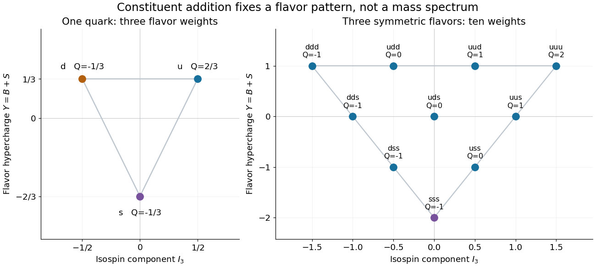

# Quark-model baryon-decuplet construction

↑ **Parent:** [Quark-model constituent bookkeeping](quark-model-constituent-bookkeeping.md)

A particularly economical example is the [baryon decuplet](baryon-decuplet.md). Restrict to fully symmetric three-[quark](quark.md) flavor states. The nonnegative occupation numbers satisfy $n_u+n_d+n_s=3$, giving $\binom{3+3-1}{3}=10$ possibilities by [stars and bars](stars-and-bars-combinatorics.md). Their additive labels are

$$
Q=n_u-1,\qquad I_3=\frac{n_u-n_d}{2},\qquad Y=1-n_s.
$$

These formulas follow directly from the constituent table. With fixed $n_s$, there are $4-n_s$ possible values of $n_u$, so the [weight diagram](weight-diagram.md) has rows of four, three, two and one states. Its outer triangle is therefore a consequence of the constituent construction, rather than an arbitrary drawing convention.

**[Figure 10](#image-three-light-flavor-weights-generate-the-triangular-baryon-decuplet). Three light-flavor weights generate the triangular baryon decuplet**. Original exact constituent calculation using $Y=B+S$. The left panel shows the fundamental flavor triplet. The right panel adds three such weights in fully symmetric flavor states; every point is labelled by its constituent content and [electric charge](electric-charge-split.md). No measured masses or event counts are plotted.

The bottom corner has $n_s=3$, hence $I_3=0$, $Y=-2$ and $Q=-1$: the [Omega baryon](omega-baryon.md) position. The top-right corner has $uuu$ and $Q=2$, corresponding to the doubly charged [Delta baryon](delta-baryon.md). Every point satisfies the [Gell-Mann--Nishijima formula](gell-mann-nishijima-formula.md) $Q=I_3+Y/2$.

The flavor construction is only part of the state. The [Pauli constraint on three-quark flavour multiplets](pauli-constraint-on-three-quark-flavour-multiplets.md) also involves [spin angular momentum](spin.md), the spatial [wavefunction](wave-function-split.md) and [color charge](color-charge.md). In particular, three identical [fermions](fermion.md) cannot be assigned a completely symmetric total state merely because the flavor diagram is symmetric. Nor does the same flavor diagram determine the [hadron](hadron.md) [masses](mass.md): an approximate [flavor symmetry](flavor-symmetry.md) can organize a spectrum without making all its members degenerate.

## ↑ Ancestors (6)

1. [Quark-model constituent bookkeeping](quark-model-constituent-bookkeeping.md)
2. [Quark model](quark-model.md)
3. [Hadron](hadron.md)
4. [Subatomic particle](subatomic-particle.md)
5. [Physics](physics-split.md)
6. [Codex Wiki](split.md)
