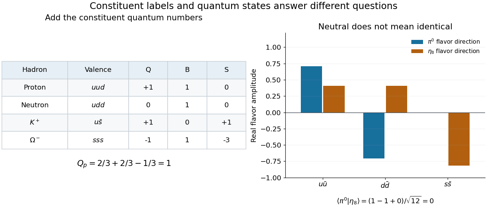

# Quark-model constituent bookkeeping

↑ **Parent:** [Quark model](quark-model.md)

For a three-light-flavor example, take [up quarks](up-quark.md), [down quarks](down-quark.md) and [strange quarks](strange-quark.md) with the following additive [quantum numbers](quantum-number.md). Here $Q$ denotes [electric charge](electric-charge-split.md) in units of the positive [elementary charge](elementary-charge.md) $e$, $B$ is [baryon number](baryon-number.md), $S$ is [strangeness](strangeness.md), $I_3$ is the third component of [isospin](isospin.md), and $Y=B+S$ is [flavor hypercharge](flavor-hypercharge.md). An [antiquark](antiquark.md) reverses all five displayed values. These are flavor coordinates, not spatial coordinates or [electroweak hypercharge](hypercharge.md).

| [Quark flavor](quark-flavor.md) | $Q$ | $B$ | $S$ | $I_3$ | $Y$ | $u$ | $2/3$ | $1/3$ | $0$ | $1/2$ | $1/3$ | $d$ | $-1/3$ | $1/3$ | $0$ | $-1/2$ | $1/3$ | $s$ | $-1/3$ | $1/3$ | $-1$ | $0$ | $-2/3$ |
| --- | --- | --- | --- | --- | --- | --- | --- | --- | --- | --- | --- | --- | --- | --- | --- | --- | --- | --- | --- | --- | --- | --- | --- |

Adding these columns immediately explains familiar [hadrons](hadron.md). A [proton](proton.md) with [valence quarks](valence-quark.md) $uud$ has $Q=2/3+2/3-1/3=1$ and $B=1$; a [neutron](neutron-split.md) with $udd$ has $Q=0$ and $B=1$. A positive [kaon](kaon.md) with $u\bar s$ has $Q=2/3+1/3=1$, $B=0$ and $S=+1$. Thus the same constituent rules describe both [baryons](baryon.md) and [mesons](meson.md).

**[Figure 9](#image-adding-constituent-quantum-numbers-distinguishes-charged-and-neutral-hadrons). Adding constituent quantum numbers distinguishes charged and neutral hadrons**. Original arithmetic examples for the three-light-flavor [quark model](quark-model.md). The lower panel contrasts two orthogonal neutral flavor combinations: identical total [electric charge](electric-charge-split.md) does not make two states identical. These are ideal flavor basis states, not a mass fit or a reconstruction of an experimental event.

Two [hadrons](hadron.md) can have identical additive labels while differing in their internal state. The [Lambda baryon](lambda-baryon.md) and neutral [Sigma baryon](sigma-baryon.md) both have valence content $uds$, yet their total [isospin](isospin.md) differs. Likewise, the neutral [pion](pion.md) flavor direction $(u\bar u-d\bar d)/\sqrt2$ and the [Eta octet state](eta-octet-state.md) $(u\bar u+d\bar d-2s\bar s)/\sqrt6$ both have $Q=Y=0$, but their [inner product](inner-product-split.md) vanishes. Expanding that [inner product](inner-product-split.md) gives $(1-1+0)/\sqrt{12}=0$. Constituent counting must therefore be supplemented by [quantum superposition](quantum-superposition.md) and the [symmetry](symmetry-physics.md) of the state.

**Table of contents**

- [Quark-model baryon-decuplet construction](quark-model-baryon-decuplet-construction.md)

## ↑ Ancestors (5)

1. [Quark model](quark-model.md)
2. [Hadron](hadron.md)
3. [Subatomic particle](subatomic-particle.md)
4. [Physics](physics-split.md)
5. [Codex Wiki](split.md)
